# AI Growth Engine: Employee Sales & Marketing Automation
## Application Blueprint: PART 11 (Batch 11.16b), Investment Automation I: Investor/Fundraising Mode and INV-SVC-01…12

| Field | Value |
|---|---|
| Document | Part 11, Batch 11.16, file **b** of Group N files a, b, e: §11.16.5.12 executable workflow specifications for the 48 workflows INV-SVC-01-WF01…INV-SVC-12-WF04. Files a (framework, services) and c (stories, combinatorial tests, cost, decisions) |
| Version | 1.0 · 28 Nov 2026 |
| Baseline | Part 11.16a; Part 11.3a universal engine contract (StepRun, states, retries, simulation); Part 11.3b workflow format; Part 11.15 rule-pack framework; DEC-779/783 |
| Roles applied | Expert panel of Part 11.16a (private-markets operating partner, securities-law specialist, CPO, Principal Solutions Architect, Principal BSA) plus QA Lead and Security/AI Governance Lead |
| Counts | 48 workflows · 176 V12 step contracts + 8 blueprint gate steps · 391 DTO fields · 448 workflow tests + 184 step tests (TC-V12-N-001…TC-V12-N-632) + 12 entitlement tests · requirements FR-V12-N-101…148 |

**Legal status.** Draft for counsel review; not legal advice. Thresholds marked "verify" are the panel's reading (as of 27 Nov 2026) [ASSUMPTION-1000].

## 11.16.5.12 Workflow specifications (INV-SVC-01…12)

**How to read each workflow block.** (1) A header table restates the V12 workbook fields literally (Workflow Catalog 50-field row, Cost Model, Acceptance Tests) and adds the blueprint mapping, risk class, autonomy, securities and privacy controls, KPI formulas, SLA and rules. (2) The DTO table gives the typed contract `urn:inv:dto:INV-SVC-nn-WFnn:v2` (JSON Schema 2020-12, `additionalProperties: false`). (3) The step table lists every V12 step (split from the workbook "Detailed functionality", one step per clause, IDs `…-STEP-nn`) with executor, output/validation, failure route and blueprint state, the component, **the securities/privacy controls applied in that step**, and the step test; R2/R3 workflows add the blueprint gate step `…-STEP-GATE` before the first external effect. (4) R2/R3 workflows and every WF04 carry a Mermaid flowchart. (5) The test table maps the V12 acceptance ID (`…-AT01`) and the blueprint test classes to TC-V12-N IDs.

**Blueprint states** (Part 11.3a): Queued → Running → Succeeded; Waiting (AWAITING_APPROVAL); Held; Blocked; Reconciling; Escalated; Suppressed; Paused; Failed. **Risk classes (V12):** R0 internal analysis/draft · R1 regulated pre-check or internal record · R2 external communication/disclosure · R3 consequential legal/financial (prepare only until two-person authorization or a bounded mandate).

#### INV-SVC-01 Global Funding & Investor Discovery Automation

**Purpose:** Find eligible funding routes, angels, VC, PE, family offices, grants, CSR and debt opportunities (workbook Service Catalog row 5). **Epic:** EP-30. **Service spec:** Part 11.16a §11.16.5.6.1. **Stories:** Part 11.16e.

| Field | Specification |
|---|---|
| Family / bundle / meter | Research & discovery · Full suite / Discovery & Qualification bundle / selective (1 SKU); entitlement and usage approval required. · Illustrative pilot: 100 source batch(s)/month; 1 concurrent run; configurable hard budget, provider quota and frequency limits. Not approved. |
| Supported channels | Approved sources, internal alerts |
| Industries / capability | Fundraising issuers across eligible sectors; grant/debt/CSR route requires eligibility · Funding discovery |
| Required entitlements | INV-SVC-01 + foundation; tenant/startup, capability, role, channel/provider and budget checks at every action |
| Optional input producers | Included foundation; no mandatory upstream paid service; optional input producers: None; authorized equivalent input accepted. |
| External providers | Authorized public or licensed funding sources; no private scraping (verify terms and prices at implementation, as of 27 Nov 2026) |
| Service KPI (V12) | Accepted candidates with source evidence ≥95%; freshness SLA met ≥95% |
| Actors (blueprint roles) | R03/R04 owners; R04 requester · R02 route approver; R04 · R02; R19 service identity; R20 agent identity |
| Agents | AG-160, AG-161, AG-003, AG-004, AG-041 |
| Automations | AU-209, AU-210, AU-200, AU-201, AU-007, AU-014, AU-005 |
| Shared engines (V12) | Research and evidence; Workflow orchestration; Governance |
| Data class and gateway tier | Public / Internal (funding programmes, fund mandates published by investors); Personal when an angel is a natural person → no Tier 2; Tier 0 rules/cache → Tier 1a extraction → Tier 1b summary; Tier 2 only for public programme pages without personal data (opt-in, default off) |
| Screens | A009; A010; A016; A027 → A209, A210, A215, A225 |
| V12 DB candidates → blueprint | inv_contact_evidence; inv_evidence; inv_funding_route; inv_guarantee_evidence; inv_investor; inv_investor_alias; inv_opportunity; inv_search_plan; inv_search_run; inv_source; inv_source_policy → schema `inv` same names (DEC-814 keeps V12 names; RLS per §11.16.5.10) |

##### INV-SVC-01-WF01 Funding opportunity discovery

**Requirement FR-V12-N-101** (status before: Not covered, CONFLICT-958; after: Matched). Execute "Funding opportunity discovery" as a typed, policy-checked workflow: Plan search; retrieve permitted records; extract mandate and deadline; deduplicate; save evidence; output "Candidate opportunities".

| Field | Specification |
|---|---|
| Business outcome / input → output | Funding opportunity discovery: Issuer thesis and source list → Candidate opportunities |
| Trigger | Manual request or validated upstream business event |
| Result / acceptance | Candidate opportunities; acceptance INV-SVC-01-WF01-AT01 (Funding opportunity discovery) → TC-V12-N-006 |
| Domain contract | Validator `urn:inv:dto:INV-SVC-01-WF01:v2`; fields below; event envelope per FR-V12-N-006 |
| Risk and authority | R0 internal analysis · V12 side effect: Internal analysis/draft; no external action without separate authorization |
| Autonomy in blueprint | L3 internal research and classification (no external effect); funding-route approval L1 by R02 |
| Approval gate (V12) | Approve source and funding route; reviewer confirms ambiguous findings |
| Operating mode / modalities | AI-assisted / supervised; controlled autonomous only for preapproved eligible routine steps; simulation has zero external effects. · Text; structured records |
| Agent / automations | AG-160 · AU-007, AU-014, AU-005, AU-209 |
| Roles | R04 requester · R02 route approver |
| Step classes | 2 AI inference; 1 Evidence retrieval; 1 Deterministic calculation; 1 Domain persistence |
| Securities and privacy controls | SEC-CTL-N-16 (see step column) |
| Workflow KPI (V12 service) | Accepted candidates with source evidence ≥95%; freshness SLA met ≥95% |
| KPI formulas (this part) | candidate evidence rate = accepted candidates with ≥1 valid evidence_id ÷ accepted candidates (target ≥ 95%); route precision = candidates approved by R02 ÷ candidates proposed |
| SLA | Run ≤ 30 min per 100-source batch; owner notified ≤ 15 min after completion |
| Illustrative cost (V12) | 1 workflow invocation; not a full service cycle; tokens 4000 in / 600 out; INR 1.43 per invocation; external fees excluded (estimate; verify at implementation, as of 27 Nov 2026) |
| Versions / origin | workflow 2.0-target; INV-SVC-01-WF01-AT01; synthetic dry run and measured benchmark pending; V12 status: Proposed; test Not run; live execution and pricing pending. |
| Rules | R1. Only sources with an active source policy for purpose "fundraising research" are read (BRL-SRC-01) · R2. Funding routes are proposals until R02 approves them (V12 gate) |

**DTO `urn:inv:dto:INV-SVC-01-WF01:v2`**

| Field | Dir | Req | Type / validation | Schema constraint | Blueprint mapping |
|---|---|---|---|---|---|
| `issuer_thesis` | in | Y | free text NFC-normalised, untrusted (AU-005) | `{"type": "string", "minLength": 1, "maxLength": 4000}` | run payload (inv_workflow_run.output_json) |
| `funding_routes` | in | Y | configured enum list (funding_route) | `{"type": "array", "items": {"type": "string", "maxLength": 64}, "maxItems": 50, "$comment": "values from registry funding_route"}` | run payload (inv_workflow_run.output_json) |
| `sectors` | in | Y | configured enum list (sector) | `{"type": "array", "items": {"type": "string", "maxLength": 64}, "maxItems": 50, "$comment": "values from registry sector"}` | run payload (inv_workflow_run.output_json) |
| `regions` | in | Y | configured enum list (region) | `{"type": "array", "items": {"type": "string", "maxLength": 64}, "maxItems": 50, "$comment": "values from registry region"}` | run payload (inv_workflow_run.output_json) |
| `source_ids` | in | Y | typed references, resolved in caller scope | `{"type": "array", "items": {"type": "string", "format": "uuid"}, "maxItems": 500}` | inv_source.id[] |
| `opportunity_id` | out | Y | reference in caller tenant/startup | `{"type": "string", "format": "uuid"}` | inv_opportunity.id |
| `route_type` | out | Y | configured enum (funding_route) | `{"type": "string", "maxLength": 64, "$comment": "values from registry funding_route"}` | run payload (inv_workflow_run.output_json) |
| `mandate_summary` | out | Y | free text NFC-normalised, untrusted (AU-005) | `{"type": "string", "minLength": 1, "maxLength": 4000}` | inv_mandate |
| `deadline_at` | out | Y | RFC 3339; stored UTC | `{"type": "string", "format": "date-time"}` | run payload (inv_workflow_run.output_json) |
| `evidence_ids` | out | Y | typed references, resolved in caller scope | `{"type": "array", "items": {"type": "string", "format": "uuid"}, "maxItems": 500}` | inv_evidence.id[] |
| `confidence` | out | Y | decimal string (no float) | `{"type": "string", "pattern": "^-?\\d+(\\.\\d{1,6})?$"}` | run payload (inv_workflow_run.output_json) |
| `correlation_id` | in | Y | trace id | `{"type": "string", "format": "uuid"}` | inv_workflow_run.correlation_id |
| `simulation` | in | N | zero-effect run | `{"type": "boolean", "default": false}` | inv_workflow_run.simulation |

| Step ID | Action | Class · executor | Output / validation | Failure → state | Blueprint component | Controls in this step | Step test |
|---|---|---|---|---|---|---|---|
| INV-SVC-01-WF01-STEP-01 | Plan search | AI inference · Model gateway + agent | candidate {artifact_ref, confidence, reason_codes, review_state} | REVIEW_REQUIRED → **Waiting (AWAITING_APPROVAL)** | Model gateway AU-001 (Tier 0 → 1a → 1b; Tier 3 degrade), AU-003 schema validation, AG-166 guard on investor-facing text; output is a draft only | CTL-16 | TC-V12-N-001 (AIE + CT schema): output validates against schema; claims cited; AG-166 verdict recorded; untrusted input cannot invoke tools |
| INV-SVC-01-WF01-STEP-02 | retrieve permitted records | Evidence retrieval · Ingestion / connector engine | evidence_set {items, source_ref, observed_at, hash, rights} | SOURCE_DENIED → **Held** | Ingestion via AU-007 source permission, AU-014 host filter, AU-005 sanitizer | CTL-16 | TC-V12-N-002 (IT (adapter stub) + SEC): unauthorised or stale source rejected; provenance hash and rights stored |
| INV-SVC-01-WF01-STEP-03 | extract mandate and deadline | AI inference · Model gateway + agent | candidate {artifact_ref, confidence, reason_codes, review_state} | REVIEW_REQUIRED → **Waiting (AWAITING_APPROVAL)** | Model gateway AU-001 (Tier 0 → 1a → 1b; Tier 3 degrade), AU-003 schema validation, AG-166 guard on investor-facing text; output is a draft only | CTL-16 | TC-V12-N-003 (AIE + CT schema): output validates against schema; claims cited; AG-166 verdict recorded; untrusted input cannot invoke tools |
| INV-SVC-01-WF01-STEP-04 | deduplicate | Deterministic calculation · Rules / calculation engine | calculation {value, unit, assumptions, evidence_refs} | INVALID_INPUT → **Held** | Deterministic domain service; Decimal (DEC-027); zero model calls | — (internal; audit only) | TC-V12-N-004 (UT golden fixture): golden fixture exact; missing value never invented |
| INV-SVC-01-WF01-STEP-05 | save evidence | Domain persistence · Domain service (investment app) | domain_result {artifact_ref, status, evidence_refs} | INVALID_STATE → **Held** | Domain module: revision check (NFR-025), single transaction with audit and outbox | — (internal; audit only) | TC-V12-N-005 (UT + IT): state change atomic with audit and outbox row |

| Test ID | V12 / class ID | Level | Fixture / action | Expected (blueprint assertion) |
|---|---|---|---|---|
| TC-V12-N-006 | INV-SVC-01-WF01-AT01 | IT | Issuer thesis and source list | Output validates against the workflow schema; evidence persisted; run Succeeded; KPI event emitted; output "Candidate opportunities"; KPI: candidate evidence rate = accepted candidates with ≥1 valid evidence_id ÷ accepted candidates (target ≥ 95%) |
| TC-V12-N-007 | INV-SVC-01-WF01-TC-INPUT | UT/CT | missing or malformed input | HTTP 422 with field errors; no StepRun; audit `dto.rejected` |
| TC-V12-N-008 | INV-SVC-01-WF01-TC-SCOPE | SEC | same reference from another tenant/startup | HTTP 403 or uniform 404 (BRL-TEN-04); zero rows/events/provider calls in the other scope |
| TC-V12-N-009 | INV-SVC-01-WF01-TC-ENT | IT | revoke INV SKU after enqueue | AU-200 dispatch-time recheck denies; run Paused/Held; reservation released; no effect |
| TC-V12-N-010 | INV-SVC-01-WF01-TC-DUP | IT replay | replay identical event / step key | exactly one accepted outcome, effect and meter charge; duplicate returns original run ref |
| TC-V12-N-011 | INV-SVC-01-WF01-TC-QUALITY | AIE | stale, conflicting or incomplete evidence | step Held or flagged; no unsupported claim reaches output (BRL-AI-03/04); eval record stored |
| TC-V12-N-012 | INV-SVC-01-WF01-TC-BUDGET | IT | quota exhausted at reservation | reservation fails → Blocked; zero provider calls; owner notified |
| TC-V12-N-013 | INV-SVC-01-WF01-TC-RECOVERY | CHAOS | provider timeout or worker crash | timeout after submit → Reconciling; resume from checkpoint without repeating a completed effect |
| TC-V12-N-014 | INV-SVC-01-WF01-TC-SEC | SEC/compliance | SEC-CTL-N-16: EU tenant data processed by IN worker | request refused REGION_MISMATCH; no write |

##### INV-SVC-01-WF02 Evidence refresh and change detection

**Requirement FR-V12-N-102** (status before: Not covered, CONFLICT-958; after: Matched). Execute "Evidence refresh and change detection" as a typed, policy-checked workflow: Fetch authorized update; compare fields; record change and freshness; flag stale record; output "Revised evidence and change event".

| Field | Specification |
|---|---|
| Business outcome / input → output | Evidence refresh and change detection: Existing opportunity and source revision → Revised evidence and change event |
| Trigger | Scheduled or manual; scoped event on change |
| Result / acceptance | Revised evidence and change event; acceptance INV-SVC-01-WF02-AT01 (Evidence refresh and change detection) → TC-V12-N-019 |
| Domain contract | Validator `urn:inv:dto:INV-SVC-01-WF02:v2`; fields below; event envelope per FR-V12-N-006 |
| Risk and authority | R0 · V12 side effect: Internal analysis/draft; no external action without separate authorization |
| Autonomy in blueprint | L3 internal research and classification (no external effect); funding-route approval L1 by R02 |
| Approval gate (V12) | Approve source and funding route; reviewer confirms ambiguous findings |
| Operating mode / modalities | AI-assisted / supervised; controlled autonomous only for preapproved eligible routine steps; simulation has zero external effects. · Text; structured records; documents |
| Agent / automations | AG-160 · AU-210 |
| Roles | R04 · R02 |
| Step classes | 1 Evidence retrieval; 2 Deterministic calculation; 1 Domain persistence |
| Securities and privacy controls | SEC-CTL-N-16 (see step column) |
| Workflow KPI (V12 service) | Accepted candidates with source evidence ≥95%; freshness SLA met ≥95% |
| KPI formulas (this part) | freshness SLA met = sources refreshed within window ÷ sources due (target ≥ 95%); stale flag recall = stale records flagged ÷ stale records (sampled) |
| SLA | Daily batch ≤ 2 h; change event ≤ 5 min after detection |
| Illustrative cost (V12) | 1 workflow invocation; not a full service cycle; tokens 2500 in / 350 out; INR 0.93 per invocation; external fees excluded (estimate; verify at implementation, as of 27 Nov 2026) |
| Versions / origin | workflow 2.0-target; INV-SVC-01-WF02-AT01; synthetic dry run and measured benchmark pending; V12 status: Proposed; test Not run; live execution and pricing pending. |
| Rules | R1. Stale evidence is flagged, never deleted (BRL-SRC-06) · R2. A changed deadline re-triggers WF03 |

**DTO `urn:inv:dto:INV-SVC-01-WF02:v2`**

| Field | Dir | Req | Type / validation | Schema constraint | Blueprint mapping |
|---|---|---|---|---|---|
| `opportunity_id` | in | Y | reference in caller tenant/startup | `{"type": "string", "format": "uuid"}` | inv_opportunity.id |
| `source_revision` | in | Y | SHA-256 hex | `{"type": "string", "pattern": "^[a-f0-9]{64}$"}` | inv_source |
| `evidence_id` | out | Y | reference in caller tenant/startup | `{"type": "string", "format": "uuid"}` | inv_evidence.id |
| `changed_fields` | out | Y | configured enum list (field) | `{"type": "array", "items": {"type": "string", "maxLength": 64}, "maxItems": 50, "$comment": "values from registry field"}` | run payload (inv_workflow_run.output_json) |
| `freshness_state` | out | Y | configured enum (freshness) | `{"type": "string", "maxLength": 64, "$comment": "values from registry freshness"}` | run payload (inv_workflow_run.output_json) |
| `change_event_id` | out | Y | reference in caller tenant/startup | `{"type": "string", "format": "uuid"}` | run payload (inv_workflow_run.output_json) |
| `correlation_id` | in | Y | trace id | `{"type": "string", "format": "uuid"}` | inv_workflow_run.correlation_id |
| `simulation` | in | N | zero-effect run | `{"type": "boolean", "default": false}` | inv_workflow_run.simulation |

| Step ID | Action | Class · executor | Output / validation | Failure → state | Blueprint component | Controls in this step | Step test |
|---|---|---|---|---|---|---|---|
| INV-SVC-01-WF02-STEP-01 | Fetch authorized update | Evidence retrieval · Ingestion / connector engine | evidence_set {items, source_ref, observed_at, hash, rights} | SOURCE_DENIED → **Held** | Ingestion via AU-007 source permission, AU-014 host filter, AU-005 sanitizer | CTL-16 | TC-V12-N-015 (IT (adapter stub) + SEC): unauthorised or stale source rejected; provenance hash and rights stored |
| INV-SVC-01-WF02-STEP-02 | compare fields | Deterministic calculation · Rules / calculation engine | calculation {value, unit, assumptions, evidence_refs} | INVALID_INPUT → **Held** | Deterministic domain service; Decimal (DEC-027); zero model calls | — (internal; audit only) | TC-V12-N-016 (UT golden fixture): golden fixture exact; missing value never invented |
| INV-SVC-01-WF02-STEP-03 | record change and freshness | Domain persistence · Domain service (investment app) | domain_result {artifact_ref, status, evidence_refs} | INVALID_STATE → **Held** | Domain module: revision check (NFR-025), single transaction with audit and outbox | — (internal; audit only) | TC-V12-N-017 (UT + IT): state change atomic with audit and outbox row |
| INV-SVC-01-WF02-STEP-04 | flag stale record | Deterministic calculation · Rules / calculation engine | calculation {value, unit, assumptions, evidence_refs} | INVALID_INPUT → **Held** | Deterministic domain service; Decimal (DEC-027); zero model calls | — (internal; audit only) | TC-V12-N-018 (UT golden fixture): golden fixture exact; missing value never invented |

| Test ID | V12 / class ID | Level | Fixture / action | Expected (blueprint assertion) |
|---|---|---|---|---|
| TC-V12-N-019 | INV-SVC-01-WF02-AT01 | IT | Existing opportunity and source revision | Output validates against the workflow schema; evidence persisted; run Succeeded; KPI event emitted; output "Revised evidence and change event"; KPI: freshness SLA met = sources refreshed within window ÷ sources due (target ≥ 95%) |
| TC-V12-N-020 | INV-SVC-01-WF02-TC-INPUT | UT/CT | missing or malformed input | HTTP 422 with field errors; no StepRun; audit `dto.rejected` |
| TC-V12-N-021 | INV-SVC-01-WF02-TC-SCOPE | SEC | same reference from another tenant/startup | HTTP 403 or uniform 404 (BRL-TEN-04); zero rows/events/provider calls in the other scope |
| TC-V12-N-022 | INV-SVC-01-WF02-TC-ENT | IT | revoke INV SKU after enqueue | AU-200 dispatch-time recheck denies; run Paused/Held; reservation released; no effect |
| TC-V12-N-023 | INV-SVC-01-WF02-TC-DUP | IT replay | replay identical event / step key | exactly one accepted outcome, effect and meter charge; duplicate returns original run ref |
| TC-V12-N-024 | INV-SVC-01-WF02-TC-QUALITY | AIE | stale, conflicting or incomplete evidence | step Held or flagged; no unsupported claim reaches output (BRL-AI-03/04); eval record stored |
| TC-V12-N-025 | INV-SVC-01-WF02-TC-BUDGET | IT | quota exhausted at reservation | reservation fails → Blocked; zero provider calls; owner notified |
| TC-V12-N-026 | INV-SVC-01-WF02-TC-RECOVERY | CHAOS | provider timeout or worker crash | timeout after submit → Reconciling; resume from checkpoint without repeating a completed effect |
| TC-V12-N-027 | INV-SVC-01-WF02-TC-SEC | SEC/compliance | SEC-CTL-N-16: EU tenant data processed by IN worker | request refused REGION_MISMATCH; no write |

##### INV-SVC-01-WF03 Deadline and funding alerts

**Requirement FR-V12-N-103** (status before: Not covered, CONFLICT-958; after: Matched). Execute "Deadline and funding alerts" as a typed, policy-checked workflow: Check deadline and freshness; suppress duplicate alert; notify assigned owner; log delivery; output "Prioritized deadline alerts".

| Field | Specification |
|---|---|
| Business outcome / input → output | Deadline and funding alerts: Verified deadline, timezone and owner → Prioritized deadline alerts |
| Trigger | Scheduled or manual; scoped event on change |
| Result / acceptance | Prioritized deadline alerts; acceptance INV-SVC-01-WF03-AT01 (Deadline and funding alerts) → TC-V12-N-032 |
| Domain contract | Validator `urn:inv:dto:INV-SVC-01-WF03:v2`; fields below; event envelope per FR-V12-N-006 |
| Risk and authority | R0 internal notification · V12 side effect: Internal analysis/draft; no external action without separate authorization |
| Autonomy in blueprint | L3 internal research and classification (no external effect); funding-route approval L1 by R02 |
| Approval gate (V12) | Approve source and funding route; reviewer confirms ambiguous findings |
| Operating mode / modalities | AI-assisted / supervised; controlled autonomous only for preapproved eligible routine steps; simulation has zero external effects. · Text; structured records |
| Agent / automations | — (deterministic) · AU-209 |
| Roles | R03/R04 owners |
| Step classes | 2 Deterministic calculation; 1 Internal notification; 1 Domain persistence |
| Securities and privacy controls | SEC-CTL-N-16 (see step column) |
| Workflow KPI (V12 service) | Accepted candidates with source evidence ≥95%; freshness SLA met ≥95% |
| KPI formulas (this part) | alert timeliness = alerts delivered ≥ 7 days before deadline ÷ alerts due; duplicate alert rate = suppressed duplicates ÷ alerts (target 0 duplicates delivered) |
| SLA | Alert delivered ≤ 15 min after schedule tick |
| Illustrative cost (V12) | 1 workflow invocation; not a full service cycle; tokens 0 in / 0 out; INR 0.15 per invocation; external fees excluded (estimate; verify at implementation, as of 27 Nov 2026) |
| Versions / origin | workflow 2.0-target; INV-SVC-01-WF03-AT01; synthetic dry run and measured benchmark pending; V12 status: Proposed; test Not run; live execution and pricing pending. |
| Rules | R1. Alerts only internal; no investor contact · R2. Deadlines stored UTC, shown in owner timezone |

**DTO `urn:inv:dto:INV-SVC-01-WF03:v2`**

| Field | Dir | Req | Type / validation | Schema constraint | Blueprint mapping |
|---|---|---|---|---|---|
| `opportunity_id` | in | Y | reference in caller tenant/startup | `{"type": "string", "format": "uuid"}` | inv_opportunity.id |
| `deadline_at` | in | Y | RFC 3339; stored UTC | `{"type": "string", "format": "date-time"}` | run payload (inv_workflow_run.output_json) |
| `timezone` | in | Y | configured enum (tz) | `{"type": "string", "maxLength": 64, "$comment": "values from registry tz"}` | run payload (inv_workflow_run.output_json) |
| `owner_id` | in | Y | reference in caller tenant/startup | `{"type": "string", "format": "uuid"}` | run payload (inv_workflow_run.output_json) |
| `alert_id` | out | Y | reference in caller tenant/startup | `{"type": "string", "format": "uuid"}` | notification.id |
| `priority` | out | Y | configured enum (priority) | `{"type": "string", "maxLength": 64, "$comment": "values from registry priority"}` | run payload (inv_workflow_run.output_json) |
| `delivered_at` | out | Y | RFC 3339; stored UTC | `{"type": "string", "format": "date-time"}` | run payload (inv_workflow_run.output_json) |
| `correlation_id` | in | Y | trace id | `{"type": "string", "format": "uuid"}` | inv_workflow_run.correlation_id |
| `simulation` | in | N | zero-effect run | `{"type": "boolean", "default": false}` | inv_workflow_run.simulation |

| Step ID | Action | Class · executor | Output / validation | Failure → state | Blueprint component | Controls in this step | Step test |
|---|---|---|---|---|---|---|---|
| INV-SVC-01-WF03-STEP-01 | Check deadline and freshness | Deterministic calculation · Rules / calculation engine | calculation {value, unit, assumptions, evidence_refs} | INVALID_INPUT → **Held** | Deterministic domain service; Decimal (DEC-027); zero model calls | — (internal; audit only) | TC-V12-N-028 (UT golden fixture): golden fixture exact; missing value never invented |
| INV-SVC-01-WF03-STEP-02 | suppress duplicate alert | Deterministic calculation · Rules / calculation engine | calculation {value, unit, assumptions, evidence_refs} | INVALID_INPUT → **Held** | Deterministic domain service; Decimal (DEC-027); zero model calls | — (internal; audit only) | TC-V12-N-029 (UT golden fixture): golden fixture exact; missing value never invented |
| INV-SVC-01-WF03-STEP-03 | notify assigned owner | Internal notification · Notification service (NT) | notification {recipient_role, channel=in-app/email-internal, dedupe_key} | DUPLICATE → **Suppressed** | Notification service NT/NX (Part 2.4); dedupe key | CTL-16 | TC-V12-N-030 (IT): one notification per dedupe key; internal recipients only |
| INV-SVC-01-WF03-STEP-04 | log delivery | Domain persistence · Domain service (investment app) | domain_result {artifact_ref, status, evidence_refs} | INVALID_STATE → **Held** | Domain module: revision check (NFR-025), single transaction with audit and outbox | — (internal; audit only) | TC-V12-N-031 (UT + IT): state change atomic with audit and outbox row |

| Test ID | V12 / class ID | Level | Fixture / action | Expected (blueprint assertion) |
|---|---|---|---|---|
| TC-V12-N-032 | INV-SVC-01-WF03-AT01 | IT | Verified deadline, timezone and owner | Output validates against the workflow schema; evidence persisted; run Succeeded; KPI event emitted; output "Prioritized deadline alerts"; KPI: alert timeliness = alerts delivered ≥ 7 days before deadline ÷ alerts due |
| TC-V12-N-033 | INV-SVC-01-WF03-TC-INPUT | UT/CT | missing or malformed input | HTTP 422 with field errors; no StepRun; audit `dto.rejected` |
| TC-V12-N-034 | INV-SVC-01-WF03-TC-SCOPE | SEC | same reference from another tenant/startup | HTTP 403 or uniform 404 (BRL-TEN-04); zero rows/events/provider calls in the other scope |
| TC-V12-N-035 | INV-SVC-01-WF03-TC-ENT | IT | revoke INV SKU after enqueue | AU-200 dispatch-time recheck denies; run Paused/Held; reservation released; no effect |
| TC-V12-N-036 | INV-SVC-01-WF03-TC-DUP | IT replay | replay identical event / step key | exactly one accepted outcome, effect and meter charge; duplicate returns original run ref |
| TC-V12-N-037 | INV-SVC-01-WF03-TC-QUALITY | AIE | stale, conflicting or incomplete evidence | step Held or flagged; no unsupported claim reaches output (BRL-AI-03/04); eval record stored |
| TC-V12-N-038 | INV-SVC-01-WF03-TC-BUDGET | IT | quota exhausted at reservation | reservation fails → Blocked; zero provider calls; owner notified |
| TC-V12-N-039 | INV-SVC-01-WF03-TC-RECOVERY | CHAOS | provider timeout or worker crash | timeout after submit → Reconciling; resume from checkpoint without repeating a completed effect |
| TC-V12-N-040 | INV-SVC-01-WF03-TC-SEC | SEC/compliance | SEC-CTL-N-16: EU tenant data processed by IN worker | request refused REGION_MISMATCH; no write |

##### INV-SVC-01-WF04 Continuous funding signal and emerging opportunity detection

**Requirement FR-V12-N-104** (status before: Not covered, CONFLICT-958; after: Matched). Execute "Continuous funding signal and emerging opportunity detection" as a typed, policy-checked workflow: Poll eligible sources; compare versioned signals; qualify novelty; deduplicate and notify; output "Evidence-linked funding signal alert".

| Field | Specification |
|---|---|
| Business outcome / input → output | Continuous funding signal and emerging opportunity detection: Approved funding sources, issuer thesis, last evidence snapshot → Evidence-linked funding signal alert |
| Trigger | Manual; scheduled or relevant validated business event; provider webhook only where authorized |
| Result / acceptance | Evidence-linked funding signal alert; acceptance INV-SVC-01-WF04-AT01 (Continuous funding signal and emerging opportunity detection) → TC-V12-N-045 |
| Domain contract | Validator `urn:inv:dto:INV-SVC-01-WF04:v2`; fields below; event envelope per FR-V12-N-006 |
| Risk and authority | R0 · V12 side effect: Internal analysis/draft; no external action without separate authorization |
| Autonomy in blueprint | L3 internal research and classification (no external effect); funding-route approval L1 by R02 |
| Approval gate (V12) | Approve source/data rights and applicable external actions; qualified reviewer confirms legal/financial claims and any offer, filing, ownership change or payment; no autonomous regulated decision. |
| Operating mode / modalities | AI-assisted / supervised; controlled autonomous only for preapproved eligible routine steps; simulation has zero external effects. · Text; structured records |
| Agent / automations | AG-161 · AU-210, AU-209 |
| Roles | R04 · R02 |
| Step classes | 1 Evidence retrieval; 1 Deterministic calculation; 1 AI inference; 1 Internal notification |
| Securities and privacy controls | SEC-CTL-N-16 (see step column) |
| Workflow KPI (V12 service) | Accepted candidates with source evidence ≥95%; freshness SLA met ≥95% |
| KPI formulas (this part) | signal precision = reviewed signals accepted ÷ signals raised (target ≥ 80% after pilot); novel-signal latency = median(alert_at − source published_at) |
| SLA | Poll interval per source ≥ 6 h (provider terms); alert ≤ 15 min after qualification |
| Illustrative cost (V12) | 1 invocation; text component only; tokens 1200 in / 200 out; INR 0.55 per invocation; external fees excluded (estimate; verify at implementation, as of 27 Nov 2026) |
| Versions / origin | workflow 1.0-target; INV-SVC-01-WF04-AT01; synthetic dry run and measured benchmark pending; V12 status: Proposed; test Not run; live execution and pricing pending. |
| Rules | R1. Webhooks only from approved providers with signature verification · R2. Novelty compares versioned signals; no duplicate alert |

**DTO `urn:inv:dto:INV-SVC-01-WF04:v2`**

| Field | Dir | Req | Type / validation | Schema constraint | Blueprint mapping |
|---|---|---|---|---|---|
| `source_ids` | in | Y | typed references, resolved in caller scope | `{"type": "array", "items": {"type": "string", "format": "uuid"}, "maxItems": 500}` | inv_source.id[] |
| `issuer_thesis` | in | Y | free text NFC-normalised, untrusted (AU-005) | `{"type": "string", "minLength": 1, "maxLength": 4000}` | run payload (inv_workflow_run.output_json) |
| `last_snapshot_id` | in | Y | reference in caller tenant/startup | `{"type": "string", "format": "uuid"}` | run payload (inv_workflow_run.output_json) |
| `signal_id` | out | Y | reference in caller tenant/startup | `{"type": "string", "format": "uuid"}` | inv_evidence (signal).id |
| `novelty_score` | out | Y | decimal string (no float) | `{"type": "string", "pattern": "^-?\\d+(\\.\\d{1,6})?$"}` | run payload (inv_workflow_run.output_json) |
| `evidence_ids` | out | Y | typed references, resolved in caller scope | `{"type": "array", "items": {"type": "string", "format": "uuid"}, "maxItems": 500}` | inv_evidence.id[] |
| `alert_id` | out | Y | reference in caller tenant/startup | `{"type": "string", "format": "uuid"}` | notification.id |
| `correlation_id` | in | Y | trace id | `{"type": "string", "format": "uuid"}` | inv_workflow_run.correlation_id |
| `simulation` | in | N | zero-effect run | `{"type": "boolean", "default": false}` | inv_workflow_run.simulation |

| Step ID | Action | Class · executor | Output / validation | Failure → state | Blueprint component | Controls in this step | Step test |
|---|---|---|---|---|---|---|---|
| INV-SVC-01-WF04-STEP-01 | Poll eligible sources | Evidence retrieval · Ingestion / connector engine | evidence_set {items, source_ref, observed_at, hash, rights} | SOURCE_DENIED → **Held** | Ingestion via AU-007 source permission, AU-014 host filter, AU-005 sanitizer | CTL-16 | TC-V12-N-041 (IT (adapter stub) + SEC): unauthorised or stale source rejected; provenance hash and rights stored |
| INV-SVC-01-WF04-STEP-02 | compare versioned signals | Deterministic calculation · Rules / calculation engine | calculation {value, unit, assumptions, evidence_refs} | INVALID_INPUT → **Held** | Deterministic domain service; Decimal (DEC-027); zero model calls | — (internal; audit only) | TC-V12-N-042 (UT golden fixture): golden fixture exact; missing value never invented |
| INV-SVC-01-WF04-STEP-03 | qualify novelty | AI inference · Model gateway + agent | candidate {artifact_ref, confidence, reason_codes, review_state} | REVIEW_REQUIRED → **Waiting (AWAITING_APPROVAL)** | Model gateway AU-001 (Tier 0 → 1a → 1b; Tier 3 degrade), AU-003 schema validation, AG-166 guard on investor-facing text; output is a draft only | CTL-16 | TC-V12-N-043 (AIE + CT schema): output validates against schema; claims cited; AG-166 verdict recorded; untrusted input cannot invoke tools |
| INV-SVC-01-WF04-STEP-04 | deduplicate and notify | Internal notification · Notification service (NT) | notification {recipient_role, channel=in-app/email-internal, dedupe_key} | DUPLICATE → **Suppressed** | Notification service NT/NX (Part 2.4); dedupe key | CTL-16 | TC-V12-N-044 (IT): one notification per dedupe key; internal recipients only |

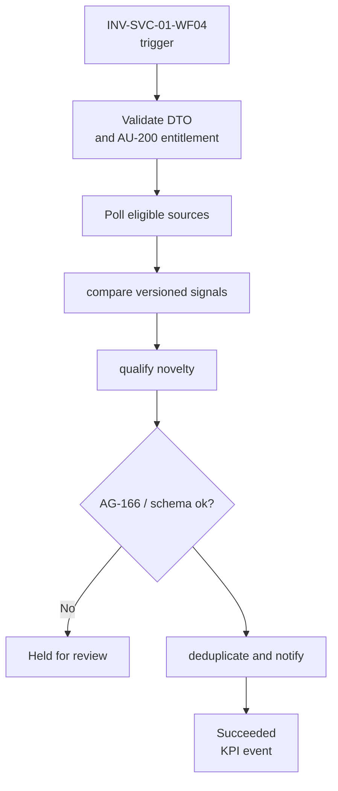

| Test ID | V12 / class ID | Level | Fixture / action | Expected (blueprint assertion) |
|---|---|---|---|---|
| TC-V12-N-045 | INV-SVC-01-WF04-AT01 | IT | Approved funding sources, issuer thesis, last evidence snapshot | Output validates against the workflow schema; evidence persisted; run Succeeded; KPI event emitted; output "Evidence-linked funding signal alert"; KPI: signal precision = reviewed signals accepted ÷ signals raised (target ≥ 80% after pilot) |
| TC-V12-N-046 | INV-SVC-01-WF04-TC-INPUT | UT/CT | missing or malformed input | HTTP 422 with field errors; no StepRun; audit `dto.rejected` |
| TC-V12-N-047 | INV-SVC-01-WF04-TC-SCOPE | SEC | same reference from another tenant/startup | HTTP 403 or uniform 404 (BRL-TEN-04); zero rows/events/provider calls in the other scope |
| TC-V12-N-048 | INV-SVC-01-WF04-TC-ENT | IT | revoke INV SKU after enqueue | AU-200 dispatch-time recheck denies; run Paused/Held; reservation released; no effect |
| TC-V12-N-049 | INV-SVC-01-WF04-TC-DUP | IT replay | replay identical event / step key | exactly one accepted outcome, effect and meter charge; duplicate returns original run ref |
| TC-V12-N-050 | INV-SVC-01-WF04-TC-QUALITY | AIE | stale, conflicting or incomplete evidence | step Held or flagged; no unsupported claim reaches output (BRL-AI-03/04); eval record stored |
| TC-V12-N-051 | INV-SVC-01-WF04-TC-BUDGET | IT | quota exhausted at reservation | reservation fails → Blocked; zero provider calls; owner notified |
| TC-V12-N-052 | INV-SVC-01-WF04-TC-RECOVERY | CHAOS | provider timeout or worker crash | timeout after submit → Reconciling; resume from checkpoint without repeating a completed effect |
| TC-V12-N-053 | INV-SVC-01-WF04-TC-SEC | SEC/compliance | SEC-CTL-N-16: EU tenant data processed by IN worker | request refused REGION_MISMATCH; no write |

#### INV-SVC-02 Investor Intelligence & Qualification Automation

**Purpose:** Match investors to issuer thesis, stage, ticket size and permitted jurisdiction (workbook Service Catalog row 6). **Epic:** EP-30. **Service spec:** Part 11.16a §11.16.5.6.2. **Stories:** Part 11.16e.

| Field | Specification |
|---|---|
| Family / bundle / meter | Investor intelligence · Full suite / Discovery & Qualification bundle / selective (1 SKU); entitlement and usage approval required. · Illustrative pilot: 500 investor assessment(s)/month; 1 concurrent run; configurable hard budget, provider quota and frequency limits. Not approved. |
| Supported channels | Private workspace |
| Industries / capability | Fundraising issuers across eligible sectors; grant/debt/CSR route requires eligibility · Issuer / investor matching |
| Required entitlements | INV-SVC-02 + foundation; tenant/startup, capability, role, channel/provider and budget checks at every action |
| Optional input producers | Included foundation; no mandatory upstream paid service; optional input producers: INV-SVC-01; authorized equivalent input accepted. |
| External providers | Authorized investor research inputs; jurisdiction review (verify terms and prices at implementation, as of 27 Nov 2026) |
| Service KPI (V12) | Reviewed fit precision ≥90%; ineligible cases dispatched = 0 |
| Actors (blueprint roles) | R03; R04 · R02; R04 · R10; R19 service identity; R20 agent identity |
| Agents | AG-162, AG-163, AG-006, AG-042 |
| Automations | AU-202, AU-201, AU-200, AU-016, AU-056 |
| Shared engines (V12) | Prediction; Workflow orchestration; Governance |
| Data class and gateway tier | Confidential (mandates, fit scores); Personal for individual angels; investor class = Confidential-Financial; Tier 0 deterministic rubric first; Tier 1a explanation; no Tier 2 |
| Screens | A003; A011; A013; A035 → A205, A211, A213, A232 |
| V12 DB candidates → blueprint | inv_crossborder_case; inv_fit_score; inv_jurisdiction_policy; inv_mandate; inv_match_candidate; inv_opportunity; inv_round → schema `inv` same names (DEC-814 keeps V12 names; RLS per §11.16.5.10) |

##### INV-SVC-02-WF01 Mandate and ticket-size matching

**Requirement FR-V12-N-105** (status before: Not covered, CONFLICT-958; after: Matched). Execute "Mandate and ticket-size matching" as a typed, policy-checked workflow: Normalize sector stage and ticket range; score against rubric; attach evidence; output "Fit score and reason".

| Field | Specification |
|---|---|
| Business outcome / input → output | Mandate and ticket-size matching: Mandate and issuer funding objective → Fit score and reason |
| Trigger | Manual request or validated upstream business event |
| Result / acceptance | Fit score and reason; acceptance INV-SVC-02-WF01-AT01 (Mandate and ticket-size matching) → TC-V12-N-057 |
| Domain contract | Validator `urn:inv:dto:INV-SVC-02-WF01:v2`; fields below; event envelope per FR-V12-N-006 |
| Risk and authority | R0 · V12 side effect: Internal analysis/draft; no external action without separate authorization |
| Autonomy in blueprint | L3 deterministic scoring; eligibility decision is never AI (deterministic AU-202); uncertain/restricted → R10 review (L1) |
| Approval gate (V12) | Jurisdiction and eligibility reviewer for uncertain or restricted cases |
| Operating mode / modalities | AI-assisted / supervised; controlled autonomous only for preapproved eligible routine steps; simulation has zero external effects. · Text; structured records |
| Agent / automations | AG-162 · AU-016 |
| Roles | R04 · R02 |
| Step classes | 2 Deterministic calculation; 1 Domain persistence |
| Securities and privacy controls | SEC-CTL-N-02, SEC-CTL-N-16 (see step column) |
| Workflow KPI (V12 service) | Reviewed fit precision ≥90%; ineligible cases dispatched = 0 |
| KPI formulas (this part) | reviewed fit precision = fits accepted by reviewer ÷ fits shown (target ≥ 90%); explanation completeness = scores with ≥3 reason codes ÷ scores |
| SLA | Batch 500 assessments ≤ 20 min |
| Illustrative cost (V12) | 1 workflow invocation; not a full service cycle; tokens 2200 in / 350 out; INR 0.87 per invocation; external fees excluded (estimate; verify at implementation, as of 27 Nov 2026) |
| Versions / origin | workflow 2.0-target; INV-SVC-02-WF01-AT01; synthetic dry run and measured benchmark pending; V12 status: Proposed; test Not run; live execution and pricing pending. |
| Rules | R1. Ticket size and stage normalised to the round currency (Decimal) · R2. Score is advisory to issuer staff, never shown to the investor |

**DTO `urn:inv:dto:INV-SVC-02-WF01:v2`**

| Field | Dir | Req | Type / validation | Schema constraint | Blueprint mapping |
|---|---|---|---|---|---|
| `mandate_id` | in | Y | reference in caller tenant/startup | `{"type": "string", "format": "uuid"}` | inv_mandate.id |
| `issuer_round_id` | in | Y | reference in caller tenant/startup | `{"type": "string", "format": "uuid"}` | inv_round.id |
| `rubric_version` | in | Y | configured enum (rubric) | `{"type": "string", "maxLength": 64, "$comment": "values from registry rubric"}` | run payload (inv_workflow_run.output_json) |
| `fit_score` | out | Y | decimal string (no float) | `{"type": "string", "pattern": "^-?\\d+(\\.\\d{1,6})?$"}` | inv_fit_score |
| `reason_codes` | out | Y | configured enum list (fit_reason) | `{"type": "array", "items": {"type": "string", "maxLength": 64}, "maxItems": 50, "$comment": "values from registry fit_reason"}` | run payload (inv_workflow_run.output_json) |
| `evidence_ids` | out | Y | typed references, resolved in caller scope | `{"type": "array", "items": {"type": "string", "format": "uuid"}, "maxItems": 500}` | inv_evidence.id[] |
| `correlation_id` | in | Y | trace id | `{"type": "string", "format": "uuid"}` | inv_workflow_run.correlation_id |
| `simulation` | in | N | zero-effect run | `{"type": "boolean", "default": false}` | inv_workflow_run.simulation |

| Step ID | Action | Class · executor | Output / validation | Failure → state | Blueprint component | Controls in this step | Step test |
|---|---|---|---|---|---|---|---|
| INV-SVC-02-WF01-STEP-01 | Normalize sector stage and ticket range | Deterministic calculation · Rules / calculation engine | calculation {value, unit, assumptions, evidence_refs} | INVALID_INPUT → **Held** | Deterministic domain service; Decimal (DEC-027); zero model calls | — (internal; audit only) | TC-V12-N-054 (UT golden fixture): golden fixture exact; missing value never invented |
| INV-SVC-02-WF01-STEP-02 | score against rubric | Deterministic calculation · Rules / calculation engine | calculation {value, unit, assumptions, evidence_refs} | INVALID_INPUT → **Held** | Deterministic domain service; Decimal (DEC-027); zero model calls | — (internal; audit only) | TC-V12-N-055 (UT golden fixture): golden fixture exact; missing value never invented |
| INV-SVC-02-WF01-STEP-03 | attach evidence | Domain persistence · Domain service (investment app) | domain_result {artifact_ref, status, evidence_refs} | INVALID_STATE → **Held** | Domain module: revision check (NFR-025), single transaction with audit and outbox | — (internal; audit only) | TC-V12-N-056 (UT + IT): state change atomic with audit and outbox row |

| Test ID | V12 / class ID | Level | Fixture / action | Expected (blueprint assertion) |
|---|---|---|---|---|
| TC-V12-N-057 | INV-SVC-02-WF01-AT01 | IT | Mandate and issuer funding objective | Output validates against the workflow schema; evidence persisted; run Succeeded; KPI event emitted; output "Fit score and reason"; KPI: reviewed fit precision = fits accepted by reviewer ÷ fits shown (target ≥ 90%) |
| TC-V12-N-058 | INV-SVC-02-WF01-TC-INPUT | UT/CT | missing or malformed input | HTTP 422 with field errors; no StepRun; audit `dto.rejected` |
| TC-V12-N-059 | INV-SVC-02-WF01-TC-SCOPE | SEC | same reference from another tenant/startup | HTTP 403 or uniform 404 (BRL-TEN-04); zero rows/events/provider calls in the other scope |
| TC-V12-N-060 | INV-SVC-02-WF01-TC-ENT | IT | revoke INV SKU after enqueue | AU-200 dispatch-time recheck denies; run Paused/Held; reservation released; no effect |
| TC-V12-N-061 | INV-SVC-02-WF01-TC-DUP | IT replay | replay identical event / step key | exactly one accepted outcome, effect and meter charge; duplicate returns original run ref |
| TC-V12-N-062 | INV-SVC-02-WF01-TC-QUALITY | AIE | stale, conflicting or incomplete evidence | step Held or flagged; no unsupported claim reaches output (BRL-AI-03/04); eval record stored |
| TC-V12-N-063 | INV-SVC-02-WF01-TC-BUDGET | IT | quota exhausted at reservation | reservation fails → Blocked; zero provider calls; owner notified |
| TC-V12-N-064 | INV-SVC-02-WF01-TC-RECOVERY | CHAOS | provider timeout or worker crash | timeout after submit → Reconciling; resume from checkpoint without repeating a completed effect |
| TC-V12-N-065 | INV-SVC-02-WF01-TC-SEC | SEC/compliance | SEC-CTL-N-02: investor eligibility unknown | Hold ELIGIBILITY_UNKNOWN; review task to R10 |

##### INV-SVC-02-WF02 Jurisdiction and eligibility screening

**Requirement FR-V12-N-106** (status before: Not covered, CONFLICT-958; after: Matched). Execute "Jurisdiction and eligibility screening" as a typed, policy-checked workflow: Apply route policy; flag cross-border cases; hold unknown eligibility; route review; output "Eligible or held decision".

| Field | Specification |
|---|---|
| Business outcome / input → output | Jurisdiction and eligibility screening: Investor classification and issuer jurisdiction → Eligible or held decision |
| Trigger | Manual request or validated upstream business event |
| Result / acceptance | Eligible or held decision; acceptance INV-SVC-02-WF02-AT01 (Jurisdiction and eligibility screening) → TC-V12-N-070 |
| Domain contract | Validator `urn:inv:dto:INV-SVC-02-WF02:v2`; fields below; event envelope per FR-V12-N-006 |
| Risk and authority | R1 regulated pre-check · V12 side effect: Internal analysis/draft; no external action without separate authorization |
| Autonomy in blueprint | L3 deterministic scoring; eligibility decision is never AI (deterministic AU-202); uncertain/restricted → R10 review (L1) |
| Approval gate (V12) | Jurisdiction and eligibility reviewer for uncertain or restricted cases |
| Operating mode / modalities | AI-assisted / supervised; controlled autonomous only for preapproved eligible routine steps; simulation has zero external effects. · Text; structured records |
| Agent / automations | AG-163 (evidence extraction only) · AU-202, AU-201 |
| Roles | R04 · R10 |
| Step classes | 1 Policy check (PDP); 1 Deterministic calculation; 2 Human review routing |
| Securities and privacy controls | SEC-CTL-N-01, SEC-CTL-N-02, SEC-CTL-N-14 (see step column) |
| Workflow KPI (V12 service) | Reviewed fit precision ≥90%; ineligible cases dispatched = 0 |
| KPI formulas (this part) | ineligible dispatched = dispatches to non-eligible recipients (target 0); unknown-eligibility hold rate = held ÷ screened |
| SLA | Decision ≤ 2 s per investor (deterministic); review task SLA 2 business days |
| Illustrative cost (V12) | 1 workflow invocation; not a full service cycle; tokens 1000 in / 200 out; INR 0.51 per invocation; external fees excluded (estimate; verify at implementation, as of 27 Nov 2026) |
| Versions / origin | workflow 2.0-target; INV-SVC-02-WF02-AT01; synthetic dry run and measured benchmark pending; V12 status: Proposed; test Not run; live execution and pricing pending. |
| Rules | R1. Eligibility is computed by AU-202 from evidence; AI output is never the decision · R2. Cross-border → Hold for R10/counsel |

**DTO `urn:inv:dto:INV-SVC-02-WF02:v2`**

| Field | Dir | Req | Type / validation | Schema constraint | Blueprint mapping |
|---|---|---|---|---|---|
| `investor_id` | in | Y | reference in caller tenant/startup | `{"type": "string", "format": "uuid"}` | inv_investor.id |
| `investor_class_evidence` | in | Y | typed references, resolved in caller scope | `{"type": "array", "items": {"type": "string", "format": "uuid"}, "maxItems": 500}` | inv_investor |
| `issuer_jurisdiction` | in | Y | configured enum (jurisdiction) | `{"type": "string", "maxLength": 64, "$comment": "values from registry jurisdiction"}` | run payload (inv_workflow_run.output_json) |
| `offering_route` | in | Y | configured enum (offering_route) | `{"type": "string", "maxLength": 64, "$comment": "values from registry offering_route"}` | inv_offering |
| `eligibility_status` | out | Y | configured enum (eligibility) | `{"type": "string", "maxLength": 64, "$comment": "values from registry eligibility"}` | run payload (inv_workflow_run.output_json) |
| `reason_codes` | out | Y | configured enum list (elig_reason) | `{"type": "array", "items": {"type": "string", "maxLength": 64}, "maxItems": 50, "$comment": "values from registry elig_reason"}` | run payload (inv_workflow_run.output_json) |
| `review_task_id` | out | Y | reference in caller tenant/startup | `{"type": "string", "format": "uuid"}` | inv_task.id |
| `correlation_id` | in | Y | trace id | `{"type": "string", "format": "uuid"}` | inv_workflow_run.correlation_id |
| `simulation` | in | N | zero-effect run | `{"type": "boolean", "default": false}` | inv_workflow_run.simulation |

| Step ID | Action | Class · executor | Output / validation | Failure → state | Blueprint component | Controls in this step | Step test |
|---|---|---|---|---|---|---|---|
| INV-SVC-02-WF02-STEP-01 | Apply route policy | Policy check (PDP) · PDP + AU-201/AU-202/AU-203/AU-208 | decision {allow/hold/block, reason_codes, pack_versions} | POLICY_DENIED → **Blocked** | PDP (Part 3.1) extended with securities gate (ADR-231); fail closed | CTL-01, CTL-02, CTL-14 | TC-V12-N-066 (UT decision table + IT): every rule branch exercised; unknown → hold/block; reason code and pack version audited |
| INV-SVC-02-WF02-STEP-02 | flag cross-border cases | Deterministic calculation · Rules / calculation engine | calculation {value, unit, assumptions, evidence_refs} | INVALID_INPUT → **Held** | Deterministic domain service; Decimal (DEC-027); zero model calls | — (internal; audit only) | TC-V12-N-067 (UT golden fixture): golden fixture exact; missing value never invented |
| INV-SVC-02-WF02-STEP-03 | hold unknown eligibility | Human review routing · Work queue / approval service | task {queue, assignee_role, sla_due, reason} | SLA_BREACH → **Escalated** | Approval/task service (A207/A220); SLA timers | — (internal; audit only) | TC-V12-N-068 (IT + SYS): task created with correct role and SLA; automation paused until disposition |
| INV-SVC-02-WF02-STEP-04 | route review | Human review routing · Work queue / approval service | task {queue, assignee_role, sla_due, reason} | SLA_BREACH → **Escalated** | Approval/task service (A207/A220); SLA timers | — (internal; audit only) | TC-V12-N-069 (IT + SYS): task created with correct role and SLA; automation paused until disposition |

| Test ID | V12 / class ID | Level | Fixture / action | Expected (blueprint assertion) |
|---|---|---|---|---|
| TC-V12-N-070 | INV-SVC-02-WF02-AT01 | IT | Investor classification and issuer jurisdiction | Output validates against the workflow schema; evidence persisted; run Succeeded; KPI event emitted; output "Eligible or held decision"; KPI: ineligible dispatched = dispatches to non-eligible recipients (target 0) |
| TC-V12-N-071 | INV-SVC-02-WF02-TC-INPUT | UT/CT | missing or malformed input | HTTP 422 with field errors; no StepRun; audit `dto.rejected` |
| TC-V12-N-072 | INV-SVC-02-WF02-TC-SCOPE | SEC | same reference from another tenant/startup | HTTP 403 or uniform 404 (BRL-TEN-04); zero rows/events/provider calls in the other scope |
| TC-V12-N-073 | INV-SVC-02-WF02-TC-ENT | IT | revoke INV SKU after enqueue | AU-200 dispatch-time recheck denies; run Paused/Held; reservation released; no effect |
| TC-V12-N-074 | INV-SVC-02-WF02-TC-DUP | IT replay | replay identical event / step key | exactly one accepted outcome, effect and meter charge; duplicate returns original run ref |
| TC-V12-N-075 | INV-SVC-02-WF02-TC-QUALITY | AIE | stale, conflicting or incomplete evidence | step Held or flagged; no unsupported claim reaches output (BRL-AI-03/04); eval record stored |
| TC-V12-N-076 | INV-SVC-02-WF02-TC-BUDGET | IT | quota exhausted at reservation | reservation fails → Blocked; zero provider calls; owner notified |
| TC-V12-N-077 | INV-SVC-02-WF02-TC-RECOVERY | CHAOS | provider timeout or worker crash | timeout after submit → Reconciling; resume from checkpoint without repeating a completed effect |
| TC-V12-N-078 | INV-SVC-02-WF02-TC-SEC | SEC/compliance | SEC-CTL-N-02: investor eligibility unknown | Hold ELIGIBILITY_UNKNOWN; review task to R10 |

##### INV-SVC-02-WF03 Prioritize and assign investor opportunities

**Requirement FR-V12-N-107** (status before: Not covered, CONFLICT-958; after: Matched). Execute "Prioritize and assign investor opportunities" as a typed, policy-checked workflow: Rank valid records; check scope and duplicates; assign reviewer; create next action; output "Ranked work queue".

| Field | Specification |
|---|---|
| Business outcome / input → output | Prioritize and assign investor opportunities: Fit scores and ownership rules → Ranked work queue |
| Trigger | Manual request or validated upstream business event |
| Result / acceptance | Ranked work queue; acceptance INV-SVC-02-WF03-AT01 (Prioritize and assign investor opportunities) → TC-V12-N-083 |
| Domain contract | Validator `urn:inv:dto:INV-SVC-02-WF03:v2`; fields below; event envelope per FR-V12-N-006 |
| Risk and authority | R0 · V12 side effect: Internal analysis/draft; no external action without separate authorization |
| Autonomy in blueprint | L3 deterministic scoring; eligibility decision is never AI (deterministic AU-202); uncertain/restricted → R10 review (L1) |
| Approval gate (V12) | Jurisdiction and eligibility reviewer for uncertain or restricted cases |
| Operating mode / modalities | AI-assisted / supervised; controlled autonomous only for preapproved eligible routine steps; simulation has zero external effects. · Text; structured records |
| Agent / automations | — (deterministic) · AU-016 |
| Roles | R03 |
| Step classes | 1 Deterministic calculation; 1 Policy check (PDP); 1 Human review routing; 1 Domain persistence |
| Securities and privacy controls | SEC-CTL-N-02 (see step column) |
| Workflow KPI (V12 service) | Reviewed fit precision ≥90%; ineligible cases dispatched = 0 |
| KPI formulas (this part) | assignment latency = median(assigned_at − scored_at) (target ≤ 1 h); duplicate queue items = 0 |
| SLA | Queue refresh ≤ 5 min |
| Illustrative cost (V12) | 1 workflow invocation; not a full service cycle; tokens 0 in / 0 out; INR 0.15 per invocation; external fees excluded (estimate; verify at implementation, as of 27 Nov 2026) |
| Versions / origin | workflow 2.0-target; INV-SVC-02-WF03-AT01; synthetic dry run and measured benchmark pending; V12 status: Proposed; test Not run; live execution and pricing pending. |
| Rules | R1. Only eligible or pending-review investors enter the outreach queue · R2. One owner per investor per round |

**DTO `urn:inv:dto:INV-SVC-02-WF03:v2`**

| Field | Dir | Req | Type / validation | Schema constraint | Blueprint mapping |
|---|---|---|---|---|---|
| `fit_score_ids` | in | Y | typed references, resolved in caller scope | `{"type": "array", "items": {"type": "string", "format": "uuid"}, "maxItems": 500}` | inv_fit_score.id[] |
| `ownership_rule_id` | in | Y | reference in caller tenant/startup | `{"type": "string", "format": "uuid"}` | run payload (inv_workflow_run.output_json) |
| `queue_item_ids` | out | Y | typed references, resolved in caller scope | `{"type": "array", "items": {"type": "string", "format": "uuid"}, "maxItems": 500}` | run payload (inv_workflow_run.output_json) |
| `assignee_id` | out | Y | reference in caller tenant/startup | `{"type": "string", "format": "uuid"}` | run payload (inv_workflow_run.output_json) |
| `next_action` | out | Y | configured enum (next_action) | `{"type": "string", "maxLength": 64, "$comment": "values from registry next_action"}` | run payload (inv_workflow_run.output_json) |
| `correlation_id` | in | Y | trace id | `{"type": "string", "format": "uuid"}` | inv_workflow_run.correlation_id |
| `simulation` | in | N | zero-effect run | `{"type": "boolean", "default": false}` | inv_workflow_run.simulation |

| Step ID | Action | Class · executor | Output / validation | Failure → state | Blueprint component | Controls in this step | Step test |
|---|---|---|---|---|---|---|---|
| INV-SVC-02-WF03-STEP-01 | Rank valid records | Deterministic calculation · Rules / calculation engine | calculation {value, unit, assumptions, evidence_refs} | INVALID_INPUT → **Held** | Deterministic domain service; Decimal (DEC-027); zero model calls | — (internal; audit only) | TC-V12-N-079 (UT golden fixture): golden fixture exact; missing value never invented |
| INV-SVC-02-WF03-STEP-02 | check scope and duplicates | Policy check (PDP) · PDP + AU-201/AU-202/AU-203/AU-208 | decision {allow/hold/block, reason_codes, pack_versions} | POLICY_DENIED → **Blocked** | PDP (Part 3.1) extended with securities gate (ADR-231); fail closed | CTL-02 | TC-V12-N-080 (UT decision table + IT): every rule branch exercised; unknown → hold/block; reason code and pack version audited |
| INV-SVC-02-WF03-STEP-03 | assign reviewer | Human review routing · Work queue / approval service | task {queue, assignee_role, sla_due, reason} | SLA_BREACH → **Escalated** | Approval/task service (A207/A220); SLA timers | — (internal; audit only) | TC-V12-N-081 (IT + SYS): task created with correct role and SLA; automation paused until disposition |
| INV-SVC-02-WF03-STEP-04 | create next action | Domain persistence · Domain service (investment app) | domain_result {artifact_ref, status, evidence_refs} | INVALID_STATE → **Held** | Domain module: revision check (NFR-025), single transaction with audit and outbox | — (internal; audit only) | TC-V12-N-082 (UT + IT): state change atomic with audit and outbox row |

| Test ID | V12 / class ID | Level | Fixture / action | Expected (blueprint assertion) |
|---|---|---|---|---|
| TC-V12-N-083 | INV-SVC-02-WF03-AT01 | IT | Fit scores and ownership rules | Output validates against the workflow schema; evidence persisted; run Succeeded; KPI event emitted; output "Ranked work queue"; KPI: assignment latency = median(assigned_at − scored_at) (target ≤ 1 h) |
| TC-V12-N-084 | INV-SVC-02-WF03-TC-INPUT | UT/CT | missing or malformed input | HTTP 422 with field errors; no StepRun; audit `dto.rejected` |
| TC-V12-N-085 | INV-SVC-02-WF03-TC-SCOPE | SEC | same reference from another tenant/startup | HTTP 403 or uniform 404 (BRL-TEN-04); zero rows/events/provider calls in the other scope |
| TC-V12-N-086 | INV-SVC-02-WF03-TC-ENT | IT | revoke INV SKU after enqueue | AU-200 dispatch-time recheck denies; run Paused/Held; reservation released; no effect |
| TC-V12-N-087 | INV-SVC-02-WF03-TC-DUP | IT replay | replay identical event / step key | exactly one accepted outcome, effect and meter charge; duplicate returns original run ref |
| TC-V12-N-088 | INV-SVC-02-WF03-TC-QUALITY | AIE | stale, conflicting or incomplete evidence | step Held or flagged; no unsupported claim reaches output (BRL-AI-03/04); eval record stored |
| TC-V12-N-089 | INV-SVC-02-WF03-TC-BUDGET | IT | quota exhausted at reservation | reservation fails → Blocked; zero provider calls; owner notified |
| TC-V12-N-090 | INV-SVC-02-WF03-TC-RECOVERY | CHAOS | provider timeout or worker crash | timeout after submit → Reconciling; resume from checkpoint without repeating a completed effect |
| TC-V12-N-091 | INV-SVC-02-WF03-TC-SEC | SEC/compliance | SEC-CTL-N-02: investor eligibility unknown | Hold ELIGIBILITY_UNKNOWN; review task to R10 |

##### INV-SVC-02-WF04 Explainable investor propensity and strategic fit analysis

**Requirement FR-V12-N-108** (status before: Not covered, CONFLICT-958; after: Matched). Execute "Explainable investor propensity and strategic fit analysis" as a typed, policy-checked workflow: Score fit using transparent features; calibrate on reviewed outcomes; flag uncertainty; route review; output "Explainable fit score and evidence".

| Field | Specification |
|---|---|
| Business outcome / input → output | Explainable investor propensity and strategic fit analysis: Investor mandate, issuer thesis, verified history → Explainable fit score and evidence |
| Trigger | Manual; scheduled or relevant validated business event; provider webhook only where authorized |
| Result / acceptance | Explainable fit score and evidence; acceptance INV-SVC-02-WF04-AT01 (Explainable investor propensity and strategic fit analysis) → TC-V12-N-096 |
| Domain contract | Validator `urn:inv:dto:INV-SVC-02-WF04:v2`; fields below; event envelope per FR-V12-N-006 |
| Risk and authority | R0 · V12 side effect: Internal analysis/draft; no external action without separate authorization |
| Autonomy in blueprint | L3 deterministic scoring; eligibility decision is never AI (deterministic AU-202); uncertain/restricted → R10 review (L1) |
| Approval gate (V12) | Approve source/data rights and applicable external actions; qualified reviewer confirms legal/financial claims and any offer, filing, ownership change or payment; no autonomous regulated decision. |
| Operating mode / modalities | AI-assisted / supervised; controlled autonomous only for preapproved eligible routine steps; simulation has zero external effects. · Text; structured records |
| Agent / automations | AG-162 · AU-056 |
| Roles | R04 · R02 |
| Step classes | 3 Deterministic calculation; 1 Human review routing |
| Securities and privacy controls | SEC-CTL-N-02, SEC-CTL-N-16 (see step column) |
| Workflow KPI (V12 service) | Reviewed fit precision ≥90%; ineligible cases dispatched = 0 |
| KPI formulas (this part) | calibration error (ECE) ≤ 0.05 on reviewed outcomes; uncertain cases routed = cases with uncertainty > threshold routed ÷ such cases (target 100%) |
| SLA | Weekly recalibration ≤ 1 h |
| Illustrative cost (V12) | 1 invocation; text component only; tokens 2500 in / 500 out; INR 1.05 per invocation; external fees excluded (estimate; verify at implementation, as of 27 Nov 2026) |
| Versions / origin | workflow 1.0-target; INV-SVC-02-WF04-AT01; synthetic dry run and measured benchmark pending; V12 status: Proposed; test Not run; live execution and pricing pending. |
| Rules | R1. Transparent features only; no protected attributes · R2. Propensity is internal prioritisation, not advice |

**DTO `urn:inv:dto:INV-SVC-02-WF04:v2`**

| Field | Dir | Req | Type / validation | Schema constraint | Blueprint mapping |
|---|---|---|---|---|---|
| `mandate_id` | in | Y | reference in caller tenant/startup | `{"type": "string", "format": "uuid"}` | inv_mandate.id |
| `issuer_round_id` | in | Y | reference in caller tenant/startup | `{"type": "string", "format": "uuid"}` | inv_round.id |
| `history_ids` | in | Y | typed references, resolved in caller scope | `{"type": "array", "items": {"type": "string", "format": "uuid"}, "maxItems": 500}` | run payload (inv_workflow_run.output_json) |
| `propensity` | out | Y | decimal string (no float) | `{"type": "string", "pattern": "^-?\\d+(\\.\\d{1,6})?$"}` | run payload (inv_workflow_run.output_json) |
| `feature_contributions` | out | Y | structured object (versioned sub-schema) | `{"type": "object", "maxProperties": 100}` | run payload (inv_workflow_run.output_json) |
| `uncertainty` | out | Y | decimal string (no float) | `{"type": "string", "pattern": "^-?\\d+(\\.\\d{1,6})?$"}` | run payload (inv_workflow_run.output_json) |
| `review_task_id` | out | Y | reference in caller tenant/startup | `{"type": "string", "format": "uuid"}` | inv_task.id |
| `correlation_id` | in | Y | trace id | `{"type": "string", "format": "uuid"}` | inv_workflow_run.correlation_id |
| `simulation` | in | N | zero-effect run | `{"type": "boolean", "default": false}` | inv_workflow_run.simulation |

| Step ID | Action | Class · executor | Output / validation | Failure → state | Blueprint component | Controls in this step | Step test |
|---|---|---|---|---|---|---|---|
| INV-SVC-02-WF04-STEP-01 | Score fit using transparent features | Deterministic calculation · Rules / calculation engine | calculation {value, unit, assumptions, evidence_refs} | INVALID_INPUT → **Held** | Deterministic domain service; Decimal (DEC-027); zero model calls | — (internal; audit only) | TC-V12-N-092 (UT golden fixture): golden fixture exact; missing value never invented |
| INV-SVC-02-WF04-STEP-02 | calibrate on reviewed outcomes | Deterministic calculation · Rules / calculation engine | calculation {value, unit, assumptions, evidence_refs} | INVALID_INPUT → **Held** | Deterministic domain service; Decimal (DEC-027); zero model calls | — (internal; audit only) | TC-V12-N-093 (UT golden fixture): golden fixture exact; missing value never invented |
| INV-SVC-02-WF04-STEP-03 | flag uncertainty | Deterministic calculation · Rules / calculation engine | calculation {value, unit, assumptions, evidence_refs} | INVALID_INPUT → **Held** | Deterministic domain service; Decimal (DEC-027); zero model calls | — (internal; audit only) | TC-V12-N-094 (UT golden fixture): golden fixture exact; missing value never invented |
| INV-SVC-02-WF04-STEP-04 | route review | Human review routing · Work queue / approval service | task {queue, assignee_role, sla_due, reason} | SLA_BREACH → **Escalated** | Approval/task service (A207/A220); SLA timers | — (internal; audit only) | TC-V12-N-095 (IT + SYS): task created with correct role and SLA; automation paused until disposition |

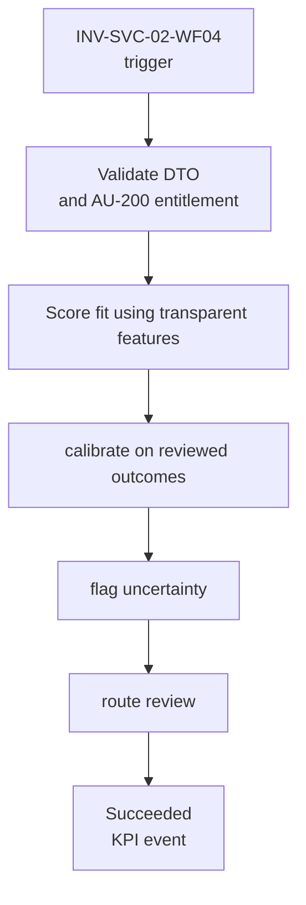

| Test ID | V12 / class ID | Level | Fixture / action | Expected (blueprint assertion) |
|---|---|---|---|---|
| TC-V12-N-096 | INV-SVC-02-WF04-AT01 | IT | Investor mandate, issuer thesis, verified history | Output validates against the workflow schema; evidence persisted; run Succeeded; KPI event emitted; output "Explainable fit score and evidence"; KPI: calibration error (ECE) ≤ 0.05 on reviewed outcomes |
| TC-V12-N-097 | INV-SVC-02-WF04-TC-INPUT | UT/CT | missing or malformed input | HTTP 422 with field errors; no StepRun; audit `dto.rejected` |
| TC-V12-N-098 | INV-SVC-02-WF04-TC-SCOPE | SEC | same reference from another tenant/startup | HTTP 403 or uniform 404 (BRL-TEN-04); zero rows/events/provider calls in the other scope |
| TC-V12-N-099 | INV-SVC-02-WF04-TC-ENT | IT | revoke INV SKU after enqueue | AU-200 dispatch-time recheck denies; run Paused/Held; reservation released; no effect |
| TC-V12-N-100 | INV-SVC-02-WF04-TC-DUP | IT replay | replay identical event / step key | exactly one accepted outcome, effect and meter charge; duplicate returns original run ref |
| TC-V12-N-101 | INV-SVC-02-WF04-TC-QUALITY | AIE | stale, conflicting or incomplete evidence | step Held or flagged; no unsupported claim reaches output (BRL-AI-03/04); eval record stored |
| TC-V12-N-102 | INV-SVC-02-WF04-TC-BUDGET | IT | quota exhausted at reservation | reservation fails → Blocked; zero provider calls; owner notified |
| TC-V12-N-103 | INV-SVC-02-WF04-TC-RECOVERY | CHAOS | provider timeout or worker crash | timeout after submit → Reconciling; resume from checkpoint without repeating a completed effect |
| TC-V12-N-104 | INV-SVC-02-WF04-TC-SEC | SEC/compliance | SEC-CTL-N-02: investor eligibility unknown | Hold ELIGIBILITY_UNKNOWN; review task to R10 |

#### INV-SVC-03 Investor Contact Intelligence Automation

**Purpose:** Identify and verify appropriate investor representatives using permitted information (workbook Service Catalog row 7). **Epic:** EP-30. **Service spec:** Part 11.16a §11.16.5.6.3. **Stories:** Part 11.16e.

| Field | Specification |
|---|---|
| Family / bundle / meter | Contact intelligence · Full suite / Discovery & Qualification bundle / selective (1 SKU); entitlement and usage approval required. · Illustrative pilot: 500 contact assessed(s)/month; 1 concurrent run; configurable hard budget, provider quota and frequency limits. Not approved. |
| Supported channels | Authorized sources, private workspace |
| Industries / capability | Fundraising issuers across eligible sectors; grant/debt/CSR route requires eligibility · Professional contact intelligence |
| Required entitlements | INV-SVC-03 + foundation; tenant/startup, capability, role, channel/provider and budget checks at every action |
| Optional input producers | Included foundation; no mandatory upstream paid service; optional input producers: INV-SVC-01; authorized equivalent input accepted. |
| External providers | Licensed or approved professional sources; optional verification API (verify terms and prices at implementation, as of 27 Nov 2026) |
| Service KPI (V12) | Reviewed contact accuracy ≥90%; unsupported merges = 0 |
| Actors (blueprint roles) | R03 · R10; R04; R19 service identity; R20 agent identity |
| Agents | AG-164, AG-008, AG-060 |
| Automations | AU-211, AU-208, AU-210, AU-018, AU-074 |
| Shared engines (V12) | Contact intelligence; Workflow orchestration; Governance |
| Data class and gateway tier | Personal (professional contact data); no Tier 2; Tier 1a role extraction; deterministic verification |
| Screens | A010; A012; A008 → A208, A210, A212 |
| V12 DB candidates → blueprint | inv_contact; inv_contact_evidence; inv_evidence; inv_guarantee_evidence; inv_investor_alias; inv_permission; inv_suppression → schema `inv` same names (DEC-814 keeps V12 names; RLS per §11.16.5.10) |

##### INV-SVC-03-WF01 Permitted representative discovery

**Requirement FR-V12-N-109** (status before: Not covered, CONFLICT-958; after: Matched). Execute "Permitted representative discovery" as a typed, policy-checked workflow: Retrieve permitted business contacts; classify role; save provenance; mark unverified fields; output "Contact candidates".

| Field | Specification |
|---|---|
| Business outcome / input → output | Permitted representative discovery: Investor organization and allowed sources → Contact candidates |
| Trigger | Manual request or validated upstream business event |
| Result / acceptance | Contact candidates; acceptance INV-SVC-03-WF01-AT01 (Permitted representative discovery) → TC-V12-N-109 |
| Domain contract | Validator `urn:inv:dto:INV-SVC-03-WF01:v2`; fields below; event envelope per FR-V12-N-006 |
| Risk and authority | R0 · V12 side effect: Internal analysis/draft; no external action without separate authorization |
| Autonomy in blueprint | L3 format checks; L1 for uncertain identity merges and channel eligibility |
| Approval gate (V12) | Resolve uncertain identity and permission before outreach; no personal-data resale |
| Operating mode / modalities | AI-assisted / supervised; controlled autonomous only for preapproved eligible routine steps; simulation has zero external effects. · Text; structured records |
| Agent / automations | AG-164 · AU-211 |
| Roles | R04 |
| Step classes | 1 Evidence retrieval; 1 AI inference; 2 Domain persistence |
| Securities and privacy controls | SEC-CTL-N-06, SEC-CTL-N-16 (see step column) |
| Workflow KPI (V12 service) | Reviewed contact accuracy ≥90%; unsupported merges = 0 |
| KPI formulas (this part) | provenance completeness = candidates with source, observed_at and permitted use ÷ candidates (target 100%); role accuracy (reviewed) ≥ 90% |
| SLA | ≤ 10 min per organisation |
| Illustrative cost (V12) | 1 workflow invocation; not a full service cycle; tokens 1800 in / 300 out; INR 0.7500000000000001 per invocation; external fees excluded (estimate; verify at implementation, as of 27 Nov 2026) |
| Versions / origin | workflow 2.0-target; INV-SVC-03-WF01-AT01; synthetic dry run and measured benchmark pending; V12 status: Proposed; test Not run; live execution and pricing pending. |
| Rules | R1. Business contacts only; personal emails/phones excluded unless provided by the person · R2. No personal-data resale |

**DTO `urn:inv:dto:INV-SVC-03-WF01:v2`**

| Field | Dir | Req | Type / validation | Schema constraint | Blueprint mapping |
|---|---|---|---|---|---|
| `investor_org_id` | in | Y | reference in caller tenant/startup | `{"type": "string", "format": "uuid"}` | inv_investor.id |
| `allowed_source_ids` | in | Y | typed references, resolved in caller scope | `{"type": "array", "items": {"type": "string", "format": "uuid"}, "maxItems": 500}` | inv_source.id[] |
| `purpose` | in | Y | configured enum (purpose) | `{"type": "string", "maxLength": 64, "$comment": "values from registry purpose"}` | run payload (inv_workflow_run.output_json) |
| `contact_candidate_ids` | out | Y | typed references, resolved in caller scope | `{"type": "array", "items": {"type": "string", "format": "uuid"}, "maxItems": 500}` | inv_contact.id[] |
| `role` | out | Y | configured enum (role) | `{"type": "string", "maxLength": 64, "$comment": "values from registry role"}` | run payload (inv_workflow_run.output_json) |
| `provenance_ids` | out | Y | typed references, resolved in caller scope | `{"type": "array", "items": {"type": "string", "format": "uuid"}, "maxItems": 500}` | run payload (inv_workflow_run.output_json) |
| `unverified_fields` | out | Y | configured enum list (field) | `{"type": "array", "items": {"type": "string", "maxLength": 64}, "maxItems": 50, "$comment": "values from registry field"}` | run payload (inv_workflow_run.output_json) |
| `correlation_id` | in | Y | trace id | `{"type": "string", "format": "uuid"}` | inv_workflow_run.correlation_id |
| `simulation` | in | N | zero-effect run | `{"type": "boolean", "default": false}` | inv_workflow_run.simulation |

| Step ID | Action | Class · executor | Output / validation | Failure → state | Blueprint component | Controls in this step | Step test |
|---|---|---|---|---|---|---|---|
| INV-SVC-03-WF01-STEP-01 | Retrieve permitted business contacts | Evidence retrieval · Ingestion / connector engine | evidence_set {items, source_ref, observed_at, hash, rights} | SOURCE_DENIED → **Held** | Ingestion via AU-007 source permission, AU-014 host filter, AU-005 sanitizer | CTL-16, CTL-06 | TC-V12-N-105 (IT (adapter stub) + SEC): unauthorised or stale source rejected; provenance hash and rights stored |
| INV-SVC-03-WF01-STEP-02 | classify role | AI inference · Model gateway + agent | candidate {artifact_ref, confidence, reason_codes, review_state} | REVIEW_REQUIRED → **Waiting (AWAITING_APPROVAL)** | Model gateway AU-001 (Tier 0 → 1a → 1b; Tier 3 degrade), AU-003 schema validation, AG-166 guard on investor-facing text; output is a draft only | CTL-16 | TC-V12-N-106 (AIE + CT schema): output validates against schema; claims cited; AG-166 verdict recorded; untrusted input cannot invoke tools |
| INV-SVC-03-WF01-STEP-03 | save provenance | Domain persistence · Domain service (investment app) | domain_result {artifact_ref, status, evidence_refs} | INVALID_STATE → **Held** | Domain module: revision check (NFR-025), single transaction with audit and outbox | — (internal; audit only) | TC-V12-N-107 (UT + IT): state change atomic with audit and outbox row |
| INV-SVC-03-WF01-STEP-04 | mark unverified fields | Domain persistence · Domain service (investment app) | domain_result {artifact_ref, status, evidence_refs} | INVALID_STATE → **Held** | Domain module: revision check (NFR-025), single transaction with audit and outbox | — (internal; audit only) | TC-V12-N-108 (UT + IT): state change atomic with audit and outbox row |

| Test ID | V12 / class ID | Level | Fixture / action | Expected (blueprint assertion) |
|---|---|---|---|---|
| TC-V12-N-109 | INV-SVC-03-WF01-AT01 | IT | Investor organization and allowed sources | Output validates against the workflow schema; evidence persisted; run Succeeded; KPI event emitted; output "Contact candidates"; KPI: provenance completeness = candidates with source, observed_at and permitted use ÷ candidates (target 100%) |
| TC-V12-N-110 | INV-SVC-03-WF01-TC-INPUT | UT/CT | missing or malformed input | HTTP 422 with field errors; no StepRun; audit `dto.rejected` |
| TC-V12-N-111 | INV-SVC-03-WF01-TC-SCOPE | SEC | same reference from another tenant/startup | HTTP 403 or uniform 404 (BRL-TEN-04); zero rows/events/provider calls in the other scope |
| TC-V12-N-112 | INV-SVC-03-WF01-TC-ENT | IT | revoke INV SKU after enqueue | AU-200 dispatch-time recheck denies; run Paused/Held; reservation released; no effect |
| TC-V12-N-113 | INV-SVC-03-WF01-TC-DUP | IT replay | replay identical event / step key | exactly one accepted outcome, effect and meter charge; duplicate returns original run ref |
| TC-V12-N-114 | INV-SVC-03-WF01-TC-QUALITY | AIE | stale, conflicting or incomplete evidence | step Held or flagged; no unsupported claim reaches output (BRL-AI-03/04); eval record stored |
| TC-V12-N-115 | INV-SVC-03-WF01-TC-BUDGET | IT | quota exhausted at reservation | reservation fails → Blocked; zero provider calls; owner notified |
| TC-V12-N-116 | INV-SVC-03-WF01-TC-RECOVERY | CHAOS | provider timeout or worker crash | timeout after submit → Reconciling; resume from checkpoint without repeating a completed effect |
| TC-V12-N-117 | INV-SVC-03-WF01-TC-SEC | SEC/compliance | SEC-CTL-N-06: consent withdrawn 30 s before step | Block CONSENT_WITHDRAWN; sequence stopped |

##### INV-SVC-03-WF02 Contact verification and deduplication

**Requirement FR-V12-N-110** (status before: Not covered, CONFLICT-958; after: Matched). Execute "Contact verification and deduplication" as a typed, policy-checked workflow: Validate format and evidence; detect aliases; review uncertain merges; output "Verified or held contact records".

| Field | Specification |
|---|---|
| Business outcome / input → output | Contact verification and deduplication: Candidate contacts and identifiers → Verified or held contact records |
| Trigger | Manual request or validated upstream business event |
| Result / acceptance | Verified or held contact records; acceptance INV-SVC-03-WF02-AT01 (Contact verification and deduplication) → TC-V12-N-121 |
| Domain contract | Validator `urn:inv:dto:INV-SVC-03-WF02:v2`; fields below; event envelope per FR-V12-N-006 |
| Risk and authority | R0 · V12 side effect: Internal analysis/draft; no external action without separate authorization |
| Autonomy in blueprint | L3 format checks; L1 for uncertain identity merges and channel eligibility |
| Approval gate (V12) | Resolve uncertain identity and permission before outreach; no personal-data resale |
| Operating mode / modalities | AI-assisted / supervised; controlled autonomous only for preapproved eligible routine steps; simulation has zero external effects. · Text; structured records |
| Agent / automations | AG-164 · AU-211 |
| Roles | R04 |
| Step classes | 2 Deterministic calculation; 1 Human review routing |
| Securities and privacy controls | SEC-CTL-N-16 (see step column) |
| Workflow KPI (V12 service) | Reviewed contact accuracy ≥90%; unsupported merges = 0 |
| KPI formulas (this part) | unsupported merges = 0; verified contact accuracy (reviewed) ≥ 90% |
| SLA | ≤ 2 s per candidate; merge review 1 business day |
| Illustrative cost (V12) | 1 workflow invocation; not a full service cycle; tokens 1000 in / 150 out; INR 0.47 per invocation; external fees excluded (estimate; verify at implementation, as of 27 Nov 2026) |
| Versions / origin | workflow 2.0-target; INV-SVC-03-WF02-AT01; synthetic dry run and measured benchmark pending; V12 status: Proposed; test Not run; live execution and pricing pending. |
| Rules | R1. Uncertain merges go to review; never auto-merged · R2. Aliases keep provenance |

**DTO `urn:inv:dto:INV-SVC-03-WF02:v2`**

| Field | Dir | Req | Type / validation | Schema constraint | Blueprint mapping |
|---|---|---|---|---|---|
| `contact_candidate_ids` | in | Y | typed references, resolved in caller scope | `{"type": "array", "items": {"type": "string", "format": "uuid"}, "maxItems": 500}` | inv_contact.id[] |
| `contact_id` | out | Y | reference in caller tenant/startup | `{"type": "string", "format": "uuid"}` | inv_contact.id |
| `verification_state` | out | Y | configured enum (verification) | `{"type": "string", "maxLength": 64, "$comment": "values from registry verification"}` | run payload (inv_workflow_run.output_json) |
| `alias_ids` | out | Y | typed references, resolved in caller scope | `{"type": "array", "items": {"type": "string", "format": "uuid"}, "maxItems": 500}` | run payload (inv_workflow_run.output_json) |
| `merge_review_id` | out | Y | reference in caller tenant/startup | `{"type": "string", "format": "uuid"}` | run payload (inv_workflow_run.output_json) |
| `correlation_id` | in | Y | trace id | `{"type": "string", "format": "uuid"}` | inv_workflow_run.correlation_id |
| `simulation` | in | N | zero-effect run | `{"type": "boolean", "default": false}` | inv_workflow_run.simulation |

| Step ID | Action | Class · executor | Output / validation | Failure → state | Blueprint component | Controls in this step | Step test |
|---|---|---|---|---|---|---|---|
| INV-SVC-03-WF02-STEP-01 | Validate format and evidence | Deterministic calculation · Rules / calculation engine | calculation {value, unit, assumptions, evidence_refs} | INVALID_INPUT → **Held** | Deterministic domain service; Decimal (DEC-027); zero model calls | — (internal; audit only) | TC-V12-N-118 (UT golden fixture): golden fixture exact; missing value never invented |
| INV-SVC-03-WF02-STEP-02 | detect aliases | Deterministic calculation · Rules / calculation engine | calculation {value, unit, assumptions, evidence_refs} | INVALID_INPUT → **Held** | Deterministic domain service; Decimal (DEC-027); zero model calls | — (internal; audit only) | TC-V12-N-119 (UT golden fixture): golden fixture exact; missing value never invented |
| INV-SVC-03-WF02-STEP-03 | review uncertain merges | Human review routing · Work queue / approval service | task {queue, assignee_role, sla_due, reason} | SLA_BREACH → **Escalated** | Approval/task service (A207/A220); SLA timers | — (internal; audit only) | TC-V12-N-120 (IT + SYS): task created with correct role and SLA; automation paused until disposition |

| Test ID | V12 / class ID | Level | Fixture / action | Expected (blueprint assertion) |
|---|---|---|---|---|
| TC-V12-N-121 | INV-SVC-03-WF02-AT01 | IT | Candidate contacts and identifiers | Output validates against the workflow schema; evidence persisted; run Succeeded; KPI event emitted; output "Verified or held contact records"; KPI: unsupported merges = 0 |
| TC-V12-N-122 | INV-SVC-03-WF02-TC-INPUT | UT/CT | missing or malformed input | HTTP 422 with field errors; no StepRun; audit `dto.rejected` |
| TC-V12-N-123 | INV-SVC-03-WF02-TC-SCOPE | SEC | same reference from another tenant/startup | HTTP 403 or uniform 404 (BRL-TEN-04); zero rows/events/provider calls in the other scope |
| TC-V12-N-124 | INV-SVC-03-WF02-TC-ENT | IT | revoke INV SKU after enqueue | AU-200 dispatch-time recheck denies; run Paused/Held; reservation released; no effect |
| TC-V12-N-125 | INV-SVC-03-WF02-TC-DUP | IT replay | replay identical event / step key | exactly one accepted outcome, effect and meter charge; duplicate returns original run ref |
| TC-V12-N-126 | INV-SVC-03-WF02-TC-QUALITY | AIE | stale, conflicting or incomplete evidence | step Held or flagged; no unsupported claim reaches output (BRL-AI-03/04); eval record stored |
| TC-V12-N-127 | INV-SVC-03-WF02-TC-BUDGET | IT | quota exhausted at reservation | reservation fails → Blocked; zero provider calls; owner notified |
| TC-V12-N-128 | INV-SVC-03-WF02-TC-RECOVERY | CHAOS | provider timeout or worker crash | timeout after submit → Reconciling; resume from checkpoint without repeating a completed effect |
| TC-V12-N-129 | INV-SVC-03-WF02-TC-SEC | SEC/compliance | SEC-CTL-N-16: EU tenant data processed by IN worker | request refused REGION_MISMATCH; no write |

##### INV-SVC-03-WF03 Engagement eligibility assessment

**Requirement FR-V12-N-111** (status before: Not covered, CONFLICT-958; after: Matched). Execute "Engagement eligibility assessment" as a typed, policy-checked workflow: Check consent and suppression; apply issuer route restriction; store decision; output "Channel eligibility status".

| Field | Specification |
|---|---|
| Business outcome / input → output | Engagement eligibility assessment: Contact, purpose and channel permissions → Channel eligibility status |
| Trigger | Manual request or validated upstream business event |
| Result / acceptance | Channel eligibility status; acceptance INV-SVC-03-WF03-AT01 (Engagement eligibility assessment) → TC-V12-N-133 |
| Domain contract | Validator `urn:inv:dto:INV-SVC-03-WF03:v2`; fields below; event envelope per FR-V12-N-006 |
| Risk and authority | R1 · V12 side effect: Internal analysis/draft; no external action without separate authorization |
| Autonomy in blueprint | L3 format checks; L1 for uncertain identity merges and channel eligibility |
| Approval gate (V12) | Resolve uncertain identity and permission before outreach; no personal-data resale |
| Operating mode / modalities | AI-assisted / supervised; controlled autonomous only for preapproved eligible routine steps; simulation has zero external effects. · Text; structured records |
| Agent / automations | — (deterministic PDP) · AU-208, AU-203 |
| Roles | R03 · R10 |
| Step classes | 2 Policy check (PDP); 1 Domain persistence |
| Securities and privacy controls | SEC-CTL-N-03, SEC-CTL-N-06 (see step column) |
| Workflow KPI (V12 service) | Reviewed contact accuracy ≥90%; unsupported merges = 0 |
| KPI formulas (this part) | decision completeness = contacts with a stored decision per channel ÷ contacts in queue; suppressed contact dispatched = 0 |
| SLA | ≤ 500 ms per decision |
| Illustrative cost (V12) | 1 workflow invocation; not a full service cycle; tokens 0 in / 0 out; INR 0.15 per invocation; external fees excluded (estimate; verify at implementation, as of 27 Nov 2026) |
| Versions / origin | workflow 2.0-target; INV-SVC-03-WF03-AT01; synthetic dry run and measured benchmark pending; V12 status: Proposed; test Not run; live execution and pricing pending. |
| Rules | R1. Consent/suppression checked per channel and purpose · R2. Issuer route restriction applied (e.g. 506(b) requires relationship provenance) |

**DTO `urn:inv:dto:INV-SVC-03-WF03:v2`**

| Field | Dir | Req | Type / validation | Schema constraint | Blueprint mapping |
|---|---|---|---|---|---|
| `contact_id` | in | Y | reference in caller tenant/startup | `{"type": "string", "format": "uuid"}` | inv_contact.id |
| `purpose` | in | Y | configured enum (purpose) | `{"type": "string", "maxLength": 64, "$comment": "values from registry purpose"}` | run payload (inv_workflow_run.output_json) |
| `channel` | in | Y | configured enum (channel) | `{"type": "string", "maxLength": 64, "$comment": "values from registry channel"}` | run payload (inv_workflow_run.output_json) |
| `channel_eligibility` | out | Y | configured enum (channel_elig) | `{"type": "string", "maxLength": 64, "$comment": "values from registry channel_elig"}` | run payload (inv_workflow_run.output_json) |
| `reason_codes` | out | Y | configured enum list (elig_reason) | `{"type": "array", "items": {"type": "string", "maxLength": 64}, "maxItems": 50, "$comment": "values from registry elig_reason"}` | run payload (inv_workflow_run.output_json) |
| `decision_id` | out | Y | reference in caller tenant/startup | `{"type": "string", "format": "uuid"}` | run payload (inv_workflow_run.output_json) |
| `correlation_id` | in | Y | trace id | `{"type": "string", "format": "uuid"}` | inv_workflow_run.correlation_id |
| `simulation` | in | N | zero-effect run | `{"type": "boolean", "default": false}` | inv_workflow_run.simulation |

| Step ID | Action | Class · executor | Output / validation | Failure → state | Blueprint component | Controls in this step | Step test |
|---|---|---|---|---|---|---|---|
| INV-SVC-03-WF03-STEP-01 | Check consent and suppression | Policy check (PDP) · PDP + AU-201/AU-202/AU-203/AU-208 | decision {allow/hold/block, reason_codes, pack_versions} | POLICY_DENIED → **Blocked** | PDP (Part 3.1) extended with securities gate (ADR-231); fail closed | CTL-03, CTL-06 | TC-V12-N-130 (UT decision table + IT): every rule branch exercised; unknown → hold/block; reason code and pack version audited |
| INV-SVC-03-WF03-STEP-02 | apply issuer route restriction | Policy check (PDP) · PDP + AU-201/AU-202/AU-203/AU-208 | decision {allow/hold/block, reason_codes, pack_versions} | POLICY_DENIED → **Blocked** | PDP (Part 3.1) extended with securities gate (ADR-231); fail closed | CTL-03, CTL-06 | TC-V12-N-131 (UT decision table + IT): every rule branch exercised; unknown → hold/block; reason code and pack version audited |
| INV-SVC-03-WF03-STEP-03 | store decision | Domain persistence · Domain service (investment app) | domain_result {artifact_ref, status, evidence_refs} | INVALID_STATE → **Held** | Domain module: revision check (NFR-025), single transaction with audit and outbox | — (internal; audit only) | TC-V12-N-132 (UT + IT): state change atomic with audit and outbox row |

| Test ID | V12 / class ID | Level | Fixture / action | Expected (blueprint assertion) |
|---|---|---|---|---|
| TC-V12-N-133 | INV-SVC-03-WF03-AT01 | IT | Contact, purpose and channel permissions | Output validates against the workflow schema; evidence persisted; run Succeeded; KPI event emitted; output "Channel eligibility status"; KPI: decision completeness = contacts with a stored decision per channel ÷ contacts in queue |
| TC-V12-N-134 | INV-SVC-03-WF03-TC-INPUT | UT/CT | missing or malformed input | HTTP 422 with field errors; no StepRun; audit `dto.rejected` |
| TC-V12-N-135 | INV-SVC-03-WF03-TC-SCOPE | SEC | same reference from another tenant/startup | HTTP 403 or uniform 404 (BRL-TEN-04); zero rows/events/provider calls in the other scope |
| TC-V12-N-136 | INV-SVC-03-WF03-TC-ENT | IT | revoke INV SKU after enqueue | AU-200 dispatch-time recheck denies; run Paused/Held; reservation released; no effect |
| TC-V12-N-137 | INV-SVC-03-WF03-TC-DUP | IT replay | replay identical event / step key | exactly one accepted outcome, effect and meter charge; duplicate returns original run ref |
| TC-V12-N-138 | INV-SVC-03-WF03-TC-QUALITY | AIE | stale, conflicting or incomplete evidence | step Held or flagged; no unsupported claim reaches output (BRL-AI-03/04); eval record stored |
| TC-V12-N-139 | INV-SVC-03-WF03-TC-BUDGET | IT | quota exhausted at reservation | reservation fails → Blocked; zero provider calls; owner notified |
| TC-V12-N-140 | INV-SVC-03-WF03-TC-RECOVERY | CHAOS | provider timeout or worker crash | timeout after submit → Reconciling; resume from checkpoint without repeating a completed effect |
| TC-V12-N-141 | INV-SVC-03-WF03-TC-SEC | SEC/compliance | SEC-CTL-N-03: s.42 offering content to recipient without relationship provenance | Block GENERAL_SOLICITATION; not overridable |

##### INV-SVC-03-WF04 Investor representative and mandate change monitoring

**Requirement FR-V12-N-112** (status before: Not covered, CONFLICT-958; after: Matched). Execute "Investor representative and mandate change monitoring" as a typed, policy-checked workflow: Compare new source evidence; invalidate stale mandate/contact links; request verification; output "Change alert and revised evidence".

| Field | Specification |
|---|---|
| Business outcome / input → output | Investor representative and mandate change monitoring: Verified representative records and source snapshots → Change alert and revised evidence |
| Trigger | Manual; scheduled or relevant validated business event; provider webhook only where authorized |
| Result / acceptance | Change alert and revised evidence; acceptance INV-SVC-03-WF04-AT01 (Investor representative and mandate change monitoring) → TC-V12-N-145 |
| Domain contract | Validator `urn:inv:dto:INV-SVC-03-WF04:v2`; fields below; event envelope per FR-V12-N-006 |
| Risk and authority | R0 · V12 side effect: Internal analysis/draft; no external action without separate authorization |
| Autonomy in blueprint | L3 format checks; L1 for uncertain identity merges and channel eligibility |
| Approval gate (V12) | Approve source/data rights and applicable external actions; qualified reviewer confirms legal/financial claims and any offer, filing, ownership change or payment; no autonomous regulated decision. |
| Operating mode / modalities | AI-assisted / supervised; controlled autonomous only for preapproved eligible routine steps; simulation has zero external effects. · Text; structured records |
| Agent / automations | AG-164 · AU-210 |
| Roles | R04 |
| Step classes | 1 Deterministic calculation; 1 Policy check (PDP); 1 Human review routing |
| Securities and privacy controls | SEC-CTL-N-06 (see step column) |
| Workflow KPI (V12 service) | Reviewed contact accuracy ≥90%; unsupported merges = 0 |
| KPI formulas (this part) | stale link invalidation latency ≤ 24 h; contacts used after invalidation = 0 |
| SLA | Daily ≤ 1 h |
| Illustrative cost (V12) | 1 invocation; text component only; tokens 1200 in / 200 out; INR 0.55 per invocation; external fees excluded (estimate; verify at implementation, as of 27 Nov 2026) |
| Versions / origin | workflow 1.0-target; INV-SVC-03-WF04-AT01; synthetic dry run and measured benchmark pending; V12 status: Proposed; test Not run; live execution and pricing pending. |
| Rules | R1. Invalidated links remove the contact from active sequences immediately |

**DTO `urn:inv:dto:INV-SVC-03-WF04:v2`**

| Field | Dir | Req | Type / validation | Schema constraint | Blueprint mapping |
|---|---|---|---|---|---|
| `contact_ids` | in | Y | typed references, resolved in caller scope | `{"type": "array", "items": {"type": "string", "format": "uuid"}, "maxItems": 500}` | inv_contact.id[] |
| `source_snapshot_ids` | in | Y | typed references, resolved in caller scope | `{"type": "array", "items": {"type": "string", "format": "uuid"}, "maxItems": 500}` | inv_source.id[] |
| `change_alert_id` | out | Y | reference in caller tenant/startup | `{"type": "string", "format": "uuid"}` | notification.id |
| `invalidated_link_ids` | out | Y | typed references, resolved in caller scope | `{"type": "array", "items": {"type": "string", "format": "uuid"}, "maxItems": 500}` | run payload (inv_workflow_run.output_json) |
| `verification_request_id` | out | Y | reference in caller tenant/startup | `{"type": "string", "format": "uuid"}` | run payload (inv_workflow_run.output_json) |
| `correlation_id` | in | Y | trace id | `{"type": "string", "format": "uuid"}` | inv_workflow_run.correlation_id |
| `simulation` | in | N | zero-effect run | `{"type": "boolean", "default": false}` | inv_workflow_run.simulation |

| Step ID | Action | Class · executor | Output / validation | Failure → state | Blueprint component | Controls in this step | Step test |
|---|---|---|---|---|---|---|---|
| INV-SVC-03-WF04-STEP-01 | Compare new source evidence | Deterministic calculation · Rules / calculation engine | calculation {value, unit, assumptions, evidence_refs} | INVALID_INPUT → **Held** | Deterministic domain service; Decimal (DEC-027); zero model calls | — (internal; audit only) | TC-V12-N-142 (UT golden fixture): golden fixture exact; missing value never invented |
| INV-SVC-03-WF04-STEP-02 | invalidate stale mandate/contact links | Policy check (PDP) · PDP + AU-201/AU-202/AU-203/AU-208 | decision {allow/hold/block, reason_codes, pack_versions} | POLICY_DENIED → **Blocked** | PDP (Part 3.1) extended with securities gate (ADR-231); fail closed | CTL-06 | TC-V12-N-143 (UT decision table + IT): every rule branch exercised; unknown → hold/block; reason code and pack version audited |
| INV-SVC-03-WF04-STEP-03 | request verification | Human review routing · Work queue / approval service | task {queue, assignee_role, sla_due, reason} | SLA_BREACH → **Escalated** | Approval/task service (A207/A220); SLA timers | — (internal; audit only) | TC-V12-N-144 (IT + SYS): task created with correct role and SLA; automation paused until disposition |

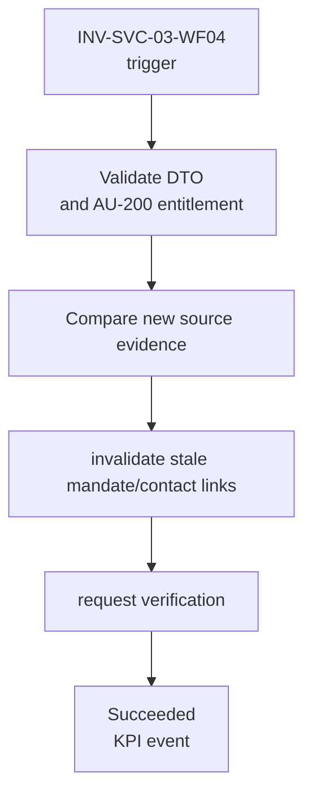

| Test ID | V12 / class ID | Level | Fixture / action | Expected (blueprint assertion) |
|---|---|---|---|---|
| TC-V12-N-145 | INV-SVC-03-WF04-AT01 | IT | Verified representative records and source snapshots | Output validates against the workflow schema; evidence persisted; run Succeeded; KPI event emitted; output "Change alert and revised evidence"; KPI: stale link invalidation latency ≤ 24 h |
| TC-V12-N-146 | INV-SVC-03-WF04-TC-INPUT | UT/CT | missing or malformed input | HTTP 422 with field errors; no StepRun; audit `dto.rejected` |
| TC-V12-N-147 | INV-SVC-03-WF04-TC-SCOPE | SEC | same reference from another tenant/startup | HTTP 403 or uniform 404 (BRL-TEN-04); zero rows/events/provider calls in the other scope |
| TC-V12-N-148 | INV-SVC-03-WF04-TC-ENT | IT | revoke INV SKU after enqueue | AU-200 dispatch-time recheck denies; run Paused/Held; reservation released; no effect |
| TC-V12-N-149 | INV-SVC-03-WF04-TC-DUP | IT replay | replay identical event / step key | exactly one accepted outcome, effect and meter charge; duplicate returns original run ref |
| TC-V12-N-150 | INV-SVC-03-WF04-TC-QUALITY | AIE | stale, conflicting or incomplete evidence | step Held or flagged; no unsupported claim reaches output (BRL-AI-03/04); eval record stored |
| TC-V12-N-151 | INV-SVC-03-WF04-TC-BUDGET | IT | quota exhausted at reservation | reservation fails → Blocked; zero provider calls; owner notified |
| TC-V12-N-152 | INV-SVC-03-WF04-TC-RECOVERY | CHAOS | provider timeout or worker crash | timeout after submit → Reconciling; resume from checkpoint without repeating a completed effect |
| TC-V12-N-153 | INV-SVC-03-WF04-TC-SEC | SEC/compliance | SEC-CTL-N-06: consent withdrawn 30 s before step | Block CONSENT_WITHDRAWN; sequence stopped |

#### INV-SVC-04 Investor Email Outreach Automation

**Purpose:** Prepare and send eligible individualized investor emails (workbook Service Catalog row 8). **Epic:** EP-30. **Service spec:** Part 11.16a §11.16.5.6.4. **Stories:** Part 11.16e.

| Field | Specification |
|---|---|
| Family / bundle / meter | Outreach · Full suite / Investor Engagement bundle / selective (1 SKU); entitlement and usage approval required. · Illustrative pilot: 500 email attempt(s)/month; 1 concurrent run; configurable hard budget, provider quota and frequency limits. Not approved. |
| Supported channels | Business email, Gmail, Outlook |
| Industries / capability | Fundraising issuers across eligible sectors; grant/debt/CSR route requires eligibility · Eligible direct email |
| Required entitlements | INV-SVC-04 + foundation; tenant/startup, capability, role, channel/provider and budget checks at every action |
| Optional input producers | Included foundation; no mandatory upstream paid service; optional input producers: INV-SVC-03; authorized equivalent input accepted. |
| External providers | Authorized mail provider; verified sender; permitted outreach; opt-out handling (verify terms and prices at implementation, as of 27 Nov 2026) |
| Service KPI (V12) | Unauthorized sends = 0; duplicate dispatch = 0; delivery status reconciled ≥99% |
| Actors (blueprint roles) | R03 sender · R02 approver; R03 · R02 (· R10 if offering-tagged); R11; R19 service; R19 service identity; R20 agent identity |
| Agents | AG-165, AG-166, AG-167, AG-011, AG-012 |
| Automations | AU-212, AU-213, AU-203, AU-208, AU-008, AU-009, AU-024 |
| Shared engines (V12) | Communication; Workflow orchestration; Governance |
| Data class and gateway tier | Personal + Confidential (issuer facts); no Tier 2; Tier 1b drafting; Tier 1a classification; Tier 0 phrase lists |
| Screens | A012; A017; A019; A020 → A212, A216, A217, A218 |
| V12 DB candidates → blueprint | inv_delivery_event; inv_locale_template; inv_message; inv_outbox; inv_outreach_reservation; inv_permission; inv_suppression → schema `inv` same names (DEC-814 keeps V12 names; RLS per §11.16.5.10) |

##### INV-SVC-04-WF01 Personalized investor email drafting

**Requirement FR-V12-N-113** (status before: Not covered, CONFLICT-958; after: Matched). Execute "Personalized investor email drafting" as a typed, policy-checked workflow: Retrieve approved facts; localize draft; validate claims and template; output "Grounded email draft".

| Field | Specification |
|---|---|
| Business outcome / input → output | Personalized investor email drafting: Eligible contact and verified issuer facts → Grounded email draft |
| Trigger | Manual request or validated upstream business event |
| Result / acceptance | Grounded email draft; acceptance INV-SVC-04-WF01-AT01 (Personalized investor email drafting) → TC-V12-N-157 |
| Domain contract | Validator `urn:inv:dto:INV-SVC-04-WF01:v2`; fields below; event envelope per FR-V12-N-006 |
| Risk and authority | R1 draft · V12 side effect: Internal analysis/draft; no external action without separate authorization |
| Autonomy in blueprint | Template and content L1 (hash-bound approval) then L2 dispatch; offering-tagged content needs R02 + R10 per message (two-person); a DEC-779 mandate may automate only non-offering IR messages (CP-O-04) |
| Approval gate (V12) | Approve facts and template; formal offers and restricted recipients routed separately; recheck before send |
| Operating mode / modalities | AI-assisted / supervised; controlled autonomous only for preapproved eligible routine steps; simulation has zero external effects. · Text; structured records |
| Agent / automations | AG-165 + AG-166 · AU-005 |
| Roles | R03 · R02 (· R10 if offering-tagged) |
| Step classes | 1 Evidence retrieval; 1 AI inference; 1 Policy check (PDP) |
| Securities and privacy controls | SEC-CTL-N-05, SEC-CTL-N-13, SEC-CTL-N-03 (see step column) |
| Workflow KPI (V12 service) | Unauthorized sends = 0; duplicate dispatch = 0; delivery status reconciled ≥99% |
| KPI formulas (this part) | grounded claim rate = claims with citation ÷ claims (target 100%); guard block precision (sampled) ≥ 95% |
| SLA | Draft ≤ 20 s p95 |
| Illustrative cost (V12) | 1 workflow invocation; not a full service cycle; tokens 1500 in / 300 out; INR 0.6900000000000001 per invocation; external fees excluded (estimate; verify at implementation, as of 27 Nov 2026) |
| Versions / origin | workflow 2.0-target; INV-SVC-04-WF01-AT01; synthetic dry run and measured benchmark pending; V12 status: Proposed; test Not run; live execution and pricing pending. |
| Rules | R1. No investment advice, returns or suitability language (SEC-CTL-N-05) · R2. Offering-specific content only to relationship/eligible recipients |

**DTO `urn:inv:dto:INV-SVC-04-WF01:v2`**

| Field | Dir | Req | Type / validation | Schema constraint | Blueprint mapping |
|---|---|---|---|---|---|
| `contact_id` | in | Y | reference in caller tenant/startup | `{"type": "string", "format": "uuid"}` | inv_contact.id |
| `issuer_fact_ids` | in | Y | typed references, resolved in caller scope | `{"type": "array", "items": {"type": "string", "format": "uuid"}, "maxItems": 500}` | run payload (inv_workflow_run.output_json) |
| `template_id` | in | Y | reference in caller tenant/startup | `{"type": "string", "format": "uuid"}` | inv_locale_template.id |
| `locale` | in | Y | BCP 47 locale | `{"type": "string", "pattern": "^[a-z]{2}(-[A-Z]{2})?$"}` | run payload (inv_workflow_run.output_json) |
| `draft_id` | out | Y | reference in caller tenant/startup | `{"type": "string", "format": "uuid"}` | inv_message.id |
| `subject` | out | Y | free text NFC-normalised, untrusted (AU-005) | `{"type": "string", "minLength": 1, "maxLength": 4000}` | run payload (inv_workflow_run.output_json) |
| `body_blocks` | out | Y | structured object (versioned sub-schema) | `{"type": "object", "maxProperties": 100}` | run payload (inv_workflow_run.output_json) |
| `citations` | out | Y | typed references, resolved in caller scope | `{"type": "array", "items": {"type": "string", "format": "uuid"}, "maxItems": 500}` | run payload (inv_workflow_run.output_json) |
| `guard_verdict` | out | Y | configured enum (verdict) | `{"type": "string", "maxLength": 64, "$comment": "values from registry verdict"}` | run payload (inv_workflow_run.output_json) |
| `correlation_id` | in | Y | trace id | `{"type": "string", "format": "uuid"}` | inv_workflow_run.correlation_id |
| `simulation` | in | N | zero-effect run | `{"type": "boolean", "default": false}` | inv_workflow_run.simulation |

| Step ID | Action | Class · executor | Output / validation | Failure → state | Blueprint component | Controls in this step | Step test |
|---|---|---|---|---|---|---|---|
| INV-SVC-04-WF01-STEP-01 | Retrieve approved facts | Evidence retrieval · Ingestion / connector engine | evidence_set {items, source_ref, observed_at, hash, rights} | SOURCE_DENIED → **Held** | Ingestion via AU-007 source permission, AU-014 host filter, AU-005 sanitizer | CTL-16 | TC-V12-N-154 (IT (adapter stub) + SEC): unauthorised or stale source rejected; provenance hash and rights stored |
| INV-SVC-04-WF01-STEP-02 | localize draft | AI inference · Model gateway + agent | candidate {artifact_ref, confidence, reason_codes, review_state} | REVIEW_REQUIRED → **Waiting (AWAITING_APPROVAL)** | Model gateway AU-001 (Tier 0 → 1a → 1b; Tier 3 degrade), AU-003 schema validation, AG-166 guard on investor-facing text; output is a draft only | CTL-05, CTL-13 | TC-V12-N-155 (AIE + CT schema): output validates against schema; claims cited; AG-166 verdict recorded; untrusted input cannot invoke tools |
| INV-SVC-04-WF01-STEP-03 | validate claims and template | Policy check (PDP) · PDP + AU-201/AU-202/AU-203/AU-208 | decision {allow/hold/block, reason_codes, pack_versions} | POLICY_DENIED → **Blocked** | PDP (Part 3.1) extended with securities gate (ADR-231); fail closed | CTL-05, CTL-13, CTL-03 | TC-V12-N-156 (UT decision table + IT): every rule branch exercised; unknown → hold/block; reason code and pack version audited |

| Test ID | V12 / class ID | Level | Fixture / action | Expected (blueprint assertion) |
|---|---|---|---|---|
| TC-V12-N-157 | INV-SVC-04-WF01-AT01 | IT | Eligible contact and verified issuer facts | Output validates against the workflow schema; evidence persisted; run Succeeded; KPI event emitted; output "Grounded email draft"; KPI: grounded claim rate = claims with citation ÷ claims (target 100%) |
| TC-V12-N-158 | INV-SVC-04-WF01-TC-INPUT | UT/CT | missing or malformed input | HTTP 422 with field errors; no StepRun; audit `dto.rejected` |
| TC-V12-N-159 | INV-SVC-04-WF01-TC-SCOPE | SEC | same reference from another tenant/startup | HTTP 403 or uniform 404 (BRL-TEN-04); zero rows/events/provider calls in the other scope |
| TC-V12-N-160 | INV-SVC-04-WF01-TC-ENT | IT | revoke INV SKU after enqueue | AU-200 dispatch-time recheck denies; run Paused/Held; reservation released; no effect |
| TC-V12-N-161 | INV-SVC-04-WF01-TC-DUP | IT replay | replay identical event / step key | exactly one accepted outcome, effect and meter charge; duplicate returns original run ref |
| TC-V12-N-162 | INV-SVC-04-WF01-TC-QUALITY | AIE | stale, conflicting or incomplete evidence | step Held or flagged; no unsupported claim reaches output (BRL-AI-03/04); eval record stored |
| TC-V12-N-163 | INV-SVC-04-WF01-TC-BUDGET | IT | quota exhausted at reservation | reservation fails → Blocked; zero provider calls; owner notified |
| TC-V12-N-164 | INV-SVC-04-WF01-TC-RECOVERY | CHAOS | provider timeout or worker crash | timeout after submit → Reconciling; resume from checkpoint without repeating a completed effect |
| TC-V12-N-165 | INV-SVC-04-WF01-TC-SEC | SEC/compliance | SEC-CTL-N-03: s.42 offering content to recipient without relationship provenance | Block GENERAL_SOLICITATION; not overridable |

##### INV-SVC-04-WF02 Controlled email dispatch

**Requirement FR-V12-N-114** (status before: Not covered, CONFLICT-958; after: Matched). Execute "Controlled email dispatch" as a typed, policy-checked workflow: Check consent, jurisdiction, budget and suppression; reserve idempotency key; queue approved send; output "Accepted or blocked send record".

| Field | Specification |
|---|---|
| Business outcome / input → output | Controlled email dispatch: Approved draft and sender authorization → Accepted or blocked send record |
| Trigger | Manual request or validated upstream business event |
| Result / acceptance | Accepted or blocked send record; acceptance INV-SVC-04-WF02-AT01 (Controlled email dispatch) → TC-V12-N-170 |
| Domain contract | Validator `urn:inv:dto:INV-SVC-04-WF02:v2`; fields below; event envelope per FR-V12-N-006 |
| Risk and authority | R2 external communication · V12 side effect: Potential external write/communication; controlled only after applicable permission and policy approval |
| Autonomy in blueprint | Template and content L1 (hash-bound approval) then L2 dispatch; offering-tagged content needs R02 + R10 per message (two-person); a DEC-779 mandate may automate only non-offering IR messages (CP-O-04) |
| Approval gate (V12) | Approve facts and template; formal offers and restricted recipients routed separately; recheck before send |
| Operating mode / modalities | AI-assisted / supervised; controlled autonomous only for preapproved eligible routine steps; simulation has zero external effects. · Text; structured records |
| Agent / automations | — (deterministic) · AU-212, AU-203, AU-201 |
| Roles | R03 sender · R02 approver |
| Step classes | 1 Policy check (PDP); 1 Domain persistence; 1 External effect (outbox) |
| Securities and privacy controls | SEC-CTL-N-01, SEC-CTL-N-02, SEC-CTL-N-03, SEC-CTL-N-06, SEC-CTL-N-10, SEC-CTL-N-15 (see step column) |
| Workflow KPI (V12 service) | Unauthorized sends = 0; duplicate dispatch = 0; delivery status reconciled ≥99% |
| KPI formulas (this part) | unauthorized sends = 0; duplicate dispatch = 0 |
| SLA | Dispatch ≤ 60 s after approval within window |
| Illustrative cost (V12) | 1 workflow invocation; not a full service cycle; tokens 0 in / 0 out; INR 0.15 per invocation; external fees excluded (estimate; verify at implementation, as of 27 Nov 2026) |
| Versions / origin | workflow 2.0-target; INV-SVC-04-WF02-AT01; synthetic dry run and measured benchmark pending; V12 status: Proposed; test Not run; live execution and pricing pending. |
| Rules | R1. PDP recheck at dispatch: scope, consent, jurisdiction pack, eligibility, budget, approval hash · R2. Outbox row in same transaction as state change |

**DTO `urn:inv:dto:INV-SVC-04-WF02:v2`**

| Field | Dir | Req | Type / validation | Schema constraint | Blueprint mapping |
|---|---|---|---|---|---|
| `draft_id` | in | Y | reference in caller tenant/startup | `{"type": "string", "format": "uuid"}` | inv_message.id |
| `approval_hash` | in | Y | SHA-256 hex | `{"type": "string", "pattern": "^[a-f0-9]{64}$"}` | run payload (inv_workflow_run.output_json) |
| `sender_id` | in | Y | reference in caller tenant/startup | `{"type": "string", "format": "uuid"}` | inv_message.id |
| `idempotency_key` | in | Y | free text NFC-normalised, untrusted (AU-005) | `{"type": "string", "minLength": 1, "maxLength": 4000}` | run payload (inv_workflow_run.output_json) |
| `send_id` | out | Y | reference in caller tenant/startup | `{"type": "string", "format": "uuid"}` | inv_message.id |
| `state` | out | Y | configured enum (send_state) | `{"type": "string", "maxLength": 64, "$comment": "values from registry send_state"}` | run payload (inv_workflow_run.output_json) |
| `block_reason` | out | Y | configured enum (block_reason) | `{"type": "string", "maxLength": 64, "$comment": "values from registry block_reason"}` | run payload (inv_workflow_run.output_json) |
| `provider_message_id` | out | Y | free text NFC-normalised, untrusted (AU-005) | `{"type": "string", "minLength": 1, "maxLength": 4000}` | inv_message.id |
| `correlation_id` | in | Y | trace id | `{"type": "string", "format": "uuid"}` | inv_workflow_run.correlation_id |
| `simulation` | in | N | zero-effect run | `{"type": "boolean", "default": false}` | inv_workflow_run.simulation |

| Step ID | Action | Class · executor | Output / validation | Failure → state | Blueprint component | Controls in this step | Step test |
|---|---|---|---|---|---|---|---|
| INV-SVC-04-WF02-STEP-01 | Check consent, jurisdiction, budget and suppression | Policy check (PDP) · PDP + AU-201/AU-202/AU-203/AU-208 | decision {allow/hold/block, reason_codes, pack_versions} | POLICY_DENIED → **Blocked** | PDP (Part 3.1) extended with securities gate (ADR-231); fail closed | CTL-01, CTL-02, CTL-03, CTL-06, CTL-10, CTL-15 | TC-V12-N-166 (UT decision table + IT): every rule branch exercised; unknown → hold/block; reason code and pack version audited |
| INV-SVC-04-WF02-STEP-02 | reserve idempotency key | Domain persistence · Domain service (investment app) | domain_result {artifact_ref, status, evidence_refs} | INVALID_STATE → **Held** | Domain module: revision check (NFR-025), single transaction with audit and outbox | — (internal; audit only) | TC-V12-N-167 (UT + IT): state change atomic with audit and outbox row |
| INV-SVC-04-WF02-STEP-GATE | Securities and privacy gate (blueprint) | Policy check · PDP securities plug-in / scope + consent + pack + eligibility + solicitation + approval hash or mandate | decision {allow/hold/block, reason_codes, pack_versions} | POLICY_DENIED → **Blocked**; unknown → **Held** | PDP + AU-201/202/203/207 (ADR-231) | CTL-01, CTL-02, CTL-03, CTL-06, CTL-10, CTL-15 | TC-V12-N-169 (UT decision table + IT): every gate branch; fail closed |
| INV-SVC-04-WF02-STEP-03 | queue approved send | External effect (outbox) · Dispatcher via transactional outbox | effect {effect_id, provider_ref, state} | TIMEOUT_AFTER_SUBMIT → **Reconciling** | Outbox (M06) + dispatch-time PDP recheck (scope, consent, pack, eligibility, budget, approval hash) + idempotency key | CTL-01, CTL-10, CTL-15 | TC-V12-N-168 (IT replay + CHAOS): exactly one effect per idempotency key; recheck denies after revocation; uncertain → reconcile before retry |

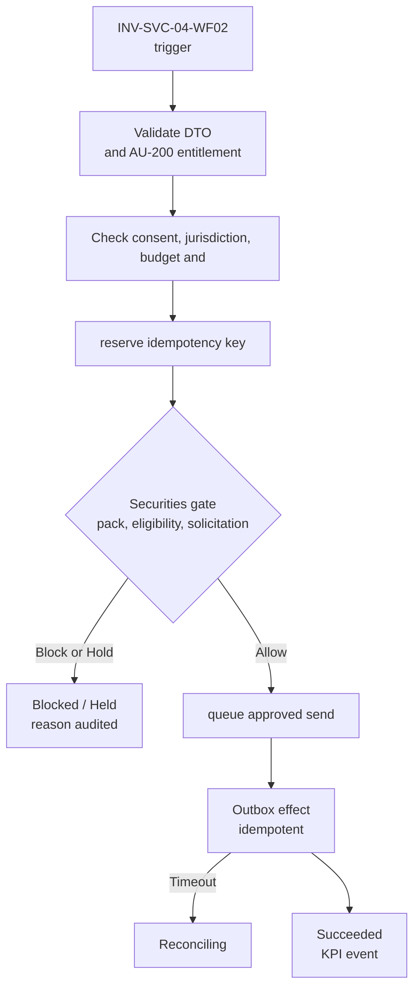

| Test ID | V12 / class ID | Level | Fixture / action | Expected (blueprint assertion) |
|---|---|---|---|---|
| TC-V12-N-170 | INV-SVC-04-WF02-AT01 | IT | Approved draft and sender authorization | Output validates against the workflow schema; evidence persisted; run Succeeded; KPI event emitted; output "Accepted or blocked send record"; KPI: unauthorized sends = 0 |
| TC-V12-N-171 | INV-SVC-04-WF02-TC-INPUT | UT/CT | missing or malformed input | HTTP 422 with field errors; no StepRun; audit `dto.rejected` |
| TC-V12-N-172 | INV-SVC-04-WF02-TC-SCOPE | SEC | same reference from another tenant/startup | HTTP 403 or uniform 404 (BRL-TEN-04); zero rows/events/provider calls in the other scope |
| TC-V12-N-173 | INV-SVC-04-WF02-TC-ENT | IT | revoke INV SKU after enqueue | AU-200 dispatch-time recheck denies; run Paused/Held; reservation released; no effect |
| TC-V12-N-174 | INV-SVC-04-WF02-TC-DUP | IT replay | replay identical event / step key | exactly one accepted outcome, effect and meter charge; duplicate returns original run ref |
| TC-V12-N-175 | INV-SVC-04-WF02-TC-QUALITY | AIE | stale, conflicting or incomplete evidence | step Held or flagged; no unsupported claim reaches output (BRL-AI-03/04); eval record stored |
| TC-V12-N-176 | INV-SVC-04-WF02-TC-BUDGET | IT | quota exhausted at reservation | reservation fails → Blocked; zero provider calls; owner notified |
| TC-V12-N-177 | INV-SVC-04-WF02-TC-RECOVERY | CHAOS | provider timeout or worker crash | timeout after submit → Reconciling; resume from checkpoint without repeating a completed effect |
| TC-V12-N-178 | INV-SVC-04-WF02-TC-SEC | SEC/compliance | SEC-CTL-N-03: s.42 offering content to recipient without relationship provenance | Block GENERAL_SOLICITATION; not overridable |
| TC-V12-N-179 | INV-SVC-04-WF02-TC-APPROVAL | IT | approval missing, single approver or hash mismatch | Waiting (AWAITING_APPROVAL) or Block APPROVAL_INCOMPLETE/HASH_MISMATCH; NSE |
| TC-V12-N-180 | INV-SVC-04-WF02-TC-EFFECT | IT + CHAOS | effect after approval; pack expires between approval and dispatch | dispatch-time AU-201 recheck blocks; no effect; approval retained; audit `pack.expired` |

##### INV-SVC-04-WF03 Delivery and bounce processing

**Requirement FR-V12-N-115** (status before: Not covered, CONFLICT-958; after: Matched). Execute "Delivery and bounce processing" as a typed, policy-checked workflow: Verify callback; deduplicate; update delivery status and suppression; reconcile uncertainty; output "Delivery evidence".

| Field | Specification |
|---|---|
| Business outcome / input → output | Delivery and bounce processing: Authenticated provider event → Delivery evidence |
| Trigger | Authorized business event or manual import; signed webhook if applicable |
| Result / acceptance | Delivery evidence; acceptance INV-SVC-04-WF03-AT01 (Delivery and bounce processing) → TC-V12-N-185 |
| Domain contract | Validator `urn:inv:dto:INV-SVC-04-WF03:v2`; fields below; event envelope per FR-V12-N-006 |
| Risk and authority | R1 · V12 side effect: Potential external write/communication; controlled only after applicable permission and policy approval |
| Autonomy in blueprint | Template and content L1 (hash-bound approval) then L2 dispatch; offering-tagged content needs R02 + R10 per message (two-person); a DEC-779 mandate may automate only non-offering IR messages (CP-O-04) |
| Approval gate (V12) | Approve facts and template; formal offers and restricted recipients routed separately; recheck before send |
| Operating mode / modalities | AI-assisted / supervised; controlled autonomous only for preapproved eligible routine steps; simulation has zero external effects. · Text; structured records |
| Agent / automations | — (deterministic) · AU-213 |
| Roles | R19 service |
| Step classes | 1 Policy check (PDP); 1 Deterministic calculation; 2 Domain persistence |
| Securities and privacy controls | SEC-CTL-N-06 (see step column) |
| Workflow KPI (V12 service) | Unauthorized sends = 0; duplicate dispatch = 0; delivery status reconciled ≥99% |
| KPI formulas (this part) | delivery status reconciled ≥ 99%; duplicate events processed = 0 |
| SLA | Webhook ack ≤ 2 s; processing ≤ 30 s |
| Illustrative cost (V12) | 1 workflow invocation; not a full service cycle; tokens 0 in / 0 out; INR 0.15 per invocation; external fees excluded (estimate; verify at implementation, as of 27 Nov 2026) |
| Versions / origin | workflow 2.0-target; INV-SVC-04-WF03-AT01; synthetic dry run and measured benchmark pending; V12 status: Proposed; test Not run; live execution and pricing pending. |
| Rules | R1. Signature verified before persistence · R2. Hard bounce/complaint → suppression |

**DTO `urn:inv:dto:INV-SVC-04-WF03:v2`**

| Field | Dir | Req | Type / validation | Schema constraint | Blueprint mapping |
|---|---|---|---|---|---|
| `provider_event` | in | Y | structured object (versioned sub-schema) | `{"type": "object", "maxProperties": 100}` | run payload (inv_workflow_run.output_json) |
| `signature` | in | Y | free text NFC-normalised, untrusted (AU-005) | `{"type": "string", "minLength": 1, "maxLength": 4000}` | run payload (inv_workflow_run.output_json) |
| `delivery_event_id` | out | Y | reference in caller tenant/startup | `{"type": "string", "format": "uuid"}` | run payload (inv_workflow_run.output_json) |
| `delivery_state` | out | Y | configured enum (delivery_state) | `{"type": "string", "maxLength": 64, "$comment": "values from registry delivery_state"}` | run payload (inv_workflow_run.output_json) |
| `suppression_added` | out | Y | boolean | `{"type": "boolean"}` | run payload (inv_workflow_run.output_json) |
| `correlation_id` | in | Y | trace id | `{"type": "string", "format": "uuid"}` | inv_workflow_run.correlation_id |
| `simulation` | in | N | zero-effect run | `{"type": "boolean", "default": false}` | inv_workflow_run.simulation |

| Step ID | Action | Class · executor | Output / validation | Failure → state | Blueprint component | Controls in this step | Step test |
|---|---|---|---|---|---|---|---|
| INV-SVC-04-WF03-STEP-01 | Verify callback | Policy check (PDP) · PDP + AU-201/AU-202/AU-203/AU-208 | decision {allow/hold/block, reason_codes, pack_versions} | POLICY_DENIED → **Blocked** | PDP (Part 3.1) extended with securities gate (ADR-231); fail closed | CTL-06 | TC-V12-N-181 (UT decision table + IT): every rule branch exercised; unknown → hold/block; reason code and pack version audited |
| INV-SVC-04-WF03-STEP-02 | deduplicate | Deterministic calculation · Rules / calculation engine | calculation {value, unit, assumptions, evidence_refs} | INVALID_INPUT → **Held** | Deterministic domain service; Decimal (DEC-027); zero model calls | — (internal; audit only) | TC-V12-N-182 (UT golden fixture): golden fixture exact; missing value never invented |
| INV-SVC-04-WF03-STEP-03 | update delivery status and suppression | Domain persistence · Domain service (investment app) | domain_result {artifact_ref, status, evidence_refs} | INVALID_STATE → **Held** | Domain module: revision check (NFR-025), single transaction with audit and outbox | — (internal; audit only) | TC-V12-N-183 (UT + IT): state change atomic with audit and outbox row |
| INV-SVC-04-WF03-STEP-04 | reconcile uncertainty | Domain persistence · Domain service (investment app) | domain_result {artifact_ref, status, evidence_refs} | INVALID_STATE → **Held** | Domain module: revision check (NFR-025), single transaction with audit and outbox | — (internal; audit only) | TC-V12-N-184 (UT + IT): state change atomic with audit and outbox row |

| Test ID | V12 / class ID | Level | Fixture / action | Expected (blueprint assertion) |
|---|---|---|---|---|
| TC-V12-N-185 | INV-SVC-04-WF03-AT01 | IT | Authenticated provider event | Output validates against the workflow schema; evidence persisted; run Succeeded; KPI event emitted; output "Delivery evidence"; KPI: delivery status reconciled ≥ 99% |
| TC-V12-N-186 | INV-SVC-04-WF03-TC-INPUT | UT/CT | missing or malformed input | HTTP 422 with field errors; no StepRun; audit `dto.rejected` |
| TC-V12-N-187 | INV-SVC-04-WF03-TC-SCOPE | SEC | same reference from another tenant/startup | HTTP 403 or uniform 404 (BRL-TEN-04); zero rows/events/provider calls in the other scope |
| TC-V12-N-188 | INV-SVC-04-WF03-TC-ENT | IT | revoke INV SKU after enqueue | AU-200 dispatch-time recheck denies; run Paused/Held; reservation released; no effect |
| TC-V12-N-189 | INV-SVC-04-WF03-TC-DUP | IT replay | replay identical event / step key | exactly one accepted outcome, effect and meter charge; duplicate returns original run ref |
| TC-V12-N-190 | INV-SVC-04-WF03-TC-QUALITY | AIE | stale, conflicting or incomplete evidence | step Held or flagged; no unsupported claim reaches output (BRL-AI-03/04); eval record stored |
| TC-V12-N-191 | INV-SVC-04-WF03-TC-BUDGET | IT | quota exhausted at reservation | reservation fails → Blocked; zero provider calls; owner notified |
| TC-V12-N-192 | INV-SVC-04-WF03-TC-RECOVERY | CHAOS | provider timeout or worker crash | timeout after submit → Reconciling; resume from checkpoint without repeating a completed effect |
| TC-V12-N-193 | INV-SVC-04-WF03-TC-SEC | SEC/compliance | SEC-CTL-N-06: consent withdrawn 30 s before step | Block CONSENT_WITHDRAWN; sequence stopped |

##### INV-SVC-04-WF04 Sender reputation and deliverability optimization

**Requirement FR-V12-N-116** (status before: Not covered, CONFLICT-958; after: Matched). Execute "Sender reputation and deliverability optimization" as a typed, policy-checked workflow: Check authentication and rates; detect deterioration; throttle or pause; recommend remediation; output "Deliverability health report and hold decision".

| Field | Specification |
|---|---|
| Business outcome / input → output | Sender reputation and deliverability optimization: Sender authentication, bounce and complaint events → Deliverability health report and hold decision |
| Trigger | Manual; scheduled or relevant validated business event; provider webhook only where authorized |
| Result / acceptance | Deliverability health report and hold decision; acceptance INV-SVC-04-WF04-AT01 (Sender reputation and deliverability optimization) → TC-V12-N-198 |
| Domain contract | Validator `urn:inv:dto:INV-SVC-04-WF04:v2`; fields below; event envelope per FR-V12-N-006 |
| Risk and authority | R0 + internal hold · V12 side effect: Internal analysis/draft; no external action without separate authorization |
| Autonomy in blueprint | Template and content L1 (hash-bound approval) then L2 dispatch; offering-tagged content needs R02 + R10 per message (two-person); a DEC-779 mandate may automate only non-offering IR messages (CP-O-04) |
| Approval gate (V12) | Approve source/data rights and applicable external actions; qualified reviewer confirms legal/financial claims and any offer, filing, ownership change or payment; no autonomous regulated decision. |
| Operating mode / modalities | AI-assisted / supervised; controlled autonomous only for preapproved eligible routine steps; simulation has zero external effects. · Text; structured records |
| Agent / automations | AG-167 · AU-213 |
| Roles | R11 |
| Step classes | 1 Policy check (PDP); 1 Deterministic calculation; 1 Domain persistence; 1 AI inference |
| Securities and privacy controls | SEC-CTL-N-06 (see step column) |
| Workflow KPI (V12 service) | Unauthorized sends = 0; duplicate dispatch = 0; delivery status reconciled ≥99% |
| KPI formulas (this part) | complaint rate < 0.1% (verify provider thresholds); sender auto-paused within 5 min of threshold breach |
| SLA | Hourly |
| Illustrative cost (V12) | 1 invocation; text component only; tokens 1200 in / 200 out; INR 0.55 per invocation; external fees excluded (estimate; verify at implementation, as of 27 Nov 2026) |
| Versions / origin | workflow 1.0-target; INV-SVC-04-WF04-AT01; synthetic dry run and measured benchmark pending; V12 status: Proposed; test Not run; live execution and pricing pending. |
| Rules | R1. SPF/DKIM/DMARC checked · R2. Pause is automatic; resume needs R11 |

**DTO `urn:inv:dto:INV-SVC-04-WF04:v2`**

| Field | Dir | Req | Type / validation | Schema constraint | Blueprint mapping |
|---|---|---|---|---|---|
| `sender_id` | in | Y | reference in caller tenant/startup | `{"type": "string", "format": "uuid"}` | inv_message.id |
| `window_days` | in | Y | non-negative integer | `{"type": "integer", "minimum": 0}` | run payload (inv_workflow_run.output_json) |
| `health_report_id` | out | Y | reference in caller tenant/startup | `{"type": "string", "format": "uuid"}` | run payload (inv_workflow_run.output_json) |
| `hold_decision` | out | Y | configured enum (hold) | `{"type": "string", "maxLength": 64, "$comment": "values from registry hold"}` | run payload (inv_workflow_run.output_json) |
| `recommendations` | out | Y | free text NFC-normalised, untrusted (AU-005) | `{"type": "string", "minLength": 1, "maxLength": 4000}` | run payload (inv_workflow_run.output_json) |
| `correlation_id` | in | Y | trace id | `{"type": "string", "format": "uuid"}` | inv_workflow_run.correlation_id |
| `simulation` | in | N | zero-effect run | `{"type": "boolean", "default": false}` | inv_workflow_run.simulation |

| Step ID | Action | Class · executor | Output / validation | Failure → state | Blueprint component | Controls in this step | Step test |
|---|---|---|---|---|---|---|---|
| INV-SVC-04-WF04-STEP-01 | Check authentication and rates | Policy check (PDP) · PDP + AU-201/AU-202/AU-203/AU-208 | decision {allow/hold/block, reason_codes, pack_versions} | POLICY_DENIED → **Blocked** | PDP (Part 3.1) extended with securities gate (ADR-231); fail closed | CTL-06 | TC-V12-N-194 (UT decision table + IT): every rule branch exercised; unknown → hold/block; reason code and pack version audited |
| INV-SVC-04-WF04-STEP-02 | detect deterioration | Deterministic calculation · Rules / calculation engine | calculation {value, unit, assumptions, evidence_refs} | INVALID_INPUT → **Held** | Deterministic domain service; Decimal (DEC-027); zero model calls | — (internal; audit only) | TC-V12-N-195 (UT golden fixture): golden fixture exact; missing value never invented |
| INV-SVC-04-WF04-STEP-03 | throttle or pause | Domain persistence · Domain service (investment app) | domain_result {artifact_ref, status, evidence_refs} | INVALID_STATE → **Held** | Domain module: revision check (NFR-025), single transaction with audit and outbox | — (internal; audit only) | TC-V12-N-196 (UT + IT): state change atomic with audit and outbox row |
| INV-SVC-04-WF04-STEP-04 | recommend remediation | AI inference · Model gateway + agent | candidate {artifact_ref, confidence, reason_codes, review_state} | REVIEW_REQUIRED → **Waiting (AWAITING_APPROVAL)** | Model gateway AU-001 (Tier 0 → 1a → 1b; Tier 3 degrade), AU-003 schema validation, AG-166 guard on investor-facing text; output is a draft only | CTL-05 | TC-V12-N-197 (AIE + CT schema): output validates against schema; claims cited; AG-166 verdict recorded; untrusted input cannot invoke tools |

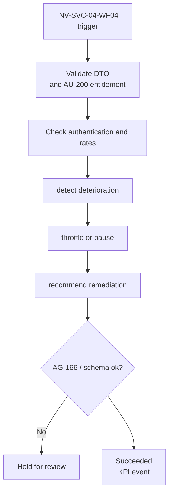

| Test ID | V12 / class ID | Level | Fixture / action | Expected (blueprint assertion) |
|---|---|---|---|---|
| TC-V12-N-198 | INV-SVC-04-WF04-AT01 | IT | Sender authentication, bounce and complaint events | Output validates against the workflow schema; evidence persisted; run Succeeded; KPI event emitted; output "Deliverability health report and hold decision"; KPI: complaint rate < 0.1% (verify provider thresholds) |
| TC-V12-N-199 | INV-SVC-04-WF04-TC-INPUT | UT/CT | missing or malformed input | HTTP 422 with field errors; no StepRun; audit `dto.rejected` |
| TC-V12-N-200 | INV-SVC-04-WF04-TC-SCOPE | SEC | same reference from another tenant/startup | HTTP 403 or uniform 404 (BRL-TEN-04); zero rows/events/provider calls in the other scope |
| TC-V12-N-201 | INV-SVC-04-WF04-TC-ENT | IT | revoke INV SKU after enqueue | AU-200 dispatch-time recheck denies; run Paused/Held; reservation released; no effect |
| TC-V12-N-202 | INV-SVC-04-WF04-TC-DUP | IT replay | replay identical event / step key | exactly one accepted outcome, effect and meter charge; duplicate returns original run ref |
| TC-V12-N-203 | INV-SVC-04-WF04-TC-QUALITY | AIE | stale, conflicting or incomplete evidence | step Held or flagged; no unsupported claim reaches output (BRL-AI-03/04); eval record stored |
| TC-V12-N-204 | INV-SVC-04-WF04-TC-BUDGET | IT | quota exhausted at reservation | reservation fails → Blocked; zero provider calls; owner notified |
| TC-V12-N-205 | INV-SVC-04-WF04-TC-RECOVERY | CHAOS | provider timeout or worker crash | timeout after submit → Reconciling; resume from checkpoint without repeating a completed effect |
| TC-V12-N-206 | INV-SVC-04-WF04-TC-SEC | SEC/compliance | SEC-CTL-N-06: consent withdrawn 30 s before step | Block CONSENT_WITHDRAWN; sequence stopped |

#### INV-SVC-05 Investor WhatsApp Engagement Automation

**Purpose:** Conduct eligible consented direct investor communication by WhatsApp (workbook Service Catalog row 9). **Epic:** EP-30. **Service spec:** Part 11.16a §11.16.5.6.5. **Stories:** Part 11.16e.

| Field | Specification |
|---|---|
| Family / bundle / meter | Outreach · Full suite / Investor Engagement bundle / selective (1 SKU); entitlement and usage approval required. · Illustrative pilot: 200 message attempt(s)/month; 1 concurrent run; configurable hard budget, provider quota and frequency limits. Not approved. |
| Supported channels | WhatsApp Business |
| Industries / capability | Fundraising issuers across eligible sectors; grant/debt/CSR route requires eligibility · Eligible WhatsApp engagement |
| Required entitlements | INV-SVC-05 + foundation; tenant/startup, capability, role, channel/provider and budget checks at every action |
| Optional input producers | Included foundation; no mandatory upstream paid service; optional input producers: INV-SVC-03; authorized equivalent input accepted. |
| External providers | Official business account and applicable approved templates; eligible use and provider approval required (verify terms and prices at implementation, as of 27 Nov 2026) |
| Service KPI (V12) | Ineligible template or recipient sends = 0; duplicate dispatch = 0 |
| Actors (blueprint roles) | R03; R03 · R02; R03 · R10; R19; R19 service identity; R20 agent identity |
| Agents | AG-165, AG-166, AG-168, AG-013 |
| Automations | AU-214, AU-215, AU-203, AU-208, AU-073 |
| Shared engines (V12) | Communication; Workflow orchestration; Governance |
| Data class and gateway tier | Personal; no Tier 2; Tier 1a intent; Tier 1b drafting |
| Screens | A004; A012; A019; A020 → A206, A212, A217, A218 |
| V12 DB candidates → blueprint | inv_channel; inv_delivery_event; inv_inbound_event; inv_integration_connection; inv_message; inv_permission; inv_suppression; inv_thread → schema `inv` same names (DEC-814 keeps V12 names; RLS per §11.16.5.10) |

##### INV-SVC-05-WF01 Consent and template validation

**Requirement FR-V12-N-117** (status before: Not covered, CONFLICT-958; after: Matched). Execute "Consent and template validation" as a typed, policy-checked workflow: Check opted-in scope, allowed message type and account status; hold noneligible cases; output "Eligible template decision".

| Field | Specification |
|---|---|
| Business outcome / input → output | Consent and template validation: Contact permission and approved template → Eligible template decision |
| Trigger | Manual request or validated upstream business event |
| Result / acceptance | Eligible template decision; acceptance INV-SVC-05-WF01-AT01 (Consent and template validation) → TC-V12-N-209 |
| Domain contract | Validator `urn:inv:dto:INV-SVC-05-WF01:v2`; fields below; event envelope per FR-V12-N-006 |
| Risk and authority | R1 · V12 side effect: Internal analysis/draft; no external action without separate authorization |
| Autonomy in blueprint | Templates L1; dispatch L2 after PDP; in-window approved factual FAQ replies (non-offer) up to L3; offer content never via WhatsApp broadcast |
| Approval gate (V12) | No general solicitation; opt-in and applicable policy verified; unapproved offer blocked |
| Operating mode / modalities | AI-assisted / supervised; controlled autonomous only for preapproved eligible routine steps; simulation has zero external effects. · Text; structured records |
| Agent / automations | — · AU-214, AU-201 |
| Roles | R03 · R10 |
| Step classes | 1 Policy check (PDP); 1 Human review routing |
| Securities and privacy controls | SEC-CTL-N-03, SEC-CTL-N-06, SEC-CTL-N-01 (see step column) |
| Workflow KPI (V12 service) | Ineligible template or recipient sends = 0; duplicate dispatch = 0 |
| KPI formulas (this part) | ineligible template sends = 0; opt-in evidence present = 100% |
| SLA | ≤ 500 ms |
| Illustrative cost (V12) | 1 workflow invocation; not a full service cycle; tokens 0 in / 0 out; INR 0.15 per invocation; external fees excluded (estimate; verify at implementation, as of 27 Nov 2026) |
| Versions / origin | workflow 2.0-target; INV-SVC-05-WF01-AT01; synthetic dry run and measured benchmark pending; V12 status: Proposed; test Not run; live execution and pricing pending. |
| Rules | R1. Opt-in scope covers investor-relations purpose · R2. Offering-tagged template blocked unless recipient eligible and relationship recorded |

**DTO `urn:inv:dto:INV-SVC-05-WF01:v2`**

| Field | Dir | Req | Type / validation | Schema constraint | Blueprint mapping |
|---|---|---|---|---|---|
| `contact_id` | in | Y | reference in caller tenant/startup | `{"type": "string", "format": "uuid"}` | inv_contact.id |
| `template_id` | in | Y | reference in caller tenant/startup | `{"type": "string", "format": "uuid"}` | inv_locale_template.id |
| `jurisdiction` | in | Y | configured enum (jurisdiction) | `{"type": "string", "maxLength": 64, "$comment": "values from registry jurisdiction"}` | run payload (inv_workflow_run.output_json) |
| `template_decision` | out | Y | configured enum (verdict) | `{"type": "string", "maxLength": 64, "$comment": "values from registry verdict"}` | inv_locale_template |
| `reason_codes` | out | Y | configured enum list (elig_reason) | `{"type": "array", "items": {"type": "string", "maxLength": 64}, "maxItems": 50, "$comment": "values from registry elig_reason"}` | run payload (inv_workflow_run.output_json) |
| `correlation_id` | in | Y | trace id | `{"type": "string", "format": "uuid"}` | inv_workflow_run.correlation_id |
| `simulation` | in | N | zero-effect run | `{"type": "boolean", "default": false}` | inv_workflow_run.simulation |

| Step ID | Action | Class · executor | Output / validation | Failure → state | Blueprint component | Controls in this step | Step test |
|---|---|---|---|---|---|---|---|
| INV-SVC-05-WF01-STEP-01 | Check opted-in scope, allowed message type and account status | Policy check (PDP) · PDP + AU-201/AU-202/AU-203/AU-208 | decision {allow/hold/block, reason_codes, pack_versions} | POLICY_DENIED → **Blocked** | PDP (Part 3.1) extended with securities gate (ADR-231); fail closed | CTL-03, CTL-06, CTL-01 | TC-V12-N-207 (UT decision table + IT): every rule branch exercised; unknown → hold/block; reason code and pack version audited |
| INV-SVC-05-WF01-STEP-02 | hold noneligible cases | Human review routing · Work queue / approval service | task {queue, assignee_role, sla_due, reason} | SLA_BREACH → **Escalated** | Approval/task service (A207/A220); SLA timers | — (internal; audit only) | TC-V12-N-208 (IT + SYS): task created with correct role and SLA; automation paused until disposition |

| Test ID | V12 / class ID | Level | Fixture / action | Expected (blueprint assertion) |
|---|---|---|---|---|
| TC-V12-N-209 | INV-SVC-05-WF01-AT01 | IT | Contact permission and approved template | Output validates against the workflow schema; evidence persisted; run Succeeded; KPI event emitted; output "Eligible template decision"; KPI: ineligible template sends = 0 |
| TC-V12-N-210 | INV-SVC-05-WF01-TC-INPUT | UT/CT | missing or malformed input | HTTP 422 with field errors; no StepRun; audit `dto.rejected` |
| TC-V12-N-211 | INV-SVC-05-WF01-TC-SCOPE | SEC | same reference from another tenant/startup | HTTP 403 or uniform 404 (BRL-TEN-04); zero rows/events/provider calls in the other scope |
| TC-V12-N-212 | INV-SVC-05-WF01-TC-ENT | IT | revoke INV SKU after enqueue | AU-200 dispatch-time recheck denies; run Paused/Held; reservation released; no effect |
| TC-V12-N-213 | INV-SVC-05-WF01-TC-DUP | IT replay | replay identical event / step key | exactly one accepted outcome, effect and meter charge; duplicate returns original run ref |
| TC-V12-N-214 | INV-SVC-05-WF01-TC-QUALITY | AIE | stale, conflicting or incomplete evidence | step Held or flagged; no unsupported claim reaches output (BRL-AI-03/04); eval record stored |
| TC-V12-N-215 | INV-SVC-05-WF01-TC-BUDGET | IT | quota exhausted at reservation | reservation fails → Blocked; zero provider calls; owner notified |
| TC-V12-N-216 | INV-SVC-05-WF01-TC-RECOVERY | CHAOS | provider timeout or worker crash | timeout after submit → Reconciling; resume from checkpoint without repeating a completed effect |
| TC-V12-N-217 | INV-SVC-05-WF01-TC-SEC | SEC/compliance | SEC-CTL-N-03: s.42 offering content to recipient without relationship provenance | Block GENERAL_SOLICITATION; not overridable |

##### INV-SVC-05-WF02 Prepare and send direct message

**Requirement FR-V12-N-118** (status before: Not covered, CONFLICT-958; after: Matched). Execute "Prepare and send direct message" as a typed, policy-checked workflow: Draft approved content; recheck template, budget and consent; queue via authorized provider; output "Sent or blocked message".

| Field | Specification |
|---|---|
| Business outcome / input → output | Prepare and send direct message: Approved context and verified recipient → Sent or blocked message |
| Trigger | Manual request or validated upstream business event |
| Result / acceptance | Sent or blocked message; acceptance INV-SVC-05-WF02-AT01 (Prepare and send direct message) → TC-V12-N-222 |
| Domain contract | Validator `urn:inv:dto:INV-SVC-05-WF02:v2`; fields below; event envelope per FR-V12-N-006 |
| Risk and authority | R2 external communication (V12 labels it internal; stricter applies, CONFLICT-1019) · V12 side effect: Internal analysis/draft; no external action without separate authorization |
| Autonomy in blueprint | Templates L1; dispatch L2 after PDP; in-window approved factual FAQ replies (non-offer) up to L3; offer content never via WhatsApp broadcast |
| Approval gate (V12) | No general solicitation; opt-in and applicable policy verified; unapproved offer blocked |
| Operating mode / modalities | AI-assisted / supervised; controlled autonomous only for preapproved eligible routine steps; simulation has zero external effects. · Text; structured records |
| Agent / automations | AG-165 + AG-166 · AU-214, AU-203 |
| Roles | R03 · R02 |
| Step classes | 1 AI inference; 1 Policy check (PDP); 1 External effect (outbox) |
| Securities and privacy controls | SEC-CTL-N-01, SEC-CTL-N-03, SEC-CTL-N-05, SEC-CTL-N-06, SEC-CTL-N-15 (see step column) |
| Workflow KPI (V12 service) | Ineligible template or recipient sends = 0; duplicate dispatch = 0 |
| KPI formulas (this part) | duplicate dispatch = 0; blocked-by-policy precision (sampled) ≥ 95% |
| SLA | Dispatch ≤ 60 s |
| Illustrative cost (V12) | 1 workflow invocation; not a full service cycle; tokens 1200 in / 200 out; INR 0.55 per invocation; external fees excluded (estimate; verify at implementation, as of 27 Nov 2026) |
| Versions / origin | workflow 2.0-target; INV-SVC-05-WF02-AT01; synthetic dry run and measured benchmark pending; V12 status: Proposed; test Not run; live execution and pricing pending. |
| Rules | R1. No broadcast lists for offering content (BRL-V12-N-06) · R2. Recheck template, budget and consent at dispatch |

**DTO `urn:inv:dto:INV-SVC-05-WF02:v2`**

| Field | Dir | Req | Type / validation | Schema constraint | Blueprint mapping |
|---|---|---|---|---|---|
| `context_id` | in | Y | reference in caller tenant/startup | `{"type": "string", "format": "uuid"}` | run payload (inv_workflow_run.output_json) |
| `recipient_id` | in | Y | reference in caller tenant/startup | `{"type": "string", "format": "uuid"}` | run payload (inv_workflow_run.output_json) |
| `template_id` | in | Y | reference in caller tenant/startup | `{"type": "string", "format": "uuid"}` | inv_locale_template.id |
| `idempotency_key` | in | Y | free text NFC-normalised, untrusted (AU-005) | `{"type": "string", "minLength": 1, "maxLength": 4000}` | run payload (inv_workflow_run.output_json) |
| `message_id` | out | Y | reference in caller tenant/startup | `{"type": "string", "format": "uuid"}` | inv_message.id |
| `state` | out | Y | configured enum (send_state) | `{"type": "string", "maxLength": 64, "$comment": "values from registry send_state"}` | run payload (inv_workflow_run.output_json) |
| `block_reason` | out | Y | configured enum (block_reason) | `{"type": "string", "maxLength": 64, "$comment": "values from registry block_reason"}` | run payload (inv_workflow_run.output_json) |
| `correlation_id` | in | Y | trace id | `{"type": "string", "format": "uuid"}` | inv_workflow_run.correlation_id |
| `simulation` | in | N | zero-effect run | `{"type": "boolean", "default": false}` | inv_workflow_run.simulation |

| Step ID | Action | Class · executor | Output / validation | Failure → state | Blueprint component | Controls in this step | Step test |
|---|---|---|---|---|---|---|---|
| INV-SVC-05-WF02-STEP-01 | Draft approved content | AI inference · Model gateway + agent | candidate {artifact_ref, confidence, reason_codes, review_state} | REVIEW_REQUIRED → **Waiting (AWAITING_APPROVAL)** | Model gateway AU-001 (Tier 0 → 1a → 1b; Tier 3 degrade), AU-003 schema validation, AG-166 guard on investor-facing text; output is a draft only | CTL-05 | TC-V12-N-218 (AIE + CT schema): output validates against schema; claims cited; AG-166 verdict recorded; untrusted input cannot invoke tools |
| INV-SVC-05-WF02-STEP-02 | recheck template, budget and consent | Policy check (PDP) · PDP + AU-201/AU-202/AU-203/AU-208 | decision {allow/hold/block, reason_codes, pack_versions} | POLICY_DENIED → **Blocked** | PDP (Part 3.1) extended with securities gate (ADR-231); fail closed | CTL-01, CTL-03, CTL-05, CTL-06, CTL-15 | TC-V12-N-219 (UT decision table + IT): every rule branch exercised; unknown → hold/block; reason code and pack version audited |
| INV-SVC-05-WF02-STEP-GATE | Securities and privacy gate (blueprint) | Policy check · PDP securities plug-in / scope + consent + pack + eligibility + solicitation + approval hash or mandate | decision {allow/hold/block, reason_codes, pack_versions} | POLICY_DENIED → **Blocked**; unknown → **Held** | PDP + AU-201/202/203/207 (ADR-231) | CTL-01, CTL-03, CTL-05, CTL-06, CTL-15 | TC-V12-N-221 (UT decision table + IT): every gate branch; fail closed |
| INV-SVC-05-WF02-STEP-03 | queue via authorized provider | External effect (outbox) · Dispatcher via transactional outbox | effect {effect_id, provider_ref, state} | TIMEOUT_AFTER_SUBMIT → **Reconciling** | Outbox (M06) + dispatch-time PDP recheck (scope, consent, pack, eligibility, budget, approval hash) + idempotency key | CTL-01, CTL-15 | TC-V12-N-220 (IT replay + CHAOS): exactly one effect per idempotency key; recheck denies after revocation; uncertain → reconcile before retry |

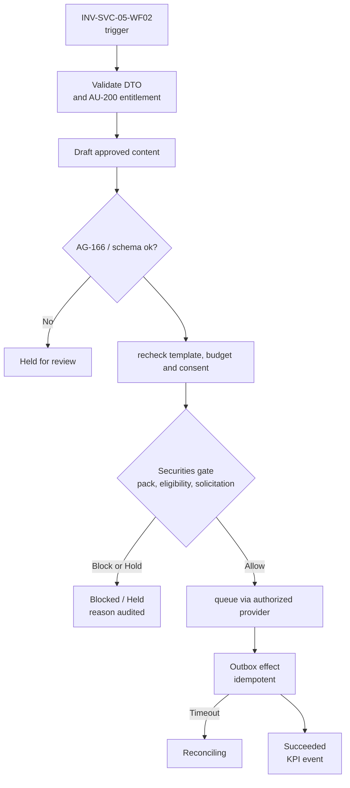

| Test ID | V12 / class ID | Level | Fixture / action | Expected (blueprint assertion) |
|---|---|---|---|---|
| TC-V12-N-222 | INV-SVC-05-WF02-AT01 | IT | Approved context and verified recipient | Output validates against the workflow schema; evidence persisted; run Succeeded; KPI event emitted; output "Sent or blocked message"; KPI: duplicate dispatch = 0 |
| TC-V12-N-223 | INV-SVC-05-WF02-TC-INPUT | UT/CT | missing or malformed input | HTTP 422 with field errors; no StepRun; audit `dto.rejected` |
| TC-V12-N-224 | INV-SVC-05-WF02-TC-SCOPE | SEC | same reference from another tenant/startup | HTTP 403 or uniform 404 (BRL-TEN-04); zero rows/events/provider calls in the other scope |
| TC-V12-N-225 | INV-SVC-05-WF02-TC-ENT | IT | revoke INV SKU after enqueue | AU-200 dispatch-time recheck denies; run Paused/Held; reservation released; no effect |
| TC-V12-N-226 | INV-SVC-05-WF02-TC-DUP | IT replay | replay identical event / step key | exactly one accepted outcome, effect and meter charge; duplicate returns original run ref |
| TC-V12-N-227 | INV-SVC-05-WF02-TC-QUALITY | AIE | stale, conflicting or incomplete evidence | step Held or flagged; no unsupported claim reaches output (BRL-AI-03/04); eval record stored |
| TC-V12-N-228 | INV-SVC-05-WF02-TC-BUDGET | IT | quota exhausted at reservation | reservation fails → Blocked; zero provider calls; owner notified |
| TC-V12-N-229 | INV-SVC-05-WF02-TC-RECOVERY | CHAOS | provider timeout or worker crash | timeout after submit → Reconciling; resume from checkpoint without repeating a completed effect |
| TC-V12-N-230 | INV-SVC-05-WF02-TC-SEC | SEC/compliance | SEC-CTL-N-03: s.42 offering content to recipient without relationship provenance | Block GENERAL_SOLICITATION; not overridable |
| TC-V12-N-231 | INV-SVC-05-WF02-TC-APPROVAL | IT | approval missing, single approver or hash mismatch | Waiting (AWAITING_APPROVAL) or Block APPROVAL_INCOMPLETE/HASH_MISMATCH; NSE |
| TC-V12-N-232 | INV-SVC-05-WF02-TC-EFFECT | IT + CHAOS | effect after approval; pack expires between approval and dispatch | dispatch-time AU-201 recheck blocks; no effect; approval retained; audit `pack.expired` |

##### INV-SVC-05-WF03 Inbound and delivery synchronization

**Requirement FR-V12-N-119** (status before: Not covered, CONFLICT-958; after: Matched). Execute "Inbound and delivery synchronization" as a typed, policy-checked workflow: Verify signature and event ID; link scoped thread; update status; stop relevant follow-up; output "Relationship event".

| Field | Specification |
|---|---|
| Business outcome / input → output | Inbound and delivery synchronization: Signed provider event → Relationship event |
| Trigger | Authorized business event or manual import; signed webhook if applicable |
| Result / acceptance | Relationship event; acceptance INV-SVC-05-WF03-AT01 (Inbound and delivery synchronization) → TC-V12-N-237 |
| Domain contract | Validator `urn:inv:dto:INV-SVC-05-WF03:v2`; fields below; event envelope per FR-V12-N-006 |
| Risk and authority | R1 · V12 side effect: Potential external write/communication; controlled only after applicable permission and policy approval |
| Autonomy in blueprint | Templates L1; dispatch L2 after PDP; in-window approved factual FAQ replies (non-offer) up to L3; offer content never via WhatsApp broadcast |
| Approval gate (V12) | No general solicitation; opt-in and applicable policy verified; unapproved offer blocked |
| Operating mode / modalities | AI-assisted / supervised; controlled autonomous only for preapproved eligible routine steps; simulation has zero external effects. · Text; structured records |
| Agent / automations | — · AU-215 |
| Roles | R19 |
| Step classes | 2 Policy check (PDP); 2 Domain persistence |
| Securities and privacy controls | SEC-CTL-N-06 (see step column) |
| Workflow KPI (V12 service) | Ineligible template or recipient sends = 0; duplicate dispatch = 0 |
| KPI formulas (this part) | STOP honoured within 1 min = 100%; events linked to correct thread ≥ 99.9% |
| SLA | Ack ≤ 2 s; stop ≤ 60 s |
| Illustrative cost (V12) | 1 workflow invocation; not a full service cycle; tokens 0 in / 0 out; INR 0.15 per invocation; external fees excluded (estimate; verify at implementation, as of 27 Nov 2026) |
| Versions / origin | workflow 2.0-target; INV-SVC-05-WF03-AT01; synthetic dry run and measured benchmark pending; V12 status: Proposed; test Not run; live execution and pricing pending. |
| Rules | R1. STOP/opt-out keywords deterministic in all supported languages |

**DTO `urn:inv:dto:INV-SVC-05-WF03:v2`**

| Field | Dir | Req | Type / validation | Schema constraint | Blueprint mapping |
|---|---|---|---|---|---|
| `provider_event` | in | Y | structured object (versioned sub-schema) | `{"type": "object", "maxProperties": 100}` | run payload (inv_workflow_run.output_json) |
| `signature` | in | Y | free text NFC-normalised, untrusted (AU-005) | `{"type": "string", "minLength": 1, "maxLength": 4000}` | run payload (inv_workflow_run.output_json) |
| `relationship_event_id` | out | Y | reference in caller tenant/startup | `{"type": "string", "format": "uuid"}` | inv_relationship.id |
| `thread_id` | out | Y | reference in caller tenant/startup | `{"type": "string", "format": "uuid"}` | inv_thread.id |
| `stopped_sequence_ids` | out | Y | typed references, resolved in caller scope | `{"type": "array", "items": {"type": "string", "format": "uuid"}, "maxItems": 500}` | inv_sequence.id[] |
| `correlation_id` | in | Y | trace id | `{"type": "string", "format": "uuid"}` | inv_workflow_run.correlation_id |
| `simulation` | in | N | zero-effect run | `{"type": "boolean", "default": false}` | inv_workflow_run.simulation |

| Step ID | Action | Class · executor | Output / validation | Failure → state | Blueprint component | Controls in this step | Step test |
|---|---|---|---|---|---|---|---|
| INV-SVC-05-WF03-STEP-01 | Verify signature and event ID | Policy check (PDP) · PDP + AU-201/AU-202/AU-203/AU-208 | decision {allow/hold/block, reason_codes, pack_versions} | POLICY_DENIED → **Blocked** | PDP (Part 3.1) extended with securities gate (ADR-231); fail closed | CTL-06 | TC-V12-N-233 (UT decision table + IT): every rule branch exercised; unknown → hold/block; reason code and pack version audited |
| INV-SVC-05-WF03-STEP-02 | link scoped thread | Policy check (PDP) · PDP + AU-201/AU-202/AU-203/AU-208 | decision {allow/hold/block, reason_codes, pack_versions} | POLICY_DENIED → **Blocked** | PDP (Part 3.1) extended with securities gate (ADR-231); fail closed | CTL-06 | TC-V12-N-234 (UT decision table + IT): every rule branch exercised; unknown → hold/block; reason code and pack version audited |
| INV-SVC-05-WF03-STEP-03 | update status | Domain persistence · Domain service (investment app) | domain_result {artifact_ref, status, evidence_refs} | INVALID_STATE → **Held** | Domain module: revision check (NFR-025), single transaction with audit and outbox | — (internal; audit only) | TC-V12-N-235 (UT + IT): state change atomic with audit and outbox row |
| INV-SVC-05-WF03-STEP-04 | stop relevant follow-up | Domain persistence · Domain service (investment app) | domain_result {artifact_ref, status, evidence_refs} | INVALID_STATE → **Held** | Domain module: revision check (NFR-025), single transaction with audit and outbox | — (internal; audit only) | TC-V12-N-236 (UT + IT): state change atomic with audit and outbox row |

| Test ID | V12 / class ID | Level | Fixture / action | Expected (blueprint assertion) |
|---|---|---|---|---|
| TC-V12-N-237 | INV-SVC-05-WF03-AT01 | IT | Signed provider event | Output validates against the workflow schema; evidence persisted; run Succeeded; KPI event emitted; output "Relationship event"; KPI: STOP honoured within 1 min = 100% |
| TC-V12-N-238 | INV-SVC-05-WF03-TC-INPUT | UT/CT | missing or malformed input | HTTP 422 with field errors; no StepRun; audit `dto.rejected` |
| TC-V12-N-239 | INV-SVC-05-WF03-TC-SCOPE | SEC | same reference from another tenant/startup | HTTP 403 or uniform 404 (BRL-TEN-04); zero rows/events/provider calls in the other scope |
| TC-V12-N-240 | INV-SVC-05-WF03-TC-ENT | IT | revoke INV SKU after enqueue | AU-200 dispatch-time recheck denies; run Paused/Held; reservation released; no effect |
| TC-V12-N-241 | INV-SVC-05-WF03-TC-DUP | IT replay | replay identical event / step key | exactly one accepted outcome, effect and meter charge; duplicate returns original run ref |
| TC-V12-N-242 | INV-SVC-05-WF03-TC-QUALITY | AIE | stale, conflicting or incomplete evidence | step Held or flagged; no unsupported claim reaches output (BRL-AI-03/04); eval record stored |
| TC-V12-N-243 | INV-SVC-05-WF03-TC-BUDGET | IT | quota exhausted at reservation | reservation fails → Blocked; zero provider calls; owner notified |
| TC-V12-N-244 | INV-SVC-05-WF03-TC-RECOVERY | CHAOS | provider timeout or worker crash | timeout after submit → Reconciling; resume from checkpoint without repeating a completed effect |
| TC-V12-N-245 | INV-SVC-05-WF03-TC-SEC | SEC/compliance | SEC-CTL-N-06: consent withdrawn 30 s before step | Block CONSENT_WITHDRAWN; sequence stopped |

##### INV-SVC-05-WF04 Consent-aware conversational journey coordination

**Requirement FR-V12-N-120** (status before: Not covered, CONFLICT-958; after: Matched). Execute "Consent-aware conversational journey coordination" as a typed, policy-checked workflow: Check window and consent; coordinate with active sequences; prepare eligible next action; hold or dispatch under policy; output "Journey decision and conversation event".

| Field | Specification |
|---|---|
| Business outcome / input → output | Consent-aware conversational journey coordination: Eligible WhatsApp conversation, template status, opt-in evidence → Journey decision and conversation event |
| Trigger | Manual; scheduled or relevant validated business event; provider webhook only where authorized |
| Result / acceptance | Journey decision and conversation event; acceptance INV-SVC-05-WF04-AT01 (Consent-aware conversational journey coordination) → TC-V12-N-251 |
| Domain contract | Validator `urn:inv:dto:INV-SVC-05-WF04:v2`; fields below; event envelope per FR-V12-N-006 |
| Risk and authority | R2 external communication (stricter than the V12 label, CONFLICT-1019) · V12 side effect: Internal analysis/draft; no external action without separate authorization |
| Autonomy in blueprint | Templates L1; dispatch L2 after PDP; in-window approved factual FAQ replies (non-offer) up to L3; offer content never via WhatsApp broadcast |
| Approval gate (V12) | Approve source/data rights and applicable external actions; qualified reviewer confirms legal/financial claims and any offer, filing, ownership change or payment; no autonomous regulated decision. |
| Operating mode / modalities | AI-assisted / supervised; controlled autonomous only for preapproved eligible routine steps; simulation has zero external effects. · Text; structured records |
| Agent / automations | AG-168 · AU-214, AU-216 |
| Roles | R03 |
| Step classes | 2 Policy check (PDP); 1 Domain persistence; 1 External effect (outbox) |
| Securities and privacy controls | SEC-CTL-N-05, SEC-CTL-N-06 (see step column) |
| Workflow KPI (V12 service) | Ineligible template or recipient sends = 0; duplicate dispatch = 0 |
| KPI formulas (this part) | conflicting actions dispatched = 0; in-window response time p50 ≤ 5 min (human or approved FAQ) |
| SLA | ≤ 5 s per decision |
| Illustrative cost (V12) | 1 invocation; text component only; tokens 1200 in / 200 out; INR 0.55 per invocation; external fees excluded (estimate; verify at implementation, as of 27 Nov 2026) |
| Versions / origin | workflow 1.0-target; INV-SVC-05-WF04-AT01; synthetic dry run and measured benchmark pending; V12 status: Proposed; test Not run; live execution and pricing pending. |
| Rules | R1. Only one active journey per investor · R2. Advice/terms questions → human |

**DTO `urn:inv:dto:INV-SVC-05-WF04:v2`**

| Field | Dir | Req | Type / validation | Schema constraint | Blueprint mapping |
|---|---|---|---|---|---|
| `conversation_id` | in | Y | reference in caller tenant/startup | `{"type": "string", "format": "uuid"}` | run payload (inv_workflow_run.output_json) |
| `template_status` | in | Y | configured enum (template_status) | `{"type": "string", "maxLength": 64, "$comment": "values from registry template_status"}` | inv_locale_template |
| `optin_evidence_id` | in | Y | reference in caller tenant/startup | `{"type": "string", "format": "uuid"}` | inv_evidence.id |
| `journey_decision` | out | Y | configured enum (journey) | `{"type": "string", "maxLength": 64, "$comment": "values from registry journey"}` | run payload (inv_workflow_run.output_json) |
| `next_action_id` | out | Y | reference in caller tenant/startup | `{"type": "string", "format": "uuid"}` | run payload (inv_workflow_run.output_json) |
| `correlation_id` | in | Y | trace id | `{"type": "string", "format": "uuid"}` | inv_workflow_run.correlation_id |
| `simulation` | in | N | zero-effect run | `{"type": "boolean", "default": false}` | inv_workflow_run.simulation |

| Step ID | Action | Class · executor | Output / validation | Failure → state | Blueprint component | Controls in this step | Step test |
|---|---|---|---|---|---|---|---|
| INV-SVC-05-WF04-STEP-01 | Check window and consent | Policy check (PDP) · PDP + AU-201/AU-202/AU-203/AU-208 | decision {allow/hold/block, reason_codes, pack_versions} | POLICY_DENIED → **Blocked** | PDP (Part 3.1) extended with securities gate (ADR-231); fail closed | CTL-05, CTL-06 | TC-V12-N-246 (UT decision table + IT): every rule branch exercised; unknown → hold/block; reason code and pack version audited |
| INV-SVC-05-WF04-STEP-02 | coordinate with active sequences | Domain persistence · Domain service (investment app) | domain_result {artifact_ref, status, evidence_refs} | INVALID_STATE → **Held** | Domain module: revision check (NFR-025), single transaction with audit and outbox | — (internal; audit only) | TC-V12-N-247 (UT + IT): state change atomic with audit and outbox row |
| INV-SVC-05-WF04-STEP-03 | prepare eligible next action | Policy check (PDP) · PDP + AU-201/AU-202/AU-203/AU-208 | decision {allow/hold/block, reason_codes, pack_versions} | POLICY_DENIED → **Blocked** | PDP (Part 3.1) extended with securities gate (ADR-231); fail closed | CTL-05, CTL-06 | TC-V12-N-248 (UT decision table + IT): every rule branch exercised; unknown → hold/block; reason code and pack version audited |
| INV-SVC-05-WF04-STEP-GATE | Securities and privacy gate (blueprint) | Policy check · PDP securities plug-in / scope + consent + pack + eligibility + solicitation + approval hash or mandate | decision {allow/hold/block, reason_codes, pack_versions} | POLICY_DENIED → **Blocked**; unknown → **Held** | PDP + AU-201/202/203/207 (ADR-231) | CTL-05, CTL-06 | TC-V12-N-250 (UT decision table + IT): every gate branch; fail closed |
| INV-SVC-05-WF04-STEP-04 | hold or dispatch under policy | External effect (outbox) · Dispatcher via transactional outbox | effect {effect_id, provider_ref, state} | TIMEOUT_AFTER_SUBMIT → **Reconciling** | Outbox (M06) + dispatch-time PDP recheck (scope, consent, pack, eligibility, budget, approval hash) + idempotency key | CTL-15 | TC-V12-N-249 (IT replay + CHAOS): exactly one effect per idempotency key; recheck denies after revocation; uncertain → reconcile before retry |

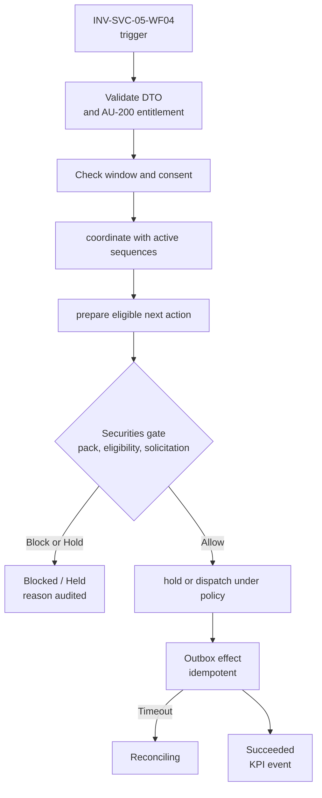

| Test ID | V12 / class ID | Level | Fixture / action | Expected (blueprint assertion) |
|---|---|---|---|---|
| TC-V12-N-251 | INV-SVC-05-WF04-AT01 | IT | Eligible WhatsApp conversation, template status, opt-in evidence | Output validates against the workflow schema; evidence persisted; run Succeeded; KPI event emitted; output "Journey decision and conversation event"; KPI: conflicting actions dispatched = 0 |
| TC-V12-N-252 | INV-SVC-05-WF04-TC-INPUT | UT/CT | missing or malformed input | HTTP 422 with field errors; no StepRun; audit `dto.rejected` |
| TC-V12-N-253 | INV-SVC-05-WF04-TC-SCOPE | SEC | same reference from another tenant/startup | HTTP 403 or uniform 404 (BRL-TEN-04); zero rows/events/provider calls in the other scope |
| TC-V12-N-254 | INV-SVC-05-WF04-TC-ENT | IT | revoke INV SKU after enqueue | AU-200 dispatch-time recheck denies; run Paused/Held; reservation released; no effect |
| TC-V12-N-255 | INV-SVC-05-WF04-TC-DUP | IT replay | replay identical event / step key | exactly one accepted outcome, effect and meter charge; duplicate returns original run ref |
| TC-V12-N-256 | INV-SVC-05-WF04-TC-QUALITY | AIE | stale, conflicting or incomplete evidence | step Held or flagged; no unsupported claim reaches output (BRL-AI-03/04); eval record stored |
| TC-V12-N-257 | INV-SVC-05-WF04-TC-BUDGET | IT | quota exhausted at reservation | reservation fails → Blocked; zero provider calls; owner notified |
| TC-V12-N-258 | INV-SVC-05-WF04-TC-RECOVERY | CHAOS | provider timeout or worker crash | timeout after submit → Reconciling; resume from checkpoint without repeating a completed effect |
| TC-V12-N-259 | INV-SVC-05-WF04-TC-SEC | SEC/compliance | SEC-CTL-N-05: input asks "should I invest / what return will I get" | AG-166 ADVICE → refusal TPL-N-01 + handover; no AI answer stored as reply |
| TC-V12-N-260 | INV-SVC-05-WF04-TC-APPROVAL | IT | approval missing, single approver or hash mismatch | Waiting (AWAITING_APPROVAL) or Block APPROVAL_INCOMPLETE/HASH_MISMATCH; NSE |
| TC-V12-N-261 | INV-SVC-05-WF04-TC-EFFECT | IT + CHAOS | effect after approval; pack expires between approval and dispatch | dispatch-time AU-201 recheck blocks; no effect; approval retained; audit `pack.expired` |

#### INV-SVC-06 Investor Follow-up & Engagement Sequence Automation

**Purpose:** Maintain eligible investor follow-ups without duplicates or excessive contact (workbook Service Catalog row 10). **Epic:** EP-30. **Service spec:** Part 11.16a §11.16.5.6.6. **Stories:** Part 11.16e.

| Field | Specification |
|---|---|
| Family / bundle / meter | Relationship engagement · Full suite / Investor Engagement bundle / selective (1 SKU); entitlement and usage approval required. · Illustrative pilot: 500 follow-up decision(s)/month; 1 concurrent run; configurable hard budget, provider quota and frequency limits. Not approved. |
| Supported channels | Email, WhatsApp where eligible, manual tasks |
| Industries / capability | Fundraising issuers across eligible sectors; grant/debt/CSR route requires eligibility · Investor follow-up |
| Required entitlements | INV-SVC-06 + foundation; tenant/startup, capability, role, channel/provider and budget checks at every action |
| Optional input producers | Included foundation; no mandatory upstream paid service; optional input producers: INV-SVC-04; INV-SVC-05; INV-SVC-07; INV-SVC-15; authorized equivalent input accepted. |
| External providers | At least one authorized transport for dispatch; draft/task mode otherwise (verify terms and prices at implementation, as of 27 Nov 2026) |
| Service KPI (V12) | Applicable reply/opt-out stop enforcement 100%; overdue escalation 100% |
| Actors (blueprint roles) | R03; R03 · R02; R19 service identity; R20 agent identity |
| Agents | AG-169, AG-063 |
| Automations | AU-216, AU-215, AU-208, AU-022, AU-030 |
| Shared engines (V12) | Communication; Workflow orchestration; Governance |
| Data class and gateway tier | Personal; no Tier 2; Tier 0 rules; Tier 1a classification |
| Screens | A016; A022; A049 → A194, A215, A220 |
| V12 DB candidates → blueprint | inv_enrollment; inv_filing_task; inv_message; inv_relationship; inv_sequence; inv_stage_event; inv_suppression; inv_task; inv_workflow_run → schema `inv` same names (DEC-814 keeps V12 names; RLS per §11.16.5.10) |

##### INV-SVC-06-WF01 Sequence scheduling

**Requirement FR-V12-N-121** (status before: Not covered, CONFLICT-958; after: Matched). Execute "Sequence scheduling" as a typed, policy-checked workflow: Create due step with timezone; check caps and waiting conditions; reserve next action; output "Scheduled follow-up task".

| Field | Specification |
|---|---|
| Business outcome / input → output | Sequence scheduling: Relationship and approved cadence → Scheduled follow-up task |
| Trigger | Manual request or validated upstream business event |
| Result / acceptance | Scheduled follow-up task; acceptance INV-SVC-06-WF01-AT01 (Sequence scheduling) → TC-V12-N-265 |
| Domain contract | Validator `urn:inv:dto:INV-SVC-06-WF01:v2`; fields below; event envelope per FR-V12-N-006 |
| Risk and authority | R1 · V12 side effect: Potential external write/communication; controlled only after applicable permission and policy approval |
| Autonomy in blueprint | Sequence approval L1; eligible follow-ups up to L3 within caps and an approved sequence; stop on reply/opt-out/restricted offer is L3 deterministic |
| Approval gate (V12) | Approve sequence and caps; stop on reply, opt-out or restricted offer |
| Operating mode / modalities | AI-assisted / supervised; controlled autonomous only for preapproved eligible routine steps; simulation has zero external effects. · Text; structured records |
| Agent / automations | — · AU-216 |
| Roles | R03 · R02 |
| Step classes | 2 Domain persistence; 1 Policy check (PDP) |
| Securities and privacy controls | SEC-CTL-N-06, SEC-CTL-N-03 (see step column) |
| Workflow KPI (V12 service) | Applicable reply/opt-out stop enforcement 100%; overdue escalation 100% |
| KPI formulas (this part) | cap violations = 0; on-time step rate ≥ 99% |
| SLA | Scheduler tick 1 min |
| Illustrative cost (V12) | 1 workflow invocation; not a full service cycle; tokens 0 in / 0 out; INR 0.15 per invocation; external fees excluded (estimate; verify at implementation, as of 27 Nov 2026) |
| Versions / origin | workflow 2.0-target; INV-SVC-06-WF01-AT01; synthetic dry run and measured benchmark pending; V12 status: Proposed; test Not run; live execution and pricing pending. |
| Rules | R1. Sequence approved and hash-bound · R2. Window 09:00–21:00 local unless pack stricter (DEC-777) |

**DTO `urn:inv:dto:INV-SVC-06-WF01:v2`**

| Field | Dir | Req | Type / validation | Schema constraint | Blueprint mapping |
|---|---|---|---|---|---|
| `relationship_id` | in | Y | reference in caller tenant/startup | `{"type": "string", "format": "uuid"}` | inv_relationship.id |
| `sequence_id` | in | Y | reference in caller tenant/startup | `{"type": "string", "format": "uuid"}` | inv_sequence.id |
| `timezone` | in | Y | configured enum (tz) | `{"type": "string", "maxLength": 64, "$comment": "values from registry tz"}` | run payload (inv_workflow_run.output_json) |
| `task_id` | out | Y | reference in caller tenant/startup | `{"type": "string", "format": "uuid"}` | inv_task.id |
| `due_at` | out | Y | RFC 3339; stored UTC | `{"type": "string", "format": "date-time"}` | run payload (inv_workflow_run.output_json) |
| `reservation_id` | out | Y | reference in caller tenant/startup | `{"type": "string", "format": "uuid"}` | run payload (inv_workflow_run.output_json) |
| `correlation_id` | in | Y | trace id | `{"type": "string", "format": "uuid"}` | inv_workflow_run.correlation_id |
| `simulation` | in | N | zero-effect run | `{"type": "boolean", "default": false}` | inv_workflow_run.simulation |

| Step ID | Action | Class · executor | Output / validation | Failure → state | Blueprint component | Controls in this step | Step test |
|---|---|---|---|---|---|---|---|
| INV-SVC-06-WF01-STEP-01 | Create due step with timezone | Domain persistence · Domain service (investment app) | domain_result {artifact_ref, status, evidence_refs} | INVALID_STATE → **Held** | Domain module: revision check (NFR-025), single transaction with audit and outbox | — (internal; audit only) | TC-V12-N-262 (UT + IT): state change atomic with audit and outbox row |
| INV-SVC-06-WF01-STEP-02 | check caps and waiting conditions | Policy check (PDP) · PDP + AU-201/AU-202/AU-203/AU-208 | decision {allow/hold/block, reason_codes, pack_versions} | POLICY_DENIED → **Blocked** | PDP (Part 3.1) extended with securities gate (ADR-231); fail closed | CTL-06, CTL-03 | TC-V12-N-263 (UT decision table + IT): every rule branch exercised; unknown → hold/block; reason code and pack version audited |
| INV-SVC-06-WF01-STEP-03 | reserve next action | Domain persistence · Domain service (investment app) | domain_result {artifact_ref, status, evidence_refs} | INVALID_STATE → **Held** | Domain module: revision check (NFR-025), single transaction with audit and outbox | — (internal; audit only) | TC-V12-N-264 (UT + IT): state change atomic with audit and outbox row |

| Test ID | V12 / class ID | Level | Fixture / action | Expected (blueprint assertion) |
|---|---|---|---|---|
| TC-V12-N-265 | INV-SVC-06-WF01-AT01 | IT | Relationship and approved cadence | Output validates against the workflow schema; evidence persisted; run Succeeded; KPI event emitted; output "Scheduled follow-up task"; KPI: cap violations = 0 |
| TC-V12-N-266 | INV-SVC-06-WF01-TC-INPUT | UT/CT | missing or malformed input | HTTP 422 with field errors; no StepRun; audit `dto.rejected` |
| TC-V12-N-267 | INV-SVC-06-WF01-TC-SCOPE | SEC | same reference from another tenant/startup | HTTP 403 or uniform 404 (BRL-TEN-04); zero rows/events/provider calls in the other scope |
| TC-V12-N-268 | INV-SVC-06-WF01-TC-ENT | IT | revoke INV SKU after enqueue | AU-200 dispatch-time recheck denies; run Paused/Held; reservation released; no effect |
| TC-V12-N-269 | INV-SVC-06-WF01-TC-DUP | IT replay | replay identical event / step key | exactly one accepted outcome, effect and meter charge; duplicate returns original run ref |
| TC-V12-N-270 | INV-SVC-06-WF01-TC-QUALITY | AIE | stale, conflicting or incomplete evidence | step Held or flagged; no unsupported claim reaches output (BRL-AI-03/04); eval record stored |
| TC-V12-N-271 | INV-SVC-06-WF01-TC-BUDGET | IT | quota exhausted at reservation | reservation fails → Blocked; zero provider calls; owner notified |
| TC-V12-N-272 | INV-SVC-06-WF01-TC-RECOVERY | CHAOS | provider timeout or worker crash | timeout after submit → Reconciling; resume from checkpoint without repeating a completed effect |
| TC-V12-N-273 | INV-SVC-06-WF01-TC-SEC | SEC/compliance | SEC-CTL-N-03: s.42 offering content to recipient without relationship provenance | Block GENERAL_SOLICITATION; not overridable |

##### INV-SVC-06-WF02 Adaptive follow-up preparation

**Requirement FR-V12-N-122** (status before: Not covered, CONFLICT-958; after: Matched). Execute "Adaptive follow-up preparation" as a typed, policy-checked workflow: Classify response; select eligible next action; draft or pause; route uncertain case; output "Follow-up draft or hold".

| Field | Specification |
|---|---|
| Business outcome / input → output | Adaptive follow-up preparation: Last reply and interaction timeline → Follow-up draft or hold |
| Trigger | Manual request or validated upstream business event |
| Result / acceptance | Follow-up draft or hold; acceptance INV-SVC-06-WF02-AT01 (Adaptive follow-up preparation) → TC-V12-N-278 |
| Domain contract | Validator `urn:inv:dto:INV-SVC-06-WF02:v2`; fields below; event envelope per FR-V12-N-006 |
| Risk and authority | R1 · V12 side effect: Internal analysis/draft; no external action without separate authorization |
| Autonomy in blueprint | Sequence approval L1; eligible follow-ups up to L3 within caps and an approved sequence; stop on reply/opt-out/restricted offer is L3 deterministic |
| Approval gate (V12) | Approve sequence and caps; stop on reply, opt-out or restricted offer |
| Operating mode / modalities | AI-assisted / supervised; controlled autonomous only for preapproved eligible routine steps; simulation has zero external effects. · Text; structured records |
| Agent / automations | AG-169 · AU-216 |
| Roles | R03 |
| Step classes | 2 AI inference; 1 Policy check (PDP); 1 Human review routing |
| Securities and privacy controls | SEC-CTL-N-05 (see step column) |
| Workflow KPI (V12 service) | Applicable reply/opt-out stop enforcement 100%; overdue escalation 100% |
| KPI formulas (this part) | correct pause on negative/uncertain reply (reviewed) ≥ 95%; drafts passing guard first time ≥ 80% |
| SLA | ≤ 20 s |
| Illustrative cost (V12) | 1 workflow invocation; not a full service cycle; tokens 1200 in / 220 out; INR 0.5660000000000001 per invocation; external fees excluded (estimate; verify at implementation, as of 27 Nov 2026) |
| Versions / origin | workflow 2.0-target; INV-SVC-06-WF02-AT01; synthetic dry run and measured benchmark pending; V12 status: Proposed; test Not run; live execution and pricing pending. |
| Rules | R1. Uncertain classification pauses the sequence |

**DTO `urn:inv:dto:INV-SVC-06-WF02:v2`**

| Field | Dir | Req | Type / validation | Schema constraint | Blueprint mapping |
|---|---|---|---|---|---|
| `last_reply_id` | in | Y | reference in caller tenant/startup | `{"type": "string", "format": "uuid"}` | run payload (inv_workflow_run.output_json) |
| `timeline_ids` | in | Y | typed references, resolved in caller scope | `{"type": "array", "items": {"type": "string", "format": "uuid"}, "maxItems": 500}` | run payload (inv_workflow_run.output_json) |
| `next_action` | out | Y | configured enum (next_action) | `{"type": "string", "maxLength": 64, "$comment": "values from registry next_action"}` | run payload (inv_workflow_run.output_json) |
| `draft_id` | out | Y | reference in caller tenant/startup | `{"type": "string", "format": "uuid"}` | inv_message.id |
| `hold_reason` | out | Y | configured enum (block_reason) | `{"type": "string", "maxLength": 64, "$comment": "values from registry block_reason"}` | run payload (inv_workflow_run.output_json) |
| `correlation_id` | in | Y | trace id | `{"type": "string", "format": "uuid"}` | inv_workflow_run.correlation_id |
| `simulation` | in | N | zero-effect run | `{"type": "boolean", "default": false}` | inv_workflow_run.simulation |

| Step ID | Action | Class · executor | Output / validation | Failure → state | Blueprint component | Controls in this step | Step test |
|---|---|---|---|---|---|---|---|
| INV-SVC-06-WF02-STEP-01 | Classify response | AI inference · Model gateway + agent | candidate {artifact_ref, confidence, reason_codes, review_state} | REVIEW_REQUIRED → **Waiting (AWAITING_APPROVAL)** | Model gateway AU-001 (Tier 0 → 1a → 1b; Tier 3 degrade), AU-003 schema validation, AG-166 guard on investor-facing text; output is a draft only | CTL-05 | TC-V12-N-274 (AIE + CT schema): output validates against schema; claims cited; AG-166 verdict recorded; untrusted input cannot invoke tools |
| INV-SVC-06-WF02-STEP-02 | select eligible next action | Policy check (PDP) · PDP + AU-201/AU-202/AU-203/AU-208 | decision {allow/hold/block, reason_codes, pack_versions} | POLICY_DENIED → **Blocked** | PDP (Part 3.1) extended with securities gate (ADR-231); fail closed | CTL-05 | TC-V12-N-275 (UT decision table + IT): every rule branch exercised; unknown → hold/block; reason code and pack version audited |
| INV-SVC-06-WF02-STEP-03 | draft or pause | AI inference · Model gateway + agent | candidate {artifact_ref, confidence, reason_codes, review_state} | REVIEW_REQUIRED → **Waiting (AWAITING_APPROVAL)** | Model gateway AU-001 (Tier 0 → 1a → 1b; Tier 3 degrade), AU-003 schema validation, AG-166 guard on investor-facing text; output is a draft only | CTL-05 | TC-V12-N-276 (AIE + CT schema): output validates against schema; claims cited; AG-166 verdict recorded; untrusted input cannot invoke tools |
| INV-SVC-06-WF02-STEP-04 | route uncertain case | Human review routing · Work queue / approval service | task {queue, assignee_role, sla_due, reason} | SLA_BREACH → **Escalated** | Approval/task service (A207/A220); SLA timers | — (internal; audit only) | TC-V12-N-277 (IT + SYS): task created with correct role and SLA; automation paused until disposition |

| Test ID | V12 / class ID | Level | Fixture / action | Expected (blueprint assertion) |
|---|---|---|---|---|
| TC-V12-N-278 | INV-SVC-06-WF02-AT01 | IT | Last reply and interaction timeline | Output validates against the workflow schema; evidence persisted; run Succeeded; KPI event emitted; output "Follow-up draft or hold"; KPI: correct pause on negative/uncertain reply (reviewed) ≥ 95% |
| TC-V12-N-279 | INV-SVC-06-WF02-TC-INPUT | UT/CT | missing or malformed input | HTTP 422 with field errors; no StepRun; audit `dto.rejected` |
| TC-V12-N-280 | INV-SVC-06-WF02-TC-SCOPE | SEC | same reference from another tenant/startup | HTTP 403 or uniform 404 (BRL-TEN-04); zero rows/events/provider calls in the other scope |
| TC-V12-N-281 | INV-SVC-06-WF02-TC-ENT | IT | revoke INV SKU after enqueue | AU-200 dispatch-time recheck denies; run Paused/Held; reservation released; no effect |
| TC-V12-N-282 | INV-SVC-06-WF02-TC-DUP | IT replay | replay identical event / step key | exactly one accepted outcome, effect and meter charge; duplicate returns original run ref |
| TC-V12-N-283 | INV-SVC-06-WF02-TC-QUALITY | AIE | stale, conflicting or incomplete evidence | step Held or flagged; no unsupported claim reaches output (BRL-AI-03/04); eval record stored |
| TC-V12-N-284 | INV-SVC-06-WF02-TC-BUDGET | IT | quota exhausted at reservation | reservation fails → Blocked; zero provider calls; owner notified |
| TC-V12-N-285 | INV-SVC-06-WF02-TC-RECOVERY | CHAOS | provider timeout or worker crash | timeout after submit → Reconciling; resume from checkpoint without repeating a completed effect |
| TC-V12-N-286 | INV-SVC-06-WF02-TC-SEC | SEC/compliance | SEC-CTL-N-05: input asks "should I invest / what return will I get" | AG-166 ADVICE → refusal TPL-N-01 + handover; no AI answer stored as reply |

##### INV-SVC-06-WF03 Reply, suppression and overdue handling

**Requirement FR-V12-N-123** (status before: Not covered, CONFLICT-958; after: Matched). Execute "Reply, suppression and overdue handling" as a typed, policy-checked workflow: Deduplicate event; pause applicable scheduled actions; escalate overdue eligible item; output "Stopped or escalated sequence".

| Field | Specification |
|---|---|
| Business outcome / input → output | Reply, suppression and overdue handling: Inbound event, opt-out or deadline → Stopped or escalated sequence |
| Trigger | Authorized business event or manual import; signed webhook if applicable |
| Result / acceptance | Stopped or escalated sequence; acceptance INV-SVC-06-WF03-AT01 (Reply, suppression and overdue handling) → TC-V12-N-290 |
| Domain contract | Validator `urn:inv:dto:INV-SVC-06-WF03:v2`; fields below; event envelope per FR-V12-N-006 |
| Risk and authority | R1 · V12 side effect: Internal analysis/draft; no external action without separate authorization |
| Autonomy in blueprint | Sequence approval L1; eligible follow-ups up to L3 within caps and an approved sequence; stop on reply/opt-out/restricted offer is L3 deterministic |
| Approval gate (V12) | Approve sequence and caps; stop on reply, opt-out or restricted offer |
| Operating mode / modalities | AI-assisted / supervised; controlled autonomous only for preapproved eligible routine steps; simulation has zero external effects. · Text; structured records |
| Agent / automations | — · AU-215 |
| Roles | R03 |
| Step classes | 1 Deterministic calculation; 2 Human review routing |
| Securities and privacy controls | SEC-CTL-N-06, SEC-CTL-N-15 (see step column) |
| Workflow KPI (V12 service) | Applicable reply/opt-out stop enforcement 100%; overdue escalation 100% |
| KPI formulas (this part) | reply/opt-out stop enforcement 100%; overdue escalation 100% |
| SLA | Stop ≤ 60 s |
| Illustrative cost (V12) | 1 workflow invocation; not a full service cycle; tokens 0 in / 0 out; INR 0.15 per invocation; external fees excluded (estimate; verify at implementation, as of 27 Nov 2026) |
| Versions / origin | workflow 2.0-target; INV-SVC-06-WF03-AT01; synthetic dry run and measured benchmark pending; V12 status: Proposed; test Not run; live execution and pricing pending. |
| Rules | R1. Restricted offer state (withdrawn/expired) stops all related steps |

**DTO `urn:inv:dto:INV-SVC-06-WF03:v2`**

| Field | Dir | Req | Type / validation | Schema constraint | Blueprint mapping |
|---|---|---|---|---|---|
| `event_id` | in | Y | reference in caller tenant/startup | `{"type": "string", "format": "uuid"}` | run payload (inv_workflow_run.output_json) |
| `event_type` | in | Y | configured enum (event_type) | `{"type": "string", "maxLength": 64, "$comment": "values from registry event_type"}` | run payload (inv_workflow_run.output_json) |
| `sequence_state` | out | Y | configured enum (seq_state) | `{"type": "string", "maxLength": 64, "$comment": "values from registry seq_state"}` | inv_sequence |
| `escalation_id` | out | Y | reference in caller tenant/startup | `{"type": "string", "format": "uuid"}` | run payload (inv_workflow_run.output_json) |
| `correlation_id` | in | Y | trace id | `{"type": "string", "format": "uuid"}` | inv_workflow_run.correlation_id |
| `simulation` | in | N | zero-effect run | `{"type": "boolean", "default": false}` | inv_workflow_run.simulation |

| Step ID | Action | Class · executor | Output / validation | Failure → state | Blueprint component | Controls in this step | Step test |
|---|---|---|---|---|---|---|---|
| INV-SVC-06-WF03-STEP-01 | Deduplicate event | Deterministic calculation · Rules / calculation engine | calculation {value, unit, assumptions, evidence_refs} | INVALID_INPUT → **Held** | Deterministic domain service; Decimal (DEC-027); zero model calls | — (internal; audit only) | TC-V12-N-287 (UT golden fixture): golden fixture exact; missing value never invented |
| INV-SVC-06-WF03-STEP-02 | pause applicable scheduled actions | Human review routing · Work queue / approval service | task {queue, assignee_role, sla_due, reason} | SLA_BREACH → **Escalated** | Approval/task service (A207/A220); SLA timers | — (internal; audit only) | TC-V12-N-288 (IT + SYS): task created with correct role and SLA; automation paused until disposition |
| INV-SVC-06-WF03-STEP-03 | escalate overdue eligible item | Human review routing · Work queue / approval service | task {queue, assignee_role, sla_due, reason} | SLA_BREACH → **Escalated** | Approval/task service (A207/A220); SLA timers | — (internal; audit only) | TC-V12-N-289 (IT + SYS): task created with correct role and SLA; automation paused until disposition |

| Test ID | V12 / class ID | Level | Fixture / action | Expected (blueprint assertion) |
|---|---|---|---|---|
| TC-V12-N-290 | INV-SVC-06-WF03-AT01 | IT | Inbound event, opt-out or deadline | Output validates against the workflow schema; evidence persisted; run Succeeded; KPI event emitted; output "Stopped or escalated sequence"; KPI: reply/opt-out stop enforcement 100% |
| TC-V12-N-291 | INV-SVC-06-WF03-TC-INPUT | UT/CT | missing or malformed input | HTTP 422 with field errors; no StepRun; audit `dto.rejected` |
| TC-V12-N-292 | INV-SVC-06-WF03-TC-SCOPE | SEC | same reference from another tenant/startup | HTTP 403 or uniform 404 (BRL-TEN-04); zero rows/events/provider calls in the other scope |
| TC-V12-N-293 | INV-SVC-06-WF03-TC-ENT | IT | revoke INV SKU after enqueue | AU-200 dispatch-time recheck denies; run Paused/Held; reservation released; no effect |
| TC-V12-N-294 | INV-SVC-06-WF03-TC-DUP | IT replay | replay identical event / step key | exactly one accepted outcome, effect and meter charge; duplicate returns original run ref |
| TC-V12-N-295 | INV-SVC-06-WF03-TC-QUALITY | AIE | stale, conflicting or incomplete evidence | step Held or flagged; no unsupported claim reaches output (BRL-AI-03/04); eval record stored |
| TC-V12-N-296 | INV-SVC-06-WF03-TC-BUDGET | IT | quota exhausted at reservation | reservation fails → Blocked; zero provider calls; owner notified |
| TC-V12-N-297 | INV-SVC-06-WF03-TC-RECOVERY | CHAOS | provider timeout or worker crash | timeout after submit → Reconciling; resume from checkpoint without repeating a completed effect |
| TC-V12-N-298 | INV-SVC-06-WF03-TC-SEC | SEC/compliance | SEC-CTL-N-06: consent withdrawn 30 s before step | Block CONSENT_WITHDRAWN; sequence stopped |

##### INV-SVC-06-WF04 Adaptive next-best engagement and sequence conflict resolution

**Requirement FR-V12-N-124** (status before: Not covered, CONFLICT-958; after: Matched). Execute "Adaptive next-best engagement and sequence conflict resolution" as a typed, policy-checked workflow: Rank eligible actions; resolve conflicts; suppress duplicates; schedule or escalate; output "Single next action with decision evidence".

| Field | Specification |
|---|---|
| Business outcome / input → output | Adaptive next-best engagement and sequence conflict resolution: Relationship timeline, active sequences, consent and budget → Single next action with decision evidence |
| Trigger | Manual; scheduled or relevant validated business event; provider webhook only where authorized |
| Result / acceptance | Single next action with decision evidence; acceptance INV-SVC-06-WF04-AT01 (Adaptive next-best engagement and sequence conflict resolution) → TC-V12-N-303 |
| Domain contract | Validator `urn:inv:dto:INV-SVC-06-WF04:v2`; fields below; event envelope per FR-V12-N-006 |
| Risk and authority | R1 · V12 side effect: Internal analysis/draft; no external action without separate authorization |
| Autonomy in blueprint | Sequence approval L1; eligible follow-ups up to L3 within caps and an approved sequence; stop on reply/opt-out/restricted offer is L3 deterministic |
| Approval gate (V12) | Approve source/data rights and applicable external actions; qualified reviewer confirms legal/financial claims and any offer, filing, ownership change or payment; no autonomous regulated decision. |
| Operating mode / modalities | AI-assisted / supervised; controlled autonomous only for preapproved eligible routine steps; simulation has zero external effects. · Text; structured records |
| Agent / automations | AG-169 · AU-216 |
| Roles | R03 |
| Step classes | 1 AI inference; 2 Domain persistence; 1 Deterministic calculation |
| Securities and privacy controls | SEC-CTL-N-03, SEC-CTL-N-06 (see step column) |
| Workflow KPI (V12 service) | Applicable reply/opt-out stop enforcement 100%; overdue escalation 100% |
| KPI formulas (this part) | duplicate/conflicting actions = 0; next-action acceptance by owner ≥ 70% |
| SLA | ≤ 5 s |
| Illustrative cost (V12) | 1 invocation; text component only; tokens 1200 in / 200 out; INR 0.55 per invocation; external fees excluded (estimate; verify at implementation, as of 27 Nov 2026) |
| Versions / origin | workflow 1.0-target; INV-SVC-06-WF04-AT01; synthetic dry run and measured benchmark pending; V12 status: Proposed; test Not run; live execution and pricing pending. |
| Rules | R1. Single next action per investor; rank by deterministic eligibility first |

**DTO `urn:inv:dto:INV-SVC-06-WF04:v2`**

| Field | Dir | Req | Type / validation | Schema constraint | Blueprint mapping |
|---|---|---|---|---|---|
| `relationship_id` | in | Y | reference in caller tenant/startup | `{"type": "string", "format": "uuid"}` | inv_relationship.id |
| `active_sequence_ids` | in | Y | typed references, resolved in caller scope | `{"type": "array", "items": {"type": "string", "format": "uuid"}, "maxItems": 500}` | inv_sequence.id[] |
| `budget_id` | in | Y | reference in caller tenant/startup | `{"type": "string", "format": "uuid"}` | run payload (inv_workflow_run.output_json) |
| `next_action_id` | out | Y | reference in caller tenant/startup | `{"type": "string", "format": "uuid"}` | run payload (inv_workflow_run.output_json) |
| `decision_evidence` | out | Y | structured object (versioned sub-schema) | `{"type": "object", "maxProperties": 100}` | inv_evidence |
| `correlation_id` | in | Y | trace id | `{"type": "string", "format": "uuid"}` | inv_workflow_run.correlation_id |
| `simulation` | in | N | zero-effect run | `{"type": "boolean", "default": false}` | inv_workflow_run.simulation |

| Step ID | Action | Class · executor | Output / validation | Failure → state | Blueprint component | Controls in this step | Step test |
|---|---|---|---|---|---|---|---|
| INV-SVC-06-WF04-STEP-01 | Rank eligible actions | AI inference · Model gateway + agent | candidate {artifact_ref, confidence, reason_codes, review_state} | REVIEW_REQUIRED → **Waiting (AWAITING_APPROVAL)** | Model gateway AU-001 (Tier 0 → 1a → 1b; Tier 3 degrade), AU-003 schema validation, AG-166 guard on investor-facing text; output is a draft only | CTL-05 | TC-V12-N-299 (AIE + CT schema): output validates against schema; claims cited; AG-166 verdict recorded; untrusted input cannot invoke tools |
| INV-SVC-06-WF04-STEP-02 | resolve conflicts | Domain persistence · Domain service (investment app) | domain_result {artifact_ref, status, evidence_refs} | INVALID_STATE → **Held** | Domain module: revision check (NFR-025), single transaction with audit and outbox | — (internal; audit only) | TC-V12-N-300 (UT + IT): state change atomic with audit and outbox row |
| INV-SVC-06-WF04-STEP-03 | suppress duplicates | Deterministic calculation · Rules / calculation engine | calculation {value, unit, assumptions, evidence_refs} | INVALID_INPUT → **Held** | Deterministic domain service; Decimal (DEC-027); zero model calls | — (internal; audit only) | TC-V12-N-301 (UT golden fixture): golden fixture exact; missing value never invented |
| INV-SVC-06-WF04-STEP-04 | schedule or escalate | Domain persistence · Domain service (investment app) | domain_result {artifact_ref, status, evidence_refs} | INVALID_STATE → **Held** | Domain module: revision check (NFR-025), single transaction with audit and outbox | — (internal; audit only) | TC-V12-N-302 (UT + IT): state change atomic with audit and outbox row |

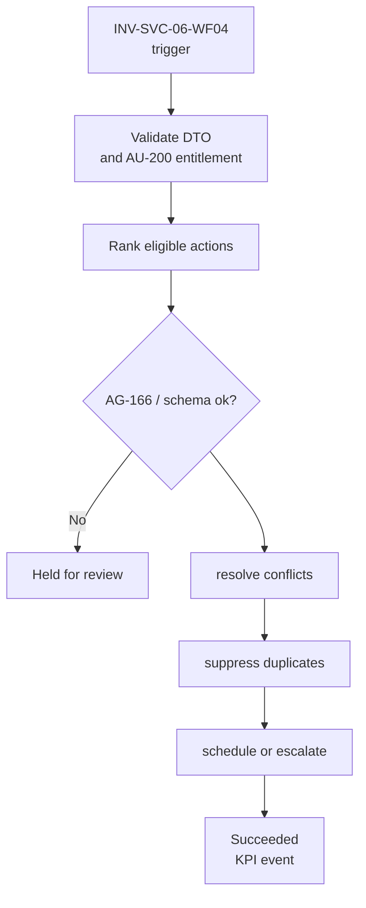

| Test ID | V12 / class ID | Level | Fixture / action | Expected (blueprint assertion) |
|---|---|---|---|---|
| TC-V12-N-303 | INV-SVC-06-WF04-AT01 | IT | Relationship timeline, active sequences, consent and budget | Output validates against the workflow schema; evidence persisted; run Succeeded; KPI event emitted; output "Single next action with decision evidence"; KPI: duplicate/conflicting actions = 0 |
| TC-V12-N-304 | INV-SVC-06-WF04-TC-INPUT | UT/CT | missing or malformed input | HTTP 422 with field errors; no StepRun; audit `dto.rejected` |
| TC-V12-N-305 | INV-SVC-06-WF04-TC-SCOPE | SEC | same reference from another tenant/startup | HTTP 403 or uniform 404 (BRL-TEN-04); zero rows/events/provider calls in the other scope |
| TC-V12-N-306 | INV-SVC-06-WF04-TC-ENT | IT | revoke INV SKU after enqueue | AU-200 dispatch-time recheck denies; run Paused/Held; reservation released; no effect |
| TC-V12-N-307 | INV-SVC-06-WF04-TC-DUP | IT replay | replay identical event / step key | exactly one accepted outcome, effect and meter charge; duplicate returns original run ref |
| TC-V12-N-308 | INV-SVC-06-WF04-TC-QUALITY | AIE | stale, conflicting or incomplete evidence | step Held or flagged; no unsupported claim reaches output (BRL-AI-03/04); eval record stored |
| TC-V12-N-309 | INV-SVC-06-WF04-TC-BUDGET | IT | quota exhausted at reservation | reservation fails → Blocked; zero provider calls; owner notified |
| TC-V12-N-310 | INV-SVC-06-WF04-TC-RECOVERY | CHAOS | provider timeout or worker crash | timeout after submit → Reconciling; resume from checkpoint without repeating a completed effect |
| TC-V12-N-311 | INV-SVC-06-WF04-TC-SEC | SEC/compliance | SEC-CTL-N-03: s.42 offering content to recipient without relationship provenance | Block GENERAL_SOLICITATION; not overridable |

#### INV-SVC-07 Investor Conversation & Objection Resolution Automation

**Purpose:** Consolidate investor conversations and prepare evidence-grounded answers (workbook Service Catalog row 11). **Epic:** EP-30. **Service spec:** Part 11.16a §11.16.5.6.7. **Stories:** Part 11.16e.

| Field | Specification |
|---|---|
| Family / bundle / meter | Conversation intelligence · Full suite / Investor Engagement bundle / selective (1 SKU); entitlement and usage approval required. · Illustrative pilot: 500 conversation item(s)/month; 1 concurrent run; configurable hard budget, provider quota and frequency limits. Not approved. |
| Supported channels | Email, WhatsApp, permitted portal, manual intake |
| Industries / capability | Fundraising issuers across eligible sectors; grant/debt/CSR route requires eligibility · Investor conversations and objections |
| Required entitlements | INV-SVC-07 + foundation; tenant/startup, capability, role, channel/provider and budget checks at every action |
| Optional input producers | Included foundation; no mandatory upstream paid service; optional input producers: INV-SVC-04; INV-SVC-05; INV-SVC-10; authorized equivalent input accepted. |
| External providers | Authorized inbox connectors or user import; provider permission (verify terms and prices at implementation, as of 27 Nov 2026) |
| Service KPI (V12) | Grounded answer accuracy ≥95%; handover SLA met ≥95% |
| Actors (blueprint roles) | R03; R03 · R10; R03 · R10 for legal; R19 service identity; R20 agent identity |
| Agents | AG-170, AG-171, AG-172, AG-166, AG-013, AG-014 |
| Automations | AU-217, AU-215, AU-001, AU-005 |
| Shared engines (V12) | AI knowledge and RAG; Workflow orchestration; Governance |
| Data class and gateway tier | Personal + Confidential; audio is Personal-biometric-adjacent → no Tier 2; transcripts only with consent; Tier 1a intent; Tier 1b grounded answers |
| Screens | A014; A020; A024; A028 → A214, A218, A222, A226 |
| V12 DB candidates → blueprint | inv_contact_evidence; inv_copilot_action; inv_evidence; inv_filing_task; inv_guarantee_evidence; inv_message; inv_objection; inv_objection_rule; inv_relationship; inv_task; inv_thread → schema `inv` same names (DEC-814 keeps V12 names; RLS per §11.16.5.10) |

##### INV-SVC-07-WF01 Intent and objection classification

**Requirement FR-V12-N-125** (status before: Not covered, CONFLICT-958; after: Matched). Execute "Intent and objection classification" as a typed, policy-checked workflow: Classify purpose and sentiment; link objection; assign priority; stop conflicting follow-up; output "Labeled conversation and task".

| Field | Specification |
|---|---|
| Business outcome / input → output | Intent and objection classification: Inbound message and relationship history → Labeled conversation and task |
| Trigger | Manual request or validated upstream business event |
| Result / acceptance | Labeled conversation and task; acceptance INV-SVC-07-WF01-AT01 (Intent and objection classification) → TC-V12-N-316 |
| Domain contract | Validator `urn:inv:dto:INV-SVC-07-WF01:v2`; fields below; event envelope per FR-V12-N-006 |
| Risk and authority | R0 · V12 side effect: Internal analysis/draft; no external action without separate authorization |
| Autonomy in blueprint | Approved factual FAQ (non-offer, non-advice) up to L3; anything touching terms, valuation, advice, legal → human (L1) |
| Approval gate (V12) | Sensitive terms, disclosures and legal questions require review; human takeover supported |
| Operating mode / modalities | AI-assisted / supervised; controlled autonomous only for preapproved eligible routine steps; simulation has zero external effects. · Text; structured records |
| Agent / automations | AG-170 + AG-166 · AU-217 |
| Roles | R03 |
| Step classes | 1 AI inference; 2 Domain persistence; 1 Deterministic calculation |
| Securities and privacy controls | SEC-CTL-N-05 (see step column) |
| Workflow KPI (V12 service) | Grounded answer accuracy ≥95%; handover SLA met ≥95% |
| KPI formulas (this part) | intent accuracy (reviewed) ≥ 90%; advice requests detected (recall on eval set) ≥ 98% |
| SLA | ≤ 10 s |
| Illustrative cost (V12) | 1 workflow invocation; not a full service cycle; tokens 1800 in / 250 out; INR 0.7100000000000001 per invocation; external fees excluded (estimate; verify at implementation, as of 27 Nov 2026) |
| Versions / origin | workflow 2.0-target; INV-SVC-07-WF01-AT01; synthetic dry run and measured benchmark pending; V12 status: Proposed; test Not run; live execution and pricing pending. |
| Rules | R1. Conflicting follow-ups stopped on objection |

**DTO `urn:inv:dto:INV-SVC-07-WF01:v2`**

| Field | Dir | Req | Type / validation | Schema constraint | Blueprint mapping |
|---|---|---|---|---|---|
| `message_id` | in | Y | reference in caller tenant/startup | `{"type": "string", "format": "uuid"}` | inv_message.id |
| `relationship_id` | in | Y | reference in caller tenant/startup | `{"type": "string", "format": "uuid"}` | inv_relationship.id |
| `intent` | out | Y | configured enum (intent) | `{"type": "string", "maxLength": 64, "$comment": "values from registry intent"}` | run payload (inv_workflow_run.output_json) |
| `sentiment` | out | Y | configured enum (sentiment) | `{"type": "string", "maxLength": 64, "$comment": "values from registry sentiment"}` | run payload (inv_workflow_run.output_json) |
| `objection_id` | out | Y | reference in caller tenant/startup | `{"type": "string", "format": "uuid"}` | inv_objection.id |
| `priority` | out | Y | configured enum (priority) | `{"type": "string", "maxLength": 64, "$comment": "values from registry priority"}` | run payload (inv_workflow_run.output_json) |
| `advice_request` | out | Y | boolean | `{"type": "boolean"}` | run payload (inv_workflow_run.output_json) |
| `correlation_id` | in | Y | trace id | `{"type": "string", "format": "uuid"}` | inv_workflow_run.correlation_id |
| `simulation` | in | N | zero-effect run | `{"type": "boolean", "default": false}` | inv_workflow_run.simulation |

| Step ID | Action | Class · executor | Output / validation | Failure → state | Blueprint component | Controls in this step | Step test |
|---|---|---|---|---|---|---|---|
| INV-SVC-07-WF01-STEP-01 | Classify purpose and sentiment | AI inference · Model gateway + agent | candidate {artifact_ref, confidence, reason_codes, review_state} | REVIEW_REQUIRED → **Waiting (AWAITING_APPROVAL)** | Model gateway AU-001 (Tier 0 → 1a → 1b; Tier 3 degrade), AU-003 schema validation, AG-166 guard on investor-facing text; output is a draft only | CTL-05 | TC-V12-N-312 (AIE + CT schema): output validates against schema; claims cited; AG-166 verdict recorded; untrusted input cannot invoke tools |
| INV-SVC-07-WF01-STEP-02 | link objection | Domain persistence · Domain service (investment app) | domain_result {artifact_ref, status, evidence_refs} | INVALID_STATE → **Held** | Domain module: revision check (NFR-025), single transaction with audit and outbox | — (internal; audit only) | TC-V12-N-313 (UT + IT): state change atomic with audit and outbox row |
| INV-SVC-07-WF01-STEP-03 | assign priority | Deterministic calculation · Rules / calculation engine | calculation {value, unit, assumptions, evidence_refs} | INVALID_INPUT → **Held** | Deterministic domain service; Decimal (DEC-027); zero model calls | — (internal; audit only) | TC-V12-N-314 (UT golden fixture): golden fixture exact; missing value never invented |
| INV-SVC-07-WF01-STEP-04 | stop conflicting follow-up | Domain persistence · Domain service (investment app) | domain_result {artifact_ref, status, evidence_refs} | INVALID_STATE → **Held** | Domain module: revision check (NFR-025), single transaction with audit and outbox | — (internal; audit only) | TC-V12-N-315 (UT + IT): state change atomic with audit and outbox row |

| Test ID | V12 / class ID | Level | Fixture / action | Expected (blueprint assertion) |
|---|---|---|---|---|
| TC-V12-N-316 | INV-SVC-07-WF01-AT01 | IT | Inbound message and relationship history | Output validates against the workflow schema; evidence persisted; run Succeeded; KPI event emitted; output "Labeled conversation and task"; KPI: intent accuracy (reviewed) ≥ 90% |
| TC-V12-N-317 | INV-SVC-07-WF01-TC-INPUT | UT/CT | missing or malformed input | HTTP 422 with field errors; no StepRun; audit `dto.rejected` |
| TC-V12-N-318 | INV-SVC-07-WF01-TC-SCOPE | SEC | same reference from another tenant/startup | HTTP 403 or uniform 404 (BRL-TEN-04); zero rows/events/provider calls in the other scope |
| TC-V12-N-319 | INV-SVC-07-WF01-TC-ENT | IT | revoke INV SKU after enqueue | AU-200 dispatch-time recheck denies; run Paused/Held; reservation released; no effect |
| TC-V12-N-320 | INV-SVC-07-WF01-TC-DUP | IT replay | replay identical event / step key | exactly one accepted outcome, effect and meter charge; duplicate returns original run ref |
| TC-V12-N-321 | INV-SVC-07-WF01-TC-QUALITY | AIE | stale, conflicting or incomplete evidence | step Held or flagged; no unsupported claim reaches output (BRL-AI-03/04); eval record stored |
| TC-V12-N-322 | INV-SVC-07-WF01-TC-BUDGET | IT | quota exhausted at reservation | reservation fails → Blocked; zero provider calls; owner notified |
| TC-V12-N-323 | INV-SVC-07-WF01-TC-RECOVERY | CHAOS | provider timeout or worker crash | timeout after submit → Reconciling; resume from checkpoint without repeating a completed effect |
| TC-V12-N-324 | INV-SVC-07-WF01-TC-SEC | SEC/compliance | SEC-CTL-N-05: input asks "should I invest / what return will I get" | AG-166 ADVICE → refusal TPL-N-01 + handover; no AI answer stored as reply |

##### INV-SVC-07-WF02 Evidence-grounded response drafting

**Requirement FR-V12-N-126** (status before: Not covered, CONFLICT-958; after: Matched). Execute "Evidence-grounded response drafting" as a typed, policy-checked workflow: Retrieve evidence; draft answer; highlight unsupported claims; hold for review when needed; output "Response draft with sources".

| Field | Specification |
|---|---|
| Business outcome / input → output | Evidence-grounded response drafting: Objection and approved issuer knowledge → Response draft with sources |
| Trigger | Manual request or validated upstream business event |
| Result / acceptance | Response draft with sources; acceptance INV-SVC-07-WF02-AT01 (Evidence-grounded response drafting) → TC-V12-N-329 |
| Domain contract | Validator `urn:inv:dto:INV-SVC-07-WF02:v2`; fields below; event envelope per FR-V12-N-006 |
| Risk and authority | R1 · V12 side effect: Internal analysis/draft; no external action without separate authorization |
| Autonomy in blueprint | Approved factual FAQ (non-offer, non-advice) up to L3; anything touching terms, valuation, advice, legal → human (L1) |
| Approval gate (V12) | Sensitive terms, disclosures and legal questions require review; human takeover supported |
| Operating mode / modalities | AI-assisted / supervised; controlled autonomous only for preapproved eligible routine steps; simulation has zero external effects. · Text; structured records; documents |
| Agent / automations | AG-171 + AG-166 · AU-005 |
| Roles | R03 · R10 for legal |
| Step classes | 1 Evidence retrieval; 1 AI inference; 1 Deterministic calculation; 1 Human review routing |
| Securities and privacy controls | SEC-CTL-N-05, SEC-CTL-N-13 (see step column) |
| Workflow KPI (V12 service) | Grounded answer accuracy ≥95%; handover SLA met ≥95% |
| KPI formulas (this part) | grounded answer accuracy ≥ 95%; unsupported claims reaching investor = 0 |
| SLA | ≤ 30 s |
| Illustrative cost (V12) | 1 workflow invocation; not a full service cycle; tokens 3000 in / 450 out; INR 1.11 per invocation; external fees excluded (estimate; verify at implementation, as of 27 Nov 2026) |
| Versions / origin | workflow 2.0-target; INV-SVC-07-WF02-AT01; synthetic dry run and measured benchmark pending; V12 status: Proposed; test Not run; live execution and pricing pending. |
| Rules | R1. Retrieval limited to investor-granted and public issuer facts |

**DTO `urn:inv:dto:INV-SVC-07-WF02:v2`**

| Field | Dir | Req | Type / validation | Schema constraint | Blueprint mapping |
|---|---|---|---|---|---|
| `objection_id` | in | Y | reference in caller tenant/startup | `{"type": "string", "format": "uuid"}` | inv_objection.id |
| `knowledge_ids` | in | Y | typed references, resolved in caller scope | `{"type": "array", "items": {"type": "string", "format": "uuid"}, "maxItems": 500}` | run payload (inv_workflow_run.output_json) |
| `response_draft_id` | out | Y | reference in caller tenant/startup | `{"type": "string", "format": "uuid"}` | inv_message.id |
| `citations` | out | Y | typed references, resolved in caller scope | `{"type": "array", "items": {"type": "string", "format": "uuid"}, "maxItems": 500}` | run payload (inv_workflow_run.output_json) |
| `unsupported_claims` | out | Y | free text NFC-normalised, untrusted (AU-005) | `{"type": "string", "minLength": 1, "maxLength": 4000}` | run payload (inv_workflow_run.output_json) |
| `review_required` | out | Y | boolean | `{"type": "boolean"}` | run payload (inv_workflow_run.output_json) |
| `correlation_id` | in | Y | trace id | `{"type": "string", "format": "uuid"}` | inv_workflow_run.correlation_id |
| `simulation` | in | N | zero-effect run | `{"type": "boolean", "default": false}` | inv_workflow_run.simulation |

| Step ID | Action | Class · executor | Output / validation | Failure → state | Blueprint component | Controls in this step | Step test |
|---|---|---|---|---|---|---|---|
| INV-SVC-07-WF02-STEP-01 | Retrieve evidence | Evidence retrieval · Ingestion / connector engine | evidence_set {items, source_ref, observed_at, hash, rights} | SOURCE_DENIED → **Held** | Ingestion via AU-007 source permission, AU-014 host filter, AU-005 sanitizer | CTL-16 | TC-V12-N-325 (IT (adapter stub) + SEC): unauthorised or stale source rejected; provenance hash and rights stored |
| INV-SVC-07-WF02-STEP-02 | draft answer | AI inference · Model gateway + agent | candidate {artifact_ref, confidence, reason_codes, review_state} | REVIEW_REQUIRED → **Waiting (AWAITING_APPROVAL)** | Model gateway AU-001 (Tier 0 → 1a → 1b; Tier 3 degrade), AU-003 schema validation, AG-166 guard on investor-facing text; output is a draft only | CTL-05, CTL-13 | TC-V12-N-326 (AIE + CT schema): output validates against schema; claims cited; AG-166 verdict recorded; untrusted input cannot invoke tools |
| INV-SVC-07-WF02-STEP-03 | highlight unsupported claims | Deterministic calculation · Rules / calculation engine | calculation {value, unit, assumptions, evidence_refs} | INVALID_INPUT → **Held** | Deterministic domain service; Decimal (DEC-027); zero model calls | CTL-13 | TC-V12-N-327 (UT golden fixture): golden fixture exact; missing value never invented |
| INV-SVC-07-WF02-STEP-04 | hold for review when needed | Human review routing · Work queue / approval service | task {queue, assignee_role, sla_due, reason} | SLA_BREACH → **Escalated** | Approval/task service (A207/A220); SLA timers | — (internal; audit only) | TC-V12-N-328 (IT + SYS): task created with correct role and SLA; automation paused until disposition |

| Test ID | V12 / class ID | Level | Fixture / action | Expected (blueprint assertion) |
|---|---|---|---|---|
| TC-V12-N-329 | INV-SVC-07-WF02-AT01 | IT | Objection and approved issuer knowledge | Output validates against the workflow schema; evidence persisted; run Succeeded; KPI event emitted; output "Response draft with sources"; KPI: grounded answer accuracy ≥ 95% |
| TC-V12-N-330 | INV-SVC-07-WF02-TC-INPUT | UT/CT | missing or malformed input | HTTP 422 with field errors; no StepRun; audit `dto.rejected` |
| TC-V12-N-331 | INV-SVC-07-WF02-TC-SCOPE | SEC | same reference from another tenant/startup | HTTP 403 or uniform 404 (BRL-TEN-04); zero rows/events/provider calls in the other scope |
| TC-V12-N-332 | INV-SVC-07-WF02-TC-ENT | IT | revoke INV SKU after enqueue | AU-200 dispatch-time recheck denies; run Paused/Held; reservation released; no effect |
| TC-V12-N-333 | INV-SVC-07-WF02-TC-DUP | IT replay | replay identical event / step key | exactly one accepted outcome, effect and meter charge; duplicate returns original run ref |
| TC-V12-N-334 | INV-SVC-07-WF02-TC-QUALITY | AIE | stale, conflicting or incomplete evidence | step Held or flagged; no unsupported claim reaches output (BRL-AI-03/04); eval record stored |
| TC-V12-N-335 | INV-SVC-07-WF02-TC-BUDGET | IT | quota exhausted at reservation | reservation fails → Blocked; zero provider calls; owner notified |
| TC-V12-N-336 | INV-SVC-07-WF02-TC-RECOVERY | CHAOS | provider timeout or worker crash | timeout after submit → Reconciling; resume from checkpoint without repeating a completed effect |
| TC-V12-N-337 | INV-SVC-07-WF02-TC-SEC | SEC/compliance | SEC-CTL-N-05: input asks "should I invest / what return will I get" | AG-166 ADVICE → refusal TPL-N-01 + handover; no AI answer stored as reply |

##### INV-SVC-07-WF03 Human handover and continuity

**Requirement FR-V12-N-127** (status before: Not covered, CONFLICT-958; after: Matched). Execute "Human handover and continuity" as a typed, policy-checked workflow: Pause dispatch; route to responsible reviewer; record disposition; resume only if eligible; output "Handover and audit event".

| Field | Specification |
|---|---|
| Business outcome / input → output | Human handover and continuity: Unresolved question or takeover event → Handover and audit event |
| Trigger | Authorized business event or manual import; signed webhook if applicable |
| Result / acceptance | Handover and audit event; acceptance INV-SVC-07-WF03-AT01 (Human handover and continuity) → TC-V12-N-342 |
| Domain contract | Validator `urn:inv:dto:INV-SVC-07-WF03:v2`; fields below; event envelope per FR-V12-N-006 |
| Risk and authority | R0 · V12 side effect: Internal analysis/draft; no external action without separate authorization |
| Autonomy in blueprint | Approved factual FAQ (non-offer, non-advice) up to L3; anything touching terms, valuation, advice, legal → human (L1) |
| Approval gate (V12) | Sensitive terms, disclosures and legal questions require review; human takeover supported |
| Operating mode / modalities | AI-assisted / supervised; controlled autonomous only for preapproved eligible routine steps; simulation has zero external effects. · Text; structured records |
| Agent / automations | — · AU-217 |
| Roles | R03 · R10 |
| Step classes | 2 Human review routing; 1 Domain persistence; 1 Policy check (PDP) |
| Securities and privacy controls | SEC-CTL-N-05 (see step column) |
| Workflow KPI (V12 service) | Grounded answer accuracy ≥95%; handover SLA met ≥95% |
| KPI formulas (this part) | handover SLA met ≥ 95%; automation resumed without eligibility = 0 |
| SLA | Assign ≤ 5 min; respond ≤ 4 business hours |
| Illustrative cost (V12) | 1 workflow invocation; not a full service cycle; tokens 0 in / 0 out; INR 0.15 per invocation; external fees excluded (estimate; verify at implementation, as of 27 Nov 2026) |
| Versions / origin | workflow 2.0-target; INV-SVC-07-WF03-AT01; synthetic dry run and measured benchmark pending; V12 status: Proposed; test Not run; live execution and pricing pending. |
| Rules | R1. Dispatch paused for the thread during handover |

**DTO `urn:inv:dto:INV-SVC-07-WF03:v2`**

| Field | Dir | Req | Type / validation | Schema constraint | Blueprint mapping |
|---|---|---|---|---|---|
| `thread_id` | in | Y | reference in caller tenant/startup | `{"type": "string", "format": "uuid"}` | inv_thread.id |
| `reason` | in | Y | configured enum (handover_reason) | `{"type": "string", "maxLength": 64, "$comment": "values from registry handover_reason"}` | run payload (inv_workflow_run.output_json) |
| `handover_id` | out | Y | reference in caller tenant/startup | `{"type": "string", "format": "uuid"}` | run payload (inv_workflow_run.output_json) |
| `assignee_id` | out | Y | reference in caller tenant/startup | `{"type": "string", "format": "uuid"}` | run payload (inv_workflow_run.output_json) |
| `disposition` | out | Y | configured enum (disposition) | `{"type": "string", "maxLength": 64, "$comment": "values from registry disposition"}` | run payload (inv_workflow_run.output_json) |
| `correlation_id` | in | Y | trace id | `{"type": "string", "format": "uuid"}` | inv_workflow_run.correlation_id |
| `simulation` | in | N | zero-effect run | `{"type": "boolean", "default": false}` | inv_workflow_run.simulation |

| Step ID | Action | Class · executor | Output / validation | Failure → state | Blueprint component | Controls in this step | Step test |
|---|---|---|---|---|---|---|---|
| INV-SVC-07-WF03-STEP-01 | Pause dispatch | Human review routing · Work queue / approval service | task {queue, assignee_role, sla_due, reason} | SLA_BREACH → **Escalated** | Approval/task service (A207/A220); SLA timers | — (internal; audit only) | TC-V12-N-338 (IT + SYS): task created with correct role and SLA; automation paused until disposition |
| INV-SVC-07-WF03-STEP-02 | route to responsible reviewer | Human review routing · Work queue / approval service | task {queue, assignee_role, sla_due, reason} | SLA_BREACH → **Escalated** | Approval/task service (A207/A220); SLA timers | — (internal; audit only) | TC-V12-N-339 (IT + SYS): task created with correct role and SLA; automation paused until disposition |
| INV-SVC-07-WF03-STEP-03 | record disposition | Domain persistence · Domain service (investment app) | domain_result {artifact_ref, status, evidence_refs} | INVALID_STATE → **Held** | Domain module: revision check (NFR-025), single transaction with audit and outbox | — (internal; audit only) | TC-V12-N-340 (UT + IT): state change atomic with audit and outbox row |
| INV-SVC-07-WF03-STEP-04 | resume only if eligible | Policy check (PDP) · PDP + AU-201/AU-202/AU-203/AU-208 | decision {allow/hold/block, reason_codes, pack_versions} | POLICY_DENIED → **Blocked** | PDP (Part 3.1) extended with securities gate (ADR-231); fail closed | CTL-05 | TC-V12-N-341 (UT decision table + IT): every rule branch exercised; unknown → hold/block; reason code and pack version audited |

| Test ID | V12 / class ID | Level | Fixture / action | Expected (blueprint assertion) |
|---|---|---|---|---|
| TC-V12-N-342 | INV-SVC-07-WF03-AT01 | IT | Unresolved question or takeover event | Output validates against the workflow schema; evidence persisted; run Succeeded; KPI event emitted; output "Handover and audit event"; KPI: handover SLA met ≥ 95% |
| TC-V12-N-343 | INV-SVC-07-WF03-TC-INPUT | UT/CT | missing or malformed input | HTTP 422 with field errors; no StepRun; audit `dto.rejected` |
| TC-V12-N-344 | INV-SVC-07-WF03-TC-SCOPE | SEC | same reference from another tenant/startup | HTTP 403 or uniform 404 (BRL-TEN-04); zero rows/events/provider calls in the other scope |
| TC-V12-N-345 | INV-SVC-07-WF03-TC-ENT | IT | revoke INV SKU after enqueue | AU-200 dispatch-time recheck denies; run Paused/Held; reservation released; no effect |
| TC-V12-N-346 | INV-SVC-07-WF03-TC-DUP | IT replay | replay identical event / step key | exactly one accepted outcome, effect and meter charge; duplicate returns original run ref |
| TC-V12-N-347 | INV-SVC-07-WF03-TC-QUALITY | AIE | stale, conflicting or incomplete evidence | step Held or flagged; no unsupported claim reaches output (BRL-AI-03/04); eval record stored |
| TC-V12-N-348 | INV-SVC-07-WF03-TC-BUDGET | IT | quota exhausted at reservation | reservation fails → Blocked; zero provider calls; owner notified |
| TC-V12-N-349 | INV-SVC-07-WF03-TC-RECOVERY | CHAOS | provider timeout or worker crash | timeout after submit → Reconciling; resume from checkpoint without repeating a completed effect |
| TC-V12-N-350 | INV-SVC-07-WF03-TC-SEC | SEC/compliance | SEC-CTL-N-05: input asks "should I invest / what return will I get" | AG-166 ADVICE → refusal TPL-N-01 + handover; no AI answer stored as reply |

##### INV-SVC-07-WF04 Multilingual, multimodal investor enquiry handling

**Requirement FR-V12-N-128** (status before: Not covered, CONFLICT-958; after: Matched). Execute "Multilingual, multimodal investor enquiry handling" as a typed, policy-checked workflow: Transcribe or extract with permission; detect language and intent; ground answer; route uncertainty; output "Grounded response draft and review task".

| Field | Specification |
|---|---|
| Business outcome / input → output | Multilingual, multimodal investor enquiry handling: Authorized text, audio or document enquiry and approved evidence → Grounded response draft and review task |
| Trigger | Manual; scheduled or relevant validated business event; provider webhook only where authorized |
| Result / acceptance | Grounded response draft and review task; acceptance INV-SVC-07-WF04-AT01 (Multilingual, multimodal investor enquiry handling) → TC-V12-N-355 |
| Domain contract | Validator `urn:inv:dto:INV-SVC-07-WF04:v2`; fields below; event envelope per FR-V12-N-006 |
| Risk and authority | R1 · V12 side effect: Internal analysis/draft; no external action without separate authorization |
| Autonomy in blueprint | Approved factual FAQ (non-offer, non-advice) up to L3; anything touching terms, valuation, advice, legal → human (L1) |
| Approval gate (V12) | Approve source/data rights and applicable external actions; qualified reviewer confirms legal/financial claims and any offer, filing, ownership change or payment; no autonomous regulated decision. |
| Operating mode / modalities | AI-assisted / supervised; controlled autonomous only for preapproved eligible routine steps; simulation has zero external effects. · Text; structured records; audio/image/video where applicable and authorized |
| Agent / automations | AG-172 · AU-217 |
| Roles | R03 |
| Step classes | 1 Evidence retrieval; 2 AI inference; 1 Human review routing |
| Securities and privacy controls | SEC-CTL-N-05, SEC-CTL-N-06, SEC-CTL-N-16 (see step column) |
| Workflow KPI (V12 service) | Grounded answer accuracy ≥95%; handover SLA met ≥95% |
| KPI formulas (this part) | transcription consent present = 100%; grounded multilingual answer accuracy ≥ 90% |
| SLA | ≤ 60 s per item |
| Illustrative cost (V12) | 1 invocation; text component only; tokens 1200 in / 200 out; INR 0.55 per invocation; external fees excluded (estimate; verify at implementation, as of 27 Nov 2026) |
| Versions / origin | workflow 1.0-target; INV-SVC-07-WF04-AT01; synthetic dry run and measured benchmark pending; V12 status: Proposed; test Not run; live execution and pricing pending. |
| Rules | R1. Audio/video processed only with consent; deleted per retention |

**DTO `urn:inv:dto:INV-SVC-07-WF04:v2`**

| Field | Dir | Req | Type / validation | Schema constraint | Blueprint mapping |
|---|---|---|---|---|---|
| `enquiry_ref` | in | Y | reference in caller tenant/startup | `{"type": "string", "format": "uuid"}` | run payload (inv_workflow_run.output_json) |
| `modality` | in | Y | configured enum (modality) | `{"type": "string", "maxLength": 64, "$comment": "values from registry modality"}` | run payload (inv_workflow_run.output_json) |
| `consent_id` | in | Y | reference in caller tenant/startup | `{"type": "string", "format": "uuid"}` | run payload (inv_workflow_run.output_json) |
| `language` | out | Y | BCP 47 locale | `{"type": "string", "pattern": "^[a-z]{2}(-[A-Z]{2})?$"}` | run payload (inv_workflow_run.output_json) |
| `intent` | out | Y | configured enum (intent) | `{"type": "string", "maxLength": 64, "$comment": "values from registry intent"}` | run payload (inv_workflow_run.output_json) |
| `response_draft_id` | out | Y | reference in caller tenant/startup | `{"type": "string", "format": "uuid"}` | inv_message.id |
| `review_task_id` | out | Y | reference in caller tenant/startup | `{"type": "string", "format": "uuid"}` | inv_task.id |
| `correlation_id` | in | Y | trace id | `{"type": "string", "format": "uuid"}` | inv_workflow_run.correlation_id |
| `simulation` | in | N | zero-effect run | `{"type": "boolean", "default": false}` | inv_workflow_run.simulation |

| Step ID | Action | Class · executor | Output / validation | Failure → state | Blueprint component | Controls in this step | Step test |
|---|---|---|---|---|---|---|---|
| INV-SVC-07-WF04-STEP-01 | Transcribe or extract with permission | Evidence retrieval · Ingestion / connector engine | evidence_set {items, source_ref, observed_at, hash, rights} | SOURCE_DENIED → **Held** | Ingestion via AU-007 source permission, AU-014 host filter, AU-005 sanitizer | CTL-16, CTL-06 | TC-V12-N-351 (IT (adapter stub) + SEC): unauthorised or stale source rejected; provenance hash and rights stored |
| INV-SVC-07-WF04-STEP-02 | detect language and intent | AI inference · Model gateway + agent | candidate {artifact_ref, confidence, reason_codes, review_state} | REVIEW_REQUIRED → **Waiting (AWAITING_APPROVAL)** | Model gateway AU-001 (Tier 0 → 1a → 1b; Tier 3 degrade), AU-003 schema validation, AG-166 guard on investor-facing text; output is a draft only | CTL-05, CTL-16 | TC-V12-N-352 (AIE + CT schema): output validates against schema; claims cited; AG-166 verdict recorded; untrusted input cannot invoke tools |
| INV-SVC-07-WF04-STEP-03 | ground answer | AI inference · Model gateway + agent | candidate {artifact_ref, confidence, reason_codes, review_state} | REVIEW_REQUIRED → **Waiting (AWAITING_APPROVAL)** | Model gateway AU-001 (Tier 0 → 1a → 1b; Tier 3 degrade), AU-003 schema validation, AG-166 guard on investor-facing text; output is a draft only | CTL-05, CTL-16 | TC-V12-N-353 (AIE + CT schema): output validates against schema; claims cited; AG-166 verdict recorded; untrusted input cannot invoke tools |
| INV-SVC-07-WF04-STEP-04 | route uncertainty | Human review routing · Work queue / approval service | task {queue, assignee_role, sla_due, reason} | SLA_BREACH → **Escalated** | Approval/task service (A207/A220); SLA timers | — (internal; audit only) | TC-V12-N-354 (IT + SYS): task created with correct role and SLA; automation paused until disposition |

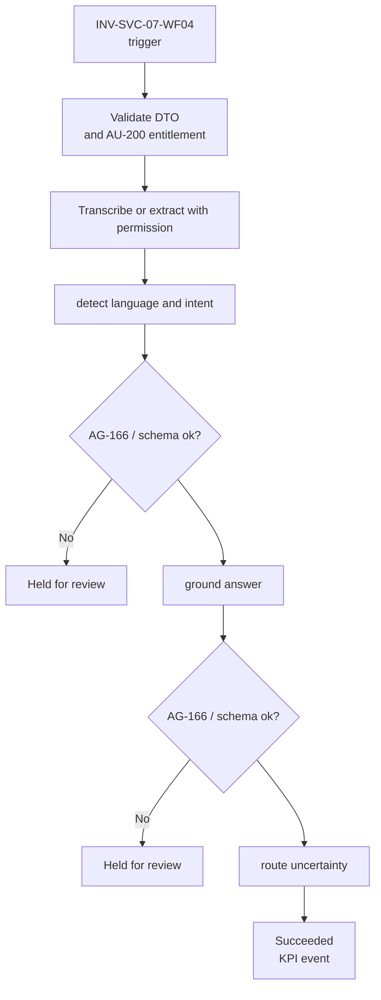

| Test ID | V12 / class ID | Level | Fixture / action | Expected (blueprint assertion) |
|---|---|---|---|---|
| TC-V12-N-355 | INV-SVC-07-WF04-AT01 | IT | Authorized text, audio or document enquiry and approved evidence | Output validates against the workflow schema; evidence persisted; run Succeeded; KPI event emitted; output "Grounded response draft and review task"; KPI: transcription consent present = 100% |
| TC-V12-N-356 | INV-SVC-07-WF04-TC-INPUT | UT/CT | missing or malformed input | HTTP 422 with field errors; no StepRun; audit `dto.rejected` |
| TC-V12-N-357 | INV-SVC-07-WF04-TC-SCOPE | SEC | same reference from another tenant/startup | HTTP 403 or uniform 404 (BRL-TEN-04); zero rows/events/provider calls in the other scope |
| TC-V12-N-358 | INV-SVC-07-WF04-TC-ENT | IT | revoke INV SKU after enqueue | AU-200 dispatch-time recheck denies; run Paused/Held; reservation released; no effect |
| TC-V12-N-359 | INV-SVC-07-WF04-TC-DUP | IT replay | replay identical event / step key | exactly one accepted outcome, effect and meter charge; duplicate returns original run ref |
| TC-V12-N-360 | INV-SVC-07-WF04-TC-QUALITY | AIE | stale, conflicting or incomplete evidence | step Held or flagged; no unsupported claim reaches output (BRL-AI-03/04); eval record stored |
| TC-V12-N-361 | INV-SVC-07-WF04-TC-BUDGET | IT | quota exhausted at reservation | reservation fails → Blocked; zero provider calls; owner notified |
| TC-V12-N-362 | INV-SVC-07-WF04-TC-RECOVERY | CHAOS | provider timeout or worker crash | timeout after submit → Reconciling; resume from checkpoint without repeating a completed effect |
| TC-V12-N-363 | INV-SVC-07-WF04-TC-SEC | SEC/compliance | SEC-CTL-N-05: input asks "should I invest / what return will I get" | AG-166 ADVICE → refusal TPL-N-01 + handover; no AI answer stored as reply |

#### INV-SVC-08 Investor Meeting & Briefing Automation

**Purpose:** Coordinate qualified investor meetings and prepare briefings (workbook Service Catalog row 12). **Epic:** EP-30. **Service spec:** Part 11.16a §11.16.5.6.8. **Stories:** Part 11.16e.

| Field | Specification |
|---|---|
| Family / bundle / meter | Meetings · Full suite / Investor Engagement bundle / selective (1 SKU); entitlement and usage approval required. · Illustrative pilot: 100 meeting cycle(s)/month; 1 concurrent run; configurable hard budget, provider quota and frequency limits. Not approved. |
| Supported channels | Calendar, email, Zoom, Google Meet, Teams |
| Industries / capability | Fundraising issuers across eligible sectors; grant/debt/CSR route requires eligibility · Investor meetings |
| Required entitlements | INV-SVC-08 + foundation; tenant/startup, capability, role, channel/provider and budget checks at every action |
| Optional input producers | Included foundation; no mandatory upstream paid service; optional input producers: INV-SVC-07; INV-SVC-15; authorized equivalent input accepted. |
| External providers | Authorized calendar/video provider or manual appointment; consent for recording (verify terms and prices at implementation, as of 27 Nov 2026) |
| Service KPI (V12) | Duplicate bookings = 0; eligible reminders completed ≥99% |
| Actors (blueprint roles) | R02; R03; R19 service identity; R20 agent identity |
| Agents | AG-173, AG-174, AG-037 |
| Automations | AU-218, AU-023, AU-075 |
| Shared engines (V12) | Calendar; Workflow orchestration; Governance |
| Data class and gateway tier | Personal; recordings Personal (consent-gated, DEC-782); Tier 1a summaries; Tier 1b briefing |
| Screens | A021; A023; A022 → A219, A220, A221 |
| V12 DB candidates → blueprint | inv_adviser_referral; inv_cap_table_event; inv_delivery_event; inv_event; inv_filing_task; inv_inbound_event; inv_meeting; inv_message; inv_referral; inv_relationship; inv_stage_event; inv_task → schema `inv` same names (DEC-814 keeps V12 names; RLS per §11.16.5.10) |

##### INV-SVC-08-WF01 Availability and meeting booking

**Requirement FR-V12-N-129** (status before: Not covered, CONFLICT-958; after: Matched). Execute "Availability and meeting booking" as a typed, policy-checked workflow: Query authorized availability; propose slot; confirm; create event and deduplicate invitation; output "Booked or proposed meeting".

| Field | Specification |
|---|---|
| Business outcome / input → output | Availability and meeting booking: Participants and allowed time windows → Booked or proposed meeting |
| Trigger | Manual request or validated upstream business event |
| Result / acceptance | Booked or proposed meeting; acceptance INV-SVC-08-WF01-AT01 (Availability and meeting booking) → TC-V12-N-369 |
| Domain contract | Validator `urn:inv:dto:INV-SVC-08-WF01:v2`; fields below; event envelope per FR-V12-N-006 |
| Risk and authority | R2 calendar invite · V12 side effect: Potential external write/communication; controlled only after applicable permission and policy approval |
| Autonomy in blueprint | Invitations L1 (L2 for pre-approved slot offers); reminders L3; recording only with consent per jurisdiction (all-party where required) |
| Approval gate (V12) | Confirm participants and invitation permissions; consent for recording/transcription |
| Operating mode / modalities | AI-assisted / supervised; controlled autonomous only for preapproved eligible routine steps; simulation has zero external effects. · Text; structured records; audio/image/video where applicable and authorized |
| Agent / automations | — · AU-218 |
| Roles | R03 |
| Step classes | 1 Evidence retrieval; 1 Deterministic calculation; 2 External effect (outbox) |
| Securities and privacy controls | SEC-CTL-N-06 (see step column) |
| Workflow KPI (V12 service) | Duplicate bookings = 0; eligible reminders completed ≥99% |
| KPI formulas (this part) | duplicate bookings = 0; eligible reminders completed ≥ 99% |
| SLA | Slot proposal ≤ 10 s |
| Illustrative cost (V12) | 1 workflow invocation; not a full service cycle; tokens 0 in / 0 out; INR 0.15 per invocation; external fees excluded (estimate; verify at implementation, as of 27 Nov 2026) |
| Versions / origin | workflow 2.0-target; INV-SVC-08-WF01-AT01; synthetic dry run and measured benchmark pending; V12 status: Proposed; test Not run; live execution and pricing pending. |
| Rules | R1. Invitation permission confirmed; recording consent captured separately |

**DTO `urn:inv:dto:INV-SVC-08-WF01:v2`**

| Field | Dir | Req | Type / validation | Schema constraint | Blueprint mapping |
|---|---|---|---|---|---|
| `participant_ids` | in | Y | typed references, resolved in caller scope | `{"type": "array", "items": {"type": "string", "format": "uuid"}, "maxItems": 500}` | run payload (inv_workflow_run.output_json) |
| `window_ids` | in | Y | typed references, resolved in caller scope | `{"type": "array", "items": {"type": "string", "format": "uuid"}, "maxItems": 500}` | run payload (inv_workflow_run.output_json) |
| `purpose` | in | Y | configured enum (meeting_purpose) | `{"type": "string", "maxLength": 64, "$comment": "values from registry meeting_purpose"}` | run payload (inv_workflow_run.output_json) |
| `meeting_id` | out | Y | reference in caller tenant/startup | `{"type": "string", "format": "uuid"}` | inv_meeting.id |
| `state` | out | Y | configured enum (meeting_state) | `{"type": "string", "maxLength": 64, "$comment": "values from registry meeting_state"}` | run payload (inv_workflow_run.output_json) |
| `invite_id` | out | Y | reference in caller tenant/startup | `{"type": "string", "format": "uuid"}` | run payload (inv_workflow_run.output_json) |
| `correlation_id` | in | Y | trace id | `{"type": "string", "format": "uuid"}` | inv_workflow_run.correlation_id |
| `simulation` | in | N | zero-effect run | `{"type": "boolean", "default": false}` | inv_workflow_run.simulation |

| Step ID | Action | Class · executor | Output / validation | Failure → state | Blueprint component | Controls in this step | Step test |
|---|---|---|---|---|---|---|---|
| INV-SVC-08-WF01-STEP-01 | Query authorized availability | Evidence retrieval · Ingestion / connector engine | evidence_set {items, source_ref, observed_at, hash, rights} | SOURCE_DENIED → **Held** | Ingestion via AU-007 source permission, AU-014 host filter, AU-005 sanitizer | CTL-06 | TC-V12-N-364 (IT (adapter stub) + SEC): unauthorised or stale source rejected; provenance hash and rights stored |
| INV-SVC-08-WF01-STEP-02 | propose slot | Deterministic calculation · Rules / calculation engine | calculation {value, unit, assumptions, evidence_refs} | INVALID_INPUT → **Held** | Deterministic domain service; Decimal (DEC-027); zero model calls | — (internal; audit only) | TC-V12-N-365 (UT golden fixture): golden fixture exact; missing value never invented |
| INV-SVC-08-WF01-STEP-GATE | Securities and privacy gate (blueprint) | Policy check · PDP securities plug-in / scope + consent + pack + eligibility + solicitation + approval hash or mandate | decision {allow/hold/block, reason_codes, pack_versions} | POLICY_DENIED → **Blocked**; unknown → **Held** | PDP + AU-201/202/203/207 (ADR-231) | CTL-06 | TC-V12-N-368 (UT decision table + IT): every gate branch; fail closed |
| INV-SVC-08-WF01-STEP-03 | confirm | External effect (outbox) · Dispatcher via transactional outbox | effect {effect_id, provider_ref, state} | TIMEOUT_AFTER_SUBMIT → **Reconciling** | Outbox (M06) + dispatch-time PDP recheck (scope, consent, pack, eligibility, budget, approval hash) + idempotency key | CTL-15 | TC-V12-N-366 (IT replay + CHAOS): exactly one effect per idempotency key; recheck denies after revocation; uncertain → reconcile before retry |
| INV-SVC-08-WF01-STEP-04 | create event and deduplicate invitation | External effect (outbox) · Dispatcher via transactional outbox | effect {effect_id, provider_ref, state} | TIMEOUT_AFTER_SUBMIT → **Reconciling** | Outbox (M06) + dispatch-time PDP recheck (scope, consent, pack, eligibility, budget, approval hash) + idempotency key | CTL-15 | TC-V12-N-367 (IT replay + CHAOS): exactly one effect per idempotency key; recheck denies after revocation; uncertain → reconcile before retry |

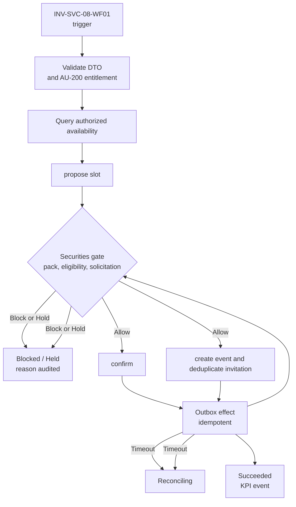

| Test ID | V12 / class ID | Level | Fixture / action | Expected (blueprint assertion) |
|---|---|---|---|---|
| TC-V12-N-369 | INV-SVC-08-WF01-AT01 | IT | Participants and allowed time windows | Output validates against the workflow schema; evidence persisted; run Succeeded; KPI event emitted; output "Booked or proposed meeting"; KPI: duplicate bookings = 0 |
| TC-V12-N-370 | INV-SVC-08-WF01-TC-INPUT | UT/CT | missing or malformed input | HTTP 422 with field errors; no StepRun; audit `dto.rejected` |
| TC-V12-N-371 | INV-SVC-08-WF01-TC-SCOPE | SEC | same reference from another tenant/startup | HTTP 403 or uniform 404 (BRL-TEN-04); zero rows/events/provider calls in the other scope |
| TC-V12-N-372 | INV-SVC-08-WF01-TC-ENT | IT | revoke INV SKU after enqueue | AU-200 dispatch-time recheck denies; run Paused/Held; reservation released; no effect |
| TC-V12-N-373 | INV-SVC-08-WF01-TC-DUP | IT replay | replay identical event / step key | exactly one accepted outcome, effect and meter charge; duplicate returns original run ref |
| TC-V12-N-374 | INV-SVC-08-WF01-TC-QUALITY | AIE | stale, conflicting or incomplete evidence | step Held or flagged; no unsupported claim reaches output (BRL-AI-03/04); eval record stored |
| TC-V12-N-375 | INV-SVC-08-WF01-TC-BUDGET | IT | quota exhausted at reservation | reservation fails → Blocked; zero provider calls; owner notified |
| TC-V12-N-376 | INV-SVC-08-WF01-TC-RECOVERY | CHAOS | provider timeout or worker crash | timeout after submit → Reconciling; resume from checkpoint without repeating a completed effect |
| TC-V12-N-377 | INV-SVC-08-WF01-TC-SEC | SEC/compliance | SEC-CTL-N-06: consent withdrawn 30 s before step | Block CONSENT_WITHDRAWN; sequence stopped |
| TC-V12-N-378 | INV-SVC-08-WF01-TC-APPROVAL | IT | approval missing, single approver or hash mismatch | Waiting (AWAITING_APPROVAL) or Block APPROVAL_INCOMPLETE/HASH_MISMATCH; NSE |
| TC-V12-N-379 | INV-SVC-08-WF01-TC-EFFECT | IT + CHAOS | effect after approval; pack expires between approval and dispatch | dispatch-time AU-201 recheck blocks; no effect; approval retained; audit `pack.expired` |

##### INV-SVC-08-WF02 Investor briefing preparation

**Requirement FR-V12-N-130** (status before: Not covered, CONFLICT-958; after: Matched). Execute "Investor briefing preparation" as a typed, policy-checked workflow: Retrieve current evidence; summarize questions and agenda; flag open decisions; output "Meeting brief".

| Field | Specification |
|---|---|
| Business outcome / input → output | Investor briefing preparation: Investor history and approved issuer facts → Meeting brief |
| Trigger | Manual request or validated upstream business event |
| Result / acceptance | Meeting brief; acceptance INV-SVC-08-WF02-AT01 (Investor briefing preparation) → TC-V12-N-383 |
| Domain contract | Validator `urn:inv:dto:INV-SVC-08-WF02:v2`; fields below; event envelope per FR-V12-N-006 |
| Risk and authority | R0 · V12 side effect: Internal analysis/draft; no external action without separate authorization |
| Autonomy in blueprint | Invitations L1 (L2 for pre-approved slot offers); reminders L3; recording only with consent per jurisdiction (all-party where required) |
| Approval gate (V12) | Confirm participants and invitation permissions; consent for recording/transcription |
| Operating mode / modalities | AI-assisted / supervised; controlled autonomous only for preapproved eligible routine steps; simulation has zero external effects. · Text; structured records |
| Agent / automations | AG-173 · AU-005 |
| Roles | R03 |
| Step classes | 1 Evidence retrieval; 1 AI inference; 1 Deterministic calculation |
| Securities and privacy controls | SEC-CTL-N-13 (see step column) |
| Workflow KPI (V12 service) | Duplicate bookings = 0; eligible reminders completed ≥99% |
| KPI formulas (this part) | brief ready ≥ 24 h before meeting ≥ 95%; cited facts current = 100% |
| SLA | Brief ≤ 60 s |
| Illustrative cost (V12) | 1 workflow invocation; not a full service cycle; tokens 3500 in / 600 out; INR 1.33 per invocation; external fees excluded (estimate; verify at implementation, as of 27 Nov 2026) |
| Versions / origin | workflow 2.0-target; INV-SVC-08-WF02-AT01; synthetic dry run and measured benchmark pending; V12 status: Proposed; test Not run; live execution and pricing pending. |
| Rules | R1. Internal brief only; not shared with the investor |

**DTO `urn:inv:dto:INV-SVC-08-WF02:v2`**

| Field | Dir | Req | Type / validation | Schema constraint | Blueprint mapping |
|---|---|---|---|---|---|
| `relationship_id` | in | Y | reference in caller tenant/startup | `{"type": "string", "format": "uuid"}` | inv_relationship.id |
| `issuer_fact_ids` | in | Y | typed references, resolved in caller scope | `{"type": "array", "items": {"type": "string", "format": "uuid"}, "maxItems": 500}` | run payload (inv_workflow_run.output_json) |
| `brief_id` | out | Y | reference in caller tenant/startup | `{"type": "string", "format": "uuid"}` | inv_document (brief).id |
| `agenda` | out | Y | free text NFC-normalised, untrusted (AU-005) | `{"type": "string", "minLength": 1, "maxLength": 4000}` | run payload (inv_workflow_run.output_json) |
| `open_decisions` | out | Y | free text NFC-normalised, untrusted (AU-005) | `{"type": "string", "minLength": 1, "maxLength": 4000}` | run payload (inv_workflow_run.output_json) |
| `citations` | out | Y | typed references, resolved in caller scope | `{"type": "array", "items": {"type": "string", "format": "uuid"}, "maxItems": 500}` | run payload (inv_workflow_run.output_json) |
| `correlation_id` | in | Y | trace id | `{"type": "string", "format": "uuid"}` | inv_workflow_run.correlation_id |
| `simulation` | in | N | zero-effect run | `{"type": "boolean", "default": false}` | inv_workflow_run.simulation |

| Step ID | Action | Class · executor | Output / validation | Failure → state | Blueprint component | Controls in this step | Step test |
|---|---|---|---|---|---|---|---|
| INV-SVC-08-WF02-STEP-01 | Retrieve current evidence | Evidence retrieval · Ingestion / connector engine | evidence_set {items, source_ref, observed_at, hash, rights} | SOURCE_DENIED → **Held** | Ingestion via AU-007 source permission, AU-014 host filter, AU-005 sanitizer | CTL-16 | TC-V12-N-380 (IT (adapter stub) + SEC): unauthorised or stale source rejected; provenance hash and rights stored |
| INV-SVC-08-WF02-STEP-02 | summarize questions and agenda | AI inference · Model gateway + agent | candidate {artifact_ref, confidence, reason_codes, review_state} | REVIEW_REQUIRED → **Waiting (AWAITING_APPROVAL)** | Model gateway AU-001 (Tier 0 → 1a → 1b; Tier 3 degrade), AU-003 schema validation, AG-166 guard on investor-facing text; output is a draft only | CTL-13 | TC-V12-N-381 (AIE + CT schema): output validates against schema; claims cited; AG-166 verdict recorded; untrusted input cannot invoke tools |
| INV-SVC-08-WF02-STEP-03 | flag open decisions | Deterministic calculation · Rules / calculation engine | calculation {value, unit, assumptions, evidence_refs} | INVALID_INPUT → **Held** | Deterministic domain service; Decimal (DEC-027); zero model calls | CTL-13 | TC-V12-N-382 (UT golden fixture): golden fixture exact; missing value never invented |

| Test ID | V12 / class ID | Level | Fixture / action | Expected (blueprint assertion) |
|---|---|---|---|---|
| TC-V12-N-383 | INV-SVC-08-WF02-AT01 | IT | Investor history and approved issuer facts | Output validates against the workflow schema; evidence persisted; run Succeeded; KPI event emitted; output "Meeting brief"; KPI: brief ready ≥ 24 h before meeting ≥ 95% |
| TC-V12-N-384 | INV-SVC-08-WF02-TC-INPUT | UT/CT | missing or malformed input | HTTP 422 with field errors; no StepRun; audit `dto.rejected` |
| TC-V12-N-385 | INV-SVC-08-WF02-TC-SCOPE | SEC | same reference from another tenant/startup | HTTP 403 or uniform 404 (BRL-TEN-04); zero rows/events/provider calls in the other scope |
| TC-V12-N-386 | INV-SVC-08-WF02-TC-ENT | IT | revoke INV SKU after enqueue | AU-200 dispatch-time recheck denies; run Paused/Held; reservation released; no effect |
| TC-V12-N-387 | INV-SVC-08-WF02-TC-DUP | IT replay | replay identical event / step key | exactly one accepted outcome, effect and meter charge; duplicate returns original run ref |
| TC-V12-N-388 | INV-SVC-08-WF02-TC-QUALITY | AIE | stale, conflicting or incomplete evidence | step Held or flagged; no unsupported claim reaches output (BRL-AI-03/04); eval record stored |
| TC-V12-N-389 | INV-SVC-08-WF02-TC-BUDGET | IT | quota exhausted at reservation | reservation fails → Blocked; zero provider calls; owner notified |
| TC-V12-N-390 | INV-SVC-08-WF02-TC-RECOVERY | CHAOS | provider timeout or worker crash | timeout after submit → Reconciling; resume from checkpoint without repeating a completed effect |
| TC-V12-N-391 | INV-SVC-08-WF02-TC-SEC | SEC/compliance | SEC-CTL-N-13: draft figure differs from scenario output | Block FIGURE_MISMATCH |

##### INV-SVC-08-WF03 Meeting action extraction and reminders

**Requirement FR-V12-N-131** (status before: Not covered, CONFLICT-958; after: Matched). Execute "Meeting action extraction and reminders" as a typed, policy-checked workflow: Extract decisions; reviewer confirms material items; create tasks and reminders; output "Action list and next meeting tasks".

| Field | Specification |
|---|---|
| Business outcome / input → output | Meeting action extraction and reminders: Authorized notes or transcript and due dates → Action list and next meeting tasks |
| Trigger | Scheduled or manual; scoped event on change |
| Result / acceptance | Action list and next meeting tasks; acceptance INV-SVC-08-WF03-AT01 (Meeting action extraction and reminders) → TC-V12-N-395 |
| Domain contract | Validator `urn:inv:dto:INV-SVC-08-WF03:v2`; fields below; event envelope per FR-V12-N-006 |
| Risk and authority | R0 · V12 side effect: Internal analysis/draft; no external action without separate authorization |
| Autonomy in blueprint | Invitations L1 (L2 for pre-approved slot offers); reminders L3; recording only with consent per jurisdiction (all-party where required) |
| Approval gate (V12) | Confirm participants and invitation permissions; consent for recording/transcription |
| Operating mode / modalities | AI-assisted / supervised; controlled autonomous only for preapproved eligible routine steps; simulation has zero external effects. · Text; structured records; audio/image/video where applicable and authorized |
| Agent / automations | AG-173 · AU-218 |
| Roles | R03 |
| Step classes | 1 AI inference; 1 Human review routing; 1 Internal notification |
| Securities and privacy controls | SEC-CTL-N-06, SEC-CTL-N-05 (see step column) |
| Workflow KPI (V12 service) | Duplicate bookings = 0; eligible reminders completed ≥99% |
| KPI formulas (this part) | material items confirmed by reviewer = 100%; tasks created ≤ 4 h after meeting |
| SLA | ≤ 60 s |
| Illustrative cost (V12) | 1 workflow invocation; not a full service cycle; tokens 4500 in / 500 out; INR 1.45 per invocation; external fees excluded (estimate; verify at implementation, as of 27 Nov 2026) |
| Versions / origin | workflow 2.0-target; INV-SVC-08-WF03-AT01; synthetic dry run and measured benchmark pending; V12 status: Proposed; test Not run; live execution and pricing pending. |
| Rules | R1. Commitments on terms marked unconfirmed until R02 confirms |

**DTO `urn:inv:dto:INV-SVC-08-WF03:v2`**

| Field | Dir | Req | Type / validation | Schema constraint | Blueprint mapping |
|---|---|---|---|---|---|
| `meeting_id` | in | Y | reference in caller tenant/startup | `{"type": "string", "format": "uuid"}` | inv_meeting.id |
| `notes_ref` | in | Y | reference in caller tenant/startup | `{"type": "string", "format": "uuid"}` | run payload (inv_workflow_run.output_json) |
| `consent_id` | in | Y | reference in caller tenant/startup | `{"type": "string", "format": "uuid"}` | run payload (inv_workflow_run.output_json) |
| `action_ids` | out | Y | typed references, resolved in caller scope | `{"type": "array", "items": {"type": "string", "format": "uuid"}, "maxItems": 500}` | run payload (inv_workflow_run.output_json) |
| `decisions` | out | Y | free text NFC-normalised, untrusted (AU-005) | `{"type": "string", "minLength": 1, "maxLength": 4000}` | run payload (inv_workflow_run.output_json) |
| `reminder_ids` | out | Y | typed references, resolved in caller scope | `{"type": "array", "items": {"type": "string", "format": "uuid"}, "maxItems": 500}` | run payload (inv_workflow_run.output_json) |
| `correlation_id` | in | Y | trace id | `{"type": "string", "format": "uuid"}` | inv_workflow_run.correlation_id |
| `simulation` | in | N | zero-effect run | `{"type": "boolean", "default": false}` | inv_workflow_run.simulation |

| Step ID | Action | Class · executor | Output / validation | Failure → state | Blueprint component | Controls in this step | Step test |
|---|---|---|---|---|---|---|---|
| INV-SVC-08-WF03-STEP-01 | Extract decisions | AI inference · Model gateway + agent | candidate {artifact_ref, confidence, reason_codes, review_state} | REVIEW_REQUIRED → **Waiting (AWAITING_APPROVAL)** | Model gateway AU-001 (Tier 0 → 1a → 1b; Tier 3 degrade), AU-003 schema validation, AG-166 guard on investor-facing text; output is a draft only | CTL-05 | TC-V12-N-392 (AIE + CT schema): output validates against schema; claims cited; AG-166 verdict recorded; untrusted input cannot invoke tools |
| INV-SVC-08-WF03-STEP-02 | reviewer confirms material items | Human review routing · Work queue / approval service | task {queue, assignee_role, sla_due, reason} | SLA_BREACH → **Escalated** | Approval/task service (A207/A220); SLA timers | — (internal; audit only) | TC-V12-N-393 (IT + SYS): task created with correct role and SLA; automation paused until disposition |
| INV-SVC-08-WF03-STEP-03 | create tasks and reminders | Internal notification · Notification service (NT) | notification {recipient_role, channel=in-app/email-internal, dedupe_key} | DUPLICATE → **Suppressed** | Notification service NT/NX (Part 2.4); dedupe key | CTL-16 | TC-V12-N-394 (IT): one notification per dedupe key; internal recipients only |

| Test ID | V12 / class ID | Level | Fixture / action | Expected (blueprint assertion) |
|---|---|---|---|---|
| TC-V12-N-395 | INV-SVC-08-WF03-AT01 | IT | Authorized notes or transcript and due dates | Output validates against the workflow schema; evidence persisted; run Succeeded; KPI event emitted; output "Action list and next meeting tasks"; KPI: material items confirmed by reviewer = 100% |
| TC-V12-N-396 | INV-SVC-08-WF03-TC-INPUT | UT/CT | missing or malformed input | HTTP 422 with field errors; no StepRun; audit `dto.rejected` |
| TC-V12-N-397 | INV-SVC-08-WF03-TC-SCOPE | SEC | same reference from another tenant/startup | HTTP 403 or uniform 404 (BRL-TEN-04); zero rows/events/provider calls in the other scope |
| TC-V12-N-398 | INV-SVC-08-WF03-TC-ENT | IT | revoke INV SKU after enqueue | AU-200 dispatch-time recheck denies; run Paused/Held; reservation released; no effect |
| TC-V12-N-399 | INV-SVC-08-WF03-TC-DUP | IT replay | replay identical event / step key | exactly one accepted outcome, effect and meter charge; duplicate returns original run ref |
| TC-V12-N-400 | INV-SVC-08-WF03-TC-QUALITY | AIE | stale, conflicting or incomplete evidence | step Held or flagged; no unsupported claim reaches output (BRL-AI-03/04); eval record stored |
| TC-V12-N-401 | INV-SVC-08-WF03-TC-BUDGET | IT | quota exhausted at reservation | reservation fails → Blocked; zero provider calls; owner notified |
| TC-V12-N-402 | INV-SVC-08-WF03-TC-RECOVERY | CHAOS | provider timeout or worker crash | timeout after submit → Reconciling; resume from checkpoint without repeating a completed effect |
| TC-V12-N-403 | INV-SVC-08-WF03-TC-SEC | SEC/compliance | SEC-CTL-N-05: input asks "should I invest / what return will I get" | AG-166 ADVICE → refusal TPL-N-01 + handover; no AI answer stored as reply |

##### INV-SVC-08-WF04 Interactive pitch rehearsal and post-meeting intelligence

**Requirement FR-V12-N-132** (status before: Not covered, CONFLICT-958; after: Matched). Execute "Interactive pitch rehearsal and post-meeting intelligence" as a typed, policy-checked workflow: Simulate investor questions; evaluate factual answers; extract permitted actions; record review; output "Rehearsal feedback and action plan".

| Field | Specification |
|---|---|
| Business outcome / input → output | Interactive pitch rehearsal and post-meeting intelligence: Approved pitch, authorized notes or recording → Rehearsal feedback and action plan |
| Trigger | Manual; scheduled or relevant validated business event; provider webhook only where authorized |
| Result / acceptance | Rehearsal feedback and action plan; acceptance INV-SVC-08-WF04-AT01 (Interactive pitch rehearsal and post-meeting intelligence) → TC-V12-N-408 |
| Domain contract | Validator `urn:inv:dto:INV-SVC-08-WF04:v2`; fields below; event envelope per FR-V12-N-006 |
| Risk and authority | R0 · V12 side effect: Internal analysis/draft; no external action without separate authorization |
| Autonomy in blueprint | Invitations L1 (L2 for pre-approved slot offers); reminders L3; recording only with consent per jurisdiction (all-party where required) |
| Approval gate (V12) | Approve source/data rights and applicable external actions; qualified reviewer confirms legal/financial claims and any offer, filing, ownership change or payment; no autonomous regulated decision. |
| Operating mode / modalities | AI-assisted / supervised; controlled autonomous only for preapproved eligible routine steps; simulation has zero external effects. · Text; structured records; audio/image/video where applicable and authorized; documents |
| Agent / automations | AG-174 · AU-218 |
| Roles | R02 |
| Step classes | 3 AI inference; 1 Human review routing |
| Securities and privacy controls | SEC-CTL-N-05, SEC-CTL-N-16 (see step column) |
| Workflow KPI (V12 service) | Duplicate bookings = 0; eligible reminders completed ≥99% |
| KPI formulas (this part) | factual errors detected in rehearsal (recall) ≥ 90%; rehearsal recordings retained past policy = 0 |
| SLA | ≤ 3 min per session |
| Illustrative cost (V12) | 1 invocation; text component only; tokens 2500 in / 500 out; INR 1.05 per invocation; external fees excluded (estimate; verify at implementation, as of 27 Nov 2026) |
| Versions / origin | workflow 1.0-target; INV-SVC-08-WF04-AT01; synthetic dry run and measured benchmark pending; V12 status: Proposed; test Not run; live execution and pricing pending. |
| Rules | R1. Rehearsal is internal; simulated investor never gives advice |

**DTO `urn:inv:dto:INV-SVC-08-WF04:v2`**

| Field | Dir | Req | Type / validation | Schema constraint | Blueprint mapping |
|---|---|---|---|---|---|
| `pitch_id` | in | Y | reference in caller tenant/startup | `{"type": "string", "format": "uuid"}` | inv_document.id |
| `recording_ref` | in | Y | reference in caller tenant/startup | `{"type": "string", "format": "uuid"}` | run payload (inv_workflow_run.output_json) |
| `consent_id` | in | Y | reference in caller tenant/startup | `{"type": "string", "format": "uuid"}` | run payload (inv_workflow_run.output_json) |
| `feedback_id` | out | Y | reference in caller tenant/startup | `{"type": "string", "format": "uuid"}` | run payload (inv_workflow_run.output_json) |
| `question_set` | out | Y | free text NFC-normalised, untrusted (AU-005) | `{"type": "string", "minLength": 1, "maxLength": 4000}` | inv_diligence_request |
| `action_plan` | out | Y | free text NFC-normalised, untrusted (AU-005) | `{"type": "string", "minLength": 1, "maxLength": 4000}` | run payload (inv_workflow_run.output_json) |
| `correlation_id` | in | Y | trace id | `{"type": "string", "format": "uuid"}` | inv_workflow_run.correlation_id |
| `simulation` | in | N | zero-effect run | `{"type": "boolean", "default": false}` | inv_workflow_run.simulation |

| Step ID | Action | Class · executor | Output / validation | Failure → state | Blueprint component | Controls in this step | Step test |
|---|---|---|---|---|---|---|---|
| INV-SVC-08-WF04-STEP-01 | Simulate investor questions | AI inference · Model gateway + agent | candidate {artifact_ref, confidence, reason_codes, review_state} | REVIEW_REQUIRED → **Waiting (AWAITING_APPROVAL)** | Model gateway AU-001 (Tier 0 → 1a → 1b; Tier 3 degrade), AU-003 schema validation, AG-166 guard on investor-facing text; output is a draft only | CTL-05, CTL-16 | TC-V12-N-404 (AIE + CT schema): output validates against schema; claims cited; AG-166 verdict recorded; untrusted input cannot invoke tools |
| INV-SVC-08-WF04-STEP-02 | evaluate factual answers | AI inference · Model gateway + agent | candidate {artifact_ref, confidence, reason_codes, review_state} | REVIEW_REQUIRED → **Waiting (AWAITING_APPROVAL)** | Model gateway AU-001 (Tier 0 → 1a → 1b; Tier 3 degrade), AU-003 schema validation, AG-166 guard on investor-facing text; output is a draft only | CTL-05, CTL-16 | TC-V12-N-405 (AIE + CT schema): output validates against schema; claims cited; AG-166 verdict recorded; untrusted input cannot invoke tools |
| INV-SVC-08-WF04-STEP-03 | extract permitted actions | AI inference · Model gateway + agent | candidate {artifact_ref, confidence, reason_codes, review_state} | REVIEW_REQUIRED → **Waiting (AWAITING_APPROVAL)** | Model gateway AU-001 (Tier 0 → 1a → 1b; Tier 3 degrade), AU-003 schema validation, AG-166 guard on investor-facing text; output is a draft only | CTL-05, CTL-16 | TC-V12-N-406 (AIE + CT schema): output validates against schema; claims cited; AG-166 verdict recorded; untrusted input cannot invoke tools |
| INV-SVC-08-WF04-STEP-04 | record review | Human review routing · Work queue / approval service | task {queue, assignee_role, sla_due, reason} | SLA_BREACH → **Escalated** | Approval/task service (A207/A220); SLA timers | — (internal; audit only) | TC-V12-N-407 (IT + SYS): task created with correct role and SLA; automation paused until disposition |

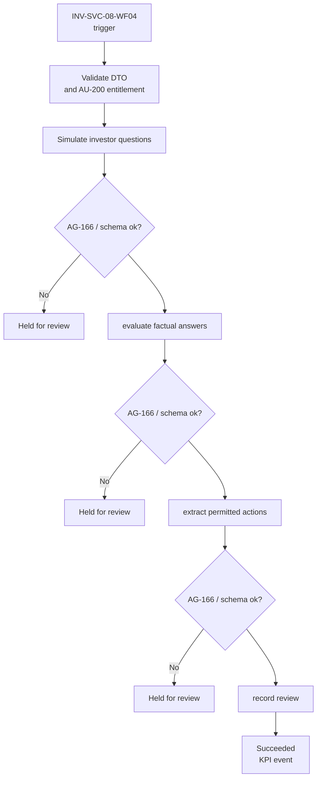

| Test ID | V12 / class ID | Level | Fixture / action | Expected (blueprint assertion) |
|---|---|---|---|---|
| TC-V12-N-408 | INV-SVC-08-WF04-AT01 | IT | Approved pitch, authorized notes or recording | Output validates against the workflow schema; evidence persisted; run Succeeded; KPI event emitted; output "Rehearsal feedback and action plan"; KPI: factual errors detected in rehearsal (recall) ≥ 90% |
| TC-V12-N-409 | INV-SVC-08-WF04-TC-INPUT | UT/CT | missing or malformed input | HTTP 422 with field errors; no StepRun; audit `dto.rejected` |
| TC-V12-N-410 | INV-SVC-08-WF04-TC-SCOPE | SEC | same reference from another tenant/startup | HTTP 403 or uniform 404 (BRL-TEN-04); zero rows/events/provider calls in the other scope |
| TC-V12-N-411 | INV-SVC-08-WF04-TC-ENT | IT | revoke INV SKU after enqueue | AU-200 dispatch-time recheck denies; run Paused/Held; reservation released; no effect |
| TC-V12-N-412 | INV-SVC-08-WF04-TC-DUP | IT replay | replay identical event / step key | exactly one accepted outcome, effect and meter charge; duplicate returns original run ref |
| TC-V12-N-413 | INV-SVC-08-WF04-TC-QUALITY | AIE | stale, conflicting or incomplete evidence | step Held or flagged; no unsupported claim reaches output (BRL-AI-03/04); eval record stored |
| TC-V12-N-414 | INV-SVC-08-WF04-TC-BUDGET | IT | quota exhausted at reservation | reservation fails → Blocked; zero provider calls; owner notified |
| TC-V12-N-415 | INV-SVC-08-WF04-TC-RECOVERY | CHAOS | provider timeout or worker crash | timeout after submit → Reconciling; resume from checkpoint without repeating a completed effect |
| TC-V12-N-416 | INV-SVC-08-WF04-TC-SEC | SEC/compliance | SEC-CTL-N-05: input asks "should I invest / what return will I get" | AG-166 ADVICE → refusal TPL-N-01 + handover; no AI answer stored as reply |

#### INV-SVC-09 Fundraising Pitch & Financial Scenario Automation

**Purpose:** Prepare issuer-specific investment materials and deterministic funding scenarios Basic funding scenarios only; advanced ownership/ESOP/instrument management in INV-SVC-20. (workbook Service Catalog row 13). **Epic:** EP-31. **Service spec:** Part 11.16a §11.16.5.6.9. **Stories:** Part 11.16e.

| Field | Specification |
|---|---|
| Family / bundle / meter | Investment conversion · Full suite / Diligence & Conversion bundle / selective (1 SKU); entitlement and usage approval required. · Illustrative pilot: 50 pitch scenario(s)/month; 1 concurrent run; configurable hard budget, provider quota and frequency limits. Not approved. |
| Supported channels | Private documents, approved direct sharing |
| Industries / capability | Fundraising issuers across eligible sectors; grant/debt/CSR route requires eligibility · Pitch and financial scenario preparation |
| Required entitlements | INV-SVC-09 + foundation; tenant/startup, capability, role, channel/provider and budget checks at every action |
| Optional input producers | Included foundation; no mandatory upstream paid service; optional input producers: INV-SVC-02; authorized equivalent input accepted. |
| External providers | Authorized data or spreadsheet import; optional document renderer; no investment advice execution (verify terms and prices at implementation, as of 27 Nov 2026) |
| Service KPI (V12) | Scenario arithmetic test pass 100%; unverified pitch claims blocked |
| Actors (blueprint roles) | R02 · R08; R02 · R10; R19 service identity; R20 agent identity |
| Agents | AG-175, AG-179, AG-020 |
| Automations | AU-219, AU-220, AU-035 |
| Shared engines (V12) | Document generation; Workflow orchestration; Governance |
| Data class and gateway tier | Confidential-Financial; no Tier 2; Tier 0 deterministic calculation (zero model calls); Tier 1b narrative drafting |
| Screens | A003; A028; A029 → A205, A226, A227 |
| V12 DB candidates → blueprint | inv_cap_table_event; inv_claim; inv_contact_evidence; inv_disclosure; inv_document; inv_evidence; inv_guarantee_evidence; inv_round; inv_scenario → schema `inv` same names (DEC-814 keeps V12 names; RLS per §11.16.5.10) |

##### INV-SVC-09-WF01 Funding scenario calculation

**Requirement FR-V12-N-133** (status before: Not covered, CONFLICT-958; after: Matched). Execute "Funding scenario calculation" as a typed, policy-checked workflow: Validate numerical inputs; calculate post-money and dilution; show sensitivity; retain assumptions; output "Deterministic scenario table".

| Field | Specification |
|---|---|
| Business outcome / input → output | Funding scenario calculation: Funding amount, pre-money value, shares and currency → Deterministic scenario table |
| Trigger | Manual request or validated upstream business event |
| Result / acceptance | Deterministic scenario table; acceptance INV-SVC-09-WF01-AT01 (Funding scenario calculation) → TC-V12-N-421 |
| Domain contract | Validator `urn:inv:dto:INV-SVC-09-WF01:v2`; fields below; event envelope per FR-V12-N-006 |
| Risk and authority | R0 · V12 side effect: Internal analysis/draft; no external action without separate authorization |
| Autonomy in blueprint | Calculations L3 deterministic; materials L1 (R02 + financial/legal review); AI never values the company as an opinion |
| Approval gate (V12) | Owner and financial/legal review of assumptions and materials before use |
| Operating mode / modalities | AI-assisted / supervised; controlled autonomous only for preapproved eligible routine steps; simulation has zero external effects. · Text; structured records |
| Agent / automations | — (deterministic AU-219) · AU-219 |
| Roles | R02 · R08 |
| Step classes | 3 Deterministic calculation; 1 Domain persistence |
| Securities and privacy controls | SEC-CTL-N-13 (see step column) |
| Workflow KPI (V12 service) | Scenario arithmetic test pass 100%; unverified pitch claims blocked |
| KPI formulas (this part) | scenario arithmetic test pass = 100%; scenarios with recorded assumptions = 100% |
| SLA | ≤ 1 s |
| Illustrative cost (V12) | 1 workflow invocation; not a full service cycle; tokens 0 in / 0 out; INR 0.15 per invocation; external fees excluded (estimate; verify at implementation, as of 27 Nov 2026) |
| Versions / origin | workflow 2.0-target; INV-SVC-09-WF01-AT01; synthetic dry run and measured benchmark pending; V12 status: Proposed; test Not run; live execution and pricing pending. |
| Rules | R1. post_money = pre_money + amount; price = pre_money ÷ fully-diluted pre-money shares; Decimal ROUND_HALF_EVEN at 4 dp (DEC-027) |

**DTO `urn:inv:dto:INV-SVC-09-WF01:v2`**

| Field | Dir | Req | Type / validation | Schema constraint | Blueprint mapping |
|---|---|---|---|---|---|
| `amount` | in | Y | int64 minor units + ISO 4217 (DEC-027) | `{"type": "object", "required": ["amount_minor", "currency"], "properties": {"amount_minor": {"type": "integer", "minimum": 0}, "currency": {"type": "string", "pattern": "^[A-Z]{3}$"}}}` | run payload (inv_workflow_run.output_json) |
| `pre_money` | in | Y | int64 minor units + ISO 4217 (DEC-027) | `{"type": "object", "required": ["amount_minor", "currency"], "properties": {"amount_minor": {"type": "integer", "minimum": 0}, "currency": {"type": "string", "pattern": "^[A-Z]{3}$"}}}` | run payload (inv_workflow_run.output_json) |
| `shares_outstanding` | in | Y | non-negative integer | `{"type": "integer", "minimum": 0}` | run payload (inv_workflow_run.output_json) |
| `option_pool_pct` | in | Y | decimal string (no float) | `{"type": "string", "pattern": "^-?\\d+(\\.\\d{1,6})?$"}` | run payload (inv_workflow_run.output_json) |
| `currency` | in | Y | configured enum (currency) | `{"type": "string", "maxLength": 64, "$comment": "values from registry currency"}` | run payload (inv_workflow_run.output_json) |
| `post_money` | out | Y | int64 minor units + ISO 4217 (DEC-027) | `{"type": "object", "required": ["amount_minor", "currency"], "properties": {"amount_minor": {"type": "integer", "minimum": 0}, "currency": {"type": "string", "pattern": "^[A-Z]{3}$"}}}` | run payload (inv_workflow_run.output_json) |
| `price_per_share` | out | Y | int64 minor units + ISO 4217 (DEC-027) | `{"type": "object", "required": ["amount_minor", "currency"], "properties": {"amount_minor": {"type": "integer", "minimum": 0}, "currency": {"type": "string", "pattern": "^[A-Z]{3}$"}}}` | run payload (inv_workflow_run.output_json) |
| `dilution_pct` | out | Y | decimal string (no float) | `{"type": "string", "pattern": "^-?\\d+(\\.\\d{1,6})?$"}` | run payload (inv_workflow_run.output_json) |
| `sensitivity` | out | Y | structured object (versioned sub-schema) | `{"type": "object", "maxProperties": 100}` | run payload (inv_workflow_run.output_json) |
| `assumption_ids` | out | Y | typed references, resolved in caller scope | `{"type": "array", "items": {"type": "string", "format": "uuid"}, "maxItems": 500}` | run payload (inv_workflow_run.output_json) |
| `correlation_id` | in | Y | trace id | `{"type": "string", "format": "uuid"}` | inv_workflow_run.correlation_id |
| `simulation` | in | N | zero-effect run | `{"type": "boolean", "default": false}` | inv_workflow_run.simulation |

| Step ID | Action | Class · executor | Output / validation | Failure → state | Blueprint component | Controls in this step | Step test |
|---|---|---|---|---|---|---|---|
| INV-SVC-09-WF01-STEP-01 | Validate numerical inputs | Deterministic calculation · Rules / calculation engine | calculation {value, unit, assumptions, evidence_refs} | INVALID_INPUT → **Held** | Deterministic domain service; Decimal (DEC-027); zero model calls | CTL-13 | TC-V12-N-417 (UT golden fixture): golden fixture exact; missing value never invented |
| INV-SVC-09-WF01-STEP-02 | calculate post-money and dilution | Deterministic calculation · Rules / calculation engine | calculation {value, unit, assumptions, evidence_refs} | INVALID_INPUT → **Held** | Deterministic domain service; Decimal (DEC-027); zero model calls | CTL-13 | TC-V12-N-418 (UT golden fixture): golden fixture exact; missing value never invented |
| INV-SVC-09-WF01-STEP-03 | show sensitivity | Deterministic calculation · Rules / calculation engine | calculation {value, unit, assumptions, evidence_refs} | INVALID_INPUT → **Held** | Deterministic domain service; Decimal (DEC-027); zero model calls | CTL-13 | TC-V12-N-419 (UT golden fixture): golden fixture exact; missing value never invented |
| INV-SVC-09-WF01-STEP-04 | retain assumptions | Domain persistence · Domain service (investment app) | domain_result {artifact_ref, status, evidence_refs} | INVALID_STATE → **Held** | Domain module: revision check (NFR-025), single transaction with audit and outbox | — (internal; audit only) | TC-V12-N-420 (UT + IT): state change atomic with audit and outbox row |

| Test ID | V12 / class ID | Level | Fixture / action | Expected (blueprint assertion) |
|---|---|---|---|---|
| TC-V12-N-421 | INV-SVC-09-WF01-AT01 | IT | Funding amount, pre-money value, shares and currency | Output validates against the workflow schema; evidence persisted; run Succeeded; KPI event emitted; output "Deterministic scenario table"; KPI: scenario arithmetic test pass = 100% |
| TC-V12-N-422 | INV-SVC-09-WF01-TC-INPUT | UT/CT | missing or malformed input | HTTP 422 with field errors; no StepRun; audit `dto.rejected` |
| TC-V12-N-423 | INV-SVC-09-WF01-TC-SCOPE | SEC | same reference from another tenant/startup | HTTP 403 or uniform 404 (BRL-TEN-04); zero rows/events/provider calls in the other scope |
| TC-V12-N-424 | INV-SVC-09-WF01-TC-ENT | IT | revoke INV SKU after enqueue | AU-200 dispatch-time recheck denies; run Paused/Held; reservation released; no effect |
| TC-V12-N-425 | INV-SVC-09-WF01-TC-DUP | IT replay | replay identical event / step key | exactly one accepted outcome, effect and meter charge; duplicate returns original run ref |
| TC-V12-N-426 | INV-SVC-09-WF01-TC-QUALITY | AIE | stale, conflicting or incomplete evidence | step Held or flagged; no unsupported claim reaches output (BRL-AI-03/04); eval record stored |
| TC-V12-N-427 | INV-SVC-09-WF01-TC-BUDGET | IT | quota exhausted at reservation | reservation fails → Blocked; zero provider calls; owner notified |
| TC-V12-N-428 | INV-SVC-09-WF01-TC-RECOVERY | CHAOS | provider timeout or worker crash | timeout after submit → Reconciling; resume from checkpoint without repeating a completed effect |
| TC-V12-N-429 | INV-SVC-09-WF01-TC-SEC | SEC/compliance | SEC-CTL-N-13: draft figure differs from scenario output | Block FIGURE_MISMATCH |

##### INV-SVC-09-WF02 Investor-specific pitch drafting

**Requirement FR-V12-N-134** (status before: Not covered, CONFLICT-958; after: Matched). Execute "Investor-specific pitch drafting" as a typed, policy-checked workflow: Retrieve supporting claims; draft pitch narrative; disclose assumptions; flag missing facts; output "Pitch draft and evidence references".

| Field | Specification |
|---|---|
| Business outcome / input → output | Investor-specific pitch drafting: Verified issuer facts, mandate and scenario → Pitch draft and evidence references |
| Trigger | Manual request or validated upstream business event |
| Result / acceptance | Pitch draft and evidence references; acceptance INV-SVC-09-WF02-AT01 (Investor-specific pitch drafting) → TC-V12-N-434 |
| Domain contract | Validator `urn:inv:dto:INV-SVC-09-WF02:v2`; fields below; event envelope per FR-V12-N-006 |
| Risk and authority | R1 · V12 side effect: Internal analysis/draft; no external action without separate authorization |
| Autonomy in blueprint | Calculations L3 deterministic; materials L1 (R02 + financial/legal review); AI never values the company as an opinion |
| Approval gate (V12) | Owner and financial/legal review of assumptions and materials before use |
| Operating mode / modalities | AI-assisted / supervised; controlled autonomous only for preapproved eligible routine steps; simulation has zero external effects. · Text; structured records; documents |
| Agent / automations | AG-175 + AG-166 · AU-220 |
| Roles | R02 · R10 |
| Step classes | 1 Evidence retrieval; 1 AI inference; 2 Deterministic calculation |
| Securities and privacy controls | SEC-CTL-N-05, SEC-CTL-N-13 (see step column) |
| Workflow KPI (V12 service) | Scenario arithmetic test pass 100%; unverified pitch claims blocked |
| KPI formulas (this part) | unverified pitch claims blocked = 100%; reviewer edits ≤ 3 per draft (median) |
| SLA | ≤ 60 s |
| Illustrative cost (V12) | 1 workflow invocation; not a full service cycle; tokens 6000 in / 1400 out; INR 2.47 per invocation; external fees excluded (estimate; verify at implementation, as of 27 Nov 2026) |
| Versions / origin | workflow 2.0-target; INV-SVC-09-WF02-AT01; synthetic dry run and measured benchmark pending; V12 status: Proposed; test Not run; live execution and pricing pending. |
| Rules | R1. Projections labelled forward-looking; no return promise |

**DTO `urn:inv:dto:INV-SVC-09-WF02:v2`**

| Field | Dir | Req | Type / validation | Schema constraint | Blueprint mapping |
|---|---|---|---|---|---|
| `issuer_fact_ids` | in | Y | typed references, resolved in caller scope | `{"type": "array", "items": {"type": "string", "format": "uuid"}, "maxItems": 500}` | run payload (inv_workflow_run.output_json) |
| `mandate_id` | in | Y | reference in caller tenant/startup | `{"type": "string", "format": "uuid"}` | inv_mandate.id |
| `scenario_id` | in | Y | reference in caller tenant/startup | `{"type": "string", "format": "uuid"}` | inv_scenario.id |
| `pitch_draft_id` | out | Y | reference in caller tenant/startup | `{"type": "string", "format": "uuid"}` | inv_message.id |
| `citations` | out | Y | typed references, resolved in caller scope | `{"type": "array", "items": {"type": "string", "format": "uuid"}, "maxItems": 500}` | run payload (inv_workflow_run.output_json) |
| `missing_facts` | out | Y | free text NFC-normalised, untrusted (AU-005) | `{"type": "string", "minLength": 1, "maxLength": 4000}` | run payload (inv_workflow_run.output_json) |
| `assumption_disclosures` | out | Y | free text NFC-normalised, untrusted (AU-005) | `{"type": "string", "minLength": 1, "maxLength": 4000}` | run payload (inv_workflow_run.output_json) |
| `correlation_id` | in | Y | trace id | `{"type": "string", "format": "uuid"}` | inv_workflow_run.correlation_id |
| `simulation` | in | N | zero-effect run | `{"type": "boolean", "default": false}` | inv_workflow_run.simulation |

| Step ID | Action | Class · executor | Output / validation | Failure → state | Blueprint component | Controls in this step | Step test |
|---|---|---|---|---|---|---|---|
| INV-SVC-09-WF02-STEP-01 | Retrieve supporting claims | Evidence retrieval · Ingestion / connector engine | evidence_set {items, source_ref, observed_at, hash, rights} | SOURCE_DENIED → **Held** | Ingestion via AU-007 source permission, AU-014 host filter, AU-005 sanitizer | CTL-16 | TC-V12-N-430 (IT (adapter stub) + SEC): unauthorised or stale source rejected; provenance hash and rights stored |
| INV-SVC-09-WF02-STEP-02 | draft pitch narrative | AI inference · Model gateway + agent | candidate {artifact_ref, confidence, reason_codes, review_state} | REVIEW_REQUIRED → **Waiting (AWAITING_APPROVAL)** | Model gateway AU-001 (Tier 0 → 1a → 1b; Tier 3 degrade), AU-003 schema validation, AG-166 guard on investor-facing text; output is a draft only | CTL-05, CTL-13 | TC-V12-N-431 (AIE + CT schema): output validates against schema; claims cited; AG-166 verdict recorded; untrusted input cannot invoke tools |
| INV-SVC-09-WF02-STEP-03 | disclose assumptions | Deterministic calculation · Rules / calculation engine | calculation {value, unit, assumptions, evidence_refs} | INVALID_INPUT → **Held** | Deterministic domain service; Decimal (DEC-027); zero model calls | CTL-13 | TC-V12-N-432 (UT golden fixture): golden fixture exact; missing value never invented |
| INV-SVC-09-WF02-STEP-04 | flag missing facts | Deterministic calculation · Rules / calculation engine | calculation {value, unit, assumptions, evidence_refs} | INVALID_INPUT → **Held** | Deterministic domain service; Decimal (DEC-027); zero model calls | CTL-13 | TC-V12-N-433 (UT golden fixture): golden fixture exact; missing value never invented |

| Test ID | V12 / class ID | Level | Fixture / action | Expected (blueprint assertion) |
|---|---|---|---|---|
| TC-V12-N-434 | INV-SVC-09-WF02-AT01 | IT | Verified issuer facts, mandate and scenario | Output validates against the workflow schema; evidence persisted; run Succeeded; KPI event emitted; output "Pitch draft and evidence references"; KPI: unverified pitch claims blocked = 100% |
| TC-V12-N-435 | INV-SVC-09-WF02-TC-INPUT | UT/CT | missing or malformed input | HTTP 422 with field errors; no StepRun; audit `dto.rejected` |
| TC-V12-N-436 | INV-SVC-09-WF02-TC-SCOPE | SEC | same reference from another tenant/startup | HTTP 403 or uniform 404 (BRL-TEN-04); zero rows/events/provider calls in the other scope |
| TC-V12-N-437 | INV-SVC-09-WF02-TC-ENT | IT | revoke INV SKU after enqueue | AU-200 dispatch-time recheck denies; run Paused/Held; reservation released; no effect |
| TC-V12-N-438 | INV-SVC-09-WF02-TC-DUP | IT replay | replay identical event / step key | exactly one accepted outcome, effect and meter charge; duplicate returns original run ref |
| TC-V12-N-439 | INV-SVC-09-WF02-TC-QUALITY | AIE | stale, conflicting or incomplete evidence | step Held or flagged; no unsupported claim reaches output (BRL-AI-03/04); eval record stored |
| TC-V12-N-440 | INV-SVC-09-WF02-TC-BUDGET | IT | quota exhausted at reservation | reservation fails → Blocked; zero provider calls; owner notified |
| TC-V12-N-441 | INV-SVC-09-WF02-TC-RECOVERY | CHAOS | provider timeout or worker crash | timeout after submit → Reconciling; resume from checkpoint without repeating a completed effect |
| TC-V12-N-442 | INV-SVC-09-WF02-TC-SEC | SEC/compliance | SEC-CTL-N-05: input asks "should I invest / what return will I get" | AG-166 ADVICE → refusal TPL-N-01 + handover; no AI answer stored as reply |

##### INV-SVC-09-WF03 Pitch revision and review

**Requirement FR-V12-N-135** (status before: Not covered, CONFLICT-958; after: Matched). Execute "Pitch revision and review" as a typed, policy-checked workflow: Compare revision; validate calculated figures against scenario; route approval and freeze accepted draft; output "Approved or held pitch revision".

| Field | Specification |
|---|---|
| Business outcome / input → output | Pitch revision and review: Draft and reviewer feedback → Approved or held pitch revision |
| Trigger | Scheduled or manual; scoped event on change |
| Result / acceptance | Approved or held pitch revision; acceptance INV-SVC-09-WF03-AT01 (Pitch revision and review) → TC-V12-N-446 |
| Domain contract | Validator `urn:inv:dto:INV-SVC-09-WF03:v2`; fields below; event envelope per FR-V12-N-006 |
| Risk and authority | R1 · V12 side effect: Internal analysis/draft; no external action without separate authorization |
| Autonomy in blueprint | Calculations L3 deterministic; materials L1 (R02 + financial/legal review); AI never values the company as an opinion |
| Approval gate (V12) | Owner and financial/legal review of assumptions and materials before use |
| Operating mode / modalities | AI-assisted / supervised; controlled autonomous only for preapproved eligible routine steps; simulation has zero external effects. · Text; structured records; documents |
| Agent / automations | — (AU-220) · AU-220 |
| Roles | R02 · R10 |
| Step classes | 2 Deterministic calculation; 1 Human review routing |
| Securities and privacy controls | SEC-CTL-N-13 (see step column) |
| Workflow KPI (V12 service) | Scenario arithmetic test pass 100%; unverified pitch claims blocked |
| KPI formulas (this part) | figure mismatches reaching approval = 0; approval cycle time median ≤ 2 days |
| SLA | ≤ 10 s check |
| Illustrative cost (V12) | 1 workflow invocation; not a full service cycle; tokens 2200 in / 450 out; INR 0.9500000000000001 per invocation; external fees excluded (estimate; verify at implementation, as of 27 Nov 2026) |
| Versions / origin | workflow 2.0-target; INV-SVC-09-WF03-AT01; synthetic dry run and measured benchmark pending; V12 status: Proposed; test Not run; live execution and pricing pending. |
| Rules | R1. Approved revision frozen by hash; any edit creates a new revision |

**DTO `urn:inv:dto:INV-SVC-09-WF03:v2`**

| Field | Dir | Req | Type / validation | Schema constraint | Blueprint mapping |
|---|---|---|---|---|---|
| `pitch_draft_id` | in | Y | reference in caller tenant/startup | `{"type": "string", "format": "uuid"}` | inv_message.id |
| `feedback` | in | Y | free text NFC-normalised, untrusted (AU-005) | `{"type": "string", "minLength": 1, "maxLength": 4000}` | run payload (inv_workflow_run.output_json) |
| `revision_id` | out | Y | reference in caller tenant/startup | `{"type": "string", "format": "uuid"}` | run payload (inv_workflow_run.output_json) |
| `figure_check` | out | Y | configured enum (verdict) | `{"type": "string", "maxLength": 64, "$comment": "values from registry verdict"}` | run payload (inv_workflow_run.output_json) |
| `approval_state` | out | Y | configured enum (approval_state) | `{"type": "string", "maxLength": 64, "$comment": "values from registry approval_state"}` | run payload (inv_workflow_run.output_json) |
| `frozen_hash` | out | Y | SHA-256 hex | `{"type": "string", "pattern": "^[a-f0-9]{64}$"}` | run payload (inv_workflow_run.output_json) |
| `correlation_id` | in | Y | trace id | `{"type": "string", "format": "uuid"}` | inv_workflow_run.correlation_id |
| `simulation` | in | N | zero-effect run | `{"type": "boolean", "default": false}` | inv_workflow_run.simulation |

| Step ID | Action | Class · executor | Output / validation | Failure → state | Blueprint component | Controls in this step | Step test |
|---|---|---|---|---|---|---|---|
| INV-SVC-09-WF03-STEP-01 | Compare revision | Deterministic calculation · Rules / calculation engine | calculation {value, unit, assumptions, evidence_refs} | INVALID_INPUT → **Held** | Deterministic domain service; Decimal (DEC-027); zero model calls | CTL-13 | TC-V12-N-443 (UT golden fixture): golden fixture exact; missing value never invented |
| INV-SVC-09-WF03-STEP-02 | validate calculated figures against scenario | Deterministic calculation · Rules / calculation engine | calculation {value, unit, assumptions, evidence_refs} | INVALID_INPUT → **Held** | Deterministic domain service; Decimal (DEC-027); zero model calls | CTL-13 | TC-V12-N-444 (UT golden fixture): golden fixture exact; missing value never invented |
| INV-SVC-09-WF03-STEP-03 | route approval and freeze accepted draft | Human review routing · Work queue / approval service | task {queue, assignee_role, sla_due, reason} | SLA_BREACH → **Escalated** | Approval/task service (A207/A220); SLA timers | — (internal; audit only) | TC-V12-N-445 (IT + SYS): task created with correct role and SLA; automation paused until disposition |

| Test ID | V12 / class ID | Level | Fixture / action | Expected (blueprint assertion) |
|---|---|---|---|---|
| TC-V12-N-446 | INV-SVC-09-WF03-AT01 | IT | Draft and reviewer feedback | Output validates against the workflow schema; evidence persisted; run Succeeded; KPI event emitted; output "Approved or held pitch revision"; KPI: figure mismatches reaching approval = 0 |
| TC-V12-N-447 | INV-SVC-09-WF03-TC-INPUT | UT/CT | missing or malformed input | HTTP 422 with field errors; no StepRun; audit `dto.rejected` |
| TC-V12-N-448 | INV-SVC-09-WF03-TC-SCOPE | SEC | same reference from another tenant/startup | HTTP 403 or uniform 404 (BRL-TEN-04); zero rows/events/provider calls in the other scope |
| TC-V12-N-449 | INV-SVC-09-WF03-TC-ENT | IT | revoke INV SKU after enqueue | AU-200 dispatch-time recheck denies; run Paused/Held; reservation released; no effect |
| TC-V12-N-450 | INV-SVC-09-WF03-TC-DUP | IT replay | replay identical event / step key | exactly one accepted outcome, effect and meter charge; duplicate returns original run ref |
| TC-V12-N-451 | INV-SVC-09-WF03-TC-QUALITY | AIE | stale, conflicting or incomplete evidence | step Held or flagged; no unsupported claim reaches output (BRL-AI-03/04); eval record stored |
| TC-V12-N-452 | INV-SVC-09-WF03-TC-BUDGET | IT | quota exhausted at reservation | reservation fails → Blocked; zero provider calls; owner notified |
| TC-V12-N-453 | INV-SVC-09-WF03-TC-RECOVERY | CHAOS | provider timeout or worker crash | timeout after submit → Reconciling; resume from checkpoint without repeating a completed effect |
| TC-V12-N-454 | INV-SVC-09-WF03-TC-SEC | SEC/compliance | SEC-CTL-N-13: draft figure differs from scenario output | Block FIGURE_MISMATCH |

##### INV-SVC-09-WF04 Evidence-linked investment narrative generation

**Requirement FR-V12-N-136** (status before: Not covered, CONFLICT-958; after: Matched). Execute "Evidence-linked investment narrative generation" as a typed, policy-checked workflow: Assemble claims with source links; check contradictions; generate narrative; require review; output "Evidence-linked pitch draft".

| Field | Specification |
|---|---|
| Business outcome / input → output | Evidence-linked investment narrative generation: Approved issuer facts, financial evidence, audience requirements → Evidence-linked pitch draft |
| Trigger | Manual; scheduled or relevant validated business event; provider webhook only where authorized |
| Result / acceptance | Evidence-linked pitch draft; acceptance INV-SVC-09-WF04-AT01 (Evidence-linked investment narrative generation) → TC-V12-N-459 |
| Domain contract | Validator `urn:inv:dto:INV-SVC-09-WF04:v2`; fields below; event envelope per FR-V12-N-006 |
| Risk and authority | R1 · V12 side effect: Internal analysis/draft; no external action without separate authorization |
| Autonomy in blueprint | Calculations L3 deterministic; materials L1 (R02 + financial/legal review); AI never values the company as an opinion |
| Approval gate (V12) | Approve source/data rights and applicable external actions; qualified reviewer confirms legal/financial claims and any offer, filing, ownership change or payment; no autonomous regulated decision. |
| Operating mode / modalities | AI-assisted / supervised; controlled autonomous only for preapproved eligible routine steps; simulation has zero external effects. · Text; structured records; documents |
| Agent / automations | AG-175 + AG-179 · AU-220 |
| Roles | R02 · R10 |
| Step classes | 2 AI inference; 1 Deterministic calculation; 1 Human review routing |
| Securities and privacy controls | SEC-CTL-N-05, SEC-CTL-N-13 (see step column) |
| Workflow KPI (V12 service) | Scenario arithmetic test pass 100%; unverified pitch claims blocked |
| KPI formulas (this part) | contradictions detected (recall on eval set) ≥ 90%; narratives released without review = 0 |
| SLA | ≤ 90 s |
| Illustrative cost (V12) | 1 invocation; text component only; tokens 2500 in / 500 out; INR 1.05 per invocation; external fees excluded (estimate; verify at implementation, as of 27 Nov 2026) |
| Versions / origin | workflow 1.0-target; INV-SVC-09-WF04-AT01; synthetic dry run and measured benchmark pending; V12 status: Proposed; test Not run; live execution and pricing pending. |
| Rules | R1. Audience = issuer-internal or eligible investor; never public |

**DTO `urn:inv:dto:INV-SVC-09-WF04:v2`**

| Field | Dir | Req | Type / validation | Schema constraint | Blueprint mapping |
|---|---|---|---|---|---|
| `issuer_fact_ids` | in | Y | typed references, resolved in caller scope | `{"type": "array", "items": {"type": "string", "format": "uuid"}, "maxItems": 500}` | run payload (inv_workflow_run.output_json) |
| `financial_evidence_ids` | in | Y | typed references, resolved in caller scope | `{"type": "array", "items": {"type": "string", "format": "uuid"}, "maxItems": 500}` | inv_evidence.id[] |
| `audience` | in | Y | configured enum (audience) | `{"type": "string", "maxLength": 64, "$comment": "values from registry audience"}` | run payload (inv_workflow_run.output_json) |
| `narrative_id` | out | Y | reference in caller tenant/startup | `{"type": "string", "format": "uuid"}` | run payload (inv_workflow_run.output_json) |
| `contradictions` | out | Y | free text NFC-normalised, untrusted (AU-005) | `{"type": "string", "minLength": 1, "maxLength": 4000}` | run payload (inv_workflow_run.output_json) |
| `citations` | out | Y | typed references, resolved in caller scope | `{"type": "array", "items": {"type": "string", "format": "uuid"}, "maxItems": 500}` | run payload (inv_workflow_run.output_json) |
| `correlation_id` | in | Y | trace id | `{"type": "string", "format": "uuid"}` | inv_workflow_run.correlation_id |
| `simulation` | in | N | zero-effect run | `{"type": "boolean", "default": false}` | inv_workflow_run.simulation |

| Step ID | Action | Class · executor | Output / validation | Failure → state | Blueprint component | Controls in this step | Step test |
|---|---|---|---|---|---|---|---|
| INV-SVC-09-WF04-STEP-01 | Assemble claims with source links | AI inference · Model gateway + agent | candidate {artifact_ref, confidence, reason_codes, review_state} | REVIEW_REQUIRED → **Waiting (AWAITING_APPROVAL)** | Model gateway AU-001 (Tier 0 → 1a → 1b; Tier 3 degrade), AU-003 schema validation, AG-166 guard on investor-facing text; output is a draft only | CTL-05, CTL-13 | TC-V12-N-455 (AIE + CT schema): output validates against schema; claims cited; AG-166 verdict recorded; untrusted input cannot invoke tools |
| INV-SVC-09-WF04-STEP-02 | check contradictions | Deterministic calculation · Rules / calculation engine | calculation {value, unit, assumptions, evidence_refs} | INVALID_INPUT → **Held** | Deterministic domain service; Decimal (DEC-027); zero model calls | CTL-13 | TC-V12-N-456 (UT golden fixture): golden fixture exact; missing value never invented |
| INV-SVC-09-WF04-STEP-03 | generate narrative | AI inference · Model gateway + agent | candidate {artifact_ref, confidence, reason_codes, review_state} | REVIEW_REQUIRED → **Waiting (AWAITING_APPROVAL)** | Model gateway AU-001 (Tier 0 → 1a → 1b; Tier 3 degrade), AU-003 schema validation, AG-166 guard on investor-facing text; output is a draft only | CTL-05, CTL-13 | TC-V12-N-457 (AIE + CT schema): output validates against schema; claims cited; AG-166 verdict recorded; untrusted input cannot invoke tools |
| INV-SVC-09-WF04-STEP-04 | require review | Human review routing · Work queue / approval service | task {queue, assignee_role, sla_due, reason} | SLA_BREACH → **Escalated** | Approval/task service (A207/A220); SLA timers | — (internal; audit only) | TC-V12-N-458 (IT + SYS): task created with correct role and SLA; automation paused until disposition |

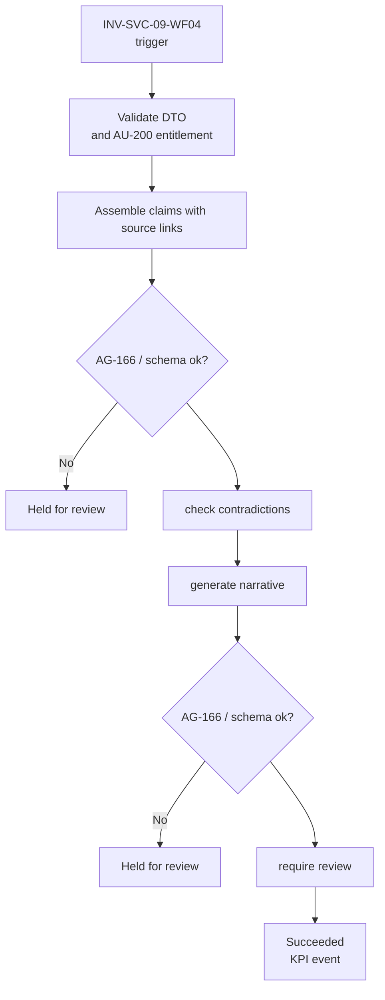

| Test ID | V12 / class ID | Level | Fixture / action | Expected (blueprint assertion) |
|---|---|---|---|---|
| TC-V12-N-459 | INV-SVC-09-WF04-AT01 | IT | Approved issuer facts, financial evidence, audience requirements | Output validates against the workflow schema; evidence persisted; run Succeeded; KPI event emitted; output "Evidence-linked pitch draft"; KPI: contradictions detected (recall on eval set) ≥ 90% |
| TC-V12-N-460 | INV-SVC-09-WF04-TC-INPUT | UT/CT | missing or malformed input | HTTP 422 with field errors; no StepRun; audit `dto.rejected` |
| TC-V12-N-461 | INV-SVC-09-WF04-TC-SCOPE | SEC | same reference from another tenant/startup | HTTP 403 or uniform 404 (BRL-TEN-04); zero rows/events/provider calls in the other scope |
| TC-V12-N-462 | INV-SVC-09-WF04-TC-ENT | IT | revoke INV SKU after enqueue | AU-200 dispatch-time recheck denies; run Paused/Held; reservation released; no effect |
| TC-V12-N-463 | INV-SVC-09-WF04-TC-DUP | IT replay | replay identical event / step key | exactly one accepted outcome, effect and meter charge; duplicate returns original run ref |
| TC-V12-N-464 | INV-SVC-09-WF04-TC-QUALITY | AIE | stale, conflicting or incomplete evidence | step Held or flagged; no unsupported claim reaches output (BRL-AI-03/04); eval record stored |
| TC-V12-N-465 | INV-SVC-09-WF04-TC-BUDGET | IT | quota exhausted at reservation | reservation fails → Blocked; zero provider calls; owner notified |
| TC-V12-N-466 | INV-SVC-09-WF04-TC-RECOVERY | CHAOS | provider timeout or worker crash | timeout after submit → Reconciling; resume from checkpoint without repeating a completed effect |
| TC-V12-N-467 | INV-SVC-09-WF04-TC-SEC | SEC/compliance | SEC-CTL-N-05: input asks "should I invest / what return will I get" | AG-166 ADVICE → refusal TPL-N-01 + handover; no AI answer stored as reply |

#### INV-SVC-10 Due Diligence & Secure Data Room Automation

**Purpose:** Organize fundraising evidence and control eligible diligence access (workbook Service Catalog row 14). **Epic:** EP-31. **Service spec:** Part 11.16a §11.16.5.6.10. **Stories:** Part 11.16e.

| Field | Specification |
|---|---|
| Family / bundle / meter | Due diligence · Full suite / Diligence & Conversion bundle / selective (1 SKU); entitlement and usage approval required. · Illustrative pilot: 200 diligence item(s)/month; 1 concurrent run; configurable hard budget, provider quota and frequency limits. Not approved. |
| Supported channels | Private data room, authorized document exchange |
| Industries / capability | Fundraising issuers across eligible sectors; grant/debt/CSR route requires eligibility · Due diligence and data-room access |
| Required entitlements | INV-SVC-10 + foundation; tenant/startup, capability, role, channel/provider and budget checks at every action |
| Optional input producers | Included foundation; no mandatory upstream paid service; optional input producers: INV-SVC-09; authorized equivalent input accepted. |
| External providers | Secure object storage; optional OCR/e-sign; licensed access only (verify terms and prices at implementation, as of 27 Nov 2026) |
| Service KPI (V12) | Unauthorized room access = 0; expiry revocation checks 100% |
| Actors (blueprint roles) | R02; R02 · R10; R02 · R10 (restricted); R19 service identity; R20 agent identity |
| Agents | AG-176, AG-171, AG-004 |
| Automations | AU-204, AU-221, AU-222, AU-005 |
| Shared engines (V12) | AI knowledge and RAG; Workflow orchestration; Governance |
| Data class and gateway tier | Confidential-Financial / Legal; no Tier 2; residency enforced; Tier 1a classification; Tier 1b grounded answers |
| Screens | A025; A026; A027 → A223, A224, A225 |
| V12 DB candidates → blueprint | inv_access_grant; inv_contact_evidence; inv_diligence_request; inv_disclosure; inv_document; inv_evidence; inv_guarantee_evidence; inv_mandate; inv_nda; inv_room; inv_room_item → schema `inv` same names (DEC-814 keeps V12 names; RLS per §11.16.5.10) |

##### INV-SVC-10-WF01 Document collection and classification

**Requirement FR-V12-N-137** (status before: Not covered, CONFLICT-958; after: Matched). Execute "Document collection and classification" as a typed, policy-checked workflow: Scan and classify files; extract metadata; record version and retention; stage for review; output "Indexed diligence records".

| Field | Specification |
|---|---|
| Business outcome / input → output | Document collection and classification: Authorized files and issuer scope → Indexed diligence records |
| Trigger | Manual request or validated upstream business event |
| Result / acceptance | Indexed diligence records; acceptance INV-SVC-10-WF01-AT01 (Document collection and classification) → TC-V12-N-472 |
| Domain contract | Validator `urn:inv:dto:INV-SVC-10-WF01:v2`; fields below; event envelope per FR-V12-N-006 |
| Risk and authority | R0 · V12 side effect: Internal analysis/draft; no external action without separate authorization |
| Autonomy in blueprint | Indexing L3; grants L1 (R02 approves; R10 for restricted docs); expiry revocation L3 deterministic |
| Approval gate (V12) | Reviewer approves sensitive disclosures and grants; revoke access on expiry |
| Operating mode / modalities | AI-assisted / supervised; controlled autonomous only for preapproved eligible routine steps; simulation has zero external effects. · Text; structured records; documents |
| Agent / automations | AG-176 · AU-222 |
| Roles | R02 |
| Step classes | 1 Evidence retrieval; 1 AI inference; 1 Domain persistence; 1 Human review routing |
| Securities and privacy controls | SEC-CTL-N-04, SEC-CTL-N-16 (see step column) |
| Workflow KPI (V12 service) | Unauthorized room access = 0; expiry revocation checks 100% |
| KPI formulas (this part) | classification accuracy (reviewed) ≥ 95%; malware-scanned before indexing = 100% |
| SLA | ≤ 2 min per 50 MB |
| Illustrative cost (V12) | 1 workflow invocation; not a full service cycle; tokens 3500 in / 350 out; INR 1.13 per invocation; external fees excluded (estimate; verify at implementation, as of 27 Nov 2026) |
| Versions / origin | workflow 2.0-target; INV-SVC-10-WF01-AT01; synthetic dry run and measured benchmark pending; V12 status: Proposed; test Not run; live execution and pricing pending. |
| Rules | R1. Files scanned (ClamAV) before storage; staged for review |

**DTO `urn:inv:dto:INV-SVC-10-WF01:v2`**

| Field | Dir | Req | Type / validation | Schema constraint | Blueprint mapping |
|---|---|---|---|---|---|
| `file_refs` | in | Y | typed references, resolved in caller scope | `{"type": "array", "items": {"type": "string", "format": "uuid"}, "maxItems": 500}` | run payload (inv_workflow_run.output_json) |
| `issuer_scope` | in | Y | reference in caller tenant/startup | `{"type": "string", "format": "uuid"}` | run payload (inv_workflow_run.output_json) |
| `document_ids` | out | Y | typed references, resolved in caller scope | `{"type": "array", "items": {"type": "string", "format": "uuid"}, "maxItems": 500}` | inv_document.id[] |
| `doc_class` | out | Y | configured enum (doc_class) | `{"type": "string", "maxLength": 64, "$comment": "values from registry doc_class"}` | run payload (inv_workflow_run.output_json) |
| `sensitivity` | out | Y | configured enum (sensitivity) | `{"type": "string", "maxLength": 64, "$comment": "values from registry sensitivity"}` | run payload (inv_workflow_run.output_json) |
| `retention_until` | out | Y | RFC 3339; stored UTC | `{"type": "string", "format": "date-time"}` | run payload (inv_workflow_run.output_json) |
| `correlation_id` | in | Y | trace id | `{"type": "string", "format": "uuid"}` | inv_workflow_run.correlation_id |
| `simulation` | in | N | zero-effect run | `{"type": "boolean", "default": false}` | inv_workflow_run.simulation |

| Step ID | Action | Class · executor | Output / validation | Failure → state | Blueprint component | Controls in this step | Step test |
|---|---|---|---|---|---|---|---|
| INV-SVC-10-WF01-STEP-01 | Scan and classify files | Evidence retrieval · Ingestion / connector engine | evidence_set {items, source_ref, observed_at, hash, rights} | SOURCE_DENIED → **Held** | Ingestion via AU-007 source permission, AU-014 host filter, AU-005 sanitizer | CTL-16 | TC-V12-N-468 (IT (adapter stub) + SEC): unauthorised or stale source rejected; provenance hash and rights stored |
| INV-SVC-10-WF01-STEP-02 | extract metadata | AI inference · Model gateway + agent | candidate {artifact_ref, confidence, reason_codes, review_state} | REVIEW_REQUIRED → **Waiting (AWAITING_APPROVAL)** | Model gateway AU-001 (Tier 0 → 1a → 1b; Tier 3 degrade), AU-003 schema validation, AG-166 guard on investor-facing text; output is a draft only | CTL-16 | TC-V12-N-469 (AIE + CT schema): output validates against schema; claims cited; AG-166 verdict recorded; untrusted input cannot invoke tools |
| INV-SVC-10-WF01-STEP-03 | record version and retention | Domain persistence · Domain service (investment app) | domain_result {artifact_ref, status, evidence_refs} | INVALID_STATE → **Held** | Domain module: revision check (NFR-025), single transaction with audit and outbox | — (internal; audit only) | TC-V12-N-470 (UT + IT): state change atomic with audit and outbox row |
| INV-SVC-10-WF01-STEP-04 | stage for review | Human review routing · Work queue / approval service | task {queue, assignee_role, sla_due, reason} | SLA_BREACH → **Escalated** | Approval/task service (A207/A220); SLA timers | — (internal; audit only) | TC-V12-N-471 (IT + SYS): task created with correct role and SLA; automation paused until disposition |

| Test ID | V12 / class ID | Level | Fixture / action | Expected (blueprint assertion) |
|---|---|---|---|---|
| TC-V12-N-472 | INV-SVC-10-WF01-AT01 | IT | Authorized files and issuer scope | Output validates against the workflow schema; evidence persisted; run Succeeded; KPI event emitted; output "Indexed diligence records"; KPI: classification accuracy (reviewed) ≥ 95% |
| TC-V12-N-473 | INV-SVC-10-WF01-TC-INPUT | UT/CT | missing or malformed input | HTTP 422 with field errors; no StepRun; audit `dto.rejected` |
| TC-V12-N-474 | INV-SVC-10-WF01-TC-SCOPE | SEC | same reference from another tenant/startup | HTTP 403 or uniform 404 (BRL-TEN-04); zero rows/events/provider calls in the other scope |
| TC-V12-N-475 | INV-SVC-10-WF01-TC-ENT | IT | revoke INV SKU after enqueue | AU-200 dispatch-time recheck denies; run Paused/Held; reservation released; no effect |
| TC-V12-N-476 | INV-SVC-10-WF01-TC-DUP | IT replay | replay identical event / step key | exactly one accepted outcome, effect and meter charge; duplicate returns original run ref |
| TC-V12-N-477 | INV-SVC-10-WF01-TC-QUALITY | AIE | stale, conflicting or incomplete evidence | step Held or flagged; no unsupported claim reaches output (BRL-AI-03/04); eval record stored |
| TC-V12-N-478 | INV-SVC-10-WF01-TC-BUDGET | IT | quota exhausted at reservation | reservation fails → Blocked; zero provider calls; owner notified |
| TC-V12-N-479 | INV-SVC-10-WF01-TC-RECOVERY | CHAOS | provider timeout or worker crash | timeout after submit → Reconciling; resume from checkpoint without repeating a completed effect |
| TC-V12-N-480 | INV-SVC-10-WF01-TC-SEC | SEC/compliance | SEC-CTL-N-04: offering document requested without NDA | 403 NDA_REQUIRED; access log entry outcome=denied |

##### INV-SVC-10-WF02 Scoped access and expiry workflow

**Requirement FR-V12-N-138** (status before: Not covered, CONFLICT-958; after: Matched). Execute "Scoped access and expiry workflow" as a typed, policy-checked workflow: Validate grant and NDA; issue limited access; record expiry; revoke when due; output "Access or denial audit".

| Field | Specification |
|---|---|
| Business outcome / input → output | Scoped access and expiry workflow: Investor identity and approved grant → Access or denial audit |
| Trigger | Scheduled or manual; scoped event on change |
| Result / acceptance | Access or denial audit; acceptance INV-SVC-10-WF02-AT01 (Scoped access and expiry workflow) → TC-V12-N-486 |
| Domain contract | Validator `urn:inv:dto:INV-SVC-10-WF02:v2`; fields below; event envelope per FR-V12-N-006 |
| Risk and authority | R2 disclosure · V12 side effect: Internal analysis/draft; no external action without separate authorization |
| Autonomy in blueprint | Indexing L3; grants L1 (R02 approves; R10 for restricted docs); expiry revocation L3 deterministic |
| Approval gate (V12) | Reviewer approves sensitive disclosures and grants; revoke access on expiry |
| Operating mode / modalities | AI-assisted / supervised; controlled autonomous only for preapproved eligible routine steps; simulation has zero external effects. · Text; structured records |
| Agent / automations | — · AU-221, AU-204, AU-201 |
| Roles | R02 · R10 (restricted) |
| Step classes | 1 Policy check (PDP); 2 External effect (outbox); 1 Domain persistence |
| Securities and privacy controls | SEC-CTL-N-01, SEC-CTL-N-02, SEC-CTL-N-04, SEC-CTL-N-07, SEC-CTL-N-15 (see step column) |
| Workflow KPI (V12 service) | Unauthorized room access = 0; expiry revocation checks 100% |
| KPI formulas (this part) | unauthorized room access = 0; expiry revocation checks = 100% |
| SLA | Grant decision ≤ 1 s; revocation ≤ 60 s after expiry |
| Illustrative cost (V12) | 1 workflow invocation; not a full service cycle; tokens 0 in / 0 out; INR 0.15 per invocation; external fees excluded (estimate; verify at implementation, as of 27 Nov 2026) |
| Versions / origin | workflow 2.0-target; INV-SVC-10-WF02-AT01; synthetic dry run and measured benchmark pending; V12 status: Proposed; test Not run; live execution and pricing pending. |
| Rules | R1. Grant requires eligibility verified, NDA signed, pack active, offering signed off for offering documents |

**DTO `urn:inv:dto:INV-SVC-10-WF02:v2`**

| Field | Dir | Req | Type / validation | Schema constraint | Blueprint mapping |
|---|---|---|---|---|---|
| `investor_id` | in | Y | reference in caller tenant/startup | `{"type": "string", "format": "uuid"}` | inv_investor.id |
| `grant_request_id` | in | Y | reference in caller tenant/startup | `{"type": "string", "format": "uuid"}` | inv_access_grant.id |
| `nda_id` | in | Y | reference in caller tenant/startup | `{"type": "string", "format": "uuid"}` | inv_nda.id |
| `grant_id` | out | Y | reference in caller tenant/startup | `{"type": "string", "format": "uuid"}` | inv_access_grant.id |
| `decision` | out | Y | configured enum (verdict) | `{"type": "string", "maxLength": 64, "$comment": "values from registry verdict"}` | run payload (inv_workflow_run.output_json) |
| `expires_at` | out | Y | RFC 3339; stored UTC | `{"type": "string", "format": "date-time"}` | run payload (inv_workflow_run.output_json) |
| `audit_id` | out | Y | reference in caller tenant/startup | `{"type": "string", "format": "uuid"}` | run payload (inv_workflow_run.output_json) |
| `correlation_id` | in | Y | trace id | `{"type": "string", "format": "uuid"}` | inv_workflow_run.correlation_id |
| `simulation` | in | N | zero-effect run | `{"type": "boolean", "default": false}` | inv_workflow_run.simulation |

| Step ID | Action | Class · executor | Output / validation | Failure → state | Blueprint component | Controls in this step | Step test |
|---|---|---|---|---|---|---|---|
| INV-SVC-10-WF02-STEP-01 | Validate grant and NDA | Policy check (PDP) · PDP + AU-201/AU-202/AU-203/AU-208 | decision {allow/hold/block, reason_codes, pack_versions} | POLICY_DENIED → **Blocked** | PDP (Part 3.1) extended with securities gate (ADR-231); fail closed | CTL-01, CTL-02, CTL-04, CTL-07, CTL-15 | TC-V12-N-481 (UT decision table + IT): every rule branch exercised; unknown → hold/block; reason code and pack version audited |
| INV-SVC-10-WF02-STEP-GATE | Securities and privacy gate (blueprint) | Policy check · PDP securities plug-in / scope + consent + pack + eligibility + solicitation + approval hash or mandate | decision {allow/hold/block, reason_codes, pack_versions} | POLICY_DENIED → **Blocked**; unknown → **Held** | PDP + AU-201/202/203/207 (ADR-231) | CTL-01, CTL-02, CTL-04, CTL-07, CTL-15 | TC-V12-N-485 (UT decision table + IT): every gate branch; fail closed |
| INV-SVC-10-WF02-STEP-02 | issue limited access | External effect (outbox) · Dispatcher via transactional outbox | effect {effect_id, provider_ref, state} | TIMEOUT_AFTER_SUBMIT → **Reconciling** | Outbox (M06) + dispatch-time PDP recheck (scope, consent, pack, eligibility, budget, approval hash) + idempotency key | CTL-01, CTL-15 | TC-V12-N-482 (IT replay + CHAOS): exactly one effect per idempotency key; recheck denies after revocation; uncertain → reconcile before retry |
| INV-SVC-10-WF02-STEP-03 | record expiry | Domain persistence · Domain service (investment app) | domain_result {artifact_ref, status, evidence_refs} | INVALID_STATE → **Held** | Domain module: revision check (NFR-025), single transaction with audit and outbox | — (internal; audit only) | TC-V12-N-483 (UT + IT): state change atomic with audit and outbox row |
| INV-SVC-10-WF02-STEP-04 | revoke when due | External effect (outbox) · Dispatcher via transactional outbox | effect {effect_id, provider_ref, state} | TIMEOUT_AFTER_SUBMIT → **Reconciling** | Outbox (M06) + dispatch-time PDP recheck (scope, consent, pack, eligibility, budget, approval hash) + idempotency key | CTL-01, CTL-15 | TC-V12-N-484 (IT replay + CHAOS): exactly one effect per idempotency key; recheck denies after revocation; uncertain → reconcile before retry |

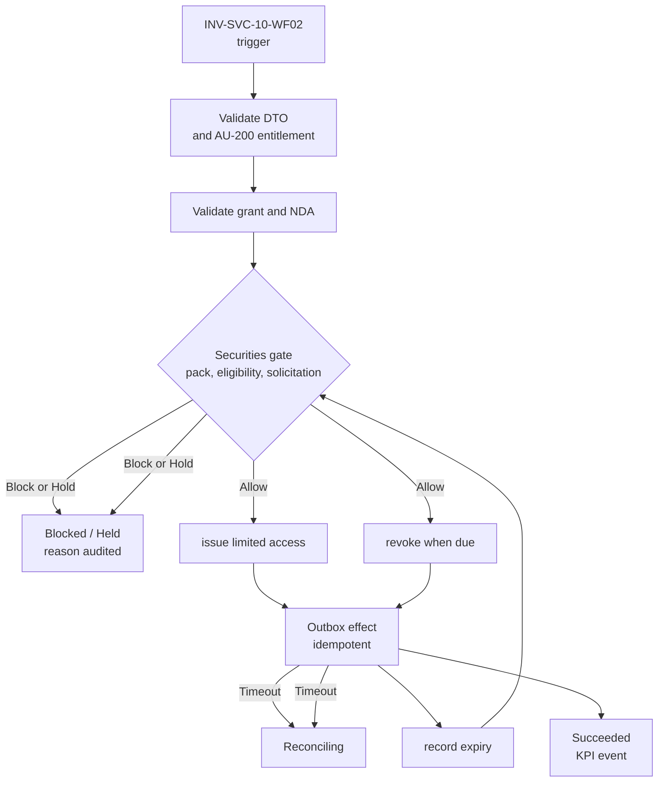

| Test ID | V12 / class ID | Level | Fixture / action | Expected (blueprint assertion) |
|---|---|---|---|---|
| TC-V12-N-486 | INV-SVC-10-WF02-AT01 | IT | Investor identity and approved grant | Output validates against the workflow schema; evidence persisted; run Succeeded; KPI event emitted; output "Access or denial audit"; KPI: unauthorized room access = 0 |
| TC-V12-N-487 | INV-SVC-10-WF02-TC-INPUT | UT/CT | missing or malformed input | HTTP 422 with field errors; no StepRun; audit `dto.rejected` |
| TC-V12-N-488 | INV-SVC-10-WF02-TC-SCOPE | SEC | same reference from another tenant/startup | HTTP 403 or uniform 404 (BRL-TEN-04); zero rows/events/provider calls in the other scope |
| TC-V12-N-489 | INV-SVC-10-WF02-TC-ENT | IT | revoke INV SKU after enqueue | AU-200 dispatch-time recheck denies; run Paused/Held; reservation released; no effect |
| TC-V12-N-490 | INV-SVC-10-WF02-TC-DUP | IT replay | replay identical event / step key | exactly one accepted outcome, effect and meter charge; duplicate returns original run ref |
| TC-V12-N-491 | INV-SVC-10-WF02-TC-QUALITY | AIE | stale, conflicting or incomplete evidence | step Held or flagged; no unsupported claim reaches output (BRL-AI-03/04); eval record stored |
| TC-V12-N-492 | INV-SVC-10-WF02-TC-BUDGET | IT | quota exhausted at reservation | reservation fails → Blocked; zero provider calls; owner notified |
| TC-V12-N-493 | INV-SVC-10-WF02-TC-RECOVERY | CHAOS | provider timeout or worker crash | timeout after submit → Reconciling; resume from checkpoint without repeating a completed effect |
| TC-V12-N-494 | INV-SVC-10-WF02-TC-SEC | SEC/compliance | SEC-CTL-N-04: offering document requested without NDA | 403 NDA_REQUIRED; access log entry outcome=denied |
| TC-V12-N-495 | INV-SVC-10-WF02-TC-APPROVAL | IT | approval missing, single approver or hash mismatch | Waiting (AWAITING_APPROVAL) or Block APPROVAL_INCOMPLETE/HASH_MISMATCH; NSE |
| TC-V12-N-496 | INV-SVC-10-WF02-TC-EFFECT | IT + CHAOS | effect after approval; pack expires between approval and dispatch | dispatch-time AU-201 recheck blocks; no effect; approval retained; audit `pack.expired` |

##### INV-SVC-10-WF03 Question and answer tracking

**Requirement FR-V12-N-139** (status before: Not covered, CONFLICT-958; after: Matched). Execute "Question and answer tracking" as a typed, policy-checked workflow: Classify request; retrieve permitted documents; prepare grounded answer; route for approval; output "Diligence response and status".

| Field | Specification |
|---|---|
| Business outcome / input → output | Question and answer tracking: Diligence question and allowed evidence → Diligence response and status |
| Trigger | Scheduled or manual; scoped event on change |
| Result / acceptance | Diligence response and status; acceptance INV-SVC-10-WF03-AT01 (Question and answer tracking) → TC-V12-N-501 |
| Domain contract | Validator `urn:inv:dto:INV-SVC-10-WF03:v2`; fields below; event envelope per FR-V12-N-006 |
| Risk and authority | R1 · V12 side effect: Internal analysis/draft; no external action without separate authorization |
| Autonomy in blueprint | Indexing L3; grants L1 (R02 approves; R10 for restricted docs); expiry revocation L3 deterministic |
| Approval gate (V12) | Reviewer approves sensitive disclosures and grants; revoke access on expiry |
| Operating mode / modalities | AI-assisted / supervised; controlled autonomous only for preapproved eligible routine steps; simulation has zero external effects. · Text; structured records |
| Agent / automations | AG-171 + AG-166 · AU-204 |
| Roles | R02 · R10 |
| Step classes | 2 AI inference; 1 Evidence retrieval; 1 Human review routing |
| Securities and privacy controls | SEC-CTL-N-04, SEC-CTL-N-05 (see step column) |
| Workflow KPI (V12 service) | Unauthorized room access = 0; expiry revocation checks 100% |
| KPI formulas (this part) | answer turnaround ≤ 2 business days ≥ 90%; answers citing un-granted documents = 0 |
| SLA | Draft ≤ 30 s |
| Illustrative cost (V12) | 1 workflow invocation; not a full service cycle; tokens 4000 in / 700 out; INR 1.5099999999999998 per invocation; external fees excluded (estimate; verify at implementation, as of 27 Nov 2026) |
| Versions / origin | workflow 2.0-target; INV-SVC-10-WF03-AT01; synthetic dry run and measured benchmark pending; V12 status: Proposed; test Not run; live execution and pricing pending. |
| Rules | R1. Answers approved before release; same answer shared with all investors where material (fair disclosure) |

**DTO `urn:inv:dto:INV-SVC-10-WF03:v2`**

| Field | Dir | Req | Type / validation | Schema constraint | Blueprint mapping |
|---|---|---|---|---|---|
| `question_id` | in | Y | reference in caller tenant/startup | `{"type": "string", "format": "uuid"}` | inv_diligence_request.id |
| `allowed_document_ids` | in | Y | typed references, resolved in caller scope | `{"type": "array", "items": {"type": "string", "format": "uuid"}, "maxItems": 500}` | inv_document.id[] |
| `answer_draft_id` | out | Y | reference in caller tenant/startup | `{"type": "string", "format": "uuid"}` | inv_message.id |
| `citations` | out | Y | typed references, resolved in caller scope | `{"type": "array", "items": {"type": "string", "format": "uuid"}, "maxItems": 500}` | run payload (inv_workflow_run.output_json) |
| `status` | out | Y | configured enum (approval_state) | `{"type": "string", "maxLength": 64, "$comment": "values from registry approval_state"}` | run payload (inv_workflow_run.output_json) |
| `correlation_id` | in | Y | trace id | `{"type": "string", "format": "uuid"}` | inv_workflow_run.correlation_id |
| `simulation` | in | N | zero-effect run | `{"type": "boolean", "default": false}` | inv_workflow_run.simulation |

| Step ID | Action | Class · executor | Output / validation | Failure → state | Blueprint component | Controls in this step | Step test |
|---|---|---|---|---|---|---|---|
| INV-SVC-10-WF03-STEP-01 | Classify request | AI inference · Model gateway + agent | candidate {artifact_ref, confidence, reason_codes, review_state} | REVIEW_REQUIRED → **Waiting (AWAITING_APPROVAL)** | Model gateway AU-001 (Tier 0 → 1a → 1b; Tier 3 degrade), AU-003 schema validation, AG-166 guard on investor-facing text; output is a draft only | CTL-05 | TC-V12-N-497 (AIE + CT schema): output validates against schema; claims cited; AG-166 verdict recorded; untrusted input cannot invoke tools |
| INV-SVC-10-WF03-STEP-02 | retrieve permitted documents | Evidence retrieval · Ingestion / connector engine | evidence_set {items, source_ref, observed_at, hash, rights} | SOURCE_DENIED → **Held** | Ingestion via AU-007 source permission, AU-014 host filter, AU-005 sanitizer | CTL-16 | TC-V12-N-498 (IT (adapter stub) + SEC): unauthorised or stale source rejected; provenance hash and rights stored |
| INV-SVC-10-WF03-STEP-03 | prepare grounded answer | AI inference · Model gateway + agent | candidate {artifact_ref, confidence, reason_codes, review_state} | REVIEW_REQUIRED → **Waiting (AWAITING_APPROVAL)** | Model gateway AU-001 (Tier 0 → 1a → 1b; Tier 3 degrade), AU-003 schema validation, AG-166 guard on investor-facing text; output is a draft only | CTL-05 | TC-V12-N-499 (AIE + CT schema): output validates against schema; claims cited; AG-166 verdict recorded; untrusted input cannot invoke tools |
| INV-SVC-10-WF03-STEP-04 | route for approval | Human review routing · Work queue / approval service | task {queue, assignee_role, sla_due, reason} | SLA_BREACH → **Escalated** | Approval/task service (A207/A220); SLA timers | — (internal; audit only) | TC-V12-N-500 (IT + SYS): task created with correct role and SLA; automation paused until disposition |

| Test ID | V12 / class ID | Level | Fixture / action | Expected (blueprint assertion) |
|---|---|---|---|---|
| TC-V12-N-501 | INV-SVC-10-WF03-AT01 | IT | Diligence question and allowed evidence | Output validates against the workflow schema; evidence persisted; run Succeeded; KPI event emitted; output "Diligence response and status"; KPI: answer turnaround ≤ 2 business days ≥ 90% |
| TC-V12-N-502 | INV-SVC-10-WF03-TC-INPUT | UT/CT | missing or malformed input | HTTP 422 with field errors; no StepRun; audit `dto.rejected` |
| TC-V12-N-503 | INV-SVC-10-WF03-TC-SCOPE | SEC | same reference from another tenant/startup | HTTP 403 or uniform 404 (BRL-TEN-04); zero rows/events/provider calls in the other scope |
| TC-V12-N-504 | INV-SVC-10-WF03-TC-ENT | IT | revoke INV SKU after enqueue | AU-200 dispatch-time recheck denies; run Paused/Held; reservation released; no effect |
| TC-V12-N-505 | INV-SVC-10-WF03-TC-DUP | IT replay | replay identical event / step key | exactly one accepted outcome, effect and meter charge; duplicate returns original run ref |
| TC-V12-N-506 | INV-SVC-10-WF03-TC-QUALITY | AIE | stale, conflicting or incomplete evidence | step Held or flagged; no unsupported claim reaches output (BRL-AI-03/04); eval record stored |
| TC-V12-N-507 | INV-SVC-10-WF03-TC-BUDGET | IT | quota exhausted at reservation | reservation fails → Blocked; zero provider calls; owner notified |
| TC-V12-N-508 | INV-SVC-10-WF03-TC-RECOVERY | CHAOS | provider timeout or worker crash | timeout after submit → Reconciling; resume from checkpoint without repeating a completed effect |
| TC-V12-N-509 | INV-SVC-10-WF03-TC-SEC | SEC/compliance | SEC-CTL-N-04: offering document requested without NDA | 403 NDA_REQUIRED; access log entry outcome=denied |

##### INV-SVC-10-WF04 Continuous data room readiness and evidence-gap detection

**Requirement FR-V12-N-140** (status before: Not covered, CONFLICT-958; after: Matched). Execute "Continuous data room readiness and evidence-gap detection" as a typed, policy-checked workflow: Compare required evidence and expiry; detect missing/stale documents; assign remediation; output "Readiness report and tasks".

| Field | Specification |
|---|---|
| Business outcome / input → output | Continuous data room readiness and evidence-gap detection: Document inventory, access policy, diligence checklist → Readiness report and tasks |
| Trigger | Manual; scheduled or relevant validated business event; provider webhook only where authorized |
| Result / acceptance | Readiness report and tasks; acceptance INV-SVC-10-WF04-AT01 (Continuous data room readiness and evidence-gap detection) → TC-V12-N-513 |
| Domain contract | Validator `urn:inv:dto:INV-SVC-10-WF04:v2`; fields below; event envelope per FR-V12-N-006 |
| Risk and authority | R0 · V12 side effect: Internal analysis/draft; no external action without separate authorization |
| Autonomy in blueprint | Indexing L3; grants L1 (R02 approves; R10 for restricted docs); expiry revocation L3 deterministic |
| Approval gate (V12) | Approve source/data rights and applicable external actions; qualified reviewer confirms legal/financial claims and any offer, filing, ownership change or payment; no autonomous regulated decision. |
| Operating mode / modalities | AI-assisted / supervised; controlled autonomous only for preapproved eligible routine steps; simulation has zero external effects. · Text; structured records; documents |
| Agent / automations | AG-176 · AU-222 |
| Roles | R02 |
| Step classes | 2 Deterministic calculation; 1 Human review routing |
| Securities and privacy controls | SEC-CTL-N-04 (see step column) |
| Workflow KPI (V12 service) | Unauthorized room access = 0; expiry revocation checks 100% |
| KPI formulas (this part) | readiness score trend; expired documents in room = 0 |
| SLA | Daily ≤ 30 min |
| Illustrative cost (V12) | 1 invocation; text component only; tokens 1200 in / 200 out; INR 0.55 per invocation; external fees excluded (estimate; verify at implementation, as of 27 Nov 2026) |
| Versions / origin | workflow 1.0-target; INV-SVC-10-WF04-AT01; synthetic dry run and measured benchmark pending; V12 status: Proposed; test Not run; live execution and pricing pending. |
| Rules | R1. Checklist versions per offering route |

**DTO `urn:inv:dto:INV-SVC-10-WF04:v2`**

| Field | Dir | Req | Type / validation | Schema constraint | Blueprint mapping |
|---|---|---|---|---|---|
| `inventory_id` | in | Y | reference in caller tenant/startup | `{"type": "string", "format": "uuid"}` | run payload (inv_workflow_run.output_json) |
| `policy_id` | in | Y | reference in caller tenant/startup | `{"type": "string", "format": "uuid"}` | run payload (inv_workflow_run.output_json) |
| `checklist_id` | in | Y | reference in caller tenant/startup | `{"type": "string", "format": "uuid"}` | run payload (inv_workflow_run.output_json) |
| `readiness_report_id` | out | Y | reference in caller tenant/startup | `{"type": "string", "format": "uuid"}` | run payload (inv_workflow_run.output_json) |
| `gap_ids` | out | Y | typed references, resolved in caller scope | `{"type": "array", "items": {"type": "string", "format": "uuid"}, "maxItems": 500}` | run payload (inv_workflow_run.output_json) |
| `task_ids` | out | Y | typed references, resolved in caller scope | `{"type": "array", "items": {"type": "string", "format": "uuid"}, "maxItems": 500}` | inv_task.id[] |
| `correlation_id` | in | Y | trace id | `{"type": "string", "format": "uuid"}` | inv_workflow_run.correlation_id |
| `simulation` | in | N | zero-effect run | `{"type": "boolean", "default": false}` | inv_workflow_run.simulation |

| Step ID | Action | Class · executor | Output / validation | Failure → state | Blueprint component | Controls in this step | Step test |
|---|---|---|---|---|---|---|---|
| INV-SVC-10-WF04-STEP-01 | Compare required evidence and expiry | Deterministic calculation · Rules / calculation engine | calculation {value, unit, assumptions, evidence_refs} | INVALID_INPUT → **Held** | Deterministic domain service; Decimal (DEC-027); zero model calls | — (internal; audit only) | TC-V12-N-510 (UT golden fixture): golden fixture exact; missing value never invented |
| INV-SVC-10-WF04-STEP-02 | detect missing/stale documents | Deterministic calculation · Rules / calculation engine | calculation {value, unit, assumptions, evidence_refs} | INVALID_INPUT → **Held** | Deterministic domain service; Decimal (DEC-027); zero model calls | — (internal; audit only) | TC-V12-N-511 (UT golden fixture): golden fixture exact; missing value never invented |
| INV-SVC-10-WF04-STEP-03 | assign remediation | Human review routing · Work queue / approval service | task {queue, assignee_role, sla_due, reason} | SLA_BREACH → **Escalated** | Approval/task service (A207/A220); SLA timers | — (internal; audit only) | TC-V12-N-512 (IT + SYS): task created with correct role and SLA; automation paused until disposition |

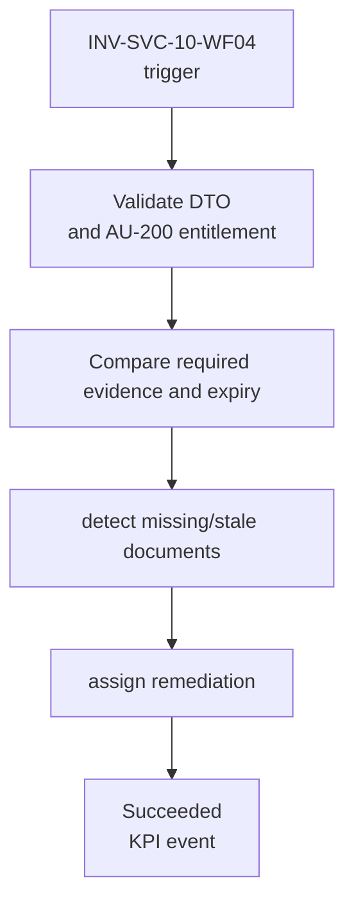

| Test ID | V12 / class ID | Level | Fixture / action | Expected (blueprint assertion) |
|---|---|---|---|---|
| TC-V12-N-513 | INV-SVC-10-WF04-AT01 | IT | Document inventory, access policy, diligence checklist | Output validates against the workflow schema; evidence persisted; run Succeeded; KPI event emitted; output "Readiness report and tasks"; KPI: readiness score trend |
| TC-V12-N-514 | INV-SVC-10-WF04-TC-INPUT | UT/CT | missing or malformed input | HTTP 422 with field errors; no StepRun; audit `dto.rejected` |
| TC-V12-N-515 | INV-SVC-10-WF04-TC-SCOPE | SEC | same reference from another tenant/startup | HTTP 403 or uniform 404 (BRL-TEN-04); zero rows/events/provider calls in the other scope |
| TC-V12-N-516 | INV-SVC-10-WF04-TC-ENT | IT | revoke INV SKU after enqueue | AU-200 dispatch-time recheck denies; run Paused/Held; reservation released; no effect |
| TC-V12-N-517 | INV-SVC-10-WF04-TC-DUP | IT replay | replay identical event / step key | exactly one accepted outcome, effect and meter charge; duplicate returns original run ref |
| TC-V12-N-518 | INV-SVC-10-WF04-TC-QUALITY | AIE | stale, conflicting or incomplete evidence | step Held or flagged; no unsupported claim reaches output (BRL-AI-03/04); eval record stored |
| TC-V12-N-519 | INV-SVC-10-WF04-TC-BUDGET | IT | quota exhausted at reservation | reservation fails → Blocked; zero provider calls; owner notified |
| TC-V12-N-520 | INV-SVC-10-WF04-TC-RECOVERY | CHAOS | provider timeout or worker crash | timeout after submit → Reconciling; resume from checkpoint without repeating a completed effect |
| TC-V12-N-521 | INV-SVC-10-WF04-TC-SEC | SEC/compliance | SEC-CTL-N-04: offering document requested without NDA | 403 NDA_REQUIRED; access log entry outcome=denied |

#### INV-SVC-11 Investment Terms, Offers & Agreement Automation

**Purpose:** Prepare and manage controlled formal fundraising offers and investor applications (workbook Service Catalog row 15). **Epic:** EP-31. **Service spec:** Part 11.16a §11.16.5.6.11. **Stories:** Part 11.16e.

| Field | Specification |
|---|---|
| Family / bundle / meter | Investment conversion · Full suite / Diligence & Conversion bundle / selective (1 SKU); entitlement and usage approval required. · Illustrative pilot: 50 offer or application case(s)/month; 1 concurrent run; configurable hard budget, provider quota and frequency limits. Not approved. |
| Supported channels | Private authorized exchange, eligible direct channel |
| Industries / capability | Fundraising issuers across eligible sectors; grant/debt/CSR route requires eligibility · Private offers and agreements |
| Required entitlements | INV-SVC-11 + foundation; tenant/startup, capability, role, channel/provider and budget checks at every action |
| Optional input producers | Included foundation; no mandatory upstream paid service; optional input producers: INV-SVC-02; INV-SVC-10; INV-SVC-09; authorized equivalent input accepted. |
| External providers | Authorized identity/e-sign provider; legal adviser; no public securities listing (verify terms and prices at implementation, as of 27 Nov 2026) |
| Service KPI (V12) | Unapproved formal offers = 0; approved revision checks 100% |
| Actors (blueprint roles) | R02 + R10; R02 + R10 (two-person) · R10C sign-off; R02 · R10; R02 · R10 · R10C; R19 service identity; R20 agent identity |
| Agents | AG-177, AG-166, AG-179, AG-022 |
| Automations | AU-205, AU-206, AU-207, AU-223, AU-224, AU-201, AU-202, AU-036 |
| Shared engines (V12) | Document generation; Workflow orchestration; Governance |
| Data class and gateway tier | Confidential-Financial / Legal; identity evidence references only; no Tier 2; Tier 1b drafting assist; deterministic everything else |
| Screens | A030; A031; A032; A035; A005 → A207, A228, A229, A230, A232 |
| V12 DB candidates → blueprint | inv_agreement; inv_approval; inv_enrollment; inv_offer; inv_offer_batch; inv_offer_recipient; inv_term_version; inv_verification_case → schema `inv` same names (DEC-814 keeps V12 names; RLS per §11.16.5.10) |

##### INV-SVC-11-WF01 Terms and agreement preparation

**Requirement FR-V12-N-141** (status before: Not covered, CONFLICT-958; after: Matched). Execute "Terms and agreement preparation" as a typed, policy-checked workflow: Validate terms version; draft agreement; route legal review; freeze approved revision; output "Agreement draft and approval record".

| Field | Specification |
|---|---|
| Business outcome / input → output | Terms and agreement preparation: Approved terms and investor context → Agreement draft and approval record |
| Trigger | Manual request or validated upstream business event |
| Result / acceptance | Agreement draft and approval record; acceptance INV-SVC-11-WF01-AT01 (Terms and agreement preparation) → TC-V12-N-526 |
| Domain contract | Validator `urn:inv:dto:INV-SVC-11-WF01:v2`; fields below; event envelope per FR-V12-N-006 |
| Risk and authority | R1 · V12 side effect: Internal analysis/draft; no external action without separate authorization |
| Autonomy in blueprint | L1 maximum for offers, batches, agreements and acceptance (two-person, hash-bound, per action); AI never signs, issues or accepts; no mandate may authorise these actions (Group O CP-O-04, DEC-822) |
| Approval gate (V12) | Explicit legal and issuer approval for offer, recipient batch, agreement and application acceptance |
| Operating mode / modalities | Manual / supervised review; preparation only if gate not satisfied · Text; structured records |
| Agent / automations | AG-177 · AU-206 |
| Roles | R02 · R10 · R10C |
| Step classes | 1 Deterministic calculation; 1 AI inference; 1 Human review routing; 1 Domain persistence |
| Securities and privacy controls | SEC-CTL-N-08, SEC-CTL-N-13 (see step column) |
| Workflow KPI (V12 service) | Unapproved formal offers = 0; approved revision checks 100% |
| KPI formulas (this part) | approved revision checks = 100%; drafts reaching legal with template deviations flagged = 100% |
| SLA | Draft ≤ 60 s; legal review 3 business days |
| Illustrative cost (V12) | 1 workflow invocation; not a full service cycle; tokens 5000 in / 1000 out; INR 1.95 per invocation; external fees excluded (estimate; verify at implementation, as of 27 Nov 2026) |
| Versions / origin | workflow 2.0-target; INV-SVC-11-WF01-AT01; synthetic dry run and measured benchmark pending; V12 status: Proposed; test Not run; live execution and pricing pending. |
| Rules | R1. Agreements generated only from counsel-approved templates |

**DTO `urn:inv:dto:INV-SVC-11-WF01:v2`**

| Field | Dir | Req | Type / validation | Schema constraint | Blueprint mapping |
|---|---|---|---|---|---|
| `term_version_id` | in | Y | reference in caller tenant/startup | `{"type": "string", "format": "uuid"}` | inv_term_version.id |
| `investor_context_id` | in | Y | reference in caller tenant/startup | `{"type": "string", "format": "uuid"}` | inv_investor.id |
| `agreement_draft_id` | out | Y | reference in caller tenant/startup | `{"type": "string", "format": "uuid"}` | inv_agreement.id |
| `approval_id` | out | Y | reference in caller tenant/startup | `{"type": "string", "format": "uuid"}` | run payload (inv_workflow_run.output_json) |
| `frozen_hash` | out | Y | SHA-256 hex | `{"type": "string", "pattern": "^[a-f0-9]{64}$"}` | run payload (inv_workflow_run.output_json) |
| `correlation_id` | in | Y | trace id | `{"type": "string", "format": "uuid"}` | inv_workflow_run.correlation_id |
| `simulation` | in | N | zero-effect run | `{"type": "boolean", "default": false}` | inv_workflow_run.simulation |

| Step ID | Action | Class · executor | Output / validation | Failure → state | Blueprint component | Controls in this step | Step test |
|---|---|---|---|---|---|---|---|
| INV-SVC-11-WF01-STEP-01 | Validate terms version | Deterministic calculation · Rules / calculation engine | calculation {value, unit, assumptions, evidence_refs} | INVALID_INPUT → **Held** | Deterministic domain service; Decimal (DEC-027); zero model calls | CTL-13 | TC-V12-N-522 (UT golden fixture): golden fixture exact; missing value never invented |
| INV-SVC-11-WF01-STEP-02 | draft agreement | AI inference · Model gateway + agent | candidate {artifact_ref, confidence, reason_codes, review_state} | REVIEW_REQUIRED → **Waiting (AWAITING_APPROVAL)** | Model gateway AU-001 (Tier 0 → 1a → 1b; Tier 3 degrade), AU-003 schema validation, AG-166 guard on investor-facing text; output is a draft only | CTL-13 | TC-V12-N-523 (AIE + CT schema): output validates against schema; claims cited; AG-166 verdict recorded; untrusted input cannot invoke tools |
| INV-SVC-11-WF01-STEP-03 | route legal review | Human review routing · Work queue / approval service | task {queue, assignee_role, sla_due, reason} | SLA_BREACH → **Escalated** | Approval/task service (A207/A220); SLA timers | CTL-08 | TC-V12-N-524 (IT + SYS): task created with correct role and SLA; automation paused until disposition |
| INV-SVC-11-WF01-STEP-04 | freeze approved revision | Domain persistence · Domain service (investment app) | domain_result {artifact_ref, status, evidence_refs} | INVALID_STATE → **Held** | Domain module: revision check (NFR-025), single transaction with audit and outbox | — (internal; audit only) | TC-V12-N-525 (UT + IT): state change atomic with audit and outbox row |

| Test ID | V12 / class ID | Level | Fixture / action | Expected (blueprint assertion) |
|---|---|---|---|---|
| TC-V12-N-526 | INV-SVC-11-WF01-AT01 | IT | Approved terms and investor context | Output validates against the workflow schema; evidence persisted; run Succeeded; KPI event emitted; output "Agreement draft and approval record"; KPI: approved revision checks = 100% |
| TC-V12-N-527 | INV-SVC-11-WF01-TC-INPUT | UT/CT | missing or malformed input | HTTP 422 with field errors; no StepRun; audit `dto.rejected` |
| TC-V12-N-528 | INV-SVC-11-WF01-TC-SCOPE | SEC | same reference from another tenant/startup | HTTP 403 or uniform 404 (BRL-TEN-04); zero rows/events/provider calls in the other scope |
| TC-V12-N-529 | INV-SVC-11-WF01-TC-ENT | IT | revoke INV SKU after enqueue | AU-200 dispatch-time recheck denies; run Paused/Held; reservation released; no effect |
| TC-V12-N-530 | INV-SVC-11-WF01-TC-DUP | IT replay | replay identical event / step key | exactly one accepted outcome, effect and meter charge; duplicate returns original run ref |
| TC-V12-N-531 | INV-SVC-11-WF01-TC-QUALITY | AIE | stale, conflicting or incomplete evidence | step Held or flagged; no unsupported claim reaches output (BRL-AI-03/04); eval record stored |
| TC-V12-N-532 | INV-SVC-11-WF01-TC-BUDGET | IT | quota exhausted at reservation | reservation fails → Blocked; zero provider calls; owner notified |
| TC-V12-N-533 | INV-SVC-11-WF01-TC-RECOVERY | CHAOS | provider timeout or worker crash | timeout after submit → Reconciling; resume from checkpoint without repeating a completed effect |
| TC-V12-N-534 | INV-SVC-11-WF01-TC-SEC | SEC/compliance | SEC-CTL-N-08: document set changed after counsel sign-off | sign-off void; offering back to Draft; Block |

##### INV-SVC-11-WF02 Formal offer and expiry workflow

**Requirement FR-V12-N-142** (status before: Not covered, CONFLICT-958; after: Matched). Execute "Formal offer and expiry workflow" as a typed, policy-checked workflow: Check issuer and jurisdiction; require explicit approval; prepare controlled delivery; track expiry; output "Offer decision and expiry task".

| Field | Specification |
|---|---|
| Business outcome / input → output | Formal offer and expiry workflow: Approved recipient eligibility and offer revision → Offer decision and expiry task |
| Trigger | Scheduled or manual; scoped event on change |
| Result / acceptance | Offer decision and expiry task; acceptance INV-SVC-11-WF02-AT01 (Formal offer and expiry workflow) → TC-V12-N-540 |
| Domain contract | Validator `urn:inv:dto:INV-SVC-11-WF02:v2`; fields below; event envelope per FR-V12-N-006 |
| Risk and authority | R3 consequential legal · V12 side effect: Consequential financial/legal or authority-bearing action; prepare only until authorized |
| Autonomy in blueprint | L1 maximum for offers, batches, agreements and acceptance (two-person, hash-bound, per action); AI never signs, issues or accepts; no mandate may authorise these actions (Group O CP-O-04, DEC-822) |
| Approval gate (V12) | Explicit legal and issuer approval for offer, recipient batch, agreement and application acceptance |
| Operating mode / modalities | Manual / supervised review; preparation only if gate not satisfied · Text; structured records |
| Agent / automations | — (deterministic) · AU-205, AU-206, AU-207, AU-223, AU-201 |
| Roles | R02 + R10 (two-person) · R10C sign-off |
| Step classes | 1 Policy check (PDP); 1 Human review routing; 1 External effect (outbox); 1 Domain persistence |
| Securities and privacy controls | SEC-CTL-N-01, SEC-CTL-N-02, SEC-CTL-N-03, SEC-CTL-N-04, SEC-CTL-N-08, SEC-CTL-N-09, SEC-CTL-N-10, SEC-CTL-N-12, SEC-CTL-N-14, SEC-CTL-N-15 (see step column) |
| Workflow KPI (V12 service) | Unapproved formal offers = 0; approved revision checks 100% |
| KPI formulas (this part) | unapproved formal offers = 0; offers beyond route cap = 0 |
| SLA | Issue ≤ 5 min after second approval |
| Illustrative cost (V12) | 1 workflow invocation; not a full service cycle; tokens 1000 in / 200 out; INR 0.51 per invocation; external fees excluded (estimate; verify at implementation, as of 27 Nov 2026) |
| Versions / origin | workflow 2.0-target; INV-SVC-11-WF02-AT01; synthetic dry run and measured benchmark pending; V12 status: Proposed; test Not run; live execution and pricing pending. |
| Rules | R1. Offer issued to named, eligible recipients only; serial number per recipient (PAS-4, verify) · R2. Expiry tracked; withdrawn offers stop sequences |

**DTO `urn:inv:dto:INV-SVC-11-WF02:v2`**

| Field | Dir | Req | Type / validation | Schema constraint | Blueprint mapping |
|---|---|---|---|---|---|
| `offering_id` | in | Y | reference in caller tenant/startup | `{"type": "string", "format": "uuid"}` | inv_offering.id |
| `offer_revision_id` | in | Y | reference in caller tenant/startup | `{"type": "string", "format": "uuid"}` | inv_offer.id |
| `recipient_ids` | in | Y | typed references, resolved in caller scope | `{"type": "array", "items": {"type": "string", "format": "uuid"}, "maxItems": 500}` | run payload (inv_workflow_run.output_json) |
| `approval_hashes` | in | Y | SHA-256 hex | `{"type": "string", "pattern": "^[a-f0-9]{64}$"}` | run payload (inv_workflow_run.output_json) |
| `offer_ids` | out | Y | typed references, resolved in caller scope | `{"type": "array", "items": {"type": "string", "format": "uuid"}, "maxItems": 500}` | inv_offer.id[] |
| `offer_numbers` | out | Y | free text NFC-normalised, untrusted (AU-005) | `{"type": "string", "minLength": 1, "maxLength": 4000}` | inv_offer |
| `decision` | out | Y | configured enum (verdict) | `{"type": "string", "maxLength": 64, "$comment": "values from registry verdict"}` | run payload (inv_workflow_run.output_json) |
| `expiry_task_ids` | out | Y | typed references, resolved in caller scope | `{"type": "array", "items": {"type": "string", "format": "uuid"}, "maxItems": 500}` | inv_task.id[] |
| `correlation_id` | in | Y | trace id | `{"type": "string", "format": "uuid"}` | inv_workflow_run.correlation_id |
| `simulation` | in | N | zero-effect run | `{"type": "boolean", "default": false}` | inv_workflow_run.simulation |

| Step ID | Action | Class · executor | Output / validation | Failure → state | Blueprint component | Controls in this step | Step test |
|---|---|---|---|---|---|---|---|
| INV-SVC-11-WF02-STEP-01 | Check issuer and jurisdiction | Policy check (PDP) · PDP + AU-201/AU-202/AU-203/AU-208 | decision {allow/hold/block, reason_codes, pack_versions} | POLICY_DENIED → **Blocked** | PDP (Part 3.1) extended with securities gate (ADR-231); fail closed | CTL-01, CTL-02, CTL-03, CTL-04, CTL-08, CTL-09, CTL-10, CTL-12, CTL-14, CTL-15 | TC-V12-N-535 (UT decision table + IT): every rule branch exercised; unknown → hold/block; reason code and pack version audited |
| INV-SVC-11-WF02-STEP-02 | require explicit approval | Human review routing · Work queue / approval service | task {queue, assignee_role, sla_due, reason} | SLA_BREACH → **Escalated** | Approval/task service (A207/A220); SLA timers | CTL-10, CTL-08 | TC-V12-N-536 (IT + SYS): task created with correct role and SLA; automation paused until disposition |
| INV-SVC-11-WF02-STEP-GATE | Securities and privacy gate (blueprint) | Policy check · PDP securities plug-in / scope + consent + pack + eligibility + solicitation + approval hash or mandate | decision {allow/hold/block, reason_codes, pack_versions} | POLICY_DENIED → **Blocked**; unknown → **Held** | PDP + AU-201/202/203/207 (ADR-231) | CTL-01, CTL-02, CTL-03, CTL-04, CTL-08, CTL-09, CTL-10, CTL-12, CTL-14, CTL-15 | TC-V12-N-539 (UT decision table + IT): every gate branch; fail closed |
| INV-SVC-11-WF02-STEP-03 | prepare controlled delivery | External effect (outbox) · Dispatcher via transactional outbox | effect {effect_id, provider_ref, state} | TIMEOUT_AFTER_SUBMIT → **Reconciling** | Outbox (M06) + dispatch-time PDP recheck (scope, consent, pack, eligibility, budget, approval hash) + idempotency key | CTL-01, CTL-10, CTL-12, CTL-15 | TC-V12-N-537 (IT replay + CHAOS): exactly one effect per idempotency key; recheck denies after revocation; uncertain → reconcile before retry |
| INV-SVC-11-WF02-STEP-04 | track expiry | Domain persistence · Domain service (investment app) | domain_result {artifact_ref, status, evidence_refs} | INVALID_STATE → **Held** | Domain module: revision check (NFR-025), single transaction with audit and outbox | CTL-12 | TC-V12-N-538 (UT + IT): state change atomic with audit and outbox row |

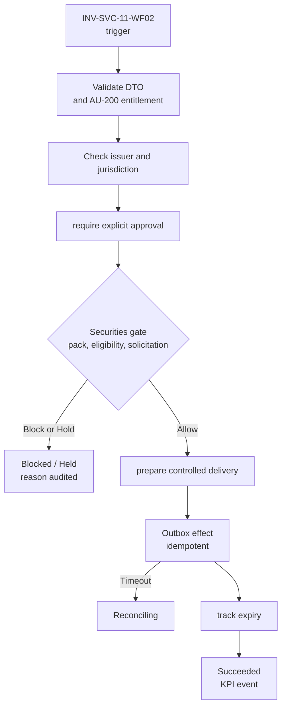

| Test ID | V12 / class ID | Level | Fixture / action | Expected (blueprint assertion) |
|---|---|---|---|---|
| TC-V12-N-540 | INV-SVC-11-WF02-AT01 | IT | Approved recipient eligibility and offer revision | Output validates against the workflow schema; evidence persisted; run Succeeded; KPI event emitted; output "Offer decision and expiry task"; KPI: unapproved formal offers = 0 |
| TC-V12-N-541 | INV-SVC-11-WF02-TC-INPUT | UT/CT | missing or malformed input | HTTP 422 with field errors; no StepRun; audit `dto.rejected` |
| TC-V12-N-542 | INV-SVC-11-WF02-TC-SCOPE | SEC | same reference from another tenant/startup | HTTP 403 or uniform 404 (BRL-TEN-04); zero rows/events/provider calls in the other scope |
| TC-V12-N-543 | INV-SVC-11-WF02-TC-ENT | IT | revoke INV SKU after enqueue | AU-200 dispatch-time recheck denies; run Paused/Held; reservation released; no effect |
| TC-V12-N-544 | INV-SVC-11-WF02-TC-DUP | IT replay | replay identical event / step key | exactly one accepted outcome, effect and meter charge; duplicate returns original run ref |
| TC-V12-N-545 | INV-SVC-11-WF02-TC-QUALITY | AIE | stale, conflicting or incomplete evidence | step Held or flagged; no unsupported claim reaches output (BRL-AI-03/04); eval record stored |
| TC-V12-N-546 | INV-SVC-11-WF02-TC-BUDGET | IT | quota exhausted at reservation | reservation fails → Blocked; zero provider calls; owner notified |
| TC-V12-N-547 | INV-SVC-11-WF02-TC-RECOVERY | CHAOS | provider timeout or worker crash | timeout after submit → Reconciling; resume from checkpoint without repeating a completed effect |
| TC-V12-N-548 | INV-SVC-11-WF02-TC-SEC | SEC/compliance | SEC-CTL-N-09: route counter at cap | Block CAP_REACHED; counter unchanged |
| TC-V12-N-549 | INV-SVC-11-WF02-TC-APPROVAL | IT | approval missing, single approver or hash mismatch | Waiting (AWAITING_APPROVAL) or Block APPROVAL_INCOMPLETE/HASH_MISMATCH; NSE |
| TC-V12-N-550 | INV-SVC-11-WF02-TC-EFFECT | IT + CHAOS | effect after approval; pack expires between approval and dispatch | dispatch-time AU-201 recheck blocks; no effect; approval retained; audit `pack.expired` |

##### INV-SVC-11-WF03 Application and signature coordination

**Requirement FR-V12-N-143** (status before: Not covered, CONFLICT-958; after: Matched). Execute "Application and signature coordination" as a typed, policy-checked workflow: Check required fields; route identity review; reconcile signature evidence; update state; output "Verified or held application".

| Field | Specification |
|---|---|
| Business outcome / input → output | Application and signature coordination: Submitted application and verified identity evidence → Verified or held application |
| Trigger | Authorized business event or manual import; signed webhook if applicable |
| Result / acceptance | Verified or held application; acceptance INV-SVC-11-WF03-AT01 (Application and signature coordination) → TC-V12-N-556 |
| Domain contract | Validator `urn:inv:dto:INV-SVC-11-WF03:v2`; fields below; event envelope per FR-V12-N-006 |
| Risk and authority | R3 · V12 side effect: Potential external write/communication; controlled only after applicable permission and policy approval |
| Autonomy in blueprint | L1 maximum for offers, batches, agreements and acceptance (two-person, hash-bound, per action); AI never signs, issues or accepts; no mandate may authorise these actions (Group O CP-O-04, DEC-822) |
| Approval gate (V12) | Explicit legal and issuer approval for offer, recipient batch, agreement and application acceptance |
| Operating mode / modalities | Manual / supervised review; preparation only if gate not satisfied · Text; structured records |
| Agent / automations | — · AU-224, AU-202 |
| Roles | R02 + R10 |
| Step classes | 2 Policy check (PDP); 1 Human review routing; 1 Domain persistence |
| Securities and privacy controls | SEC-CTL-N-02, SEC-CTL-N-07, SEC-CTL-N-10, SEC-CTL-N-12 (see step column) |
| Workflow KPI (V12 service) | Unapproved formal offers = 0; approved revision checks 100% |
| KPI formulas (this part) | applications accepted without KYC clearance = 0; signature evidence reconciled = 100% |
| SLA | Check ≤ 5 s; acceptance by humans |
| Illustrative cost (V12) | 1 workflow invocation; not a full service cycle; tokens 500 in / 100 out; INR 0.33 per invocation; external fees excluded (estimate; verify at implementation, as of 27 Nov 2026) |
| Versions / origin | workflow 2.0-target; INV-SVC-11-WF03-AT01; synthetic dry run and measured benchmark pending; V12 status: Proposed; test Not run; live execution and pricing pending. |
| Rules | R1. Acceptance is a human two-person decision; e-sign webhook verified |

**DTO `urn:inv:dto:INV-SVC-11-WF03:v2`**

| Field | Dir | Req | Type / validation | Schema constraint | Blueprint mapping |
|---|---|---|---|---|---|
| `application_id` | in | Y | reference in caller tenant/startup | `{"type": "string", "format": "uuid"}` | inv_subscription.id |
| `identity_evidence_ids` | in | Y | typed references, resolved in caller scope | `{"type": "array", "items": {"type": "string", "format": "uuid"}, "maxItems": 500}` | inv_evidence.id[] |
| `esign_event` | in | Y | structured object (versioned sub-schema) | `{"type": "object", "maxProperties": 100}` | run payload (inv_workflow_run.output_json) |
| `application_state` | out | Y | configured enum (application_state) | `{"type": "string", "maxLength": 64, "$comment": "values from registry application_state"}` | inv_subscription |
| `hold_reasons` | out | Y | configured enum list (block_reason) | `{"type": "array", "items": {"type": "string", "maxLength": 64}, "maxItems": 50, "$comment": "values from registry block_reason"}` | run payload (inv_workflow_run.output_json) |
| `commitment_id` | out | Y | reference in caller tenant/startup | `{"type": "string", "format": "uuid"}` | inv_commitment.id |
| `correlation_id` | in | Y | trace id | `{"type": "string", "format": "uuid"}` | inv_workflow_run.correlation_id |
| `simulation` | in | N | zero-effect run | `{"type": "boolean", "default": false}` | inv_workflow_run.simulation |

| Step ID | Action | Class · executor | Output / validation | Failure → state | Blueprint component | Controls in this step | Step test |
|---|---|---|---|---|---|---|---|
| INV-SVC-11-WF03-STEP-GATE | Securities and privacy gate (blueprint) | Policy check · PDP securities plug-in | decision {allow/hold/block} | POLICY_DENIED → **Blocked** | PDP + AU-201/202/203/207 | CTL-02, CTL-07, CTL-10, CTL-12 | TC-V12-N-555 (UT + IT): fail closed |
| INV-SVC-11-WF03-STEP-01 | Check required fields | Policy check (PDP) · PDP + AU-201/AU-202/AU-203/AU-208 | decision {allow/hold/block, reason_codes, pack_versions} | POLICY_DENIED → **Blocked** | PDP (Part 3.1) extended with securities gate (ADR-231); fail closed | CTL-02, CTL-07, CTL-10, CTL-12 | TC-V12-N-551 (UT decision table + IT): every rule branch exercised; unknown → hold/block; reason code and pack version audited |
| INV-SVC-11-WF03-STEP-02 | route identity review | Human review routing · Work queue / approval service | task {queue, assignee_role, sla_due, reason} | SLA_BREACH → **Escalated** | Approval/task service (A207/A220); SLA timers | CTL-10 | TC-V12-N-552 (IT + SYS): task created with correct role and SLA; automation paused until disposition |
| INV-SVC-11-WF03-STEP-03 | reconcile signature evidence | Policy check (PDP) · PDP + AU-201/AU-202/AU-203/AU-208 | decision {allow/hold/block, reason_codes, pack_versions} | POLICY_DENIED → **Blocked** | PDP (Part 3.1) extended with securities gate (ADR-231); fail closed | CTL-02, CTL-07, CTL-10, CTL-12 | TC-V12-N-553 (UT decision table + IT): every rule branch exercised; unknown → hold/block; reason code and pack version audited |
| INV-SVC-11-WF03-STEP-04 | update state | Domain persistence · Domain service (investment app) | domain_result {artifact_ref, status, evidence_refs} | INVALID_STATE → **Held** | Domain module: revision check (NFR-025), single transaction with audit and outbox | CTL-12 | TC-V12-N-554 (UT + IT): state change atomic with audit and outbox row |

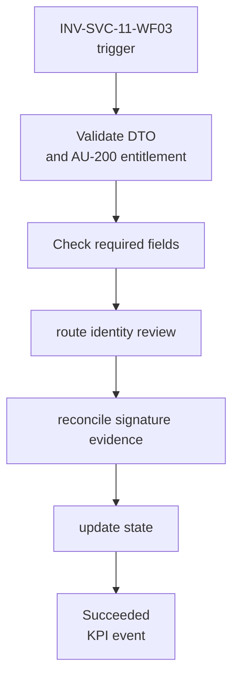

| Test ID | V12 / class ID | Level | Fixture / action | Expected (blueprint assertion) |
|---|---|---|---|---|
| TC-V12-N-556 | INV-SVC-11-WF03-AT01 | IT | Submitted application and verified identity evidence | Output validates against the workflow schema; evidence persisted; run Succeeded; KPI event emitted; output "Verified or held application"; KPI: applications accepted without KYC clearance = 0 |
| TC-V12-N-557 | INV-SVC-11-WF03-TC-INPUT | UT/CT | missing or malformed input | HTTP 422 with field errors; no StepRun; audit `dto.rejected` |
| TC-V12-N-558 | INV-SVC-11-WF03-TC-SCOPE | SEC | same reference from another tenant/startup | HTTP 403 or uniform 404 (BRL-TEN-04); zero rows/events/provider calls in the other scope |
| TC-V12-N-559 | INV-SVC-11-WF03-TC-ENT | IT | revoke INV SKU after enqueue | AU-200 dispatch-time recheck denies; run Paused/Held; reservation released; no effect |
| TC-V12-N-560 | INV-SVC-11-WF03-TC-DUP | IT replay | replay identical event / step key | exactly one accepted outcome, effect and meter charge; duplicate returns original run ref |
| TC-V12-N-561 | INV-SVC-11-WF03-TC-QUALITY | AIE | stale, conflicting or incomplete evidence | step Held or flagged; no unsupported claim reaches output (BRL-AI-03/04); eval record stored |
| TC-V12-N-562 | INV-SVC-11-WF03-TC-BUDGET | IT | quota exhausted at reservation | reservation fails → Blocked; zero provider calls; owner notified |
| TC-V12-N-563 | INV-SVC-11-WF03-TC-RECOVERY | CHAOS | provider timeout or worker crash | timeout after submit → Reconciling; resume from checkpoint without repeating a completed effect |
| TC-V12-N-564 | INV-SVC-11-WF03-TC-SEC | SEC/compliance | SEC-CTL-N-02: investor eligibility unknown | Hold ELIGIBILITY_UNKNOWN; review task to R10 |
| TC-V12-N-565 | INV-SVC-11-WF03-TC-APPROVAL | IT | approval missing, single approver or hash mismatch | Waiting (AWAITING_APPROVAL) or Block APPROVAL_INCOMPLETE/HASH_MISMATCH; NSE |
| TC-V12-N-566 | INV-SVC-11-WF03-TC-EFFECT | IT + CHAOS | effect after approval; pack expires between approval and dispatch | dispatch-time AU-201 recheck blocks; no effect; approval retained; audit `pack.expired` |

##### INV-SVC-11-WF04 Term-sheet comparison and negotiation scenario analysis

**Requirement FR-V12-N-144** (status before: Not covered, CONFLICT-958; after: Matched). Execute "Term-sheet comparison and negotiation scenario analysis" as a typed, policy-checked workflow: Normalize terms; calculate comparable scenarios; flag deviations; route legal review; output "Comparison and negotiation scenarios".

| Field | Specification |
|---|---|
| Business outcome / input → output | Term-sheet comparison and negotiation scenario analysis: Approved term sheets, assumptions, current revision → Comparison and negotiation scenarios |
| Trigger | Manual; scheduled or relevant validated business event; provider webhook only where authorized |
| Result / acceptance | Comparison and negotiation scenarios; acceptance INV-SVC-11-WF04-AT01 (Term-sheet comparison and negotiation scenario analysis) → TC-V12-N-571 |
| Domain contract | Validator `urn:inv:dto:INV-SVC-11-WF04:v2`; fields below; event envelope per FR-V12-N-006 |
| Risk and authority | R0 · V12 side effect: Internal analysis/draft; no external action without separate authorization |
| Autonomy in blueprint | L1 maximum for offers, batches, agreements and acceptance (two-person, hash-bound, per action); AI never signs, issues or accepts; no mandate may authorise these actions (Group O CP-O-04, DEC-822) |
| Approval gate (V12) | Approve source/data rights and applicable external actions; qualified reviewer confirms legal/financial claims and any offer, filing, ownership change or payment; no autonomous regulated decision. |
| Operating mode / modalities | Manual / supervised review; preparation only if gate not satisfied · Text; structured records |
| Agent / automations | AG-177 · AU-219 |
| Roles | R02 · R10 |
| Step classes | 3 Deterministic calculation; 1 Human review routing |
| Securities and privacy controls | SEC-CTL-N-05, SEC-CTL-N-13 (see step column) |
| Workflow KPI (V12 service) | Unapproved formal offers = 0; approved revision checks 100% |
| KPI formulas (this part) | calculated comparison matches golden fixtures = 100%; deviations routed to legal = 100% |
| SLA | ≤ 60 s |
| Illustrative cost (V12) | 1 invocation; text component only; tokens 2500 in / 500 out; INR 1.05 per invocation; external fees excluded (estimate; verify at implementation, as of 27 Nov 2026) |
| Versions / origin | workflow 1.0-target; INV-SVC-11-WF04-AT01; synthetic dry run and measured benchmark pending; V12 status: Proposed; test Not run; live execution and pricing pending. |
| Rules | R1. Comparison is issuer-internal; no advice to investors |

**DTO `urn:inv:dto:INV-SVC-11-WF04:v2`**

| Field | Dir | Req | Type / validation | Schema constraint | Blueprint mapping |
|---|---|---|---|---|---|
| `term_sheet_ids` | in | Y | typed references, resolved in caller scope | `{"type": "array", "items": {"type": "string", "format": "uuid"}, "maxItems": 500}` | inv_term_version.id[] |
| `assumption_ids` | in | Y | typed references, resolved in caller scope | `{"type": "array", "items": {"type": "string", "format": "uuid"}, "maxItems": 500}` | run payload (inv_workflow_run.output_json) |
| `revision_id` | in | Y | reference in caller tenant/startup | `{"type": "string", "format": "uuid"}` | run payload (inv_workflow_run.output_json) |
| `comparison_id` | out | Y | reference in caller tenant/startup | `{"type": "string", "format": "uuid"}` | run payload (inv_workflow_run.output_json) |
| `deviations` | out | Y | free text NFC-normalised, untrusted (AU-005) | `{"type": "string", "minLength": 1, "maxLength": 4000}` | run payload (inv_workflow_run.output_json) |
| `scenarios` | out | Y | structured object (versioned sub-schema) | `{"type": "object", "maxProperties": 100}` | inv_scenario |
| `correlation_id` | in | Y | trace id | `{"type": "string", "format": "uuid"}` | inv_workflow_run.correlation_id |
| `simulation` | in | N | zero-effect run | `{"type": "boolean", "default": false}` | inv_workflow_run.simulation |

| Step ID | Action | Class · executor | Output / validation | Failure → state | Blueprint component | Controls in this step | Step test |
|---|---|---|---|---|---|---|---|
| INV-SVC-11-WF04-STEP-01 | Normalize terms | Deterministic calculation · Rules / calculation engine | calculation {value, unit, assumptions, evidence_refs} | INVALID_INPUT → **Held** | Deterministic domain service; Decimal (DEC-027); zero model calls | CTL-13 | TC-V12-N-567 (UT golden fixture): golden fixture exact; missing value never invented |
| INV-SVC-11-WF04-STEP-02 | calculate comparable scenarios | Deterministic calculation · Rules / calculation engine | calculation {value, unit, assumptions, evidence_refs} | INVALID_INPUT → **Held** | Deterministic domain service; Decimal (DEC-027); zero model calls | CTL-13 | TC-V12-N-568 (UT golden fixture): golden fixture exact; missing value never invented |
| INV-SVC-11-WF04-STEP-03 | flag deviations | Deterministic calculation · Rules / calculation engine | calculation {value, unit, assumptions, evidence_refs} | INVALID_INPUT → **Held** | Deterministic domain service; Decimal (DEC-027); zero model calls | CTL-13 | TC-V12-N-569 (UT golden fixture): golden fixture exact; missing value never invented |
| INV-SVC-11-WF04-STEP-04 | route legal review | Human review routing · Work queue / approval service | task {queue, assignee_role, sla_due, reason} | SLA_BREACH → **Escalated** | Approval/task service (A207/A220); SLA timers | — (internal; audit only) | TC-V12-N-570 (IT + SYS): task created with correct role and SLA; automation paused until disposition |

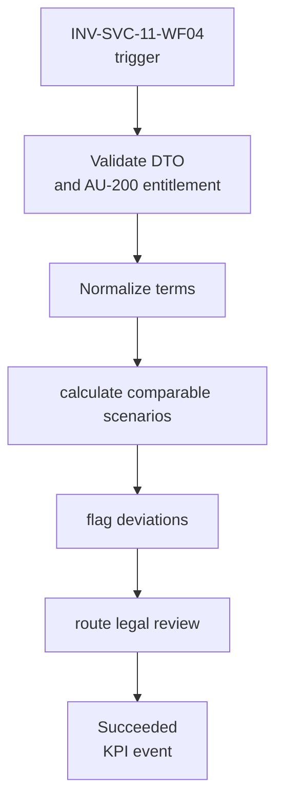

| Test ID | V12 / class ID | Level | Fixture / action | Expected (blueprint assertion) |
|---|---|---|---|---|
| TC-V12-N-571 | INV-SVC-11-WF04-AT01 | IT | Approved term sheets, assumptions, current revision | Output validates against the workflow schema; evidence persisted; run Succeeded; KPI event emitted; output "Comparison and negotiation scenarios"; KPI: calculated comparison matches golden fixtures = 100% |
| TC-V12-N-572 | INV-SVC-11-WF04-TC-INPUT | UT/CT | missing or malformed input | HTTP 422 with field errors; no StepRun; audit `dto.rejected` |
| TC-V12-N-573 | INV-SVC-11-WF04-TC-SCOPE | SEC | same reference from another tenant/startup | HTTP 403 or uniform 404 (BRL-TEN-04); zero rows/events/provider calls in the other scope |
| TC-V12-N-574 | INV-SVC-11-WF04-TC-ENT | IT | revoke INV SKU after enqueue | AU-200 dispatch-time recheck denies; run Paused/Held; reservation released; no effect |
| TC-V12-N-575 | INV-SVC-11-WF04-TC-DUP | IT replay | replay identical event / step key | exactly one accepted outcome, effect and meter charge; duplicate returns original run ref |
| TC-V12-N-576 | INV-SVC-11-WF04-TC-QUALITY | AIE | stale, conflicting or incomplete evidence | step Held or flagged; no unsupported claim reaches output (BRL-AI-03/04); eval record stored |
| TC-V12-N-577 | INV-SVC-11-WF04-TC-BUDGET | IT | quota exhausted at reservation | reservation fails → Blocked; zero provider calls; owner notified |
| TC-V12-N-578 | INV-SVC-11-WF04-TC-RECOVERY | CHAOS | provider timeout or worker crash | timeout after submit → Reconciling; resume from checkpoint without repeating a completed effect |
| TC-V12-N-579 | INV-SVC-11-WF04-TC-SEC | SEC/compliance | SEC-CTL-N-05: input asks "should I invest / what return will I get" | AG-166 ADVICE → refusal TPL-N-01 + handover; no AI answer stored as reply |

#### INV-SVC-12 Investment Receipt & Financial Reconciliation Automation

**Purpose:** Match verified receipts to issuer commitments and identify discrepancies (workbook Service Catalog row 16). **Epic:** EP-31. **Service spec:** Part 11.16a §11.16.5.6.12. **Stories:** Part 11.16e.

| Field | Specification |
|---|---|
| Family / bundle / meter | Financial controls · Full suite / Closing & Investor Lifecycle bundle / selective (1 SKU); entitlement and usage approval required. · Illustrative pilot: 200 receipt record(s)/month; 1 concurrent run; configurable hard budget, provider quota and frequency limits. Not approved. |
| Supported channels | Private financial workspace |
| Industries / capability | Fundraising issuers across eligible sectors; grant/debt/CSR route requires eligibility · Receipt verification and reconciliation |
| Required entitlements | INV-SVC-12 + foundation; tenant/startup, capability, role, channel/provider and budget checks at every action |
| Optional input producers | Included foundation; no mandatory upstream paid service; optional input producers: INV-SVC-11; authorized equivalent input accepted. |
| External providers | Authorized bank/payment provider or statement import; verified FX source if required (verify terms and prices at implementation, as of 27 Nov 2026) |
| Service KPI (V12) | Duplicate allocation = 0; verified receipt reconciliation 100% or exception |
| Actors (blueprint roles) | R08; R08 · R09; R19 service identity; R20 agent identity |
| Agents | AG-178 |
| Automations | AU-225, AU-226, AU-227, AU-038 |
| Shared engines (V12) | Transaction reconciliation; Workflow orchestration; Governance |
| Data class and gateway tier | Confidential-Financial (bank references masked); no Tier 2; Tier 0 deterministic matching; Tier 1a anomaly explanation only |
| Screens | A029; A033 → A227, A231 |
| V12 DB candidates → blueprint | inv_bank_account; inv_commitment; inv_fx_rate; inv_payment_instruction; inv_receipt; inv_receipt_allocation; inv_refund → schema `inv` same names (DEC-814 keeps V12 names; RLS per §11.16.5.10) |

##### INV-SVC-12-WF01 Receipt evidence import and verification

**Requirement FR-V12-N-145** (status before: Not covered, CONFLICT-958; after: Matched). Execute "Receipt evidence import and verification" as a typed, policy-checked workflow: Validate origin, issuer, currency and reference; deduplicate; stage verified or unverified receipt; output "Receipt evidence record".

| Field | Specification |
|---|---|
| Business outcome / input → output | Receipt evidence import and verification: Bank statement or authorized payment event → Receipt evidence record |
| Trigger | Authorized business event or manual import; signed webhook if applicable |
| Result / acceptance | Receipt evidence record; acceptance INV-SVC-12-WF01-AT01 (Receipt evidence import and verification) → TC-V12-N-583 |
| Domain contract | Validator `urn:inv:dto:INV-SVC-12-WF01:v2`; fields below; event envelope per FR-V12-N-006 |
| Risk and authority | R0 · V12 side effect: Internal analysis/draft; no external action without separate authorization |
| Autonomy in blueprint | Matching L3 deterministic for exact matches; partial/over/unknown → R08 then R09 (SoD); refunds never automated; no money movement |
| Approval gate (V12) | Finance approves exceptions, refund or allocation correction; no autonomous money transfer |
| Operating mode / modalities | AI-assisted / supervised; controlled autonomous only for preapproved eligible routine steps; simulation has zero external effects. · Text; structured records; documents |
| Agent / automations | — · AU-225 |
| Roles | R08 |
| Step classes | 1 Policy check (PDP); 1 Deterministic calculation; 1 Domain persistence |
| Securities and privacy controls | SEC-CTL-N-11, SEC-CTL-N-16 (see step column) |
| Workflow KPI (V12 service) | Duplicate allocation = 0; verified receipt reconciliation 100% or exception |
| KPI formulas (this part) | duplicate receipts staged = 0; verified within 1 business day ≥ 95% |
| SLA | Import ≤ 5 min per statement |
| Illustrative cost (V12) | 1 workflow invocation; not a full service cycle; tokens 0 in / 0 out; INR 0.15 per invocation; external fees excluded (estimate; verify at implementation, as of 27 Nov 2026) |
| Versions / origin | workflow 2.0-target; INV-SVC-12-WF01-AT01; synthetic dry run and measured benchmark pending; V12 status: Proposed; test Not run; live execution and pricing pending. |
| Rules | R1. Origin, issuer account, currency and reference validated |

**DTO `urn:inv:dto:INV-SVC-12-WF01:v2`**

| Field | Dir | Req | Type / validation | Schema constraint | Blueprint mapping |
|---|---|---|---|---|---|
| `statement_ref` | in | Y | reference in caller tenant/startup | `{"type": "string", "format": "uuid"}` | run payload (inv_workflow_run.output_json) |
| `payment_event` | in | Y | structured object (versioned sub-schema) | `{"type": "object", "maxProperties": 100}` | run payload (inv_workflow_run.output_json) |
| `receipt_id` | out | Y | reference in caller tenant/startup | `{"type": "string", "format": "uuid"}` | inv_receipt.id |
| `verification_state` | out | Y | configured enum (verification) | `{"type": "string", "maxLength": 64, "$comment": "values from registry verification"}` | run payload (inv_workflow_run.output_json) |
| `duplicate_of` | out | Y | reference in caller tenant/startup | `{"type": "string", "format": "uuid"}` | run payload (inv_workflow_run.output_json) |
| `correlation_id` | in | Y | trace id | `{"type": "string", "format": "uuid"}` | inv_workflow_run.correlation_id |
| `simulation` | in | N | zero-effect run | `{"type": "boolean", "default": false}` | inv_workflow_run.simulation |

| Step ID | Action | Class · executor | Output / validation | Failure → state | Blueprint component | Controls in this step | Step test |
|---|---|---|---|---|---|---|---|
| INV-SVC-12-WF01-STEP-01 | Validate origin, issuer, currency and reference | Policy check (PDP) · PDP + AU-201/AU-202/AU-203/AU-208 | decision {allow/hold/block, reason_codes, pack_versions} | POLICY_DENIED → **Blocked** | PDP (Part 3.1) extended with securities gate (ADR-231); fail closed | CTL-11, CTL-16 | TC-V12-N-580 (UT decision table + IT): every rule branch exercised; unknown → hold/block; reason code and pack version audited |
| INV-SVC-12-WF01-STEP-02 | deduplicate | Deterministic calculation · Rules / calculation engine | calculation {value, unit, assumptions, evidence_refs} | INVALID_INPUT → **Held** | Deterministic domain service; Decimal (DEC-027); zero model calls | — (internal; audit only) | TC-V12-N-581 (UT golden fixture): golden fixture exact; missing value never invented |
| INV-SVC-12-WF01-STEP-03 | stage verified or unverified receipt | Domain persistence · Domain service (investment app) | domain_result {artifact_ref, status, evidence_refs} | INVALID_STATE → **Held** | Domain module: revision check (NFR-025), single transaction with audit and outbox | — (internal; audit only) | TC-V12-N-582 (UT + IT): state change atomic with audit and outbox row |

| Test ID | V12 / class ID | Level | Fixture / action | Expected (blueprint assertion) |
|---|---|---|---|---|
| TC-V12-N-583 | INV-SVC-12-WF01-AT01 | IT | Bank statement or authorized payment event | Output validates against the workflow schema; evidence persisted; run Succeeded; KPI event emitted; output "Receipt evidence record"; KPI: duplicate receipts staged = 0 |
| TC-V12-N-584 | INV-SVC-12-WF01-TC-INPUT | UT/CT | missing or malformed input | HTTP 422 with field errors; no StepRun; audit `dto.rejected` |
| TC-V12-N-585 | INV-SVC-12-WF01-TC-SCOPE | SEC | same reference from another tenant/startup | HTTP 403 or uniform 404 (BRL-TEN-04); zero rows/events/provider calls in the other scope |
| TC-V12-N-586 | INV-SVC-12-WF01-TC-ENT | IT | revoke INV SKU after enqueue | AU-200 dispatch-time recheck denies; run Paused/Held; reservation released; no effect |
| TC-V12-N-587 | INV-SVC-12-WF01-TC-DUP | IT replay | replay identical event / step key | exactly one accepted outcome, effect and meter charge; duplicate returns original run ref |
| TC-V12-N-588 | INV-SVC-12-WF01-TC-QUALITY | AIE | stale, conflicting or incomplete evidence | step Held or flagged; no unsupported claim reaches output (BRL-AI-03/04); eval record stored |
| TC-V12-N-589 | INV-SVC-12-WF01-TC-BUDGET | IT | quota exhausted at reservation | reservation fails → Blocked; zero provider calls; owner notified |
| TC-V12-N-590 | INV-SVC-12-WF01-TC-RECOVERY | CHAOS | provider timeout or worker crash | timeout after submit → Reconciling; resume from checkpoint without repeating a completed effect |
| TC-V12-N-591 | INV-SVC-12-WF01-TC-SEC | SEC/compliance | SEC-CTL-N-11: request to initiate refund via API | no such operation (404); finance task only |

##### INV-SVC-12-WF02 Partial receipt allocation and matching

**Requirement FR-V12-N-146** (status before: Not covered, CONFLICT-958; after: Matched). Execute "Partial receipt allocation and matching" as a typed, policy-checked workflow: Match amount/reference; apply atomic allocation; preserve unmatched remainder; flag mismatch; output "Allocation ledger and balance".

| Field | Specification |
|---|---|
| Business outcome / input → output | Partial receipt allocation and matching: Verified receipt and commitments → Allocation ledger and balance |
| Trigger | Manual request or validated upstream business event |
| Result / acceptance | Allocation ledger and balance; acceptance INV-SVC-12-WF02-AT01 (Partial receipt allocation and matching) → TC-V12-N-596 |
| Domain contract | Validator `urn:inv:dto:INV-SVC-12-WF02:v2`; fields below; event envelope per FR-V12-N-006 |
| Risk and authority | R1 financial record · V12 side effect: Internal analysis/draft; no external action without separate authorization |
| Autonomy in blueprint | Matching L3 deterministic for exact matches; partial/over/unknown → R08 then R09 (SoD); refunds never automated; no money movement |
| Approval gate (V12) | Finance approves exceptions, refund or allocation correction; no autonomous money transfer |
| Operating mode / modalities | Manual / supervised review; preparation only if gate not satisfied · Text; structured records |
| Agent / automations | — · AU-226 |
| Roles | R08 · R09 |
| Step classes | 3 Deterministic calculation; 1 Domain persistence |
| Securities and privacy controls | SEC-CTL-N-07, SEC-CTL-N-11, SEC-CTL-N-12 (see step column) |
| Workflow KPI (V12 service) | Duplicate allocation = 0; verified receipt reconciliation 100% or exception |
| KPI formulas (this part) | duplicate allocation = 0; verified receipt reconciliation 100% or exception |
| SLA | ≤ 2 s |
| Illustrative cost (V12) | 1 workflow invocation; not a full service cycle; tokens 0 in / 0 out; INR 0.15 per invocation; external fees excluded (estimate; verify at implementation, as of 27 Nov 2026) |
| Versions / origin | workflow 2.0-target; INV-SVC-12-WF02-AT01; synthetic dry run and measured benchmark pending; V12 status: Proposed; test Not run; live execution and pricing pending. |
| Rules | R1. Atomic allocation; remainder preserved; third-party payer → exception |

**DTO `urn:inv:dto:INV-SVC-12-WF02:v2`**

| Field | Dir | Req | Type / validation | Schema constraint | Blueprint mapping |
|---|---|---|---|---|---|
| `receipt_id` | in | Y | reference in caller tenant/startup | `{"type": "string", "format": "uuid"}` | inv_receipt.id |
| `commitment_ids` | in | Y | typed references, resolved in caller scope | `{"type": "array", "items": {"type": "string", "format": "uuid"}, "maxItems": 500}` | inv_commitment.id[] |
| `allocation_ids` | out | Y | typed references, resolved in caller scope | `{"type": "array", "items": {"type": "string", "format": "uuid"}, "maxItems": 500}` | inv_receipt_allocation.id[] |
| `unmatched_remainder` | out | Y | int64 minor units + ISO 4217 (DEC-027) | `{"type": "object", "required": ["amount_minor", "currency"], "properties": {"amount_minor": {"type": "integer", "minimum": 0}, "currency": {"type": "string", "pattern": "^[A-Z]{3}$"}}}` | run payload (inv_workflow_run.output_json) |
| `balance` | out | Y | int64 minor units + ISO 4217 (DEC-027) | `{"type": "object", "required": ["amount_minor", "currency"], "properties": {"amount_minor": {"type": "integer", "minimum": 0}, "currency": {"type": "string", "pattern": "^[A-Z]{3}$"}}}` | run payload (inv_workflow_run.output_json) |
| `correlation_id` | in | Y | trace id | `{"type": "string", "format": "uuid"}` | inv_workflow_run.correlation_id |
| `simulation` | in | N | zero-effect run | `{"type": "boolean", "default": false}` | inv_workflow_run.simulation |

| Step ID | Action | Class · executor | Output / validation | Failure → state | Blueprint component | Controls in this step | Step test |
|---|---|---|---|---|---|---|---|
| INV-SVC-12-WF02-STEP-01 | Match amount/reference | Deterministic calculation · Rules / calculation engine | calculation {value, unit, assumptions, evidence_refs} | INVALID_INPUT → **Held** | Deterministic domain service; Decimal (DEC-027); zero model calls | — (internal; audit only) | TC-V12-N-592 (UT golden fixture): golden fixture exact; missing value never invented |
| INV-SVC-12-WF02-STEP-02 | apply atomic allocation | Domain persistence · Domain service (investment app) | domain_result {artifact_ref, status, evidence_refs} | INVALID_STATE → **Held** | Domain module: revision check (NFR-025), single transaction with audit and outbox | CTL-12 | TC-V12-N-593 (UT + IT): state change atomic with audit and outbox row |
| INV-SVC-12-WF02-STEP-03 | preserve unmatched remainder | Deterministic calculation · Rules / calculation engine | calculation {value, unit, assumptions, evidence_refs} | INVALID_INPUT → **Held** | Deterministic domain service; Decimal (DEC-027); zero model calls | — (internal; audit only) | TC-V12-N-594 (UT golden fixture): golden fixture exact; missing value never invented |
| INV-SVC-12-WF02-STEP-04 | flag mismatch | Deterministic calculation · Rules / calculation engine | calculation {value, unit, assumptions, evidence_refs} | INVALID_INPUT → **Held** | Deterministic domain service; Decimal (DEC-027); zero model calls | — (internal; audit only) | TC-V12-N-595 (UT golden fixture): golden fixture exact; missing value never invented |

| Test ID | V12 / class ID | Level | Fixture / action | Expected (blueprint assertion) |
|---|---|---|---|---|
| TC-V12-N-596 | INV-SVC-12-WF02-AT01 | IT | Verified receipt and commitments | Output validates against the workflow schema; evidence persisted; run Succeeded; KPI event emitted; output "Allocation ledger and balance"; KPI: duplicate allocation = 0 |
| TC-V12-N-597 | INV-SVC-12-WF02-TC-INPUT | UT/CT | missing or malformed input | HTTP 422 with field errors; no StepRun; audit `dto.rejected` |
| TC-V12-N-598 | INV-SVC-12-WF02-TC-SCOPE | SEC | same reference from another tenant/startup | HTTP 403 or uniform 404 (BRL-TEN-04); zero rows/events/provider calls in the other scope |
| TC-V12-N-599 | INV-SVC-12-WF02-TC-ENT | IT | revoke INV SKU after enqueue | AU-200 dispatch-time recheck denies; run Paused/Held; reservation released; no effect |
| TC-V12-N-600 | INV-SVC-12-WF02-TC-DUP | IT replay | replay identical event / step key | exactly one accepted outcome, effect and meter charge; duplicate returns original run ref |
| TC-V12-N-601 | INV-SVC-12-WF02-TC-QUALITY | AIE | stale, conflicting or incomplete evidence | step Held or flagged; no unsupported claim reaches output (BRL-AI-03/04); eval record stored |
| TC-V12-N-602 | INV-SVC-12-WF02-TC-BUDGET | IT | quota exhausted at reservation | reservation fails → Blocked; zero provider calls; owner notified |
| TC-V12-N-603 | INV-SVC-12-WF02-TC-RECOVERY | CHAOS | provider timeout or worker crash | timeout after submit → Reconciling; resume from checkpoint without repeating a completed effect |
| TC-V12-N-604 | INV-SVC-12-WF02-TC-SEC | SEC/compliance | SEC-CTL-N-11: request to initiate refund via API | no such operation (404); finance task only |

##### INV-SVC-12-WF03 Discrepancy report and escalation

**Requirement FR-V12-N-147** (status before: Not covered, CONFLICT-958; after: Matched). Execute "Discrepancy report and escalation" as a typed, policy-checked workflow: Summarize mismatch; route finance reviewer; hold refund or manual correction; output "Exception report and audit".

| Field | Specification |
|---|---|
| Business outcome / input → output | Discrepancy report and escalation: Unmatched or conflicting evidence → Exception report and audit |
| Trigger | Manual request or validated upstream business event |
| Result / acceptance | Exception report and audit; acceptance INV-SVC-12-WF03-AT01 (Discrepancy report and escalation) → TC-V12-N-608 |
| Domain contract | Validator `urn:inv:dto:INV-SVC-12-WF03:v2`; fields below; event envelope per FR-V12-N-006 |
| Risk and authority | R1 · V12 side effect: Internal analysis/draft; no external action without separate authorization |
| Autonomy in blueprint | Matching L3 deterministic for exact matches; partial/over/unknown → R08 then R09 (SoD); refunds never automated; no money movement |
| Approval gate (V12) | Finance approves exceptions, refund or allocation correction; no autonomous money transfer |
| Operating mode / modalities | AI-assisted / supervised; controlled autonomous only for preapproved eligible routine steps; simulation has zero external effects. · Text; structured records |
| Agent / automations | AG-178 · AU-227 |
| Roles | R08 · R09 |
| Step classes | 1 AI inference; 2 Human review routing |
| Securities and privacy controls | SEC-CTL-N-11 (see step column) |
| Workflow KPI (V12 service) | Duplicate allocation = 0; verified receipt reconciliation 100% or exception |
| KPI formulas (this part) | exceptions assigned ≤ 1 h; refunds without approval = 0 |
| SLA | ≤ 60 s |
| Illustrative cost (V12) | 1 workflow invocation; not a full service cycle; tokens 1000 in / 200 out; INR 0.51 per invocation; external fees excluded (estimate; verify at implementation, as of 27 Nov 2026) |
| Versions / origin | workflow 2.0-target; INV-SVC-12-WF03-AT01; synthetic dry run and measured benchmark pending; V12 status: Proposed; test Not run; live execution and pricing pending. |
| Rules | R1. Refunds are approved and executed outside the platform; platform records evidence |

**DTO `urn:inv:dto:INV-SVC-12-WF03:v2`**

| Field | Dir | Req | Type / validation | Schema constraint | Blueprint mapping |
|---|---|---|---|---|---|
| `exception_ids` | in | Y | typed references, resolved in caller scope | `{"type": "array", "items": {"type": "string", "format": "uuid"}, "maxItems": 500}` | inv_receipt (exception view).id[] |
| `report_id` | out | Y | reference in caller tenant/startup | `{"type": "string", "format": "uuid"}` | run payload (inv_workflow_run.output_json) |
| `reviewer_id` | out | Y | reference in caller tenant/startup | `{"type": "string", "format": "uuid"}` | run payload (inv_workflow_run.output_json) |
| `hold_state` | out | Y | configured enum (hold) | `{"type": "string", "maxLength": 64, "$comment": "values from registry hold"}` | run payload (inv_workflow_run.output_json) |
| `correlation_id` | in | Y | trace id | `{"type": "string", "format": "uuid"}` | inv_workflow_run.correlation_id |
| `simulation` | in | N | zero-effect run | `{"type": "boolean", "default": false}` | inv_workflow_run.simulation |

| Step ID | Action | Class · executor | Output / validation | Failure → state | Blueprint component | Controls in this step | Step test |
|---|---|---|---|---|---|---|---|
| INV-SVC-12-WF03-STEP-01 | Summarize mismatch | AI inference · Model gateway + agent | candidate {artifact_ref, confidence, reason_codes, review_state} | REVIEW_REQUIRED → **Waiting (AWAITING_APPROVAL)** | Model gateway AU-001 (Tier 0 → 1a → 1b; Tier 3 degrade), AU-003 schema validation, AG-166 guard on investor-facing text; output is a draft only | CTL-05 | TC-V12-N-605 (AIE + CT schema): output validates against schema; claims cited; AG-166 verdict recorded; untrusted input cannot invoke tools |
| INV-SVC-12-WF03-STEP-02 | route finance reviewer | Human review routing · Work queue / approval service | task {queue, assignee_role, sla_due, reason} | SLA_BREACH → **Escalated** | Approval/task service (A207/A220); SLA timers | — (internal; audit only) | TC-V12-N-606 (IT + SYS): task created with correct role and SLA; automation paused until disposition |
| INV-SVC-12-WF03-STEP-03 | hold refund or manual correction | Human review routing · Work queue / approval service | task {queue, assignee_role, sla_due, reason} | SLA_BREACH → **Escalated** | Approval/task service (A207/A220); SLA timers | — (internal; audit only) | TC-V12-N-607 (IT + SYS): task created with correct role and SLA; automation paused until disposition |

| Test ID | V12 / class ID | Level | Fixture / action | Expected (blueprint assertion) |
|---|---|---|---|---|
| TC-V12-N-608 | INV-SVC-12-WF03-AT01 | IT | Unmatched or conflicting evidence | Output validates against the workflow schema; evidence persisted; run Succeeded; KPI event emitted; output "Exception report and audit"; KPI: exceptions assigned ≤ 1 h |
| TC-V12-N-609 | INV-SVC-12-WF03-TC-INPUT | UT/CT | missing or malformed input | HTTP 422 with field errors; no StepRun; audit `dto.rejected` |
| TC-V12-N-610 | INV-SVC-12-WF03-TC-SCOPE | SEC | same reference from another tenant/startup | HTTP 403 or uniform 404 (BRL-TEN-04); zero rows/events/provider calls in the other scope |
| TC-V12-N-611 | INV-SVC-12-WF03-TC-ENT | IT | revoke INV SKU after enqueue | AU-200 dispatch-time recheck denies; run Paused/Held; reservation released; no effect |
| TC-V12-N-612 | INV-SVC-12-WF03-TC-DUP | IT replay | replay identical event / step key | exactly one accepted outcome, effect and meter charge; duplicate returns original run ref |
| TC-V12-N-613 | INV-SVC-12-WF03-TC-QUALITY | AIE | stale, conflicting or incomplete evidence | step Held or flagged; no unsupported claim reaches output (BRL-AI-03/04); eval record stored |
| TC-V12-N-614 | INV-SVC-12-WF03-TC-BUDGET | IT | quota exhausted at reservation | reservation fails → Blocked; zero provider calls; owner notified |
| TC-V12-N-615 | INV-SVC-12-WF03-TC-RECOVERY | CHAOS | provider timeout or worker crash | timeout after submit → Reconciling; resume from checkpoint without repeating a completed effect |
| TC-V12-N-616 | INV-SVC-12-WF03-TC-SEC | SEC/compliance | SEC-CTL-N-11: request to initiate refund via API | no such operation (404); finance task only |

##### INV-SVC-12-WF04 Financial anomaly and unmatched transaction detection

**Requirement FR-V12-N-148** (status before: Not covered, CONFLICT-958; after: Matched). Execute "Financial anomaly and unmatched transaction detection" as a typed, policy-checked workflow: Match deterministically; flag duplicate or unusual allocation; hold ambiguous entries; assign review; output "Exception register and reconciliation evidence".

| Field | Specification |
|---|---|
| Business outcome / input → output | Financial anomaly and unmatched transaction detection: Verified receipts, commitments, currency and ledger entries → Exception register and reconciliation evidence |
| Trigger | Manual; scheduled or relevant validated business event; provider webhook only where authorized |
| Result / acceptance | Exception register and reconciliation evidence; acceptance INV-SVC-12-WF04-AT01 (Financial anomaly and unmatched transaction detection) → TC-V12-N-622 |
| Domain contract | Validator `urn:inv:dto:INV-SVC-12-WF04:v2`; fields below; event envelope per FR-V12-N-006 |
| Risk and authority | R3 (prepare only) · V12 side effect: Consequential financial/legal or authority-bearing action; prepare only until authorized |
| Autonomy in blueprint | Matching L3 deterministic for exact matches; partial/over/unknown → R08 then R09 (SoD); refunds never automated; no money movement |
| Approval gate (V12) | Approve source/data rights and applicable external actions; qualified reviewer confirms legal/financial claims and any offer, filing, ownership change or payment; no autonomous regulated decision. |
| Operating mode / modalities | AI-assisted / supervised; controlled autonomous only for preapproved eligible routine steps; simulation has zero external effects. · Text; structured records |
| Agent / automations | AG-178 · AU-226, AU-227 |
| Roles | R08 · R09 |
| Step classes | 2 Deterministic calculation; 2 Human review routing |
| Securities and privacy controls | SEC-CTL-N-11, SEC-CTL-N-12 (see step column) |
| Workflow KPI (V12 service) | Duplicate allocation = 0; verified receipt reconciliation 100% or exception |
| KPI formulas (this part) | unmatched transactions > 5 days = 0 without exception; anomaly precision (reviewed) ≥ 80% |
| SLA | Daily ≤ 30 min |
| Illustrative cost (V12) | 1 invocation; text component only; tokens 1200 in / 200 out; INR 0.55 per invocation; external fees excluded (estimate; verify at implementation, as of 27 Nov 2026) |
| Versions / origin | workflow 1.0-target; INV-SVC-12-WF04-AT01; synthetic dry run and measured benchmark pending; V12 status: Proposed; test Not run; live execution and pricing pending. |
| Rules | R1. Allotment deadline timers (s.42: 60 days / refund 15 days, verify) raise escalation |

**DTO `urn:inv:dto:INV-SVC-12-WF04:v2`**

| Field | Dir | Req | Type / validation | Schema constraint | Blueprint mapping |
|---|---|---|---|---|---|
| `receipt_ids` | in | Y | typed references, resolved in caller scope | `{"type": "array", "items": {"type": "string", "format": "uuid"}, "maxItems": 500}` | inv_receipt.id[] |
| `commitment_ids` | in | Y | typed references, resolved in caller scope | `{"type": "array", "items": {"type": "string", "format": "uuid"}, "maxItems": 500}` | inv_commitment.id[] |
| `ledger_entry_ids` | in | Y | typed references, resolved in caller scope | `{"type": "array", "items": {"type": "string", "format": "uuid"}, "maxItems": 500}` | run payload (inv_workflow_run.output_json) |
| `exception_register_id` | out | Y | reference in caller tenant/startup | `{"type": "string", "format": "uuid"}` | inv_receipt (exception view).id |
| `anomaly_ids` | out | Y | typed references, resolved in caller scope | `{"type": "array", "items": {"type": "string", "format": "uuid"}, "maxItems": 500}` | run payload (inv_workflow_run.output_json) |
| `evidence_ids` | out | Y | typed references, resolved in caller scope | `{"type": "array", "items": {"type": "string", "format": "uuid"}, "maxItems": 500}` | inv_evidence.id[] |
| `correlation_id` | in | Y | trace id | `{"type": "string", "format": "uuid"}` | inv_workflow_run.correlation_id |
| `simulation` | in | N | zero-effect run | `{"type": "boolean", "default": false}` | inv_workflow_run.simulation |

| Step ID | Action | Class · executor | Output / validation | Failure → state | Blueprint component | Controls in this step | Step test |
|---|---|---|---|---|---|---|---|
| INV-SVC-12-WF04-STEP-GATE | Securities and privacy gate (blueprint) | Policy check · PDP securities plug-in | decision {allow/hold/block} | POLICY_DENIED → **Blocked** | PDP + AU-201/202/203/207 | CTL-11, CTL-12 | TC-V12-N-621 (UT + IT): fail closed |
| INV-SVC-12-WF04-STEP-01 | Match deterministically | Deterministic calculation · Rules / calculation engine | calculation {value, unit, assumptions, evidence_refs} | INVALID_INPUT → **Held** | Deterministic domain service; Decimal (DEC-027); zero model calls | — (internal; audit only) | TC-V12-N-617 (UT golden fixture): golden fixture exact; missing value never invented |
| INV-SVC-12-WF04-STEP-02 | flag duplicate or unusual allocation | Deterministic calculation · Rules / calculation engine | calculation {value, unit, assumptions, evidence_refs} | INVALID_INPUT → **Held** | Deterministic domain service; Decimal (DEC-027); zero model calls | — (internal; audit only) | TC-V12-N-618 (UT golden fixture): golden fixture exact; missing value never invented |
| INV-SVC-12-WF04-STEP-03 | hold ambiguous entries | Human review routing · Work queue / approval service | task {queue, assignee_role, sla_due, reason} | SLA_BREACH → **Escalated** | Approval/task service (A207/A220); SLA timers | — (internal; audit only) | TC-V12-N-619 (IT + SYS): task created with correct role and SLA; automation paused until disposition |
| INV-SVC-12-WF04-STEP-04 | assign review | Human review routing · Work queue / approval service | task {queue, assignee_role, sla_due, reason} | SLA_BREACH → **Escalated** | Approval/task service (A207/A220); SLA timers | — (internal; audit only) | TC-V12-N-620 (IT + SYS): task created with correct role and SLA; automation paused until disposition |

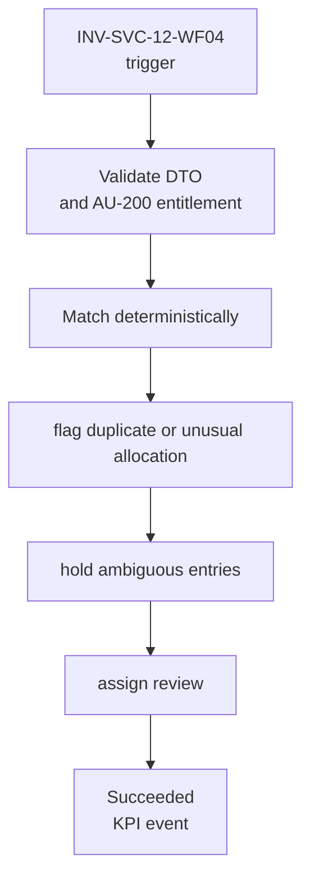

| Test ID | V12 / class ID | Level | Fixture / action | Expected (blueprint assertion) |
|---|---|---|---|---|
| TC-V12-N-622 | INV-SVC-12-WF04-AT01 | IT | Verified receipts, commitments, currency and ledger entries | Output validates against the workflow schema; evidence persisted; run Succeeded; KPI event emitted; output "Exception register and reconciliation evidence"; KPI: unmatched transactions > 5 days = 0 without exception |
| TC-V12-N-623 | INV-SVC-12-WF04-TC-INPUT | UT/CT | missing or malformed input | HTTP 422 with field errors; no StepRun; audit `dto.rejected` |
| TC-V12-N-624 | INV-SVC-12-WF04-TC-SCOPE | SEC | same reference from another tenant/startup | HTTP 403 or uniform 404 (BRL-TEN-04); zero rows/events/provider calls in the other scope |
| TC-V12-N-625 | INV-SVC-12-WF04-TC-ENT | IT | revoke INV SKU after enqueue | AU-200 dispatch-time recheck denies; run Paused/Held; reservation released; no effect |
| TC-V12-N-626 | INV-SVC-12-WF04-TC-DUP | IT replay | replay identical event / step key | exactly one accepted outcome, effect and meter charge; duplicate returns original run ref |
| TC-V12-N-627 | INV-SVC-12-WF04-TC-QUALITY | AIE | stale, conflicting or incomplete evidence | step Held or flagged; no unsupported claim reaches output (BRL-AI-03/04); eval record stored |
| TC-V12-N-628 | INV-SVC-12-WF04-TC-BUDGET | IT | quota exhausted at reservation | reservation fails → Blocked; zero provider calls; owner notified |
| TC-V12-N-629 | INV-SVC-12-WF04-TC-RECOVERY | CHAOS | provider timeout or worker crash | timeout after submit → Reconciling; resume from checkpoint without repeating a completed effect |
| TC-V12-N-630 | INV-SVC-12-WF04-TC-SEC | SEC/compliance | SEC-CTL-N-11: request to initiate refund via API | no such operation (404); finance task only |
| TC-V12-N-631 | INV-SVC-12-WF04-TC-APPROVAL | IT | approval missing, single approver or hash mismatch | Waiting (AWAITING_APPROVAL) or Block APPROVAL_INCOMPLETE/HASH_MISMATCH; NSE |
| TC-V12-N-632 | INV-SVC-12-WF04-TC-EFFECT | IT + CHAOS | effect after approval; pack expires between approval and dispatch | dispatch-time AU-201 recheck blocks; no effect; approval retained; audit `pack.expired` |

### Entitlement acceptance per service (INV-SVC-nn-ENT-AT01)

| Test ID | V12 ID | Scenario | Preconditions (V12) | Expected (V12) | Blueprint note |
|---|---|---|---|---|---|
| TC-V12-N-633 | INV-SVC-01-ENT-AT01 | Single-SKU purchase and entitlement isolation | Client selects this SKU only; foundation enabled; no upstream subscription | Selected service eligible; unpurchased service blocked; no compulsory paid upstream SKU; revoke prevents new execution | Covered also by PM-N-09 exhaustive suite (Part 11.16e) |
| TC-V12-N-634 | INV-SVC-02-ENT-AT01 | Single-SKU purchase and entitlement isolation | Client selects this SKU only; foundation enabled; no upstream subscription | Selected service eligible; unpurchased service blocked; no compulsory paid upstream SKU; revoke prevents new execution | Covered also by PM-N-09 exhaustive suite (Part 11.16e) |
| TC-V12-N-635 | INV-SVC-03-ENT-AT01 | Single-SKU purchase and entitlement isolation | Client selects this SKU only; foundation enabled; no upstream subscription | Selected service eligible; unpurchased service blocked; no compulsory paid upstream SKU; revoke prevents new execution | Covered also by PM-N-09 exhaustive suite (Part 11.16e) |
| TC-V12-N-636 | INV-SVC-04-ENT-AT01 | Single-SKU purchase and entitlement isolation | Client selects this SKU only; foundation enabled; no upstream subscription | Selected service eligible; unpurchased service blocked; no compulsory paid upstream SKU; revoke prevents new execution | Covered also by PM-N-09 exhaustive suite (Part 11.16e) |
| TC-V12-N-637 | INV-SVC-05-ENT-AT01 | Single-SKU purchase and entitlement isolation | Client selects this SKU only; foundation enabled; no upstream subscription | Selected service eligible; unpurchased service blocked; no compulsory paid upstream SKU; revoke prevents new execution | Covered also by PM-N-09 exhaustive suite (Part 11.16e) |
| TC-V12-N-638 | INV-SVC-06-ENT-AT01 | Single-SKU purchase and entitlement isolation | Client selects this SKU only; foundation enabled; no upstream subscription | Selected service eligible; unpurchased service blocked; no compulsory paid upstream SKU; revoke prevents new execution | Covered also by PM-N-09 exhaustive suite (Part 11.16e) |
| TC-V12-N-639 | INV-SVC-07-ENT-AT01 | Single-SKU purchase and entitlement isolation | Client selects this SKU only; foundation enabled; no upstream subscription | Selected service eligible; unpurchased service blocked; no compulsory paid upstream SKU; revoke prevents new execution | Covered also by PM-N-09 exhaustive suite (Part 11.16e) |
| TC-V12-N-640 | INV-SVC-08-ENT-AT01 | Single-SKU purchase and entitlement isolation | Client selects this SKU only; foundation enabled; no upstream subscription | Selected service eligible; unpurchased service blocked; no compulsory paid upstream SKU; revoke prevents new execution | Covered also by PM-N-09 exhaustive suite (Part 11.16e) |
| TC-V12-N-641 | INV-SVC-09-ENT-AT01 | Single-SKU purchase and entitlement isolation | Client selects this SKU only; foundation enabled; no upstream subscription | Selected service eligible; unpurchased service blocked; no compulsory paid upstream SKU; revoke prevents new execution | Covered also by PM-N-09 exhaustive suite (Part 11.16e) |
| TC-V12-N-642 | INV-SVC-10-ENT-AT01 | Single-SKU purchase and entitlement isolation | Client selects this SKU only; foundation enabled; no upstream subscription | Selected service eligible; unpurchased service blocked; no compulsory paid upstream SKU; revoke prevents new execution | Covered also by PM-N-09 exhaustive suite (Part 11.16e) |
| TC-V12-N-643 | INV-SVC-11-ENT-AT01 | Single-SKU purchase and entitlement isolation | Client selects this SKU only; foundation enabled; no upstream subscription | Selected service eligible; unpurchased service blocked; no compulsory paid upstream SKU; revoke prevents new execution | Covered also by PM-N-09 exhaustive suite (Part 11.16e) |
| TC-V12-N-644 | INV-SVC-12-ENT-AT01 | Single-SKU purchase and entitlement isolation | Client selects this SKU only; foundation enabled; no upstream subscription | Selected service eligible; unpurchased service blocked; no compulsory paid upstream SKU; revoke prevents new execution | Covered also by PM-N-09 exhaustive suite (Part 11.16e) |

### Decisions, tags and quality gate for this file

Used in this file: DEC-802, 804, 805, 809, 814, 817; ADR-231; ASSUMPTION-1000, 1003; CONFLICT-1019 (V12 side-effect labels of INV-SVC-05-WF02/WF04 weaker than the real effect; the stricter class is applied). Full registers in Part 11.16e.

| # | Quality gate item | Result | Notes |
|---|---|---|---|
| 1 | Every requirement traced | Pass | Workbook rows quoted literally per workflow |
| 2 | Tags logged | Pass | Part 11.16e §11.16.9 |
| 3 | IDs unique | Pass | TC and FR allocated by n_ctx.py |
| 4 | Every requirement has tests | Pass | Each workflow: step tests + 9–11 class tests |
| 5 | Negative/edge/security cases | Pass | INPUT, SCOPE, ENT, DUP, QUALITY, BUDGET, RECOVERY, SEC, APPROVAL, EFFECT |
| 6 | Agents complete | N/A here | Cards in Part 11.16a |
| 7 | Verify flags | Pass | Costs and legal thresholds |
| 8 | No restricted data to free tier | Pass | All investor workflows exclude Tier 2 |
| 9 | Consistent | Pass | Engine states of Part 11.3a |

**Status: Part 11 Batch 11.16b complete. 48 workflows specified with DTOs, step contracts, control placement, SLAs, KPI formulas, flowcharts and tests.**
