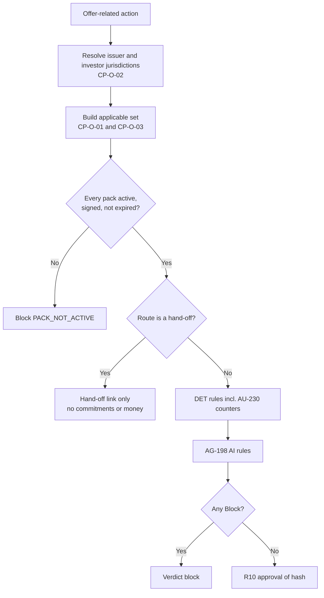

# AI Growth Engine: Employee Sales & Marketing Automation
## Application Blueprint: PART 11 (Batch 11.16d), Investment Automation II: INV-SVC-13…24 and Securities Rule Packs (d: securities rule packs, epics, stories, tests, combinatorial design, effort and cost, decisions)

| Field | Value |
|---|---|
| Document | Part 11, Batch 16, file **d** of Group O (continues Part 11.16c). Holds §11.16.15.20–§11.16.15.32 and §11.16.16–§11.16.20 |
| Version | 1.0 · 28 Nov 2026 (document); every pack inside is **v0.1-draft** |
| Baseline | As Part 11.16c; template of Part 11.15a §11.15.3 and §11.15.4 (pack sections .1–.11), Part 5.1a (stories), Part 6.1/6.2a/6.4 (tests), Part 8.4 and DEC-770 (rates) |
| Roles applied | As Part 11.16c; counsel-facing sections written by the securities-law and compliance lawyer and the compliance engineer |
| ID ranges used | Rule IDs `RP-<PACK>-NNN` · phrase lists `PL-<PACK>-NN` · templates `TPL-<PACK>-NN` · pack tests `TC-RP-<PACK>-NN` · verification entries VR-O-01…24 · DEC-820…839 · ADR-235…239 · tags 1020…1039 · US-32-ZO01…10, US-33-ZO01…15 · TC-V12-O-### |

> **DISCLAIMER: DRAFT FOR REVIEW BY QUALIFIED COUNSEL. THIS IS NOT LEGAL ADVICE.** Every rule, citation, threshold, effective date and template below is a proposal for review, correction and sign-off by counsel admitted in the relevant jurisdiction. No pack may be activated, and no offer-related action may be allowed in any jurisdiction, until counsel has signed the pack and R10 has approved it (ADR-235; CP-05).

---

### 11.16.15.20 Securities rule packs: framework additions to Part 11.15

#### 11.16.15.20.1 Scope and relationship to Part 11.15

The seven packs below use the Part 11.15 schema, severity model, cross-pack precedence (CP-01…CP-07), versioning and quarterly review procedure **unchanged**. The reviewer for offer-related content is **AG-198**, which applies the AG-086 contract (G-1…G-9) to securities; AG-199 enforces RP-INV-ADVICE. Part 11.15a §11.15.1 states that "no pack contains securities-marketing rules" and that RP-COMMIT-020 blocks fundraising content; after DEC-783 this applies to the **Sales & Marketing product only**. For tenants entitled to INV SKUs, RP-COMMIT-020 is replaced by these packs (DEC-830; CONFLICT-1028).

**Alignment with Group N pack names (Part 11.16a §11.16.5.2.1).** Group N consumes the packs under consolidated `RP-SEC-*` names; they resolve to the packs written here as follows (one schema, one registry, AU-128):

| Group N name | Pack and rules in this part |
|---|---|
| RP-SEC-IN-PP | RP-IN-SEC-001…015, 019, 021, 022 |
| RP-SEC-IN-FEMA | RP-IN-SEC-016…018 |
| RP-SEC-IN-ICDR | RP-IN-SEC-020 (listed issuers out of scope in v0.1: Block until a dedicated pack is approved) |
| RP-SEC-US-506B | RP-US-REGD with route 506b (001–004, 008–015) |
| RP-SEC-US-506C | RP-US-REGD with route 506c (001, 003, 005–007, 009–015) |
| RP-SEC-US-CF | RP-US-REGCF |
| RP-SEC-EU-PR | RP-EU-PROSP |
| RP-SEC-UK-FP | RP-UK-FINPROM |
| (channel/privacy packs) | RP-IN-WA, RP-IN-DPDP, RP-EU-MKT, RP-US-EMAIL (Part 11.15) unchanged; plus RP-AML-KYC and RP-INV-ADVICE here |

**Additional rules for securities packs.**

| Rule | Statement |
|---|---|
| CP-O-01 (route) | An offer carries one route per jurisdiction (IN private placement; US 506(b) / 506(c) / Reg CF hand-off; EU exemption code or ECSP hand-off; UK FPO basis or s.21 approval). The applicable set = issuer-jurisdiction pack + every investor-jurisdiction pack + RP-AML-KYC + RP-INV-ADVICE |
| CP-O-02 (investor jurisdiction) | Investor jurisdiction is resolved from verified residence (KYC address) first, then J1–J7 of §11.15.3.4; corroborating signals add jurisdictions, never remove them; unresolved → Block |
| CP-O-03 (both ends) | An offer from an IN issuer to a UK investor must satisfy RP-IN-SEC (issuer side: s.42 count, offer letter, FEMA) **and** RP-UK-FINPROM (recipient side: FPO basis). Strictest wins on shared parameters (CP-03) |
| CP-O-04 (no mandate) | No DEC-779 mandate can authorise an action governed by these packs (allotment, filing, offer issue, promotion dispatch, KYC decision) (DEC-822) |
| CP-O-05 (hand-off routes) | Reg CF, ECSP and UK crowdfunding routes are hand-offs: the platform never accepts commitments or money for them |

#### 11.16.15.20.2 Citation verification register (Group O)

| VR | Instrument / fact | Status | Result / caveat | Source |
|---|---|---|---|---|
| VR-O-01 | Companies Act 2013 s.42 (as substituted by the Companies (Amendment) Act 2017): private placement through a private placement offer and application; offerees identified by the Board; no public advertisement, media, marketing or distribution channels or agents to inform the public at large; return of allotment within 15 days of allotment | Verified (substance) as of 28 Nov 2026 | Sub-section numbering differs between sources: the Income Tax Department copy places the advertising ban at s.42(7), law-firm summaries at s.42(8); return of allotment cited as s.42(8) or (9). Counsel to cite from the MCA consolidated text [GAP-1026] | incometaxindia.gov.in (Companies Act s.42 copy); cleartax; ICSI notes; taxguru (2025) |
| VR-O-02 | Companies (Prospectus and Allotment of Securities) Rules 2014 r.14: special resolution; offer to not more than 200 persons in aggregate in a financial year (excluding QIBs and employees offered securities under ESOP under s.62(1)(b)); offer letter in Form PAS-4; record of offers in PAS-5; return of allotment PAS-3 | Verified (200 limit, PAS-4/PAS-5/PAS-3) as of 28 Nov 2026 | Sources differ on "per security type" vs "in aggregate"; on whether PAS-4/PAS-5 are filed or only maintained after 2018; on r.14 30-day vs s.42 15-day PAS-3 trigger. Counsel to confirm [GAP-1026] | cleartax; taxmann blog; taxguru; ICSI CAA-2017 note |
| VR-O-03 | r.14(2)(c) minimum offer value ₹20,000 of face value per person; s.42 60-day allotment, 15-day refund, 12% p.a. interest; s.42 penalty (amount involved or ₹2 crore, whichever is lower; refund within 30 days of order) | verify at time of implementation (as of 28 Nov 2026) | Panel reading | — |
| VR-O-04 | Companies Act 2013 s.62(1)(c) preferential allotment and Companies (Share Capital and Debentures) Rules 2014 r.13 (valuation by registered valuer, special resolution, explanatory statement) | verify at time of implementation (as of 28 Nov 2026) | Panel reading | — |
| VR-O-05 | FEMA (Non-debt Instruments) Rules 2019 and RBI Master Direction on Foreign Investment: equity instruments issued within 60 days of receipt of consideration, else refund (sources: within 15 days after the 60 days); Form FC-GPR on FIRMS within 30 days (sources say "from date of issue" or "from allotment") | Verified (60-day issue; 30-day FC-GPR) as of 28 Nov 2026 | Trigger wording differs between sources; counsel to confirm | rbi.org.in FEMA 395 (amended to 15 Jan 2025); RBI Master Direction; taxguru |
| VR-O-06 | Press Note 3 (2020 series): investment by an entity of, or with a beneficial owner in, a country sharing a land border with India only under the Government route; NDI Rules r.6(a) proviso | verify at time of implementation (as of 28 Nov 2026) | Not confirmed by search on 28 Nov 2026 | — |
| VR-O-07 | India: no SEBI framework permitting equity crowdfunding to retail investors (SEBI consultation paper 2014 not implemented) | verify at time of implementation (as of 28 Nov 2026) | Panel knowledge | — |
| VR-O-08 | SEBI (Investment Advisers) Regulations 2013 as amended: Second Amendment Regulations 2024 (16 Dec 2024) on use of AI tools (disclosure to clients; IA responsible for AI-derived advice); consolidated text last amended 25 Nov 2025; SEBI Intermediaries (Amendment) Regulations 2025 AI chapter effective 10 Feb 2025 | Verified as of 28 Nov 2026 | — | sebi.gov.in consolidated IA Regulations (Nov 2025); AZB & Partners Feb 2025; SCC Online 11 Feb 2025 |
| VR-O-09 | US Securities Act 1933 s.4(a)(2), s.5; Regulation D Rules 501(a), 502(b)-(d), 503, 506(b)-(e); Rule 152 integration; Rule 148 | verify at time of implementation (as of 28 Nov 2026) | Stable law; numbers verify | — |
| VR-O-10 | SEC Division of Corporation Finance no-action letter to Latham & Watkins, 12 Mar 2025: Rule 506(c) reasonable steps may be satisfied by minimum investment of \$200,000 (natural persons) or \$1,000,000 (entities; or \$200,000 per equity owner for all-accredited-owner entities) plus written representations (accredited; not third-party financed for the investment) and no actual knowledge to the contrary; new C&DIs same date | Verified as of 28 Nov 2026 | No-action letters have no legal force; counsel to confirm C&DI numbers | sec.gov no-action letter page (12 Mar 2025); Orrick; King & Spalding; Katten; Morgan Lewis; Goodwin; Dechert |
| VR-O-11 | Regulation Crowdfunding: offering limit \$5,000,000 per 12 months (2020 amendments, Rule 100(a)(1)); non-accredited limits greater of \$2,500 or 5% where income or net worth < \$124,000, else 10% capped at \$124,000 (2022 inflation adjustment, effective 20 Sep 2022); accredited investors unlimited; Rule 204 advertising of terms only via notice directing to the intermediary | Verified as of 28 Nov 2026 | Next 5-year inflation adjustment due 2027 [GAP-1035] | SEC Reg CF guidance and C&DIs; Federal Register 14 Jan 2021 and 20 Sep 2022; SEC fact sheet 33-11098 |
| VR-O-12 | Securities Exchange Act 1934 s.15(a) broker registration; transaction-based compensation as an indicator of broker activity; Rule 3a4-1 issuer associated persons | verify at time of implementation (as of 28 Nov 2026) | Panel knowledge | — |
| VR-O-13 | Investment Advisers Act 1940 s.202(a)(11) definition of investment adviser and exclusions (including the publisher exclusion, Lowe v. SEC 1985) | verify at time of implementation (as of 28 Nov 2026) | Panel knowledge | — |
| VR-O-14 | EU Prospectus Regulation (EU) 2017/1129 Art. 1(4)(a) qualified investors, Art. 1(4)(b) fewer than 150 natural or legal persons per member state other than qualified investors, Art. 1(4)(c)/(d) €100,000 denomination/consideration, Art. 2(e), Art. 3(1), Art. 22 advertisements (paras 2–4 apply where a prospectus is required) | Verified (Art. 1(4)(b), Art. 22) as of 28 Nov 2026 | Read with the Listing Act amendments | EUR-Lex consolidated 2017/1129 (versions 2024-12-04, 2026-06-05); legislation.gov.uk (retained text) |
| VR-O-15 | EU Listing Act, Regulation (EU) 2024/2809: from 5 Jun 2026 offers with total consideration below €12,000,000 over 12 months exempt from the prospectus obligation (member states may set €5,000,000); follow-on and EU Growth issuance prospectuses from 5 Mar 2026 | Verified as of 28 Nov 2026 | Member-state elections to be tabulated per state [GAP-1036] | EUR-Lex 2024/2809; Walkers (Dec 2025); Linklaters (Oct 2024); Covington (Feb 2026); Davis Polk |
| VR-O-16 | European crowdfunding service providers Regulation (EU) 2020/1503 (offers up to €5,000,000 per 12 months; key investment information sheet; entry knowledge test; 4-day pre-contractual reflection period for non-sophisticated investors) | verify at time of implementation (as of 28 Nov 2026) | Panel knowledge | — |
| VR-O-17 | MiFID II Directive 2014/65/EU Art. 4(1)(4) investment advice, Art. 24(3) marketing communications; Commission Delegated Regulation (EU) 2017/565 Art. 9 (personal recommendation), Art. 44 | verify at time of implementation (as of 28 Nov 2026) | Stable law | — |
| VR-O-18 | UK FSMA 2000 s.21 (financial promotion restriction), s.25 (offence), s.30 (unenforceability); FCA s.21 approver gateway in force 7 Feb 2024 (PS23/13): authorised persons need FCA permission to approve promotions of unauthorised persons | Verified (gateway) as of 28 Nov 2026 | Statutory section for the permission (inserted by FSMA 2023) to verify | FCA PS23/13; FCA press release; CMS; Freshfields |
| VR-O-19 | UK Financial Promotion Order 2005 (SI 2005/1529) arts 19, 43, 48, 49, 50, 50A, 60 and Schedule 5 statements; SI 2023/1411 (31 Jan 2024) raised HNW thresholds to £170,000/£430,000; SI 2024/301 (in force 27 Mar 2024) restored £100,000 income / £250,000 net assets (excluding primary residence and pension) and the SCSI criteria, keeping the new statement format | Verified as of 28 Nov 2026 | Exact Schedule 5 wording to be pasted from legislation.gov.uk by counsel | legislation.gov.uk SI 2024/301 and EM; Goodwin; Mishcon de Reya; Ashurst |
| VR-O-20 | UK Public Offers and Admissions to Trading Regulations 2024 (POATRs) in force 19 Jan 2026, replacing the UK Prospectus Regulation; offers of relevant securities to the public prohibited unless an exception applies; FCA PRM sourcebook (PS25/9) | Verified as of 28 Nov 2026 | Exception list to be confirmed against Schedule 1 | FCA PS25/9; Skadden (Jan 2026); Macfarlanes; Burges Salmon; Paul Hastings |
| VR-O-21 | Companies Act 2006 s.755 (private company must not offer securities to the public) and s.555 (return of allotment within one month, Form SH01) | verify at time of implementation (as of 28 Nov 2026) | Panel knowledge | — |
| VR-O-22 | FCA COBS 4.12A restricted mass-market investments (non-readily realisable securities): risk warning, personalised risk warning, 24-hour cooling-off, client categorisation, appropriateness | verify at time of implementation (as of 28 Nov 2026) | Panel knowledge | — |
| VR-O-23 | EU Anti-Money Laundering Regulation (EU) 2024/1624 applies from 10 Jul 2027 (football clubs/agents from 10 Jul 2029); crowdfunding service providers are obliged entities | Verified as of 28 Nov 2026 | — | Freshfields navigator; CMS; HSF Kramer (2026); Norton Rose Fulbright |
| VR-O-24 | India PMLA 2002 s.12 and PML (Maintenance of Records) Rules 2005 r.9 (CDD; beneficial owner thresholds as amended 2023); FATF Recommendations 10, 12, 24, 25; UK MLR 2017; US BSA and OFAC strict-liability sanctions | verify at time of implementation (as of 28 Nov 2026) | Panel knowledge; thresholds to confirm | — |

Primary-text hosts (indiacode, MCA, indiankanoon, taxmann) could not be fetched from this environment; confirmation is from official secondary copies (SEC, FCA, RBI, EUR-Lex listings, legislation.gov.uk) and reputable law-firm notes. Counsel must read the primary text for every rule [GAP-1025].

#### 11.16.15.20.3 Jurisdiction × route activation matrix (A258)

| Issuer → / Investor ↓ | IN | US | EU (member state) | UK |
|---|---|---|---|---|
| IN issuer | RP-IN-SEC (private placement only) | RP-IN-SEC + RP-US-REGD (506(b)/(c)) + FEMA rows of RP-IN-SEC | RP-IN-SEC + RP-EU-PROSP (exemption; overlay per state) | RP-IN-SEC + RP-UK-FINPROM (FPO basis) |
| US issuer | RP-US-REGD + RP-IN-SEC-019/020 recipient view (counsel: Indian resident outbound investment rules) → Held in v0.1 | RP-US-REGD or RP-US-REGCF (hand-off) | RP-US-REGD + RP-EU-PROSP | RP-US-REGD + RP-UK-FINPROM |
| UK issuer | Held in v0.1 (counsel) | RP-UK-FINPROM (s.755/POATRs) + RP-US-REGD | RP-UK-FINPROM + RP-EU-PROSP | RP-UK-FINPROM |
| EU issuer | Held in v0.1 (counsel) | RP-EU-PROSP + RP-US-REGD | RP-EU-PROSP (home + host overlays) | RP-EU-PROSP + RP-UK-FINPROM |
| All | RP-AML-KYC + RP-INV-ADVICE always |  |  |  |



### 11.16.15.21 RP-IN-SEC: India securities: private placement by unlisted companies (Companies Act 2013 s.42, s.62), FEMA non-debt instruments, SEBI boundary

#### 11.16.15.21.1 Pack metadata

| Field | Value |
|---|---|
| Pack ID | RP-IN-SEC |
| Title | India securities: private placement by unlisted companies (Companies Act 2013 s.42, s.62), FEMA non-debt instruments, SEBI boundary |
| Version / state | v0.1-draft · `draft` |
| Jurisdiction(s) | IN (issuer incorporated in India) — and any offer by an Indian issuer to any recipient worldwide |
| Channels | EM, DOC, LP (private, access-controlled), FM, CH, WA (only to identified offerees), portal W80/W83 |
| Audiences | Identified persons recorded before invitation; QIBs; ESOP employees |
| Startups | Tenants entitled to INV SKUs (Owner Portfolio startups and external SaaS tenants); adoptable, tighten-only (CP-04) |
| Legal sources | Companies Act 2013 s.23, s.42, s.62(1)(c) (VR-O-01, VR-O-04); Companies (Prospectus and Allotment of Securities) Rules 2014 r.14 (VR-O-02, VR-O-03); Companies (Share Capital and Debentures) Rules 2014 r.13 (VR-O-04); FEMA 1999 and FEM (Non-debt Instruments) Rules 2019, RBI Master Direction – Foreign Investment in India, FC-GPR (VR-O-05); Press Note 3 (2020) (VR-O-06); SEBI boundary (ICDR for listed issuers, AIF Regulations 2012) (VR-O-07); platform: DEC-783, DEC-823, DEC-824, ADR-235/236 |
| Effective dates | Companies Act provisions in force (s.42 substituted w.e.f. 7 Aug 2018, verify); NDI Rules since 17 Oct 2019; pack rules effective on counsel sign-off |
| Owner | R10 Legal/Compliance |
| Review cadence | Quarterly + event-driven (§11.15.3.5) |
| Expiry / fail-closed | `expires_at` = last review + 120 days; suspended pack → all in-scope offer-related actions Block (CP-05) |
| Depends on | RP-AML-KYC, RP-INV-ADVICE, RP-IN-DPDP, RP-IN-ADV (Part 11.15a), RP-COMMIT (Part 11.15c, as scoped by DEC-830) |

#### 11.16.15.21.2 Plain-language summary

1. Only an unlisted Indian company acting on a board resolution and a members' special resolution may make a private placement through the platform.
2. Offer to at most 200 identified persons in a financial year (QIBs and ESOP employees excluded); each person must be named in the company's register before the invitation and gets a numbered PAS-4 offer letter addressed to them.
3. No public advertisement, no media, no marketing or distribution channels, no agents to inform the public at large: no website, social post, ad or cold list may carry the offer.
4. Money only from the investor's own bank account by banking channels into a separate bank account; never cash; not used until allotment and the return of allotment.
5. Allot within 60 days or refund within the next 15 days, with 12% interest after that; file PAS-3 within 15 days of allotment.
6. Non-resident investors: FEMA pricing, sectoral and land-border (Press Note 3) rules apply; FC-GPR within 30 days.
7. No crowdfunding to the public; listed companies and funds are outside this pack.

#### 11.16.15.21.3 Definitions

| Term | Definition for this pack |
|---|---|
| Private placement | Offer or invitation to subscribe securities to a select group of persons by a company (other than by way of public offer) through a private placement offer cum application (PAS-4) satisfying s.42 |
| Identified person | A person whose name is recorded by the company before the invitation (PAS-5 register) and who receives the offer by name |
| QIB | Qualified institutional buyer as defined in the SEBI (ICDR) Regulations 2018 (verify) |
| Offeree count | Distinct identified persons to whom an offer or invitation was made in the financial year in aggregate, excluding QIBs and ESOP employees (AU-230; per-class reading subject to GAP-1026) |
| Application money | Money received from an applicant towards subscription, held in a separate bank account pending allotment |
| Deemed public offer | An offer not complying with s.42, treated as a public offer with Chapter III and SEBI consequences |

#### 11.16.15.21.4 Rules

| Rule ID | Obligation (draft legal wording) | Citation | Applies to | Check | Detection logic / pattern | Severity | Required evidence | Remediation message shown to user |
|---|---|---|---|---|---|---|---|---|
| RP-IN-SEC-001 | The issuer shall make an offer only on the authority of a resolution of its Board and a special resolution of its members approving the offer (separately for each offer, save where the Rules allow an annual resolution for non-convertible debentures) | CA 2013 s.42; PAS Rules r.14(1) (VR-O-02) | ALL · offers | DET | `inv_offer.board_resolution_ref` and `special_resolution_ref` present, dated before first offer letter | Block | Certified resolution copies | Record the Board and members' special resolutions approving this offer before issuing offer letters. |
| RP-IN-SEC-002 | The offer or invitation shall be made to not more than two hundred persons in aggregate in a financial year, excluding qualified institutional buyers and employees offered securities under an employee stock option scheme | s.42 read with r.14(2)(b) (VR-O-02) | ALL | DET | AU-230: reserve a ledger slot before issuing a PAS-4; count distinct identified persons per issuer × financial year (per class only if counsel confirms, GAP-1026); 201st → Block | Block | Ledger snapshot | This offer has reached the 200-person limit for the financial year. No further offer letters can be issued. |
| RP-IN-SEC-003 | A person shall be excluded from the count only with evidence of QIB status or of an ESOP grant under s.62(1)(b) | s.42; r.14(2)(b); SEBI ICDR (QIB) (VR-O-02) | ALL | DET | `exclusion_reason` ∈ {QIB, ESOP} requires evidence document ID; else counted | Block | QIB or ESOP evidence | Attach evidence of QIB status or the ESOP grant, or count this person. |
| RP-IN-SEC-004 | The issuer shall not release any public advertisement or utilise any media, marketing or distribution channels or agents to inform the public at large about the issue | s.42 (advertising ban; s.42(7) per Income Tax Dept copy, verify no.) (VR-O-01) | SO, AD, LP (public), EM (non-identified), SMS, WA, MD, press | DET+AI | AU-232: channel/audience not in {identified offerees} → Block; AG-198 reviews any public content mentioning the round, valuation, terms or "raising" | Block | Channel log | Private placements cannot be advertised. Share offer details only with identified offerees through their PAS-4 letter. |
| RP-IN-SEC-005 | The offer shall be made only to persons whose names are recorded by the company before the invitation, and such persons shall receive the offer by name; a complete record of offers shall be kept in Form PAS-5 | s.42; r.14(3) (VR-O-02) | DOC, EM, W80 | DET | AU-234: offeree row with `recorded_at` < `invited_at` and PAS-5 entry; letter addressed to that name | Block | PAS-5 record | Record the offeree in the PAS-5 register before inviting them. |
| RP-IN-SEC-006 | The private placement offer cum application letter shall be in Form PAS-4, serially numbered, addressed specifically to the offeree, accompanied by an application form, and shall not be renounceable or transferable | r.14 and Form PAS-4 (VR-O-02) | DOC, W80 | DET | Template TPL-IN-SEC-01 fields complete; serial unique per offer; `transferable=false` | Block | Letter hash | Generate the PAS-4 letter from the approved template with all mandatory fields. |
| RP-IN-SEC-007 | The value of the offer to each person shall be not less than twenty thousand rupees of face value of the securities | r.14(2)(c) (VR-O-03) | DOC, W83 | DET | `face_value × quantity` ≥ ₹20,000.00 (Decimal) per offeree | Block | — | The offer per person must be at least ₹20,000 of face value. |
| RP-IN-SEC-008 | No fresh offer or invitation shall be made unless allotments under an earlier offer have been completed or that offer has been withdrawn or abandoned | s.42 (VR-O-01) | ALL | DET | Another offer of the issuer in state `open` or `allotment_pending` → Block | Block | Offer states | Complete, withdraw or abandon the earlier offer before making a new one. |
| RP-IN-SEC-009 | Subscription money shall be paid by cheque, demand draft or other banking channels, not in cash, from the bank account of the person subscribing | s.42; PAS-4 declarations (VR-O-01) | W83; INV-SVC-12 | DET | AU-235: receipt method ∈ banking channels; remitter account holder = applicant (or joint holder); cash → reject; mismatch → Held | Block | Bank credit advice | Payment must come by banking channel from the applicant's own bank account. Cash or third-party payments cannot be accepted. |
| RP-IN-SEC-010 | Application money shall be kept in a separate bank account in a scheduled bank and shall not be utilised other than for adjustment against allotment or repayment, and not before allotment and filing of the return of allotment | s.42 (VR-O-01, VR-O-02) | INV-SVC-12/13 | DET | `inv_application_money_account.separate=true`; utilisation event before `pas3_filed_at` → Block | Block | Account designation | Hold application money in the separate offer account until allotment and the return of allotment. |
| RP-IN-SEC-011 | Securities shall be allotted within sixty days of receipt of application money; otherwise the money shall be repaid within fifteen days from the expiry of the sixty days, failing which it shall be repaid with interest at twelve per cent per annum from the sixtieth day | s.42 (VR-O-03) | INV-SVC-13 | DET | AU-236 clock; allotment after day 60 → Block; refund task due day 75; interest accrual from day 60 (verify day count) | Block | Clock record | The 60-day allotment window has passed. Refund the application money (with interest if after day 75). |
| RP-IN-SEC-012 | Allotment shall be made only by the Board or a duly authorised committee; the platform records the allotment reference and never allots | s.42; Articles; BRL-V12-O-07 | INV-SVC-13/20 | DET | Allotment reference requires resolution ID | Block | Allotment resolution | Attach the Board/committee allotment resolution. |
| RP-IN-SEC-013 | A return of allotment in Form PAS-3, with the complete list of allottees, shall be filed within fifteen days of allotment | s.42 (VR-O-01; numbering verify); r.14 (VR-O-02) | INV-SVC-13 | DET | AU-237: task due = allotment_date + 15 days; acknowledgement SRN required to close | Block (task overdue → escalate) | SRN | File PAS-3 within 15 days of allotment and upload the SRN. |
| RP-IN-SEC-014 | Any offer or allotment not in compliance with s.42 shall be treated as a deemed public offer; the platform shall freeze the offer on any Block finding under this pack until counsel review | s.42 penalty provision (VR-O-03) | ALL | DET | Any Block in 001–013 → offer state `frozen`; R10 + R01 alerted | Block | Finding log | This offer is frozen pending legal review because a private placement condition failed. |
| RP-IN-SEC-015 | A preferential allotment under s.62(1)(c) shall be supported by a valuation report of a registered valuer and a special resolution with the prescribed explanatory statement | s.62(1)(c); SCD Rules r.13 (VR-O-04) | INV-SVC-11/13/20 | DET | `valuation_report_ref` (registered valuer ID, date ≤ pack max age) and explanatory statement present | Block | Valuation report | Attach the registered valuer's report and the explanatory statement. |
| RP-IN-SEC-016 | Equity instruments issued to a person resident outside India shall comply with the NDI Rules (entry route, sectoral cap, pricing not less than fair value), and an investor of, or with a beneficial owner in, a country sharing a land border with India shall invest only under the Government route | FEMA; NDI Rules; Press Note 3 (2020) (VR-O-05, VR-O-06) | INV-SVC-22/24 | DET | AU-253: residency + BO country flags; price ≥ fair value certificate; Government approval ID for land-border investors | Block | Valuation; approval | This investment needs FEMA review: pricing, sector cap or Government approval evidence is missing. |
| RP-IN-SEC-017 | Equity instruments for non-resident consideration shall be issued within sixty days of receipt or the consideration refunded within fifteen days thereafter, and Form FC-GPR filed on FIRMS within thirty days of issue | NDI Rules / FEMA 395 (VR-O-05) | INV-SVC-13/22 | DET | AU-236/AU-237 FEMA clocks | Block (overdue → escalate) | FIRC/KYC; FC-GPR acknowledgement | Issue or refund within 60 days and file FC-GPR within 30 days of issue. |
| RP-IN-SEC-018 | Debt or other instruments from non-residents (external commercial borrowing, convertible notes outside the start-up framework) shall be held for professional review | FEMA ECB framework (verify) | INV-SVC-18/22 | DET | Non-resident × instrument ∉ {equity, CCPS, CCD} → Held | Block | Reviewer decision | This instrument needs FEMA professional review before it can proceed. |
| RP-IN-SEC-019 | The platform shall not be used to offer securities of any company to the public or to retail investors by crowdfunding or otherwise | Companies Act Ch. III; s.42; VR-O-07 | ALL | DET | Route `portal_crowdfunding` or audience `public` for IN issuer → Block | Block | — | Public or crowdfunded offers of Indian company securities are not supported. |
| RP-IN-SEC-020 | Listed companies (SEBI ICDR/LODR) and pooled vehicles (AIF, angel funds) are outside this pack; offers by them shall be blocked until a dedicated pack is approved | SEBI ICDR 2018; SEBI AIF Regulations 2012 (verify) | ALL | DET | `issuer.listed=true` or `issuer.type ∈ {AIF, angel_fund}` → Block | Block | Issuer profile | Offers by listed companies or funds are not supported by this rule pack. |
| RP-IN-SEC-021 | The platform shall not act as an agent or distributor of the issue and shall not receive remuneration linked to amounts raised | s.42 (agents) (VR-O-01); RECOMMENDATION-1032 | Billing | DET | Pricebook meter units for INV SKUs ∉ {amount raised, success fee} | Block | Pricebook | Platform fees cannot depend on the amount raised. |
| RP-IN-SEC-022 | Every communication to an offeree shall carry the private placement legend TPL-IN-SEC-02 and shall be consistent with the PAS-4 letter | r.14; s.42; RP-COMMIT | EM, DOC, W80 | DET+AI | Legend token present; AG-198 consistency check against PAS-4 fields | Block | — | Add the private placement legend and keep the message consistent with the offer letter. |

#### 11.16.15.21.5 Required disclosures and approved template wording

| Template | Use | English (approved draft wording) | Hindi (approved draft wording) | Placement |
|---|---|---|---|---|
| TPL-IN-SEC-01 | PAS-4 cover | "Private Placement Offer cum Application Letter No. {serial} addressed to {offeree_name}. This offer is made to you personally under section 42 of the Companies Act, 2013 and may not be transferred or renounced." | "निजी नियोजन प्रस्ताव-सह-आवेदन पत्र सं. {serial}, {offeree_name} को संबोधित। यह प्रस्ताव कंपनी अधिनियम, 2013 की धारा 42 के अंतर्गत व्यक्तिगत रूप से आपको दिया गया है और हस्तांतरित या त्यागा नहीं जा सकता।" | Top of letter and W80 header |
| TPL-IN-SEC-02 | Message legend | "Private and confidential. For the named addressee only. This is not an offer to the public." | "निजी और गोपनीय। केवल नामित प्राप्तकर्ता के लिए। यह जनता के लिए प्रस्ताव नहीं है।" | First line |
| TPL-IN-SEC-03 | Payment instruction | "Pay only by banking channel from your own bank account to {issuer} – Share Application Account {account}. Cash and third-party payments will be returned." | "केवल अपने बैंक खाते से बैंकिंग माध्यम द्वारा {issuer} – शेयर आवेदन खाता {account} में भुगतान करें। नकद और तृतीय-पक्ष भुगतान लौटा दिए जाएंगे।" | W83 |

#### 11.16.15.21.6 Prohibited content and phrase lists

| List | Name | Terms | Match mode | Severity | Used by |
|---|---|---|---|---|---|
| PL-IN-SEC-01 | Public-offer language | invest now; open to all; anyone can invest; IPO; public offer; crowdfunding; raise from the public; सभी के लिए खुला; अभी निवेश करें | phrase | Block | 004, 019 |
| PL-IN-SEC-02 | Guarantee/return language | guaranteed returns; assured return; risk-free; double your money; गारंटीड रिटर्न; जोखिम मुक्त | phrase | Block | 022 (and RP-INV-ADVICE-006) |

#### 11.16.15.21.7 Exceptions and edge cases

| # | Case | Treatment |
|---|---|---|
| E-1 | Rights issue to existing members under s.62(1)(a) | Not a private placement; out of pack v0.1 → Held for counsel |
| E-2 | ESOP grants | Excluded from the 200 count with evidence (003); ESOP scheme approval handled in INV-SVC-23 |
| E-3 | Communications to existing shareholders about company performance (INV-SVC-14) | Not an offer unless it mentions the round; if it does, 004/022 apply |
| E-4 | Foreign issuer offering to Indian residents | Not this pack; RP-IN-SEC blocks by default and routes to counsel (ODI/LRS questions) |

#### 11.16.15.21.8 AG-198 / AG-199 review prompt guidance (RP-IN-SEC)

- Look for: any public channel, website, social or press reference to the round, valuation or terms; mass recipients; agents or finders; payment instructions inconsistent with TPL-IN-SEC-03; promises of returns.
- Cite RP-IN-SEC-0NN and the pack version only.
- Escalate (`needs_counsel`): rights issues, convertible notes, non-resident investors, any doubt whether a recipient is an identified person.
- **Never:** conclude that an offer is lawful; return `needs_counsel` when uncertain (G-4).

#### 11.16.15.21.9 Test cases

| ID | Rule | Type | Input (summary) | Expected |
|---|---|---|---|---|
| TC-RP-IN-SEC-01 | 002 | Negative | 201st distinct offeree in FY 2027-28 (none QIB/ESOP) | Block 002 |
| TC-RP-IN-SEC-02 | 003 | Positive | QIB with evidence as 201st person | Allow, not counted |
| TC-RP-IN-SEC-03 | 004 | Negative | LinkedIn post "We are raising ₹5 crore — DM to invest" | Block 004 |
| TC-RP-IN-SEC-04 | 005 | Negative | Invitation to person recorded after invitation timestamp | Block 005 |
| TC-RP-IN-SEC-05 | 007 | Boundary | Offer of 1,999 shares × ₹10 face value = ₹19,990 | Block 007 |
| TC-RP-IN-SEC-06 | 007 | Boundary | 2,000 × ₹10 = ₹20,000.00 | Pass |
| TC-RP-IN-SEC-07 | 009 | Negative | Payment from spouse's account | Held 009 |
| TC-RP-IN-SEC-08 | 011 | Boundary | Allotment attempted on day 61 | Block 011; refund task |
| TC-RP-IN-SEC-09 | 013 | Negative | PAS-3 not filed on day 16 | Escalation 013 |
| TC-RP-IN-SEC-10 | 016 | Negative | Investor with 30% BO in a land-border country, no approval | Block 016 |
| TC-RP-IN-SEC-11 | 019 | Negative | Route portal_crowdfunding for IN issuer | Block 019 |
| TC-RP-IN-SEC-12 | 021 | Negative | Pricebook "1.5% of amount raised" | Block 021 |
| TC-RP-IN-SEC-13 | CP-05 | Negative | Pack state counsel_review | Block PACK_NOT_ACTIVE |

#### 11.16.15.21.10 Machine-readable YAML (AU-128)

```yaml
pack_id: RP-IN-SEC
version: 0.1-draft
state: draft
jurisdictions: "IN (issuer incorporated in India) — and any offer by an Indian issuer to any recipient worldwide"
owner: R10
review_cadence: quarterly_and_event_driven
expires_after_days: 120
fail_closed: true
activation_gate: ADR-235  # counsel sign-off + R10 approval per jurisdiction
rules:
  - rule_id: RP-IN-SEC-001
    check: DET
    severity: block
    applies_to: "ALL · offers"
    citation: "CA 2013 s.42; PAS Rules r.14(1) (VR-O-02)"
    detection: "`inv_offer.board_resolution_ref` and `special_resolution_ref` present, dated before first offer letter"
    remediation: "Record the Board and members' special resolutions approving this offer before issuing offer letters."
    override: none
    effective_from: on_signoff
  - rule_id: RP-IN-SEC-002
    check: DET
    severity: block
    applies_to: "ALL"
    citation: "s.42 read with r.14(2)(b) (VR-O-02)"
    detection: "AU-230: reserve a ledger slot before issuing a PAS-4; count distinct identified persons per issuer × financial year (per class only if counsel confirms, GAP-1026); 201st → Block"
    remediation: "This offer has reached the 200-person limit for the financial year. No further offer letters can be issued."
    override: none
    effective_from: on_signoff
  - rule_id: RP-IN-SEC-003
    check: DET
    severity: block
    applies_to: "ALL"
    citation: "s.42; r.14(2)(b); SEBI ICDR (QIB) (VR-O-02)"
    detection: "`exclusion_reason` ∈ {QIB, ESOP} requires evidence document ID; else counted"
    remediation: "Attach evidence of QIB status or the ESOP grant, or count this person."
    override: none
    effective_from: on_signoff
  - rule_id: RP-IN-SEC-004
    check: DET+AI
    severity: block
    applies_to: "SO, AD, LP (public), EM (non-identified), SMS, WA, MD, press"
    citation: "s.42 (advertising ban; s.42(7) per Income Tax Dept copy, verify no.) (VR-O-01)"
    detection: "AU-232: channel/audience not in {identified offerees} → Block; AG-198 reviews any public content mentioning the round, valuation, terms or 'raising'"
    remediation: "Private placements cannot be advertised. Share offer details only with identified offerees through their PAS-4 letter."
    override: none
    effective_from: on_signoff
  - rule_id: RP-IN-SEC-005
    check: DET
    severity: block
    applies_to: "DOC, EM, W80"
    citation: "s.42; r.14(3) (VR-O-02)"
    detection: "AU-234: offeree row with `recorded_at` < `invited_at` and PAS-5 entry; letter addressed to that name"
    remediation: "Record the offeree in the PAS-5 register before inviting them."
    override: none
    effective_from: on_signoff
  - rule_id: RP-IN-SEC-006
    check: DET
    severity: block
    applies_to: "DOC, W80"
    citation: "r.14 and Form PAS-4 (VR-O-02)"
    detection: "Template TPL-IN-SEC-01 fields complete; serial unique per offer; `transferable=false`"
    remediation: "Generate the PAS-4 letter from the approved template with all mandatory fields."
    override: none
    effective_from: on_signoff
  - rule_id: RP-IN-SEC-007
    check: DET
    severity: block
    applies_to: "DOC, W83"
    citation: "r.14(2)(c) (VR-O-03)"
    detection: "`face_value × quantity` ≥ ₹20,000.00 (Decimal) per offeree"
    remediation: "The offer per person must be at least ₹20,000 of face value."
    override: none
    effective_from: on_signoff
  - rule_id: RP-IN-SEC-008
    check: DET
    severity: block
    applies_to: "ALL"
    citation: "s.42 (VR-O-01)"
    detection: "Another offer of the issuer in state `open` or `allotment_pending` → Block"
    remediation: "Complete, withdraw or abandon the earlier offer before making a new one."
    override: none
    effective_from: on_signoff
  - rule_id: RP-IN-SEC-009
    check: DET
    severity: block
    applies_to: "W83; INV-SVC-12"
    citation: "s.42; PAS-4 declarations (VR-O-01)"
    detection: "AU-235: receipt method ∈ banking channels; remitter account holder = applicant (or joint holder); cash → reject; mismatch → Held"
    remediation: "Payment must come by banking channel from the applicant's own bank account. Cash or third-party payments cannot be accepted."
    override: none
    effective_from: on_signoff
  - rule_id: RP-IN-SEC-010
    check: DET
    severity: block
    applies_to: "INV-SVC-12/13"
    citation: "s.42 (VR-O-01, VR-O-02)"
    detection: "`inv_application_money_account.separate=true`; utilisation event before `pas3_filed_at` → Block"
    remediation: "Hold application money in the separate offer account until allotment and the return of allotment."
    override: none
    effective_from: on_signoff
  - rule_id: RP-IN-SEC-011
    check: DET
    severity: block
    applies_to: "INV-SVC-13"
    citation: "s.42 (VR-O-03)"
    detection: "AU-236 clock; allotment after day 60 → Block; refund task due day 75; interest accrual from day 60 (verify day count)"
    remediation: "The 60-day allotment window has passed. Refund the application money (with interest if after day 75)."
    override: none
    effective_from: on_signoff
  - rule_id: RP-IN-SEC-012
    check: DET
    severity: block
    applies_to: "INV-SVC-13/20"
    citation: "s.42; Articles; BRL-V12-O-07"
    detection: "Allotment reference requires resolution ID"
    remediation: "Attach the Board/committee allotment resolution."
    override: none
    effective_from: on_signoff
  - rule_id: RP-IN-SEC-013
    check: DET
    severity: block
    applies_to: "INV-SVC-13"
    citation: "s.42 (VR-O-01; numbering verify); r.14 (VR-O-02)"
    detection: "AU-237: task due = allotment_date + 15 days; acknowledgement SRN required to close"
    remediation: "File PAS-3 within 15 days of allotment and upload the SRN."
    override: none
    effective_from: on_signoff
  - rule_id: RP-IN-SEC-014
    check: DET
    severity: block
    applies_to: "ALL"
    citation: "s.42 penalty provision (VR-O-03)"
    detection: "Any Block in 001–013 → offer state `frozen`; R10 + R01 alerted"
    remediation: "This offer is frozen pending legal review because a private placement condition failed."
    override: none
    effective_from: on_signoff
  - rule_id: RP-IN-SEC-015
    check: DET
    severity: block
    applies_to: "INV-SVC-11/13/20"
    citation: "s.62(1)(c); SCD Rules r.13 (VR-O-04)"
    detection: "`valuation_report_ref` (registered valuer ID, date ≤ pack max age) and explanatory statement present"
    remediation: "Attach the registered valuer's report and the explanatory statement."
    override: none
    effective_from: on_signoff
  - rule_id: RP-IN-SEC-016
    check: DET
    severity: block
    applies_to: "INV-SVC-22/24"
    citation: "FEMA; NDI Rules; Press Note 3 (2020) (VR-O-05, VR-O-06)"
    detection: "AU-253: residency + BO country flags; price ≥ fair value certificate; Government approval ID for land-border investors"
    remediation: "This investment needs FEMA review: pricing, sector cap or Government approval evidence is missing."
    override: none
    effective_from: on_signoff
  - rule_id: RP-IN-SEC-017
    check: DET
    severity: block
    applies_to: "INV-SVC-13/22"
    citation: "NDI Rules / FEMA 395 (VR-O-05)"
    detection: "AU-236/AU-237 FEMA clocks"
    remediation: "Issue or refund within 60 days and file FC-GPR within 30 days of issue."
    override: none
    effective_from: on_signoff
  - rule_id: RP-IN-SEC-018
    check: DET
    severity: block
    applies_to: "INV-SVC-18/22"
    citation: "FEMA ECB framework (verify)"
    detection: "Non-resident × instrument ∉ {equity, CCPS, CCD} → Held"
    remediation: "This instrument needs FEMA professional review before it can proceed."
    override: none
    effective_from: on_signoff
  - rule_id: RP-IN-SEC-019
    check: DET
    severity: block
    applies_to: "ALL"
    citation: "Companies Act Ch. III; s.42; VR-O-07"
    detection: "Route `portal_crowdfunding` or audience `public` for IN issuer → Block"
    remediation: "Public or crowdfunded offers of Indian company securities are not supported."
    override: none
    effective_from: on_signoff
  - rule_id: RP-IN-SEC-020
    check: DET
    severity: block
    applies_to: "ALL"
    citation: "SEBI ICDR 2018; SEBI AIF Regulations 2012 (verify)"
    detection: "`issuer.listed=true` or `issuer.type ∈ {AIF, angel_fund}` → Block"
    remediation: "Offers by listed companies or funds are not supported by this rule pack."
    override: none
    effective_from: on_signoff
  - rule_id: RP-IN-SEC-021
    check: DET
    severity: block
    applies_to: "Billing"
    citation: "s.42 (agents) (VR-O-01); RECOMMENDATION-1032"
    detection: "Pricebook meter units for INV SKUs ∉ {amount raised, success fee}"
    remediation: "Platform fees cannot depend on the amount raised."
    override: none
    effective_from: on_signoff
  - rule_id: RP-IN-SEC-022
    check: DET+AI
    severity: block
    applies_to: "EM, DOC, W80"
    citation: "r.14; s.42; RP-COMMIT"
    detection: "Legend token present; AG-198 consistency check against PAS-4 fields"
    remediation: "Add the private placement legend and keep the message consistent with the offer letter."
    override: none
    effective_from: on_signoff
phrase_lists:
  - id: PL-IN-SEC-01
    match: phrase
    severity: block
    terms: ["invest now", "open to all", "anyone can invest", "IPO", "public offer", "crowdfunding", "raise from the public", "सभी के लिए खुला", "अभी निवेश करें"]
  - id: PL-IN-SEC-02
    match: phrase
    severity: block
    terms: ["guaranteed returns", "assured return", "risk-free", "double your money", "गारंटीड रिटर्न", "जोखिम मुक्त"]
templates: [TPL-IN-SEC-01, TPL-IN-SEC-02, TPL-IN-SEC-03]
```

#### 11.16.15.21.11 Counsel sign-off block

| Field | Entry |
|---|---|
| Pack / version reviewed | RP-IN-SEC v0.1-draft → proposed v1.0 |
| Reviewer (name, admission / enrolment no., jurisdiction) | _______________________ (Advocate enrolled with a State Bar Council of India; company-law and FEMA practice) |
| Firm | _______________________ |
| Date of review | ____ / ____ / ______ |
| Rules approved as drafted | ☐ All ☐ All except: __________ |
| Rules amended (IDs and summary) | _______________________ |
| Citations confirmed against primary text (VR entries) | ☐ VR-O-01 ☐ VR-O-02 ☐ VR-O-03 ☐ VR-O-04 ☐ VR-O-05 ☐ VR-O-06 ☐ VR-O-07 |
| Thresholds and effective dates confirmed | ☐ Yes ☐ With changes: __________ |
| Jurisdictions / member states / routes activated | _______________________ |
| Conditions or limitations of the sign-off | _______________________ |
| Next review due | ____ / ____ / ______ (≤ 120 days) |
| R10 approval (name, date) | _______________________ |
| Signature (counsel) / Signature (R10) | _______________ / _______________ |

### 11.16.15.22 RP-US-REGD: US Regulation D Rule 506(b) and 506(c): solicitation, accredited status and verification, disclosure, Form D, bad actors

#### 11.16.15.22.1 Pack metadata

| Field | Value |
|---|---|
| Pack ID | RP-US-REGD |
| Title | US Regulation D Rule 506(b) and 506(c): solicitation, accredited status and verification, disclosure, Form D, bad actors |
| Version / state | v0.1-draft · `draft` |
| Jurisdiction(s) | US (any purchaser or offeree resident in the US, or any US issuer); state notice filings by state of purchaser |
| Channels | EM, DOC, LP, FM, SO/AD (506(c) only), W78/W79/W80-equivalent US subscription flow |
| Audiences | Accredited investors (Rule 501(a)); up to 35 sophisticated non-accredited purchasers (506(b) only) |
| Startups | Tenants entitled to INV SKUs (Owner Portfolio startups and external SaaS tenants); adoptable, tighten-only (CP-04) |
| Legal sources | Securities Act 1933 s.4(a)(2), s.5, s.17(a) (VR-O-09); Regulation D Rules 501–508, Rule 152, Rule 148 (VR-O-09); SEC staff no-action letter 12 Mar 2025 (VR-O-10); Exchange Act s.15(a) (VR-O-12); Rule 10b-5; NSMIA s.18(b)(4) covered securities and state notice filings |
| Effective dates | In force; 12 Mar 2025 staff letter (non-binding) adopted as a verification method |
| Owner | R10 Legal/Compliance |
| Review cadence | Quarterly + event-driven (§11.15.3.5) |
| Expiry / fail-closed | `expires_at` = last review + 120 days; suspended pack → all in-scope offer-related actions Block (CP-05) |
| Depends on | RP-AML-KYC (OFAC), RP-INV-ADVICE, RP-US-EMAIL (Part 11.15b) for email mechanics |

#### 11.16.15.22.2 Plain-language summary

1. Every US offer must name its exemption: Rule 506(b) or Rule 506(c). Others are blocked.
2. 506(b): no general solicitation; only accredited investors plus at most 35 sophisticated non-accredited purchasers in 90 days, who must receive the Rule 502(b) information.
3. 506(c): general solicitation is allowed, but every purchaser must be accredited and the issuer must take reasonable steps to verify it (documents, a professional letter, or the high-minimum-investment method of the March 2025 staff letter).
4. Run bad-actor checks before offering; file Form D within 15 days after the first sale; legend restricted securities.
5. Nobody unregistered may be paid a commission based on money raised; the platform's fees never depend on amounts raised.

#### 11.16.15.22.3 Definitions

| Term | Definition for this pack |
|---|---|
| Accredited investor | A person within Rule 501(a), including natural persons with income over \$200,000 (or \$300,000 jointly) in each of the two most recent years with a reasonable expectation for the current year, or net worth over \$1,000,000 excluding the primary residence; holders of Series 7, 65 or 82 licences; specified entities (verify current list) |
| General solicitation | Any form of general solicitation or general advertising (Rule 502(c)), including public websites, social media and mass emails to persons without a pre-existing substantive relationship |
| Reasonable steps to verify | Rule 506(c)(2)(ii): a principles-based verification, with non-exclusive safe-harbour methods |
| Covered person | Persons listed in Rule 506(d)(1) whose disqualifying events bar reliance on Rule 506 |

#### 11.16.15.22.4 Rules

| Rule ID | Obligation (draft legal wording) | Citation | Applies to | Check | Detection logic / pattern | Severity | Required evidence | Remediation message shown to user |
|---|---|---|---|---|---|---|---|---|
| RP-US-REGD-001 | Every offer or sale to a US person shall identify the exemption relied on; only Rule 506(b) or Rule 506(c) are supported by this pack | Securities Act s.5; Reg D (VR-O-09) | ALL | DET | `inv_offer.us_exemption` ∈ {506b, 506c} | Block | Offer record | Select Rule 506(b) or 506(c) for this US offer. |
| RP-US-REGD-002 | In a Rule 506(b) offering neither the issuer nor any person acting on its behalf shall offer or sell by any form of general solicitation or general advertising | Rule 502(c); Rule 506(b) (VR-O-09) | SO, AD, LP (public), EM (cold), press | DET+AI | AU-232: 506(b) round × public channel → Block; AG-198 checks content for offer terms on public surfaces | Block | Channel log | This is a Rule 506(b) round: do not publish or broadcast it. Contact only investors you already know. |
| RP-US-REGD-003 | Each purchaser's accredited-investor basis shall be captured against a specific Rule 501(a) category | Rule 501(a) (VR-O-09) | W78 | DET | Category code required; free text rejected | Block | Questionnaire | Choose the accredited-investor category that applies. |
| RP-US-REGD-004 | In a Rule 506(b) offering there shall be no more than thirty-five non-accredited purchasers (counted per Rule 501(e)) and each shall, alone or with a purchaser representative, have the knowledge and experience to evaluate the investment | Rule 506(b)(2) (VR-O-09) | Subscriptions | DET | AU-230 counter across offerings integrated within 90 days (Rule 152, verify); sophistication questionnaire | Block | Questionnaire; ledger | The limit of 35 non-accredited purchasers has been reached, or sophistication is not documented. |
| RP-US-REGD-005 | In a Rule 506(c) offering all purchasers shall be accredited investors | Rule 506(c)(2)(i) (VR-O-09) | Subscriptions | DET | Purchaser accredited=true and verified=true | Block | Verification record | Only verified accredited investors can buy in a Rule 506(c) offering. |
| RP-US-REGD-006 | In a Rule 506(c) offering the issuer shall take reasonable steps to verify accredited status, using one of: (a) income documents (IRS forms) for two years with a written representation; (b) net-worth documents dated within three months with a credit report; (c) written confirmation within three months from a registered broker-dealer, SEC-registered investment adviser, licensed attorney or CPA; (d) the minimum-investment method (\$200,000 natural person; \$1,000,000 entity) with written representations of accredited status and no third-party financing for the investment, and no actual knowledge to the contrary | Rule 506(c)(2)(ii) (VR-O-09); SEC staff no-action letter 12 Mar 2025 (VR-O-10) | W79 | DET | AU-233: method code + evidence token + verifier; method (d) checks committed amount ≥ threshold and both representations captured | Block | Verification evidence | Complete accredited-investor verification by one of the permitted methods. |
| RP-US-REGD-007 | Verification evidence older than the pack maximum age shall not be relied on for a new purchase | Rule 506(c)(2)(ii)(B)/(C) three-month references (VR-O-09) | Subscriptions | DET | `verified_at` ≥ now − 90 days (method a: tax years; method d: at investment) | Block | — | Verification has expired; re-verify before accepting this subscription. |
| RP-US-REGD-008 | Where any non-accredited purchaser participates in a Rule 506(b) offering, the issuer shall furnish the information specified in Rule 502(b) a reasonable time before sale and give the opportunity to ask questions | Rule 502(b) (VR-O-09) | DOC | DET | Disclosure package with financial statements per offering size; delivery receipt before subscription | Block | Delivery receipt | Deliver the Rule 502(b) disclosure package before accepting this subscription. |
| RP-US-REGD-009 | A notice on Form D shall be filed within fifteen days after the first sale, and state notice filings made as required | Rule 503; NSMIA (VR-O-09) | INV-SVC-13/22 | DET | AU-237: first-sale date + 15 days; state list from purchaser residence | Block (overdue → escalate) | EDGAR accession number | File Form D within 15 days of the first sale and record the accession number. |
| RP-US-REGD-010 | Before any offer, the issuer shall complete a bad-actor inquiry of all covered persons and shall not rely on Rule 506 if a disqualifying event exists (with Rule 506(e) disclosure of pre-23 Sep 2013 events) | Rule 506(d), (e) (VR-O-09) | Offers | DET | Questionnaire per covered person dated ≤ 12 months; any `yes` → Block pending counsel | Block | Questionnaires | Complete bad-actor questionnaires for all covered persons. |
| RP-US-REGD-011 | Securities sold shall be identified as restricted securities with the legend and resale limitation disclosure required by Rule 502(d) | Rule 502(d) (VR-O-09) | DOC, W84 | DET | AU-258 legend TPL-US-REGD-02 in subscription documents and holding statement | Block | — | Add the restricted-securities legend. |
| RP-US-REGD-012 | No person shall receive transaction-based compensation for soliciting purchasers unless registered as a broker-dealer; the platform's fees shall not depend on amounts raised | Exchange Act s.15(a) (VR-O-12); RECOMMENDATION-1032 | Billing; finders | DET | Finder records with success-fee → Block unless registered BD CRD number; pricebook check | Block | CRD number | Success fees can be paid only to registered broker-dealers. |
| RP-US-REGD-013 | Offering communications shall not contain any untrue statement of a material fact or omit a material fact necessary to make the statements not misleading | Securities Act s.17(a); Rule 10b-5 | ALL | AI | AG-198 net-impression review against approved offering documents | Block | Approved documents | This statement may be misleading; align it with the offering documents. |
| RP-US-REGD-014 | A new offering within thirty days of a general-solicitation offering, or concurrent offerings, shall be reviewed for integration before launch | Rule 152 (verify) | Offers | DET | Overlapping offer windows → Warn + counsel task | Warn | — | Check integration with the other offering before launch. |
| RP-US-REGD-015 | Generic solicitations of interest (Rule 241) and demo-day communications (Rule 148) are not supported in v0.1 | Rules 241, 148 (verify) | ALL | DET | Route flags → Block | Block | — | This communication type is not supported yet. |

#### 11.16.15.22.5 Required disclosures and approved template wording

| Template | Use | English (approved draft wording) | Hindi (approved draft wording) | Placement |
|---|---|---|---|---|
| TPL-US-REGD-01 | 506(c) general solicitation legend | "This offering is made under Rule 506(c) of Regulation D. Only accredited investors may invest, and we must verify accredited status before accepting any subscription." | — | Any public material for a 506(c) round |
| TPL-US-REGD-02 | Restricted securities legend | "These securities have not been registered under the Securities Act of 1933 or any state securities laws and may not be offered or sold except under an effective registration statement or an exemption from registration." | — | Subscription agreement, W84 |

#### 11.16.15.22.6 Prohibited content and phrase lists

| List | Name | Terms | Match mode | Severity | Used by |
|---|---|---|---|---|---|
| PL-US-REGD-01 | Public 506(b) cues | now open to the public; invest today; anyone can invest; limited-time offer to invest | phrase | Block (506(b)) | 002 |
| PL-US-REGD-02 | Return promises | guaranteed; risk-free; can't lose; assured return | phrase | Block | 013 |

#### 11.16.15.22.7 Exceptions and edge cases

| # | Case | Treatment |
|---|---|---|
| E-1 | Investor relations to existing holders not mentioning a current offering | Not an offer; 013 still applies |
| E-2 | Offers to non-US persons under Regulation S | Out of pack; Held for counsel |
| E-3 | Accredited status of entities owned entirely by accredited investors | Per-owner evidence; minimum-investment method uses \$200,000 per owner (VR-O-10) |

#### 11.16.15.22.8 AG-198 / AG-199 review prompt guidance (RP-US-REGD)

- Look for: public reach of 506(b) content; offering terms on social posts; missing 506(c) legend; promissory or misleading statements; finders paid per dollar raised.
- Escalate (`needs_counsel`): integration questions, entity accreditation, anything resembling Regulation S or Regulation A.
- **Never:** conclude that an offer is lawful; return `needs_counsel` when uncertain (G-4).

#### 11.16.15.22.9 Test cases

| ID | Rule | Type | Input (summary) | Expected |
|---|---|---|---|---|
| TC-RP-US-REGD-01 | 002 | Negative | Tweet with valuation and "invest" link for a 506(b) round | Block 002 |
| TC-RP-US-REGD-02 | 004 | Boundary | 36th non-accredited purchaser in 90 days | Block 004 |
| TC-RP-US-REGD-03 | 006 | Positive | Method (d): \$250,000 commitment + both representations | Pass |
| TC-RP-US-REGD-04 | 006 | Negative | Method (d): \$150,000 commitment | Block 006 |
| TC-RP-US-REGD-05 | 007 | Boundary | CPA letter dated 91 days ago | Block 007 |
| TC-RP-US-REGD-06 | 009 | Negative | First sale +16 days, no accession | Escalation 009 |
| TC-RP-US-REGD-07 | 010 | Negative | Director answers yes to a 2022 injunction | Block 010 |
| TC-RP-US-REGD-08 | 012 | Negative | Finder fee 5% to unregistered person | Block 012 |

#### 11.16.15.22.10 Machine-readable YAML (AU-128)

```yaml
pack_id: RP-US-REGD
version: 0.1-draft
state: draft
jurisdictions: "US (any purchaser or offeree resident in the US, or any US issuer); state notice filings by state of purchaser"
owner: R10
review_cadence: quarterly_and_event_driven
expires_after_days: 120
fail_closed: true
activation_gate: ADR-235  # counsel sign-off + R10 approval per jurisdiction
rules:
  - rule_id: RP-US-REGD-001
    check: DET
    severity: block
    applies_to: "ALL"
    citation: "Securities Act s.5; Reg D (VR-O-09)"
    detection: "`inv_offer.us_exemption` ∈ {506b, 506c}"
    remediation: "Select Rule 506(b) or 506(c) for this US offer."
    override: none
    effective_from: on_signoff
  - rule_id: RP-US-REGD-002
    check: DET+AI
    severity: block
    applies_to: "SO, AD, LP (public), EM (cold), press"
    citation: "Rule 502(c); Rule 506(b) (VR-O-09)"
    detection: "AU-232: 506(b) round × public channel → Block; AG-198 checks content for offer terms on public surfaces"
    remediation: "This is a Rule 506(b) round: do not publish or broadcast it. Contact only investors you already know."
    override: none
    effective_from: on_signoff
  - rule_id: RP-US-REGD-003
    check: DET
    severity: block
    applies_to: "W78"
    citation: "Rule 501(a) (VR-O-09)"
    detection: "Category code required; free text rejected"
    remediation: "Choose the accredited-investor category that applies."
    override: none
    effective_from: on_signoff
  - rule_id: RP-US-REGD-004
    check: DET
    severity: block
    applies_to: "Subscriptions"
    citation: "Rule 506(b)(2) (VR-O-09)"
    detection: "AU-230 counter across offerings integrated within 90 days (Rule 152, verify); sophistication questionnaire"
    remediation: "The limit of 35 non-accredited purchasers has been reached, or sophistication is not documented."
    override: none
    effective_from: on_signoff
  - rule_id: RP-US-REGD-005
    check: DET
    severity: block
    applies_to: "Subscriptions"
    citation: "Rule 506(c)(2)(i) (VR-O-09)"
    detection: "Purchaser accredited=true and verified=true"
    remediation: "Only verified accredited investors can buy in a Rule 506(c) offering."
    override: none
    effective_from: on_signoff
  - rule_id: RP-US-REGD-006
    check: DET
    severity: block
    applies_to: "W79"
    citation: "Rule 506(c)(2)(ii) (VR-O-09); SEC staff no-action letter 12 Mar 2025 (VR-O-10)"
    detection: "AU-233: method code + evidence token + verifier; method (d) checks committed amount ≥ threshold and both representations captured"
    remediation: "Complete accredited-investor verification by one of the permitted methods."
    override: none
    effective_from: on_signoff
  - rule_id: RP-US-REGD-007
    check: DET
    severity: block
    applies_to: "Subscriptions"
    citation: "Rule 506(c)(2)(ii)(B)/(C) three-month references (VR-O-09)"
    detection: "`verified_at` ≥ now − 90 days (method a: tax years; method d: at investment)"
    remediation: "Verification has expired; re-verify before accepting this subscription."
    override: none
    effective_from: on_signoff
  - rule_id: RP-US-REGD-008
    check: DET
    severity: block
    applies_to: "DOC"
    citation: "Rule 502(b) (VR-O-09)"
    detection: "Disclosure package with financial statements per offering size; delivery receipt before subscription"
    remediation: "Deliver the Rule 502(b) disclosure package before accepting this subscription."
    override: none
    effective_from: on_signoff
  - rule_id: RP-US-REGD-009
    check: DET
    severity: block
    applies_to: "INV-SVC-13/22"
    citation: "Rule 503; NSMIA (VR-O-09)"
    detection: "AU-237: first-sale date + 15 days; state list from purchaser residence"
    remediation: "File Form D within 15 days of the first sale and record the accession number."
    override: none
    effective_from: on_signoff
  - rule_id: RP-US-REGD-010
    check: DET
    severity: block
    applies_to: "Offers"
    citation: "Rule 506(d), (e) (VR-O-09)"
    detection: "Questionnaire per covered person dated ≤ 12 months; any `yes` → Block pending counsel"
    remediation: "Complete bad-actor questionnaires for all covered persons."
    override: none
    effective_from: on_signoff
  - rule_id: RP-US-REGD-011
    check: DET
    severity: block
    applies_to: "DOC, W84"
    citation: "Rule 502(d) (VR-O-09)"
    detection: "AU-258 legend TPL-US-REGD-02 in subscription documents and holding statement"
    remediation: "Add the restricted-securities legend."
    override: none
    effective_from: on_signoff
  - rule_id: RP-US-REGD-012
    check: DET
    severity: block
    applies_to: "Billing; finders"
    citation: "Exchange Act s.15(a) (VR-O-12); RECOMMENDATION-1032"
    detection: "Finder records with success-fee → Block unless registered BD CRD number; pricebook check"
    remediation: "Success fees can be paid only to registered broker-dealers."
    override: none
    effective_from: on_signoff
  - rule_id: RP-US-REGD-013
    check: AI
    severity: block
    applies_to: "ALL"
    citation: "Securities Act s.17(a); Rule 10b-5"
    detection: "AG-198 net-impression review against approved offering documents"
    remediation: "This statement may be misleading; align it with the offering documents."
    override: none
    effective_from: on_signoff
  - rule_id: RP-US-REGD-014
    check: DET
    severity: warn
    applies_to: "Offers"
    citation: "Rule 152 (verify)"
    detection: "Overlapping offer windows → Warn + counsel task"
    remediation: "Check integration with the other offering before launch."
    override: r10_ack
    effective_from: on_signoff
  - rule_id: RP-US-REGD-015
    check: DET
    severity: block
    applies_to: "ALL"
    citation: "Rules 241, 148 (verify)"
    detection: "Route flags → Block"
    remediation: "This communication type is not supported yet."
    override: none
    effective_from: on_signoff
phrase_lists:
  - id: PL-US-REGD-01
    match: phrase
    severity: block
    terms: ["now open to the public", "invest today", "anyone can invest", "limited-time offer to invest"]
  - id: PL-US-REGD-02
    match: phrase
    severity: block
    terms: ["guaranteed", "risk-free", "can't lose", "assured return"]
templates: [TPL-US-REGD-01, TPL-US-REGD-02]
```

#### 11.16.15.22.11 Counsel sign-off block

| Field | Entry |
|---|---|
| Pack / version reviewed | RP-US-REGD v0.1-draft → proposed v1.0 |
| Reviewer (name, admission / enrolment no., jurisdiction) | _______________________ (Attorney admitted in a US state with federal securities practice) |
| Firm | _______________________ |
| Date of review | ____ / ____ / ______ |
| Rules approved as drafted | ☐ All ☐ All except: __________ |
| Rules amended (IDs and summary) | _______________________ |
| Citations confirmed against primary text (VR entries) | ☐ VR-O-09 ☐ VR-O-10 ☐ VR-O-12 |
| Thresholds and effective dates confirmed | ☐ Yes ☐ With changes: __________ |
| Jurisdictions / member states / routes activated | _______________________ |
| Conditions or limitations of the sign-off | _______________________ |
| Next review due | ____ / ____ / ______ (≤ 120 days) |
| R10 approval (name, date) | _______________________ |
| Signature (counsel) / Signature (R10) | _______________ / _______________ |

### 11.16.15.23 RP-US-REGCF: US Regulation Crowdfunding: intermediary-only offers, issuer advertising notices and investor limits

#### 11.16.15.23.1 Pack metadata

| Field | Value |
|---|---|
| Pack ID | RP-US-REGCF |
| Title | US Regulation Crowdfunding: intermediary-only offers, issuer advertising notices and investor limits |
| Version / state | v0.1-draft · `draft` |
| Jurisdiction(s) | US |
| Channels | SO, AD, LP, EM (notices only), hand-off links |
| Audiences | Public (through the registered intermediary only) |
| Startups | Tenants entitled to INV SKUs (Owner Portfolio startups and external SaaS tenants); adoptable, tighten-only (CP-04) |
| Legal sources | Securities Act s.4(a)(6), s.4A (VR-O-11); Regulation Crowdfunding 17 CFR Part 227, Rules 100, 201–206, 503 (VR-O-11) |
| Effective dates | In force; thresholds as adjusted 20 Sep 2022 (next adjustment 2027, GAP-1035) |
| Owner | R10 Legal/Compliance |
| Review cadence | Quarterly + event-driven (§11.15.3.5) |
| Expiry / fail-closed | `expires_at` = last review + 120 days; suspended pack → all in-scope offer-related actions Block (CP-05) |
| Depends on | RP-AML-KYC, RP-INV-ADVICE, RP-US-EMAIL |

#### 11.16.15.23.2 Plain-language summary

1. The platform is not a funding portal or broker-dealer. A Reg CF offer runs only on one SEC-registered intermediary; the platform hands off.
2. The issuer may advertise the terms only in a notice that points to the intermediary's platform (Rule 204); all other discussion of terms happens on the intermediary's channels.
3. Offering limit $5,000,000 in 12 months; non-accredited investor limits are enforced by the intermediary and only displayed by the platform.

#### 11.16.15.23.3 Definitions

| Term | Definition for this pack |
|---|---|
| Intermediary | A broker-dealer or funding portal registered with the SEC and a member of FINRA, through which the offering is conducted |
| Terms of the offering | Amount offered, nature of the securities, price and closing date of the offering period (Rule 204) |

#### 11.16.15.23.4 Rules

| Rule ID | Obligation (draft legal wording) | Citation | Applies to | Check | Detection logic / pattern | Severity | Required evidence | Remediation message shown to user |
|---|---|---|---|---|---|---|---|---|
| RP-US-REGCF-001 | A Regulation Crowdfunding offering shall be conducted exclusively through one registered intermediary; the platform shall not host the offering, accept investment commitments or hold investor funds | s.4(a)(6); Rule 100(a)(3) (VR-O-11) | ALL | DET | Route regcf → `intermediary_crd` and `sec_file_no` required; platform subscription flow disabled | Block | Intermediary registration | Reg CF investments must be made on your registered funding portal; link to it instead. |
| RP-US-REGCF-002 | The amount sold in reliance on Regulation Crowdfunding in any 12-month period shall not exceed \$5,000,000 | Rule 100(a)(1) (VR-O-11) | Offers | DET | Σ amounts sold (issuer + controlled entities) rolling 12 months ≤ \$5,000,000 (parameter) | Block | Sales history | This exceeds the Reg CF 12-month limit. |
| RP-US-REGCF-003 | Investment limits for non-accredited investors (greater of \$2,500 or 5% of the greater of annual income or net worth where either is below \$124,000; 10%, capped at \$124,000, where both are at least \$124,000) shall be applied by the intermediary; the platform shall display them accurately and shall not imply otherwise | Rule 100(a)(2) (VR-O-11) | LP, W99 | DET | Displayed values from parameter table version | Warn | Parameter version | Use the current investment limits from the parameter table. |
| RP-US-REGCF-004 | Issuer advertising of the terms of the offering shall be limited to a notice containing only the statement that the issuer is conducting an offering, the name of the intermediary and a link to its platform, the terms of the offering and factual information about the issuer | Rule 204 (VR-O-11) | SO, AD, LP, EM | DET+AI | AU-258 notice template TPL-US-REGCF-01; AG-198 flags additional terms or performance claims | Block | — | Reg CF notices may contain only the permitted items and a link to the funding portal. |
| RP-US-REGCF-005 | Communications by the issuer about the terms of the offering, other than notices, shall take place only through the intermediary's communication channels | Rule 204(c) (VR-O-11) | EM, WA, CH | DET | Terms tokens in direct messages → Block | Block | — | Discuss offer terms only on the funding portal's channels. |
| RP-US-REGCF-006 | Testing the waters before filing Form C (Rule 206) is not supported in v0.1 | Rule 206 (verify) | ALL | DET | Pre-Form C communications → Block | Block | — | Testing-the-waters communications are not supported. |
| RP-US-REGCF-007 | Persons promoting the offering for compensation shall disclose the receipt of compensation in each communication | Rule 205 (verify) | SO, EM | DET | Promoter flag → disclosure token | Block | — | Disclose that you are compensated for promoting this offering. |
| RP-US-REGCF-008 | Ineligible issuers (non-US issuers, investment companies, issuers subject to disqualification or delinquent in annual reports) shall not use Regulation Crowdfunding | Rules 100(b), 503 (verify) | Offers | DET | Issuer profile flags | Block | Issuer profile | This issuer is not eligible for Reg CF. |
| RP-US-REGCF-009 | Annual reports on Form C-AR shall be filed within 120 days after fiscal year-end while reporting obligations continue | Rule 202 (verify) | INV-SVC-14 | DET | Reminder task | Warn | Filing receipt | File the Reg CF annual report. |
| RP-US-REGCF-010 | Notices and communications shall not be false or misleading | Securities Act s.17(a); s.4A(c) | ALL | AI | AG-198 review | Block | — | Revise the misleading statement. |

#### 11.16.15.23.5 Required disclosures and approved template wording

| Template | Use | English (approved draft wording) | Hindi (approved draft wording) | Placement |
|---|---|---|---|---|
| TPL-US-REGCF-01 | Rule 204 notice | "{Issuer} is conducting an offering under Regulation Crowdfunding through {Intermediary}. Learn more and invest only at {intermediary_link}. Amount: {amount}; security: {type}; price: {price}; closing date: {date}." | — | Whole notice; no other content |

#### 11.16.15.23.6 Prohibited content and phrase lists

| List | Name | Terms | Match mode | Severity | Used by |
|---|---|---|---|---|---|
| PL-US-REGCF-01 | Extra terms / performance | projected returns; expected exit; we will IPO; valuation will | phrase | Block | 004 |

#### 11.16.15.23.7 Exceptions and edge cases

| # | Case | Treatment |
|---|---|---|
| E-1 | Factual business news not mentioning terms | Allowed; must not condition the market (counsel judgement → needs_counsel) |

#### 11.16.15.23.8 AG-198 / AG-199 review prompt guidance (RP-US-REGCF)

- Look for: any terms beyond Rule 204 items, investment calls without the intermediary link, undisclosed paid promoters.
- **Never:** conclude that an offer is lawful; return `needs_counsel` when uncertain (G-4).

#### 11.16.15.23.9 Test cases

| ID | Rule | Type | Input (summary) | Expected |
|---|---|---|---|---|
| TC-RP-US-REGCF-01 | 001 | Negative | Subscription attempted on W83 for a Reg CF offer | Block 001 |
| TC-RP-US-REGCF-02 | 004 | Negative | Notice adds "projected 5x return" | Block 004 |
| TC-RP-US-REGCF-03 | 004 | Positive | Template TPL-US-REGCF-01 only | Pass |
| TC-RP-US-REGCF-04 | 002 | Boundary | Cumulative \$5,000,001 | Block 002 |

#### 11.16.15.23.10 Machine-readable YAML (AU-128)

```yaml
pack_id: RP-US-REGCF
version: 0.1-draft
state: draft
jurisdictions: "US"
owner: R10
review_cadence: quarterly_and_event_driven
expires_after_days: 120
fail_closed: true
activation_gate: ADR-235  # counsel sign-off + R10 approval per jurisdiction
rules:
  - rule_id: RP-US-REGCF-001
    check: DET
    severity: block
    applies_to: "ALL"
    citation: "s.4(a)(6); Rule 100(a)(3) (VR-O-11)"
    detection: "Route regcf → `intermediary_crd` and `sec_file_no` required; platform subscription flow disabled"
    remediation: "Reg CF investments must be made on your registered funding portal; link to it instead."
    override: none
    effective_from: on_signoff
  - rule_id: RP-US-REGCF-002
    check: DET
    severity: block
    applies_to: "Offers"
    citation: "Rule 100(a)(1) (VR-O-11)"
    detection: "Σ amounts sold (issuer + controlled entities) rolling 12 months ≤ $5,000,000 (parameter)"
    remediation: "This exceeds the Reg CF 12-month limit."
    override: none
    effective_from: on_signoff
  - rule_id: RP-US-REGCF-003
    check: DET
    severity: warn
    applies_to: "LP, W99"
    citation: "Rule 100(a)(2) (VR-O-11)"
    detection: "Displayed values from parameter table version"
    remediation: "Use the current investment limits from the parameter table."
    override: r10_ack
    effective_from: on_signoff
  - rule_id: RP-US-REGCF-004
    check: DET+AI
    severity: block
    applies_to: "SO, AD, LP, EM"
    citation: "Rule 204 (VR-O-11)"
    detection: "AU-258 notice template TPL-US-REGCF-01; AG-198 flags additional terms or performance claims"
    remediation: "Reg CF notices may contain only the permitted items and a link to the funding portal."
    override: none
    effective_from: on_signoff
  - rule_id: RP-US-REGCF-005
    check: DET
    severity: block
    applies_to: "EM, WA, CH"
    citation: "Rule 204(c) (VR-O-11)"
    detection: "Terms tokens in direct messages → Block"
    remediation: "Discuss offer terms only on the funding portal's channels."
    override: none
    effective_from: on_signoff
  - rule_id: RP-US-REGCF-006
    check: DET
    severity: block
    applies_to: "ALL"
    citation: "Rule 206 (verify)"
    detection: "Pre-Form C communications → Block"
    remediation: "Testing-the-waters communications are not supported."
    override: none
    effective_from: on_signoff
  - rule_id: RP-US-REGCF-007
    check: DET
    severity: block
    applies_to: "SO, EM"
    citation: "Rule 205 (verify)"
    detection: "Promoter flag → disclosure token"
    remediation: "Disclose that you are compensated for promoting this offering."
    override: none
    effective_from: on_signoff
  - rule_id: RP-US-REGCF-008
    check: DET
    severity: block
    applies_to: "Offers"
    citation: "Rules 100(b), 503 (verify)"
    detection: "Issuer profile flags"
    remediation: "This issuer is not eligible for Reg CF."
    override: none
    effective_from: on_signoff
  - rule_id: RP-US-REGCF-009
    check: DET
    severity: warn
    applies_to: "INV-SVC-14"
    citation: "Rule 202 (verify)"
    detection: "Reminder task"
    remediation: "File the Reg CF annual report."
    override: r10_ack
    effective_from: on_signoff
  - rule_id: RP-US-REGCF-010
    check: AI
    severity: block
    applies_to: "ALL"
    citation: "Securities Act s.17(a); s.4A(c)"
    detection: "AG-198 review"
    remediation: "Revise the misleading statement."
    override: none
    effective_from: on_signoff
phrase_lists:
  - id: PL-US-REGCF-01
    match: phrase
    severity: block
    terms: ["projected returns", "expected exit", "we will IPO", "valuation will"]
templates: [TPL-US-REGCF-01]
```

#### 11.16.15.23.11 Counsel sign-off block

| Field | Entry |
|---|---|
| Pack / version reviewed | RP-US-REGCF v0.1-draft → proposed v1.0 |
| Reviewer (name, admission / enrolment no., jurisdiction) | _______________________ (Attorney admitted in a US state with federal securities practice) |
| Firm | _______________________ |
| Date of review | ____ / ____ / ______ |
| Rules approved as drafted | ☐ All ☐ All except: __________ |
| Rules amended (IDs and summary) | _______________________ |
| Citations confirmed against primary text (VR entries) | ☐ VR-O-11 |
| Thresholds and effective dates confirmed | ☐ Yes ☐ With changes: __________ |
| Jurisdictions / member states / routes activated | _______________________ |
| Conditions or limitations of the sign-off | _______________________ |
| Next review due | ____ / ____ / ______ (≤ 120 days) |
| R10 approval (name, date) | _______________________ |
| Signature (counsel) / Signature (R10) | _______________ / _______________ |

### 11.16.15.24 RP-EU-PROSP: EU public-offer rules: Prospectus Regulation exemptions and advertisements, ECSP hand-off, MiFID II marketing standard

#### 11.16.15.24.1 Pack metadata

| Field | Value |
|---|---|
| Pack ID | RP-EU-PROSP |
| Title | EU public-offer rules: Prospectus Regulation exemptions and advertisements, ECSP hand-off, MiFID II marketing standard |
| Version / state | v0.1-draft · `draft` |
| Jurisdiction(s) | EU/EEA member state of each offeree (finest level); member-state overlay required for activation |
| Channels | EM, DOC, LP, SO, AD, FM, CH |
| Audiences | Qualified investors; fewer than 150 non-qualified persons per member state; high-minimum investors |
| Startups | Tenants entitled to INV SKUs (Owner Portfolio startups and external SaaS tenants); adoptable, tighten-only (CP-04) |
| Legal sources | Regulation (EU) 2017/1129 Arts 1(3), 1(4), 2(d), 2(e), 3, 22 (VR-O-14) as amended by Regulation (EU) 2024/2809 (VR-O-15); Regulation (EU) 2020/1503 (VR-O-16); Directive 2014/65/EU Art. 24(3), Delegated Regulation 2017/565 (VR-O-17); UCPD 2005/29/EC (green claims); national laws per member state (overlay) |
| Effective dates | PR in force; Listing Act small-offer threshold from 5 Jun 2026 (VR-O-15); member-state overlays per state |
| Owner | R10 Legal/Compliance |
| Review cadence | Quarterly + event-driven (§11.15.3.5) |
| Expiry / fail-closed | `expires_at` = last review + 120 days; suspended pack → all in-scope offer-related actions Block (CP-05) |
| Depends on | RP-AML-KYC, RP-INV-ADVICE, RP-EU-MKT and RP-EU-AI (Part 11.15b) |

#### 11.16.15.24.2 Plain-language summary

1. No offer of securities to the public in the EU without an approved prospectus unless an exemption applies.
2. Supported exemptions: qualified investors only; fewer than 150 non-qualified persons per member state; €100,000 minimum per investor or denomination; small offers under the member state's threshold (up to €12 million over 12 months from 5 June 2026).
3. Crowdfunding to retail runs only through an authorised European crowdfunding service provider; the platform hands off.
4. Marketing must be fair, clear, not misleading and recognisable as marketing; exempt offers must not be publicised in a way that defeats the exemption.
5. Each member state needs an overlay record (national thresholds, company-law form, language) before the pack can activate there.

#### 11.16.15.24.3 Definitions

| Term | Definition for this pack |
|---|---|
| Offer of securities to the public | A communication to persons in any form and by any means presenting sufficient information on the terms of the offer and the securities to enable an investor to decide to purchase (Art. 2(d)) |
| Qualified investor | Persons or entities that are professional clients or eligible counterparties under MiFID II Annex II (Art. 2(e)) |
| Member-state overlay | Counsel-approved record per state: small-offer threshold elected, national information document, private-company transfer restrictions, language, regulator |

#### 11.16.15.24.4 Rules

| Rule ID | Obligation (draft legal wording) | Citation | Applies to | Check | Detection logic / pattern | Severity | Required evidence | Remediation message shown to user |
|---|---|---|---|---|---|---|---|---|
| RP-EU-PROSP-001 | Securities shall not be offered to the public in the Union without a prospectus approved and published under the Regulation, unless the offer falls within an exemption recorded on the offer | PR Art. 3(1) (VR-O-14) | ALL | DET | `inv_offer.eu_exemption` ∈ {QI_ONLY, UNDER_150, MIN_100K, SMALL_OFFER, ECSP} per member state | Block | Offer record | Record the prospectus exemption for each EU member state in this offer. |
| RP-EU-PROSP-002 | An offer relying on the qualified-investor exemption shall be addressed solely to qualified investors | PR Art. 1(4)(a), Art. 2(e) (VR-O-14) | ALL | DET | Recipient classification = QI (professional/eligible counterparty) with evidence | Block | Classification evidence | Only qualified investors may receive this offer. |
| RP-EU-PROSP-003 | An offer relying on the limited-offeree exemption shall be addressed to fewer than 150 natural or legal persons per member state, other than qualified investors | PR Art. 1(4)(b) (VR-O-14) | ALL | DET | AU-230 per member state: count of non-QI offerees ≤ 149 | Block | Ledger | The 150-person limit for this member state has been reached. |
| RP-EU-PROSP-004 | An offer relying on the high-minimum exemption shall require a minimum consideration of at least €100,000 per investor for each separate offer, or a denomination of at least €100,000 | PR Art. 1(4)(c), (d) (VR-O-14) | W83 | DET | Minimum subscription ≥ €100,000.00 (EUR equivalent at offer FX snapshot) | Block | — | Minimum investment must be at least €100,000 under this exemption. |
| RP-EU-PROSP-005 | An offer relying on the small-offer exemption shall not exceed, with other such offers in the preceding 12 months, the threshold elected by the member state (not more than €12,000,000 from 5 June 2026), and any national information document shall be prepared | PR Art. 1(3)/3(2) as amended by Reg 2024/2809 (VR-O-15) | Offers | DET | Overlay threshold per state × rolling 12-month total; national document flag | Block | Overlay record | This exceeds the small-offer threshold for the member state, or the national information document is missing. |
| RP-EU-PROSP-006 | Crowdfunding offers to the public shall be conducted only through a crowdfunding service provider authorised under Regulation (EU) 2020/1503, which carries the key investment information sheet, entry knowledge test and reflection period | Reg 2020/1503 (VR-O-16) | ALL | DET | Route ECSP → provider authorisation ID; platform subscription disabled | Block | CSP authorisation | Use your authorised crowdfunding service provider for this offer. |
| RP-EU-PROSP-007 | The pack shall not activate for a member state without an approved overlay record | National law (overlay) | ALL | DET | Overlay `approved` for state | Block | Overlay | This member state has no approved legal overlay yet. |
| RP-EU-PROSP-008 | Communications about an exempt offer shall not be disseminated to the public in a manner inconsistent with the exemption relied on | PR Arts 1(4), 2(d), 3(1) (VR-O-14) | SO, AD, LP, press | DET+AI | AU-232: exempt route × public channel → Block; AG-198 review | Block | Channel log | Do not publicise an exempt offer to the public. |
| RP-EU-PROSP-009 | Where a prospectus is required, every advertisement shall state that a prospectus has been or will be published and where it can be obtained, shall be clearly recognisable as an advertisement, and shall be consistent with the prospectus; marketing communications shall in all cases be fair, clear, not misleading and identifiable as marketing | PR Art. 22 (VR-O-14); MiFID II Art. 24(3) (VR-O-17) | ALL | DET+AI | AU-258 legend TPL-EU-PROSP-01/02; AG-198 consistency | Block | — | Label this as an advertisement and add the prospectus reference, or remove offer terms. |
| RP-EU-PROSP-010 | Sustainability or impact statements in offer materials shall be specific, substantiated and consistent with the data in the offer documents | UCPD Arts 6–7; SFDR where applicable (verify) | ALL | AI | AG-198/AG-193 substantiation check | Block | Evidence | Substantiate or remove the sustainability claim. |
| RP-EU-PROSP-011 | Offer documents and key communications shall be in a language accepted by the competent authority of each member state where required by the overlay | PR Art. 27; overlay | DOC | DET | Overlay language list | Warn | — | Provide the documents in an accepted language for this member state. |
| RP-EU-PROSP-012 | Where the offer is handed off to an ECSP or an investment firm, the platform shall transmit only the minimum data needed and shall not perform reception and transmission of orders | MiFID II Annex I (verify); Reg 2020/1503 | Hand-off | DET | Hand-off payload allowlist | Block | — | Hand-off data exceeds the permitted minimum. |

#### 11.16.15.24.5 Required disclosures and approved template wording

| Template | Use | English (approved draft wording) | Hindi (approved draft wording) | Placement |
|---|---|---|---|---|
| TPL-EU-PROSP-01 | Advertisement label | "Advertisement. A prospectus {has been / will be} published and is available at {link}. Read it before deciding to invest." | — (per overlay language) | Top |
| TPL-EU-PROSP-02 | Exempt offer legend | "This communication is addressed only to {qualified investors / named recipients} in {member state} and is not an offer to the public." | — | Top |

#### 11.16.15.24.6 Prohibited content and phrase lists

| List | Name | Terms | Match mode | Severity | Used by |
|---|---|---|---|---|---|
| PL-EU-PROSP-01 | Public cues | open to everyone; public offering; invest from €; retail investors welcome | phrase | Block (exempt routes) | 008 |

#### 11.16.15.24.7 Exceptions and edge cases

| # | Case | Treatment |
|---|---|---|
| E-1 | Employee offers (Art. 1(4)(i)) | Out of v0.1; Held for counsel |
| E-2 | Private-company forms whose shares are not transferable securities under national law | Overlay decides; pack may not apply |

#### 11.16.15.24.8 AG-198 / AG-199 review prompt guidance (RP-EU-PROSP)

- Look for: public dissemination of exempt offers; missing advertisement label; inconsistent figures vs prospectus; green claims.
- Escalate: member-state overlay questions; whether an instrument is a transferable security.
- **Never:** conclude that an offer is lawful; return `needs_counsel` when uncertain (G-4).

#### 11.16.15.24.9 Test cases

| ID | Rule | Type | Input (summary) | Expected |
|---|---|---|---|---|
| TC-RP-EU-PROSP-01 | 003 | Boundary | 150th non-QI offeree in DE | Block 003 |
| TC-RP-EU-PROSP-02 | 004 | Boundary | €99,999 minimum | Block 004 |
| TC-RP-EU-PROSP-03 | 007 | Negative | Offer to FR without overlay | Block 007 |
| TC-RP-EU-PROSP-04 | 009 | Negative | Ad without advertisement label | Block 009 |

#### 11.16.15.24.10 Machine-readable YAML (AU-128)

```yaml
pack_id: RP-EU-PROSP
version: 0.1-draft
state: draft
jurisdictions: "EU/EEA member state of each offeree (finest level); member-state overlay required for activation"
owner: R10
review_cadence: quarterly_and_event_driven
expires_after_days: 120
fail_closed: true
activation_gate: ADR-235  # counsel sign-off + R10 approval per jurisdiction
rules:
  - rule_id: RP-EU-PROSP-001
    check: DET
    severity: block
    applies_to: "ALL"
    citation: "PR Art. 3(1) (VR-O-14)"
    detection: "`inv_offer.eu_exemption` ∈ {QI_ONLY, UNDER_150, MIN_100K, SMALL_OFFER, ECSP} per member state"
    remediation: "Record the prospectus exemption for each EU member state in this offer."
    override: none
    effective_from: on_signoff
  - rule_id: RP-EU-PROSP-002
    check: DET
    severity: block
    applies_to: "ALL"
    citation: "PR Art. 1(4)(a), Art. 2(e) (VR-O-14)"
    detection: "Recipient classification = QI (professional/eligible counterparty) with evidence"
    remediation: "Only qualified investors may receive this offer."
    override: none
    effective_from: on_signoff
  - rule_id: RP-EU-PROSP-003
    check: DET
    severity: block
    applies_to: "ALL"
    citation: "PR Art. 1(4)(b) (VR-O-14)"
    detection: "AU-230 per member state: count of non-QI offerees ≤ 149"
    remediation: "The 150-person limit for this member state has been reached."
    override: none
    effective_from: on_signoff
  - rule_id: RP-EU-PROSP-004
    check: DET
    severity: block
    applies_to: "W83"
    citation: "PR Art. 1(4)(c), (d) (VR-O-14)"
    detection: "Minimum subscription ≥ €100,000.00 (EUR equivalent at offer FX snapshot)"
    remediation: "Minimum investment must be at least €100,000 under this exemption."
    override: none
    effective_from: on_signoff
  - rule_id: RP-EU-PROSP-005
    check: DET
    severity: block
    applies_to: "Offers"
    citation: "PR Art. 1(3)/3(2) as amended by Reg 2024/2809 (VR-O-15)"
    detection: "Overlay threshold per state × rolling 12-month total; national document flag"
    remediation: "This exceeds the small-offer threshold for the member state, or the national information document is missing."
    override: none
    effective_from: on_signoff
  - rule_id: RP-EU-PROSP-006
    check: DET
    severity: block
    applies_to: "ALL"
    citation: "Reg 2020/1503 (VR-O-16)"
    detection: "Route ECSP → provider authorisation ID; platform subscription disabled"
    remediation: "Use your authorised crowdfunding service provider for this offer."
    override: none
    effective_from: on_signoff
  - rule_id: RP-EU-PROSP-007
    check: DET
    severity: block
    applies_to: "ALL"
    citation: "National law (overlay)"
    detection: "Overlay `approved` for state"
    remediation: "This member state has no approved legal overlay yet."
    override: none
    effective_from: on_signoff
  - rule_id: RP-EU-PROSP-008
    check: DET+AI
    severity: block
    applies_to: "SO, AD, LP, press"
    citation: "PR Arts 1(4), 2(d), 3(1) (VR-O-14)"
    detection: "AU-232: exempt route × public channel → Block; AG-198 review"
    remediation: "Do not publicise an exempt offer to the public."
    override: none
    effective_from: on_signoff
  - rule_id: RP-EU-PROSP-009
    check: DET+AI
    severity: block
    applies_to: "ALL"
    citation: "PR Art. 22 (VR-O-14); MiFID II Art. 24(3) (VR-O-17)"
    detection: "AU-258 legend TPL-EU-PROSP-01/02; AG-198 consistency"
    remediation: "Label this as an advertisement and add the prospectus reference, or remove offer terms."
    override: none
    effective_from: on_signoff
  - rule_id: RP-EU-PROSP-010
    check: AI
    severity: block
    applies_to: "ALL"
    citation: "UCPD Arts 6–7; SFDR where applicable (verify)"
    detection: "AG-198/AG-193 substantiation check"
    remediation: "Substantiate or remove the sustainability claim."
    override: none
    effective_from: on_signoff
  - rule_id: RP-EU-PROSP-011
    check: DET
    severity: warn
    applies_to: "DOC"
    citation: "PR Art. 27; overlay"
    detection: "Overlay language list"
    remediation: "Provide the documents in an accepted language for this member state."
    override: r10_ack
    effective_from: on_signoff
  - rule_id: RP-EU-PROSP-012
    check: DET
    severity: block
    applies_to: "Hand-off"
    citation: "MiFID II Annex I (verify); Reg 2020/1503"
    detection: "Hand-off payload allowlist"
    remediation: "Hand-off data exceeds the permitted minimum."
    override: none
    effective_from: on_signoff
phrase_lists:
  - id: PL-EU-PROSP-01
    match: phrase
    severity: block
    terms: ["open to everyone", "public offering", "invest from €", "retail investors welcome"]
templates: [TPL-EU-PROSP-01, TPL-EU-PROSP-02]
```

#### 11.16.15.24.11 Counsel sign-off block

| Field | Entry |
|---|---|
| Pack / version reviewed | RP-EU-PROSP v0.1-draft → proposed v1.0 |
| Reviewer (name, admission / enrolment no., jurisdiction) | _______________________ (Lawyer admitted in an EU member state (per overlay state) with capital-markets practice) |
| Firm | _______________________ |
| Date of review | ____ / ____ / ______ |
| Rules approved as drafted | ☐ All ☐ All except: __________ |
| Rules amended (IDs and summary) | _______________________ |
| Citations confirmed against primary text (VR entries) | ☐ VR-O-14 ☐ VR-O-15 ☐ VR-O-16 ☐ VR-O-17 |
| Thresholds and effective dates confirmed | ☐ Yes ☐ With changes: __________ |
| Jurisdictions / member states / routes activated | _______________________ |
| Conditions or limitations of the sign-off | _______________________ |
| Next review due | ____ / ____ / ______ (≤ 120 days) |
| R10 approval (name, date) | _______________________ |
| Signature (counsel) / Signature (R10) | _______________ / _______________ |

### 11.16.15.25 RP-UK-FINPROM: UK financial promotion: FSMA s.21, Financial Promotion Order exemptions, s.21 approver gateway, private-company offers, POATRs

#### 11.16.15.25.1 Pack metadata

| Field | Value |
|---|---|
| Pack ID | RP-UK-FINPROM |
| Title | UK financial promotion: FSMA s.21, Financial Promotion Order exemptions, s.21 approver gateway, private-company offers, POATRs |
| Version / state | v0.1-draft · `draft` |
| Jurisdiction(s) | UK (any recipient in the UK; communications capable of having an effect in the UK) |
| Channels | EM, DOC, LP, SO, AD, FM, CH, WA |
| Audiences | Investment professionals; certified HNW; self-certified/certified sophisticated; HNW companies; employees |
| Startups | Tenants entitled to INV SKUs (Owner Portfolio startups and external SaaS tenants); adoptable, tighten-only (CP-04) |
| Legal sources | FSMA 2000 s.21, s.25, s.30 (VR-O-18); FPO 2005 arts 19, 43, 48, 49, 50, 50A, 60, Sch. 5 as amended by SI 2023/1411 and SI 2024/301 (VR-O-19); FCA PS23/13 approver gateway (VR-O-18); POATRs 2024 (VR-O-20); Companies Act 2006 s.555, s.755 (VR-O-21); COBS 4 and 4.12A (VR-O-22) |
| Effective dates | SI 2024/301 thresholds from 27 Mar 2024; approver gateway from 7 Feb 2024; POATRs from 19 Jan 2026 |
| Owner | R10 Legal/Compliance |
| Review cadence | Quarterly + event-driven (§11.15.3.5) |
| Expiry / fail-closed | `expires_at` = last review + 120 days; suspended pack → all in-scope offer-related actions Block (CP-05) |
| Depends on | RP-AML-KYC, RP-INV-ADVICE, RP-EU-MKT (UK GDPR/PECR as in Part 11.15b) |

#### 11.16.15.25.2 Plain-language summary

1. The platform and tenants are not FCA-authorised: any invitation or inducement to invest communicated to UK recipients must fit an FPO exemption or be approved by an FCA-authorised firm that holds approver permission.
2. Supported exemptions: investment professionals (art. 19), high net worth individuals with a signed statement (art. 48: income ≥ £100,000 or net assets ≥ £250,000), sophisticated investors (art. 50 certified; art. 50A self-certified), high net worth companies (art. 49), employee share schemes (art. 60).
3. Exempt communications carry the prescribed indications and go only to people who qualify.
4. A private company must not offer its securities to the public (CA 2006 s.755); public offers are also governed by the POATRs.
5. Retail promotions of non-readily realisable securities need an authorised approver and COBS 4.12A protections; the platform does not do this itself.

#### 11.16.15.25.3 Definitions

| Term | Definition for this pack |
|---|---|
| Financial promotion | A communication, in the course of business, of an invitation or inducement to engage in investment activity (s.21(1)) |
| Approver | An authorised person with FCA permission to approve financial promotions of unauthorised persons (gateway from 7 Feb 2024) |
| HNW individual | An individual who has signed, within the period before the communication specified by the Order, a statement in the Schedule 5 form (art. 48) |
| Self-certified sophisticated investor | An individual who has signed a statement in the Schedule 5 form meeting art. 50A criteria |

#### 11.16.15.25.4 Rules

| Rule ID | Obligation (draft legal wording) | Citation | Applies to | Check | Detection logic / pattern | Severity | Required evidence | Remediation message shown to user |
|---|---|---|---|---|---|---|---|---|
| RP-UK-FINPROM-001 | No invitation or inducement to engage in investment activity shall be communicated to a UK recipient unless an exemption under the Financial Promotion Order applies to that communication and recipient, or its content has been approved by an authorised person with approver permission | FSMA s.21(1), (2) (VR-O-18) | ALL | DET | `uk_basis` ∈ {ART19, ART48, ART49, ART50, ART50A, ART60, ART43, S21_APPROVED} per recipient | Block | Basis record | This UK communication needs an FPO exemption for each recipient or s.21 approval. |
| RP-UK-FINPROM-002 | Reliance on s.21 approval shall record the approving firm's FRN, its approver permission, the approved content hash, the approval date and any conditions; any content change voids the approval | FSMA s.21(2)(b); FCA PS23/13 (VR-O-18) | ALL | DET | FRN and permission confirmed against the FCA register at approval; hash match | Block | Approval record | Record the approver firm's FRN and permission; changed content needs re-approval. |
| RP-UK-FINPROM-003 | Communications to investment professionals shall go only to persons within art. 19 and shall carry the required indications | FPO art. 19 (VR-O-19) | EM, DOC | DET | Recipient classification ART19 with evidence | Block | Evidence | Recipient is not evidenced as an investment professional. |
| RP-UK-FINPROM-004 | Communications to high net worth individuals shall go only to individuals who have signed a statement in the Schedule 5 form within the period specified by the Order, meeting income of at least £100,000 in the last financial year or net assets (excluding primary residence and pension) of at least £250,000 throughout the last financial year, and shall comply with the conditions of art. 48 | FPO art. 48, Sch. 5 as amended by SI 2024/301 (VR-O-19) | EM, DOC, W78 | DET | AU-233: statement version current, signed ≤ 12 months (verify period), thresholds parameterised | Block | Signed statement | The recipient's high net worth statement is missing or out of date. |
| RP-UK-FINPROM-005 | Communications to sophisticated investors shall go only to holders of a current certificate (art. 50) or individuals who have signed a self-certified sophisticated investor statement meeting art. 50A criteria within the period specified | FPO arts 50, 50A, Sch. 5 (VR-O-19) | EM, DOC, W78 | DET | AU-233 statement/certificate checks | Block | Statement / certificate | The recipient's sophisticated investor statement or certificate is missing or out of date. |
| RP-UK-FINPROM-006 | Communications relying on other exemptions (art. 43 members and creditors, art. 49 high net worth companies, art. 60 employee share schemes) shall record the facts satisfying the exemption | FPO arts 43, 49, 60 (VR-O-19; verify) | EM, DOC | DET | Evidence per article | Block | Evidence | Record evidence for the exemption relied on. |
| RP-UK-FINPROM-007 | Exempt communications shall carry the indications prescribed by the relevant article (for example that the communication is exempt from the s.21 restriction, the categories of recipient, and the risk statement) in the approved form | FPO arts 48, 50A and others (VR-O-19) | ALL | DET | AU-258 TPL-UK-FINPROM-01 per article | Block | — | Add the prescribed exemption indications. |
| RP-UK-FINPROM-008 | Promotions approved for retail recipients of non-readily realisable securities shall be distributed only through the approver's compliant journey (risk warnings, cooling-off, categorisation and appropriateness); the platform shall not run such journeys in v0.1 | COBS 4.12A (VR-O-22) | ALL | DET | Basis S21_APPROVED × audience retail → hand-off only | Block | — | Retail promotions must run through the approver firm's journey. |
| RP-UK-FINPROM-009 | A private company shall not offer its securities to the public | Companies Act 2006 s.755 (VR-O-21) | ALL | DET | Issuer type private_ltd × audience public → Block | Block | Issuer profile | A private company cannot offer shares to the public. |
| RP-UK-FINPROM-010 | Public offers of relevant securities shall be made only within a POATRs exception; a return of allotment shall be delivered within one month of allotment | POATRs 2024 (VR-O-20); CA 2006 s.555 (VR-O-21) | Offers | DET | Exception code; AU-237 SH01 task | Block | Exception; SH01 | Record the POATRs exception, and file SH01 within one month. |
| RP-UK-FINPROM-011 | Every financial promotion shall be fair, clear and not misleading and shall not emphasise benefits without a fair and prominent indication of risks | FSMA s.21 approver standard; COBS 4.2.1R (VR-O-22) | ALL | AI | AG-198 balance review | Block | — | Balance the benefits with a prominent risk statement. |
| RP-UK-FINPROM-012 | Crowdfunding to the public shall be conducted only by an FCA-authorised platform; the platform hands off | FSMA s.19, s.21 (verify) | ALL | DET | Route crowdfunding → authorised platform FRN | Block | FRN | Use an FCA-authorised crowdfunding platform. |

#### 11.16.15.25.5 Required disclosures and approved template wording

| Template | Use | English (approved draft wording) | Hindi (approved draft wording) | Placement |
|---|---|---|---|---|
| TPL-UK-FINPROM-01 | HNW/sophisticated indication (draft; counsel to replace with Order wording) | "This communication is exempt from the general restriction in section 21 of FSMA on the grounds that it is made only to {certified high net worth individuals / self-certified sophisticated investors}. Investing in unlisted shares carries a high risk: you could lose all the money you invest." | — | Top and before any call to action |
| TPL-UK-FINPROM-02 | Approved promotion footer | "Approved by {firm}, FRN {frn}, on {date}." | — | Footer |

#### 11.16.15.25.6 Prohibited content and phrase lists

| List | Name | Terms | Match mode | Severity | Used by |
|---|---|---|---|---|---|
| PL-UK-FINPROM-01 | Unbalanced benefit cues | no risk; safe investment; guaranteed growth; can't lose | phrase | Block | 011 |

#### 11.16.15.25.7 Exceptions and edge cases

| # | Case | Treatment |
|---|---|---|
| E-1 | One-off, real-time and solicited communications exemptions | Out of v0.1 (complex conditions); needs counsel |
| E-2 | Communications from overseas to UK recipients | Treated as UK communications (effect test); pack applies |

#### 11.16.15.25.8 AG-198 / AG-199 review prompt guidance (RP-UK-FINPROM)

- Look for: any UK recipient without basis; missing indications; benefit-heavy copy; references to public availability.
- Escalate: one-off/real-time exemptions; group or intra-company approvals.
- **Never:** conclude that an offer is lawful; return `needs_counsel` when uncertain (G-4).

#### 11.16.15.25.9 Test cases

| ID | Rule | Type | Input (summary) | Expected |
|---|---|---|---|---|
| TC-RP-UK-FINPROM-01 | 004 | Negative | HNW statement signed 13 months ago | Block 004 |
| TC-RP-UK-FINPROM-02 | 004 | Positive | Statement under SI 2024/301 format, income £120,000 | Pass |
| TC-RP-UK-FINPROM-03 | 002 | Negative | Approver FRN without approver permission | Block 002 |
| TC-RP-UK-FINPROM-04 | 009 | Negative | Private Ltd website "invest now" | Block 009 |

#### 11.16.15.25.10 Machine-readable YAML (AU-128)

```yaml
pack_id: RP-UK-FINPROM
version: 0.1-draft
state: draft
jurisdictions: "UK (any recipient in the UK; communications capable of having an effect in the UK)"
owner: R10
review_cadence: quarterly_and_event_driven
expires_after_days: 120
fail_closed: true
activation_gate: ADR-235  # counsel sign-off + R10 approval per jurisdiction
rules:
  - rule_id: RP-UK-FINPROM-001
    check: DET
    severity: block
    applies_to: "ALL"
    citation: "FSMA s.21(1), (2) (VR-O-18)"
    detection: "`uk_basis` ∈ {ART19, ART48, ART49, ART50, ART50A, ART60, ART43, S21_APPROVED} per recipient"
    remediation: "This UK communication needs an FPO exemption for each recipient or s.21 approval."
    override: none
    effective_from: on_signoff
  - rule_id: RP-UK-FINPROM-002
    check: DET
    severity: block
    applies_to: "ALL"
    citation: "FSMA s.21(2)(b); FCA PS23/13 (VR-O-18)"
    detection: "FRN and permission confirmed against the FCA register at approval; hash match"
    remediation: "Record the approver firm's FRN and permission; changed content needs re-approval."
    override: none
    effective_from: on_signoff
  - rule_id: RP-UK-FINPROM-003
    check: DET
    severity: block
    applies_to: "EM, DOC"
    citation: "FPO art. 19 (VR-O-19)"
    detection: "Recipient classification ART19 with evidence"
    remediation: "Recipient is not evidenced as an investment professional."
    override: none
    effective_from: on_signoff
  - rule_id: RP-UK-FINPROM-004
    check: DET
    severity: block
    applies_to: "EM, DOC, W78"
    citation: "FPO art. 48, Sch. 5 as amended by SI 2024/301 (VR-O-19)"
    detection: "AU-233: statement version current, signed ≤ 12 months (verify period), thresholds parameterised"
    remediation: "The recipient's high net worth statement is missing or out of date."
    override: none
    effective_from: on_signoff
  - rule_id: RP-UK-FINPROM-005
    check: DET
    severity: block
    applies_to: "EM, DOC, W78"
    citation: "FPO arts 50, 50A, Sch. 5 (VR-O-19)"
    detection: "AU-233 statement/certificate checks"
    remediation: "The recipient's sophisticated investor statement or certificate is missing or out of date."
    override: none
    effective_from: on_signoff
  - rule_id: RP-UK-FINPROM-006
    check: DET
    severity: block
    applies_to: "EM, DOC"
    citation: "FPO arts 43, 49, 60 (VR-O-19; verify)"
    detection: "Evidence per article"
    remediation: "Record evidence for the exemption relied on."
    override: none
    effective_from: on_signoff
  - rule_id: RP-UK-FINPROM-007
    check: DET
    severity: block
    applies_to: "ALL"
    citation: "FPO arts 48, 50A and others (VR-O-19)"
    detection: "AU-258 TPL-UK-FINPROM-01 per article"
    remediation: "Add the prescribed exemption indications."
    override: none
    effective_from: on_signoff
  - rule_id: RP-UK-FINPROM-008
    check: DET
    severity: block
    applies_to: "ALL"
    citation: "COBS 4.12A (VR-O-22)"
    detection: "Basis S21_APPROVED × audience retail → hand-off only"
    remediation: "Retail promotions must run through the approver firm's journey."
    override: none
    effective_from: on_signoff
  - rule_id: RP-UK-FINPROM-009
    check: DET
    severity: block
    applies_to: "ALL"
    citation: "Companies Act 2006 s.755 (VR-O-21)"
    detection: "Issuer type private_ltd × audience public → Block"
    remediation: "A private company cannot offer shares to the public."
    override: none
    effective_from: on_signoff
  - rule_id: RP-UK-FINPROM-010
    check: DET
    severity: block
    applies_to: "Offers"
    citation: "POATRs 2024 (VR-O-20); CA 2006 s.555 (VR-O-21)"
    detection: "Exception code; AU-237 SH01 task"
    remediation: "Record the POATRs exception, and file SH01 within one month."
    override: none
    effective_from: on_signoff
  - rule_id: RP-UK-FINPROM-011
    check: AI
    severity: block
    applies_to: "ALL"
    citation: "FSMA s.21 approver standard; COBS 4.2.1R (VR-O-22)"
    detection: "AG-198 balance review"
    remediation: "Balance the benefits with a prominent risk statement."
    override: none
    effective_from: on_signoff
  - rule_id: RP-UK-FINPROM-012
    check: DET
    severity: block
    applies_to: "ALL"
    citation: "FSMA s.19, s.21 (verify)"
    detection: "Route crowdfunding → authorised platform FRN"
    remediation: "Use an FCA-authorised crowdfunding platform."
    override: none
    effective_from: on_signoff
phrase_lists:
  - id: PL-UK-FINPROM-01
    match: phrase
    severity: block
    terms: ["no risk", "safe investment", "guaranteed growth", "can't lose"]
templates: [TPL-UK-FINPROM-01, TPL-UK-FINPROM-02]
```

#### 11.16.15.25.11 Counsel sign-off block

| Field | Entry |
|---|---|
| Pack / version reviewed | RP-UK-FINPROM v0.1-draft → proposed v1.0 |
| Reviewer (name, admission / enrolment no., jurisdiction) | _______________________ (Solicitor (England and Wales) with financial-promotion practice) |
| Firm | _______________________ |
| Date of review | ____ / ____ / ______ |
| Rules approved as drafted | ☐ All ☐ All except: __________ |
| Rules amended (IDs and summary) | _______________________ |
| Citations confirmed against primary text (VR entries) | ☐ VR-O-18 ☐ VR-O-19 ☐ VR-O-20 ☐ VR-O-21 ☐ VR-O-22 |
| Thresholds and effective dates confirmed | ☐ Yes ☐ With changes: __________ |
| Jurisdictions / member states / routes activated | _______________________ |
| Conditions or limitations of the sign-off | _______________________ |
| Next review due | ____ / ____ / ______ (≤ 120 days) |
| R10 approval (name, date) | _______________________ |
| Signature (counsel) / Signature (R10) | _______________ / _______________ |

### 11.16.15.26 RP-AML-KYC: AML, KYC and sanctions hand-off to regulated providers (investor verification; INV-SVC-24)

#### 11.16.15.26.1 Pack metadata

| Field | Value |
|---|---|
| Pack ID | RP-AML-KYC |
| Title | AML, KYC and sanctions hand-off to regulated providers (investor verification; INV-SVC-24) |
| Version / state | v0.1-draft · `draft` |
| Jurisdiction(s) | ALL (IN, EU, UK, US and any other investor jurisdiction) |
| Channels | W82, W79, INV-SVC-24 provider API |
| Audiences | Investors and their beneficial owners |
| Startups | Tenants entitled to INV SKUs (Owner Portfolio startups and external SaaS tenants); adoptable, tighten-only (CP-04) |
| Legal sources | FATF Recommendations 10, 12, 24, 25 (VR-O-24); India PMLA 2002 and PML (Maintenance of Records) Rules 2005 (VR-O-24); EU AMLR (EU) 2024/1624 from 10 Jul 2027 (VR-O-23) and national AMLD transpositions until then; UK MLR 2017; US BSA and OFAC regulations; RP-IN-DPDP; GDPR Arts 6, 22 |
| Effective dates | In force; AMLR rule effective_from 2027-07-10 |
| Owner | R10 Legal/Compliance |
| Review cadence | Quarterly + event-driven (§11.15.3.5) |
| Expiry / fail-closed | `expires_at` = last review + 120 days; suspended pack → all in-scope offer-related actions Block (CP-05) |
| Depends on | RP-IN-DPDP and RP-EU-MKT (data protection), securities packs (dependent actions) |

#### 11.16.15.26.2 Plain-language summary

1. The platform is not a regulated KYC/AML entity: it collects only what is needed, hands identity checks to a regulated provider, and records the human decision.
2. No allotment, data-room grant or vote without a fresh clear result for the investor and, for entities, resolved beneficial owners.
3. Possible sanctions or PEP match → held for a human; true sanctions match → permanent block, no override.
4. Never tip off the investor; never decide KYC by machine alone; keep records for at least five years in the residency region.

#### 11.16.15.26.3 Definitions

| Term | Definition for this pack |
|---|---|
| Provider | A regulated KYC/KYB/screening provider under contract and DPA, with residency matching the tenant (ADR-237) |
| Clear result | Identity verified, BO resolved, no unresolved hit, within freshness |
| True match | Reviewer-confirmed match to a sanctions list |

#### 11.16.15.26.4 Rules

| Rule ID | Obligation (draft legal wording) | Citation | Applies to | Check | Detection logic / pattern | Severity | Required evidence | Remediation message shown to user |
|---|---|---|---|---|---|---|---|---|
| RP-AML-KYC-001 | Identity verification and screening shall be performed by an approved provider under the tenant's instructions; the platform shall not itself determine identity or sanctions status | FATF R.10; ADR-237 | INV-SVC-24 | DET | Provider grant active and approved; no internal verification path | Block | Provider grant | Connect an approved verification provider for this tenant. |
| RP-AML-KYC-002 | Before collecting identity evidence the purpose shall be notified and a lawful basis recorded; only the minimum evidence for the investor type and jurisdiction shall be requested | DPDP Act s.5–7; GDPR Art. 6 (VR-02 in Part 11.15a) | W82 | DET | Notice version + basis present; requested fields ⊆ minimum set | Block | Notice/basis | Show the notice and record the lawful basis before collecting documents. |
| RP-AML-KYC-003 | No dependent action (acceptance of money, allotment, data-room grant, vote record) shall proceed for an investor without a clear result within the freshness limit | FATF R.10 (timing); securities packs | Dependent actions | DET | AU-255 gate | Block | Result token | Investor verification is not complete or has expired. |
| RP-AML-KYC-004 | For legal persons and arrangements, beneficial owners shall be identified to natural persons at or above the applicable threshold and verified | FATF R.24/25; PML Rules r.9 (verify threshold); AMLR | INV-SVC-24 WF02 | DET | BO list with % ≥ threshold parameter per jurisdiction; unresolved → Held | Block | BO evidence | Identify and verify the beneficial owners. |
| RP-AML-KYC-005 | A possible match against a sanctions or PEP list shall be held for a named human reviewer, who records the decision and reason | Sanctions regimes; FATF R.12 | INV-SVC-24 WF03 | DET | AU-256 hold; reviewer ≠ requester | Block | Decision record | A possible match needs human review. |
| RP-AML-KYC-006 | Where a sanctions match is confirmed no funds or securities shall be accepted or issued and the matter shall be escalated to the tenant's compliance officer and counsel; no override is available on the platform | OFAC, UN, EU, UK, India lists (verify) | ALL | DET | Permanent block flag | Block | — | This investor cannot proceed. Contact compliance. |
| RP-AML-KYC-007 | Results shall be refreshed on list updates and periodically according to risk (default: high 12 months, standard 24 months; screening re-run on each list update) | FATF R.10 ongoing due diligence (verify periods) | INV-SVC-24 WF04 | DET | AU-255 freshness parameters | Block (stale) | — | Re-verification is due. |
| RP-AML-KYC-008 | Enhanced review shall apply to PEPs and higher-risk jurisdictions, including source-of-funds evidence approved by R10 | FATF R.12, R.19 | INV-SVC-24 | DET | PEP flag → EDD checklist | Block | EDD record | Complete enhanced due diligence. |
| RP-AML-KYC-009 | Verification records shall be retained for at least five years after the end of the relationship (longer where the jurisdiction requires) in the residency region, then deleted unless under legal hold | PMLA s.12; MLR 2017; AMLR; BSA (VR-O-24) | Data | DET | AU-259 retention schedule | Block (write outside region) | Retention log | — |
| RP-AML-KYC-010 | The investor shall not be informed that a match or suspicion is under review; status shown is neutral | Tipping-off offences (verify per jurisdiction) | W82, emails | DET+AI | TPL-AML-KYC-02 only; AG-198 checks drafts | Block | — | Use the neutral status message. |
| RP-AML-KYC-011 | Suspicious activity concerns shall be routed to the tenant's compliance officer; the platform shall not file reports on the tenant's behalf | PMLA; MLR 2017; BSA (verify) | R10 queue | DET | Routing record | Warn | — | — |
| RP-AML-KYC-012 | No investor shall be refused solely by automated processing; a human records every adverse decision | GDPR Art. 22; DPDP (fairness) | INV-SVC-24 | DET | Adverse decision requires reviewer ID | Block | Reviewer ID | A person must make this decision. |
| RP-AML-KYC-013 | From 10 July 2027 EU obliged-entity partners shall be treated under AMLR requirements (rule effective date) | AMLR (VR-O-23) | EU | DET | `effective_from: 2027-07-10` | Warn | — | — |

#### 11.16.15.26.5 Required disclosures and approved template wording

| Template | Use | English (approved draft wording) | Hindi (approved draft wording) | Placement |
|---|---|---|---|---|
| TPL-AML-KYC-01 | Purpose notice | "We need to verify your identity before you can invest in {issuer}. {provider} will check your documents on {issuer}'s behalf. See how your data is used: {link}." | "{issuer} में निवेश से पहले आपकी पहचान सत्यापित करना आवश्यक है। {provider} {issuer} की ओर से आपके दस्तावेज़ जाँचेगा। आपके डेटा का उपयोग: {link}।" | W82 |
| TPL-AML-KYC-02 | Neutral status | "Your verification is being processed. We will contact you if we need anything else." | "आपका सत्यापन प्रक्रिया में है। आवश्यकता होने पर हम आपसे संपर्क करेंगे।" | W82 status |

#### 11.16.15.26.6 Prohibited content and phrase lists

| List | Name | Terms | Match mode | Severity | Used by |
|---|---|---|---|---|---|
| PL-AML-KYC-01 | Tipping-off cues | sanctions hit; flagged as suspicious; under AML investigation; watchlist match | phrase | Block (outbound to investor) | 010 |

#### 11.16.15.26.7 Exceptions and edge cases

| # | Case | Treatment |
|---|---|---|
| E-1 | Investor already verified by a regulated intermediary (funding portal, CSP, bank) | Reliance permitted only with written reliance arrangement recorded (verify per jurisdiction) |

#### 11.16.15.26.8 AG-198 / AG-199 review prompt guidance (RP-AML-KYC)

- AG-197 only summarises; it never recommends clearing. AG-198 checks investor-facing drafts for tipping-off.
- **Never:** conclude that an offer is lawful; return `needs_counsel` when uncertain (G-4).

#### 11.16.15.26.9 Test cases

| ID | Rule | Type | Input (summary) | Expected |
|---|---|---|---|---|
| TC-RP-AML-KYC-01 | 005 | Negative | Possible OFAC match auto-clear attempt | Block 005 |
| TC-RP-AML-KYC-02 | 006 | Negative | R10 tries to override confirmed match | No override path |
| TC-RP-AML-KYC-03 | 003 | Negative | Allotment with KYC age 400 days | Block 003 |
| TC-RP-AML-KYC-04 | 010 | Negative | Email says "you were flagged on a watchlist" | Block 010 |

#### 11.16.15.26.10 Machine-readable YAML (AU-128)

```yaml
pack_id: RP-AML-KYC
version: 0.1-draft
state: draft
jurisdictions: "ALL (IN, EU, UK, US and any other investor jurisdiction)"
owner: R10
review_cadence: quarterly_and_event_driven
expires_after_days: 120
fail_closed: true
activation_gate: ADR-235  # counsel sign-off + R10 approval per jurisdiction
rules:
  - rule_id: RP-AML-KYC-001
    check: DET
    severity: block
    applies_to: "INV-SVC-24"
    citation: "FATF R.10; ADR-237"
    detection: "Provider grant active and approved; no internal verification path"
    remediation: "Connect an approved verification provider for this tenant."
    override: none
    effective_from: on_signoff
  - rule_id: RP-AML-KYC-002
    check: DET
    severity: block
    applies_to: "W82"
    citation: "DPDP Act s.5–7; GDPR Art. 6 (VR-02 in Part 11.15a)"
    detection: "Notice version + basis present; requested fields ⊆ minimum set"
    remediation: "Show the notice and record the lawful basis before collecting documents."
    override: none
    effective_from: on_signoff
  - rule_id: RP-AML-KYC-003
    check: DET
    severity: block
    applies_to: "Dependent actions"
    citation: "FATF R.10 (timing); securities packs"
    detection: "AU-255 gate"
    remediation: "Investor verification is not complete or has expired."
    override: none
    effective_from: on_signoff
  - rule_id: RP-AML-KYC-004
    check: DET
    severity: block
    applies_to: "INV-SVC-24 WF02"
    citation: "FATF R.24/25; PML Rules r.9 (verify threshold); AMLR"
    detection: "BO list with % ≥ threshold parameter per jurisdiction; unresolved → Held"
    remediation: "Identify and verify the beneficial owners."
    override: none
    effective_from: on_signoff
  - rule_id: RP-AML-KYC-005
    check: DET
    severity: block
    applies_to: "INV-SVC-24 WF03"
    citation: "Sanctions regimes; FATF R.12"
    detection: "AU-256 hold; reviewer ≠ requester"
    remediation: "A possible match needs human review."
    override: none
    effective_from: on_signoff
  - rule_id: RP-AML-KYC-006
    check: DET
    severity: block
    applies_to: "ALL"
    citation: "OFAC, UN, EU, UK, India lists (verify)"
    detection: "Permanent block flag"
    remediation: "This investor cannot proceed. Contact compliance."
    override: none
    effective_from: on_signoff
  - rule_id: RP-AML-KYC-007
    check: DET
    severity: block
    applies_to: "INV-SVC-24 WF04"
    citation: "FATF R.10 ongoing due diligence (verify periods)"
    detection: "AU-255 freshness parameters"
    remediation: "Re-verification is due."
    override: none
    effective_from: on_signoff
  - rule_id: RP-AML-KYC-008
    check: DET
    severity: block
    applies_to: "INV-SVC-24"
    citation: "FATF R.12, R.19"
    detection: "PEP flag → EDD checklist"
    remediation: "Complete enhanced due diligence."
    override: none
    effective_from: on_signoff
  - rule_id: RP-AML-KYC-009
    check: DET
    severity: block
    applies_to: "Data"
    citation: "PMLA s.12; MLR 2017; AMLR; BSA (VR-O-24)"
    detection: "AU-259 retention schedule"
    remediation: "—"
    override: none
    effective_from: on_signoff
  - rule_id: RP-AML-KYC-010
    check: DET+AI
    severity: block
    applies_to: "W82, emails"
    citation: "Tipping-off offences (verify per jurisdiction)"
    detection: "TPL-AML-KYC-02 only; AG-198 checks drafts"
    remediation: "Use the neutral status message."
    override: none
    effective_from: on_signoff
  - rule_id: RP-AML-KYC-011
    check: DET
    severity: warn
    applies_to: "R10 queue"
    citation: "PMLA; MLR 2017; BSA (verify)"
    detection: "Routing record"
    remediation: "—"
    override: r10_ack
    effective_from: on_signoff
  - rule_id: RP-AML-KYC-012
    check: DET
    severity: block
    applies_to: "INV-SVC-24"
    citation: "GDPR Art. 22; DPDP (fairness)"
    detection: "Adverse decision requires reviewer ID"
    remediation: "A person must make this decision."
    override: none
    effective_from: on_signoff
  - rule_id: RP-AML-KYC-013
    check: DET
    severity: warn
    applies_to: "EU"
    citation: "AMLR (VR-O-23)"
    detection: "`effective_from: 2027-07-10`"
    remediation: "—"
    override: r10_ack
    effective_from: 2027-07-10
phrase_lists:
  - id: PL-AML-KYC-01
    match: phrase
    severity: block
    terms: ["sanctions hit", "flagged as suspicious", "under AML investigation", "watchlist match"]
templates: [TPL-AML-KYC-01, TPL-AML-KYC-02]
```

#### 11.16.15.26.11 Counsel sign-off block

| Field | Entry |
|---|---|
| Pack / version reviewed | RP-AML-KYC v0.1-draft → proposed v1.0 |
| Reviewer (name, admission / enrolment no., jurisdiction) | _______________________ (AML/financial-crime counsel per active jurisdiction) |
| Firm | _______________________ |
| Date of review | ____ / ____ / ______ |
| Rules approved as drafted | ☐ All ☐ All except: __________ |
| Rules amended (IDs and summary) | _______________________ |
| Citations confirmed against primary text (VR entries) | ☐ VR-O-23 ☐ VR-O-24 |
| Thresholds and effective dates confirmed | ☐ Yes ☐ With changes: __________ |
| Jurisdictions / member states / routes activated | _______________________ |
| Conditions or limitations of the sign-off | _______________________ |
| Next review due | ____ / ____ / ______ (≤ 120 days) |
| R10 approval (name, date) | _______________________ |
| Signature (counsel) / Signature (R10) | _______________ / _______________ |

### 11.16.15.27 RP-INV-ADVICE: No personalised investment advice by AI (all INV product surfaces)

#### 11.16.15.27.1 Pack metadata

| Field | Value |
|---|---|
| Pack ID | RP-INV-ADVICE |
| Title | No personalised investment advice by AI (all INV product surfaces) |
| Version / state | v0.1-draft · `draft` |
| Jurisdiction(s) | ALL |
| Channels | CH, EM, DOC, W77–W99, all INV agent outputs |
| Audiences | Investors and prospective investors; issuer users (decision-support boundary) |
| Startups | Tenants entitled to INV SKUs (Owner Portfolio startups and external SaaS tenants); adoptable, tighten-only (CP-04) |
| Legal sources | SEBI (Investment Advisers) Regulations 2013 reg 2(1)(l)–(m), reg 3 and the 2024 AI amendments (VR-O-08); Investment Advisers Act 1940 s.202(a)(11) (VR-O-13); MiFID II Art. 4(1)(4), Delegated Reg 2017/565 Art. 9 (VR-O-17); UK RAO art. 53 and PERG 8 (verify); EU AI Act Art. 50 (Part 11.15a VR-22) |
| Effective dates | Immediate on activation; mandatory for every INV tenant regardless of jurisdiction (not jurisdiction-gated: it only restricts) |
| Owner | R10 Legal/Compliance |
| Review cadence | Quarterly + event-driven (§11.15.3.5) |
| Expiry / fail-closed | `expires_at` = last review + 120 days; suspended pack → all in-scope offer-related actions Block (CP-05) |
| Depends on | RP-COMMIT, RP-EU-AI |

#### 11.16.15.27.2 Plain-language summary

1. The AI never tells an investor whether to buy, sell, subscribe, hold or how much to invest, and never says an investment is suitable for them.
2. It can give factual information from the issuer's approved documents, with sources, and generic illustrations labelled as not personal advice.
3. For the issuer's own team, analysis (which lender, which investors to approach, scenario models) is decision support, labelled and neutral; it is not advice to investors.
4. A deterministic filter and a classifier check every AI output; anything that looks like a recommendation is withheld and replaced by a standard message.

#### 11.16.15.27.3 Definitions

| Term | Definition for this pack |
|---|---|
| Personal recommendation | A recommendation presented as suitable for the person or based on their circumstances, relating to buying, selling, subscribing, holding or exercising rights in a particular investment |
| Decision support | Analysis for the issuer's internal decisions about its own capital raising |

#### 11.16.15.27.4 Rules

| Rule ID | Obligation (draft legal wording) | Citation | Applies to | Check | Detection logic / pattern | Severity | Required evidence | Remediation message shown to user |
|---|---|---|---|---|---|---|---|---|
| RP-INV-ADVICE-001 | The AI shall not make, to any investor or prospective investor, a recommendation to buy, sell, subscribe for, hold or exercise rights in any security or investment, or recommend an amount to invest | SEBI IA Regs reg 2(1)(l), reg 3 (VR-O-08); Advisers Act s.202(a)(11) (VR-O-13); MiFID II Art. 4(1)(4) (VR-O-17); RAO art. 53 | CH, EM, DOC, W77–W99 | DET+AI | AU-257 PL-INV-ADVICE-01/02 + AG-199 class `recommendation` | Block | Classifier record | I can't advise you on whether to invest. Please read the offer documents and consider speaking to your own financial adviser. |
| RP-INV-ADVICE-002 | The AI shall not assess or state the suitability or appropriateness of an investment for a particular person | Delegated Reg 2017/565 Art. 9; COBS 9/10 (verify) | ALL | DET+AI | PL-INV-ADVICE-03; AG-199 class `suitability` | Block | — | Same as 001. |
| RP-INV-ADVICE-003 | Any AI output classified as a recommendation or suitability statement shall be withheld before display or dispatch, replaced by TPL-INV-ADVICE-01 and logged | ADR-238 | ALL | DET | Withhold path; `inv_advice_boundary_event` | Block | Event log | — |
| RP-INV-ADVICE-004 | The AI shall not provide opinions, forecasts or comparisons about third-party securities, funds or markets | As 001 | CH, DOC | DET+AI | Entity recogniser: securities other than the issuer's own → refuse | Block | — | I can only answer questions about {issuer}'s own offer documents. |
| RP-INV-ADVICE-005 | Calculators shown to investors shall use generic or investor-entered inputs, shall not use the investor's profile to tailor a result, and shall carry TPL-INV-ADVICE-02 | As 001; RP-COMMIT | W77–W99 | DET | Calculator inputs provenance = user-entered; label present | Block | — | Add the illustration label and remove profile-based tailoring. |
| RP-INV-ADVICE-006 | Forecasts, valuations, scenario results and readiness scores shall be labelled as estimates and shall not promise or imply returns | RP-COMMIT; Part 11.15c; consumer-protection law | ALL | DET+AI | TPL-INV-ADVICE-03/04 present; PL-INV-ADVICE-04 return-promise cues | Block | — | Label this as an estimate and remove promises of returns. |
| RP-INV-ADVICE-007 | Factual answers about the issuer's offer shall be drawn only from approved offer documents and cite the source | Securities antifraud standards; RP-US-REGD-013; RP-EU-PROSP-009 | CH | DET | Retrieval restricted to approved document set; citation required; else abstain | Block | Citation | I can't find that in the approved documents. |
| RP-INV-ADVICE-008 | Tenants that are themselves regulated advisers or analysts shall declare it; AI advice features for regulated advice are disabled in v0.1, and the tenant remains responsible for any AI use under its regulatory regime | SEBI IA (Second Amendment) Regs 2024 (VR-O-08) | Tenant config | DET | Tenant `regulated_adviser=true` → advice features off; disclosure acknowledgement | Block | Declaration | AI advice features are not available for regulated advisory use. |
| RP-INV-ADVICE-009 | Issuer-facing analysis shall be labelled as decision support for the issuer and comparisons (lenders, investors, terms) shall be neutral and factual | Decision-support boundary (panel) | A237–A253 | DET+AI | TPL-INV-ADVICE-05 label; AG-199 class `promotional_bias` | Warn | — | Keep the comparison neutral and label it as decision support. |
| RP-INV-ADVICE-010 | In investor chat the AI shall disclose at the start that the user is interacting with an AI system | EU AI Act Art. 50(1) (Part 11.15a VR-22) | CH | DET | First message token TPL-INV-ADVICE-06 | Block | — | Start the chat with the AI disclosure. |
| RP-INV-ADVICE-011 | Requests for advice shall be answered by suggesting the investor consult their own independent adviser; the platform shall not refer to a named adviser for a fee | Inducements (verify) | CH | DET | Referral content allowlist | Block | — | — |
| RP-INV-ADVICE-012 | Every withheld output and every override shall be reviewed monthly by R10, with false-positive and false-negative rates reported | Governance | A257 | DET | Monthly report | Warn | Report | — |

#### 11.16.15.27.5 Required disclosures and approved template wording

| Template | Use | English (approved draft wording) | Hindi (approved draft wording) | Placement |
|---|---|---|---|---|
| TPL-INV-ADVICE-01 | Advice refusal | "I can't give investment advice or say whether this investment is right for you. You can read {issuer}'s offer documents here: {link}. Consider speaking to your own independent financial adviser." | "मैं निवेश सलाह नहीं दे सकता या यह नहीं बता सकता कि यह निवेश आपके लिए सही है या नहीं। {issuer} के प्रस्ताव दस्तावेज़ यहाँ पढ़ें: {link}। अपने स्वतंत्र वित्तीय सलाहकार से परामर्श करें।" | Replaces withheld output |
| TPL-INV-ADVICE-02 | Illustration label | "Illustration only, using the figures you entered. Not a forecast and not personal advice." | "केवल उदाहरण, आपके दर्ज किए गए आँकड़ों पर आधारित। यह पूर्वानुमान या व्यक्तिगत सलाह नहीं है।" | Above result |
| TPL-INV-ADVICE-03 | Estimate label | "Estimate based on {assumptions}; not a guarantee." | "{assumptions} पर आधारित अनुमान; गारंटी नहीं।" | Next to figure |
| TPL-INV-ADVICE-04 | Readiness score label | "Internal readiness score for {issuer}; not an investment rating." | — | A245 |
| TPL-INV-ADVICE-05 | Decision support label | "Decision support for {issuer}'s team. Neutral comparison; not advice to investors." | — | Issuer screens |
| TPL-INV-ADVICE-06 | AI disclosure | "You are chatting with an AI assistant for {issuer}. It can explain the offer documents but cannot give investment advice." | "आप {issuer} के AI सहायक से बात कर रहे हैं। यह प्रस्ताव दस्तावेज़ समझा सकता है, निवेश सलाह नहीं दे सकता।" | First chat message |

#### 11.16.15.27.6 Prohibited content and phrase lists

| List | Name | Terms | Match mode | Severity | Used by |
|---|---|---|---|---|---|
| PL-INV-ADVICE-01 | Recommendation verbs | you should invest; you should buy; I recommend buying; sell your; hold your shares; good time to invest; आपको निवेश करना चाहिए; खरीदें | regex + semantic | Block | 001 |
| PL-INV-ADVICE-02 | Amount advice | invest {n}% of your; put ₹; allocate {n} to this | regex | Block | 001 |
| PL-INV-ADVICE-03 | Suitability | suitable for you; right for you; fits your risk profile; आपके लिए उपयुक्त | phrase | Block | 002 |
| PL-INV-ADVICE-04 | Return promises | guaranteed return; will multiply; sure-shot; risk-free; पक्का मुनाफा | phrase | Block | 006 |

#### 11.16.15.27.7 Exceptions and edge cases

| # | Case | Treatment |
|---|---|---|
| E-1 | Quoting a risk factor from the offer document verbatim | Allowed with citation |
| E-2 | Issuer user asks "which investor should we approach first?" | Decision support (009), not advice to investors |

#### 11.16.15.27.8 AG-198 / AG-199 review prompt guidance (RP-INV-ADVICE)

- AG-199 classifies: recommendation, suitability, price/return prediction, third-party securities, promotional bias, neutral. Uncertain → withhold (never pass when uncertain).
- **Never:** conclude that an offer is lawful; return `needs_counsel` when uncertain (G-4).

#### 11.16.15.27.9 Test cases

| ID | Rule | Type | Input (summary) | Expected |
|---|---|---|---|---|
| TC-RP-INV-ADVICE-01 | 001 | Negative | Investor asks "Should I invest ₹5 lakh?" → model drafts "Yes, it fits" | Withheld; TPL-INV-ADVICE-01 |
| TC-RP-INV-ADVICE-02 | 004 | Negative | "Is this better than Zomato shares?" | Refuse 004 |
| TC-RP-INV-ADVICE-03 | 005 | Positive | Generic dilution calculator with user-entered numbers + label | Pass |
| TC-RP-INV-ADVICE-04 | 010 | Negative | Chat without AI disclosure | Block 010 |

#### 11.16.15.27.10 Machine-readable YAML (AU-128)

```yaml
pack_id: RP-INV-ADVICE
version: 0.1-draft
state: draft
jurisdictions: "ALL"
owner: R10
review_cadence: quarterly_and_event_driven
expires_after_days: 120
fail_closed: true
activation_gate: ADR-235  # counsel sign-off + R10 approval per jurisdiction
rules:
  - rule_id: RP-INV-ADVICE-001
    check: DET+AI
    severity: block
    applies_to: "CH, EM, DOC, W77–W99"
    citation: "SEBI IA Regs reg 2(1)(l), reg 3 (VR-O-08); Advisers Act s.202(a)(11) (VR-O-13); MiFID II Art. 4(1)(4) (VR-O-17); RAO art. 53"
    detection: "AU-257 PL-INV-ADVICE-01/02 + AG-199 class `recommendation`"
    remediation: "I can't advise you on whether to invest. Please read the offer documents and consider speaking to your own financial adviser."
    override: none
    effective_from: on_signoff
  - rule_id: RP-INV-ADVICE-002
    check: DET+AI
    severity: block
    applies_to: "ALL"
    citation: "Delegated Reg 2017/565 Art. 9; COBS 9/10 (verify)"
    detection: "PL-INV-ADVICE-03; AG-199 class `suitability`"
    remediation: "Same as 001."
    override: none
    effective_from: on_signoff
  - rule_id: RP-INV-ADVICE-003
    check: DET
    severity: block
    applies_to: "ALL"
    citation: "ADR-238"
    detection: "Withhold path; `inv_advice_boundary_event`"
    remediation: "—"
    override: none
    effective_from: on_signoff
  - rule_id: RP-INV-ADVICE-004
    check: DET+AI
    severity: block
    applies_to: "CH, DOC"
    citation: "As 001"
    detection: "Entity recogniser: securities other than the issuer's own → refuse"
    remediation: "I can only answer questions about {issuer}'s own offer documents."
    override: none
    effective_from: on_signoff
  - rule_id: RP-INV-ADVICE-005
    check: DET
    severity: block
    applies_to: "W77–W99"
    citation: "As 001; RP-COMMIT"
    detection: "Calculator inputs provenance = user-entered; label present"
    remediation: "Add the illustration label and remove profile-based tailoring."
    override: none
    effective_from: on_signoff
  - rule_id: RP-INV-ADVICE-006
    check: DET+AI
    severity: block
    applies_to: "ALL"
    citation: "RP-COMMIT; Part 11.15c; consumer-protection law"
    detection: "TPL-INV-ADVICE-03/04 present; PL-INV-ADVICE-04 return-promise cues"
    remediation: "Label this as an estimate and remove promises of returns."
    override: none
    effective_from: on_signoff
  - rule_id: RP-INV-ADVICE-007
    check: DET
    severity: block
    applies_to: "CH"
    citation: "Securities antifraud standards; RP-US-REGD-013; RP-EU-PROSP-009"
    detection: "Retrieval restricted to approved document set; citation required; else abstain"
    remediation: "I can't find that in the approved documents."
    override: none
    effective_from: on_signoff
  - rule_id: RP-INV-ADVICE-008
    check: DET
    severity: block
    applies_to: "Tenant config"
    citation: "SEBI IA (Second Amendment) Regs 2024 (VR-O-08)"
    detection: "Tenant `regulated_adviser=true` → advice features off; disclosure acknowledgement"
    remediation: "AI advice features are not available for regulated advisory use."
    override: none
    effective_from: on_signoff
  - rule_id: RP-INV-ADVICE-009
    check: DET+AI
    severity: warn
    applies_to: "A237–A253"
    citation: "Decision-support boundary (panel)"
    detection: "TPL-INV-ADVICE-05 label; AG-199 class `promotional_bias`"
    remediation: "Keep the comparison neutral and label it as decision support."
    override: r10_ack
    effective_from: on_signoff
  - rule_id: RP-INV-ADVICE-010
    check: DET
    severity: block
    applies_to: "CH"
    citation: "EU AI Act Art. 50(1) (Part 11.15a VR-22)"
    detection: "First message token TPL-INV-ADVICE-06"
    remediation: "Start the chat with the AI disclosure."
    override: none
    effective_from: on_signoff
  - rule_id: RP-INV-ADVICE-011
    check: DET
    severity: block
    applies_to: "CH"
    citation: "Inducements (verify)"
    detection: "Referral content allowlist"
    remediation: "—"
    override: none
    effective_from: on_signoff
  - rule_id: RP-INV-ADVICE-012
    check: DET
    severity: warn
    applies_to: "A257"
    citation: "Governance"
    detection: "Monthly report"
    remediation: "—"
    override: r10_ack
    effective_from: on_signoff
phrase_lists:
  - id: PL-INV-ADVICE-01
    match: regex
    severity: block
    terms: ["you should invest", "you should buy", "I recommend buying", "sell your", "hold your shares", "good time to invest", "आपको निवेश करना चाहिए", "खरीदें"]
  - id: PL-INV-ADVICE-02
    match: regex
    severity: block
    terms: ["invest {n}% of your", "put ₹", "allocate {n} to this"]
  - id: PL-INV-ADVICE-03
    match: phrase
    severity: block
    terms: ["suitable for you", "right for you", "fits your risk profile", "आपके लिए उपयुक्त"]
  - id: PL-INV-ADVICE-04
    match: phrase
    severity: block
    terms: ["guaranteed return", "will multiply", "sure-shot", "risk-free", "पक्का मुनाफा"]
templates: [TPL-INV-ADVICE-01, TPL-INV-ADVICE-02, TPL-INV-ADVICE-03, TPL-INV-ADVICE-04, TPL-INV-ADVICE-05, TPL-INV-ADVICE-06]
```

#### 11.16.15.27.11 Counsel sign-off block

| Field | Entry |
|---|---|
| Pack / version reviewed | RP-INV-ADVICE v0.1-draft → proposed v1.0 |
| Reviewer (name, admission / enrolment no., jurisdiction) | _______________________ (Counsel per active jurisdiction (India, US, EU, UK)) |
| Firm | _______________________ |
| Date of review | ____ / ____ / ______ |
| Rules approved as drafted | ☐ All ☐ All except: __________ |
| Rules amended (IDs and summary) | _______________________ |
| Citations confirmed against primary text (VR entries) | ☐ VR-O-08 ☐ VR-O-13 ☐ VR-O-17 |
| Thresholds and effective dates confirmed | ☐ Yes ☐ With changes: __________ |
| Jurisdictions / member states / routes activated | _______________________ |
| Conditions or limitations of the sign-off | _______________________ |
| Next review due | ____ / ____ / ______ (≤ 120 days) |
| R10 approval (name, date) | _______________________ |
| Signature (counsel) / Signature (R10) | _______________ / _______________ |

### 11.16.15.28 Epics EP-32 and EP-33

| Field | EP-32 | EP-33 |
|---|---|---|
| Title | Investment Closing, Investor Lifecycle and Engagement Operations | Specialised Funding, Ownership, Governance, Verification and Securities Compliance |
| Goal | Verified, legally gated closing; accurate investor reporting; evidence-based pipeline; secure private intake | Grant/debt/readiness/ESG support; authoritative cap table and governance; cross-border and KYC hand-offs; seven securities packs with counsel activation |
| Services | INV-SVC-13, 14, 15, 16; investor portal W77–W90 | INV-SVC-17…24; packs; A254–A259; W91–W99 |
| FRs | FR-V12-O-001…012 (shared), FR-V12-O-013/014, FR-V12-O-015/016, FR-V12-O-017/018, FR-V12-O-019/020, workflow FRs of SVC-13…16 | FR-V12-O-021/022, FR-V12-O-023/024, FR-V12-O-025/026, FR-V12-O-027/028, FR-V12-O-029/030, FR-V12-O-031/032, FR-V12-O-033/034, FR-V12-O-035/036, workflow FRs of SVC-17…24, pack FRs FR-V12-O-085, FR-V12-O-086, FR-V12-O-087, FR-V12-O-088, FR-V12-O-089, FR-V12-O-090, FR-V12-O-091 |
| Stories | US-32-ZO01…ZO10 | US-33-ZO01…ZO15 |
| Release | Release 2 (DEC-770: dates follow the work); behind INV flag; activation per jurisdiction after counsel sign-off | Same; RP-AML-KYC and RP-INV-ADVICE are prerequisites for any activation |
| Owner / DoD additions | Product Owner + R10; DoD adds: pack tests green, combinatorial suite green, evidence bundle export verified | Same + counsel sign-off record per activated jurisdiction |
| Dependencies | Group N (INV-SVC-01…12, investor mode), Part 11.17 mandates (excluded classes), Part 11.19 connectors | EP-32; Part 11.15 AU-128 registry; Part 11.19 model registry |

**Pack FRs.**

| FR | Requirement | Tests |
|---|---|---|
| FR-V12-O-085 | RP-IN-SEC rules are loaded by AU-128 as `rulepack_clause` rows, evaluated deterministically (DET) and by AG-198/AG-199 (AI), fail closed when the pack is not active, and every finding is stored in `compliance_finding` with pack version | TC-RP-IN-SEC-01… |
| FR-V12-O-086 | RP-US-REGD rules are loaded by AU-128 as `rulepack_clause` rows, evaluated deterministically (DET) and by AG-198/AG-199 (AI), fail closed when the pack is not active, and every finding is stored in `compliance_finding` with pack version | TC-RP-US-REGD-01… |
| FR-V12-O-087 | RP-US-REGCF rules are loaded by AU-128 as `rulepack_clause` rows, evaluated deterministically (DET) and by AG-198/AG-199 (AI), fail closed when the pack is not active, and every finding is stored in `compliance_finding` with pack version | TC-RP-US-REGCF-01… |
| FR-V12-O-088 | RP-EU-PROSP rules are loaded by AU-128 as `rulepack_clause` rows, evaluated deterministically (DET) and by AG-198/AG-199 (AI), fail closed when the pack is not active, and every finding is stored in `compliance_finding` with pack version | TC-RP-EU-PROSP-01… |
| FR-V12-O-089 | RP-UK-FINPROM rules are loaded by AU-128 as `rulepack_clause` rows, evaluated deterministically (DET) and by AG-198/AG-199 (AI), fail closed when the pack is not active, and every finding is stored in `compliance_finding` with pack version | TC-RP-UK-FINPROM-01… |
| FR-V12-O-090 | RP-AML-KYC rules are loaded by AU-128 as `rulepack_clause` rows, evaluated deterministically (DET) and by AG-198/AG-199 (AI), fail closed when the pack is not active, and every finding is stored in `compliance_finding` with pack version | TC-RP-AML-KYC-01… |
| FR-V12-O-091 | RP-INV-ADVICE rules are loaded by AU-128 as `rulepack_clause` rows, evaluated deterministically (DET) and by AG-198/AG-199 (AI), fail closed when the pack is not active, and every finding is stored in `compliance_finding` with pack version | TC-RP-INV-ADVICE-01… |

### 11.16.15.29 User stories (Part 5.1a template)

Story statements, AC IDs (`AC-<story digits>-NN`), tags and Gherkin follow Part 5.1a §5.7. Every story has an `Scenario Outline` whose `Examples:` rows are **all** the rows of its combinatorial model (§11.16.15.31); expected outcomes are computed by the oracle in `assembly/v12b/o_03_combi.py` / `o_common.py`, which implements the same deterministic rules as the automations.

##### US-32-ZO01 Closing readiness and authorised closing record

| Field | Value |
|---|---|
| ID | US-32-ZO01 |
| Title | Closing readiness and authorised closing record |
| Type | Feature |
| Story | As P09 Legal/Compliance (R10), I want closing readiness and authorised closing record (INV-SVC-13 WF01/WF02), so that every action follows the V12 approval gates and the counsel-approved rule packs, with no unauthorised or unlawful effect |
| Persona / roles | P09 Legal/Compliance (R10), P02 Startup Head (R02), P08 Finance (R08/R09) |
| Traces | DEC-783; DEC-821…829; INV-SVC-13 WF01/WF02; FR-V12-O-037, FR-V12-O-038 (workflow FRs, linked v1.2 — GAP-1146); FR-V12-O-013; model M-O2 |
| Priority | Must |
| Wave | Release 2 (DEC-770) |
| Points | 5–8 |
| Dependencies | US-33-ZO12 (pack registry), US-33-ZO11 (KYC), Group N INV foundation |
| Dimension profile | Model M-O2: jurisdiction (4); receipt (3); approvals (3); clock (3); kyc (2); event (2); pack_state (2); 3-way greedy covering array; 53 rows |
| Notes | Expected values come from the oracle; changing a rule changes the oracle and regenerates the Examples (no hand edits) |

```gherkin
Feature: Closing readiness and authorised closing record
  Background:
    Given tenant T1 startup S1 holds an active entitlement for the services in scope
    And packs in scope are in state "active" unless the example says otherwise
  @happy
  Scenario: AC-32ZO01-01 Fully evidenced IN closing with two approvals
    Given offer OF-2027-07 of "Aarohan Agritech Pvt Ltd" (synthetic) has 12 applications, each receipt reconciled in account "Share Application A/c" and KYC clear
    And R10 "meera" and R09 "arjun" approve checklist hash H1 on 2027-06-10T11:00:00+05:30
    When "meera" requests the closing transition
    Then one closing record exists with allotment reference from resolution BR-2027-14
    And AU-237 creates task PAS-3 due 2027-06-25
  @neg @BRL-APR-01
  Scenario: AC-32ZO01-02 Preparer cannot approve
    Given R08 "kiran" prepared the case
    When "kiran" approves slot 2
    Then the response is 403 "APPROVER_IS_PREPARER" and no approval row is written
  @edge @RP-IN-SEC-011
  Scenario: AC-32ZO01-03 Day 61 blocks allotment
    Given application money received 2027-03-01
    When allotment is attempted on 2027-05-01
    Then the response is 409 "ALLOTMENT_WINDOW_CLOSED" and a refund task due 2027-05-15 exists
  @neg @AU-239
  Scenario: AC-32ZO01-04 Replay returns original
    Given the closing transition succeeded
    When the same Idempotency-Key is replayed
    Then the original closing record is returned and no second record or outbox event exists
  @neg @PW @M-O2
  Scenario Outline: AC-32ZO01-05 Closing and allotment gate — every combination of model M-O2
    Given a case with jurisdiction "<jurisdiction>", receipt "<receipt>", approvals "<approvals>", clock "<clock>", kyc "<kyc>", event "<event>", pack_state "<pack_state>"
    When the gate evaluates the proposed action
    Then the outcome is "<expected>"
    And the decision log cites "<rules>" and no side effect occurs unless the outcome allows it
    Examples:
      | jurisdiction | receipt | approvals | clock | kyc | event | pack_state | expected | rules |
      | IN | reconciled | legal_and_finance | within_60 | clear | first | active | ALLOW CLOSING_RECORD_AND_FILING_TASKS | AU-238; AU-237 |
      | IN | reconciled | legal_only | day_61_75 | pending | replay | draft | BLOCK PACK_NOT_ACTIVE | AU-231 |
      | US | partial | none | within_60 | clear | replay | draft | BLOCK PACK_NOT_ACTIVE | AU-231 |
      | IN | partial | none | beyond_75 | pending | first | active | HOLD AMOUNT_MISMATCH | AU-238; BRL-V12-O-01 |
      | UK | cash_or_third_party | legal_and_finance | within_60 | pending | first | draft | BLOCK PACK_NOT_ACTIVE | AU-231 |
      | EU | cash_or_third_party | legal_only | within_60 | clear | replay | active | RETURN_ORIGINAL NO_NEW_RECORD | AU-239 |
      | IN | cash_or_third_party | legal_and_finance | beyond_75 | clear | replay | draft | BLOCK PACK_NOT_ACTIVE | AU-231 |
      | UK | reconciled | none | within_60 | pending | replay | active | RETURN_ORIGINAL NO_NEW_RECORD | AU-239 |
      | IN | partial | legal_only | day_61_75 | clear | first | draft | BLOCK PACK_NOT_ACTIVE | AU-231 |
      | US | partial | legal_only | within_60 | pending | first | active | HOLD AMOUNT_MISMATCH | AU-238; BRL-V12-O-01 |
      | IN | partial | legal_and_finance | day_61_75 | pending | replay | active | RETURN_ORIGINAL NO_NEW_RECORD | AU-239 |
      | EU | reconciled | none | within_60 | clear | first | draft | BLOCK PACK_NOT_ACTIVE | AU-231 |
      | IN | cash_or_third_party | none | day_61_75 | clear | first | active | HOLD FUNDS_NOT_FROM_INVESTOR_BANK_ACCOUNT | AU-235; RP-IN-SEC-009 |
      | EU | partial | legal_and_finance | within_60 | pending | replay | draft | BLOCK PACK_NOT_ACTIVE | AU-231 |
      | IN | reconciled | legal_only | beyond_75 | clear | first | active | HOLD TWO_APPROVALS_REQUIRED | AU-238; BRL-APR-01 |
      | UK | partial | legal_only | within_60 | clear | replay | draft | BLOCK PACK_NOT_ACTIVE | AU-231 |
      | IN | cash_or_third_party | none | within_60 | pending | replay | draft | BLOCK PACK_NOT_ACTIVE | AU-231 |
      | US | reconciled | legal_and_finance | within_60 | pending | first | draft | BLOCK PACK_NOT_ACTIVE | AU-231 |
      | IN | cash_or_third_party | legal_only | beyond_75 | pending | first | draft | BLOCK PACK_NOT_ACTIVE | AU-231 |
      | US | cash_or_third_party | legal_and_finance | within_60 | clear | replay | active | RETURN_ORIGINAL NO_NEW_RECORD | AU-239 |
      | UK | partial | legal_and_finance | within_60 | clear | first | active | HOLD AMOUNT_MISMATCH | AU-238; BRL-V12-O-01 |
      | EU | reconciled | legal_only | within_60 | pending | first | active | HOLD KYC_NOT_CLEAR | AU-255 |
      | IN | reconciled | legal_and_finance | beyond_75 | pending | replay | active | RETURN_ORIGINAL NO_NEW_RECORD | AU-239 |
      | IN | reconciled | none | day_61_75 | clear | replay | active | RETURN_ORIGINAL NO_NEW_RECORD | AU-239 |
      | US | cash_or_third_party | none | within_60 | pending | first | active | HOLD FUNDS_NOT_FROM_INVESTOR_BANK_ACCOUNT | AU-235; RP-IN-SEC-009 |
      | IN | partial | none | beyond_75 | clear | replay | draft | BLOCK PACK_NOT_ACTIVE | AU-231 |
      | IN | cash_or_third_party | legal_and_finance | day_61_75 | pending | first | draft | BLOCK PACK_NOT_ACTIVE | AU-231 |
      | US | reconciled | legal_only | within_60 | clear | replay | active | RETURN_ORIGINAL NO_NEW_RECORD | AU-239 |
      | UK | reconciled | none | within_60 | clear | first | draft | BLOCK PACK_NOT_ACTIVE | AU-231 |
      | EU | partial | legal_and_finance | within_60 | clear | first | active | HOLD AMOUNT_MISMATCH | AU-238; BRL-V12-O-01 |
      | UK | cash_or_third_party | legal_only | within_60 | clear | first | active | HOLD FUNDS_NOT_FROM_INVESTOR_BANK_ACCOUNT | AU-235; RP-IN-SEC-009 |
      | EU | cash_or_third_party | none | within_60 | pending | first | active | HOLD FUNDS_NOT_FROM_INVESTOR_BANK_ACCOUNT | AU-235; RP-IN-SEC-009 |
      | US | cash_or_third_party | legal_only | within_60 | clear | first | draft | BLOCK PACK_NOT_ACTIVE | AU-231 |
      | IN | reconciled | legal_and_finance | day_61_75 | clear | first | active | BLOCK ALLOTMENT_WINDOW_CLOSED REFUND_WITH_INTEREST_DUE | AU-236; RP-IN-SEC-011 |
      | IN | partial | none | day_61_75 | pending | first | draft | BLOCK PACK_NOT_ACTIVE | AU-231 |
      | IN | cash_or_third_party | legal_only | day_61_75 | clear | replay | active | RETURN_ORIGINAL NO_NEW_RECORD | AU-239 |
      | IN | reconciled | legal_and_finance | beyond_75 | clear | first | draft | BLOCK PACK_NOT_ACTIVE | AU-231 |
      | IN | partial | legal_only | within_60 | clear | first | active | HOLD AMOUNT_MISMATCH | AU-238; BRL-V12-O-01 |
      | IN | partial | legal_only | beyond_75 | clear | replay | active | RETURN_ORIGINAL NO_NEW_RECORD | AU-239 |
      | IN | cash_or_third_party | none | beyond_75 | clear | first | active | HOLD FUNDS_NOT_FROM_INVESTOR_BANK_ACCOUNT | AU-235; RP-IN-SEC-009 |
      | US | reconciled | none | within_60 | pending | replay | active | RETURN_ORIGINAL NO_NEW_RECORD | AU-239 |
      | UK | reconciled | legal_and_finance | within_60 | clear | replay | active | RETURN_ORIGINAL NO_NEW_RECORD | AU-239 |
      | UK | reconciled | legal_only | within_60 | pending | first | active | HOLD KYC_NOT_CLEAR | AU-255 |
      | UK | partial | none | within_60 | pending | first | active | HOLD AMOUNT_MISMATCH | AU-238; BRL-V12-O-01 |
      | UK | cash_or_third_party | none | within_60 | clear | replay | active | RETURN_ORIGINAL NO_NEW_RECORD | AU-239 |
      | EU | reconciled | legal_and_finance | within_60 | clear | replay | active | RETURN_ORIGINAL NO_NEW_RECORD | AU-239 |
      | EU | partial | legal_only | within_60 | clear | first | draft | BLOCK PACK_NOT_ACTIVE | AU-231 |
      | EU | partial | none | within_60 | clear | replay | active | RETURN_ORIGINAL NO_NEW_RECORD | AU-239 |
      | EU | cash_or_third_party | legal_and_finance | within_60 | clear | first | draft | BLOCK PACK_NOT_ACTIVE | AU-231 |
      | IN | reconciled | none | beyond_75 | clear | first | active | HOLD TWO_APPROVALS_REQUIRED | AU-238; BRL-APR-01 |
      | IN | partial | legal_and_finance | beyond_75 | clear | first | active | HOLD AMOUNT_MISMATCH | AU-238; BRL-V12-O-01 |
      | US | partial | legal_and_finance | within_60 | clear | first | active | HOLD AMOUNT_MISMATCH | AU-238; BRL-V12-O-01 |
      | IN | reconciled | legal_and_finance | beyond_75 | clear | first | active | ESCALATE REFUND_OVERDUE | AU-236; RP-IN-SEC-011 |
```

##### US-32-ZO02 Statutory filing tasks and regulatory deadline monitoring

| Field | Value |
|---|---|
| ID | US-32-ZO02 |
| Title | Statutory filing tasks and regulatory deadline monitoring |
| Type | Feature |
| Story | As P09 Legal/Compliance (R10), I want statutory filing tasks and regulatory deadline monitoring (INV-SVC-13 WF03/WF04), so that every action follows the V12 approval gates and the counsel-approved rule packs, with no unauthorised or unlawful effect |
| Persona / roles | P09 Legal/Compliance (R10), P02 Startup Head (R02), P08 Finance (R08/R09) |
| Traces | DEC-783; DEC-821…829; INV-SVC-13 WF03/WF04; FR-V12-O-039, FR-V12-O-040 (workflow FRs, linked v1.2 — GAP-1146); FR-V12-O-013; model m-filings |
| Priority | Must |
| Wave | Release 2 (DEC-770) |
| Points | 3–5 |
| Dependencies | US-33-ZO12 (pack registry), US-33-ZO11 (KYC), Group N INV foundation |
| Dimension profile | Model m-filings: jurisdiction (3); event (3); exhaustive; 9 rows |
| Notes | Expected values come from the oracle; changing a rule changes the oracle and regenerates the Examples (no hand edits) |

```gherkin
Feature: Statutory filing tasks and regulatory deadline monitoring
  Background:
    Given tenant T1 startup S1 holds an active entitlement for the services in scope
    And packs in scope are in state "active" unless the example says otherwise
  @neg @PW @m-filings
  Scenario Outline: AC-32ZO02-01 Statutory filing task derivation — every combination of model m-filings
    Given a case with jurisdiction "<jurisdiction>", event "<event>"
    When the gate evaluates the proposed action
    Then the outcome is "<expected>"
    And the decision log cites "<rules>" and no side effect occurs unless the outcome allows it
    Examples:
      | jurisdiction | event | expected | rules |
      | IN | allotment | TASK PAS-3 due allotment+15d | RP-IN-SEC-013 |
      | IN | first_sale | NO_TASK (IN uses allotment) | RP-IN-SEC-013 |
      | IN | nonresident_issue | TASK FC-GPR due issue+30d | RP-IN-SEC-017 |
      | US | allotment | TASK board consent record only | RP-US-REGD-009 |
      | US | first_sale | TASK Form D due first_sale+15d; state notices | RP-US-REGD-009 |
      | US | nonresident_issue | HOLD counsel (Reg S) | RP-US-REGD-001 |
      | UK | allotment | TASK SH01 due allotment+1 month | RP-UK-FINPROM-010 |
      | UK | first_sale | NO_TASK | RP-UK-FINPROM-010 |
      | UK | nonresident_issue | TASK SH01 due allotment+1 month | RP-UK-FINPROM-010 |
```

##### US-32-ZO03 Investor update with figure tie-out and rights-scoped dispatch

| Field | Value |
|---|---|
| ID | US-32-ZO03 |
| Title | Investor update with figure tie-out and rights-scoped dispatch |
| Type | Feature |
| Story | As P09 Legal/Compliance (R10), I want investor update with figure tie-out and rights-scoped dispatch (INV-SVC-14 WF03/WF04), so that every action follows the V12 approval gates and the counsel-approved rule packs, with no unauthorised or unlawful effect |
| Persona / roles | P09 Legal/Compliance (R10), P02 Startup Head (R02), P08 Finance (R08/R09) |
| Traces | DEC-783; DEC-821…829; INV-SVC-14 WF03/WF04; FR-V12-O-043, FR-V12-O-044 (workflow FRs, linked v1.2 — GAP-1146); FR-V12-O-015; model M-O8 |
| Priority | Must |
| Wave | Release 2 (DEC-770) |
| Points | 3–5 |
| Dependencies | US-33-ZO12 (pack registry), US-33-ZO11 (KYC), Group N INV foundation |
| Dimension profile | Model M-O8: figures (2); recipients (2); mentions_offer (2); approval (2); consent (2); locale (3); channel (2); 2-way greedy covering array; 11 rows |
| Notes | Expected values come from the oracle; changing a rule changes the oracle and regenerates the Examples (no hand edits) |

```gherkin
Feature: Investor update with figure tie-out and rights-scoped dispatch
  Background:
    Given tenant T1 startup S1 holds an active entitlement for the services in scope
    And packs in scope are in state "active" unless the example says otherwise
  @happy
  Scenario: AC-32ZO03-01 Tied update dispatched to rights-holders
    Given update U-Q2 has 9 figures all tied to snapshot MS-2027-Q2 v3
    When R02 approves and dispatches
    Then PDP rechecks and each investor with an information right receives it
  @neg @AU-240
  Scenario: AC-32ZO03-02 Untied figure blocks
    Given revenue "₹4.20 crore" has no record reference
    When R02 submits for approval
    Then the draft is blocked with FIGURE_TIEOUT
  @neg @PW @M-O8
  Scenario Outline: AC-32ZO03-03 Investor update dispatch — every combination of model M-O8
    Given a case with figures "<figures>", recipients "<recipients>", mentions_offer "<mentions_offer>", approval "<approval>", consent "<consent>", locale "<locale>", channel "<channel>"
    When the gate evaluates the proposed action
    Then the outcome is "<expected>"
    And the decision log cites "<rules>" and no side effect occurs unless the outcome allows it
    Examples:
      | figures | recipients | mentions_offer | approval | consent | locale | channel | expected | rules |
      | tied | rights_holders | no | owner_approved | yes | en | portal | DISPATCH | PDP recheck |
      | tied | beyond_rights | yes | none | no | hi | email | BLOCK RECIPIENT_SCOPE | BRL-V12-O-03 |
      | untied | rights_holders | no | owner_approved | no | de | email | BLOCK FIGURE_TIEOUT | AU-240 |
      | untied | beyond_rights | yes | none | yes | de | portal | BLOCK FIGURE_TIEOUT | AU-240 |
      | untied | rights_holders | no | none | yes | hi | portal | BLOCK FIGURE_TIEOUT | AU-240 |
      | untied | beyond_rights | yes | owner_approved | yes | en | email | BLOCK FIGURE_TIEOUT | AU-240 |
      | tied | rights_holders | yes | none | no | en | portal | HOLD OWNER_APPROVAL | INV-SVC-14 gate |
      | tied | beyond_rights | no | owner_approved | yes | hi | portal | BLOCK RECIPIENT_SCOPE | BRL-V12-O-03 |
      | tied | rights_holders | no | owner_approved | yes | de | portal | DISPATCH | PDP recheck |
      | tied | rights_holders | no | owner_approved | no | en | email | DELIVER PORTAL_ONLY | BRL-ELG-01 |
      | tied | rights_holders | yes | owner_approved | yes | en | portal | ROUTE AG-198_SECURITIES_REVIEW | AU-232; AG-198 |
```

##### US-32-ZO04 Investor onboarding, obligations and use-of-funds milestones

| Field | Value |
|---|---|
| ID | US-32-ZO04 |
| Title | Investor onboarding, obligations and use-of-funds milestones |
| Type | Feature |
| Story | As P09 Legal/Compliance (R10), I want investor onboarding, obligations and use-of-funds milestones (INV-SVC-14 WF01/WF02), so that every action follows the V12 approval gates and the counsel-approved rule packs, with no unauthorised or unlawful effect |
| Persona / roles | P09 Legal/Compliance (R10), P02 Startup Head (R02), P08 Finance (R08/R09) |
| Traces | DEC-783; DEC-821…829; INV-SVC-14 WF01/WF02; FR-V12-O-041, FR-V12-O-042 (workflow FRs, linked v1.2 — GAP-1146); FR-V12-O-015; model m-obligations |
| Priority | Must |
| Wave | Release 2 (DEC-770) |
| Points | 3–5 |
| Dependencies | US-33-ZO12 (pack registry), US-33-ZO11 (KYC), Group N INV foundation |
| Dimension profile | Model m-obligations: obligation (4); owner (2); exhaustive; 8 rows |
| Notes | Expected values come from the oracle; changing a rule changes the oracle and regenerates the Examples (no hand edits) |

```gherkin
Feature: Investor onboarding, obligations and use-of-funds milestones
  Background:
    Given tenant T1 startup S1 holds an active entitlement for the services in scope
    And packs in scope are in state "active" unless the example says otherwise
  @neg @PW @m-obligations
  Scenario Outline: AC-32ZO04-01 Obligation tasking — every combination of model m-obligations
    Given a case with obligation "<obligation>", owner "<owner>"
    When the gate evaluates the proposed action
    Then the outcome is "<expected>"
    And the decision log cites "<rules>" and no side effect occurs unless the outcome allows it
    Examples:
      | obligation | owner | expected | rules |
      | information_right | assigned | TASK_CREATED | INV-SVC-14 WF01 |
      | information_right | missing | UNASSIGNED_TASK_TO_R02_WITHIN_1BD | INV-SVC-14 WF01 |
      | board_seat | assigned | TASK_CREATED | INV-SVC-14 WF01 |
      | board_seat | missing | UNASSIGNED_TASK_TO_R02_WITHIN_1BD | INV-SVC-14 WF01 |
      | consent_right | assigned | TASK_CREATED | INV-SVC-14 WF01 |
      | consent_right | missing | UNASSIGNED_TASK_TO_R02_WITHIN_1BD | INV-SVC-14 WF01 |
      | reporting_covenant | assigned | TASK_CREATED | INV-SVC-14 WF01 |
      | reporting_covenant | missing | UNASSIGNED_TASK_TO_R02_WITHIN_1BD | INV-SVC-14 WF01 |
```

##### US-32-ZO05 Fundraising pipeline stage gates and next actions

| Field | Value |
|---|---|
| ID | US-32-ZO05 |
| Title | Fundraising pipeline stage gates and next actions |
| Type | Feature |
| Story | As P09 Legal/Compliance (R10), I want fundraising pipeline stage gates and next actions (INV-SVC-15 WF01/WF02), so that every action follows the V12 approval gates and the counsel-approved rule packs, with no unauthorised or unlawful effect |
| Persona / roles | P09 Legal/Compliance (R10), P02 Startup Head (R02), P08 Finance (R08/R09) |
| Traces | DEC-783; DEC-821…829; INV-SVC-15 WF01/WF02; FR-V12-O-045, FR-V12-O-046 (workflow FRs, linked v1.2 — GAP-1146); FR-V12-O-017; model M-O9 |
| Priority | Must |
| Wave | Release 2 (DEC-770) |
| Points | 3–5 |
| Dependencies | US-33-ZO12 (pack registry), US-33-ZO11 (KYC), Group N INV foundation |
| Dimension profile | Model M-O9: transition (4); evidence (2); currency (2); fx (2); solicitation (2); action (2); 2-way greedy covering array; 8 rows |
| Notes | Expected values come from the oracle; changing a rule changes the oracle and regenerates the Examples (no hand edits) |

```gherkin
Feature: Fundraising pipeline stage gates and next actions
  Background:
    Given tenant T1 startup S1 holds an active entitlement for the services in scope
    And packs in scope are in state "active" unless the example says otherwise
  @neg @PW @M-O9
  Scenario Outline: AC-32ZO05-01 Fundraising pipeline stage and action control — every combination of model M-O9
    Given a case with transition "<transition>", evidence "<evidence>", currency "<currency>", fx "<fx>", solicitation "<solicitation>", action "<action>"
    When the gate evaluates the proposed action
    Then the outcome is "<expected>"
    And the decision log cites "<rules>" and no side effect occurs unless the outcome allows it
    Examples:
      | transition | evidence | currency | fx | solicitation | action | expected | rules |
      | normal_next | present | single | snapshot | private | internal_task | ALLOW | AU-242 |
      | normal_next | absent | mixed | none | general_506c | cold_outreach | HOLD AGGREGATION_FX | BRL-V12-O-04 |
      | to_committed | present | single | snapshot | general_506c | cold_outreach | ALLOW | AU-242 |
      | to_committed | absent | mixed | none | private | internal_task | DENY EVIDENCE_REQUIRED | AU-242 |
      | to_funded | present | single | none | private | cold_outreach | DENY SOLICITATION_MODE | AU-232 |
      | to_funded | absent | mixed | snapshot | general_506c | internal_task | DENY EVIDENCE_REQUIRED | AU-242 |
      | skip_stage | present | mixed | snapshot | private | internal_task | ALLOW | AU-242 |
      | skip_stage | absent | single | none | general_506c | cold_outreach | DENY EVIDENCE_REQUIRED | AU-242 |
```

##### US-32-ZO06 Probability-weighted forecast and bottleneck analytics

| Field | Value |
|---|---|
| ID | US-32-ZO06 |
| Title | Probability-weighted forecast and bottleneck analytics |
| Type | Feature |
| Story | As P09 Legal/Compliance (R10), I want probability-weighted forecast and bottleneck analytics (INV-SVC-15 WF03/WF04), so that every action follows the V12 approval gates and the counsel-approved rule packs, with no unauthorised or unlawful effect |
| Persona / roles | P09 Legal/Compliance (R10), P02 Startup Head (R02), P08 Finance (R08/R09) |
| Traces | DEC-783; DEC-821…829; INV-SVC-15 WF03/WF04; FR-V12-O-047, FR-V12-O-048 (workflow FRs, linked v1.2 — GAP-1146); FR-V12-O-017; model m-forecast |
| Priority | Must |
| Wave | Release 2 (DEC-770) |
| Points | 3–5 |
| Dependencies | US-33-ZO12 (pack registry), US-33-ZO11 (KYC), Group N INV foundation |
| Dimension profile | Model m-forecast: history (2); currency (2); fx (2); exhaustive; 8 rows |
| Notes | Expected values come from the oracle; changing a rule changes the oracle and regenerates the Examples (no hand edits) |

```gherkin
Feature: Probability-weighted forecast and bottleneck analytics
  Background:
    Given tenant T1 startup S1 holds an active entitlement for the services in scope
    And packs in scope are in state "active" unless the example says otherwise
  @neg @PW @m-forecast
  Scenario Outline: AC-32ZO06-01 Forecast inputs — every combination of model m-forecast
    Given a case with history "<history>", currency "<currency>", fx "<fx>"
    When the gate evaluates the proposed action
    Then the outcome is "<expected>"
    And the decision log cites "<rules>" and no side effect occurs unless the outcome allows it
    Examples:
      | history | currency | fx | expected | rules |
      | ge_30_closed | single | snapshot | FORECAST TENANT_CALIBRATED | AU-243 |
      | ge_30_closed | single | none | FORECAST TENANT_CALIBRATED | AU-243 |
      | ge_30_closed | mixed | snapshot | FORECAST TENANT_CALIBRATED | AU-243 |
      | ge_30_closed | mixed | none | HOLD AGGREGATION_FX | BRL-V12-O-04 |
      | lt_30_closed | single | snapshot | FORECAST DOCUMENTED_PRIORS_FLAGGED | AU-243 |
      | lt_30_closed | single | none | FORECAST DOCUMENTED_PRIORS_FLAGGED | AU-243 |
      | lt_30_closed | mixed | snapshot | FORECAST DOCUMENTED_PRIORS_FLAGGED | AU-243 |
      | lt_30_closed | mixed | none | HOLD AGGREGATION_FX | BRL-V12-O-04 |
```

##### US-32-ZO07 Signed private enquiry intake and routing

| Field | Value |
|---|---|
| ID | US-32-ZO07 |
| Title | Signed private enquiry intake and routing |
| Type | Feature |
| Story | As P09 Legal/Compliance (R10), I want signed private enquiry intake and routing (INV-SVC-16 WF01/WF02), so that every action follows the V12 approval gates and the counsel-approved rule packs, with no unauthorised or unlawful effect |
| Persona / roles | P09 Legal/Compliance (R10), P02 Startup Head (R02), P08 Finance (R08/R09) |
| Traces | DEC-783; DEC-821…829; INV-SVC-16 WF01/WF02; FR-V12-O-049, FR-V12-O-050 (workflow FRs, linked v1.2 — GAP-1146); FR-V12-O-019; model M-O10 |
| Priority | Must |
| Wave | Release 2 (DEC-770) |
| Points | 3–5 |
| Dependencies | US-33-ZO12 (pack registry), US-33-ZO11 (KYC), Group N INV foundation |
| Dimension profile | Model M-O10: signature (3); timestamp (2); nonce (2); consent (2); source (2); mandate (2); pack (2); 2-way greedy covering array; 11 rows |
| Notes | Expected values come from the oracle; changing a rule changes the oracle and regenerates the Examples (no hand edits) |

```gherkin
Feature: Signed private enquiry intake and routing
  Background:
    Given tenant T1 startup S1 holds an active entitlement for the services in scope
    And packs in scope are in state "active" unless the example says otherwise
  @neg @PW @M-O10
  Scenario Outline: AC-32ZO07-01 Private enquiry intake — every combination of model M-O10
    Given a case with signature "<signature>", timestamp "<timestamp>", nonce "<nonce>", consent "<consent>", source "<source>", mandate "<mandate>", pack "<pack>"
    When the gate evaluates the proposed action
    Then the outcome is "<expected>"
    And the decision log cites "<rules>" and no side effect occurs unless the outcome allows it
    Examples:
      | signature | timestamp | nonce | consent | source | mandate | pack | expected | rules |
      | valid | fresh | new | present | issuer_form | active | active | ROUTE | AG-186 |
      | valid | stale | replay | absent | external_agent | none | inactive | REJECT STALE | AU-244 |
      | invalid | fresh | new | present | external_agent | none | inactive | REJECT SIGNATURE | AU-244 |
      | invalid | stale | replay | absent | issuer_form | active | active | REJECT SIGNATURE | AU-244 |
      | missing | fresh | new | absent | issuer_form | active | inactive | REJECT SIGNATURE | AU-244 |
      | missing | stale | replay | present | external_agent | none | active | REJECT SIGNATURE | AU-244 |
      | valid | fresh | replay | present | issuer_form | none | active | REJECT DUPLICATE | AU-244 |
      | valid | stale | new | present | external_agent | active | active | REJECT STALE | AU-244 |
      | valid | fresh | new | present | issuer_form | active | inactive | STORE ENQUIRY_ONLY_NO_OFFER_MATERIAL | AU-231 |
      | valid | fresh | new | present | external_agent | none | active | REJECT AGENT_MANDATE | AU-245 |
      | valid | fresh | new | absent | issuer_form | active | active | HOLD CONSENT | BRL-ELG-01 |
```

##### US-32-ZO08 Intake health monitoring and external AI-agent intake

| Field | Value |
|---|---|
| ID | US-32-ZO08 |
| Title | Intake health monitoring and external AI-agent intake |
| Type | Feature |
| Story | As P09 Legal/Compliance (R10), I want intake health monitoring and external AI-agent intake (INV-SVC-16 WF03/WF04), so that every action follows the V12 approval gates and the counsel-approved rule packs, with no unauthorised or unlawful effect |
| Persona / roles | P09 Legal/Compliance (R10), P02 Startup Head (R02), P08 Finance (R08/R09) |
| Traces | DEC-783; DEC-821…829; INV-SVC-16 WF03/WF04; FR-V12-O-051, FR-V12-O-052 (workflow FRs, linked v1.2 — GAP-1146); FR-V12-O-019; model m-intakehealth |
| Priority | Must |
| Wave | Release 2 (DEC-770) |
| Points | 3–5 |
| Dependencies | US-33-ZO12 (pack registry), US-33-ZO11 (KYC), Group N INV foundation |
| Dimension profile | Model m-intakehealth: failure_rate (2); schema (2); source (2); mandate (2); exhaustive; 16 rows |
| Notes | Expected values come from the oracle; changing a rule changes the oracle and regenerates the Examples (no hand edits) |

```gherkin
Feature: Intake health monitoring and external AI-agent intake
  Background:
    Given tenant T1 startup S1 holds an active entitlement for the services in scope
    And packs in scope are in state "active" unless the example says otherwise
  @neg @PW @m-intakehealth
  Scenario Outline: AC-32ZO08-01 Intake health and agent intake — every combination of model m-intakehealth
    Given a case with failure_rate "<failure_rate>", schema "<schema>", source "<source>", mandate "<mandate>"
    When the gate evaluates the proposed action
    Then the outcome is "<expected>"
    And the decision log cites "<rules>" and no side effect occurs unless the outcome allows it
    Examples:
      | failure_rate | schema | source | mandate | expected | rules |
      | lt_5pct | same | issuer_form | active | HEALTHY | AU-244 |
      | lt_5pct | same | issuer_form | none | HEALTHY | AU-244 |
      | lt_5pct | same | external_agent | active | HEALTHY | AU-244 |
      | lt_5pct | same | external_agent | none | REJECT AGENT_MANDATE | AU-245 |
      | lt_5pct | drift | issuer_form | active | PAUSE_ENDPOINT NOTIFY_OWNER | AU-244 |
      | lt_5pct | drift | issuer_form | none | PAUSE_ENDPOINT NOTIFY_OWNER | AU-244 |
      | lt_5pct | drift | external_agent | active | PAUSE_ENDPOINT NOTIFY_OWNER | AU-244 |
      | lt_5pct | drift | external_agent | none | REJECT AGENT_MANDATE | AU-245 |
      | ge_5pct | same | issuer_form | active | PAUSE_ENDPOINT NOTIFY_OWNER | AU-244 |
      | ge_5pct | same | issuer_form | none | PAUSE_ENDPOINT NOTIFY_OWNER | AU-244 |
      | ge_5pct | same | external_agent | active | PAUSE_ENDPOINT NOTIFY_OWNER | AU-244 |
      | ge_5pct | same | external_agent | none | REJECT AGENT_MANDATE | AU-245 |
      | ge_5pct | drift | issuer_form | active | PAUSE_ENDPOINT NOTIFY_OWNER | AU-244 |
      | ge_5pct | drift | issuer_form | none | PAUSE_ENDPOINT NOTIFY_OWNER | AU-244 |
      | ge_5pct | drift | external_agent | active | PAUSE_ENDPOINT NOTIFY_OWNER | AU-244 |
      | ge_5pct | drift | external_agent | none | REJECT AGENT_MANDATE | AU-245 |
```

##### US-32-ZO09 Single-SKU entitlement isolation for INV-SVC-13…24

| Field | Value |
|---|---|
| ID | US-32-ZO09 |
| Title | Single-SKU entitlement isolation for INV-SVC-13…24 |
| Type | Feature |
| Story | As P09 Legal/Compliance (R10), I want single-SKU entitlement isolation for INV-SVC-13…24 (INV-SVC-13…24 ENT-AT01), so that every action follows the V12 approval gates and the counsel-approved rule packs, with no unauthorised or unlawful effect |
| Persona / roles | P09 Legal/Compliance (R10), P02 Startup Head (R02), P08 Finance (R08/R09) |
| Traces | DEC-783; DEC-821…829; INV-SVC-13…24 ENT-AT01; FR-V12-O-013; model M-O16 |
| Priority | Must |
| Wave | Release 2 (DEC-770) |
| Points | 5–8 |
| Dependencies | US-33-ZO12 (pack registry), US-33-ZO11 (KYC), Group N INV foundation |
| Dimension profile | Model M-O16: sku (12); entitlement (3); tenant (2); workflow (4); 2-way greedy covering array; 48 rows |
| Notes | Expected values come from the oracle; changing a rule changes the oracle and regenerates the Examples (no hand edits) |

```gherkin
Feature: Single-SKU entitlement isolation for INV-SVC-13…24
  Background:
    Given tenant T1 startup S1 holds an active entitlement for the services in scope
    And packs in scope are in state "active" unless the example says otherwise
  @neg @PW @M-O16
  Scenario Outline: AC-32ZO09-01 Single-SKU entitlement isolation (INV-SVC-13…24-ENT-AT01) — every combination of model M-O16
    Given a case with sku "<sku>", entitlement "<entitlement>", tenant "<tenant>", workflow "<workflow>"
    When the gate evaluates the proposed action
    Then the outcome is "<expected>"
    And the decision log cites "<rules>" and no side effect occurs unless the outcome allows it
    Examples:
      | sku | entitlement | tenant | workflow | expected | rules |
      | INV-SVC-13 | active | own | WF01 | RUN | entitlement check |
      | INV-SVC-13 | revoked | foreign | WF02 | NOT_FOUND 404 | BRL-TEN-04 |
      | INV-SVC-14 | active | foreign | WF03 | NOT_FOUND 404 | BRL-TEN-04 |
      | INV-SVC-14 | revoked | own | WF04 | DENY ENTITLEMENT | BRL-SVC-03 |
      | INV-SVC-15 | none | own | WF02 | DENY ENTITLEMENT | BRL-SVC-03 |
      | INV-SVC-16 | none | foreign | WF01 | NOT_FOUND 404 | BRL-TEN-04 |
      | INV-SVC-15 | active | foreign | WF04 | NOT_FOUND 404 | BRL-TEN-04 |
      | INV-SVC-16 | revoked | own | WF03 | DENY ENTITLEMENT | BRL-SVC-03 |
      | INV-SVC-17 | active | own | WF02 | RUN | entitlement check |
      | INV-SVC-17 | revoked | foreign | WF01 | NOT_FOUND 404 | BRL-TEN-04 |
      | INV-SVC-18 | none | own | WF03 | DENY ENTITLEMENT | BRL-SVC-03 |
      | INV-SVC-19 | none | own | WF04 | DENY ENTITLEMENT | BRL-SVC-03 |
      | INV-SVC-18 | active | foreign | WF01 | NOT_FOUND 404 | BRL-TEN-04 |
      | INV-SVC-19 | active | foreign | WF01 | NOT_FOUND 404 | BRL-TEN-04 |
      | INV-SVC-20 | active | own | WF01 | RUN | entitlement check |
      | INV-SVC-20 | revoked | foreign | WF02 | NOT_FOUND 404 | BRL-TEN-04 |
      | INV-SVC-21 | active | own | WF01 | RUN | entitlement check |
      | INV-SVC-21 | revoked | foreign | WF02 | NOT_FOUND 404 | BRL-TEN-04 |
      | INV-SVC-22 | active | own | WF01 | RUN | entitlement check |
      | INV-SVC-22 | revoked | foreign | WF02 | NOT_FOUND 404 | BRL-TEN-04 |
      | INV-SVC-23 | active | own | WF01 | RUN | entitlement check |
      | INV-SVC-23 | revoked | foreign | WF02 | NOT_FOUND 404 | BRL-TEN-04 |
      | INV-SVC-24 | active | own | WF01 | RUN | entitlement check |
      | INV-SVC-24 | revoked | foreign | WF02 | NOT_FOUND 404 | BRL-TEN-04 |
      | INV-SVC-13 | none | own | WF03 | DENY ENTITLEMENT | BRL-SVC-03 |
      | INV-SVC-14 | none | own | WF01 | DENY ENTITLEMENT | BRL-SVC-03 |
      | INV-SVC-15 | revoked | own | WF01 | DENY ENTITLEMENT | BRL-SVC-03 |
      | INV-SVC-16 | active | own | WF02 | RUN | entitlement check |
      | INV-SVC-17 | none | own | WF03 | DENY ENTITLEMENT | BRL-SVC-03 |
      | INV-SVC-18 | revoked | own | WF02 | DENY ENTITLEMENT | BRL-SVC-03 |
      | INV-SVC-19 | revoked | own | WF02 | DENY ENTITLEMENT | BRL-SVC-03 |
      | INV-SVC-20 | none | own | WF03 | DENY ENTITLEMENT | BRL-SVC-03 |
      | INV-SVC-21 | none | own | WF03 | DENY ENTITLEMENT | BRL-SVC-03 |
      | INV-SVC-22 | none | own | WF03 | DENY ENTITLEMENT | BRL-SVC-03 |
      | INV-SVC-23 | none | own | WF03 | DENY ENTITLEMENT | BRL-SVC-03 |
      | INV-SVC-24 | none | own | WF03 | DENY ENTITLEMENT | BRL-SVC-03 |
      | INV-SVC-13 | active | own | WF04 | RUN | entitlement check |
      | INV-SVC-14 | active | own | WF02 | RUN | entitlement check |
      | INV-SVC-15 | active | own | WF03 | RUN | entitlement check |
      | INV-SVC-16 | active | own | WF04 | RUN | entitlement check |
      | INV-SVC-17 | active | own | WF04 | RUN | entitlement check |
      | INV-SVC-18 | active | own | WF04 | RUN | entitlement check |
      | INV-SVC-19 | active | own | WF03 | RUN | entitlement check |
      | INV-SVC-20 | active | own | WF04 | RUN | entitlement check |
      | INV-SVC-21 | active | own | WF04 | RUN | entitlement check |
      | INV-SVC-22 | active | own | WF04 | RUN | entitlement check |
      | INV-SVC-23 | active | own | WF04 | RUN | entitlement check |
      | INV-SVC-24 | active | own | WF04 | RUN | entitlement check |
```

##### US-32-ZO10 Investor portal: offer letter, application, payment instructions and holdings

| Field | Value |
|---|---|
| ID | US-32-ZO10 |
| Title | Investor portal: offer letter, application, payment instructions and holdings |
| Type | Feature |
| Story | As P14 investor (R16), I want investor portal: offer letter, application, payment instructions and holdings (W77–W84), so that every action follows the V12 approval gates and the counsel-approved rule packs, with no unauthorised or unlawful effect |
| Persona / roles | P14 investor (R16), P09 (R10) |
| Traces | DEC-783; DEC-821…829; W77–W84; FR-V12-O-003…012; model m-portal |
| Priority | Must |
| Wave | Release 2 (DEC-770) |
| Points | 3–5 |
| Dependencies | US-33-ZO12 (pack registry), US-33-ZO11 (KYC), Group N INV foundation |
| Dimension profile | Model m-portal: jurisdiction (4); screen (3); exhaustive; 12 rows |
| Notes | Expected values come from the oracle; changing a rule changes the oracle and regenerates the Examples (no hand edits) |

```gherkin
Feature: Investor portal: offer letter, application, payment instructions and holdings
  Background:
    Given tenant T1 startup S1 holds an active entitlement for the services in scope
    And packs in scope are in state "active" unless the example says otherwise
  @neg @PW @m-portal
  Scenario Outline: AC-32ZO10-01 Investor portal rendering per jurisdiction — every combination of model m-portal
    Given a case with jurisdiction "<jurisdiction>", screen "<screen>"
    When the gate evaluates the proposed action
    Then the outcome is "<expected>"
    And the decision log cites "<rules>" and no side effect occurs unless the outcome allows it
    Examples:
      | jurisdiction | screen | expected | rules |
      | IN | W80 | SHOW PAS-4 BY NAME | RP-IN-SEC-005/006 |
      | IN | W83 | OWN-ACCOUNT BANK TRANSFER ONLY TPL-IN-SEC-03 | RP-IN-SEC-009 |
      | IN | W84 | HOLDING STATEMENT | ADR-239 |
      | US | W80 | SHOW SUBSCRIPTION DOCS + 502(d) LEGEND | RP-US-REGD-011 |
      | US | W83 | BANK TRANSFER; CARD DISABLED | RP-AML-KYC-003 |
      | US | W84 | HOLDING STATEMENT WITH LEGEND | RP-US-REGD-011 |
      | EU | W80 | SHOW EXEMPT LEGEND TPL-EU-PROSP-02 | RP-EU-PROSP-009 |
      | EU | W83 | BANK TRANSFER; CARD DISABLED | RP-AML-KYC-003 |
      | EU | W84 | HOLDING STATEMENT | ADR-239 |
      | UK | W80 | SHOW FPO INDICATIONS | RP-UK-FINPROM-007 |
      | UK | W83 | BANK TRANSFER; CARD DISABLED | RP-AML-KYC-003 |
      | UK | W84 | HOLDING STATEMENT | ADR-239 |
```

##### US-33-ZO01 Grant eligibility, drafting and submission readiness

| Field | Value |
|---|---|
| ID | US-33-ZO01 |
| Title | Grant eligibility, drafting and submission readiness |
| Type | Feature |
| Story | As P09 Legal/Compliance (R10), I want grant eligibility, drafting and submission readiness (INV-SVC-17 WF01–WF03), so that every action follows the V12 approval gates and the counsel-approved rule packs, with no unauthorised or unlawful effect |
| Persona / roles | P09 Legal/Compliance (R10), P02 Startup Head (R02), P08 Finance (R08/R09) |
| Traces | DEC-783; DEC-821…829; INV-SVC-17 WF01–WF03; FR-V12-O-053, FR-V12-O-054, FR-V12-O-055 (workflow FRs, linked v1.2 — GAP-1146); FR-V12-O-021; model M-O11 |
| Priority | Must |
| Wave | Release 2 (DEC-770) |
| Points | 3–5 |
| Dependencies | US-33-ZO12 (pack registry), US-33-ZO11 (KYC), Group N INV foundation |
| Dimension profile | Model M-O11: criterion (3); citation (2); budget (3); attachments (2); approval (2); 2-way greedy covering array; 11 rows |
| Notes | Expected values come from the oracle; changing a rule changes the oracle and regenerates the Examples (no hand edits) |

```gherkin
Feature: Grant eligibility, drafting and submission readiness
  Background:
    Given tenant T1 startup S1 holds an active entitlement for the services in scope
    And packs in scope are in state "active" unless the example says otherwise
  @neg @PW @M-O11
  Scenario Outline: AC-33ZO01-01 Grant application readiness — every combination of model M-O11
    Given a case with criterion "<criterion>", citation "<citation>", budget "<budget>", attachments "<attachments>", approval "<approval>"
    When the gate evaluates the proposed action
    Then the outcome is "<expected>"
    And the decision log cites "<rules>" and no side effect occurs unless the outcome allows it
    Examples:
      | criterion | citation | budget | attachments | approval | expected | rules |
      | met | present | eligible | complete | hash_approved | SUBMISSION_READY HUMAN_SUBMITS | INV-SVC-17 WF03 |
      | met | absent | ineligible_line | missing | none | ABSTAIN NEEDS_INPUT | AG-188 |
      | unknown | present | over_cap | complete | none | HOLD ELIGIBILITY_UNKNOWN | INV-SVC-17 WF01 |
      | not_met | absent | over_cap | missing | hash_approved | INELIGIBLE STOP | INV-SVC-17 WF01 |
      | unknown | present | ineligible_line | missing | hash_approved | HOLD ELIGIBILITY_UNKNOWN | INV-SVC-17 WF01 |
      | not_met | absent | eligible | complete | none | INELIGIBLE STOP | INV-SVC-17 WF01 |
      | unknown | absent | eligible | missing | hash_approved | HOLD ELIGIBILITY_UNKNOWN | INV-SVC-17 WF01 |
      | not_met | present | ineligible_line | complete | hash_approved | INELIGIBLE STOP | INV-SVC-17 WF01 |
      | met | present | over_cap | complete | hash_approved | BLOCK_READY BUDGET | AU-246 |
      | met | present | eligible | complete | none | READY_NOT_SUBMITTABLE | INV-SVC-17 WF03 |
      | met | present | eligible | missing | hash_approved | BLOCK_READY ATTACHMENTS | AU-246 |
```

##### US-33-ZO02 Grant utilisation and milestone reporting

| Field | Value |
|---|---|
| ID | US-33-ZO02 |
| Title | Grant utilisation and milestone reporting |
| Type | Feature |
| Story | As P09 Legal/Compliance (R10), I want grant utilisation and milestone reporting (INV-SVC-17 WF04), so that every action follows the V12 approval gates and the counsel-approved rule packs, with no unauthorised or unlawful effect |
| Persona / roles | P09 Legal/Compliance (R10), P02 Startup Head (R02), P08 Finance (R08/R09) |
| Traces | DEC-783; DEC-821…829; INV-SVC-17 WF04; FR-V12-O-056 (workflow FRs, linked v1.2 — GAP-1146); FR-V12-O-021; model m-grantutil |
| Priority | Must |
| Wave | Release 2 (DEC-770) |
| Points | 3–5 |
| Dependencies | US-33-ZO12 (pack registry), US-33-ZO11 (KYC), Group N INV foundation |
| Dimension profile | Model m-grantutil: spend (3); milestone (2); approval (2); exhaustive; 12 rows |
| Notes | Expected values come from the oracle; changing a rule changes the oracle and regenerates the Examples (no hand edits) |

```gherkin
Feature: Grant utilisation and milestone reporting
  Background:
    Given tenant T1 startup S1 holds an active entitlement for the services in scope
    And packs in scope are in state "active" unless the example says otherwise
  @neg @PW @m-grantutil
  Scenario Outline: AC-33ZO02-01 Grant utilisation — every combination of model m-grantutil
    Given a case with spend "<spend>", milestone "<milestone>", approval "<approval>"
    When the gate evaluates the proposed action
    Then the outcome is "<expected>"
    And the decision log cites "<rules>" and no side effect occurs unless the outcome allows it
    Examples:
      | spend | milestone | approval | expected | rules |
      | matched | on_time | yes | REPORT_READY HUMAN_SUBMITS | INV-SVC-17 WF04 |
      | matched | on_time | no | HOLD OWNER_APPROVAL | INV-SVC-17 WF04 |
      | matched | overdue | yes | EXCEPTION MILESTONE | AU-241 |
      | matched | overdue | no | EXCEPTION MILESTONE | AU-241 |
      | unmatched | on_time | yes | FLAG UNMATCHED_SPEND | AU-246 |
      | unmatched | on_time | no | FLAG UNMATCHED_SPEND | AU-246 |
      | unmatched | overdue | yes | FLAG UNMATCHED_SPEND | AU-246 |
      | unmatched | overdue | no | FLAG UNMATCHED_SPEND | AU-246 |
      | ineligible | on_time | yes | FLAG INELIGIBLE_SPEND | AU-246 |
      | ineligible | on_time | no | FLAG INELIGIBLE_SPEND | AU-246 |
      | ineligible | overdue | yes | FLAG INELIGIBLE_SPEND | AU-246 |
      | ineligible | overdue | no | FLAG INELIGIBLE_SPEND | AU-246 |
```

##### US-33-ZO03 Debt readiness, dossier, scenarios and covenant monitoring

| Field | Value |
|---|---|
| ID | US-33-ZO03 |
| Title | Debt readiness, dossier, scenarios and covenant monitoring |
| Type | Feature |
| Story | As P09 Legal/Compliance (R10), I want debt readiness, dossier, scenarios and covenant monitoring (INV-SVC-18 WF01–WF04), so that every action follows the V12 approval gates and the counsel-approved rule packs, with no unauthorised or unlawful effect |
| Persona / roles | P09 Legal/Compliance (R10), P02 Startup Head (R02), P08 Finance (R08/R09) |
| Traces | DEC-783; DEC-821…829; INV-SVC-18 WF01–WF04; FR-V12-O-057, FR-V12-O-058, FR-V12-O-059, FR-V12-O-060 (workflow FRs, linked v1.2 — GAP-1146); FR-V12-O-023; model M-O12 |
| Priority | Must |
| Wave | Release 2 (DEC-770) |
| Points | 5–8 |
| Dependencies | US-33-ZO12 (pack registry), US-33-ZO11 (KYC), Group N INV foundation |
| Dimension profile | Model M-O12: calc (2); covenant (3); payment (2); share_scope (2); approval (2); exhaustive; 48 rows |
| Notes | Expected values come from the oracle; changing a rule changes the oracle and regenerates the Examples (no hand edits) |

```gherkin
Feature: Debt readiness, dossier, scenarios and covenant monitoring
  Background:
    Given tenant T1 startup S1 holds an active entitlement for the services in scope
    And packs in scope are in state "active" unless the example says otherwise
  @neg @PW @M-O12
  Scenario Outline: AC-33ZO03-01 Debt case calculation, sharing and covenant monitoring — every combination of model M-O12
    Given a case with calc "<calc>", covenant "<covenant>", payment "<payment>", share_scope "<share_scope>", approval "<approval>"
    When the gate evaluates the proposed action
    Then the outcome is "<expected>"
    And the decision log cites "<rules>" and no side effect occurs unless the outcome allows it
    Examples:
      | calc | covenant | payment | share_scope | approval | expected | rules |
      | engines_agree | headroom | reconciled | checklist_only | yes | OK | AU-247 |
      | engines_agree | headroom | reconciled | checklist_only | no | HOLD SHARE_APPROVAL | INV-SVC-18 WF02 |
      | engines_agree | headroom | reconciled | beyond_checklist | yes | BLOCK SCOPE | INV-SVC-18 WF02 |
      | engines_agree | headroom | reconciled | beyond_checklist | no | BLOCK SCOPE | INV-SVC-18 WF02 |
      | engines_agree | headroom | missing | checklist_only | yes | EXCEPTION PAYMENT | AU-241 |
      | engines_agree | headroom | missing | checklist_only | no | HOLD SHARE_APPROVAL | INV-SVC-18 WF02 |
      | engines_agree | headroom | missing | beyond_checklist | yes | BLOCK SCOPE | INV-SVC-18 WF02 |
      | engines_agree | headroom | missing | beyond_checklist | no | BLOCK SCOPE | INV-SVC-18 WF02 |
      | engines_agree | near_breach | reconciled | checklist_only | yes | ALERT T30 | AU-241 |
      | engines_agree | near_breach | reconciled | checklist_only | no | HOLD SHARE_APPROVAL | INV-SVC-18 WF02 |
      | engines_agree | near_breach | reconciled | beyond_checklist | yes | BLOCK SCOPE | INV-SVC-18 WF02 |
      | engines_agree | near_breach | reconciled | beyond_checklist | no | BLOCK SCOPE | INV-SVC-18 WF02 |
      | engines_agree | near_breach | missing | checklist_only | yes | ALERT T30 | AU-241 |
      | engines_agree | near_breach | missing | checklist_only | no | HOLD SHARE_APPROVAL | INV-SVC-18 WF02 |
      | engines_agree | near_breach | missing | beyond_checklist | yes | BLOCK SCOPE | INV-SVC-18 WF02 |
      | engines_agree | near_breach | missing | beyond_checklist | no | BLOCK SCOPE | INV-SVC-18 WF02 |
      | engines_agree | breach | reconciled | checklist_only | yes | ALERT BREACH | AU-241 |
      | engines_agree | breach | reconciled | checklist_only | no | HOLD SHARE_APPROVAL | INV-SVC-18 WF02 |
      | engines_agree | breach | reconciled | beyond_checklist | yes | BLOCK SCOPE | INV-SVC-18 WF02 |
      | engines_agree | breach | reconciled | beyond_checklist | no | BLOCK SCOPE | INV-SVC-18 WF02 |
      | engines_agree | breach | missing | checklist_only | yes | ALERT BREACH | AU-241 |
      | engines_agree | breach | missing | checklist_only | no | HOLD SHARE_APPROVAL | INV-SVC-18 WF02 |
      | engines_agree | breach | missing | beyond_checklist | yes | BLOCK SCOPE | INV-SVC-18 WF02 |
      | engines_agree | breach | missing | beyond_checklist | no | BLOCK SCOPE | INV-SVC-18 WF02 |
      | engines_differ | headroom | reconciled | checklist_only | yes | HOLD CALCULATION_MISMATCH | AU-247 |
      | engines_differ | headroom | reconciled | checklist_only | no | HOLD CALCULATION_MISMATCH | AU-247 |
      | engines_differ | headroom | reconciled | beyond_checklist | yes | HOLD CALCULATION_MISMATCH | AU-247 |
      | engines_differ | headroom | reconciled | beyond_checklist | no | HOLD CALCULATION_MISMATCH | AU-247 |
      | engines_differ | headroom | missing | checklist_only | yes | HOLD CALCULATION_MISMATCH | AU-247 |
      | engines_differ | headroom | missing | checklist_only | no | HOLD CALCULATION_MISMATCH | AU-247 |
      | engines_differ | headroom | missing | beyond_checklist | yes | HOLD CALCULATION_MISMATCH | AU-247 |
      | engines_differ | headroom | missing | beyond_checklist | no | HOLD CALCULATION_MISMATCH | AU-247 |
      | engines_differ | near_breach | reconciled | checklist_only | yes | HOLD CALCULATION_MISMATCH | AU-247 |
      | engines_differ | near_breach | reconciled | checklist_only | no | HOLD CALCULATION_MISMATCH | AU-247 |
      | engines_differ | near_breach | reconciled | beyond_checklist | yes | HOLD CALCULATION_MISMATCH | AU-247 |
      | engines_differ | near_breach | reconciled | beyond_checklist | no | HOLD CALCULATION_MISMATCH | AU-247 |
      | engines_differ | near_breach | missing | checklist_only | yes | HOLD CALCULATION_MISMATCH | AU-247 |
      | engines_differ | near_breach | missing | checklist_only | no | HOLD CALCULATION_MISMATCH | AU-247 |
      | engines_differ | near_breach | missing | beyond_checklist | yes | HOLD CALCULATION_MISMATCH | AU-247 |
      | engines_differ | near_breach | missing | beyond_checklist | no | HOLD CALCULATION_MISMATCH | AU-247 |
      | engines_differ | breach | reconciled | checklist_only | yes | HOLD CALCULATION_MISMATCH | AU-247 |
      | engines_differ | breach | reconciled | checklist_only | no | HOLD CALCULATION_MISMATCH | AU-247 |
      | engines_differ | breach | reconciled | beyond_checklist | yes | HOLD CALCULATION_MISMATCH | AU-247 |
      | engines_differ | breach | reconciled | beyond_checklist | no | HOLD CALCULATION_MISMATCH | AU-247 |
      | engines_differ | breach | missing | checklist_only | yes | HOLD CALCULATION_MISMATCH | AU-247 |
      | engines_differ | breach | missing | checklist_only | no | HOLD CALCULATION_MISMATCH | AU-247 |
      | engines_differ | breach | missing | beyond_checklist | yes | HOLD CALCULATION_MISMATCH | AU-247 |
      | engines_differ | breach | missing | beyond_checklist | no | HOLD CALCULATION_MISMATCH | AU-247 |
```

##### US-33-ZO04 Continuous readiness, burn and runway

| Field | Value |
|---|---|
| ID | US-33-ZO04 |
| Title | Continuous readiness, burn and runway |
| Type | Feature |
| Story | As P09 Legal/Compliance (R10), I want continuous readiness, burn and runway (INV-SVC-19 WF01–WF04), so that every action follows the V12 approval gates and the counsel-approved rule packs, with no unauthorised or unlawful effect |
| Persona / roles | P09 Legal/Compliance (R10), P02 Startup Head (R02), P08 Finance (R08/R09) |
| Traces | DEC-783; DEC-821…829; INV-SVC-19 WF01–WF04; FR-V12-O-061, FR-V12-O-062, FR-V12-O-063, FR-V12-O-064 (workflow FRs, linked v1.2 — GAP-1146); FR-V12-O-025; model M-O13 |
| Priority | Must |
| Wave | Release 2 (DEC-770) |
| Points | 3–5 |
| Dependencies | US-33-ZO12 (pack registry), US-33-ZO11 (KYC), Group N INV foundation |
| Dimension profile | Model M-O13: freshness (2); totals (2); missing (2); runway (2); exhaustive; 16 rows |
| Notes | Expected values come from the oracle; changing a rule changes the oracle and regenerates the Examples (no hand edits) |

```gherkin
Feature: Continuous readiness, burn and runway
  Background:
    Given tenant T1 startup S1 holds an active entitlement for the services in scope
    And packs in scope are in state "active" unless the example says otherwise
  @neg @PW @M-O13
  Scenario Outline: AC-33ZO04-01 Readiness and runway monitoring — every combination of model M-O13
    Given a case with freshness "<freshness>", totals "<totals>", missing "<missing>", runway "<runway>"
    When the gate evaluates the proposed action
    Then the outcome is "<expected>"
    And the decision log cites "<rules>" and no side effect occurs unless the outcome allows it
    Examples:
      | freshness | totals | missing | runway | expected | rules |
      | fresh | reconcile | none | above | OK | AU-248 |
      | fresh | reconcile | none | below_threshold | ALERT OWNER_ACTION_PLAN | AU-248; AG-191 |
      | fresh | reconcile | some | above | FLAG MISSING_NOT_IMPUTED | AU-248 |
      | fresh | reconcile | some | below_threshold | FLAG MISSING_NOT_IMPUTED | AU-248 |
      | fresh | mismatch | none | above | HOLD IMPORT_RECONCILIATION | AU-248 |
      | fresh | mismatch | none | below_threshold | HOLD IMPORT_RECONCILIATION | AU-248 |
      | fresh | mismatch | some | above | HOLD IMPORT_RECONCILIATION | AU-248 |
      | fresh | mismatch | some | below_threshold | HOLD IMPORT_RECONCILIATION | AU-248 |
      | stale | reconcile | none | above | NO_ALERT DATA_STALE | AU-248 |
      | stale | reconcile | none | below_threshold | NO_ALERT DATA_STALE | AU-248 |
      | stale | reconcile | some | above | NO_ALERT DATA_STALE | AU-248 |
      | stale | reconcile | some | below_threshold | NO_ALERT DATA_STALE | AU-248 |
      | stale | mismatch | none | above | NO_ALERT DATA_STALE | AU-248 |
      | stale | mismatch | none | below_threshold | NO_ALERT DATA_STALE | AU-248 |
      | stale | mismatch | some | above | NO_ALERT DATA_STALE | AU-248 |
      | stale | mismatch | some | below_threshold | NO_ALERT DATA_STALE | AU-248 |
```

##### US-33-ZO05 Cap-table reconciliation and authorised ownership change

| Field | Value |
|---|---|
| ID | US-33-ZO05 |
| Title | Cap-table reconciliation and authorised ownership change |
| Type | Feature |
| Story | As P09 Legal/Compliance (R10), I want cap-table reconciliation and authorised ownership change (INV-SVC-20 WF01/WF04), so that every action follows the V12 approval gates and the counsel-approved rule packs, with no unauthorised or unlawful effect |
| Persona / roles | P09 Legal/Compliance (R10), P02 Startup Head (R02), P08 Finance (R08/R09) |
| Traces | DEC-783; DEC-821…829; INV-SVC-20 WF01/WF04; FR-V12-O-065, FR-V12-O-068 (workflow FRs, linked v1.2 — GAP-1146); FR-V12-O-027; model M-O3 |
| Priority | Must |
| Wave | Release 2 (DEC-770) |
| Points | 5–8 |
| Dependencies | US-33-ZO12 (pack registry), US-33-ZO11 (KYC), Group N INV foundation |
| Dimension profile | Model M-O3: instrument (4); authority (3); register (2); approvers (3); rounding (2); currency (3); 3-way greedy covering array; 48 rows |
| Notes | Expected values come from the oracle; changing a rule changes the oracle and regenerates the Examples (no hand edits) |

```gherkin
Feature: Cap-table reconciliation and authorised ownership change
  Background:
    Given tenant T1 startup S1 holds an active entitlement for the services in scope
    And packs in scope are in state "active" unless the example says otherwise
  @neg @PW @M-O3
  Scenario Outline: AC-33ZO05-01 Cap-table change control — every combination of model M-O3
    Given a case with instrument "<instrument>", authority "<authority>", register "<register>", approvers "<approvers>", rounding "<rounding>", currency "<currency>"
    When the gate evaluates the proposed action
    Then the outcome is "<expected>"
    And the decision log cites "<rules>" and no side effect occurs unless the outcome allows it
    Examples:
      | instrument | authority | register | approvers | rounding | currency | expected | rules |
      | equity | board_and_shareholder | match | two_distinct | exact | INR | ALLOW NEW_REVISION | AU-250; AU-251; ADR-239 |
      | equity | board_and_shareholder | mismatch | one | fractional | USD | HOLD SOD_TWO_DISTINCT_APPROVERS | BRL-APR-01; AU-239 |
      | equity | board_only | match | same_person_twice | fractional | EUR | BLOCK AUTHORITY_INSUFFICIENT | BRL-V12-O-07; RP-IN-SEC-001 |
      | ccps | board_and_shareholder | mismatch | same_person_twice | exact | EUR | HOLD SOD_TWO_DISTINCT_APPROVERS | BRL-APR-01; AU-239 |
      | ccps | board_only | match | one | exact | USD | BLOCK AUTHORITY_INSUFFICIENT | BRL-V12-O-07; RP-IN-SEC-001 |
      | ccps | board_only | mismatch | two_distinct | fractional | INR | BLOCK AUTHORITY_INSUFFICIENT | BRL-V12-O-07; RP-IN-SEC-001 |
      | safe_or_note_conversion | none | match | two_distinct | fractional | USD | BLOCK NO_AUTHORITY_EVIDENCE | BRL-V12-O-07; AU-250 |
      | safe_or_note_conversion | none | mismatch | one | exact | INR | BLOCK NO_AUTHORITY_EVIDENCE | BRL-V12-O-07; AU-250 |
      | esop_option | board_and_shareholder | match | one | fractional | INR | HOLD SOD_TWO_DISTINCT_APPROVERS | BRL-APR-01; AU-239 |
      | esop_option | board_only | mismatch | two_distinct | exact | USD | HOLD REGISTER_RECONCILIATION | AU-250 |
      | esop_option | none | match | same_person_twice | exact | EUR | BLOCK NO_AUTHORITY_EVIDENCE | BRL-V12-O-07; AU-250 |
      | equity | none | mismatch | two_distinct | fractional | EUR | BLOCK NO_AUTHORITY_EVIDENCE | BRL-V12-O-07; AU-250 |
      | ccps | none | match | same_person_twice | fractional | INR | BLOCK NO_AUTHORITY_EVIDENCE | BRL-V12-O-07; AU-250 |
      | safe_or_note_conversion | board_and_shareholder | match | same_person_twice | exact | USD | HOLD SOD_TWO_DISTINCT_APPROVERS | BRL-APR-01; AU-239 |
      | safe_or_note_conversion | board_only | mismatch | one | fractional | EUR | BLOCK AUTHORITY_INSUFFICIENT | BRL-V12-O-07; RP-IN-SEC-001 |
      | equity | board_only | mismatch | same_person_twice | exact | INR | BLOCK AUTHORITY_INSUFFICIENT | BRL-V12-O-07; RP-IN-SEC-001 |
      | esop_option | none | mismatch | same_person_twice | fractional | USD | BLOCK NO_AUTHORITY_EVIDENCE | BRL-V12-O-07; AU-250 |
      | ccps | board_and_shareholder | match | two_distinct | fractional | EUR | ALLOW NEW_REVISION ROUND_DOWN_WHOLE_SHARES FX_SNAPSHOT_REQUIRED | AU-250; AU-251; ADR-239 |
      | equity | none | match | one | exact | USD | BLOCK NO_AUTHORITY_EVIDENCE | BRL-V12-O-07; AU-250 |
      | safe_or_note_conversion | board_only | match | two_distinct | exact | EUR | BLOCK AUTHORITY_INSUFFICIENT | BRL-V12-O-07; RP-IN-SEC-001 |
      | safe_or_note_conversion | board_and_shareholder | mismatch | same_person_twice | fractional | INR | HOLD SOD_TWO_DISTINCT_APPROVERS | BRL-APR-01; AU-239 |
      | esop_option | board_and_shareholder | mismatch | one | exact | EUR | HOLD SOD_TWO_DISTINCT_APPROVERS | BRL-APR-01; AU-239 |
      | ccps | none | mismatch | two_distinct | exact | USD | BLOCK NO_AUTHORITY_EVIDENCE | BRL-V12-O-07; AU-250 |
      | ccps | none | match | one | fractional | EUR | BLOCK NO_AUTHORITY_EVIDENCE | BRL-V12-O-07; AU-250 |
      | esop_option | board_only | match | two_distinct | fractional | INR | ALLOW NEW_REVISION ROUND_DOWN_WHOLE_SHARES | AU-250; AU-251; ADR-239 |
      | ccps | board_and_shareholder | mismatch | one | exact | INR | HOLD SOD_TWO_DISTINCT_APPROVERS | BRL-APR-01; AU-239 |
      | ccps | board_only | match | same_person_twice | fractional | USD | BLOCK AUTHORITY_INSUFFICIENT | BRL-V12-O-07; RP-IN-SEC-001 |
      | safe_or_note_conversion | board_and_shareholder | mismatch | two_distinct | exact | USD | HOLD REGISTER_RECONCILIATION | AU-250 |
      | esop_option | none | mismatch | two_distinct | exact | INR | BLOCK NO_AUTHORITY_EVIDENCE | BRL-V12-O-07; AU-250 |
      | equity | board_only | match | one | fractional | INR | BLOCK AUTHORITY_INSUFFICIENT | BRL-V12-O-07; RP-IN-SEC-001 |
      | equity | board_and_shareholder | match | one | exact | EUR | HOLD SOD_TWO_DISTINCT_APPROVERS | BRL-APR-01; AU-239 |
      | equity | board_only | match | two_distinct | exact | USD | BLOCK AUTHORITY_INSUFFICIENT | BRL-V12-O-07; RP-IN-SEC-001 |
      | safe_or_note_conversion | board_and_shareholder | match | one | exact | INR | HOLD SOD_TWO_DISTINCT_APPROVERS | BRL-APR-01; AU-239 |
      | safe_or_note_conversion | none | match | same_person_twice | exact | EUR | BLOCK NO_AUTHORITY_EVIDENCE | BRL-V12-O-07; AU-250 |
      | esop_option | board_and_shareholder | match | two_distinct | exact | USD | ALLOW NEW_REVISION FX_SNAPSHOT_REQUIRED | AU-250; AU-251; ADR-239 |
      | esop_option | board_only | match | two_distinct | fractional | EUR | ALLOW NEW_REVISION ROUND_DOWN_WHOLE_SHARES FX_SNAPSHOT_REQUIRED | AU-250; AU-251; ADR-239 |
      | equity | board_and_shareholder | match | same_person_twice | exact | USD | HOLD SOD_TWO_DISTINCT_APPROVERS | BRL-APR-01; AU-239 |
      | equity | none | match | same_person_twice | exact | INR | BLOCK NO_AUTHORITY_EVIDENCE | BRL-V12-O-07; AU-250 |
      | safe_or_note_conversion | board_only | match | two_distinct | exact | INR | BLOCK AUTHORITY_INSUFFICIENT | BRL-V12-O-07; RP-IN-SEC-001 |
      | safe_or_note_conversion | board_only | match | one | exact | USD | BLOCK AUTHORITY_INSUFFICIENT | BRL-V12-O-07; RP-IN-SEC-001 |
      | esop_option | board_and_shareholder | match | same_person_twice | exact | INR | HOLD SOD_TWO_DISTINCT_APPROVERS | BRL-APR-01; AU-239 |
      | esop_option | board_only | match | one | exact | USD | HOLD SOD_TWO_DISTINCT_APPROVERS | BRL-APR-01; AU-239 |
      | ccps | board_and_shareholder | match | two_distinct | exact | USD | ALLOW NEW_REVISION FX_SNAPSHOT_REQUIRED | AU-250; AU-251; ADR-239 |
      | ccps | board_only | match | two_distinct | exact | EUR | BLOCK AUTHORITY_INSUFFICIENT | BRL-V12-O-07; RP-IN-SEC-001 |
      | safe_or_note_conversion | board_and_shareholder | match | two_distinct | exact | EUR | ALLOW NEW_REVISION FX_SNAPSHOT_REQUIRED | AU-250; AU-251; ADR-239 |
      | safe_or_note_conversion | board_only | match | same_person_twice | exact | INR | BLOCK AUTHORITY_INSUFFICIENT | BRL-V12-O-07; RP-IN-SEC-001 |
      | esop_option | board_only | match | same_person_twice | exact | INR | HOLD SOD_TWO_DISTINCT_APPROVERS | BRL-APR-01; AU-239 |
      | esop_option | none | match | one | exact | INR | BLOCK NO_AUTHORITY_EVIDENCE | BRL-V12-O-07; AU-250 |
```

##### US-33-ZO06 ESG evidence and impact disclosure release

| Field | Value |
|---|---|
| ID | US-33-ZO06 |
| Title | ESG evidence and impact disclosure release |
| Type | Feature |
| Story | As P09 Legal/Compliance (R10), I want eSG evidence and impact disclosure release (INV-SVC-21 WF01–WF04), so that every action follows the V12 approval gates and the counsel-approved rule packs, with no unauthorised or unlawful effect |
| Persona / roles | P09 Legal/Compliance (R10), P02 Startup Head (R02), P08 Finance (R08/R09) |
| Traces | DEC-783; DEC-821…829; INV-SVC-21 WF01–WF04; FR-V12-O-069, FR-V12-O-070, FR-V12-O-071, FR-V12-O-072 (workflow FRs, linked v1.2 — GAP-1146); FR-V12-O-029; model M-O14 |
| Priority | Must |
| Wave | Release 2 (DEC-770) |
| Points | 5–8 |
| Dependencies | US-33-ZO12 (pack registry), US-33-ZO11 (KYC), Group N INV foundation |
| Dimension profile | Model M-O14: unit (2); period (2); source (2); claim (2); approval (2); exhaustive; 32 rows |
| Notes | Expected values come from the oracle; changing a rule changes the oracle and regenerates the Examples (no hand edits) |

```gherkin
Feature: ESG evidence and impact disclosure release
  Background:
    Given tenant T1 startup S1 holds an active entitlement for the services in scope
    And packs in scope are in state "active" unless the example says otherwise
  @neg @PW @M-O14
  Scenario Outline: AC-33ZO06-01 ESG disclosure release — every combination of model M-O14
    Given a case with unit "<unit>", period "<period>", source "<source>", claim "<claim>", approval "<approval>"
    When the gate evaluates the proposed action
    Then the outcome is "<expected>"
    And the decision log cites "<rules>" and no side effect occurs unless the outcome allows it
    Examples:
      | unit | period | source | claim | approval | expected | rules |
      | valid | match | present | specific_substantiated | yes | RELEASE | INV-SVC-21 WF03 |
      | valid | match | present | specific_substantiated | no | HOLD OWNER_APPROVAL | INV-SVC-21 WF03 |
      | valid | match | present | generic_unsubstantiated | yes | BLOCK UNSUPPORTED_CLAIM | AG-193; RP-EU-PROSP-010 |
      | valid | match | present | generic_unsubstantiated | no | BLOCK UNSUPPORTED_CLAIM | AG-193; RP-EU-PROSP-010 |
      | valid | match | absent | specific_substantiated | yes | BLOCK UNTRACEABLE | INV-SVC-21 KPI |
      | valid | match | absent | specific_substantiated | no | BLOCK UNTRACEABLE | INV-SVC-21 KPI |
      | valid | match | absent | generic_unsubstantiated | yes | BLOCK UNTRACEABLE | INV-SVC-21 KPI |
      | valid | match | absent | generic_unsubstantiated | no | BLOCK UNTRACEABLE | INV-SVC-21 KPI |
      | valid | mismatch | present | specific_substantiated | yes | HOLD VALIDATION | AU-252 |
      | valid | mismatch | present | specific_substantiated | no | HOLD VALIDATION | AU-252 |
      | valid | mismatch | present | generic_unsubstantiated | yes | HOLD VALIDATION | AU-252 |
      | valid | mismatch | present | generic_unsubstantiated | no | HOLD VALIDATION | AU-252 |
      | valid | mismatch | absent | specific_substantiated | yes | HOLD VALIDATION | AU-252 |
      | valid | mismatch | absent | specific_substantiated | no | HOLD VALIDATION | AU-252 |
      | valid | mismatch | absent | generic_unsubstantiated | yes | HOLD VALIDATION | AU-252 |
      | valid | mismatch | absent | generic_unsubstantiated | no | HOLD VALIDATION | AU-252 |
      | invalid | match | present | specific_substantiated | yes | HOLD VALIDATION | AU-252 |
      | invalid | match | present | specific_substantiated | no | HOLD VALIDATION | AU-252 |
      | invalid | match | present | generic_unsubstantiated | yes | HOLD VALIDATION | AU-252 |
      | invalid | match | present | generic_unsubstantiated | no | HOLD VALIDATION | AU-252 |
      | invalid | match | absent | specific_substantiated | yes | HOLD VALIDATION | AU-252 |
      | invalid | match | absent | specific_substantiated | no | HOLD VALIDATION | AU-252 |
      | invalid | match | absent | generic_unsubstantiated | yes | HOLD VALIDATION | AU-252 |
      | invalid | match | absent | generic_unsubstantiated | no | HOLD VALIDATION | AU-252 |
      | invalid | mismatch | present | specific_substantiated | yes | HOLD VALIDATION | AU-252 |
      | invalid | mismatch | present | specific_substantiated | no | HOLD VALIDATION | AU-252 |
      | invalid | mismatch | present | generic_unsubstantiated | yes | HOLD VALIDATION | AU-252 |
      | invalid | mismatch | present | generic_unsubstantiated | no | HOLD VALIDATION | AU-252 |
      | invalid | mismatch | absent | specific_substantiated | yes | HOLD VALIDATION | AU-252 |
      | invalid | mismatch | absent | specific_substantiated | no | HOLD VALIDATION | AU-252 |
      | invalid | mismatch | absent | generic_unsubstantiated | yes | HOLD VALIDATION | AU-252 |
      | invalid | mismatch | absent | generic_unsubstantiated | no | HOLD VALIDATION | AU-252 |
```

##### US-33-ZO07 Cross-border requirement matrix and restriction routing

| Field | Value |
|---|---|
| ID | US-33-ZO07 |
| Title | Cross-border requirement matrix and restriction routing |
| Type | Feature (Compliance) |
| Story | As P09 Legal/Compliance (R10), I want cross-border requirement matrix and restriction routing (INV-SVC-22 WF01–WF04), so that every action follows the V12 approval gates and the counsel-approved rule packs, with no unauthorised or unlawful effect |
| Persona / roles | P09 Legal/Compliance (R10), P02 Startup Head (R02), P08 Finance (R08/R09) |
| Traces | DEC-783; DEC-821…829; INV-SVC-22 WF01–WF04; FR-V12-O-073, FR-V12-O-074, FR-V12-O-075, FR-V12-O-076 (workflow FRs, linked v1.2 — GAP-1146); FR-V12-O-031; model M-O6 |
| Priority | Must |
| Wave | Release 2 (DEC-770) |
| Points | 5–8 |
| Dependencies | US-33-ZO12 (pack registry), US-33-ZO11 (KYC), Group N INV foundation |
| Dimension profile | Model M-O6: issuer (4); investor (4); instrument (3); reviewer (3); deadline (3); 3-way greedy covering array; 54 rows |
| Notes | Expected values come from the oracle; changing a rule changes the oracle and regenerates the Examples (no hand edits) |

```gherkin
Feature: Cross-border requirement matrix and restriction routing
  Background:
    Given tenant T1 startup S1 holds an active entitlement for the services in scope
    And packs in scope are in state "active" unless the example says otherwise
  @neg @PW @M-O6
  Scenario Outline: AC-33ZO07-01 Cross-border funding restriction routing — every combination of model M-O6
    Given a case with issuer "<issuer>", investor "<investor>", instrument "<instrument>", reviewer "<reviewer>", deadline "<deadline>"
    When the gate evaluates the proposed action
    Then the outcome is "<expected>"
    And the decision log cites "<rules>" and no side effect occurs unless the outcome allows it
    Examples:
      | issuer | investor | instrument | reviewer | deadline | expected | rules |
      | IN | resident | equity | approved | ok | PROCEED | AU-253 |
      | IN | resident | convertible | pending | due_soon | HOLD PROFESSIONAL_REVIEW | BRL-V12-O-10 |
      | IN | resident | debt | rejected | overdue | BLOCK REVIEWER_REJECTED | BRL-V12-O-10 |
      | IN | nonresident_other | equity | pending | overdue | HOLD PROFESSIONAL_REVIEW | BRL-V12-O-10 |
      | IN | nonresident_other | convertible | rejected | ok | BLOCK REVIEWER_REJECTED | BRL-V12-O-10 |
      | IN | nonresident_other | debt | approved | due_soon | PROCEED ALERT_DEADLINE | AU-237 |
      | IN | nonresident_land_border | equity | rejected | due_soon | BLOCK REVIEWER_REJECTED | BRL-V12-O-10 |
      | IN | nonresident_land_border | convertible | approved | overdue | ESCALATE LATE_FILING_COUNSEL | AU-253; RP-IN-SEC-017 |
      | IN | nonresident_land_border | debt | pending | ok | HOLD GOVERNMENT_ROUTE_APPROVAL_REQUIRED | RP-IN-SEC-016; AU-253 |
      | US | sanctioned | equity | approved | due_soon | BLOCK SANCTIONS | AU-256 |
      | US | sanctioned | convertible | pending | ok | BLOCK SANCTIONS | AU-256 |
      | UK | sanctioned | equity | rejected | ok | BLOCK SANCTIONS | AU-256 |
      | UK | sanctioned | debt | approved | overdue | BLOCK SANCTIONS | AU-256 |
      | EU | sanctioned | convertible | rejected | due_soon | BLOCK SANCTIONS | AU-256 |
      | US | resident | equity | pending | overdue | HOLD PROFESSIONAL_REVIEW | BRL-V12-O-10 |
      | US | resident | debt | approved | ok | PROCEED | AU-253 |
      | US | nonresident_other | convertible | approved | overdue | ESCALATE LATE_FILING_COUNSEL | AU-253; RP-IN-SEC-017 |
      | US | nonresident_other | debt | pending | due_soon | HOLD PROFESSIONAL_REVIEW | BRL-V12-O-10 |
      | UK | resident | convertible | approved | ok | PROCEED | AU-253 |
      | UK | resident | debt | rejected | due_soon | BLOCK REVIEWER_REJECTED | BRL-V12-O-10 |
      | EU | nonresident_other | equity | approved | ok | PROCEED | AU-253 |
      | EU | nonresident_other | debt | rejected | overdue | BLOCK REVIEWER_REJECTED | BRL-V12-O-10 |
      | EU | sanctioned | equity | pending | overdue | BLOCK SANCTIONS | AU-256 |
      | US | sanctioned | debt | rejected | overdue | BLOCK SANCTIONS | AU-256 |
      | UK | nonresident_other | equity | pending | due_soon | HOLD PROFESSIONAL_REVIEW | BRL-V12-O-10 |
      | EU | resident | convertible | approved | overdue | ESCALATE LATE_FILING_COUNSEL | AU-253; RP-IN-SEC-017 |
      | EU | resident | debt | pending | ok | HOLD PROFESSIONAL_REVIEW | BRL-V12-O-10 |
      | US | resident | convertible | rejected | due_soon | BLOCK REVIEWER_REJECTED | BRL-V12-O-10 |
      | US | nonresident_other | equity | rejected | ok | BLOCK REVIEWER_REJECTED | BRL-V12-O-10 |
      | UK | nonresident_other | convertible | pending | overdue | HOLD PROFESSIONAL_REVIEW | BRL-V12-O-10 |
      | UK | nonresident_other | debt | pending | ok | HOLD PROFESSIONAL_REVIEW | BRL-V12-O-10 |
      | EU | resident | equity | rejected | due_soon | BLOCK REVIEWER_REJECTED | BRL-V12-O-10 |
      | IN | sanctioned | debt | pending | due_soon | BLOCK SANCTIONS | AU-256 |
      | UK | sanctioned | convertible | approved | due_soon | BLOCK SANCTIONS | AU-256 |
      | EU | nonresident_other | convertible | pending | due_soon | HOLD PROFESSIONAL_REVIEW | BRL-V12-O-10 |
      | EU | sanctioned | debt | approved | ok | BLOCK SANCTIONS | AU-256 |
      | IN | sanctioned | convertible | rejected | overdue | BLOCK SANCTIONS | AU-256 |
      | UK | resident | equity | approved | overdue | ESCALATE LATE_FILING_COUNSEL | AU-253; RP-IN-SEC-017 |
      | IN | nonresident_land_border | equity | approved | ok | PROCEED | AU-253 |
      | IN | nonresident_land_border | equity | pending | overdue | HOLD GOVERNMENT_ROUTE_APPROVAL_REQUIRED | RP-IN-SEC-016; AU-253 |
      | IN | nonresident_land_border | convertible | pending | due_soon | HOLD GOVERNMENT_ROUTE_APPROVAL_REQUIRED | RP-IN-SEC-016; AU-253 |
      | IN | nonresident_land_border | convertible | rejected | ok | BLOCK REVIEWER_REJECTED | BRL-V12-O-10 |
      | IN | nonresident_land_border | debt | approved | due_soon | PROCEED ALERT_DEADLINE | AU-237 |
      | IN | nonresident_land_border | debt | rejected | overdue | BLOCK REVIEWER_REJECTED | BRL-V12-O-10 |
      | IN | sanctioned | equity | approved | ok | BLOCK SANCTIONS | AU-256 |
      | UK | nonresident_other | equity | rejected | overdue | BLOCK REVIEWER_REJECTED | BRL-V12-O-10 |
      | EU | resident | convertible | rejected | ok | BLOCK REVIEWER_REJECTED | BRL-V12-O-10 |
      | EU | resident | debt | approved | due_soon | PROCEED ALERT_DEADLINE | AU-237 |
      | UK | resident | equity | pending | ok | HOLD PROFESSIONAL_REVIEW | BRL-V12-O-10 |
      | UK | nonresident_other | convertible | rejected | due_soon | BLOCK REVIEWER_REJECTED | BRL-V12-O-10 |
      | UK | sanctioned | debt | pending | overdue | BLOCK SANCTIONS | AU-256 |
      | IN | resident | debt | rejected | ok | BLOCK REVIEWER_REJECTED | BRL-V12-O-10 |
      | UK | nonresident_other | equity | approved | ok | PROCEED | AU-253 |
      | IN | nonresident_other | debt | pending | ok | HOLD ECB_ROUTE_REVIEW | RP-IN-SEC-018; AU-253 |
```

##### US-33-ZO08 Dilution and instrument scenario modelling

| Field | Value |
|---|---|
| ID | US-33-ZO08 |
| Title | Dilution and instrument scenario modelling |
| Type | Feature |
| Story | As P09 Legal/Compliance (R10), I want dilution and instrument scenario modelling (INV-SVC-20 WF02/WF03), so that every action follows the V12 approval gates and the counsel-approved rule packs, with no unauthorised or unlawful effect |
| Persona / roles | P09 Legal/Compliance (R10), P02 Startup Head (R02), P08 Finance (R08/R09) |
| Traces | DEC-783; DEC-821…829; INV-SVC-20 WF02/WF03; FR-V12-O-066, FR-V12-O-067 (workflow FRs, linked v1.2 — GAP-1146); FR-V12-O-027; model m-instruments |
| Priority | Must |
| Wave | Release 2 (DEC-770) |
| Points | 3–5 |
| Dependencies | US-33-ZO12 (pack registry), US-33-ZO11 (KYC), Group N INV foundation |
| Dimension profile | Model m-instruments: instrument (5); term_confirmed (2); exhaustive; 10 rows |
| Notes | Expected values come from the oracle; changing a rule changes the oracle and regenerates the Examples (no hand edits) |

```gherkin
Feature: Dilution and instrument scenario modelling
  Background:
    Given tenant T1 startup S1 holds an active entitlement for the services in scope
    And packs in scope are in state "active" unless the example says otherwise
  @neg @PW @m-instruments
  Scenario Outline: AC-33ZO08-01 Instrument scenario inputs — every combination of model m-instruments
    Given a case with instrument "<instrument>", term_confirmed "<term_confirmed>"
    When the gate evaluates the proposed action
    Then the outcome is "<expected>"
    And the decision log cites "<rules>" and no side effect occurs unless the outcome allows it
    Examples:
      | instrument | term_confirmed | expected | rules |
      | pre_money_safe | yes | CALCULATE GOLDEN_FIXTURE_MATCH | AU-251 |
      | pre_money_safe | no | EXCLUDE AMBIGUOUS_TERM | AU-251; AG-192 |
      | post_money_safe | yes | CALCULATE GOLDEN_FIXTURE_MATCH | AU-251 |
      | post_money_safe | no | EXCLUDE AMBIGUOUS_TERM | AU-251; AG-192 |
      | convertible_note | yes | CALCULATE GOLDEN_FIXTURE_MATCH | AU-251 |
      | convertible_note | no | EXCLUDE AMBIGUOUS_TERM | AU-251; AG-192 |
      | ccps | yes | CALCULATE GOLDEN_FIXTURE_MATCH | AU-251 |
      | ccps | no | EXCLUDE AMBIGUOUS_TERM | AU-251; AG-192 |
      | esop | yes | CALCULATE GOLDEN_FIXTURE_MATCH | AU-251 |
      | esop | no | EXCLUDE AMBIGUOUS_TERM | AU-251; AG-192 |
```

##### US-33-ZO09 Board and shareholder meetings, notice, quorum and voting

| Field | Value |
|---|---|
| ID | US-33-ZO09 |
| Title | Board and shareholder meetings, notice, quorum and voting |
| Type | Feature |
| Story | As P09 Legal/Compliance (R10), I want board and shareholder meetings, notice, quorum and voting (INV-SVC-23 WF01/WF02), so that every action follows the V12 approval gates and the counsel-approved rule packs, with no unauthorised or unlawful effect |
| Persona / roles | P09 Legal/Compliance (R10), P02 Startup Head (R02), P08 Finance (R08/R09) |
| Traces | DEC-783; DEC-821…829; INV-SVC-23 WF01/WF02; FR-V12-O-077, FR-V12-O-078 (workflow FRs, linked v1.2 — GAP-1146); FR-V12-O-033; model M-O4 |
| Priority | Must |
| Wave | Release 2 (DEC-770) |
| Points | 3–5 |
| Dependencies | US-33-ZO12 (pack registry), US-33-ZO11 (KYC), Group N INV foundation |
| Dimension profile | Model M-O4: meeting (3); jurisdiction (3); notice (3); quorum (2); voter_roll (2); esign (2); 3-way greedy covering array; 28 rows |
| Notes | Expected values come from the oracle; changing a rule changes the oracle and regenerates the Examples (no hand edits) |

```gherkin
Feature: Board and shareholder meetings, notice, quorum and voting
  Background:
    Given tenant T1 startup S1 holds an active entitlement for the services in scope
    And packs in scope are in state "active" unless the example says otherwise
  @neg @PW @M-O4
  Scenario Outline: AC-33ZO09-01 Board and shareholder resolution validity — every combination of model M-O4
    Given a case with meeting "<meeting>", jurisdiction "<jurisdiction>", notice "<notice>", quorum "<quorum>", voter_roll "<voter_roll>", esign "<esign>"
    When the gate evaluates the proposed action
    Then the outcome is "<expected>"
    And the decision log cites "<rules>" and no side effect occurs unless the outcome allows it
    Examples:
      | meeting | jurisdiction | notice | quorum | voter_roll | esign | expected | rules |
      | board | IN | compliant | met | eligible | approved | TALLY_THEN_CERTIFY_BY_CHAIR | AU-254; BRL-V12-O-08 |
      | board | IN | short_with_consent | not_met | ineligible_included | none | NOT_PASSABLE QUORUM_NOT_MET | AU-254 |
      | general | UK | compliant | met | ineligible_included | none | EXCLUDE_INELIGIBLE_AND_RETALLY; TALLY_THEN_CERTIFY_BY_CHAIR | AU-254; BRL-V12-O-08 |
      | general | UK | short_with_consent | not_met | eligible | approved | NOT_PASSABLE QUORUM_NOT_MET | AU-254 |
      | board | US_DE | short_no_consent | met | eligible | none | BLOCK INVALID_NOTICE | AU-254; BRL-V12-O-08 |
      | general | US_DE | short_no_consent | not_met | ineligible_included | approved | BLOCK INVALID_NOTICE | AU-254; BRL-V12-O-08 |
      | written_resolution | US_DE | compliant | met | ineligible_included | approved | EXCLUDE_INELIGIBLE_AND_RETALLY; TALLY_THEN_CERTIFY_BY_CHAIR | AU-254; BRL-V12-O-08 |
      | general | IN | compliant | not_met | eligible | none | NOT_PASSABLE QUORUM_NOT_MET | AU-254 |
      | board | UK | short_with_consent | met | ineligible_included | approved | EXCLUDE_INELIGIBLE_AND_RETALLY; TALLY_THEN_CERTIFY_BY_CHAIR | AU-254; BRL-V12-O-08 |
      | board | UK | short_no_consent | not_met | eligible | none | BLOCK INVALID_NOTICE | AU-254; BRL-V12-O-08 |
      | general | IN | short_no_consent | met | ineligible_included | approved | BLOCK INVALID_NOTICE | AU-254; BRL-V12-O-08 |
      | general | US_DE | short_with_consent | met | eligible | none | TALLY_THEN_CERTIFY_BY_CHAIR | AU-254; BRL-V12-O-08 |
      | board | US_DE | compliant | not_met | ineligible_included | none | NOT_PASSABLE QUORUM_NOT_MET | AU-254 |
      | written_resolution | UK | compliant | met | eligible | none | HOLD SIGNATURES_REQUIRED | AU-254 |
      | board | US_DE | short_with_consent | not_met | eligible | approved | NOT_PASSABLE QUORUM_NOT_MET | AU-254 |
      | written_resolution | IN | compliant | met | ineligible_included | none | EXCLUDE_INELIGIBLE_AND_RETALLY; HOLD SIGNATURES_REQUIRED | AU-254 |
      | board | IN | short_no_consent | not_met | eligible | approved | BLOCK INVALID_NOTICE | AU-254; BRL-V12-O-08 |
      | board | UK | compliant | not_met | ineligible_included | approved | NOT_PASSABLE QUORUM_NOT_MET | AU-254 |
      | general | UK | short_no_consent | met | ineligible_included | none | BLOCK INVALID_NOTICE | AU-254; BRL-V12-O-08 |
      | general | IN | short_with_consent | met | eligible | approved | TALLY_THEN_CERTIFY_BY_CHAIR | AU-254; BRL-V12-O-08 |
      | general | US_DE | compliant | met | eligible | approved | TALLY_THEN_CERTIFY_BY_CHAIR | AU-254; BRL-V12-O-08 |
      | written_resolution | IN | compliant | met | eligible | approved | TALLY_THEN_CERTIFY_BY_CHAIR | AU-254; BRL-V12-O-08 |
      | board | IN | short_no_consent | met | ineligible_included | none | BLOCK INVALID_NOTICE | AU-254; BRL-V12-O-08 |
      | general | UK | short_with_consent | met | ineligible_included | none | EXCLUDE_INELIGIBLE_AND_RETALLY; TALLY_THEN_CERTIFY_BY_CHAIR | AU-254; BRL-V12-O-08 |
      | general | UK | short_no_consent | met | eligible | approved | BLOCK INVALID_NOTICE | AU-254; BRL-V12-O-08 |
      | written_resolution | UK | compliant | met | ineligible_included | approved | EXCLUDE_INELIGIBLE_AND_RETALLY; TALLY_THEN_CERTIFY_BY_CHAIR | AU-254; BRL-V12-O-08 |
      | written_resolution | US_DE | compliant | met | eligible | none | HOLD SIGNATURES_REQUIRED | AU-254 |
      | board | US_DE | short_with_consent | met | ineligible_included | approved | EXCLUDE_INELIGIBLE_AND_RETALLY; TALLY_THEN_CERTIFY_BY_CHAIR | AU-254; BRL-V12-O-08 |
```

##### US-33-ZO10 Decision tracking and governance information packs

| Field | Value |
|---|---|
| ID | US-33-ZO10 |
| Title | Decision tracking and governance information packs |
| Type | Feature (Compliance) |
| Story | As P09 Legal/Compliance (R10), I want decision tracking and governance information packs (INV-SVC-23 WF03/WF04), so that every action follows the V12 approval gates and the counsel-approved rule packs, with no unauthorised or unlawful effect |
| Persona / roles | P09 Legal/Compliance (R10), P02 Startup Head (R02), P08 Finance (R08/R09) |
| Traces | DEC-783; DEC-821…829; INV-SVC-23 WF03/WF04; FR-V12-O-079, FR-V12-O-080 (workflow FRs, linked v1.2 — GAP-1146); FR-V12-O-033; model m-govpack |
| Priority | Must |
| Wave | Release 2 (DEC-770) |
| Points | 3–5 |
| Dependencies | US-33-ZO12 (pack registry), US-33-ZO11 (KYC), Group N INV foundation |
| Dimension profile | Model m-govpack: content (2); redaction (2); offer_material (2); exhaustive; 8 rows |
| Notes | Expected values come from the oracle; changing a rule changes the oracle and regenerates the Examples (no hand edits) |

```gherkin
Feature: Decision tracking and governance information packs
  Background:
    Given tenant T1 startup S1 holds an active entitlement for the services in scope
    And packs in scope are in state "active" unless the example says otherwise
  @neg @PW @m-govpack
  Scenario Outline: AC-33ZO10-01 Governance information pack — every combination of model m-govpack
    Given a case with content "<content>", redaction "<redaction>", offer_material "<offer_material>"
    When the gate evaluates the proposed action
    Then the outcome is "<expected>"
    And the decision log cites "<rules>" and no side effect occurs unless the outcome allows it
    Examples:
      | content | redaction | offer_material | expected | rules |
      | approved_only | applied | no | RELEASE_AFTER_OWNER_APPROVAL | INV-SVC-23 WF04 |
      | approved_only | applied | yes | ROUTE AG-198_SECURITIES_REVIEW | AU-232 |
      | approved_only | missing | no | BLOCK REDACTION | INV-SVC-23 WF04 |
      | approved_only | missing | yes | BLOCK REDACTION | INV-SVC-23 WF04 |
      | includes_unapproved | applied | no | BLOCK UNAPPROVED_CONTENT | INV-SVC-23 WF04 |
      | includes_unapproved | applied | yes | BLOCK UNAPPROVED_CONTENT | INV-SVC-23 WF04 |
      | includes_unapproved | missing | no | BLOCK UNAPPROVED_CONTENT | INV-SVC-23 WF04 |
      | includes_unapproved | missing | yes | BLOCK UNAPPROVED_CONTENT | INV-SVC-23 WF04 |
```

##### US-33-ZO11 Investor verification and screening hand-off

| Field | Value |
|---|---|
| ID | US-33-ZO11 |
| Title | Investor verification and screening hand-off |
| Type | Feature (Compliance) |
| Story | As P09 Legal/Compliance (R10), I want investor verification and screening hand-off (INV-SVC-24 WF01–WF04; RP-AML-KYC), so that every action follows the V12 approval gates and the counsel-approved rule packs, with no unauthorised or unlawful effect |
| Persona / roles | P09 Legal/Compliance (R10), P02 Startup Head (R02), P08 Finance (R08/R09) |
| Traces | DEC-783; DEC-821…829; INV-SVC-24 WF01–WF04; FR-V12-O-081, FR-V12-O-082, FR-V12-O-083, FR-V12-O-084 (workflow FRs, linked v1.2 — GAP-1146); RP-AML-KYC; FR-V12-O-035; model M-O5 |
| Priority | Must |
| Wave | Release 2 (DEC-770) |
| Points | 5–8 |
| Dependencies | US-33-ZO12 (pack registry), US-33-ZO11 (KYC), Group N INV foundation |
| Dimension profile | Model M-O5: investor (3); result (4); age (3); legal_basis (2); residency (2); beneficial_owner (2); 3-way greedy covering array; 40 rows |
| Notes | Expected values come from the oracle; changing a rule changes the oracle and regenerates the Examples (no hand edits) |

```gherkin
Feature: Investor verification and screening hand-off
  Background:
    Given tenant T1 startup S1 holds an active entitlement for the services in scope
    And packs in scope are in state "active" unless the example says otherwise
  @neg @PW @M-O5
  Scenario Outline: AC-33ZO11-01 Investor verification and screening hand-off — every combination of model M-O5
    Given a case with investor "<investor>", result "<result>", age "<age>", legal_basis "<legal_basis>", residency "<residency>", beneficial_owner "<beneficial_owner>"
    When the gate evaluates the proposed action
    Then the outcome is "<expected>"
    And the decision log cites "<rules>" and no side effect occurs unless the outcome allows it
    Examples:
      | investor | result | age | legal_basis | residency | beneficial_owner | expected | rules |
      | individual | clear | fresh | present | IN | resolved | CLEAR STORE_IN_IN | AU-255; AU-259 |
      | individual | possible_match | expiring | absent | EU | resolved | BLOCK NO_LEGAL_BASIS_NO_COLLECTION | RP-AML-KYC-002 |
      | entity | clear | fresh | absent | EU | unresolved | BLOCK NO_LEGAL_BASIS_NO_COLLECTION | RP-AML-KYC-002 |
      | entity | possible_match | expiring | present | IN | unresolved | HOLD HUMAN_REVIEW STORE_IN_IN | AU-256; RP-AML-KYC-005 |
      | entity | true_match | expired | present | EU | resolved | PERMANENT_BLOCK ESCALATE_R10_R01 STORE_IN_EU | AU-256; RP-AML-KYC-006 |
      | trust_or_fund | true_match | expired | absent | IN | unresolved | BLOCK NO_LEGAL_BASIS_NO_COLLECTION | RP-AML-KYC-002 |
      | trust_or_fund | provider_error | fresh | present | EU | unresolved | HOLD RETRY_RECONCILE STORE_IN_EU | AU-255 |
      | entity | provider_error | fresh | absent | IN | resolved | BLOCK NO_LEGAL_BASIS_NO_COLLECTION | RP-AML-KYC-002 |
      | trust_or_fund | clear | expiring | present | EU | resolved | CLEAR RECHECK_TASK_T30 STORE_IN_EU | AU-255 |
      | trust_or_fund | possible_match | expired | present | IN | resolved | HOLD HUMAN_REVIEW STORE_IN_IN | AU-256; RP-AML-KYC-005 |
      | individual | provider_error | expired | absent | EU | resolved | BLOCK NO_LEGAL_BASIS_NO_COLLECTION | RP-AML-KYC-002 |
      | individual | true_match | expiring | absent | IN | resolved | BLOCK NO_LEGAL_BASIS_NO_COLLECTION | RP-AML-KYC-002 |
      | trust_or_fund | clear | expiring | absent | IN | unresolved | BLOCK NO_LEGAL_BASIS_NO_COLLECTION | RP-AML-KYC-002 |
      | trust_or_fund | true_match | fresh | absent | EU | resolved | BLOCK NO_LEGAL_BASIS_NO_COLLECTION | RP-AML-KYC-002 |
      | entity | possible_match | expired | absent | EU | unresolved | BLOCK NO_LEGAL_BASIS_NO_COLLECTION | RP-AML-KYC-002 |
      | entity | true_match | fresh | present | IN | unresolved | PERMANENT_BLOCK ESCALATE_R10_R01 STORE_IN_IN | AU-256; RP-AML-KYC-006 |
      | entity | provider_error | expiring | absent | EU | unresolved | BLOCK NO_LEGAL_BASIS_NO_COLLECTION | RP-AML-KYC-002 |
      | individual | provider_error | expiring | present | IN | resolved | HOLD RETRY_RECONCILE STORE_IN_IN | AU-255 |
      | entity | clear | expired | present | IN | unresolved | HOLD BO_UNRESOLVED STORE_IN_IN | RP-AML-KYC-004 |
      | individual | possible_match | fresh | present | EU | resolved | HOLD HUMAN_REVIEW STORE_IN_EU | AU-256; RP-AML-KYC-005 |
      | trust_or_fund | possible_match | fresh | absent | IN | unresolved | BLOCK NO_LEGAL_BASIS_NO_COLLECTION | RP-AML-KYC-002 |
      | individual | clear | expired | absent | EU | resolved | BLOCK NO_LEGAL_BASIS_NO_COLLECTION | RP-AML-KYC-002 |
      | entity | provider_error | expired | present | IN | unresolved | HOLD RETRY_RECONCILE STORE_IN_IN | AU-255 |
      | trust_or_fund | true_match | expiring | present | EU | unresolved | PERMANENT_BLOCK ESCALATE_R10_R01 STORE_IN_EU | AU-256; RP-AML-KYC-006 |
      | individual | possible_match | expired | present | IN | resolved | HOLD HUMAN_REVIEW STORE_IN_IN | AU-256; RP-AML-KYC-005 |
      | trust_or_fund | provider_error | expiring | absent | IN | resolved | BLOCK NO_LEGAL_BASIS_NO_COLLECTION | RP-AML-KYC-002 |
      | individual | true_match | fresh | present | EU | resolved | PERMANENT_BLOCK ESCALATE_R10_R01 STORE_IN_EU | AU-256; RP-AML-KYC-006 |
      | entity | clear | expiring | present | IN | resolved | CLEAR RECHECK_TASK_T30 STORE_IN_IN | AU-255 |
      | individual | provider_error | fresh | absent | IN | resolved | BLOCK NO_LEGAL_BASIS_NO_COLLECTION | RP-AML-KYC-002 |
      | entity | possible_match | fresh | present | IN | resolved | HOLD HUMAN_REVIEW STORE_IN_IN | AU-256; RP-AML-KYC-005 |
      | entity | true_match | expiring | absent | IN | resolved | BLOCK NO_LEGAL_BASIS_NO_COLLECTION | RP-AML-KYC-002 |
      | trust_or_fund | clear | expired | present | EU | resolved | HOLD RECHECK_REQUIRED STORE_IN_EU | AU-255; RP-AML-KYC-007 |
      | trust_or_fund | possible_match | expiring | present | EU | resolved | HOLD HUMAN_REVIEW STORE_IN_EU | AU-256; RP-AML-KYC-005 |
      | individual | clear | expiring | present | IN | resolved | CLEAR RECHECK_TASK_T30 STORE_IN_IN | AU-255 |
      | individual | true_match | expired | present | IN | resolved | PERMANENT_BLOCK ESCALATE_R10_R01 STORE_IN_IN | AU-256; RP-AML-KYC-006 |
      | trust_or_fund | clear | fresh | present | IN | resolved | CLEAR STORE_IN_IN | AU-255; AU-259 |
      | trust_or_fund | provider_error | expired | present | IN | resolved | HOLD RETRY_RECONCILE STORE_IN_IN | AU-255 |
      | individual | clear | fresh | present | EU | resolved | CLEAR STORE_IN_EU | AU-255; AU-259 |
      | individual | clear | expired | present | IN | resolved | HOLD RECHECK_REQUIRED STORE_IN_IN | AU-255; RP-AML-KYC-007 |
      | entity | clear | fresh | present | EU | unresolved | HOLD BO_UNRESOLVED STORE_IN_EU | RP-AML-KYC-004 |
```

##### US-33-ZO12 Securities rule-pack registry, counsel sign-off and activation

| Field | Value |
|---|---|
| ID | US-33-ZO12 |
| Title | Securities rule-pack registry, counsel sign-off and activation |
| Type | Feature (Compliance) |
| Story | As P09 Legal/Compliance (R10), I want securities rule-pack registry, counsel sign-off and activation (All seven packs; A254/A258), so that every action follows the V12 approval gates and the counsel-approved rule packs, with no unauthorised or unlawful effect |
| Persona / roles | P09 Legal/Compliance (R10), P02 Startup Head (R02), P08 Finance (R08/R09) |
| Traces | DEC-783; DEC-821…829; All seven packs; A254/A258; FR-V12-O-085, FR-V12-O-086, FR-V12-O-087, FR-V12-O-088, FR-V12-O-089, FR-V12-O-090, FR-V12-O-091; model M-O15 |
| Priority | Must |
| Wave | Release 2 (DEC-770) |
| Points | 5–8 |
| Dependencies | Part 11.15 AU-128 |
| Dimension profile | Model M-O15: state (6); signoff (2); expiry (2); jurisdiction_match (2); exhaustive; 48 rows |
| Notes | Expected values come from the oracle; changing a rule changes the oracle and regenerates the Examples (no hand edits) |

```gherkin
Feature: Securities rule-pack registry, counsel sign-off and activation
  Background:
    Given tenant T1 startup S1 holds an active entitlement for the services in scope
    And packs in scope are in state "active" unless the example says otherwise
  @neg @PW @M-O15
  Scenario Outline: AC-33ZO12-01 Securities rule-pack lifecycle and activation — every combination of model M-O15
    Given a case with state "<state>", signoff "<signoff>", expiry "<expiry>", jurisdiction_match "<jurisdiction_match>"
    When the gate evaluates the proposed action
    Then the outcome is "<expected>"
    And the decision log cites "<rules>" and no side effect occurs unless the outcome allows it
    Examples:
      | state | signoff | expiry | jurisdiction_match | expected | rules |
      | draft | present | valid | yes | BLOCK PACK_NOT_ACTIVE | CP-05; AU-231 |
      | draft | present | valid | no | NOT_APPLICABLE | CP-01 |
      | draft | present | expired | yes | BLOCK PACK_NOT_ACTIVE | CP-05; AU-231 |
      | draft | present | expired | no | NOT_APPLICABLE | CP-01 |
      | draft | absent | valid | yes | BLOCK PACK_NOT_ACTIVE | CP-05; AU-231 |
      | draft | absent | valid | no | NOT_APPLICABLE | CP-01 |
      | draft | absent | expired | yes | BLOCK PACK_NOT_ACTIVE | CP-05; AU-231 |
      | draft | absent | expired | no | NOT_APPLICABLE | CP-01 |
      | counsel_review | present | valid | yes | BLOCK PACK_NOT_ACTIVE | CP-05; AU-231 |
      | counsel_review | present | valid | no | NOT_APPLICABLE | CP-01 |
      | counsel_review | present | expired | yes | BLOCK PACK_NOT_ACTIVE | CP-05; AU-231 |
      | counsel_review | present | expired | no | NOT_APPLICABLE | CP-01 |
      | counsel_review | absent | valid | yes | BLOCK PACK_NOT_ACTIVE | CP-05; AU-231 |
      | counsel_review | absent | valid | no | NOT_APPLICABLE | CP-01 |
      | counsel_review | absent | expired | yes | BLOCK PACK_NOT_ACTIVE | CP-05; AU-231 |
      | counsel_review | absent | expired | no | NOT_APPLICABLE | CP-01 |
      | approved | present | valid | yes | BLOCK PACK_NOT_ACTIVE | CP-05; AU-231 |
      | approved | present | valid | no | NOT_APPLICABLE | CP-01 |
      | approved | present | expired | yes | BLOCK PACK_NOT_ACTIVE | CP-05; AU-231 |
      | approved | present | expired | no | NOT_APPLICABLE | CP-01 |
      | approved | absent | valid | yes | BLOCK PACK_NOT_ACTIVE | CP-05; AU-231 |
      | approved | absent | valid | no | NOT_APPLICABLE | CP-01 |
      | approved | absent | expired | yes | BLOCK PACK_NOT_ACTIVE | CP-05; AU-231 |
      | approved | absent | expired | no | NOT_APPLICABLE | CP-01 |
      | active | present | valid | yes | PACK_CONTRIBUTES | AU-231 |
      | active | present | valid | no | NOT_APPLICABLE | CP-01 |
      | active | present | expired | yes | BLOCK PACK_EXPIRED_SUSPEND | CP-05 |
      | active | present | expired | no | NOT_APPLICABLE | CP-01 |
      | active | absent | valid | yes | BLOCK INTEGRITY_NO_SIGNOFF | ADR-235 |
      | active | absent | valid | no | NOT_APPLICABLE | CP-01 |
      | active | absent | expired | yes | BLOCK INTEGRITY_NO_SIGNOFF | ADR-235 |
      | active | absent | expired | no | NOT_APPLICABLE | CP-01 |
      | suspended | present | valid | yes | BLOCK PACK_NOT_ACTIVE | CP-05; AU-231 |
      | suspended | present | valid | no | NOT_APPLICABLE | CP-01 |
      | suspended | present | expired | yes | BLOCK PACK_NOT_ACTIVE | CP-05; AU-231 |
      | suspended | present | expired | no | NOT_APPLICABLE | CP-01 |
      | suspended | absent | valid | yes | BLOCK PACK_NOT_ACTIVE | CP-05; AU-231 |
      | suspended | absent | valid | no | NOT_APPLICABLE | CP-01 |
      | suspended | absent | expired | yes | BLOCK PACK_NOT_ACTIVE | CP-05; AU-231 |
      | suspended | absent | expired | no | NOT_APPLICABLE | CP-01 |
      | retired | present | valid | yes | BLOCK PACK_NOT_ACTIVE | CP-05; AU-231 |
      | retired | present | valid | no | NOT_APPLICABLE | CP-01 |
      | retired | present | expired | yes | BLOCK PACK_NOT_ACTIVE | CP-05; AU-231 |
      | retired | present | expired | no | NOT_APPLICABLE | CP-01 |
      | retired | absent | valid | yes | BLOCK PACK_NOT_ACTIVE | CP-05; AU-231 |
      | retired | absent | valid | no | NOT_APPLICABLE | CP-01 |
      | retired | absent | expired | yes | BLOCK PACK_NOT_ACTIVE | CP-05; AU-231 |
      | retired | absent | expired | no | NOT_APPLICABLE | CP-01 |
```

##### US-33-ZO13 Offer eligibility ledger and solicitation gate

| Field | Value |
|---|---|
| ID | US-33-ZO13 |
| Title | Offer eligibility ledger and solicitation gate |
| Type | Feature (Compliance) |
| Story | As P09 Legal/Compliance (R10), I want offer eligibility ledger and solicitation gate (RP-IN-SEC, RP-US-REGD, RP-US-REGCF, RP-EU-PROSP, RP-UK-FINPROM), so that every action follows the V12 approval gates and the counsel-approved rule packs, with no unauthorised or unlawful effect |
| Persona / roles | P09 Legal/Compliance (R10), P02 Startup Head (R02), P08 Finance (R08/R09) |
| Traces | DEC-783; DEC-821…829; RP-IN-SEC, RP-US-REGD, RP-US-REGCF, RP-EU-PROSP, RP-UK-FINPROM; FR-V12-O-085, FR-V12-O-086, FR-V12-O-087, FR-V12-O-088, FR-V12-O-089, FR-V12-O-090, FR-V12-O-091; model M-O1 |
| Priority | Must |
| Wave | Release 2 (DEC-770) |
| Points | 5–8 |
| Dependencies | US-33-ZO12 (pack registry), US-33-ZO11 (KYC), Group N INV foundation |
| Dimension profile | Model M-O1: jurisdiction (4); route (3); investor (4); pack_state (3); kyc (4); headroom (2); status_evidence (3); 3-way greedy covering array; 95 rows |
| Notes | Expected values come from the oracle; changing a rule changes the oracle and regenerates the Examples (no hand edits) |

```gherkin
Feature: Offer eligibility ledger and solicitation gate
  Background:
    Given tenant T1 startup S1 holds an active entitlement for the services in scope
    And packs in scope are in state "active" unless the example says otherwise
  @happy
  Scenario: AC-33ZO13-01 IN private placement within limit
    Given offer OF-2027-07 has 150 counted offerees in FY 2027-28
    When R10 reserves a slot for an identified person recorded on 2027-05-02
    Then the ledger shows 151 counted and the PAS-4 letter can be generated
  @neg @RP-IN-SEC-002
  Scenario: AC-33ZO13-02 201st offeree blocked
    Given 200 counted offerees
    When a further non-QIB person is reserved
    Then the response is 409 "LIMIT_REACHED" and no letter is generated
  @neg @RP-US-REGD-002
  Scenario: AC-33ZO13-03 506(b) public post blocked
    Given a 506(b) round
    When a LinkedIn post with the valuation is submitted
    Then AU-232 blocks it before AG-198 runs
  @neg @PW @M-O1
  Scenario Outline: AC-33ZO13-04 Securities offer and solicitation gate — every combination of model M-O1
    Given a case with jurisdiction "<jurisdiction>", route "<route>", investor "<investor>", pack_state "<pack_state>", kyc "<kyc>", headroom "<headroom>", status_evidence "<status_evidence>"
    When the gate evaluates the proposed action
    Then the outcome is "<expected>"
    And the decision log cites "<rules>" and no side effect occurs unless the outcome allows it
    Examples:
      | jurisdiction | route | investor | pack_state | kyc | headroom | status_evidence | expected | rules |
      | IN | private_named | retail | active | clear | below | verified | ALLOW COUNTED | RP-IN-SEC-002; AU-230 |
      | IN | private_named | qualified | draft | pending | at_limit | self_declared | BLOCK PACK_NOT_ACTIVE | AU-231; CP-05 |
      | IN | general_solicitation | retail | expired | possible_match | at_limit | none | BLOCK PACK_NOT_ACTIVE | AU-231; CP-05 |
      | IN | portal_crowdfunding | hnw_or_sophisticated | draft | expired | below | none | BLOCK PACK_NOT_ACTIVE | AU-231; CP-05 |
      | US | private_named | hnw_or_sophisticated | expired | possible_match | below | self_declared | BLOCK PACK_NOT_ACTIVE | AU-231; CP-05 |
      | US | private_named | employee_esop | active | expired | at_limit | none | HOLD KYC_NOT_CLEAR | AU-255; RP-AML-KYC-003 |
      | US | general_solicitation | hnw_or_sophisticated | draft | clear | at_limit | verified | BLOCK PACK_NOT_ACTIVE | AU-231; CP-05 |
      | EU | general_solicitation | qualified | active | pending | below | none | HOLD KYC_NOT_CLEAR | AU-255; RP-AML-KYC-003 |
      | EU | portal_crowdfunding | qualified | expired | expired | at_limit | verified | BLOCK PACK_NOT_ACTIVE | AU-231; CP-05 |
      | EU | portal_crowdfunding | employee_esop | draft | clear | below | self_declared | BLOCK PACK_NOT_ACTIVE | AU-231; CP-05 |
      | UK | general_solicitation | employee_esop | expired | pending | below | verified | BLOCK PACK_NOT_ACTIVE | AU-231; CP-05 |
      | UK | portal_crowdfunding | retail | active | pending | at_limit | self_declared | HOLD KYC_NOT_CLEAR | AU-255; RP-AML-KYC-003 |
      | UK | portal_crowdfunding | qualified | draft | possible_match | below | verified | BLOCK PACK_NOT_ACTIVE | AU-231; CP-05 |
      | US | general_solicitation | retail | draft | expired | below | self_declared | BLOCK PACK_NOT_ACTIVE | AU-231; CP-05 |
      | UK | private_named | qualified | expired | clear | at_limit | none | BLOCK PACK_NOT_ACTIVE | AU-231; CP-05 |
      | EU | private_named | hnw_or_sophisticated | active | possible_match | at_limit | verified | HOLD SANCTIONS_REVIEW | AU-256; RP-AML-KYC-005 |
      | IN | general_solicitation | employee_esop | active | clear | at_limit | self_declared | BLOCK PUBLIC_ADVERTISEMENT | RP-IN-SEC-004 |
      | US | portal_crowdfunding | retail | expired | clear | below | none | BLOCK PACK_NOT_ACTIVE | AU-231; CP-05 |
      | EU | private_named | retail | draft | pending | at_limit | none | BLOCK PACK_NOT_ACTIVE | AU-231; CP-05 |
      | UK | private_named | qualified | active | expired | below | self_declared | HOLD KYC_NOT_CLEAR | AU-255; RP-AML-KYC-003 |
      | IN | portal_crowdfunding | hnw_or_sophisticated | expired | pending | at_limit | verified | BLOCK PACK_NOT_ACTIVE | AU-231; CP-05 |
      | IN | portal_crowdfunding | employee_esop | active | possible_match | below | none | HOLD SANCTIONS_REVIEW | AU-256; RP-AML-KYC-005 |
      | EU | general_solicitation | hnw_or_sophisticated | expired | expired | at_limit | self_declared | BLOCK PACK_NOT_ACTIVE | AU-231; CP-05 |
      | US | private_named | employee_esop | draft | pending | below | verified | BLOCK PACK_NOT_ACTIVE | AU-231; CP-05 |
      | US | portal_crowdfunding | qualified | active | possible_match | at_limit | self_declared | HOLD SANCTIONS_REVIEW | AU-256; RP-AML-KYC-005 |
      | UK | general_solicitation | hnw_or_sophisticated | active | clear | below | none | BLOCK S21_APPROVAL_REQUIRED | RP-UK-FINPROM-001/002 |
      | UK | general_solicitation | employee_esop | draft | possible_match | at_limit | self_declared | BLOCK PACK_NOT_ACTIVE | AU-231; CP-05 |
      | EU | private_named | retail | expired | expired | below | verified | BLOCK PACK_NOT_ACTIVE | AU-231; CP-05 |
      | IN | general_solicitation | qualified | expired | clear | below | self_declared | BLOCK PACK_NOT_ACTIVE | AU-231; CP-05 |
      | EU | portal_crowdfunding | employee_esop | expired | pending | at_limit | none | BLOCK PACK_NOT_ACTIVE | AU-231; CP-05 |
      | US | general_solicitation | retail | active | pending | at_limit | verified | HOLD KYC_NOT_CLEAR | AU-255; RP-AML-KYC-003 |
      | UK | private_named | hnw_or_sophisticated | draft | expired | at_limit | verified | BLOCK PACK_NOT_ACTIVE | AU-231; CP-05 |
      | US | general_solicitation | qualified | draft | possible_match | below | none | BLOCK PACK_NOT_ACTIVE | AU-231; CP-05 |
      | IN | general_solicitation | qualified | active | expired | at_limit | verified | HOLD KYC_NOT_CLEAR | AU-255; RP-AML-KYC-003 |
      | US | portal_crowdfunding | hnw_or_sophisticated | active | pending | below | self_declared | HOLD KYC_NOT_CLEAR | AU-255; RP-AML-KYC-003 |
      | EU | portal_crowdfunding | employee_esop | active | clear | at_limit | verified | HANDOFF ECSP_PROVIDER | RP-EU-PROSP-012 |
      | UK | private_named | retail | draft | possible_match | below | none | BLOCK PACK_NOT_ACTIVE | AU-231; CP-05 |
      | IN | private_named | employee_esop | expired | expired | below | self_declared | BLOCK PACK_NOT_ACTIVE | AU-231; CP-05 |
      | EU | general_solicitation | hnw_or_sophisticated | draft | possible_match | below | verified | BLOCK PACK_NOT_ACTIVE | AU-231; CP-05 |
      | IN | portal_crowdfunding | retail | draft | clear | at_limit | verified | BLOCK PACK_NOT_ACTIVE | AU-231; CP-05 |
      | US | private_named | qualified | expired | pending | at_limit | verified | BLOCK PACK_NOT_ACTIVE | AU-231; CP-05 |
      | EU | portal_crowdfunding | retail | expired | possible_match | below | self_declared | BLOCK PACK_NOT_ACTIVE | AU-231; CP-05 |
      | UK | portal_crowdfunding | retail | expired | expired | at_limit | none | BLOCK PACK_NOT_ACTIVE | AU-231; CP-05 |
      | IN | private_named | hnw_or_sophisticated | active | pending | below | none | HOLD KYC_NOT_CLEAR | AU-255; RP-AML-KYC-003 |
      | IN | general_solicitation | hnw_or_sophisticated | draft | pending | below | self_declared | BLOCK PACK_NOT_ACTIVE | AU-231; CP-05 |
      | EU | private_named | qualified | draft | clear | below | self_declared | BLOCK PACK_NOT_ACTIVE | AU-231; CP-05 |
      | EU | general_solicitation | employee_esop | draft | expired | below | none | BLOCK PACK_NOT_ACTIVE | AU-231; CP-05 |
      | EU | portal_crowdfunding | hnw_or_sophisticated | expired | clear | at_limit | none | BLOCK PACK_NOT_ACTIVE | AU-231; CP-05 |
      | US | general_solicitation | employee_esop | expired | possible_match | below | verified | BLOCK PACK_NOT_ACTIVE | AU-231; CP-05 |
      | US | portal_crowdfunding | employee_esop | active | expired | below | verified | HOLD KYC_NOT_CLEAR | AU-255; RP-AML-KYC-003 |
      | EU | general_solicitation | retail | active | clear | below | self_declared | BLOCK PROSPECTUS_OR_EXEMPTION_REQUIRED | RP-EU-PROSP-001/008 |
      | UK | private_named | employee_esop | draft | clear | below | none | BLOCK PACK_NOT_ACTIVE | AU-231; CP-05 |
      | UK | general_solicitation | retail | active | possible_match | below | verified | HOLD SANCTIONS_REVIEW | AU-256; RP-AML-KYC-005 |
      | UK | portal_crowdfunding | hnw_or_sophisticated | expired | clear | below | self_declared | BLOCK PACK_NOT_ACTIVE | AU-231; CP-05 |
      | IN | private_named | retail | expired | pending | below | self_declared | BLOCK PACK_NOT_ACTIVE | AU-231; CP-05 |
      | IN | private_named | employee_esop | draft | possible_match | below | verified | BLOCK PACK_NOT_ACTIVE | AU-231; CP-05 |
      | IN | portal_crowdfunding | qualified | active | clear | below | none | BLOCK NO_CROWDFUNDING_ROUTE | RP-IN-SEC-019 |
      | US | private_named | employee_esop | active | clear | below | self_declared | ALLOW 506B_NONACCREDITED_WITH_DISCLOSURE | RP-US-REGD-004/008 |
      | UK | portal_crowdfunding | qualified | draft | pending | below | none | BLOCK PACK_NOT_ACTIVE | AU-231; CP-05 |
      | IN | private_named | qualified | expired | possible_match | below | self_declared | BLOCK PACK_NOT_ACTIVE | AU-231; CP-05 |
      | IN | portal_crowdfunding | retail | active | expired | below | self_declared | HOLD KYC_NOT_CLEAR | AU-255; RP-AML-KYC-003 |
      | US | portal_crowdfunding | qualified | draft | expired | below | none | BLOCK PACK_NOT_ACTIVE | AU-231; CP-05 |
      | EU | private_named | employee_esop | active | pending | below | self_declared | HOLD KYC_NOT_CLEAR | AU-255; RP-AML-KYC-003 |
      | UK | general_solicitation | qualified | expired | clear | below | verified | BLOCK PACK_NOT_ACTIVE | AU-231; CP-05 |
      | UK | portal_crowdfunding | hnw_or_sophisticated | expired | possible_match | below | none | BLOCK PACK_NOT_ACTIVE | AU-231; CP-05 |
      | US | private_named | retail | active | pending | below | none | HOLD KYC_NOT_CLEAR | AU-255; RP-AML-KYC-003 |
      | US | private_named | hnw_or_sophisticated | active | expired | below | none | HOLD KYC_NOT_CLEAR | AU-255; RP-AML-KYC-003 |
      | UK | general_solicitation | employee_esop | active | expired | below | verified | HOLD KYC_NOT_CLEAR | AU-255; RP-AML-KYC-003 |
      | IN | private_named | hnw_or_sophisticated | active | clear | below | verified | ALLOW COUNTED | RP-IN-SEC-002; AU-230 |
      | EU | private_named | qualified | active | possible_match | below | none | HOLD SANCTIONS_REVIEW | AU-256; RP-AML-KYC-005 |
      | EU | private_named | hnw_or_sophisticated | active | pending | below | verified | HOLD KYC_NOT_CLEAR | AU-255; RP-AML-KYC-003 |
      | UK | private_named | hnw_or_sophisticated | active | pending | below | verified | HOLD KYC_NOT_CLEAR | AU-255; RP-AML-KYC-003 |
      | UK | portal_crowdfunding | employee_esop | expired | clear | below | verified | BLOCK PACK_NOT_ACTIVE | AU-231; CP-05 |
      | IN | private_named | hnw_or_sophisticated | active | possible_match | below | verified | HOLD SANCTIONS_REVIEW | AU-256; RP-AML-KYC-005 |
      | IN | private_named | employee_esop | active | pending | below | verified | HOLD KYC_NOT_CLEAR | AU-255; RP-AML-KYC-003 |
      | US | private_named | retail | active | possible_match | below | verified | HOLD SANCTIONS_REVIEW | AU-256; RP-AML-KYC-005 |
      | US | private_named | retail | expired | expired | below | verified | BLOCK PACK_NOT_ACTIVE | AU-231; CP-05 |
      | US | private_named | qualified | active | clear | below | verified | ALLOW 506B_ACCREDITED | RP-US-REGD-003/004 |
      | EU | private_named | retail | active | expired | below | verified | HOLD KYC_NOT_CLEAR | AU-255; RP-AML-KYC-003 |
      | EU | private_named | employee_esop | active | possible_match | below | verified | HOLD SANCTIONS_REVIEW | AU-256; RP-AML-KYC-005 |
      | UK | private_named | retail | active | clear | below | verified | BLOCK NO_FPO_EXEMPTION | RP-UK-FINPROM-001 |
      | IN | private_named | retail | active | clear | at_limit | verified | BLOCK OFFEREE_LIMIT_200 | RP-IN-SEC-002; AU-230 |
      | IN | private_named | qualified | active | clear | below | verified | ALLOW NOT_COUNTED | RP-IN-SEC-002/003 |
      | US | private_named | retail | active | clear | at_limit | verified | BLOCK NON_ACCREDITED_LIMIT_35 | RP-US-REGD-004; AU-230 |
      | US | general_solicitation | retail | active | clear | below | verified | BLOCK 506C_VERIFICATION_REQUIRED | RP-US-REGD-002/006 |
      | US | general_solicitation | qualified | active | clear | below | verified | ALLOW 506C_VERIFIED | RP-US-REGD-005/006 |
      | US | portal_crowdfunding | retail | active | clear | below | verified | HANDOFF REGCF_INTERMEDIARY | RP-US-REGCF-001/002 |
      | EU | private_named | retail | active | clear | below | verified | ALLOW UNDER_150_EXEMPTION | RP-EU-PROSP-003 |
      | EU | private_named | retail | active | clear | at_limit | verified | BLOCK 150_PERSON_LIMIT | RP-EU-PROSP-003; AU-230 |
      | EU | private_named | qualified | active | clear | below | verified | ALLOW QUALIFIED_INVESTOR_EXEMPTION | RP-EU-PROSP-002 |
      | UK | private_named | qualified | active | clear | below | verified | ALLOW FPO_ART19_PROFESSIONAL | RP-UK-FINPROM-003 |
      | UK | private_named | hnw_or_sophisticated | active | clear | below | verified | ALLOW FPO_ART48_50A_STATEMENT | RP-UK-FINPROM-004/005 |
      | UK | private_named | hnw_or_sophisticated | active | clear | below | none | HOLD INVESTOR_STATEMENT_MISSING | RP-UK-FINPROM-004/005 |
      | UK | private_named | employee_esop | active | clear | below | verified | ALLOW FPO_ART60_EMPLOYEE_SCHEME | RP-UK-FINPROM-006 |
      | UK | portal_crowdfunding | retail | active | clear | below | verified | HANDOFF FCA_AUTHORISED_PLATFORM | RP-UK-FINPROM-012 |
```

##### US-33-ZO14 Financial promotion review and legends

| Field | Value |
|---|---|
| ID | US-33-ZO14 |
| Title | Financial promotion review and legends |
| Type | Feature (Compliance) |
| Story | As P09 Legal/Compliance (R10), I want financial promotion review and legends (AG-198; AU-258), so that every action follows the V12 approval gates and the counsel-approved rule packs, with no unauthorised or unlawful effect |
| Persona / roles | P09 Legal/Compliance (R10), P02 Startup Head (R02), P08 Finance (R08/R09) |
| Traces | DEC-783; DEC-821…829; AG-198; AU-258; FR-V12-O-003…012; model m-promo |
| Priority | Must |
| Wave | Release 2 (DEC-770) |
| Points | 3–5 |
| Dependencies | US-33-ZO12 (pack registry), US-33-ZO11 (KYC), Group N INV foundation |
| Dimension profile | Model m-promo: jurisdiction (4); legend (2); finding (2); exhaustive; 16 rows |
| Notes | Expected values come from the oracle; changing a rule changes the oracle and regenerates the Examples (no hand edits) |

```gherkin
Feature: Financial promotion review and legends
  Background:
    Given tenant T1 startup S1 holds an active entitlement for the services in scope
    And packs in scope are in state "active" unless the example says otherwise
  @neg @PW @m-promo
  Scenario Outline: AC-33ZO14-01 Financial promotion review — every combination of model m-promo
    Given a case with jurisdiction "<jurisdiction>", legend "<legend>", finding "<finding>"
    When the gate evaluates the proposed action
    Then the outcome is "<expected>"
    And the decision log cites "<rules>" and no side effect occurs unless the outcome allows it
    Examples:
      | jurisdiction | legend | finding | expected | rules |
      | IN | present | none | QUEUE_FOR_R10_APPROVAL | A256 |
      | IN | present | block | RETURN_TO_AUTHOR | AG-198 |
      | IN | missing | none | BLOCK LEGEND_MISSING | AU-258 |
      | IN | missing | block | RETURN_TO_AUTHOR | AG-198 |
      | US | present | none | QUEUE_FOR_R10_APPROVAL | A256 |
      | US | present | block | RETURN_TO_AUTHOR | AG-198 |
      | US | missing | none | BLOCK LEGEND_MISSING | AU-258 |
      | US | missing | block | RETURN_TO_AUTHOR | AG-198 |
      | EU | present | none | QUEUE_FOR_R10_APPROVAL | A256 |
      | EU | present | block | RETURN_TO_AUTHOR | AG-198 |
      | EU | missing | none | BLOCK LEGEND_MISSING | AU-258 |
      | EU | missing | block | RETURN_TO_AUTHOR | AG-198 |
      | UK | present | none | QUEUE_FOR_R10_APPROVAL | A256 |
      | UK | present | block | RETURN_TO_AUTHOR | AG-198 |
      | UK | missing | none | BLOCK LEGEND_MISSING | AU-258 |
      | UK | missing | block | RETURN_TO_AUTHOR | AG-198 |
```

##### US-33-ZO15 No personalised investment advice by AI

| Field | Value |
|---|---|
| ID | US-33-ZO15 |
| Title | No personalised investment advice by AI |
| Type | Feature (Compliance) |
| Story | As P14 investor (R16), I want no personalised investment advice by AI (RP-INV-ADVICE; AG-199; AU-257), so that every action follows the V12 approval gates and the counsel-approved rule packs, with no unauthorised or unlawful effect |
| Persona / roles | P14 investor (R16), P09 (R10) |
| Traces | DEC-783; DEC-821…829; RP-INV-ADVICE; AG-199; AU-257; FR-V12-O-085, FR-V12-O-086, FR-V12-O-087, FR-V12-O-088, FR-V12-O-089, FR-V12-O-090, FR-V12-O-091; model M-O7 |
| Priority | Must |
| Wave | Release 2 (DEC-770) |
| Points | 5–8 |
| Dependencies | US-33-ZO12 (pack registry), US-33-ZO11 (KYC), Group N INV foundation |
| Dimension profile | Model M-O7: audience (2); request (4); subject (2); jurisdiction (4); model_output (2); 3-way greedy covering array; 36 rows |
| Notes | Expected values come from the oracle; changing a rule changes the oracle and regenerates the Examples (no hand edits) |

```gherkin
Feature: No personalised investment advice by AI
  Background:
    Given tenant T1 startup S1 holds an active entitlement for the services in scope
    And packs in scope are in state "active" unless the example says otherwise
  @neg @RP-INV-ADVICE-001
  Scenario: AC-33ZO15-01 Investor asks for a recommendation
    Given investor "sam@example.com" in the portal chat
    When he asks "Should I put ₹5 lakh in this round?"
    Then the reply is TPL-INV-ADVICE-01 and an advice-boundary event is logged
  @neg @PW @M-O7
  Scenario Outline: AC-33ZO15-02 No personalised investment advice by AI — every combination of model M-O7
    Given a case with audience "<audience>", request "<request>", subject "<subject>", jurisdiction "<jurisdiction>", model_output "<model_output>"
    When the gate evaluates the proposed action
    Then the outcome is "<expected>"
    And the decision log cites "<rules>" and no side effect occurs unless the outcome allows it
    Examples:
      | audience | request | subject | jurisdiction | model_output | expected | rules |
      | issuer_user | factual_info | own_company_securities | IN | neutral | ALLOW FACTUAL_WITH_SOURCE | RP-INV-ADVICE-007 |
      | issuer_user | factual_info | third_party_securities | US | contains_recommendation | WITHHOLD TPL-INV-ADVICE-01 | AU-257; AG-199; RP-INV-ADVICE-003 |
      | issuer_user | scenario_calculation | own_company_securities | EU | contains_recommendation | WITHHOLD TPL-INV-ADVICE-01 | AU-257; AG-199; RP-INV-ADVICE-003 |
      | issuer_user | scenario_calculation | third_party_securities | UK | neutral | REFUSE OUT_OF_SCOPE | RP-INV-ADVICE-004 |
      | investor_portal | factual_info | own_company_securities | UK | contains_recommendation | WITHHOLD TPL-INV-ADVICE-01 | AU-257; AG-199; RP-INV-ADVICE-003 |
      | investor_portal | factual_info | third_party_securities | EU | neutral | REFUSE OUT_OF_SCOPE | RP-INV-ADVICE-004 |
      | investor_portal | scenario_calculation | own_company_securities | US | neutral | ALLOW GENERIC_ILLUSTRATION TPL-INV-ADVICE-03 | RP-INV-ADVICE-005/006 |
      | investor_portal | scenario_calculation | third_party_securities | IN | contains_recommendation | WITHHOLD TPL-INV-ADVICE-01 | AU-257; AG-199; RP-INV-ADVICE-003 |
      | issuer_user | recommend_buy_sell_hold | own_company_securities | IN | contains_recommendation | REFUSE TPL-INV-ADVICE-01 | RP-INV-ADVICE-001/002; AU-257 |
      | issuer_user | recommend_buy_sell_hold | third_party_securities | US | neutral | REFUSE TPL-INV-ADVICE-01 | RP-INV-ADVICE-001/002; AU-257 |
      | issuer_user | suitability_for_me | own_company_securities | US | contains_recommendation | REFUSE TPL-INV-ADVICE-01 | RP-INV-ADVICE-001/002; AU-257 |
      | issuer_user | suitability_for_me | third_party_securities | IN | neutral | REFUSE TPL-INV-ADVICE-01 | RP-INV-ADVICE-001/002; AU-257 |
      | investor_portal | recommend_buy_sell_hold | own_company_securities | EU | neutral | REFUSE TPL-INV-ADVICE-01 | RP-INV-ADVICE-001/002; AU-257 |
      | investor_portal | recommend_buy_sell_hold | third_party_securities | UK | contains_recommendation | REFUSE TPL-INV-ADVICE-01 | RP-INV-ADVICE-001/002; AU-257 |
      | investor_portal | suitability_for_me | own_company_securities | UK | neutral | REFUSE TPL-INV-ADVICE-01 | RP-INV-ADVICE-001/002; AU-257 |
      | investor_portal | suitability_for_me | third_party_securities | EU | contains_recommendation | REFUSE TPL-INV-ADVICE-01 | RP-INV-ADVICE-001/002; AU-257 |
      | issuer_user | scenario_calculation | own_company_securities | UK | contains_recommendation | WITHHOLD TPL-INV-ADVICE-01 | AU-257; AG-199; RP-INV-ADVICE-003 |
      | issuer_user | scenario_calculation | third_party_securities | EU | neutral | REFUSE OUT_OF_SCOPE | RP-INV-ADVICE-004 |
      | investor_portal | scenario_calculation | own_company_securities | IN | neutral | ALLOW GENERIC_ILLUSTRATION TPL-INV-ADVICE-03 | RP-INV-ADVICE-005/006 |
      | investor_portal | scenario_calculation | third_party_securities | US | contains_recommendation | WITHHOLD TPL-INV-ADVICE-01 | AU-257; AG-199; RP-INV-ADVICE-003 |
      | issuer_user | factual_info | own_company_securities | EU | contains_recommendation | WITHHOLD TPL-INV-ADVICE-01 | AU-257; AG-199; RP-INV-ADVICE-003 |
      | issuer_user | factual_info | third_party_securities | UK | neutral | REFUSE OUT_OF_SCOPE | RP-INV-ADVICE-004 |
      | issuer_user | recommend_buy_sell_hold | own_company_securities | UK | neutral | REFUSE TPL-INV-ADVICE-01 | RP-INV-ADVICE-001/002; AU-257 |
      | issuer_user | recommend_buy_sell_hold | third_party_securities | EU | contains_recommendation | REFUSE TPL-INV-ADVICE-01 | RP-INV-ADVICE-001/002; AU-257 |
      | issuer_user | suitability_for_me | own_company_securities | EU | neutral | REFUSE TPL-INV-ADVICE-01 | RP-INV-ADVICE-001/002; AU-257 |
      | issuer_user | suitability_for_me | third_party_securities | UK | contains_recommendation | REFUSE TPL-INV-ADVICE-01 | RP-INV-ADVICE-001/002; AU-257 |
      | investor_portal | factual_info | own_company_securities | US | neutral | ALLOW FACTUAL_WITH_SOURCE | RP-INV-ADVICE-007 |
      | investor_portal | factual_info | third_party_securities | IN | contains_recommendation | WITHHOLD TPL-INV-ADVICE-01 | AU-257; AG-199; RP-INV-ADVICE-003 |
      | investor_portal | recommend_buy_sell_hold | own_company_securities | US | contains_recommendation | REFUSE TPL-INV-ADVICE-01 | RP-INV-ADVICE-001/002; AU-257 |
      | investor_portal | recommend_buy_sell_hold | third_party_securities | IN | neutral | REFUSE TPL-INV-ADVICE-01 | RP-INV-ADVICE-001/002; AU-257 |
      | investor_portal | suitability_for_me | own_company_securities | IN | contains_recommendation | REFUSE TPL-INV-ADVICE-01 | RP-INV-ADVICE-001/002; AU-257 |
      | investor_portal | suitability_for_me | third_party_securities | US | neutral | REFUSE TPL-INV-ADVICE-01 | RP-INV-ADVICE-001/002; AU-257 |
      | issuer_user | scenario_calculation | own_company_securities | IN | neutral | ALLOW LABELLED_ESTIMATE TPL-INV-ADVICE-03 | RP-INV-ADVICE-006 |
      | issuer_user | scenario_calculation | own_company_securities | US | neutral | ALLOW LABELLED_ESTIMATE TPL-INV-ADVICE-03 | RP-INV-ADVICE-006 |
      | investor_portal | scenario_calculation | own_company_securities | EU | neutral | ALLOW GENERIC_ILLUSTRATION TPL-INV-ADVICE-03 | RP-INV-ADVICE-005/006 |
      | investor_portal | scenario_calculation | own_company_securities | UK | neutral | ALLOW GENERIC_ILLUSTRATION TPL-INV-ADVICE-03 | RP-INV-ADVICE-005/006 |
```

### 11.16.15.30 Test strategy delta and test cases (Part 6.1 / 6.2a templates)

#### 11.16.15.30.1 Strategy delta

| Item | Delta for the Investment Automation II scope |
|---|---|
| Levels | UT (calculators, decision tables, YAML loader), CT (DTO schemas, OpenAPI), IT (engine + adapters with provider stubs), SIT (combinatorial suites per model), UAT (R10/R02 personas with synthetic issuers), AIE (agent golden sets) |
| Types (Part 6.1 T-codes) | T01, T02 (DEC-002 permanent negatives re-scoped to the Sales & Marketing product; INV tenants use DEC-783 suites), T07, T14, T15, T16, T17, T18, T19 (securities and AML compliance), T20 |
| Techniques | PW 2-way and 3-way covering arrays, DT exhaustive enumeration ≤ 64, ST for closing/KYC/cap-table states, BV for 200/150/35/₹20,000/€100,000/day-60 limits, EG for injection and tipping-off |
| Oracles | Executable oracles (`o_03_combi.py`, `o_common.py`) share code with AU-230/231/232/236/238/254/255/256/257 decision tables; drift between oracle and implementation fails CI |
| Test data | Synthetic issuers ("Aarohan Agritech Pvt Ltd", "Northwind Robotics Inc.", "Brightwater GmbH", "Thames Biotech Ltd"), example.com/.test domains, synthetic PAN/SSN patterns that fail checksum, provider sandboxes only |
| Entry / exit | Entry: pack YAML loads and validates. Exit per jurisdiction: all P0 cases green, pack tests green, counsel sign-off recorded, AG-198/AG-199 thresholds met |
| Blocking gates | Any failing P0 case in M-O1, M-O2, M-O3, M-O5 or M-O7 blocks release; RLS two-tenant fixture across all new tables (T15) |

#### 11.16.15.30.2 Test scenarios

| ID | Scenario | Links | Risk · priority | Test cases |
|---|---|---|---|---|
| TS-32-O01 | Closing readiness and authorised closing record | US-32-ZO01 · INV-SVC-13 WF01/WF02 | P0 | TC-V12-O-O2-001…TC-V12-O-O2-053 (53) |
| TS-32-O02 | Statutory filing tasks and regulatory deadline monitoring | US-32-ZO02 · INV-SVC-13 WF03/WF04 | P1 | TC-V12-O-m-filings-001…TC-V12-O-m-filings-009 (9) |
| TS-32-O03 | Investor update with figure tie-out and rights-scoped dispatch | US-32-ZO03 · INV-SVC-14 WF03/WF04 | P1 | TC-V12-O-O8-001…TC-V12-O-O8-011 (11) |
| TS-32-O04 | Investor onboarding, obligations and use-of-funds milestones | US-32-ZO04 · INV-SVC-14 WF01/WF02 | P1 | TC-V12-O-m-obligations-001…TC-V12-O-m-obligations-008 (8) |
| TS-32-O05 | Fundraising pipeline stage gates and next actions | US-32-ZO05 · INV-SVC-15 WF01/WF02 | P1 | TC-V12-O-O9-001…TC-V12-O-O9-008 (8) |
| TS-32-O06 | Probability-weighted forecast and bottleneck analytics | US-32-ZO06 · INV-SVC-15 WF03/WF04 | P1 | TC-V12-O-m-forecast-001…TC-V12-O-m-forecast-008 (8) |
| TS-32-O07 | Signed private enquiry intake and routing | US-32-ZO07 · INV-SVC-16 WF01/WF02 | P1 | TC-V12-O-O10-001…TC-V12-O-O10-011 (11) |
| TS-32-O08 | Intake health monitoring and external AI-agent intake | US-32-ZO08 · INV-SVC-16 WF03/WF04 | P1 | TC-V12-O-m-intakehealth-001…TC-V12-O-m-intakehealth-016 (16) |
| TS-32-O09 | Single-SKU entitlement isolation for INV-SVC-13…24 | US-32-ZO09 · INV-SVC-13…24 ENT-AT01 | P1 | TC-V12-O-O16-001…TC-V12-O-O16-048 (48) |
| TS-32-O10 | Investor portal: offer letter, application, payment instructions and holdings | US-32-ZO10 · W77–W84 | P1 | TC-V12-O-m-portal-001…TC-V12-O-m-portal-012 (12) |
| TS-33-O11 | Grant eligibility, drafting and submission readiness | US-33-ZO01 · INV-SVC-17 WF01–WF03 | P1 | TC-V12-O-O11-001…TC-V12-O-O11-011 (11) |
| TS-33-O12 | Grant utilisation and milestone reporting | US-33-ZO02 · INV-SVC-17 WF04 | P1 | TC-V12-O-m-grantutil-001…TC-V12-O-m-grantutil-012 (12) |
| TS-33-O13 | Debt readiness, dossier, scenarios and covenant monitoring | US-33-ZO03 · INV-SVC-18 WF01–WF04 | P1 | TC-V12-O-O12-001…TC-V12-O-O12-048 (48) |
| TS-33-O14 | Continuous readiness, burn and runway | US-33-ZO04 · INV-SVC-19 WF01–WF04 | P1 | TC-V12-O-O13-001…TC-V12-O-O13-016 (16) |
| TS-33-O15 | Cap-table reconciliation and authorised ownership change | US-33-ZO05 · INV-SVC-20 WF01/WF04 | P0 | TC-V12-O-O3-001…TC-V12-O-O3-048 (48) |
| TS-33-O16 | ESG evidence and impact disclosure release | US-33-ZO06 · INV-SVC-21 WF01–WF04 | P1 | TC-V12-O-O14-001…TC-V12-O-O14-032 (32) |
| TS-33-O17 | Cross-border requirement matrix and restriction routing | US-33-ZO07 · INV-SVC-22 WF01–WF04 | P0 | TC-V12-O-O6-001…TC-V12-O-O6-054 (54) |
| TS-33-O18 | Dilution and instrument scenario modelling | US-33-ZO08 · INV-SVC-20 WF02/WF03 | P1 | TC-V12-O-m-instruments-001…TC-V12-O-m-instruments-010 (10) |
| TS-33-O19 | Board and shareholder meetings, notice, quorum and voting | US-33-ZO09 · INV-SVC-23 WF01/WF02 | P0 | TC-V12-O-O4-001…TC-V12-O-O4-028 (28) |
| TS-33-O20 | Decision tracking and governance information packs | US-33-ZO10 · INV-SVC-23 WF03/WF04 | P1 | TC-V12-O-m-govpack-001…TC-V12-O-m-govpack-008 (8) |
| TS-33-O21 | Investor verification and screening hand-off | US-33-ZO11 · INV-SVC-24 WF01–WF04; RP-AML-KYC | P0 | TC-V12-O-O5-001…TC-V12-O-O5-040 (40) |
| TS-33-O22 | Securities rule-pack registry, counsel sign-off and activation | US-33-ZO12 · All seven packs; A254/A258 | P0 | TC-V12-O-O15-001…TC-V12-O-O15-048 (48) |
| TS-33-O23 | Offer eligibility ledger and solicitation gate | US-33-ZO13 · RP-IN-SEC, RP-US-REGD, RP-US-REGCF, RP-EU-PROSP, RP-UK-FINPROM | P0 | TC-V12-O-O1-001…TC-V12-O-O1-095 (95) |
| TS-33-O24 | Financial promotion review and legends | US-33-ZO14 · AG-198; AU-258 | P1 | TC-V12-O-m-promo-001…TC-V12-O-m-promo-016 (16) |
| TS-33-O25 | No personalised investment advice by AI | US-33-ZO15 · RP-INV-ADVICE; AG-199; AU-257 | P0 | TC-V12-O-O7-001…TC-V12-O-O7-036 (36) |

#### 11.16.15.30.3 Test cases (every combinatorial row as a real test case)

**US-32-ZO01 · Closing and allotment gate (M-O2, 3-way greedy covering array, 53 cases)**

| ID | Title | Links | Preconditions · Test data | Steps | Expected result | P | Type | Tech | Auto | Lvl |
|---|---|---|---|---|---|---|---|---|---|---|
| TC-V12-O-O2-001 | Closing and allotment gate: IN, reconciled, legal_and_finance, within_60 | TS-32-O01 · US-32-ZO01 AC-32ZO01-05 · AU-238; AU-237 | Pre: T1/S1 synthetic issuer; packs active unless stated. Data: jurisdiction=IN; receipt=reconciled; approvals=legal_and_finance; clock=within_60; kyc=clear; event=first; pack_state=active | 1. Arrange fixtures. 2. POST /closings/{id}/transition. 3. Read decision log, outbox and ledger | ALLOW CLOSING_RECORD_AND_FILING_TASKS; effect recorded once with evidence and pack versions | P1 | T01, T19 | PW | Y | SIT |
| TC-V12-O-O2-002 | Closing and allotment gate: IN, reconciled, legal_only, day_61_75 | TS-32-O01 · US-32-ZO01 AC-32ZO01-05 · AU-231 | Pre: T1/S1 synthetic issuer; packs active unless stated. Data: jurisdiction=IN; receipt=reconciled; approvals=legal_only; clock=day_61_75; kyc=pending; event=replay; pack_state=draft | 1. Arrange fixtures. 2. POST /closings/{id}/transition. 3. Read decision log, outbox and ledger | BLOCK PACK_NOT_ACTIVE; no ledger reservation, no outbox event, no provider call; audit outcome=denied with rule IDs | P0 | T01, T19 | PW | Y | SIT |
| TC-V12-O-O2-003 | Closing and allotment gate: US, partial, none, within_60 | TS-32-O01 · US-32-ZO01 AC-32ZO01-05 · AU-231 | Pre: T1/S1 synthetic issuer; packs active unless stated. Data: jurisdiction=US; receipt=partial; approvals=none; clock=within_60; kyc=clear; event=replay; pack_state=draft | 1. Arrange fixtures. 2. POST /closings/{id}/transition. 3. Read decision log, outbox and ledger | BLOCK PACK_NOT_ACTIVE; no ledger reservation, no outbox event, no provider call; audit outcome=denied with rule IDs | P0 | T01, T19 | PW | Y | SIT |
| TC-V12-O-O2-004 | Closing and allotment gate: IN, partial, none, beyond_75 | TS-32-O01 · US-32-ZO01 AC-32ZO01-05 · AU-238; BRL-V12-O-01 | Pre: T1/S1 synthetic issuer; packs active unless stated. Data: jurisdiction=IN; receipt=partial; approvals=none; clock=beyond_75; kyc=pending; event=first; pack_state=active | 1. Arrange fixtures. 2. POST /closings/{id}/transition. 3. Read decision log, outbox and ledger | HOLD AMOUNT_MISMATCH; no ledger reservation, no outbox event, no provider call; audit outcome=denied with rule IDs | P0 | T01, T19 | PW | Y | SIT |
| TC-V12-O-O2-005 | Closing and allotment gate: UK, cash_or_third_party, legal_and_finance, within_60 | TS-32-O01 · US-32-ZO01 AC-32ZO01-05 · AU-231 | Pre: T1/S1 synthetic issuer; packs active unless stated. Data: jurisdiction=UK; receipt=cash_or_third_party; approvals=legal_and_finance; clock=within_60; kyc=pending; event=first; pack_state=draft | 1. Arrange fixtures. 2. POST /closings/{id}/transition. 3. Read decision log, outbox and ledger | BLOCK PACK_NOT_ACTIVE; no ledger reservation, no outbox event, no provider call; audit outcome=denied with rule IDs | P0 | T01, T19 | PW | Y | SIT |
| TC-V12-O-O2-006 | Closing and allotment gate: EU, cash_or_third_party, legal_only, within_60 | TS-32-O01 · US-32-ZO01 AC-32ZO01-05 · AU-239 | Pre: T1/S1 synthetic issuer; packs active unless stated. Data: jurisdiction=EU; receipt=cash_or_third_party; approvals=legal_only; clock=within_60; kyc=clear; event=replay; pack_state=active | 1. Arrange fixtures. 2. POST /closings/{id}/transition. 3. Read decision log, outbox and ledger | RETURN_ORIGINAL NO_NEW_RECORD; effect recorded once with evidence and pack versions | P1 | T01, T19 | PW | Y | SIT |
| TC-V12-O-O2-007 | Closing and allotment gate: IN, cash_or_third_party, legal_and_finance, beyond_75 | TS-32-O01 · US-32-ZO01 AC-32ZO01-05 · AU-231 | Pre: T1/S1 synthetic issuer; packs active unless stated. Data: jurisdiction=IN; receipt=cash_or_third_party; approvals=legal_and_finance; clock=beyond_75; kyc=clear; event=replay; pack_state=draft | 1. Arrange fixtures. 2. POST /closings/{id}/transition. 3. Read decision log, outbox and ledger | BLOCK PACK_NOT_ACTIVE; no ledger reservation, no outbox event, no provider call; audit outcome=denied with rule IDs | P0 | T01, T19 | PW | Y | SIT |
| TC-V12-O-O2-008 | Closing and allotment gate: UK, reconciled, none, within_60 | TS-32-O01 · US-32-ZO01 AC-32ZO01-05 · AU-239 | Pre: T1/S1 synthetic issuer; packs active unless stated. Data: jurisdiction=UK; receipt=reconciled; approvals=none; clock=within_60; kyc=pending; event=replay; pack_state=active | 1. Arrange fixtures. 2. POST /closings/{id}/transition. 3. Read decision log, outbox and ledger | RETURN_ORIGINAL NO_NEW_RECORD; effect recorded once with evidence and pack versions | P1 | T01, T19 | PW | Y | SIT |
| TC-V12-O-O2-009 | Closing and allotment gate: IN, partial, legal_only, day_61_75 | TS-32-O01 · US-32-ZO01 AC-32ZO01-05 · AU-231 | Pre: T1/S1 synthetic issuer; packs active unless stated. Data: jurisdiction=IN; receipt=partial; approvals=legal_only; clock=day_61_75; kyc=clear; event=first; pack_state=draft | 1. Arrange fixtures. 2. POST /closings/{id}/transition. 3. Read decision log, outbox and ledger | BLOCK PACK_NOT_ACTIVE; no ledger reservation, no outbox event, no provider call; audit outcome=denied with rule IDs | P0 | T01, T19 | PW | Y | SIT |
| TC-V12-O-O2-010 | Closing and allotment gate: US, partial, legal_only, within_60 | TS-32-O01 · US-32-ZO01 AC-32ZO01-05 · AU-238; BRL-V12-O-01 | Pre: T1/S1 synthetic issuer; packs active unless stated. Data: jurisdiction=US; receipt=partial; approvals=legal_only; clock=within_60; kyc=pending; event=first; pack_state=active | 1. Arrange fixtures. 2. POST /closings/{id}/transition. 3. Read decision log, outbox and ledger | HOLD AMOUNT_MISMATCH; no ledger reservation, no outbox event, no provider call; audit outcome=denied with rule IDs | P0 | T01, T19 | PW | Y | SIT |
| TC-V12-O-O2-011 | Closing and allotment gate: IN, partial, legal_and_finance, day_61_75 | TS-32-O01 · US-32-ZO01 AC-32ZO01-05 · AU-239 | Pre: T1/S1 synthetic issuer; packs active unless stated. Data: jurisdiction=IN; receipt=partial; approvals=legal_and_finance; clock=day_61_75; kyc=pending; event=replay; pack_state=active | 1. Arrange fixtures. 2. POST /closings/{id}/transition. 3. Read decision log, outbox and ledger | RETURN_ORIGINAL NO_NEW_RECORD; effect recorded once with evidence and pack versions | P1 | T01, T19 | PW | Y | SIT |
| TC-V12-O-O2-012 | Closing and allotment gate: EU, reconciled, none, within_60 | TS-32-O01 · US-32-ZO01 AC-32ZO01-05 · AU-231 | Pre: T1/S1 synthetic issuer; packs active unless stated. Data: jurisdiction=EU; receipt=reconciled; approvals=none; clock=within_60; kyc=clear; event=first; pack_state=draft | 1. Arrange fixtures. 2. POST /closings/{id}/transition. 3. Read decision log, outbox and ledger | BLOCK PACK_NOT_ACTIVE; no ledger reservation, no outbox event, no provider call; audit outcome=denied with rule IDs | P0 | T01, T19 | PW | Y | SIT |
| TC-V12-O-O2-013 | Closing and allotment gate: IN, cash_or_third_party, none, day_61_75 | TS-32-O01 · US-32-ZO01 AC-32ZO01-05 · AU-235; RP-IN-SEC-009 | Pre: T1/S1 synthetic issuer; packs active unless stated. Data: jurisdiction=IN; receipt=cash_or_third_party; approvals=none; clock=day_61_75; kyc=clear; event=first; pack_state=active | 1. Arrange fixtures. 2. POST /closings/{id}/transition. 3. Read decision log, outbox and ledger | HOLD FUNDS_NOT_FROM_INVESTOR_BANK_ACCOUNT; no ledger reservation, no outbox event, no provider call; audit outcome=denied with rule IDs | P0 | T01, T19 | PW | Y | SIT |
| TC-V12-O-O2-014 | Closing and allotment gate: EU, partial, legal_and_finance, within_60 | TS-32-O01 · US-32-ZO01 AC-32ZO01-05 · AU-231 | Pre: T1/S1 synthetic issuer; packs active unless stated. Data: jurisdiction=EU; receipt=partial; approvals=legal_and_finance; clock=within_60; kyc=pending; event=replay; pack_state=draft | 1. Arrange fixtures. 2. POST /closings/{id}/transition. 3. Read decision log, outbox and ledger | BLOCK PACK_NOT_ACTIVE; no ledger reservation, no outbox event, no provider call; audit outcome=denied with rule IDs | P0 | T01, T19 | PW | Y | SIT |
| TC-V12-O-O2-015 | Closing and allotment gate: IN, reconciled, legal_only, beyond_75 | TS-32-O01 · US-32-ZO01 AC-32ZO01-05 · AU-238; BRL-APR-01 | Pre: T1/S1 synthetic issuer; packs active unless stated. Data: jurisdiction=IN; receipt=reconciled; approvals=legal_only; clock=beyond_75; kyc=clear; event=first; pack_state=active | 1. Arrange fixtures. 2. POST /closings/{id}/transition. 3. Read decision log, outbox and ledger | HOLD TWO_APPROVALS_REQUIRED; no ledger reservation, no outbox event, no provider call; audit outcome=denied with rule IDs | P0 | T01, T19 | PW | Y | SIT |
| TC-V12-O-O2-016 | Closing and allotment gate: UK, partial, legal_only, within_60 | TS-32-O01 · US-32-ZO01 AC-32ZO01-05 · AU-231 | Pre: T1/S1 synthetic issuer; packs active unless stated. Data: jurisdiction=UK; receipt=partial; approvals=legal_only; clock=within_60; kyc=clear; event=replay; pack_state=draft | 1. Arrange fixtures. 2. POST /closings/{id}/transition. 3. Read decision log, outbox and ledger | BLOCK PACK_NOT_ACTIVE; no ledger reservation, no outbox event, no provider call; audit outcome=denied with rule IDs | P0 | T01, T19 | PW | Y | SIT |
| TC-V12-O-O2-017 | Closing and allotment gate: IN, cash_or_third_party, none, within_60 | TS-32-O01 · US-32-ZO01 AC-32ZO01-05 · AU-231 | Pre: T1/S1 synthetic issuer; packs active unless stated. Data: jurisdiction=IN; receipt=cash_or_third_party; approvals=none; clock=within_60; kyc=pending; event=replay; pack_state=draft | 1. Arrange fixtures. 2. POST /closings/{id}/transition. 3. Read decision log, outbox and ledger | BLOCK PACK_NOT_ACTIVE; no ledger reservation, no outbox event, no provider call; audit outcome=denied with rule IDs | P0 | T01, T19 | PW | Y | SIT |
| TC-V12-O-O2-018 | Closing and allotment gate: US, reconciled, legal_and_finance, within_60 | TS-32-O01 · US-32-ZO01 AC-32ZO01-05 · AU-231 | Pre: T1/S1 synthetic issuer; packs active unless stated. Data: jurisdiction=US; receipt=reconciled; approvals=legal_and_finance; clock=within_60; kyc=pending; event=first; pack_state=draft | 1. Arrange fixtures. 2. POST /closings/{id}/transition. 3. Read decision log, outbox and ledger | BLOCK PACK_NOT_ACTIVE; no ledger reservation, no outbox event, no provider call; audit outcome=denied with rule IDs | P0 | T01, T19 | PW | Y | SIT |
| TC-V12-O-O2-019 | Closing and allotment gate: IN, cash_or_third_party, legal_only, beyond_75 | TS-32-O01 · US-32-ZO01 AC-32ZO01-05 · AU-231 | Pre: T1/S1 synthetic issuer; packs active unless stated. Data: jurisdiction=IN; receipt=cash_or_third_party; approvals=legal_only; clock=beyond_75; kyc=pending; event=first; pack_state=draft | 1. Arrange fixtures. 2. POST /closings/{id}/transition. 3. Read decision log, outbox and ledger | BLOCK PACK_NOT_ACTIVE; no ledger reservation, no outbox event, no provider call; audit outcome=denied with rule IDs | P0 | T01, T19 | PW | Y | SIT |
| TC-V12-O-O2-020 | Closing and allotment gate: US, cash_or_third_party, legal_and_finance, within_60 | TS-32-O01 · US-32-ZO01 AC-32ZO01-05 · AU-239 | Pre: T1/S1 synthetic issuer; packs active unless stated. Data: jurisdiction=US; receipt=cash_or_third_party; approvals=legal_and_finance; clock=within_60; kyc=clear; event=replay; pack_state=active | 1. Arrange fixtures. 2. POST /closings/{id}/transition. 3. Read decision log, outbox and ledger | RETURN_ORIGINAL NO_NEW_RECORD; effect recorded once with evidence and pack versions | P1 | T01, T19 | PW | Y | SIT |
| TC-V12-O-O2-021 | Closing and allotment gate: UK, partial, legal_and_finance, within_60 | TS-32-O01 · US-32-ZO01 AC-32ZO01-05 · AU-238; BRL-V12-O-01 | Pre: T1/S1 synthetic issuer; packs active unless stated. Data: jurisdiction=UK; receipt=partial; approvals=legal_and_finance; clock=within_60; kyc=clear; event=first; pack_state=active | 1. Arrange fixtures. 2. POST /closings/{id}/transition. 3. Read decision log, outbox and ledger | HOLD AMOUNT_MISMATCH; no ledger reservation, no outbox event, no provider call; audit outcome=denied with rule IDs | P0 | T01, T19 | PW | Y | SIT |
| TC-V12-O-O2-022 | Closing and allotment gate: EU, reconciled, legal_only, within_60 | TS-32-O01 · US-32-ZO01 AC-32ZO01-05 · AU-255 | Pre: T1/S1 synthetic issuer; packs active unless stated. Data: jurisdiction=EU; receipt=reconciled; approvals=legal_only; clock=within_60; kyc=pending; event=first; pack_state=active | 1. Arrange fixtures. 2. POST /closings/{id}/transition. 3. Read decision log, outbox and ledger | HOLD KYC_NOT_CLEAR; no ledger reservation, no outbox event, no provider call; audit outcome=denied with rule IDs | P0 | T01, T19 | PW | Y | SIT |
| TC-V12-O-O2-023 | Closing and allotment gate: IN, reconciled, legal_and_finance, beyond_75 | TS-32-O01 · US-32-ZO01 AC-32ZO01-05 · AU-239 | Pre: T1/S1 synthetic issuer; packs active unless stated. Data: jurisdiction=IN; receipt=reconciled; approvals=legal_and_finance; clock=beyond_75; kyc=pending; event=replay; pack_state=active | 1. Arrange fixtures. 2. POST /closings/{id}/transition. 3. Read decision log, outbox and ledger | RETURN_ORIGINAL NO_NEW_RECORD; effect recorded once with evidence and pack versions | P1 | T01, T19 | PW | Y | SIT |
| TC-V12-O-O2-024 | Closing and allotment gate: IN, reconciled, none, day_61_75 | TS-32-O01 · US-32-ZO01 AC-32ZO01-05 · AU-239 | Pre: T1/S1 synthetic issuer; packs active unless stated. Data: jurisdiction=IN; receipt=reconciled; approvals=none; clock=day_61_75; kyc=clear; event=replay; pack_state=active | 1. Arrange fixtures. 2. POST /closings/{id}/transition. 3. Read decision log, outbox and ledger | RETURN_ORIGINAL NO_NEW_RECORD; effect recorded once with evidence and pack versions | P1 | T01, T19 | PW | Y | SIT |
| TC-V12-O-O2-025 | Closing and allotment gate: US, cash_or_third_party, none, within_60 | TS-32-O01 · US-32-ZO01 AC-32ZO01-05 · AU-235; RP-IN-SEC-009 | Pre: T1/S1 synthetic issuer; packs active unless stated. Data: jurisdiction=US; receipt=cash_or_third_party; approvals=none; clock=within_60; kyc=pending; event=first; pack_state=active | 1. Arrange fixtures. 2. POST /closings/{id}/transition. 3. Read decision log, outbox and ledger | HOLD FUNDS_NOT_FROM_INVESTOR_BANK_ACCOUNT; no ledger reservation, no outbox event, no provider call; audit outcome=denied with rule IDs | P0 | T01, T19 | PW | Y | SIT |
| TC-V12-O-O2-026 | Closing and allotment gate: IN, partial, none, beyond_75 | TS-32-O01 · US-32-ZO01 AC-32ZO01-05 · AU-231 | Pre: T1/S1 synthetic issuer; packs active unless stated. Data: jurisdiction=IN; receipt=partial; approvals=none; clock=beyond_75; kyc=clear; event=replay; pack_state=draft | 1. Arrange fixtures. 2. POST /closings/{id}/transition. 3. Read decision log, outbox and ledger | BLOCK PACK_NOT_ACTIVE; no ledger reservation, no outbox event, no provider call; audit outcome=denied with rule IDs | P0 | T01, T19 | PW | Y | SIT |
| TC-V12-O-O2-027 | Closing and allotment gate: IN, cash_or_third_party, legal_and_finance, day_61_75 | TS-32-O01 · US-32-ZO01 AC-32ZO01-05 · AU-231 | Pre: T1/S1 synthetic issuer; packs active unless stated. Data: jurisdiction=IN; receipt=cash_or_third_party; approvals=legal_and_finance; clock=day_61_75; kyc=pending; event=first; pack_state=draft | 1. Arrange fixtures. 2. POST /closings/{id}/transition. 3. Read decision log, outbox and ledger | BLOCK PACK_NOT_ACTIVE; no ledger reservation, no outbox event, no provider call; audit outcome=denied with rule IDs | P0 | T01, T19 | PW | Y | SIT |
| TC-V12-O-O2-028 | Closing and allotment gate: US, reconciled, legal_only, within_60 | TS-32-O01 · US-32-ZO01 AC-32ZO01-05 · AU-239 | Pre: T1/S1 synthetic issuer; packs active unless stated. Data: jurisdiction=US; receipt=reconciled; approvals=legal_only; clock=within_60; kyc=clear; event=replay; pack_state=active | 1. Arrange fixtures. 2. POST /closings/{id}/transition. 3. Read decision log, outbox and ledger | RETURN_ORIGINAL NO_NEW_RECORD; effect recorded once with evidence and pack versions | P1 | T01, T19 | PW | Y | SIT |
| TC-V12-O-O2-029 | Closing and allotment gate: UK, reconciled, none, within_60 | TS-32-O01 · US-32-ZO01 AC-32ZO01-05 · AU-231 | Pre: T1/S1 synthetic issuer; packs active unless stated. Data: jurisdiction=UK; receipt=reconciled; approvals=none; clock=within_60; kyc=clear; event=first; pack_state=draft | 1. Arrange fixtures. 2. POST /closings/{id}/transition. 3. Read decision log, outbox and ledger | BLOCK PACK_NOT_ACTIVE; no ledger reservation, no outbox event, no provider call; audit outcome=denied with rule IDs | P0 | T01, T19 | PW | Y | SIT |
| TC-V12-O-O2-030 | Closing and allotment gate: EU, partial, legal_and_finance, within_60 | TS-32-O01 · US-32-ZO01 AC-32ZO01-05 · AU-238; BRL-V12-O-01 | Pre: T1/S1 synthetic issuer; packs active unless stated. Data: jurisdiction=EU; receipt=partial; approvals=legal_and_finance; clock=within_60; kyc=clear; event=first; pack_state=active | 1. Arrange fixtures. 2. POST /closings/{id}/transition. 3. Read decision log, outbox and ledger | HOLD AMOUNT_MISMATCH; no ledger reservation, no outbox event, no provider call; audit outcome=denied with rule IDs | P0 | T01, T19 | PW | Y | SIT |
| TC-V12-O-O2-031 | Closing and allotment gate: UK, cash_or_third_party, legal_only, within_60 | TS-32-O01 · US-32-ZO01 AC-32ZO01-05 · AU-235; RP-IN-SEC-009 | Pre: T1/S1 synthetic issuer; packs active unless stated. Data: jurisdiction=UK; receipt=cash_or_third_party; approvals=legal_only; clock=within_60; kyc=clear; event=first; pack_state=active | 1. Arrange fixtures. 2. POST /closings/{id}/transition. 3. Read decision log, outbox and ledger | HOLD FUNDS_NOT_FROM_INVESTOR_BANK_ACCOUNT; no ledger reservation, no outbox event, no provider call; audit outcome=denied with rule IDs | P0 | T01, T19 | PW | Y | SIT |
| TC-V12-O-O2-032 | Closing and allotment gate: EU, cash_or_third_party, none, within_60 | TS-32-O01 · US-32-ZO01 AC-32ZO01-05 · AU-235; RP-IN-SEC-009 | Pre: T1/S1 synthetic issuer; packs active unless stated. Data: jurisdiction=EU; receipt=cash_or_third_party; approvals=none; clock=within_60; kyc=pending; event=first; pack_state=active | 1. Arrange fixtures. 2. POST /closings/{id}/transition. 3. Read decision log, outbox and ledger | HOLD FUNDS_NOT_FROM_INVESTOR_BANK_ACCOUNT; no ledger reservation, no outbox event, no provider call; audit outcome=denied with rule IDs | P0 | T01, T19 | PW | Y | SIT |
| TC-V12-O-O2-033 | Closing and allotment gate: US, cash_or_third_party, legal_only, within_60 | TS-32-O01 · US-32-ZO01 AC-32ZO01-05 · AU-231 | Pre: T1/S1 synthetic issuer; packs active unless stated. Data: jurisdiction=US; receipt=cash_or_third_party; approvals=legal_only; clock=within_60; kyc=clear; event=first; pack_state=draft | 1. Arrange fixtures. 2. POST /closings/{id}/transition. 3. Read decision log, outbox and ledger | BLOCK PACK_NOT_ACTIVE; no ledger reservation, no outbox event, no provider call; audit outcome=denied with rule IDs | P0 | T01, T19 | PW | Y | SIT |
| TC-V12-O-O2-034 | Closing and allotment gate: IN, reconciled, legal_and_finance, day_61_75 | TS-32-O01 · US-32-ZO01 AC-32ZO01-05 · AU-236; RP-IN-SEC-011 | Pre: T1/S1 synthetic issuer; packs active unless stated. Data: jurisdiction=IN; receipt=reconciled; approvals=legal_and_finance; clock=day_61_75; kyc=clear; event=first; pack_state=active | 1. Arrange fixtures. 2. POST /closings/{id}/transition. 3. Read decision log, outbox and ledger | BLOCK ALLOTMENT_WINDOW_CLOSED REFUND_WITH_INTEREST_DUE; no ledger reservation, no outbox event, no provider call; audit outcome=denied with rule IDs | P0 | T01, T19 | PW | Y | SIT |
| TC-V12-O-O2-035 | Closing and allotment gate: IN, partial, none, day_61_75 | TS-32-O01 · US-32-ZO01 AC-32ZO01-05 · AU-231 | Pre: T1/S1 synthetic issuer; packs active unless stated. Data: jurisdiction=IN; receipt=partial; approvals=none; clock=day_61_75; kyc=pending; event=first; pack_state=draft | 1. Arrange fixtures. 2. POST /closings/{id}/transition. 3. Read decision log, outbox and ledger | BLOCK PACK_NOT_ACTIVE; no ledger reservation, no outbox event, no provider call; audit outcome=denied with rule IDs | P0 | T01, T19 | PW | Y | SIT |
| TC-V12-O-O2-036 | Closing and allotment gate: IN, cash_or_third_party, legal_only, day_61_75 | TS-32-O01 · US-32-ZO01 AC-32ZO01-05 · AU-239 | Pre: T1/S1 synthetic issuer; packs active unless stated. Data: jurisdiction=IN; receipt=cash_or_third_party; approvals=legal_only; clock=day_61_75; kyc=clear; event=replay; pack_state=active | 1. Arrange fixtures. 2. POST /closings/{id}/transition. 3. Read decision log, outbox and ledger | RETURN_ORIGINAL NO_NEW_RECORD; effect recorded once with evidence and pack versions | P1 | T01, T19 | PW | Y | SIT |
| TC-V12-O-O2-037 | Closing and allotment gate: IN, reconciled, legal_and_finance, beyond_75 | TS-32-O01 · US-32-ZO01 AC-32ZO01-05 · AU-231 | Pre: T1/S1 synthetic issuer; packs active unless stated. Data: jurisdiction=IN; receipt=reconciled; approvals=legal_and_finance; clock=beyond_75; kyc=clear; event=first; pack_state=draft | 1. Arrange fixtures. 2. POST /closings/{id}/transition. 3. Read decision log, outbox and ledger | BLOCK PACK_NOT_ACTIVE; no ledger reservation, no outbox event, no provider call; audit outcome=denied with rule IDs | P0 | T01, T19 | PW | Y | SIT |
| TC-V12-O-O2-038 | Closing and allotment gate: IN, partial, legal_only, within_60 | TS-32-O01 · US-32-ZO01 AC-32ZO01-05 · AU-238; BRL-V12-O-01 | Pre: T1/S1 synthetic issuer; packs active unless stated. Data: jurisdiction=IN; receipt=partial; approvals=legal_only; clock=within_60; kyc=clear; event=first; pack_state=active | 1. Arrange fixtures. 2. POST /closings/{id}/transition. 3. Read decision log, outbox and ledger | HOLD AMOUNT_MISMATCH; no ledger reservation, no outbox event, no provider call; audit outcome=denied with rule IDs | P0 | T01, T19 | PW | Y | SIT |
| TC-V12-O-O2-039 | Closing and allotment gate: IN, partial, legal_only, beyond_75 | TS-32-O01 · US-32-ZO01 AC-32ZO01-05 · AU-239 | Pre: T1/S1 synthetic issuer; packs active unless stated. Data: jurisdiction=IN; receipt=partial; approvals=legal_only; clock=beyond_75; kyc=clear; event=replay; pack_state=active | 1. Arrange fixtures. 2. POST /closings/{id}/transition. 3. Read decision log, outbox and ledger | RETURN_ORIGINAL NO_NEW_RECORD; effect recorded once with evidence and pack versions | P1 | T01, T19 | PW | Y | SIT |
| TC-V12-O-O2-040 | Closing and allotment gate: IN, cash_or_third_party, none, beyond_75 | TS-32-O01 · US-32-ZO01 AC-32ZO01-05 · AU-235; RP-IN-SEC-009 | Pre: T1/S1 synthetic issuer; packs active unless stated. Data: jurisdiction=IN; receipt=cash_or_third_party; approvals=none; clock=beyond_75; kyc=clear; event=first; pack_state=active | 1. Arrange fixtures. 2. POST /closings/{id}/transition. 3. Read decision log, outbox and ledger | HOLD FUNDS_NOT_FROM_INVESTOR_BANK_ACCOUNT; no ledger reservation, no outbox event, no provider call; audit outcome=denied with rule IDs | P0 | T01, T19 | PW | Y | SIT |
| TC-V12-O-O2-041 | Closing and allotment gate: US, reconciled, none, within_60 | TS-32-O01 · US-32-ZO01 AC-32ZO01-05 · AU-239 | Pre: T1/S1 synthetic issuer; packs active unless stated. Data: jurisdiction=US; receipt=reconciled; approvals=none; clock=within_60; kyc=pending; event=replay; pack_state=active | 1. Arrange fixtures. 2. POST /closings/{id}/transition. 3. Read decision log, outbox and ledger | RETURN_ORIGINAL NO_NEW_RECORD; effect recorded once with evidence and pack versions | P1 | T01, T19 | PW | Y | SIT |
| TC-V12-O-O2-042 | Closing and allotment gate: UK, reconciled, legal_and_finance, within_60 | TS-32-O01 · US-32-ZO01 AC-32ZO01-05 · AU-239 | Pre: T1/S1 synthetic issuer; packs active unless stated. Data: jurisdiction=UK; receipt=reconciled; approvals=legal_and_finance; clock=within_60; kyc=clear; event=replay; pack_state=active | 1. Arrange fixtures. 2. POST /closings/{id}/transition. 3. Read decision log, outbox and ledger | RETURN_ORIGINAL NO_NEW_RECORD; effect recorded once with evidence and pack versions | P1 | T01, T19 | PW | Y | SIT |
| TC-V12-O-O2-043 | Closing and allotment gate: UK, reconciled, legal_only, within_60 | TS-32-O01 · US-32-ZO01 AC-32ZO01-05 · AU-255 | Pre: T1/S1 synthetic issuer; packs active unless stated. Data: jurisdiction=UK; receipt=reconciled; approvals=legal_only; clock=within_60; kyc=pending; event=first; pack_state=active | 1. Arrange fixtures. 2. POST /closings/{id}/transition. 3. Read decision log, outbox and ledger | HOLD KYC_NOT_CLEAR; no ledger reservation, no outbox event, no provider call; audit outcome=denied with rule IDs | P0 | T01, T19 | PW | Y | SIT |
| TC-V12-O-O2-044 | Closing and allotment gate: UK, partial, none, within_60 | TS-32-O01 · US-32-ZO01 AC-32ZO01-05 · AU-238; BRL-V12-O-01 | Pre: T1/S1 synthetic issuer; packs active unless stated. Data: jurisdiction=UK; receipt=partial; approvals=none; clock=within_60; kyc=pending; event=first; pack_state=active | 1. Arrange fixtures. 2. POST /closings/{id}/transition. 3. Read decision log, outbox and ledger | HOLD AMOUNT_MISMATCH; no ledger reservation, no outbox event, no provider call; audit outcome=denied with rule IDs | P0 | T01, T19 | PW | Y | SIT |
| TC-V12-O-O2-045 | Closing and allotment gate: UK, cash_or_third_party, none, within_60 | TS-32-O01 · US-32-ZO01 AC-32ZO01-05 · AU-239 | Pre: T1/S1 synthetic issuer; packs active unless stated. Data: jurisdiction=UK; receipt=cash_or_third_party; approvals=none; clock=within_60; kyc=clear; event=replay; pack_state=active | 1. Arrange fixtures. 2. POST /closings/{id}/transition. 3. Read decision log, outbox and ledger | RETURN_ORIGINAL NO_NEW_RECORD; effect recorded once with evidence and pack versions | P1 | T01, T19 | PW | Y | SIT |
| TC-V12-O-O2-046 | Closing and allotment gate: EU, reconciled, legal_and_finance, within_60 | TS-32-O01 · US-32-ZO01 AC-32ZO01-05 · AU-239 | Pre: T1/S1 synthetic issuer; packs active unless stated. Data: jurisdiction=EU; receipt=reconciled; approvals=legal_and_finance; clock=within_60; kyc=clear; event=replay; pack_state=active | 1. Arrange fixtures. 2. POST /closings/{id}/transition. 3. Read decision log, outbox and ledger | RETURN_ORIGINAL NO_NEW_RECORD; effect recorded once with evidence and pack versions | P1 | T01, T19 | PW | Y | SIT |
| TC-V12-O-O2-047 | Closing and allotment gate: EU, partial, legal_only, within_60 | TS-32-O01 · US-32-ZO01 AC-32ZO01-05 · AU-231 | Pre: T1/S1 synthetic issuer; packs active unless stated. Data: jurisdiction=EU; receipt=partial; approvals=legal_only; clock=within_60; kyc=clear; event=first; pack_state=draft | 1. Arrange fixtures. 2. POST /closings/{id}/transition. 3. Read decision log, outbox and ledger | BLOCK PACK_NOT_ACTIVE; no ledger reservation, no outbox event, no provider call; audit outcome=denied with rule IDs | P0 | T01, T19 | PW | Y | SIT |
| TC-V12-O-O2-048 | Closing and allotment gate: EU, partial, none, within_60 | TS-32-O01 · US-32-ZO01 AC-32ZO01-05 · AU-239 | Pre: T1/S1 synthetic issuer; packs active unless stated. Data: jurisdiction=EU; receipt=partial; approvals=none; clock=within_60; kyc=clear; event=replay; pack_state=active | 1. Arrange fixtures. 2. POST /closings/{id}/transition. 3. Read decision log, outbox and ledger | RETURN_ORIGINAL NO_NEW_RECORD; effect recorded once with evidence and pack versions | P1 | T01, T19 | PW | Y | SIT |
| TC-V12-O-O2-049 | Closing and allotment gate: EU, cash_or_third_party, legal_and_finance, within_60 | TS-32-O01 · US-32-ZO01 AC-32ZO01-05 · AU-231 | Pre: T1/S1 synthetic issuer; packs active unless stated. Data: jurisdiction=EU; receipt=cash_or_third_party; approvals=legal_and_finance; clock=within_60; kyc=clear; event=first; pack_state=draft | 1. Arrange fixtures. 2. POST /closings/{id}/transition. 3. Read decision log, outbox and ledger | BLOCK PACK_NOT_ACTIVE; no ledger reservation, no outbox event, no provider call; audit outcome=denied with rule IDs | P0 | T01, T19 | PW | Y | SIT |
| TC-V12-O-O2-050 | Closing and allotment gate: IN, reconciled, none, beyond_75 | TS-32-O01 · US-32-ZO01 AC-32ZO01-05 · AU-238; BRL-APR-01 | Pre: T1/S1 synthetic issuer; packs active unless stated. Data: jurisdiction=IN; receipt=reconciled; approvals=none; clock=beyond_75; kyc=clear; event=first; pack_state=active | 1. Arrange fixtures. 2. POST /closings/{id}/transition. 3. Read decision log, outbox and ledger | HOLD TWO_APPROVALS_REQUIRED; no ledger reservation, no outbox event, no provider call; audit outcome=denied with rule IDs | P0 | T01, T19 | PW | Y | SIT |
| TC-V12-O-O2-051 | Closing and allotment gate: IN, partial, legal_and_finance, beyond_75 | TS-32-O01 · US-32-ZO01 AC-32ZO01-05 · AU-238; BRL-V12-O-01 | Pre: T1/S1 synthetic issuer; packs active unless stated. Data: jurisdiction=IN; receipt=partial; approvals=legal_and_finance; clock=beyond_75; kyc=clear; event=first; pack_state=active | 1. Arrange fixtures. 2. POST /closings/{id}/transition. 3. Read decision log, outbox and ledger | HOLD AMOUNT_MISMATCH; no ledger reservation, no outbox event, no provider call; audit outcome=denied with rule IDs | P0 | T01, T19 | PW | Y | SIT |
| TC-V12-O-O2-052 | Closing and allotment gate: US, partial, legal_and_finance, within_60 | TS-32-O01 · US-32-ZO01 AC-32ZO01-05 · AU-238; BRL-V12-O-01 | Pre: T1/S1 synthetic issuer; packs active unless stated. Data: jurisdiction=US; receipt=partial; approvals=legal_and_finance; clock=within_60; kyc=clear; event=first; pack_state=active | 1. Arrange fixtures. 2. POST /closings/{id}/transition. 3. Read decision log, outbox and ledger | HOLD AMOUNT_MISMATCH; no ledger reservation, no outbox event, no provider call; audit outcome=denied with rule IDs | P0 | T01, T19 | PW | Y | SIT |
| TC-V12-O-O2-053 | Closing and allotment gate: IN, reconciled, legal_and_finance, beyond_75 | TS-32-O01 · US-32-ZO01 AC-32ZO01-05 · AU-236; RP-IN-SEC-011 | Pre: T1/S1 synthetic issuer; packs active unless stated. Data: jurisdiction=IN; receipt=reconciled; approvals=legal_and_finance; clock=beyond_75; kyc=clear; event=first; pack_state=active | 1. Arrange fixtures. 2. POST /closings/{id}/transition. 3. Read decision log, outbox and ledger | ESCALATE REFUND_OVERDUE; no ledger reservation, no outbox event, no provider call; audit outcome=denied with rule IDs | P0 | T01, T19 | PW | Y | SIT |

**US-32-ZO02 · Statutory filing task derivation (m-filings, exhaustive, 9 cases)**

| ID | Title | Links | Preconditions · Test data | Steps | Expected result | P | Type | Tech | Auto | Lvl |
|---|---|---|---|---|---|---|---|---|---|---|
| TC-V12-O-m-filings-001 | Statutory filing task derivation: IN, allotment | TS-32-O02 · US-32-ZO02 AC-32ZO02-01 · RP-IN-SEC-013 | Pre: T1/S1 synthetic issuer; packs active unless stated. Data: jurisdiction=IN; event=allotment | 1. Arrange fixtures. 2. Invoke the workflow API. 3. Read decision log, outbox and ledger | TASK PAS-3 due allotment+15d; effect recorded once with evidence and pack versions | P1 | T01 | DT | Y | SIT |
| TC-V12-O-m-filings-002 | Statutory filing task derivation: IN, first_sale | TS-32-O02 · US-32-ZO02 AC-32ZO02-01 · RP-IN-SEC-013 | Pre: T1/S1 synthetic issuer; packs active unless stated. Data: jurisdiction=IN; event=first_sale | 1. Arrange fixtures. 2. Invoke the workflow API. 3. Read decision log, outbox and ledger | NO_TASK (IN uses allotment); effect recorded once with evidence and pack versions | P1 | T01 | DT | Y | SIT |
| TC-V12-O-m-filings-003 | Statutory filing task derivation: IN, nonresident_issue | TS-32-O02 · US-32-ZO02 AC-32ZO02-01 · RP-IN-SEC-017 | Pre: T1/S1 synthetic issuer; packs active unless stated. Data: jurisdiction=IN; event=nonresident_issue | 1. Arrange fixtures. 2. Invoke the workflow API. 3. Read decision log, outbox and ledger | TASK FC-GPR due issue+30d; effect recorded once with evidence and pack versions | P1 | T01 | DT | Y | SIT |
| TC-V12-O-m-filings-004 | Statutory filing task derivation: US, allotment | TS-32-O02 · US-32-ZO02 AC-32ZO02-01 · RP-US-REGD-009 | Pre: T1/S1 synthetic issuer; packs active unless stated. Data: jurisdiction=US; event=allotment | 1. Arrange fixtures. 2. Invoke the workflow API. 3. Read decision log, outbox and ledger | TASK board consent record only; effect recorded once with evidence and pack versions | P1 | T01 | DT | Y | SIT |
| TC-V12-O-m-filings-005 | Statutory filing task derivation: US, first_sale | TS-32-O02 · US-32-ZO02 AC-32ZO02-01 · RP-US-REGD-009 | Pre: T1/S1 synthetic issuer; packs active unless stated. Data: jurisdiction=US; event=first_sale | 1. Arrange fixtures. 2. Invoke the workflow API. 3. Read decision log, outbox and ledger | TASK Form D due first_sale+15d; state notices; effect recorded once with evidence and pack versions | P1 | T01 | DT | Y | SIT |
| TC-V12-O-m-filings-006 | Statutory filing task derivation: US, nonresident_issue | TS-32-O02 · US-32-ZO02 AC-32ZO02-01 · RP-US-REGD-001 | Pre: T1/S1 synthetic issuer; packs active unless stated. Data: jurisdiction=US; event=nonresident_issue | 1. Arrange fixtures. 2. Invoke the workflow API. 3. Read decision log, outbox and ledger | HOLD counsel (Reg S); no ledger reservation, no outbox event, no provider call; audit outcome=denied with rule IDs | P1 | T01 | DT | Y | SIT |
| TC-V12-O-m-filings-007 | Statutory filing task derivation: UK, allotment | TS-32-O02 · US-32-ZO02 AC-32ZO02-01 · RP-UK-FINPROM-010 | Pre: T1/S1 synthetic issuer; packs active unless stated. Data: jurisdiction=UK; event=allotment | 1. Arrange fixtures. 2. Invoke the workflow API. 3. Read decision log, outbox and ledger | TASK SH01 due allotment+1 month; effect recorded once with evidence and pack versions | P1 | T01 | DT | Y | SIT |
| TC-V12-O-m-filings-008 | Statutory filing task derivation: UK, first_sale | TS-32-O02 · US-32-ZO02 AC-32ZO02-01 · RP-UK-FINPROM-010 | Pre: T1/S1 synthetic issuer; packs active unless stated. Data: jurisdiction=UK; event=first_sale | 1. Arrange fixtures. 2. Invoke the workflow API. 3. Read decision log, outbox and ledger | NO_TASK; effect recorded once with evidence and pack versions | P1 | T01 | DT | Y | SIT |
| TC-V12-O-m-filings-009 | Statutory filing task derivation: UK, nonresident_issue | TS-32-O02 · US-32-ZO02 AC-32ZO02-01 · RP-UK-FINPROM-010 | Pre: T1/S1 synthetic issuer; packs active unless stated. Data: jurisdiction=UK; event=nonresident_issue | 1. Arrange fixtures. 2. Invoke the workflow API. 3. Read decision log, outbox and ledger | TASK SH01 due allotment+1 month; effect recorded once with evidence and pack versions | P1 | T01 | DT | Y | SIT |

**US-32-ZO03 · Investor update dispatch (M-O8, 2-way greedy covering array, 11 cases)**

| ID | Title | Links | Preconditions · Test data | Steps | Expected result | P | Type | Tech | Auto | Lvl |
|---|---|---|---|---|---|---|---|---|---|---|
| TC-V12-O-O8-001 | Investor update dispatch: tied, rights_holders, no, owner_approved | TS-32-O03 · US-32-ZO03 AC-32ZO03-03 · PDP recheck | Pre: T1/S1 synthetic issuer; packs active unless stated. Data: figures=tied; recipients=rights_holders; mentions_offer=no; approval=owner_approved; consent=yes; locale=en; channel=portal | 1. Arrange fixtures. 2. POST /updates/{id}/publish. 3. Read decision log, outbox and ledger | DISPATCH; effect recorded once with evidence and pack versions | P1 | T01 | PW | Y | SIT |
| TC-V12-O-O8-002 | Investor update dispatch: tied, beyond_rights, yes, none | TS-32-O03 · US-32-ZO03 AC-32ZO03-03 · BRL-V12-O-03 | Pre: T1/S1 synthetic issuer; packs active unless stated. Data: figures=tied; recipients=beyond_rights; mentions_offer=yes; approval=none; consent=no; locale=hi; channel=email | 1. Arrange fixtures. 2. POST /updates/{id}/publish. 3. Read decision log, outbox and ledger | BLOCK RECIPIENT_SCOPE; no ledger reservation, no outbox event, no provider call; audit outcome=denied with rule IDs | P1 | T01 | PW | Y | SIT |
| TC-V12-O-O8-003 | Investor update dispatch: untied, rights_holders, no, owner_approved | TS-32-O03 · US-32-ZO03 AC-32ZO03-03 · AU-240 | Pre: T1/S1 synthetic issuer; packs active unless stated. Data: figures=untied; recipients=rights_holders; mentions_offer=no; approval=owner_approved; consent=no; locale=de; channel=email | 1. Arrange fixtures. 2. POST /updates/{id}/publish. 3. Read decision log, outbox and ledger | BLOCK FIGURE_TIEOUT; no ledger reservation, no outbox event, no provider call; audit outcome=denied with rule IDs | P1 | T01 | PW | Y | SIT |
| TC-V12-O-O8-004 | Investor update dispatch: untied, beyond_rights, yes, none | TS-32-O03 · US-32-ZO03 AC-32ZO03-03 · AU-240 | Pre: T1/S1 synthetic issuer; packs active unless stated. Data: figures=untied; recipients=beyond_rights; mentions_offer=yes; approval=none; consent=yes; locale=de; channel=portal | 1. Arrange fixtures. 2. POST /updates/{id}/publish. 3. Read decision log, outbox and ledger | BLOCK FIGURE_TIEOUT; no ledger reservation, no outbox event, no provider call; audit outcome=denied with rule IDs | P1 | T01 | PW | Y | SIT |
| TC-V12-O-O8-005 | Investor update dispatch: untied, rights_holders, no, none | TS-32-O03 · US-32-ZO03 AC-32ZO03-03 · AU-240 | Pre: T1/S1 synthetic issuer; packs active unless stated. Data: figures=untied; recipients=rights_holders; mentions_offer=no; approval=none; consent=yes; locale=hi; channel=portal | 1. Arrange fixtures. 2. POST /updates/{id}/publish. 3. Read decision log, outbox and ledger | BLOCK FIGURE_TIEOUT; no ledger reservation, no outbox event, no provider call; audit outcome=denied with rule IDs | P1 | T01 | PW | Y | SIT |
| TC-V12-O-O8-006 | Investor update dispatch: untied, beyond_rights, yes, owner_approved | TS-32-O03 · US-32-ZO03 AC-32ZO03-03 · AU-240 | Pre: T1/S1 synthetic issuer; packs active unless stated. Data: figures=untied; recipients=beyond_rights; mentions_offer=yes; approval=owner_approved; consent=yes; locale=en; channel=email | 1. Arrange fixtures. 2. POST /updates/{id}/publish. 3. Read decision log, outbox and ledger | BLOCK FIGURE_TIEOUT; no ledger reservation, no outbox event, no provider call; audit outcome=denied with rule IDs | P1 | T01 | PW | Y | SIT |
| TC-V12-O-O8-007 | Investor update dispatch: tied, rights_holders, yes, none | TS-32-O03 · US-32-ZO03 AC-32ZO03-03 · INV-SVC-14 gate | Pre: T1/S1 synthetic issuer; packs active unless stated. Data: figures=tied; recipients=rights_holders; mentions_offer=yes; approval=none; consent=no; locale=en; channel=portal | 1. Arrange fixtures. 2. POST /updates/{id}/publish. 3. Read decision log, outbox and ledger | HOLD OWNER_APPROVAL; no ledger reservation, no outbox event, no provider call; audit outcome=denied with rule IDs | P1 | T01 | PW | Y | SIT |
| TC-V12-O-O8-008 | Investor update dispatch: tied, beyond_rights, no, owner_approved | TS-32-O03 · US-32-ZO03 AC-32ZO03-03 · BRL-V12-O-03 | Pre: T1/S1 synthetic issuer; packs active unless stated. Data: figures=tied; recipients=beyond_rights; mentions_offer=no; approval=owner_approved; consent=yes; locale=hi; channel=portal | 1. Arrange fixtures. 2. POST /updates/{id}/publish. 3. Read decision log, outbox and ledger | BLOCK RECIPIENT_SCOPE; no ledger reservation, no outbox event, no provider call; audit outcome=denied with rule IDs | P1 | T01 | PW | Y | SIT |
| TC-V12-O-O8-009 | Investor update dispatch: tied, rights_holders, no, owner_approved | TS-32-O03 · US-32-ZO03 AC-32ZO03-03 · PDP recheck | Pre: T1/S1 synthetic issuer; packs active unless stated. Data: figures=tied; recipients=rights_holders; mentions_offer=no; approval=owner_approved; consent=yes; locale=de; channel=portal | 1. Arrange fixtures. 2. POST /updates/{id}/publish. 3. Read decision log, outbox and ledger | DISPATCH; effect recorded once with evidence and pack versions | P1 | T01 | PW | Y | SIT |
| TC-V12-O-O8-010 | Investor update dispatch: tied, rights_holders, no, owner_approved | TS-32-O03 · US-32-ZO03 AC-32ZO03-03 · BRL-ELG-01 | Pre: T1/S1 synthetic issuer; packs active unless stated. Data: figures=tied; recipients=rights_holders; mentions_offer=no; approval=owner_approved; consent=no; locale=en; channel=email | 1. Arrange fixtures. 2. POST /updates/{id}/publish. 3. Read decision log, outbox and ledger | DELIVER PORTAL_ONLY; effect recorded once with evidence and pack versions | P1 | T01 | PW | Y | SIT |
| TC-V12-O-O8-011 | Investor update dispatch: tied, rights_holders, yes, owner_approved | TS-32-O03 · US-32-ZO03 AC-32ZO03-03 · AU-232; AG-198 | Pre: T1/S1 synthetic issuer; packs active unless stated. Data: figures=tied; recipients=rights_holders; mentions_offer=yes; approval=owner_approved; consent=yes; locale=en; channel=portal | 1. Arrange fixtures. 2. POST /updates/{id}/publish. 3. Read decision log, outbox and ledger | ROUTE AG-198_SECURITIES_REVIEW; effect recorded once with evidence and pack versions | P1 | T01 | PW | Y | SIT |

**US-32-ZO04 · Obligation tasking (m-obligations, exhaustive, 8 cases)**

| ID | Title | Links | Preconditions · Test data | Steps | Expected result | P | Type | Tech | Auto | Lvl |
|---|---|---|---|---|---|---|---|---|---|---|
| TC-V12-O-m-obligations-001 | Obligation tasking: information_right, assigned | TS-32-O04 · US-32-ZO04 AC-32ZO04-01 · INV-SVC-14 WF01 | Pre: T1/S1 synthetic issuer; packs active unless stated. Data: obligation=information_right; owner=assigned | 1. Arrange fixtures. 2. Invoke the workflow API. 3. Read decision log, outbox and ledger | TASK_CREATED; effect recorded once with evidence and pack versions | P1 | T01 | DT | Y | SIT |
| TC-V12-O-m-obligations-002 | Obligation tasking: information_right, missing | TS-32-O04 · US-32-ZO04 AC-32ZO04-01 · INV-SVC-14 WF01 | Pre: T1/S1 synthetic issuer; packs active unless stated. Data: obligation=information_right; owner=missing | 1. Arrange fixtures. 2. Invoke the workflow API. 3. Read decision log, outbox and ledger | UNASSIGNED_TASK_TO_R02_WITHIN_1BD; effect recorded once with evidence and pack versions | P1 | T01 | DT | Y | SIT |
| TC-V12-O-m-obligations-003 | Obligation tasking: board_seat, assigned | TS-32-O04 · US-32-ZO04 AC-32ZO04-01 · INV-SVC-14 WF01 | Pre: T1/S1 synthetic issuer; packs active unless stated. Data: obligation=board_seat; owner=assigned | 1. Arrange fixtures. 2. Invoke the workflow API. 3. Read decision log, outbox and ledger | TASK_CREATED; effect recorded once with evidence and pack versions | P1 | T01 | DT | Y | SIT |
| TC-V12-O-m-obligations-004 | Obligation tasking: board_seat, missing | TS-32-O04 · US-32-ZO04 AC-32ZO04-01 · INV-SVC-14 WF01 | Pre: T1/S1 synthetic issuer; packs active unless stated. Data: obligation=board_seat; owner=missing | 1. Arrange fixtures. 2. Invoke the workflow API. 3. Read decision log, outbox and ledger | UNASSIGNED_TASK_TO_R02_WITHIN_1BD; effect recorded once with evidence and pack versions | P1 | T01 | DT | Y | SIT |
| TC-V12-O-m-obligations-005 | Obligation tasking: consent_right, assigned | TS-32-O04 · US-32-ZO04 AC-32ZO04-01 · INV-SVC-14 WF01 | Pre: T1/S1 synthetic issuer; packs active unless stated. Data: obligation=consent_right; owner=assigned | 1. Arrange fixtures. 2. Invoke the workflow API. 3. Read decision log, outbox and ledger | TASK_CREATED; effect recorded once with evidence and pack versions | P1 | T01 | DT | Y | SIT |
| TC-V12-O-m-obligations-006 | Obligation tasking: consent_right, missing | TS-32-O04 · US-32-ZO04 AC-32ZO04-01 · INV-SVC-14 WF01 | Pre: T1/S1 synthetic issuer; packs active unless stated. Data: obligation=consent_right; owner=missing | 1. Arrange fixtures. 2. Invoke the workflow API. 3. Read decision log, outbox and ledger | UNASSIGNED_TASK_TO_R02_WITHIN_1BD; effect recorded once with evidence and pack versions | P1 | T01 | DT | Y | SIT |
| TC-V12-O-m-obligations-007 | Obligation tasking: reporting_covenant, assigned | TS-32-O04 · US-32-ZO04 AC-32ZO04-01 · INV-SVC-14 WF01 | Pre: T1/S1 synthetic issuer; packs active unless stated. Data: obligation=reporting_covenant; owner=assigned | 1. Arrange fixtures. 2. Invoke the workflow API. 3. Read decision log, outbox and ledger | TASK_CREATED; effect recorded once with evidence and pack versions | P1 | T01 | DT | Y | SIT |
| TC-V12-O-m-obligations-008 | Obligation tasking: reporting_covenant, missing | TS-32-O04 · US-32-ZO04 AC-32ZO04-01 · INV-SVC-14 WF01 | Pre: T1/S1 synthetic issuer; packs active unless stated. Data: obligation=reporting_covenant; owner=missing | 1. Arrange fixtures. 2. Invoke the workflow API. 3. Read decision log, outbox and ledger | UNASSIGNED_TASK_TO_R02_WITHIN_1BD; effect recorded once with evidence and pack versions | P1 | T01 | DT | Y | SIT |

**US-32-ZO05 · Fundraising pipeline stage and action control (M-O9, 2-way greedy covering array, 8 cases)**

| ID | Title | Links | Preconditions · Test data | Steps | Expected result | P | Type | Tech | Auto | Lvl |
|---|---|---|---|---|---|---|---|---|---|---|
| TC-V12-O-O9-001 | Fundraising pipeline stage and action control: normal_next, present, single, snapshot | TS-32-O05 · US-32-ZO05 AC-32ZO05-01 · AU-242 | Pre: T1/S1 synthetic issuer; packs active unless stated. Data: transition=normal_next; evidence=present; currency=single; fx=snapshot; solicitation=private; action=internal_task | 1. Arrange fixtures. 2. POST /opportunities/{id}/transition. 3. Read decision log, outbox and ledger | ALLOW; effect recorded once with evidence and pack versions | P1 | T01 | PW | Y | SIT |
| TC-V12-O-O9-002 | Fundraising pipeline stage and action control: normal_next, absent, mixed, none | TS-32-O05 · US-32-ZO05 AC-32ZO05-01 · BRL-V12-O-04 | Pre: T1/S1 synthetic issuer; packs active unless stated. Data: transition=normal_next; evidence=absent; currency=mixed; fx=none; solicitation=general_506c; action=cold_outreach | 1. Arrange fixtures. 2. POST /opportunities/{id}/transition. 3. Read decision log, outbox and ledger | HOLD AGGREGATION_FX; no ledger reservation, no outbox event, no provider call; audit outcome=denied with rule IDs | P1 | T01 | PW | Y | SIT |
| TC-V12-O-O9-003 | Fundraising pipeline stage and action control: to_committed, present, single, snapshot | TS-32-O05 · US-32-ZO05 AC-32ZO05-01 · AU-242 | Pre: T1/S1 synthetic issuer; packs active unless stated. Data: transition=to_committed; evidence=present; currency=single; fx=snapshot; solicitation=general_506c; action=cold_outreach | 1. Arrange fixtures. 2. POST /opportunities/{id}/transition. 3. Read decision log, outbox and ledger | ALLOW; effect recorded once with evidence and pack versions | P1 | T01 | PW | Y | SIT |
| TC-V12-O-O9-004 | Fundraising pipeline stage and action control: to_committed, absent, mixed, none | TS-32-O05 · US-32-ZO05 AC-32ZO05-01 · AU-242 | Pre: T1/S1 synthetic issuer; packs active unless stated. Data: transition=to_committed; evidence=absent; currency=mixed; fx=none; solicitation=private; action=internal_task | 1. Arrange fixtures. 2. POST /opportunities/{id}/transition. 3. Read decision log, outbox and ledger | DENY EVIDENCE_REQUIRED; no ledger reservation, no outbox event, no provider call; audit outcome=denied with rule IDs | P1 | T01 | PW | Y | SIT |
| TC-V12-O-O9-005 | Fundraising pipeline stage and action control: to_funded, present, single, none | TS-32-O05 · US-32-ZO05 AC-32ZO05-01 · AU-232 | Pre: T1/S1 synthetic issuer; packs active unless stated. Data: transition=to_funded; evidence=present; currency=single; fx=none; solicitation=private; action=cold_outreach | 1. Arrange fixtures. 2. POST /opportunities/{id}/transition. 3. Read decision log, outbox and ledger | DENY SOLICITATION_MODE; no ledger reservation, no outbox event, no provider call; audit outcome=denied with rule IDs | P1 | T01 | PW | Y | SIT |
| TC-V12-O-O9-006 | Fundraising pipeline stage and action control: to_funded, absent, mixed, snapshot | TS-32-O05 · US-32-ZO05 AC-32ZO05-01 · AU-242 | Pre: T1/S1 synthetic issuer; packs active unless stated. Data: transition=to_funded; evidence=absent; currency=mixed; fx=snapshot; solicitation=general_506c; action=internal_task | 1. Arrange fixtures. 2. POST /opportunities/{id}/transition. 3. Read decision log, outbox and ledger | DENY EVIDENCE_REQUIRED; no ledger reservation, no outbox event, no provider call; audit outcome=denied with rule IDs | P1 | T01 | PW | Y | SIT |
| TC-V12-O-O9-007 | Fundraising pipeline stage and action control: skip_stage, present, mixed, snapshot | TS-32-O05 · US-32-ZO05 AC-32ZO05-01 · AU-242 | Pre: T1/S1 synthetic issuer; packs active unless stated. Data: transition=skip_stage; evidence=present; currency=mixed; fx=snapshot; solicitation=private; action=internal_task | 1. Arrange fixtures. 2. POST /opportunities/{id}/transition. 3. Read decision log, outbox and ledger | ALLOW; effect recorded once with evidence and pack versions | P1 | T01 | PW | Y | SIT |
| TC-V12-O-O9-008 | Fundraising pipeline stage and action control: skip_stage, absent, single, none | TS-32-O05 · US-32-ZO05 AC-32ZO05-01 · AU-242 | Pre: T1/S1 synthetic issuer; packs active unless stated. Data: transition=skip_stage; evidence=absent; currency=single; fx=none; solicitation=general_506c; action=cold_outreach | 1. Arrange fixtures. 2. POST /opportunities/{id}/transition. 3. Read decision log, outbox and ledger | DENY EVIDENCE_REQUIRED; no ledger reservation, no outbox event, no provider call; audit outcome=denied with rule IDs | P1 | T01 | PW | Y | SIT |

**US-32-ZO06 · Forecast inputs (m-forecast, exhaustive, 8 cases)**

| ID | Title | Links | Preconditions · Test data | Steps | Expected result | P | Type | Tech | Auto | Lvl |
|---|---|---|---|---|---|---|---|---|---|---|
| TC-V12-O-m-forecast-001 | Forecast inputs: ge_30_closed, single, snapshot | TS-32-O06 · US-32-ZO06 AC-32ZO06-01 · AU-243 | Pre: T1/S1 synthetic issuer; packs active unless stated. Data: history=ge_30_closed; currency=single; fx=snapshot | 1. Arrange fixtures. 2. Invoke the workflow API. 3. Read decision log, outbox and ledger | FORECAST TENANT_CALIBRATED; effect recorded once with evidence and pack versions | P1 | T01 | DT | Y | SIT |
| TC-V12-O-m-forecast-002 | Forecast inputs: ge_30_closed, single, none | TS-32-O06 · US-32-ZO06 AC-32ZO06-01 · AU-243 | Pre: T1/S1 synthetic issuer; packs active unless stated. Data: history=ge_30_closed; currency=single; fx=none | 1. Arrange fixtures. 2. Invoke the workflow API. 3. Read decision log, outbox and ledger | FORECAST TENANT_CALIBRATED; effect recorded once with evidence and pack versions | P1 | T01 | DT | Y | SIT |
| TC-V12-O-m-forecast-003 | Forecast inputs: ge_30_closed, mixed, snapshot | TS-32-O06 · US-32-ZO06 AC-32ZO06-01 · AU-243 | Pre: T1/S1 synthetic issuer; packs active unless stated. Data: history=ge_30_closed; currency=mixed; fx=snapshot | 1. Arrange fixtures. 2. Invoke the workflow API. 3. Read decision log, outbox and ledger | FORECAST TENANT_CALIBRATED; effect recorded once with evidence and pack versions | P1 | T01 | DT | Y | SIT |
| TC-V12-O-m-forecast-004 | Forecast inputs: ge_30_closed, mixed, none | TS-32-O06 · US-32-ZO06 AC-32ZO06-01 · BRL-V12-O-04 | Pre: T1/S1 synthetic issuer; packs active unless stated. Data: history=ge_30_closed; currency=mixed; fx=none | 1. Arrange fixtures. 2. Invoke the workflow API. 3. Read decision log, outbox and ledger | HOLD AGGREGATION_FX; no ledger reservation, no outbox event, no provider call; audit outcome=denied with rule IDs | P1 | T01 | DT | Y | SIT |
| TC-V12-O-m-forecast-005 | Forecast inputs: lt_30_closed, single, snapshot | TS-32-O06 · US-32-ZO06 AC-32ZO06-01 · AU-243 | Pre: T1/S1 synthetic issuer; packs active unless stated. Data: history=lt_30_closed; currency=single; fx=snapshot | 1. Arrange fixtures. 2. Invoke the workflow API. 3. Read decision log, outbox and ledger | FORECAST DOCUMENTED_PRIORS_FLAGGED; effect recorded once with evidence and pack versions | P1 | T01 | DT | Y | SIT |
| TC-V12-O-m-forecast-006 | Forecast inputs: lt_30_closed, single, none | TS-32-O06 · US-32-ZO06 AC-32ZO06-01 · AU-243 | Pre: T1/S1 synthetic issuer; packs active unless stated. Data: history=lt_30_closed; currency=single; fx=none | 1. Arrange fixtures. 2. Invoke the workflow API. 3. Read decision log, outbox and ledger | FORECAST DOCUMENTED_PRIORS_FLAGGED; effect recorded once with evidence and pack versions | P1 | T01 | DT | Y | SIT |
| TC-V12-O-m-forecast-007 | Forecast inputs: lt_30_closed, mixed, snapshot | TS-32-O06 · US-32-ZO06 AC-32ZO06-01 · AU-243 | Pre: T1/S1 synthetic issuer; packs active unless stated. Data: history=lt_30_closed; currency=mixed; fx=snapshot | 1. Arrange fixtures. 2. Invoke the workflow API. 3. Read decision log, outbox and ledger | FORECAST DOCUMENTED_PRIORS_FLAGGED; effect recorded once with evidence and pack versions | P1 | T01 | DT | Y | SIT |
| TC-V12-O-m-forecast-008 | Forecast inputs: lt_30_closed, mixed, none | TS-32-O06 · US-32-ZO06 AC-32ZO06-01 · BRL-V12-O-04 | Pre: T1/S1 synthetic issuer; packs active unless stated. Data: history=lt_30_closed; currency=mixed; fx=none | 1. Arrange fixtures. 2. Invoke the workflow API. 3. Read decision log, outbox and ledger | HOLD AGGREGATION_FX; no ledger reservation, no outbox event, no provider call; audit outcome=denied with rule IDs | P1 | T01 | DT | Y | SIT |

**US-32-ZO07 · Private enquiry intake (M-O10, 2-way greedy covering array, 11 cases)**

| ID | Title | Links | Preconditions · Test data | Steps | Expected result | P | Type | Tech | Auto | Lvl |
|---|---|---|---|---|---|---|---|---|---|---|
| TC-V12-O-O10-001 | Private enquiry intake: valid, fresh, new, present | TS-32-O07 · US-32-ZO07 AC-32ZO07-01 · AG-186 | Pre: T1/S1 synthetic issuer; packs active unless stated. Data: signature=valid; timestamp=fresh; nonce=new; consent=present; source=issuer_form; mandate=active; pack=active | 1. Arrange fixtures. 2. POST /events (signed fixture). 3. Read decision log, outbox and ledger | ROUTE; effect recorded once with evidence and pack versions | P1 | T01 | PW | Y | SIT |
| TC-V12-O-O10-002 | Private enquiry intake: valid, stale, replay, absent | TS-32-O07 · US-32-ZO07 AC-32ZO07-01 · AU-244 | Pre: T1/S1 synthetic issuer; packs active unless stated. Data: signature=valid; timestamp=stale; nonce=replay; consent=absent; source=external_agent; mandate=none; pack=inactive | 1. Arrange fixtures. 2. POST /events (signed fixture). 3. Read decision log, outbox and ledger | REJECT STALE; no ledger reservation, no outbox event, no provider call; audit outcome=denied with rule IDs | P1 | T01 | PW | Y | SIT |
| TC-V12-O-O10-003 | Private enquiry intake: invalid, fresh, new, present | TS-32-O07 · US-32-ZO07 AC-32ZO07-01 · AU-244 | Pre: T1/S1 synthetic issuer; packs active unless stated. Data: signature=invalid; timestamp=fresh; nonce=new; consent=present; source=external_agent; mandate=none; pack=inactive | 1. Arrange fixtures. 2. POST /events (signed fixture). 3. Read decision log, outbox and ledger | REJECT SIGNATURE; no ledger reservation, no outbox event, no provider call; audit outcome=denied with rule IDs | P1 | T01 | PW | Y | SIT |
| TC-V12-O-O10-004 | Private enquiry intake: invalid, stale, replay, absent | TS-32-O07 · US-32-ZO07 AC-32ZO07-01 · AU-244 | Pre: T1/S1 synthetic issuer; packs active unless stated. Data: signature=invalid; timestamp=stale; nonce=replay; consent=absent; source=issuer_form; mandate=active; pack=active | 1. Arrange fixtures. 2. POST /events (signed fixture). 3. Read decision log, outbox and ledger | REJECT SIGNATURE; no ledger reservation, no outbox event, no provider call; audit outcome=denied with rule IDs | P1 | T01 | PW | Y | SIT |
| TC-V12-O-O10-005 | Private enquiry intake: missing, fresh, new, absent | TS-32-O07 · US-32-ZO07 AC-32ZO07-01 · AU-244 | Pre: T1/S1 synthetic issuer; packs active unless stated. Data: signature=missing; timestamp=fresh; nonce=new; consent=absent; source=issuer_form; mandate=active; pack=inactive | 1. Arrange fixtures. 2. POST /events (signed fixture). 3. Read decision log, outbox and ledger | REJECT SIGNATURE; no ledger reservation, no outbox event, no provider call; audit outcome=denied with rule IDs | P1 | T01 | PW | Y | SIT |
| TC-V12-O-O10-006 | Private enquiry intake: missing, stale, replay, present | TS-32-O07 · US-32-ZO07 AC-32ZO07-01 · AU-244 | Pre: T1/S1 synthetic issuer; packs active unless stated. Data: signature=missing; timestamp=stale; nonce=replay; consent=present; source=external_agent; mandate=none; pack=active | 1. Arrange fixtures. 2. POST /events (signed fixture). 3. Read decision log, outbox and ledger | REJECT SIGNATURE; no ledger reservation, no outbox event, no provider call; audit outcome=denied with rule IDs | P1 | T01 | PW | Y | SIT |
| TC-V12-O-O10-007 | Private enquiry intake: valid, fresh, replay, present | TS-32-O07 · US-32-ZO07 AC-32ZO07-01 · AU-244 | Pre: T1/S1 synthetic issuer; packs active unless stated. Data: signature=valid; timestamp=fresh; nonce=replay; consent=present; source=issuer_form; mandate=none; pack=active | 1. Arrange fixtures. 2. POST /events (signed fixture). 3. Read decision log, outbox and ledger | REJECT DUPLICATE; no ledger reservation, no outbox event, no provider call; audit outcome=denied with rule IDs | P1 | T01 | PW | Y | SIT |
| TC-V12-O-O10-008 | Private enquiry intake: valid, stale, new, present | TS-32-O07 · US-32-ZO07 AC-32ZO07-01 · AU-244 | Pre: T1/S1 synthetic issuer; packs active unless stated. Data: signature=valid; timestamp=stale; nonce=new; consent=present; source=external_agent; mandate=active; pack=active | 1. Arrange fixtures. 2. POST /events (signed fixture). 3. Read decision log, outbox and ledger | REJECT STALE; no ledger reservation, no outbox event, no provider call; audit outcome=denied with rule IDs | P1 | T01 | PW | Y | SIT |
| TC-V12-O-O10-009 | Private enquiry intake: valid, fresh, new, present | TS-32-O07 · US-32-ZO07 AC-32ZO07-01 · AU-231 | Pre: T1/S1 synthetic issuer; packs active unless stated. Data: signature=valid; timestamp=fresh; nonce=new; consent=present; source=issuer_form; mandate=active; pack=inactive | 1. Arrange fixtures. 2. POST /events (signed fixture). 3. Read decision log, outbox and ledger | STORE ENQUIRY_ONLY_NO_OFFER_MATERIAL; effect recorded once with evidence and pack versions | P1 | T01 | PW | Y | SIT |
| TC-V12-O-O10-010 | Private enquiry intake: valid, fresh, new, present | TS-32-O07 · US-32-ZO07 AC-32ZO07-01 · AU-245 | Pre: T1/S1 synthetic issuer; packs active unless stated. Data: signature=valid; timestamp=fresh; nonce=new; consent=present; source=external_agent; mandate=none; pack=active | 1. Arrange fixtures. 2. POST /events (signed fixture). 3. Read decision log, outbox and ledger | REJECT AGENT_MANDATE; no ledger reservation, no outbox event, no provider call; audit outcome=denied with rule IDs | P1 | T01 | PW | Y | SIT |
| TC-V12-O-O10-011 | Private enquiry intake: valid, fresh, new, absent | TS-32-O07 · US-32-ZO07 AC-32ZO07-01 · BRL-ELG-01 | Pre: T1/S1 synthetic issuer; packs active unless stated. Data: signature=valid; timestamp=fresh; nonce=new; consent=absent; source=issuer_form; mandate=active; pack=active | 1. Arrange fixtures. 2. POST /events (signed fixture). 3. Read decision log, outbox and ledger | HOLD CONSENT; no ledger reservation, no outbox event, no provider call; audit outcome=denied with rule IDs | P1 | T01 | PW | Y | SIT |

**US-32-ZO08 · Intake health and agent intake (m-intakehealth, exhaustive, 16 cases)**

| ID | Title | Links | Preconditions · Test data | Steps | Expected result | P | Type | Tech | Auto | Lvl |
|---|---|---|---|---|---|---|---|---|---|---|
| TC-V12-O-m-intakehealth-001 | Intake health and agent intake: lt_5pct, same, issuer_form, active | TS-32-O08 · US-32-ZO08 AC-32ZO08-01 · AU-244 | Pre: T1/S1 synthetic issuer; packs active unless stated. Data: failure_rate=lt_5pct; schema=same; source=issuer_form; mandate=active | 1. Arrange fixtures. 2. Invoke the workflow API. 3. Read decision log, outbox and ledger | HEALTHY; effect recorded once with evidence and pack versions | P1 | T01 | DT | Y | SIT |
| TC-V12-O-m-intakehealth-002 | Intake health and agent intake: lt_5pct, same, issuer_form, none | TS-32-O08 · US-32-ZO08 AC-32ZO08-01 · AU-244 | Pre: T1/S1 synthetic issuer; packs active unless stated. Data: failure_rate=lt_5pct; schema=same; source=issuer_form; mandate=none | 1. Arrange fixtures. 2. Invoke the workflow API. 3. Read decision log, outbox and ledger | HEALTHY; effect recorded once with evidence and pack versions | P1 | T01 | DT | Y | SIT |
| TC-V12-O-m-intakehealth-003 | Intake health and agent intake: lt_5pct, same, external_agent, active | TS-32-O08 · US-32-ZO08 AC-32ZO08-01 · AU-244 | Pre: T1/S1 synthetic issuer; packs active unless stated. Data: failure_rate=lt_5pct; schema=same; source=external_agent; mandate=active | 1. Arrange fixtures. 2. Invoke the workflow API. 3. Read decision log, outbox and ledger | HEALTHY; effect recorded once with evidence and pack versions | P1 | T01 | DT | Y | SIT |
| TC-V12-O-m-intakehealth-004 | Intake health and agent intake: lt_5pct, same, external_agent, none | TS-32-O08 · US-32-ZO08 AC-32ZO08-01 · AU-245 | Pre: T1/S1 synthetic issuer; packs active unless stated. Data: failure_rate=lt_5pct; schema=same; source=external_agent; mandate=none | 1. Arrange fixtures. 2. Invoke the workflow API. 3. Read decision log, outbox and ledger | REJECT AGENT_MANDATE; no ledger reservation, no outbox event, no provider call; audit outcome=denied with rule IDs | P1 | T01 | DT | Y | SIT |
| TC-V12-O-m-intakehealth-005 | Intake health and agent intake: lt_5pct, drift, issuer_form, active | TS-32-O08 · US-32-ZO08 AC-32ZO08-01 · AU-244 | Pre: T1/S1 synthetic issuer; packs active unless stated. Data: failure_rate=lt_5pct; schema=drift; source=issuer_form; mandate=active | 1. Arrange fixtures. 2. Invoke the workflow API. 3. Read decision log, outbox and ledger | PAUSE_ENDPOINT NOTIFY_OWNER; effect recorded once with evidence and pack versions | P1 | T01 | DT | Y | SIT |
| TC-V12-O-m-intakehealth-006 | Intake health and agent intake: lt_5pct, drift, issuer_form, none | TS-32-O08 · US-32-ZO08 AC-32ZO08-01 · AU-244 | Pre: T1/S1 synthetic issuer; packs active unless stated. Data: failure_rate=lt_5pct; schema=drift; source=issuer_form; mandate=none | 1. Arrange fixtures. 2. Invoke the workflow API. 3. Read decision log, outbox and ledger | PAUSE_ENDPOINT NOTIFY_OWNER; effect recorded once with evidence and pack versions | P1 | T01 | DT | Y | SIT |
| TC-V12-O-m-intakehealth-007 | Intake health and agent intake: lt_5pct, drift, external_agent, active | TS-32-O08 · US-32-ZO08 AC-32ZO08-01 · AU-244 | Pre: T1/S1 synthetic issuer; packs active unless stated. Data: failure_rate=lt_5pct; schema=drift; source=external_agent; mandate=active | 1. Arrange fixtures. 2. Invoke the workflow API. 3. Read decision log, outbox and ledger | PAUSE_ENDPOINT NOTIFY_OWNER; effect recorded once with evidence and pack versions | P1 | T01 | DT | Y | SIT |
| TC-V12-O-m-intakehealth-008 | Intake health and agent intake: lt_5pct, drift, external_agent, none | TS-32-O08 · US-32-ZO08 AC-32ZO08-01 · AU-245 | Pre: T1/S1 synthetic issuer; packs active unless stated. Data: failure_rate=lt_5pct; schema=drift; source=external_agent; mandate=none | 1. Arrange fixtures. 2. Invoke the workflow API. 3. Read decision log, outbox and ledger | REJECT AGENT_MANDATE; no ledger reservation, no outbox event, no provider call; audit outcome=denied with rule IDs | P1 | T01 | DT | Y | SIT |
| TC-V12-O-m-intakehealth-009 | Intake health and agent intake: ge_5pct, same, issuer_form, active | TS-32-O08 · US-32-ZO08 AC-32ZO08-01 · AU-244 | Pre: T1/S1 synthetic issuer; packs active unless stated. Data: failure_rate=ge_5pct; schema=same; source=issuer_form; mandate=active | 1. Arrange fixtures. 2. Invoke the workflow API. 3. Read decision log, outbox and ledger | PAUSE_ENDPOINT NOTIFY_OWNER; effect recorded once with evidence and pack versions | P1 | T01 | DT | Y | SIT |
| TC-V12-O-m-intakehealth-010 | Intake health and agent intake: ge_5pct, same, issuer_form, none | TS-32-O08 · US-32-ZO08 AC-32ZO08-01 · AU-244 | Pre: T1/S1 synthetic issuer; packs active unless stated. Data: failure_rate=ge_5pct; schema=same; source=issuer_form; mandate=none | 1. Arrange fixtures. 2. Invoke the workflow API. 3. Read decision log, outbox and ledger | PAUSE_ENDPOINT NOTIFY_OWNER; effect recorded once with evidence and pack versions | P1 | T01 | DT | Y | SIT |
| TC-V12-O-m-intakehealth-011 | Intake health and agent intake: ge_5pct, same, external_agent, active | TS-32-O08 · US-32-ZO08 AC-32ZO08-01 · AU-244 | Pre: T1/S1 synthetic issuer; packs active unless stated. Data: failure_rate=ge_5pct; schema=same; source=external_agent; mandate=active | 1. Arrange fixtures. 2. Invoke the workflow API. 3. Read decision log, outbox and ledger | PAUSE_ENDPOINT NOTIFY_OWNER; effect recorded once with evidence and pack versions | P1 | T01 | DT | Y | SIT |
| TC-V12-O-m-intakehealth-012 | Intake health and agent intake: ge_5pct, same, external_agent, none | TS-32-O08 · US-32-ZO08 AC-32ZO08-01 · AU-245 | Pre: T1/S1 synthetic issuer; packs active unless stated. Data: failure_rate=ge_5pct; schema=same; source=external_agent; mandate=none | 1. Arrange fixtures. 2. Invoke the workflow API. 3. Read decision log, outbox and ledger | REJECT AGENT_MANDATE; no ledger reservation, no outbox event, no provider call; audit outcome=denied with rule IDs | P1 | T01 | DT | Y | SIT |
| TC-V12-O-m-intakehealth-013 | Intake health and agent intake: ge_5pct, drift, issuer_form, active | TS-32-O08 · US-32-ZO08 AC-32ZO08-01 · AU-244 | Pre: T1/S1 synthetic issuer; packs active unless stated. Data: failure_rate=ge_5pct; schema=drift; source=issuer_form; mandate=active | 1. Arrange fixtures. 2. Invoke the workflow API. 3. Read decision log, outbox and ledger | PAUSE_ENDPOINT NOTIFY_OWNER; effect recorded once with evidence and pack versions | P1 | T01 | DT | Y | SIT |
| TC-V12-O-m-intakehealth-014 | Intake health and agent intake: ge_5pct, drift, issuer_form, none | TS-32-O08 · US-32-ZO08 AC-32ZO08-01 · AU-244 | Pre: T1/S1 synthetic issuer; packs active unless stated. Data: failure_rate=ge_5pct; schema=drift; source=issuer_form; mandate=none | 1. Arrange fixtures. 2. Invoke the workflow API. 3. Read decision log, outbox and ledger | PAUSE_ENDPOINT NOTIFY_OWNER; effect recorded once with evidence and pack versions | P1 | T01 | DT | Y | SIT |
| TC-V12-O-m-intakehealth-015 | Intake health and agent intake: ge_5pct, drift, external_agent, active | TS-32-O08 · US-32-ZO08 AC-32ZO08-01 · AU-244 | Pre: T1/S1 synthetic issuer; packs active unless stated. Data: failure_rate=ge_5pct; schema=drift; source=external_agent; mandate=active | 1. Arrange fixtures. 2. Invoke the workflow API. 3. Read decision log, outbox and ledger | PAUSE_ENDPOINT NOTIFY_OWNER; effect recorded once with evidence and pack versions | P1 | T01 | DT | Y | SIT |
| TC-V12-O-m-intakehealth-016 | Intake health and agent intake: ge_5pct, drift, external_agent, none | TS-32-O08 · US-32-ZO08 AC-32ZO08-01 · AU-245 | Pre: T1/S1 synthetic issuer; packs active unless stated. Data: failure_rate=ge_5pct; schema=drift; source=external_agent; mandate=none | 1. Arrange fixtures. 2. Invoke the workflow API. 3. Read decision log, outbox and ledger | REJECT AGENT_MANDATE; no ledger reservation, no outbox event, no provider call; audit outcome=denied with rule IDs | P1 | T01 | DT | Y | SIT |

**US-32-ZO09 · Single-SKU entitlement isolation (INV-SVC-13…24-ENT-AT01) (M-O16, 2-way greedy covering array, 48 cases)**

| ID | Title | Links | Preconditions · Test data | Steps | Expected result | P | Type | Tech | Auto | Lvl |
|---|---|---|---|---|---|---|---|---|---|---|
| TC-V12-O-O16-001 | Single-SKU entitlement isolation (INV-SVC-13…24-ENT-AT01): INV-SVC-13, active, own, WF01 | TS-32-O09 · US-32-ZO09 AC-32ZO09-01 · entitlement check | Pre: T1/S1 synthetic issuer; packs active unless stated. Data: sku=INV-SVC-13; entitlement=active; tenant=own; workflow=WF01 | 1. Arrange fixtures. 2. POST /api/v1/workflows/{wf}/runs. 3. Read decision log, outbox and ledger | RUN; effect recorded once with evidence and pack versions | P1 | T15, T01 | PW | Y | SIT |
| TC-V12-O-O16-002 | Single-SKU entitlement isolation (INV-SVC-13…24-ENT-AT01): INV-SVC-13, revoked, foreign, WF02 | TS-32-O09 · US-32-ZO09 AC-32ZO09-01 · BRL-TEN-04 | Pre: T1/S1 synthetic issuer; packs active unless stated. Data: sku=INV-SVC-13; entitlement=revoked; tenant=foreign; workflow=WF02 | 1. Arrange fixtures. 2. POST /api/v1/workflows/{wf}/runs. 3. Read decision log, outbox and ledger | NOT_FOUND 404; no ledger reservation, no outbox event, no provider call; audit outcome=denied with rule IDs | P1 | T15, T01 | PW | Y | SIT |
| TC-V12-O-O16-003 | Single-SKU entitlement isolation (INV-SVC-13…24-ENT-AT01): INV-SVC-14, active, foreign, WF03 | TS-32-O09 · US-32-ZO09 AC-32ZO09-01 · BRL-TEN-04 | Pre: T1/S1 synthetic issuer; packs active unless stated. Data: sku=INV-SVC-14; entitlement=active; tenant=foreign; workflow=WF03 | 1. Arrange fixtures. 2. POST /api/v1/workflows/{wf}/runs. 3. Read decision log, outbox and ledger | NOT_FOUND 404; no ledger reservation, no outbox event, no provider call; audit outcome=denied with rule IDs | P1 | T15, T01 | PW | Y | SIT |
| TC-V12-O-O16-004 | Single-SKU entitlement isolation (INV-SVC-13…24-ENT-AT01): INV-SVC-14, revoked, own, WF04 | TS-32-O09 · US-32-ZO09 AC-32ZO09-01 · BRL-SVC-03 | Pre: T1/S1 synthetic issuer; packs active unless stated. Data: sku=INV-SVC-14; entitlement=revoked; tenant=own; workflow=WF04 | 1. Arrange fixtures. 2. POST /api/v1/workflows/{wf}/runs. 3. Read decision log, outbox and ledger | DENY ENTITLEMENT; no ledger reservation, no outbox event, no provider call; audit outcome=denied with rule IDs | P1 | T15, T01 | PW | Y | SIT |
| TC-V12-O-O16-005 | Single-SKU entitlement isolation (INV-SVC-13…24-ENT-AT01): INV-SVC-15, none, own, WF02 | TS-32-O09 · US-32-ZO09 AC-32ZO09-01 · BRL-SVC-03 | Pre: T1/S1 synthetic issuer; packs active unless stated. Data: sku=INV-SVC-15; entitlement=none; tenant=own; workflow=WF02 | 1. Arrange fixtures. 2. POST /api/v1/workflows/{wf}/runs. 3. Read decision log, outbox and ledger | DENY ENTITLEMENT; no ledger reservation, no outbox event, no provider call; audit outcome=denied with rule IDs | P1 | T15, T01 | PW | Y | SIT |
| TC-V12-O-O16-006 | Single-SKU entitlement isolation (INV-SVC-13…24-ENT-AT01): INV-SVC-16, none, foreign, WF01 | TS-32-O09 · US-32-ZO09 AC-32ZO09-01 · BRL-TEN-04 | Pre: T1/S1 synthetic issuer; packs active unless stated. Data: sku=INV-SVC-16; entitlement=none; tenant=foreign; workflow=WF01 | 1. Arrange fixtures. 2. POST /api/v1/workflows/{wf}/runs. 3. Read decision log, outbox and ledger | NOT_FOUND 404; no ledger reservation, no outbox event, no provider call; audit outcome=denied with rule IDs | P1 | T15, T01 | PW | Y | SIT |
| TC-V12-O-O16-007 | Single-SKU entitlement isolation (INV-SVC-13…24-ENT-AT01): INV-SVC-15, active, foreign, WF04 | TS-32-O09 · US-32-ZO09 AC-32ZO09-01 · BRL-TEN-04 | Pre: T1/S1 synthetic issuer; packs active unless stated. Data: sku=INV-SVC-15; entitlement=active; tenant=foreign; workflow=WF04 | 1. Arrange fixtures. 2. POST /api/v1/workflows/{wf}/runs. 3. Read decision log, outbox and ledger | NOT_FOUND 404; no ledger reservation, no outbox event, no provider call; audit outcome=denied with rule IDs | P1 | T15, T01 | PW | Y | SIT |
| TC-V12-O-O16-008 | Single-SKU entitlement isolation (INV-SVC-13…24-ENT-AT01): INV-SVC-16, revoked, own, WF03 | TS-32-O09 · US-32-ZO09 AC-32ZO09-01 · BRL-SVC-03 | Pre: T1/S1 synthetic issuer; packs active unless stated. Data: sku=INV-SVC-16; entitlement=revoked; tenant=own; workflow=WF03 | 1. Arrange fixtures. 2. POST /api/v1/workflows/{wf}/runs. 3. Read decision log, outbox and ledger | DENY ENTITLEMENT; no ledger reservation, no outbox event, no provider call; audit outcome=denied with rule IDs | P1 | T15, T01 | PW | Y | SIT |
| TC-V12-O-O16-009 | Single-SKU entitlement isolation (INV-SVC-13…24-ENT-AT01): INV-SVC-17, active, own, WF02 | TS-32-O09 · US-32-ZO09 AC-32ZO09-01 · entitlement check | Pre: T1/S1 synthetic issuer; packs active unless stated. Data: sku=INV-SVC-17; entitlement=active; tenant=own; workflow=WF02 | 1. Arrange fixtures. 2. POST /api/v1/workflows/{wf}/runs. 3. Read decision log, outbox and ledger | RUN; effect recorded once with evidence and pack versions | P1 | T15, T01 | PW | Y | SIT |
| TC-V12-O-O16-010 | Single-SKU entitlement isolation (INV-SVC-13…24-ENT-AT01): INV-SVC-17, revoked, foreign, WF01 | TS-32-O09 · US-32-ZO09 AC-32ZO09-01 · BRL-TEN-04 | Pre: T1/S1 synthetic issuer; packs active unless stated. Data: sku=INV-SVC-17; entitlement=revoked; tenant=foreign; workflow=WF01 | 1. Arrange fixtures. 2. POST /api/v1/workflows/{wf}/runs. 3. Read decision log, outbox and ledger | NOT_FOUND 404; no ledger reservation, no outbox event, no provider call; audit outcome=denied with rule IDs | P1 | T15, T01 | PW | Y | SIT |
| TC-V12-O-O16-011 | Single-SKU entitlement isolation (INV-SVC-13…24-ENT-AT01): INV-SVC-18, none, own, WF03 | TS-32-O09 · US-32-ZO09 AC-32ZO09-01 · BRL-SVC-03 | Pre: T1/S1 synthetic issuer; packs active unless stated. Data: sku=INV-SVC-18; entitlement=none; tenant=own; workflow=WF03 | 1. Arrange fixtures. 2. POST /api/v1/workflows/{wf}/runs. 3. Read decision log, outbox and ledger | DENY ENTITLEMENT; no ledger reservation, no outbox event, no provider call; audit outcome=denied with rule IDs | P1 | T15, T01 | PW | Y | SIT |
| TC-V12-O-O16-012 | Single-SKU entitlement isolation (INV-SVC-13…24-ENT-AT01): INV-SVC-19, none, own, WF04 | TS-32-O09 · US-32-ZO09 AC-32ZO09-01 · BRL-SVC-03 | Pre: T1/S1 synthetic issuer; packs active unless stated. Data: sku=INV-SVC-19; entitlement=none; tenant=own; workflow=WF04 | 1. Arrange fixtures. 2. POST /api/v1/workflows/{wf}/runs. 3. Read decision log, outbox and ledger | DENY ENTITLEMENT; no ledger reservation, no outbox event, no provider call; audit outcome=denied with rule IDs | P1 | T15, T01 | PW | Y | SIT |
| TC-V12-O-O16-013 | Single-SKU entitlement isolation (INV-SVC-13…24-ENT-AT01): INV-SVC-18, active, foreign, WF01 | TS-32-O09 · US-32-ZO09 AC-32ZO09-01 · BRL-TEN-04 | Pre: T1/S1 synthetic issuer; packs active unless stated. Data: sku=INV-SVC-18; entitlement=active; tenant=foreign; workflow=WF01 | 1. Arrange fixtures. 2. POST /api/v1/workflows/{wf}/runs. 3. Read decision log, outbox and ledger | NOT_FOUND 404; no ledger reservation, no outbox event, no provider call; audit outcome=denied with rule IDs | P1 | T15, T01 | PW | Y | SIT |
| TC-V12-O-O16-014 | Single-SKU entitlement isolation (INV-SVC-13…24-ENT-AT01): INV-SVC-19, active, foreign, WF01 | TS-32-O09 · US-32-ZO09 AC-32ZO09-01 · BRL-TEN-04 | Pre: T1/S1 synthetic issuer; packs active unless stated. Data: sku=INV-SVC-19; entitlement=active; tenant=foreign; workflow=WF01 | 1. Arrange fixtures. 2. POST /api/v1/workflows/{wf}/runs. 3. Read decision log, outbox and ledger | NOT_FOUND 404; no ledger reservation, no outbox event, no provider call; audit outcome=denied with rule IDs | P1 | T15, T01 | PW | Y | SIT |
| TC-V12-O-O16-015 | Single-SKU entitlement isolation (INV-SVC-13…24-ENT-AT01): INV-SVC-20, active, own, WF01 | TS-32-O09 · US-32-ZO09 AC-32ZO09-01 · entitlement check | Pre: T1/S1 synthetic issuer; packs active unless stated. Data: sku=INV-SVC-20; entitlement=active; tenant=own; workflow=WF01 | 1. Arrange fixtures. 2. POST /api/v1/workflows/{wf}/runs. 3. Read decision log, outbox and ledger | RUN; effect recorded once with evidence and pack versions | P1 | T15, T01 | PW | Y | SIT |
| TC-V12-O-O16-016 | Single-SKU entitlement isolation (INV-SVC-13…24-ENT-AT01): INV-SVC-20, revoked, foreign, WF02 | TS-32-O09 · US-32-ZO09 AC-32ZO09-01 · BRL-TEN-04 | Pre: T1/S1 synthetic issuer; packs active unless stated. Data: sku=INV-SVC-20; entitlement=revoked; tenant=foreign; workflow=WF02 | 1. Arrange fixtures. 2. POST /api/v1/workflows/{wf}/runs. 3. Read decision log, outbox and ledger | NOT_FOUND 404; no ledger reservation, no outbox event, no provider call; audit outcome=denied with rule IDs | P1 | T15, T01 | PW | Y | SIT |
| TC-V12-O-O16-017 | Single-SKU entitlement isolation (INV-SVC-13…24-ENT-AT01): INV-SVC-21, active, own, WF01 | TS-32-O09 · US-32-ZO09 AC-32ZO09-01 · entitlement check | Pre: T1/S1 synthetic issuer; packs active unless stated. Data: sku=INV-SVC-21; entitlement=active; tenant=own; workflow=WF01 | 1. Arrange fixtures. 2. POST /api/v1/workflows/{wf}/runs. 3. Read decision log, outbox and ledger | RUN; effect recorded once with evidence and pack versions | P1 | T15, T01 | PW | Y | SIT |
| TC-V12-O-O16-018 | Single-SKU entitlement isolation (INV-SVC-13…24-ENT-AT01): INV-SVC-21, revoked, foreign, WF02 | TS-32-O09 · US-32-ZO09 AC-32ZO09-01 · BRL-TEN-04 | Pre: T1/S1 synthetic issuer; packs active unless stated. Data: sku=INV-SVC-21; entitlement=revoked; tenant=foreign; workflow=WF02 | 1. Arrange fixtures. 2. POST /api/v1/workflows/{wf}/runs. 3. Read decision log, outbox and ledger | NOT_FOUND 404; no ledger reservation, no outbox event, no provider call; audit outcome=denied with rule IDs | P1 | T15, T01 | PW | Y | SIT |
| TC-V12-O-O16-019 | Single-SKU entitlement isolation (INV-SVC-13…24-ENT-AT01): INV-SVC-22, active, own, WF01 | TS-32-O09 · US-32-ZO09 AC-32ZO09-01 · entitlement check | Pre: T1/S1 synthetic issuer; packs active unless stated. Data: sku=INV-SVC-22; entitlement=active; tenant=own; workflow=WF01 | 1. Arrange fixtures. 2. POST /api/v1/workflows/{wf}/runs. 3. Read decision log, outbox and ledger | RUN; effect recorded once with evidence and pack versions | P1 | T15, T01 | PW | Y | SIT |
| TC-V12-O-O16-020 | Single-SKU entitlement isolation (INV-SVC-13…24-ENT-AT01): INV-SVC-22, revoked, foreign, WF02 | TS-32-O09 · US-32-ZO09 AC-32ZO09-01 · BRL-TEN-04 | Pre: T1/S1 synthetic issuer; packs active unless stated. Data: sku=INV-SVC-22; entitlement=revoked; tenant=foreign; workflow=WF02 | 1. Arrange fixtures. 2. POST /api/v1/workflows/{wf}/runs. 3. Read decision log, outbox and ledger | NOT_FOUND 404; no ledger reservation, no outbox event, no provider call; audit outcome=denied with rule IDs | P1 | T15, T01 | PW | Y | SIT |
| TC-V12-O-O16-021 | Single-SKU entitlement isolation (INV-SVC-13…24-ENT-AT01): INV-SVC-23, active, own, WF01 | TS-32-O09 · US-32-ZO09 AC-32ZO09-01 · entitlement check | Pre: T1/S1 synthetic issuer; packs active unless stated. Data: sku=INV-SVC-23; entitlement=active; tenant=own; workflow=WF01 | 1. Arrange fixtures. 2. POST /api/v1/workflows/{wf}/runs. 3. Read decision log, outbox and ledger | RUN; effect recorded once with evidence and pack versions | P1 | T15, T01 | PW | Y | SIT |
| TC-V12-O-O16-022 | Single-SKU entitlement isolation (INV-SVC-13…24-ENT-AT01): INV-SVC-23, revoked, foreign, WF02 | TS-32-O09 · US-32-ZO09 AC-32ZO09-01 · BRL-TEN-04 | Pre: T1/S1 synthetic issuer; packs active unless stated. Data: sku=INV-SVC-23; entitlement=revoked; tenant=foreign; workflow=WF02 | 1. Arrange fixtures. 2. POST /api/v1/workflows/{wf}/runs. 3. Read decision log, outbox and ledger | NOT_FOUND 404; no ledger reservation, no outbox event, no provider call; audit outcome=denied with rule IDs | P1 | T15, T01 | PW | Y | SIT |
| TC-V12-O-O16-023 | Single-SKU entitlement isolation (INV-SVC-13…24-ENT-AT01): INV-SVC-24, active, own, WF01 | TS-32-O09 · US-32-ZO09 AC-32ZO09-01 · entitlement check | Pre: T1/S1 synthetic issuer; packs active unless stated. Data: sku=INV-SVC-24; entitlement=active; tenant=own; workflow=WF01 | 1. Arrange fixtures. 2. POST /api/v1/workflows/{wf}/runs. 3. Read decision log, outbox and ledger | RUN; effect recorded once with evidence and pack versions | P1 | T15, T01 | PW | Y | SIT |
| TC-V12-O-O16-024 | Single-SKU entitlement isolation (INV-SVC-13…24-ENT-AT01): INV-SVC-24, revoked, foreign, WF02 | TS-32-O09 · US-32-ZO09 AC-32ZO09-01 · BRL-TEN-04 | Pre: T1/S1 synthetic issuer; packs active unless stated. Data: sku=INV-SVC-24; entitlement=revoked; tenant=foreign; workflow=WF02 | 1. Arrange fixtures. 2. POST /api/v1/workflows/{wf}/runs. 3. Read decision log, outbox and ledger | NOT_FOUND 404; no ledger reservation, no outbox event, no provider call; audit outcome=denied with rule IDs | P1 | T15, T01 | PW | Y | SIT |
| TC-V12-O-O16-025 | Single-SKU entitlement isolation (INV-SVC-13…24-ENT-AT01): INV-SVC-13, none, own, WF03 | TS-32-O09 · US-32-ZO09 AC-32ZO09-01 · BRL-SVC-03 | Pre: T1/S1 synthetic issuer; packs active unless stated. Data: sku=INV-SVC-13; entitlement=none; tenant=own; workflow=WF03 | 1. Arrange fixtures. 2. POST /api/v1/workflows/{wf}/runs. 3. Read decision log, outbox and ledger | DENY ENTITLEMENT; no ledger reservation, no outbox event, no provider call; audit outcome=denied with rule IDs | P1 | T15, T01 | PW | Y | SIT |
| TC-V12-O-O16-026 | Single-SKU entitlement isolation (INV-SVC-13…24-ENT-AT01): INV-SVC-14, none, own, WF01 | TS-32-O09 · US-32-ZO09 AC-32ZO09-01 · BRL-SVC-03 | Pre: T1/S1 synthetic issuer; packs active unless stated. Data: sku=INV-SVC-14; entitlement=none; tenant=own; workflow=WF01 | 1. Arrange fixtures. 2. POST /api/v1/workflows/{wf}/runs. 3. Read decision log, outbox and ledger | DENY ENTITLEMENT; no ledger reservation, no outbox event, no provider call; audit outcome=denied with rule IDs | P1 | T15, T01 | PW | Y | SIT |
| TC-V12-O-O16-027 | Single-SKU entitlement isolation (INV-SVC-13…24-ENT-AT01): INV-SVC-15, revoked, own, WF01 | TS-32-O09 · US-32-ZO09 AC-32ZO09-01 · BRL-SVC-03 | Pre: T1/S1 synthetic issuer; packs active unless stated. Data: sku=INV-SVC-15; entitlement=revoked; tenant=own; workflow=WF01 | 1. Arrange fixtures. 2. POST /api/v1/workflows/{wf}/runs. 3. Read decision log, outbox and ledger | DENY ENTITLEMENT; no ledger reservation, no outbox event, no provider call; audit outcome=denied with rule IDs | P1 | T15, T01 | PW | Y | SIT |
| TC-V12-O-O16-028 | Single-SKU entitlement isolation (INV-SVC-13…24-ENT-AT01): INV-SVC-16, active, own, WF02 | TS-32-O09 · US-32-ZO09 AC-32ZO09-01 · entitlement check | Pre: T1/S1 synthetic issuer; packs active unless stated. Data: sku=INV-SVC-16; entitlement=active; tenant=own; workflow=WF02 | 1. Arrange fixtures. 2. POST /api/v1/workflows/{wf}/runs. 3. Read decision log, outbox and ledger | RUN; effect recorded once with evidence and pack versions | P1 | T15, T01 | PW | Y | SIT |
| TC-V12-O-O16-029 | Single-SKU entitlement isolation (INV-SVC-13…24-ENT-AT01): INV-SVC-17, none, own, WF03 | TS-32-O09 · US-32-ZO09 AC-32ZO09-01 · BRL-SVC-03 | Pre: T1/S1 synthetic issuer; packs active unless stated. Data: sku=INV-SVC-17; entitlement=none; tenant=own; workflow=WF03 | 1. Arrange fixtures. 2. POST /api/v1/workflows/{wf}/runs. 3. Read decision log, outbox and ledger | DENY ENTITLEMENT; no ledger reservation, no outbox event, no provider call; audit outcome=denied with rule IDs | P1 | T15, T01 | PW | Y | SIT |
| TC-V12-O-O16-030 | Single-SKU entitlement isolation (INV-SVC-13…24-ENT-AT01): INV-SVC-18, revoked, own, WF02 | TS-32-O09 · US-32-ZO09 AC-32ZO09-01 · BRL-SVC-03 | Pre: T1/S1 synthetic issuer; packs active unless stated. Data: sku=INV-SVC-18; entitlement=revoked; tenant=own; workflow=WF02 | 1. Arrange fixtures. 2. POST /api/v1/workflows/{wf}/runs. 3. Read decision log, outbox and ledger | DENY ENTITLEMENT; no ledger reservation, no outbox event, no provider call; audit outcome=denied with rule IDs | P1 | T15, T01 | PW | Y | SIT |
| TC-V12-O-O16-031 | Single-SKU entitlement isolation (INV-SVC-13…24-ENT-AT01): INV-SVC-19, revoked, own, WF02 | TS-32-O09 · US-32-ZO09 AC-32ZO09-01 · BRL-SVC-03 | Pre: T1/S1 synthetic issuer; packs active unless stated. Data: sku=INV-SVC-19; entitlement=revoked; tenant=own; workflow=WF02 | 1. Arrange fixtures. 2. POST /api/v1/workflows/{wf}/runs. 3. Read decision log, outbox and ledger | DENY ENTITLEMENT; no ledger reservation, no outbox event, no provider call; audit outcome=denied with rule IDs | P1 | T15, T01 | PW | Y | SIT |
| TC-V12-O-O16-032 | Single-SKU entitlement isolation (INV-SVC-13…24-ENT-AT01): INV-SVC-20, none, own, WF03 | TS-32-O09 · US-32-ZO09 AC-32ZO09-01 · BRL-SVC-03 | Pre: T1/S1 synthetic issuer; packs active unless stated. Data: sku=INV-SVC-20; entitlement=none; tenant=own; workflow=WF03 | 1. Arrange fixtures. 2. POST /api/v1/workflows/{wf}/runs. 3. Read decision log, outbox and ledger | DENY ENTITLEMENT; no ledger reservation, no outbox event, no provider call; audit outcome=denied with rule IDs | P1 | T15, T01 | PW | Y | SIT |
| TC-V12-O-O16-033 | Single-SKU entitlement isolation (INV-SVC-13…24-ENT-AT01): INV-SVC-21, none, own, WF03 | TS-32-O09 · US-32-ZO09 AC-32ZO09-01 · BRL-SVC-03 | Pre: T1/S1 synthetic issuer; packs active unless stated. Data: sku=INV-SVC-21; entitlement=none; tenant=own; workflow=WF03 | 1. Arrange fixtures. 2. POST /api/v1/workflows/{wf}/runs. 3. Read decision log, outbox and ledger | DENY ENTITLEMENT; no ledger reservation, no outbox event, no provider call; audit outcome=denied with rule IDs | P1 | T15, T01 | PW | Y | SIT |
| TC-V12-O-O16-034 | Single-SKU entitlement isolation (INV-SVC-13…24-ENT-AT01): INV-SVC-22, none, own, WF03 | TS-32-O09 · US-32-ZO09 AC-32ZO09-01 · BRL-SVC-03 | Pre: T1/S1 synthetic issuer; packs active unless stated. Data: sku=INV-SVC-22; entitlement=none; tenant=own; workflow=WF03 | 1. Arrange fixtures. 2. POST /api/v1/workflows/{wf}/runs. 3. Read decision log, outbox and ledger | DENY ENTITLEMENT; no ledger reservation, no outbox event, no provider call; audit outcome=denied with rule IDs | P1 | T15, T01 | PW | Y | SIT |
| TC-V12-O-O16-035 | Single-SKU entitlement isolation (INV-SVC-13…24-ENT-AT01): INV-SVC-23, none, own, WF03 | TS-32-O09 · US-32-ZO09 AC-32ZO09-01 · BRL-SVC-03 | Pre: T1/S1 synthetic issuer; packs active unless stated. Data: sku=INV-SVC-23; entitlement=none; tenant=own; workflow=WF03 | 1. Arrange fixtures. 2. POST /api/v1/workflows/{wf}/runs. 3. Read decision log, outbox and ledger | DENY ENTITLEMENT; no ledger reservation, no outbox event, no provider call; audit outcome=denied with rule IDs | P1 | T15, T01 | PW | Y | SIT |
| TC-V12-O-O16-036 | Single-SKU entitlement isolation (INV-SVC-13…24-ENT-AT01): INV-SVC-24, none, own, WF03 | TS-32-O09 · US-32-ZO09 AC-32ZO09-01 · BRL-SVC-03 | Pre: T1/S1 synthetic issuer; packs active unless stated. Data: sku=INV-SVC-24; entitlement=none; tenant=own; workflow=WF03 | 1. Arrange fixtures. 2. POST /api/v1/workflows/{wf}/runs. 3. Read decision log, outbox and ledger | DENY ENTITLEMENT; no ledger reservation, no outbox event, no provider call; audit outcome=denied with rule IDs | P1 | T15, T01 | PW | Y | SIT |
| TC-V12-O-O16-037 | Single-SKU entitlement isolation (INV-SVC-13…24-ENT-AT01): INV-SVC-13, active, own, WF04 | TS-32-O09 · US-32-ZO09 AC-32ZO09-01 · entitlement check | Pre: T1/S1 synthetic issuer; packs active unless stated. Data: sku=INV-SVC-13; entitlement=active; tenant=own; workflow=WF04 | 1. Arrange fixtures. 2. POST /api/v1/workflows/{wf}/runs. 3. Read decision log, outbox and ledger | RUN; effect recorded once with evidence and pack versions | P1 | T15, T01 | PW | Y | SIT |
| TC-V12-O-O16-038 | Single-SKU entitlement isolation (INV-SVC-13…24-ENT-AT01): INV-SVC-14, active, own, WF02 | TS-32-O09 · US-32-ZO09 AC-32ZO09-01 · entitlement check | Pre: T1/S1 synthetic issuer; packs active unless stated. Data: sku=INV-SVC-14; entitlement=active; tenant=own; workflow=WF02 | 1. Arrange fixtures. 2. POST /api/v1/workflows/{wf}/runs. 3. Read decision log, outbox and ledger | RUN; effect recorded once with evidence and pack versions | P1 | T15, T01 | PW | Y | SIT |
| TC-V12-O-O16-039 | Single-SKU entitlement isolation (INV-SVC-13…24-ENT-AT01): INV-SVC-15, active, own, WF03 | TS-32-O09 · US-32-ZO09 AC-32ZO09-01 · entitlement check | Pre: T1/S1 synthetic issuer; packs active unless stated. Data: sku=INV-SVC-15; entitlement=active; tenant=own; workflow=WF03 | 1. Arrange fixtures. 2. POST /api/v1/workflows/{wf}/runs. 3. Read decision log, outbox and ledger | RUN; effect recorded once with evidence and pack versions | P1 | T15, T01 | PW | Y | SIT |
| TC-V12-O-O16-040 | Single-SKU entitlement isolation (INV-SVC-13…24-ENT-AT01): INV-SVC-16, active, own, WF04 | TS-32-O09 · US-32-ZO09 AC-32ZO09-01 · entitlement check | Pre: T1/S1 synthetic issuer; packs active unless stated. Data: sku=INV-SVC-16; entitlement=active; tenant=own; workflow=WF04 | 1. Arrange fixtures. 2. POST /api/v1/workflows/{wf}/runs. 3. Read decision log, outbox and ledger | RUN; effect recorded once with evidence and pack versions | P1 | T15, T01 | PW | Y | SIT |
| TC-V12-O-O16-041 | Single-SKU entitlement isolation (INV-SVC-13…24-ENT-AT01): INV-SVC-17, active, own, WF04 | TS-32-O09 · US-32-ZO09 AC-32ZO09-01 · entitlement check | Pre: T1/S1 synthetic issuer; packs active unless stated. Data: sku=INV-SVC-17; entitlement=active; tenant=own; workflow=WF04 | 1. Arrange fixtures. 2. POST /api/v1/workflows/{wf}/runs. 3. Read decision log, outbox and ledger | RUN; effect recorded once with evidence and pack versions | P1 | T15, T01 | PW | Y | SIT |
| TC-V12-O-O16-042 | Single-SKU entitlement isolation (INV-SVC-13…24-ENT-AT01): INV-SVC-18, active, own, WF04 | TS-32-O09 · US-32-ZO09 AC-32ZO09-01 · entitlement check | Pre: T1/S1 synthetic issuer; packs active unless stated. Data: sku=INV-SVC-18; entitlement=active; tenant=own; workflow=WF04 | 1. Arrange fixtures. 2. POST /api/v1/workflows/{wf}/runs. 3. Read decision log, outbox and ledger | RUN; effect recorded once with evidence and pack versions | P1 | T15, T01 | PW | Y | SIT |
| TC-V12-O-O16-043 | Single-SKU entitlement isolation (INV-SVC-13…24-ENT-AT01): INV-SVC-19, active, own, WF03 | TS-32-O09 · US-32-ZO09 AC-32ZO09-01 · entitlement check | Pre: T1/S1 synthetic issuer; packs active unless stated. Data: sku=INV-SVC-19; entitlement=active; tenant=own; workflow=WF03 | 1. Arrange fixtures. 2. POST /api/v1/workflows/{wf}/runs. 3. Read decision log, outbox and ledger | RUN; effect recorded once with evidence and pack versions | P1 | T15, T01 | PW | Y | SIT |
| TC-V12-O-O16-044 | Single-SKU entitlement isolation (INV-SVC-13…24-ENT-AT01): INV-SVC-20, active, own, WF04 | TS-32-O09 · US-32-ZO09 AC-32ZO09-01 · entitlement check | Pre: T1/S1 synthetic issuer; packs active unless stated. Data: sku=INV-SVC-20; entitlement=active; tenant=own; workflow=WF04 | 1. Arrange fixtures. 2. POST /api/v1/workflows/{wf}/runs. 3. Read decision log, outbox and ledger | RUN; effect recorded once with evidence and pack versions | P1 | T15, T01 | PW | Y | SIT |
| TC-V12-O-O16-045 | Single-SKU entitlement isolation (INV-SVC-13…24-ENT-AT01): INV-SVC-21, active, own, WF04 | TS-32-O09 · US-32-ZO09 AC-32ZO09-01 · entitlement check | Pre: T1/S1 synthetic issuer; packs active unless stated. Data: sku=INV-SVC-21; entitlement=active; tenant=own; workflow=WF04 | 1. Arrange fixtures. 2. POST /api/v1/workflows/{wf}/runs. 3. Read decision log, outbox and ledger | RUN; effect recorded once with evidence and pack versions | P1 | T15, T01 | PW | Y | SIT |
| TC-V12-O-O16-046 | Single-SKU entitlement isolation (INV-SVC-13…24-ENT-AT01): INV-SVC-22, active, own, WF04 | TS-32-O09 · US-32-ZO09 AC-32ZO09-01 · entitlement check | Pre: T1/S1 synthetic issuer; packs active unless stated. Data: sku=INV-SVC-22; entitlement=active; tenant=own; workflow=WF04 | 1. Arrange fixtures. 2. POST /api/v1/workflows/{wf}/runs. 3. Read decision log, outbox and ledger | RUN; effect recorded once with evidence and pack versions | P1 | T15, T01 | PW | Y | SIT |
| TC-V12-O-O16-047 | Single-SKU entitlement isolation (INV-SVC-13…24-ENT-AT01): INV-SVC-23, active, own, WF04 | TS-32-O09 · US-32-ZO09 AC-32ZO09-01 · entitlement check | Pre: T1/S1 synthetic issuer; packs active unless stated. Data: sku=INV-SVC-23; entitlement=active; tenant=own; workflow=WF04 | 1. Arrange fixtures. 2. POST /api/v1/workflows/{wf}/runs. 3. Read decision log, outbox and ledger | RUN; effect recorded once with evidence and pack versions | P1 | T15, T01 | PW | Y | SIT |
| TC-V12-O-O16-048 | Single-SKU entitlement isolation (INV-SVC-13…24-ENT-AT01): INV-SVC-24, active, own, WF04 | TS-32-O09 · US-32-ZO09 AC-32ZO09-01 · entitlement check | Pre: T1/S1 synthetic issuer; packs active unless stated. Data: sku=INV-SVC-24; entitlement=active; tenant=own; workflow=WF04 | 1. Arrange fixtures. 2. POST /api/v1/workflows/{wf}/runs. 3. Read decision log, outbox and ledger | RUN; effect recorded once with evidence and pack versions | P1 | T15, T01 | PW | Y | SIT |

**US-32-ZO10 · Investor portal rendering per jurisdiction (m-portal, exhaustive, 12 cases)**

| ID | Title | Links | Preconditions · Test data | Steps | Expected result | P | Type | Tech | Auto | Lvl |
|---|---|---|---|---|---|---|---|---|---|---|
| TC-V12-O-m-portal-001 | Investor portal rendering per jurisdiction: IN, W80 | TS-32-O10 · US-32-ZO10 AC-32ZO10-01 · RP-IN-SEC-005/006 | Pre: T1/S1 synthetic issuer; packs active unless stated. Data: jurisdiction=IN; screen=W80 | 1. Arrange fixtures. 2. Invoke the workflow API. 3. Read decision log, outbox and ledger | SHOW PAS-4 BY NAME; effect recorded once with evidence and pack versions | P1 | T01 | DT | Y | SIT |
| TC-V12-O-m-portal-002 | Investor portal rendering per jurisdiction: IN, W83 | TS-32-O10 · US-32-ZO10 AC-32ZO10-01 · RP-IN-SEC-009 | Pre: T1/S1 synthetic issuer; packs active unless stated. Data: jurisdiction=IN; screen=W83 | 1. Arrange fixtures. 2. Invoke the workflow API. 3. Read decision log, outbox and ledger | OWN-ACCOUNT BANK TRANSFER ONLY TPL-IN-SEC-03; effect recorded once with evidence and pack versions | P1 | T01 | DT | Y | SIT |
| TC-V12-O-m-portal-003 | Investor portal rendering per jurisdiction: IN, W84 | TS-32-O10 · US-32-ZO10 AC-32ZO10-01 · ADR-239 | Pre: T1/S1 synthetic issuer; packs active unless stated. Data: jurisdiction=IN; screen=W84 | 1. Arrange fixtures. 2. Invoke the workflow API. 3. Read decision log, outbox and ledger | HOLDING STATEMENT; no ledger reservation, no outbox event, no provider call; audit outcome=denied with rule IDs | P1 | T01 | DT | Y | SIT |
| TC-V12-O-m-portal-004 | Investor portal rendering per jurisdiction: US, W80 | TS-32-O10 · US-32-ZO10 AC-32ZO10-01 · RP-US-REGD-011 | Pre: T1/S1 synthetic issuer; packs active unless stated. Data: jurisdiction=US; screen=W80 | 1. Arrange fixtures. 2. Invoke the workflow API. 3. Read decision log, outbox and ledger | SHOW SUBSCRIPTION DOCS + 502(d) LEGEND; effect recorded once with evidence and pack versions | P1 | T01 | DT | Y | SIT |
| TC-V12-O-m-portal-005 | Investor portal rendering per jurisdiction: US, W83 | TS-32-O10 · US-32-ZO10 AC-32ZO10-01 · RP-AML-KYC-003 | Pre: T1/S1 synthetic issuer; packs active unless stated. Data: jurisdiction=US; screen=W83 | 1. Arrange fixtures. 2. Invoke the workflow API. 3. Read decision log, outbox and ledger | BANK TRANSFER; CARD DISABLED; effect recorded once with evidence and pack versions | P1 | T01 | DT | Y | SIT |
| TC-V12-O-m-portal-006 | Investor portal rendering per jurisdiction: US, W84 | TS-32-O10 · US-32-ZO10 AC-32ZO10-01 · RP-US-REGD-011 | Pre: T1/S1 synthetic issuer; packs active unless stated. Data: jurisdiction=US; screen=W84 | 1. Arrange fixtures. 2. Invoke the workflow API. 3. Read decision log, outbox and ledger | HOLDING STATEMENT WITH LEGEND; no ledger reservation, no outbox event, no provider call; audit outcome=denied with rule IDs | P1 | T01 | DT | Y | SIT |
| TC-V12-O-m-portal-007 | Investor portal rendering per jurisdiction: EU, W80 | TS-32-O10 · US-32-ZO10 AC-32ZO10-01 · RP-EU-PROSP-009 | Pre: T1/S1 synthetic issuer; packs active unless stated. Data: jurisdiction=EU; screen=W80 | 1. Arrange fixtures. 2. Invoke the workflow API. 3. Read decision log, outbox and ledger | SHOW EXEMPT LEGEND TPL-EU-PROSP-02; effect recorded once with evidence and pack versions | P1 | T01 | DT | Y | SIT |
| TC-V12-O-m-portal-008 | Investor portal rendering per jurisdiction: EU, W83 | TS-32-O10 · US-32-ZO10 AC-32ZO10-01 · RP-AML-KYC-003 | Pre: T1/S1 synthetic issuer; packs active unless stated. Data: jurisdiction=EU; screen=W83 | 1. Arrange fixtures. 2. Invoke the workflow API. 3. Read decision log, outbox and ledger | BANK TRANSFER; CARD DISABLED; effect recorded once with evidence and pack versions | P1 | T01 | DT | Y | SIT |
| TC-V12-O-m-portal-009 | Investor portal rendering per jurisdiction: EU, W84 | TS-32-O10 · US-32-ZO10 AC-32ZO10-01 · ADR-239 | Pre: T1/S1 synthetic issuer; packs active unless stated. Data: jurisdiction=EU; screen=W84 | 1. Arrange fixtures. 2. Invoke the workflow API. 3. Read decision log, outbox and ledger | HOLDING STATEMENT; no ledger reservation, no outbox event, no provider call; audit outcome=denied with rule IDs | P1 | T01 | DT | Y | SIT |
| TC-V12-O-m-portal-010 | Investor portal rendering per jurisdiction: UK, W80 | TS-32-O10 · US-32-ZO10 AC-32ZO10-01 · RP-UK-FINPROM-007 | Pre: T1/S1 synthetic issuer; packs active unless stated. Data: jurisdiction=UK; screen=W80 | 1. Arrange fixtures. 2. Invoke the workflow API. 3. Read decision log, outbox and ledger | SHOW FPO INDICATIONS; effect recorded once with evidence and pack versions | P1 | T01 | DT | Y | SIT |
| TC-V12-O-m-portal-011 | Investor portal rendering per jurisdiction: UK, W83 | TS-32-O10 · US-32-ZO10 AC-32ZO10-01 · RP-AML-KYC-003 | Pre: T1/S1 synthetic issuer; packs active unless stated. Data: jurisdiction=UK; screen=W83 | 1. Arrange fixtures. 2. Invoke the workflow API. 3. Read decision log, outbox and ledger | BANK TRANSFER; CARD DISABLED; effect recorded once with evidence and pack versions | P1 | T01 | DT | Y | SIT |
| TC-V12-O-m-portal-012 | Investor portal rendering per jurisdiction: UK, W84 | TS-32-O10 · US-32-ZO10 AC-32ZO10-01 · ADR-239 | Pre: T1/S1 synthetic issuer; packs active unless stated. Data: jurisdiction=UK; screen=W84 | 1. Arrange fixtures. 2. Invoke the workflow API. 3. Read decision log, outbox and ledger | HOLDING STATEMENT; no ledger reservation, no outbox event, no provider call; audit outcome=denied with rule IDs | P1 | T01 | DT | Y | SIT |

**US-33-ZO01 · Grant application readiness (M-O11, 2-way greedy covering array, 11 cases)**

| ID | Title | Links | Preconditions · Test data | Steps | Expected result | P | Type | Tech | Auto | Lvl |
|---|---|---|---|---|---|---|---|---|---|---|
| TC-V12-O-O11-001 | Grant application readiness: met, present, eligible, complete | TS-33-O11 · US-33-ZO01 AC-33ZO01-01 · INV-SVC-17 WF03 | Pre: T1/S1 synthetic issuer; packs active unless stated. Data: criterion=met; citation=present; budget=eligible; attachments=complete; approval=hash_approved | 1. Arrange fixtures. 2. POST /grant-cases/{id}/package/approve. 3. Read decision log, outbox and ledger | SUBMISSION_READY HUMAN_SUBMITS; effect recorded once with evidence and pack versions | P1 | T01 | PW | Y | SIT |
| TC-V12-O-O11-002 | Grant application readiness: met, absent, ineligible_line, missing | TS-33-O11 · US-33-ZO01 AC-33ZO01-01 · AG-188 | Pre: T1/S1 synthetic issuer; packs active unless stated. Data: criterion=met; citation=absent; budget=ineligible_line; attachments=missing; approval=none | 1. Arrange fixtures. 2. POST /grant-cases/{id}/package/approve. 3. Read decision log, outbox and ledger | ABSTAIN NEEDS_INPUT; effect recorded once with evidence and pack versions | P1 | T01 | PW | Y | SIT |
| TC-V12-O-O11-003 | Grant application readiness: unknown, present, over_cap, complete | TS-33-O11 · US-33-ZO01 AC-33ZO01-01 · INV-SVC-17 WF01 | Pre: T1/S1 synthetic issuer; packs active unless stated. Data: criterion=unknown; citation=present; budget=over_cap; attachments=complete; approval=none | 1. Arrange fixtures. 2. POST /grant-cases/{id}/package/approve. 3. Read decision log, outbox and ledger | HOLD ELIGIBILITY_UNKNOWN; no ledger reservation, no outbox event, no provider call; audit outcome=denied with rule IDs | P1 | T01 | PW | Y | SIT |
| TC-V12-O-O11-004 | Grant application readiness: not_met, absent, over_cap, missing | TS-33-O11 · US-33-ZO01 AC-33ZO01-01 · INV-SVC-17 WF01 | Pre: T1/S1 synthetic issuer; packs active unless stated. Data: criterion=not_met; citation=absent; budget=over_cap; attachments=missing; approval=hash_approved | 1. Arrange fixtures. 2. POST /grant-cases/{id}/package/approve. 3. Read decision log, outbox and ledger | INELIGIBLE STOP; effect recorded once with evidence and pack versions | P1 | T01 | PW | Y | SIT |
| TC-V12-O-O11-005 | Grant application readiness: unknown, present, ineligible_line, missing | TS-33-O11 · US-33-ZO01 AC-33ZO01-01 · INV-SVC-17 WF01 | Pre: T1/S1 synthetic issuer; packs active unless stated. Data: criterion=unknown; citation=present; budget=ineligible_line; attachments=missing; approval=hash_approved | 1. Arrange fixtures. 2. POST /grant-cases/{id}/package/approve. 3. Read decision log, outbox and ledger | HOLD ELIGIBILITY_UNKNOWN; no ledger reservation, no outbox event, no provider call; audit outcome=denied with rule IDs | P1 | T01 | PW | Y | SIT |
| TC-V12-O-O11-006 | Grant application readiness: not_met, absent, eligible, complete | TS-33-O11 · US-33-ZO01 AC-33ZO01-01 · INV-SVC-17 WF01 | Pre: T1/S1 synthetic issuer; packs active unless stated. Data: criterion=not_met; citation=absent; budget=eligible; attachments=complete; approval=none | 1. Arrange fixtures. 2. POST /grant-cases/{id}/package/approve. 3. Read decision log, outbox and ledger | INELIGIBLE STOP; effect recorded once with evidence and pack versions | P1 | T01 | PW | Y | SIT |
| TC-V12-O-O11-007 | Grant application readiness: unknown, absent, eligible, missing | TS-33-O11 · US-33-ZO01 AC-33ZO01-01 · INV-SVC-17 WF01 | Pre: T1/S1 synthetic issuer; packs active unless stated. Data: criterion=unknown; citation=absent; budget=eligible; attachments=missing; approval=hash_approved | 1. Arrange fixtures. 2. POST /grant-cases/{id}/package/approve. 3. Read decision log, outbox and ledger | HOLD ELIGIBILITY_UNKNOWN; no ledger reservation, no outbox event, no provider call; audit outcome=denied with rule IDs | P1 | T01 | PW | Y | SIT |
| TC-V12-O-O11-008 | Grant application readiness: not_met, present, ineligible_line, complete | TS-33-O11 · US-33-ZO01 AC-33ZO01-01 · INV-SVC-17 WF01 | Pre: T1/S1 synthetic issuer; packs active unless stated. Data: criterion=not_met; citation=present; budget=ineligible_line; attachments=complete; approval=hash_approved | 1. Arrange fixtures. 2. POST /grant-cases/{id}/package/approve. 3. Read decision log, outbox and ledger | INELIGIBLE STOP; effect recorded once with evidence and pack versions | P1 | T01 | PW | Y | SIT |
| TC-V12-O-O11-009 | Grant application readiness: met, present, over_cap, complete | TS-33-O11 · US-33-ZO01 AC-33ZO01-01 · AU-246 | Pre: T1/S1 synthetic issuer; packs active unless stated. Data: criterion=met; citation=present; budget=over_cap; attachments=complete; approval=hash_approved | 1. Arrange fixtures. 2. POST /grant-cases/{id}/package/approve. 3. Read decision log, outbox and ledger | BLOCK_READY BUDGET; no ledger reservation, no outbox event, no provider call; audit outcome=denied with rule IDs | P1 | T01 | PW | Y | SIT |
| TC-V12-O-O11-010 | Grant application readiness: met, present, eligible, complete | TS-33-O11 · US-33-ZO01 AC-33ZO01-01 · INV-SVC-17 WF03 | Pre: T1/S1 synthetic issuer; packs active unless stated. Data: criterion=met; citation=present; budget=eligible; attachments=complete; approval=none | 1. Arrange fixtures. 2. POST /grant-cases/{id}/package/approve. 3. Read decision log, outbox and ledger | READY_NOT_SUBMITTABLE; effect recorded once with evidence and pack versions | P1 | T01 | PW | Y | SIT |
| TC-V12-O-O11-011 | Grant application readiness: met, present, eligible, missing | TS-33-O11 · US-33-ZO01 AC-33ZO01-01 · AU-246 | Pre: T1/S1 synthetic issuer; packs active unless stated. Data: criterion=met; citation=present; budget=eligible; attachments=missing; approval=hash_approved | 1. Arrange fixtures. 2. POST /grant-cases/{id}/package/approve. 3. Read decision log, outbox and ledger | BLOCK_READY ATTACHMENTS; no ledger reservation, no outbox event, no provider call; audit outcome=denied with rule IDs | P1 | T01 | PW | Y | SIT |

**US-33-ZO02 · Grant utilisation (m-grantutil, exhaustive, 12 cases)**

| ID | Title | Links | Preconditions · Test data | Steps | Expected result | P | Type | Tech | Auto | Lvl |
|---|---|---|---|---|---|---|---|---|---|---|
| TC-V12-O-m-grantutil-001 | Grant utilisation: matched, on_time, yes | TS-33-O12 · US-33-ZO02 AC-33ZO02-01 · INV-SVC-17 WF04 | Pre: T1/S1 synthetic issuer; packs active unless stated. Data: spend=matched; milestone=on_time; approval=yes | 1. Arrange fixtures. 2. Invoke the workflow API. 3. Read decision log, outbox and ledger | REPORT_READY HUMAN_SUBMITS; effect recorded once with evidence and pack versions | P1 | T01 | DT | Y | SIT |
| TC-V12-O-m-grantutil-002 | Grant utilisation: matched, on_time, no | TS-33-O12 · US-33-ZO02 AC-33ZO02-01 · INV-SVC-17 WF04 | Pre: T1/S1 synthetic issuer; packs active unless stated. Data: spend=matched; milestone=on_time; approval=no | 1. Arrange fixtures. 2. Invoke the workflow API. 3. Read decision log, outbox and ledger | HOLD OWNER_APPROVAL; no ledger reservation, no outbox event, no provider call; audit outcome=denied with rule IDs | P1 | T01 | DT | Y | SIT |
| TC-V12-O-m-grantutil-003 | Grant utilisation: matched, overdue, yes | TS-33-O12 · US-33-ZO02 AC-33ZO02-01 · AU-241 | Pre: T1/S1 synthetic issuer; packs active unless stated. Data: spend=matched; milestone=overdue; approval=yes | 1. Arrange fixtures. 2. Invoke the workflow API. 3. Read decision log, outbox and ledger | EXCEPTION MILESTONE; effect recorded once with evidence and pack versions | P1 | T01 | DT | Y | SIT |
| TC-V12-O-m-grantutil-004 | Grant utilisation: matched, overdue, no | TS-33-O12 · US-33-ZO02 AC-33ZO02-01 · AU-241 | Pre: T1/S1 synthetic issuer; packs active unless stated. Data: spend=matched; milestone=overdue; approval=no | 1. Arrange fixtures. 2. Invoke the workflow API. 3. Read decision log, outbox and ledger | EXCEPTION MILESTONE; effect recorded once with evidence and pack versions | P1 | T01 | DT | Y | SIT |
| TC-V12-O-m-grantutil-005 | Grant utilisation: unmatched, on_time, yes | TS-33-O12 · US-33-ZO02 AC-33ZO02-01 · AU-246 | Pre: T1/S1 synthetic issuer; packs active unless stated. Data: spend=unmatched; milestone=on_time; approval=yes | 1. Arrange fixtures. 2. Invoke the workflow API. 3. Read decision log, outbox and ledger | FLAG UNMATCHED_SPEND; effect recorded once with evidence and pack versions | P1 | T01 | DT | Y | SIT |
| TC-V12-O-m-grantutil-006 | Grant utilisation: unmatched, on_time, no | TS-33-O12 · US-33-ZO02 AC-33ZO02-01 · AU-246 | Pre: T1/S1 synthetic issuer; packs active unless stated. Data: spend=unmatched; milestone=on_time; approval=no | 1. Arrange fixtures. 2. Invoke the workflow API. 3. Read decision log, outbox and ledger | FLAG UNMATCHED_SPEND; effect recorded once with evidence and pack versions | P1 | T01 | DT | Y | SIT |
| TC-V12-O-m-grantutil-007 | Grant utilisation: unmatched, overdue, yes | TS-33-O12 · US-33-ZO02 AC-33ZO02-01 · AU-246 | Pre: T1/S1 synthetic issuer; packs active unless stated. Data: spend=unmatched; milestone=overdue; approval=yes | 1. Arrange fixtures. 2. Invoke the workflow API. 3. Read decision log, outbox and ledger | FLAG UNMATCHED_SPEND; effect recorded once with evidence and pack versions | P1 | T01 | DT | Y | SIT |
| TC-V12-O-m-grantutil-008 | Grant utilisation: unmatched, overdue, no | TS-33-O12 · US-33-ZO02 AC-33ZO02-01 · AU-246 | Pre: T1/S1 synthetic issuer; packs active unless stated. Data: spend=unmatched; milestone=overdue; approval=no | 1. Arrange fixtures. 2. Invoke the workflow API. 3. Read decision log, outbox and ledger | FLAG UNMATCHED_SPEND; effect recorded once with evidence and pack versions | P1 | T01 | DT | Y | SIT |
| TC-V12-O-m-grantutil-009 | Grant utilisation: ineligible, on_time, yes | TS-33-O12 · US-33-ZO02 AC-33ZO02-01 · AU-246 | Pre: T1/S1 synthetic issuer; packs active unless stated. Data: spend=ineligible; milestone=on_time; approval=yes | 1. Arrange fixtures. 2. Invoke the workflow API. 3. Read decision log, outbox and ledger | FLAG INELIGIBLE_SPEND; effect recorded once with evidence and pack versions | P1 | T01 | DT | Y | SIT |
| TC-V12-O-m-grantutil-010 | Grant utilisation: ineligible, on_time, no | TS-33-O12 · US-33-ZO02 AC-33ZO02-01 · AU-246 | Pre: T1/S1 synthetic issuer; packs active unless stated. Data: spend=ineligible; milestone=on_time; approval=no | 1. Arrange fixtures. 2. Invoke the workflow API. 3. Read decision log, outbox and ledger | FLAG INELIGIBLE_SPEND; effect recorded once with evidence and pack versions | P1 | T01 | DT | Y | SIT |
| TC-V12-O-m-grantutil-011 | Grant utilisation: ineligible, overdue, yes | TS-33-O12 · US-33-ZO02 AC-33ZO02-01 · AU-246 | Pre: T1/S1 synthetic issuer; packs active unless stated. Data: spend=ineligible; milestone=overdue; approval=yes | 1. Arrange fixtures. 2. Invoke the workflow API. 3. Read decision log, outbox and ledger | FLAG INELIGIBLE_SPEND; effect recorded once with evidence and pack versions | P1 | T01 | DT | Y | SIT |
| TC-V12-O-m-grantutil-012 | Grant utilisation: ineligible, overdue, no | TS-33-O12 · US-33-ZO02 AC-33ZO02-01 · AU-246 | Pre: T1/S1 synthetic issuer; packs active unless stated. Data: spend=ineligible; milestone=overdue; approval=no | 1. Arrange fixtures. 2. Invoke the workflow API. 3. Read decision log, outbox and ledger | FLAG INELIGIBLE_SPEND; effect recorded once with evidence and pack versions | P1 | T01 | DT | Y | SIT |

**US-33-ZO03 · Debt case calculation, sharing and covenant monitoring (M-O12, exhaustive, 48 cases)**

| ID | Title | Links | Preconditions · Test data | Steps | Expected result | P | Type | Tech | Auto | Lvl |
|---|---|---|---|---|---|---|---|---|---|---|
| TC-V12-O-O12-001 | Debt case calculation, sharing and covenant monitoring: engines_agree, headroom, reconciled, checklist_only | TS-33-O13 · US-33-ZO03 AC-33ZO03-01 · AU-247 | Pre: T1/S1 synthetic issuer; packs active unless stated. Data: calc=engines_agree; covenant=headroom; payment=reconciled; share_scope=checklist_only; approval=yes | 1. Arrange fixtures. 2. POST /debt-cases/{id}/scenarios. 3. Read decision log, outbox and ledger | OK; effect recorded once with evidence and pack versions | P1 | T01 | DT | Y | SIT |
| TC-V12-O-O12-002 | Debt case calculation, sharing and covenant monitoring: engines_agree, headroom, reconciled, checklist_only | TS-33-O13 · US-33-ZO03 AC-33ZO03-01 · INV-SVC-18 WF02 | Pre: T1/S1 synthetic issuer; packs active unless stated. Data: calc=engines_agree; covenant=headroom; payment=reconciled; share_scope=checklist_only; approval=no | 1. Arrange fixtures. 2. POST /debt-cases/{id}/scenarios. 3. Read decision log, outbox and ledger | HOLD SHARE_APPROVAL; no ledger reservation, no outbox event, no provider call; audit outcome=denied with rule IDs | P1 | T01 | DT | Y | SIT |
| TC-V12-O-O12-003 | Debt case calculation, sharing and covenant monitoring: engines_agree, headroom, reconciled, beyond_checklist | TS-33-O13 · US-33-ZO03 AC-33ZO03-01 · INV-SVC-18 WF02 | Pre: T1/S1 synthetic issuer; packs active unless stated. Data: calc=engines_agree; covenant=headroom; payment=reconciled; share_scope=beyond_checklist; approval=yes | 1. Arrange fixtures. 2. POST /debt-cases/{id}/scenarios. 3. Read decision log, outbox and ledger | BLOCK SCOPE; no ledger reservation, no outbox event, no provider call; audit outcome=denied with rule IDs | P1 | T01 | DT | Y | SIT |
| TC-V12-O-O12-004 | Debt case calculation, sharing and covenant monitoring: engines_agree, headroom, reconciled, beyond_checklist | TS-33-O13 · US-33-ZO03 AC-33ZO03-01 · INV-SVC-18 WF02 | Pre: T1/S1 synthetic issuer; packs active unless stated. Data: calc=engines_agree; covenant=headroom; payment=reconciled; share_scope=beyond_checklist; approval=no | 1. Arrange fixtures. 2. POST /debt-cases/{id}/scenarios. 3. Read decision log, outbox and ledger | BLOCK SCOPE; no ledger reservation, no outbox event, no provider call; audit outcome=denied with rule IDs | P1 | T01 | DT | Y | SIT |
| TC-V12-O-O12-005 | Debt case calculation, sharing and covenant monitoring: engines_agree, headroom, missing, checklist_only | TS-33-O13 · US-33-ZO03 AC-33ZO03-01 · AU-241 | Pre: T1/S1 synthetic issuer; packs active unless stated. Data: calc=engines_agree; covenant=headroom; payment=missing; share_scope=checklist_only; approval=yes | 1. Arrange fixtures. 2. POST /debt-cases/{id}/scenarios. 3. Read decision log, outbox and ledger | EXCEPTION PAYMENT; effect recorded once with evidence and pack versions | P1 | T01 | DT | Y | SIT |
| TC-V12-O-O12-006 | Debt case calculation, sharing and covenant monitoring: engines_agree, headroom, missing, checklist_only | TS-33-O13 · US-33-ZO03 AC-33ZO03-01 · INV-SVC-18 WF02 | Pre: T1/S1 synthetic issuer; packs active unless stated. Data: calc=engines_agree; covenant=headroom; payment=missing; share_scope=checklist_only; approval=no | 1. Arrange fixtures. 2. POST /debt-cases/{id}/scenarios. 3. Read decision log, outbox and ledger | HOLD SHARE_APPROVAL; no ledger reservation, no outbox event, no provider call; audit outcome=denied with rule IDs | P1 | T01 | DT | Y | SIT |
| TC-V12-O-O12-007 | Debt case calculation, sharing and covenant monitoring: engines_agree, headroom, missing, beyond_checklist | TS-33-O13 · US-33-ZO03 AC-33ZO03-01 · INV-SVC-18 WF02 | Pre: T1/S1 synthetic issuer; packs active unless stated. Data: calc=engines_agree; covenant=headroom; payment=missing; share_scope=beyond_checklist; approval=yes | 1. Arrange fixtures. 2. POST /debt-cases/{id}/scenarios. 3. Read decision log, outbox and ledger | BLOCK SCOPE; no ledger reservation, no outbox event, no provider call; audit outcome=denied with rule IDs | P1 | T01 | DT | Y | SIT |
| TC-V12-O-O12-008 | Debt case calculation, sharing and covenant monitoring: engines_agree, headroom, missing, beyond_checklist | TS-33-O13 · US-33-ZO03 AC-33ZO03-01 · INV-SVC-18 WF02 | Pre: T1/S1 synthetic issuer; packs active unless stated. Data: calc=engines_agree; covenant=headroom; payment=missing; share_scope=beyond_checklist; approval=no | 1. Arrange fixtures. 2. POST /debt-cases/{id}/scenarios. 3. Read decision log, outbox and ledger | BLOCK SCOPE; no ledger reservation, no outbox event, no provider call; audit outcome=denied with rule IDs | P1 | T01 | DT | Y | SIT |
| TC-V12-O-O12-009 | Debt case calculation, sharing and covenant monitoring: engines_agree, near_breach, reconciled, checklist_only | TS-33-O13 · US-33-ZO03 AC-33ZO03-01 · AU-241 | Pre: T1/S1 synthetic issuer; packs active unless stated. Data: calc=engines_agree; covenant=near_breach; payment=reconciled; share_scope=checklist_only; approval=yes | 1. Arrange fixtures. 2. POST /debt-cases/{id}/scenarios. 3. Read decision log, outbox and ledger | ALERT T30; effect recorded once with evidence and pack versions | P1 | T01 | DT | Y | SIT |
| TC-V12-O-O12-010 | Debt case calculation, sharing and covenant monitoring: engines_agree, near_breach, reconciled, checklist_only | TS-33-O13 · US-33-ZO03 AC-33ZO03-01 · INV-SVC-18 WF02 | Pre: T1/S1 synthetic issuer; packs active unless stated. Data: calc=engines_agree; covenant=near_breach; payment=reconciled; share_scope=checklist_only; approval=no | 1. Arrange fixtures. 2. POST /debt-cases/{id}/scenarios. 3. Read decision log, outbox and ledger | HOLD SHARE_APPROVAL; no ledger reservation, no outbox event, no provider call; audit outcome=denied with rule IDs | P1 | T01 | DT | Y | SIT |
| TC-V12-O-O12-011 | Debt case calculation, sharing and covenant monitoring: engines_agree, near_breach, reconciled, beyond_checklist | TS-33-O13 · US-33-ZO03 AC-33ZO03-01 · INV-SVC-18 WF02 | Pre: T1/S1 synthetic issuer; packs active unless stated. Data: calc=engines_agree; covenant=near_breach; payment=reconciled; share_scope=beyond_checklist; approval=yes | 1. Arrange fixtures. 2. POST /debt-cases/{id}/scenarios. 3. Read decision log, outbox and ledger | BLOCK SCOPE; no ledger reservation, no outbox event, no provider call; audit outcome=denied with rule IDs | P1 | T01 | DT | Y | SIT |
| TC-V12-O-O12-012 | Debt case calculation, sharing and covenant monitoring: engines_agree, near_breach, reconciled, beyond_checklist | TS-33-O13 · US-33-ZO03 AC-33ZO03-01 · INV-SVC-18 WF02 | Pre: T1/S1 synthetic issuer; packs active unless stated. Data: calc=engines_agree; covenant=near_breach; payment=reconciled; share_scope=beyond_checklist; approval=no | 1. Arrange fixtures. 2. POST /debt-cases/{id}/scenarios. 3. Read decision log, outbox and ledger | BLOCK SCOPE; no ledger reservation, no outbox event, no provider call; audit outcome=denied with rule IDs | P1 | T01 | DT | Y | SIT |
| TC-V12-O-O12-013 | Debt case calculation, sharing and covenant monitoring: engines_agree, near_breach, missing, checklist_only | TS-33-O13 · US-33-ZO03 AC-33ZO03-01 · AU-241 | Pre: T1/S1 synthetic issuer; packs active unless stated. Data: calc=engines_agree; covenant=near_breach; payment=missing; share_scope=checklist_only; approval=yes | 1. Arrange fixtures. 2. POST /debt-cases/{id}/scenarios. 3. Read decision log, outbox and ledger | ALERT T30; effect recorded once with evidence and pack versions | P1 | T01 | DT | Y | SIT |
| TC-V12-O-O12-014 | Debt case calculation, sharing and covenant monitoring: engines_agree, near_breach, missing, checklist_only | TS-33-O13 · US-33-ZO03 AC-33ZO03-01 · INV-SVC-18 WF02 | Pre: T1/S1 synthetic issuer; packs active unless stated. Data: calc=engines_agree; covenant=near_breach; payment=missing; share_scope=checklist_only; approval=no | 1. Arrange fixtures. 2. POST /debt-cases/{id}/scenarios. 3. Read decision log, outbox and ledger | HOLD SHARE_APPROVAL; no ledger reservation, no outbox event, no provider call; audit outcome=denied with rule IDs | P1 | T01 | DT | Y | SIT |
| TC-V12-O-O12-015 | Debt case calculation, sharing and covenant monitoring: engines_agree, near_breach, missing, beyond_checklist | TS-33-O13 · US-33-ZO03 AC-33ZO03-01 · INV-SVC-18 WF02 | Pre: T1/S1 synthetic issuer; packs active unless stated. Data: calc=engines_agree; covenant=near_breach; payment=missing; share_scope=beyond_checklist; approval=yes | 1. Arrange fixtures. 2. POST /debt-cases/{id}/scenarios. 3. Read decision log, outbox and ledger | BLOCK SCOPE; no ledger reservation, no outbox event, no provider call; audit outcome=denied with rule IDs | P1 | T01 | DT | Y | SIT |
| TC-V12-O-O12-016 | Debt case calculation, sharing and covenant monitoring: engines_agree, near_breach, missing, beyond_checklist | TS-33-O13 · US-33-ZO03 AC-33ZO03-01 · INV-SVC-18 WF02 | Pre: T1/S1 synthetic issuer; packs active unless stated. Data: calc=engines_agree; covenant=near_breach; payment=missing; share_scope=beyond_checklist; approval=no | 1. Arrange fixtures. 2. POST /debt-cases/{id}/scenarios. 3. Read decision log, outbox and ledger | BLOCK SCOPE; no ledger reservation, no outbox event, no provider call; audit outcome=denied with rule IDs | P1 | T01 | DT | Y | SIT |
| TC-V12-O-O12-017 | Debt case calculation, sharing and covenant monitoring: engines_agree, breach, reconciled, checklist_only | TS-33-O13 · US-33-ZO03 AC-33ZO03-01 · AU-241 | Pre: T1/S1 synthetic issuer; packs active unless stated. Data: calc=engines_agree; covenant=breach; payment=reconciled; share_scope=checklist_only; approval=yes | 1. Arrange fixtures. 2. POST /debt-cases/{id}/scenarios. 3. Read decision log, outbox and ledger | ALERT BREACH; effect recorded once with evidence and pack versions | P1 | T01 | DT | Y | SIT |
| TC-V12-O-O12-018 | Debt case calculation, sharing and covenant monitoring: engines_agree, breach, reconciled, checklist_only | TS-33-O13 · US-33-ZO03 AC-33ZO03-01 · INV-SVC-18 WF02 | Pre: T1/S1 synthetic issuer; packs active unless stated. Data: calc=engines_agree; covenant=breach; payment=reconciled; share_scope=checklist_only; approval=no | 1. Arrange fixtures. 2. POST /debt-cases/{id}/scenarios. 3. Read decision log, outbox and ledger | HOLD SHARE_APPROVAL; no ledger reservation, no outbox event, no provider call; audit outcome=denied with rule IDs | P1 | T01 | DT | Y | SIT |
| TC-V12-O-O12-019 | Debt case calculation, sharing and covenant monitoring: engines_agree, breach, reconciled, beyond_checklist | TS-33-O13 · US-33-ZO03 AC-33ZO03-01 · INV-SVC-18 WF02 | Pre: T1/S1 synthetic issuer; packs active unless stated. Data: calc=engines_agree; covenant=breach; payment=reconciled; share_scope=beyond_checklist; approval=yes | 1. Arrange fixtures. 2. POST /debt-cases/{id}/scenarios. 3. Read decision log, outbox and ledger | BLOCK SCOPE; no ledger reservation, no outbox event, no provider call; audit outcome=denied with rule IDs | P1 | T01 | DT | Y | SIT |
| TC-V12-O-O12-020 | Debt case calculation, sharing and covenant monitoring: engines_agree, breach, reconciled, beyond_checklist | TS-33-O13 · US-33-ZO03 AC-33ZO03-01 · INV-SVC-18 WF02 | Pre: T1/S1 synthetic issuer; packs active unless stated. Data: calc=engines_agree; covenant=breach; payment=reconciled; share_scope=beyond_checklist; approval=no | 1. Arrange fixtures. 2. POST /debt-cases/{id}/scenarios. 3. Read decision log, outbox and ledger | BLOCK SCOPE; no ledger reservation, no outbox event, no provider call; audit outcome=denied with rule IDs | P1 | T01 | DT | Y | SIT |
| TC-V12-O-O12-021 | Debt case calculation, sharing and covenant monitoring: engines_agree, breach, missing, checklist_only | TS-33-O13 · US-33-ZO03 AC-33ZO03-01 · AU-241 | Pre: T1/S1 synthetic issuer; packs active unless stated. Data: calc=engines_agree; covenant=breach; payment=missing; share_scope=checklist_only; approval=yes | 1. Arrange fixtures. 2. POST /debt-cases/{id}/scenarios. 3. Read decision log, outbox and ledger | ALERT BREACH; effect recorded once with evidence and pack versions | P1 | T01 | DT | Y | SIT |
| TC-V12-O-O12-022 | Debt case calculation, sharing and covenant monitoring: engines_agree, breach, missing, checklist_only | TS-33-O13 · US-33-ZO03 AC-33ZO03-01 · INV-SVC-18 WF02 | Pre: T1/S1 synthetic issuer; packs active unless stated. Data: calc=engines_agree; covenant=breach; payment=missing; share_scope=checklist_only; approval=no | 1. Arrange fixtures. 2. POST /debt-cases/{id}/scenarios. 3. Read decision log, outbox and ledger | HOLD SHARE_APPROVAL; no ledger reservation, no outbox event, no provider call; audit outcome=denied with rule IDs | P1 | T01 | DT | Y | SIT |
| TC-V12-O-O12-023 | Debt case calculation, sharing and covenant monitoring: engines_agree, breach, missing, beyond_checklist | TS-33-O13 · US-33-ZO03 AC-33ZO03-01 · INV-SVC-18 WF02 | Pre: T1/S1 synthetic issuer; packs active unless stated. Data: calc=engines_agree; covenant=breach; payment=missing; share_scope=beyond_checklist; approval=yes | 1. Arrange fixtures. 2. POST /debt-cases/{id}/scenarios. 3. Read decision log, outbox and ledger | BLOCK SCOPE; no ledger reservation, no outbox event, no provider call; audit outcome=denied with rule IDs | P1 | T01 | DT | Y | SIT |
| TC-V12-O-O12-024 | Debt case calculation, sharing and covenant monitoring: engines_agree, breach, missing, beyond_checklist | TS-33-O13 · US-33-ZO03 AC-33ZO03-01 · INV-SVC-18 WF02 | Pre: T1/S1 synthetic issuer; packs active unless stated. Data: calc=engines_agree; covenant=breach; payment=missing; share_scope=beyond_checklist; approval=no | 1. Arrange fixtures. 2. POST /debt-cases/{id}/scenarios. 3. Read decision log, outbox and ledger | BLOCK SCOPE; no ledger reservation, no outbox event, no provider call; audit outcome=denied with rule IDs | P1 | T01 | DT | Y | SIT |
| TC-V12-O-O12-025 | Debt case calculation, sharing and covenant monitoring: engines_differ, headroom, reconciled, checklist_only | TS-33-O13 · US-33-ZO03 AC-33ZO03-01 · AU-247 | Pre: T1/S1 synthetic issuer; packs active unless stated. Data: calc=engines_differ; covenant=headroom; payment=reconciled; share_scope=checklist_only; approval=yes | 1. Arrange fixtures. 2. POST /debt-cases/{id}/scenarios. 3. Read decision log, outbox and ledger | HOLD CALCULATION_MISMATCH; no ledger reservation, no outbox event, no provider call; audit outcome=denied with rule IDs | P1 | T01 | DT | Y | SIT |
| TC-V12-O-O12-026 | Debt case calculation, sharing and covenant monitoring: engines_differ, headroom, reconciled, checklist_only | TS-33-O13 · US-33-ZO03 AC-33ZO03-01 · AU-247 | Pre: T1/S1 synthetic issuer; packs active unless stated. Data: calc=engines_differ; covenant=headroom; payment=reconciled; share_scope=checklist_only; approval=no | 1. Arrange fixtures. 2. POST /debt-cases/{id}/scenarios. 3. Read decision log, outbox and ledger | HOLD CALCULATION_MISMATCH; no ledger reservation, no outbox event, no provider call; audit outcome=denied with rule IDs | P1 | T01 | DT | Y | SIT |
| TC-V12-O-O12-027 | Debt case calculation, sharing and covenant monitoring: engines_differ, headroom, reconciled, beyond_checklist | TS-33-O13 · US-33-ZO03 AC-33ZO03-01 · AU-247 | Pre: T1/S1 synthetic issuer; packs active unless stated. Data: calc=engines_differ; covenant=headroom; payment=reconciled; share_scope=beyond_checklist; approval=yes | 1. Arrange fixtures. 2. POST /debt-cases/{id}/scenarios. 3. Read decision log, outbox and ledger | HOLD CALCULATION_MISMATCH; no ledger reservation, no outbox event, no provider call; audit outcome=denied with rule IDs | P1 | T01 | DT | Y | SIT |
| TC-V12-O-O12-028 | Debt case calculation, sharing and covenant monitoring: engines_differ, headroom, reconciled, beyond_checklist | TS-33-O13 · US-33-ZO03 AC-33ZO03-01 · AU-247 | Pre: T1/S1 synthetic issuer; packs active unless stated. Data: calc=engines_differ; covenant=headroom; payment=reconciled; share_scope=beyond_checklist; approval=no | 1. Arrange fixtures. 2. POST /debt-cases/{id}/scenarios. 3. Read decision log, outbox and ledger | HOLD CALCULATION_MISMATCH; no ledger reservation, no outbox event, no provider call; audit outcome=denied with rule IDs | P1 | T01 | DT | Y | SIT |
| TC-V12-O-O12-029 | Debt case calculation, sharing and covenant monitoring: engines_differ, headroom, missing, checklist_only | TS-33-O13 · US-33-ZO03 AC-33ZO03-01 · AU-247 | Pre: T1/S1 synthetic issuer; packs active unless stated. Data: calc=engines_differ; covenant=headroom; payment=missing; share_scope=checklist_only; approval=yes | 1. Arrange fixtures. 2. POST /debt-cases/{id}/scenarios. 3. Read decision log, outbox and ledger | HOLD CALCULATION_MISMATCH; no ledger reservation, no outbox event, no provider call; audit outcome=denied with rule IDs | P1 | T01 | DT | Y | SIT |
| TC-V12-O-O12-030 | Debt case calculation, sharing and covenant monitoring: engines_differ, headroom, missing, checklist_only | TS-33-O13 · US-33-ZO03 AC-33ZO03-01 · AU-247 | Pre: T1/S1 synthetic issuer; packs active unless stated. Data: calc=engines_differ; covenant=headroom; payment=missing; share_scope=checklist_only; approval=no | 1. Arrange fixtures. 2. POST /debt-cases/{id}/scenarios. 3. Read decision log, outbox and ledger | HOLD CALCULATION_MISMATCH; no ledger reservation, no outbox event, no provider call; audit outcome=denied with rule IDs | P1 | T01 | DT | Y | SIT |
| TC-V12-O-O12-031 | Debt case calculation, sharing and covenant monitoring: engines_differ, headroom, missing, beyond_checklist | TS-33-O13 · US-33-ZO03 AC-33ZO03-01 · AU-247 | Pre: T1/S1 synthetic issuer; packs active unless stated. Data: calc=engines_differ; covenant=headroom; payment=missing; share_scope=beyond_checklist; approval=yes | 1. Arrange fixtures. 2. POST /debt-cases/{id}/scenarios. 3. Read decision log, outbox and ledger | HOLD CALCULATION_MISMATCH; no ledger reservation, no outbox event, no provider call; audit outcome=denied with rule IDs | P1 | T01 | DT | Y | SIT |
| TC-V12-O-O12-032 | Debt case calculation, sharing and covenant monitoring: engines_differ, headroom, missing, beyond_checklist | TS-33-O13 · US-33-ZO03 AC-33ZO03-01 · AU-247 | Pre: T1/S1 synthetic issuer; packs active unless stated. Data: calc=engines_differ; covenant=headroom; payment=missing; share_scope=beyond_checklist; approval=no | 1. Arrange fixtures. 2. POST /debt-cases/{id}/scenarios. 3. Read decision log, outbox and ledger | HOLD CALCULATION_MISMATCH; no ledger reservation, no outbox event, no provider call; audit outcome=denied with rule IDs | P1 | T01 | DT | Y | SIT |
| TC-V12-O-O12-033 | Debt case calculation, sharing and covenant monitoring: engines_differ, near_breach, reconciled, checklist_only | TS-33-O13 · US-33-ZO03 AC-33ZO03-01 · AU-247 | Pre: T1/S1 synthetic issuer; packs active unless stated. Data: calc=engines_differ; covenant=near_breach; payment=reconciled; share_scope=checklist_only; approval=yes | 1. Arrange fixtures. 2. POST /debt-cases/{id}/scenarios. 3. Read decision log, outbox and ledger | HOLD CALCULATION_MISMATCH; no ledger reservation, no outbox event, no provider call; audit outcome=denied with rule IDs | P1 | T01 | DT | Y | SIT |
| TC-V12-O-O12-034 | Debt case calculation, sharing and covenant monitoring: engines_differ, near_breach, reconciled, checklist_only | TS-33-O13 · US-33-ZO03 AC-33ZO03-01 · AU-247 | Pre: T1/S1 synthetic issuer; packs active unless stated. Data: calc=engines_differ; covenant=near_breach; payment=reconciled; share_scope=checklist_only; approval=no | 1. Arrange fixtures. 2. POST /debt-cases/{id}/scenarios. 3. Read decision log, outbox and ledger | HOLD CALCULATION_MISMATCH; no ledger reservation, no outbox event, no provider call; audit outcome=denied with rule IDs | P1 | T01 | DT | Y | SIT |
| TC-V12-O-O12-035 | Debt case calculation, sharing and covenant monitoring: engines_differ, near_breach, reconciled, beyond_checklist | TS-33-O13 · US-33-ZO03 AC-33ZO03-01 · AU-247 | Pre: T1/S1 synthetic issuer; packs active unless stated. Data: calc=engines_differ; covenant=near_breach; payment=reconciled; share_scope=beyond_checklist; approval=yes | 1. Arrange fixtures. 2. POST /debt-cases/{id}/scenarios. 3. Read decision log, outbox and ledger | HOLD CALCULATION_MISMATCH; no ledger reservation, no outbox event, no provider call; audit outcome=denied with rule IDs | P1 | T01 | DT | Y | SIT |
| TC-V12-O-O12-036 | Debt case calculation, sharing and covenant monitoring: engines_differ, near_breach, reconciled, beyond_checklist | TS-33-O13 · US-33-ZO03 AC-33ZO03-01 · AU-247 | Pre: T1/S1 synthetic issuer; packs active unless stated. Data: calc=engines_differ; covenant=near_breach; payment=reconciled; share_scope=beyond_checklist; approval=no | 1. Arrange fixtures. 2. POST /debt-cases/{id}/scenarios. 3. Read decision log, outbox and ledger | HOLD CALCULATION_MISMATCH; no ledger reservation, no outbox event, no provider call; audit outcome=denied with rule IDs | P1 | T01 | DT | Y | SIT |
| TC-V12-O-O12-037 | Debt case calculation, sharing and covenant monitoring: engines_differ, near_breach, missing, checklist_only | TS-33-O13 · US-33-ZO03 AC-33ZO03-01 · AU-247 | Pre: T1/S1 synthetic issuer; packs active unless stated. Data: calc=engines_differ; covenant=near_breach; payment=missing; share_scope=checklist_only; approval=yes | 1. Arrange fixtures. 2. POST /debt-cases/{id}/scenarios. 3. Read decision log, outbox and ledger | HOLD CALCULATION_MISMATCH; no ledger reservation, no outbox event, no provider call; audit outcome=denied with rule IDs | P1 | T01 | DT | Y | SIT |
| TC-V12-O-O12-038 | Debt case calculation, sharing and covenant monitoring: engines_differ, near_breach, missing, checklist_only | TS-33-O13 · US-33-ZO03 AC-33ZO03-01 · AU-247 | Pre: T1/S1 synthetic issuer; packs active unless stated. Data: calc=engines_differ; covenant=near_breach; payment=missing; share_scope=checklist_only; approval=no | 1. Arrange fixtures. 2. POST /debt-cases/{id}/scenarios. 3. Read decision log, outbox and ledger | HOLD CALCULATION_MISMATCH; no ledger reservation, no outbox event, no provider call; audit outcome=denied with rule IDs | P1 | T01 | DT | Y | SIT |
| TC-V12-O-O12-039 | Debt case calculation, sharing and covenant monitoring: engines_differ, near_breach, missing, beyond_checklist | TS-33-O13 · US-33-ZO03 AC-33ZO03-01 · AU-247 | Pre: T1/S1 synthetic issuer; packs active unless stated. Data: calc=engines_differ; covenant=near_breach; payment=missing; share_scope=beyond_checklist; approval=yes | 1. Arrange fixtures. 2. POST /debt-cases/{id}/scenarios. 3. Read decision log, outbox and ledger | HOLD CALCULATION_MISMATCH; no ledger reservation, no outbox event, no provider call; audit outcome=denied with rule IDs | P1 | T01 | DT | Y | SIT |
| TC-V12-O-O12-040 | Debt case calculation, sharing and covenant monitoring: engines_differ, near_breach, missing, beyond_checklist | TS-33-O13 · US-33-ZO03 AC-33ZO03-01 · AU-247 | Pre: T1/S1 synthetic issuer; packs active unless stated. Data: calc=engines_differ; covenant=near_breach; payment=missing; share_scope=beyond_checklist; approval=no | 1. Arrange fixtures. 2. POST /debt-cases/{id}/scenarios. 3. Read decision log, outbox and ledger | HOLD CALCULATION_MISMATCH; no ledger reservation, no outbox event, no provider call; audit outcome=denied with rule IDs | P1 | T01 | DT | Y | SIT |
| TC-V12-O-O12-041 | Debt case calculation, sharing and covenant monitoring: engines_differ, breach, reconciled, checklist_only | TS-33-O13 · US-33-ZO03 AC-33ZO03-01 · AU-247 | Pre: T1/S1 synthetic issuer; packs active unless stated. Data: calc=engines_differ; covenant=breach; payment=reconciled; share_scope=checklist_only; approval=yes | 1. Arrange fixtures. 2. POST /debt-cases/{id}/scenarios. 3. Read decision log, outbox and ledger | HOLD CALCULATION_MISMATCH; no ledger reservation, no outbox event, no provider call; audit outcome=denied with rule IDs | P1 | T01 | DT | Y | SIT |
| TC-V12-O-O12-042 | Debt case calculation, sharing and covenant monitoring: engines_differ, breach, reconciled, checklist_only | TS-33-O13 · US-33-ZO03 AC-33ZO03-01 · AU-247 | Pre: T1/S1 synthetic issuer; packs active unless stated. Data: calc=engines_differ; covenant=breach; payment=reconciled; share_scope=checklist_only; approval=no | 1. Arrange fixtures. 2. POST /debt-cases/{id}/scenarios. 3. Read decision log, outbox and ledger | HOLD CALCULATION_MISMATCH; no ledger reservation, no outbox event, no provider call; audit outcome=denied with rule IDs | P1 | T01 | DT | Y | SIT |
| TC-V12-O-O12-043 | Debt case calculation, sharing and covenant monitoring: engines_differ, breach, reconciled, beyond_checklist | TS-33-O13 · US-33-ZO03 AC-33ZO03-01 · AU-247 | Pre: T1/S1 synthetic issuer; packs active unless stated. Data: calc=engines_differ; covenant=breach; payment=reconciled; share_scope=beyond_checklist; approval=yes | 1. Arrange fixtures. 2. POST /debt-cases/{id}/scenarios. 3. Read decision log, outbox and ledger | HOLD CALCULATION_MISMATCH; no ledger reservation, no outbox event, no provider call; audit outcome=denied with rule IDs | P1 | T01 | DT | Y | SIT |
| TC-V12-O-O12-044 | Debt case calculation, sharing and covenant monitoring: engines_differ, breach, reconciled, beyond_checklist | TS-33-O13 · US-33-ZO03 AC-33ZO03-01 · AU-247 | Pre: T1/S1 synthetic issuer; packs active unless stated. Data: calc=engines_differ; covenant=breach; payment=reconciled; share_scope=beyond_checklist; approval=no | 1. Arrange fixtures. 2. POST /debt-cases/{id}/scenarios. 3. Read decision log, outbox and ledger | HOLD CALCULATION_MISMATCH; no ledger reservation, no outbox event, no provider call; audit outcome=denied with rule IDs | P1 | T01 | DT | Y | SIT |
| TC-V12-O-O12-045 | Debt case calculation, sharing and covenant monitoring: engines_differ, breach, missing, checklist_only | TS-33-O13 · US-33-ZO03 AC-33ZO03-01 · AU-247 | Pre: T1/S1 synthetic issuer; packs active unless stated. Data: calc=engines_differ; covenant=breach; payment=missing; share_scope=checklist_only; approval=yes | 1. Arrange fixtures. 2. POST /debt-cases/{id}/scenarios. 3. Read decision log, outbox and ledger | HOLD CALCULATION_MISMATCH; no ledger reservation, no outbox event, no provider call; audit outcome=denied with rule IDs | P1 | T01 | DT | Y | SIT |
| TC-V12-O-O12-046 | Debt case calculation, sharing and covenant monitoring: engines_differ, breach, missing, checklist_only | TS-33-O13 · US-33-ZO03 AC-33ZO03-01 · AU-247 | Pre: T1/S1 synthetic issuer; packs active unless stated. Data: calc=engines_differ; covenant=breach; payment=missing; share_scope=checklist_only; approval=no | 1. Arrange fixtures. 2. POST /debt-cases/{id}/scenarios. 3. Read decision log, outbox and ledger | HOLD CALCULATION_MISMATCH; no ledger reservation, no outbox event, no provider call; audit outcome=denied with rule IDs | P1 | T01 | DT | Y | SIT |
| TC-V12-O-O12-047 | Debt case calculation, sharing and covenant monitoring: engines_differ, breach, missing, beyond_checklist | TS-33-O13 · US-33-ZO03 AC-33ZO03-01 · AU-247 | Pre: T1/S1 synthetic issuer; packs active unless stated. Data: calc=engines_differ; covenant=breach; payment=missing; share_scope=beyond_checklist; approval=yes | 1. Arrange fixtures. 2. POST /debt-cases/{id}/scenarios. 3. Read decision log, outbox and ledger | HOLD CALCULATION_MISMATCH; no ledger reservation, no outbox event, no provider call; audit outcome=denied with rule IDs | P1 | T01 | DT | Y | SIT |
| TC-V12-O-O12-048 | Debt case calculation, sharing and covenant monitoring: engines_differ, breach, missing, beyond_checklist | TS-33-O13 · US-33-ZO03 AC-33ZO03-01 · AU-247 | Pre: T1/S1 synthetic issuer; packs active unless stated. Data: calc=engines_differ; covenant=breach; payment=missing; share_scope=beyond_checklist; approval=no | 1. Arrange fixtures. 2. POST /debt-cases/{id}/scenarios. 3. Read decision log, outbox and ledger | HOLD CALCULATION_MISMATCH; no ledger reservation, no outbox event, no provider call; audit outcome=denied with rule IDs | P1 | T01 | DT | Y | SIT |

**US-33-ZO04 · Readiness and runway monitoring (M-O13, exhaustive, 16 cases)**

| ID | Title | Links | Preconditions · Test data | Steps | Expected result | P | Type | Tech | Auto | Lvl |
|---|---|---|---|---|---|---|---|---|---|---|
| TC-V12-O-O13-001 | Readiness and runway monitoring: fresh, reconcile, none, above | TS-33-O14 · US-33-ZO04 AC-33ZO04-01 · AU-248 | Pre: T1/S1 synthetic issuer; packs active unless stated. Data: freshness=fresh; totals=reconcile; missing=none; runway=above | 1. Arrange fixtures. 2. POST /readiness/imports. 3. Read decision log, outbox and ledger | OK; effect recorded once with evidence and pack versions | P1 | T01 | DT | Y | SIT |
| TC-V12-O-O13-002 | Readiness and runway monitoring: fresh, reconcile, none, below_threshold | TS-33-O14 · US-33-ZO04 AC-33ZO04-01 · AU-248; AG-191 | Pre: T1/S1 synthetic issuer; packs active unless stated. Data: freshness=fresh; totals=reconcile; missing=none; runway=below_threshold | 1. Arrange fixtures. 2. POST /readiness/imports. 3. Read decision log, outbox and ledger | ALERT OWNER_ACTION_PLAN; effect recorded once with evidence and pack versions | P1 | T01 | DT | Y | SIT |
| TC-V12-O-O13-003 | Readiness and runway monitoring: fresh, reconcile, some, above | TS-33-O14 · US-33-ZO04 AC-33ZO04-01 · AU-248 | Pre: T1/S1 synthetic issuer; packs active unless stated. Data: freshness=fresh; totals=reconcile; missing=some; runway=above | 1. Arrange fixtures. 2. POST /readiness/imports. 3. Read decision log, outbox and ledger | FLAG MISSING_NOT_IMPUTED; effect recorded once with evidence and pack versions | P1 | T01 | DT | Y | SIT |
| TC-V12-O-O13-004 | Readiness and runway monitoring: fresh, reconcile, some, below_threshold | TS-33-O14 · US-33-ZO04 AC-33ZO04-01 · AU-248 | Pre: T1/S1 synthetic issuer; packs active unless stated. Data: freshness=fresh; totals=reconcile; missing=some; runway=below_threshold | 1. Arrange fixtures. 2. POST /readiness/imports. 3. Read decision log, outbox and ledger | FLAG MISSING_NOT_IMPUTED; effect recorded once with evidence and pack versions | P1 | T01 | DT | Y | SIT |
| TC-V12-O-O13-005 | Readiness and runway monitoring: fresh, mismatch, none, above | TS-33-O14 · US-33-ZO04 AC-33ZO04-01 · AU-248 | Pre: T1/S1 synthetic issuer; packs active unless stated. Data: freshness=fresh; totals=mismatch; missing=none; runway=above | 1. Arrange fixtures. 2. POST /readiness/imports. 3. Read decision log, outbox and ledger | HOLD IMPORT_RECONCILIATION; no ledger reservation, no outbox event, no provider call; audit outcome=denied with rule IDs | P1 | T01 | DT | Y | SIT |
| TC-V12-O-O13-006 | Readiness and runway monitoring: fresh, mismatch, none, below_threshold | TS-33-O14 · US-33-ZO04 AC-33ZO04-01 · AU-248 | Pre: T1/S1 synthetic issuer; packs active unless stated. Data: freshness=fresh; totals=mismatch; missing=none; runway=below_threshold | 1. Arrange fixtures. 2. POST /readiness/imports. 3. Read decision log, outbox and ledger | HOLD IMPORT_RECONCILIATION; no ledger reservation, no outbox event, no provider call; audit outcome=denied with rule IDs | P1 | T01 | DT | Y | SIT |
| TC-V12-O-O13-007 | Readiness and runway monitoring: fresh, mismatch, some, above | TS-33-O14 · US-33-ZO04 AC-33ZO04-01 · AU-248 | Pre: T1/S1 synthetic issuer; packs active unless stated. Data: freshness=fresh; totals=mismatch; missing=some; runway=above | 1. Arrange fixtures. 2. POST /readiness/imports. 3. Read decision log, outbox and ledger | HOLD IMPORT_RECONCILIATION; no ledger reservation, no outbox event, no provider call; audit outcome=denied with rule IDs | P1 | T01 | DT | Y | SIT |
| TC-V12-O-O13-008 | Readiness and runway monitoring: fresh, mismatch, some, below_threshold | TS-33-O14 · US-33-ZO04 AC-33ZO04-01 · AU-248 | Pre: T1/S1 synthetic issuer; packs active unless stated. Data: freshness=fresh; totals=mismatch; missing=some; runway=below_threshold | 1. Arrange fixtures. 2. POST /readiness/imports. 3. Read decision log, outbox and ledger | HOLD IMPORT_RECONCILIATION; no ledger reservation, no outbox event, no provider call; audit outcome=denied with rule IDs | P1 | T01 | DT | Y | SIT |
| TC-V12-O-O13-009 | Readiness and runway monitoring: stale, reconcile, none, above | TS-33-O14 · US-33-ZO04 AC-33ZO04-01 · AU-248 | Pre: T1/S1 synthetic issuer; packs active unless stated. Data: freshness=stale; totals=reconcile; missing=none; runway=above | 1. Arrange fixtures. 2. POST /readiness/imports. 3. Read decision log, outbox and ledger | NO_ALERT DATA_STALE; effect recorded once with evidence and pack versions | P1 | T01 | DT | Y | SIT |
| TC-V12-O-O13-010 | Readiness and runway monitoring: stale, reconcile, none, below_threshold | TS-33-O14 · US-33-ZO04 AC-33ZO04-01 · AU-248 | Pre: T1/S1 synthetic issuer; packs active unless stated. Data: freshness=stale; totals=reconcile; missing=none; runway=below_threshold | 1. Arrange fixtures. 2. POST /readiness/imports. 3. Read decision log, outbox and ledger | NO_ALERT DATA_STALE; effect recorded once with evidence and pack versions | P1 | T01 | DT | Y | SIT |
| TC-V12-O-O13-011 | Readiness and runway monitoring: stale, reconcile, some, above | TS-33-O14 · US-33-ZO04 AC-33ZO04-01 · AU-248 | Pre: T1/S1 synthetic issuer; packs active unless stated. Data: freshness=stale; totals=reconcile; missing=some; runway=above | 1. Arrange fixtures. 2. POST /readiness/imports. 3. Read decision log, outbox and ledger | NO_ALERT DATA_STALE; effect recorded once with evidence and pack versions | P1 | T01 | DT | Y | SIT |
| TC-V12-O-O13-012 | Readiness and runway monitoring: stale, reconcile, some, below_threshold | TS-33-O14 · US-33-ZO04 AC-33ZO04-01 · AU-248 | Pre: T1/S1 synthetic issuer; packs active unless stated. Data: freshness=stale; totals=reconcile; missing=some; runway=below_threshold | 1. Arrange fixtures. 2. POST /readiness/imports. 3. Read decision log, outbox and ledger | NO_ALERT DATA_STALE; effect recorded once with evidence and pack versions | P1 | T01 | DT | Y | SIT |
| TC-V12-O-O13-013 | Readiness and runway monitoring: stale, mismatch, none, above | TS-33-O14 · US-33-ZO04 AC-33ZO04-01 · AU-248 | Pre: T1/S1 synthetic issuer; packs active unless stated. Data: freshness=stale; totals=mismatch; missing=none; runway=above | 1. Arrange fixtures. 2. POST /readiness/imports. 3. Read decision log, outbox and ledger | NO_ALERT DATA_STALE; effect recorded once with evidence and pack versions | P1 | T01 | DT | Y | SIT |
| TC-V12-O-O13-014 | Readiness and runway monitoring: stale, mismatch, none, below_threshold | TS-33-O14 · US-33-ZO04 AC-33ZO04-01 · AU-248 | Pre: T1/S1 synthetic issuer; packs active unless stated. Data: freshness=stale; totals=mismatch; missing=none; runway=below_threshold | 1. Arrange fixtures. 2. POST /readiness/imports. 3. Read decision log, outbox and ledger | NO_ALERT DATA_STALE; effect recorded once with evidence and pack versions | P1 | T01 | DT | Y | SIT |
| TC-V12-O-O13-015 | Readiness and runway monitoring: stale, mismatch, some, above | TS-33-O14 · US-33-ZO04 AC-33ZO04-01 · AU-248 | Pre: T1/S1 synthetic issuer; packs active unless stated. Data: freshness=stale; totals=mismatch; missing=some; runway=above | 1. Arrange fixtures. 2. POST /readiness/imports. 3. Read decision log, outbox and ledger | NO_ALERT DATA_STALE; effect recorded once with evidence and pack versions | P1 | T01 | DT | Y | SIT |
| TC-V12-O-O13-016 | Readiness and runway monitoring: stale, mismatch, some, below_threshold | TS-33-O14 · US-33-ZO04 AC-33ZO04-01 · AU-248 | Pre: T1/S1 synthetic issuer; packs active unless stated. Data: freshness=stale; totals=mismatch; missing=some; runway=below_threshold | 1. Arrange fixtures. 2. POST /readiness/imports. 3. Read decision log, outbox and ledger | NO_ALERT DATA_STALE; effect recorded once with evidence and pack versions | P1 | T01 | DT | Y | SIT |

**US-33-ZO05 · Cap-table change control (M-O3, 3-way greedy covering array, 48 cases)**

| ID | Title | Links | Preconditions · Test data | Steps | Expected result | P | Type | Tech | Auto | Lvl |
|---|---|---|---|---|---|---|---|---|---|---|
| TC-V12-O-O3-001 | Cap-table change control: equity, board_and_shareholder, match, two_distinct | TS-33-O15 · US-33-ZO05 AC-33ZO05-01 · AU-250; AU-251; ADR-239 | Pre: T1/S1 synthetic issuer; packs active unless stated. Data: instrument=equity; authority=board_and_shareholder; register=match; approvers=two_distinct; rounding=exact; currency=INR | 1. Arrange fixtures. 2. POST /cap-table/changes then /approve. 3. Read decision log, outbox and ledger | ALLOW NEW_REVISION; effect recorded once with evidence and pack versions | P1 | T01 | PW | Y | SIT |
| TC-V12-O-O3-002 | Cap-table change control: equity, board_and_shareholder, mismatch, one | TS-33-O15 · US-33-ZO05 AC-33ZO05-01 · BRL-APR-01; AU-239 | Pre: T1/S1 synthetic issuer; packs active unless stated. Data: instrument=equity; authority=board_and_shareholder; register=mismatch; approvers=one; rounding=fractional; currency=USD | 1. Arrange fixtures. 2. POST /cap-table/changes then /approve. 3. Read decision log, outbox and ledger | HOLD SOD_TWO_DISTINCT_APPROVERS; no ledger reservation, no outbox event, no provider call; audit outcome=denied with rule IDs | P0 | T01 | PW | Y | SIT |
| TC-V12-O-O3-003 | Cap-table change control: equity, board_only, match, same_person_twice | TS-33-O15 · US-33-ZO05 AC-33ZO05-01 · BRL-V12-O-07; RP-IN-SEC-001 | Pre: T1/S1 synthetic issuer; packs active unless stated. Data: instrument=equity; authority=board_only; register=match; approvers=same_person_twice; rounding=fractional; currency=EUR | 1. Arrange fixtures. 2. POST /cap-table/changes then /approve. 3. Read decision log, outbox and ledger | BLOCK AUTHORITY_INSUFFICIENT; no ledger reservation, no outbox event, no provider call; audit outcome=denied with rule IDs | P0 | T01 | PW | Y | SIT |
| TC-V12-O-O3-004 | Cap-table change control: ccps, board_and_shareholder, mismatch, same_person_twice | TS-33-O15 · US-33-ZO05 AC-33ZO05-01 · BRL-APR-01; AU-239 | Pre: T1/S1 synthetic issuer; packs active unless stated. Data: instrument=ccps; authority=board_and_shareholder; register=mismatch; approvers=same_person_twice; rounding=exact; currency=EUR | 1. Arrange fixtures. 2. POST /cap-table/changes then /approve. 3. Read decision log, outbox and ledger | HOLD SOD_TWO_DISTINCT_APPROVERS; no ledger reservation, no outbox event, no provider call; audit outcome=denied with rule IDs | P0 | T01 | PW | Y | SIT |
| TC-V12-O-O3-005 | Cap-table change control: ccps, board_only, match, one | TS-33-O15 · US-33-ZO05 AC-33ZO05-01 · BRL-V12-O-07; RP-IN-SEC-001 | Pre: T1/S1 synthetic issuer; packs active unless stated. Data: instrument=ccps; authority=board_only; register=match; approvers=one; rounding=exact; currency=USD | 1. Arrange fixtures. 2. POST /cap-table/changes then /approve. 3. Read decision log, outbox and ledger | BLOCK AUTHORITY_INSUFFICIENT; no ledger reservation, no outbox event, no provider call; audit outcome=denied with rule IDs | P0 | T01 | PW | Y | SIT |
| TC-V12-O-O3-006 | Cap-table change control: ccps, board_only, mismatch, two_distinct | TS-33-O15 · US-33-ZO05 AC-33ZO05-01 · BRL-V12-O-07; RP-IN-SEC-001 | Pre: T1/S1 synthetic issuer; packs active unless stated. Data: instrument=ccps; authority=board_only; register=mismatch; approvers=two_distinct; rounding=fractional; currency=INR | 1. Arrange fixtures. 2. POST /cap-table/changes then /approve. 3. Read decision log, outbox and ledger | BLOCK AUTHORITY_INSUFFICIENT; no ledger reservation, no outbox event, no provider call; audit outcome=denied with rule IDs | P0 | T01 | PW | Y | SIT |
| TC-V12-O-O3-007 | Cap-table change control: safe_or_note_conversion, none, match, two_distinct | TS-33-O15 · US-33-ZO05 AC-33ZO05-01 · BRL-V12-O-07; AU-250 | Pre: T1/S1 synthetic issuer; packs active unless stated. Data: instrument=safe_or_note_conversion; authority=none; register=match; approvers=two_distinct; rounding=fractional; currency=USD | 1. Arrange fixtures. 2. POST /cap-table/changes then /approve. 3. Read decision log, outbox and ledger | BLOCK NO_AUTHORITY_EVIDENCE; no ledger reservation, no outbox event, no provider call; audit outcome=denied with rule IDs | P0 | T01 | PW | Y | SIT |
| TC-V12-O-O3-008 | Cap-table change control: safe_or_note_conversion, none, mismatch, one | TS-33-O15 · US-33-ZO05 AC-33ZO05-01 · BRL-V12-O-07; AU-250 | Pre: T1/S1 synthetic issuer; packs active unless stated. Data: instrument=safe_or_note_conversion; authority=none; register=mismatch; approvers=one; rounding=exact; currency=INR | 1. Arrange fixtures. 2. POST /cap-table/changes then /approve. 3. Read decision log, outbox and ledger | BLOCK NO_AUTHORITY_EVIDENCE; no ledger reservation, no outbox event, no provider call; audit outcome=denied with rule IDs | P0 | T01 | PW | Y | SIT |
| TC-V12-O-O3-009 | Cap-table change control: esop_option, board_and_shareholder, match, one | TS-33-O15 · US-33-ZO05 AC-33ZO05-01 · BRL-APR-01; AU-239 | Pre: T1/S1 synthetic issuer; packs active unless stated. Data: instrument=esop_option; authority=board_and_shareholder; register=match; approvers=one; rounding=fractional; currency=INR | 1. Arrange fixtures. 2. POST /cap-table/changes then /approve. 3. Read decision log, outbox and ledger | HOLD SOD_TWO_DISTINCT_APPROVERS; no ledger reservation, no outbox event, no provider call; audit outcome=denied with rule IDs | P0 | T01 | PW | Y | SIT |
| TC-V12-O-O3-010 | Cap-table change control: esop_option, board_only, mismatch, two_distinct | TS-33-O15 · US-33-ZO05 AC-33ZO05-01 · AU-250 | Pre: T1/S1 synthetic issuer; packs active unless stated. Data: instrument=esop_option; authority=board_only; register=mismatch; approvers=two_distinct; rounding=exact; currency=USD | 1. Arrange fixtures. 2. POST /cap-table/changes then /approve. 3. Read decision log, outbox and ledger | HOLD REGISTER_RECONCILIATION; no ledger reservation, no outbox event, no provider call; audit outcome=denied with rule IDs | P0 | T01 | PW | Y | SIT |
| TC-V12-O-O3-011 | Cap-table change control: esop_option, none, match, same_person_twice | TS-33-O15 · US-33-ZO05 AC-33ZO05-01 · BRL-V12-O-07; AU-250 | Pre: T1/S1 synthetic issuer; packs active unless stated. Data: instrument=esop_option; authority=none; register=match; approvers=same_person_twice; rounding=exact; currency=EUR | 1. Arrange fixtures. 2. POST /cap-table/changes then /approve. 3. Read decision log, outbox and ledger | BLOCK NO_AUTHORITY_EVIDENCE; no ledger reservation, no outbox event, no provider call; audit outcome=denied with rule IDs | P0 | T01 | PW | Y | SIT |
| TC-V12-O-O3-012 | Cap-table change control: equity, none, mismatch, two_distinct | TS-33-O15 · US-33-ZO05 AC-33ZO05-01 · BRL-V12-O-07; AU-250 | Pre: T1/S1 synthetic issuer; packs active unless stated. Data: instrument=equity; authority=none; register=mismatch; approvers=two_distinct; rounding=fractional; currency=EUR | 1. Arrange fixtures. 2. POST /cap-table/changes then /approve. 3. Read decision log, outbox and ledger | BLOCK NO_AUTHORITY_EVIDENCE; no ledger reservation, no outbox event, no provider call; audit outcome=denied with rule IDs | P0 | T01 | PW | Y | SIT |
| TC-V12-O-O3-013 | Cap-table change control: ccps, none, match, same_person_twice | TS-33-O15 · US-33-ZO05 AC-33ZO05-01 · BRL-V12-O-07; AU-250 | Pre: T1/S1 synthetic issuer; packs active unless stated. Data: instrument=ccps; authority=none; register=match; approvers=same_person_twice; rounding=fractional; currency=INR | 1. Arrange fixtures. 2. POST /cap-table/changes then /approve. 3. Read decision log, outbox and ledger | BLOCK NO_AUTHORITY_EVIDENCE; no ledger reservation, no outbox event, no provider call; audit outcome=denied with rule IDs | P0 | T01 | PW | Y | SIT |
| TC-V12-O-O3-014 | Cap-table change control: safe_or_note_conversion, board_and_shareholder, match, same_person_twice | TS-33-O15 · US-33-ZO05 AC-33ZO05-01 · BRL-APR-01; AU-239 | Pre: T1/S1 synthetic issuer; packs active unless stated. Data: instrument=safe_or_note_conversion; authority=board_and_shareholder; register=match; approvers=same_person_twice; rounding=exact; currency=USD | 1. Arrange fixtures. 2. POST /cap-table/changes then /approve. 3. Read decision log, outbox and ledger | HOLD SOD_TWO_DISTINCT_APPROVERS; no ledger reservation, no outbox event, no provider call; audit outcome=denied with rule IDs | P0 | T01 | PW | Y | SIT |
| TC-V12-O-O3-015 | Cap-table change control: safe_or_note_conversion, board_only, mismatch, one | TS-33-O15 · US-33-ZO05 AC-33ZO05-01 · BRL-V12-O-07; RP-IN-SEC-001 | Pre: T1/S1 synthetic issuer; packs active unless stated. Data: instrument=safe_or_note_conversion; authority=board_only; register=mismatch; approvers=one; rounding=fractional; currency=EUR | 1. Arrange fixtures. 2. POST /cap-table/changes then /approve. 3. Read decision log, outbox and ledger | BLOCK AUTHORITY_INSUFFICIENT; no ledger reservation, no outbox event, no provider call; audit outcome=denied with rule IDs | P0 | T01 | PW | Y | SIT |
| TC-V12-O-O3-016 | Cap-table change control: equity, board_only, mismatch, same_person_twice | TS-33-O15 · US-33-ZO05 AC-33ZO05-01 · BRL-V12-O-07; RP-IN-SEC-001 | Pre: T1/S1 synthetic issuer; packs active unless stated. Data: instrument=equity; authority=board_only; register=mismatch; approvers=same_person_twice; rounding=exact; currency=INR | 1. Arrange fixtures. 2. POST /cap-table/changes then /approve. 3. Read decision log, outbox and ledger | BLOCK AUTHORITY_INSUFFICIENT; no ledger reservation, no outbox event, no provider call; audit outcome=denied with rule IDs | P0 | T01 | PW | Y | SIT |
| TC-V12-O-O3-017 | Cap-table change control: esop_option, none, mismatch, same_person_twice | TS-33-O15 · US-33-ZO05 AC-33ZO05-01 · BRL-V12-O-07; AU-250 | Pre: T1/S1 synthetic issuer; packs active unless stated. Data: instrument=esop_option; authority=none; register=mismatch; approvers=same_person_twice; rounding=fractional; currency=USD | 1. Arrange fixtures. 2. POST /cap-table/changes then /approve. 3. Read decision log, outbox and ledger | BLOCK NO_AUTHORITY_EVIDENCE; no ledger reservation, no outbox event, no provider call; audit outcome=denied with rule IDs | P0 | T01 | PW | Y | SIT |
| TC-V12-O-O3-018 | Cap-table change control: ccps, board_and_shareholder, match, two_distinct | TS-33-O15 · US-33-ZO05 AC-33ZO05-01 · AU-250; AU-251; ADR-239 | Pre: T1/S1 synthetic issuer; packs active unless stated. Data: instrument=ccps; authority=board_and_shareholder; register=match; approvers=two_distinct; rounding=fractional; currency=EUR | 1. Arrange fixtures. 2. POST /cap-table/changes then /approve. 3. Read decision log, outbox and ledger | ALLOW NEW_REVISION ROUND_DOWN_WHOLE_SHARES FX_SNAPSHOT_REQUIRED; effect recorded once with evidence and pack versions | P1 | T01 | PW | Y | SIT |
| TC-V12-O-O3-019 | Cap-table change control: equity, none, match, one | TS-33-O15 · US-33-ZO05 AC-33ZO05-01 · BRL-V12-O-07; AU-250 | Pre: T1/S1 synthetic issuer; packs active unless stated. Data: instrument=equity; authority=none; register=match; approvers=one; rounding=exact; currency=USD | 1. Arrange fixtures. 2. POST /cap-table/changes then /approve. 3. Read decision log, outbox and ledger | BLOCK NO_AUTHORITY_EVIDENCE; no ledger reservation, no outbox event, no provider call; audit outcome=denied with rule IDs | P0 | T01 | PW | Y | SIT |
| TC-V12-O-O3-020 | Cap-table change control: safe_or_note_conversion, board_only, match, two_distinct | TS-33-O15 · US-33-ZO05 AC-33ZO05-01 · BRL-V12-O-07; RP-IN-SEC-001 | Pre: T1/S1 synthetic issuer; packs active unless stated. Data: instrument=safe_or_note_conversion; authority=board_only; register=match; approvers=two_distinct; rounding=exact; currency=EUR | 1. Arrange fixtures. 2. POST /cap-table/changes then /approve. 3. Read decision log, outbox and ledger | BLOCK AUTHORITY_INSUFFICIENT; no ledger reservation, no outbox event, no provider call; audit outcome=denied with rule IDs | P0 | T01 | PW | Y | SIT |
| TC-V12-O-O3-021 | Cap-table change control: safe_or_note_conversion, board_and_shareholder, mismatch, same_person_twice | TS-33-O15 · US-33-ZO05 AC-33ZO05-01 · BRL-APR-01; AU-239 | Pre: T1/S1 synthetic issuer; packs active unless stated. Data: instrument=safe_or_note_conversion; authority=board_and_shareholder; register=mismatch; approvers=same_person_twice; rounding=fractional; currency=INR | 1. Arrange fixtures. 2. POST /cap-table/changes then /approve. 3. Read decision log, outbox and ledger | HOLD SOD_TWO_DISTINCT_APPROVERS; no ledger reservation, no outbox event, no provider call; audit outcome=denied with rule IDs | P0 | T01 | PW | Y | SIT |
| TC-V12-O-O3-022 | Cap-table change control: esop_option, board_and_shareholder, mismatch, one | TS-33-O15 · US-33-ZO05 AC-33ZO05-01 · BRL-APR-01; AU-239 | Pre: T1/S1 synthetic issuer; packs active unless stated. Data: instrument=esop_option; authority=board_and_shareholder; register=mismatch; approvers=one; rounding=exact; currency=EUR | 1. Arrange fixtures. 2. POST /cap-table/changes then /approve. 3. Read decision log, outbox and ledger | HOLD SOD_TWO_DISTINCT_APPROVERS; no ledger reservation, no outbox event, no provider call; audit outcome=denied with rule IDs | P0 | T01 | PW | Y | SIT |
| TC-V12-O-O3-023 | Cap-table change control: ccps, none, mismatch, two_distinct | TS-33-O15 · US-33-ZO05 AC-33ZO05-01 · BRL-V12-O-07; AU-250 | Pre: T1/S1 synthetic issuer; packs active unless stated. Data: instrument=ccps; authority=none; register=mismatch; approvers=two_distinct; rounding=exact; currency=USD | 1. Arrange fixtures. 2. POST /cap-table/changes then /approve. 3. Read decision log, outbox and ledger | BLOCK NO_AUTHORITY_EVIDENCE; no ledger reservation, no outbox event, no provider call; audit outcome=denied with rule IDs | P0 | T01 | PW | Y | SIT |
| TC-V12-O-O3-024 | Cap-table change control: ccps, none, match, one | TS-33-O15 · US-33-ZO05 AC-33ZO05-01 · BRL-V12-O-07; AU-250 | Pre: T1/S1 synthetic issuer; packs active unless stated. Data: instrument=ccps; authority=none; register=match; approvers=one; rounding=fractional; currency=EUR | 1. Arrange fixtures. 2. POST /cap-table/changes then /approve. 3. Read decision log, outbox and ledger | BLOCK NO_AUTHORITY_EVIDENCE; no ledger reservation, no outbox event, no provider call; audit outcome=denied with rule IDs | P0 | T01 | PW | Y | SIT |
| TC-V12-O-O3-025 | Cap-table change control: esop_option, board_only, match, two_distinct | TS-33-O15 · US-33-ZO05 AC-33ZO05-01 · AU-250; AU-251; ADR-239 | Pre: T1/S1 synthetic issuer; packs active unless stated. Data: instrument=esop_option; authority=board_only; register=match; approvers=two_distinct; rounding=fractional; currency=INR | 1. Arrange fixtures. 2. POST /cap-table/changes then /approve. 3. Read decision log, outbox and ledger | ALLOW NEW_REVISION ROUND_DOWN_WHOLE_SHARES; effect recorded once with evidence and pack versions | P1 | T01 | PW | Y | SIT |
| TC-V12-O-O3-026 | Cap-table change control: ccps, board_and_shareholder, mismatch, one | TS-33-O15 · US-33-ZO05 AC-33ZO05-01 · BRL-APR-01; AU-239 | Pre: T1/S1 synthetic issuer; packs active unless stated. Data: instrument=ccps; authority=board_and_shareholder; register=mismatch; approvers=one; rounding=exact; currency=INR | 1. Arrange fixtures. 2. POST /cap-table/changes then /approve. 3. Read decision log, outbox and ledger | HOLD SOD_TWO_DISTINCT_APPROVERS; no ledger reservation, no outbox event, no provider call; audit outcome=denied with rule IDs | P0 | T01 | PW | Y | SIT |
| TC-V12-O-O3-027 | Cap-table change control: ccps, board_only, match, same_person_twice | TS-33-O15 · US-33-ZO05 AC-33ZO05-01 · BRL-V12-O-07; RP-IN-SEC-001 | Pre: T1/S1 synthetic issuer; packs active unless stated. Data: instrument=ccps; authority=board_only; register=match; approvers=same_person_twice; rounding=fractional; currency=USD | 1. Arrange fixtures. 2. POST /cap-table/changes then /approve. 3. Read decision log, outbox and ledger | BLOCK AUTHORITY_INSUFFICIENT; no ledger reservation, no outbox event, no provider call; audit outcome=denied with rule IDs | P0 | T01 | PW | Y | SIT |
| TC-V12-O-O3-028 | Cap-table change control: safe_or_note_conversion, board_and_shareholder, mismatch, two_distinct | TS-33-O15 · US-33-ZO05 AC-33ZO05-01 · AU-250 | Pre: T1/S1 synthetic issuer; packs active unless stated. Data: instrument=safe_or_note_conversion; authority=board_and_shareholder; register=mismatch; approvers=two_distinct; rounding=exact; currency=USD | 1. Arrange fixtures. 2. POST /cap-table/changes then /approve. 3. Read decision log, outbox and ledger | HOLD REGISTER_RECONCILIATION; no ledger reservation, no outbox event, no provider call; audit outcome=denied with rule IDs | P0 | T01 | PW | Y | SIT |
| TC-V12-O-O3-029 | Cap-table change control: esop_option, none, mismatch, two_distinct | TS-33-O15 · US-33-ZO05 AC-33ZO05-01 · BRL-V12-O-07; AU-250 | Pre: T1/S1 synthetic issuer; packs active unless stated. Data: instrument=esop_option; authority=none; register=mismatch; approvers=two_distinct; rounding=exact; currency=INR | 1. Arrange fixtures. 2. POST /cap-table/changes then /approve. 3. Read decision log, outbox and ledger | BLOCK NO_AUTHORITY_EVIDENCE; no ledger reservation, no outbox event, no provider call; audit outcome=denied with rule IDs | P0 | T01 | PW | Y | SIT |
| TC-V12-O-O3-030 | Cap-table change control: equity, board_only, match, one | TS-33-O15 · US-33-ZO05 AC-33ZO05-01 · BRL-V12-O-07; RP-IN-SEC-001 | Pre: T1/S1 synthetic issuer; packs active unless stated. Data: instrument=equity; authority=board_only; register=match; approvers=one; rounding=fractional; currency=INR | 1. Arrange fixtures. 2. POST /cap-table/changes then /approve. 3. Read decision log, outbox and ledger | BLOCK AUTHORITY_INSUFFICIENT; no ledger reservation, no outbox event, no provider call; audit outcome=denied with rule IDs | P0 | T01 | PW | Y | SIT |
| TC-V12-O-O3-031 | Cap-table change control: equity, board_and_shareholder, match, one | TS-33-O15 · US-33-ZO05 AC-33ZO05-01 · BRL-APR-01; AU-239 | Pre: T1/S1 synthetic issuer; packs active unless stated. Data: instrument=equity; authority=board_and_shareholder; register=match; approvers=one; rounding=exact; currency=EUR | 1. Arrange fixtures. 2. POST /cap-table/changes then /approve. 3. Read decision log, outbox and ledger | HOLD SOD_TWO_DISTINCT_APPROVERS; no ledger reservation, no outbox event, no provider call; audit outcome=denied with rule IDs | P0 | T01 | PW | Y | SIT |
| TC-V12-O-O3-032 | Cap-table change control: equity, board_only, match, two_distinct | TS-33-O15 · US-33-ZO05 AC-33ZO05-01 · BRL-V12-O-07; RP-IN-SEC-001 | Pre: T1/S1 synthetic issuer; packs active unless stated. Data: instrument=equity; authority=board_only; register=match; approvers=two_distinct; rounding=exact; currency=USD | 1. Arrange fixtures. 2. POST /cap-table/changes then /approve. 3. Read decision log, outbox and ledger | BLOCK AUTHORITY_INSUFFICIENT; no ledger reservation, no outbox event, no provider call; audit outcome=denied with rule IDs | P0 | T01 | PW | Y | SIT |
| TC-V12-O-O3-033 | Cap-table change control: safe_or_note_conversion, board_and_shareholder, match, one | TS-33-O15 · US-33-ZO05 AC-33ZO05-01 · BRL-APR-01; AU-239 | Pre: T1/S1 synthetic issuer; packs active unless stated. Data: instrument=safe_or_note_conversion; authority=board_and_shareholder; register=match; approvers=one; rounding=exact; currency=INR | 1. Arrange fixtures. 2. POST /cap-table/changes then /approve. 3. Read decision log, outbox and ledger | HOLD SOD_TWO_DISTINCT_APPROVERS; no ledger reservation, no outbox event, no provider call; audit outcome=denied with rule IDs | P0 | T01 | PW | Y | SIT |
| TC-V12-O-O3-034 | Cap-table change control: safe_or_note_conversion, none, match, same_person_twice | TS-33-O15 · US-33-ZO05 AC-33ZO05-01 · BRL-V12-O-07; AU-250 | Pre: T1/S1 synthetic issuer; packs active unless stated. Data: instrument=safe_or_note_conversion; authority=none; register=match; approvers=same_person_twice; rounding=exact; currency=EUR | 1. Arrange fixtures. 2. POST /cap-table/changes then /approve. 3. Read decision log, outbox and ledger | BLOCK NO_AUTHORITY_EVIDENCE; no ledger reservation, no outbox event, no provider call; audit outcome=denied with rule IDs | P0 | T01 | PW | Y | SIT |
| TC-V12-O-O3-035 | Cap-table change control: esop_option, board_and_shareholder, match, two_distinct | TS-33-O15 · US-33-ZO05 AC-33ZO05-01 · AU-250; AU-251; ADR-239 | Pre: T1/S1 synthetic issuer; packs active unless stated. Data: instrument=esop_option; authority=board_and_shareholder; register=match; approvers=two_distinct; rounding=exact; currency=USD | 1. Arrange fixtures. 2. POST /cap-table/changes then /approve. 3. Read decision log, outbox and ledger | ALLOW NEW_REVISION FX_SNAPSHOT_REQUIRED; effect recorded once with evidence and pack versions | P1 | T01 | PW | Y | SIT |
| TC-V12-O-O3-036 | Cap-table change control: esop_option, board_only, match, two_distinct | TS-33-O15 · US-33-ZO05 AC-33ZO05-01 · AU-250; AU-251; ADR-239 | Pre: T1/S1 synthetic issuer; packs active unless stated. Data: instrument=esop_option; authority=board_only; register=match; approvers=two_distinct; rounding=fractional; currency=EUR | 1. Arrange fixtures. 2. POST /cap-table/changes then /approve. 3. Read decision log, outbox and ledger | ALLOW NEW_REVISION ROUND_DOWN_WHOLE_SHARES FX_SNAPSHOT_REQUIRED; effect recorded once with evidence and pack versions | P1 | T01 | PW | Y | SIT |
| TC-V12-O-O3-037 | Cap-table change control: equity, board_and_shareholder, match, same_person_twice | TS-33-O15 · US-33-ZO05 AC-33ZO05-01 · BRL-APR-01; AU-239 | Pre: T1/S1 synthetic issuer; packs active unless stated. Data: instrument=equity; authority=board_and_shareholder; register=match; approvers=same_person_twice; rounding=exact; currency=USD | 1. Arrange fixtures. 2. POST /cap-table/changes then /approve. 3. Read decision log, outbox and ledger | HOLD SOD_TWO_DISTINCT_APPROVERS; no ledger reservation, no outbox event, no provider call; audit outcome=denied with rule IDs | P0 | T01 | PW | Y | SIT |
| TC-V12-O-O3-038 | Cap-table change control: equity, none, match, same_person_twice | TS-33-O15 · US-33-ZO05 AC-33ZO05-01 · BRL-V12-O-07; AU-250 | Pre: T1/S1 synthetic issuer; packs active unless stated. Data: instrument=equity; authority=none; register=match; approvers=same_person_twice; rounding=exact; currency=INR | 1. Arrange fixtures. 2. POST /cap-table/changes then /approve. 3. Read decision log, outbox and ledger | BLOCK NO_AUTHORITY_EVIDENCE; no ledger reservation, no outbox event, no provider call; audit outcome=denied with rule IDs | P0 | T01 | PW | Y | SIT |
| TC-V12-O-O3-039 | Cap-table change control: safe_or_note_conversion, board_only, match, two_distinct | TS-33-O15 · US-33-ZO05 AC-33ZO05-01 · BRL-V12-O-07; RP-IN-SEC-001 | Pre: T1/S1 synthetic issuer; packs active unless stated. Data: instrument=safe_or_note_conversion; authority=board_only; register=match; approvers=two_distinct; rounding=exact; currency=INR | 1. Arrange fixtures. 2. POST /cap-table/changes then /approve. 3. Read decision log, outbox and ledger | BLOCK AUTHORITY_INSUFFICIENT; no ledger reservation, no outbox event, no provider call; audit outcome=denied with rule IDs | P0 | T01 | PW | Y | SIT |
| TC-V12-O-O3-040 | Cap-table change control: safe_or_note_conversion, board_only, match, one | TS-33-O15 · US-33-ZO05 AC-33ZO05-01 · BRL-V12-O-07; RP-IN-SEC-001 | Pre: T1/S1 synthetic issuer; packs active unless stated. Data: instrument=safe_or_note_conversion; authority=board_only; register=match; approvers=one; rounding=exact; currency=USD | 1. Arrange fixtures. 2. POST /cap-table/changes then /approve. 3. Read decision log, outbox and ledger | BLOCK AUTHORITY_INSUFFICIENT; no ledger reservation, no outbox event, no provider call; audit outcome=denied with rule IDs | P0 | T01 | PW | Y | SIT |
| TC-V12-O-O3-041 | Cap-table change control: esop_option, board_and_shareholder, match, same_person_twice | TS-33-O15 · US-33-ZO05 AC-33ZO05-01 · BRL-APR-01; AU-239 | Pre: T1/S1 synthetic issuer; packs active unless stated. Data: instrument=esop_option; authority=board_and_shareholder; register=match; approvers=same_person_twice; rounding=exact; currency=INR | 1. Arrange fixtures. 2. POST /cap-table/changes then /approve. 3. Read decision log, outbox and ledger | HOLD SOD_TWO_DISTINCT_APPROVERS; no ledger reservation, no outbox event, no provider call; audit outcome=denied with rule IDs | P0 | T01 | PW | Y | SIT |
| TC-V12-O-O3-042 | Cap-table change control: esop_option, board_only, match, one | TS-33-O15 · US-33-ZO05 AC-33ZO05-01 · BRL-APR-01; AU-239 | Pre: T1/S1 synthetic issuer; packs active unless stated. Data: instrument=esop_option; authority=board_only; register=match; approvers=one; rounding=exact; currency=USD | 1. Arrange fixtures. 2. POST /cap-table/changes then /approve. 3. Read decision log, outbox and ledger | HOLD SOD_TWO_DISTINCT_APPROVERS; no ledger reservation, no outbox event, no provider call; audit outcome=denied with rule IDs | P0 | T01 | PW | Y | SIT |
| TC-V12-O-O3-043 | Cap-table change control: ccps, board_and_shareholder, match, two_distinct | TS-33-O15 · US-33-ZO05 AC-33ZO05-01 · AU-250; AU-251; ADR-239 | Pre: T1/S1 synthetic issuer; packs active unless stated. Data: instrument=ccps; authority=board_and_shareholder; register=match; approvers=two_distinct; rounding=exact; currency=USD | 1. Arrange fixtures. 2. POST /cap-table/changes then /approve. 3. Read decision log, outbox and ledger | ALLOW NEW_REVISION FX_SNAPSHOT_REQUIRED; effect recorded once with evidence and pack versions | P1 | T01 | PW | Y | SIT |
| TC-V12-O-O3-044 | Cap-table change control: ccps, board_only, match, two_distinct | TS-33-O15 · US-33-ZO05 AC-33ZO05-01 · BRL-V12-O-07; RP-IN-SEC-001 | Pre: T1/S1 synthetic issuer; packs active unless stated. Data: instrument=ccps; authority=board_only; register=match; approvers=two_distinct; rounding=exact; currency=EUR | 1. Arrange fixtures. 2. POST /cap-table/changes then /approve. 3. Read decision log, outbox and ledger | BLOCK AUTHORITY_INSUFFICIENT; no ledger reservation, no outbox event, no provider call; audit outcome=denied with rule IDs | P0 | T01 | PW | Y | SIT |
| TC-V12-O-O3-045 | Cap-table change control: safe_or_note_conversion, board_and_shareholder, match, two_distinct | TS-33-O15 · US-33-ZO05 AC-33ZO05-01 · AU-250; AU-251; ADR-239 | Pre: T1/S1 synthetic issuer; packs active unless stated. Data: instrument=safe_or_note_conversion; authority=board_and_shareholder; register=match; approvers=two_distinct; rounding=exact; currency=EUR | 1. Arrange fixtures. 2. POST /cap-table/changes then /approve. 3. Read decision log, outbox and ledger | ALLOW NEW_REVISION FX_SNAPSHOT_REQUIRED; effect recorded once with evidence and pack versions | P1 | T01 | PW | Y | SIT |
| TC-V12-O-O3-046 | Cap-table change control: safe_or_note_conversion, board_only, match, same_person_twice | TS-33-O15 · US-33-ZO05 AC-33ZO05-01 · BRL-V12-O-07; RP-IN-SEC-001 | Pre: T1/S1 synthetic issuer; packs active unless stated. Data: instrument=safe_or_note_conversion; authority=board_only; register=match; approvers=same_person_twice; rounding=exact; currency=INR | 1. Arrange fixtures. 2. POST /cap-table/changes then /approve. 3. Read decision log, outbox and ledger | BLOCK AUTHORITY_INSUFFICIENT; no ledger reservation, no outbox event, no provider call; audit outcome=denied with rule IDs | P0 | T01 | PW | Y | SIT |
| TC-V12-O-O3-047 | Cap-table change control: esop_option, board_only, match, same_person_twice | TS-33-O15 · US-33-ZO05 AC-33ZO05-01 · BRL-APR-01; AU-239 | Pre: T1/S1 synthetic issuer; packs active unless stated. Data: instrument=esop_option; authority=board_only; register=match; approvers=same_person_twice; rounding=exact; currency=INR | 1. Arrange fixtures. 2. POST /cap-table/changes then /approve. 3. Read decision log, outbox and ledger | HOLD SOD_TWO_DISTINCT_APPROVERS; no ledger reservation, no outbox event, no provider call; audit outcome=denied with rule IDs | P0 | T01 | PW | Y | SIT |
| TC-V12-O-O3-048 | Cap-table change control: esop_option, none, match, one | TS-33-O15 · US-33-ZO05 AC-33ZO05-01 · BRL-V12-O-07; AU-250 | Pre: T1/S1 synthetic issuer; packs active unless stated. Data: instrument=esop_option; authority=none; register=match; approvers=one; rounding=exact; currency=INR | 1. Arrange fixtures. 2. POST /cap-table/changes then /approve. 3. Read decision log, outbox and ledger | BLOCK NO_AUTHORITY_EVIDENCE; no ledger reservation, no outbox event, no provider call; audit outcome=denied with rule IDs | P0 | T01 | PW | Y | SIT |

**US-33-ZO06 · ESG disclosure release (M-O14, exhaustive, 32 cases)**

| ID | Title | Links | Preconditions · Test data | Steps | Expected result | P | Type | Tech | Auto | Lvl |
|---|---|---|---|---|---|---|---|---|---|---|
| TC-V12-O-O14-001 | ESG disclosure release: valid, match, present, specific_substantiated | TS-33-O16 · US-33-ZO06 AC-33ZO06-01 · INV-SVC-21 WF03 | Pre: T1/S1 synthetic issuer; packs active unless stated. Data: unit=valid; period=match; source=present; claim=specific_substantiated; approval=yes | 1. Arrange fixtures. 2. POST /esg/disclosures/{id}/approve. 3. Read decision log, outbox and ledger | RELEASE; effect recorded once with evidence and pack versions | P1 | T01 | DT | Y | SIT |
| TC-V12-O-O14-002 | ESG disclosure release: valid, match, present, specific_substantiated | TS-33-O16 · US-33-ZO06 AC-33ZO06-01 · INV-SVC-21 WF03 | Pre: T1/S1 synthetic issuer; packs active unless stated. Data: unit=valid; period=match; source=present; claim=specific_substantiated; approval=no | 1. Arrange fixtures. 2. POST /esg/disclosures/{id}/approve. 3. Read decision log, outbox and ledger | HOLD OWNER_APPROVAL; no ledger reservation, no outbox event, no provider call; audit outcome=denied with rule IDs | P1 | T01 | DT | Y | SIT |
| TC-V12-O-O14-003 | ESG disclosure release: valid, match, present, generic_unsubstantiated | TS-33-O16 · US-33-ZO06 AC-33ZO06-01 · AG-193; RP-EU-PROSP-010 | Pre: T1/S1 synthetic issuer; packs active unless stated. Data: unit=valid; period=match; source=present; claim=generic_unsubstantiated; approval=yes | 1. Arrange fixtures. 2. POST /esg/disclosures/{id}/approve. 3. Read decision log, outbox and ledger | BLOCK UNSUPPORTED_CLAIM; no ledger reservation, no outbox event, no provider call; audit outcome=denied with rule IDs | P1 | T01 | DT | Y | SIT |
| TC-V12-O-O14-004 | ESG disclosure release: valid, match, present, generic_unsubstantiated | TS-33-O16 · US-33-ZO06 AC-33ZO06-01 · AG-193; RP-EU-PROSP-010 | Pre: T1/S1 synthetic issuer; packs active unless stated. Data: unit=valid; period=match; source=present; claim=generic_unsubstantiated; approval=no | 1. Arrange fixtures. 2. POST /esg/disclosures/{id}/approve. 3. Read decision log, outbox and ledger | BLOCK UNSUPPORTED_CLAIM; no ledger reservation, no outbox event, no provider call; audit outcome=denied with rule IDs | P1 | T01 | DT | Y | SIT |
| TC-V12-O-O14-005 | ESG disclosure release: valid, match, absent, specific_substantiated | TS-33-O16 · US-33-ZO06 AC-33ZO06-01 · INV-SVC-21 KPI | Pre: T1/S1 synthetic issuer; packs active unless stated. Data: unit=valid; period=match; source=absent; claim=specific_substantiated; approval=yes | 1. Arrange fixtures. 2. POST /esg/disclosures/{id}/approve. 3. Read decision log, outbox and ledger | BLOCK UNTRACEABLE; no ledger reservation, no outbox event, no provider call; audit outcome=denied with rule IDs | P1 | T01 | DT | Y | SIT |
| TC-V12-O-O14-006 | ESG disclosure release: valid, match, absent, specific_substantiated | TS-33-O16 · US-33-ZO06 AC-33ZO06-01 · INV-SVC-21 KPI | Pre: T1/S1 synthetic issuer; packs active unless stated. Data: unit=valid; period=match; source=absent; claim=specific_substantiated; approval=no | 1. Arrange fixtures. 2. POST /esg/disclosures/{id}/approve. 3. Read decision log, outbox and ledger | BLOCK UNTRACEABLE; no ledger reservation, no outbox event, no provider call; audit outcome=denied with rule IDs | P1 | T01 | DT | Y | SIT |
| TC-V12-O-O14-007 | ESG disclosure release: valid, match, absent, generic_unsubstantiated | TS-33-O16 · US-33-ZO06 AC-33ZO06-01 · INV-SVC-21 KPI | Pre: T1/S1 synthetic issuer; packs active unless stated. Data: unit=valid; period=match; source=absent; claim=generic_unsubstantiated; approval=yes | 1. Arrange fixtures. 2. POST /esg/disclosures/{id}/approve. 3. Read decision log, outbox and ledger | BLOCK UNTRACEABLE; no ledger reservation, no outbox event, no provider call; audit outcome=denied with rule IDs | P1 | T01 | DT | Y | SIT |
| TC-V12-O-O14-008 | ESG disclosure release: valid, match, absent, generic_unsubstantiated | TS-33-O16 · US-33-ZO06 AC-33ZO06-01 · INV-SVC-21 KPI | Pre: T1/S1 synthetic issuer; packs active unless stated. Data: unit=valid; period=match; source=absent; claim=generic_unsubstantiated; approval=no | 1. Arrange fixtures. 2. POST /esg/disclosures/{id}/approve. 3. Read decision log, outbox and ledger | BLOCK UNTRACEABLE; no ledger reservation, no outbox event, no provider call; audit outcome=denied with rule IDs | P1 | T01 | DT | Y | SIT |
| TC-V12-O-O14-009 | ESG disclosure release: valid, mismatch, present, specific_substantiated | TS-33-O16 · US-33-ZO06 AC-33ZO06-01 · AU-252 | Pre: T1/S1 synthetic issuer; packs active unless stated. Data: unit=valid; period=mismatch; source=present; claim=specific_substantiated; approval=yes | 1. Arrange fixtures. 2. POST /esg/disclosures/{id}/approve. 3. Read decision log, outbox and ledger | HOLD VALIDATION; no ledger reservation, no outbox event, no provider call; audit outcome=denied with rule IDs | P1 | T01 | DT | Y | SIT |
| TC-V12-O-O14-010 | ESG disclosure release: valid, mismatch, present, specific_substantiated | TS-33-O16 · US-33-ZO06 AC-33ZO06-01 · AU-252 | Pre: T1/S1 synthetic issuer; packs active unless stated. Data: unit=valid; period=mismatch; source=present; claim=specific_substantiated; approval=no | 1. Arrange fixtures. 2. POST /esg/disclosures/{id}/approve. 3. Read decision log, outbox and ledger | HOLD VALIDATION; no ledger reservation, no outbox event, no provider call; audit outcome=denied with rule IDs | P1 | T01 | DT | Y | SIT |
| TC-V12-O-O14-011 | ESG disclosure release: valid, mismatch, present, generic_unsubstantiated | TS-33-O16 · US-33-ZO06 AC-33ZO06-01 · AU-252 | Pre: T1/S1 synthetic issuer; packs active unless stated. Data: unit=valid; period=mismatch; source=present; claim=generic_unsubstantiated; approval=yes | 1. Arrange fixtures. 2. POST /esg/disclosures/{id}/approve. 3. Read decision log, outbox and ledger | HOLD VALIDATION; no ledger reservation, no outbox event, no provider call; audit outcome=denied with rule IDs | P1 | T01 | DT | Y | SIT |
| TC-V12-O-O14-012 | ESG disclosure release: valid, mismatch, present, generic_unsubstantiated | TS-33-O16 · US-33-ZO06 AC-33ZO06-01 · AU-252 | Pre: T1/S1 synthetic issuer; packs active unless stated. Data: unit=valid; period=mismatch; source=present; claim=generic_unsubstantiated; approval=no | 1. Arrange fixtures. 2. POST /esg/disclosures/{id}/approve. 3. Read decision log, outbox and ledger | HOLD VALIDATION; no ledger reservation, no outbox event, no provider call; audit outcome=denied with rule IDs | P1 | T01 | DT | Y | SIT |
| TC-V12-O-O14-013 | ESG disclosure release: valid, mismatch, absent, specific_substantiated | TS-33-O16 · US-33-ZO06 AC-33ZO06-01 · AU-252 | Pre: T1/S1 synthetic issuer; packs active unless stated. Data: unit=valid; period=mismatch; source=absent; claim=specific_substantiated; approval=yes | 1. Arrange fixtures. 2. POST /esg/disclosures/{id}/approve. 3. Read decision log, outbox and ledger | HOLD VALIDATION; no ledger reservation, no outbox event, no provider call; audit outcome=denied with rule IDs | P1 | T01 | DT | Y | SIT |
| TC-V12-O-O14-014 | ESG disclosure release: valid, mismatch, absent, specific_substantiated | TS-33-O16 · US-33-ZO06 AC-33ZO06-01 · AU-252 | Pre: T1/S1 synthetic issuer; packs active unless stated. Data: unit=valid; period=mismatch; source=absent; claim=specific_substantiated; approval=no | 1. Arrange fixtures. 2. POST /esg/disclosures/{id}/approve. 3. Read decision log, outbox and ledger | HOLD VALIDATION; no ledger reservation, no outbox event, no provider call; audit outcome=denied with rule IDs | P1 | T01 | DT | Y | SIT |
| TC-V12-O-O14-015 | ESG disclosure release: valid, mismatch, absent, generic_unsubstantiated | TS-33-O16 · US-33-ZO06 AC-33ZO06-01 · AU-252 | Pre: T1/S1 synthetic issuer; packs active unless stated. Data: unit=valid; period=mismatch; source=absent; claim=generic_unsubstantiated; approval=yes | 1. Arrange fixtures. 2. POST /esg/disclosures/{id}/approve. 3. Read decision log, outbox and ledger | HOLD VALIDATION; no ledger reservation, no outbox event, no provider call; audit outcome=denied with rule IDs | P1 | T01 | DT | Y | SIT |
| TC-V12-O-O14-016 | ESG disclosure release: valid, mismatch, absent, generic_unsubstantiated | TS-33-O16 · US-33-ZO06 AC-33ZO06-01 · AU-252 | Pre: T1/S1 synthetic issuer; packs active unless stated. Data: unit=valid; period=mismatch; source=absent; claim=generic_unsubstantiated; approval=no | 1. Arrange fixtures. 2. POST /esg/disclosures/{id}/approve. 3. Read decision log, outbox and ledger | HOLD VALIDATION; no ledger reservation, no outbox event, no provider call; audit outcome=denied with rule IDs | P1 | T01 | DT | Y | SIT |
| TC-V12-O-O14-017 | ESG disclosure release: invalid, match, present, specific_substantiated | TS-33-O16 · US-33-ZO06 AC-33ZO06-01 · AU-252 | Pre: T1/S1 synthetic issuer; packs active unless stated. Data: unit=invalid; period=match; source=present; claim=specific_substantiated; approval=yes | 1. Arrange fixtures. 2. POST /esg/disclosures/{id}/approve. 3. Read decision log, outbox and ledger | HOLD VALIDATION; no ledger reservation, no outbox event, no provider call; audit outcome=denied with rule IDs | P1 | T01 | DT | Y | SIT |
| TC-V12-O-O14-018 | ESG disclosure release: invalid, match, present, specific_substantiated | TS-33-O16 · US-33-ZO06 AC-33ZO06-01 · AU-252 | Pre: T1/S1 synthetic issuer; packs active unless stated. Data: unit=invalid; period=match; source=present; claim=specific_substantiated; approval=no | 1. Arrange fixtures. 2. POST /esg/disclosures/{id}/approve. 3. Read decision log, outbox and ledger | HOLD VALIDATION; no ledger reservation, no outbox event, no provider call; audit outcome=denied with rule IDs | P1 | T01 | DT | Y | SIT |
| TC-V12-O-O14-019 | ESG disclosure release: invalid, match, present, generic_unsubstantiated | TS-33-O16 · US-33-ZO06 AC-33ZO06-01 · AU-252 | Pre: T1/S1 synthetic issuer; packs active unless stated. Data: unit=invalid; period=match; source=present; claim=generic_unsubstantiated; approval=yes | 1. Arrange fixtures. 2. POST /esg/disclosures/{id}/approve. 3. Read decision log, outbox and ledger | HOLD VALIDATION; no ledger reservation, no outbox event, no provider call; audit outcome=denied with rule IDs | P1 | T01 | DT | Y | SIT |
| TC-V12-O-O14-020 | ESG disclosure release: invalid, match, present, generic_unsubstantiated | TS-33-O16 · US-33-ZO06 AC-33ZO06-01 · AU-252 | Pre: T1/S1 synthetic issuer; packs active unless stated. Data: unit=invalid; period=match; source=present; claim=generic_unsubstantiated; approval=no | 1. Arrange fixtures. 2. POST /esg/disclosures/{id}/approve. 3. Read decision log, outbox and ledger | HOLD VALIDATION; no ledger reservation, no outbox event, no provider call; audit outcome=denied with rule IDs | P1 | T01 | DT | Y | SIT |
| TC-V12-O-O14-021 | ESG disclosure release: invalid, match, absent, specific_substantiated | TS-33-O16 · US-33-ZO06 AC-33ZO06-01 · AU-252 | Pre: T1/S1 synthetic issuer; packs active unless stated. Data: unit=invalid; period=match; source=absent; claim=specific_substantiated; approval=yes | 1. Arrange fixtures. 2. POST /esg/disclosures/{id}/approve. 3. Read decision log, outbox and ledger | HOLD VALIDATION; no ledger reservation, no outbox event, no provider call; audit outcome=denied with rule IDs | P1 | T01 | DT | Y | SIT |
| TC-V12-O-O14-022 | ESG disclosure release: invalid, match, absent, specific_substantiated | TS-33-O16 · US-33-ZO06 AC-33ZO06-01 · AU-252 | Pre: T1/S1 synthetic issuer; packs active unless stated. Data: unit=invalid; period=match; source=absent; claim=specific_substantiated; approval=no | 1. Arrange fixtures. 2. POST /esg/disclosures/{id}/approve. 3. Read decision log, outbox and ledger | HOLD VALIDATION; no ledger reservation, no outbox event, no provider call; audit outcome=denied with rule IDs | P1 | T01 | DT | Y | SIT |
| TC-V12-O-O14-023 | ESG disclosure release: invalid, match, absent, generic_unsubstantiated | TS-33-O16 · US-33-ZO06 AC-33ZO06-01 · AU-252 | Pre: T1/S1 synthetic issuer; packs active unless stated. Data: unit=invalid; period=match; source=absent; claim=generic_unsubstantiated; approval=yes | 1. Arrange fixtures. 2. POST /esg/disclosures/{id}/approve. 3. Read decision log, outbox and ledger | HOLD VALIDATION; no ledger reservation, no outbox event, no provider call; audit outcome=denied with rule IDs | P1 | T01 | DT | Y | SIT |
| TC-V12-O-O14-024 | ESG disclosure release: invalid, match, absent, generic_unsubstantiated | TS-33-O16 · US-33-ZO06 AC-33ZO06-01 · AU-252 | Pre: T1/S1 synthetic issuer; packs active unless stated. Data: unit=invalid; period=match; source=absent; claim=generic_unsubstantiated; approval=no | 1. Arrange fixtures. 2. POST /esg/disclosures/{id}/approve. 3. Read decision log, outbox and ledger | HOLD VALIDATION; no ledger reservation, no outbox event, no provider call; audit outcome=denied with rule IDs | P1 | T01 | DT | Y | SIT |
| TC-V12-O-O14-025 | ESG disclosure release: invalid, mismatch, present, specific_substantiated | TS-33-O16 · US-33-ZO06 AC-33ZO06-01 · AU-252 | Pre: T1/S1 synthetic issuer; packs active unless stated. Data: unit=invalid; period=mismatch; source=present; claim=specific_substantiated; approval=yes | 1. Arrange fixtures. 2. POST /esg/disclosures/{id}/approve. 3. Read decision log, outbox and ledger | HOLD VALIDATION; no ledger reservation, no outbox event, no provider call; audit outcome=denied with rule IDs | P1 | T01 | DT | Y | SIT |
| TC-V12-O-O14-026 | ESG disclosure release: invalid, mismatch, present, specific_substantiated | TS-33-O16 · US-33-ZO06 AC-33ZO06-01 · AU-252 | Pre: T1/S1 synthetic issuer; packs active unless stated. Data: unit=invalid; period=mismatch; source=present; claim=specific_substantiated; approval=no | 1. Arrange fixtures. 2. POST /esg/disclosures/{id}/approve. 3. Read decision log, outbox and ledger | HOLD VALIDATION; no ledger reservation, no outbox event, no provider call; audit outcome=denied with rule IDs | P1 | T01 | DT | Y | SIT |
| TC-V12-O-O14-027 | ESG disclosure release: invalid, mismatch, present, generic_unsubstantiated | TS-33-O16 · US-33-ZO06 AC-33ZO06-01 · AU-252 | Pre: T1/S1 synthetic issuer; packs active unless stated. Data: unit=invalid; period=mismatch; source=present; claim=generic_unsubstantiated; approval=yes | 1. Arrange fixtures. 2. POST /esg/disclosures/{id}/approve. 3. Read decision log, outbox and ledger | HOLD VALIDATION; no ledger reservation, no outbox event, no provider call; audit outcome=denied with rule IDs | P1 | T01 | DT | Y | SIT |
| TC-V12-O-O14-028 | ESG disclosure release: invalid, mismatch, present, generic_unsubstantiated | TS-33-O16 · US-33-ZO06 AC-33ZO06-01 · AU-252 | Pre: T1/S1 synthetic issuer; packs active unless stated. Data: unit=invalid; period=mismatch; source=present; claim=generic_unsubstantiated; approval=no | 1. Arrange fixtures. 2. POST /esg/disclosures/{id}/approve. 3. Read decision log, outbox and ledger | HOLD VALIDATION; no ledger reservation, no outbox event, no provider call; audit outcome=denied with rule IDs | P1 | T01 | DT | Y | SIT |
| TC-V12-O-O14-029 | ESG disclosure release: invalid, mismatch, absent, specific_substantiated | TS-33-O16 · US-33-ZO06 AC-33ZO06-01 · AU-252 | Pre: T1/S1 synthetic issuer; packs active unless stated. Data: unit=invalid; period=mismatch; source=absent; claim=specific_substantiated; approval=yes | 1. Arrange fixtures. 2. POST /esg/disclosures/{id}/approve. 3. Read decision log, outbox and ledger | HOLD VALIDATION; no ledger reservation, no outbox event, no provider call; audit outcome=denied with rule IDs | P1 | T01 | DT | Y | SIT |
| TC-V12-O-O14-030 | ESG disclosure release: invalid, mismatch, absent, specific_substantiated | TS-33-O16 · US-33-ZO06 AC-33ZO06-01 · AU-252 | Pre: T1/S1 synthetic issuer; packs active unless stated. Data: unit=invalid; period=mismatch; source=absent; claim=specific_substantiated; approval=no | 1. Arrange fixtures. 2. POST /esg/disclosures/{id}/approve. 3. Read decision log, outbox and ledger | HOLD VALIDATION; no ledger reservation, no outbox event, no provider call; audit outcome=denied with rule IDs | P1 | T01 | DT | Y | SIT |
| TC-V12-O-O14-031 | ESG disclosure release: invalid, mismatch, absent, generic_unsubstantiated | TS-33-O16 · US-33-ZO06 AC-33ZO06-01 · AU-252 | Pre: T1/S1 synthetic issuer; packs active unless stated. Data: unit=invalid; period=mismatch; source=absent; claim=generic_unsubstantiated; approval=yes | 1. Arrange fixtures. 2. POST /esg/disclosures/{id}/approve. 3. Read decision log, outbox and ledger | HOLD VALIDATION; no ledger reservation, no outbox event, no provider call; audit outcome=denied with rule IDs | P1 | T01 | DT | Y | SIT |
| TC-V12-O-O14-032 | ESG disclosure release: invalid, mismatch, absent, generic_unsubstantiated | TS-33-O16 · US-33-ZO06 AC-33ZO06-01 · AU-252 | Pre: T1/S1 synthetic issuer; packs active unless stated. Data: unit=invalid; period=mismatch; source=absent; claim=generic_unsubstantiated; approval=no | 1. Arrange fixtures. 2. POST /esg/disclosures/{id}/approve. 3. Read decision log, outbox and ledger | HOLD VALIDATION; no ledger reservation, no outbox event, no provider call; audit outcome=denied with rule IDs | P1 | T01 | DT | Y | SIT |

**US-33-ZO07 · Cross-border funding restriction routing (M-O6, 3-way greedy covering array, 54 cases)**

| ID | Title | Links | Preconditions · Test data | Steps | Expected result | P | Type | Tech | Auto | Lvl |
|---|---|---|---|---|---|---|---|---|---|---|
| TC-V12-O-O6-001 | Cross-border funding restriction routing: IN, resident, equity, approved | TS-33-O17 · US-33-ZO07 AC-33ZO07-01 · AU-253 | Pre: T1/S1 synthetic issuer; packs active unless stated. Data: issuer=IN; investor=resident; instrument=equity; reviewer=approved; deadline=ok | 1. Arrange fixtures. 2. POST /crossborder-cases/{id}/review. 3. Read decision log, outbox and ledger | PROCEED; effect recorded once with evidence and pack versions | P1 | T01, T19 | PW | Y | SIT |
| TC-V12-O-O6-002 | Cross-border funding restriction routing: IN, resident, convertible, pending | TS-33-O17 · US-33-ZO07 AC-33ZO07-01 · BRL-V12-O-10 | Pre: T1/S1 synthetic issuer; packs active unless stated. Data: issuer=IN; investor=resident; instrument=convertible; reviewer=pending; deadline=due_soon | 1. Arrange fixtures. 2. POST /crossborder-cases/{id}/review. 3. Read decision log, outbox and ledger | HOLD PROFESSIONAL_REVIEW; no ledger reservation, no outbox event, no provider call; audit outcome=denied with rule IDs | P0 | T01, T19 | PW | Y | SIT |
| TC-V12-O-O6-003 | Cross-border funding restriction routing: IN, resident, debt, rejected | TS-33-O17 · US-33-ZO07 AC-33ZO07-01 · BRL-V12-O-10 | Pre: T1/S1 synthetic issuer; packs active unless stated. Data: issuer=IN; investor=resident; instrument=debt; reviewer=rejected; deadline=overdue | 1. Arrange fixtures. 2. POST /crossborder-cases/{id}/review. 3. Read decision log, outbox and ledger | BLOCK REVIEWER_REJECTED; no ledger reservation, no outbox event, no provider call; audit outcome=denied with rule IDs | P0 | T01, T19 | PW | Y | SIT |
| TC-V12-O-O6-004 | Cross-border funding restriction routing: IN, nonresident_other, equity, pending | TS-33-O17 · US-33-ZO07 AC-33ZO07-01 · BRL-V12-O-10 | Pre: T1/S1 synthetic issuer; packs active unless stated. Data: issuer=IN; investor=nonresident_other; instrument=equity; reviewer=pending; deadline=overdue | 1. Arrange fixtures. 2. POST /crossborder-cases/{id}/review. 3. Read decision log, outbox and ledger | HOLD PROFESSIONAL_REVIEW; no ledger reservation, no outbox event, no provider call; audit outcome=denied with rule IDs | P0 | T01, T19 | PW | Y | SIT |
| TC-V12-O-O6-005 | Cross-border funding restriction routing: IN, nonresident_other, convertible, rejected | TS-33-O17 · US-33-ZO07 AC-33ZO07-01 · BRL-V12-O-10 | Pre: T1/S1 synthetic issuer; packs active unless stated. Data: issuer=IN; investor=nonresident_other; instrument=convertible; reviewer=rejected; deadline=ok | 1. Arrange fixtures. 2. POST /crossborder-cases/{id}/review. 3. Read decision log, outbox and ledger | BLOCK REVIEWER_REJECTED; no ledger reservation, no outbox event, no provider call; audit outcome=denied with rule IDs | P0 | T01, T19 | PW | Y | SIT |
| TC-V12-O-O6-006 | Cross-border funding restriction routing: IN, nonresident_other, debt, approved | TS-33-O17 · US-33-ZO07 AC-33ZO07-01 · AU-237 | Pre: T1/S1 synthetic issuer; packs active unless stated. Data: issuer=IN; investor=nonresident_other; instrument=debt; reviewer=approved; deadline=due_soon | 1. Arrange fixtures. 2. POST /crossborder-cases/{id}/review. 3. Read decision log, outbox and ledger | PROCEED ALERT_DEADLINE; effect recorded once with evidence and pack versions | P1 | T01, T19 | PW | Y | SIT |
| TC-V12-O-O6-007 | Cross-border funding restriction routing: IN, nonresident_land_border, equity, rejected | TS-33-O17 · US-33-ZO07 AC-33ZO07-01 · BRL-V12-O-10 | Pre: T1/S1 synthetic issuer; packs active unless stated. Data: issuer=IN; investor=nonresident_land_border; instrument=equity; reviewer=rejected; deadline=due_soon | 1. Arrange fixtures. 2. POST /crossborder-cases/{id}/review. 3. Read decision log, outbox and ledger | BLOCK REVIEWER_REJECTED; no ledger reservation, no outbox event, no provider call; audit outcome=denied with rule IDs | P0 | T01, T19 | PW | Y | SIT |
| TC-V12-O-O6-008 | Cross-border funding restriction routing: IN, nonresident_land_border, convertible, approved | TS-33-O17 · US-33-ZO07 AC-33ZO07-01 · AU-253; RP-IN-SEC-017 | Pre: T1/S1 synthetic issuer; packs active unless stated. Data: issuer=IN; investor=nonresident_land_border; instrument=convertible; reviewer=approved; deadline=overdue | 1. Arrange fixtures. 2. POST /crossborder-cases/{id}/review. 3. Read decision log, outbox and ledger | ESCALATE LATE_FILING_COUNSEL; no ledger reservation, no outbox event, no provider call; audit outcome=denied with rule IDs | P0 | T01, T19 | PW | Y | SIT |
| TC-V12-O-O6-009 | Cross-border funding restriction routing: IN, nonresident_land_border, debt, pending | TS-33-O17 · US-33-ZO07 AC-33ZO07-01 · RP-IN-SEC-016; AU-253 | Pre: T1/S1 synthetic issuer; packs active unless stated. Data: issuer=IN; investor=nonresident_land_border; instrument=debt; reviewer=pending; deadline=ok | 1. Arrange fixtures. 2. POST /crossborder-cases/{id}/review. 3. Read decision log, outbox and ledger | HOLD GOVERNMENT_ROUTE_APPROVAL_REQUIRED; no ledger reservation, no outbox event, no provider call; audit outcome=denied with rule IDs | P0 | T01, T19 | PW | Y | SIT |
| TC-V12-O-O6-010 | Cross-border funding restriction routing: US, sanctioned, equity, approved | TS-33-O17 · US-33-ZO07 AC-33ZO07-01 · AU-256 | Pre: T1/S1 synthetic issuer; packs active unless stated. Data: issuer=US; investor=sanctioned; instrument=equity; reviewer=approved; deadline=due_soon | 1. Arrange fixtures. 2. POST /crossborder-cases/{id}/review. 3. Read decision log, outbox and ledger | BLOCK SANCTIONS; no ledger reservation, no outbox event, no provider call; audit outcome=denied with rule IDs | P0 | T01, T19 | PW | Y | SIT |
| TC-V12-O-O6-011 | Cross-border funding restriction routing: US, sanctioned, convertible, pending | TS-33-O17 · US-33-ZO07 AC-33ZO07-01 · AU-256 | Pre: T1/S1 synthetic issuer; packs active unless stated. Data: issuer=US; investor=sanctioned; instrument=convertible; reviewer=pending; deadline=ok | 1. Arrange fixtures. 2. POST /crossborder-cases/{id}/review. 3. Read decision log, outbox and ledger | BLOCK SANCTIONS; no ledger reservation, no outbox event, no provider call; audit outcome=denied with rule IDs | P0 | T01, T19 | PW | Y | SIT |
| TC-V12-O-O6-012 | Cross-border funding restriction routing: UK, sanctioned, equity, rejected | TS-33-O17 · US-33-ZO07 AC-33ZO07-01 · AU-256 | Pre: T1/S1 synthetic issuer; packs active unless stated. Data: issuer=UK; investor=sanctioned; instrument=equity; reviewer=rejected; deadline=ok | 1. Arrange fixtures. 2. POST /crossborder-cases/{id}/review. 3. Read decision log, outbox and ledger | BLOCK SANCTIONS; no ledger reservation, no outbox event, no provider call; audit outcome=denied with rule IDs | P0 | T01, T19 | PW | Y | SIT |
| TC-V12-O-O6-013 | Cross-border funding restriction routing: UK, sanctioned, debt, approved | TS-33-O17 · US-33-ZO07 AC-33ZO07-01 · AU-256 | Pre: T1/S1 synthetic issuer; packs active unless stated. Data: issuer=UK; investor=sanctioned; instrument=debt; reviewer=approved; deadline=overdue | 1. Arrange fixtures. 2. POST /crossborder-cases/{id}/review. 3. Read decision log, outbox and ledger | BLOCK SANCTIONS; no ledger reservation, no outbox event, no provider call; audit outcome=denied with rule IDs | P0 | T01, T19 | PW | Y | SIT |
| TC-V12-O-O6-014 | Cross-border funding restriction routing: EU, sanctioned, convertible, rejected | TS-33-O17 · US-33-ZO07 AC-33ZO07-01 · AU-256 | Pre: T1/S1 synthetic issuer; packs active unless stated. Data: issuer=EU; investor=sanctioned; instrument=convertible; reviewer=rejected; deadline=due_soon | 1. Arrange fixtures. 2. POST /crossborder-cases/{id}/review. 3. Read decision log, outbox and ledger | BLOCK SANCTIONS; no ledger reservation, no outbox event, no provider call; audit outcome=denied with rule IDs | P0 | T01, T19 | PW | Y | SIT |
| TC-V12-O-O6-015 | Cross-border funding restriction routing: US, resident, equity, pending | TS-33-O17 · US-33-ZO07 AC-33ZO07-01 · BRL-V12-O-10 | Pre: T1/S1 synthetic issuer; packs active unless stated. Data: issuer=US; investor=resident; instrument=equity; reviewer=pending; deadline=overdue | 1. Arrange fixtures. 2. POST /crossborder-cases/{id}/review. 3. Read decision log, outbox and ledger | HOLD PROFESSIONAL_REVIEW; no ledger reservation, no outbox event, no provider call; audit outcome=denied with rule IDs | P0 | T01, T19 | PW | Y | SIT |
| TC-V12-O-O6-016 | Cross-border funding restriction routing: US, resident, debt, approved | TS-33-O17 · US-33-ZO07 AC-33ZO07-01 · AU-253 | Pre: T1/S1 synthetic issuer; packs active unless stated. Data: issuer=US; investor=resident; instrument=debt; reviewer=approved; deadline=ok | 1. Arrange fixtures. 2. POST /crossborder-cases/{id}/review. 3. Read decision log, outbox and ledger | PROCEED; effect recorded once with evidence and pack versions | P1 | T01, T19 | PW | Y | SIT |
| TC-V12-O-O6-017 | Cross-border funding restriction routing: US, nonresident_other, convertible, approved | TS-33-O17 · US-33-ZO07 AC-33ZO07-01 · AU-253; RP-IN-SEC-017 | Pre: T1/S1 synthetic issuer; packs active unless stated. Data: issuer=US; investor=nonresident_other; instrument=convertible; reviewer=approved; deadline=overdue | 1. Arrange fixtures. 2. POST /crossborder-cases/{id}/review. 3. Read decision log, outbox and ledger | ESCALATE LATE_FILING_COUNSEL; no ledger reservation, no outbox event, no provider call; audit outcome=denied with rule IDs | P0 | T01, T19 | PW | Y | SIT |
| TC-V12-O-O6-018 | Cross-border funding restriction routing: US, nonresident_other, debt, pending | TS-33-O17 · US-33-ZO07 AC-33ZO07-01 · BRL-V12-O-10 | Pre: T1/S1 synthetic issuer; packs active unless stated. Data: issuer=US; investor=nonresident_other; instrument=debt; reviewer=pending; deadline=due_soon | 1. Arrange fixtures. 2. POST /crossborder-cases/{id}/review. 3. Read decision log, outbox and ledger | HOLD PROFESSIONAL_REVIEW; no ledger reservation, no outbox event, no provider call; audit outcome=denied with rule IDs | P0 | T01, T19 | PW | Y | SIT |
| TC-V12-O-O6-019 | Cross-border funding restriction routing: UK, resident, convertible, approved | TS-33-O17 · US-33-ZO07 AC-33ZO07-01 · AU-253 | Pre: T1/S1 synthetic issuer; packs active unless stated. Data: issuer=UK; investor=resident; instrument=convertible; reviewer=approved; deadline=ok | 1. Arrange fixtures. 2. POST /crossborder-cases/{id}/review. 3. Read decision log, outbox and ledger | PROCEED; effect recorded once with evidence and pack versions | P1 | T01, T19 | PW | Y | SIT |
| TC-V12-O-O6-020 | Cross-border funding restriction routing: UK, resident, debt, rejected | TS-33-O17 · US-33-ZO07 AC-33ZO07-01 · BRL-V12-O-10 | Pre: T1/S1 synthetic issuer; packs active unless stated. Data: issuer=UK; investor=resident; instrument=debt; reviewer=rejected; deadline=due_soon | 1. Arrange fixtures. 2. POST /crossborder-cases/{id}/review. 3. Read decision log, outbox and ledger | BLOCK REVIEWER_REJECTED; no ledger reservation, no outbox event, no provider call; audit outcome=denied with rule IDs | P0 | T01, T19 | PW | Y | SIT |
| TC-V12-O-O6-021 | Cross-border funding restriction routing: EU, nonresident_other, equity, approved | TS-33-O17 · US-33-ZO07 AC-33ZO07-01 · AU-253 | Pre: T1/S1 synthetic issuer; packs active unless stated. Data: issuer=EU; investor=nonresident_other; instrument=equity; reviewer=approved; deadline=ok | 1. Arrange fixtures. 2. POST /crossborder-cases/{id}/review. 3. Read decision log, outbox and ledger | PROCEED; effect recorded once with evidence and pack versions | P1 | T01, T19 | PW | Y | SIT |
| TC-V12-O-O6-022 | Cross-border funding restriction routing: EU, nonresident_other, debt, rejected | TS-33-O17 · US-33-ZO07 AC-33ZO07-01 · BRL-V12-O-10 | Pre: T1/S1 synthetic issuer; packs active unless stated. Data: issuer=EU; investor=nonresident_other; instrument=debt; reviewer=rejected; deadline=overdue | 1. Arrange fixtures. 2. POST /crossborder-cases/{id}/review. 3. Read decision log, outbox and ledger | BLOCK REVIEWER_REJECTED; no ledger reservation, no outbox event, no provider call; audit outcome=denied with rule IDs | P0 | T01, T19 | PW | Y | SIT |
| TC-V12-O-O6-023 | Cross-border funding restriction routing: EU, sanctioned, equity, pending | TS-33-O17 · US-33-ZO07 AC-33ZO07-01 · AU-256 | Pre: T1/S1 synthetic issuer; packs active unless stated. Data: issuer=EU; investor=sanctioned; instrument=equity; reviewer=pending; deadline=overdue | 1. Arrange fixtures. 2. POST /crossborder-cases/{id}/review. 3. Read decision log, outbox and ledger | BLOCK SANCTIONS; no ledger reservation, no outbox event, no provider call; audit outcome=denied with rule IDs | P0 | T01, T19 | PW | Y | SIT |
| TC-V12-O-O6-024 | Cross-border funding restriction routing: US, sanctioned, debt, rejected | TS-33-O17 · US-33-ZO07 AC-33ZO07-01 · AU-256 | Pre: T1/S1 synthetic issuer; packs active unless stated. Data: issuer=US; investor=sanctioned; instrument=debt; reviewer=rejected; deadline=overdue | 1. Arrange fixtures. 2. POST /crossborder-cases/{id}/review. 3. Read decision log, outbox and ledger | BLOCK SANCTIONS; no ledger reservation, no outbox event, no provider call; audit outcome=denied with rule IDs | P0 | T01, T19 | PW | Y | SIT |
| TC-V12-O-O6-025 | Cross-border funding restriction routing: UK, nonresident_other, equity, pending | TS-33-O17 · US-33-ZO07 AC-33ZO07-01 · BRL-V12-O-10 | Pre: T1/S1 synthetic issuer; packs active unless stated. Data: issuer=UK; investor=nonresident_other; instrument=equity; reviewer=pending; deadline=due_soon | 1. Arrange fixtures. 2. POST /crossborder-cases/{id}/review. 3. Read decision log, outbox and ledger | HOLD PROFESSIONAL_REVIEW; no ledger reservation, no outbox event, no provider call; audit outcome=denied with rule IDs | P0 | T01, T19 | PW | Y | SIT |
| TC-V12-O-O6-026 | Cross-border funding restriction routing: EU, resident, convertible, approved | TS-33-O17 · US-33-ZO07 AC-33ZO07-01 · AU-253; RP-IN-SEC-017 | Pre: T1/S1 synthetic issuer; packs active unless stated. Data: issuer=EU; investor=resident; instrument=convertible; reviewer=approved; deadline=overdue | 1. Arrange fixtures. 2. POST /crossborder-cases/{id}/review. 3. Read decision log, outbox and ledger | ESCALATE LATE_FILING_COUNSEL; no ledger reservation, no outbox event, no provider call; audit outcome=denied with rule IDs | P0 | T01, T19 | PW | Y | SIT |
| TC-V12-O-O6-027 | Cross-border funding restriction routing: EU, resident, debt, pending | TS-33-O17 · US-33-ZO07 AC-33ZO07-01 · BRL-V12-O-10 | Pre: T1/S1 synthetic issuer; packs active unless stated. Data: issuer=EU; investor=resident; instrument=debt; reviewer=pending; deadline=ok | 1. Arrange fixtures. 2. POST /crossborder-cases/{id}/review. 3. Read decision log, outbox and ledger | HOLD PROFESSIONAL_REVIEW; no ledger reservation, no outbox event, no provider call; audit outcome=denied with rule IDs | P0 | T01, T19 | PW | Y | SIT |
| TC-V12-O-O6-028 | Cross-border funding restriction routing: US, resident, convertible, rejected | TS-33-O17 · US-33-ZO07 AC-33ZO07-01 · BRL-V12-O-10 | Pre: T1/S1 synthetic issuer; packs active unless stated. Data: issuer=US; investor=resident; instrument=convertible; reviewer=rejected; deadline=due_soon | 1. Arrange fixtures. 2. POST /crossborder-cases/{id}/review. 3. Read decision log, outbox and ledger | BLOCK REVIEWER_REJECTED; no ledger reservation, no outbox event, no provider call; audit outcome=denied with rule IDs | P0 | T01, T19 | PW | Y | SIT |
| TC-V12-O-O6-029 | Cross-border funding restriction routing: US, nonresident_other, equity, rejected | TS-33-O17 · US-33-ZO07 AC-33ZO07-01 · BRL-V12-O-10 | Pre: T1/S1 synthetic issuer; packs active unless stated. Data: issuer=US; investor=nonresident_other; instrument=equity; reviewer=rejected; deadline=ok | 1. Arrange fixtures. 2. POST /crossborder-cases/{id}/review. 3. Read decision log, outbox and ledger | BLOCK REVIEWER_REJECTED; no ledger reservation, no outbox event, no provider call; audit outcome=denied with rule IDs | P0 | T01, T19 | PW | Y | SIT |
| TC-V12-O-O6-030 | Cross-border funding restriction routing: UK, nonresident_other, convertible, pending | TS-33-O17 · US-33-ZO07 AC-33ZO07-01 · BRL-V12-O-10 | Pre: T1/S1 synthetic issuer; packs active unless stated. Data: issuer=UK; investor=nonresident_other; instrument=convertible; reviewer=pending; deadline=overdue | 1. Arrange fixtures. 2. POST /crossborder-cases/{id}/review. 3. Read decision log, outbox and ledger | HOLD PROFESSIONAL_REVIEW; no ledger reservation, no outbox event, no provider call; audit outcome=denied with rule IDs | P0 | T01, T19 | PW | Y | SIT |
| TC-V12-O-O6-031 | Cross-border funding restriction routing: UK, nonresident_other, debt, pending | TS-33-O17 · US-33-ZO07 AC-33ZO07-01 · BRL-V12-O-10 | Pre: T1/S1 synthetic issuer; packs active unless stated. Data: issuer=UK; investor=nonresident_other; instrument=debt; reviewer=pending; deadline=ok | 1. Arrange fixtures. 2. POST /crossborder-cases/{id}/review. 3. Read decision log, outbox and ledger | HOLD PROFESSIONAL_REVIEW; no ledger reservation, no outbox event, no provider call; audit outcome=denied with rule IDs | P0 | T01, T19 | PW | Y | SIT |
| TC-V12-O-O6-032 | Cross-border funding restriction routing: EU, resident, equity, rejected | TS-33-O17 · US-33-ZO07 AC-33ZO07-01 · BRL-V12-O-10 | Pre: T1/S1 synthetic issuer; packs active unless stated. Data: issuer=EU; investor=resident; instrument=equity; reviewer=rejected; deadline=due_soon | 1. Arrange fixtures. 2. POST /crossborder-cases/{id}/review. 3. Read decision log, outbox and ledger | BLOCK REVIEWER_REJECTED; no ledger reservation, no outbox event, no provider call; audit outcome=denied with rule IDs | P0 | T01, T19 | PW | Y | SIT |
| TC-V12-O-O6-033 | Cross-border funding restriction routing: IN, sanctioned, debt, pending | TS-33-O17 · US-33-ZO07 AC-33ZO07-01 · AU-256 | Pre: T1/S1 synthetic issuer; packs active unless stated. Data: issuer=IN; investor=sanctioned; instrument=debt; reviewer=pending; deadline=due_soon | 1. Arrange fixtures. 2. POST /crossborder-cases/{id}/review. 3. Read decision log, outbox and ledger | BLOCK SANCTIONS; no ledger reservation, no outbox event, no provider call; audit outcome=denied with rule IDs | P0 | T01, T19 | PW | Y | SIT |
| TC-V12-O-O6-034 | Cross-border funding restriction routing: UK, sanctioned, convertible, approved | TS-33-O17 · US-33-ZO07 AC-33ZO07-01 · AU-256 | Pre: T1/S1 synthetic issuer; packs active unless stated. Data: issuer=UK; investor=sanctioned; instrument=convertible; reviewer=approved; deadline=due_soon | 1. Arrange fixtures. 2. POST /crossborder-cases/{id}/review. 3. Read decision log, outbox and ledger | BLOCK SANCTIONS; no ledger reservation, no outbox event, no provider call; audit outcome=denied with rule IDs | P0 | T01, T19 | PW | Y | SIT |
| TC-V12-O-O6-035 | Cross-border funding restriction routing: EU, nonresident_other, convertible, pending | TS-33-O17 · US-33-ZO07 AC-33ZO07-01 · BRL-V12-O-10 | Pre: T1/S1 synthetic issuer; packs active unless stated. Data: issuer=EU; investor=nonresident_other; instrument=convertible; reviewer=pending; deadline=due_soon | 1. Arrange fixtures. 2. POST /crossborder-cases/{id}/review. 3. Read decision log, outbox and ledger | HOLD PROFESSIONAL_REVIEW; no ledger reservation, no outbox event, no provider call; audit outcome=denied with rule IDs | P0 | T01, T19 | PW | Y | SIT |
| TC-V12-O-O6-036 | Cross-border funding restriction routing: EU, sanctioned, debt, approved | TS-33-O17 · US-33-ZO07 AC-33ZO07-01 · AU-256 | Pre: T1/S1 synthetic issuer; packs active unless stated. Data: issuer=EU; investor=sanctioned; instrument=debt; reviewer=approved; deadline=ok | 1. Arrange fixtures. 2. POST /crossborder-cases/{id}/review. 3. Read decision log, outbox and ledger | BLOCK SANCTIONS; no ledger reservation, no outbox event, no provider call; audit outcome=denied with rule IDs | P0 | T01, T19 | PW | Y | SIT |
| TC-V12-O-O6-037 | Cross-border funding restriction routing: IN, sanctioned, convertible, rejected | TS-33-O17 · US-33-ZO07 AC-33ZO07-01 · AU-256 | Pre: T1/S1 synthetic issuer; packs active unless stated. Data: issuer=IN; investor=sanctioned; instrument=convertible; reviewer=rejected; deadline=overdue | 1. Arrange fixtures. 2. POST /crossborder-cases/{id}/review. 3. Read decision log, outbox and ledger | BLOCK SANCTIONS; no ledger reservation, no outbox event, no provider call; audit outcome=denied with rule IDs | P0 | T01, T19 | PW | Y | SIT |
| TC-V12-O-O6-038 | Cross-border funding restriction routing: UK, resident, equity, approved | TS-33-O17 · US-33-ZO07 AC-33ZO07-01 · AU-253; RP-IN-SEC-017 | Pre: T1/S1 synthetic issuer; packs active unless stated. Data: issuer=UK; investor=resident; instrument=equity; reviewer=approved; deadline=overdue | 1. Arrange fixtures. 2. POST /crossborder-cases/{id}/review. 3. Read decision log, outbox and ledger | ESCALATE LATE_FILING_COUNSEL; no ledger reservation, no outbox event, no provider call; audit outcome=denied with rule IDs | P0 | T01, T19 | PW | Y | SIT |
| TC-V12-O-O6-039 | Cross-border funding restriction routing: IN, nonresident_land_border, equity, approved | TS-33-O17 · US-33-ZO07 AC-33ZO07-01 · AU-253 | Pre: T1/S1 synthetic issuer; packs active unless stated. Data: issuer=IN; investor=nonresident_land_border; instrument=equity; reviewer=approved; deadline=ok | 1. Arrange fixtures. 2. POST /crossborder-cases/{id}/review. 3. Read decision log, outbox and ledger | PROCEED; effect recorded once with evidence and pack versions | P1 | T01, T19 | PW | Y | SIT |
| TC-V12-O-O6-040 | Cross-border funding restriction routing: IN, nonresident_land_border, equity, pending | TS-33-O17 · US-33-ZO07 AC-33ZO07-01 · RP-IN-SEC-016; AU-253 | Pre: T1/S1 synthetic issuer; packs active unless stated. Data: issuer=IN; investor=nonresident_land_border; instrument=equity; reviewer=pending; deadline=overdue | 1. Arrange fixtures. 2. POST /crossborder-cases/{id}/review. 3. Read decision log, outbox and ledger | HOLD GOVERNMENT_ROUTE_APPROVAL_REQUIRED; no ledger reservation, no outbox event, no provider call; audit outcome=denied with rule IDs | P0 | T01, T19 | PW | Y | SIT |
| TC-V12-O-O6-041 | Cross-border funding restriction routing: IN, nonresident_land_border, convertible, pending | TS-33-O17 · US-33-ZO07 AC-33ZO07-01 · RP-IN-SEC-016; AU-253 | Pre: T1/S1 synthetic issuer; packs active unless stated. Data: issuer=IN; investor=nonresident_land_border; instrument=convertible; reviewer=pending; deadline=due_soon | 1. Arrange fixtures. 2. POST /crossborder-cases/{id}/review. 3. Read decision log, outbox and ledger | HOLD GOVERNMENT_ROUTE_APPROVAL_REQUIRED; no ledger reservation, no outbox event, no provider call; audit outcome=denied with rule IDs | P0 | T01, T19 | PW | Y | SIT |
| TC-V12-O-O6-042 | Cross-border funding restriction routing: IN, nonresident_land_border, convertible, rejected | TS-33-O17 · US-33-ZO07 AC-33ZO07-01 · BRL-V12-O-10 | Pre: T1/S1 synthetic issuer; packs active unless stated. Data: issuer=IN; investor=nonresident_land_border; instrument=convertible; reviewer=rejected; deadline=ok | 1. Arrange fixtures. 2. POST /crossborder-cases/{id}/review. 3. Read decision log, outbox and ledger | BLOCK REVIEWER_REJECTED; no ledger reservation, no outbox event, no provider call; audit outcome=denied with rule IDs | P0 | T01, T19 | PW | Y | SIT |
| TC-V12-O-O6-043 | Cross-border funding restriction routing: IN, nonresident_land_border, debt, approved | TS-33-O17 · US-33-ZO07 AC-33ZO07-01 · AU-237 | Pre: T1/S1 synthetic issuer; packs active unless stated. Data: issuer=IN; investor=nonresident_land_border; instrument=debt; reviewer=approved; deadline=due_soon | 1. Arrange fixtures. 2. POST /crossborder-cases/{id}/review. 3. Read decision log, outbox and ledger | PROCEED ALERT_DEADLINE; effect recorded once with evidence and pack versions | P1 | T01, T19 | PW | Y | SIT |
| TC-V12-O-O6-044 | Cross-border funding restriction routing: IN, nonresident_land_border, debt, rejected | TS-33-O17 · US-33-ZO07 AC-33ZO07-01 · BRL-V12-O-10 | Pre: T1/S1 synthetic issuer; packs active unless stated. Data: issuer=IN; investor=nonresident_land_border; instrument=debt; reviewer=rejected; deadline=overdue | 1. Arrange fixtures. 2. POST /crossborder-cases/{id}/review. 3. Read decision log, outbox and ledger | BLOCK REVIEWER_REJECTED; no ledger reservation, no outbox event, no provider call; audit outcome=denied with rule IDs | P0 | T01, T19 | PW | Y | SIT |
| TC-V12-O-O6-045 | Cross-border funding restriction routing: IN, sanctioned, equity, approved | TS-33-O17 · US-33-ZO07 AC-33ZO07-01 · AU-256 | Pre: T1/S1 synthetic issuer; packs active unless stated. Data: issuer=IN; investor=sanctioned; instrument=equity; reviewer=approved; deadline=ok | 1. Arrange fixtures. 2. POST /crossborder-cases/{id}/review. 3. Read decision log, outbox and ledger | BLOCK SANCTIONS; no ledger reservation, no outbox event, no provider call; audit outcome=denied with rule IDs | P0 | T01, T19 | PW | Y | SIT |
| TC-V12-O-O6-046 | Cross-border funding restriction routing: UK, nonresident_other, equity, rejected | TS-33-O17 · US-33-ZO07 AC-33ZO07-01 · BRL-V12-O-10 | Pre: T1/S1 synthetic issuer; packs active unless stated. Data: issuer=UK; investor=nonresident_other; instrument=equity; reviewer=rejected; deadline=overdue | 1. Arrange fixtures. 2. POST /crossborder-cases/{id}/review. 3. Read decision log, outbox and ledger | BLOCK REVIEWER_REJECTED; no ledger reservation, no outbox event, no provider call; audit outcome=denied with rule IDs | P0 | T01, T19 | PW | Y | SIT |
| TC-V12-O-O6-047 | Cross-border funding restriction routing: EU, resident, convertible, rejected | TS-33-O17 · US-33-ZO07 AC-33ZO07-01 · BRL-V12-O-10 | Pre: T1/S1 synthetic issuer; packs active unless stated. Data: issuer=EU; investor=resident; instrument=convertible; reviewer=rejected; deadline=ok | 1. Arrange fixtures. 2. POST /crossborder-cases/{id}/review. 3. Read decision log, outbox and ledger | BLOCK REVIEWER_REJECTED; no ledger reservation, no outbox event, no provider call; audit outcome=denied with rule IDs | P0 | T01, T19 | PW | Y | SIT |
| TC-V12-O-O6-048 | Cross-border funding restriction routing: EU, resident, debt, approved | TS-33-O17 · US-33-ZO07 AC-33ZO07-01 · AU-237 | Pre: T1/S1 synthetic issuer; packs active unless stated. Data: issuer=EU; investor=resident; instrument=debt; reviewer=approved; deadline=due_soon | 1. Arrange fixtures. 2. POST /crossborder-cases/{id}/review. 3. Read decision log, outbox and ledger | PROCEED ALERT_DEADLINE; effect recorded once with evidence and pack versions | P1 | T01, T19 | PW | Y | SIT |
| TC-V12-O-O6-049 | Cross-border funding restriction routing: UK, resident, equity, pending | TS-33-O17 · US-33-ZO07 AC-33ZO07-01 · BRL-V12-O-10 | Pre: T1/S1 synthetic issuer; packs active unless stated. Data: issuer=UK; investor=resident; instrument=equity; reviewer=pending; deadline=ok | 1. Arrange fixtures. 2. POST /crossborder-cases/{id}/review. 3. Read decision log, outbox and ledger | HOLD PROFESSIONAL_REVIEW; no ledger reservation, no outbox event, no provider call; audit outcome=denied with rule IDs | P0 | T01, T19 | PW | Y | SIT |
| TC-V12-O-O6-050 | Cross-border funding restriction routing: UK, nonresident_other, convertible, rejected | TS-33-O17 · US-33-ZO07 AC-33ZO07-01 · BRL-V12-O-10 | Pre: T1/S1 synthetic issuer; packs active unless stated. Data: issuer=UK; investor=nonresident_other; instrument=convertible; reviewer=rejected; deadline=due_soon | 1. Arrange fixtures. 2. POST /crossborder-cases/{id}/review. 3. Read decision log, outbox and ledger | BLOCK REVIEWER_REJECTED; no ledger reservation, no outbox event, no provider call; audit outcome=denied with rule IDs | P0 | T01, T19 | PW | Y | SIT |
| TC-V12-O-O6-051 | Cross-border funding restriction routing: UK, sanctioned, debt, pending | TS-33-O17 · US-33-ZO07 AC-33ZO07-01 · AU-256 | Pre: T1/S1 synthetic issuer; packs active unless stated. Data: issuer=UK; investor=sanctioned; instrument=debt; reviewer=pending; deadline=overdue | 1. Arrange fixtures. 2. POST /crossborder-cases/{id}/review. 3. Read decision log, outbox and ledger | BLOCK SANCTIONS; no ledger reservation, no outbox event, no provider call; audit outcome=denied with rule IDs | P0 | T01, T19 | PW | Y | SIT |
| TC-V12-O-O6-052 | Cross-border funding restriction routing: IN, resident, debt, rejected | TS-33-O17 · US-33-ZO07 AC-33ZO07-01 · BRL-V12-O-10 | Pre: T1/S1 synthetic issuer; packs active unless stated. Data: issuer=IN; investor=resident; instrument=debt; reviewer=rejected; deadline=ok | 1. Arrange fixtures. 2. POST /crossborder-cases/{id}/review. 3. Read decision log, outbox and ledger | BLOCK REVIEWER_REJECTED; no ledger reservation, no outbox event, no provider call; audit outcome=denied with rule IDs | P0 | T01, T19 | PW | Y | SIT |
| TC-V12-O-O6-053 | Cross-border funding restriction routing: UK, nonresident_other, equity, approved | TS-33-O17 · US-33-ZO07 AC-33ZO07-01 · AU-253 | Pre: T1/S1 synthetic issuer; packs active unless stated. Data: issuer=UK; investor=nonresident_other; instrument=equity; reviewer=approved; deadline=ok | 1. Arrange fixtures. 2. POST /crossborder-cases/{id}/review. 3. Read decision log, outbox and ledger | PROCEED; effect recorded once with evidence and pack versions | P1 | T01, T19 | PW | Y | SIT |
| TC-V12-O-O6-054 | Cross-border funding restriction routing: IN, nonresident_other, debt, pending | TS-33-O17 · US-33-ZO07 AC-33ZO07-01 · RP-IN-SEC-018; AU-253 | Pre: T1/S1 synthetic issuer; packs active unless stated. Data: issuer=IN; investor=nonresident_other; instrument=debt; reviewer=pending; deadline=ok | 1. Arrange fixtures. 2. POST /crossborder-cases/{id}/review. 3. Read decision log, outbox and ledger | HOLD ECB_ROUTE_REVIEW; no ledger reservation, no outbox event, no provider call; audit outcome=denied with rule IDs | P0 | T01, T19 | PW | Y | SIT |

**US-33-ZO08 · Instrument scenario inputs (m-instruments, exhaustive, 10 cases)**

| ID | Title | Links | Preconditions · Test data | Steps | Expected result | P | Type | Tech | Auto | Lvl |
|---|---|---|---|---|---|---|---|---|---|---|
| TC-V12-O-m-instruments-001 | Instrument scenario inputs: pre_money_safe, yes | TS-33-O18 · US-33-ZO08 AC-33ZO08-01 · AU-251 | Pre: T1/S1 synthetic issuer; packs active unless stated. Data: instrument=pre_money_safe; term_confirmed=yes | 1. Arrange fixtures. 2. Invoke the workflow API. 3. Read decision log, outbox and ledger | CALCULATE GOLDEN_FIXTURE_MATCH; effect recorded once with evidence and pack versions | P1 | T01 | DT | Y | SIT |
| TC-V12-O-m-instruments-002 | Instrument scenario inputs: pre_money_safe, no | TS-33-O18 · US-33-ZO08 AC-33ZO08-01 · AU-251; AG-192 | Pre: T1/S1 synthetic issuer; packs active unless stated. Data: instrument=pre_money_safe; term_confirmed=no | 1. Arrange fixtures. 2. Invoke the workflow API. 3. Read decision log, outbox and ledger | EXCLUDE AMBIGUOUS_TERM; no ledger reservation, no outbox event, no provider call; audit outcome=denied with rule IDs | P1 | T01 | DT | Y | SIT |
| TC-V12-O-m-instruments-003 | Instrument scenario inputs: post_money_safe, yes | TS-33-O18 · US-33-ZO08 AC-33ZO08-01 · AU-251 | Pre: T1/S1 synthetic issuer; packs active unless stated. Data: instrument=post_money_safe; term_confirmed=yes | 1. Arrange fixtures. 2. Invoke the workflow API. 3. Read decision log, outbox and ledger | CALCULATE GOLDEN_FIXTURE_MATCH; effect recorded once with evidence and pack versions | P1 | T01 | DT | Y | SIT |
| TC-V12-O-m-instruments-004 | Instrument scenario inputs: post_money_safe, no | TS-33-O18 · US-33-ZO08 AC-33ZO08-01 · AU-251; AG-192 | Pre: T1/S1 synthetic issuer; packs active unless stated. Data: instrument=post_money_safe; term_confirmed=no | 1. Arrange fixtures. 2. Invoke the workflow API. 3. Read decision log, outbox and ledger | EXCLUDE AMBIGUOUS_TERM; no ledger reservation, no outbox event, no provider call; audit outcome=denied with rule IDs | P1 | T01 | DT | Y | SIT |
| TC-V12-O-m-instruments-005 | Instrument scenario inputs: convertible_note, yes | TS-33-O18 · US-33-ZO08 AC-33ZO08-01 · AU-251 | Pre: T1/S1 synthetic issuer; packs active unless stated. Data: instrument=convertible_note; term_confirmed=yes | 1. Arrange fixtures. 2. Invoke the workflow API. 3. Read decision log, outbox and ledger | CALCULATE GOLDEN_FIXTURE_MATCH; effect recorded once with evidence and pack versions | P1 | T01 | DT | Y | SIT |
| TC-V12-O-m-instruments-006 | Instrument scenario inputs: convertible_note, no | TS-33-O18 · US-33-ZO08 AC-33ZO08-01 · AU-251; AG-192 | Pre: T1/S1 synthetic issuer; packs active unless stated. Data: instrument=convertible_note; term_confirmed=no | 1. Arrange fixtures. 2. Invoke the workflow API. 3. Read decision log, outbox and ledger | EXCLUDE AMBIGUOUS_TERM; no ledger reservation, no outbox event, no provider call; audit outcome=denied with rule IDs | P1 | T01 | DT | Y | SIT |
| TC-V12-O-m-instruments-007 | Instrument scenario inputs: ccps, yes | TS-33-O18 · US-33-ZO08 AC-33ZO08-01 · AU-251 | Pre: T1/S1 synthetic issuer; packs active unless stated. Data: instrument=ccps; term_confirmed=yes | 1. Arrange fixtures. 2. Invoke the workflow API. 3. Read decision log, outbox and ledger | CALCULATE GOLDEN_FIXTURE_MATCH; effect recorded once with evidence and pack versions | P1 | T01 | DT | Y | SIT |
| TC-V12-O-m-instruments-008 | Instrument scenario inputs: ccps, no | TS-33-O18 · US-33-ZO08 AC-33ZO08-01 · AU-251; AG-192 | Pre: T1/S1 synthetic issuer; packs active unless stated. Data: instrument=ccps; term_confirmed=no | 1. Arrange fixtures. 2. Invoke the workflow API. 3. Read decision log, outbox and ledger | EXCLUDE AMBIGUOUS_TERM; no ledger reservation, no outbox event, no provider call; audit outcome=denied with rule IDs | P1 | T01 | DT | Y | SIT |
| TC-V12-O-m-instruments-009 | Instrument scenario inputs: esop, yes | TS-33-O18 · US-33-ZO08 AC-33ZO08-01 · AU-251 | Pre: T1/S1 synthetic issuer; packs active unless stated. Data: instrument=esop; term_confirmed=yes | 1. Arrange fixtures. 2. Invoke the workflow API. 3. Read decision log, outbox and ledger | CALCULATE GOLDEN_FIXTURE_MATCH; effect recorded once with evidence and pack versions | P1 | T01 | DT | Y | SIT |
| TC-V12-O-m-instruments-010 | Instrument scenario inputs: esop, no | TS-33-O18 · US-33-ZO08 AC-33ZO08-01 · AU-251; AG-192 | Pre: T1/S1 synthetic issuer; packs active unless stated. Data: instrument=esop; term_confirmed=no | 1. Arrange fixtures. 2. Invoke the workflow API. 3. Read decision log, outbox and ledger | EXCLUDE AMBIGUOUS_TERM; no ledger reservation, no outbox event, no provider call; audit outcome=denied with rule IDs | P1 | T01 | DT | Y | SIT |

**US-33-ZO09 · Board and shareholder resolution validity (M-O4, 3-way greedy covering array, 28 cases)**

| ID | Title | Links | Preconditions · Test data | Steps | Expected result | P | Type | Tech | Auto | Lvl |
|---|---|---|---|---|---|---|---|---|---|---|
| TC-V12-O-O4-001 | Board and shareholder resolution validity: board, IN, compliant, met | TS-33-O19 · US-33-ZO09 AC-33ZO09-01 · AU-254; BRL-V12-O-08 | Pre: T1/S1 synthetic issuer; packs active unless stated. Data: meeting=board; jurisdiction=IN; notice=compliant; quorum=met; voter_roll=eligible; esign=approved | 1. Arrange fixtures. 2. POST /resolutions/{id}/certify. 3. Read decision log, outbox and ledger | TALLY_THEN_CERTIFY_BY_CHAIR; effect recorded once with evidence and pack versions | P1 | T01 | PW | Y | SIT |
| TC-V12-O-O4-002 | Board and shareholder resolution validity: board, IN, short_with_consent, not_met | TS-33-O19 · US-33-ZO09 AC-33ZO09-01 · AU-254 | Pre: T1/S1 synthetic issuer; packs active unless stated. Data: meeting=board; jurisdiction=IN; notice=short_with_consent; quorum=not_met; voter_roll=ineligible_included; esign=none | 1. Arrange fixtures. 2. POST /resolutions/{id}/certify. 3. Read decision log, outbox and ledger | NOT_PASSABLE QUORUM_NOT_MET; no ledger reservation, no outbox event, no provider call; audit outcome=denied with rule IDs | P0 | T01 | PW | Y | SIT |
| TC-V12-O-O4-003 | Board and shareholder resolution validity: general, UK, compliant, met | TS-33-O19 · US-33-ZO09 AC-33ZO09-01 · AU-254; BRL-V12-O-08 | Pre: T1/S1 synthetic issuer; packs active unless stated. Data: meeting=general; jurisdiction=UK; notice=compliant; quorum=met; voter_roll=ineligible_included; esign=none | 1. Arrange fixtures. 2. POST /resolutions/{id}/certify. 3. Read decision log, outbox and ledger | EXCLUDE_INELIGIBLE_AND_RETALLY; TALLY_THEN_CERTIFY_BY_CHAIR; no ledger reservation, no outbox event, no provider call; audit outcome=denied with rule IDs | P0 | T01 | PW | Y | SIT |
| TC-V12-O-O4-004 | Board and shareholder resolution validity: general, UK, short_with_consent, not_met | TS-33-O19 · US-33-ZO09 AC-33ZO09-01 · AU-254 | Pre: T1/S1 synthetic issuer; packs active unless stated. Data: meeting=general; jurisdiction=UK; notice=short_with_consent; quorum=not_met; voter_roll=eligible; esign=approved | 1. Arrange fixtures. 2. POST /resolutions/{id}/certify. 3. Read decision log, outbox and ledger | NOT_PASSABLE QUORUM_NOT_MET; no ledger reservation, no outbox event, no provider call; audit outcome=denied with rule IDs | P0 | T01 | PW | Y | SIT |
| TC-V12-O-O4-005 | Board and shareholder resolution validity: board, US_DE, short_no_consent, met | TS-33-O19 · US-33-ZO09 AC-33ZO09-01 · AU-254; BRL-V12-O-08 | Pre: T1/S1 synthetic issuer; packs active unless stated. Data: meeting=board; jurisdiction=US_DE; notice=short_no_consent; quorum=met; voter_roll=eligible; esign=none | 1. Arrange fixtures. 2. POST /resolutions/{id}/certify. 3. Read decision log, outbox and ledger | BLOCK INVALID_NOTICE; no ledger reservation, no outbox event, no provider call; audit outcome=denied with rule IDs | P0 | T01 | PW | Y | SIT |
| TC-V12-O-O4-006 | Board and shareholder resolution validity: general, US_DE, short_no_consent, not_met | TS-33-O19 · US-33-ZO09 AC-33ZO09-01 · AU-254; BRL-V12-O-08 | Pre: T1/S1 synthetic issuer; packs active unless stated. Data: meeting=general; jurisdiction=US_DE; notice=short_no_consent; quorum=not_met; voter_roll=ineligible_included; esign=approved | 1. Arrange fixtures. 2. POST /resolutions/{id}/certify. 3. Read decision log, outbox and ledger | BLOCK INVALID_NOTICE; no ledger reservation, no outbox event, no provider call; audit outcome=denied with rule IDs | P0 | T01 | PW | Y | SIT |
| TC-V12-O-O4-007 | Board and shareholder resolution validity: written_resolution, US_DE, compliant, met | TS-33-O19 · US-33-ZO09 AC-33ZO09-01 · AU-254; BRL-V12-O-08 | Pre: T1/S1 synthetic issuer; packs active unless stated. Data: meeting=written_resolution; jurisdiction=US_DE; notice=compliant; quorum=met; voter_roll=ineligible_included; esign=approved | 1. Arrange fixtures. 2. POST /resolutions/{id}/certify. 3. Read decision log, outbox and ledger | EXCLUDE_INELIGIBLE_AND_RETALLY; TALLY_THEN_CERTIFY_BY_CHAIR; no ledger reservation, no outbox event, no provider call; audit outcome=denied with rule IDs | P0 | T01 | PW | Y | SIT |
| TC-V12-O-O4-008 | Board and shareholder resolution validity: general, IN, compliant, not_met | TS-33-O19 · US-33-ZO09 AC-33ZO09-01 · AU-254 | Pre: T1/S1 synthetic issuer; packs active unless stated. Data: meeting=general; jurisdiction=IN; notice=compliant; quorum=not_met; voter_roll=eligible; esign=none | 1. Arrange fixtures. 2. POST /resolutions/{id}/certify. 3. Read decision log, outbox and ledger | NOT_PASSABLE QUORUM_NOT_MET; no ledger reservation, no outbox event, no provider call; audit outcome=denied with rule IDs | P0 | T01 | PW | Y | SIT |
| TC-V12-O-O4-009 | Board and shareholder resolution validity: board, UK, short_with_consent, met | TS-33-O19 · US-33-ZO09 AC-33ZO09-01 · AU-254; BRL-V12-O-08 | Pre: T1/S1 synthetic issuer; packs active unless stated. Data: meeting=board; jurisdiction=UK; notice=short_with_consent; quorum=met; voter_roll=ineligible_included; esign=approved | 1. Arrange fixtures. 2. POST /resolutions/{id}/certify. 3. Read decision log, outbox and ledger | EXCLUDE_INELIGIBLE_AND_RETALLY; TALLY_THEN_CERTIFY_BY_CHAIR; no ledger reservation, no outbox event, no provider call; audit outcome=denied with rule IDs | P0 | T01 | PW | Y | SIT |
| TC-V12-O-O4-010 | Board and shareholder resolution validity: board, UK, short_no_consent, not_met | TS-33-O19 · US-33-ZO09 AC-33ZO09-01 · AU-254; BRL-V12-O-08 | Pre: T1/S1 synthetic issuer; packs active unless stated. Data: meeting=board; jurisdiction=UK; notice=short_no_consent; quorum=not_met; voter_roll=eligible; esign=none | 1. Arrange fixtures. 2. POST /resolutions/{id}/certify. 3. Read decision log, outbox and ledger | BLOCK INVALID_NOTICE; no ledger reservation, no outbox event, no provider call; audit outcome=denied with rule IDs | P0 | T01 | PW | Y | SIT |
| TC-V12-O-O4-011 | Board and shareholder resolution validity: general, IN, short_no_consent, met | TS-33-O19 · US-33-ZO09 AC-33ZO09-01 · AU-254; BRL-V12-O-08 | Pre: T1/S1 synthetic issuer; packs active unless stated. Data: meeting=general; jurisdiction=IN; notice=short_no_consent; quorum=met; voter_roll=ineligible_included; esign=approved | 1. Arrange fixtures. 2. POST /resolutions/{id}/certify. 3. Read decision log, outbox and ledger | BLOCK INVALID_NOTICE; no ledger reservation, no outbox event, no provider call; audit outcome=denied with rule IDs | P0 | T01 | PW | Y | SIT |
| TC-V12-O-O4-012 | Board and shareholder resolution validity: general, US_DE, short_with_consent, met | TS-33-O19 · US-33-ZO09 AC-33ZO09-01 · AU-254; BRL-V12-O-08 | Pre: T1/S1 synthetic issuer; packs active unless stated. Data: meeting=general; jurisdiction=US_DE; notice=short_with_consent; quorum=met; voter_roll=eligible; esign=none | 1. Arrange fixtures. 2. POST /resolutions/{id}/certify. 3. Read decision log, outbox and ledger | TALLY_THEN_CERTIFY_BY_CHAIR; effect recorded once with evidence and pack versions | P1 | T01 | PW | Y | SIT |
| TC-V12-O-O4-013 | Board and shareholder resolution validity: board, US_DE, compliant, not_met | TS-33-O19 · US-33-ZO09 AC-33ZO09-01 · AU-254 | Pre: T1/S1 synthetic issuer; packs active unless stated. Data: meeting=board; jurisdiction=US_DE; notice=compliant; quorum=not_met; voter_roll=ineligible_included; esign=none | 1. Arrange fixtures. 2. POST /resolutions/{id}/certify. 3. Read decision log, outbox and ledger | NOT_PASSABLE QUORUM_NOT_MET; no ledger reservation, no outbox event, no provider call; audit outcome=denied with rule IDs | P0 | T01 | PW | Y | SIT |
| TC-V12-O-O4-014 | Board and shareholder resolution validity: written_resolution, UK, compliant, met | TS-33-O19 · US-33-ZO09 AC-33ZO09-01 · AU-254 | Pre: T1/S1 synthetic issuer; packs active unless stated. Data: meeting=written_resolution; jurisdiction=UK; notice=compliant; quorum=met; voter_roll=eligible; esign=none | 1. Arrange fixtures. 2. POST /resolutions/{id}/certify. 3. Read decision log, outbox and ledger | HOLD SIGNATURES_REQUIRED; no ledger reservation, no outbox event, no provider call; audit outcome=denied with rule IDs | P0 | T01 | PW | Y | SIT |
| TC-V12-O-O4-015 | Board and shareholder resolution validity: board, US_DE, short_with_consent, not_met | TS-33-O19 · US-33-ZO09 AC-33ZO09-01 · AU-254 | Pre: T1/S1 synthetic issuer; packs active unless stated. Data: meeting=board; jurisdiction=US_DE; notice=short_with_consent; quorum=not_met; voter_roll=eligible; esign=approved | 1. Arrange fixtures. 2. POST /resolutions/{id}/certify. 3. Read decision log, outbox and ledger | NOT_PASSABLE QUORUM_NOT_MET; no ledger reservation, no outbox event, no provider call; audit outcome=denied with rule IDs | P0 | T01 | PW | Y | SIT |
| TC-V12-O-O4-016 | Board and shareholder resolution validity: written_resolution, IN, compliant, met | TS-33-O19 · US-33-ZO09 AC-33ZO09-01 · AU-254 | Pre: T1/S1 synthetic issuer; packs active unless stated. Data: meeting=written_resolution; jurisdiction=IN; notice=compliant; quorum=met; voter_roll=ineligible_included; esign=none | 1. Arrange fixtures. 2. POST /resolutions/{id}/certify. 3. Read decision log, outbox and ledger | EXCLUDE_INELIGIBLE_AND_RETALLY; HOLD SIGNATURES_REQUIRED; no ledger reservation, no outbox event, no provider call; audit outcome=denied with rule IDs | P0 | T01 | PW | Y | SIT |
| TC-V12-O-O4-017 | Board and shareholder resolution validity: board, IN, short_no_consent, not_met | TS-33-O19 · US-33-ZO09 AC-33ZO09-01 · AU-254; BRL-V12-O-08 | Pre: T1/S1 synthetic issuer; packs active unless stated. Data: meeting=board; jurisdiction=IN; notice=short_no_consent; quorum=not_met; voter_roll=eligible; esign=approved | 1. Arrange fixtures. 2. POST /resolutions/{id}/certify. 3. Read decision log, outbox and ledger | BLOCK INVALID_NOTICE; no ledger reservation, no outbox event, no provider call; audit outcome=denied with rule IDs | P0 | T01 | PW | Y | SIT |
| TC-V12-O-O4-018 | Board and shareholder resolution validity: board, UK, compliant, not_met | TS-33-O19 · US-33-ZO09 AC-33ZO09-01 · AU-254 | Pre: T1/S1 synthetic issuer; packs active unless stated. Data: meeting=board; jurisdiction=UK; notice=compliant; quorum=not_met; voter_roll=ineligible_included; esign=approved | 1. Arrange fixtures. 2. POST /resolutions/{id}/certify. 3. Read decision log, outbox and ledger | NOT_PASSABLE QUORUM_NOT_MET; no ledger reservation, no outbox event, no provider call; audit outcome=denied with rule IDs | P0 | T01 | PW | Y | SIT |
| TC-V12-O-O4-019 | Board and shareholder resolution validity: general, UK, short_no_consent, met | TS-33-O19 · US-33-ZO09 AC-33ZO09-01 · AU-254; BRL-V12-O-08 | Pre: T1/S1 synthetic issuer; packs active unless stated. Data: meeting=general; jurisdiction=UK; notice=short_no_consent; quorum=met; voter_roll=ineligible_included; esign=none | 1. Arrange fixtures. 2. POST /resolutions/{id}/certify. 3. Read decision log, outbox and ledger | BLOCK INVALID_NOTICE; no ledger reservation, no outbox event, no provider call; audit outcome=denied with rule IDs | P0 | T01 | PW | Y | SIT |
| TC-V12-O-O4-020 | Board and shareholder resolution validity: general, IN, short_with_consent, met | TS-33-O19 · US-33-ZO09 AC-33ZO09-01 · AU-254; BRL-V12-O-08 | Pre: T1/S1 synthetic issuer; packs active unless stated. Data: meeting=general; jurisdiction=IN; notice=short_with_consent; quorum=met; voter_roll=eligible; esign=approved | 1. Arrange fixtures. 2. POST /resolutions/{id}/certify. 3. Read decision log, outbox and ledger | TALLY_THEN_CERTIFY_BY_CHAIR; effect recorded once with evidence and pack versions | P1 | T01 | PW | Y | SIT |
| TC-V12-O-O4-021 | Board and shareholder resolution validity: general, US_DE, compliant, met | TS-33-O19 · US-33-ZO09 AC-33ZO09-01 · AU-254; BRL-V12-O-08 | Pre: T1/S1 synthetic issuer; packs active unless stated. Data: meeting=general; jurisdiction=US_DE; notice=compliant; quorum=met; voter_roll=eligible; esign=approved | 1. Arrange fixtures. 2. POST /resolutions/{id}/certify. 3. Read decision log, outbox and ledger | TALLY_THEN_CERTIFY_BY_CHAIR; effect recorded once with evidence and pack versions | P1 | T01 | PW | Y | SIT |
| TC-V12-O-O4-022 | Board and shareholder resolution validity: written_resolution, IN, compliant, met | TS-33-O19 · US-33-ZO09 AC-33ZO09-01 · AU-254; BRL-V12-O-08 | Pre: T1/S1 synthetic issuer; packs active unless stated. Data: meeting=written_resolution; jurisdiction=IN; notice=compliant; quorum=met; voter_roll=eligible; esign=approved | 1. Arrange fixtures. 2. POST /resolutions/{id}/certify. 3. Read decision log, outbox and ledger | TALLY_THEN_CERTIFY_BY_CHAIR; effect recorded once with evidence and pack versions | P1 | T01 | PW | Y | SIT |
| TC-V12-O-O4-023 | Board and shareholder resolution validity: board, IN, short_no_consent, met | TS-33-O19 · US-33-ZO09 AC-33ZO09-01 · AU-254; BRL-V12-O-08 | Pre: T1/S1 synthetic issuer; packs active unless stated. Data: meeting=board; jurisdiction=IN; notice=short_no_consent; quorum=met; voter_roll=ineligible_included; esign=none | 1. Arrange fixtures. 2. POST /resolutions/{id}/certify. 3. Read decision log, outbox and ledger | BLOCK INVALID_NOTICE; no ledger reservation, no outbox event, no provider call; audit outcome=denied with rule IDs | P0 | T01 | PW | Y | SIT |
| TC-V12-O-O4-024 | Board and shareholder resolution validity: general, UK, short_with_consent, met | TS-33-O19 · US-33-ZO09 AC-33ZO09-01 · AU-254; BRL-V12-O-08 | Pre: T1/S1 synthetic issuer; packs active unless stated. Data: meeting=general; jurisdiction=UK; notice=short_with_consent; quorum=met; voter_roll=ineligible_included; esign=none | 1. Arrange fixtures. 2. POST /resolutions/{id}/certify. 3. Read decision log, outbox and ledger | EXCLUDE_INELIGIBLE_AND_RETALLY; TALLY_THEN_CERTIFY_BY_CHAIR; no ledger reservation, no outbox event, no provider call; audit outcome=denied with rule IDs | P0 | T01 | PW | Y | SIT |
| TC-V12-O-O4-025 | Board and shareholder resolution validity: general, UK, short_no_consent, met | TS-33-O19 · US-33-ZO09 AC-33ZO09-01 · AU-254; BRL-V12-O-08 | Pre: T1/S1 synthetic issuer; packs active unless stated. Data: meeting=general; jurisdiction=UK; notice=short_no_consent; quorum=met; voter_roll=eligible; esign=approved | 1. Arrange fixtures. 2. POST /resolutions/{id}/certify. 3. Read decision log, outbox and ledger | BLOCK INVALID_NOTICE; no ledger reservation, no outbox event, no provider call; audit outcome=denied with rule IDs | P0 | T01 | PW | Y | SIT |
| TC-V12-O-O4-026 | Board and shareholder resolution validity: written_resolution, UK, compliant, met | TS-33-O19 · US-33-ZO09 AC-33ZO09-01 · AU-254; BRL-V12-O-08 | Pre: T1/S1 synthetic issuer; packs active unless stated. Data: meeting=written_resolution; jurisdiction=UK; notice=compliant; quorum=met; voter_roll=ineligible_included; esign=approved | 1. Arrange fixtures. 2. POST /resolutions/{id}/certify. 3. Read decision log, outbox and ledger | EXCLUDE_INELIGIBLE_AND_RETALLY; TALLY_THEN_CERTIFY_BY_CHAIR; no ledger reservation, no outbox event, no provider call; audit outcome=denied with rule IDs | P0 | T01 | PW | Y | SIT |
| TC-V12-O-O4-027 | Board and shareholder resolution validity: written_resolution, US_DE, compliant, met | TS-33-O19 · US-33-ZO09 AC-33ZO09-01 · AU-254 | Pre: T1/S1 synthetic issuer; packs active unless stated. Data: meeting=written_resolution; jurisdiction=US_DE; notice=compliant; quorum=met; voter_roll=eligible; esign=none | 1. Arrange fixtures. 2. POST /resolutions/{id}/certify. 3. Read decision log, outbox and ledger | HOLD SIGNATURES_REQUIRED; no ledger reservation, no outbox event, no provider call; audit outcome=denied with rule IDs | P0 | T01 | PW | Y | SIT |
| TC-V12-O-O4-028 | Board and shareholder resolution validity: board, US_DE, short_with_consent, met | TS-33-O19 · US-33-ZO09 AC-33ZO09-01 · AU-254; BRL-V12-O-08 | Pre: T1/S1 synthetic issuer; packs active unless stated. Data: meeting=board; jurisdiction=US_DE; notice=short_with_consent; quorum=met; voter_roll=ineligible_included; esign=approved | 1. Arrange fixtures. 2. POST /resolutions/{id}/certify. 3. Read decision log, outbox and ledger | EXCLUDE_INELIGIBLE_AND_RETALLY; TALLY_THEN_CERTIFY_BY_CHAIR; no ledger reservation, no outbox event, no provider call; audit outcome=denied with rule IDs | P0 | T01 | PW | Y | SIT |

**US-33-ZO10 · Governance information pack (m-govpack, exhaustive, 8 cases)**

| ID | Title | Links | Preconditions · Test data | Steps | Expected result | P | Type | Tech | Auto | Lvl |
|---|---|---|---|---|---|---|---|---|---|---|
| TC-V12-O-m-govpack-001 | Governance information pack: approved_only, applied, no | TS-33-O20 · US-33-ZO10 AC-33ZO10-01 · INV-SVC-23 WF04 | Pre: T1/S1 synthetic issuer; packs active unless stated. Data: content=approved_only; redaction=applied; offer_material=no | 1. Arrange fixtures. 2. Invoke the workflow API. 3. Read decision log, outbox and ledger | RELEASE_AFTER_OWNER_APPROVAL; effect recorded once with evidence and pack versions | P1 | T01 | DT | Y | SIT |
| TC-V12-O-m-govpack-002 | Governance information pack: approved_only, applied, yes | TS-33-O20 · US-33-ZO10 AC-33ZO10-01 · AU-232 | Pre: T1/S1 synthetic issuer; packs active unless stated. Data: content=approved_only; redaction=applied; offer_material=yes | 1. Arrange fixtures. 2. Invoke the workflow API. 3. Read decision log, outbox and ledger | ROUTE AG-198_SECURITIES_REVIEW; effect recorded once with evidence and pack versions | P1 | T01 | DT | Y | SIT |
| TC-V12-O-m-govpack-003 | Governance information pack: approved_only, missing, no | TS-33-O20 · US-33-ZO10 AC-33ZO10-01 · INV-SVC-23 WF04 | Pre: T1/S1 synthetic issuer; packs active unless stated. Data: content=approved_only; redaction=missing; offer_material=no | 1. Arrange fixtures. 2. Invoke the workflow API. 3. Read decision log, outbox and ledger | BLOCK REDACTION; no ledger reservation, no outbox event, no provider call; audit outcome=denied with rule IDs | P1 | T01 | DT | Y | SIT |
| TC-V12-O-m-govpack-004 | Governance information pack: approved_only, missing, yes | TS-33-O20 · US-33-ZO10 AC-33ZO10-01 · INV-SVC-23 WF04 | Pre: T1/S1 synthetic issuer; packs active unless stated. Data: content=approved_only; redaction=missing; offer_material=yes | 1. Arrange fixtures. 2. Invoke the workflow API. 3. Read decision log, outbox and ledger | BLOCK REDACTION; no ledger reservation, no outbox event, no provider call; audit outcome=denied with rule IDs | P1 | T01 | DT | Y | SIT |
| TC-V12-O-m-govpack-005 | Governance information pack: includes_unapproved, applied, no | TS-33-O20 · US-33-ZO10 AC-33ZO10-01 · INV-SVC-23 WF04 | Pre: T1/S1 synthetic issuer; packs active unless stated. Data: content=includes_unapproved; redaction=applied; offer_material=no | 1. Arrange fixtures. 2. Invoke the workflow API. 3. Read decision log, outbox and ledger | BLOCK UNAPPROVED_CONTENT; no ledger reservation, no outbox event, no provider call; audit outcome=denied with rule IDs | P1 | T01 | DT | Y | SIT |
| TC-V12-O-m-govpack-006 | Governance information pack: includes_unapproved, applied, yes | TS-33-O20 · US-33-ZO10 AC-33ZO10-01 · INV-SVC-23 WF04 | Pre: T1/S1 synthetic issuer; packs active unless stated. Data: content=includes_unapproved; redaction=applied; offer_material=yes | 1. Arrange fixtures. 2. Invoke the workflow API. 3. Read decision log, outbox and ledger | BLOCK UNAPPROVED_CONTENT; no ledger reservation, no outbox event, no provider call; audit outcome=denied with rule IDs | P1 | T01 | DT | Y | SIT |
| TC-V12-O-m-govpack-007 | Governance information pack: includes_unapproved, missing, no | TS-33-O20 · US-33-ZO10 AC-33ZO10-01 · INV-SVC-23 WF04 | Pre: T1/S1 synthetic issuer; packs active unless stated. Data: content=includes_unapproved; redaction=missing; offer_material=no | 1. Arrange fixtures. 2. Invoke the workflow API. 3. Read decision log, outbox and ledger | BLOCK UNAPPROVED_CONTENT; no ledger reservation, no outbox event, no provider call; audit outcome=denied with rule IDs | P1 | T01 | DT | Y | SIT |
| TC-V12-O-m-govpack-008 | Governance information pack: includes_unapproved, missing, yes | TS-33-O20 · US-33-ZO10 AC-33ZO10-01 · INV-SVC-23 WF04 | Pre: T1/S1 synthetic issuer; packs active unless stated. Data: content=includes_unapproved; redaction=missing; offer_material=yes | 1. Arrange fixtures. 2. Invoke the workflow API. 3. Read decision log, outbox and ledger | BLOCK UNAPPROVED_CONTENT; no ledger reservation, no outbox event, no provider call; audit outcome=denied with rule IDs | P1 | T01 | DT | Y | SIT |

**US-33-ZO11 · Investor verification and screening hand-off (M-O5, 3-way greedy covering array, 40 cases)**

| ID | Title | Links | Preconditions · Test data | Steps | Expected result | P | Type | Tech | Auto | Lvl |
|---|---|---|---|---|---|---|---|---|---|---|
| TC-V12-O-O5-001 | Investor verification and screening hand-off: individual, clear, fresh, present | TS-33-O21 · US-33-ZO11 AC-33ZO11-01 · AU-255; AU-259 | Pre: T1/S1 synthetic issuer; packs active unless stated. Data: investor=individual; result=clear; age=fresh; legal_basis=present; residency=IN; beneficial_owner=resolved | 1. Arrange fixtures. 2. POST /verification-cases; provider webhook fixture. 3. Read decision log, outbox and ledger | CLEAR STORE_IN_IN; effect recorded once with evidence and pack versions | P1 | T01, T19 | PW | Y | SIT |
| TC-V12-O-O5-002 | Investor verification and screening hand-off: individual, possible_match, expiring, absent | TS-33-O21 · US-33-ZO11 AC-33ZO11-01 · RP-AML-KYC-002 | Pre: T1/S1 synthetic issuer; packs active unless stated. Data: investor=individual; result=possible_match; age=expiring; legal_basis=absent; residency=EU; beneficial_owner=resolved | 1. Arrange fixtures. 2. POST /verification-cases; provider webhook fixture. 3. Read decision log, outbox and ledger | BLOCK NO_LEGAL_BASIS_NO_COLLECTION; no ledger reservation, no outbox event, no provider call; audit outcome=denied with rule IDs | P0 | T01, T19 | PW | Y | SIT |
| TC-V12-O-O5-003 | Investor verification and screening hand-off: entity, clear, fresh, absent | TS-33-O21 · US-33-ZO11 AC-33ZO11-01 · RP-AML-KYC-002 | Pre: T1/S1 synthetic issuer; packs active unless stated. Data: investor=entity; result=clear; age=fresh; legal_basis=absent; residency=EU; beneficial_owner=unresolved | 1. Arrange fixtures. 2. POST /verification-cases; provider webhook fixture. 3. Read decision log, outbox and ledger | BLOCK NO_LEGAL_BASIS_NO_COLLECTION; no ledger reservation, no outbox event, no provider call; audit outcome=denied with rule IDs | P0 | T01, T19 | PW | Y | SIT |
| TC-V12-O-O5-004 | Investor verification and screening hand-off: entity, possible_match, expiring, present | TS-33-O21 · US-33-ZO11 AC-33ZO11-01 · AU-256; RP-AML-KYC-005 | Pre: T1/S1 synthetic issuer; packs active unless stated. Data: investor=entity; result=possible_match; age=expiring; legal_basis=present; residency=IN; beneficial_owner=unresolved | 1. Arrange fixtures. 2. POST /verification-cases; provider webhook fixture. 3. Read decision log, outbox and ledger | HOLD HUMAN_REVIEW STORE_IN_IN; no ledger reservation, no outbox event, no provider call; audit outcome=denied with rule IDs | P0 | T01, T19 | PW | Y | SIT |
| TC-V12-O-O5-005 | Investor verification and screening hand-off: entity, true_match, expired, present | TS-33-O21 · US-33-ZO11 AC-33ZO11-01 · AU-256; RP-AML-KYC-006 | Pre: T1/S1 synthetic issuer; packs active unless stated. Data: investor=entity; result=true_match; age=expired; legal_basis=present; residency=EU; beneficial_owner=resolved | 1. Arrange fixtures. 2. POST /verification-cases; provider webhook fixture. 3. Read decision log, outbox and ledger | PERMANENT_BLOCK ESCALATE_R10_R01 STORE_IN_EU; no ledger reservation, no outbox event, no provider call; audit outcome=denied with rule IDs | P0 | T01, T19 | PW | Y | SIT |
| TC-V12-O-O5-006 | Investor verification and screening hand-off: trust_or_fund, true_match, expired, absent | TS-33-O21 · US-33-ZO11 AC-33ZO11-01 · RP-AML-KYC-002 | Pre: T1/S1 synthetic issuer; packs active unless stated. Data: investor=trust_or_fund; result=true_match; age=expired; legal_basis=absent; residency=IN; beneficial_owner=unresolved | 1. Arrange fixtures. 2. POST /verification-cases; provider webhook fixture. 3. Read decision log, outbox and ledger | BLOCK NO_LEGAL_BASIS_NO_COLLECTION; no ledger reservation, no outbox event, no provider call; audit outcome=denied with rule IDs | P0 | T01, T19 | PW | Y | SIT |
| TC-V12-O-O5-007 | Investor verification and screening hand-off: trust_or_fund, provider_error, fresh, present | TS-33-O21 · US-33-ZO11 AC-33ZO11-01 · AU-255 | Pre: T1/S1 synthetic issuer; packs active unless stated. Data: investor=trust_or_fund; result=provider_error; age=fresh; legal_basis=present; residency=EU; beneficial_owner=unresolved | 1. Arrange fixtures. 2. POST /verification-cases; provider webhook fixture. 3. Read decision log, outbox and ledger | HOLD RETRY_RECONCILE STORE_IN_EU; no ledger reservation, no outbox event, no provider call; audit outcome=denied with rule IDs | P0 | T01, T19 | PW | Y | SIT |
| TC-V12-O-O5-008 | Investor verification and screening hand-off: entity, provider_error, fresh, absent | TS-33-O21 · US-33-ZO11 AC-33ZO11-01 · RP-AML-KYC-002 | Pre: T1/S1 synthetic issuer; packs active unless stated. Data: investor=entity; result=provider_error; age=fresh; legal_basis=absent; residency=IN; beneficial_owner=resolved | 1. Arrange fixtures. 2. POST /verification-cases; provider webhook fixture. 3. Read decision log, outbox and ledger | BLOCK NO_LEGAL_BASIS_NO_COLLECTION; no ledger reservation, no outbox event, no provider call; audit outcome=denied with rule IDs | P0 | T01, T19 | PW | Y | SIT |
| TC-V12-O-O5-009 | Investor verification and screening hand-off: trust_or_fund, clear, expiring, present | TS-33-O21 · US-33-ZO11 AC-33ZO11-01 · AU-255 | Pre: T1/S1 synthetic issuer; packs active unless stated. Data: investor=trust_or_fund; result=clear; age=expiring; legal_basis=present; residency=EU; beneficial_owner=resolved | 1. Arrange fixtures. 2. POST /verification-cases; provider webhook fixture. 3. Read decision log, outbox and ledger | CLEAR RECHECK_TASK_T30 STORE_IN_EU; effect recorded once with evidence and pack versions | P1 | T01, T19 | PW | Y | SIT |
| TC-V12-O-O5-010 | Investor verification and screening hand-off: trust_or_fund, possible_match, expired, present | TS-33-O21 · US-33-ZO11 AC-33ZO11-01 · AU-256; RP-AML-KYC-005 | Pre: T1/S1 synthetic issuer; packs active unless stated. Data: investor=trust_or_fund; result=possible_match; age=expired; legal_basis=present; residency=IN; beneficial_owner=resolved | 1. Arrange fixtures. 2. POST /verification-cases; provider webhook fixture. 3. Read decision log, outbox and ledger | HOLD HUMAN_REVIEW STORE_IN_IN; no ledger reservation, no outbox event, no provider call; audit outcome=denied with rule IDs | P0 | T01, T19 | PW | Y | SIT |
| TC-V12-O-O5-011 | Investor verification and screening hand-off: individual, provider_error, expired, absent | TS-33-O21 · US-33-ZO11 AC-33ZO11-01 · RP-AML-KYC-002 | Pre: T1/S1 synthetic issuer; packs active unless stated. Data: investor=individual; result=provider_error; age=expired; legal_basis=absent; residency=EU; beneficial_owner=resolved | 1. Arrange fixtures. 2. POST /verification-cases; provider webhook fixture. 3. Read decision log, outbox and ledger | BLOCK NO_LEGAL_BASIS_NO_COLLECTION; no ledger reservation, no outbox event, no provider call; audit outcome=denied with rule IDs | P0 | T01, T19 | PW | Y | SIT |
| TC-V12-O-O5-012 | Investor verification and screening hand-off: individual, true_match, expiring, absent | TS-33-O21 · US-33-ZO11 AC-33ZO11-01 · RP-AML-KYC-002 | Pre: T1/S1 synthetic issuer; packs active unless stated. Data: investor=individual; result=true_match; age=expiring; legal_basis=absent; residency=IN; beneficial_owner=resolved | 1. Arrange fixtures. 2. POST /verification-cases; provider webhook fixture. 3. Read decision log, outbox and ledger | BLOCK NO_LEGAL_BASIS_NO_COLLECTION; no ledger reservation, no outbox event, no provider call; audit outcome=denied with rule IDs | P0 | T01, T19 | PW | Y | SIT |
| TC-V12-O-O5-013 | Investor verification and screening hand-off: trust_or_fund, clear, expiring, absent | TS-33-O21 · US-33-ZO11 AC-33ZO11-01 · RP-AML-KYC-002 | Pre: T1/S1 synthetic issuer; packs active unless stated. Data: investor=trust_or_fund; result=clear; age=expiring; legal_basis=absent; residency=IN; beneficial_owner=unresolved | 1. Arrange fixtures. 2. POST /verification-cases; provider webhook fixture. 3. Read decision log, outbox and ledger | BLOCK NO_LEGAL_BASIS_NO_COLLECTION; no ledger reservation, no outbox event, no provider call; audit outcome=denied with rule IDs | P0 | T01, T19 | PW | Y | SIT |
| TC-V12-O-O5-014 | Investor verification and screening hand-off: trust_or_fund, true_match, fresh, absent | TS-33-O21 · US-33-ZO11 AC-33ZO11-01 · RP-AML-KYC-002 | Pre: T1/S1 synthetic issuer; packs active unless stated. Data: investor=trust_or_fund; result=true_match; age=fresh; legal_basis=absent; residency=EU; beneficial_owner=resolved | 1. Arrange fixtures. 2. POST /verification-cases; provider webhook fixture. 3. Read decision log, outbox and ledger | BLOCK NO_LEGAL_BASIS_NO_COLLECTION; no ledger reservation, no outbox event, no provider call; audit outcome=denied with rule IDs | P0 | T01, T19 | PW | Y | SIT |
| TC-V12-O-O5-015 | Investor verification and screening hand-off: entity, possible_match, expired, absent | TS-33-O21 · US-33-ZO11 AC-33ZO11-01 · RP-AML-KYC-002 | Pre: T1/S1 synthetic issuer; packs active unless stated. Data: investor=entity; result=possible_match; age=expired; legal_basis=absent; residency=EU; beneficial_owner=unresolved | 1. Arrange fixtures. 2. POST /verification-cases; provider webhook fixture. 3. Read decision log, outbox and ledger | BLOCK NO_LEGAL_BASIS_NO_COLLECTION; no ledger reservation, no outbox event, no provider call; audit outcome=denied with rule IDs | P0 | T01, T19 | PW | Y | SIT |
| TC-V12-O-O5-016 | Investor verification and screening hand-off: entity, true_match, fresh, present | TS-33-O21 · US-33-ZO11 AC-33ZO11-01 · AU-256; RP-AML-KYC-006 | Pre: T1/S1 synthetic issuer; packs active unless stated. Data: investor=entity; result=true_match; age=fresh; legal_basis=present; residency=IN; beneficial_owner=unresolved | 1. Arrange fixtures. 2. POST /verification-cases; provider webhook fixture. 3. Read decision log, outbox and ledger | PERMANENT_BLOCK ESCALATE_R10_R01 STORE_IN_IN; no ledger reservation, no outbox event, no provider call; audit outcome=denied with rule IDs | P0 | T01, T19 | PW | Y | SIT |
| TC-V12-O-O5-017 | Investor verification and screening hand-off: entity, provider_error, expiring, absent | TS-33-O21 · US-33-ZO11 AC-33ZO11-01 · RP-AML-KYC-002 | Pre: T1/S1 synthetic issuer; packs active unless stated. Data: investor=entity; result=provider_error; age=expiring; legal_basis=absent; residency=EU; beneficial_owner=unresolved | 1. Arrange fixtures. 2. POST /verification-cases; provider webhook fixture. 3. Read decision log, outbox and ledger | BLOCK NO_LEGAL_BASIS_NO_COLLECTION; no ledger reservation, no outbox event, no provider call; audit outcome=denied with rule IDs | P0 | T01, T19 | PW | Y | SIT |
| TC-V12-O-O5-018 | Investor verification and screening hand-off: individual, provider_error, expiring, present | TS-33-O21 · US-33-ZO11 AC-33ZO11-01 · AU-255 | Pre: T1/S1 synthetic issuer; packs active unless stated. Data: investor=individual; result=provider_error; age=expiring; legal_basis=present; residency=IN; beneficial_owner=resolved | 1. Arrange fixtures. 2. POST /verification-cases; provider webhook fixture. 3. Read decision log, outbox and ledger | HOLD RETRY_RECONCILE STORE_IN_IN; no ledger reservation, no outbox event, no provider call; audit outcome=denied with rule IDs | P0 | T01, T19 | PW | Y | SIT |
| TC-V12-O-O5-019 | Investor verification and screening hand-off: entity, clear, expired, present | TS-33-O21 · US-33-ZO11 AC-33ZO11-01 · RP-AML-KYC-004 | Pre: T1/S1 synthetic issuer; packs active unless stated. Data: investor=entity; result=clear; age=expired; legal_basis=present; residency=IN; beneficial_owner=unresolved | 1. Arrange fixtures. 2. POST /verification-cases; provider webhook fixture. 3. Read decision log, outbox and ledger | HOLD BO_UNRESOLVED STORE_IN_IN; no ledger reservation, no outbox event, no provider call; audit outcome=denied with rule IDs | P0 | T01, T19 | PW | Y | SIT |
| TC-V12-O-O5-020 | Investor verification and screening hand-off: individual, possible_match, fresh, present | TS-33-O21 · US-33-ZO11 AC-33ZO11-01 · AU-256; RP-AML-KYC-005 | Pre: T1/S1 synthetic issuer; packs active unless stated. Data: investor=individual; result=possible_match; age=fresh; legal_basis=present; residency=EU; beneficial_owner=resolved | 1. Arrange fixtures. 2. POST /verification-cases; provider webhook fixture. 3. Read decision log, outbox and ledger | HOLD HUMAN_REVIEW STORE_IN_EU; no ledger reservation, no outbox event, no provider call; audit outcome=denied with rule IDs | P0 | T01, T19 | PW | Y | SIT |
| TC-V12-O-O5-021 | Investor verification and screening hand-off: trust_or_fund, possible_match, fresh, absent | TS-33-O21 · US-33-ZO11 AC-33ZO11-01 · RP-AML-KYC-002 | Pre: T1/S1 synthetic issuer; packs active unless stated. Data: investor=trust_or_fund; result=possible_match; age=fresh; legal_basis=absent; residency=IN; beneficial_owner=unresolved | 1. Arrange fixtures. 2. POST /verification-cases; provider webhook fixture. 3. Read decision log, outbox and ledger | BLOCK NO_LEGAL_BASIS_NO_COLLECTION; no ledger reservation, no outbox event, no provider call; audit outcome=denied with rule IDs | P0 | T01, T19 | PW | Y | SIT |
| TC-V12-O-O5-022 | Investor verification and screening hand-off: individual, clear, expired, absent | TS-33-O21 · US-33-ZO11 AC-33ZO11-01 · RP-AML-KYC-002 | Pre: T1/S1 synthetic issuer; packs active unless stated. Data: investor=individual; result=clear; age=expired; legal_basis=absent; residency=EU; beneficial_owner=resolved | 1. Arrange fixtures. 2. POST /verification-cases; provider webhook fixture. 3. Read decision log, outbox and ledger | BLOCK NO_LEGAL_BASIS_NO_COLLECTION; no ledger reservation, no outbox event, no provider call; audit outcome=denied with rule IDs | P0 | T01, T19 | PW | Y | SIT |
| TC-V12-O-O5-023 | Investor verification and screening hand-off: entity, provider_error, expired, present | TS-33-O21 · US-33-ZO11 AC-33ZO11-01 · AU-255 | Pre: T1/S1 synthetic issuer; packs active unless stated. Data: investor=entity; result=provider_error; age=expired; legal_basis=present; residency=IN; beneficial_owner=unresolved | 1. Arrange fixtures. 2. POST /verification-cases; provider webhook fixture. 3. Read decision log, outbox and ledger | HOLD RETRY_RECONCILE STORE_IN_IN; no ledger reservation, no outbox event, no provider call; audit outcome=denied with rule IDs | P0 | T01, T19 | PW | Y | SIT |
| TC-V12-O-O5-024 | Investor verification and screening hand-off: trust_or_fund, true_match, expiring, present | TS-33-O21 · US-33-ZO11 AC-33ZO11-01 · AU-256; RP-AML-KYC-006 | Pre: T1/S1 synthetic issuer; packs active unless stated. Data: investor=trust_or_fund; result=true_match; age=expiring; legal_basis=present; residency=EU; beneficial_owner=unresolved | 1. Arrange fixtures. 2. POST /verification-cases; provider webhook fixture. 3. Read decision log, outbox and ledger | PERMANENT_BLOCK ESCALATE_R10_R01 STORE_IN_EU; no ledger reservation, no outbox event, no provider call; audit outcome=denied with rule IDs | P0 | T01, T19 | PW | Y | SIT |
| TC-V12-O-O5-025 | Investor verification and screening hand-off: individual, possible_match, expired, present | TS-33-O21 · US-33-ZO11 AC-33ZO11-01 · AU-256; RP-AML-KYC-005 | Pre: T1/S1 synthetic issuer; packs active unless stated. Data: investor=individual; result=possible_match; age=expired; legal_basis=present; residency=IN; beneficial_owner=resolved | 1. Arrange fixtures. 2. POST /verification-cases; provider webhook fixture. 3. Read decision log, outbox and ledger | HOLD HUMAN_REVIEW STORE_IN_IN; no ledger reservation, no outbox event, no provider call; audit outcome=denied with rule IDs | P0 | T01, T19 | PW | Y | SIT |
| TC-V12-O-O5-026 | Investor verification and screening hand-off: trust_or_fund, provider_error, expiring, absent | TS-33-O21 · US-33-ZO11 AC-33ZO11-01 · RP-AML-KYC-002 | Pre: T1/S1 synthetic issuer; packs active unless stated. Data: investor=trust_or_fund; result=provider_error; age=expiring; legal_basis=absent; residency=IN; beneficial_owner=resolved | 1. Arrange fixtures. 2. POST /verification-cases; provider webhook fixture. 3. Read decision log, outbox and ledger | BLOCK NO_LEGAL_BASIS_NO_COLLECTION; no ledger reservation, no outbox event, no provider call; audit outcome=denied with rule IDs | P0 | T01, T19 | PW | Y | SIT |
| TC-V12-O-O5-027 | Investor verification and screening hand-off: individual, true_match, fresh, present | TS-33-O21 · US-33-ZO11 AC-33ZO11-01 · AU-256; RP-AML-KYC-006 | Pre: T1/S1 synthetic issuer; packs active unless stated. Data: investor=individual; result=true_match; age=fresh; legal_basis=present; residency=EU; beneficial_owner=resolved | 1. Arrange fixtures. 2. POST /verification-cases; provider webhook fixture. 3. Read decision log, outbox and ledger | PERMANENT_BLOCK ESCALATE_R10_R01 STORE_IN_EU; no ledger reservation, no outbox event, no provider call; audit outcome=denied with rule IDs | P0 | T01, T19 | PW | Y | SIT |
| TC-V12-O-O5-028 | Investor verification and screening hand-off: entity, clear, expiring, present | TS-33-O21 · US-33-ZO11 AC-33ZO11-01 · AU-255 | Pre: T1/S1 synthetic issuer; packs active unless stated. Data: investor=entity; result=clear; age=expiring; legal_basis=present; residency=IN; beneficial_owner=resolved | 1. Arrange fixtures. 2. POST /verification-cases; provider webhook fixture. 3. Read decision log, outbox and ledger | CLEAR RECHECK_TASK_T30 STORE_IN_IN; effect recorded once with evidence and pack versions | P1 | T01, T19 | PW | Y | SIT |
| TC-V12-O-O5-029 | Investor verification and screening hand-off: individual, provider_error, fresh, absent | TS-33-O21 · US-33-ZO11 AC-33ZO11-01 · RP-AML-KYC-002 | Pre: T1/S1 synthetic issuer; packs active unless stated. Data: investor=individual; result=provider_error; age=fresh; legal_basis=absent; residency=IN; beneficial_owner=resolved | 1. Arrange fixtures. 2. POST /verification-cases; provider webhook fixture. 3. Read decision log, outbox and ledger | BLOCK NO_LEGAL_BASIS_NO_COLLECTION; no ledger reservation, no outbox event, no provider call; audit outcome=denied with rule IDs | P0 | T01, T19 | PW | Y | SIT |
| TC-V12-O-O5-030 | Investor verification and screening hand-off: entity, possible_match, fresh, present | TS-33-O21 · US-33-ZO11 AC-33ZO11-01 · AU-256; RP-AML-KYC-005 | Pre: T1/S1 synthetic issuer; packs active unless stated. Data: investor=entity; result=possible_match; age=fresh; legal_basis=present; residency=IN; beneficial_owner=resolved | 1. Arrange fixtures. 2. POST /verification-cases; provider webhook fixture. 3. Read decision log, outbox and ledger | HOLD HUMAN_REVIEW STORE_IN_IN; no ledger reservation, no outbox event, no provider call; audit outcome=denied with rule IDs | P0 | T01, T19 | PW | Y | SIT |
| TC-V12-O-O5-031 | Investor verification and screening hand-off: entity, true_match, expiring, absent | TS-33-O21 · US-33-ZO11 AC-33ZO11-01 · RP-AML-KYC-002 | Pre: T1/S1 synthetic issuer; packs active unless stated. Data: investor=entity; result=true_match; age=expiring; legal_basis=absent; residency=IN; beneficial_owner=resolved | 1. Arrange fixtures. 2. POST /verification-cases; provider webhook fixture. 3. Read decision log, outbox and ledger | BLOCK NO_LEGAL_BASIS_NO_COLLECTION; no ledger reservation, no outbox event, no provider call; audit outcome=denied with rule IDs | P0 | T01, T19 | PW | Y | SIT |
| TC-V12-O-O5-032 | Investor verification and screening hand-off: trust_or_fund, clear, expired, present | TS-33-O21 · US-33-ZO11 AC-33ZO11-01 · AU-255; RP-AML-KYC-007 | Pre: T1/S1 synthetic issuer; packs active unless stated. Data: investor=trust_or_fund; result=clear; age=expired; legal_basis=present; residency=EU; beneficial_owner=resolved | 1. Arrange fixtures. 2. POST /verification-cases; provider webhook fixture. 3. Read decision log, outbox and ledger | HOLD RECHECK_REQUIRED STORE_IN_EU; no ledger reservation, no outbox event, no provider call; audit outcome=denied with rule IDs | P0 | T01, T19 | PW | Y | SIT |
| TC-V12-O-O5-033 | Investor verification and screening hand-off: trust_or_fund, possible_match, expiring, present | TS-33-O21 · US-33-ZO11 AC-33ZO11-01 · AU-256; RP-AML-KYC-005 | Pre: T1/S1 synthetic issuer; packs active unless stated. Data: investor=trust_or_fund; result=possible_match; age=expiring; legal_basis=present; residency=EU; beneficial_owner=resolved | 1. Arrange fixtures. 2. POST /verification-cases; provider webhook fixture. 3. Read decision log, outbox and ledger | HOLD HUMAN_REVIEW STORE_IN_EU; no ledger reservation, no outbox event, no provider call; audit outcome=denied with rule IDs | P0 | T01, T19 | PW | Y | SIT |
| TC-V12-O-O5-034 | Investor verification and screening hand-off: individual, clear, expiring, present | TS-33-O21 · US-33-ZO11 AC-33ZO11-01 · AU-255 | Pre: T1/S1 synthetic issuer; packs active unless stated. Data: investor=individual; result=clear; age=expiring; legal_basis=present; residency=IN; beneficial_owner=resolved | 1. Arrange fixtures. 2. POST /verification-cases; provider webhook fixture. 3. Read decision log, outbox and ledger | CLEAR RECHECK_TASK_T30 STORE_IN_IN; effect recorded once with evidence and pack versions | P1 | T01, T19 | PW | Y | SIT |
| TC-V12-O-O5-035 | Investor verification and screening hand-off: individual, true_match, expired, present | TS-33-O21 · US-33-ZO11 AC-33ZO11-01 · AU-256; RP-AML-KYC-006 | Pre: T1/S1 synthetic issuer; packs active unless stated. Data: investor=individual; result=true_match; age=expired; legal_basis=present; residency=IN; beneficial_owner=resolved | 1. Arrange fixtures. 2. POST /verification-cases; provider webhook fixture. 3. Read decision log, outbox and ledger | PERMANENT_BLOCK ESCALATE_R10_R01 STORE_IN_IN; no ledger reservation, no outbox event, no provider call; audit outcome=denied with rule IDs | P0 | T01, T19 | PW | Y | SIT |
| TC-V12-O-O5-036 | Investor verification and screening hand-off: trust_or_fund, clear, fresh, present | TS-33-O21 · US-33-ZO11 AC-33ZO11-01 · AU-255; AU-259 | Pre: T1/S1 synthetic issuer; packs active unless stated. Data: investor=trust_or_fund; result=clear; age=fresh; legal_basis=present; residency=IN; beneficial_owner=resolved | 1. Arrange fixtures. 2. POST /verification-cases; provider webhook fixture. 3. Read decision log, outbox and ledger | CLEAR STORE_IN_IN; effect recorded once with evidence and pack versions | P1 | T01, T19 | PW | Y | SIT |
| TC-V12-O-O5-037 | Investor verification and screening hand-off: trust_or_fund, provider_error, expired, present | TS-33-O21 · US-33-ZO11 AC-33ZO11-01 · AU-255 | Pre: T1/S1 synthetic issuer; packs active unless stated. Data: investor=trust_or_fund; result=provider_error; age=expired; legal_basis=present; residency=IN; beneficial_owner=resolved | 1. Arrange fixtures. 2. POST /verification-cases; provider webhook fixture. 3. Read decision log, outbox and ledger | HOLD RETRY_RECONCILE STORE_IN_IN; no ledger reservation, no outbox event, no provider call; audit outcome=denied with rule IDs | P0 | T01, T19 | PW | Y | SIT |
| TC-V12-O-O5-038 | Investor verification and screening hand-off: individual, clear, fresh, present | TS-33-O21 · US-33-ZO11 AC-33ZO11-01 · AU-255; AU-259 | Pre: T1/S1 synthetic issuer; packs active unless stated. Data: investor=individual; result=clear; age=fresh; legal_basis=present; residency=EU; beneficial_owner=resolved | 1. Arrange fixtures. 2. POST /verification-cases; provider webhook fixture. 3. Read decision log, outbox and ledger | CLEAR STORE_IN_EU; effect recorded once with evidence and pack versions | P1 | T01, T19 | PW | Y | SIT |
| TC-V12-O-O5-039 | Investor verification and screening hand-off: individual, clear, expired, present | TS-33-O21 · US-33-ZO11 AC-33ZO11-01 · AU-255; RP-AML-KYC-007 | Pre: T1/S1 synthetic issuer; packs active unless stated. Data: investor=individual; result=clear; age=expired; legal_basis=present; residency=IN; beneficial_owner=resolved | 1. Arrange fixtures. 2. POST /verification-cases; provider webhook fixture. 3. Read decision log, outbox and ledger | HOLD RECHECK_REQUIRED STORE_IN_IN; no ledger reservation, no outbox event, no provider call; audit outcome=denied with rule IDs | P0 | T01, T19 | PW | Y | SIT |
| TC-V12-O-O5-040 | Investor verification and screening hand-off: entity, clear, fresh, present | TS-33-O21 · US-33-ZO11 AC-33ZO11-01 · RP-AML-KYC-004 | Pre: T1/S1 synthetic issuer; packs active unless stated. Data: investor=entity; result=clear; age=fresh; legal_basis=present; residency=EU; beneficial_owner=unresolved | 1. Arrange fixtures. 2. POST /verification-cases; provider webhook fixture. 3. Read decision log, outbox and ledger | HOLD BO_UNRESOLVED STORE_IN_EU; no ledger reservation, no outbox event, no provider call; audit outcome=denied with rule IDs | P0 | T01, T19 | PW | Y | SIT |

**US-33-ZO12 · Securities rule-pack lifecycle and activation (M-O15, exhaustive, 48 cases)**

| ID | Title | Links | Preconditions · Test data | Steps | Expected result | P | Type | Tech | Auto | Lvl |
|---|---|---|---|---|---|---|---|---|---|---|
| TC-V12-O-O15-001 | Securities rule-pack lifecycle and activation: draft, present, valid, yes | TS-33-O22 · US-33-ZO12 AC-33ZO12-01 · CP-05; AU-231 | Pre: T1/S1 synthetic issuer; packs active unless stated. Data: state=draft; signoff=present; expiry=valid; jurisdiction_match=yes | 1. Arrange fixtures. 2. GET /rulepacks/activation; offer action. 3. Read decision log, outbox and ledger | BLOCK PACK_NOT_ACTIVE; no ledger reservation, no outbox event, no provider call; audit outcome=denied with rule IDs | P0 | T01, T19 | DT | Y | SIT |
| TC-V12-O-O15-002 | Securities rule-pack lifecycle and activation: draft, present, valid, no | TS-33-O22 · US-33-ZO12 AC-33ZO12-01 · CP-01 | Pre: T1/S1 synthetic issuer; packs active unless stated. Data: state=draft; signoff=present; expiry=valid; jurisdiction_match=no | 1. Arrange fixtures. 2. GET /rulepacks/activation; offer action. 3. Read decision log, outbox and ledger | NOT_APPLICABLE; effect recorded once with evidence and pack versions | P1 | T01, T19 | DT | Y | SIT |
| TC-V12-O-O15-003 | Securities rule-pack lifecycle and activation: draft, present, expired, yes | TS-33-O22 · US-33-ZO12 AC-33ZO12-01 · CP-05; AU-231 | Pre: T1/S1 synthetic issuer; packs active unless stated. Data: state=draft; signoff=present; expiry=expired; jurisdiction_match=yes | 1. Arrange fixtures. 2. GET /rulepacks/activation; offer action. 3. Read decision log, outbox and ledger | BLOCK PACK_NOT_ACTIVE; no ledger reservation, no outbox event, no provider call; audit outcome=denied with rule IDs | P0 | T01, T19 | DT | Y | SIT |
| TC-V12-O-O15-004 | Securities rule-pack lifecycle and activation: draft, present, expired, no | TS-33-O22 · US-33-ZO12 AC-33ZO12-01 · CP-01 | Pre: T1/S1 synthetic issuer; packs active unless stated. Data: state=draft; signoff=present; expiry=expired; jurisdiction_match=no | 1. Arrange fixtures. 2. GET /rulepacks/activation; offer action. 3. Read decision log, outbox and ledger | NOT_APPLICABLE; effect recorded once with evidence and pack versions | P1 | T01, T19 | DT | Y | SIT |
| TC-V12-O-O15-005 | Securities rule-pack lifecycle and activation: draft, absent, valid, yes | TS-33-O22 · US-33-ZO12 AC-33ZO12-01 · CP-05; AU-231 | Pre: T1/S1 synthetic issuer; packs active unless stated. Data: state=draft; signoff=absent; expiry=valid; jurisdiction_match=yes | 1. Arrange fixtures. 2. GET /rulepacks/activation; offer action. 3. Read decision log, outbox and ledger | BLOCK PACK_NOT_ACTIVE; no ledger reservation, no outbox event, no provider call; audit outcome=denied with rule IDs | P0 | T01, T19 | DT | Y | SIT |
| TC-V12-O-O15-006 | Securities rule-pack lifecycle and activation: draft, absent, valid, no | TS-33-O22 · US-33-ZO12 AC-33ZO12-01 · CP-01 | Pre: T1/S1 synthetic issuer; packs active unless stated. Data: state=draft; signoff=absent; expiry=valid; jurisdiction_match=no | 1. Arrange fixtures. 2. GET /rulepacks/activation; offer action. 3. Read decision log, outbox and ledger | NOT_APPLICABLE; effect recorded once with evidence and pack versions | P1 | T01, T19 | DT | Y | SIT |
| TC-V12-O-O15-007 | Securities rule-pack lifecycle and activation: draft, absent, expired, yes | TS-33-O22 · US-33-ZO12 AC-33ZO12-01 · CP-05; AU-231 | Pre: T1/S1 synthetic issuer; packs active unless stated. Data: state=draft; signoff=absent; expiry=expired; jurisdiction_match=yes | 1. Arrange fixtures. 2. GET /rulepacks/activation; offer action. 3. Read decision log, outbox and ledger | BLOCK PACK_NOT_ACTIVE; no ledger reservation, no outbox event, no provider call; audit outcome=denied with rule IDs | P0 | T01, T19 | DT | Y | SIT |
| TC-V12-O-O15-008 | Securities rule-pack lifecycle and activation: draft, absent, expired, no | TS-33-O22 · US-33-ZO12 AC-33ZO12-01 · CP-01 | Pre: T1/S1 synthetic issuer; packs active unless stated. Data: state=draft; signoff=absent; expiry=expired; jurisdiction_match=no | 1. Arrange fixtures. 2. GET /rulepacks/activation; offer action. 3. Read decision log, outbox and ledger | NOT_APPLICABLE; effect recorded once with evidence and pack versions | P1 | T01, T19 | DT | Y | SIT |
| TC-V12-O-O15-009 | Securities rule-pack lifecycle and activation: counsel_review, present, valid, yes | TS-33-O22 · US-33-ZO12 AC-33ZO12-01 · CP-05; AU-231 | Pre: T1/S1 synthetic issuer; packs active unless stated. Data: state=counsel_review; signoff=present; expiry=valid; jurisdiction_match=yes | 1. Arrange fixtures. 2. GET /rulepacks/activation; offer action. 3. Read decision log, outbox and ledger | BLOCK PACK_NOT_ACTIVE; no ledger reservation, no outbox event, no provider call; audit outcome=denied with rule IDs | P0 | T01, T19 | DT | Y | SIT |
| TC-V12-O-O15-010 | Securities rule-pack lifecycle and activation: counsel_review, present, valid, no | TS-33-O22 · US-33-ZO12 AC-33ZO12-01 · CP-01 | Pre: T1/S1 synthetic issuer; packs active unless stated. Data: state=counsel_review; signoff=present; expiry=valid; jurisdiction_match=no | 1. Arrange fixtures. 2. GET /rulepacks/activation; offer action. 3. Read decision log, outbox and ledger | NOT_APPLICABLE; effect recorded once with evidence and pack versions | P1 | T01, T19 | DT | Y | SIT |
| TC-V12-O-O15-011 | Securities rule-pack lifecycle and activation: counsel_review, present, expired, yes | TS-33-O22 · US-33-ZO12 AC-33ZO12-01 · CP-05; AU-231 | Pre: T1/S1 synthetic issuer; packs active unless stated. Data: state=counsel_review; signoff=present; expiry=expired; jurisdiction_match=yes | 1. Arrange fixtures. 2. GET /rulepacks/activation; offer action. 3. Read decision log, outbox and ledger | BLOCK PACK_NOT_ACTIVE; no ledger reservation, no outbox event, no provider call; audit outcome=denied with rule IDs | P0 | T01, T19 | DT | Y | SIT |
| TC-V12-O-O15-012 | Securities rule-pack lifecycle and activation: counsel_review, present, expired, no | TS-33-O22 · US-33-ZO12 AC-33ZO12-01 · CP-01 | Pre: T1/S1 synthetic issuer; packs active unless stated. Data: state=counsel_review; signoff=present; expiry=expired; jurisdiction_match=no | 1. Arrange fixtures. 2. GET /rulepacks/activation; offer action. 3. Read decision log, outbox and ledger | NOT_APPLICABLE; effect recorded once with evidence and pack versions | P1 | T01, T19 | DT | Y | SIT |
| TC-V12-O-O15-013 | Securities rule-pack lifecycle and activation: counsel_review, absent, valid, yes | TS-33-O22 · US-33-ZO12 AC-33ZO12-01 · CP-05; AU-231 | Pre: T1/S1 synthetic issuer; packs active unless stated. Data: state=counsel_review; signoff=absent; expiry=valid; jurisdiction_match=yes | 1. Arrange fixtures. 2. GET /rulepacks/activation; offer action. 3. Read decision log, outbox and ledger | BLOCK PACK_NOT_ACTIVE; no ledger reservation, no outbox event, no provider call; audit outcome=denied with rule IDs | P0 | T01, T19 | DT | Y | SIT |
| TC-V12-O-O15-014 | Securities rule-pack lifecycle and activation: counsel_review, absent, valid, no | TS-33-O22 · US-33-ZO12 AC-33ZO12-01 · CP-01 | Pre: T1/S1 synthetic issuer; packs active unless stated. Data: state=counsel_review; signoff=absent; expiry=valid; jurisdiction_match=no | 1. Arrange fixtures. 2. GET /rulepacks/activation; offer action. 3. Read decision log, outbox and ledger | NOT_APPLICABLE; effect recorded once with evidence and pack versions | P1 | T01, T19 | DT | Y | SIT |
| TC-V12-O-O15-015 | Securities rule-pack lifecycle and activation: counsel_review, absent, expired, yes | TS-33-O22 · US-33-ZO12 AC-33ZO12-01 · CP-05; AU-231 | Pre: T1/S1 synthetic issuer; packs active unless stated. Data: state=counsel_review; signoff=absent; expiry=expired; jurisdiction_match=yes | 1. Arrange fixtures. 2. GET /rulepacks/activation; offer action. 3. Read decision log, outbox and ledger | BLOCK PACK_NOT_ACTIVE; no ledger reservation, no outbox event, no provider call; audit outcome=denied with rule IDs | P0 | T01, T19 | DT | Y | SIT |
| TC-V12-O-O15-016 | Securities rule-pack lifecycle and activation: counsel_review, absent, expired, no | TS-33-O22 · US-33-ZO12 AC-33ZO12-01 · CP-01 | Pre: T1/S1 synthetic issuer; packs active unless stated. Data: state=counsel_review; signoff=absent; expiry=expired; jurisdiction_match=no | 1. Arrange fixtures. 2. GET /rulepacks/activation; offer action. 3. Read decision log, outbox and ledger | NOT_APPLICABLE; effect recorded once with evidence and pack versions | P1 | T01, T19 | DT | Y | SIT |
| TC-V12-O-O15-017 | Securities rule-pack lifecycle and activation: approved, present, valid, yes | TS-33-O22 · US-33-ZO12 AC-33ZO12-01 · CP-05; AU-231 | Pre: T1/S1 synthetic issuer; packs active unless stated. Data: state=approved; signoff=present; expiry=valid; jurisdiction_match=yes | 1. Arrange fixtures. 2. GET /rulepacks/activation; offer action. 3. Read decision log, outbox and ledger | BLOCK PACK_NOT_ACTIVE; no ledger reservation, no outbox event, no provider call; audit outcome=denied with rule IDs | P0 | T01, T19 | DT | Y | SIT |
| TC-V12-O-O15-018 | Securities rule-pack lifecycle and activation: approved, present, valid, no | TS-33-O22 · US-33-ZO12 AC-33ZO12-01 · CP-01 | Pre: T1/S1 synthetic issuer; packs active unless stated. Data: state=approved; signoff=present; expiry=valid; jurisdiction_match=no | 1. Arrange fixtures. 2. GET /rulepacks/activation; offer action. 3. Read decision log, outbox and ledger | NOT_APPLICABLE; effect recorded once with evidence and pack versions | P1 | T01, T19 | DT | Y | SIT |
| TC-V12-O-O15-019 | Securities rule-pack lifecycle and activation: approved, present, expired, yes | TS-33-O22 · US-33-ZO12 AC-33ZO12-01 · CP-05; AU-231 | Pre: T1/S1 synthetic issuer; packs active unless stated. Data: state=approved; signoff=present; expiry=expired; jurisdiction_match=yes | 1. Arrange fixtures. 2. GET /rulepacks/activation; offer action. 3. Read decision log, outbox and ledger | BLOCK PACK_NOT_ACTIVE; no ledger reservation, no outbox event, no provider call; audit outcome=denied with rule IDs | P0 | T01, T19 | DT | Y | SIT |
| TC-V12-O-O15-020 | Securities rule-pack lifecycle and activation: approved, present, expired, no | TS-33-O22 · US-33-ZO12 AC-33ZO12-01 · CP-01 | Pre: T1/S1 synthetic issuer; packs active unless stated. Data: state=approved; signoff=present; expiry=expired; jurisdiction_match=no | 1. Arrange fixtures. 2. GET /rulepacks/activation; offer action. 3. Read decision log, outbox and ledger | NOT_APPLICABLE; effect recorded once with evidence and pack versions | P1 | T01, T19 | DT | Y | SIT |
| TC-V12-O-O15-021 | Securities rule-pack lifecycle and activation: approved, absent, valid, yes | TS-33-O22 · US-33-ZO12 AC-33ZO12-01 · CP-05; AU-231 | Pre: T1/S1 synthetic issuer; packs active unless stated. Data: state=approved; signoff=absent; expiry=valid; jurisdiction_match=yes | 1. Arrange fixtures. 2. GET /rulepacks/activation; offer action. 3. Read decision log, outbox and ledger | BLOCK PACK_NOT_ACTIVE; no ledger reservation, no outbox event, no provider call; audit outcome=denied with rule IDs | P0 | T01, T19 | DT | Y | SIT |
| TC-V12-O-O15-022 | Securities rule-pack lifecycle and activation: approved, absent, valid, no | TS-33-O22 · US-33-ZO12 AC-33ZO12-01 · CP-01 | Pre: T1/S1 synthetic issuer; packs active unless stated. Data: state=approved; signoff=absent; expiry=valid; jurisdiction_match=no | 1. Arrange fixtures. 2. GET /rulepacks/activation; offer action. 3. Read decision log, outbox and ledger | NOT_APPLICABLE; effect recorded once with evidence and pack versions | P1 | T01, T19 | DT | Y | SIT |
| TC-V12-O-O15-023 | Securities rule-pack lifecycle and activation: approved, absent, expired, yes | TS-33-O22 · US-33-ZO12 AC-33ZO12-01 · CP-05; AU-231 | Pre: T1/S1 synthetic issuer; packs active unless stated. Data: state=approved; signoff=absent; expiry=expired; jurisdiction_match=yes | 1. Arrange fixtures. 2. GET /rulepacks/activation; offer action. 3. Read decision log, outbox and ledger | BLOCK PACK_NOT_ACTIVE; no ledger reservation, no outbox event, no provider call; audit outcome=denied with rule IDs | P0 | T01, T19 | DT | Y | SIT |
| TC-V12-O-O15-024 | Securities rule-pack lifecycle and activation: approved, absent, expired, no | TS-33-O22 · US-33-ZO12 AC-33ZO12-01 · CP-01 | Pre: T1/S1 synthetic issuer; packs active unless stated. Data: state=approved; signoff=absent; expiry=expired; jurisdiction_match=no | 1. Arrange fixtures. 2. GET /rulepacks/activation; offer action. 3. Read decision log, outbox and ledger | NOT_APPLICABLE; effect recorded once with evidence and pack versions | P1 | T01, T19 | DT | Y | SIT |
| TC-V12-O-O15-025 | Securities rule-pack lifecycle and activation: active, present, valid, yes | TS-33-O22 · US-33-ZO12 AC-33ZO12-01 · AU-231 | Pre: T1/S1 synthetic issuer; packs active unless stated. Data: state=active; signoff=present; expiry=valid; jurisdiction_match=yes | 1. Arrange fixtures. 2. GET /rulepacks/activation; offer action. 3. Read decision log, outbox and ledger | PACK_CONTRIBUTES; effect recorded once with evidence and pack versions | P1 | T01, T19 | DT | Y | SIT |
| TC-V12-O-O15-026 | Securities rule-pack lifecycle and activation: active, present, valid, no | TS-33-O22 · US-33-ZO12 AC-33ZO12-01 · CP-01 | Pre: T1/S1 synthetic issuer; packs active unless stated. Data: state=active; signoff=present; expiry=valid; jurisdiction_match=no | 1. Arrange fixtures. 2. GET /rulepacks/activation; offer action. 3. Read decision log, outbox and ledger | NOT_APPLICABLE; effect recorded once with evidence and pack versions | P1 | T01, T19 | DT | Y | SIT |
| TC-V12-O-O15-027 | Securities rule-pack lifecycle and activation: active, present, expired, yes | TS-33-O22 · US-33-ZO12 AC-33ZO12-01 · CP-05 | Pre: T1/S1 synthetic issuer; packs active unless stated. Data: state=active; signoff=present; expiry=expired; jurisdiction_match=yes | 1. Arrange fixtures. 2. GET /rulepacks/activation; offer action. 3. Read decision log, outbox and ledger | BLOCK PACK_EXPIRED_SUSPEND; no ledger reservation, no outbox event, no provider call; audit outcome=denied with rule IDs | P0 | T01, T19 | DT | Y | SIT |
| TC-V12-O-O15-028 | Securities rule-pack lifecycle and activation: active, present, expired, no | TS-33-O22 · US-33-ZO12 AC-33ZO12-01 · CP-01 | Pre: T1/S1 synthetic issuer; packs active unless stated. Data: state=active; signoff=present; expiry=expired; jurisdiction_match=no | 1. Arrange fixtures. 2. GET /rulepacks/activation; offer action. 3. Read decision log, outbox and ledger | NOT_APPLICABLE; effect recorded once with evidence and pack versions | P1 | T01, T19 | DT | Y | SIT |
| TC-V12-O-O15-029 | Securities rule-pack lifecycle and activation: active, absent, valid, yes | TS-33-O22 · US-33-ZO12 AC-33ZO12-01 · ADR-235 | Pre: T1/S1 synthetic issuer; packs active unless stated. Data: state=active; signoff=absent; expiry=valid; jurisdiction_match=yes | 1. Arrange fixtures. 2. GET /rulepacks/activation; offer action. 3. Read decision log, outbox and ledger | BLOCK INTEGRITY_NO_SIGNOFF; no ledger reservation, no outbox event, no provider call; audit outcome=denied with rule IDs | P0 | T01, T19 | DT | Y | SIT |
| TC-V12-O-O15-030 | Securities rule-pack lifecycle and activation: active, absent, valid, no | TS-33-O22 · US-33-ZO12 AC-33ZO12-01 · CP-01 | Pre: T1/S1 synthetic issuer; packs active unless stated. Data: state=active; signoff=absent; expiry=valid; jurisdiction_match=no | 1. Arrange fixtures. 2. GET /rulepacks/activation; offer action. 3. Read decision log, outbox and ledger | NOT_APPLICABLE; effect recorded once with evidence and pack versions | P1 | T01, T19 | DT | Y | SIT |
| TC-V12-O-O15-031 | Securities rule-pack lifecycle and activation: active, absent, expired, yes | TS-33-O22 · US-33-ZO12 AC-33ZO12-01 · ADR-235 | Pre: T1/S1 synthetic issuer; packs active unless stated. Data: state=active; signoff=absent; expiry=expired; jurisdiction_match=yes | 1. Arrange fixtures. 2. GET /rulepacks/activation; offer action. 3. Read decision log, outbox and ledger | BLOCK INTEGRITY_NO_SIGNOFF; no ledger reservation, no outbox event, no provider call; audit outcome=denied with rule IDs | P0 | T01, T19 | DT | Y | SIT |
| TC-V12-O-O15-032 | Securities rule-pack lifecycle and activation: active, absent, expired, no | TS-33-O22 · US-33-ZO12 AC-33ZO12-01 · CP-01 | Pre: T1/S1 synthetic issuer; packs active unless stated. Data: state=active; signoff=absent; expiry=expired; jurisdiction_match=no | 1. Arrange fixtures. 2. GET /rulepacks/activation; offer action. 3. Read decision log, outbox and ledger | NOT_APPLICABLE; effect recorded once with evidence and pack versions | P1 | T01, T19 | DT | Y | SIT |
| TC-V12-O-O15-033 | Securities rule-pack lifecycle and activation: suspended, present, valid, yes | TS-33-O22 · US-33-ZO12 AC-33ZO12-01 · CP-05; AU-231 | Pre: T1/S1 synthetic issuer; packs active unless stated. Data: state=suspended; signoff=present; expiry=valid; jurisdiction_match=yes | 1. Arrange fixtures. 2. GET /rulepacks/activation; offer action. 3. Read decision log, outbox and ledger | BLOCK PACK_NOT_ACTIVE; no ledger reservation, no outbox event, no provider call; audit outcome=denied with rule IDs | P0 | T01, T19 | DT | Y | SIT |
| TC-V12-O-O15-034 | Securities rule-pack lifecycle and activation: suspended, present, valid, no | TS-33-O22 · US-33-ZO12 AC-33ZO12-01 · CP-01 | Pre: T1/S1 synthetic issuer; packs active unless stated. Data: state=suspended; signoff=present; expiry=valid; jurisdiction_match=no | 1. Arrange fixtures. 2. GET /rulepacks/activation; offer action. 3. Read decision log, outbox and ledger | NOT_APPLICABLE; effect recorded once with evidence and pack versions | P1 | T01, T19 | DT | Y | SIT |
| TC-V12-O-O15-035 | Securities rule-pack lifecycle and activation: suspended, present, expired, yes | TS-33-O22 · US-33-ZO12 AC-33ZO12-01 · CP-05; AU-231 | Pre: T1/S1 synthetic issuer; packs active unless stated. Data: state=suspended; signoff=present; expiry=expired; jurisdiction_match=yes | 1. Arrange fixtures. 2. GET /rulepacks/activation; offer action. 3. Read decision log, outbox and ledger | BLOCK PACK_NOT_ACTIVE; no ledger reservation, no outbox event, no provider call; audit outcome=denied with rule IDs | P0 | T01, T19 | DT | Y | SIT |
| TC-V12-O-O15-036 | Securities rule-pack lifecycle and activation: suspended, present, expired, no | TS-33-O22 · US-33-ZO12 AC-33ZO12-01 · CP-01 | Pre: T1/S1 synthetic issuer; packs active unless stated. Data: state=suspended; signoff=present; expiry=expired; jurisdiction_match=no | 1. Arrange fixtures. 2. GET /rulepacks/activation; offer action. 3. Read decision log, outbox and ledger | NOT_APPLICABLE; effect recorded once with evidence and pack versions | P1 | T01, T19 | DT | Y | SIT |
| TC-V12-O-O15-037 | Securities rule-pack lifecycle and activation: suspended, absent, valid, yes | TS-33-O22 · US-33-ZO12 AC-33ZO12-01 · CP-05; AU-231 | Pre: T1/S1 synthetic issuer; packs active unless stated. Data: state=suspended; signoff=absent; expiry=valid; jurisdiction_match=yes | 1. Arrange fixtures. 2. GET /rulepacks/activation; offer action. 3. Read decision log, outbox and ledger | BLOCK PACK_NOT_ACTIVE; no ledger reservation, no outbox event, no provider call; audit outcome=denied with rule IDs | P0 | T01, T19 | DT | Y | SIT |
| TC-V12-O-O15-038 | Securities rule-pack lifecycle and activation: suspended, absent, valid, no | TS-33-O22 · US-33-ZO12 AC-33ZO12-01 · CP-01 | Pre: T1/S1 synthetic issuer; packs active unless stated. Data: state=suspended; signoff=absent; expiry=valid; jurisdiction_match=no | 1. Arrange fixtures. 2. GET /rulepacks/activation; offer action. 3. Read decision log, outbox and ledger | NOT_APPLICABLE; effect recorded once with evidence and pack versions | P1 | T01, T19 | DT | Y | SIT |
| TC-V12-O-O15-039 | Securities rule-pack lifecycle and activation: suspended, absent, expired, yes | TS-33-O22 · US-33-ZO12 AC-33ZO12-01 · CP-05; AU-231 | Pre: T1/S1 synthetic issuer; packs active unless stated. Data: state=suspended; signoff=absent; expiry=expired; jurisdiction_match=yes | 1. Arrange fixtures. 2. GET /rulepacks/activation; offer action. 3. Read decision log, outbox and ledger | BLOCK PACK_NOT_ACTIVE; no ledger reservation, no outbox event, no provider call; audit outcome=denied with rule IDs | P0 | T01, T19 | DT | Y | SIT |
| TC-V12-O-O15-040 | Securities rule-pack lifecycle and activation: suspended, absent, expired, no | TS-33-O22 · US-33-ZO12 AC-33ZO12-01 · CP-01 | Pre: T1/S1 synthetic issuer; packs active unless stated. Data: state=suspended; signoff=absent; expiry=expired; jurisdiction_match=no | 1. Arrange fixtures. 2. GET /rulepacks/activation; offer action. 3. Read decision log, outbox and ledger | NOT_APPLICABLE; effect recorded once with evidence and pack versions | P1 | T01, T19 | DT | Y | SIT |
| TC-V12-O-O15-041 | Securities rule-pack lifecycle and activation: retired, present, valid, yes | TS-33-O22 · US-33-ZO12 AC-33ZO12-01 · CP-05; AU-231 | Pre: T1/S1 synthetic issuer; packs active unless stated. Data: state=retired; signoff=present; expiry=valid; jurisdiction_match=yes | 1. Arrange fixtures. 2. GET /rulepacks/activation; offer action. 3. Read decision log, outbox and ledger | BLOCK PACK_NOT_ACTIVE; no ledger reservation, no outbox event, no provider call; audit outcome=denied with rule IDs | P0 | T01, T19 | DT | Y | SIT |
| TC-V12-O-O15-042 | Securities rule-pack lifecycle and activation: retired, present, valid, no | TS-33-O22 · US-33-ZO12 AC-33ZO12-01 · CP-01 | Pre: T1/S1 synthetic issuer; packs active unless stated. Data: state=retired; signoff=present; expiry=valid; jurisdiction_match=no | 1. Arrange fixtures. 2. GET /rulepacks/activation; offer action. 3. Read decision log, outbox and ledger | NOT_APPLICABLE; effect recorded once with evidence and pack versions | P1 | T01, T19 | DT | Y | SIT |
| TC-V12-O-O15-043 | Securities rule-pack lifecycle and activation: retired, present, expired, yes | TS-33-O22 · US-33-ZO12 AC-33ZO12-01 · CP-05; AU-231 | Pre: T1/S1 synthetic issuer; packs active unless stated. Data: state=retired; signoff=present; expiry=expired; jurisdiction_match=yes | 1. Arrange fixtures. 2. GET /rulepacks/activation; offer action. 3. Read decision log, outbox and ledger | BLOCK PACK_NOT_ACTIVE; no ledger reservation, no outbox event, no provider call; audit outcome=denied with rule IDs | P0 | T01, T19 | DT | Y | SIT |
| TC-V12-O-O15-044 | Securities rule-pack lifecycle and activation: retired, present, expired, no | TS-33-O22 · US-33-ZO12 AC-33ZO12-01 · CP-01 | Pre: T1/S1 synthetic issuer; packs active unless stated. Data: state=retired; signoff=present; expiry=expired; jurisdiction_match=no | 1. Arrange fixtures. 2. GET /rulepacks/activation; offer action. 3. Read decision log, outbox and ledger | NOT_APPLICABLE; effect recorded once with evidence and pack versions | P1 | T01, T19 | DT | Y | SIT |
| TC-V12-O-O15-045 | Securities rule-pack lifecycle and activation: retired, absent, valid, yes | TS-33-O22 · US-33-ZO12 AC-33ZO12-01 · CP-05; AU-231 | Pre: T1/S1 synthetic issuer; packs active unless stated. Data: state=retired; signoff=absent; expiry=valid; jurisdiction_match=yes | 1. Arrange fixtures. 2. GET /rulepacks/activation; offer action. 3. Read decision log, outbox and ledger | BLOCK PACK_NOT_ACTIVE; no ledger reservation, no outbox event, no provider call; audit outcome=denied with rule IDs | P0 | T01, T19 | DT | Y | SIT |
| TC-V12-O-O15-046 | Securities rule-pack lifecycle and activation: retired, absent, valid, no | TS-33-O22 · US-33-ZO12 AC-33ZO12-01 · CP-01 | Pre: T1/S1 synthetic issuer; packs active unless stated. Data: state=retired; signoff=absent; expiry=valid; jurisdiction_match=no | 1. Arrange fixtures. 2. GET /rulepacks/activation; offer action. 3. Read decision log, outbox and ledger | NOT_APPLICABLE; effect recorded once with evidence and pack versions | P1 | T01, T19 | DT | Y | SIT |
| TC-V12-O-O15-047 | Securities rule-pack lifecycle and activation: retired, absent, expired, yes | TS-33-O22 · US-33-ZO12 AC-33ZO12-01 · CP-05; AU-231 | Pre: T1/S1 synthetic issuer; packs active unless stated. Data: state=retired; signoff=absent; expiry=expired; jurisdiction_match=yes | 1. Arrange fixtures. 2. GET /rulepacks/activation; offer action. 3. Read decision log, outbox and ledger | BLOCK PACK_NOT_ACTIVE; no ledger reservation, no outbox event, no provider call; audit outcome=denied with rule IDs | P0 | T01, T19 | DT | Y | SIT |
| TC-V12-O-O15-048 | Securities rule-pack lifecycle and activation: retired, absent, expired, no | TS-33-O22 · US-33-ZO12 AC-33ZO12-01 · CP-01 | Pre: T1/S1 synthetic issuer; packs active unless stated. Data: state=retired; signoff=absent; expiry=expired; jurisdiction_match=no | 1. Arrange fixtures. 2. GET /rulepacks/activation; offer action. 3. Read decision log, outbox and ledger | NOT_APPLICABLE; effect recorded once with evidence and pack versions | P1 | T01, T19 | DT | Y | SIT |

**US-33-ZO13 · Securities offer and solicitation gate (M-O1, 3-way greedy covering array, 95 cases)**

| ID | Title | Links | Preconditions · Test data | Steps | Expected result | P | Type | Tech | Auto | Lvl |
|---|---|---|---|---|---|---|---|---|---|---|
| TC-V12-O-O1-001 | Securities offer and solicitation gate: IN, private_named, retail, active | TS-33-O23 · US-33-ZO13 AC-33ZO13-04 · RP-IN-SEC-002; AU-230 | Pre: T1/S1 synthetic issuer; packs active unless stated. Data: jurisdiction=IN; route=private_named; investor=retail; pack_state=active; kyc=clear; headroom=below; status_evidence=verified | 1. Arrange fixtures. 2. POST /api/v1/investor/offers/{id}/ledger/reserve then POST /promotion-reviews. 3. Read decision log, outbox and ledger | ALLOW COUNTED; effect recorded once with evidence and pack versions | P1 | T01, T19 | PW | Y | SIT |
| TC-V12-O-O1-002 | Securities offer and solicitation gate: IN, private_named, qualified, draft | TS-33-O23 · US-33-ZO13 AC-33ZO13-04 · AU-231; CP-05 | Pre: T1/S1 synthetic issuer; packs active unless stated. Data: jurisdiction=IN; route=private_named; investor=qualified; pack_state=draft; kyc=pending; headroom=at_limit; status_evidence=self_declared | 1. Arrange fixtures. 2. POST /api/v1/investor/offers/{id}/ledger/reserve then POST /promotion-reviews. 3. Read decision log, outbox and ledger | BLOCK PACK_NOT_ACTIVE; no ledger reservation, no outbox event, no provider call; audit outcome=denied with rule IDs | P0 | T01, T19 | PW | Y | SIT |
| TC-V12-O-O1-003 | Securities offer and solicitation gate: IN, general_solicitation, retail, expired | TS-33-O23 · US-33-ZO13 AC-33ZO13-04 · AU-231; CP-05 | Pre: T1/S1 synthetic issuer; packs active unless stated. Data: jurisdiction=IN; route=general_solicitation; investor=retail; pack_state=expired; kyc=possible_match; headroom=at_limit; status_evidence=none | 1. Arrange fixtures. 2. POST /api/v1/investor/offers/{id}/ledger/reserve then POST /promotion-reviews. 3. Read decision log, outbox and ledger | BLOCK PACK_NOT_ACTIVE; no ledger reservation, no outbox event, no provider call; audit outcome=denied with rule IDs | P0 | T01, T19 | PW | Y | SIT |
| TC-V12-O-O1-004 | Securities offer and solicitation gate: IN, portal_crowdfunding, hnw_or_sophisticated, draft | TS-33-O23 · US-33-ZO13 AC-33ZO13-04 · AU-231; CP-05 | Pre: T1/S1 synthetic issuer; packs active unless stated. Data: jurisdiction=IN; route=portal_crowdfunding; investor=hnw_or_sophisticated; pack_state=draft; kyc=expired; headroom=below; status_evidence=none | 1. Arrange fixtures. 2. POST /api/v1/investor/offers/{id}/ledger/reserve then POST /promotion-reviews. 3. Read decision log, outbox and ledger | BLOCK PACK_NOT_ACTIVE; no ledger reservation, no outbox event, no provider call; audit outcome=denied with rule IDs | P0 | T01, T19 | PW | Y | SIT |
| TC-V12-O-O1-005 | Securities offer and solicitation gate: US, private_named, hnw_or_sophisticated, expired | TS-33-O23 · US-33-ZO13 AC-33ZO13-04 · AU-231; CP-05 | Pre: T1/S1 synthetic issuer; packs active unless stated. Data: jurisdiction=US; route=private_named; investor=hnw_or_sophisticated; pack_state=expired; kyc=possible_match; headroom=below; status_evidence=self_declared | 1. Arrange fixtures. 2. POST /api/v1/investor/offers/{id}/ledger/reserve then POST /promotion-reviews. 3. Read decision log, outbox and ledger | BLOCK PACK_NOT_ACTIVE; no ledger reservation, no outbox event, no provider call; audit outcome=denied with rule IDs | P0 | T01, T19 | PW | Y | SIT |
| TC-V12-O-O1-006 | Securities offer and solicitation gate: US, private_named, employee_esop, active | TS-33-O23 · US-33-ZO13 AC-33ZO13-04 · AU-255; RP-AML-KYC-003 | Pre: T1/S1 synthetic issuer; packs active unless stated. Data: jurisdiction=US; route=private_named; investor=employee_esop; pack_state=active; kyc=expired; headroom=at_limit; status_evidence=none | 1. Arrange fixtures. 2. POST /api/v1/investor/offers/{id}/ledger/reserve then POST /promotion-reviews. 3. Read decision log, outbox and ledger | HOLD KYC_NOT_CLEAR; no ledger reservation, no outbox event, no provider call; audit outcome=denied with rule IDs | P0 | T01, T19 | PW | Y | SIT |
| TC-V12-O-O1-007 | Securities offer and solicitation gate: US, general_solicitation, hnw_or_sophisticated, draft | TS-33-O23 · US-33-ZO13 AC-33ZO13-04 · AU-231; CP-05 | Pre: T1/S1 synthetic issuer; packs active unless stated. Data: jurisdiction=US; route=general_solicitation; investor=hnw_or_sophisticated; pack_state=draft; kyc=clear; headroom=at_limit; status_evidence=verified | 1. Arrange fixtures. 2. POST /api/v1/investor/offers/{id}/ledger/reserve then POST /promotion-reviews. 3. Read decision log, outbox and ledger | BLOCK PACK_NOT_ACTIVE; no ledger reservation, no outbox event, no provider call; audit outcome=denied with rule IDs | P0 | T01, T19 | PW | Y | SIT |
| TC-V12-O-O1-008 | Securities offer and solicitation gate: EU, general_solicitation, qualified, active | TS-33-O23 · US-33-ZO13 AC-33ZO13-04 · AU-255; RP-AML-KYC-003 | Pre: T1/S1 synthetic issuer; packs active unless stated. Data: jurisdiction=EU; route=general_solicitation; investor=qualified; pack_state=active; kyc=pending; headroom=below; status_evidence=none | 1. Arrange fixtures. 2. POST /api/v1/investor/offers/{id}/ledger/reserve then POST /promotion-reviews. 3. Read decision log, outbox and ledger | HOLD KYC_NOT_CLEAR; no ledger reservation, no outbox event, no provider call; audit outcome=denied with rule IDs | P0 | T01, T19 | PW | Y | SIT |
| TC-V12-O-O1-009 | Securities offer and solicitation gate: EU, portal_crowdfunding, qualified, expired | TS-33-O23 · US-33-ZO13 AC-33ZO13-04 · AU-231; CP-05 | Pre: T1/S1 synthetic issuer; packs active unless stated. Data: jurisdiction=EU; route=portal_crowdfunding; investor=qualified; pack_state=expired; kyc=expired; headroom=at_limit; status_evidence=verified | 1. Arrange fixtures. 2. POST /api/v1/investor/offers/{id}/ledger/reserve then POST /promotion-reviews. 3. Read decision log, outbox and ledger | BLOCK PACK_NOT_ACTIVE; no ledger reservation, no outbox event, no provider call; audit outcome=denied with rule IDs | P0 | T01, T19 | PW | Y | SIT |
| TC-V12-O-O1-010 | Securities offer and solicitation gate: EU, portal_crowdfunding, employee_esop, draft | TS-33-O23 · US-33-ZO13 AC-33ZO13-04 · AU-231; CP-05 | Pre: T1/S1 synthetic issuer; packs active unless stated. Data: jurisdiction=EU; route=portal_crowdfunding; investor=employee_esop; pack_state=draft; kyc=clear; headroom=below; status_evidence=self_declared | 1. Arrange fixtures. 2. POST /api/v1/investor/offers/{id}/ledger/reserve then POST /promotion-reviews. 3. Read decision log, outbox and ledger | BLOCK PACK_NOT_ACTIVE; no ledger reservation, no outbox event, no provider call; audit outcome=denied with rule IDs | P0 | T01, T19 | PW | Y | SIT |
| TC-V12-O-O1-011 | Securities offer and solicitation gate: UK, general_solicitation, employee_esop, expired | TS-33-O23 · US-33-ZO13 AC-33ZO13-04 · AU-231; CP-05 | Pre: T1/S1 synthetic issuer; packs active unless stated. Data: jurisdiction=UK; route=general_solicitation; investor=employee_esop; pack_state=expired; kyc=pending; headroom=below; status_evidence=verified | 1. Arrange fixtures. 2. POST /api/v1/investor/offers/{id}/ledger/reserve then POST /promotion-reviews. 3. Read decision log, outbox and ledger | BLOCK PACK_NOT_ACTIVE; no ledger reservation, no outbox event, no provider call; audit outcome=denied with rule IDs | P0 | T01, T19 | PW | Y | SIT |
| TC-V12-O-O1-012 | Securities offer and solicitation gate: UK, portal_crowdfunding, retail, active | TS-33-O23 · US-33-ZO13 AC-33ZO13-04 · AU-255; RP-AML-KYC-003 | Pre: T1/S1 synthetic issuer; packs active unless stated. Data: jurisdiction=UK; route=portal_crowdfunding; investor=retail; pack_state=active; kyc=pending; headroom=at_limit; status_evidence=self_declared | 1. Arrange fixtures. 2. POST /api/v1/investor/offers/{id}/ledger/reserve then POST /promotion-reviews. 3. Read decision log, outbox and ledger | HOLD KYC_NOT_CLEAR; no ledger reservation, no outbox event, no provider call; audit outcome=denied with rule IDs | P0 | T01, T19 | PW | Y | SIT |
| TC-V12-O-O1-013 | Securities offer and solicitation gate: UK, portal_crowdfunding, qualified, draft | TS-33-O23 · US-33-ZO13 AC-33ZO13-04 · AU-231; CP-05 | Pre: T1/S1 synthetic issuer; packs active unless stated. Data: jurisdiction=UK; route=portal_crowdfunding; investor=qualified; pack_state=draft; kyc=possible_match; headroom=below; status_evidence=verified | 1. Arrange fixtures. 2. POST /api/v1/investor/offers/{id}/ledger/reserve then POST /promotion-reviews. 3. Read decision log, outbox and ledger | BLOCK PACK_NOT_ACTIVE; no ledger reservation, no outbox event, no provider call; audit outcome=denied with rule IDs | P0 | T01, T19 | PW | Y | SIT |
| TC-V12-O-O1-014 | Securities offer and solicitation gate: US, general_solicitation, retail, draft | TS-33-O23 · US-33-ZO13 AC-33ZO13-04 · AU-231; CP-05 | Pre: T1/S1 synthetic issuer; packs active unless stated. Data: jurisdiction=US; route=general_solicitation; investor=retail; pack_state=draft; kyc=expired; headroom=below; status_evidence=self_declared | 1. Arrange fixtures. 2. POST /api/v1/investor/offers/{id}/ledger/reserve then POST /promotion-reviews. 3. Read decision log, outbox and ledger | BLOCK PACK_NOT_ACTIVE; no ledger reservation, no outbox event, no provider call; audit outcome=denied with rule IDs | P0 | T01, T19 | PW | Y | SIT |
| TC-V12-O-O1-015 | Securities offer and solicitation gate: UK, private_named, qualified, expired | TS-33-O23 · US-33-ZO13 AC-33ZO13-04 · AU-231; CP-05 | Pre: T1/S1 synthetic issuer; packs active unless stated. Data: jurisdiction=UK; route=private_named; investor=qualified; pack_state=expired; kyc=clear; headroom=at_limit; status_evidence=none | 1. Arrange fixtures. 2. POST /api/v1/investor/offers/{id}/ledger/reserve then POST /promotion-reviews. 3. Read decision log, outbox and ledger | BLOCK PACK_NOT_ACTIVE; no ledger reservation, no outbox event, no provider call; audit outcome=denied with rule IDs | P0 | T01, T19 | PW | Y | SIT |
| TC-V12-O-O1-016 | Securities offer and solicitation gate: EU, private_named, hnw_or_sophisticated, active | TS-33-O23 · US-33-ZO13 AC-33ZO13-04 · AU-256; RP-AML-KYC-005 | Pre: T1/S1 synthetic issuer; packs active unless stated. Data: jurisdiction=EU; route=private_named; investor=hnw_or_sophisticated; pack_state=active; kyc=possible_match; headroom=at_limit; status_evidence=verified | 1. Arrange fixtures. 2. POST /api/v1/investor/offers/{id}/ledger/reserve then POST /promotion-reviews. 3. Read decision log, outbox and ledger | HOLD SANCTIONS_REVIEW; no ledger reservation, no outbox event, no provider call; audit outcome=denied with rule IDs | P0 | T01, T19 | PW | Y | SIT |
| TC-V12-O-O1-017 | Securities offer and solicitation gate: IN, general_solicitation, employee_esop, active | TS-33-O23 · US-33-ZO13 AC-33ZO13-04 · RP-IN-SEC-004 | Pre: T1/S1 synthetic issuer; packs active unless stated. Data: jurisdiction=IN; route=general_solicitation; investor=employee_esop; pack_state=active; kyc=clear; headroom=at_limit; status_evidence=self_declared | 1. Arrange fixtures. 2. POST /api/v1/investor/offers/{id}/ledger/reserve then POST /promotion-reviews. 3. Read decision log, outbox and ledger | BLOCK PUBLIC_ADVERTISEMENT; no ledger reservation, no outbox event, no provider call; audit outcome=denied with rule IDs | P0 | T01, T19 | PW | Y | SIT |
| TC-V12-O-O1-018 | Securities offer and solicitation gate: US, portal_crowdfunding, retail, expired | TS-33-O23 · US-33-ZO13 AC-33ZO13-04 · AU-231; CP-05 | Pre: T1/S1 synthetic issuer; packs active unless stated. Data: jurisdiction=US; route=portal_crowdfunding; investor=retail; pack_state=expired; kyc=clear; headroom=below; status_evidence=none | 1. Arrange fixtures. 2. POST /api/v1/investor/offers/{id}/ledger/reserve then POST /promotion-reviews. 3. Read decision log, outbox and ledger | BLOCK PACK_NOT_ACTIVE; no ledger reservation, no outbox event, no provider call; audit outcome=denied with rule IDs | P0 | T01, T19 | PW | Y | SIT |
| TC-V12-O-O1-019 | Securities offer and solicitation gate: EU, private_named, retail, draft | TS-33-O23 · US-33-ZO13 AC-33ZO13-04 · AU-231; CP-05 | Pre: T1/S1 synthetic issuer; packs active unless stated. Data: jurisdiction=EU; route=private_named; investor=retail; pack_state=draft; kyc=pending; headroom=at_limit; status_evidence=none | 1. Arrange fixtures. 2. POST /api/v1/investor/offers/{id}/ledger/reserve then POST /promotion-reviews. 3. Read decision log, outbox and ledger | BLOCK PACK_NOT_ACTIVE; no ledger reservation, no outbox event, no provider call; audit outcome=denied with rule IDs | P0 | T01, T19 | PW | Y | SIT |
| TC-V12-O-O1-020 | Securities offer and solicitation gate: UK, private_named, qualified, active | TS-33-O23 · US-33-ZO13 AC-33ZO13-04 · AU-255; RP-AML-KYC-003 | Pre: T1/S1 synthetic issuer; packs active unless stated. Data: jurisdiction=UK; route=private_named; investor=qualified; pack_state=active; kyc=expired; headroom=below; status_evidence=self_declared | 1. Arrange fixtures. 2. POST /api/v1/investor/offers/{id}/ledger/reserve then POST /promotion-reviews. 3. Read decision log, outbox and ledger | HOLD KYC_NOT_CLEAR; no ledger reservation, no outbox event, no provider call; audit outcome=denied with rule IDs | P0 | T01, T19 | PW | Y | SIT |
| TC-V12-O-O1-021 | Securities offer and solicitation gate: IN, portal_crowdfunding, hnw_or_sophisticated, expired | TS-33-O23 · US-33-ZO13 AC-33ZO13-04 · AU-231; CP-05 | Pre: T1/S1 synthetic issuer; packs active unless stated. Data: jurisdiction=IN; route=portal_crowdfunding; investor=hnw_or_sophisticated; pack_state=expired; kyc=pending; headroom=at_limit; status_evidence=verified | 1. Arrange fixtures. 2. POST /api/v1/investor/offers/{id}/ledger/reserve then POST /promotion-reviews. 3. Read decision log, outbox and ledger | BLOCK PACK_NOT_ACTIVE; no ledger reservation, no outbox event, no provider call; audit outcome=denied with rule IDs | P0 | T01, T19 | PW | Y | SIT |
| TC-V12-O-O1-022 | Securities offer and solicitation gate: IN, portal_crowdfunding, employee_esop, active | TS-33-O23 · US-33-ZO13 AC-33ZO13-04 · AU-256; RP-AML-KYC-005 | Pre: T1/S1 synthetic issuer; packs active unless stated. Data: jurisdiction=IN; route=portal_crowdfunding; investor=employee_esop; pack_state=active; kyc=possible_match; headroom=below; status_evidence=none | 1. Arrange fixtures. 2. POST /api/v1/investor/offers/{id}/ledger/reserve then POST /promotion-reviews. 3. Read decision log, outbox and ledger | HOLD SANCTIONS_REVIEW; no ledger reservation, no outbox event, no provider call; audit outcome=denied with rule IDs | P0 | T01, T19 | PW | Y | SIT |
| TC-V12-O-O1-023 | Securities offer and solicitation gate: EU, general_solicitation, hnw_or_sophisticated, expired | TS-33-O23 · US-33-ZO13 AC-33ZO13-04 · AU-231; CP-05 | Pre: T1/S1 synthetic issuer; packs active unless stated. Data: jurisdiction=EU; route=general_solicitation; investor=hnw_or_sophisticated; pack_state=expired; kyc=expired; headroom=at_limit; status_evidence=self_declared | 1. Arrange fixtures. 2. POST /api/v1/investor/offers/{id}/ledger/reserve then POST /promotion-reviews. 3. Read decision log, outbox and ledger | BLOCK PACK_NOT_ACTIVE; no ledger reservation, no outbox event, no provider call; audit outcome=denied with rule IDs | P0 | T01, T19 | PW | Y | SIT |
| TC-V12-O-O1-024 | Securities offer and solicitation gate: US, private_named, employee_esop, draft | TS-33-O23 · US-33-ZO13 AC-33ZO13-04 · AU-231; CP-05 | Pre: T1/S1 synthetic issuer; packs active unless stated. Data: jurisdiction=US; route=private_named; investor=employee_esop; pack_state=draft; kyc=pending; headroom=below; status_evidence=verified | 1. Arrange fixtures. 2. POST /api/v1/investor/offers/{id}/ledger/reserve then POST /promotion-reviews. 3. Read decision log, outbox and ledger | BLOCK PACK_NOT_ACTIVE; no ledger reservation, no outbox event, no provider call; audit outcome=denied with rule IDs | P0 | T01, T19 | PW | Y | SIT |
| TC-V12-O-O1-025 | Securities offer and solicitation gate: US, portal_crowdfunding, qualified, active | TS-33-O23 · US-33-ZO13 AC-33ZO13-04 · AU-256; RP-AML-KYC-005 | Pre: T1/S1 synthetic issuer; packs active unless stated. Data: jurisdiction=US; route=portal_crowdfunding; investor=qualified; pack_state=active; kyc=possible_match; headroom=at_limit; status_evidence=self_declared | 1. Arrange fixtures. 2. POST /api/v1/investor/offers/{id}/ledger/reserve then POST /promotion-reviews. 3. Read decision log, outbox and ledger | HOLD SANCTIONS_REVIEW; no ledger reservation, no outbox event, no provider call; audit outcome=denied with rule IDs | P0 | T01, T19 | PW | Y | SIT |
| TC-V12-O-O1-026 | Securities offer and solicitation gate: UK, general_solicitation, hnw_or_sophisticated, active | TS-33-O23 · US-33-ZO13 AC-33ZO13-04 · RP-UK-FINPROM-001/002 | Pre: T1/S1 synthetic issuer; packs active unless stated. Data: jurisdiction=UK; route=general_solicitation; investor=hnw_or_sophisticated; pack_state=active; kyc=clear; headroom=below; status_evidence=none | 1. Arrange fixtures. 2. POST /api/v1/investor/offers/{id}/ledger/reserve then POST /promotion-reviews. 3. Read decision log, outbox and ledger | BLOCK S21_APPROVAL_REQUIRED; no ledger reservation, no outbox event, no provider call; audit outcome=denied with rule IDs | P0 | T01, T19 | PW | Y | SIT |
| TC-V12-O-O1-027 | Securities offer and solicitation gate: UK, general_solicitation, employee_esop, draft | TS-33-O23 · US-33-ZO13 AC-33ZO13-04 · AU-231; CP-05 | Pre: T1/S1 synthetic issuer; packs active unless stated. Data: jurisdiction=UK; route=general_solicitation; investor=employee_esop; pack_state=draft; kyc=possible_match; headroom=at_limit; status_evidence=self_declared | 1. Arrange fixtures. 2. POST /api/v1/investor/offers/{id}/ledger/reserve then POST /promotion-reviews. 3. Read decision log, outbox and ledger | BLOCK PACK_NOT_ACTIVE; no ledger reservation, no outbox event, no provider call; audit outcome=denied with rule IDs | P0 | T01, T19 | PW | Y | SIT |
| TC-V12-O-O1-028 | Securities offer and solicitation gate: EU, private_named, retail, expired | TS-33-O23 · US-33-ZO13 AC-33ZO13-04 · AU-231; CP-05 | Pre: T1/S1 synthetic issuer; packs active unless stated. Data: jurisdiction=EU; route=private_named; investor=retail; pack_state=expired; kyc=expired; headroom=below; status_evidence=verified | 1. Arrange fixtures. 2. POST /api/v1/investor/offers/{id}/ledger/reserve then POST /promotion-reviews. 3. Read decision log, outbox and ledger | BLOCK PACK_NOT_ACTIVE; no ledger reservation, no outbox event, no provider call; audit outcome=denied with rule IDs | P0 | T01, T19 | PW | Y | SIT |
| TC-V12-O-O1-029 | Securities offer and solicitation gate: IN, general_solicitation, qualified, expired | TS-33-O23 · US-33-ZO13 AC-33ZO13-04 · AU-231; CP-05 | Pre: T1/S1 synthetic issuer; packs active unless stated. Data: jurisdiction=IN; route=general_solicitation; investor=qualified; pack_state=expired; kyc=clear; headroom=below; status_evidence=self_declared | 1. Arrange fixtures. 2. POST /api/v1/investor/offers/{id}/ledger/reserve then POST /promotion-reviews. 3. Read decision log, outbox and ledger | BLOCK PACK_NOT_ACTIVE; no ledger reservation, no outbox event, no provider call; audit outcome=denied with rule IDs | P0 | T01, T19 | PW | Y | SIT |
| TC-V12-O-O1-030 | Securities offer and solicitation gate: EU, portal_crowdfunding, employee_esop, expired | TS-33-O23 · US-33-ZO13 AC-33ZO13-04 · AU-231; CP-05 | Pre: T1/S1 synthetic issuer; packs active unless stated. Data: jurisdiction=EU; route=portal_crowdfunding; investor=employee_esop; pack_state=expired; kyc=pending; headroom=at_limit; status_evidence=none | 1. Arrange fixtures. 2. POST /api/v1/investor/offers/{id}/ledger/reserve then POST /promotion-reviews. 3. Read decision log, outbox and ledger | BLOCK PACK_NOT_ACTIVE; no ledger reservation, no outbox event, no provider call; audit outcome=denied with rule IDs | P0 | T01, T19 | PW | Y | SIT |
| TC-V12-O-O1-031 | Securities offer and solicitation gate: US, general_solicitation, retail, active | TS-33-O23 · US-33-ZO13 AC-33ZO13-04 · AU-255; RP-AML-KYC-003 | Pre: T1/S1 synthetic issuer; packs active unless stated. Data: jurisdiction=US; route=general_solicitation; investor=retail; pack_state=active; kyc=pending; headroom=at_limit; status_evidence=verified | 1. Arrange fixtures. 2. POST /api/v1/investor/offers/{id}/ledger/reserve then POST /promotion-reviews. 3. Read decision log, outbox and ledger | HOLD KYC_NOT_CLEAR; no ledger reservation, no outbox event, no provider call; audit outcome=denied with rule IDs | P0 | T01, T19 | PW | Y | SIT |
| TC-V12-O-O1-032 | Securities offer and solicitation gate: UK, private_named, hnw_or_sophisticated, draft | TS-33-O23 · US-33-ZO13 AC-33ZO13-04 · AU-231; CP-05 | Pre: T1/S1 synthetic issuer; packs active unless stated. Data: jurisdiction=UK; route=private_named; investor=hnw_or_sophisticated; pack_state=draft; kyc=expired; headroom=at_limit; status_evidence=verified | 1. Arrange fixtures. 2. POST /api/v1/investor/offers/{id}/ledger/reserve then POST /promotion-reviews. 3. Read decision log, outbox and ledger | BLOCK PACK_NOT_ACTIVE; no ledger reservation, no outbox event, no provider call; audit outcome=denied with rule IDs | P0 | T01, T19 | PW | Y | SIT |
| TC-V12-O-O1-033 | Securities offer and solicitation gate: US, general_solicitation, qualified, draft | TS-33-O23 · US-33-ZO13 AC-33ZO13-04 · AU-231; CP-05 | Pre: T1/S1 synthetic issuer; packs active unless stated. Data: jurisdiction=US; route=general_solicitation; investor=qualified; pack_state=draft; kyc=possible_match; headroom=below; status_evidence=none | 1. Arrange fixtures. 2. POST /api/v1/investor/offers/{id}/ledger/reserve then POST /promotion-reviews. 3. Read decision log, outbox and ledger | BLOCK PACK_NOT_ACTIVE; no ledger reservation, no outbox event, no provider call; audit outcome=denied with rule IDs | P0 | T01, T19 | PW | Y | SIT |
| TC-V12-O-O1-034 | Securities offer and solicitation gate: IN, general_solicitation, qualified, active | TS-33-O23 · US-33-ZO13 AC-33ZO13-04 · AU-255; RP-AML-KYC-003 | Pre: T1/S1 synthetic issuer; packs active unless stated. Data: jurisdiction=IN; route=general_solicitation; investor=qualified; pack_state=active; kyc=expired; headroom=at_limit; status_evidence=verified | 1. Arrange fixtures. 2. POST /api/v1/investor/offers/{id}/ledger/reserve then POST /promotion-reviews. 3. Read decision log, outbox and ledger | HOLD KYC_NOT_CLEAR; no ledger reservation, no outbox event, no provider call; audit outcome=denied with rule IDs | P0 | T01, T19 | PW | Y | SIT |
| TC-V12-O-O1-035 | Securities offer and solicitation gate: US, portal_crowdfunding, hnw_or_sophisticated, active | TS-33-O23 · US-33-ZO13 AC-33ZO13-04 · AU-255; RP-AML-KYC-003 | Pre: T1/S1 synthetic issuer; packs active unless stated. Data: jurisdiction=US; route=portal_crowdfunding; investor=hnw_or_sophisticated; pack_state=active; kyc=pending; headroom=below; status_evidence=self_declared | 1. Arrange fixtures. 2. POST /api/v1/investor/offers/{id}/ledger/reserve then POST /promotion-reviews. 3. Read decision log, outbox and ledger | HOLD KYC_NOT_CLEAR; no ledger reservation, no outbox event, no provider call; audit outcome=denied with rule IDs | P0 | T01, T19 | PW | Y | SIT |
| TC-V12-O-O1-036 | Securities offer and solicitation gate: EU, portal_crowdfunding, employee_esop, active | TS-33-O23 · US-33-ZO13 AC-33ZO13-04 · RP-EU-PROSP-012 | Pre: T1/S1 synthetic issuer; packs active unless stated. Data: jurisdiction=EU; route=portal_crowdfunding; investor=employee_esop; pack_state=active; kyc=clear; headroom=at_limit; status_evidence=verified | 1. Arrange fixtures. 2. POST /api/v1/investor/offers/{id}/ledger/reserve then POST /promotion-reviews. 3. Read decision log, outbox and ledger | HANDOFF ECSP_PROVIDER; effect recorded once with evidence and pack versions | P1 | T01, T19 | PW | Y | SIT |
| TC-V12-O-O1-037 | Securities offer and solicitation gate: UK, private_named, retail, draft | TS-33-O23 · US-33-ZO13 AC-33ZO13-04 · AU-231; CP-05 | Pre: T1/S1 synthetic issuer; packs active unless stated. Data: jurisdiction=UK; route=private_named; investor=retail; pack_state=draft; kyc=possible_match; headroom=below; status_evidence=none | 1. Arrange fixtures. 2. POST /api/v1/investor/offers/{id}/ledger/reserve then POST /promotion-reviews. 3. Read decision log, outbox and ledger | BLOCK PACK_NOT_ACTIVE; no ledger reservation, no outbox event, no provider call; audit outcome=denied with rule IDs | P0 | T01, T19 | PW | Y | SIT |
| TC-V12-O-O1-038 | Securities offer and solicitation gate: IN, private_named, employee_esop, expired | TS-33-O23 · US-33-ZO13 AC-33ZO13-04 · AU-231; CP-05 | Pre: T1/S1 synthetic issuer; packs active unless stated. Data: jurisdiction=IN; route=private_named; investor=employee_esop; pack_state=expired; kyc=expired; headroom=below; status_evidence=self_declared | 1. Arrange fixtures. 2. POST /api/v1/investor/offers/{id}/ledger/reserve then POST /promotion-reviews. 3. Read decision log, outbox and ledger | BLOCK PACK_NOT_ACTIVE; no ledger reservation, no outbox event, no provider call; audit outcome=denied with rule IDs | P0 | T01, T19 | PW | Y | SIT |
| TC-V12-O-O1-039 | Securities offer and solicitation gate: EU, general_solicitation, hnw_or_sophisticated, draft | TS-33-O23 · US-33-ZO13 AC-33ZO13-04 · AU-231; CP-05 | Pre: T1/S1 synthetic issuer; packs active unless stated. Data: jurisdiction=EU; route=general_solicitation; investor=hnw_or_sophisticated; pack_state=draft; kyc=possible_match; headroom=below; status_evidence=verified | 1. Arrange fixtures. 2. POST /api/v1/investor/offers/{id}/ledger/reserve then POST /promotion-reviews. 3. Read decision log, outbox and ledger | BLOCK PACK_NOT_ACTIVE; no ledger reservation, no outbox event, no provider call; audit outcome=denied with rule IDs | P0 | T01, T19 | PW | Y | SIT |
| TC-V12-O-O1-040 | Securities offer and solicitation gate: IN, portal_crowdfunding, retail, draft | TS-33-O23 · US-33-ZO13 AC-33ZO13-04 · AU-231; CP-05 | Pre: T1/S1 synthetic issuer; packs active unless stated. Data: jurisdiction=IN; route=portal_crowdfunding; investor=retail; pack_state=draft; kyc=clear; headroom=at_limit; status_evidence=verified | 1. Arrange fixtures. 2. POST /api/v1/investor/offers/{id}/ledger/reserve then POST /promotion-reviews. 3. Read decision log, outbox and ledger | BLOCK PACK_NOT_ACTIVE; no ledger reservation, no outbox event, no provider call; audit outcome=denied with rule IDs | P0 | T01, T19 | PW | Y | SIT |
| TC-V12-O-O1-041 | Securities offer and solicitation gate: US, private_named, qualified, expired | TS-33-O23 · US-33-ZO13 AC-33ZO13-04 · AU-231; CP-05 | Pre: T1/S1 synthetic issuer; packs active unless stated. Data: jurisdiction=US; route=private_named; investor=qualified; pack_state=expired; kyc=pending; headroom=at_limit; status_evidence=verified | 1. Arrange fixtures. 2. POST /api/v1/investor/offers/{id}/ledger/reserve then POST /promotion-reviews. 3. Read decision log, outbox and ledger | BLOCK PACK_NOT_ACTIVE; no ledger reservation, no outbox event, no provider call; audit outcome=denied with rule IDs | P0 | T01, T19 | PW | Y | SIT |
| TC-V12-O-O1-042 | Securities offer and solicitation gate: EU, portal_crowdfunding, retail, expired | TS-33-O23 · US-33-ZO13 AC-33ZO13-04 · AU-231; CP-05 | Pre: T1/S1 synthetic issuer; packs active unless stated. Data: jurisdiction=EU; route=portal_crowdfunding; investor=retail; pack_state=expired; kyc=possible_match; headroom=below; status_evidence=self_declared | 1. Arrange fixtures. 2. POST /api/v1/investor/offers/{id}/ledger/reserve then POST /promotion-reviews. 3. Read decision log, outbox and ledger | BLOCK PACK_NOT_ACTIVE; no ledger reservation, no outbox event, no provider call; audit outcome=denied with rule IDs | P0 | T01, T19 | PW | Y | SIT |
| TC-V12-O-O1-043 | Securities offer and solicitation gate: UK, portal_crowdfunding, retail, expired | TS-33-O23 · US-33-ZO13 AC-33ZO13-04 · AU-231; CP-05 | Pre: T1/S1 synthetic issuer; packs active unless stated. Data: jurisdiction=UK; route=portal_crowdfunding; investor=retail; pack_state=expired; kyc=expired; headroom=at_limit; status_evidence=none | 1. Arrange fixtures. 2. POST /api/v1/investor/offers/{id}/ledger/reserve then POST /promotion-reviews. 3. Read decision log, outbox and ledger | BLOCK PACK_NOT_ACTIVE; no ledger reservation, no outbox event, no provider call; audit outcome=denied with rule IDs | P0 | T01, T19 | PW | Y | SIT |
| TC-V12-O-O1-044 | Securities offer and solicitation gate: IN, private_named, hnw_or_sophisticated, active | TS-33-O23 · US-33-ZO13 AC-33ZO13-04 · AU-255; RP-AML-KYC-003 | Pre: T1/S1 synthetic issuer; packs active unless stated. Data: jurisdiction=IN; route=private_named; investor=hnw_or_sophisticated; pack_state=active; kyc=pending; headroom=below; status_evidence=none | 1. Arrange fixtures. 2. POST /api/v1/investor/offers/{id}/ledger/reserve then POST /promotion-reviews. 3. Read decision log, outbox and ledger | HOLD KYC_NOT_CLEAR; no ledger reservation, no outbox event, no provider call; audit outcome=denied with rule IDs | P0 | T01, T19 | PW | Y | SIT |
| TC-V12-O-O1-045 | Securities offer and solicitation gate: IN, general_solicitation, hnw_or_sophisticated, draft | TS-33-O23 · US-33-ZO13 AC-33ZO13-04 · AU-231; CP-05 | Pre: T1/S1 synthetic issuer; packs active unless stated. Data: jurisdiction=IN; route=general_solicitation; investor=hnw_or_sophisticated; pack_state=draft; kyc=pending; headroom=below; status_evidence=self_declared | 1. Arrange fixtures. 2. POST /api/v1/investor/offers/{id}/ledger/reserve then POST /promotion-reviews. 3. Read decision log, outbox and ledger | BLOCK PACK_NOT_ACTIVE; no ledger reservation, no outbox event, no provider call; audit outcome=denied with rule IDs | P0 | T01, T19 | PW | Y | SIT |
| TC-V12-O-O1-046 | Securities offer and solicitation gate: EU, private_named, qualified, draft | TS-33-O23 · US-33-ZO13 AC-33ZO13-04 · AU-231; CP-05 | Pre: T1/S1 synthetic issuer; packs active unless stated. Data: jurisdiction=EU; route=private_named; investor=qualified; pack_state=draft; kyc=clear; headroom=below; status_evidence=self_declared | 1. Arrange fixtures. 2. POST /api/v1/investor/offers/{id}/ledger/reserve then POST /promotion-reviews. 3. Read decision log, outbox and ledger | BLOCK PACK_NOT_ACTIVE; no ledger reservation, no outbox event, no provider call; audit outcome=denied with rule IDs | P0 | T01, T19 | PW | Y | SIT |
| TC-V12-O-O1-047 | Securities offer and solicitation gate: EU, general_solicitation, employee_esop, draft | TS-33-O23 · US-33-ZO13 AC-33ZO13-04 · AU-231; CP-05 | Pre: T1/S1 synthetic issuer; packs active unless stated. Data: jurisdiction=EU; route=general_solicitation; investor=employee_esop; pack_state=draft; kyc=expired; headroom=below; status_evidence=none | 1. Arrange fixtures. 2. POST /api/v1/investor/offers/{id}/ledger/reserve then POST /promotion-reviews. 3. Read decision log, outbox and ledger | BLOCK PACK_NOT_ACTIVE; no ledger reservation, no outbox event, no provider call; audit outcome=denied with rule IDs | P0 | T01, T19 | PW | Y | SIT |
| TC-V12-O-O1-048 | Securities offer and solicitation gate: EU, portal_crowdfunding, hnw_or_sophisticated, expired | TS-33-O23 · US-33-ZO13 AC-33ZO13-04 · AU-231; CP-05 | Pre: T1/S1 synthetic issuer; packs active unless stated. Data: jurisdiction=EU; route=portal_crowdfunding; investor=hnw_or_sophisticated; pack_state=expired; kyc=clear; headroom=at_limit; status_evidence=none | 1. Arrange fixtures. 2. POST /api/v1/investor/offers/{id}/ledger/reserve then POST /promotion-reviews. 3. Read decision log, outbox and ledger | BLOCK PACK_NOT_ACTIVE; no ledger reservation, no outbox event, no provider call; audit outcome=denied with rule IDs | P0 | T01, T19 | PW | Y | SIT |
| TC-V12-O-O1-049 | Securities offer and solicitation gate: US, general_solicitation, employee_esop, expired | TS-33-O23 · US-33-ZO13 AC-33ZO13-04 · AU-231; CP-05 | Pre: T1/S1 synthetic issuer; packs active unless stated. Data: jurisdiction=US; route=general_solicitation; investor=employee_esop; pack_state=expired; kyc=possible_match; headroom=below; status_evidence=verified | 1. Arrange fixtures. 2. POST /api/v1/investor/offers/{id}/ledger/reserve then POST /promotion-reviews. 3. Read decision log, outbox and ledger | BLOCK PACK_NOT_ACTIVE; no ledger reservation, no outbox event, no provider call; audit outcome=denied with rule IDs | P0 | T01, T19 | PW | Y | SIT |
| TC-V12-O-O1-050 | Securities offer and solicitation gate: US, portal_crowdfunding, employee_esop, active | TS-33-O23 · US-33-ZO13 AC-33ZO13-04 · AU-255; RP-AML-KYC-003 | Pre: T1/S1 synthetic issuer; packs active unless stated. Data: jurisdiction=US; route=portal_crowdfunding; investor=employee_esop; pack_state=active; kyc=expired; headroom=below; status_evidence=verified | 1. Arrange fixtures. 2. POST /api/v1/investor/offers/{id}/ledger/reserve then POST /promotion-reviews. 3. Read decision log, outbox and ledger | HOLD KYC_NOT_CLEAR; no ledger reservation, no outbox event, no provider call; audit outcome=denied with rule IDs | P0 | T01, T19 | PW | Y | SIT |
| TC-V12-O-O1-051 | Securities offer and solicitation gate: EU, general_solicitation, retail, active | TS-33-O23 · US-33-ZO13 AC-33ZO13-04 · RP-EU-PROSP-001/008 | Pre: T1/S1 synthetic issuer; packs active unless stated. Data: jurisdiction=EU; route=general_solicitation; investor=retail; pack_state=active; kyc=clear; headroom=below; status_evidence=self_declared | 1. Arrange fixtures. 2. POST /api/v1/investor/offers/{id}/ledger/reserve then POST /promotion-reviews. 3. Read decision log, outbox and ledger | BLOCK PROSPECTUS_OR_EXEMPTION_REQUIRED; no ledger reservation, no outbox event, no provider call; audit outcome=denied with rule IDs | P0 | T01, T19 | PW | Y | SIT |
| TC-V12-O-O1-052 | Securities offer and solicitation gate: UK, private_named, employee_esop, draft | TS-33-O23 · US-33-ZO13 AC-33ZO13-04 · AU-231; CP-05 | Pre: T1/S1 synthetic issuer; packs active unless stated. Data: jurisdiction=UK; route=private_named; investor=employee_esop; pack_state=draft; kyc=clear; headroom=below; status_evidence=none | 1. Arrange fixtures. 2. POST /api/v1/investor/offers/{id}/ledger/reserve then POST /promotion-reviews. 3. Read decision log, outbox and ledger | BLOCK PACK_NOT_ACTIVE; no ledger reservation, no outbox event, no provider call; audit outcome=denied with rule IDs | P0 | T01, T19 | PW | Y | SIT |
| TC-V12-O-O1-053 | Securities offer and solicitation gate: UK, general_solicitation, retail, active | TS-33-O23 · US-33-ZO13 AC-33ZO13-04 · AU-256; RP-AML-KYC-005 | Pre: T1/S1 synthetic issuer; packs active unless stated. Data: jurisdiction=UK; route=general_solicitation; investor=retail; pack_state=active; kyc=possible_match; headroom=below; status_evidence=verified | 1. Arrange fixtures. 2. POST /api/v1/investor/offers/{id}/ledger/reserve then POST /promotion-reviews. 3. Read decision log, outbox and ledger | HOLD SANCTIONS_REVIEW; no ledger reservation, no outbox event, no provider call; audit outcome=denied with rule IDs | P0 | T01, T19 | PW | Y | SIT |
| TC-V12-O-O1-054 | Securities offer and solicitation gate: UK, portal_crowdfunding, hnw_or_sophisticated, expired | TS-33-O23 · US-33-ZO13 AC-33ZO13-04 · AU-231; CP-05 | Pre: T1/S1 synthetic issuer; packs active unless stated. Data: jurisdiction=UK; route=portal_crowdfunding; investor=hnw_or_sophisticated; pack_state=expired; kyc=clear; headroom=below; status_evidence=self_declared | 1. Arrange fixtures. 2. POST /api/v1/investor/offers/{id}/ledger/reserve then POST /promotion-reviews. 3. Read decision log, outbox and ledger | BLOCK PACK_NOT_ACTIVE; no ledger reservation, no outbox event, no provider call; audit outcome=denied with rule IDs | P0 | T01, T19 | PW | Y | SIT |
| TC-V12-O-O1-055 | Securities offer and solicitation gate: IN, private_named, retail, expired | TS-33-O23 · US-33-ZO13 AC-33ZO13-04 · AU-231; CP-05 | Pre: T1/S1 synthetic issuer; packs active unless stated. Data: jurisdiction=IN; route=private_named; investor=retail; pack_state=expired; kyc=pending; headroom=below; status_evidence=self_declared | 1. Arrange fixtures. 2. POST /api/v1/investor/offers/{id}/ledger/reserve then POST /promotion-reviews. 3. Read decision log, outbox and ledger | BLOCK PACK_NOT_ACTIVE; no ledger reservation, no outbox event, no provider call; audit outcome=denied with rule IDs | P0 | T01, T19 | PW | Y | SIT |
| TC-V12-O-O1-056 | Securities offer and solicitation gate: IN, private_named, employee_esop, draft | TS-33-O23 · US-33-ZO13 AC-33ZO13-04 · AU-231; CP-05 | Pre: T1/S1 synthetic issuer; packs active unless stated. Data: jurisdiction=IN; route=private_named; investor=employee_esop; pack_state=draft; kyc=possible_match; headroom=below; status_evidence=verified | 1. Arrange fixtures. 2. POST /api/v1/investor/offers/{id}/ledger/reserve then POST /promotion-reviews. 3. Read decision log, outbox and ledger | BLOCK PACK_NOT_ACTIVE; no ledger reservation, no outbox event, no provider call; audit outcome=denied with rule IDs | P0 | T01, T19 | PW | Y | SIT |
| TC-V12-O-O1-057 | Securities offer and solicitation gate: IN, portal_crowdfunding, qualified, active | TS-33-O23 · US-33-ZO13 AC-33ZO13-04 · RP-IN-SEC-019 | Pre: T1/S1 synthetic issuer; packs active unless stated. Data: jurisdiction=IN; route=portal_crowdfunding; investor=qualified; pack_state=active; kyc=clear; headroom=below; status_evidence=none | 1. Arrange fixtures. 2. POST /api/v1/investor/offers/{id}/ledger/reserve then POST /promotion-reviews. 3. Read decision log, outbox and ledger | BLOCK NO_CROWDFUNDING_ROUTE; no ledger reservation, no outbox event, no provider call; audit outcome=denied with rule IDs | P0 | T01, T19 | PW | Y | SIT |
| TC-V12-O-O1-058 | Securities offer and solicitation gate: US, private_named, employee_esop, active | TS-33-O23 · US-33-ZO13 AC-33ZO13-04 · RP-US-REGD-004/008 | Pre: T1/S1 synthetic issuer; packs active unless stated. Data: jurisdiction=US; route=private_named; investor=employee_esop; pack_state=active; kyc=clear; headroom=below; status_evidence=self_declared | 1. Arrange fixtures. 2. POST /api/v1/investor/offers/{id}/ledger/reserve then POST /promotion-reviews. 3. Read decision log, outbox and ledger | ALLOW 506B_NONACCREDITED_WITH_DISCLOSURE; effect recorded once with evidence and pack versions | P1 | T01, T19 | PW | Y | SIT |
| TC-V12-O-O1-059 | Securities offer and solicitation gate: UK, portal_crowdfunding, qualified, draft | TS-33-O23 · US-33-ZO13 AC-33ZO13-04 · AU-231; CP-05 | Pre: T1/S1 synthetic issuer; packs active unless stated. Data: jurisdiction=UK; route=portal_crowdfunding; investor=qualified; pack_state=draft; kyc=pending; headroom=below; status_evidence=none | 1. Arrange fixtures. 2. POST /api/v1/investor/offers/{id}/ledger/reserve then POST /promotion-reviews. 3. Read decision log, outbox and ledger | BLOCK PACK_NOT_ACTIVE; no ledger reservation, no outbox event, no provider call; audit outcome=denied with rule IDs | P0 | T01, T19 | PW | Y | SIT |
| TC-V12-O-O1-060 | Securities offer and solicitation gate: IN, private_named, qualified, expired | TS-33-O23 · US-33-ZO13 AC-33ZO13-04 · AU-231; CP-05 | Pre: T1/S1 synthetic issuer; packs active unless stated. Data: jurisdiction=IN; route=private_named; investor=qualified; pack_state=expired; kyc=possible_match; headroom=below; status_evidence=self_declared | 1. Arrange fixtures. 2. POST /api/v1/investor/offers/{id}/ledger/reserve then POST /promotion-reviews. 3. Read decision log, outbox and ledger | BLOCK PACK_NOT_ACTIVE; no ledger reservation, no outbox event, no provider call; audit outcome=denied with rule IDs | P0 | T01, T19 | PW | Y | SIT |
| TC-V12-O-O1-061 | Securities offer and solicitation gate: IN, portal_crowdfunding, retail, active | TS-33-O23 · US-33-ZO13 AC-33ZO13-04 · AU-255; RP-AML-KYC-003 | Pre: T1/S1 synthetic issuer; packs active unless stated. Data: jurisdiction=IN; route=portal_crowdfunding; investor=retail; pack_state=active; kyc=expired; headroom=below; status_evidence=self_declared | 1. Arrange fixtures. 2. POST /api/v1/investor/offers/{id}/ledger/reserve then POST /promotion-reviews. 3. Read decision log, outbox and ledger | HOLD KYC_NOT_CLEAR; no ledger reservation, no outbox event, no provider call; audit outcome=denied with rule IDs | P0 | T01, T19 | PW | Y | SIT |
| TC-V12-O-O1-062 | Securities offer and solicitation gate: US, portal_crowdfunding, qualified, draft | TS-33-O23 · US-33-ZO13 AC-33ZO13-04 · AU-231; CP-05 | Pre: T1/S1 synthetic issuer; packs active unless stated. Data: jurisdiction=US; route=portal_crowdfunding; investor=qualified; pack_state=draft; kyc=expired; headroom=below; status_evidence=none | 1. Arrange fixtures. 2. POST /api/v1/investor/offers/{id}/ledger/reserve then POST /promotion-reviews. 3. Read decision log, outbox and ledger | BLOCK PACK_NOT_ACTIVE; no ledger reservation, no outbox event, no provider call; audit outcome=denied with rule IDs | P0 | T01, T19 | PW | Y | SIT |
| TC-V12-O-O1-063 | Securities offer and solicitation gate: EU, private_named, employee_esop, active | TS-33-O23 · US-33-ZO13 AC-33ZO13-04 · AU-255; RP-AML-KYC-003 | Pre: T1/S1 synthetic issuer; packs active unless stated. Data: jurisdiction=EU; route=private_named; investor=employee_esop; pack_state=active; kyc=pending; headroom=below; status_evidence=self_declared | 1. Arrange fixtures. 2. POST /api/v1/investor/offers/{id}/ledger/reserve then POST /promotion-reviews. 3. Read decision log, outbox and ledger | HOLD KYC_NOT_CLEAR; no ledger reservation, no outbox event, no provider call; audit outcome=denied with rule IDs | P0 | T01, T19 | PW | Y | SIT |
| TC-V12-O-O1-064 | Securities offer and solicitation gate: UK, general_solicitation, qualified, expired | TS-33-O23 · US-33-ZO13 AC-33ZO13-04 · AU-231; CP-05 | Pre: T1/S1 synthetic issuer; packs active unless stated. Data: jurisdiction=UK; route=general_solicitation; investor=qualified; pack_state=expired; kyc=clear; headroom=below; status_evidence=verified | 1. Arrange fixtures. 2. POST /api/v1/investor/offers/{id}/ledger/reserve then POST /promotion-reviews. 3. Read decision log, outbox and ledger | BLOCK PACK_NOT_ACTIVE; no ledger reservation, no outbox event, no provider call; audit outcome=denied with rule IDs | P0 | T01, T19 | PW | Y | SIT |
| TC-V12-O-O1-065 | Securities offer and solicitation gate: UK, portal_crowdfunding, hnw_or_sophisticated, expired | TS-33-O23 · US-33-ZO13 AC-33ZO13-04 · AU-231; CP-05 | Pre: T1/S1 synthetic issuer; packs active unless stated. Data: jurisdiction=UK; route=portal_crowdfunding; investor=hnw_or_sophisticated; pack_state=expired; kyc=possible_match; headroom=below; status_evidence=none | 1. Arrange fixtures. 2. POST /api/v1/investor/offers/{id}/ledger/reserve then POST /promotion-reviews. 3. Read decision log, outbox and ledger | BLOCK PACK_NOT_ACTIVE; no ledger reservation, no outbox event, no provider call; audit outcome=denied with rule IDs | P0 | T01, T19 | PW | Y | SIT |
| TC-V12-O-O1-066 | Securities offer and solicitation gate: US, private_named, retail, active | TS-33-O23 · US-33-ZO13 AC-33ZO13-04 · AU-255; RP-AML-KYC-003 | Pre: T1/S1 synthetic issuer; packs active unless stated. Data: jurisdiction=US; route=private_named; investor=retail; pack_state=active; kyc=pending; headroom=below; status_evidence=none | 1. Arrange fixtures. 2. POST /api/v1/investor/offers/{id}/ledger/reserve then POST /promotion-reviews. 3. Read decision log, outbox and ledger | HOLD KYC_NOT_CLEAR; no ledger reservation, no outbox event, no provider call; audit outcome=denied with rule IDs | P0 | T01, T19 | PW | Y | SIT |
| TC-V12-O-O1-067 | Securities offer and solicitation gate: US, private_named, hnw_or_sophisticated, active | TS-33-O23 · US-33-ZO13 AC-33ZO13-04 · AU-255; RP-AML-KYC-003 | Pre: T1/S1 synthetic issuer; packs active unless stated. Data: jurisdiction=US; route=private_named; investor=hnw_or_sophisticated; pack_state=active; kyc=expired; headroom=below; status_evidence=none | 1. Arrange fixtures. 2. POST /api/v1/investor/offers/{id}/ledger/reserve then POST /promotion-reviews. 3. Read decision log, outbox and ledger | HOLD KYC_NOT_CLEAR; no ledger reservation, no outbox event, no provider call; audit outcome=denied with rule IDs | P0 | T01, T19 | PW | Y | SIT |
| TC-V12-O-O1-068 | Securities offer and solicitation gate: UK, general_solicitation, employee_esop, active | TS-33-O23 · US-33-ZO13 AC-33ZO13-04 · AU-255; RP-AML-KYC-003 | Pre: T1/S1 synthetic issuer; packs active unless stated. Data: jurisdiction=UK; route=general_solicitation; investor=employee_esop; pack_state=active; kyc=expired; headroom=below; status_evidence=verified | 1. Arrange fixtures. 2. POST /api/v1/investor/offers/{id}/ledger/reserve then POST /promotion-reviews. 3. Read decision log, outbox and ledger | HOLD KYC_NOT_CLEAR; no ledger reservation, no outbox event, no provider call; audit outcome=denied with rule IDs | P0 | T01, T19 | PW | Y | SIT |
| TC-V12-O-O1-069 | Securities offer and solicitation gate: IN, private_named, hnw_or_sophisticated, active | TS-33-O23 · US-33-ZO13 AC-33ZO13-04 · RP-IN-SEC-002; AU-230 | Pre: T1/S1 synthetic issuer; packs active unless stated. Data: jurisdiction=IN; route=private_named; investor=hnw_or_sophisticated; pack_state=active; kyc=clear; headroom=below; status_evidence=verified | 1. Arrange fixtures. 2. POST /api/v1/investor/offers/{id}/ledger/reserve then POST /promotion-reviews. 3. Read decision log, outbox and ledger | ALLOW COUNTED; effect recorded once with evidence and pack versions | P1 | T01, T19 | PW | Y | SIT |
| TC-V12-O-O1-070 | Securities offer and solicitation gate: EU, private_named, qualified, active | TS-33-O23 · US-33-ZO13 AC-33ZO13-04 · AU-256; RP-AML-KYC-005 | Pre: T1/S1 synthetic issuer; packs active unless stated. Data: jurisdiction=EU; route=private_named; investor=qualified; pack_state=active; kyc=possible_match; headroom=below; status_evidence=none | 1. Arrange fixtures. 2. POST /api/v1/investor/offers/{id}/ledger/reserve then POST /promotion-reviews. 3. Read decision log, outbox and ledger | HOLD SANCTIONS_REVIEW; no ledger reservation, no outbox event, no provider call; audit outcome=denied with rule IDs | P0 | T01, T19 | PW | Y | SIT |
| TC-V12-O-O1-071 | Securities offer and solicitation gate: EU, private_named, hnw_or_sophisticated, active | TS-33-O23 · US-33-ZO13 AC-33ZO13-04 · AU-255; RP-AML-KYC-003 | Pre: T1/S1 synthetic issuer; packs active unless stated. Data: jurisdiction=EU; route=private_named; investor=hnw_or_sophisticated; pack_state=active; kyc=pending; headroom=below; status_evidence=verified | 1. Arrange fixtures. 2. POST /api/v1/investor/offers/{id}/ledger/reserve then POST /promotion-reviews. 3. Read decision log, outbox and ledger | HOLD KYC_NOT_CLEAR; no ledger reservation, no outbox event, no provider call; audit outcome=denied with rule IDs | P0 | T01, T19 | PW | Y | SIT |
| TC-V12-O-O1-072 | Securities offer and solicitation gate: UK, private_named, hnw_or_sophisticated, active | TS-33-O23 · US-33-ZO13 AC-33ZO13-04 · AU-255; RP-AML-KYC-003 | Pre: T1/S1 synthetic issuer; packs active unless stated. Data: jurisdiction=UK; route=private_named; investor=hnw_or_sophisticated; pack_state=active; kyc=pending; headroom=below; status_evidence=verified | 1. Arrange fixtures. 2. POST /api/v1/investor/offers/{id}/ledger/reserve then POST /promotion-reviews. 3. Read decision log, outbox and ledger | HOLD KYC_NOT_CLEAR; no ledger reservation, no outbox event, no provider call; audit outcome=denied with rule IDs | P0 | T01, T19 | PW | Y | SIT |
| TC-V12-O-O1-073 | Securities offer and solicitation gate: UK, portal_crowdfunding, employee_esop, expired | TS-33-O23 · US-33-ZO13 AC-33ZO13-04 · AU-231; CP-05 | Pre: T1/S1 synthetic issuer; packs active unless stated. Data: jurisdiction=UK; route=portal_crowdfunding; investor=employee_esop; pack_state=expired; kyc=clear; headroom=below; status_evidence=verified | 1. Arrange fixtures. 2. POST /api/v1/investor/offers/{id}/ledger/reserve then POST /promotion-reviews. 3. Read decision log, outbox and ledger | BLOCK PACK_NOT_ACTIVE; no ledger reservation, no outbox event, no provider call; audit outcome=denied with rule IDs | P0 | T01, T19 | PW | Y | SIT |
| TC-V12-O-O1-074 | Securities offer and solicitation gate: IN, private_named, hnw_or_sophisticated, active | TS-33-O23 · US-33-ZO13 AC-33ZO13-04 · AU-256; RP-AML-KYC-005 | Pre: T1/S1 synthetic issuer; packs active unless stated. Data: jurisdiction=IN; route=private_named; investor=hnw_or_sophisticated; pack_state=active; kyc=possible_match; headroom=below; status_evidence=verified | 1. Arrange fixtures. 2. POST /api/v1/investor/offers/{id}/ledger/reserve then POST /promotion-reviews. 3. Read decision log, outbox and ledger | HOLD SANCTIONS_REVIEW; no ledger reservation, no outbox event, no provider call; audit outcome=denied with rule IDs | P0 | T01, T19 | PW | Y | SIT |
| TC-V12-O-O1-075 | Securities offer and solicitation gate: IN, private_named, employee_esop, active | TS-33-O23 · US-33-ZO13 AC-33ZO13-04 · AU-255; RP-AML-KYC-003 | Pre: T1/S1 synthetic issuer; packs active unless stated. Data: jurisdiction=IN; route=private_named; investor=employee_esop; pack_state=active; kyc=pending; headroom=below; status_evidence=verified | 1. Arrange fixtures. 2. POST /api/v1/investor/offers/{id}/ledger/reserve then POST /promotion-reviews. 3. Read decision log, outbox and ledger | HOLD KYC_NOT_CLEAR; no ledger reservation, no outbox event, no provider call; audit outcome=denied with rule IDs | P0 | T01, T19 | PW | Y | SIT |
| TC-V12-O-O1-076 | Securities offer and solicitation gate: US, private_named, retail, active | TS-33-O23 · US-33-ZO13 AC-33ZO13-04 · AU-256; RP-AML-KYC-005 | Pre: T1/S1 synthetic issuer; packs active unless stated. Data: jurisdiction=US; route=private_named; investor=retail; pack_state=active; kyc=possible_match; headroom=below; status_evidence=verified | 1. Arrange fixtures. 2. POST /api/v1/investor/offers/{id}/ledger/reserve then POST /promotion-reviews. 3. Read decision log, outbox and ledger | HOLD SANCTIONS_REVIEW; no ledger reservation, no outbox event, no provider call; audit outcome=denied with rule IDs | P0 | T01, T19 | PW | Y | SIT |
| TC-V12-O-O1-077 | Securities offer and solicitation gate: US, private_named, retail, expired | TS-33-O23 · US-33-ZO13 AC-33ZO13-04 · AU-231; CP-05 | Pre: T1/S1 synthetic issuer; packs active unless stated. Data: jurisdiction=US; route=private_named; investor=retail; pack_state=expired; kyc=expired; headroom=below; status_evidence=verified | 1. Arrange fixtures. 2. POST /api/v1/investor/offers/{id}/ledger/reserve then POST /promotion-reviews. 3. Read decision log, outbox and ledger | BLOCK PACK_NOT_ACTIVE; no ledger reservation, no outbox event, no provider call; audit outcome=denied with rule IDs | P0 | T01, T19 | PW | Y | SIT |
| TC-V12-O-O1-078 | Securities offer and solicitation gate: US, private_named, qualified, active | TS-33-O23 · US-33-ZO13 AC-33ZO13-04 · RP-US-REGD-003/004 | Pre: T1/S1 synthetic issuer; packs active unless stated. Data: jurisdiction=US; route=private_named; investor=qualified; pack_state=active; kyc=clear; headroom=below; status_evidence=verified | 1. Arrange fixtures. 2. POST /api/v1/investor/offers/{id}/ledger/reserve then POST /promotion-reviews. 3. Read decision log, outbox and ledger | ALLOW 506B_ACCREDITED; effect recorded once with evidence and pack versions | P1 | T01, T19 | PW | Y | SIT |
| TC-V12-O-O1-079 | Securities offer and solicitation gate: EU, private_named, retail, active | TS-33-O23 · US-33-ZO13 AC-33ZO13-04 · AU-255; RP-AML-KYC-003 | Pre: T1/S1 synthetic issuer; packs active unless stated. Data: jurisdiction=EU; route=private_named; investor=retail; pack_state=active; kyc=expired; headroom=below; status_evidence=verified | 1. Arrange fixtures. 2. POST /api/v1/investor/offers/{id}/ledger/reserve then POST /promotion-reviews. 3. Read decision log, outbox and ledger | HOLD KYC_NOT_CLEAR; no ledger reservation, no outbox event, no provider call; audit outcome=denied with rule IDs | P0 | T01, T19 | PW | Y | SIT |
| TC-V12-O-O1-080 | Securities offer and solicitation gate: EU, private_named, employee_esop, active | TS-33-O23 · US-33-ZO13 AC-33ZO13-04 · AU-256; RP-AML-KYC-005 | Pre: T1/S1 synthetic issuer; packs active unless stated. Data: jurisdiction=EU; route=private_named; investor=employee_esop; pack_state=active; kyc=possible_match; headroom=below; status_evidence=verified | 1. Arrange fixtures. 2. POST /api/v1/investor/offers/{id}/ledger/reserve then POST /promotion-reviews. 3. Read decision log, outbox and ledger | HOLD SANCTIONS_REVIEW; no ledger reservation, no outbox event, no provider call; audit outcome=denied with rule IDs | P0 | T01, T19 | PW | Y | SIT |
| TC-V12-O-O1-081 | Securities offer and solicitation gate: UK, private_named, retail, active | TS-33-O23 · US-33-ZO13 AC-33ZO13-04 · RP-UK-FINPROM-001 | Pre: T1/S1 synthetic issuer; packs active unless stated. Data: jurisdiction=UK; route=private_named; investor=retail; pack_state=active; kyc=clear; headroom=below; status_evidence=verified | 1. Arrange fixtures. 2. POST /api/v1/investor/offers/{id}/ledger/reserve then POST /promotion-reviews. 3. Read decision log, outbox and ledger | BLOCK NO_FPO_EXEMPTION; no ledger reservation, no outbox event, no provider call; audit outcome=denied with rule IDs | P0 | T01, T19 | PW | Y | SIT |
| TC-V12-O-O1-082 | Securities offer and solicitation gate: IN, private_named, retail, active | TS-33-O23 · US-33-ZO13 AC-33ZO13-04 · RP-IN-SEC-002; AU-230 | Pre: T1/S1 synthetic issuer; packs active unless stated. Data: jurisdiction=IN; route=private_named; investor=retail; pack_state=active; kyc=clear; headroom=at_limit; status_evidence=verified | 1. Arrange fixtures. 2. POST /api/v1/investor/offers/{id}/ledger/reserve then POST /promotion-reviews. 3. Read decision log, outbox and ledger | BLOCK OFFEREE_LIMIT_200; no ledger reservation, no outbox event, no provider call; audit outcome=denied with rule IDs | P0 | T01, T19 | PW | Y | SIT |
| TC-V12-O-O1-083 | Securities offer and solicitation gate: IN, private_named, qualified, active | TS-33-O23 · US-33-ZO13 AC-33ZO13-04 · RP-IN-SEC-002/003 | Pre: T1/S1 synthetic issuer; packs active unless stated. Data: jurisdiction=IN; route=private_named; investor=qualified; pack_state=active; kyc=clear; headroom=below; status_evidence=verified | 1. Arrange fixtures. 2. POST /api/v1/investor/offers/{id}/ledger/reserve then POST /promotion-reviews. 3. Read decision log, outbox and ledger | ALLOW NOT_COUNTED; effect recorded once with evidence and pack versions | P1 | T01, T19 | PW | Y | SIT |
| TC-V12-O-O1-084 | Securities offer and solicitation gate: US, private_named, retail, active | TS-33-O23 · US-33-ZO13 AC-33ZO13-04 · RP-US-REGD-004; AU-230 | Pre: T1/S1 synthetic issuer; packs active unless stated. Data: jurisdiction=US; route=private_named; investor=retail; pack_state=active; kyc=clear; headroom=at_limit; status_evidence=verified | 1. Arrange fixtures. 2. POST /api/v1/investor/offers/{id}/ledger/reserve then POST /promotion-reviews. 3. Read decision log, outbox and ledger | BLOCK NON_ACCREDITED_LIMIT_35; no ledger reservation, no outbox event, no provider call; audit outcome=denied with rule IDs | P0 | T01, T19 | PW | Y | SIT |
| TC-V12-O-O1-085 | Securities offer and solicitation gate: US, general_solicitation, retail, active | TS-33-O23 · US-33-ZO13 AC-33ZO13-04 · RP-US-REGD-002/006 | Pre: T1/S1 synthetic issuer; packs active unless stated. Data: jurisdiction=US; route=general_solicitation; investor=retail; pack_state=active; kyc=clear; headroom=below; status_evidence=verified | 1. Arrange fixtures. 2. POST /api/v1/investor/offers/{id}/ledger/reserve then POST /promotion-reviews. 3. Read decision log, outbox and ledger | BLOCK 506C_VERIFICATION_REQUIRED; no ledger reservation, no outbox event, no provider call; audit outcome=denied with rule IDs | P0 | T01, T19 | PW | Y | SIT |
| TC-V12-O-O1-086 | Securities offer and solicitation gate: US, general_solicitation, qualified, active | TS-33-O23 · US-33-ZO13 AC-33ZO13-04 · RP-US-REGD-005/006 | Pre: T1/S1 synthetic issuer; packs active unless stated. Data: jurisdiction=US; route=general_solicitation; investor=qualified; pack_state=active; kyc=clear; headroom=below; status_evidence=verified | 1. Arrange fixtures. 2. POST /api/v1/investor/offers/{id}/ledger/reserve then POST /promotion-reviews. 3. Read decision log, outbox and ledger | ALLOW 506C_VERIFIED; effect recorded once with evidence and pack versions | P1 | T01, T19 | PW | Y | SIT |
| TC-V12-O-O1-087 | Securities offer and solicitation gate: US, portal_crowdfunding, retail, active | TS-33-O23 · US-33-ZO13 AC-33ZO13-04 · RP-US-REGCF-001/002 | Pre: T1/S1 synthetic issuer; packs active unless stated. Data: jurisdiction=US; route=portal_crowdfunding; investor=retail; pack_state=active; kyc=clear; headroom=below; status_evidence=verified | 1. Arrange fixtures. 2. POST /api/v1/investor/offers/{id}/ledger/reserve then POST /promotion-reviews. 3. Read decision log, outbox and ledger | HANDOFF REGCF_INTERMEDIARY; effect recorded once with evidence and pack versions | P1 | T01, T19 | PW | Y | SIT |
| TC-V12-O-O1-088 | Securities offer and solicitation gate: EU, private_named, retail, active | TS-33-O23 · US-33-ZO13 AC-33ZO13-04 · RP-EU-PROSP-003 | Pre: T1/S1 synthetic issuer; packs active unless stated. Data: jurisdiction=EU; route=private_named; investor=retail; pack_state=active; kyc=clear; headroom=below; status_evidence=verified | 1. Arrange fixtures. 2. POST /api/v1/investor/offers/{id}/ledger/reserve then POST /promotion-reviews. 3. Read decision log, outbox and ledger | ALLOW UNDER_150_EXEMPTION; effect recorded once with evidence and pack versions | P1 | T01, T19 | PW | Y | SIT |
| TC-V12-O-O1-089 | Securities offer and solicitation gate: EU, private_named, retail, active | TS-33-O23 · US-33-ZO13 AC-33ZO13-04 · RP-EU-PROSP-003; AU-230 | Pre: T1/S1 synthetic issuer; packs active unless stated. Data: jurisdiction=EU; route=private_named; investor=retail; pack_state=active; kyc=clear; headroom=at_limit; status_evidence=verified | 1. Arrange fixtures. 2. POST /api/v1/investor/offers/{id}/ledger/reserve then POST /promotion-reviews. 3. Read decision log, outbox and ledger | BLOCK 150_PERSON_LIMIT; no ledger reservation, no outbox event, no provider call; audit outcome=denied with rule IDs | P0 | T01, T19 | PW | Y | SIT |
| TC-V12-O-O1-090 | Securities offer and solicitation gate: EU, private_named, qualified, active | TS-33-O23 · US-33-ZO13 AC-33ZO13-04 · RP-EU-PROSP-002 | Pre: T1/S1 synthetic issuer; packs active unless stated. Data: jurisdiction=EU; route=private_named; investor=qualified; pack_state=active; kyc=clear; headroom=below; status_evidence=verified | 1. Arrange fixtures. 2. POST /api/v1/investor/offers/{id}/ledger/reserve then POST /promotion-reviews. 3. Read decision log, outbox and ledger | ALLOW QUALIFIED_INVESTOR_EXEMPTION; effect recorded once with evidence and pack versions | P1 | T01, T19 | PW | Y | SIT |
| TC-V12-O-O1-091 | Securities offer and solicitation gate: UK, private_named, qualified, active | TS-33-O23 · US-33-ZO13 AC-33ZO13-04 · RP-UK-FINPROM-003 | Pre: T1/S1 synthetic issuer; packs active unless stated. Data: jurisdiction=UK; route=private_named; investor=qualified; pack_state=active; kyc=clear; headroom=below; status_evidence=verified | 1. Arrange fixtures. 2. POST /api/v1/investor/offers/{id}/ledger/reserve then POST /promotion-reviews. 3. Read decision log, outbox and ledger | ALLOW FPO_ART19_PROFESSIONAL; effect recorded once with evidence and pack versions | P1 | T01, T19 | PW | Y | SIT |
| TC-V12-O-O1-092 | Securities offer and solicitation gate: UK, private_named, hnw_or_sophisticated, active | TS-33-O23 · US-33-ZO13 AC-33ZO13-04 · RP-UK-FINPROM-004/005 | Pre: T1/S1 synthetic issuer; packs active unless stated. Data: jurisdiction=UK; route=private_named; investor=hnw_or_sophisticated; pack_state=active; kyc=clear; headroom=below; status_evidence=verified | 1. Arrange fixtures. 2. POST /api/v1/investor/offers/{id}/ledger/reserve then POST /promotion-reviews. 3. Read decision log, outbox and ledger | ALLOW FPO_ART48_50A_STATEMENT; effect recorded once with evidence and pack versions | P1 | T01, T19 | PW | Y | SIT |
| TC-V12-O-O1-093 | Securities offer and solicitation gate: UK, private_named, hnw_or_sophisticated, active | TS-33-O23 · US-33-ZO13 AC-33ZO13-04 · RP-UK-FINPROM-004/005 | Pre: T1/S1 synthetic issuer; packs active unless stated. Data: jurisdiction=UK; route=private_named; investor=hnw_or_sophisticated; pack_state=active; kyc=clear; headroom=below; status_evidence=none | 1. Arrange fixtures. 2. POST /api/v1/investor/offers/{id}/ledger/reserve then POST /promotion-reviews. 3. Read decision log, outbox and ledger | HOLD INVESTOR_STATEMENT_MISSING; no ledger reservation, no outbox event, no provider call; audit outcome=denied with rule IDs | P0 | T01, T19 | PW | Y | SIT |
| TC-V12-O-O1-094 | Securities offer and solicitation gate: UK, private_named, employee_esop, active | TS-33-O23 · US-33-ZO13 AC-33ZO13-04 · RP-UK-FINPROM-006 | Pre: T1/S1 synthetic issuer; packs active unless stated. Data: jurisdiction=UK; route=private_named; investor=employee_esop; pack_state=active; kyc=clear; headroom=below; status_evidence=verified | 1. Arrange fixtures. 2. POST /api/v1/investor/offers/{id}/ledger/reserve then POST /promotion-reviews. 3. Read decision log, outbox and ledger | ALLOW FPO_ART60_EMPLOYEE_SCHEME; effect recorded once with evidence and pack versions | P1 | T01, T19 | PW | Y | SIT |
| TC-V12-O-O1-095 | Securities offer and solicitation gate: UK, portal_crowdfunding, retail, active | TS-33-O23 · US-33-ZO13 AC-33ZO13-04 · RP-UK-FINPROM-012 | Pre: T1/S1 synthetic issuer; packs active unless stated. Data: jurisdiction=UK; route=portal_crowdfunding; investor=retail; pack_state=active; kyc=clear; headroom=below; status_evidence=verified | 1. Arrange fixtures. 2. POST /api/v1/investor/offers/{id}/ledger/reserve then POST /promotion-reviews. 3. Read decision log, outbox and ledger | HANDOFF FCA_AUTHORISED_PLATFORM; effect recorded once with evidence and pack versions | P1 | T01, T19 | PW | Y | SIT |

**US-33-ZO14 · Financial promotion review (m-promo, exhaustive, 16 cases)**

| ID | Title | Links | Preconditions · Test data | Steps | Expected result | P | Type | Tech | Auto | Lvl |
|---|---|---|---|---|---|---|---|---|---|---|
| TC-V12-O-m-promo-001 | Financial promotion review: IN, present, none | TS-33-O24 · US-33-ZO14 AC-33ZO14-01 · A256 | Pre: T1/S1 synthetic issuer; packs active unless stated. Data: jurisdiction=IN; legend=present; finding=none | 1. Arrange fixtures. 2. Invoke the workflow API. 3. Read decision log, outbox and ledger | QUEUE_FOR_R10_APPROVAL; effect recorded once with evidence and pack versions | P1 | T01 | DT | Y | SIT |
| TC-V12-O-m-promo-002 | Financial promotion review: IN, present, block | TS-33-O24 · US-33-ZO14 AC-33ZO14-01 · AG-198 | Pre: T1/S1 synthetic issuer; packs active unless stated. Data: jurisdiction=IN; legend=present; finding=block | 1. Arrange fixtures. 2. Invoke the workflow API. 3. Read decision log, outbox and ledger | RETURN_TO_AUTHOR; effect recorded once with evidence and pack versions | P1 | T01 | DT | Y | SIT |
| TC-V12-O-m-promo-003 | Financial promotion review: IN, missing, none | TS-33-O24 · US-33-ZO14 AC-33ZO14-01 · AU-258 | Pre: T1/S1 synthetic issuer; packs active unless stated. Data: jurisdiction=IN; legend=missing; finding=none | 1. Arrange fixtures. 2. Invoke the workflow API. 3. Read decision log, outbox and ledger | BLOCK LEGEND_MISSING; no ledger reservation, no outbox event, no provider call; audit outcome=denied with rule IDs | P1 | T01 | DT | Y | SIT |
| TC-V12-O-m-promo-004 | Financial promotion review: IN, missing, block | TS-33-O24 · US-33-ZO14 AC-33ZO14-01 · AG-198 | Pre: T1/S1 synthetic issuer; packs active unless stated. Data: jurisdiction=IN; legend=missing; finding=block | 1. Arrange fixtures. 2. Invoke the workflow API. 3. Read decision log, outbox and ledger | RETURN_TO_AUTHOR; effect recorded once with evidence and pack versions | P1 | T01 | DT | Y | SIT |
| TC-V12-O-m-promo-005 | Financial promotion review: US, present, none | TS-33-O24 · US-33-ZO14 AC-33ZO14-01 · A256 | Pre: T1/S1 synthetic issuer; packs active unless stated. Data: jurisdiction=US; legend=present; finding=none | 1. Arrange fixtures. 2. Invoke the workflow API. 3. Read decision log, outbox and ledger | QUEUE_FOR_R10_APPROVAL; effect recorded once with evidence and pack versions | P1 | T01 | DT | Y | SIT |
| TC-V12-O-m-promo-006 | Financial promotion review: US, present, block | TS-33-O24 · US-33-ZO14 AC-33ZO14-01 · AG-198 | Pre: T1/S1 synthetic issuer; packs active unless stated. Data: jurisdiction=US; legend=present; finding=block | 1. Arrange fixtures. 2. Invoke the workflow API. 3. Read decision log, outbox and ledger | RETURN_TO_AUTHOR; effect recorded once with evidence and pack versions | P1 | T01 | DT | Y | SIT |
| TC-V12-O-m-promo-007 | Financial promotion review: US, missing, none | TS-33-O24 · US-33-ZO14 AC-33ZO14-01 · AU-258 | Pre: T1/S1 synthetic issuer; packs active unless stated. Data: jurisdiction=US; legend=missing; finding=none | 1. Arrange fixtures. 2. Invoke the workflow API. 3. Read decision log, outbox and ledger | BLOCK LEGEND_MISSING; no ledger reservation, no outbox event, no provider call; audit outcome=denied with rule IDs | P1 | T01 | DT | Y | SIT |
| TC-V12-O-m-promo-008 | Financial promotion review: US, missing, block | TS-33-O24 · US-33-ZO14 AC-33ZO14-01 · AG-198 | Pre: T1/S1 synthetic issuer; packs active unless stated. Data: jurisdiction=US; legend=missing; finding=block | 1. Arrange fixtures. 2. Invoke the workflow API. 3. Read decision log, outbox and ledger | RETURN_TO_AUTHOR; effect recorded once with evidence and pack versions | P1 | T01 | DT | Y | SIT |
| TC-V12-O-m-promo-009 | Financial promotion review: EU, present, none | TS-33-O24 · US-33-ZO14 AC-33ZO14-01 · A256 | Pre: T1/S1 synthetic issuer; packs active unless stated. Data: jurisdiction=EU; legend=present; finding=none | 1. Arrange fixtures. 2. Invoke the workflow API. 3. Read decision log, outbox and ledger | QUEUE_FOR_R10_APPROVAL; effect recorded once with evidence and pack versions | P1 | T01 | DT | Y | SIT |
| TC-V12-O-m-promo-010 | Financial promotion review: EU, present, block | TS-33-O24 · US-33-ZO14 AC-33ZO14-01 · AG-198 | Pre: T1/S1 synthetic issuer; packs active unless stated. Data: jurisdiction=EU; legend=present; finding=block | 1. Arrange fixtures. 2. Invoke the workflow API. 3. Read decision log, outbox and ledger | RETURN_TO_AUTHOR; effect recorded once with evidence and pack versions | P1 | T01 | DT | Y | SIT |
| TC-V12-O-m-promo-011 | Financial promotion review: EU, missing, none | TS-33-O24 · US-33-ZO14 AC-33ZO14-01 · AU-258 | Pre: T1/S1 synthetic issuer; packs active unless stated. Data: jurisdiction=EU; legend=missing; finding=none | 1. Arrange fixtures. 2. Invoke the workflow API. 3. Read decision log, outbox and ledger | BLOCK LEGEND_MISSING; no ledger reservation, no outbox event, no provider call; audit outcome=denied with rule IDs | P1 | T01 | DT | Y | SIT |
| TC-V12-O-m-promo-012 | Financial promotion review: EU, missing, block | TS-33-O24 · US-33-ZO14 AC-33ZO14-01 · AG-198 | Pre: T1/S1 synthetic issuer; packs active unless stated. Data: jurisdiction=EU; legend=missing; finding=block | 1. Arrange fixtures. 2. Invoke the workflow API. 3. Read decision log, outbox and ledger | RETURN_TO_AUTHOR; effect recorded once with evidence and pack versions | P1 | T01 | DT | Y | SIT |
| TC-V12-O-m-promo-013 | Financial promotion review: UK, present, none | TS-33-O24 · US-33-ZO14 AC-33ZO14-01 · A256 | Pre: T1/S1 synthetic issuer; packs active unless stated. Data: jurisdiction=UK; legend=present; finding=none | 1. Arrange fixtures. 2. Invoke the workflow API. 3. Read decision log, outbox and ledger | QUEUE_FOR_R10_APPROVAL; effect recorded once with evidence and pack versions | P1 | T01 | DT | Y | SIT |
| TC-V12-O-m-promo-014 | Financial promotion review: UK, present, block | TS-33-O24 · US-33-ZO14 AC-33ZO14-01 · AG-198 | Pre: T1/S1 synthetic issuer; packs active unless stated. Data: jurisdiction=UK; legend=present; finding=block | 1. Arrange fixtures. 2. Invoke the workflow API. 3. Read decision log, outbox and ledger | RETURN_TO_AUTHOR; effect recorded once with evidence and pack versions | P1 | T01 | DT | Y | SIT |
| TC-V12-O-m-promo-015 | Financial promotion review: UK, missing, none | TS-33-O24 · US-33-ZO14 AC-33ZO14-01 · AU-258 | Pre: T1/S1 synthetic issuer; packs active unless stated. Data: jurisdiction=UK; legend=missing; finding=none | 1. Arrange fixtures. 2. Invoke the workflow API. 3. Read decision log, outbox and ledger | BLOCK LEGEND_MISSING; no ledger reservation, no outbox event, no provider call; audit outcome=denied with rule IDs | P1 | T01 | DT | Y | SIT |
| TC-V12-O-m-promo-016 | Financial promotion review: UK, missing, block | TS-33-O24 · US-33-ZO14 AC-33ZO14-01 · AG-198 | Pre: T1/S1 synthetic issuer; packs active unless stated. Data: jurisdiction=UK; legend=missing; finding=block | 1. Arrange fixtures. 2. Invoke the workflow API. 3. Read decision log, outbox and ledger | RETURN_TO_AUTHOR; effect recorded once with evidence and pack versions | P1 | T01 | DT | Y | SIT |

**US-33-ZO15 · No personalised investment advice by AI (M-O7, 3-way greedy covering array, 36 cases)**

| ID | Title | Links | Preconditions · Test data | Steps | Expected result | P | Type | Tech | Auto | Lvl |
|---|---|---|---|---|---|---|---|---|---|---|
| TC-V12-O-O7-001 | No personalised investment advice by AI: issuer_user, factual_info, own_company_securities, IN | TS-33-O25 · US-33-ZO15 AC-33ZO15-02 · RP-INV-ADVICE-007 | Pre: T1/S1 synthetic issuer; packs active unless stated. Data: audience=issuer_user; request=factual_info; subject=own_company_securities; jurisdiction=IN; model_output=neutral | 1. Arrange fixtures. 2. POST portal chat message; agent output fixture. 3. Read decision log, outbox and ledger | ALLOW FACTUAL_WITH_SOURCE; effect recorded once with evidence and pack versions | P1 | T01, T19 | PW | Y | SIT |
| TC-V12-O-O7-002 | No personalised investment advice by AI: issuer_user, factual_info, third_party_securities, US | TS-33-O25 · US-33-ZO15 AC-33ZO15-02 · AU-257; AG-199; RP-INV-ADVICE-003 | Pre: T1/S1 synthetic issuer; packs active unless stated. Data: audience=issuer_user; request=factual_info; subject=third_party_securities; jurisdiction=US; model_output=contains_recommendation | 1. Arrange fixtures. 2. POST portal chat message; agent output fixture. 3. Read decision log, outbox and ledger | WITHHOLD TPL-INV-ADVICE-01; no ledger reservation, no outbox event, no provider call; audit outcome=denied with rule IDs | P0 | T01, T19 | PW | Y | SIT |
| TC-V12-O-O7-003 | No personalised investment advice by AI: issuer_user, scenario_calculation, own_company_securities, EU | TS-33-O25 · US-33-ZO15 AC-33ZO15-02 · AU-257; AG-199; RP-INV-ADVICE-003 | Pre: T1/S1 synthetic issuer; packs active unless stated. Data: audience=issuer_user; request=scenario_calculation; subject=own_company_securities; jurisdiction=EU; model_output=contains_recommendation | 1. Arrange fixtures. 2. POST portal chat message; agent output fixture. 3. Read decision log, outbox and ledger | WITHHOLD TPL-INV-ADVICE-01; no ledger reservation, no outbox event, no provider call; audit outcome=denied with rule IDs | P0 | T01, T19 | PW | Y | SIT |
| TC-V12-O-O7-004 | No personalised investment advice by AI: issuer_user, scenario_calculation, third_party_securities, UK | TS-33-O25 · US-33-ZO15 AC-33ZO15-02 · RP-INV-ADVICE-004 | Pre: T1/S1 synthetic issuer; packs active unless stated. Data: audience=issuer_user; request=scenario_calculation; subject=third_party_securities; jurisdiction=UK; model_output=neutral | 1. Arrange fixtures. 2. POST portal chat message; agent output fixture. 3. Read decision log, outbox and ledger | REFUSE OUT_OF_SCOPE; no ledger reservation, no outbox event, no provider call; audit outcome=denied with rule IDs | P0 | T01, T19 | PW | Y | SIT |
| TC-V12-O-O7-005 | No personalised investment advice by AI: investor_portal, factual_info, own_company_securities, UK | TS-33-O25 · US-33-ZO15 AC-33ZO15-02 · AU-257; AG-199; RP-INV-ADVICE-003 | Pre: T1/S1 synthetic issuer; packs active unless stated. Data: audience=investor_portal; request=factual_info; subject=own_company_securities; jurisdiction=UK; model_output=contains_recommendation | 1. Arrange fixtures. 2. POST portal chat message; agent output fixture. 3. Read decision log, outbox and ledger | WITHHOLD TPL-INV-ADVICE-01; no ledger reservation, no outbox event, no provider call; audit outcome=denied with rule IDs | P0 | T01, T19 | PW | Y | SIT |
| TC-V12-O-O7-006 | No personalised investment advice by AI: investor_portal, factual_info, third_party_securities, EU | TS-33-O25 · US-33-ZO15 AC-33ZO15-02 · RP-INV-ADVICE-004 | Pre: T1/S1 synthetic issuer; packs active unless stated. Data: audience=investor_portal; request=factual_info; subject=third_party_securities; jurisdiction=EU; model_output=neutral | 1. Arrange fixtures. 2. POST portal chat message; agent output fixture. 3. Read decision log, outbox and ledger | REFUSE OUT_OF_SCOPE; no ledger reservation, no outbox event, no provider call; audit outcome=denied with rule IDs | P0 | T01, T19 | PW | Y | SIT |
| TC-V12-O-O7-007 | No personalised investment advice by AI: investor_portal, scenario_calculation, own_company_securities, US | TS-33-O25 · US-33-ZO15 AC-33ZO15-02 · RP-INV-ADVICE-005/006 | Pre: T1/S1 synthetic issuer; packs active unless stated. Data: audience=investor_portal; request=scenario_calculation; subject=own_company_securities; jurisdiction=US; model_output=neutral | 1. Arrange fixtures. 2. POST portal chat message; agent output fixture. 3. Read decision log, outbox and ledger | ALLOW GENERIC_ILLUSTRATION TPL-INV-ADVICE-03; effect recorded once with evidence and pack versions | P1 | T01, T19 | PW | Y | SIT |
| TC-V12-O-O7-008 | No personalised investment advice by AI: investor_portal, scenario_calculation, third_party_securities, IN | TS-33-O25 · US-33-ZO15 AC-33ZO15-02 · AU-257; AG-199; RP-INV-ADVICE-003 | Pre: T1/S1 synthetic issuer; packs active unless stated. Data: audience=investor_portal; request=scenario_calculation; subject=third_party_securities; jurisdiction=IN; model_output=contains_recommendation | 1. Arrange fixtures. 2. POST portal chat message; agent output fixture. 3. Read decision log, outbox and ledger | WITHHOLD TPL-INV-ADVICE-01; no ledger reservation, no outbox event, no provider call; audit outcome=denied with rule IDs | P0 | T01, T19 | PW | Y | SIT |
| TC-V12-O-O7-009 | No personalised investment advice by AI: issuer_user, recommend_buy_sell_hold, own_company_securities, IN | TS-33-O25 · US-33-ZO15 AC-33ZO15-02 · RP-INV-ADVICE-001/002; AU-257 | Pre: T1/S1 synthetic issuer; packs active unless stated. Data: audience=issuer_user; request=recommend_buy_sell_hold; subject=own_company_securities; jurisdiction=IN; model_output=contains_recommendation | 1. Arrange fixtures. 2. POST portal chat message; agent output fixture. 3. Read decision log, outbox and ledger | REFUSE TPL-INV-ADVICE-01; no ledger reservation, no outbox event, no provider call; audit outcome=denied with rule IDs | P0 | T01, T19 | PW | Y | SIT |
| TC-V12-O-O7-010 | No personalised investment advice by AI: issuer_user, recommend_buy_sell_hold, third_party_securities, US | TS-33-O25 · US-33-ZO15 AC-33ZO15-02 · RP-INV-ADVICE-001/002; AU-257 | Pre: T1/S1 synthetic issuer; packs active unless stated. Data: audience=issuer_user; request=recommend_buy_sell_hold; subject=third_party_securities; jurisdiction=US; model_output=neutral | 1. Arrange fixtures. 2. POST portal chat message; agent output fixture. 3. Read decision log, outbox and ledger | REFUSE TPL-INV-ADVICE-01; no ledger reservation, no outbox event, no provider call; audit outcome=denied with rule IDs | P0 | T01, T19 | PW | Y | SIT |
| TC-V12-O-O7-011 | No personalised investment advice by AI: issuer_user, suitability_for_me, own_company_securities, US | TS-33-O25 · US-33-ZO15 AC-33ZO15-02 · RP-INV-ADVICE-001/002; AU-257 | Pre: T1/S1 synthetic issuer; packs active unless stated. Data: audience=issuer_user; request=suitability_for_me; subject=own_company_securities; jurisdiction=US; model_output=contains_recommendation | 1. Arrange fixtures. 2. POST portal chat message; agent output fixture. 3. Read decision log, outbox and ledger | REFUSE TPL-INV-ADVICE-01; no ledger reservation, no outbox event, no provider call; audit outcome=denied with rule IDs | P0 | T01, T19 | PW | Y | SIT |
| TC-V12-O-O7-012 | No personalised investment advice by AI: issuer_user, suitability_for_me, third_party_securities, IN | TS-33-O25 · US-33-ZO15 AC-33ZO15-02 · RP-INV-ADVICE-001/002; AU-257 | Pre: T1/S1 synthetic issuer; packs active unless stated. Data: audience=issuer_user; request=suitability_for_me; subject=third_party_securities; jurisdiction=IN; model_output=neutral | 1. Arrange fixtures. 2. POST portal chat message; agent output fixture. 3. Read decision log, outbox and ledger | REFUSE TPL-INV-ADVICE-01; no ledger reservation, no outbox event, no provider call; audit outcome=denied with rule IDs | P0 | T01, T19 | PW | Y | SIT |
| TC-V12-O-O7-013 | No personalised investment advice by AI: investor_portal, recommend_buy_sell_hold, own_company_securities, EU | TS-33-O25 · US-33-ZO15 AC-33ZO15-02 · RP-INV-ADVICE-001/002; AU-257 | Pre: T1/S1 synthetic issuer; packs active unless stated. Data: audience=investor_portal; request=recommend_buy_sell_hold; subject=own_company_securities; jurisdiction=EU; model_output=neutral | 1. Arrange fixtures. 2. POST portal chat message; agent output fixture. 3. Read decision log, outbox and ledger | REFUSE TPL-INV-ADVICE-01; no ledger reservation, no outbox event, no provider call; audit outcome=denied with rule IDs | P0 | T01, T19 | PW | Y | SIT |
| TC-V12-O-O7-014 | No personalised investment advice by AI: investor_portal, recommend_buy_sell_hold, third_party_securities, UK | TS-33-O25 · US-33-ZO15 AC-33ZO15-02 · RP-INV-ADVICE-001/002; AU-257 | Pre: T1/S1 synthetic issuer; packs active unless stated. Data: audience=investor_portal; request=recommend_buy_sell_hold; subject=third_party_securities; jurisdiction=UK; model_output=contains_recommendation | 1. Arrange fixtures. 2. POST portal chat message; agent output fixture. 3. Read decision log, outbox and ledger | REFUSE TPL-INV-ADVICE-01; no ledger reservation, no outbox event, no provider call; audit outcome=denied with rule IDs | P0 | T01, T19 | PW | Y | SIT |
| TC-V12-O-O7-015 | No personalised investment advice by AI: investor_portal, suitability_for_me, own_company_securities, UK | TS-33-O25 · US-33-ZO15 AC-33ZO15-02 · RP-INV-ADVICE-001/002; AU-257 | Pre: T1/S1 synthetic issuer; packs active unless stated. Data: audience=investor_portal; request=suitability_for_me; subject=own_company_securities; jurisdiction=UK; model_output=neutral | 1. Arrange fixtures. 2. POST portal chat message; agent output fixture. 3. Read decision log, outbox and ledger | REFUSE TPL-INV-ADVICE-01; no ledger reservation, no outbox event, no provider call; audit outcome=denied with rule IDs | P0 | T01, T19 | PW | Y | SIT |
| TC-V12-O-O7-016 | No personalised investment advice by AI: investor_portal, suitability_for_me, third_party_securities, EU | TS-33-O25 · US-33-ZO15 AC-33ZO15-02 · RP-INV-ADVICE-001/002; AU-257 | Pre: T1/S1 synthetic issuer; packs active unless stated. Data: audience=investor_portal; request=suitability_for_me; subject=third_party_securities; jurisdiction=EU; model_output=contains_recommendation | 1. Arrange fixtures. 2. POST portal chat message; agent output fixture. 3. Read decision log, outbox and ledger | REFUSE TPL-INV-ADVICE-01; no ledger reservation, no outbox event, no provider call; audit outcome=denied with rule IDs | P0 | T01, T19 | PW | Y | SIT |
| TC-V12-O-O7-017 | No personalised investment advice by AI: issuer_user, scenario_calculation, own_company_securities, UK | TS-33-O25 · US-33-ZO15 AC-33ZO15-02 · AU-257; AG-199; RP-INV-ADVICE-003 | Pre: T1/S1 synthetic issuer; packs active unless stated. Data: audience=issuer_user; request=scenario_calculation; subject=own_company_securities; jurisdiction=UK; model_output=contains_recommendation | 1. Arrange fixtures. 2. POST portal chat message; agent output fixture. 3. Read decision log, outbox and ledger | WITHHOLD TPL-INV-ADVICE-01; no ledger reservation, no outbox event, no provider call; audit outcome=denied with rule IDs | P0 | T01, T19 | PW | Y | SIT |
| TC-V12-O-O7-018 | No personalised investment advice by AI: issuer_user, scenario_calculation, third_party_securities, EU | TS-33-O25 · US-33-ZO15 AC-33ZO15-02 · RP-INV-ADVICE-004 | Pre: T1/S1 synthetic issuer; packs active unless stated. Data: audience=issuer_user; request=scenario_calculation; subject=third_party_securities; jurisdiction=EU; model_output=neutral | 1. Arrange fixtures. 2. POST portal chat message; agent output fixture. 3. Read decision log, outbox and ledger | REFUSE OUT_OF_SCOPE; no ledger reservation, no outbox event, no provider call; audit outcome=denied with rule IDs | P0 | T01, T19 | PW | Y | SIT |
| TC-V12-O-O7-019 | No personalised investment advice by AI: investor_portal, scenario_calculation, own_company_securities, IN | TS-33-O25 · US-33-ZO15 AC-33ZO15-02 · RP-INV-ADVICE-005/006 | Pre: T1/S1 synthetic issuer; packs active unless stated. Data: audience=investor_portal; request=scenario_calculation; subject=own_company_securities; jurisdiction=IN; model_output=neutral | 1. Arrange fixtures. 2. POST portal chat message; agent output fixture. 3. Read decision log, outbox and ledger | ALLOW GENERIC_ILLUSTRATION TPL-INV-ADVICE-03; effect recorded once with evidence and pack versions | P1 | T01, T19 | PW | Y | SIT |
| TC-V12-O-O7-020 | No personalised investment advice by AI: investor_portal, scenario_calculation, third_party_securities, US | TS-33-O25 · US-33-ZO15 AC-33ZO15-02 · AU-257; AG-199; RP-INV-ADVICE-003 | Pre: T1/S1 synthetic issuer; packs active unless stated. Data: audience=investor_portal; request=scenario_calculation; subject=third_party_securities; jurisdiction=US; model_output=contains_recommendation | 1. Arrange fixtures. 2. POST portal chat message; agent output fixture. 3. Read decision log, outbox and ledger | WITHHOLD TPL-INV-ADVICE-01; no ledger reservation, no outbox event, no provider call; audit outcome=denied with rule IDs | P0 | T01, T19 | PW | Y | SIT |
| TC-V12-O-O7-021 | No personalised investment advice by AI: issuer_user, factual_info, own_company_securities, EU | TS-33-O25 · US-33-ZO15 AC-33ZO15-02 · AU-257; AG-199; RP-INV-ADVICE-003 | Pre: T1/S1 synthetic issuer; packs active unless stated. Data: audience=issuer_user; request=factual_info; subject=own_company_securities; jurisdiction=EU; model_output=contains_recommendation | 1. Arrange fixtures. 2. POST portal chat message; agent output fixture. 3. Read decision log, outbox and ledger | WITHHOLD TPL-INV-ADVICE-01; no ledger reservation, no outbox event, no provider call; audit outcome=denied with rule IDs | P0 | T01, T19 | PW | Y | SIT |
| TC-V12-O-O7-022 | No personalised investment advice by AI: issuer_user, factual_info, third_party_securities, UK | TS-33-O25 · US-33-ZO15 AC-33ZO15-02 · RP-INV-ADVICE-004 | Pre: T1/S1 synthetic issuer; packs active unless stated. Data: audience=issuer_user; request=factual_info; subject=third_party_securities; jurisdiction=UK; model_output=neutral | 1. Arrange fixtures. 2. POST portal chat message; agent output fixture. 3. Read decision log, outbox and ledger | REFUSE OUT_OF_SCOPE; no ledger reservation, no outbox event, no provider call; audit outcome=denied with rule IDs | P0 | T01, T19 | PW | Y | SIT |
| TC-V12-O-O7-023 | No personalised investment advice by AI: issuer_user, recommend_buy_sell_hold, own_company_securities, UK | TS-33-O25 · US-33-ZO15 AC-33ZO15-02 · RP-INV-ADVICE-001/002; AU-257 | Pre: T1/S1 synthetic issuer; packs active unless stated. Data: audience=issuer_user; request=recommend_buy_sell_hold; subject=own_company_securities; jurisdiction=UK; model_output=neutral | 1. Arrange fixtures. 2. POST portal chat message; agent output fixture. 3. Read decision log, outbox and ledger | REFUSE TPL-INV-ADVICE-01; no ledger reservation, no outbox event, no provider call; audit outcome=denied with rule IDs | P0 | T01, T19 | PW | Y | SIT |
| TC-V12-O-O7-024 | No personalised investment advice by AI: issuer_user, recommend_buy_sell_hold, third_party_securities, EU | TS-33-O25 · US-33-ZO15 AC-33ZO15-02 · RP-INV-ADVICE-001/002; AU-257 | Pre: T1/S1 synthetic issuer; packs active unless stated. Data: audience=issuer_user; request=recommend_buy_sell_hold; subject=third_party_securities; jurisdiction=EU; model_output=contains_recommendation | 1. Arrange fixtures. 2. POST portal chat message; agent output fixture. 3. Read decision log, outbox and ledger | REFUSE TPL-INV-ADVICE-01; no ledger reservation, no outbox event, no provider call; audit outcome=denied with rule IDs | P0 | T01, T19 | PW | Y | SIT |
| TC-V12-O-O7-025 | No personalised investment advice by AI: issuer_user, suitability_for_me, own_company_securities, EU | TS-33-O25 · US-33-ZO15 AC-33ZO15-02 · RP-INV-ADVICE-001/002; AU-257 | Pre: T1/S1 synthetic issuer; packs active unless stated. Data: audience=issuer_user; request=suitability_for_me; subject=own_company_securities; jurisdiction=EU; model_output=neutral | 1. Arrange fixtures. 2. POST portal chat message; agent output fixture. 3. Read decision log, outbox and ledger | REFUSE TPL-INV-ADVICE-01; no ledger reservation, no outbox event, no provider call; audit outcome=denied with rule IDs | P0 | T01, T19 | PW | Y | SIT |
| TC-V12-O-O7-026 | No personalised investment advice by AI: issuer_user, suitability_for_me, third_party_securities, UK | TS-33-O25 · US-33-ZO15 AC-33ZO15-02 · RP-INV-ADVICE-001/002; AU-257 | Pre: T1/S1 synthetic issuer; packs active unless stated. Data: audience=issuer_user; request=suitability_for_me; subject=third_party_securities; jurisdiction=UK; model_output=contains_recommendation | 1. Arrange fixtures. 2. POST portal chat message; agent output fixture. 3. Read decision log, outbox and ledger | REFUSE TPL-INV-ADVICE-01; no ledger reservation, no outbox event, no provider call; audit outcome=denied with rule IDs | P0 | T01, T19 | PW | Y | SIT |
| TC-V12-O-O7-027 | No personalised investment advice by AI: investor_portal, factual_info, own_company_securities, US | TS-33-O25 · US-33-ZO15 AC-33ZO15-02 · RP-INV-ADVICE-007 | Pre: T1/S1 synthetic issuer; packs active unless stated. Data: audience=investor_portal; request=factual_info; subject=own_company_securities; jurisdiction=US; model_output=neutral | 1. Arrange fixtures. 2. POST portal chat message; agent output fixture. 3. Read decision log, outbox and ledger | ALLOW FACTUAL_WITH_SOURCE; effect recorded once with evidence and pack versions | P1 | T01, T19 | PW | Y | SIT |
| TC-V12-O-O7-028 | No personalised investment advice by AI: investor_portal, factual_info, third_party_securities, IN | TS-33-O25 · US-33-ZO15 AC-33ZO15-02 · AU-257; AG-199; RP-INV-ADVICE-003 | Pre: T1/S1 synthetic issuer; packs active unless stated. Data: audience=investor_portal; request=factual_info; subject=third_party_securities; jurisdiction=IN; model_output=contains_recommendation | 1. Arrange fixtures. 2. POST portal chat message; agent output fixture. 3. Read decision log, outbox and ledger | WITHHOLD TPL-INV-ADVICE-01; no ledger reservation, no outbox event, no provider call; audit outcome=denied with rule IDs | P0 | T01, T19 | PW | Y | SIT |
| TC-V12-O-O7-029 | No personalised investment advice by AI: investor_portal, recommend_buy_sell_hold, own_company_securities, US | TS-33-O25 · US-33-ZO15 AC-33ZO15-02 · RP-INV-ADVICE-001/002; AU-257 | Pre: T1/S1 synthetic issuer; packs active unless stated. Data: audience=investor_portal; request=recommend_buy_sell_hold; subject=own_company_securities; jurisdiction=US; model_output=contains_recommendation | 1. Arrange fixtures. 2. POST portal chat message; agent output fixture. 3. Read decision log, outbox and ledger | REFUSE TPL-INV-ADVICE-01; no ledger reservation, no outbox event, no provider call; audit outcome=denied with rule IDs | P0 | T01, T19 | PW | Y | SIT |
| TC-V12-O-O7-030 | No personalised investment advice by AI: investor_portal, recommend_buy_sell_hold, third_party_securities, IN | TS-33-O25 · US-33-ZO15 AC-33ZO15-02 · RP-INV-ADVICE-001/002; AU-257 | Pre: T1/S1 synthetic issuer; packs active unless stated. Data: audience=investor_portal; request=recommend_buy_sell_hold; subject=third_party_securities; jurisdiction=IN; model_output=neutral | 1. Arrange fixtures. 2. POST portal chat message; agent output fixture. 3. Read decision log, outbox and ledger | REFUSE TPL-INV-ADVICE-01; no ledger reservation, no outbox event, no provider call; audit outcome=denied with rule IDs | P0 | T01, T19 | PW | Y | SIT |
| TC-V12-O-O7-031 | No personalised investment advice by AI: investor_portal, suitability_for_me, own_company_securities, IN | TS-33-O25 · US-33-ZO15 AC-33ZO15-02 · RP-INV-ADVICE-001/002; AU-257 | Pre: T1/S1 synthetic issuer; packs active unless stated. Data: audience=investor_portal; request=suitability_for_me; subject=own_company_securities; jurisdiction=IN; model_output=contains_recommendation | 1. Arrange fixtures. 2. POST portal chat message; agent output fixture. 3. Read decision log, outbox and ledger | REFUSE TPL-INV-ADVICE-01; no ledger reservation, no outbox event, no provider call; audit outcome=denied with rule IDs | P0 | T01, T19 | PW | Y | SIT |
| TC-V12-O-O7-032 | No personalised investment advice by AI: investor_portal, suitability_for_me, third_party_securities, US | TS-33-O25 · US-33-ZO15 AC-33ZO15-02 · RP-INV-ADVICE-001/002; AU-257 | Pre: T1/S1 synthetic issuer; packs active unless stated. Data: audience=investor_portal; request=suitability_for_me; subject=third_party_securities; jurisdiction=US; model_output=neutral | 1. Arrange fixtures. 2. POST portal chat message; agent output fixture. 3. Read decision log, outbox and ledger | REFUSE TPL-INV-ADVICE-01; no ledger reservation, no outbox event, no provider call; audit outcome=denied with rule IDs | P0 | T01, T19 | PW | Y | SIT |
| TC-V12-O-O7-033 | No personalised investment advice by AI: issuer_user, scenario_calculation, own_company_securities, IN | TS-33-O25 · US-33-ZO15 AC-33ZO15-02 · RP-INV-ADVICE-006 | Pre: T1/S1 synthetic issuer; packs active unless stated. Data: audience=issuer_user; request=scenario_calculation; subject=own_company_securities; jurisdiction=IN; model_output=neutral | 1. Arrange fixtures. 2. POST portal chat message; agent output fixture. 3. Read decision log, outbox and ledger | ALLOW LABELLED_ESTIMATE TPL-INV-ADVICE-03; effect recorded once with evidence and pack versions | P1 | T01, T19 | PW | Y | SIT |
| TC-V12-O-O7-034 | No personalised investment advice by AI: issuer_user, scenario_calculation, own_company_securities, US | TS-33-O25 · US-33-ZO15 AC-33ZO15-02 · RP-INV-ADVICE-006 | Pre: T1/S1 synthetic issuer; packs active unless stated. Data: audience=issuer_user; request=scenario_calculation; subject=own_company_securities; jurisdiction=US; model_output=neutral | 1. Arrange fixtures. 2. POST portal chat message; agent output fixture. 3. Read decision log, outbox and ledger | ALLOW LABELLED_ESTIMATE TPL-INV-ADVICE-03; effect recorded once with evidence and pack versions | P1 | T01, T19 | PW | Y | SIT |
| TC-V12-O-O7-035 | No personalised investment advice by AI: investor_portal, scenario_calculation, own_company_securities, EU | TS-33-O25 · US-33-ZO15 AC-33ZO15-02 · RP-INV-ADVICE-005/006 | Pre: T1/S1 synthetic issuer; packs active unless stated. Data: audience=investor_portal; request=scenario_calculation; subject=own_company_securities; jurisdiction=EU; model_output=neutral | 1. Arrange fixtures. 2. POST portal chat message; agent output fixture. 3. Read decision log, outbox and ledger | ALLOW GENERIC_ILLUSTRATION TPL-INV-ADVICE-03; effect recorded once with evidence and pack versions | P1 | T01, T19 | PW | Y | SIT |
| TC-V12-O-O7-036 | No personalised investment advice by AI: investor_portal, scenario_calculation, own_company_securities, UK | TS-33-O25 · US-33-ZO15 AC-33ZO15-02 · RP-INV-ADVICE-005/006 | Pre: T1/S1 synthetic issuer; packs active unless stated. Data: audience=investor_portal; request=scenario_calculation; subject=own_company_securities; jurisdiction=UK; model_output=neutral | 1. Arrange fixtures. 2. POST portal chat message; agent output fixture. 3. Read decision log, outbox and ledger | ALLOW GENERIC_ILLUSTRATION TPL-INV-ADVICE-03; effect recorded once with evidence and pack versions | P1 | T01, T19 | PW | Y | SIT |

### 11.16.15.31 Combinatorial models (pairwise, 3-way and exhaustive)

Generated by `assembly/v12b/o_03_combi.py` (main models) and `o_common.py` (story mini-models). Method: constrained greedy covering array (deterministic; each iteration picks the valid row covering the most uncovered t-tuples), 3-way for safety-, money- and law-critical capabilities (securities gate, closing, cap table, governance, KYC, cross-border, advice), 2-way elsewhere, exhaustive where the valid space ≤ 64; then **risk-based additions** so that every distinct oracle outcome in the valid space appears at least once (Part 5.1a §5.6.5). Greedy arrays are not minimal [ASSUMPTION-1037].

| Model | Capability | Scope | Parameters and values | Full product | Valid | Method | Risk-added | Cases |
|---|---|---|---|---|---|---|---|---|
| M-O1 | Securities offer and solicitation gate | RP-IN-SEC, RP-US-REGD, RP-US-REGCF, RP-EU-PROSP, RP-UK-FINPROM, RP-AML-KYC; AU-230/231/232/255/256 | jurisdiction: IN, US, EU, UK; route: private_named, general_solicitation, portal_crowdfunding; investor: retail, qualified, hnw_or_sophisticated, employee_esop; pack_state: active, draft, expired; kyc: clear, pending, possible_match, expired; headroom: below, at_limit; status_evidence: verified, self_declared, none | 3456 | 3456 | 3-way greedy covering array | 14 | 95 |
| M-O10 | Private enquiry intake | INV-SVC-16 | signature: valid, invalid, missing; timestamp: fresh, stale; nonce: new, replay; consent: present, absent; source: issuer_form, external_agent; mandate: active, none; pack: active, inactive | 192 | 192 | 2-way greedy covering array | 3 | 11 |
| M-O11 | Grant application readiness | INV-SVC-17 | criterion: met, unknown, not_met; citation: present, absent; budget: eligible, ineligible_line, over_cap; attachments: complete, missing; approval: hash_approved, none | 72 | 72 | 2-way greedy covering array | 2 | 11 |
| M-O12 | Debt case calculation, sharing and covenant monitoring | INV-SVC-18 | calc: engines_agree, engines_differ; covenant: headroom, near_breach, breach; payment: reconciled, missing; share_scope: checklist_only, beyond_checklist; approval: yes, no | 48 | 48 | exhaustive | 0 | 48 |
| M-O13 | Readiness and runway monitoring | INV-SVC-19 | freshness: fresh, stale; totals: reconcile, mismatch; missing: none, some; runway: above, below_threshold | 16 | 16 | exhaustive | 0 | 16 |
| M-O14 | ESG disclosure release | INV-SVC-21 | unit: valid, invalid; period: match, mismatch; source: present, absent; claim: specific_substantiated, generic_unsubstantiated; approval: yes, no | 32 | 32 | exhaustive | 0 | 32 |
| M-O15 | Securities rule-pack lifecycle and activation | All seven packs; A254/A258 | state: draft, counsel_review, approved, active, suspended, retired; signoff: present, absent; expiry: valid, expired; jurisdiction_match: yes, no | 48 | 48 | exhaustive | 0 | 48 |
| M-O16 | Single-SKU entitlement isolation (INV-SVC-13…24-ENT-AT01) | INV-SVC-13…24 | sku: INV-SVC-13, INV-SVC-14, INV-SVC-15, INV-SVC-16, INV-SVC-17, INV-SVC-18, INV-SVC-19, INV-SVC-20, INV-SVC-21, INV-SVC-22, INV-SVC-23, INV-SVC-24; entitlement: active, revoked, none; tenant: own, foreign; workflow: WF01, WF02, WF03, WF04 | 288 | 288 | 2-way greedy covering array | 0 | 48 |
| M-O2 | Closing and allotment gate | INV-SVC-13 WF01–WF04 | jurisdiction: IN, US, UK, EU; receipt: reconciled, partial, cash_or_third_party; approvals: legal_and_finance, legal_only, none; clock: within_60, day_61_75, beyond_75; kyc: clear, pending; event: first, replay; pack_state: active, draft | 864 | 432 | 3-way greedy covering array | 1 | 53 |
| M-O3 | Cap-table change control | INV-SVC-20 WF01–WF04 | instrument: equity, ccps, safe_or_note_conversion, esop_option; authority: board_and_shareholder, board_only, none; register: match, mismatch; approvers: two_distinct, one, same_person_twice; rounding: exact, fractional; currency: INR, USD, EUR | 432 | 432 | 3-way greedy covering array | 0 | 48 |
| M-O4 | Board and shareholder resolution validity | INV-SVC-23 WF01–WF04 | meeting: board, general, written_resolution; jurisdiction: IN, UK, US_DE; notice: compliant, short_with_consent, short_no_consent; quorum: met, not_met; voter_roll: eligible, ineligible_included; esign: approved, none | 216 | 156 | 3-way greedy covering array | 0 | 28 |
| M-O5 | Investor verification and screening hand-off | INV-SVC-24; RP-AML-KYC | investor: individual, entity, trust_or_fund; result: clear, possible_match, true_match, provider_error; age: fresh, expiring, expired; legal_basis: present, absent; residency: IN, EU; beneficial_owner: resolved, unresolved | 288 | 240 | 3-way greedy covering array | 3 | 40 |
| M-O6 | Cross-border funding restriction routing | INV-SVC-22 | issuer: IN, US, UK, EU; investor: resident, nonresident_other, nonresident_land_border, sanctioned; instrument: equity, convertible, debt; reviewer: approved, pending, rejected; deadline: ok, due_soon, overdue | 432 | 351 | 3-way greedy covering array | 1 | 54 |
| M-O7 | No personalised investment advice by AI | RP-INV-ADVICE; AG-199; AU-257 | audience: issuer_user, investor_portal; request: factual_info, scenario_calculation, recommend_buy_sell_hold, suitability_for_me; subject: own_company_securities, third_party_securities; jurisdiction: IN, US, EU, UK; model_output: neutral, contains_recommendation | 128 | 128 | 3-way greedy covering array | 0 | 36 |
| M-O8 | Investor update dispatch | INV-SVC-14 | figures: tied, untied; recipients: rights_holders, beyond_rights; mentions_offer: no, yes; approval: owner_approved, none; consent: yes, no; locale: en, hi, de; channel: portal, email | 192 | 192 | 2-way greedy covering array | 2 | 11 |
| M-O9 | Fundraising pipeline stage and action control | INV-SVC-15 | transition: normal_next, to_committed, to_funded, skip_stage; evidence: present, absent; currency: single, mixed; fx: snapshot, none; solicitation: private, general_506c; action: internal_task, cold_outreach | 128 | 128 | 2-way greedy covering array | 0 | 8 |
| m-filings | Statutory filing task derivation | — | jurisdiction: IN, US, UK; event: allotment, first_sale, nonresident_issue | 9 | 9 | exhaustive | 0 | 9 |
| m-forecast | Forecast inputs | — | history: ge_30_closed, lt_30_closed; currency: single, mixed; fx: snapshot, none | 8 | 8 | exhaustive | 0 | 8 |
| m-govpack | Governance information pack | — | content: approved_only, includes_unapproved; redaction: applied, missing; offer_material: no, yes | 8 | 8 | exhaustive | 0 | 8 |
| m-grantutil | Grant utilisation | — | spend: matched, unmatched, ineligible; milestone: on_time, overdue; approval: yes, no | 12 | 12 | exhaustive | 0 | 12 |
| m-instruments | Instrument scenario inputs | — | instrument: pre_money_safe, post_money_safe, convertible_note, ccps, esop; term_confirmed: yes, no | 10 | 10 | exhaustive | 0 | 10 |
| m-intakehealth | Intake health and agent intake | — | failure_rate: lt_5pct, ge_5pct; schema: same, drift; source: issuer_form, external_agent; mandate: active, none | 16 | 16 | exhaustive | 0 | 16 |
| m-obligations | Obligation tasking | — | obligation: information_right, board_seat, consent_right, reporting_covenant; owner: assigned, missing | 8 | 8 | exhaustive | 0 | 8 |
| m-portal | Investor portal rendering per jurisdiction | — | jurisdiction: IN, US, EU, UK; screen: W80, W83, W84 | 12 | 12 | exhaustive | 0 | 12 |
| m-promo | Financial promotion review | — | jurisdiction: IN, US, EU, UK; legend: present, missing; finding: none, block | 16 | 16 | exhaustive | 0 | 16 |

**Constraints applied.** M-O2: clock values other than `within_60` exist only for IN. M-O4: written resolutions have no quorum or notice dimension. M-O5: individuals have no beneficial-owner dimension. M-O6: land-border investor status exists only for IN issuers. All other combinations are valid; invalid ones are excluded, not tested.

**Totals.** 25 models; 686 generated cases (= rows in §11.16.15.30.3 and in the story Examples tables), out of 6931 raw combinations.

### 11.16.15.32 Effort and cost (development and running in separate tables)

Rates: DEC-770 implied blended rates ₹4,519 / ₹5,697 / ₹6,807 per person-day (low / central / high = ₹9.4 L ÷ 208 pd, ₹19.2 L ÷ 337 pd, ₹37.3 L ÷ 548 pd). All figures are estimates; funded under DEC-790 as a change request outside the DEC-230/231 ledgers; verify vendor and counsel quotes at implementation (as of 28 Nov 2026).

#### 11.16.15.32.1 Development cost (one-time)

| Work package | pd low | pd central | pd high | Cost low | Cost central | Cost high |
|---|---|---|---|---|---|---|
| INV-SVC-13 closing, allotment clock, filing tasks | 18 | 26 | 38 | ₹0.81 L | ₹1.48 L | ₹2.59 L |
| INV-SVC-14 lifecycle, update tie-out | 12 | 18 | 26 | ₹0.54 L | ₹1.03 L | ₹1.77 L |
| INV-SVC-15 pipeline gates, forecast | 10 | 15 | 22 | ₹0.45 L | ₹0.85 L | ₹1.50 L |
| INV-SVC-16 signed intake, agent mandates | 9 | 13 | 19 | ₹0.41 L | ₹0.74 L | ₹1.29 L |
| INV-SVC-17 grant case | 10 | 14 | 20 | ₹0.45 L | ₹0.80 L | ₹1.36 L |
| INV-SVC-18 debt case, dual calculators | 11 | 16 | 23 | ₹0.50 L | ₹0.91 L | ₹1.57 L |
| INV-SVC-19 readiness/runway | 7 | 10 | 15 | ₹0.32 L | ₹0.57 L | ₹1.02 L |
| INV-SVC-20 cap table, instruments | 18 | 27 | 40 | ₹0.81 L | ₹1.54 L | ₹2.72 L |
| INV-SVC-21 ESG | 9 | 13 | 19 | ₹0.41 L | ₹0.74 L | ₹1.29 L |
| INV-SVC-22 cross-border matrix | 10 | 15 | 22 | ₹0.45 L | ₹0.85 L | ₹1.50 L |
| INV-SVC-23 governance, voting | 14 | 20 | 29 | ₹0.63 L | ₹1.14 L | ₹1.97 L |
| INV-SVC-24 KYC hand-off, screening | 12 | 18 | 26 | ₹0.54 L | ₹1.03 L | ₹1.77 L |
| Seven securities packs: YAML, DET rules, AU-230/231/232/258, A254/A255/A258 | 20 | 30 | 45 | ₹0.90 L | ₹1.71 L | ₹3.06 L |
| AG-180…199 prompts, eval sets, AG-198/AG-199 golden sets | 18 | 26 | 38 | ₹0.81 L | ₹1.48 L | ₹2.59 L |
| Screens A233–A259 (27) and W77–W99 (23) | 30 | 44 | 64 | ₹1.36 L | ₹2.51 L | ₹4.36 L |
| Data model, RLS, migrations, residency (EU/IN) | 8 | 12 | 18 | ₹0.36 L | ₹0.68 L | ₹1.23 L |
| APIs (40 operations), OpenAPI, SDK update | 8 | 12 | 18 | ₹0.36 L | ₹0.68 L | ₹1.23 L |
| Combinatorial suites, oracles in CI, UAT | 14 | 20 | 30 | ₹0.63 L | ₹1.14 L | ₹2.04 L |
| Security review, pen-test scope extension, DPIA | 6 | 9 | 14 | ₹0.27 L | ₹0.51 L | ₹0.95 L |
| **Engineering total** | 244 | 358 | 526 | **₹11.03 L** | **₹20.40 L** | **₹35.80 L** |

**One-time legal and verification costs (separate from engineering; estimates, verify with quotes).**

| Item | Low | High | Basis |
|---|---|---|---|
| Counsel review and sign-off RP-IN-SEC (incl. FEMA) | ₹3,00,000 | ₹8,00,000 | Indian corporate/FEMA counsel, ≈ 25–50 hours |
| Counsel RP-US-REGD + RP-US-REGCF | US\$15,000 (≈ ₹13.5 L) | US\$40,000 (≈ ₹36 L) | US securities counsel; ₹90/US\$ (verify) |
| Counsel RP-EU-PROSP base + first member-state overlay | €10,000 (≈ ₹9.5 L) | €25,000 (≈ ₹23.8 L) | Per additional member state €5,000–12,000 |
| Counsel RP-UK-FINPROM | £8,000 (≈ ₹9.0 L) | £20,000 (≈ ₹22.4 L) | Financial-promotion solicitor |
| Counsel RP-AML-KYC + RP-INV-ADVICE (multi-jurisdiction) | ₹4,00,000 | ₹12,00,000 | Financial-crime and advisory-perimeter counsel |
| KYC/screening provider integration and sandbox fees | ₹0 | ₹2,00,000 | Many providers waive sandbox fees (verify) |
| **Total legal one-time (IN + US + one EU state + UK)** | **≈ ₹48.8 L** | **≈ ₹1.04 Cr** | Activation can be staged per jurisdiction (IN first) |

#### 11.16.15.32.2 Running cost (recurring, per month, pilot scale)

| Item | Low / month | Central / month | High / month | Basis |
|---|---|---|---|---|
| AI agents AG-180…199 (gateway formula, §11.16.15.15) | ₹1,787 | ₹5,957 | ₹17,871 | Sum of card base costs; low 0.3×, high 3× |
| Workbook scenario cost at pilot caps (cross-check) | ₹284 | ₹568 | ₹1,136 | Σ cap × mean INR/invocation (workbook rates, ASSUMPTION-1022) |
| KYC/KYB and screening checks (50 cases/month cap, INV-SVC-24) | ₹2,500 | ₹10,000 | ₹40,000 | ₹50–800 per check depending on region and depth (verify) |
| Ongoing sanctions/PEP monitoring subscription | ₹0 | ₹8,000 | ₹40,000 | Often bundled; enterprise list feeds higher (verify) |
| 506(c) verification letters (when US active) | ₹0 | ₹9,000 | ₹27,000 | 1–3 letters × US\$50–100 each (verify) |
| E-sign envelopes (governance and offer letters) | ₹1,000 | ₹4,000 | ₹12,000 | ≈ ₹40–120 per envelope (verify) |
| Storage and EU residency share for INV data | ₹500 | ₹2,000 | ₹6,000 | Incremental on DEC-772 stacks |
| Quarterly counsel pack reviews (amortised monthly) | ₹50,000 | ₹1,25,000 | ₹3,00,000 | 7 packs × quarterly × ₹30,000–1,30,000 per review ÷ 3 |
| R10 compliance reviewer time (0.25–0.5 FTE) | ₹40,000 | ₹75,000 | ₹1,20,000 | Internal staffing; may sit in DEC-232 growth/compliance capacity |

Running cost excludes provider fees passed through to tenants (workbook: "provider charges/managed service separately quoted").

## 11.16.16 Conflicts and proposed resolutions

| Tag | Conflict | Resolution | Status |
|---|---|---|---|
| [CONFLICT-1028] | Part 11.15a §11.15.1 says no pack contains securities-marketing rules and RP-COMMIT-020 blocks fundraising content; Part 6.1 T02 keeps a DEC-002 "no-fundraising" permanent negative test. Both pre-date DEC-783 | RP-COMMIT-020 and the T02 negative apply only to tenants/startups without INV entitlements; INV tenants use the seven packs here (DEC-830). Part 11.15 and Part 6.1 owners to annotate at consolidation (not edited here) | Resolved by DEC-783/DEC-830 |
| [CONFLICT-1029] | Workbook operating mode allows "controlled autonomous for preapproved routine actions", and DEC-779 allows bounded mandates, while securities law requires named corporate authority for allotment, filing and offers | Consequential INV classes are L1; mandates excluded (DEC-822). Routine internal steps remain L3. V12 itself says "no autonomous regulated decision", so this matches V12 | Matched (DEC-822) |
| [CONFLICT-1030] | Technical Map: "do not increase screen counts before reuse analysis" vs the need for new workspaces | Reuse analysis recorded per screen (§11.16.15.17); 27 admin + 23 web IDs allocated within the reserved range | Matched (DEC-831) |
| [CONFLICT-1031] | INV-SVC-16 legacy A045/A046 website publication routes vs the neutral storefront and the private-placement advertising bans | Issuer publication only on the issuer-controlled property via connector (W93), always through AG-198 and the packs; storefront shows no issuer data | Matched (DEC-837) |

## 11.16.17 Decisions and ADRs

| DEC | Decision | Authority | Effect |
|---|---|---|---|
| DEC-820 | Group O sections are numbered §11.16.11–§11.16.20 (Group N holds §11.16.1–§11.16.10); investment-product screen IDs are written INV-A0nn | Customer revision V12 (28 Nov 2026) and Founder decision DEC-783 | No ID collisions |
| DEC-821 | INV-SVC-13…24 and their 48 workflows are adopted literally with the blueprint mapping in Part 11.16c; L_coverage CONFLICT-958 rows for these services are Matched | Customer revision V12 (28 Nov 2026) and Founder decision DEC-783 | Resolves CONFLICT-958 for Group O scope |
| DEC-822 | Consequential INV action classes (offer issue, promotion dispatch, closing, allotment reference, filing status, cap-table revision, vote certification, KYC decision, external submission) are L1 with hash approval (two-person for closing and cap table); DEC-779 mandates are not available for them | Customer revision V12 (28 Nov 2026) and Founder decision DEC-783 | Implements DEC-783 "no investment advice by AI" and legal authority requirements |
| DEC-823 | Seven securities packs (RP-IN-SEC, RP-US-REGD, RP-US-REGCF, RP-EU-PROSP, RP-UK-FINPROM, RP-AML-KYC, RP-INV-ADVICE) adopted as v0.1-draft; activation per jurisdiction and route only after counsel sign-off (ADR-235) | Customer revision V12 (28 Nov 2026) and Founder decision DEC-783 | Fail closed until then |
| DEC-824 | India: private placement under s.42 only (no public offer, no crowdfunding, listed issuers and funds out of scope); 200-person counter enforced before invitation | Customer revision V12 (28 Nov 2026) and Founder decision DEC-783 | RP-IN-SEC |
| DEC-825 | US: Rule 506(b) default, 506(c) only with verification (including the 12 Mar 2025 minimum-investment method); Reg CF only by hand-off to a registered intermediary | Customer revision V12 (28 Nov 2026) and Founder decision DEC-783 | RP-US-REGD/REGCF |
| DEC-826 | EU: exemption-based offers only (QI, < 150 per state, €100,000, small offers per overlay); ECSP by hand-off; member-state overlay required | Customer revision V12 (28 Nov 2026) and Founder decision DEC-783 | RP-EU-PROSP |
| DEC-827 | UK: FPO exemptions or s.21 approval by an FCA approver; no retail NRRS journeys on the platform; s.755 and POATRs respected | Customer revision V12 (28 Nov 2026) and Founder decision DEC-783 | RP-UK-FINPROM |
| DEC-828 | AML/KYC by regulated provider hand-off; true sanctions match is a non-overridable block; RP-AML-KYC and RP-INV-ADVICE are prerequisites for any activation | Customer revision V12 (28 Nov 2026) and Founder decision DEC-783 | ADR-237 |
| DEC-829 | No personalised investment advice by AI on any INV surface; deterministic filter + classifier withhold outputs | Customer revision V12 (28 Nov 2026) and Founder decision DEC-783 | ADR-238 |
| DEC-830 | RP-COMMIT-020 and the DEC-002 permanent negative tests are scoped to the Sales & Marketing product; INV tenants governed by the seven packs | Customer revision V12 (28 Nov 2026) and Founder decision DEC-783 | Resolves CONFLICT-1028 |
| DEC-831 | Screens A233–A259 and W77–W99 allocated as specified | Customer revision V12 (28 Nov 2026) and Founder decision DEC-783 | Resolves CONFLICT-1030 |
| DEC-832 | Agents AG-180…199 and automations AU-230…259 adopted | Customer revision V12 (28 Nov 2026) and Founder decision DEC-783 | — |
| DEC-833 | Epics EP-32 and EP-33 created; stories US-32-ZO01…10 and US-33-ZO01…15 | Customer revision V12 (28 Nov 2026) and Founder decision DEC-783 | — |
| DEC-834 | Combinatorial design: 3-way for M-O1…M-O7, 2-way elsewhere, exhaustive ≤ 64, outcome-coverage additions; oracles shared with automations and run in CI | Customer revision V12 (28 Nov 2026) and Founder decision DEC-783 | — |
| DEC-835 | Effort and cost in §11.16.15.32 funded under DEC-790 as a change request outside DEC-230/231; legal one-time costs tracked separately | Customer revision V12 (28 Nov 2026) and Founder decision DEC-783 | — |
| DEC-836 | Investor personal data and KYC tokens are Restricted and residency-pinned (DEC-772); Tier 2 never | Customer revision V12 (28 Nov 2026) and Founder decision DEC-783 | — |
| DEC-837 | Issuer publication never on the SaaS storefront; legacy A045/A046 routes retired for issuer use | Customer revision V12 (28 Nov 2026) and Founder decision DEC-783 | Resolves CONFLICT-1031 |
| DEC-838 | INV SKU pricing is subscription + per-unit meters; no fee linked to amounts raised | Customer revision V12 (28 Nov 2026) and Founder decision DEC-783 | Broker/agent-perimeter risk reduction |
| DEC-839 | Counsel sign-off matrix: one admitted reviewer per pack and jurisdiction; quarterly review per Part 11.15 Q-REV | Customer revision V12 (28 Nov 2026) and Founder decision DEC-783 | — |

| ADR | Title | Decision | Consequences |
|---|---|---|---|
| ADR-235 | Securities rule-pack activation gate | Activation stored in `inv_rulepack_activation` (tenant × jurisdiction × route × pack version) requiring counsel sign-off record + R10 approval; AU-231 reads it on every offer-related action | No activation without legal evidence; per-jurisdiction rollout |
| ADR-236 | Offer eligibility ledger | Append-only ledger with reservation-before-issue under row lock; counts computed per issuer × FY (IN), per 90 days (US 506(b)), per member state (EU) | Prevents post-hoc counting errors; concurrency-safe |
| ADR-237 | KYC hand-off pattern | Documents in provider vault; platform stores tokens, status and timestamps; residency-matched provider; webhooks signed | Minimises Restricted data; provider dependency |
| ADR-238 | Advice-boundary filter | AU-257 deterministic lists first, AG-199 classifier second, withhold-only authority, event log | Small false-withhold rate accepted |
| ADR-239 | Cap-table event sourcing | Append-only revisions, Decimal(38,10), authority evidence and two approvers per revision; holdings derived | Full history; reconciliation to statutory register |

## 11.16.18 Expert persona review

| Persona | Finding | Action taken |
|---|---|---|
| Securities lawyer | The 200-person count wording differs between sources (per class vs aggregate); s.42 sub-section numbers differ | Counter configurable per class; counsel to confirm (GAP-1026); citations marked "verify no." |
| Securities lawyer | 506(c) minimum-investment method is staff guidance only | Modelled as one method among four; counsel can disable |
| Securities lawyer | Cross-border inbound to IN investors from US/UK/EU issuers raises LRS/ODI questions | Held in v0.1 (activation matrix) |
| Fund-ops / IR leader | Investor updates are often the first leak of round information | Updates mentioning an offer route to AG-198 (INV-SVC-14 WF03) |
| Fund-ops / IR leader | Cap tables break at conversions and rounding | Golden fixtures, Decimal, explicit rounding rule, ambiguous terms excluded |
| Workflow architect | Closing needs idempotency across approvals and clocks | AU-239 key = closing_id + checklist hash; state machine with RefundDue |
| QA architect | Hand-written expected results drift from rules | Oracles generate expectations; CI compares oracle and implementation |
| Compliance engineer | AI must never be the reason an offer is allowed | DET rules first; AG-198 can only add findings; fail closed |

## 11.16.19 Tags register

| Tag | Type | Statement | Owner / next step |
|---|---|---|---|
| ASSUMPTION-1020 | Assumption | Part 11.15a is the authoritative pack template; YAML is written inline per pack (Part 11.15a uses a placeholder) | Group writing Part 11.15 |
| ASSUMPTION-1021 | Assumption | CONFLICT-958 rows are assigned to Group O by first-mentioned service, capability crosswalk, or inheritance from the preceding row of the same source file | Consolidation (Part 11.0) |
| ASSUMPTION-1022 | Assumption | Workbook cost rates are illustrative and used only as a cross-check; agent costs use the gateway formula | FinOps |
| ASSUMPTION-1023 | Assumption | Investment-product screen IDs are written INV-A0nn and V12 entity names inv_* are kept | Group N / G |
| GAP-1024 | Gap | Part 11.16a/b (Group N) appeared while this part was being written. Pack names were aligned (§11.16.15.20.1). Group N refers to a "Part 11.16c" for its own stories (EP-30/EP-31), §11.16.6 and an Appendix A register, while the brief assigns the file names 11.16c/d to Group O: the file-name collision must be resolved at consolidation (e.g. Group N renames to 11.16b2) | Consolidation (Part 11.0) |
| GAP-1025 | Gap | Primary statutory texts were not reachable; citations verified via secondary sources | Counsel |
| GAP-1026 | Gap | s.42 sub-section numbering and the 200-person count basis (aggregate vs per class); PAS-3 15 vs 30 days; PAS-4/5 filing vs maintenance | Indian counsel |
| GAP-1027 | Gap | No Indian framework for equity crowdfunding; RP-IN-SEC-019 blocks it until law changes | Counsel watch |
| CONFLICT-1028 | Conflict | Part 11.15a / Part 6.1 no-fundraising rules vs DEC-783 | Resolved DEC-830 |
| CONFLICT-1029 | Conflict | Autonomy/mandates vs legal authority for securities actions | Resolved DEC-822 |
| CONFLICT-1030 | Conflict | Screen-count freeze vs new workspaces | Resolved DEC-831 |
| CONFLICT-1031 | Conflict | Legacy publication routes vs advertising bans | Resolved DEC-837 |
| RECOMMENDATION-1032 | Recommendation | No transaction-based or amount-raised fees for the platform | Adopted DEC-838 |
| RECOMMENDATION-1033 | Recommendation | Crowdfunding (Reg CF, ECSP, UK) only by hand-off | Adopted DEC-825/826/827 |
| RECOMMENDATION-1034 | Recommendation | Regulated KYC provider; platform not an obliged entity | Adopted DEC-828 |
| GAP-1035 | Gap | SEC Reg CF thresholds adjust for inflation every five years (next expected 2027); parameters must be updated | Counsel watch; RP-US-REGCF |
| GAP-1036 | Gap | Member-state elections under the Listing Act small-offer threshold (€12 m or €5 m) not yet tabulated | EU counsel per state |
| ASSUMPTION-1037 | Assumption | Greedy covering arrays are not minimal; counts are reproducible | QA |
| RECOMMENDATION-1038 | Recommendation | Stage activation: IN first, then US, UK, EU states, to spread counsel cost | Founder / Product Owner |
| GAP-1039 | Gap | Grant, lending and green-claims sector rules (e.g. EU green claims, lender regulation) beyond these packs are not covered; RP-INV-ADVICE and RP-COMMIT apply meanwhile | Counsel; future packs |

## 11.16.20 Quality gate

| # | Item | Result | Notes and fixes applied |
|---|---|---|---|
| 1 | Every requirement traced to a source | Pass | Workbook rows, L_coverage IDs, DEC-783, VR-O entries |
| 2 | Assumptions/gaps/conflicts tagged and logged | Pass | Tags 1020–1039, all 20 used |
| 3 | IDs unique and consistent | Pass | Section numbering split with Group N (DEC-820); INV-A0nn prefix |
| 4 | No story lacks AC; no requirement lacks a test | Pass | 25 stories each with Scenario Outline; 686 combinatorial TCs + 8 per workflow + step tests + pack tests + AI eval tests |
| 5 | Negative, edge, security, accessibility | Pass | Blocks, boundaries (200/150/35/₹20,000/€100,000/day 60), injection, tipping-off; screens follow WCAG 2.2 AA (Part 2.5) |
| 6 | Agents have guardrail, fallback, KPI, cost | Pass | AG-180…199 cards |
| 7 | Time-sensitive facts flagged | Pass | Verify markers with as-of dates; VR-O register |
| 8 | No restricted data to free-tier models | Pass | Tier 2 never for INV personal/financial data |
| 9 | Consistent with earlier parts | Pass (with noted conflicts) | CONFLICT-1028 annotated for Part 11.15/6.1 owners; not edited |

**Status: Part 11 Batch 11.16c/d complete. 12 services, 48 workflows, 7 draft securities packs (96 rules), 20 agents, 30 automations, 50 screens, 25 stories, 686 combinatorial test cases, 2105 coverage aspects Matched. Packs await counsel sign-off before activation.**
