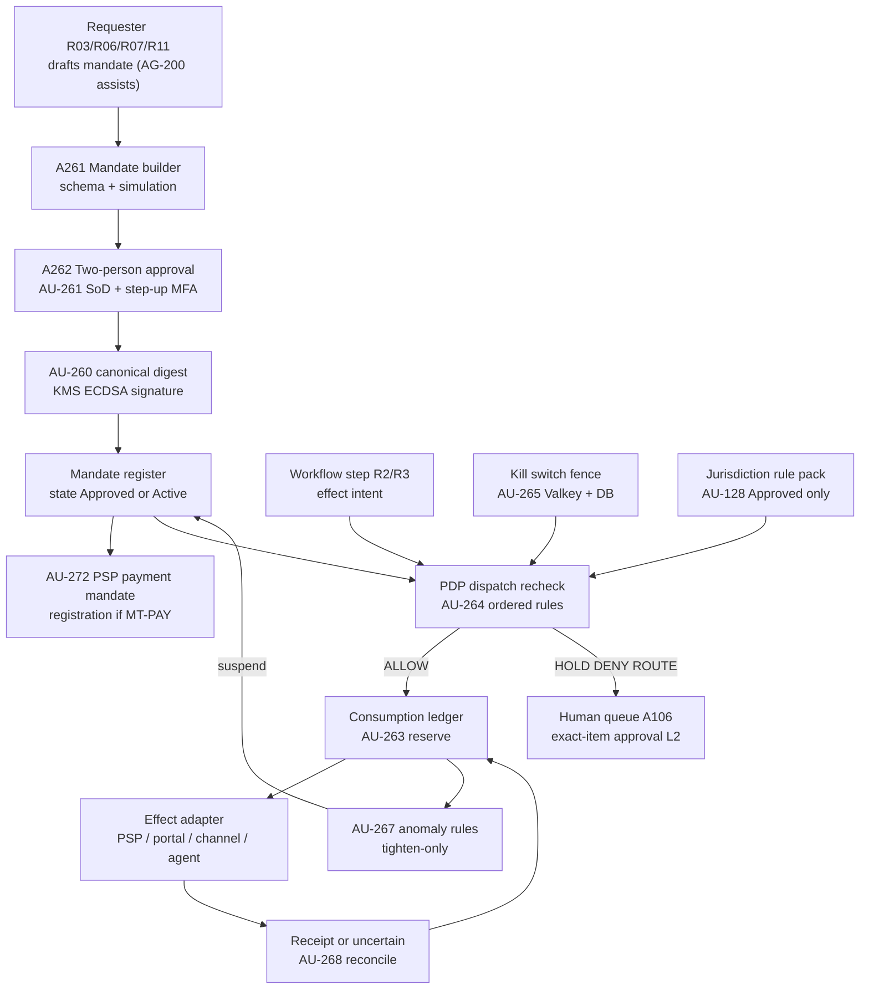
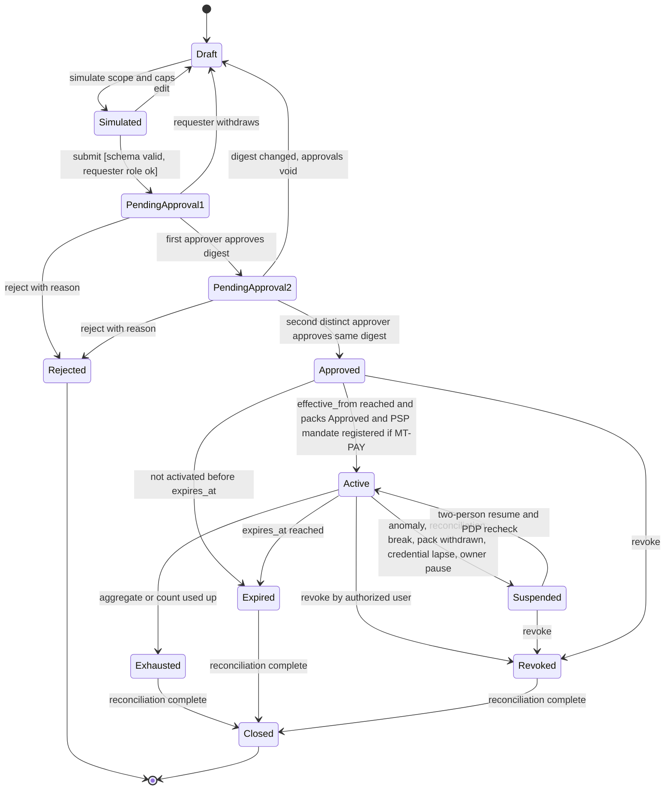
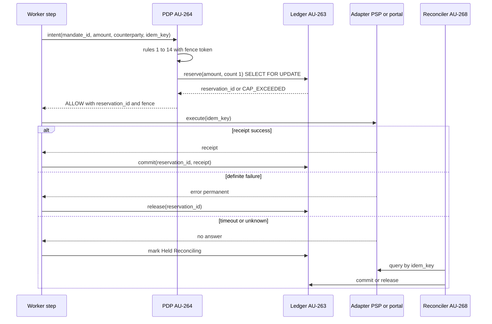
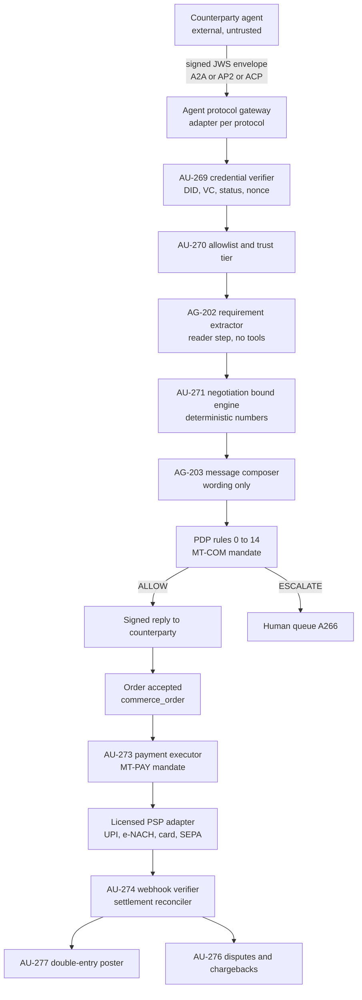
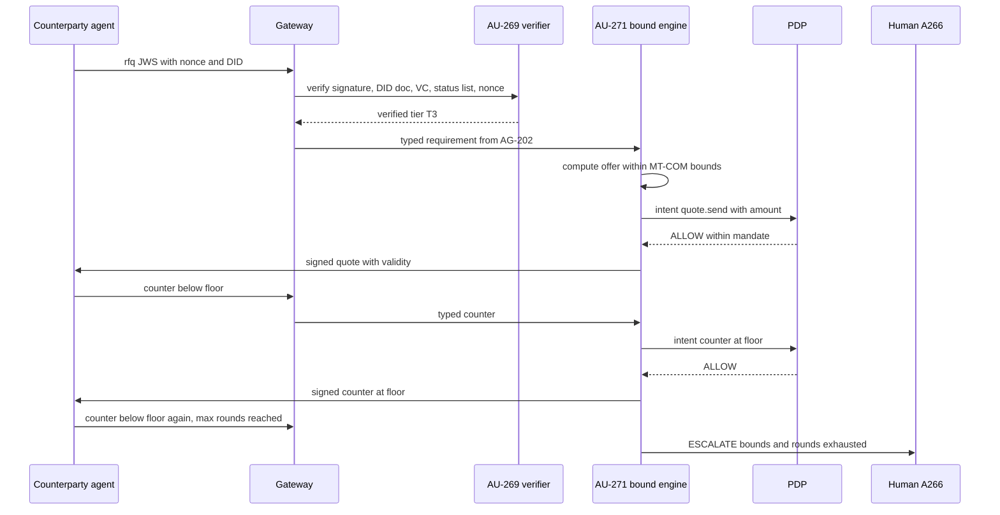
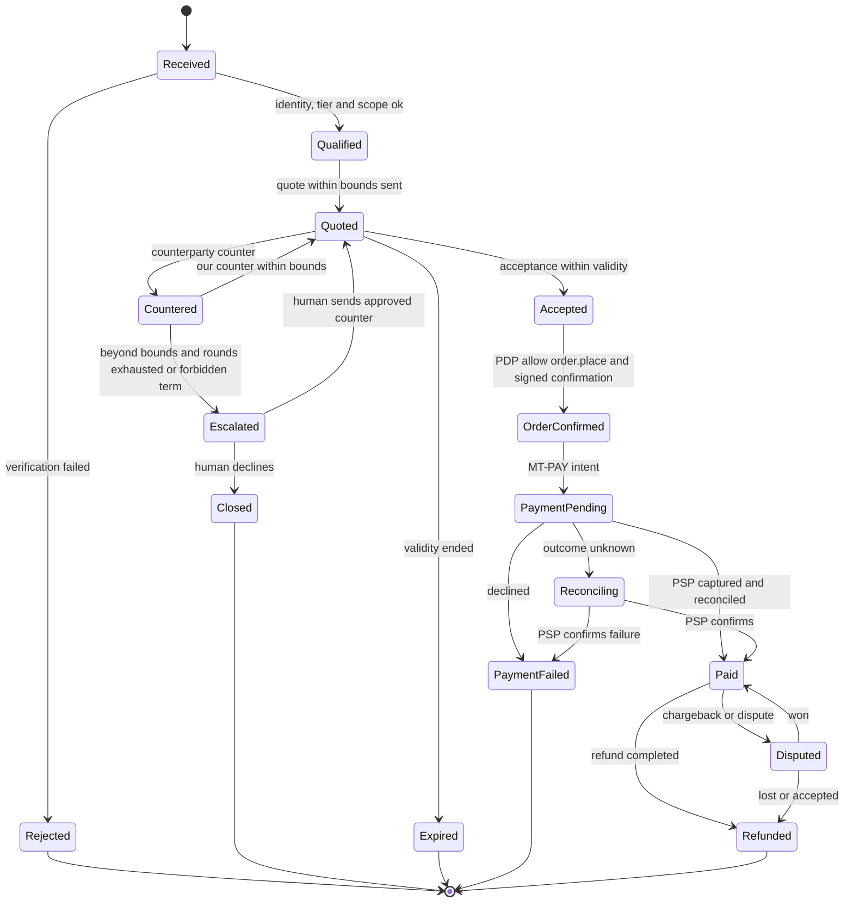
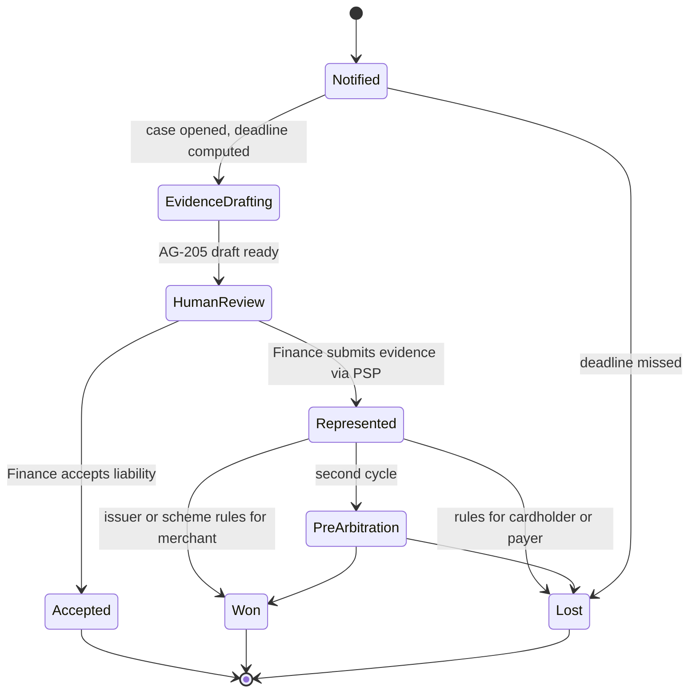

# AI Growth Engine: Employee Sales & Marketing Automation
## Application Blueprint: PART 11 (Batch 11.17), Bounded Mandates, Agentic Commerce and Payments, and Automatic Bid Submission

| Field | Value |
|---|---|
| Document | Part 11, Batch 11.17, file **a of 2**. File a holds §11.17.0–§11.17.6: material reviewed, coverage, the register of superseded positions, the **mandate engine** (object, scope, limits, windows, lifecycle, two-person approval, ledger, PDP recheck, revocation and kill switch, evidence, reconciliation, monitoring and anomaly detection, the L0–L4 controls matrix and the workflow eligibility register) and **agentic commerce and payments** (agent identity, verifiable credentials, counterparty protocol, negotiation bounds, payment execution through a licensed payment service provider, payment-mandate types, spend caps, settlement, refunds, disputes and chargebacks, ledger postings, fraud controls). File b (`Part-11-17b_…`) holds §11.17.7–§11.17.16: automatic bid submission, agents AG-200…209, automations AU-260…279, workflows WF-57…60, screens, entities, APIs, events, audit, STRIDE threat model and abuse cases, stories, tests, AI evaluation cases, the 3-way combinatorial catalogue, effort and cost, decisions, tags and the quality gate |
| Version | 1.0 · 28 Nov 2026 |
| Baseline | Part 11.14 DEC-779 (bounded mandates), DEC-780 (agentic commerce and payments), DEC-781 (automatic bid submission), DEC-772 (IN/EU residency), DEC-776 (legal gates per market), DEC-788 (model registry); Part 11.15a (rule-pack framework, strictest-wins precedence, AU-128 loader); Part 11.1b §11.1.5.7 (CONFLICT-762); Part 11.2c (CONFLICT-778, 781; DEC-532, 533); Part 11.3c (CONFLICT-798…800; DEC-548…550); Part 11.4d (CONFLICT-814, 816; DEC-573, 577); Part 11.6b (CONFLICT-854; AG-104, AU-175); Part 2.3 (BRL-APR-01…11, BRL-AUT-01…10, BRL-BID-01…06, BRL-FIN-01…08, roles R01–R20, ABAC-01…12, §2.27.4 bid, §2.27.7 payment, §2.27.14 run, §2.27.15 plan); Part 4.1 (STRIDE method §4.2.1, THR-045…058, step-up §4.3.3, signing §4.5.4, SC-01…); Part 7.3 (§7.6.1 HITL policy, §7.6.2 thresholds, §7.6.11 kill switch ADR-085); DEC-038, DEC-050, DEC-053, DEC-064 |
| V12 source | BRD V12 ch01 (BR-C09), ch08 (SM-SVC-19, SM-SVC-28), ch09, ch16, ch18 (L0–L4, FL-09), ch20; FSD V12 ch11, ch12 (SM-SVC-19-WF03, SM-SVC-28-WF01…04, R2/R3 authority rows), ch13 (approve/dispatch registry), ch15 (external agent interoperability), ch16 (AI-INJ-06, CTRL-AI-08), ch18 (FL-09, effect classes R0–R3, approval record, V6 dual control, MOB-09), ch20 (website fixtures), ch21 (domain panels), ch24 (X28), ch26 (agent_transaction), ch33 (TC families), ch40 (QC-26), App. B (DTO schemas SM-SVC-28-WF01…04) |
| Roles applied | Principal Agent-Safety Architect (delegated authority) · Payments Architect (PSP mandates, UPI AutoPay, RBI e-mandates, card networks, PSD2 SCA) · Public-Procurement and e-Tendering Specialist (GeM, CPPP, EU TED, US SAM.gov) · Fraud and Risk Lead · AI Governance Lead · QA Architect; supported by the shared-brief virtual team (Product Owner, BSA, Data Architect, Security/Compliance, DevOps/SRE, FinOps) |
| ID ranges used | DEC-840…857 · ADR-240…247 · ASSUMPTION/GAP/CONFLICT/RECOMMENDATION-1040…1059 · FR-V12-P-001…150 · AG-200…209 · AU-260…279 · WF-57…60 · US-14-ZP01…, US-15-ZP01…, US-18-ZP01…, US-24-ZP01… · TC-V12-P-001…826 · TC-AI-AG200…AG209 · screens A260…A269 (provisional, [ASSUMPTION-1040]) · KPI-P-01…12 · THR-V12-P-01…30 · ABU-P-01…20 · MC-01…24 (mandate controls) · CoA-P-1xxx (ledger accounts) |
| Precedence | Part 11.14 > this part > Parts 11.1–11.13 for mandates, agentic commerce and bid submission. Where this part and an earlier rule differ, §11.17.4.2 states the amendment |

**Acronyms used in this part.** A2A Agent2Agent protocol · ACP Agentic Commerce Protocol · AFA additional factor of authentication (RBI) · AP2 Agent Payments Protocol · BIC/IBAN bank identifiers (EU) · CoA chart of accounts · CPPP Central Public Procurement Portal (India, eprocure.gov.in) · DID decentralized identifier · DSC digital signature certificate (India, IT Act 2000) · e-NACH electronic National Automated Clearing House mandate (NPCI) · GeM Government e-Marketplace (India) · JWS JSON Web Signature · KMS key management service · MIT merchant-initiated transaction · MND mandate engine (this part) · NPCI National Payments Corporation of India · PA payment aggregator (RBI-authorised) · PAN primary account number (card) · PDP Policy Decision Point · PISP payment initiation service provider (PSD2) · PSD2 EU Payment Services Directive 2 · PSP payment service provider · RBI Reserve Bank of India · SAM.gov US System for Award Management · SCA strong customer authentication (PSD2) · SDD SEPA Direct Debit · SEPA Single Euro Payments Area · SoD separation of duties · TED Tenders Electronic Daily (EU) · UPI Unified Payments Interface · VC verifiable credential (W3C) · VP verifiable presentation.

**Time-sensitive facts.** Every statement about payment-scheme rules (RBI e-mandate framework, AFA thresholds, pre-debit notification, UPI AutoPay limits and categories, e-NACH limits, card-network MIT rules and agentic-token programmes, PSD2/PSR SCA exemptions, SEPA rulebooks, chargeback time limits), agent protocols (A2A, AP2, ACP, MCP, W3C VC 2.0, DID methods), e-procurement portals (GeM, CPPP, national EU eSubmission platforms, TED, SAM.gov, agency portals) and their terms of use, and every price, is **unverified: verify at time of implementation (as of 27 Nov 2026)**. Legal interpretations are proposals for counsel; no capability in this part activates in a jurisdiction before its rule pack is signed off (DEC-776, Part 11.15).

**What this part is.** The Founder adopted V12 bounded mandates, agentic commerce and payments, and automatic bid submission (DEC-779…781), "irrespective of time and cost", **with V12's own conditions and full legal and operational controls** (V12B brief). This part specifies those controls so that a development team can build, test and operate them, and so that no control is optional: every capability is **built** in full, and **activates per jurisdiction only when that jurisdiction's rule pack is approved** ("where lawful"). Nothing in this part allows an AI agent to expand its own authority: an agent acts only inside a mandate that two authorized humans approved, and the deterministic PDP rechecks that mandate at every dispatch.

---

## 11.17.1 Material reviewed

| # | Material | Size / extent | Sections read | Purpose for this part | Pattern | Aspects |
|---|---|---|---|---|---|---|
| 1 | `v12/BRD/18_AI_Automation_Authority_Business_Govern.txt` | V5 FL-01…FL-15 block; authority table | FL-09; L0–L4; R3 default note | Autonomy scale and persistent mandates | Requirement + acceptance rows | 10 |
| 2 | `v12/FSD/18_Policy_Approval_Human_in_the_Loop_Engin.txt` | V5–V7 sections (lines 740–900) | FL-09; SEC-07; effect classes R0–R3; approval record; V6 dual control; MOB-09; MT-15/20/24/32 | Effect classes, approval record binding, dual control | Tables + prose | 10 |
| 3 | `v12/FSD/12_Executable_Workflow_Specification_156_W.txt` | 72 "mandate" hits; SM-SVC-19 (lines 8281–8620); SM-SVC-28 (lines 11968–12370); 31 R2/R3 authority rows | Full workflow blocks SVC-19-WF01…04, SVC-28-WF01…04 | Steps, DTOs, failure paths, KPIs, acceptance IDs | Field table + step table per workflow | 15 |
| 4 | `v12/FSD/11_Master_Functional_Specification_39_Serv.txt` | SM-SVC-19 (lines 770–800), SM-SVC-28 (1136–1180) | Service blocks | Provider prerequisites, channels, operating mode | Field table | 3 |
| 5 | `v12/BRD/08_Master_Automation_Service_Catalogue_39.txt` | SM-SVC-19 (1190–1200), SM-SVC-28 (1618–1670) | Full service rows | Business acceptance, risk/limits, meter | Field table | 4 |
| 6 | `v12/BRD/01`, `BRD/16`, `BRD/20`, `BRD/09` | Lines with "mandate", "AI-to-AI" | BR-C09; ch16 intro; workflow catalogue rows | Business boundary statements | Prose / rows | 2 |
| 7 | `v12/FSD/13_Workflow_Step_Trigger_Event_Registry.txt` | Stage table (lines 55–85) | Approve "Exact digest + mandate"; Dispatch; Reconcile | Prepare/approve/dispatch/reconcile separation | Table | 1 |
| 8 | `v12/FSD/15_AI_Agent_Registry_Orchestration.txt` | V5 note (line 165) | External agent interoperability | Interop gate | Prose | 1 |
| 9 | `v12/FSD/16_AI_Models_Prompts_Evaluation.txt` | §16.5 AI-INJ table; CTRL-AI-01…09 | AI-INJ-06; CTRL-AI-08 | Counterparty injection and signed limits | Tables | 2 |
| 10 | `v12/FSD/20`, `FSD/21`, `FSD/24`, `FSD/26`, `FSD/33`, `FSD/40`, `FSD/AP_Appendix_B` | Fixtures, domain panels, X28, agent_transaction schema, TC families, QC-26, DTO JSON schemas | Rows naming SVC-28, SVC-19-WF03, SVC-14-WF02, SVC-39-WF03 | UI fields, data fields, tests, schemas | Rows | 16 |
| 11 | Blueprint Parts 11.1b, 11.2c, 11.3c, 11.4d, 11.6b, 11.14 | Conflict tables and proposed resolutions | CONFLICT-762, 778, 781, 798…800, 814, 816, 854; DEC-779…781 | Positions superseded by the Founder | Conflict rows | — |
| 12 | Blueprint Parts 2.3, 4.1, 7.3, 0A, 5.1a/b, 6.2a, 6.4, 11.15a | Rules, roles, state machines, STRIDE, HITL policy, templates, rule-pack framework | As cited | Baseline rules and templates followed exactly | — | 9 (amended rules) |
| | **Total atomic aspects** | | | | | **64** |

The aspect inventory is generated by `assembly/v12b/p_coverage.py` and written to `final/coverage_v12/P_coverage.csv` (columns `doc,chapter,section,aspect_id,aspect_summary,status_before,blueprint_location,action,new_ids,status_after`). The combinatorial models are generated by `assembly/v12b/p_combinatorial.py` (§11.17.14). Repeated V12 boilerplate (FSD-POL-V6-PRECHECK, the common eight-test TC family) is listed once per workflow.

## 11.17.2 Coverage summary

| Status | Before this part (after DEC-779…781 were recorded, before specification) | After this part |
|---|---|---|
| Covered | 13 | — |
| Partially covered | 25 | — |
| Not covered | 3 | — |
| Conflict (now decided by the Founder: DEC-779/780/781) | 23 | — |
| **Matched** | — | **64** |
| Pending Founder decision | — | **0** (the Founder decided all three capabilities; activation per jurisdiction is a legal gate, not a pending decision) |
| Not applicable | — | 0 |
| **Total** | **64** | **64** |

**Reading the result.** Before this part, the blueprint either refused these capabilities (the safety invariant "consequential actions capped at L1", DEC-064, DEC-053, BRL-AI-07, BRL-BID-04, X-06) or kept them as designed-but-disabled shells (AG-104, AU-175, A172). The 23 conflict aspects are the V12 statements that those positions blocked. This part turns each into a specified, testable control set. Activation remains gated per jurisdiction by counsel-approved rule packs (§11.17.5.15; the payment, agentic-contracting and e-procurement packs are not yet in Part 11.15 [GAP-1044]).

## 11.17.3 Detailed register

Every aspect is listed individually (covered aspects included, because the register is short).

| Aspect | Source | Summary | Before | Blueprint location (before) | Action | New IDs | After |
|---|---|---|---|---|---|---|---|
| P-AUT-L0 | BRD 18 · V5 authority | L0 Manual action recorded | Covered | Part 7.3 §7.6.1 L0; Part 11.1b §11.1.5.7 | Map to controls matrix | FR-V12-P-001 | Matched |
| P-AUT-L1 | BRD 18 · V5 authority | L1 AI proposes or drafts; human decides | Covered | Part 7.3 §7.6.1 L1 | Map to controls matrix | FR-V12-P-001 | Matched |
| P-AUT-L2 | BRD 18 · V5 authority | L2 Exact approved action with reviewer, expiry and limits | Covered | BRL-APR-02/03; Part 11.1b crosswalk | Controls matrix L2 row; exact-item approval path | FR-V12-P-002 | Matched |
| P-AUT-L3 | BRD 18 · V5 authority | L3 Bounded routine actions under approved mandate, scope, expiry and caps | Conflict | CONFLICT-762, 798, 799, 814 | Mandate engine specified (§11.17.5) | FR-V12-P-003; DEC-841 | Matched |
| P-AUT-L4 | BRD 18 · V5 authority | L4 Adaptive orchestration inside L3 constraints; never expands authority | Conflict | CONFLICT-762 | L4 plan binding to an L3 mandate; authority-expansion guard | FR-V12-P-004; DEC-841 | Matched |
| P-AUT-R3DEF | BRD 18 · V5 authority | R3 financial/legal/commitment actions default L2; regulatory or contractual requirements override automation preference | Partially covered | DEC-064; Part 11.1b FR-V12-A-110/111 | Default level per effect class; rule-pack override | FR-V12-P-005 | Matched |
| P-AUT-SIM | BRD 18 · V5 authority | No simulation external effect | Covered | BRL-AUT-04 | Mandate shadow mode reuses simulation | FR-V12-P-028 | Matched |
| P-AUT-STOP | BRD 18 · V5 authority | Emergency stop revokes future effects; uncertain completed effects reconciled | Covered | BRL-AUT-05; DEC-050 | Kill switch matrix incl. mandate scope | FR-V12-P-053…058 | Matched |
| P-FL09-REQ | BRD 18 · V5 FL-09 | FL-09 P0 Persistent approval mandates: bind actor, resource, payload digest, action, amount, policy, expiry and revocation | Conflict | CONFLICT-854; AU-175 | Mandate object fields §11.17.5.3 | FR-V12-P-006…012; AU-260 | Matched |
| P-FL09-AT | BRD 18 · V5 FL-09 | OPT-TC-FL-09: changed payload or expired/revoked mandate blocks effect | Partially covered | AU-175 (stale approval) | Combinatorial model M; TC-V12-P-001…300 | TC-V12-P-001…300 | Matched |
| P-R0 | FSD 18 · V5 effect classes | R0 read/draft with source rights; no external action | Covered | BRL-AI-07 | Controls matrix | FR-V12-P-005 | Matched |
| P-R1 | FSD 18 · V5 effect classes | R1 scoped internal record update; version lock and audit | Covered | BRL-AUT-03 | Controls matrix | FR-V12-P-005 | Matched |
| P-R2 | FSD 18 · V5 effect classes | R2 external write; explicit approval or eligible bounded mandate | Conflict | CONFLICT-799, 854 | Mandate eligibility register §11.17.5.14 | FR-V12-P-013; DEC-841 | Matched |
| P-R3 | FSD 18 · V5 effect classes | R3 financial/legal/commitment; exact approval and finance/legal gate; mandate only if expressly approved and permissible | Conflict | CONFLICT-798, 814, 854 | Mandate types MT-COM/MT-PAY/MT-BID with Finance/Legal approver | FR-V12-P-014; DEC-842 | Matched |
| P-APR-BIND | FSD 18 · V5 approval record | Approval record binds tenant/company, workflow version, action digest, recipient, budget, currency, actor authority, expiry and policy version | Partially covered | AU-175; BRL-APR-02 | Mandate digest canonical form | FR-V12-P-008; AU-260 | Matched |
| P-APR-SEP | FSD 18 · V5 approval record | Separate prepare/approve/execute/reconcile | Covered | Part 2.2 dispatch; FSD 13 | Mandated dispatch WF-58 | WF-58 | Matched |
| P-APR-RECHK | FSD 18 · V5 approval record | Recheck revocation, suppression and budget before adapter call | Covered | PDP at dispatch (DEC-012 family) | PDP order §11.17.5.9 | FR-V12-P-040…052 | Matched |
| P-APR-CANCEL | FSD 18 · V5 approval record | Cancellation never hides already-completed action | Covered | DEC-050 | Kill switch CompletedUnreconciled path | TC-V12-P-653…716 | Matched |
| P-V6-DUAL | FSD 18 · V6 | Review by authorized actor distinct from requester; approval binds exact version; stale approvals rejected; demo review is not dual control | Partially covered | BRL-APR-01; MT-32 | Two-person approval rules | FR-V12-P-015…020; AU-261 | Matched |
| P-MOB09 | FSD 18 · V7 MOB-09 | Mobile approvals same verified actor, scope, payload version, spend limits; step-up; no approval from notification | Partially covered | Part 4.1 §4.3.3 | Mandate approval on mobile: step-up; no notification approve | FR-V12-P-019 | Matched |
| P-BRC09 | BRD 01/20 · BR-C09 | Draft/simulation no external effects; real external actions require exact approval or eligible bounded mandate; high-risk approvals cannot be bypassed | Conflict | CONFLICT-762 | Adopted with mandate engine | FR-V12-P-003; DEC-841 | Matched |
| P-BRD16 | BRD 16 · Commerce | No autonomous commitment without mandate, explicit provider approval and reconciliation | Conflict | CONFLICT-762, 778 | Commerce/payment mandates via licensed PSP; reconciliation | FR-V12-P-070…098 | Matched |
| P-R3-WF | FSD 12 · R3 rows | 10 R3 workflows SVC-21/28/30/31/32/37/39 and 9 R3 workflows SVC-14/17/18/19/20 carry 'L3 only with separately approved bounded mandate where lawful' | Conflict | CONFLICT-798, 814 | Eligibility register §11.17.5.14 | FR-V12-P-013, 014 | Matched |
| P-R2-WF | FSD 12 · R2 rows | 12 R2 workflows (SVC-06/07/09/10/12/16) carry the same mandate clause | Conflict | CONFLICT-799 | Eligibility register §11.17.5.14 | FR-V12-P-013 | Matched |
| P-FSD13 | FSD 13 · Registry | Approve stage: exact digest + mandate; no effect until dispatch | Partially covered | Part 11.4b registry | WF-58 approve/dispatch split | WF-58 | Matched |
| P-28-WF01-IO | FSD 12 · SM-SVC-28-WF01 | Machine-readable catalog publication: Approved offering catalog, access policy, structured schema -> Machine-readable catalog | Partially covered | Part 11.4c/d; CONFLICT-816 | WF-59 steps; DTO extension | FR-V12-P-070…098; WF-59 | Matched |
| P-28-WF01-STEPS | FSD 12 · SM-SVC-28-WF01 | Steps STEP-01…03 with failure paths POLICY_DENIED/EFFECT_UNKNOWN/CONFLICT/REVIEW_REQUIRED | Partially covered | Part 11.4d | Mapped to WF-59 step table | WF-59 | Matched |
| P-28-WF01-TC | FSD 33 · SM-SVC-28-WF01 | TC-POS/INPUT/SCOPE/ENT/DUP/QUALITY/BUDGET/RECOVERY/APPROVAL/EFFECT | Partially covered | Part 11.10 | Traced to TC-V12-P | TC-V12-P-301…523, 717… | Matched |
| P-28-WF02-IO | FSD 12 · SM-SVC-28-WF02 | Authorized AI-agent requirement discovery and quotation exchange: Verified agent identity, scoped mandate, requirements -> Authorized quote exchange | Partially covered | Part 11.4c/d; CONFLICT-816 | WF-59 steps; DTO extension | FR-V12-P-070…098; WF-59 | Matched |
| P-28-WF02-STEPS | FSD 12 · SM-SVC-28-WF02 | Steps STEP-01…03 with failure paths POLICY_DENIED/EFFECT_UNKNOWN/CONFLICT/REVIEW_REQUIRED | Partially covered | Part 11.4d | Mapped to WF-59 step table | WF-59 | Matched |
| P-28-WF02-TC | FSD 33 · SM-SVC-28-WF02 | TC-POS/INPUT/SCOPE/ENT/DUP/QUALITY/BUDGET/RECOVERY/APPROVAL/EFFECT | Partially covered | Part 11.10 | Traced to TC-V12-P | TC-V12-P-301…523, 717… | Matched |
| P-28-WF03-IO | FSD 12 · SM-SVC-28-WF03 | Agent-assisted purchasing and negotiation mandate coordination: Mandate, price limits, negotiation policy -> Mandate-linked decision | Conflict | Part 11.4c/d; CONFLICT-816 | WF-59 steps; DTO extension | FR-V12-P-070…098; WF-59 | Matched |
| P-28-WF03-STEPS | FSD 12 · SM-SVC-28-WF03 | Steps STEP-01…03 with failure paths POLICY_DENIED/EFFECT_UNKNOWN/CONFLICT/REVIEW_REQUIRED | Conflict | Part 11.4d | Mapped to WF-59 step table | WF-59 | Matched |
| P-28-WF03-TC | FSD 33 · SM-SVC-28-WF03 | TC-POS/INPUT/SCOPE/ENT/DUP/QUALITY/BUDGET/RECOVERY/APPROVAL/EFFECT | Partially covered | Part 11.10 | Traced to TC-V12-P | TC-V12-P-301…523, 717… | Matched |
| P-28-WF04-IO | FSD 12 · SM-SVC-28-WF04 | Authorized transaction, payment mandate and outcome reconciliation: Approved order, verified payment mandate, provider event -> Auditable transaction record | Conflict | Part 11.4c/d; CONFLICT-816 | WF-59 steps; DTO extension | FR-V12-P-070…098; WF-59 | Matched |
| P-28-WF04-STEPS | FSD 12 · SM-SVC-28-WF04 | Steps STEP-01…03 with failure paths POLICY_DENIED/EFFECT_UNKNOWN/CONFLICT/REVIEW_REQUIRED | Conflict | Part 11.4d | Mapped to WF-59 step table | WF-59 | Matched |
| P-28-WF04-TC | FSD 33 · SM-SVC-28-WF04 | TC-POS/INPUT/SCOPE/ENT/DUP/QUALITY/BUDGET/RECOVERY/APPROVAL/EFFECT | Partially covered | Part 11.10 | Traced to TC-V12-P | TC-V12-P-301…523, 717… | Matched |
| P-28-DTO | FSD 26 · agent_transaction | DTO agent_ref, mandate_ref, offering_ref, order_ref -> quote_ref, mandate_state, transaction_ref, reconciliation_state | Partially covered | Part 11.9a | Enum values defined; entity model §11.17.9 | FR-V12-P-099 | Matched |
| P-28-ACC | BRD 08 · SM-SVC-28 | Verified mandate and idempotency 100%; unauthorized transactions = 0 | Partially covered | Part 11.2b | KPI KPI-P-01/02 | KPI-P-01, KPI-P-02 | Matched |
| P-28-RISK | BRD 08 · SM-SVC-28 | Verify agent identity, mandate, spending limits and approval before any transaction; reconcile via authorized provider | Conflict | CONFLICT-778 | PDP order + PSP adapter | FR-V12-P-040…052, 080…090 | Matched |
| P-28-PROV | BRD 08 · SM-SVC-28 | Supported agent protocols and authorized payment/commerce providers; verified mandates | Not covered | — | Protocol adapter + PSP registry | FR-V12-P-070…075; ADR-242, 243 | Matched |
| P-28-METER | BRD 08 · SM-SVC-28 | Meter: agent transaction case; pilot allowance 50 (not approved) | Partially covered | Part 11.2a | Metering unit adopted | FR-V12-P-099 | Matched |
| P-15-INTEROP | FSD 15 · V5 | External agent interoperability off until validated signed mandate and scoped contract | Partially covered | CONFLICT-854 | Interop gate FR-V12-P-076 | FR-V12-P-076 | Matched |
| P-INJ06 | FSD 16 · 16.5 | AI-INJ-06 counterparty agent asks to exceed mandate -> signed mandate limits; hold above cap | Not covered | Part 11.6a F16-044 | AI eval TC-AI-AG202/203 | TC-AI-AG202-004 | Matched |
| P-CTRL08 | FSD 16 · 16.5 | CTRL-AI-08 SM-SVC-28 mandates signed with limits; counterparty messages are untrusted data | Not covered | Part 11.6a F16-058 | Signed mandate + JWS envelope | FR-V12-P-008, 072 | Matched |
| P-W-28 | FSD 20 · Website fixtures | Website fixtures: quote only after verified mandate and identity; mandate review max sample spend ₹2,000; no payment made; reconcile before replay | Partially covered | Part 11.7 | Demo fixtures reused in TC data | TC-V12-P-717… | Matched |
| P-W-14 | FSD 20 · Website fixtures | SM-SVC-14-WF02 activation held: no approved spend mandate | Partially covered | Part 11.7 | Spend mandate type MT-SPEND | FR-V12-P-013 | Matched |
| P-W-39 | FSD 20 · Website fixtures | SM-SVC-39-WF03 purchase proposal: approved mandate and signatory missing | Partially covered | Part 11.7 | MT-PROC mandate type | FR-V12-P-013 | Matched |
| P-21-28 | FSD 21 · Domain panel | SVC-28 panel: Mandate reference; Counterparty / transaction; Spending limit; Approval state; Review mandate; evidence: Mandate version; Recipient / approval reference; Transaction reconciliation | Partially covered | A172 (Part 11.7b) | Screens A260…A267 | A260…A267 | Matched |
| P-19-AUTH | FSD 12 · SM-SVC-19-WF03 | R3; L2 mandatory approved effect; L3 only with bounded mandate where lawful; capability grant and explicit bid approval; no automatic submission to restricted portal | Conflict | CONFLICT-781, 800 | Per-tender mandate MT-BID; portal capability registry | FR-V12-P-110…135; DEC-851 | Matched |
| P-19-STEPS | FSD 12 · SM-SVC-19-WF03 | STEP-01 draft; 02 validate attachments; 03 route approval; 04 coordinate authorized submission and track receipt | Conflict | CONFLICT-800 | WF-60 steps | WF-60 | Matched |
| P-19-KPI | FSD 12 · SM-SVC-19-WF03 | Attachment completeness; verified receipt rate; unapproved bid submissions = 0 | Partially covered | AU-034 | KPI-P-06…08 | KPI-P-06…08 | Matched |
| P-19-PROV | FSD 11 · SM-SVC-19 | Authorized tender feeds/portal and account; manual submission unless permitted API | Conflict | CONFLICT-781 | Portal capability registry modes | FR-V12-P-118…122 | Matched |
| P-QC26 | FSD 40 · QC-26 | Verify tender eligibility, deadline, budget, technical requirements and authorized bid submission; track award separately | Partially covered | BRL-BID-02/05 | Pre-submission gate | FR-V12-P-112 | Matched |
| P-19-DTO | FSD 12 · SM-SVC-19-WF03 | DTO deadline RFC 3339; submission_ref output | Partially covered | Part 11.3 | Receipt model | FR-V12-P-125 | Matched |
| P-AMD-BRL-AI-07 | Blueprint — · BRL-AI-07 | Amend/scope BRL-AI-07 (No AI consequential action) for actions under an Active mandate | Conflict | Part 2.3 / Part 0A / Part 7 | Amendment text §11.17.4.2 | DEC-841, 848, 851 | Matched |
| P-AMD-BRL-AUT-01 | Blueprint — · BRL-AUT-01 | Amend/scope BRL-AUT-01 (Autonomy caps DEC-064) for actions under an Active mandate | Conflict | Part 2.3 / Part 0A / Part 7 | Amendment text §11.17.4.2 | DEC-841, 848, 851 | Matched |
| P-AMD-BRL-BID-04 | Blueprint — · BRL-BID-04 | Amend/scope BRL-BID-04 (Human submission) for actions under an Active mandate | Conflict | Part 2.3 / Part 0A / Part 7 | Amendment text §11.17.4.2 | DEC-841, 848, 851 | Matched |
| P-AMD-BRL-BID-01 | Blueprint — · BRL-BID-01 | Amend/scope BRL-BID-01 (Deadline buffer) for actions under an Active mandate | Covered | Part 2.3 / Part 0A / Part 7 | Amendment text §11.17.4.2 | DEC-841, 848, 851 | Matched |
| P-AMD-BRL-FIN-07 | Blueprint — · BRL-FIN-07 | Amend/scope BRL-FIN-07 (No card/bank credentials) for actions under an Active mandate | Covered | Part 2.3 / Part 0A / Part 7 | Amendment text §11.17.4.2 | DEC-841, 848, 851 | Matched |
| P-AMD-BRL-APR-07 | Blueprint — · BRL-APR-07 | Amend/scope BRL-APR-07 (Finance maker-checker) for actions under an Active mandate | Covered | Part 2.3 / Part 0A / Part 7 | Amendment text §11.17.4.2 | DEC-841, 848, 851 | Matched |
| P-AMD-DEC-053 | Blueprint — · DEC-053 | Amend/scope DEC-053 (Tender submission never automated) for actions under an Active mandate | Conflict | Part 2.3 / Part 0A / Part 7 | Amendment text §11.17.4.2 | DEC-841, 848, 851 | Matched |
| P-AMD-DEC-064 | Blueprint — · DEC-064 | Amend/scope DEC-064 (Autonomy cap matrix) for actions under an Active mandate | Conflict | Part 2.3 / Part 0A / Part 7 | Amendment text §11.17.4.2 | DEC-841, 848, 851 | Matched |
| P-AMD-X-06 | Blueprint — · X-06 | Amend/scope X-06 (Payments never) for actions under an Active mandate | Conflict | Part 2.3 / Part 0A / Part 7 | Amendment text §11.17.4.2 | DEC-841, 848, 851 | Matched |

## 11.17.4 Reconciliation of superseded positions

### 11.17.4.1 Conflict rows closed by this part

| Conflict | Raised in | Position recommended before the Founder decision | Founder decision | What this part specifies instead | Section |
|---|---|---|---|---|---|
| CONFLICT-762 | Part 11.1b §11.1.5.7 | Keep the invariant; V12-L3 only for the DEC-064 routine class; L4 internal only | DEC-779 | Full L0–L4 controls matrix; L3 under an Active bounded mandate for any effect class where the eligibility register and the jurisdiction pack allow it; L4 bound to an L3 mandate and unable to expand it | §11.17.5.2, §11.17.5.14 |
| CONFLICT-778 | Part 11.2c | Mandate bounds negotiation only; human approval per transaction; no AI-initiated payment (DEC-532) | DEC-780 | Negotiation and payment under MT-COM and MT-PAY mandates; execution only through a licensed PSP; per-transaction and per-period caps; counterparty allowlist; signed identity and VCs; reconciliation; disputes | §11.17.6 |
| CONFLICT-781 | Part 11.2c | Human submission on every portal (DEC-533, BRL-V12-B-04) | DEC-781 | Per-tender MT-BID mandate; automatic submission of the exact approved package hash where the portal capability registry and the pack permit it; otherwise assisted or manual submission | §11.17.7 (file b) |
| CONFLICT-798 | Part 11.3c | Keep ≤ L1 for R3; disable the L3 path by flag (DEC-548) | DEC-779 | L3 path enabled per workflow in the eligibility register; R3 mandates need a Finance or Legal approver (MC-07) | §11.17.5.6, §11.17.5.14 |
| CONFLICT-799 | Part 11.3c | Mandate only for DEC-064 L3 categories (DEC-549) | DEC-779 | All 12 R2 workflows eligible for MT-OUT mandates; consent, suppression, quiet hours and the 09:00–21:00 window (DEC-777) still rechecked per message | §11.17.5.14 |
| CONFLICT-800 | Part 11.3c | Step 04 = human submission task (DEC-550) | DEC-781 | WF-60 step 04 = mandated submission through a portal adapter, with the deadline guard and receipt verification | §11.17.7 |
| CONFLICT-814 | Part 11.4d | (b)+(c): L1 per item; record-only steps at L3 (DEC-577) | DEC-779 | 10 R3 workflows (SVC-21-WF01/02, 28-WF03/04, 30-WF02, 31-WF02/03, 32-WF04, 37-WF03, 39-WF03) eligible for typed mandates | §11.17.5.14 |
| CONFLICT-816 | Part 11.4d | Catalogue and quote drafts only (DEC-573) | DEC-780 | SVC-28 WF01–WF04 specified end to end (WF-59) | §11.17.6 |
| CONFLICT-854 | Part 11.6b | Bounded R2 mandates only; R3 mandates disabled; payment mandate not supported; interop OFF | DEC-779, DEC-780 | Mandate engine with R2 and R3 types; payment mandates; external agent interoperability ON per tenant after the interop gate FR-V12-P-076 | §11.17.5, §11.17.6 |

The earlier "Pending Founder decision" DECs DEC-532, 533, 548, 549, 550, 572 (voice, not this part), 573 and 577 are **closed** by DEC-779…781 and superseded by DEC-840…857 of this part for the implementation detail.

### 11.17.4.2 Amendments to earlier rules (exact replacement wording)

Earlier parts are not edited (brief boundary). The rules below are read with this amendment from the date of this part.

| Rule | Earlier text (abridged) | Amended reading (binding) | Authority |
|---|---|---|---|
| DEC-064 / BRL-AUT-01 | Money movement unsupported; quotes, discounts, contracts, legal terms, bid submissions ≤ L1 | **Unchanged for any action not covered by an Active mandate.** An action covered by an Active, in-scope, in-window, within-cap mandate of an eligible type (§11.17.5.14) in a jurisdiction whose pack is Approved may execute at V12-L3 (or under a V12-L4 plan bound to that mandate). Money movement is supported **only** through a licensed PSP under an MT-PAY mandate | DEC-779, DEC-780; DEC-841 |
| BRL-AI-07 | AI cannot approve, sign, submit, pay, change price/terms or alter permissions | **AI still never approves anything and never alters permissions or mandates.** Under an Active mandate, the *deterministic* executor (not the model) may submit, pay or accept terms that the mandate's bounds already fix; the model only extracts, classifies and drafts wording. Signing with a legal signature remains human unless the jurisdiction pack and the portal allow an organisational signer certificate (§11.17.7.5) | DEC-779…781; DEC-847 |
| BRL-BID-04 / DEC-053 | Submission is performed by a human outside the system | Human submission remains the default (L1). Under an Active MT-BID mandate whose approved package hash equals the sealed package, the system submits through a permitted portal adapter and records the receipt; otherwise assisted (L2) or manual (L1) submission applies | DEC-781; DEC-851 |
| BRL-BID-01 | Submission blocked at or after (deadline − buffer); default buffer 24 h; minimum 2 h | Applies to **automated** attempts: the deadline guard (AU-278) forbids a first automated attempt inside the automation buffer (default 6 h, minimum 2 h) and any automated retry inside the hard-stop buffer (default 2 h). A human may still submit on the portal at any time before the deadline; the system records the evidence | DEC-852 [ASSUMPTION-1053] |
| BRL-FIN-07 | No storage of card data or bank credentials | **Unchanged and reinforced:** the platform stores only PSP tokens, mandate references (UMRN, UPI mandate ID, SDD mandate reference) and masked instrument hints; never a PAN, CVV, UPI PIN or bank login | DEC-848 |
| BRL-APR-07 | Payment verification and invoice approval require two different Finance users | Exact automated matches of PSP settlement to an MT-PAY transaction close without manual verification; any mismatch, partial, duplicate or unknown-outcome item goes to Finance maker-checker exactly as before [CONFLICT-1048, resolved] | DEC-849 |
| X-06 (Part 11.6b) | Payments never | Payments only through a licensed PSP under an MT-PAY mandate; the model never initiates a payment call (tool isolation CTRL-AI-04) | DEC-780; DEC-848 |
| DEC-388 / DEC-395 | AI never proposes or computes a price; approved price books only | Numbers in a negotiation are produced by the deterministic negotiation bound engine (AU-271) from the human-approved bounds and price book; the model writes wording only and cannot introduce a number [CONFLICT-1047, resolved] | DEC-847 |
| Part 7.3 §7.6.1 "Never automated, at any mode" | Money movement, payment verification, signing, tender submission, quotes/prices beyond approved versions | Read with "…except by the deterministic executor under an Active mandate of an eligible type, in an approved jurisdiction, after the PDP recheck (Part 11.17)". Payment *verification* of mismatches, permission changes, configuration loosening and mandate approval remain never automated | DEC-841 |

## 11.17.5 The mandate engine (MND)

The mandate engine is one shared backend module (`commercial.mandates`, Django app) used by every workflow that may act under a bounded mandate: outbound routine communication, ad spend, agentic commerce, payments, procurement, pricing experiments and tender submission. It owns the mandate record, its approvals, its consumption ledger and its decisions; the PDP calls it at every dispatch; workers never bypass it (ADR-240). It runs inside the tenant's residency region (DEC-772): an EU tenant's mandates, ledger and evidence never leave the EU stack.

### 11.17.5.1 Control objectives (MC-##)

Every MC is mandatory; none is configurable off. Each maps to requirements (§11.17.5.20) and tests (file b).

| MC | Control objective | Enforced by | V12 / baseline source | Verified by |
|---|---|---|---|---|
| MC-01 | No effect under a mandate unless the mandate is **Active**, in window, in scope and within every cap at the instant of dispatch | PDP + AU-264 | FL-09; BRD 18 L3; DEC-779 | Model M (TC-V12-P-001…300) |
| MC-02 | Every mandate is approved by **two authorized people**, distinct from each other and from the requester | AU-261; ABAC-03 | DEC-779; FSD 18 V6 | TC-V12-P-717…722 |
| MC-03 | The approval binds a canonical **digest** of the full mandate; any change voids the approvals | AU-260 | FL-09; BRL-APR-02 | TC-V12-P-723 |
| MC-04 | Caps are enforced **per action** and **in aggregate** per period, in the mandate currency, inclusive, with Decimal arithmetic | AU-263 | DEC-779; DEC-027 | Model M VAL dimension |
| MC-05 | Consumption is **reserved before** the effect and committed or released exactly once (no double spend under concurrency) | AU-263 | NFR-005; BRL-FIN-02 | TC-V12-P-726…729 |
| MC-06 | **Revocation** is instant: new dispatches denied within one PDP evaluation after commit (≤ 5 s target, ≤ 60 s bound) | AU-266, AU-265 | DEC-779; BRL-AUT-05 | Model K; TC-V12-P-730 |
| MC-07 | R3 mandates (commitment, money, bids, pricing) need one approver from Finance (R08/R09) or Legal (R10) by type, and the DEC-038 threshold approver | AU-261 | FSD 18 R3; DEC-038 | TC-V12-P-718…720 |
| MC-08 | A mandate never grows by itself: tightening may be automatic (anomaly engine, expiry, exhaustion); **loosening needs a new version and two-person approval** | AU-260/261/267 | BRL-APR-11 | TC-V12-P-724 |
| MC-09 | The **kill switch** blocks every new automated effect in its scope within 60 s; resume needs two people and a PDP recheck | AU-265 | BRL-AUT-05; ADR-085 | Model K (TC-V12-P-653…716) |
| MC-10 | **Jurisdiction gate**: the mandate type is usable in a jurisdiction only while its rule pack is Approved (counsel sign-off) | AU-128 + PDP | DEC-776; Part 11.15 | Model M JUR dimension |
| MC-11 | **Counterparty** must be in the mandate scope and in the tenant allowlist with a currently valid credential | AU-269/270 | SVC-28; DEC-780 | Model M CPT, Model C VC |
| MC-12 | **Uncertain outcome** is never retried blindly; reservation stays held until reconciled | AU-268; AU-026 | DEC-050; BRL-AUT-07 | Model C PSP=Timeout; Model B RECEIPT=TimeoutUnknown |
| MC-13 | Every decision (allow, hold, deny, route, defer) writes an **audit event** with mandate version, rule ID and reason code into the hash chain | AU-264 | Part 4.5.4; FSD 18 | All TCs assert audit |
| MC-14 | **Daily reconciliation** of mandate ledger ↔ effect receipts ↔ PSP/portal statements; any break suspends the mandate | AU-268 | SVC-28 KPI | TC-V12-P-741…744 |
| MC-15 | **Anomaly detection** may suspend or tighten, never loosen | AU-267 | RECOMMENDATION-1049 | TC-V12-P-745…750 |
| MC-16 | **Shadow period** for every new mandate type per tenant: decisions computed, effects routed to L2 approval, until exit criteria met | AU-264 flag | RECOMMENDATION-1050 | TC-V12-P-751 |
| MC-17 | The model never holds an effect tool; only the deterministic executor calls adapters (tool isolation) | Tool registry; CTRL-AI-04 | FSD 16; BRL-AI-07 amended | AI eval TC-AI-AG202-006 |
| MC-18 | **Counterparty text is data**; a request to exceed a mandate is held (AI-INJ-06) | AU-271 bounds; CTRL-AI-08 | FSD 16.5 | TC-AI-AG202-004 |
| MC-19 | Consent, suppression, quiet hours and the 09:00–21:00 window still apply per message under MT-OUT | PDP (AU-171/172) | DEC-777; BRL-ELG | Part 11.6b tests + TC-V12-P-752 |
| MC-20 | **Residency**: mandate, ledger, evidence and PSP/portal calls run from the tenant's region | Region router | DEC-772 | TC-V12-P-753 |
| MC-21 | **Idempotency**: one business intent produces at most one external effect (idempotency key = mandate ID + intent hash + attempt family) | AU-263/273/279 | NFR-005 | TC-V12-P-728 |
| MC-22 | **Step-up MFA** for mandate approval, amendment, revocation-resume and kill-switch resume; WebAuthn for R01/R08/R09/R10 approvers | IdP; ABAC-11 | Part 4.1 §4.3.3; MOB-09 | TC-V12-P-721 |
| MC-23 | **No approval from a notification**; mobile approval shows the same full mandate view and digest | A262 | MOB-09 | TC-V12-P-722 |
| MC-24 | **Evidence pack** per mandate exportable for audit: versions, approvals, decisions, effects, receipts, reconciliations, alerts | AU-268 export | FSD 34; SOC 2 (DEC-775) | TC-V12-P-754 |

### 11.17.5.2 Autonomy levels L0–L4 mapped to controls

The V12 scale (BRD 18 §V5) replaces the blueprint L0–L3 labels (DEC-542 adopted V12 labels; DEC-779 adopted the authority). The table is the binding control set per level.

| Control | **L0** Manual action recorded | **L1** AI proposes or drafts; human decides | **L2** Exact approved action with reviewer, expiry and limits | **L3** Bounded routine actions under approved mandate | **L4** Adaptive orchestration inside L3 constraints |
|---|---|---|---|---|---|
| Who performs the external effect | Human, outside or inside the system | Human (after deciding on the AI draft) | System executor, once, for the exact approved payload | System executor, repeatedly, for any payload inside the mandate | System executor, as planned by the orchestrator, for payloads inside the bound L3 mandate |
| What the human approves | Nothing in the system (records the action) | The draft, by acting on it | The **exact payload hash** of one action (BRL-APR-02), with expiry and limits | The **mandate** (scope, caps, windows, counterparties, jurisdictions, data classes), two people | The **plan** (objective, step graph, stop policy) **and** the L3 mandate it is bound to |
| Mandate required | No | No | No (a mandate may pre-fill reviewer and limits) | **Yes, Active** | **Yes, Active, plan-bound** (`plan_digest` in the mandate) |
| PDP recheck at dispatch | n/a (no automated dispatch) | Full recheck when the human's action dispatches | Full recheck + exact hash match + approval not expired | Full recheck + mandate rules 1–14 (§11.17.5.12) | Same as L3 + plan step is in the approved graph + plan budget |
| Caps | n/a | DEC-038 thresholds on the human approver | Approval amount = payload amount | Per-action + aggregate + count + velocity caps | Same caps; the plan cannot raise them; plan budget ≤ mandate remaining |
| Counterparty / recipient | Any lawful | Any lawful | The one in the payload | Only allowlisted counterparties in scope | Same as L3 |
| Kill switch effect | None (no automation) | Blocks dispatch | Blocks dispatch | Blocks dispatch; reservation released | Blocks; plan Paused |
| Monitoring | Audit only | Audit; approval SLA (BRL-APR-10) | Audit; approval expiry | Real-time anomaly rules AU-267; daily reconciliation | Same + plan drift monitor (step outside graph = stop) |
| Sampling review | — | — | 10% weekly of R2 dispatches (Part 7.3) | **Every** R3 effect visible in A263 within 1 min; weekly 100% review of R3 effects by the mandate owner; 10% R2 | Same as L3 |
| Evidence | Manual evidence record | Draft + decision | Approval record + receipt | Mandate version + decision + receipt + ledger entry | Same + plan version + step |
| Who may enable the level for a workflow | Default | Default | R02 (R2), R02 + R10 (R3) | Eligibility register (§11.17.5.14) + Approved jurisdiction pack + two-person mandate approval | R01 + R11 for the workflow, and an L3 mandate |
| Never allowed at this level | — | — | Approving its own payload; changing price beyond the approved version | Expanding scope; loosening caps; adding counterparties; acting in a non-approved jurisdiction; acting on Restricted data classes not in scope | Any of the L3 prohibitions; creating or amending mandates; choosing a new effect type |

**Default level per effect class** (FSD 18 V5; BRD 18: "R3 … default L2; regulatory or contractual requirements override any automation preference").

| Effect class | Default | Maximum with mandate | Mandate types | Extra approver (MC-07) |
|---|---|---|---|---|
| R0 read/draft | L3 (internal) | L4 | — (no mandate needed) | — |
| R1 internal record update | L2 | L4 | — | — |
| R2 external communication/provider/access write | L2 | L3 (L4 with plan) | MT-OUT, MT-PUB | Claims approver R10 when the template carries claims |
| R3 financial/legal/commitment | **L2** | L3 (L4 with plan) | MT-SPEND, MT-COM, MT-PAY, MT-PROC, MT-BID, MT-PRICE | Finance (R08/R09) for money types; Legal (R10) for MT-COM terms, MT-BID and MT-PRICE; DEC-038 threshold approver by value |

**Regulatory override rule (FR-V12-P-005).** If an Approved rule pack sets a stricter maximum level for an effect type in a jurisdiction (for example "payment above X requires customer authentication each time" or "portal forbids automated submission"), the stricter level applies, regardless of the mandate.

### 11.17.5.3 Mandate types

| Type | Purpose | Typical workflows | Effect class | Mandatory scope dimensions | Mandatory limits | Max validity | Who may request | Approvers (two, distinct) |
|---|---|---|---|---|---|---|---|---|
| **MT-OUT** | Routine outbound communication (approved templates, follow-ups, reminders, booking confirmations) | SVC-06-WF02, 07-WF02/04, 09-WF02/04, 10-WF01/02, 12-WF01/04, 16-WF01/02/04, 38 | R2 | channel accounts, template IDs and versions, audience segment, purpose, jurisdictions | messages per day, per recipient per 7 d (≤ BRL-ELG caps) | 90 days | R03, R05, R11 | R05L or R02 + R10 (claims) |
| **MT-PUB** | Publication of approved content variants | SVC-11, 13 | R2 | channels, content IDs, claims | posts per day | 90 days | R05 | R05L + R10 |
| **MT-SPEND** | Ad or campaign spend within budget | SVC-14-WF02/04 | R3 | ad accounts, campaign IDs, geos | per-day spend, per-campaign total, CPA ceiling | 90 days | R05, R03 | R02 + Finance (R08) |
| **MT-COM** | Agentic commerce negotiation and order acceptance with counterparty agents | SVC-28-WF02/03, 31-WF02/03, 21-WF01/02 | R3 | counterparties, offering IDs, price-book revision, term library version | per-order value, aggregate per period, max discount vs list, min margin, rounds | 30 days | R03, R07 | R02 + R10; Founder + Finance above DEC-038 thresholds |
| **MT-PAY** | Payment (pay-out to supplier or collection from customer) via licensed PSP | SVC-28-WF04, 39-WF03, 32-WF04, 17-WF03, 20-WF02/03 | R3 | payees/payers, PSP account, payment method, PSP mandate reference, purpose codes | per-transaction, per-period aggregate, count per period, velocity | 30 days (renewable; PSP mandate may be longer) | R07, R08 | R08 Finance Maker + R09 Finance Checker (BRL-APR-07); Founder above ₹10 lakh or cross-border (BRL-APR-06) |
| **MT-PROC** | Purchase order commitment to approved suppliers | SVC-39-WF03, 20-WF02 | R3 | suppliers, catalogue items, quantities, delivery terms | per-PO value, aggregate per period | 30 days | R07 | R02 + R08 |
| **MT-BID** | Submission of one exact bid package to one tender on one portal | SVC-19-WF03 | R3 | tender ID, portal profile, package hash, price, terms, signatory | single use (count = 1); price = approved price | Until tender deadline | R06 | R02 (Startup Head, BRL-BID-03) + R10; Founder + Legal above ₹10 lakh or cross-border |
| **MT-PRICE** | Live pricing/promotion experiment between two approved price-book revisions | SVC-37-WF03 (DEC-791) | R3 | price-book revisions A/B, offerings, segments, exposure % | max price delta, exposure cap, duration | 30 days | R03 | R02 + R08 + R10 |
| **MT-ORCH** | Binds an L4 plan to one or more L3 mandates | any eligible | inherits | plan digest, mandate IDs | plan budget ≤ Σ remaining of bound mandates | ≤ shortest bound mandate | R11 | R01 + R11 (plan) — the bound mandates keep their own approvals |

### 11.17.5.4 Mandate object (field specification)

Stored in table `mandate` (header, immutable per version) and `mandate_version`; child tables hold scope, limits and windows (§11.17.9, file b). "Digest" = field is part of the canonical digest (§11.17.5.10).

| # | Field | Type | Req. | Validation | Digest | Notes |
|---|---|---|---|---|---|---|
| 1 | `mandate_id` | UUIDv7 | Y | server-generated | Y | Stable across versions |
| 2 | `version` | integer ≥ 1 | Y | monotonic; new version on any change | Y | Approvals bind one version |
| 3 | `tenant_id`, `company_id` | UUID | Y | RLS scope (DEC-778 `app_rw`) | Y | One company per mandate; portfolio scope cannot hold mandates (BRL-TEN-05) |
| 4 | `region` | enum IN, EU | Y | = tenant residency (DEC-772) | Y | Execution region |
| 5 | `mandate_type` | enum MT-OUT…MT-ORCH | Y | §11.17.5.3 | Y | |
| 6 | `effect_class` | enum R2, R3 | Y | derived from type; cannot be lowered | Y | |
| 7 | `autonomy_level` | enum L3, L4 | Y | L4 needs `plan_digest` | Y | |
| 8 | `purpose` | text ≤ 500 | Y | plain language; shown to approvers | Y | Required by DPDP/GDPR purpose limitation |
| 9 | `workflow_refs[]` | SM-SVC-##-WF# list | Y | each in the eligibility register for this type | Y | |
| 10 | `action_types[]` | enum list (e.g. `quote.accept`, `order.place`, `payment.initiate`, `refund.initiate`, `bid.submit`, `message.send`) | Y | ⊆ type's allowed actions | Y | |
| 11 | `scope.counterparties[]` | counterparty IDs | Y for MT-COM/PAY/PROC/BID | each Allowlisted (AU-270) at approval | Y | Empty list = deny all |
| 12 | `scope.offerings[]` / `scope.price_book_revision` | IDs | Y for MT-COM/PRICE | revision must be Approved | Y | |
| 13 | `scope.channels[]` / `scope.accounts[]` / `scope.portal_profile` | IDs | per type | Active integration (M05) | Y | |
| 14 | `scope.jurisdictions[]` | ISO 3166 codes | Y | each has an Approved pack for this type at activation | Y | Rechecked at dispatch |
| 15 | `scope.data_classes[]` | Public, Internal, Confidential, Personal, Restricted | Y | Restricted only with R10 approval | Y | Inputs above the scoped class → HOLD |
| 16 | `scope.recipients_rule` | segment or explicit list | MT-OUT | consent rechecked per message | Y | |
| 17 | `limits.currency` | ISO 4217 | Y for money | single currency per mandate | Y | No implicit FX (§11.17.5.6) |
| 18 | `limits.per_action_max` | Decimal(18,2) | Y for money | > 0; ≤ tenant and company ceilings | Y | Inclusive |
| 19 | `limits.aggregate_max` + `limits.period` | Decimal + enum day/week/month/mandate | Y for money | ≥ per_action_max | Y | Calendar periods in mandate timezone |
| 20 | `limits.count_max` + period | integer | Y | ≥ 1 | Y | MT-BID = 1 |
| 21 | `limits.velocity` | n per minutes | Y | default 5 per 10 min (money) | Y | Burst guard |
| 22 | `limits.concurrency` | integer | Y | default 1 for money, 3 for MT-OUT | Y | In-flight effects |
| 23 | `limits.negotiation` | object {floor, ceiling, max_discount_pct, min_margin_pct, max_rounds, step_pct, forbidden_terms[]} | MT-COM | floor ≥ cost + min margin (AU-089) | Y | §11.17.6.4 |
| 24 | `window.effective_from`, `window.expires_at` | RFC 3339 | Y | expires − from ≤ type max validity | Y | |
| 25 | `window.daily` | list of {days, start, end, tz} | N | default 09:00–21:00 recipient local for MT-OUT (DEC-777); business hours of mandate tz for money | Y | |
| 26 | `window.blackouts[]` | date ranges | N | | Y | Holidays, quarter close |
| 27 | `plan_digest` | SHA-256 hex | L4 | must match an Approved A102 plan | Y | |
| 28 | `psp_mandate_ref` | string | MT-PAY | registered by AU-272; scheme-specific (UMRN, UPI mandate ID, SDD reference, card agreement ID) | N (linked after approval; change = new version) | Only references; no credentials |
| 29 | `requester_id` | user | Y | role allowed per type | Y | |
| 30 | `approvals[]` | {approver_id, role, decided_at, mfa_at, digest, signature} | Y (2) | §11.17.5.9 | N (signs the digest) | Stored in `mandate_approval` |
| 31 | `state` | enum (§11.17.5.8) | Y | | N | |
| 32 | `shadow_until` | timestamp or count | Y for first mandate of a type per tenant | §11.17.5.19 | Y | |
| 33 | `revocation` | {by, at, reason_code, text} | on revoke | reason code list RV-01…RV-09 | N | |
| 34 | `signature` | JWS (ES256, KMS key per region) | Y when Approved | over the digest | N | Verifiable by counterparties for MT-COM (selective disclosure, §11.17.6.2) |
| 35 | `policy_version`, `rule_pack_versions{}` | strings | Y | snapshot at approval | Y | Re-evaluated at dispatch against current Approved packs (stricter wins) |

### 11.17.5.5 Scope dimensions

| Dimension | Values | Check at dispatch | Outside scope → |
|---|---|---|---|
| Tenant / company | one company | RLS + PDP scope | Uniform 404 (BRL-TEN-04) |
| Workflow and step | eligible workflow list | run's workflow and step in list | DENY `WORKFLOW_NOT_IN_MANDATE` |
| Action type | allowed list | intent action in list | DENY `ACTION_NOT_IN_MANDATE` |
| Counterparty / payee / recipient | explicit allowlist (MT-COM/PAY/PROC/BID); rule (MT-OUT) | ID match + AU-270 status Allowlisted + credential valid (MT-COM) | DENY `COUNTERPARTY_NOT_TRUSTED` / HOLD `COUNTERPARTY_CREDENTIAL_EXPIRED` |
| Offering / item / price-book revision | IDs | each line's offering and revision in scope | DENY `OFFERING_NOT_IN_MANDATE` |
| Channel / account / PSP account / portal profile | IDs | intent's adapter target in scope | DENY `TARGET_NOT_IN_MANDATE` |
| Jurisdiction | ISO list ∩ Approved packs | counterparty/recipient jurisdiction (Part 11.15 §11.15.3.4 detection) | HOLD `JURISDICTION_PACK_NOT_APPROVED` or DENY `JURISDICTION_NOT_IN_MANDATE` |
| Data class | scoped classes | highest class in the payload ≤ scoped | HOLD `DATA_CLASS_EXCEEDS_MANDATE` |
| Purpose | purpose code | intent purpose = mandate purpose | DENY `PURPOSE_MISMATCH` |
| Payment method | scoped methods | intent method in scope and permitted in jurisdiction | DENY `PAYMENT_METHOD_NOT_PERMITTED` |
| Currency | one | intent currency = mandate currency | DENY `CURRENCY_MISMATCH` |

### 11.17.5.6 Limits

**Arithmetic.** All money is `Decimal(18,2)` with ROUND_HALF_UP (DEC-027); DTO boundary uses integer minor units (DEC-543). Caps are **inclusive** (`amount ≤ cap` passes). Tax is included in the capped amount unless the mandate states `cap_basis = net` (default `gross`). FX: a mandate has one currency; an intent in another currency is denied (`CURRENCY_MISMATCH`); cross-currency mandates are not supported in this release [ASSUMPTION-1041 covers PSP FX later].

**Cap hierarchy.** effective_cap = min(mandate per_action_max, company ceiling CFG, tenant ceiling CFG, PSP mandate max amount, scheme limit from the rule pack). The tenant and company ceilings are configuration (CFG-P-01/02) changeable only by two-person approval (BRL-APR-11 loosening rule).

| Limit | Formula evaluated at reservation (atomic) | Fail verdict | Reason code |
|---|---|---|---|
| Per action | `amount ≤ effective_cap` | ROUTE to L2 exact approval | `PER_ACTION_CAP_EXCEEDED_L2` |
| Aggregate per period | `committed_period + reserved_period + amount ≤ aggregate_max` | ROUTE to L2 | `AGGREGATE_CAP_EXCEEDED_L2` |
| Count per period | `count_committed + count_reserved + 1 ≤ count_max` | HOLD until next period, or ROUTE | `COUNT_CAP_REACHED` |
| Velocity | effects in the trailing window `< velocity.n` | DEFER (re-evaluate after window) | `VELOCITY_LIMIT` |
| Concurrency | in-flight reservations `< concurrency` | DEFER | `CONCURRENCY_LIMIT` |
| Negotiation | §11.17.6.4 | COUNTER or ESCALATE | `BEYOND_BOUNDS` |
| Exhaustion | `aggregate remaining < smallest permitted action` or count reached for `period = mandate` | state → Exhausted | `MANDATE_EXHAUSTED` |

**Split-transaction guard.** The anomaly engine (AU-267 rule AR-04) treats ≥ 3 actions to the same counterparty within 24 h whose sum exceeds `per_action_max` as a possible split; the third and later actions route to L2 until a human clears the pattern.

**Worked example (MT-PAY, OrganicSpec).** per_action_max ₹50,000.00; aggregate ₹2,00,000.00 per calendar month (Asia/Kolkata); count 10/month; velocity 3 per 10 min. Month-to-date committed ₹1,62,500.00, reserved ₹20,000.00. Intent ₹17,500.00 → 1,62,500 + 20,000 + 17,500 = ₹2,00,000.00 ≤ cap → ALLOW (boundary, inclusive). Intent ₹17,500.01 → ROUTE `AGGREGATE_CAP_EXCEEDED_L2`.

### 11.17.5.7 Time windows

| Window | Rule | Evaluated against | Outside → |
|---|---|---|---|
| Validity | `effective_from ≤ now < expires_at` (half-open) | server UTC clock (NTP-synchronised; skew alarm > 1 s) | before: HOLD `MANDATE_NOT_YET_EFFECTIVE`; after: DENY `MANDATE_WINDOW_ENDED` and state job sets Expired |
| Daily window | inside one configured interval for the day | mandate timezone (money, bids) or recipient local time (MT-OUT, DEC-777) | DEFER `OUTSIDE_DAILY_WINDOW` with `next_eligible_at` |
| Blackout | not inside a blackout range | mandate timezone | DEFER `BLACKOUT` |
| Rule-pack window | stricter pack window (e.g. calling hours, banking cut-off) | pack rules | DEFER per pack rule ID |
| Deadline (MT-BID) | §11.17.7.6 deadline guard | portal timezone stored with UTC (BRL-BID-01) | ESCALATE / EXPIRED |

DST and zone changes: windows are stored as local wall-clock with an IANA zone; the evaluator converts at evaluation time (no pre-computed UTC windows). Expiry and effective-from transitions are applied by AU-262 every minute **and** checked inline by the PDP (the job is not trusted alone).

### 11.17.5.8 Lifecycle state machine

| From → To | Trigger | Guard | Side effects | Event |
|---|---|---|---|---|
| Draft → Simulated | Requester runs simulation (FL-07) | schema valid | Simulation report: expected actions per period, worst-case spend, eligibility per jurisdiction; zero external effects (BRL-AUT-04) | `mandate.simulated` |
| Simulated → PendingApproval1 | Submit | requester holds a requesting role for the type; all scope items exist and are Active | Digest computed and frozen (AU-260); approvers assigned (AU-261) | `mandate.submitted` |
| PendingApproval1 → PendingApproval2 | Approve | approver ≠ requester; eligible role; MFA ≤ 5 min (R01/R08/R09/R10) or ≤ 15 min; digest shown = digest stored | Approval signed | `mandate.approved_1` |
| PendingApproval2 → Approved | Approve | approver ∉ {requester, approver 1}; role mix per MC-07; same digest | Mandate signed with regional KMS key | `mandate.approved` |
| Any pending → Draft | Edit | — | All approvals void; new version | `mandate.approvals_voided` |
| Approved → Active | AU-262 tick or inline at first dispatch | now ≥ effective_from; every scoped jurisdiction pack Approved for this type; MT-PAY: PSP mandate status `active`; shadow flag set if first of type | Ledger counters opened | `mandate.activated` |
| Active → Suspended | AU-267 anomaly, AU-268 break, AU-128 pack withdrawn, AU-270 credential lapse, owner or R10 pause | — (tightening is immediate, BRL-APR-11) | Reservations not yet dispatched released; in-flight held | `mandate.suspended` |
| Suspended → Active | Resume | two distinct approvers (one from the original approver roles); PDP recheck; cause resolved and evidenced | — | `mandate.resumed` |
| Active → Exhausted | Commit leaves no headroom | — | PSP mandate paused (MT-PAY) | `mandate.exhausted` |
| Active/Suspended/Approved → Revoked | Revoke | role: requester, any approver, R01, R10, R12 (tenant admin) | Fence token bumped (AU-265); PSP mandate cancelled (AU-266); counterparties notified (MT-COM) | `mandate.revoked` |
| Terminal → Closed | AU-268 | no reservation Held or Reconciling | Evidence pack sealed (MC-24) | `mandate.closed` |

### 11.17.5.9 Two-person approval

| Rule | Specification | Source |
|---|---|---|
| TPA-01 | Two approvals on the **same digest** are required; each approval is an individual signed act (no group approval, no delegation chains longer than one) | DEC-779; FL-09 |
| TPA-02 | Requester, approver 1 and approver 2 are three distinct natural persons (`user_id` and the IdP subject differ; shared mailboxes and service identities cannot approve) | ABAC-03; FSD 18 V6 |
| TPA-03 | Role mix per type (§11.17.5.3); at least one approver holds the authority for the **value** under DEC-038 (≥ ₹10 lakh or cross-border → R01 Founder + R10 Legal) | DEC-038; BRL-APR-06 |
| TPA-04 | R3 types need a Finance (MT-SPEND/PAY/PROC/PRICE) or Legal (MT-COM/BID/PRICE) approver | MC-07 |
| TPA-05 | Step-up MFA at the moment of approval (≤ 5 min for R01/R08/R09/R10; WebAuthn from the scale gate) | Part 4.1 §4.3.3 |
| TPA-06 | The approval screen (A262) shows the **full mandate in plain language** plus the worst-case exposure from the simulation and the digest prefix; approving from an e-mail, push or chat notification is impossible (deep link opens A262 only) | MOB-09 |
| TPA-07 | Delegation (BRL-APR-09) allowed for ≤ 14 days to an equal-or-higher role; a delegate may not approve a mandate requested by the delegator | BRL-APR-09 |
| TPA-08 | Approval SLA 1 business day; then escalate; **never auto-approve** (BRL-APR-10). Pending > 7 days → auto-withdrawn to Draft | BRL-APR-10 |
| TPA-09 | Conflict of interest: an approver with an open personal relationship flag to a scoped counterparty (CRM ownership of that counterparty) is not eligible for MT-COM/PAY/PROC with that counterparty | Fraud Lead [RECOMMENDATION-1049 family] |
| TPA-10 | Resume after suspension and resume after kill switch also need two people (TPA-02 applies) | MC-09 |
| TPA-11 | The AI agent identity R20 and any service identity R19 can never approve (Part 2.3 R20) | Part 2.3 |

### 11.17.5.10 Digest, signature, versioning and amendment

- **Canonical form.** JSON of all "Digest = Y" fields, keys sorted, money as decimal strings with exactly two places, timestamps in UTC RFC 3339 with `Z`, Unicode NFC, arrays of IDs sorted, no insignificant whitespace (same algorithm as the approval hash, Part 4.1 §4.5.4). `digest = SHA-256(canonical bytes)`.
- **Signature.** ES256 (ECDSA P-256) by a per-region KMS asymmetric key `mnd-sign-<region>`; the JWS protected header carries `kid`, `mandate_id`, `version`. Public keys are published at `/.well-known/jwks.json` of the tenant's agent domain for counterparties (MT-COM), with key rotation every 12 months and overlap 30 days.
- **Versioning.** Any change → version + 1 → state Draft → full two-person approval. **Tightening** edits (lower cap, remove counterparty, shorten window, remove jurisdiction) can be applied immediately by one authorized person as an **overlay restriction** (`mandate_restriction` row, effective now, audited) without waiting; the overlay is folded into the next version. Loosening is never immediate (BRL-APR-11, MC-08).
- **Verification at dispatch.** The PDP recomputes the digest of the stored version and compares it with the signed digest; mismatch → DENY `MANDATE_INTEGRITY_FAILURE`, security event SEV2, mandate Suspended.

### 11.17.5.11 Consumption ledger (reserve → commit / release)

| Rule | Specification |
|---|---|
| LED-01 | One row per reservation in `mandate_consumption` with states Reserved → Committed / Released / Held(Reconciling); amounts never updated in place; corrections by reversing rows (BRL-FIN-05) |
| LED-02 | Reservation is atomic with the cap check: `SELECT … FOR UPDATE` on the `mandate_counter` row for (mandate, period), then insert reservation, in one transaction under `app_rw` (DEC-778); lock order fixed tenant → company → mandate → period (ADR-199) |
| LED-03 | Reservation TTL 15 min (payments), 60 min (bids); expiry releases automatically **only** if no adapter call was made (outbox state checked); otherwise Held for reconciliation |
| LED-04 | Idempotency key `sha256(mandate_id ‖ version ‖ intent_hash ‖ attempt_family)`; the same key returns the original reservation and never a second one |
| LED-05 | Period counters roll at the period boundary in the mandate timezone; a reservation belongs to the period of its `reserved_at` |
| LED-06 | Refunds and reversals (MT-PAY) create negative consumption only when the mandate declares `refund_restores_headroom = true` (default false: refunds do not create new spending headroom) |

### 11.17.5.12 PDP dispatch recheck (ordered decision table)

The PDP evaluates the rules **in this order** and returns the first non-pass verdict (strictest earliest). The order is fixed (not configurable) and is the oracle of combinatorial model M (§11.17.14). Each verdict writes `mandate.decision` with the rule ID.

| # | Rule | Inputs | Verdict if failed | Reason code |
|---|---|---|---|---|
| 0 | Level L0 | run level | RECORD_ONLY (no automated effect exists) | `MANUAL_ACTION_L0` |
| 1 | Kill switch fence: no engaged switch in any enclosing scope (platform, tenant, company, agent, mandate, counterparty, portal, payment method) | Valkey flag + DB fence token | BLOCKED | `KILL_SWITCH_<SCOPE>` |
| 2 | Jurisdiction pack Approved for this effect type in every jurisdiction touched | AU-128 | HOLD | `JURISDICTION_PACK_NOT_APPROVED` |
| 3 | Payment method permitted in jurisdiction and in scope | pack + mandate | DENY | `PAYMENT_METHOD_NOT_PERMITTED` |
| 4 | Counterparty allowlisted, not revoked | AU-270 | DENY | `COUNTERPARTY_NOT_TRUSTED` |
| 5 | Counterparty credential currently valid (VC status, expiry, key binding) | AU-269 | HOLD | `COUNTERPARTY_CREDENTIAL_EXPIRED` |
| 6 | Level L1 → no automated dispatch without the human's decision | run level | HOLD | `DRAFT_AWAITS_HUMAN_DECISION_L1` |
| 7 | Level L2 → exact item approval present, unexpired, hash equal | approval record (AU-175) | ROUTE (if absent) | `EXACT_ITEM_APPROVAL_REQUIRED_L2` |
| 8 | Mandate state Active (and integrity: digest = signed digest) | `mandate` | HOLD / DENY | `MANDATE_NOT_ACTIVE`, `MANDATE_SUSPENDED`, `MANDATE_EXPIRED`, `MANDATE_REVOKED`, `MANDATE_EXHAUSTED`, `MANDATE_INTEGRITY_FAILURE` |
| 9 | Validity window and daily window | clock | HOLD / DENY / DEFER | `MANDATE_NOT_YET_EFFECTIVE`, `MANDATE_WINDOW_ENDED`, `OUTSIDE_DAILY_WINDOW`, `BLACKOUT` |
| 10 | Scope: workflow, action, offering, target, purpose, currency, data class | intent vs scope | DENY / HOLD | §11.17.5.5 codes |
| 11 | Per-action cap | amount | ROUTE to L2 | `PER_ACTION_CAP_EXCEEDED_L2` |
| 12 | Aggregate, count, velocity, concurrency (atomic reservation) | ledger | ROUTE / HOLD / DEFER | §11.17.5.6 codes |
| 13 | Consent, suppression, quiet hours, frequency (MT-OUT), budget (AI and spend), entitlement | AU-171/172, M53, entitlement | HOLD | existing codes (Part 11.6b) |
| 14 | Shadow period active → effect becomes an L2 approval task showing the mandate decision | `shadow_until` | ROUTE | `SHADOW_PERIOD_L2` |
| — | All pass | — | **ALLOW** with `reservation_id`, `fence_token`, `decision_id` | `WITHIN_MANDATE_L3` / `WITHIN_MANDATE_L4` |

The adapter must present `fence_token`; the adapter gateway rejects a call whose fence token is lower than the current token for any enclosing scope (closes the race between a revoke and an already-allowed dispatch, ADR-246).

### 11.17.5.13 Revocation and kill switch

| Aspect | Revocation (one mandate) | Kill switch (scope) |
|---|---|---|
| Who may engage | Requester, either approver, mandate owner, R01, R10, R12 | R01 (all scopes), R10 (any scope for compliance), R11 (agent/mandate/portal/payment-method in own tenant), platform on-call (provider/portal/payment-method platform-wide) — Part 7.3 §7.6.11 extended |
| Scopes | that mandate (all versions) | platform · tenant · company · agent · mandate type · mandate · counterparty · portal · payment method · PSP account |
| How | `POST /api/v2/mandates/{id}/revoke` with reason code RV-01…RV-09 | `POST /api/v2/kill-switches` |
| Engaging | One person, immediate, step-up MFA | One person, immediate, step-up MFA |
| Releasing | Not possible (revocation is final; create a new mandate) | **Two people** + PDP recheck + cause evidenced (MC-09, TPA-10) |
| Propagation | DB state commit + fence token bump + Valkey flag; PDP reads both | Valkey flag (TTL none) + DB row + fence bump; PDP and adapter gateway check |
| Target latency | New dispatch denied ≤ 5 s; bound ≤ 60 s (BRL-AUT-05) | ≤ 60 s for all workers; measured each release drill |
| In-flight effects | Not started → released; reserved but not called → released; called and awaiting → Held, reconcile by idempotency key; completed → stays committed, never hidden (FSD 18) | Same (model K, TC-V12-P-653…716) |
| External propagation | MT-PAY: AU-266 cancels/pauses the PSP mandate (UPI AutoPay revoke, e-NACH cancellation request, card agreement end, SDD mandate cancellation) and records the PSP acknowledgement; MT-COM: signed revocation notice to scoped counterparties; MT-BID: none possible after submission (withdrawal is a separate human action, §11.17.7) | Same per affected mandate |
| Reason codes | RV-01 owner request · RV-02 suspected fraud · RV-03 counterparty compromise · RV-04 legal/pack change · RV-05 reconciliation break · RV-06 anomaly confirmed · RV-07 personnel change · RV-08 contract ended · RV-09 other (text required) | KS-01 incident · KS-02 provider fault · KS-03 legal hold · KS-04 drill · KS-05 other |

### 11.17.5.14 Mandate eligibility register (which workflows may use which types)

Configuration registry `mandate_eligibility` (release-controlled, not tenant-editable; [RECOMMENDATION-1059]). V12 statements come from FSD 12 authority rows; "Max level" is the ceiling even under a mandate.

| Workflow (V12) | V12 effect class | Mandate type | Max level | Notes |
|---|---|---|---|---|
| SM-SVC-06-WF02, 07-WF02, 07-WF04, 09-WF02, 09-WF04, 10-WF01, 10-WF02, 12-WF01, 12-WF04, 16-WF01, 16-WF02, 16-WF04 (12, CONFLICT-799) | R2 | MT-OUT | L3 (L4 with plan) | First-touch outreach to a new organisation stays per-item L2 unless the pack allows and the template is approved for first touch; consent/suppression/quiet hours per message |
| SM-SVC-11 / 13 publication workflows | R2 | MT-PUB | L3 | Claims approved per template |
| SM-SVC-14-WF02, 14-WF04 | R3 | MT-SPEND | L3 | "no autonomous uncapped spend" (V12) = caps mandatory |
| SM-SVC-17-WF02, 17-WF03, 17-WF04 | R3 | MT-COM (quotes/discounts within approved bands) | L3 | Discount bands ≤ mandate `max_discount_pct`; above → DEC-038 approver |
| SM-SVC-18-WF03 | R3 | MT-COM (contract renewal on standard terms only) | L3 | Non-standard term → Legal (BRL-APR-05); signature human unless pack allows e-sign by authorized signatory |
| SM-SVC-19-WF03 | R3 | MT-BID | L3 | §11.17.7 |
| SM-SVC-20-WF02, 20-WF03 | R3 | MT-PROC / MT-PAY | L3 | Sales order acceptance within catalogue terms; payments only via PSP |
| SM-SVC-21-WF01, 21-WF02 | R3 | MT-COM | L3 | Partner/reseller terms from the approved library only |
| SM-SVC-28-WF01 | R2 | MT-PUB (catalog publication to authorized agent endpoints) | L3 | Only approved catalog version |
| SM-SVC-28-WF02, 28-WF03 | R2/R3 | MT-COM | L3 (L4 with plan) | §11.17.6 |
| SM-SVC-28-WF04 | R3 | MT-PAY | L3 | §11.17.6.5 |
| SM-SVC-30-WF02 | R3 | MT-PRICE | L3 | Experiments between approved price-book revisions |
| SM-SVC-31-WF02, 31-WF03 | R3 | MT-COM / MT-PROC | L3 | Marketplace order acceptance under listing terms |
| SM-SVC-32-WF04 | R3 | MT-PAY (receivable collection) | L3 | Collection by registered payment mandate only; no harassment rules from pack |
| SM-SVC-37-WF03 | R3 | MT-PRICE | L3 | DEC-791 |
| SM-SVC-39-WF03 | R3 | MT-PROC + MT-PAY | L3 | Purchase orders to approved suppliers; signatory rule per pack |
| All others | as V12 | none | V12 level (≤ L2 for R2/R3) | No mandate path |

### 11.17.5.15 Jurisdiction gating ("where lawful")

A mandate type activates in a jurisdiction only when **every** pack listed below for that type is **Approved** in AU-128 (Part 11.15 §11.15.3; strictest wins; Draft packs never enforced as Approved, CJ-R19/R20). Part 11.15 does not yet contain these packs [GAP-1044]; they must be drafted in the Part 11.15 format and signed off by counsel before activation. The engine is built and tested against synthetic packs.

| Mandate type | India (IN) packs required | EU packs required | Other markets (DEC-776 order) | Key legal questions for counsel (verify, as of 27 Nov 2026) |
|---|---|---|---|---|
| MT-OUT / MT-PUB | RP-IN-DPDP, RP-IN-SMS, RP-IN-WA, RP-IN-ADV (existing drafts) | RP-EU-MKT, RP-EU-AI (existing drafts) | per market | AI disclosure; consent; quiet hours |
| MT-SPEND | RP-PLAT-ADS + **RP-IN-PAY** (card/UPI on ad accounts) | RP-PLAT-ADS + **RP-EU-PAY** | per market | Platform terms for automated bidding/budget changes |
| MT-COM | **RP-GL-AGENTCOM** (contract formation by electronic agents) + **RP-IN-AGENTCOM** (Indian Contract Act 1872 and IT Act 2000 s.11–13 attribution of electronic records) | **RP-EU-AGENTCOM** (national contract law, E-Commerce Directive, EU AI Act transparency for AI interaction) | UK ECA 2000; US UETA §14 / E-SIGN (verify) | Is an offer/acceptance by the tenant's agent attributable to the tenant; mistake/error correction rights; consumer vs B2B (B2B only in this release) |
| MT-PAY | **RP-IN-PAY** (RBI e-mandate framework for recurring payments, AFA rules and limits, pre-debit notification, PA/PG directions, UPI AutoPay, e-NACH; DPSS directions) | **RP-EU-PAY** (PSD2/PSR SCA and MIT rules, SEPA SDD rulebook, PISP consent) | UK PSRs; US NACHA/Reg E (B2B: UCC 4A) | Who is the payer authenticating; MIT eligibility; limits without AFA/SCA; refund and dispute timelines |
| MT-PROC | RP-IN-AGENTCOM + RP-IN-PAY | RP-EU-AGENTCOM + RP-EU-PAY | per market | Authority of signatory; PO acceptance |
| MT-BID | **RP-IN-PROC** (GFR 2017, GeM terms, CPPP/GePNIC terms, DSC rules under the IT Act, state portal terms) | **RP-EU-PROC** (Directive 2014/24/EU, national eSubmission platform terms, eIDAS signatures) | **RP-US-PROC** (FAR, SAM.gov and agency portal terms) | Whether the portal permits automated or API submission; whether an organisational signer certificate is acceptable; anti-automation clauses |
| MT-PRICE | RP-IN-ADV (price claims), consumer protection (dark patterns guidelines) | RP-EU-MKT (Omnibus price-reduction rules) | per market | Price discrimination and transparency |

### 11.17.5.16 Evidence and audit trail

| Evidence item | When written | Store | Retention | Integrity |
|---|---|---|---|---|
| Mandate version (full JSON + digest + JWS) | Each version | `mandate_version` + S3 evidence bucket (object lock, compliance mode) | 8 years for money/bid types (accounting/tender records; verify per jurisdiction), 3 years otherwise | Hash chain (Part 4.5.4) + KMS signature |
| Approval acts | Each approval/rejection | `mandate_approval` | Same as mandate | Signed by approver session key reference + MFA timestamp |
| Simulation report | Each submit | S3 | Same | SHA-256 referenced from version |
| Decision log (every PDP verdict) | Every dispatch attempt | `mandate_decision` (partitioned monthly) | 2 years hot, 8 years cold for R3 | Hash chain |
| Effect receipt (PSP, portal, channel, counterparty) | Each effect | `effect_receipt` + raw payload in S3 | Same as mandate | Payload hash; provider signature retained where provided |
| Ledger rows | Each reserve/commit/release | `mandate_consumption`, `ledger_entry` | 8 years | Append-only |
| Revocations, suspensions, kill-switch events | Each | `mandate_event`, `kill_switch_event` | 8 years | Hash chain |
| Anomaly alerts and dispositions | Each | `anomaly_alert` | 3 years | — |
| Reconciliation runs | Daily | `recon_run`, `recon_break` | 8 years | — |
| Evidence pack export | On demand (A263) | ZIP with manifest, signed | — | Manifest SHA-256 signed (MC-24) |

### 11.17.5.17 Reconciliation

| Recon | Frequency | Left | Right | Match key | Break handling |
|---|---|---|---|---|---|
| RC-P-01 Mandate ledger ↔ effect receipts | Hourly + daily close | `mandate_consumption` Committed | `effect_receipt` success | reservation_id / idempotency key | Missing receipt → Held; extra receipt without reservation → **SEV2**, mandate Suspended (MC-14) |
| RC-P-02 Payments ↔ PSP | Daily after PSP settlement file (T+1) and on webhooks | `payment_txn` | PSP settlement report / API | PSP payment ID + idempotency key | Amount/currency mismatch → Finance maker-checker (BRL-APR-07); unknown PSP payment under our merchant → SEV1 |
| RC-P-03 Settlement ↔ bank | Daily | `settlement_batch` | Bank statement (manual upload or bank API, verify) | UTR / settlement ID | Short settlement → case |
| RC-P-04 PSP mandates ↔ platform mandates | Daily | `payment_mandate` | PSP mandate list | PSP mandate ref | Active at PSP but platform Revoked → AU-266 re-cancel + SEV2 |
| RC-P-05 Bid submissions ↔ portal | After each submission and at deadline | `bid_submission` | Portal acknowledgement / my-bids list | portal bid ID / receipt number | Unknown → human check on portal before deadline |
| RC-P-06 Counterparty transactions ↔ counterparty statements | Weekly (MT-COM) | `commerce_order` | Counterparty signed order confirmations | order_ref + JWS | Disagreement → dispute case |

### 11.17.5.18 Monitoring and anomaly detection

Rules engine first (deterministic, Tier 0); statistical baselines only after 90 days of per-tenant data [RECOMMENDATION-1056]. Any rule can **suspend or tighten**; none can loosen (MC-15).

| Rule | Signal | Threshold (default, CFG-P-10) | Action | Owner notified |
|---|---|---|---|---|
| AR-01 Near-cap clustering | ≥ 3 actions in 24 h at ≥ 95% of per-action cap | 3 | Route next actions to L2; alert | Mandate owner, R08 |
| AR-02 Velocity spike | actions per hour > 3× trailing 14-day hourly p95 (after 90 days) or > velocity limit | — | Defer + alert | Owner |
| AR-03 New counterparty first effect | first effect with a counterparty under this mandate | always | Shadow (L2) for first effect | Owner |
| AR-04 Split transactions | ≥ 3 actions same counterparty in 24 h with Σ > per-action cap | 3 | L2 for subsequent; alert | Owner, Fraud |
| AR-05 Off-hours | effect outside 08:00–20:00 mandate tz despite daily window allowing | — | Alert only | Owner |
| AR-06 Payee instrument change | counterparty bank/UPI handle changed within 30 days of effect | 30 d | **Suspend** mandate for that counterparty; human re-verification | R08, Fraud |
| AR-07 Reconciliation break | any RC-P-01/02 break | 1 | **Suspend** | R08/R09 |
| AR-08 Decline/failure rate | PSP declines > 20% of last 20 attempts | 20% | Suspend payments under mandate | R08 |
| AR-09 Injection signal | AU-005/MDL-G1 flags counterparty message | 1 | Hold negotiation; human | Owner, Security |
| AR-10 Price drift | accepted price within 1% of floor ≥ 5 times in 7 d | 5 | Alert; pricing review | R02 |
| AR-11 Exhaustion forecast | projected exhaustion < 3 days | — | Notify owner (renewal requires new approval) | Owner |
| AR-12 Duplicate intent | same intent hash from two runs | 1 | Second held (BRL-AUT-09) | Owner |

**KPIs for this part** (KPI-P-##; OKPI family not used because these are capability KPIs).

| KPI | Definition | Target | Source |
|---|---|---|---|
| KPI-P-01 Unauthorized transactions | effects outside an Active mandate or approval | **0** | V12 SVC-28 acceptance |
| KPI-P-02 Verified mandate and idempotency | share of effects with a matching mandate decision and unique idempotency key | **100%** | V12 SVC-28 |
| KPI-P-03 Revocation latency p99 | revoke commit → last allowed dispatch | ≤ 5 s (bound 60 s) | MC-06 |
| KPI-P-04 Reconciliation breaks open > 2 business days | count | 0 | MC-14 |
| KPI-P-05 Mandate approval cycle time p50 | submit → Approved | ≤ 1 business day | BRL-APR-10 |
| KPI-P-06 Unapproved bid submissions | submissions whose package hash ≠ approved hash | **0** | V12 SVC-19 |
| KPI-P-07 Verified receipt rate | submissions with a verified portal receipt | ≥ 99% | V12 SVC-19-WF03 |
| KPI-P-08 Deadline misses for mandated tenders | submissions after the deadline | 0 | BRL-BID-01 |
| KPI-P-09 Duplicate transaction count | effects with the same intent | 0 | V12 SVC-28-WF04 |
| KPI-P-10 Chargeback ratio | chargebacks / card transactions per month | < 0.5% (scheme monitoring thresholds are higher; verify) | Payments |
| KPI-P-11 Budget-violation rejection | out-of-bound intents rejected / out-of-bound intents | 100% | V12 SVC-28-WF03 |
| KPI-P-12 Anomaly true-positive rate | confirmed / dispositioned alerts | ≥ 30% after 90 days (tuning target) | AU-267 |

### 11.17.5.19 Shadow period (first mandates per tenant and type)

The first mandate of each type per tenant runs in **shadow** [RECOMMENDATION-1050]: the PDP computes the full decision; ALLOW becomes ROUTE `SHADOW_PERIOD_L2` and an approver sees "the mandate would have allowed this". Exit when all hold: ≥ 20 shadow decisions **and** ≥ 14 days **and** 0 disagreements where a human rejected an action the mandate allowed **and** R10 sign-off. A human rejection of a mandate-allowed action resets the counter and opens a mandate review.

### 11.17.5.20 Requirements register: mandate engine (FR-V12-P-001…069)

| ID | Requirement | V12 source | Rule / acceptance | Priority | Release | Epic | Test |
|---|---|---|---|---|---|---|---|
| FR-V12-P-001 | Store and enforce the V12 autonomy level L0–L4 per workflow step; L0/L1 never dispatch automatically | BRD 18 | Model M AUT; L0 → RECORD_ONLY | Must | R2 | EP-18 | TC-V12-P-001…300 |
| FR-V12-P-002 | L2 exact-item approval path (hash, reviewer, expiry, limits) reused for mandate overflows | BRD 18 L2 | ROUTE codes create A106 approval task | Must | R2 | EP-18 | TC-V12-P-725 |
| FR-V12-P-003 | L3 execution under an Active bounded mandate | BRD 18 L3; DEC-779 | ALLOW only when rules 0–14 pass | Must | R2 | EP-18 | TC-V12-P-232…259 |
| FR-V12-P-004 | L4 plans bind to L3 mandates; plan step outside graph stops the plan; plan cannot raise caps | BRD 18 L4 | Plan budget ≤ Σ remaining | Must | R2 | EP-18 | TC-V12-P-755 |
| FR-V12-P-005 | Default level per effect class; stricter rule pack overrides | BRD 18 note | Pack max level applied | Must | R2 | EP-18 | TC-V12-P-756 |
| FR-V12-P-006…012 | Mandate object fields 1–35 (§11.17.5.4) with validation; one company; region = residency; scope lists; limits; windows; plan digest | FL-09 | Schema validation 422 with field errors | Must | R2 | EP-18 | TC-V12-P-757 |
| FR-V12-P-013 | Mandate eligibility register (§11.17.5.14), release-controlled | FSD 12 R2/R3 rows | Mandate for ineligible workflow rejected at submit | Must | R2 | EP-18 | TC-V12-P-758 |
| FR-V12-P-014 | Mandate types MT-OUT…MT-ORCH with allowed actions and max validity | DEC-779 | Type rules enforced | Must | R2 | EP-18 | TC-V12-P-759 |
| FR-V12-P-015…020 | Two-person approval TPA-01…11 incl. distinct persons, role mix, step-up, no notification approval, SLA, CoI | DEC-779; V6; MOB-09 | §11.17.5.9 | Must | R2 | EP-18 | TC-V12-P-717…722 |
| FR-V12-P-021 | Canonical digest and KMS signature; integrity check at dispatch | FL-09; CTRL-AI-08 | Tampered row → DENY + SEV2 | Must | R2 | EP-18 | TC-V12-P-723 |
| FR-V12-P-022 | Versioning; tightening overlay immediate; loosening needs new approval | BRL-APR-11 | Overlay effective at next PDP call | Must | R2 | EP-18 | TC-V12-P-724 |
| FR-V12-P-023…027 | Limits per action, aggregate, count, velocity, concurrency; inclusive Decimal caps; cap hierarchy; split guard | DEC-779 | §11.17.5.6 | Must | R2 | EP-18 | Model M VAL; TC-V12-P-726…729 |
| FR-V12-P-028 | Simulation of a mandate with zero external effects | FL-07; BRL-AUT-04 | Simulation report fields | Must | R2 | EP-18 | TC-V12-P-760 |
| FR-V12-P-029…031 | Validity, daily, blackout windows; IANA zones; inline expiry | DEC-779 | §11.17.5.7 | Must | R2 | EP-18 | Model M WIN |
| FR-V12-P-032 | Lifecycle state machine and transition guards (§11.17.5.8) | FL-09 | Illegal transitions 409 | Must | R2 | EP-18 | TC-V12-P-761 |
| FR-V12-P-033…036 | Consumption ledger LED-01…06 | NFR-005 | Concurrency test 100 parallel intents | Must | R2 | EP-18 | TC-V12-P-726…729 |
| FR-V12-P-037 | Shadow period MC-16 | REC-1050 | Exit criteria | Must | R2 | EP-18 | TC-V12-P-751 |
| FR-V12-P-038 | Mandate builder, approval, register, monitor screens A260–A263 | FSD 21 panel | UI ACs | Must | R2 | EP-18 | TC-V12-P-762 |
| FR-V12-P-039 | Mandate APIs and events (§11.17.9) | FSD 25 pattern | OpenAPI contract tests | Must | R2 | EP-18 | TC-V12-P-763 |
| FR-V12-P-040…052 | PDP ordered decision table rules 0–14, reason codes, fence token | FSD 18 recheck | Model M oracle | Must | R2 | EP-18 | TC-V12-P-001…300 |
| FR-V12-P-053…058 | Revocation and kill switch (§11.17.5.13); scopes; ≤ 60 s; two-person resume; PSP mandate cancel; counterparty notice | DEC-779; BRL-AUT-05 | Model K | Must | R2 | EP-18 | TC-V12-P-653…716, 730 |
| FR-V12-P-059…061 | Evidence and audit (§11.17.5.16); evidence pack export | FSD 34 | Manifest verifies | Must | R2 | EP-18 | TC-V12-P-754 |
| FR-V12-P-062…064 | Reconciliation RC-P-01…06 | SVC-28 KPI | Breaks suspend | Must | R2 | EP-18 | TC-V12-P-741…744 |
| FR-V12-P-065…067 | Anomaly rules AR-01…12, tighten-only | Fraud | AR tests | Must | R2 | EP-18 | TC-V12-P-745…750 |
| FR-V12-P-068 | KPIs KPI-P-01…12 on A263 and A089 | V12 KPIs | Dashboard values from ledger | Should | R2 | EP-17 | TC-V12-P-764 |
| FR-V12-P-069 | Jurisdiction gating per type (§11.17.5.15) | DEC-776 | Draft pack never ALLOW | Must | R2 | EP-03 | Model M JUR |

## 11.17.6 Agentic commerce and payments (SM-SVC-28 WF01–WF04)

### 11.17.6.1 Scope, parties and architecture

**Business scope (this release).** **B2B only.** The tenant's agent (our side) exchanges catalog data, requirements, quotations, counter-offers, orders and payment instructions with **counterparty AI agents** of other businesses (buyers or suppliers), under MT-COM and MT-PAY mandates. Consumer (B2C) agentic checkout is out of scope until a consumer-protection pack exists [GAP-1046 covers contracting terms]. The tenant is always the contracting party and the merchant or payer of record; the platform is a technology provider and sub-processor, never a party to the commercial contract and never holding funds (no wallet, no escrow; funds flow only through the licensed PSP) [GAP-1046].

### 11.17.6.2 Agent identity and verifiable credentials

| Element | Our agent (tenant side) | Counterparty agent | Standard (verify, as of 27 Nov 2026) |
|---|---|---|---|
| Identifier | `did:web:agents.<tenant-verified-domain>:<company-slug>` (domain verified per SC-04) | DID (did:web preferred; did:key accepted for tier T2 only) | W3C DID Core 1.0; did:web method |
| Keys | ES256 key pair in regional KMS (non-exportable); `kid` published in the DID document; rotation 12 months | Their DID document keys | JOSE (RFC 7515/7518) |
| Credentials presented by us | (1) **Business identity VC** issued by the platform's tenant-verification issuer after KYB (legal name, registration ID such as CIN/GSTIN in India or LEI/VAT ID in EU, verified domain); (2) **Mandate VC** (selective-disclosure view of the MT-COM mandate: counterparty-relevant scope, offerings, validity, and *not* our floor/ceiling) signed by the tenant's mandate key | — | W3C VC Data Model 2.0; SD-JWT VC (verify) |
| Credentials required from them | Business identity VC from a **trusted issuer** in the tenant's trust list, or (tier T2) an onboarding attestation recorded by a human after KYB; optional their mandate VC proving their authority and limits | — | Trust list per tenant [GAP-1058] |
| Revocation | Status list for our VCs (Bitstring Status List) hosted on the tenant agent domain | We check their status list every verification (cache ≤ 10 min) | W3C Bitstring Status List (verify) |
| Proof of possession | Every message is a JWS over the canonical payload with `nonce`, `iat`, `exp` (≤ 5 min), `aud` (our DID), `mandate_vc_hash` | Same required | — |
| Replay defence | Nonce store 24 h per counterparty; `iat` skew ≤ 60 s | Same | — |

**Counterparty trust tiers (AU-270).**

| Tier | Requirements | Allowed actions | Re-verification |
|---|---|---|---|
| T0 Blocked | revoked, failed verification, fraud flag | none | — |
| T1 Discovery | DID resolves; no VC | WF01 catalog read; WF02 requirement intake → **human** quote only | — |
| T2 Onboarded | human KYB attestation (registration ID, bank account ownership check via penny-drop through PSP, verify) + DID | WF02 quotes under MT-COM; orders ≤ ₹2,00,000 (CFG); payments only to the KYB-verified instrument | 90 days |
| T3 Verified | VC from a trusted issuer + KYB + 3 successful settled orders | full MT-COM/MT-PAY scope as mandated | 180 days, and on any instrument change (AR-06) |

**Counterparty protocol (message envelope).** The gateway accepts A2A, AP2 and ACP messages and MCP tool calls through adapters that normalise them into one internal envelope [ASSUMPTION-1043]. Protocol maturity and versions must be verified at implementation (as of 27 Nov 2026); the internal envelope is the stable contract.

| Field | Type | Notes |
|---|---|---|
| `envelope_id` | UUIDv7 | |
| `protocol` | enum A2A, AP2, ACP, MCP | adapter |
| `from_did`, `to_did` | DID | `to_did` must equal our agent DID |
| `conversation_id` | UUID | negotiation session |
| `type` | enum `catalog.query`, `rfq`, `quote`, `counter`, `accept`, `reject`, `order`, `payment.request`, `payment.confirm`, `refund.request`, `dispute.notice`, `revocation.notice` | |
| `body` | JSON (schema per type, versioned) | **untrusted data** (CTRL-AI-01/08) |
| `mandate_vc_hash` | SHA-256 | binds the message to the mandate view the sender relies on |
| `nonce`, `iat`, `exp` | string, epoch | replay window |
| `sig` | JWS compact | ES256/EdDSA accepted |

**External agent interoperability gate (FR-V12-P-076; FSD 15 V5).** Interop is OFF per tenant until: the tenant agent DID and keys exist; the MT-COM mandate is Active; the counterparty is T2/T3; the jurisdiction packs (RP-GL-AGENTCOM, RP-xx-AGENTCOM) are Approved; and a **scoped contract** (bilateral framework agreement or platform terms accepted by both businesses, recording that agent messages are attributable to each party) is on file [GAP-1046].

### 11.17.6.3 Commerce state machine (negotiation session and order)

### 11.17.6.4 Negotiation bounds

All numbers are produced by the **deterministic negotiation bound engine AU-271**; the model (AG-203) writes the wording and cannot insert, change or round a number (validator: every numeric token in the message must equal a value in the engine output; otherwise the message is blocked) [CONFLICT-1047 resolved by DEC-847].

| Bound | Field | Rule | Default |
|---|---|---|---|
| List price | price-book revision (AU-089) | starting offer = list price × quantity-break | — |
| Floor | `limits.negotiation.floor` per offering or derived | `floor = max(cost × (1 + min_margin_pct), list × (1 − max_discount_pct))`; never below margin floor 25% (BRL-APR-04 default) unless the mandate approver is Founder + Finance | min margin 25% |
| Ceiling (buy side) | `ceiling` | maximum unit price we may accept when buying | — |
| Concession step | `step_pct` | each counter moves ≤ step toward floor/ceiling; monotone (never back) | 2% |
| Rounds | `max_rounds` | after max rounds without acceptance → ESCALATE | 4 |
| Non-price terms | term library version | allowed: payment terms from list (e.g. 100% advance, Net 15, Net 30), delivery windows, Incoterms from list; **forbidden**: liability cap changes, indemnity, exclusivity, governing-law change, auto-renewal, IP assignment, anything not in the library → ESCALATE (Legal, BRL-APR-05) | — |
| Quantity | min/max per order | outside → ESCALATE | — |
| Validity | quote validity | ≤ 7 days and ≤ mandate expiry | 72 h |
| Order value | MT-COM per-order and aggregate caps (§11.17.5.6) | above → ROUTE L2 | — |

**Counter formula.** Sell side: `offer_n = max(floor, offer_{n−1} × (1 − step_pct))`, rounded to the price-book rounding rule; if the counterparty's price ≥ `offer_n` and ≥ floor → accept their price; if their price < floor and rounds remain → counter at `offer_n`; if their price < floor and rounds exhausted → ESCALATE. Buy side mirrors with ceiling.

### 11.17.6.5 Payment execution through a licensed PSP

**Principles.** (1) Money moves only through a PSP that is licensed/authorised in the payer's jurisdiction (India: RBI-authorised payment aggregator or bank; EU: authorised payment institution or credit institution under PSD2; verify each provider's status at onboarding) [ASSUMPTION-1041]. (2) The platform never holds funds, PANs, CVVs, UPI PINs or bank credentials (BRL-FIN-07); it holds tokens and mandate references only. (3) The PSP-side mandate is registered with the **smallest maximum amount the scheme allows that still covers the platform cap**, so the scheme itself is a second cap [RECOMMENDATION-1051]. (4) Every payment intent passes the PDP and the ledger reservation before the PSP call. (5) Candidate PSPs (to evaluate under the procurement gate AU-044, verify): India — Razorpay, Cashfree, PayU, Juspay-orchestrated banks; EU — Stripe, Adyen, Mollie. Choice is an implementation decision recorded as an ADR addendum to ADR-243.

**Payment-mandate types (scheme facts are "verify at implementation, as of 27 Nov 2026"; final values come from the Approved RP-IN-PAY / RP-EU-PAY packs).**

| Scheme / method | Direction | Registration (one-time) | Authentication | Per-debit limit without fresh customer authentication (verify) | Pre-debit notice (verify) | Revocation | Settlement (verify) | Fit |
|---|---|---|---|---|---|---|---|---|
| **UPI AutoPay** (recurring mandate, NPCI) | Collect from customer/buyer | Payer approves the mandate in their UPI app with UPI PIN; frequency (as presented, daily…yearly) and max amount | AFA at registration; debits within the no-AFA limit need none | ₹15,000 general; ₹1,00,000 for specified categories (e.g. insurance, mutual funds, credit-card bills) | ≥ 24 h before debit, via PSP/bank | Payer can pause/revoke in app; we revoke via PSP API | T+1 typical | SVC-32-WF04 collections; SVC-28 buyer side |
| **UPI one-time mandate** (single block) | Collect | Payer blocks an amount for a future debit | UPI PIN at block | Block amount | — | Unblock | T+1 | One-off agent orders with delayed capture |
| **e-NACH** (NPCI, via net banking or debit card) | Collect | Payer authenticates with bank; UMRN issued | Bank authentication at registration | Per mandate max amount (bank-specific) | Per bank and PSP rules | Cancellation via PSP/bank (takes days; verify) | T+1 to T+2 | Higher-value B2B recurring |
| **Card-on-file MIT** with RBI e-mandate (tokenised, card network token) | Collect | AFA at registration; token from card network (CoF tokenisation) | AFA at registration | ₹15,000 general; ₹1,00,000 specified categories (RBI; verify) | ≥ 24 h (RBI e-mandate framework) | Customer via issuer; we via PSP | T+1/T+2 | B2B card buyers in India |
| **Card MIT** (EU, PSD2) | Collect | Initial CIT with SCA; agreement stored at PSP | SCA at initial; MIT out of SCA scope | per agreement; issuer may request SCA (soft decline) | Per agreement terms | End agreement at PSP | Scheme-dependent | EU card buyers |
| **SEPA Direct Debit** (Core or B2B) | Collect | Signed mandate (e-mandate) with mandate reference and creditor ID | B2B: debtor bank confirms mandate | per mandate | Pre-notification ≥ 14 days unless agreed shorter (rulebook; verify) | Debtor can refund Core debits within 8 weeks; B2B no refund right (verify) | D+1 | EU B2B collections; prefer SDD B2B |
| **Payouts** (bank transfer/IMPS/NEFT/RTGS; SEPA Credit Transfer / Instant) | Pay to supplier | Beneficiary added and verified (penny-drop/name check) at T2/T3 onboarding | Our side: PSP payout API with maker-checker of the mandate | per MT-PAY caps | — | Remove beneficiary | Real-time to T+1 | SVC-39-WF03 supplier payments; SVC-28 buy side |
| **Network agentic tokens** (e.g. Visa Intelligent Commerce, Mastercard Agent Pay; verify availability per market) | Pay (as buyer) | Card issued to the tenant; agent-specific token with spend controls at the network | Issuer/network rules | per token controls | — | Delete token | Scheme | SVC-28 buy side where offered |

**Spend caps — three layers.** (1) Platform mandate caps (PDP, §11.17.5.6); (2) PSP-side mandate maximum and payout limits configured equal to the platform per-action cap; (3) scheme/network limits (AFA/SCA, token controls). A payment executes only if all three allow; a PSP soft decline for authentication becomes HOLD `CUSTOMER_AUTH_REQUIRED` and a human-initiated customer authentication flow (never the agent).

**Payment execution steps (AU-273).**

| Step | Action | Executor | Output | Failure path |
|---|---|---|---|---|
| P1 | Build payment intent (order_ref, amount, currency, method, payee/payer, purpose code, invoice ref) | Domain service | intent + intent_hash | invalid → HELD |
| P2 | PDP rules 0–14 + reservation | AU-264/263 | decision, reservation_id, fence | non-ALLOW → no PSP call (NSE) |
| P3 | Pre-debit notification due? (collections) | AU-272 | notification sent ≥ scheme lead time; debit scheduled not before notice + lead | notice failure → reschedule; never debit early |
| P4 | Call PSP with idempotency key | AU-273 | PSP payment ID, status | timeout → Reconciling (no retry); 4xx definite → Failed, release |
| P5 | Receive signed webhook | AU-274 | verified event (signature, timestamp, dedup BRL-FIN-02) | invalid signature → reject + security event |
| P6 | Commit ledger and post journal | AU-263, AU-277 | Committed; journal J-02/J-03 | posting failure → retry from outbox; never double-post |
| P7 | Settlement reconciliation (T+N) | AU-274 | settlement matched | break → RC-P-02 |

### 11.17.6.6 Settlement, refunds, disputes and chargebacks

**Settlement.** PSP settles net of fees to the tenant's bank account (collections) or debits the tenant's PSP balance/pre-funded account for payouts (verify PSP model). AU-274 ingests the settlement report daily, matches each line to `payment_txn` by PSP payment ID, books fees and taxes on fees (GST on PSP fees in India; verify) and the net settlement (J-04), and matches the bank credit by UTR (RC-P-03).

**Refunds (AU-275).** Allowed under the MT-PAY mandate only when: the mandate `action_types` includes `refund.initiate`; refund ≤ captured amount − prior refunds; refund to the **original instrument only**; refund reason code from list; within the refund window of the scheme. Otherwise L2 (Finance). Refunds never create spending headroom (LED-06 default).

**Disputes and chargebacks (AU-276; human-owned).** Agents never accept liability or submit representment; AG-205 drafts the evidence pack, Finance (R08/R09) decides.

| Dispute source | Typical response window (verify per scheme, as of 27 Nov 2026) | Platform deadline (internal) | Ledger effect |
|---|---|---|---|
| Card chargeback (Visa/Mastercard/RuPay via PSP) | PSP sets a response deadline (often 7–20 days) | PSP deadline − 3 business days | Funds debited at notice: J-06; reversed if won: J-07 |
| UPI complaint / dispute (NPCI ODR via PSP) | Per NPCI/RBI TAT framework | PSP deadline − 2 business days | J-06 if debited |
| e-NACH / SDD return or refund claim | Core SDD refund up to 8 weeks (no questions) / 13 months unauthorised; B2B no refund right (verify) | Immediate case | J-06 |
| Counterparty-agent dispute notice (contractual) | Per framework agreement | 5 business days | No ledger change until resolved |

**Dispute fraud controls.** A mandate with ≥ 2 chargebacks in 30 days is Suspended (AR-07/AR-08 family); a counterparty with a chargeback moves to T0 pending review.

### 11.17.6.7 Ledger postings (double-entry commerce sub-ledger)

ADR-244: a double-entry sub-ledger (`ledger_journal`, `ledger_entry`) per company and currency, append-only (BRL-FIN-05), feeding the existing receivable/payable ledgers (OrganicSpec dual ledgers, BRD) and revenue reporting from **verified** entries only (BRL-FIN-06). Accounts (CoA-P):

| Account | Name | Type |
|---|---|---|
| CoA-P-1100 | PSP clearing — receivable from PSP | Asset |
| CoA-P-1110 | Bank — operating | Asset |
| CoA-P-1200 | Trade receivable (agentic orders) | Asset |
| CoA-P-1300 | Dispute reserve (funds held by PSP) | Asset |
| CoA-P-2100 | Trade payable (agentic purchases) | Liability |
| CoA-P-2110 | PSP payout clearing | Liability |
| CoA-P-2200 | Refunds payable | Liability |
| CoA-P-2300 | Output tax payable (GST/VAT on sales) | Liability |
| CoA-P-4100 | Revenue — agentic sales | Income |
| CoA-P-5100 | Purchases — agentic procurement | Expense |
| CoA-P-5200 | PSP fees | Expense |
| CoA-P-5210 | Input tax on PSP fees | Asset (recoverable) |
| CoA-P-5300 | Chargeback losses | Expense |

| Journal | Event | Debit | Credit | Example (₹, IN, GST 18% illustrative; tax rates come from DEC-027/TX rules, verify) |
|---|---|---|---|---|
| J-01 | Order confirmed (sell) and invoice issued | CoA-P-1200 Trade receivable 11,800.00 | CoA-P-4100 Revenue 10,000.00; CoA-P-2300 Output tax 1,800.00 | Order 10 units × ₹1,000.00 |
| J-02 | PSP capture success (collection) | CoA-P-1100 PSP clearing 11,800.00 | CoA-P-1200 Trade receivable 11,800.00 | Webhook `payment.captured` |
| J-03 | Payout to supplier (buy) | CoA-P-2100 Trade payable 5,900.00 | CoA-P-2110 PSP payout clearing 5,900.00 | Purchase ₹5,000.00 + ₹900.00 tax, payable booked earlier (J-08) |
| J-04 | Settlement received net of fees | CoA-P-1110 Bank 11,560.36; CoA-P-5200 PSP fees 203.08; CoA-P-5210 Input tax 36.56 | CoA-P-1100 PSP clearing 11,800.00 | Fee 2% + tax on fee, illustrative only |
| J-05 | Refund initiated and completed | CoA-P-4100 Revenue 1,000.00; CoA-P-2300 Output tax 180.00 | CoA-P-1100 PSP clearing 1,180.00 | Credit note for 1 unit |
| J-06 | Chargeback debited | CoA-P-1300 Dispute reserve 11,800.00 | CoA-P-1100 PSP clearing 11,800.00 | Notice received |
| J-07 | Chargeback won | CoA-P-1100 PSP clearing 11,800.00 | CoA-P-1300 Dispute reserve 11,800.00 | Funds returned |
| J-07L | Chargeback lost | CoA-P-5300 Chargeback losses 10,000.00; CoA-P-2300 Output tax 1,800.00 (credit-note treatment, verify) | CoA-P-1300 Dispute reserve 11,800.00 | |
| J-08 | Purchase order accepted (buy) and supplier invoice received | CoA-P-5100 Purchases 5,000.00; input tax asset 900.00 | CoA-P-2100 Trade payable 5,900.00 | |
| J-09 | Payout settled from bank | CoA-P-2110 PSP payout clearing 5,900.00 | CoA-P-1110 Bank 5,900.00 | |

Rules: every journal balances (Σ debit = Σ credit, enforced by a DB constraint trigger); journal ID = idempotency key of the source event; mandate ID and reservation ID carried on each entry; corrections by reversing journals only.

### 11.17.6.8 Fraud controls

| Control | Threat addressed | Mechanism |
|---|---|---|
| FC-01 KYB before T2 | Shell company / impersonation | Registration ID check (GSTIN/CIN, VAT/LEI), verified domain, bank-account ownership via PSP penny-drop/name match (verify availability) |
| FC-02 Instrument change hold | Business e-mail compromise / payee swap | AR-06 suspend + human call-back on a number from onboarding records (not from the message) |
| FC-03 Velocity and split guards | Draining under caps | AR-02, AR-04, velocity limit |
| FC-04 New-counterparty shadow | First-transaction fraud | AR-03 |
| FC-05 Price anomaly | Collusion / below-floor pressure | AR-10; floor computed, not modelled |
| FC-06 Signed envelopes + nonce | Replay, man-in-the-middle | JWS, nonce store, `exp` ≤ 5 min |
| FC-07 Injection isolation | Counterparty prompt injection (AI-INJ-06) | Reader step without tools; bound engine numbers; HOLD on out-of-mandate requests |
| FC-08 Sanctions and restricted-party screening | Sanctioned counterparties | Screening at onboarding and every 30 days against lists required by the pack (e.g. UN, EU, OFAC where applicable; verify) via a licensed screening provider or PSP service |
| FC-09 Chargeback monitoring | Friendly fraud, compromised buyer | KPI-P-10, AR-08; T0 on chargeback |
| FC-10 Insider controls | Employee colluding with counterparty | TPA-09 conflict-of-interest; two-person approval; approver ≠ requester; weekly owner review of R3 effects |
| FC-11 Account-takeover of approver | Stolen approver session | Step-up MFA at approval (≤ 5 min), WebAuthn, new-device notification, session limits (Part 4.1 §4.3.4) |
| FC-12 Agent key compromise | Forged messages from our DID | KMS non-exportable keys; key-use anomaly alarm; DID key rotation runbook; status-list revocation of our VCs |

### 11.17.6.9 Requirements register: agentic commerce and payments (FR-V12-P-070…099)

| ID | Requirement | V12 source | Rule / acceptance | Priority | Release | Epic | Test |
|---|---|---|---|---|---|---|---|
| FR-V12-P-070 | Tenant agent DID, KMS keys, DID document and JWKS publication on the verified domain | SVC-28 "verified agent identity" | DID resolves; key non-exportable | Must | R2 | EP-24 | TC-V12-P-765 |
| FR-V12-P-071 | Business identity VC and mandate VC (selective disclosure, no floor/ceiling) | SVC-28; CTRL-AI-08 | Floor never present in disclosed view | Must | R2 | EP-24 | TC-V12-P-766 |
| FR-V12-P-072 | Signed message envelope (§11.17.6.2) with nonce, iat, exp, aud | CTRL-AI-08 | Replay rejected | Must | R2 | EP-24 | TC-V12-P-767 |
| FR-V12-P-073 | Counterparty VC verification: signature, DID binding, issuer trust list, status list, expiry | SVC-28 WF02 | Model C VC dimension | Must | R2 | EP-24 | TC-V12-P-301…523 |
| FR-V12-P-074 | Counterparty trust tiers T0–T3 and allowlist | DEC-780 | Tier gates actions | Must | R2 | EP-24 | TC-V12-P-768 |
| FR-V12-P-075 | Protocol adapters A2A, AP2, ACP, MCP to one internal envelope | "supported agent protocols" | Contract tests per adapter | Should | R2 | EP-24 | TC-V12-P-769 |
| FR-V12-P-076 | External agent interoperability gate | FSD 15 V5 | All five conditions | Must | R2 | EP-24 | TC-V12-P-770 |
| FR-V12-P-077 | WF01 machine-readable catalog publication of approved catalog version only | SVC-28-WF01 | Unapproved version not exposed (unauthorized exposure count 0) | Must | R2 | EP-24 | TC-V12-P-771 |
| FR-V12-P-078 | WF02 requirement discovery and quotation exchange after verified identity and mandate | SVC-28-WF02 | Quote only after verification | Must | R2 | EP-24 | TC-V12-P-772 |
| FR-V12-P-079 | WF03 negotiation within bounds; deterministic numbers; escalation | SVC-28-WF03 | Model C OFFER/ROUND | Must | R2 | EP-24 | TC-V12-P-301…523 |
| FR-V12-P-080 | Message number validator: every number equals a bound-engine value | DEC-388/395 amended | Mismatch blocks | Must | R2 | EP-24 | TC-AI-AG203-003 |
| FR-V12-P-081 | Forbidden-term detection and escalation to Legal | BRL-APR-05 | ForbiddenTerm → ESCALATE | Must | R2 | EP-24 | Model C |
| FR-V12-P-082 | Commerce session and order state machine (§11.17.6.3) | SVC-28 | Illegal transition 409 | Must | R2 | EP-24 | TC-V12-P-773 |
| FR-V12-P-083 | PSP adapter abstraction; per-jurisdiction PSP registry; licensed-status record | DEC-780 | Unlicensed PSP cannot be activated | Must | R2 | EP-15 | TC-V12-P-774 |
| FR-V12-P-084 | Payment-mandate registration per scheme; references only; PSP max = platform cap | SVC-28-WF04 | No credential stored | Must | R2 | EP-15 | TC-V12-P-775 |
| FR-V12-P-085 | Pre-debit notification per scheme lead time | RBI e-mandate (verify) | No debit before notice + lead | Must | R2 | EP-15 | TC-V12-P-776 |
| FR-V12-P-086 | Payment execution P1–P7 with idempotency; timeout → Reconciling | SVC-28-WF04 | Model C PSP dimension | Must | R2 | EP-15 | TC-V12-P-301…523 |
| FR-V12-P-087 | Customer-authentication soft decline → HOLD and human flow | PSD2/RBI AFA | Model C AUTH | Must | R2 | EP-15 | Model C |
| FR-V12-P-088 | Signed webhook verification and dedup | BRL-FIN-02 | Invalid signature rejected | Must | R2 | EP-15 | TC-V12-P-777 |
| FR-V12-P-089 | Settlement ingestion, fee/tax booking, bank match | SVC-28 reconciliation | RC-P-02/03 | Must | R2 | EP-15 | TC-V12-P-741 |
| FR-V12-P-090 | Refund under mandate rules | SVC-28 | Original instrument only | Must | R2 | EP-15 | TC-V12-P-778 |
| FR-V12-P-091 | Dispute/chargeback case management with deadlines; human decision | SVC-28 | Deadline − 3 bd alert | Must | R2 | EP-15 | TC-V12-P-779 |
| FR-V12-P-092 | Double-entry sub-ledger, CoA-P, J-01…J-09, balance constraint | BRL-FIN-05 | Unbalanced journal rejected | Must | R2 | EP-15 | TC-V12-P-780 |
| FR-V12-P-093 | Fraud controls FC-01…FC-12 | DEC-780 | Per control tests | Must | R2 | EP-24 | TC-V12-P-781…786 |
| FR-V12-P-094 | Sanctions screening at onboarding and every 30 days | FC-08 | Hit → T0 | Must | R2 | EP-24 | TC-V12-P-785 |
| FR-V12-P-095 | Revocation propagation to PSP and counterparties | DEC-779 | PSP ack stored | Must | R2 | EP-15 | TC-V12-P-730 |
| FR-V12-P-096 | Commerce screens A265–A267 | FSD 21 panel | UI ACs | Must | R2 | EP-24 | TC-V12-P-787 |
| FR-V12-P-097 | B2B-only guard: counterparty must have a business identity | Scope | Consumer DID → T0 | Must | R2 | EP-24 | TC-V12-P-788 |
| FR-V12-P-098 | Residency: PSP account and processing in tenant region | DEC-772 | EU tenant never uses IN PSP | Must | R2 | EP-15 | TC-V12-P-753 |
| FR-V12-P-099 | `agent_transaction` DTO enums: `mandate_state` = mandate states (§11.17.5.8); `reconciliation_state` ∈ {NotStarted, Matched, Held, Reconciling, Break, Resolved}; meter "agent transaction case" = one negotiation session reaching Accepted or Escalated | FSD 26; BRD 08 meter | Schema validation | Must | R2 | EP-24 | TC-V12-P-789 |

### 11.17.6.10 Decisions recorded in this file

| DEC | Decision | Authority | Effect |
|---|---|---|---|
| DEC-840 | One shared mandate engine (MND) for all mandate types; workers cannot bypass it; per-region deployment | Customer revision V12 (28 Nov 2026), under Founder DEC-779 | ADR-240; FR-V12-P-001…069 |
| DEC-841 | The V12 L0–L4 controls matrix (§11.17.5.2) is binding; the DEC-064 L1 cap is lifted **only** for actions covered by an Active, eligible mandate in an Approved jurisdiction; Part 7.3 "never automated" list read as amended in §11.17.4.2 | Founder DEC-779 | Amends DEC-064, BRL-AUT-01, BRL-AI-07 (scoped) |
| DEC-842 | Two-person approval rules TPA-01…11; R3 types need Finance or Legal approver; DEC-038 thresholds apply to the mandate value | Founder DEC-779 | AU-261 |
| DEC-843 | Caps are inclusive, Decimal, single-currency, gross of tax by default; cap hierarchy min(mandate, company, tenant, PSP, scheme) | Customer revision V12 (28 Nov 2026) | §11.17.5.6 |
| DEC-844 | PDP rule order 0–14 is fixed and is the test oracle | Customer revision V12 (28 Nov 2026) | AU-264; model M |
| DEC-845 | Kill switch: one person engages, two people release; scopes extended to mandate, counterparty, portal, payment method, PSP account; fence tokens at adapter gateway | Founder DEC-779 | ADR-246; extends ADR-085 |
| DEC-846 | Agent identity by did:web + W3C VC 2.0 + JWS envelopes; protocol adapters behind one internal envelope; interop OFF until gate FR-V12-P-076 | Founder DEC-780 | ADR-242 |
| DEC-847 | All negotiation numbers come from the deterministic bound engine AU-271; the model writes wording only (resolves CONFLICT-1047 with DEC-388/395) | Founder DEC-780 | AU-271; AG-203 |
| DEC-848 | Payments only via licensed PSPs; payment-mandate types per §11.17.6.5; no credentials stored; PSP-side cap = platform per-action cap | Founder DEC-780 | ADR-243; amends X-06 |
| DEC-849 | Double-entry commerce sub-ledger CoA-P; exact automated PSP matches close without manual verification, all mismatches go to Finance maker-checker (resolves CONFLICT-1048 with BRL-APR-07) | Customer revision V12 (28 Nov 2026) | ADR-244 |
| DEC-850 | Disputes and chargebacks are human-decided; refunds under mandate only to the original instrument and within captured amount | Founder DEC-780 | AU-275, AU-276 |

Decisions DEC-851…857, the complete tags register and the quality gate for the whole of Part 11.17 are in file b (§11.17.16).

## Quality gate: Part 11.17a

| # | Item | Result | Notes and fixes applied |
|---|---|---|---|
| 1 | Every requirement traced to a source | Pass | Each FR-V12-P row names its V12 chapter or baseline rule; 64 aspects in `P_coverage.csv` |
| 2 | Assumptions/gaps/conflicts tagged and logged | Pass | Tags 1040…1059 used; full register in file b §11.17.16.3 |
| 3 | IDs unique and consistent with earlier parts | Pass | Only Group P ranges used; screens A260–A269 provisional [ASSUMPTION-1040] |
| 4 | No story lacks AC; no requirement lacks a test | Pass | Stories and tests in file b; every FR row names a TC |
| 5 | Negative, edge, security, accessibility cases covered | Pass | Combinatorial fault layers; STRIDE in file b |
| 6 | No agent lacks guardrail, fallback, KPI and cost | N/A here | Agent cards in file b |
| 7 | Time-sensitive facts flagged "verify" with date | Pass | Scheme limits, protocols, PSPs, dispute windows flagged |
| 8 | No restricted data routed to free-tier models | Pass | Commerce agents Tier 1b only; Tier 2 not eligible |
| 9 | Consistent with earlier parts | Pass | Superseded positions listed with Founder authority (§11.17.4); earlier files not edited |

**Status: Part 11 Batch 11.17 file a complete. Mandate engine and agentic commerce/payments specified; continue in Part 11.17b.**
