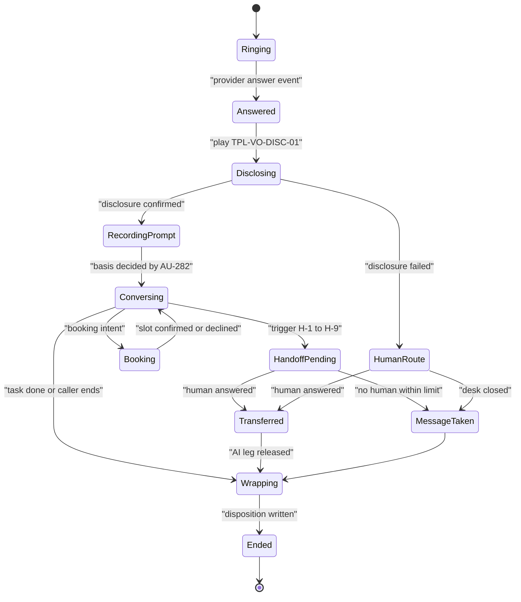
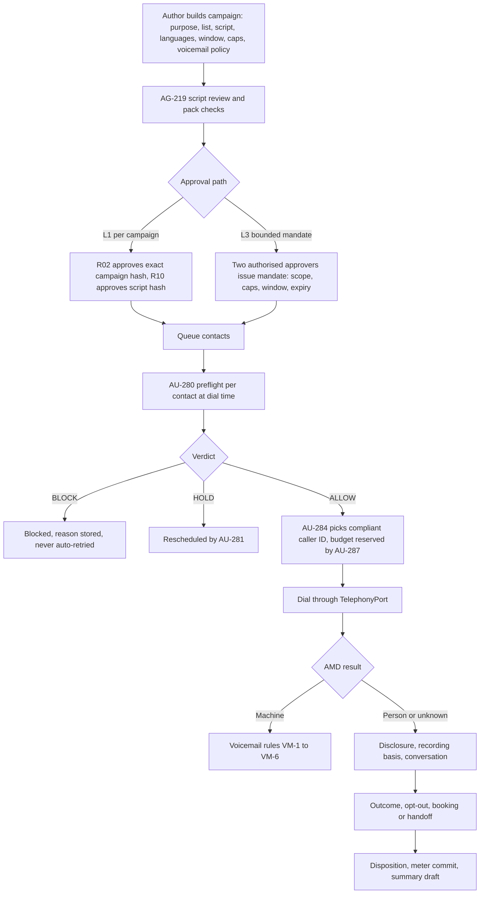
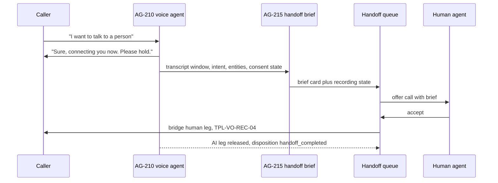
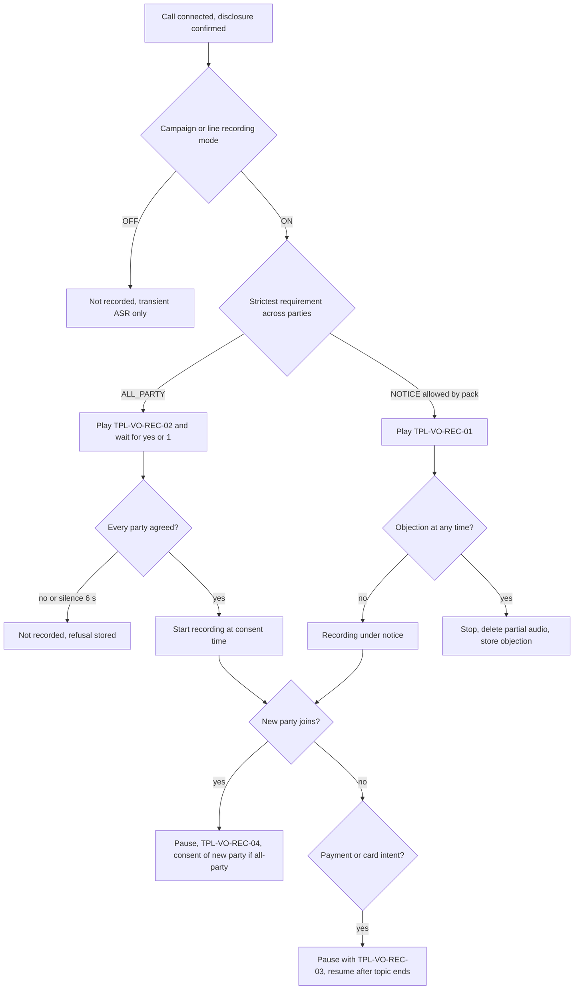
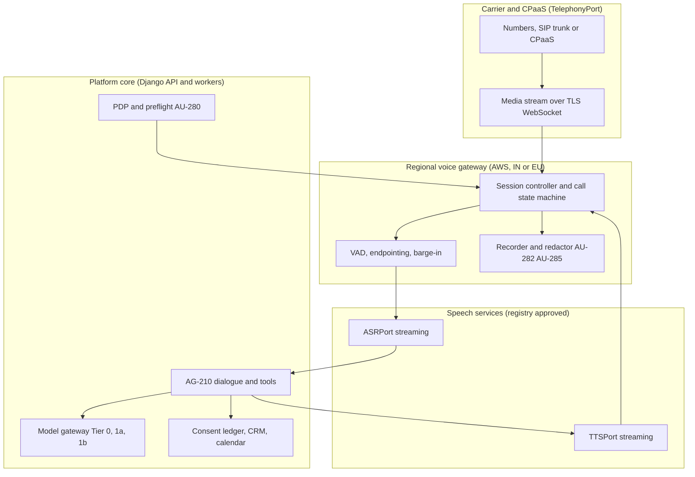

# AI Growth Engine: Employee Sales & Marketing Automation
## Application Blueprint: PART 11 (Batch 11.18), AI Voice Calling, Telephony and Call Recordings

| Field | Value |
|---|---|
| Document | Part 11, Batch 11.18, file a of 4. File a holds §11.18.1–§11.18.4 (material, coverage, register summary, catalogue reconciliation) and §11.18.5.1–§11.18.5.20 (the functional and technical specification: inbound and outbound AI calls, self-identification, consent, registry scrub, calling windows, handoff, voicemail, multilingual booking, transcription, summaries, recordings, coaching, voice stack, latency, numbers, cost per minute, workflow specifications, FR register). File b (`Part-11-18b_…`) holds §11.18.5.21–§11.18.5.28 (agents AG-210…219, automations AU-280…289, screens, entities, APIs, events, threat model, operations). File c (`Part-11-18c_…`) holds §11.18.5.29–§11.18.5.32 (epic, stories, test strategy, test cases, AI evaluation cases, effort and cost). File d (`Part-11-18d_…`) holds §11.18.5.33 (the generated combinatorial test design) and §11.18.6–§11.18.10 (conflicts, decisions, persona review, tags, quality gate) with the individual aspect register as Appendix Q-R |
| Version | 1.0 · 28 Nov 2026 |
| Precedence | Part 11.14 (DEC-770…791) > this part > Parts 11.1–11.13 > earlier parts (DEC-415 as extended by Part 11.14) |
| Baseline | Part 11.14 DEC-782 (voice adopted), DEC-779 (bounded mandates), DEC-772 (IN/EU residency), DEC-777 (09:00–21:00 window), DEC-786 (Vercel data path), DEC-788 (model registry), DEC-790 (funded); Part 11.15a (rule-pack framework CP-01…07, RP-IN-SMS-001…017, RP-IN-DPDP, VR-01…40); Part 11.2c §11.2.5.36 and §11.2.5.51 (SM-SVC-26 service, FR-V12-B-060…065, BRL-V12-B-06/07/23); Part 11.4c §11.4.5.15 and Part 11.4d §11.4.5.25 (SM-SVC-26 WF01–WF04, SM-SVC-36-WF03, `eng_call`, CONFLICT-815/818); Part 11.6b (ENG-04, AGT-20, AG-100, AU-170…177, EVAL-SM-SVC-26-WF01); Part 11.7b (A170, A180); Part 11.8a/b (INT-05, AD-V12-H-03 `VoicePort`, CF-11); Part 9.7b (DEC-386, DEC-387); Part 9.5 (DEC-218); Part 9.8b (DEC-392); Part 7.3 (gateway tiers, prices); Part 8.4/9.10 (rates); Part 5.1a/b (story template); Part 6.1/6.2a/6.4 (test templates) |
| Roles applied | Head of Conversational Voice AI (real-time ASR/TTS, barge-in, latency budgets) · Telephony architect (SIP trunking, CPaaS, number provisioning in India, EU, UK, US and UAE, call recording) · Telecom-regulation specialist (TRAI TCCCPR, DND/NCPR, DLT for voice; US TCPA and the FCC ruling on AI voices; EU ePrivacy and GDPR; one-party and all-party recording consent) · Contact-centre QA and coaching leader · AI governance lead; supported by the shared-brief virtual team (Product Owner, BSA, Solutions Architect, Data Architect, QA Lead, Security/Compliance Lead, DevOps/SRE, FinOps) |
| ID ranges used | DEC-860…875 · ASSUMPTION/GAP/CONFLICT/RECOMMENDATION-1060…1079 · ADR-250…254 · FR-V12-Q-001…055 · AG-210…219 · AU-280…289 · API-V12-Q-001…040 · US-22-ZQ01…15, US-08-ZQ01…03 · TC-V12-Q-### (functional 001…095, V12 acceptance 101…165, AI evaluation 401…450, generated C3/RX/VM/NX/CP families) · screen tabs A170-Q1…Q8, A180-Q1…Q3, component CMP-Q-01 |

> **Legal status.** Every regulatory statement in this part is a design input for the jurisdiction rule packs of Part 11.15, **not legal advice**. Statute and regulator references, dates, prices and provider terms say "verify at time of implementation (as of 27 Nov 2026)" unless they repeat an entry already marked verified in Part 11.15a §11.15.2 (VR-xx). Under DEC-782 and the V12-B brief, every capability here is **built**, and **activates per jurisdiction only when that jurisdiction's rule pack is Approved and signed off by counsel**. No control in this part is optional.

**Acronyms used in this part.** AMD answering-machine detection · ASR automatic speech recognition (speech-to-text) · CDR call detail record · CLI calling line identification (caller ID) · CNAM caller-name delivery (US) · CPaaS communications platform as a service · DCA digital consent acquisition (India DLT) · DID direct inward dialling number · DLT distributed-ledger technology registry for Indian commercial communications · DNC / DNCR do-not-call (registry) · DND do not disturb (India; registered on the NCPR) · DPIA data protection impact assessment · DTMF dual-tone multi-frequency (keypad tones) · E2E end to end · E.164 international phone-number format · IRSF international revenue share fraud · IVR interactive voice response · KMS key management service · LIA legitimate-interests assessment · MOS mean opinion score · NCPR National Customer Preference Register (India) · PCI DSS Payment Card Industry Data Security Standard · PE principal entity (DLT) · PEWC prior express written consent (US TCPA) · PSTN public switched telephone network · RND Reassigned Numbers Database (US) · RTP real-time transport protocol · S2S speech-to-speech model · SIP Session Initiation Protocol · SRTP secure RTP · STIR/SHAKEN caller-ID authentication framework (US) · TCCCPR Telecom Commercial Communications Customer Preference Regulations 2018 (India) · TCPA Telephone Consumer Protection Act (US) · TPS Telephone Preference Service (UK) · TTFT time to first token · TTS text-to-speech · VAD voice-activity detection · WER word error rate.

---

## 11.18.1 Material reviewed

| # | File (V12 text extraction, scratchpad `v12/`) | Size (bytes / lines) | Sections used | Purpose for this part | Pattern | Aspects |
|---|---|---|---|---|---|---|
| 1 | `BRD/08_Master_Automation_Service_Catalogue_39.txt` | 115,756 / 2,228 | §SM-SVC-26 (lines 1516–1566); §SM-SVC-36 (2026–2076); V5 first-value register | Service definition: objective, inputs, outputs, provider prerequisite, meter "Call minute", acceptance "Consent and disclosure checks 100%; unauthorized calls = 0" | 2-column service table | 26 |
| 2 | `BRD/09_Business_Workflow_Catalogue_156_Workflo.txt` | 41,668 / 1,307 | SM-SVC-26 WF01–WF04 (847–879); SM-SVC-36-WF03 (1198–1202) | Workflow outcome, input → output, KPI and risk class (R2 for WF01–03, R1 for WF04, R0 for SVC-36-WF03) | 5-column table | 20 |
| 3 | `BRD/11_Pricing_Billing_Commercial_Unit_Economi.txt` | 20,037 / 410 | SKU meter row SM-SVC-26 (342–345); cost composition rule (line 191: "channel/provider/voice/media" in cost per accepted output) | Meter unit "Call minute / 100", illustrative 0.55–1.05, "Quote pending; excludes external fees" | Table row | 1 |
| 4 | `BRD/14_Digital_Marketing_Omnichannel_Engagemen.txt` | 3,394 / 73 | Service map row; channel-control sentence "Voice/media require rights and disclosure" | Channel governance | Table + prose | 2 |
| 5 | `BRD/20_Business_Security_Privacy_Compliance.txt` | 21,591 / 526 | V12 market packs CJ-US-03, CJ-AU-01, CJ-SG-01, CJ-AE-01, CJ-UK-02; V8 packs CJ-IN-06, CJ-IN-07, CJ-US-01; BR-V7-CJ-03/04; legal sign-off matrix (line 527) | Regulatory obligations of record for SMS/voice | Rule tables | 11 |
| 6 | `BRD/24_Business_Acceptance_Requirement_Traceab.txt` | 34,422 / 1,373 | SM-SVC-26-ENT-AT01 | Entitlement acceptance | Table row | 1 |
| 7 | `FSD/11_Master_Functional_Specification_39_Serv.txt` | 99,442 / 1,638 | §SM-SVC-26 (1052–1093); §SM-SVC-36 recording rows | Functional objective, operating mode ("controlled autonomous for preapproved routine actions only; simulation has no external effects"), provider/approval, domain artifact `voice_session`, meter, quality | 2-column table | 18 |
| 8 | `FSD/12_Executable_Workflow_Specification_156_W.txt` | 855,963 / 17,495 | SM-SVC-26-WF01…WF04 (11174–11570); SM-SVC-36-WF03 (15331–15429) | Executable contract: trigger, authority (R2, "L2 mandatory approved effect; L3 only with separately approved bounded mandate where lawful"), DTO, steps, failure paths, acceptance IDs | Field table + DTO table + step table | 171 |
| 9 | `FSD/13_Workflow_Step_Trigger_Event_Registry.txt` | 30,021 / 918 | Registry rows SM-SVC-26-WF01…04, SM-SVC-36-WF03 | Step counts and AI-step labels (WF01 two AI steps; WF02–WF04 zero) | Table row | 5 |
| 10 | `FSD/02`, `08`, `14`, `15`, `16` | 3,874; 3,346; 4,266; 6,428; 29,419 | Voice 140/160 series; ENG-04 Multimodal AI = SVC-26/27/36; AGT-20 Domain evidence review (56 workflows); EVAL-SM-SVC-26-WF01 (2 cases, AGT-20, en/hi and en/de/fr) | Engine, agent role and evaluation suite | Rows | 5 |
| 11 | `FSD/20`, `21`, `24` | 57,068; 25,512; 171,941 | Demo fixtures for WF01–04 and SVC-36-WF03; domain panels "Voice campaign" and "Sales coaching"; workspaces X26 and X36 | UI and simulation fixtures ("recording not collected", "no call initiated", "no live booking", "CRM update draft only") | Rows | 10 |
| 12 | `FSD/26_PostgreSQL_Database_Schema_Master.txt` | 91,065 / 2,201 | Domain schema `voice_session` (call_ref, contact_ref, script_ref, recording_permission_ref, disposition, transcript_ref, booking_ref) | Canonical domain entity | Field table | 8 |
| 13 | `FSD/27_External_Integrations_Provider_Adapters.txt` | 5,487 / 173 | INT-05 Voice "CPaaS with 140/160 series numbers; API key; promotional vs service number pools (CJ-IN-07)"; ENT-INT-05 activation gate | Adapter family | Rows | (via Part 11.8, see row 17) |
| 14 | `FSD/33_Unit_SIT_UAT_AI_Test_Specifications.txt` | 344,598 / 13,634 | 15 step tests (`…-STEP-0n-TC`) and 46 workflow tests (`…-TC-POS…EFFECT`) for the five workflows | Acceptance to execute | Rows | 61 |
| 15 | `FSD/35`, `40` | 8,771; 569,001 | SM-SVC-26-BUILD; traceability rows (UI A037/A046/A040/A007, 11 API ops, POL-V6-PRECHECK, CJ preflight on WF02) | Build task, trace | Rows | 11 |
| 16 | `FSD/AP_Appendix_A/B/C` | 211,479; 151,635; 96,436 | 5 operations tagged SM-SVC-26; DTO schemas `urn:sm:dto:SM-SVC-26-WF0n:v2` and `SM-SVC-36-WF03:v2`; DDL tables referenced by these workflows | API, DTO, DDL | YAML, JSON Schema, SQL | 15 |
| 17 | Blueprint registers `final/coverage_v12/{B,C,D,H,J}_coverage.csv` | — | 55 voice/recording aspects still "Pending Founder decision" (CONFLICT-779, 815, 818 and related) | Close the pending rows | CSV rows | 55 |
| 18 | Blueprint Parts 11.2b/c, 11.4c/d, 11.6a/b, 11.7b, 11.8a/b, 11.14, 11.15a; Parts 9.5, 9.7a/b, 9.8b | — | DEC-218, DEC-386, DEC-387, DEC-392, DEC-531, DEC-572, DEC-575, CONFLICT-779/815/818, AG-100, AU-170…177, A170, A180, AD-V12-H-03 | Baseline to supersede or extend | — | (baseline) |
| | **Total atomic aspects** | | | | | **420** |

**How the inventory was built.** `assembly/v12b/q_voice_coverage.py` parses every table block of the files above with the `[TABLE]`/`---row` markers, extracts each field, DTO row, step row, acceptance ID, test row, registry row and rule row for SM-SVC-26 (all four workflows) and SM-SVC-36-WF03, adds the voice and recording rules of BRD chapter 20, and imports every earlier register row still "Pending Founder decision" for voice. Repeated boilerplate (the FSD-POL-V6-PRECHECK sentence, the common failure-handling text) is listed once per workflow. Output: `final/coverage_v12/Q_coverage.csv` (420 rows).

## 11.18.2 Coverage summary

| Status | Before (as recorded in Parts 11.2–11.13) | After this part |
|---|---|---|
| Covered | 31 | — |
| Partially covered (specified but disabled, or mapped without voice controls) | 158 | — |
| Conflict (CONFLICT-779, 815, 818 pending) | 176 | — |
| Pending Founder decision (earlier registers) | 55 | — |
| **Matched** | — | **420** |
| Pending Founder decision | — | **0** (DEC-782 adopted V12 voice; DEC-779/780 cover mandates and payments) |
| Not applicable | — | 0 |
| **Total** | **420** | **420** |

**Reading the result.** Before the Founder decision the voice service was fully catalogued but shipped **disabled** (`disabled_pending_founder`, DEC-572; TC-V12-D-126 expected `FOUNDER_DECISION_PENDING`). DEC-782 supersedes DEC-386 (recording exclusion part), DEC-387, DEC-392 and DEC-218 (recording and transcript restriction). This part writes what was missing for a lawful live service: the self-identification script, the consent standards and evidence per jurisdiction, the registry scrub, calling windows, attempt caps, voicemail, the recording consent matrix, retention and redaction, recording access control, the human-handoff guarantee, multilingual booking, the voice stack and its latency SLOs, number management, per-minute cost, and the delivery artefacts. TC-V12-D-126 is **retired** and replaced by the activation and entitlement tests TC-V12-Q-085…087 and TC-V12-Q-090.

## 11.18.3 Detailed register (summary by aspect group)

The individual register of all 420 aspects (aspect ID, V12 source, status before, blueprint location, action, new IDs, status after) is generated into Appendix Q-R of file d and into `final/coverage_v12/Q_coverage.csv`. Groups:

| Aspect group | V12 source | Aspects | Status before | Action in this part | New IDs | Status after |
|---|---|---|---|---|---|---|
| Q-B08-26-* service fields | BRD 08 SM-SVC-26 | 15 | Conflict | Live service specification with activation per pack | FR-V12-Q-001…055; DEC-860 | Matched |
| Q-B08-36-* recording/coaching fields | BRD 08 SM-SVC-36 | 11 | Conflict / Partially | Coaching from permitted recordings | FR-V12-Q-040…046; DEC-870 | Matched |
| Q-B09-* workflow outcomes, I/O, KPI, risk | BRD 09 | 20 | Conflict | Workflow contracts §11.18.5.19 with voice controls; KPIs §11.18.5.16 and §11.18.5.20 | US-22-ZQ01…15, US-08-ZQ01…03 | Matched |
| Q-B11/B14/B24 meter, channel control, entitlement | BRD 11, 14, 24 | 4 | Partially / Covered | Call-minute meter, cost model, entitlement gate | FR-V12-Q-036, 053; AU-287 | Matched |
| Q-B20-* jurisdiction rules | BRD 20 | 11 | Partially | Voice jurisdiction matrix §11.18.5.3 and activation checklist §11.18.5.3.4 | DEC-861; AU-280 | Matched |
| Q-F11-* functional fields | FSD 11 | 18 | Conflict | As Q-B08 | FR-V12-Q-* | Matched |
| Q-F12-* workflow fields, DTO fields, steps, acceptance IDs | FSD 12 | 171 | Conflict | Extended step tables §11.18.5.19; DTO v3 voice projection §11.18.5.24; acceptance executed as TC-V12-Q-101…146 | TC-V12-Q-101…165 | Matched |
| Q-F13, F02, F08, F14, F15, F16 registry, engine, agent role, eval | FSD 13, 02, 08, 14, 15, 16 | 10 | Partially | AGT-20 implementers AG-210…219; EVAL suite extended | TC-V12-Q-401…450 | Matched |
| Q-F20/F21/F24 fixtures, domain panels, workspaces | FSD 20, 21, 24 | 10 | Covered / simulation | A170-Q1…Q8, A180-Q1…Q3 | FR-V12-Q-052 | Matched |
| Q-F26 `voice_session` | FSD 26 | 8 | Partially (`eng_call` disabled) | `voice_session` and child entities §11.18b | entities §11.18.5.24 | Matched |
| Q-F33 tests | FSD 33 | 61 | Partially (not run) | Executable cases | TC-V12-Q-101…165 | Matched |
| Q-F35/F40 build and trace | FSD 35, 40 | 11 | Partially | Effort §11.18.5.32; RTM extension | — | Matched |
| Q-FAA/FAB/FAC API, DTO, DDL | Appendices A, B, C | 15 | Covered | Voice API family and tables | API-V12-Q-001…040 | Matched |
| Q-PRIOR-* earlier pending rows | Registers B, C, D, H, J | 55 | Pending Founder decision | Closed by DEC-782 and this part | DEC-860…875 | Matched |
| **Total** | | **420** | | | | **420 Matched** |

## 11.18.4 Catalogue reconciliation (V12 IDs → blueprint IDs)

| V12 ID | V12 name | Blueprint implementation (this part) | Earlier blueprint mapping (superseded where stated) |
|---|---|---|---|
| SM-SVC-26 | AI Voice & Intelligent Telephony Automation | EP-22; module `engagement.voice`; ENG-04 voice runtime; DEC-860 | Part 11.2c §11.2.5.36 (Future W6+, disabled; DEC-531 pending) → **live, per-pack activation** |
| SM-SVC-26-WF01 | Inbound AI voice enquiry and call routing | §11.18.5.7; AG-210 (conversation), AG-100 (intent router, retained), AU-283; FR-V12-Q-001…009 | Part 11.4c (CONFLICT-815) |
| SM-SVC-26-WF02 | Authorized outbound voice engagement | §11.18.5.8; AU-280, AU-281, AU-284; AG-211; FR-V12-Q-010…016 | Part 11.4c; DEC-392 human-dialled only → superseded |
| SM-SVC-26-WF03 | Multilingual voice conversation and appointment coordination | §11.18.5.11; AG-212; AU-023 booking; FR-V12-Q-017, 018 | Part 11.4c; GAP-858 |
| SM-SVC-26-WF04 | Call intelligence, permitted transcription and CRM synchronization | §11.18.5.12–13; AG-213, AG-214; AU-282, AU-285, AU-286; FR-V12-Q-019…029 | Part 11.4c; DEC-218 → superseded for recordings and transcripts |
| SM-SVC-36-WF03 | Permitted sales meeting and conversation coaching | §11.18.5.14; AG-216; FR-V12-Q-040…046 | Part 11.4d (CONFLICT-818, DEC-575 written notes only) → recordings allowed under DEC-870 |
| SM-SVC-26-ENT-AT01 | Entitlement acceptance | TC-V12-Q-090 | TC-V12-B-236 (kept) |
| SM-SVC-26-WF0n-AT01 | Source acceptance (not run in V12) | TC-V12-Q-091…094 (E2E journeys J-Q-01…04) | TC-V12-D-111 |
| SM-SVC-26-WF0n-TC-* | 38 workflow tests | TC-V12-Q-101…138 | TC-V12-D-101…110 (disabled) |
| SM-SVC-36-WF03-TC-* | 8 workflow tests | TC-V12-Q-139…146 | TC-V12-D-101…108 |
| …-STEP-0n-TC | 15 step tests | TC-V12-Q-151…165 | — |
| EVAL-SM-SVC-26-WF01 | 2-case V12 suite (AGT-20) | TC-V12-Q-401…450 (48 cases, six languages, WF01–WF04 and SVC-36-WF03) | TC-V12-F-278 |
| AGT-20 | Domain evidence review (role) | Implementers AG-210…219 (role ceiling: scoped read, retrieval own tenant, draft/score; never send/publish/spend; **effects only through AU-280/AU-282 deterministic gates**) | AG-100 (Part 11.6b) |
| ENG-04 | Multimodal AI | Voice runtime (§11.18.5.15) under model registry DEC-788 | Part 11.6b ENG-04 row |
| INT-05 / AD-V12-H-03 | Voice CPaaS, `VoicePort` | TelephonyPort, ASRPort, TTSPort, S2SPort (§11.18.5.15); API-V12-Q-030…036 webhooks | Part 11.8b (R3+) → R2 |
| CJ-IN-06/07, CJ-US-01/03, CJ-AU-01, CJ-SG-01, CJ-AE-01, CJ-UK-02 | Voice market rules | Jurisdiction matrix §11.18.5.3; RP-IN-SMS-011/012/014/015/017 (Part 11.15a) | Part 11.6a F18-*; AU-173 |
| X26 / X36 | Voice and coaching workspaces | A170 tabs A170-Q1…Q8; A180 tabs A180-Q1…Q3 | Part 11.7b A170, A180 |
| `voice_session` | Domain schema | `voice_session` (canonical) replacing proposed `eng_call` | Part 11.4d `eng_call` (withdrawn name; fields carried over) |
| Call minute | Meter | `meter_unit = call_minute`: connected seconds per call leg, rounded up to the started minute per leg for the tenant meter; provider cost reconciled at the provider's own increment (§11.18.5.18) | Part 11.2c commercial row |

**Note on `eng_call`.** Part 11.4d proposed `eng_call` "created only if the Founder approves CONFLICT-815". The Founder approved (DEC-782). This part adopts the V12 canonical name `voice_session` (V12 IDs become canonical, V12 brief rule 4) and carries every `eng_call` field (contact_id, direction, consent_id, disclosure_played, disposition, started_at, ended_at, minutes, transcript_ref). The DDL owner (Part 11.9b) receives the table definition in §11.18.5.24.

## 11.18.5 Enhancements: specification at full depth

### 11.18.5.1 Scope, capability map and release placement

| Capability | V12 source | What the platform does | What the AI may do | What the AI never does | Activation condition | Release |
|---|---|---|---|---|---|---|
| C-1 Inbound AI answering | SM-SVC-26-WF01 | Answers the tenant's published number, discloses AI, classifies intent, answers from approved knowledge, routes, books, takes messages | Speak grounded answers from approved knowledge and approved price-book entries verbatim; classify; propose slots | State unapproved facts, discounts, terms; take card or bank details; diagnose; claim to be human | Tenant SKU SM-SVC-26 + pack Approved for the number's country + DPIA signed (DEC-861) | Release 2 (DEC-860) |
| C-2 Outbound AI calls | SM-SVC-26-WF02 | Places authorised calls from an approved campaign after AU-280 preflight | Run the approved script (hash-pinned) with variable slots, answer grounded questions, book, hand off | Call without consent of the required standard, outside the window, to a registered number without override consent, to a minor, on a patient topic | As C-1, plus outbound enabled in the pack, numbers registered (AU-284), campaign approved (L1) or bounded mandate (DEC-779) | Release 2 |
| C-3 Multilingual voice booking | SM-SVC-26-WF03 | Detects language, converses in en, hi, Indic set, de, fr, ar; books through the calendar adapter after verbal read-back | Negotiate a slot inside availability; confirm time zone | Book without verbal confirmation; book outside availability | Language tier A, or tier B with verbatim-only scripts (DEC-873) | Release 2 (en, hi, de, fr tier A; ta and ar tier B until EVAL pass) |
| C-4 Transcription | SM-SVC-26-WF04 | Streaming ASR for the conversation (transient); persisted transcript only with a recording basis | — | Persist a verbatim transcript without a recording basis | AU-282 basis = recorded | Release 2 |
| C-5 Call summaries and CRM sync | SM-SVC-26-WF04 | Structured summary, actions, CRM event; human approves sync (L1) or deterministic field sync (L3 registered) | Draft summary and actions | Write free text to CRM without approval; merge across companies | Always available when C-1/C-2 active (summary from transient text allowed, §11.18.5.12) | Release 2 |
| C-6 Recordings | SM-SVC-26-WF04 input; DEC-782 | Records only with the notice or consent the jurisdiction requires; stores encrypted in region; retains, redacts, controls access | — | Record without basis; keep beyond retention; expose card data | AU-282 matrix §11.18.5.13 | Release 2 |
| C-7 Coaching from recordings | SM-SVC-36-WF03 | Rubric-based feedback to the learner from permitted recordings and notes | Draft feedback with cited timestamps | Rank, score for HR, make or suggest employment decisions | Coaching purpose in notice/consent; works agreement where required; learner-private | Release 2 (written-notes path already Release 1/A1 per Part 11.4d) |

**Activation rule (DEC-860, DEC-861).** The code path for every capability is built, tested and deployed in every region. A tenant can switch a capability on for a country only when (1) the pack for that country and channel `VO` is `active` in AU-128/AU-170 (Approved, counsel sign-off recorded, not expired); (2) the voice activation checklist §11.18.5.3.4 is complete for that tenant and startup; (3) the SKU entitlement SM-SVC-26 (and SM-SVC-36 for coaching) is active. Any missing element returns `VOICE_NOT_ACTIVE_FOR_JURISDICTION` at configuration time and `PACK_NOT_ACTIVE` at dispatch (Part 11.15a CP-05, fail closed).

**Release placement.** The developer-platform voice connector framework (TelephonyPort contract, webhook intake, number inventory) is Release 1 under DEC-785. The voice runtime, the four SM-SVC-26 workflows and coaching from recordings are Release 2; dates follow the work (DEC-770). Recommended activation order [RECOMMENDATION-1074]: inbound in India and the UK first (caller-initiated, lowest regulatory exposure), then outbound in India (DLT, 140/1600 numbers in place), then EU inbound, then EU/UK/US outbound, then UAE.

### 11.18.5.2 AI self-identification script

**Rule set (FR-V12-Q-002; DEC-862; AU-283; CJ-R13; EU AI Act Art. 50(1) applicable from 2 Aug 2026 (VR-22); RP-IN-SMS-012; FCC Declaratory Ruling FCC 24-17 (8 Feb 2024) that AI-generated voices are "artificial" voices under the TCPA, verify; California B&P Code §17940–17943 bot disclosure, verify).**

| # | Rule | Check | On failure |
|---|---|---|---|
| D-1 | The **first utterance** of every AI-handled call (inbound and outbound, every leg the AI joins) is the approved disclosure TPL-VO-DISC-01 in the call language. It names the brand, states that the caller is speaking with an AI assistant using an AI-generated voice, and offers a person. It starts within **2.0 s** of answer (inbound) or of human-speech detection (outbound) | AU-283 compares TTS request text hash with the approved template hash and confirms via the ASR loopback of the outgoing stream (WER ≤ 15% against the template) | Outbound: call ended before any other AI speech, `DISCLOSURE_FAILED`; inbound: recorded human-voice greeting and route to human or message capture. 3 failures in 15 min pause the campaign or line (AU-289) |
| D-2 | When asked in any form whether they are speaking to a person, a robot, a recording or AI, the AI answers truthfully with TPL-VO-DISC-02 and repeats the human option | Intent `identity_challenge` (AG-210, verbatim template only) | Transfer to human |
| D-3 | The AI never claims or implies to be human, never uses a human first name presented as a person, and never imitates a specific real person's voice | Script linter (AG-219) and voice registry (§11.18.5.15: only stock or licensed brand voices, DEC-869) | Script rejected; voice not selectable |
| D-4 | The disclosure is repeated when a human joins or leaves (warm transfer) and after a hold longer than 60 s | Call state machine event `leg.joined`, `hold.resumed` | Same as D-1 |
| D-5 | Outbound: the disclosure also states the purpose of the call and the business identity (TCPA 47 CFR 64.1200(b)(1) identification at the beginning of artificial-voice messages, verify; RP-IN-SMS-013 brand) | Template variables `{brand}`, `{purpose}` resolved from the campaign | Campaign cannot be approved without them |
| D-6 | Outbound in the US: within the call an automated interactive opt-out mechanism (key press or voice) is offered at the start (47 CFR 64.1200(b)(3), verify); in India the opt-out key TPL-IN-SMS-03 within the first 15 s and at the end (Part 11.15a) | Template includes opt-out sentence for packs that require it | Campaign cannot be approved |
| D-7 | Machine-readable marking: every AI-generated audio segment stored (recording, voicemail) carries provenance metadata `ai_generated=true`, model registry ID, voice ID (AU-177; EU AI Act Art. 50(2), VR-22) | Storage write hook | Write refused |

**Approved disclosure templates (TPL-VO-DISC-01; wording for counsel review, Part 11.15 sign-off; ≤ 7 s spoken).**

| Language | TPL-VO-DISC-01 (outbound form; inbound omits "{purpose}") | TPL-VO-DISC-02 (identity challenge) |
|---|---|---|
| en | "Hello, this is {brand}'s AI assistant. I'm an automated assistant using an AI-generated voice, calling about {purpose}. You can say 'agent' or press 0 at any time to speak with a person." | "I'm an AI assistant, not a person. Would you like me to connect you to a colleague now?" |
| hi | "नमस्ते, मैं {brand} की AI सहायक हूँ। मैं AI-जनित आवाज़ वाली स्वचालित सहायक हूँ और {purpose} के बारे में कॉल कर रही हूँ। किसी व्यक्ति से बात करने के लिए कभी भी 'एजेंट' बोलें या 0 दबाएँ।" | "मैं एक AI सहायक हूँ, कोई व्यक्ति नहीं। क्या मैं आपको अभी किसी सहकर्मी से जोड़ दूँ?" |
| ta | "வணக்கம், நான் {brand} நிறுவனத்தின் AI உதவியாளர். AI உருவாக்கிய குரலைப் பயன்படுத்தும் தானியங்கி உதவியாளர், {purpose} பற்றி அழைக்கிறேன். எப்போது வேண்டுமானாலும் ஒருவருடன் பேச 'ஏஜென்ட்' என்று சொல்லுங்கள் அல்லது 0 அழுத்துங்கள்." | "நான் ஒரு AI உதவியாளர், மனிதர் அல்ல. இப்போதே ஒரு சக ஊழியருடன் இணைக்கட்டுமா?" |
| de | "Guten Tag, hier ist der KI-Assistent von {brand}. Ich bin ein automatisierter Assistent mit einer KI-generierten Stimme und rufe wegen {purpose} an. Sagen Sie jederzeit 'Mitarbeiter' oder drücken Sie die 0, um mit einer Person zu sprechen." | "Ich bin ein KI-Assistent und kein Mensch. Soll ich Sie jetzt mit einer Kollegin oder einem Kollegen verbinden?" |
| fr | "Bonjour, ici l'assistant IA de {brand}. Je suis un assistant automatisé doté d'une voix générée par IA et je vous appelle au sujet de {purpose}. Dites « conseiller » ou appuyez sur 0 à tout moment pour parler à une personne." | "Je suis un assistant IA, pas une personne. Voulez-vous que je vous mette en relation avec un collègue maintenant ?" |
| ar | "مرحبًا، معك المساعد الذكي لشركة {brand}. أنا مساعد آلي بصوت مولَّد بالذكاء الاصطناعي، وأتصل بخصوص {purpose}. يمكنك قول «موظف» أو الضغط على 0 في أي وقت للتحدث مع شخص." | "أنا مساعد ذكاء اصطناعي ولست إنسانًا. هل تريد أن أوصلك بأحد الزملاء الآن؟" |

Translations other than English are drafts for native-speaker and counsel review before pack sign-off [ASSUMPTION-1066]; each approved text is stored with a hash, and only the hashed version can be spoken (AU-283). Gendered verb forms (Hindi "हूँ/रही हूँ") follow the selected voice's grammatical gender, configured per voice.

**Recording notice and consent prompts (used by AU-282, §11.18.5.13).**

| ID | Purpose | English master text (all six languages maintained as for TPL-VO-DISC-01) |
|---|---|---|
| TPL-VO-REC-01 | Notice where the pack allows notice-and-object | "This call is recorded and transcribed for quality, training and to keep a record of your request. Say 'don't record' at any time and we will stop." |
| TPL-VO-REC-02 | Affirmative consent (default; all-party packs) | "May we record and transcribe this call for quality, coaching and record keeping? Press 1 or say 'yes' to agree, press 2 or say 'no' to continue without recording." |
| TPL-VO-REC-03 | Payment pause | "For your security I've paused recording. Please don't share card details with me; I'll send you a secure link instead." |
| TPL-VO-REC-04 | Leg-join notice (human joins) | "My colleague {first_name} is joining; the call {is / is not} being recorded as you agreed." |
| TPL-VO-OPT-01 | Verbal/DTMF opt-out confirmation | "Understood. We won't call you again about this. You'll receive a confirmation." |
| TPL-VO-VM-01 | Voicemail (where allowed, §11.18.5.10) | "This is an automated message from {brand}, recorded with an AI-generated voice, about {purpose_generic}. Please call us back on {callback_number}. To stop these calls, {opt_out_instruction}." |
| TPL-VO-EMR-01 | Emergency statement detected | "If this is an emergency, please hang up and call {emergency_number} now. I'm connecting you to a colleague." |

### 11.18.5.3 Jurisdiction matrix for AI voice

The matrix below is the **parameter table** that AU-280 (dispatch preflight), AU-281 (windows and caps) and AU-282 (recording gate) load per jurisdiction. It is the input to the Part 11.15 packs; the platform enforces the stricter of this table and the active pack (CP-03, CP-04). Statements carry "verify" unless the cited VR entry is verified.

#### 11.18.5.3.1 Calling consent, registry and AI-voice rules

| Jur. | Consent standard for an outbound AI (artificial-voice) sales call | Registry to scrub; consent that overrides it | AI-voice / automated-call rule | Inbound AI answering | Key sources |
|---|---|---|---|---|---|
| **IN** India | Lawful basis under DPDP (consent, s.6) for the purpose **and** TCCCPR rules: callback request, express consent or DLT digital consent (DCA) | NCPR (full or category preference); only **DLT digital consent** overrides a full block; category preference allowing the category passes | Promotional calls only from the **140** series; service/transactional from **1600** (VR-10); automated/AI voice must disclose and offer human or opt-out key (RP-IN-SMS-012); opt-out honoured immediately, DLT sync ≤ 1 h target (RP-IN-SMS-014) | Allowed with disclosure; DPDP notice for any personal data captured | TCCCPR 2018 as amended Feb 2025 (VR-10); DPDP Act 2023 and Rules 2025 (VR-01/02); CJ-IN-06/07 |
| **EU-DE** Germany | Prior express consent for calls to consumers; automated calling systems need prior consent (ePrivacy Art. 13(1)); consent documented and kept (UWG §7a, 5 years, verify) | No statutory registry; internal suppression list only | AI voice = automated calling: consent mandatory; CLI must be shown and not suppressed for advertising calls (TKG, verify); EU AI Act Art. 50(1) disclosure | Allowed with Art. 50 disclosure and GDPR Art. 13 notice | VR-22, VR-24, VR-25; UWG §7(2), §7a (verify) |
| **EU-FR** France | Prior consent for automated calls (ePrivacy Art. 13(1)); **consumer telephone canvassing is opt-in from 11 Aug 2026**: prior consent that is free, specific, unambiguous and revocable, kept per décret n° 2026-662 of 23 Jul 2026 and **valid ≤ 1 year**; existing-contract exception (Code de la consommation L.223-1 ff. as amended by the law of 30 Jun 2025) (VR-69, Part 11.15d; RP-EU-VOICE-003, Part 11.15e) [GAP-1068, GAP-1172 closed v1.2] | **None: Bloctel discontinued on 11 Aug 2026** (VR-69). Scrub against the consent ledger instead: FR consumer consent record ≤ 365 days old, or an existing contract on the call topic; contracts concluded after an unlawful call are void, so such orders are blocked (RP-EU-VOICE-003) | Calls only Mon–Fri 10:00–13:00 and 14:00–20:00, none on Sat, Sun or public holidays; max 4 call attempts per consumer per 30 days (Décret 2022-1313, verify); telemarketing numbers from ARCEP-designated prefixes (verify) | Allowed with disclosure | VR-22, VR-24, VR-25, **VR-69**; Décret 2022-1313 (verify); RP-EU-VOICE-003 (Part 11.15e) |
| **UK** | Automated calls with recorded messages need prior consent (PECR reg. 19); live-call rules apply to AI calls as automated; documented opt-in | **TPS/CTPS**; specific consent to this caller overrides (PECR reg. 21, verify) | CLI must be valid and dialable (Ofcom CLI guidance, verify); higher PECR fines under the Data (Use and Access) Act 2025 (VR-38, verify) | Allowed with disclosure (UK GDPR transparency) | VR-38; CJ-UK-02 |
| **US-1P / US-AP** United States | **PEWC** for telemarketing calls using an artificial or prerecorded voice to residential or wireless numbers; AI voices are artificial voices (FCC 24-17, verify); PEWC definition per FCC final rule of 29 Aug 2025 after vacatur of one-to-one consent (VR-30) | **National DNC** (registry data no older than 31 days, verify) plus internal DNC list and state DNC lists; PEWC (signed written agreement) overrides; **Reassigned Numbers Database** query before relying on old consent (verify) | Calling hours 08:00–21:00 called-party local time (47 CFR 64.1200(c)(1)); identification at the start; automated opt-out mechanism; revocation by any reasonable means; the FCC **Sept 2026 Report and Order** revises the "revoke all" provision of 47 CFR 64.1200(a)(10) (waiver to 31 Jan 2027 replaced; the revised rule takes effect 30 days after Federal Register publication, verify) (VR-67, Part 11.15d; RP-US-VOICE-009, Part 11.15e). **Platform rule (DEC-769(d)): every revocation is honoured immediately (≤ 1 s) and applies to all marketing calls and texts of that seller**, whatever narrower scope the revised rule allows [GAP-1173 closed v1.2]; STIR/SHAKEN A attestation; state mini-TCPA laws may be stricter (verify) | Allowed with disclosure; state bot-disclosure laws (verify) | VR-30, VR-66, **VR-67**; CJ-US-01/03; RP-US-VOICE (Part 11.15e) |
| **AE** UAE | Consent required; PDPL lawful basis; telemarketing under Cabinet Resolution No. 56 of 2024 (verify) [GAP-1067] | **DNCR**; only documented opt-in (PEWC-grade) overrides (verify) | Calls 09:00–18:00 (verify); registered local numbers; repeat-call limits (verify) | Allowed with disclosure; PDPL notice | CJ-AE-01; [GAP-1067] |

#### 11.18.5.3.2 Calling windows (effective = platform 09:00–21:00 recipient local time ∩ law; CP-03 intersection)

| Jur. | Law (summary, verify) | Platform default (DEC-777) | **Effective window enforced by AU-281** | Restricted days |
|---|---|---|---|---|
| IN | TCCCPR legal window not verified (VR-13, VR-75, GAP-999); RP-IN-SMS-009 and RP-IN-VOICE-008 set the platform pack window (Part 11.15e) | 09:00–21:00 (DEC-777) | **Promotional: 09:00–19:00 Mon–Sat; service/transactional: 09:00–21:00** (DEC-769(b); RP-IN-VOICE-008; the stricter pack window wins over DEC-777) [GAP-1174 closed v1.2] | Sunday for promotional calls; configured national holidays (pack) |
| EU-DE | No statutory window | 09:00–21:00 | 09:00–21:00 | Sundays and public holidays: none by law; tenant may tighten |
| EU-FR | Mon–Fri 10:00–13:00, 14:00–20:00 | 09:00–21:00 | **Mon–Fri 10:00–13:00 and 14:00–20:00** | Sat, Sun, public holidays (no calls) |
| UK | No statutory window | 09:00–21:00 | 09:00–21:00 | None by law |
| US-1P / US-AP | 08:00–21:00 local (federal); some states narrower (verify) | 09:00–21:00 | 09:00–21:00 (state overrides narrower) | State-specific (verify) |
| AE | 09:00–18:00 (verify) | 09:00–21:00 | **09:00–18:00** | Pack-defined (verify) [GAP-1067] |

**Recipient local time (AU-281).** Time zone = (1) verified contact address time zone; (2) else number-range time zone from the E.164 prefix (for multi-zone countries, the area code; US mobile numbers: area code is not reliable, so (3)); (3) when the zone is unknown or ambiguous, the window is the **intersection** of the windows of all candidate zones (e.g. US: 12:00–21:00 Eastern ≙ 09:00–18:00 Pacific). Transactional/service calls requested by the caller (e.g. a callback at a time the caller chose) are scheduled at that time if inside 08:00–21:00 local, regardless of the promotional window [ASSUMPTION-1075; R10 to confirm per pack].

#### 11.18.5.3.3 Recording consent matrix (one-party vs all-party)

| Jur. | Legal model (summary, verify) | Lawful basis for processing the recording | **Platform requirement (AU-282)** | Notice-only allowed? | Notes |
|---|---|---|---|---|---|
| IN | No specific statute on participant recording; participant (one-party) recording generally used; DPDP requires a lawful basis for the personal data | DPDP consent (s.6) or legitimate use for a voluntarily provided purpose (s.7(a)) [ASSUMPTION-1063, counsel to confirm] | Notice TPL-VO-REC-01 and objection honoured; affirmative consent TPL-VO-REC-02 for coaching use | Yes, if the pack approves s.7(a) basis | Coaching use always needs the purpose in the notice |
| EU-DE | Recording the non-public spoken word without consent is a criminal offence (StGB §201) — effectively **all-party consent** | GDPR Art. 6(1)(a) consent | **Affirmative consent of every party** before recording | **No** | Employees joining as agents: works agreement (BetrVG §87(1) no. 6, verify) and Art. 88 GDPR/§26 BDSG |
| EU-FR | Recording private conversations without consent is an offence (Code pénal art. 226-1, verify); CNIL requires prior information and a right to object for business call recording | Art. 6(1)(a) consent (platform), or legitimate interest with objection (CNIL guidance, verify) | **Affirmative consent** (platform stricter default) | No (platform) | CNIL: recordings for training kept ≤ 6 months, evaluation documents ≤ 1 year (verify) |
| UK | Business recording lawful under the Investigatory Powers (Interception by Businesses etc.) Regulations 2018 with reasonable notice; UK GDPR basis | Legitimate interests with LIA, or consent | Notice and objection; affirmative consent for coaching | Yes, if pack approves | — |
| US-1P | Federal one-party consent (18 U.S.C. §2511(2)(d)); the business is a party | Notice (platform) | Notice TPL-VO-REC-01; objection honoured | Yes | If either party is in an all-party state, the all-party rule applies (strictest wins) |
| US-AP | All-party consent states, e.g. California Penal Code §632, Florida, Illinois, Maryland, Massachusetts, Montana, New Hampshire, Pennsylvania, Washington (list: verify) | Consent of all parties | **Affirmative consent of every party** | No | Party location unknown → treat as all-party |
| AE | Recording or disclosing communications without consent is an offence (Federal Decree-Law 34/2021 cybercrime, verify) | PDPL consent | **Affirmative consent** | No | — |

**Platform default (DEC-863).** Where a pack does not state otherwise, the platform requires **affirmative consent of every party** (TPL-VO-REC-02). A pack may approve notice-and-object (TPL-VO-REC-01) only for IN, UK and US one-party calls, and only for the purposes named in the notice. When the parties are in different jurisdictions, or a party's location is unknown, the **strictest** requirement applies. Every party that joins later (human agent, third party on a conference) triggers TPL-VO-REC-04 and, under all-party rules, the recording is paused until that party's consent is captured (employees consent through the employment notice and works agreement where required; external third parties are asked).

#### 11.18.5.3.4 Voice activation checklist per jurisdiction and tenant (DEC-861)

| # | Item | Evidence stored | Owner | Blocks |
|---|---|---|---|---|
| 1 | Pack for the country, channel `VO`, Approved and signed by counsel (Part 11.15 sign-off block) | `rulepack.signed_off_by`, version | R10 + counsel | All voice in that country |
| 2 | DPIA for AI voice and recording (GDPR Art. 35; DPDP Significant Data Fiduciary DPIA where applicable, verify) approved | DPIA document ID | R10 | All voice |
| 3 | Lawful basis per purpose recorded (calling, recording, transcription, coaching); LIA where legitimate interests used | Basis register rows | R10 | The purpose |
| 4 | Telecom registrations: DLT PE, 140/1600 headers and consent templates (IN); regulatory address bundles (EU/UK); STIR/SHAKEN, CNAM and DNC subscription account (US); TDRA/telemarketing registration (AE, verify) | AU-284 number records | R11 + R12 | Outbound in that country |
| 5 | Disclosure, recording and opt-out templates approved per language (hashes) | Template hashes | R10 | Each language |
| 6 | Provider registry approval for the region: CPaaS, ASR, TTS, LLM with DPA, no-training clause, region pinning, eval suites passed (DEC-788) | Registry records | AI lead + R10 | Each provider |
| 7 | Human handoff desk staffed for the configured hours; queue and transfer numbers on the allowlist | Rota, queue config | R02/R03 | Live calls outside staffed hours (outbound) |
| 8 | Works agreement / employee notice for recording agents and coaching (DE mandatory; others per counsel) | Agreement reference | R10 + HR | Coaching from recordings; recording of employees |
| 9 | Retention schedule and legal-hold procedure approved | Schedule version | R10 | Recording |
| 10 | Budget and caps set (minutes per month, concurrent calls, attempts) | Budget record | R01/R12 | All voice |

### 11.18.5.4 Consent capture

**Purposes in the consent ledger (AU-172 scope = contact × channel × purpose × market; ADR-253).** `call_ai_marketing` (outbound sales calls by AI), `call_ai_service` (service/transactional calls by AI), `call_human_marketing` (human-dialled), `call_recording`, `call_transcription_storage`, `coaching_analytics`, `voicemail_marketing`. Each record holds: notice version, consent text hash, capture channel, capture timestamp (UTC and local), evidence reference, language, capture method, IP or calling number, and for DCA/PEWC the registry or e-signature reference.

| Capture method | Where | Evidence | Satisfies | Notes |
|---|---|---|---|---|
| Web/portal form with unticked box per purpose (CMP-Q-01 callback consent block) | Website intake, portal, landing pages | Form submission record, notice version, checkbox text hash, IP, timestamp | Callback request; express consent; EU/UK opt-in; **US PEWC** when the box text meets the PEWC definition and E-SIGN signature is captured (VR-30) | One purpose per box; no pre-ticking; no bundling with terms |
| DLT digital consent acquisition (India) | DLT consent template + OTP to subscriber via the TAP/telco flow (RP-IN-SMS-007) | DLT consent ID and validity | IN registry override | Validity period per regulation (verify) |
| Verbal consent on a call | During an inbound call or a consented outbound call | Recording snippet (if recording is consented) or ASR text with confidence ≥ 0.85 plus DTMF confirmation; prompt version | Callback / future-call consent (IN, UK, AE), recording consent; **not** US PEWC (needs written/E-SIGN) and not DLT DCA | Confirmation message sent on a consented channel |
| DTMF on a call | Recording prompt, opt-out | DTMF digit event from TelephonyPort with timestamp | Recording consent/refusal; opt-out | Spoofed DTMF defence: events only from signed provider webhooks (AU-283) |
| Import of third-party consent | CSV/CRM import | Source, original evidence, attestation by R12 | Only if evidence meets the pack standard | Default: imported consent is **not** valid for AI calls until reviewed by R10 |

**Withdrawal and opt-out (FR-V12-Q-013; AU-288).** Triggers: verbal ("stop calling", "remove me", "don't call", multilingual phrase list PL-VO-OPT in six languages), DTMF 9 (IN TPL-IN-SMS-03) or the US automated opt-out key, reply STOP on any channel, web preference centre, registry complaint. Effect: suppression for the scope within **≤ 1 s** of detection on the platform (the call ends politely with TPL-VO-OPT-01); queued and scheduled calls moved to Held; DLT revocation sync (IN, target ≤ 1 h, RP-IN-SMS-014); US internal DNC entry (platform: immediate and seller-wide, DEC-769(d); the Sept 2026 FCC order revises the federal revocation rule, VR-67); confirmation on a consented channel.

### 11.18.5.5 DND, NCPR and TCPA scrub (AU-280 with AU-173)

| Check | Data source | Freshness rule (platform) | Applies to | Result codes |
|---|---|---|---|---|
| Internal suppression | Consent ledger + suppression table (AU-172) | Real time | All outbound | `SUPPRESSED`, `CONSENT_WITHDRAWN` |
| India NCPR | Telemarketer/PE scrub via DLT partner API (CDEC-V7-05) | Per dispatch batch; result valid ≤ 24 h (platform) | IN promotional | `REGISTRY_BLOCKED_NCPR`, `NCPR_CATEGORY_ALLOWED` |
| US National DNC | SAN-licensed registry data | Registry data ≤ 31 days old (verify) | US telemarketing | `REGISTRY_BLOCKED_NATIONAL_DNC` |
| US state DNC lists | State lists where subscribed (verify) | Per list rule | US | `REGISTRY_BLOCKED_STATE_DNC` |
| US Reassigned Numbers Database | FCC RND query | Before each campaign for consents older than the last disconnect date | US | `NUMBER_REASSIGNED` → consent invalid |
| US wireless/landline identification | Carrier lookup | ≤ 30 days | US (consent standard same for AI voice) | Informational |
| UK TPS/CTPS | TPS licence data | ≤ 28 days (verify) | UK marketing | `REGISTRY_BLOCKED_TPS` |
| France consumer consent (replaces Bloctel, discontinued 11 Aug 2026; VR-69) | Consent ledger (AU-172): FR consumer consent captured per décret 2026-662, or existing-contract flag on the call topic | Consent ≤ 365 days old at dial time | FR consumer | `NO_CALL_CONSENT`, `FR_CONSENT_EXPIRED` (`REGISTRY_BLOCKED_BLOCTEL` retired in v1.2) |
| UAE DNCR | TDRA DNCR (verify) | Per regulation (verify) | AE | `REGISTRY_BLOCKED_DNCR` |
| Minor / patient flags | Contact age band; startup vertical rules | Real time | EduVerse: no outbound to under-18 (DEC-030); MedMaarg: no patient topics | `MINOR_BLOCKED`, `CLINICAL_TOPIC_BLOCKED` |

**Fail closed.** Missing or stale scrub data returns `REGISTRY_SCRUB_UNAVAILABLE` → HOLD (never ALLOW). Scrub results are stored on `voice_scrub_result` with source, list version, query time and verdict; dispatch re-checks freshness at the moment of dialling (PDP recheck, V11 invariant).

### 11.18.5.6 Calling windows, attempt caps and frequency (AU-281)

| Rule | Platform default | Pack override (stricter only) |
|---|---|---|
| Window | §11.18.5.3.2 effective window, recipient local time | IN promotional 09:00–19:00 Mon–Sat (DEC-769(b)); FR, AE narrower |
| Attempts per contact per campaign | ≤ 3 attempts; ≥ 4 h between attempts; ≤ 1 attempt per day | FR: ≤ 4 calls per 30 days per consumer across campaigns (verify) |
| Connected promotional calls per contact | ≤ 1 per 7 days across campaigns of the startup | Tighter per pack |
| Abandoned calls (answered, no AI/agent within 2 s) | 0 target; AU-289 alerts at > 1% per campaign per day; US abandonment rule 3% per 30 days per campaign (47 CFR 64.1200(a)(7), verify) | — |
| Ring time before giving up | 25 s (≥ 15 s, US rule, verify) | — |
| Concurrent outbound calls per campaign | ≤ staffed human-handoff capacity × 8 [ASSUMPTION-1076] | — |
| Daily campaign cap | Set at approval; cannot exceed budget reservation | — |
| Complaint pause | Rate > 0.1% or ≥ 3 complaints per 24 h pauses the campaign (RP-IN-SMS-015 for IN; platform for all) | — |

A call that fails the window is **HELD and rescheduled** to the next window start + random 0–20 min jitter; one that fails consent or registry is **BLOCKED** and never rescheduled automatically.

### 11.18.5.7 Inbound AI answering (SM-SVC-26-WF01)

**Purpose.** Answer enquiries on a tenant's number in seconds, at any hour, with the AI clearly identified, answers grounded in approved knowledge, and a person always one word away.
**Actors.** Caller (P14), AI voice agent AG-210 (with AG-100 intent router), human handoff desk (P02/P03, R03), R10 (policy), R11 (configuration).
**Screens.** A170-Q2 Live calls monitor, A170-Q3 Call detail, A170-Q4 Handoff queue, A170-Q5 Scripts and disclosures, A007 consent policies.

**Call state machine (`voice_session.state`).**

| Step | Name | Executor | Rule / limit | Output |
|---|---|---|---|---|
| IN-1 | Number lookup | TelephonyPort webhook → API-V12-Q-030 | Number must be in `voice_number` for an active tenant/startup; else play a static "number not in service" and end | `voice_session` created (state Ringing), tenant/startup context set (RLS `app.tenant_id`, DEC-778) |
| IN-2 | Entitlement and pack check | PDP (AU-171) | SKU SM-SVC-26 active; pack for number country active; line not paused | Else: route straight to human queue or after-hours recording (no AI) |
| IN-3 | Answer and disclose | AU-283 + TTS | TPL-VO-DISC-01 within 2.0 s (D-1) | `disclosure_played_at` |
| IN-4 | Recording basis | AU-282 | Matrix §11.18.5.3.3; prompt TPL-VO-REC-01/02 | `recording_state` ∈ {not_recording, recording_notice, recording_consented} |
| IN-5 | Caller context | AU-074 match on calling number hash | Match within the startup only; no cross-company merge; unverified match gives no account data | `contact_ref` or `unknown_caller` |
| IN-6 | Intent and language | AG-100 (intent), language ID (ASRPort) | Confidence floor 0.70; language tier (DEC-873) | Intent, language |
| IN-7 | Answer or act | AG-210 with tools `knowledge.search` (approved namespace), `calendar.availability`, `pricebook.read` (approved entries, verbatim) | Every factual sentence cites an approved knowledge or price-book ID; claims check before TTS; no answer if no source ("I'll get a colleague to confirm that") | Spoken answer; tool calls logged |
| IN-8 | Account-specific requests | OTP verification (SMS/email to the address on record) via existing notification service | Voice is **never** an authentication factor (DEC-875); no order, invoice or personal data disclosed before OTP success | `caller_verified` boolean |
| IN-9 | Handoff | §11.18.5.9 | Always available | Transfer or message |
| IN-10 | Wrap-up | AG-213 (summary), AU-287 (meter), AU-282 (stop recording) | Summary drafted; meter committed; disposition | `voice_disposition`, summary draft, CRM event draft |

**Inbound routing rules (FR-V12-Q-009).** Rules are evaluated in order: (1) emergency utterance → TPL-VO-EMR-01 and immediate transfer to the duty number; (2) caller-selected language (DTMF menu offered when language ID confidence < 0.80); (3) known contact with an owner → owner's queue in business hours; (4) intent → queue mapping (sales, support → SM-SVC-33, partnerships, billing); (5) default queue. Business hours and holiday calendars per startup and location (BRL-MTG-03 time zones).

**After-hours (FR-V12-Q-005).** When no human desk is on shift, the AI still answers and discloses, resolves what it can from approved knowledge, books when calendars allow, and for anything needing a person takes a message (purpose, callback number confirmation by read-back, preferred time) and creates a callback task due at the next staffed hour; it tells the caller the expected callback time. It never promises outcomes.

**Emergency and vulnerability (FR-V12-Q-006).** Phrases indicating danger, medical emergency, self-harm or a crime in progress (multilingual list PL-VO-EMR) trigger TPL-VO-EMR-01 with the country emergency number (112 IN/EU, 999 UK, 911 US, 999/998/997 AE: verify) and transfer to a human; the AI never gives medical, legal or financial advice (MedMaarg CJ-GL-06; BRL-ELG-14). A caller who states they are under 18 receives no marketing content; for EduVerse the AI routes to a human for guardian-led follow-up and the contact is flagged `minor_reported` (DEC-030).

### 11.18.5.8 Outbound AI calls (SM-SVC-26-WF02)

**Purpose.** Reach people who asked or agreed to be called, at lawful times, with a script a human approved, and with consent, registry and window checks re-run at the moment of dialling.
**Actors.** Campaign author (R03/R05), campaign approvers (R02 + R10; two persons for mandates, DEC-779), AU-280/281/284, AG-210/211, human desk, contact (P14).
**Screens.** A170-Q1 Campaigns and approval, A170-Q2 Live monitor, A170-Q6 Numbers and caller ID.

**Campaign approval (FR-V12-Q-010; DEC-864).** The approval binds the **campaign digest**: purpose code, startup, list snapshot hash (contact IDs), script and template hashes per language, voice ID, window, attempt caps, daily cap, voicemail policy, recording mode, budget, expiry ≤ 30 days. Approvers: R02 (business) and R10 (script and compliance), approver ≠ author (SoD). Any change to the digest invalidates the approval (AU-175). Under DEC-779, a **bounded mandate** may replace per-campaign approval for a recurring service purpose (e.g. appointment reminders to customers who booked): approved by two authorised people, scoped by purpose, contact segment, script hash, maximum calls per day and in aggregate, window, jurisdiction and data class, expiry ≤ 90 days, instantly revocable, kill switch, with PDP recheck at every dial (Part 11.17 mandate engine). Promotional campaigns to new consent cohorts always need per-campaign L1 approval.

**Per-contact preflight (AU-280; precedence as AU-171).** Emergency stop/kill switch → tenant or campaign paused → suppression/withdrawal → minor/patient flags → consent standard for the jurisdiction (§11.18.5.3.1) → registry scrub and override → window (AU-281) → attempt and frequency caps → number series/caller ID available (AU-284) → staffed handoff capacity → budget reservation (AU-287) → script hash still approved. Result ALLOW / HOLD / BLOCK with all failing reason codes; verdict stored on `effect.preflight_verdict`; re-evaluated if the dial happens more than 60 s after the verdict.

**Conversation rules (outbound).** The AI may only (a) deliver the approved script segments with variable slots filled from the contact record (AG-211 may choose among approved variants; it cannot write new sentences into the script), (b) answer questions from approved knowledge, (c) offer and book slots, (d) take an opt-out, (e) hand off. It may not negotiate price, offer discounts, accept orders, agree terms or take payment details (FR-V12-Q-050; Part 11.2c FR-V12-B-064). Calls stop at **8 minutes** of AI conversation unless a booking is in progress (configurable 3–15 min) to bound cost and nuisance.

### 11.18.5.9 Human handoff (FR-V12-Q-003, FR-V12-Q-004)

**Guarantee.** Every AI-handled call offers a person in the disclosure (D-1), accepts "agent / person / human" (and the five other languages' equivalents) and DTMF 0 at any time, and never refuses a handoff. Outbound calls run only while a human desk is staffed (AU-280 staffed-capacity check).

| ID | Trigger | Detection | AI behaviour | Transfer type | Target |
|---|---|---|---|---|---|
| H-1 | Caller asks for a person | Keyword list PL-VO-HUMAN, DTMF 0, intent `human_request` | Confirms once, no retention attempt | Warm | Owner or queue |
| H-2 | Low confidence | Intent or answer confidence < 0.70 twice in a row, or ASR confidence < 0.60 for 3 turns | "Let me connect you with a colleague who can help" | Warm | Queue by intent |
| H-3 | Sensitive topic | Price beyond price book, discount, contract, payment, refund, complaint, legal threat, clinical, data-rights request | Bridge line only; no substantive answer | Warm | Specialist queue (finance, R10 for rights) |
| H-4 | Emergency or vulnerability | PL-VO-EMR | TPL-VO-EMR-01 | Immediate (cold if warm not possible within 10 s) | Duty number |
| H-5 | Repeated misunderstanding | 3 consecutive "didn't understand" or caller frustration (prosody + lexical) score ≥ 0.8 | Apologise once | Warm | Queue |
| H-6 | Disclosure failure | AU-283 | No AI speech (outbound: end) | Route / end | Queue |
| H-7 | Abuse or threat | Lexical classifier | Warn once, then end or transfer | Cold | Queue |
| H-8 | Minor reported | Self-statement | No marketing; polite close or guardian route | Warm | Human (EduVerse) |
| H-9 | Tool or provider failure | Tool error, LLM timeout > 3 s twice | "I'm having trouble; connecting you" | Warm | Queue |

**Handoff SLOs (DEC-868).** Time from trigger to human answer: **p50 ≤ 30 s, p90 ≤ 60 s** during staffed hours; abandoned-in-queue ≤ 5%; if no human answers in 90 s the AI returns, apologises, takes a message and creates a callback task (due ≤ 2 business hours). The human sees the AG-215 brief (≤ 80 words: who, what they asked, what the AI said, open question, consent and recording state) before accepting. The AI never stays on the line after the human joins.

### 11.18.5.10 Voicemail and answering-machine rules (FR-V12-Q-016; DEC-874)

| ID | Rule |
|---|---|
| VM-1 | AMD runs on outbound calls; result HUMAN, MACHINE or UNKNOWN within 3.5 s; UNKNOWN is treated as HUMAN (disclosure plays first) |
| VM-2 | A voicemail is left only if the campaign's voicemail policy is on **and** the consent on record covers it for that jurisdiction: US PEWC (an artificial-voice message is a call under TCPA, verify); EU-DE, EU-FR, AE only documented opt-in (PEWC-grade); IN, UK express consent or callback request |
| VM-3 | Content only TPL-VO-VM-01: brand, AI-voice disclosure, generic purpose without personal or sensitive detail (no amounts, no health, no account data), callback number owned by the tenant, opt-out instruction; ≤ 30 s |
| VM-4 | At most 1 voicemail per contact per campaign per 7 days; counts as an attempt |
| VM-5 | No ringless voicemail drops (direct-to-voicemail insertion) in any jurisdiction (treated as calls by the FCC, verify) |
| VM-6 | Voicemails left are stored as call events with the template hash; audio of the message itself is the template (no per-contact audio storage) |

### 11.18.5.11 Multilingual voice and appointment coordination (SM-SVC-26-WF03)

**Languages and tiers (DEC-873).**

| Language | Locale codes | Tier at launch | Tier A criteria (all must pass, EVAL gate AU-154) | Notes |
|---|---|---|---|---|
| English | en-IN, en-GB, en-US | A | ASR WER ≤ 12% on DS-Q-ASR telephony set (8 kHz); intent F1 ≥ 0.90; grounded-answer faithfulness ≥ 0.95; TTS MOS ≥ 4.0 (panel of 10); latency SLO met | — |
| Hindi | hi-IN (incl. Hinglish code-switching) | A | As above, WER ≤ 18% (code-switched) | Numbers and dates read in Hindi or English per caller's last utterance |
| Indic set (Tamil as representative; Telugu, Kannada, Malayalam, Marathi, Bengali, Gujarati per DEC-776) | ta-IN, te-IN, kn-IN, ml-IN, mr-IN, bn-IN, gu-IN | **B** [GAP-1065] | As above, WER ≤ 22% | Tier B: verbatim approved answers and booking script only; anything else → human with language preference |
| German | de-DE | A | WER ≤ 12% | Formal address "Sie" |
| French | fr-FR | A | WER ≤ 12% | Formal "vous" |
| Arabic | ar-AE (Gulf), ar (MSA) | **B** [GAP-1065] | WER ≤ 20% | UI right-to-left for transcripts (DEC-776); spoken numerals per caller preference |

**Language handling.** Language ID on the first 3 s of caller speech and continuously per turn; switch the response language when two consecutive turns are in another supported language; offer a DTMF language menu if confidence < 0.80; unsupported language → human queue with language tag or callback in a supported language. Code-switching (Hinglish, Tanglish, Arabic–English) is handled by the ASR model chosen for the locale (registry criterion).

**Booking protocol (FR-V12-Q-018; reuses AU-023 calendar booking and WF-07).**

| Step | Rule |
|---|---|
| B-1 | Read availability for the owner or round-robin pool for the next 14 days (calendar adapter, cached ≤ 60 s) |
| B-2 | Offer at most 3 slots at a time, in the caller's time zone (from number or stated city; ask if unknown) and spoken in the caller's language with day name and date |
| B-3 | Caller picks or proposes; validate against availability and buffer rules |
| B-4 | **Verbal read-back**: "So that's Tuesday 3 December at 4:30 pm India time with {owner}. Shall I book it?" Booking happens only after an explicit yes (ASR confidence ≥ 0.85 or DTMF 1) |
| B-5 | Book with idempotency key = `voice_session.id + slot`; on calendar conflict offer the next slot; on calendar outage take the request as a callback task |
| B-6 | Confirmation on a consented channel (email or SMS/WhatsApp with valid consent) with reschedule link; meeting record `eng_meeting` linked as `booking_ref` |

### 11.18.5.12 Transcription and call summaries (SM-SVC-26-WF04)

**Two transcript classes (FR-V12-Q-019).**

| Class | Content | Retention | Basis |
|---|---|---|---|
| Transient working transcript | Streaming ASR partials and finals used to run the conversation | In memory and in the encrypted session cache only; destroyed ≤ 10 min after call end | Necessary to provide the service the caller is using; covered by the disclosure and privacy notice |
| Persisted transcript | Final diarized transcript (speaker labels AI / caller / agent), word timings, language tags, confidence, redacted per §11.18.5.13 | §11.18.5.13 retention (12 months default) | Only when the call is recorded with a valid basis (AU-282) |

**Call summary (FR-V12-Q-026; AG-213).** Generated for every connected call. Without a recording basis, the summary is limited to **structured business fields** (intent, products asked about, booking, requested follow-up, opt-out, disposition) and a ≤ 60-word neutral note; no verbatim quotes, no sensitive data. With a recording basis, the summary may cite transcript timestamps.

| Summary field | Type | Rule |
|---|---|---|
| `intent_codes[]` | enum list | From the intent taxonomy |
| `topics[]` | enum list | Product/offering IDs from the catalogue |
| `outcome` | enum | `answered`, `booked`, `callback_requested`, `handoff_completed`, `message_taken`, `opted_out`, `not_interested`, `wrong_number`, `voicemail_left`, `no_answer`, `blocked`, `held`, `failed` (= `voice_disposition`) |
| `actions[]` | {owner, due, text ≤ 120 chars, source_ts} | Each action cites a transcript timestamp when transcripts exist |
| `note` | text ≤ 60 words | Neutral; no opinions about the caller; no special-category data |
| `crm_fields{}` | key/value | Only whitelisted CRM fields (next step, preferred channel, language) |
| `sentiment` | not produced | Not produced for individuals (emotion recognition restrictions, EU AI Act Art. 5(1)(f) workplace and Annex III, verify); only aggregated, anonymous call-quality metrics |

**CRM synchronization (FR-V12-Q-027).** The summary is a draft; R03 (owner) approves or edits in A170-Q3 before it is written to the relationship timeline (L1). Deterministic fields (`outcome`, `booking_ref`, opt-out, language preference) sync automatically at L3 as registered deterministic internal actions (V12 WF04 "L3 only for approved deterministic internal actions"). Matching uses AU-074 within the startup; unmatched callers create no CRM contact without R03 confirmation; no cross-company merge (V12 WF04-STEP-03).

### 11.18.5.13 Recordings: basis, storage, encryption, retention, redaction and access

#### Recording gate (AU-282; FR-V12-Q-020, FR-V12-Q-021)

**Rules.** Recording begins at the consent or notice timestamp, never at answer (no pre-consent buffer is kept). Both legs (AI and caller; human agent after transfer) are recorded as separate channels (stereo) to support redaction and diarization. Pause/resume events are stored with timestamps; the stored file has silence (not removed audio) in paused segments so that timestamps remain valid.

#### Storage and encryption (FR-V12-Q-022; ADR-252)

| Item | Specification |
|---|---|
| Location | S3 bucket per residency region (`ap-south-1` for IN tenants, EU region for EU tenants; DEC-772); key prefix `tenant/{tenant_id}/startup/{company_id}/voice/{yyyy}/{mm}/{session_id}/`; cross-region replication only inside the residency zone (DR, DEC-787) |
| Provider copies | CPaaS recording feature **disabled**; media is streamed to the platform's regional voice gateway and recorded there, so no recording rests at the CPaaS. Where a CPaaS must record (fallback), the file is fetched within 5 min, checksum verified, and deleted at the provider through the API with deletion receipt stored (verify provider deletion semantics) |
| Format | Opus in OGG, 16 kHz where the leg is wideband, 8 kHz narrowband otherwise; stereo per leg; SHA-256 stored on `voice_recording` |
| Encryption in transit | SRTP/TLS from CPaaS media stream to gateway (WebSocket over TLS 1.2+); TLS to S3 |
| Encryption at rest | SSE-KMS with a **per-tenant customer master key** (BYOK supported per DEC-776); envelope keys per object; key policy denies access to roles without the `voice.recording.decrypt` grant |
| Immutability | Object Lock (governance mode) applied only while a legal hold is active; otherwise objects are deletable by the retention job |
| Integrity | Hash chain: recording hash written to the audit log (hash-chained, FSD ch06) at finalisation; playback verifies the hash |
| Transcripts and summaries | PostgreSQL (Supabase, region-pinned) with RLS; transcript text encrypted at column level (pgcrypto with KMS data key) |

#### Retention (FR-V12-Q-023; DEC-865)

| Artefact | Default retention | Max (pack may shorten, never lengthen beyond max without R10 + counsel) | Deletion method |
|---|---|---|---|
| Call audio (recorded) | 90 days | 12 months (FR: 6 months for training use, verify) | Object delete + key-version shred after the last object under the key version |
| Persisted transcript | 12 months | 24 months | Row delete; column key rotation |
| Redacted coaching excerpts | 12 months | 12 months | Row delete; deleted when the source call is erased |
| Call summary and disposition | Life of the CRM relationship record (DEC-028 schedule) | As CRM | With CRM record |
| Consent and refusal evidence | 6 years from last use (US TCPA limitation period 4 years; UWG §7a 5 years; verify) | 6 years | Row delete after period |
| CDR / metadata (from, to hash, times, duration, cost) | 24 months (billing, disputes) | 7 years where tax law requires for billing lines (verify) | Row delete |
| Opt-out and suppression | Indefinite, hashed (DEC-028, CJ-GL-03) | — | — |
| Legal hold | Suspends deletion for named sessions | Until R10 releases | Hold record with reason |

The retention job (AU-286) runs daily, deletes due artefacts, writes a deletion receipt per object (ID, hash, time) and reports counts to A170-Q7. DSAR erasure (FR-V12-Q-029) deletes audio, transcript and excerpts for the data subject within the regulatory clock (AU-174) except items on legal hold, which are reported to the subject per pack.

#### Redaction: PII and PCI (FR-V12-Q-024; DEC-866; AU-285; AG-214)

| Layer | Technique | Covers | Target |
|---|---|---|---|
| R-1 Prevention | The AI never asks for card numbers, CVV, bank passwords, OTPs, government ID numbers or health details; payment intent pauses recording (TPL-VO-REC-03) and sends a payment link from a licensed provider on a consented channel (DEC-780 path, Part 11.17) | PCI DSS scope reduction: card data never enters platform audio or text (verify scope with QSA) | 0 card numbers stored |
| R-2 DTMF masking | TelephonyPort set to suppress DTMF tones in recording and to deliver digits only to the intended function (opt-out, consent, menu); digits for any free-entry capture are not accepted | Keypad entry | 0 DTMF digit sequences ≥ 4 in recordings |
| R-3 Transcript redaction | Deterministic detectors (Luhn-validated digit runs ≥ 13, IBAN, Aadhaar 12-digit with Verhoeff check, PAN regex, SSN, NI number, phone, email, dates of birth, postal codes) plus NER model for names of third parties and health terms; spoken-number normaliser ("four five six…" → digits) before detection | PII and PCI in transcripts | Recall ≥ 0.98 for PCI, ≥ 0.95 for other PII on DS-Q-RED |
| R-4 Audio redaction | Bleep (1 kHz tone) over word timings of every redacted transcript span on the affected channel | Audio | Same spans as R-3 |
| R-5 AI verification | AG-214 reviews redacted transcripts for missed entities (second pass) and flags; never un-redacts | Residual leaks | Missed-entity rate ≤ 0.5% on sampled audits |
| R-6 Original handling | Unredacted audio exists only in the gateway's encrypted buffer until redaction finishes (≤ 15 min after call end); then only the redacted file is persisted. If redaction fails, the recording is **not persisted** and the session flagged `redaction_failed` (fail closed) | — | 0 unredacted files persisted |

#### Access control to recordings and transcripts (FR-V12-Q-025)

| Who (role) | Audio | Transcript | Summary | Conditions |
|---|---|---|---|---|
| R03 owner of the relationship | Play | Read | Read/approve | Own startup; purpose prompt "follow-up / quality"; access logged |
| R02 startup head | Play | Read | Read | Own startup; purpose prompt |
| R10 compliance/DPO | Play, export for DSAR/legal | Read, export | Read | Step-up MFA; export watermarked; reason code mandatory |
| Coach (R03L/R05L acting as coach) | Excerpts only, shared by learner (§11.18.5.14) | Excerpts | — | Learner share flag; coaching purpose consent |
| Learner (the employee on the call) | Own calls | Own calls | Own | — |
| R11 automation lead, R12 tenant admin | No | No | Metadata only | Configuration roles have no content access |
| R13 platform support | No | No | No | Only under a time-bound tenant grant with ticket, and then metadata unless the grant names content (BRL-TEN) |
| R15 auditor | Access logs, consent evidence | No (unless grant) | No | Read-only |
| R20 AI agent identity | Transcript only for AG-213/214/216 within the run | Run-scoped | Draft write | Tool registry scope; never audio download |

Playback streams through a signed URL valid 5 minutes, bound to user and session; download is disabled by default (R10 can export with watermark). Every access writes `voice_access_log` (who, what, when, purpose, IP, outcome) and a monthly access review report goes to R10 (A170-Q7). Bulk access (> 20 recordings per user per day) raises an alert (insider-threat control).

### 11.18.5.14 Coaching from recordings (SM-SVC-36-WF03; FR-V12-Q-040…046; DEC-870)

**Purpose.** Give sales staff specific, evidence-based feedback on observable behaviours in permitted calls and meetings, privately, so they improve, without the system ever being used to evaluate, rank or decide about employees.
**Actors.** Learner (P03), coach (R03L sales lead acting as coach), AG-216, R10, HR (no access).
**Screens.** A180-Q1 My coaching, A180-Q2 Rubric administration, A180-Q3 Coach review (shared items and aggregates).

| Step (V12) | Blueprint handler | Rule |
|---|---|---|
| SM-SVC-36-WF03-STEP-01 Extract observable behaviours | AU-282 source check + AG-216 | Source must be: (a) a recording whose consent/notice included the coaching purpose (`coaching_analytics`) for **every** party under the jurisdiction's rule; or (b) staff-written notes; or (c) in-product written threads (Part 9.7b path). Customer objection or refusal removes the call. EU-DE requires a works agreement (BetrVG §87(1) no. 6, verify) before any recording of employees is analysed |
| STEP-02 Offer coaching | AG-216 | Feedback against the versioned rubric (RB-Q-01: discovery questions, claim accuracy vs approved claims, next-step clarity, disclosure and consent handled correctly, talk/listen balance as a neutral observation); every observation cites a timestamp; no overall score shown to anyone but the learner; no "personality" or emotion inferences |
| STEP-03 Protect privacy | AU-285 + AG-214 | Customer PII redacted in excerpts; excerpts ≤ 60 s each; learner-private by default; coach sees only items the learner shares; aggregates k ≥ 5 learners and ≥ 20 calls; **no export to HR, performance, pay or disciplinary views** (V12: "no automated employment decision"); deletion follows source deletion |

**Governance.** Rubric changes need R10 and a bias review (language, accent and gender parity of AG-216 observations measured on DS-Q-COACH; maximum difference in "issue flagged" rate between groups ≤ 5 percentage points). Human coach calibration: Cohen's κ ≥ 0.6 between AG-216 and two human coaches on 50 sampled calls per quarter (FR-V12-Q-044). This keeps the use within "AI-assisted training feedback" and out of EU AI Act Annex III point 4 employment-decision use (verify); an output that would be used for an employment decision is blocked by design (CP-07-style invariant, DEC-870).

### 11.18.5.15 Provider-neutral voice stack under the model registry (DEC-788; DEC-867; ADR-250, ADR-251)

**Architecture.** A cascaded pipeline (ASR → dialogue policy on the model gateway → TTS) is the default, because the text in the middle lets the platform enforce disclosure, claim checks, redaction, opt-out detection and handoff deterministically. A speech-to-speech (S2S) realtime model may be used per task class only if the registry approves it and it exposes text events at turn level for the same guardrails (transcripts of both directions before audio is released).

**Ports and contracts.**

| Port | Contract (operations / events) | Selection criteria in the registry (all mandatory) | Candidate providers (examples only; verify at time of implementation, as of 27 Nov 2026) |
|---|---|---|---|
| TelephonyPort | provision/release number; place call; answer; transfer (warm/cold); hold; DTMF events; media stream start/stop; AMD; CDR webhook; recording off; caller-ID attestation | Licence to operate in the country (e.g. India: telemarketer/PE chain for 140/1600 and an authorised operator; EU/UK: number regulatory compliance); DPA; region of media handling; SLA ≥ 99.95%; signed webhooks; per-second billing data | Twilio, Plivo, Vonage, Telnyx, Exotel (IN), Ozonetel (IN), Tata Communications (IN); or a SIP trunk to a self-hosted media server (Asterisk/FreeSWITCH/LiveKit SIP) |
| ASRPort | streaming recognise (partials, finals, word timings, confidence, language ID); batch transcribe | Language WER targets §11.18.5.11; telephony 8 kHz model; region processing; no training on customer audio; streaming final latency ≤ 300 ms p95 | Deepgram, Google Cloud Speech, Azure AI Speech, AWS Transcribe, AssemblyAI, Sarvam (Indic); open-weight Whisper/faster-whisper, AI4Bharat IndicConformer (self-hosted GPU) |
| TTSPort | streaming synthesise (text or SSML) with voice ID, language, speaking rate; first-byte latency | MOS ≥ 4.0; first audio ≤ 250 ms p95; voice licence (stock or licensed brand voice); no cloning without DEC-869 evidence; region | Azure AI Speech, Google, AWS Polly, ElevenLabs, Cartesia, Sarvam (Indic); open-weight Piper, Indic Parler-TTS (self-hosted) |
| S2SPort (optional) | realtime audio in/out with turn text events and tool calls | Text events for both directions before audio release; same eval suites; region; DPA no-training | OpenAI Realtime, Google Gemini Live (verify availability and region) |
| Dialogue LLM | Model gateway (Part 7.3) | Registry approval for task class "voice dialogue" (latency, faithfulness, multilingual) | Claude Haiku 5.5 (Tier 1a) for turns; Claude Sonnet 5.5 (Tier 1b) for complex answers and summaries (DEC-788 primary approval; verify) |

**Registry rules for voice.** No provider is used unless its registry record shows: DPA with no-training clause; processing region matching the tenant residency (IN or EU; DEC-772, DEC-786 for Vercel functions, which are not in the media path); data class approved (voice audio and transcripts are Restricted personal data: **no Tier 2 free models**, V11 invariant); eval suites EVAL-Q-* passed for the languages enabled; cost record. Failover: each port has a primary and a secondary approved provider per region; AU-289 switches on SLO breach (§11.18.5.16). Provider-specific code lives only in adapters (`voice/adapters/<provider>.py`); the core uses the ports.

### 11.18.5.16 Latency SLOs and budgets (DEC-868; ADR-254)

**Turn latency** = time from the end of the caller's speech (endpoint) to the first audio sample of the AI response at the caller's handset (approximated at the gateway + measured network leg).

| Stage | Budget p50 | Budget p95 | Technique |
|---|---|---|---|
| Endpointing (VAD silence + semantic end-of-turn) | 250 ms | 400 ms | Adaptive silence 250–700 ms; semantic turn detector |
| ASR final after endpoint | 100 ms | 250 ms | Streaming ASR; finalize on endpoint |
| Policy and tools (Tier 0 rules, cache, retrieval) | 80 ms | 200 ms | Precomputed answer cache for top FAQs (Tier 0); retrieval ≤ 50 ms |
| LLM time to first token (Tier 1a) | 250 ms | 500 ms | Prompt caching; short system prefix; stream tokens |
| Claim check on first sentence | 30 ms | 60 ms | Deterministic citation check per sentence |
| TTS first audio | 120 ms | 250 ms | Streaming TTS; sentence-level chunking |
| Network and telephony | 120 ms | 200 ms | Regional gateway; CPaaS edge in region |
| **Total turn latency** | **≤ 950 ms** | **≤ 1,600 ms** | |

| SLO | Target | Measurement | Breach action |
|---|---|---|---|
| Turn latency | p50 ≤ 1.0 s, p95 ≤ 1.6 s, p99 ≤ 2.5 s per language per 15-min window | Per-turn trace spans | p95 > 1.6 s for 15 min → AU-289 fails over the slowest port; > 2.5 s p95 → new calls route to human/IVR (degrade) |
| Barge-in stop | TTS stops ≤ 200 ms after caller speech onset (p95) | Gateway events | Alert; investigate VAD |
| Disclosure start | ≤ 2.0 s after answer/human detection (p99) | `disclosure_played_at − answered_at` | Campaign/line pause after 3 failures in 15 min |
| Call setup (outbound post-dial delay) | ≤ 5 s p95 | CDR | Alert |
| Handoff | Human answer p50 ≤ 30 s, p90 ≤ 60 s | Queue events | Staffing alert |
| ASR quality drift | Weekly WER on 50 sampled consented calls per tier-A language within +3 pp of baseline | Human-labelled sample | Freeze language to tier B until fixed |
| Availability | Voice runtime 99.9% monthly (Business tier), 99.95% (Enterprise, DEC-774) | Synthetic calls every 5 min per region | Incident per Part 11.11 |

**Degradation ladder (Tier 3 for voice).** L0 normal → L1 fail over a port → L2 disable generative answers, verbatim approved answers and booking only → L3 IVR menu + human queue (no AI speech other than the disclosure and menu) → L4 human-only or after-hours recording. Every level is selectable by the kill switch per line, campaign, tenant or region (AU-289, FR-V12-Q-037).

### 11.18.5.17 Number management (FR-V12-Q-030…033; DEC-871; AU-284)

| Country | Number types used | Registration / documents (verify) | Caller-ID rules | Platform controls |
|---|---|---|---|---|
| India | **140-series** for promotional calls; **1600-series** for service/transactional calls (VR-10); inbound: toll-free (1800) or geographic/mobile virtual numbers from an authorised operator | PE registration on DLT; telemarketer chain binding; headers registered to the PE; consent templates | Never call commercial from a 10-digit number (RP-IN-SMS-011) | Pool per purpose; AU-280 blocks mismatched series |
| Germany | Geographic or national numbers | Proof of address in the numbering area for geographic numbers (BNetzA rules, verify) | CLI must be shown and be a number assigned to the caller (TKG, verify) | No CLI suppression |
| France | ARCEP-designated prefixes for automated/telemarketing calls (verify) | ARCEP numbering rules | Numbers must be callable back | Pool per purpose |
| UK | Geographic (01/02) or 03 non-geographic | Ofcom numbering; CPaaS regulatory bundle | CLI valid, dialable, not premium (Ofcom CLI guidance, verify) | Reject 09/premium for outbound |
| US | Local 10-digit DIDs, toll-free for inbound | CNAM registration; STIR/SHAKEN A-level attestation through the carrier; free caller registry / branded calling where used (verify) | Truth in Caller ID Act: no spoofing | Spam-label monitoring weekly; no number rotation to evade labels ("snowshoeing" prohibited) |
| UAE | Local numbers from licensed operators | TDRA rules (verify) [GAP-1067] | Registered telemarketing numbers (verify) | Pack-driven |

**Lifecycle.** Requested (R11) → regulatory documents attached → provisioned through TelephonyPort → verified (test call, CLI display check, attestation level) → active (assigned to startup and purpose pool) → quarantined (spam label, complaint spike) → released (with 90-day cool-down before reuse by another tenant). Inbound routing per number: startup, language default, business hours, queue map, recording mode, after-hours behaviour. Porting: inbound numbers can be ported in under a letter of authorisation; outbound numbers are platform-provisioned only.

**Toll-fraud and abuse (FR-V12-Q-033).** Outbound destinations limited to the countries where the tenant has an active pack; high-cost and IRSF ranges blocked (provider geo-permissions plus platform denylist); transfers only to numbers on the startup's transfer allowlist (R12 maintains, R10 approves); concurrent-call and per-minute spend caps per tenant; anomaly alert when minutes per hour exceed 3× the 7-day baseline.

### 11.18.5.18 Cost per minute (unit economics; all prices **verify at time of implementation, as of 27 Nov 2026**)

**Formula.** Cost per connected minute `C = T + A + S + L + R + O`, where T telephony per minute (by country and direction), A ASR per minute of caller + agent audio, S TTS per minute of AI speech (AI talk share × characters per minute × price per character), L LLM per minute (turns per minute × tokens), R recording storage and redaction compute per minute, O overhead (gateway compute, numbers, scrub fees amortised). FX ₹90 per US$ [ASSUMPTION-1062, = ASSUMPTION-861].

| Component | Assumption [ASSUMPTION-1061] | Low | Central | High | Basis (verify) |
|---|---|---|---|---|---|
| T India outbound (140/1600, mobile) | Per minute | ₹0.40 | ₹0.80 | ₹1.50 | Indian CPaaS list ranges (verify) [GAP-1064] |
| T India inbound (virtual/toll-free) | Per minute | ₹0.30 | ₹0.70 | ₹1.40 | Toll-free inbound is higher (verify) |
| T US outbound/inbound local | US$0.008–0.02 | ₹0.72 | ₹1.20 | ₹1.80 | CPaaS list (verify) |
| T UK / DE / FR outbound to mobile | US$0.02–0.10 | ₹1.80 | ₹4.50 | ₹9.00 | Mobile termination is the main driver (verify) |
| T UAE outbound | US$0.05–0.20 | ₹4.50 | ₹9.00 | ₹18.00 | (verify) [GAP-1067] |
| A ASR streaming (both channels, ~1.0 audio-minute billed per call-minute) | US$0.004–0.02 per min | ₹0.36 | ₹0.90 | ₹1.80 | Streaming ASR list ranges; self-hosted Whisper amortised GPU alternative (verify) |
| S TTS (AI talk share 45%, ≈ 750 characters per AI minute → ≈ 340 characters per call minute) | US$15–100 per million characters | ₹0.46 | ₹1.20 | ₹3.06 | Neural TTS standard vs premium voices (verify) |
| L LLM (≈ 5 turns per minute; per turn 1,800 input tokens of which 1,400 cached at 80% hit, 60 output) | Haiku 5.5: US$0.10/M in, 0.01 cached, 0.50/M out; Sonnet 5.5 for 10% of turns: 2.00/10.00/0.10 | ₹0.02 | ₹0.10 | ₹0.25 | Part 7.3 §7.3.2 prices (verify) |
| R Recording storage + redaction | Opus 16 kbps ≈ 0.12 MB/min; S3 + KMS + redaction CPU | ₹0.02 | ₹0.05 | ₹0.10 | Cloud list prices (verify) |
| O Gateway compute, numbers, scrub amortised | At 50,000 min/month | ₹0.20 | ₹0.40 | ₹0.80 | Estimate |

**LLM line worked example (central).** Haiku per turn = 90 × [400 × 0.10 + 1,400 × (0.8 × 0.01 + 0.2 × 0.125) + 60 × 0.50] ÷ 10⁶ = 90 × [40 + 46.2 + 30] ÷ 10⁶ = ₹0.0105; Sonnet per turn = 90 × [400 × 2 + 1,400 × (0.8 × 0.10 + 0.2 × 2.50) + 60 × 10] ÷ 10⁶ = 90 × [800 + 812 + 600] ÷ 10⁶ = ₹0.199; blended (10% Sonnet) = ₹0.029 per turn × 5 turns = **₹0.14 per minute** before caching variance; the table uses ₹0.10 central with 90% cache hit in steady state.

| Totals per connected minute (sum of components) | Low | Central | High |
|---|---|---|---|
| India outbound | ₹1.46 | ₹3.45 | ₹7.51 |
| India inbound | ₹1.36 | ₹3.35 | ₹7.41 |
| US | ₹1.78 | ₹3.85 | ₹7.81 |
| UK / DE / FR outbound | ₹2.86 | ₹7.15 | ₹15.01 |
| UAE outbound | ₹5.56 | ₹11.65 | ₹24.01 |

**Pricing to tenants (V12 meter "Call minute").** The V12 illustrative internal rate "0.55–1.05 per call-minute unit / 100" (BRD ch11) excludes provider fees; this part keeps the V12 rule "provider charges and managed service separately quoted" and prices voice as **platform fee per minute + provider pass-through at cost + margin** set by Finance (DEC-872). The tenant meter counts started minutes per leg; provider invoices are reconciled monthly to CDRs within ±1% (AU-287).

### 11.18.5.19 Workflow specifications (supersede the "Pending Founder decision" status in Part 11.4c §11.4.5.15 and Part 11.4d §11.4.5.25)

The field tables below change only the rows that DEC-782 affects; every other row of Part 11.4c/d stays valid (trigger kinds DEC-564, common contract §11.4b.5, DTO v2). The voice runtime executes the real-time conversation as a **session** inside the workflow step marked "session"; the session is supervised by deterministic gates and emits events (§11.18.5.26) that the workflow engine records as step evidence.

#### SM-SVC-26-WF01 Inbound AI voice enquiry and call routing

| Field | Specification |
|---|---|
| Behaviour status | Conflict → **Matched** (DEC-782, DEC-860); activation per pack |
| Authority (V12) | R2 external communication; L2 mandatory approved effect; L3 only with a separately approved bounded mandate where lawful |
| Blueprint autonomy | Inbound answers from approved knowledge and approved price-book entries: **L3 within the approved line configuration** (the line configuration — knowledge namespace, script templates, routing rules, recording mode — is approved at L1 by R02 + R10; the approval digest is pinned to the line). Any statement outside approved sources: not spoken (handoff). Booking: L3 (AU-023, verbal read-back). Account data: only after OTP verification |
| Effect boundary | Spoken words are external communication; restricted to approved sources and templates; CRM writes as WF04 |
| Agents / automations | AG-210, AG-100, AG-215; AU-283, AU-282, AU-287, AU-289 |
| Workflow KPI (V12 + blueprint) | Routing accuracy ≥ 90% (labelled sample); disclosure compliance 100%; unauthorized calls 0; handoff p90 ≤ 60 s; first-contact resolution measured (baseline in pilot) |
| Cost | V12 illustrative ₹0.55/invocation (excludes provider); blueprint per-minute cost §11.18.5.18 |

| Step ID | Action (V12) | V12 executor → node type | Blueprint handler | Output contract | Failure → run state | Model tier | Status |
|---|---|---|---|---|---|---|---|
| SM-SVC-26-WF01-STEP-01 | Disclose AI as required | Domain service → NT13-05 | AU-283 disclosure enforcer + TTSPort (template hash) | domain_result {artifact_ref = disclosure event, status, evidence_refs = template hash, ASR loopback score} | INVALID_STATE → HELD (route human/after-hours) | Tier 0 / none | Matched |
| SM-SVC-26-WF01-STEP-02 | classify intent | Domain agent → NT13-08 + NT13-10 | AG-100 intent router (Part 11.6b) inside the session; human review is the handoff, not a queue approval (V12 "route owner" = handoff) | candidate {artifact_ref, confidence, reason_codes, review_state} | REVIEW_REQUIRED → handoff H-2 | Tier 1a | Matched |
| SM-SVC-26-WF01-STEP-03 | route or answer with evidence | Domain agent → NT13-08 + NT13-10 | AG-210 grounded answer (session) with claim check; routing via queue map | candidate {…}; spoken answer IDs with citations | REVIEW_REQUIRED → handoff | Tier 1a (Tier 1b escalation ≤ 15%) | Matched |

#### SM-SVC-26-WF02 Authorized outbound voice engagement

| Field | Specification |
|---|---|
| Behaviour status | Conflict → **Matched** (DEC-782, DEC-864); supersedes DEC-392 (human-dialled only) |
| Blueprint autonomy | Campaign: **L1** approval of the exact campaign digest (R02 + R10, SoD), then per-contact **L2 dispatch** by AU-280 at dial time; or **L3 under a bounded mandate** (DEC-779: two approvers, scope, caps, window, jurisdiction, data class, expiry, revocation, kill switch, PDP recheck) for recurring service purposes |
| Effect boundary | Effect steps: STEP-02 via TelephonyPort (AD-V12-H-03 `VoicePort`) after AU-280 ALLOW |
| Agents / automations | AG-211, AG-210, AG-215; AU-280, AU-281, AU-284, AU-287, AU-288 |
| Workflow KPI | Unauthorized call count **0**; call outcome reconciliation 100% of CDRs matched within 24 h; complaint rate < 0.1%; abandoned calls < 1% |

| Step ID | Action (V12) | V12 executor → node type | Blueprint handler | Output contract | Failure → run state | Model tier | Status |
|---|---|---|---|---|---|---|---|
| SM-SVC-26-WF02-STEP-01 | Check consent, quiet hours and caps | Policy/validation engine → NT13-09 | AU-280 (extends AU-171/AU-173) + AU-281 | validation {passed, reason_codes, policy_version, pack_versions[]} | POLICY_DENIED → BLOCKED; window → HELD | Tier 0 / none | Matched |
| SM-SVC-26-WF02-STEP-02 | initiate authorized call | Effect adapter → NT13-13 | Outbox → PDP dispatch recheck → AU-284 caller ID → TelephonyPort `place_call` (idempotency key = campaign_id + contact_id + attempt_no) → session (AG-210 with approved script) | effect_receipt {provider_ref, status, observed_at} | EFFECT_UNKNOWN → RECONCILING (query CDR by idempotency key; never redial before reconcile) | none (session Tier 1a) | Matched |
| SM-SVC-26-WF02-STEP-03 | record outcome | Domain service → NT13-05 | `engagement.voice` service writes `voice_disposition`, attempt counters, opt-outs (AU-288), meter (AU-287) | domain_result {artifact_ref, status, evidence_refs} | INVALID_STATE → HELD | Tier 0 / none | Matched |

#### SM-SVC-26-WF03 Multilingual voice conversation and appointment coordination

| Field | Specification |
|---|---|
| Behaviour status | Conflict → **Matched** (DEC-782, DEC-873) |
| Blueprint autonomy | Booking at L3 after verbal read-back within published availability (AU-023 pattern); language tier B limited to verbatim scripts |
| Agents / automations | AG-212 (slot negotiation inside the session), AG-210; AU-023 (booking), AU-281 (time zone) |
| Workflow KPI | Language accuracy (language-ID accuracy ≥ 97%; WER per §11.18.5.11); booking confirmation rate (bookings confirmed by read-back / booking intents) baseline in pilot; 0 bookings without read-back |
| Note on V12 "0 AI steps" | V12 registers WF03 with 0 AI-labelled steps. The steps remain deterministic (language ID is a speech-service output, grounding is retrieval, confirmation is a scripted read-back); the conversational turns run in the AG-212 session supervised by these steps [CONFLICT-1070, resolved] |

| Step ID | Action (V12) | V12 executor → node type | Blueprint handler | Output contract | Failure → run state | Model tier | Status |
|---|---|---|---|---|---|---|---|
| SM-SVC-26-WF03-STEP-01 | Recognize language | Evidence/ingestion engine → NT13-04 | ASRPort language ID + DTMF language menu fallback | evidence_set {items = language, confidence; source_ref = session; observed_at; hash; rights} | SOURCE_DENIED → HELD (unsupported language → human with tag) | Tier 0 / none | Matched |
| SM-SVC-26-WF03-STEP-02 | ground answers | Domain service → NT13-05 | Retrieval in approved knowledge namespace in the detected language (translated approved entries carry their own approval) | domain_result {…} | INVALID_STATE → HELD | Tier 0 / none (session Tier 1a) | Matched |
| SM-SVC-26-WF03-STEP-03 | confirm time with caller | Domain service → NT13-05 | Read-back protocol B-1…B-6; calendar adapter booking with idempotency | domain_result {artifact_ref = booking_ref, status} | INVALID_STATE → HELD (callback task) | Tier 0 / none | Matched |

#### SM-SVC-26-WF04 Call intelligence, permitted transcription and CRM synchronization

| Field | Specification |
|---|---|
| Behaviour status | Conflict → **Matched** (DEC-782 supersedes DEC-218 for recordings and transcripts) |
| Blueprint autonomy | Summary draft L1 (owner approves free-text sync); deterministic field sync L3; redaction and retention L3 (deterministic) |
| Agents / automations | AG-213 (summary/actions), AG-214 (redaction verifier); AU-282, AU-285, AU-286, AU-074 |
| Workflow KPI | Redaction recall ≥ 0.98 PCI, ≥ 0.95 PII; CRM sync correctness ≥ 99% of approved fields; 0 transcripts persisted without basis |

| Step ID | Action (V12) | V12 executor → node type | Blueprint handler | Output contract | Failure → run state | Model tier | Status |
|---|---|---|---|---|---|---|---|
| SM-SVC-26-WF04-STEP-01 | Extract actions | Evidence/ingestion engine → NT13-04 | AU-282 basis check → transcript (persisted or transient) → AG-213 summary and action extraction | evidence_set {items = summary fields, actions with source_ts; hash; rights = basis} | SOURCE_DENIED (no basis for verbatim) → metadata-only summary | Tier 1b (summary), Tier 1a (actions) | Matched |
| SM-SVC-26-WF04-STEP-02 | redact restricted data | Domain service → NT13-05 | AU-285 deterministic redaction (R-1…R-4, R-6) + AG-214 verification (R-5) | domain_result {artifact_ref = redacted transcript/audio, status, evidence_refs = detector versions} | INVALID_STATE → HELD; redaction failure → recording not persisted | Tier 0 (+ Tier 1a verifier) | Matched |
| SM-SVC-26-WF04-STEP-03 | synchronize approved notes | Identity/reconciliation engine → NT13-07 | AU-074 match within startup; L1 approval for free text; L3 for whitelisted fields | match_result {matched_refs, unmatched_refs, conflict_refs} | CONFLICT → HELD | Tier 0 / none | Matched |

#### SM-SVC-36-WF03 Permitted sales meeting and conversation coaching

| Field | Specification |
|---|---|
| Behaviour status | Conflict → **Matched** (DEC-782, DEC-870; CONFLICT-818 closed) |
| Blueprint autonomy | L0–L1: drafts and analysis for the learner only; no external effect; no HR export |
| Agents / automations | AG-216; AU-282 (source basis), AU-285, AU-286 |
| Workflow KPI | Observable-behaviour accuracy (coach agreement κ ≥ 0.6); privacy compliance 100% (0 items without basis, 0 HR exports, aggregates k ≥ 5) |

| Step ID | Action (V12) | V12 executor → node type | Blueprint handler | Output contract | Failure → run state | Model tier | Status |
|---|---|---|---|---|---|---|---|
| SM-SVC-36-WF03-STEP-01 | Extract observable behaviors | Evidence/ingestion engine → NT13-04 | Source basis check (coaching purpose, all parties, works agreement); AG-216 extraction against rubric | evidence_set {observations with timestamps} | SOURCE_DENIED → HELD with reason | Tier 1b | Matched |
| SM-SVC-36-WF03-STEP-02 | offer coaching | Domain service → NT13-05 | Feedback card to learner (A180-Q1) | domain_result {feedback_ref} | INVALID_STATE → HELD | Tier 0 / none | Matched |
| SM-SVC-36-WF03-STEP-03 | protect privacy | Domain service → NT13-05 | Excerpt redaction, learner-private ACL, k ≥ 5 aggregation, deletion linkage | domain_result {…} | INVALID_STATE → HELD | Tier 0 / none | Matched |

### 11.18.5.20 Functional requirement register (FR-V12-Q)

| FR | Requirement | V12 / regulatory source | Agent / automation | Priority | Story | Tests |
|---|---|---|---|---|---|---|
| FR-V12-Q-001 | Answer inbound calls on registered tenant numbers with AI after entitlement and pack checks; classify intent; answer only from approved sources; route by rules | SM-SVC-26-WF01; DEC-782 | AG-210, AG-100 | P0 | US-22-ZQ01 | TC-V12-Q-001, 002; C3 inbound rows |
| FR-V12-Q-002 | Self-identify as AI with TPL-VO-DISC-01 within 2 s on every AI leg; answer identity challenges truthfully; never imply being human | WF01-STEP-01; CJ-R13; EU AI Act Art. 50(1); FCC 24-17; RP-IN-SMS-012 | AU-283 | P0 | US-22-ZQ01 | TC-V12-Q-003…006 |
| FR-V12-Q-003 | Offer and honour a human handoff on every call (keyword, DTMF 0), never refusing | DEC-782 | AG-215 | P0 | US-22-ZQ02 | TC-V12-Q-007, 008 |
| FR-V12-Q-004 | Hand off on triggers H-1…H-9 with an AG-215 brief; meet handoff SLOs | DEC-782; CJ-GL-06 | AG-215, AU-289 | P0 | US-22-ZQ02 | TC-V12-Q-009…011; C3 |
| FR-V12-Q-005 | After hours: message capture with read-back and callback task; tell the caller the callback time | WF01 | AG-210 | P1 | US-22-ZQ02 | TC-V12-Q-012 |
| FR-V12-Q-006 | Emergency and vulnerability handling with TPL-VO-EMR-01 and immediate transfer; no advice | CJ-GL-06; BRL-ELG-14 | AG-210 | P0 | US-22-ZQ02 | TC-V12-Q-013 |
| FR-V12-Q-007 | Never use voice as an authentication factor; OTP before account data | DEC-875 | AG-210 | P0 | US-22-ZQ14 | TC-V12-Q-014 |
| FR-V12-Q-008 | Barge-in: stop TTS ≤ 200 ms after caller speech onset; resume logic | DEC-868 | Voice gateway | P1 | US-22-ZQ12 | TC-V12-Q-015 |
| FR-V12-Q-009 | Inbound routing rules (emergency, language, owner, intent, default) with business-hour calendars | WF01 | AG-100 | P1 | US-22-ZQ01 | TC-V12-Q-016 |
| FR-V12-Q-010 | Outbound campaigns: approval of the exact campaign digest (L1, SoD) or bounded mandate (DEC-779) | WF02; DEC-779; DEC-864 | AU-175 | P0 | US-22-ZQ03 | TC-V12-Q-017…019 |
| FR-V12-Q-011 | Per-contact dispatch preflight at dial time (suppression, flags, consent standard, registry, window, caps, number, staffing, budget, script hash) | WF02-STEP-01; CJ-US-03; CJ-IN-06; RP-IN-SMS-017 | AU-280 | P0 | US-22-ZQ03 | TC-V12-Q-020…024; C3 outbound rows |
| FR-V12-Q-012 | Capture calling, recording and coaching consents per purpose with evidence (forms, DCA, verbal + DTMF, PEWC) | BR-V7-CJ-03; DPDP s.6; TCPA PEWC | AU-172 | P0 | US-22-ZQ04 | TC-V12-Q-025…028 |
| FR-V12-Q-013 | Opt-out by voice, DTMF or any channel: suppression ≤ 1 s, queued calls held, DLT sync, confirmation | RP-IN-SMS-014; TCPA revocation | AU-288 | P0 | US-22-ZQ04 | TC-V12-Q-029, 030 |
| FR-V12-Q-014 | Enforce effective calling windows in recipient local time with ambiguity intersection | DEC-777; CJ-US-03; FR decree | AU-281 | P0 | US-22-ZQ03 | TC-V12-Q-031, 032; C3 |
| FR-V12-Q-015 | Attempt, frequency, abandonment, ring-time and concurrency caps | TCPA abandonment; FR caps | AU-281 | P0 | US-22-ZQ03 | TC-V12-Q-033, 034 |
| FR-V12-Q-016 | AMD and voicemail rules VM-1…VM-6 | DEC-874 | AU-280 | P0 | US-22-ZQ06 | VM family (63) |
| FR-V12-Q-017 | Multilingual conversation (en, hi, Indic, de, fr, ar) with language tiers and code-switching | WF03; DEC-776; DEC-873 | AG-210, AG-212 | P0 | US-22-ZQ07 | TC-V12-Q-035, 036; AI eval |
| FR-V12-Q-018 | Booking with verbal read-back, time zone confirmation, idempotent calendar write and confirmation message | WF03-STEP-03 | AG-212, AU-023 | P0 | US-22-ZQ07 | TC-V12-Q-037…039 |
| FR-V12-Q-019 | Transient vs persisted transcripts; persisted only with basis; diarized | WF04 | AU-282 | P0 | US-22-ZQ09 | TC-V12-Q-040, 041 |
| FR-V12-Q-020 | Recording notice/consent per jurisdiction matrix, strictest wins, platform default all-party | DEC-782; DEC-863 | AU-282 | P0 | US-22-ZQ05 | RX family (56); TC-V12-Q-042 |
| FR-V12-Q-021 | Recording start at basis time; pause for payment and leg joins; objection stops and deletes | DEC-863 | AU-282 | P0 | US-22-ZQ05 | TC-V12-Q-043, 044 |
| FR-V12-Q-022 | Store recordings encrypted per tenant key in the residency region; no CPaaS-resident copies | DEC-772; ADR-252 | AU-286 | P0 | US-22-ZQ10 | TC-V12-Q-045, 046 |
| FR-V12-Q-023 | Retention schedule, deletion receipts, legal hold | DEC-865 | AU-286 | P0 | US-22-ZQ10 | TC-V12-Q-047, 048 |
| FR-V12-Q-024 | PII/PCI redaction layers R-1…R-6; fail closed | DEC-866 | AU-285, AG-214 | P0 | US-22-ZQ09 | TC-V12-Q-049…052 |
| FR-V12-Q-025 | Role- and purpose-bound access to recordings with signed short-lived playback, logging and bulk-access alerts | DEC-782 | AU-286 | P0 | US-22-ZQ10 | TC-V12-Q-053…055 |
| FR-V12-Q-026 | Call summary schema; metadata-only summary without basis; no individual sentiment | WF04 | AG-213 | P0 | US-22-ZQ11 | TC-V12-Q-056, 057 |
| FR-V12-Q-027 | CRM sync: L1 for free text, L3 for whitelisted fields; startup-scoped match; no cross-company merge | WF04-STEP-03 | AU-074 | P0 | US-22-ZQ11 | TC-V12-Q-058 |
| FR-V12-Q-028 | Disposition enum and CDR reconciliation (provider vs platform) within 24 h | WF02 KPI | AU-287 | P1 | US-22-ZQ11 | TC-V12-Q-059 |
| FR-V12-Q-029 | DSAR access/erasure for recordings, transcripts, excerpts within regulatory clocks | DPDP s.12; GDPR Art. 15/17 | AU-174, AU-286 | P0 | US-22-ZQ10 | TC-V12-Q-060 |
| FR-V12-Q-030 | Number inventory and lifecycle per country (140/1600, DIDs, bundles, CNAM, attestation) | INT-05; CJ-IN-07 | AU-284 | P0 | US-22-ZQ08 | NX family (42) |
| FR-V12-Q-031 | Caller-ID integrity: only owned/assigned numbers; no rotation to evade labels | DEC-871 | AU-284 | P0 | US-22-ZQ08 | TC-V12-Q-061 |
| FR-V12-Q-032 | Inbound number routing configuration and porting | INT-05 | AU-284 | P1 | US-22-ZQ08 | TC-V12-Q-062 |
| FR-V12-Q-033 | Toll-fraud controls: destination allowlist, IRSF denylist, transfer allowlist, spend anomaly | DEC-871 | AU-284, AU-287 | P0 | US-22-ZQ08 | TC-V12-Q-063, 064 |
| FR-V12-Q-034 | Provider-neutral ports with registry approval, region pinning and failover | DEC-788; DEC-867 | AU-289 | P0 | US-22-ZQ12 | TC-V12-Q-065, 066 |
| FR-V12-Q-035 | Latency SLOs, measurement and degradation ladder | DEC-868 | AU-289 | P0 | US-22-ZQ12 | TC-V12-Q-067…069 |
| FR-V12-Q-036 | Call-minute meter with budget reservation and provider reconciliation | BRD 11 meter; FSD 11 | AU-287 | P0 | US-22-ZQ13 | TC-V12-Q-070, 071 |
| FR-V12-Q-037 | Kill switch per line, campaign, tenant, region, global; emergency stop | V12 failure handling | AU-289 | P0 | US-22-ZQ13 | TC-V12-Q-072 |
| FR-V12-Q-038 | Post-call compliance audit on 100% of calls plus 2% human QA sample | Contact-centre QA | AG-217 | P1 | US-22-ZQ14 | TC-V12-Q-073; AI eval |
| FR-V12-Q-039 | Synthetic voice policy: stock or licensed voices; brand-voice cloning only with verified written consent; provenance marking | DEC-869; RP-IN-ADV-017 | AU-283, AG-218 | P0 | US-22-ZQ14 | TC-V12-Q-074, 075 |
| FR-V12-Q-040 | Coaching only from sources with coaching basis for every party (and works agreement where required) | SM-SVC-36-WF03 | AG-216, AU-282 | P0 | US-08-ZQ01 | CP family (31); TC-V12-Q-076 |
| FR-V12-Q-041 | Versioned rubric with R10 approval and bias review | SM-SVC-36 | AG-216 | P1 | US-08-ZQ02 | TC-V12-Q-077 |
| FR-V12-Q-042 | Aggregates k ≥ 5 learners and ≥ 20 calls; suppression below k | DEC-870 | AG-216 | P0 | US-08-ZQ03 | TC-V12-Q-078 |
| FR-V12-Q-043 | Learner-private feedback; explicit, revocable share to a coach | DEC-870 | — | P0 | US-08-ZQ01 | TC-V12-Q-079 |
| FR-V12-Q-044 | Quarterly calibration κ ≥ 0.6 with human coaches | QA practice | AG-216 | P1 | US-08-ZQ02 | TC-V12-Q-080 |
| FR-V12-Q-045 | Coaching retention 12 months; deletion with source | DEC-865 | AU-286 | P1 | US-08-ZQ03 | TC-V12-Q-081 |
| FR-V12-Q-046 | No HR/performance/pay export; no employment decisions | V12 SVC-36 acceptance | — | P0 | US-08-ZQ01 | TC-V12-Q-082; CP |
| FR-V12-Q-047 | Voice accessibility: repeat, slower speech, DTMF alternatives; screens WCAG 2.2 AA | Part 2.5 | — | P1 | US-22-ZQ15 | TC-V12-Q-083, 084 |
| FR-V12-Q-048 | Capability activation per jurisdiction only when pack active and checklist complete | DEC-782; DEC-861 | AU-170, AU-280 | P0 | US-22-ZQ15 | TC-V12-Q-085…087 |
| FR-V12-Q-049 | Minors and patient-topic protections on calls | DEC-030; BRL-ELG-14 | AU-280, AG-210 | P0 | US-22-ZQ15 | TC-V12-Q-088 |
| FR-V12-Q-050 | Prohibited on-call actions: discounts, terms, orders, payment capture | FR-V12-B-064; DEC-780 | AG-210 | P0 | US-22-ZQ14 | TC-V12-Q-089 |
| FR-V12-Q-051 | Observability: per-turn traces, disclosure metrics, WER sampling, cost per minute | DEC-868 | AU-289 | P1 | US-22-ZQ12 | TC-V12-Q-068 |
| FR-V12-Q-052 | Simulation mode with zero external effect (provider simulator, no PSTN) | FSD 11 operating mode; FSD 20 fixtures | — | P0 | US-22-ZQ15 | TC-V12-Q-085 |
| FR-V12-Q-053 | Entitlement SM-SVC-26 + foundation; revoke blocks new calls; active calls end gracefully | SM-SVC-26-ENT-AT01 | PDP | P0 | US-22-ZQ13 | TC-V12-Q-090 |
| FR-V12-Q-054 | Hash-chained audit of every voice decision and access | FSD ch06 | — | P0 | US-22-ZQ15 | TC-V12-Q-095 |
| FR-V12-Q-055 | Residency: media, recordings, transcripts and model calls in the tenant region | DEC-772; DEC-786 | AU-289 | P0 | US-22-ZQ12 | TC-V12-Q-046 |

### Quality gate (file a)

| # | Check | Result | Notes and fixes applied |
|---|---|---|---|
| 1 | Every requirement traced to a source | Pass | Each FR cites the V12 workflow/service row, a DEC, a CJ/RP rule or a regulation marked verify; the 420 aspects trace to `Q_coverage.csv` |
| 2 | Assumptions, gaps, conflicts tagged and logged | Pass | Tags 1060–1079 used in this file are logged in file d §11.18.9 |
| 3 | IDs unique and consistent | Pass | FR-V12-Q-001…055, templates TPL-VO-*, AG-210…219, AU-280…289 in range; reused IDs (AG-100, AU-023/074/170…177) cited as existing; `eng_call` renamed to V12 canonical `voice_session` with mapping |
| 4 | No story lacks AC and no requirement lacks a test | Pass | FR register names a story and tests per FR; stories and tests are in files c and d |
| 5 | Negative, edge, security, accessibility cases | Pass | Handoff triggers, failure paths, fail-closed scrub, redaction failure, toll fraud, FR-V12-Q-047 accessibility |
| 6 | Agents have guardrail, fallback, KPI, cost | N/A here | Agent cards in file b |
| 7 | Time-sensitive facts flagged | Pass | Statutes, registries, windows, prices and providers carry "verify" or a VR entry; cost tables say verify as of 27 Nov 2026 |
| 8 | No restricted data to free-tier models | Pass | Voice audio, transcripts and summaries are Restricted; Tier 2 excluded (§11.18.5.15) |
| 9 | Consistent with earlier parts | Pass | DEC-782 supersessions stated; DEC-777 window intersection with law; DEC-779 mandate conditions; DEC-778 RLS role; Part 11.15a precedence CP-01…07 |

**Status: Part 11 Batch 11.18 file a complete. 420 V12 aspects inventoried and Matched; 55 FRs, 6 jurisdiction tables, 7 disclosure/recording templates in six languages, 5 workflow specifications, voice stack, latency SLOs, number management and per-minute cost model specified.**
