# AI Growth Engine: Employee Sales & Marketing Automation
## Application Blueprint: PART 11 (Batch 11.19a), Platform Decisions Implementation: SSO/SCIM in R1, Developer Platform and Connectors in R1, Vercel Personal-Data Path, RPO ≤ 15 min, Model Registry, Cross-Tenant Benchmarks, Supabase Access Model — Material, Coverage, Register and Designs C1–C4

| Field | Value |
|---|---|
| Document | Part 11.19a: the implementation specification of the Founder platform decisions DEC-778 and DEC-784…789 (with DEC-772 residency). This file holds the material reviewed, the coverage of every V12 aspect that these decisions touch, the detailed register, the catalogue reconciliation and the full-depth designs of capability C1 (enterprise identity: SSO, SCIM, custom roles and separation of duties), C2 (developer platform), C3 (CRM, SMS and voice connectors) and C4 (Vercel personal-data path). Part 11.19b holds C5 (RPO ≤ 15 min), C6 (model registry), C7 (cross-tenant benchmarks), C8 (Supabase access model), automations AU-290…299, the FR register, ADRs, cut-over and cost. Part 11.19c holds epics, stories, the combinatorial test design, test cases, conflicts, decisions, persona review, tags and the quality gate |
| Version | 1.0 · 28 Nov 2026 |
| Baseline | Part 11.14 (DEC-770…791); Part 11.5a §11.5.5.2 (identity), Part 11.5b §11.5.5.8–9 (infrastructure, DR); Part 11.6b §11.6.5.3 (model registry); Part 11.8b §11.8.5.4–11 (developer platform, webhooks, connectors, hosting); Part 11.9b (DDL-V12-I, Supabase operating model); Part 11.13b (AU-143); Part 3.2, 3.3, 4.1, 4.3; templates Part 5.1a/b (stories), Part 6.1/6.2a/6.4 (tests), Part 8.1/8.2 (plan) |
| Precedence | V12-B brief > Part 11.14 > this part > Parts 11.1–11.13 > earlier parts (DEC-415 extended) |
| ID ranges used | DEC-880…899 · ASSUMPTION/GAP/CONFLICT/RECOMMENDATION-1080…1099 · ADR-255…264 · FR-V12-R-001…155 · AU-290…299 · US-<EP>-ZR01…29 · TS-V12-R-01…13, 21…28 · TC-V12-R-001…086 (full form) and TC-V12-R-101…1172 (generated) |
| Roles applied | Identity architect (SAML/OIDC, SCIM 2.0, custom roles/SoD) · Developer-platform product lead · Integration architect (CRM, SMS-DLT, voice) · Privacy and cloud-security lead · Database reliability engineer · LLM platform lead · Privacy-preserving analytics scientist · QA Lead · FinOps Lead · DevOps/SRE Lead |

---

## 11.19.0 How to read this part

**What the Founder decided and what this part does.** On 28 Nov 2026 the Founder adopted V12 for every pending item "irrespective of time and cost" (Part 11.14). Seven decisions are platform decisions owned by this group. Earlier review groups had already *specified* most of these capabilities, but had parked them behind conflicts on **timing** (V12 places SCIM, custom roles, OAuth client credentials, the developer portal and sandbox in phase R2, and SDKs in R3) or on **scope** (no external CRM, personal data not through Vercel, Supabase daily backups only, Claude-only model routing, no cross-tenant analytics). This part turns each decision into an implementable, testable and costed specification that a team can build in Release 1 (or Release 2 where stated) with no further clarification.

| Cap. | Capability | Founder decision | Earlier design reused (cited, not repeated) | Release placement in this part | Section |
|---|---|---|---|---|---|
| C1 | Enterprise SSO (SAML 2.0, OIDC), verified domains, MFA and session policy, break-glass, **SCIM 2.0**, **custom roles and separation of duties** | DEC-784 | Part 11.5a §11.5.5.2 (ENT-IDN-01…06, ENT-ACC-01…05), Part 11.8b §11.8.5.11, C2/C3 DDL in Part 11.9b | **Release 1** (all, including SCIM and custom roles that V12 phases at R2) | §11.19.5.1 |
| C2 | Developer platform: API keys, **OAuth client credentials**, rate limits, versioning, **signed webhooks**, **developer portal**, **SDKs** (TypeScript, Python, Java), **sandbox** | DEC-785 | Part 11.8b §11.8.5.4/6 (ENT-API-01…07), C2 tables `api_key`, `webhook_endpoint`, `webhook_delivery`, `sandbox_environment` | **Release 1** (all) | §11.19.5.2 |
| C3 | Connector framework with activation gate; **CRM** (Salesforce, HubSpot, Zoho CRM), **SMS via DLT** (India), **voice connector** (CPaaS 140/160 series) | DEC-785 | Part 11.8b §11.8.5.7/8 (CF-01…12, AD-V12-H-01…03) | **Release 1** (framework, all three CRMs, SMS-DLT, voice transport); AI voice behaviour per Part 11.18 | §11.19.5.3 |
| C4 | Personal data through Vercel (API rewrites and server functions) with DPA, region pinning, no body logging, TLS end to end, header allowlist | DEC-786 (+ DEC-772) | Part 11.8b §11.8.5.10 (CONFLICT-889 option A), Part 11.5b §11.5.5.8 | **Release 1** (IN); EU stack at first EU contract (DEC-772) | §11.19.5.4 |
| C5 | RPO ≤ 15 minutes: continuous WAL archiving, daily base backup, 35-day PITR in every residency region, restore drills at each release gate | DEC-787 (+ DEC-771 RTO ≤ 120 min) | Part 11.5b §11.5.5.9 (DR-01…05) | **Release 1** gate (IN); EU at EU provisioning | Part 11.19b §11.19.5.5 |
| C6 | Provider-neutral model registry; Claude Sonnet approved as primary through the registry; open-weight models with masked personal data; advanced tier and multimodal; V12 fallback rule; 111 evaluation suites | DEC-788 | Part 11.6b §11.6.5.3, AU-151/152/154 | **Release 1** (registry, approval, routing); candidates added as they pass | Part 11.19b §11.19.5.6 |
| C7 | Cross-tenant benchmarks with privacy-preserving aggregation (contract clause, opt-in, k ≥ 10, noise) | DEC-789 | Part 11.13b AU-143 (CONFLICT-983 proposal) | Build in **Release 2**; activates per cohort when k ≥ 10 opted-in tenants exist [ASSUMPTION-1085] | Part 11.19b §11.19.5.7 |
| C8 | Supabase access model: least-privilege RLS-bound role `app_rw`, never `service_role`; Data API disabled for application schemas; `service_role` only for CI migrations behind break-glass | DEC-778 | Part 11.9b §11.9.5.2/4 (SB-01…10) | **Sprint 0–1** (before any tenant data) | Part 11.19b §11.19.5.8 |

**Safety statement (V12-B).** None of these capabilities widens what an automated caller may do on its own. API keys, OAuth clients, connectors and SCIM can create records and drafts and read within scope. Consequential actions (send, publish, pay, sign, submit bids, set prices) are executed either by a human with step-up or by the **bounded-mandate engine of Part 11.17** (DEC-779), which keeps the two-person approval, scope and value caps, revocation, kill switch, PDP dispatch recheck, audit and reconciliation. No API scope grants a consequential action (§11.19.5.2.C). Jurisdiction rule packs (Part 11.15) gate SMS, voice and CRM transfers per market; a connector activates in a jurisdiction only when that pack is counsel-approved. These are mandatory controls, never options.

**Terms used.** IdP identity provider; SP service provider; HRD home-realm discovery; SCIM System for Cross-domain Identity Management; SoD separation of duties; JIT just-in-time; PKCE Proof Key for Code Exchange; HMAC hash-based message authentication code; DLT distributed-ledger registration of entities, headers and templates mandated by TRAI in India; CPaaS communications platform as a service; NCPR National Customer Preference Register (India); PITR point-in-time recovery; WAL write-ahead log; RPO/RTO recovery point/time objective; DP differential privacy; ε privacy-loss parameter; k minimum cohort size; RLS row-level security; PDP policy decision point.

---

## 11.19.1 Material reviewed

| # | Document · chapter | Aspects | Core aspects | Topics (count) |
|---|---|---|---|---|
| 1 | BRD V12 ch 01 | 13 | 13 | DR 3, DBA 2, IDN 2, CON 2, API 1, REG 1, MDL 1, BEN 1 |
| 2 | BRD V12 ch 03 | 1 | 0 | CON 1 |
| 3 | BRD V12 ch 04 | 1 | 0 | CON 1 |
| 4 | BRD V12 ch 05 | 7 | 7 | IDN 3, API 2, CON 2 |
| 5 | BRD V12 ch 06 | 1 | 1 | CON 1 |
| 6 | BRD V12 ch 08 | 31 | 0 | CON 29, WHK 2 |
| 7 | BRD V12 ch 09 | 8 | 0 | CON 7, WHK 1 |
| 8 | BRD V12 ch 10 | 1 | 0 | WHK 1 |
| 9 | BRD V12 ch 11 | 4 | 0 | CON 3, WHK 1 |
| 10 | BRD V12 ch 12 | 1 | 0 | CON 1 |
| 11 | BRD V12 ch 13 | 2 | 0 | CON 2 |
| 12 | BRD V12 ch 14 | 1 | 0 | CON 1 |
| 13 | BRD V12 ch 17 | 2 | 0 | CON 2 |
| 14 | BRD V12 ch 18 | 5 | 5 | WHK 2, BEN 2, MDL 1 |
| 15 | BRD V12 ch 19 | 1 | 0 | CON 1 |
| 16 | BRD V12 ch 20 | 7 | 7 | CON 2, REG 2, IDN 2, DBA 1 |
| 17 | BRD V12 ch 21 | 8 | 8 | DR 5, CON 2, API 1 |
| 18 | BRD V12 ch 22 | 8 | 8 | DR 5, CON 2, BEN 1 |
| 19 | BRD V12 ch 23 | 7 | 7 | IDN 3, CON 1, DR 1, API 1, REG 1 |
| 20 | BRD V12 ch 25 | 15 | 15 | DR 6, REG 3, IDN 2, CON 2, MDL 1, DBA 1 |
| 21 | FSD V12 ch 01 | 1 | 1 | DBA 1 |
| 22 | FSD V12 ch 02 | 9 | 9 | REG 2, WHK 2, CON 2, MDL 1, DBA 1, DR 1 |
| 23 | FSD V12 ch 04 | 1 | 0 | WHK 1 |
| 24 | FSD V12 ch 05 | 2 | 2 | CON 1, DBA 1 |
| 25 | FSD V12 ch 06 | 20 | 20 | IDN 20 |
| 26 | FSD V12 ch 07 | 1 | 0 | CON 1 |
| 27 | FSD V12 ch 10 | 1 | 0 | WHK 1 |
| 28 | FSD V12 ch 11 | 26 | 0 | CON 15, WHK 11 |
| 29 | FSD V12 ch 12 | 117 | 0 | WHK 96, CON 19, IDN 1, BEN 1 |
| 30 | FSD V12 ch 13 | 2 | 0 | WHK 1, CON 1 |
| 31 | FSD V12 ch 14 | 1 | 0 | CON 1 |
| 32 | FSD V12 ch 16 | 21 | 21 | MDL 17, CON 2, BEN 1, REG 1 |
| 33 | FSD V12 ch 17 | 1 | 0 | BEN 1 |
| 34 | FSD V12 ch 18 | 7 | 7 | CON 6, REG 1 |
| 35 | FSD V12 ch 19 | 1 | 0 | CON 1 |
| 36 | FSD V12 ch 20 | 9 | 0 | CON 6, REG 2, IDN 1 |
| 37 | FSD V12 ch 21 | 17 | 0 | CON 17 |
| 38 | FSD V12 ch 22 | 10 | 10 | IDN 5, API 5 |
| 39 | FSD V12 ch 23 | 2 | 2 | CON 1, BEN 1 |
| 40 | FSD V12 ch 24 | 22 | 1 | WHK 9, IDN 7, CON 4, MDL 2 |
| 41 | FSD V12 ch 25 | 31 | 31 | API 15, WHK 9, CON 5, MDL 2 |
| 42 | FSD V12 ch 26 | 18 | 18 | DBA 6, API 4, REG 2, IDN 2, BEN 2, CON 1, WHK 1 |
| 43 | FSD V12 ch 27 | 32 | 32 | CON 24, IDN 3, API 2, WHK 2, REG 1 |
| 44 | FSD V12 ch 28 | 4 | 4 | CON 3, API 1 |
| 45 | FSD V12 ch 29 | 2 | 0 | BEN 1, WHK 1 |
| 46 | FSD V12 ch 31 | 3 | 3 | IDN 2, DBA 1 |
| 47 | FSD V12 ch 32 | 1 | 1 | DR 1 |
| 48 | FSD V12 ch 33 | 13 | 0 | CON 8, IDN 2, API 1, DBA 1, DR 1 |
| 49 | FSD V12 ch 34 | 7 | 1 | DR 4, IDN 2, CON 1 |
| 50 | FSD V12 ch 36 | 4 | 4 | DR 2, DBA 1, REG 1 |
| 51 | FSD V12 ch 37 | 6 | 0 | IDN 2, CON 2, BEN 2 |
| 52 | FSD V12 ch 38 | 8 | 8 | DR 4, REG 3, IDN 1 |
| 53 | FSD V12 ch 39 | 1 | 1 | DR 1 |
| 54 | FSD V12 ch 40 | 71 | 71 | WHK 43, CON 13, IDN 11, API 2, DR 1, BEN 1 |
| 55 | FSD V12 ch AP | 66 | 66 | WHK 30, IDN 17, CON 8, API 6, MDL 4, DR 1 |
| | **Total** (84,642 lines read in 59 chapters with matches; 502 repeated statements merged) | **662** | **384** | |

**Method (programmatic, every line).** `assembly/v12b/R_01_inventory.py` reads every line of the 25 BRD and 40 FSD V12 chapters and their appendices (the historical annexes `ZZ_*` are non-normative and excluded), splits headings and table rows, matches nine topic patterns (identity, developer API, webhooks, connectors, region/hosting, recovery, model registry, benchmarks, database access), removes repeated boilerplate (the FSD repeats requirement tables in ch. 01, 40 and the appendices), and writes one atomic aspect per distinct statement to `final/coverage_v12/R_coverage.csv`. A line is **core** when it sits in an architecture, identity, API, integration, security, infrastructure, recovery, roadmap or decision chapter, or carries an ENT-, MDL-, AIX-, SCIM, RPO or DEC-V9-01 token; all other matches are workflow-level mentions (for example "webhook" in a step of SM-SVC-14) that Parts 11.2–11.4 already specify and that inherit the platform controls designed here.

| Source used for design (beyond V12) | Why |
|---|---|
| Part 11.14 DEC-770…791 | Binding decisions; DEC-778 and DEC-784…789 are implemented here |
| Part 11.5a §11.5.5.2, Part 11.8b §11.8.5.4–11, Part 11.9b | Earlier designs; reused and completed, not repeated |
| Part 11.6b §11.6.5.3, AU-151/152/154 | Model registry routing reconciled with DEC-418 before DEC-788 |
| Part 11.13b AU-143, CONFLICT-983 | Benchmark proposal superseded by §11.19.5.7 |
| Part 4.1 §4.3 (sessions, MFA), §4.6 (secrets); Part 4.3 (environments) | Platform floors that tenant policy may only tighten |
| RFC 7643/7644 (SCIM), SAML 2.0 Core and Bindings, OpenID Connect Core 1.0, RFC 6749/7523/7636 (OAuth, JWT bearer/client assertion, PKCE), RFC 9457 (problem details), RFC 9110 (HTTP) | Protocol conformance; versions verify at time of implementation (as of 27 Nov 2026) |
| TRAI Telecom Commercial Communications Customer Preference Regulations (TCCCPR, DLT), DPDP Act 2023 and Rules, GDPR Art. 28/44–49 | Legal basis of gates; the jurisdiction packs of Part 11.15 hold the counsel-approved wording; verify current text at implementation (as of 27 Nov 2026) |

---

## 11.19.2 Coverage summary

| Topic | Aspects | Core | Covered before | Partially covered before | Conflict before | Matched after | Pending Founder after | Not applicable after |
|---|---|---|---|---|---|---|---|---|
| IDN Identity: SSO, SCIM, MFA, roles, SoD | 88 | 73 | 47 | 18 | 23 | 88 | 0 | 0 |
| API Developer API, keys, SDK, portal, sandbox | 41 | 40 | 12 | 29 | 0 | 41 | 0 | 0 |
| WHK Webhooks | 214 | 89 | 214 | 0 | 0 | 214 | 0 | 0 |
| CON Connectors, CRM, SMS-DLT, voice | 204 | 80 | 139 | 0 | 65 | 204 | 0 | 0 |
| REG Region, residency, hosting | 20 | 18 | 17 | 1 | 2 | 20 | 0 | 0 |
| DR Recovery: RPO, RTO, WAL, PITR, drills | 36 | 32 | 23 | 0 | 13 | 36 | 0 | 0 |
| MDL Model registry and routing | 29 | 28 | 12 | 0 | 17 | 29 | 0 | 0 |
| BEN Cross-tenant data and benchmarks | 14 | 9 | 6 | 8 | 0 | 14 | 0 | 0 |
| DBA Database access, roles, RLS | 16 | 15 | 1 | 15 | 0 | 16 | 0 | 0 |
| **Total** | **662** | **384** | **471** | **71** | **120** | **662 (100%)** | **0** | **0** |

**Reading the result.** Before this part, 120 of the core aspects were *specified* but **Pending Founder decision** on timing or scope (Conflict), and a further group were *partially covered* (designed, but scheduled for R2/R3 or limited by DEC-421 wording). After this part every aspect is **Matched**: the Founder decisions settle timing and scope, and §11.19.5 supplies the remaining design depth (sequence diagrams, configuration, DDL deltas, APIs, events, runbooks, controls, cut-over, stories and tests). No aspect is left "Pending Founder decision" and none is "Not applicable". *(v1.2: every item counted here as "Pending Founder decision" was adopted by DEC-770…791 — Part 11.14; read as Adopted. Part 11.25.)*

---

## 11.19.3 Detailed register

### 11.19.3.1 Conflict and partially covered aspects (each listed individually)

The table lists every core aspect whose status before this part was *Conflict* or *Partially covered*. "Owner before" is the earlier blueprint location; "Resolved by" names the section of this part and the IDs created.

| Aspect ID | Source | V12 statement (literal, trimmed) | Before | Owner before / reason | Resolved by (Part 11.19) | After |
|---|---|---|---|---|---|---|
| R-DBA-0001 | BRD V12 ch 01 · Enterprise readiness by area | Yes (DDL + RLS tested) | Partially covered | Part 11.9b §11.9.5.2/4; DEC-778; DEC-778 correction of DEC-421 | §11.19.5.8 (C8) · FR-V12-R-143…155 | Matched |
| R-IDN-0001 | BRD V12 ch 01 · Enterprise readiness by area | Identity: SSO, SCIM, MFA, sessions | Conflict | Part 11.5a §11.5.5.2; Part 11.8b §11.8.5.11; Part 11.9b C2/C3; CONFLICT-834/887 (R2 phase vs Release 1) | §11.19.5.1 (C1) · FR-V12-R-001…030 | Matched |
| R-API-0001 | BRD V12 ch 01 · Enterprise readiness by area | API platform, webhooks, SDKs, developer portal | Partially covered | Part 11.8b §11.8.5.4; Part 11.9b; CONFLICT-886 scheduling | §11.19.5.2 (C2) · FR-V12-R-031…055 | Matched |
| R-CON-0001 | BRD V12 ch 01 · Enterprise readiness by area | Integrations / connectors | Conflict | Part 11.8b §11.8.5.7/8; Part 11.2 SVC-26/38; CONFLICT-776/888 | §11.19.5.3 (C3) · FR-V12-R-056…080 | Matched |
| R-CON-0002 | BRD V12 ch 01 · Enterprise readiness by area | Yes (INT-01…11) | Conflict | Part 11.8b §11.8.5.7/8; Part 11.2 SVC-26/38; CONFLICT-776/888 | §11.19.5.3 (C3) · FR-V12-R-056…080 | Matched |
| R-DR-0003 | BRD V12 ch 01 · V9 / Release baseline — promotion of retained spec | Recovery objectives DEC-V9-01 (critical RPO ≤15 min) | Conflict | Part 11.5b §11.5.5.9; DEC-771; CONFLICT-833 | §11.19.5.5 (C5) · FR-V12-R-096…110 | Matched |
| R-DBA-0002 | BRD V12 ch 01 · V8 / Executive change summary | Appendices A–C: OpenAPI 3.1, JSON Schemas for 156 workflow DTOs, PostgreSQL DDL with RLS. | Partially covered | Part 11.9b §11.9.5.2/4; DEC-778; DEC-778 correction of DEC-421 | §11.19.5.8 (C8) · FR-V12-R-143…155 | Matched |
| R-MDL-0001 | BRD V12 ch 01 · V8 / Executive change summary | Model registry and routing, prompt registry, 156 evaluation suites, injection threat model, cost per tenant; A114–A117, W36. | Conflict | Part 11.6b §11.6.5.3; AU-151/152/154; CONFLICT-850…853/857 | §11.19.5.6 (C6) · FR-V12-R-111…130 | Matched |
| R-BEN-0001 | BRD V12 ch 01 · Governing business changes — stable inherited requ | Revocation and cross-tenant negative tests | Partially covered | Part 11.13b AU-143; Part 11.9c; CONFLICT-983 (benchmarks) / MT-10 | §11.19.5.7 (C7) · FR-V12-R-131…142 | Matched |
| R-IDN-0004 | BRD V12 ch 05 · V12 / Enterprise business requirements | ENT-IDN-01…06 | Partially covered | Part 11.5a §11.5.5.2; Part 11.8b §11.8.5.11; Part 11.9b C2/C3; CONFLICT-760/887 scheduling | §11.19.5.1 (C1) · FR-V12-R-001…030 | Matched |
| R-IDN-0005 | BRD V12 ch 05 · V12 / Enterprise business requirements | ENT-ACC-01…05 | Conflict | Part 11.5a §11.5.5.2; Part 11.8b §11.8.5.11; Part 11.9b C2/C3; CONFLICT-834/887 (R2 phase vs Release 1) | §11.19.5.1 (C1) · FR-V12-R-001…030 | Matched |
| R-API-0002 | BRD V12 ch 05 · V12 / Enterprise business requirements | Customers integrate through a documented, versioned API, signed webhooks and SDKs, testing first in a sandbox. | Partially covered | Part 11.8b §11.8.5.4; Part 11.9b; CONFLICT-886 scheduling | §11.19.5.2 (C2) · FR-V12-R-031…055 | Matched |
| R-API-0003 | BRD V12 ch 05 · V12 / Enterprise business requirements | ENT-API-01…07 | Partially covered | Part 11.8b §11.8.5.4; Part 11.9b; CONFLICT-886 scheduling | §11.19.5.2 (C2) · FR-V12-R-031…055 | Matched |
| R-CON-0005 | BRD V12 ch 05 · V12 / Enterprise business requirements | Customers connect their CRM, messaging, calendar, advertising, payment and warehouse tools through reviewed connectors. | Conflict | Part 11.8b §11.8.5.7/8; Part 11.2 SVC-26/38; CONFLICT-776/888 | §11.19.5.3 (C3) · FR-V12-R-056…080 | Matched |
| R-CON-0006 | BRD V12 ch 05 · V12 / Enterprise business requirements | ENT-INT-01…05 | Conflict | Part 11.8b §11.8.5.7/8; Part 11.2 SVC-26/38; CONFLICT-776/888 | §11.19.5.3 (C3) · FR-V12-R-056…080 | Matched |
| R-CON-0007 | BRD V12 ch 06 · V5 optimization requirements and controls | Tenant is the contractual customer organization; company is a scoped operating business within the tenant. Default one independently subscribed customer per tenant; multi-company enterprise arrangement explicitly contrac | Conflict | Part 11.8b §11.8.5.7/8; Part 11.2 SVC-26/38; CONFLICT-776/888 | §11.19.5.3 (C3) · FR-V12-R-056…080 | Matched |
| R-BEN-0003 | BRD V12 ch 18 · V5 optimization requirements and controls | Acceptance OPT-TC-FL-10: Unsubscribed child held; authorized event uses scoped input without cross-tenant leakage. | Partially covered | Part 11.13b AU-143; Part 11.9c; CONFLICT-983 (benchmarks) / MT-10 | §11.19.5.7 (C7) · FR-V12-R-131…142 | Matched |
| R-CON-0054 | BRD V12 ch 20 · V8 / Compliance & jurisdiction — business requirem | SMS and voice use registered DLT entities, headers and templates, scrub preference registries and correct number series. | Conflict | Part 11.8b §11.8.5.7/8; Part 11.2 SVC-26/38; CONFLICT-776/888 | §11.19.5.3 (C3) · FR-V12-R-056…080 | Matched |
| R-CON-0055 | BRD V12 ch 20 · Obligations by jurisdiction (summary) | Commercial communication needs registered entity, header and content template on DLT; promotional sends scrubbed against the customer preference registry; promotional time window. | Conflict | Part 11.8b §11.8.5.7/8; Part 11.2 SVC-26/38; CONFLICT-776/888 | §11.19.5.3 (C3) · FR-V12-R-056…080 | Matched |
| R-DBA-0003 | BRD V12 ch 20 · V5 optimization requirements and controls | Requirement: Use non-owner app role, RLS, scoped keys and transaction-local context; deny missing scope. | Partially covered | Part 11.9b §11.9.5.2/4; DEC-778; DEC-778 correction of DEC-421 | §11.19.5.8 (C8) · FR-V12-R-143…155 | Matched |
| R-DR-0004 | BRD V12 ch 21 · V9 / Recovery objectives (DEC-V9-01) | RPO | Conflict | Part 11.5b §11.5.5.9; DEC-771; CONFLICT-833 | §11.19.5.5 (C5) · FR-V12-R-096…110 | Matched |
| R-DR-0007 | BRD V12 ch 21 · V5 optimization requirements and controls | Requirement: Encrypt backups, test restore with integrity and scope checks; approve RPO/RTO. | Conflict | Part 11.5b §11.5.5.9; DEC-771; CONFLICT-833 | §11.19.5.5 (C5) · FR-V12-R-096…110 | Matched |
| R-DR-0008 | BRD V12 ch 21 · V5 optimization requirements and controls | Acceptance OPT-TC-ST-14: Restore drill meets agreed RPO/RTO or raises release blocker. | Conflict | Part 11.5b §11.5.5.9; DEC-771; CONFLICT-833 | §11.19.5.5 (C5) · FR-V12-R-096…110 | Matched |
| R-CON-0057 | BRD V12 ch 21 · V5 optimization requirements and controls | Authorized source, usable inputs, configuration, consent, connector grants, approvals, lawful use and timely issue reporting. | Conflict | Part 11.8b §11.8.5.7/8; Part 11.2 SVC-26/38; CONFLICT-776/888 | §11.19.5.3 (C3) · FR-V12-R-056…080 | Matched |
| R-BEN-0004 | BRD V12 ch 22 · V9 / Release KPIs (KPI-01…35) | Successful unauthorized cross-tenant access | Partially covered | Part 11.13b AU-143; Part 11.9c; CONFLICT-983 (benchmarks) / MT-10 | §11.19.5.7 (C7) · FR-V12-R-131…142 | Matched |
| R-DR-0009 | BRD V12 ch 22 · V9 / Release KPIs (KPI-01…35) | Critical RPO | Conflict | Part 11.5b §11.5.5.9; DEC-771; CONFLICT-833 | §11.19.5.5 (C5) · FR-V12-R-096…110 | Matched |
| R-DR-0012 | BRD V12 ch 22 · V9 / Release KPIs (KPI-01…35) | Regenerable data RPO | Conflict | Part 11.5b §11.5.5.9; DEC-771; CONFLICT-833 | §11.19.5.5 (C5) · FR-V12-R-096…110 | Matched |
| R-CON-0058 | BRD V12 ch 22 · V5 optimization requirements and controls | Qualified opportunity count / eligible lead cohort; CRM monthly | Conflict | Part 11.8b §11.8.5.7/8; Part 11.2 SVC-26/38; CONFLICT-776/888 | §11.19.5.3 (C3) · FR-V12-R-056…080 | Matched |
| R-CON-0059 | BRD V12 ch 22 · V5 optimization requirements and controls | Won / closed eligible deals; CRM monthly | Conflict | Part 11.8b §11.8.5.7/8; Part 11.2 SVC-26/38; CONFLICT-776/888 | §11.19.5.3 (C3) · FR-V12-R-056…080 | Matched |
| R-IDN-0008 | BRD V12 ch 23 · V12 / Enterprise-readiness roadmap | SIT green (1,342 workflow + 517 step tests); RLS and SoD suites pass; SBOM per build. | Partially covered | Part 11.5a §11.5.5.2; Part 11.8b §11.8.5.11; Part 11.9b C2/C3; DEC-778 correction of DEC-421 | §11.19.5.1 (C1) · FR-V12-R-001…030 | Matched |
| R-IDN-0009 | BRD V12 ch 23 · V12 / Enterprise-readiness roadmap | SSO/MFA, audit, API keys, webhooks, exports, connectors for email/WhatsApp/SMS-DLT/CRM; India jurisdiction pack legally approved. | Partially covered | Part 11.5a §11.5.5.2; Part 11.8b §11.8.5.11; Part 11.9b C2/C3; CONFLICT-760/887 scheduling | §11.19.5.1 (C1) · FR-V12-R-001…030 | Matched |
| R-CON-0060 | BRD V12 ch 23 · V12 / Enterprise-readiness roadmap | UAT-E2E-01 and XS-01…10 pass; pen test #1 no open critical/high; DLT live; DPIA (India) done. | Conflict | Part 11.8b §11.8.5.7/8; Part 11.2 SVC-26/38; CONFLICT-776/888 | §11.19.5.3 (C3) · FR-V12-R-056…080 | Matched |
| R-IDN-0010 | BRD V12 ch 23 · V12 / Enterprise-readiness roadmap | Billing and tax live, status page, support desk, SLA tiers, custom roles, SCIM, sandbox; WCAG 2.2 AA manual audit. | Conflict | Part 11.5a §11.5.5.2; Part 11.8b §11.8.5.11; Part 11.9b C2/C3; CONFLICT-834/887 (R2 phase vs Release 1) | §11.19.5.1 (C1) · FR-V12-R-001…030 | Matched |
| R-API-0005 | BRD V12 ch 23 · V12 / Enterprise-readiness roadmap | EU region, GDPR/ePrivacy/AI Act assessments, German/French locales, BYOK, SDKs, bug bounty. | Partially covered | Part 11.8b §11.8.5.4; Part 11.9b; CONFLICT-886 scheduling | §11.19.5.2 (C2) · FR-V12-R-031…055 | Matched |
| R-IDN-0011 | BRD V12 ch 25 · V12 / Decisions | Identity providers and SCIM scope for R1/R2 | Conflict | Part 11.5a §11.5.5.2; Part 11.8b §11.8.5.11; Part 11.9b C2/C3; CONFLICT-834/887 (R2 phase vs Release 1) | §11.19.5.1 (C1) · FR-V12-R-001…030 | Matched |
| R-IDN-0012 | BRD V12 ch 25 · V12 / Decisions | Okta, Entra ID and Google first; SCIM at R2 | Conflict | Part 11.5a §11.5.5.2; Part 11.8b §11.8.5.11; Part 11.9b C2/C3; CONFLICT-834/887 (R2 phase vs Release 1) | §11.19.5.1 (C1) · FR-V12-R-001…030 | Matched |
| R-DR-0019 | BRD V12 ch 25 · V9 / Decisions | Adopt the stricter retained targets (table above); supersedes RPO 1 h proposal | Conflict | Part 11.5b §11.5.5.9; DEC-771; CONFLICT-833 | §11.19.5.5 (C5) · FR-V12-R-096…110 | Matched |
| R-MDL-0003 | BRD V12 ch 25 · V8 / Decisions required | DEC-V7-02 | Conflict | Part 11.6b §11.6.5.3; AU-151/152/154; CONFLICT-850…853/857 | §11.19.5.6 (C6) · FR-V12-R-111…130 | Matched |
| R-REG-0006 | BRD V12 ch 25 · V8 / Decisions required | One provider with an India region and an EU region; managed PostgreSQL with PITR; container platform (managed Kubernetes or equivalent). | Conflict | Part 11.5b §11.5.5.8; Part 11.8b §11.8.5.10; DEC-772; CONFLICT-833 | §11.19.5.4 (C4) · FR-V12-R-081…095 | Matched |
| R-CON-0061 | BRD V12 ch 25 · V8 / Decisions required | DLT operator and preference-registry integration | Conflict | Part 11.8b §11.8.5.7/8; Part 11.2 SVC-26/38; CONFLICT-776/888 | §11.19.5.3 (C3) · FR-V12-R-056…080 | Matched |
| R-CON-0062 | BRD V12 ch 25 · V8 / Decisions required | Select telecom/DLT partner; define scrubbing API. | Conflict | Part 11.8b §11.8.5.7/8; Part 11.2 SVC-26/38; CONFLICT-776/888 | §11.19.5.3 (C3) · FR-V12-R-056…080 | Matched |
| R-DBA-0004 | BRD V12 ch 25 · Outstanding production decisions and ownership | Review proposed OpenAPI/DTO and physical schema, migration, scoped RLS, atomic usage and outbox/effect ledger. | Partially covered | Part 11.9b §11.9.5.2/4; DEC-778; DEC-778 correction of DEC-421 | §11.19.5.8 (C8) · FR-V12-R-143…155 | Matched |
| R-DBA-0005 | FSD V12 ch 01 · V8 / Change control, verified inventory and artifa | 29 core + V7/V8 tables and 89 domain tables with RLS; applied to PostgreSQL 16.15 and constraint-tested | Partially covered | Part 11.9b §11.9.5.2/4; DEC-778; DEC-778 correction of DEC-421 | §11.19.5.8 (C8) · FR-V12-R-143…155 | Matched |
| R-CON-0063 | FSD V12 ch 02 · V8 / Deployment topology and runtime architecture | Email, SMS (DLT), voice (140/160 series), WhatsApp, social, CRM, payments | Conflict | Part 11.8b §11.8.5.7/8; Part 11.2 SVC-26/38; CONFLICT-776/888 | §11.19.5.3 (C3) · FR-V12-R-056…080 | Matched |
| R-DBA-0006 | FSD V12 ch 02 · V8 / Deployment topology and runtime architecture | System of record with RLS | Partially covered | Part 11.9b §11.9.5.2/4; DEC-778; DEC-778 correction of DEC-421 | §11.19.5.8 (C8) · FR-V12-R-143…155 | Matched |
| R-DR-0021 | FSD V12 ch 02 · V8 / Deployment topology and runtime architecture | Per-region cluster; PITR; non-owner app role | Conflict | Part 11.5b §11.5.5.9; DEC-771; CONFLICT-833 | §11.19.5.5 (C5) · FR-V12-R-096…110 | Matched |
| R-CON-0065 | FSD V12 ch 05 · V6 / Universal architecture and controlled require | Isolation contract: All canonical entities carry trusted tenant_id; company-scoped objects carry company_id with composite foreign keys and authorization. Distinguish tenant membership from authorized company membership  | Conflict | Part 11.8b §11.8.5.7/8; Part 11.2 SVC-26/38; CONFLICT-776/888 | §11.19.5.3 (C3) · FR-V12-R-056…080 | Matched |
| R-DBA-0007 | FSD V12 ch 05 · V5 optimization requirements and controls | Scope all records by tenant_id/company_id; validate company belongs to tenant; composite scoped FK and unique constraints where required. RLS with transaction-local trusted context and non-owner application role; deny ab | Partially covered | Part 11.9b §11.9.5.2/4; DEC-778; DEC-778 correction of DEC-421 | §11.19.5.8 (C8) · FR-V12-R-143…155 | Matched |
| R-IDN-0013 | FSD V12 ch 06 · V12 / Enterprise identity and governed access | ENT-IDN-01 | Partially covered | Part 11.5a §11.5.5.2; Part 11.8b §11.8.5.11; Part 11.9b C2/C3; CONFLICT-760/887 scheduling | §11.19.5.1 (C1) · FR-V12-R-001…030 | Matched |
| R-IDN-0014 | FSD V12 ch 06 · V12 / Enterprise identity and governed access | SAML 2.0 and OpenID Connect SSO per tenant, configured by the tenant administrator. | Partially covered | Part 11.5a §11.5.5.2; Part 11.8b §11.8.5.11; Part 11.9b C2/C3; CONFLICT-760/887 scheduling | §11.19.5.1 (C1) · FR-V12-R-001…030 | Matched |
| R-IDN-0015 | FSD V12 ch 06 · V12 / Enterprise identity and governed access | ENT-IDN-02 | Partially covered | Part 11.5a §11.5.5.2; Part 11.8b §11.8.5.11; Part 11.9b C2/C3; CONFLICT-760/887 scheduling | §11.19.5.1 (C1) · FR-V12-R-001…030 | Matched |
| R-IDN-0016 | FSD V12 ch 06 · V12 / Enterprise identity and governed access | Verified email domains (DNS TXT) before SSO can be enforced for that domain. | Partially covered | Part 11.5a §11.5.5.2; Part 11.8b §11.8.5.11; Part 11.9b C2/C3; CONFLICT-760/887 scheduling | §11.19.5.1 (C1) · FR-V12-R-001…030 | Matched |
| R-IDN-0017 | FSD V12 ch 06 · V12 / Enterprise identity and governed access | ENT-IDN-03 | Conflict | Part 11.5a §11.5.5.2; Part 11.8b §11.8.5.11; Part 11.9b C2/C3; CONFLICT-834/887 (R2 phase vs Release 1) | §11.19.5.1 (C1) · FR-V12-R-001…030 | Matched |
| R-IDN-0018 | FSD V12 ch 06 · V12 / Enterprise identity and governed access | SCIM 2.0 user and group provisioning and de-provisioning; de-provisioned users lose sessions and API access. | Conflict | Part 11.5a §11.5.5.2; Part 11.8b §11.8.5.11; Part 11.9b C2/C3; CONFLICT-834/887 (R2 phase vs Release 1) | §11.19.5.1 (C1) · FR-V12-R-001…030 | Matched |
| R-IDN-0019 | FSD V12 ch 06 · V12 / Enterprise identity and governed access | IdP removal revokes access within 15 minutes (proposed); SCIM conformance suite passes. | Conflict | Part 11.5a §11.5.5.2; Part 11.8b §11.8.5.11; Part 11.9b C2/C3; CONFLICT-834/887 (R2 phase vs Release 1) | §11.19.5.1 (C1) · FR-V12-R-001…030 | Matched |
| R-IDN-0020 | FSD V12 ch 06 · V12 / Enterprise identity and governed access | ENT-IDN-04 | Partially covered | Part 11.5a §11.5.5.2; Part 11.8b §11.8.5.11; Part 11.9b C2/C3; CONFLICT-760/887 scheduling | §11.19.5.1 (C1) · FR-V12-R-001…030 | Matched |
| R-IDN-0022 | FSD V12 ch 06 · V12 / Enterprise identity and governed access | ENT-IDN-05 | Partially covered | Part 11.5a §11.5.5.2; Part 11.8b §11.8.5.11; Part 11.9b C2/C3; CONFLICT-760/887 scheduling | §11.19.5.1 (C1) · FR-V12-R-001…030 | Matched |
| R-IDN-0023 | FSD V12 ch 06 · V12 / Enterprise identity and governed access | ENT-IDN-06 | Partially covered | Part 11.5a §11.5.5.2; Part 11.8b §11.8.5.11; Part 11.9b C2/C3; CONFLICT-760/887 scheduling | §11.19.5.1 (C1) · FR-V12-R-001…030 | Matched |
| R-IDN-0024 | FSD V12 ch 06 · V12 / Enterprise identity and governed access | Break-glass administrator required before SSO enforcement; every use alerts and is audited. | Partially covered | Part 11.5a §11.5.5.2; Part 11.8b §11.8.5.11; Part 11.9b C2/C3; CONFLICT-760/887 scheduling | §11.19.5.1 (C1) · FR-V12-R-001…030 | Matched |
| R-IDN-0026 | FSD V12 ch 06 · V12 / Enterprise identity and governed access | ENT-ACC-01 | Conflict | Part 11.5a §11.5.5.2; Part 11.8b §11.8.5.11; Part 11.9b C2/C3; CONFLICT-834/887 (R2 phase vs Release 1) | §11.19.5.1 (C1) · FR-V12-R-001…030 | Matched |
| R-MDL-0005 | FSD V12 ch 16 · V8 / AI engineering specification | This section is the controlling AI specification. It turns the V5 optimization intent (AI-01…AI-15) into implementable contracts. No provider or model is approved; candidates are evaluated under DEC-V7-02. | Conflict | Part 11.6b §11.6.5.3; AU-151/152/154; CONFLICT-850…853/857 | §11.19.5.6 (C6) · FR-V12-R-111…130 | Matched |
| R-MDL-0006 | FSD V12 ch 16 · 16.2 Model registry and routing | MDL-R0 | Conflict | Part 11.6b §11.6.5.3; AU-151/152/154; CONFLICT-850…853/857 | §11.19.5.6 (C6) · FR-V12-R-111…130 | Matched |
| R-MDL-0007 | FSD V12 ch 16 · 16.2 Model registry and routing | MDL-S1 | Conflict | Part 11.6b §11.6.5.3; AU-151/152/154; CONFLICT-850…853/857 | §11.19.5.6 (C6) · FR-V12-R-111…130 | Matched |
| R-MDL-0008 | FSD V12 ch 16 · 16.2 Model registry and routing | Candidate — not approved | Conflict | Part 11.6b §11.6.5.3; AU-151/152/154; CONFLICT-850…853/857 | §11.19.5.6 (C6) · FR-V12-R-111…130 | Matched |
| R-MDL-0009 | FSD V12 ch 16 · 16.2 Model registry and routing | MDL-M1 | Conflict | Part 11.6b §11.6.5.3; AU-151/152/154; CONFLICT-850…853/857 | §11.19.5.6 (C6) · FR-V12-R-111…130 | Matched |
| R-MDL-0010 | FSD V12 ch 16 · 16.2 Model registry and routing | MDL-L1 | Conflict | Part 11.6b §11.6.5.3; AU-151/152/154; CONFLICT-850…853/857 | §11.19.5.6 (C6) · FR-V12-R-111…130 | Matched |
| R-MDL-0011 | FSD V12 ch 16 · 16.2 Model registry and routing | MDL-E1 | Conflict | Part 11.6b §11.6.5.3; AU-151/152/154; CONFLICT-850…853/857 | §11.19.5.6 (C6) · FR-V12-R-111…130 | Matched |
| R-MDL-0012 | FSD V12 ch 16 · 16.2 Model registry and routing | MDL-G1 | Conflict | Part 11.6b §11.6.5.3; AU-151/152/154; CONFLICT-850…853/857 | §11.19.5.6 (C6) · FR-V12-R-111…130 | Matched |
| R-MDL-0014 | FSD V12 ch 16 · 16.2 Model registry and routing | Approval evidence: passing suites (16.4), red-team pass (16.5), signed DPA with no-training clause, retention and region, cost per accepted result, latency p95, security review. | Conflict | Part 11.6b §11.6.5.3; AU-151/152/154; CONFLICT-850…853/857 | §11.19.5.6 (C6) · FR-V12-R-111…130 | Matched |
| R-CON-0103 | FSD V12 ch 16 · 16.5 Prompt-injection and AI security threat model | CRM free-text field | Conflict | Part 11.8b §11.8.5.7/8; Part 11.2 SVC-26/38; CONFLICT-776/888 | §11.19.5.3 (C3) · FR-V12-R-056…080 | Matched |
| R-MDL-0016 | FSD V12 ch 16 · 16.5 Prompt-injection and AI security threat model | MDL-G1 screens inbound content and outputs; flags go to reviewer, not silently dropped. | Conflict | Part 11.6b §11.6.5.3; AU-151/152/154; CONFLICT-850…853/857 | §11.19.5.6 (C6) · FR-V12-R-111…130 | Matched |
| R-MDL-0019 | FSD V12 ch 16 · 16.8 AI requirements register | Model registry | Conflict | Part 11.6b §11.6.5.3; AU-151/152/154; CONFLICT-850…853/857 | §11.19.5.6 (C6) · FR-V12-R-111…130 | Matched |
| R-CON-0104 | FSD V12 ch 16 · 16.8 AI requirements register | Web, email, messages, documents, CRM free text, tool outputs and counterparty agents are delimited as data, never instructions. | Conflict | Part 11.8b §11.8.5.7/8; Part 11.2 SVC-26/38; CONFLICT-776/888 | §11.19.5.3 (C3) · FR-V12-R-056…080 | Matched |
| R-BEN-0006 | FSD V12 ch 16 · 16.8 AI requirements register | Cache key includes tenant and policy version; no cross-tenant hit. | Partially covered | Part 11.13b AU-143; Part 11.9c; CONFLICT-983 (benchmarks) / MT-10 | §11.19.5.7 (C7) · FR-V12-R-131…142 | Matched |
| R-MDL-0021 | FSD V12 ch 16 · 16.8 AI requirements register | UI mapping. Admin: A114 model registry, A115 evaluation, A116 injection defence, A117 cost per tenant. Website: W36 AI transparency; AI-generated sample outputs labelled. | Conflict | Part 11.6b §11.6.5.3; AU-151/152/154; CONFLICT-850…853/857 | §11.19.5.6 (C6) · FR-V12-R-111…130 | Matched |
| R-REG-0010 | FSD V12 ch 16 · V5 optimization requirements and controls | Routing and evaluation: Version model capability, model price, locale, data residency, context limit, output schema, evaluated quality, latency, provider and allowed data classes. Choose eligible cheapest quality-adjuste | Partially covered | Part 11.5b §11.5.5.8; Part 11.8b §11.8.5.10; DEC-772; CONFLICT-983 (benchmarks) / MT-10 | §11.19.5.4 (C4) · FR-V12-R-081…095 | Matched |
| R-CON-0105 | FSD V12 ch 18 · 18.1 Rule register (Admin A118) | HOLD if DLT unregistered, unscrubbed, or outside window | Conflict | Part 11.8b §11.8.5.7/8; Part 11.2 SVC-26/38; CONFLICT-776/888 | §11.19.5.3 (C3) · FR-V12-R-056…080 | Matched |
| R-CON-0106 | FSD V12 ch 18 · 18.2 Send preflight decision table | SMS/Voice, DLT entity/header/template not registered | Conflict | Part 11.8b §11.8.5.7/8; Part 11.2 SVC-26/38; CONFLICT-776/888 | §11.19.5.3 (C3) · FR-V12-R-056…080 | Matched |
| R-CON-0108 | FSD V12 ch 18 · 18.4 Compliance requirements register | Every external-effect step calls preflight with market, channel, purpose, consent, age signal, local time, DLT/registry status and AI disclosure; HOLD/REVIEW blocks dispatch. | Conflict | Part 11.8b §11.8.5.7/8; Part 11.2 SVC-26/38; CONFLICT-776/888 | §11.19.5.3 (C3) · FR-V12-R-056…080 | Matched |
| R-CON-0109 | FSD V12 ch 18 · 18.4 Compliance requirements register | DLT and registry integration (IN) | Conflict | Part 11.8b §11.8.5.7/8; Part 11.2 SVC-26/38; CONFLICT-776/888 | §11.19.5.3 (C3) · FR-V12-R-056…080 | Matched |
| R-CON-0110 | FSD V12 ch 18 · 18.4 Compliance requirements register | Store DLT entity/header/template IDs per channel account; scrub promotional SMS/voice against the preference registry before dispatch. | Conflict | Part 11.8b §11.8.5.7/8; Part 11.2 SVC-26/38; CONFLICT-776/888 | §11.19.5.3 (C3) · FR-V12-R-056…080 | Matched |
| R-IDN-0035 | FSD V12 ch 22 · V12 / Enterprise screens and routes | Identity, SSO, SCIM & MFA | Conflict | Part 11.5a §11.5.5.2; Part 11.8b §11.8.5.11; Part 11.9b C2/C3; CONFLICT-834/887 (R2 phase vs Release 1) | §11.19.5.1 (C1) · FR-V12-R-001…030 | Matched |
| R-IDN-0037 | FSD V12 ch 22 · V12 / Enterprise screens and routes | ENT-ACC-01, 02 | Conflict | Part 11.5a §11.5.5.2; Part 11.8b §11.8.5.11; Part 11.9b C2/C3; CONFLICT-834/887 (R2 phase vs Release 1) | §11.19.5.1 (C1) · FR-V12-R-001…030 | Matched |
| R-API-0006 | FSD V12 ch 22 · V12 / Enterprise screens and routes | API keys & webhooks | Partially covered | Part 11.8b §11.8.5.4; Part 11.9b; CONFLICT-886 scheduling | §11.19.5.2 (C2) · FR-V12-R-031…055 | Matched |
| R-API-0007 | FSD V12 ch 22 · V12 / Enterprise screens and routes | ENT-API-01, 05 | Partially covered | Part 11.8b §11.8.5.4; Part 11.9b; CONFLICT-886 scheduling | §11.19.5.2 (C2) · FR-V12-R-031…055 | Matched |
| R-API-0010 | FSD V12 ch 22 · V12 / Enterprise screens and routes | ENT-API-04, 06, 07 | Partially covered | Part 11.8b §11.8.5.4; Part 11.9b; CONFLICT-886 scheduling | §11.19.5.2 (C2) · FR-V12-R-031…055 | Matched |
| R-IDN-0039 | FSD V12 ch 22 · V5 optimization requirements and controls | Operator manages neutral catalogue, plan versions, account verification, billing, provider health, support tickets, incidents and release gates. No default ability to read tenant CRM or data. Access by scoped ticket gran | Conflict | Part 11.5a §11.5.5.2; Part 11.8b §11.8.5.11; Part 11.9b C2/C3; CONFLICT-776/888 | §11.19.5.1 (C1) · FR-V12-R-001…030 | Matched |
| R-CON-0135 | FSD V12 ch 23 · V6 / Universal architecture and controlled require | Command Centre alignment: A089 prominent business context, explicit demo company switch and business/market filters. ORG dynamic private manager accessible from navigation and authorized configuration screens. Portfolio  | Conflict | Part 11.8b §11.8.5.7/8; Part 11.2 SVC-26/38; CONFLICT-776/888 | §11.19.5.3 (C3) · FR-V12-R-056…080 | Matched |
| R-BEN-0008 | FSD V12 ch 23 · Command Centre view and filter contract | Portfolio filter restricts company list to explicit grants; aggregated metrics query on permission-approved company set, never cross-tenant raw join without grant. Show scope/time/currency; revocation invalidates caches; | Partially covered | Part 11.13b AU-143; Part 11.9c; CONFLICT-983 (benchmarks) / MT-10 | §11.19.5.7 (C7) · FR-V12-R-131…142 | Matched |
| R-API-0011 | FSD V12 ch 25 · V12 / Developer platform | ENT-API-01 | Partially covered | Part 11.8b §11.8.5.4; Part 11.9b; CONFLICT-886 scheduling | §11.19.5.2 (C2) · FR-V12-R-031…055 | Matched |
| R-API-0012 | FSD V12 ch 25 · V12 / Developer platform | Scoped, expiring API keys; stored as hash, shown once; optional IPv4/IPv6 allowlist; rotation and revocation. | Partially covered | Part 11.8b §11.8.5.4; Part 11.9b; CONFLICT-886 scheduling | §11.19.5.2 (C2) · FR-V12-R-031…055 | Matched |
| R-API-0013 | FSD V12 ch 25 · V12 / Developer platform | ENT-API-02 | Partially covered | Part 11.8b §11.8.5.4; Part 11.9b; CONFLICT-886 scheduling | §11.19.5.2 (C2) · FR-V12-R-031…055 | Matched |
| R-API-0015 | FSD V12 ch 25 · V12 / Developer platform | ENT-API-03 | Partially covered | Part 11.8b §11.8.5.4; Part 11.9b; CONFLICT-886 scheduling | §11.19.5.2 (C2) · FR-V12-R-031…055 | Matched |
| R-API-0017 | FSD V12 ch 25 · V12 / Developer platform | ENT-API-04 | Partially covered | Part 11.8b §11.8.5.4; Part 11.9b; CONFLICT-886 scheduling | §11.19.5.2 (C2) · FR-V12-R-031…055 | Matched |
| R-API-0019 | FSD V12 ch 25 · V12 / Developer platform | ENT-API-05 | Partially covered | Part 11.8b §11.8.5.4; Part 11.9b; CONFLICT-886 scheduling | §11.19.5.2 (C2) · FR-V12-R-031…055 | Matched |
| R-API-0020 | FSD V12 ch 25 · V12 / Developer platform | ENT-API-06 | Partially covered | Part 11.8b §11.8.5.4; Part 11.9b; CONFLICT-886 scheduling | §11.19.5.2 (C2) · FR-V12-R-031…055 | Matched |
| R-API-0021 | FSD V12 ch 25 · V12 / Developer platform | SDKs for TypeScript, Python and Java generated from the OpenAPI contract. | Partially covered | Part 11.8b §11.8.5.4; Part 11.9b; CONFLICT-886 scheduling | §11.19.5.2 (C2) · FR-V12-R-031…055 | Matched |
| R-API-0022 | FSD V12 ch 25 · V12 / Developer platform | SDK contract tests pass against sandbox. | Partially covered | Part 11.8b §11.8.5.4; Part 11.9b; CONFLICT-886 scheduling | §11.19.5.2 (C2) · FR-V12-R-031…055 | Matched |
| R-API-0023 | FSD V12 ch 25 · V12 / Developer platform | ENT-API-07 | Partially covered | Part 11.8b §11.8.5.4; Part 11.9b; CONFLICT-886 scheduling | §11.19.5.2 (C2) · FR-V12-R-031…055 | Matched |
| R-API-0024 | FSD V12 ch 25 · V12 / Developer platform | Developer portal with API reference, guides and sandbox access. | Partially covered | Part 11.8b §11.8.5.4; Part 11.9b; CONFLICT-886 scheduling | §11.19.5.2 (C2) · FR-V12-R-031…055 | Matched |
| R-MDL-0024 | FSD V12 ch 25 · V8 / API convention and new operations | List model registry entries (AIX-02) | Conflict | Part 11.6b §11.6.5.3; AU-151/152/154; CONFLICT-850…853/857 | §11.19.5.6 (C6) · FR-V12-R-111…130 | Matched |
| R-CON-0140 | FSD V12 ch 25 · MT-36 — Canonical API and DB contracts | Versioned scoped graph; no CRM payload | Conflict | Part 11.8b §11.8.5.7/8; Part 11.2 SVC-26/38; CONFLICT-776/888 | §11.19.5.3 (C3) · FR-V12-R-056…080 | Matched |
| R-CON-0141 | FSD V12 ch 25 · V5 optimization requirements and controls | API-V2-WEBHOOK POST /api/v2/connectors/{kind}/events | Conflict | Part 11.8b §11.8.5.7/8; Part 11.2 SVC-26/38; CONFLICT-776/888 | §11.19.5.3 (C3) · FR-V12-R-056…080 | Matched |
| R-API-0025 | FSD V12 ch 25 · V5 optimization requirements and controls | Internal adapter; Upload, fetch and parse approved knowledge; storage SDK and local parser | Partially covered | Part 11.8b §11.8.5.4; Part 11.9b; CONFLICT-886 scheduling | §11.19.5.2 (C2) · FR-V12-R-031…055 | Matched |
| R-CON-0142 | FSD V12 ch 25 · V5 optimization requirements and controls | Admin; List safe connector metadata | Conflict | Part 11.8b §11.8.5.7/8; Part 11.2 SVC-26/38; CONFLICT-776/888 | §11.19.5.3 (C3) · FR-V12-R-056…080 | Matched |
| R-CON-0143 | FSD V12 ch 25 · V5 optimization requirements and controls | Admin; Test authorized connector | Conflict | Part 11.8b §11.8.5.7/8; Part 11.2 SVC-26/38; CONFLICT-776/888 | §11.19.5.3 (C3) · FR-V12-R-056…080 | Matched |
| R-CON-0144 | FSD V12 ch 25 · V5 optimization requirements and controls | Admin; Disable connector | Conflict | Part 11.8b §11.8.5.7/8; Part 11.2 SVC-26/38; CONFLICT-776/888 | §11.19.5.3 (C3) · FR-V12-R-056…080 | Matched |
| R-DBA-0008 | FSD V12 ch 26 · V12 / Data control and enterprise schema | Appendix C2 adds 19 tables with 14 row-level security policies, applied on top of Appendix C in PostgreSQL 16 (137 tables, 120 policies). Tests: | Partially covered | Part 11.9b §11.9.5.2/4; DEC-778; DEC-778 correction of DEC-421 | §11.19.5.8 (C8) · FR-V12-R-143…155 | Matched |
| R-IDN-0048 | FSD V12 ch 26 · V12 / Data control and enterprise schema | SSO enforced without verified domain / break-glass | Partially covered | Part 11.5a §11.5.5.2; Part 11.8b §11.8.5.11; Part 11.9b C2/C3; CONFLICT-760/887 scheduling | §11.19.5.1 (C1) · FR-V12-R-001…030 | Matched |
| R-CON-0145 | FSD V12 ch 26 · V12 / Data control and enterprise schema | Production connector without legal and security review | Conflict | Part 11.8b §11.8.5.7/8; Part 11.2 SVC-26/38; CONFLICT-776/888 | §11.19.5.3 (C3) · FR-V12-R-056…080 | Matched |
| R-API-0029 | FSD V12 ch 26 · V12 / Data control and enterprise schema | Tenant B reads tenant A API keys; query without context | Partially covered | Part 11.8b §11.8.5.4; Part 11.9b; CONFLICT-886 scheduling | §11.19.5.2 (C2) · FR-V12-R-031…055 | Matched |
| R-DBA-0009 | FSD V12 ch 26 · V8 / Schema additions and verification | Rejected (RLS WITH CHECK) | Partially covered | Part 11.9b §11.9.5.2/4; DEC-778; DEC-778 correction of DEC-421 | §11.19.5.8 (C8) · FR-V12-R-143…155 | Matched |
| R-BEN-0009 | FSD V12 ch 26 · MT-33 — Canonical master data | Composite FK organization; no cross-tenant parents | Partially covered | Part 11.13b AU-143; Part 11.9c; CONFLICT-983 (benchmarks) / MT-10 | §11.19.5.7 (C7) · FR-V12-R-131…142 | Matched |
| R-DBA-0010 | FSD V12 ch 26 · V5 optimization requirements and controls | Proposed physical schema additions: Do not execute these design proposals as DDL. Reconcile with existing 149 historical entities and actual schema. Use scoped UUID/FKs, RLS with trusted transaction context, uniqueness a | Partially covered | Part 11.9b §11.9.5.2/4; DEC-778; DEC-778 correction of DEC-421 | §11.19.5.8 (C8) · FR-V12-R-143…155 | Matched |
| R-DBA-0011 | FSD V12 ch 26 · V5 optimization requirements and controls | Proposed common physical design (review before migrations): uuid IDs, scoped FK, UTC timestamps, optimistic version, immutable posted audit/ledger, no secrets in payload. For every table, indexes (tenant_id, company_id,  | Partially covered | Part 11.9b §11.9.5.2/4; DEC-778; DEC-778 correction of DEC-421 | §11.19.5.8 (C8) · FR-V12-R-143…155 | Matched |
| R-DBA-0012 | FSD V12 ch 26 · Domain schema procurement — SM-SVC-39 | Candidate review schema only; actual nullability, FK, RLS, index, retention and identity approval pending | Partially covered | Part 11.9b §11.9.5.2/4; DEC-778; DEC-778 correction of DEC-421 | §11.19.5.8 (C8) · FR-V12-R-143…155 | Matched |
| R-BEN-0010 | FSD V12 ch 26 · Domain schema procurement — SM-SVC-39 | legal_name text; kind owned/client; state trial/active/suspended/offboarding/closed; region; policy jsonb; Unique tenant slug; no default cross-tenant access | Partially covered | Part 11.13b AU-143; Part 11.9c; CONFLICT-983 (benchmarks) / MT-10 | §11.19.5.7 (C7) · FR-V12-R-131…142 | Matched |
| R-DBA-0013 | FSD V12 ch 26 · Proposed V4 persistence additions | Extend the existing schema after migration review; do not execute draft DDL. All private keys include tenant/company scope and appropriate RLS, indexes, retention and audit. | Partially covered | Part 11.9b §11.9.5.2/4; DEC-778; DEC-778 correction of DEC-421 | §11.19.5.8 (C8) · FR-V12-R-143…155 | Matched |
| R-CON-0146 | FSD V12 ch 27 · V12 / Connector catalogue and adapter contract | ENT-INT-01 | Conflict | Part 11.8b §11.8.5.7/8; Part 11.2 SVC-26/38; CONFLICT-776/888 | §11.19.5.3 (C3) · FR-V12-R-056…080 | Matched |
| R-CON-0148 | FSD V12 ch 27 · V12 / Connector catalogue and adapter contract | Every connector passes contract tests in sandbox. | Conflict | Part 11.8b §11.8.5.7/8; Part 11.2 SVC-26/38; CONFLICT-776/888 | §11.19.5.3 (C3) · FR-V12-R-056…080 | Matched |
| R-CON-0149 | FSD V12 ch 27 · V12 / Connector catalogue and adapter contract | ENT-INT-02 | Conflict | Part 11.8b §11.8.5.7/8; Part 11.2 SVC-26/38; CONFLICT-776/888 | §11.19.5.3 (C3) · FR-V12-R-056…080 | Matched |
| R-CON-0150 | FSD V12 ch 27 · V12 / Connector catalogue and adapter contract | ENT-INT-03 | Conflict | Part 11.8b §11.8.5.7/8; Part 11.2 SVC-26/38; CONFLICT-776/888 | §11.19.5.3 (C3) · FR-V12-R-056…080 | Matched |
| R-CON-0151 | FSD V12 ch 27 · V12 / Connector catalogue and adapter contract | Per-connector rate limits, backoff and circuit breaker; uncertain writes reconcile before retry. | Conflict | Part 11.8b §11.8.5.7/8; Part 11.2 SVC-26/38; CONFLICT-776/888 | §11.19.5.3 (C3) · FR-V12-R-056…080 | Matched |
| R-CON-0152 | FSD V12 ch 27 · V12 / Connector catalogue and adapter contract | ENT-INT-04 | Conflict | Part 11.8b §11.8.5.7/8; Part 11.2 SVC-26/38; CONFLICT-776/888 | §11.19.5.3 (C3) · FR-V12-R-056…080 | Matched |
| R-CON-0154 | FSD V12 ch 27 · V12 / Connector catalogue and adapter contract | ENT-INT-05 | Conflict | Part 11.8b §11.8.5.7/8; Part 11.2 SVC-26/38; CONFLICT-776/888 | §11.19.5.3 (C3) · FR-V12-R-056…080 | Matched |
| R-CON-0155 | FSD V12 ch 27 · V12 / Connector catalogue and adapter contract | Activation gate: security review, DPA, transfer basis (CJ-R15) and channel registration (DLT, WhatsApp templates). | Conflict | Part 11.8b §11.8.5.7/8; Part 11.2 SVC-26/38; CONFLICT-776/888 | §11.19.5.3 (C3) · FR-V12-R-056…080 | Matched |
| R-CON-0156 | FSD V12 ch 27 · V12 / Connector catalogue and adapter contract | Contact-data connectors stay blocked until DEC-V9-04 closes. | Conflict | Part 11.8b §11.8.5.7/8; Part 11.2 SVC-26/38; CONFLICT-776/888 | §11.19.5.3 (C3) · FR-V12-R-056…080 | Matched |
| R-CON-0157 | FSD V12 ch 27 · V12 / Connector catalogue and adapter contract | INT-01 | Conflict | Part 11.8b §11.8.5.7/8; Part 11.2 SVC-26/38; CONFLICT-776/888 | §11.19.5.3 (C3) · FR-V12-R-056…080 | Matched |
| R-API-0030 | FSD V12 ch 27 · V12 / Connector catalogue and adapter contract | API key in vault | Partially covered | Part 11.8b §11.8.5.4; Part 11.9b; CONFLICT-886 scheduling | §11.19.5.2 (C2) · FR-V12-R-031…055 | Matched |
| R-CON-0159 | FSD V12 ch 27 · V12 / Connector catalogue and adapter contract | INT-03 | Conflict | Part 11.8b §11.8.5.7/8; Part 11.2 SVC-26/38; CONFLICT-776/888 | §11.19.5.3 (C3) · FR-V12-R-056…080 | Matched |
| R-CON-0160 | FSD V12 ch 27 · V12 / Connector catalogue and adapter contract | INT-04 | Conflict | Part 11.8b §11.8.5.7/8; Part 11.2 SVC-26/38; CONFLICT-776/888 | §11.19.5.3 (C3) · FR-V12-R-056…080 | Matched |
| R-CON-0161 | FSD V12 ch 27 · V12 / Connector catalogue and adapter contract | DLT-registered telecom aggregator | Conflict | Part 11.8b §11.8.5.7/8; Part 11.2 SVC-26/38; CONFLICT-776/888 | §11.19.5.3 (C3) · FR-V12-R-056…080 | Matched |
| R-API-0031 | FSD V12 ch 27 · V12 / Connector catalogue and adapter contract | API key | Partially covered | Part 11.8b §11.8.5.4; Part 11.9b; CONFLICT-886 scheduling | §11.19.5.2 (C2) · FR-V12-R-031…055 | Matched |
| R-CON-0162 | FSD V12 ch 27 · V12 / Connector catalogue and adapter contract | INT-05 | Conflict | Part 11.8b §11.8.5.7/8; Part 11.2 SVC-26/38; CONFLICT-776/888 | §11.19.5.3 (C3) · FR-V12-R-056…080 | Matched |
| R-IDN-0050 | FSD V12 ch 27 · V12 / Connector catalogue and adapter contract | SAML / OIDC / SCIM | Conflict | Part 11.5a §11.5.5.2; Part 11.8b §11.8.5.11; Part 11.9b C2/C3; CONFLICT-834/887 (R2 phase vs Release 1) | §11.19.5.1 (C1) · FR-V12-R-001…030 | Matched |
| R-IDN-0051 | FSD V12 ch 27 · V12 / Connector catalogue and adapter contract | SSO and provisioning (A122) | Partially covered | Part 11.5a §11.5.5.2; Part 11.8b §11.8.5.11; Part 11.9b C2/C3; CONFLICT-760/887 scheduling | §11.19.5.1 (C1) · FR-V12-R-001…030 | Matched |
| R-CON-0170 | FSD V12 ch 28 · V9 / Paid plugin replacement register | CRM / relationship pipeline — Use capability-level native/OSS implementation; benchmark exact functionality and leave disabled until needed. | Conflict | Part 11.8b §11.8.5.7/8; Part 11.2 SVC-26/38; CONFLICT-776/888 | §11.19.5.3 (C3) · FR-V12-R-056…080 | Matched |
| R-CON-0171 | FSD V12 ch 28 · V9 / Paid plugin replacement register | monday CRM | Conflict | Part 11.8b §11.8.5.7/8; Part 11.2 SVC-26/38; CONFLICT-776/888 | §11.19.5.3 (C3) · FR-V12-R-056…080 | Matched |
| R-API-0032 | FSD V12 ch 28 · V9 / Paid plugin replacement register | Agent SDK Dev | Partially covered | Part 11.8b §11.8.5.4; Part 11.9b; CONFLICT-886 scheduling | §11.19.5.2 (C2) · FR-V12-R-031…055 | Matched |
| R-CON-0172 | FSD V12 ch 28 · V5 optimization requirements and controls | 538 historical plugin candidates are research, not a procurement order. Prefer native policy/billing/CRM/orchestration; established open-source infrastructure where licence and TCO approved; paid APIs where authorized da | Conflict | Part 11.8b §11.8.5.7/8; Part 11.2 SVC-26/38; CONFLICT-776/888 | §11.19.5.3 (C3) · FR-V12-R-056…080 | Matched |
| R-DBA-0014 | FSD V12 ch 31 · V5 optimization requirements and controls | Security release rule: SEC-01–15 refine inherited BR-C05/06/09/11/13. Server-side authorization, non-owner RLS, secret vault, approved outbound gateway, malicious file quarantine, prompt/tool separation and redacted audi | Partially covered | Part 11.9b §11.9.5.2/4; DEC-778; DEC-778 correction of DEC-421 | §11.19.5.8 (C8) · FR-V12-R-143…155 | Matched |
| R-IDN-0053 | FSD V12 ch 31 · V5 optimization requirements and controls | Threats: cross-tenant object leakage, privilege escalation, prompt injection, malicious uploads, SSRF, webhook spoof/replay, credential theft, duplicate financial effects, billing abuse, unsafe external actions. Controls | Partially covered | Part 11.5a §11.5.5.2; Part 11.8b §11.8.5.11; Part 11.9b C2/C3; CONFLICT-983 (benchmarks) / MT-10 | §11.19.5.1 (C1) · FR-V12-R-001…030 | Matched |
| R-DR-0022 | FSD V12 ch 32 · V5 optimization requirements and controls | Reliability release rule: Use error-specific recovery: invalid input hold; read retry bounded; uncertain external write reconcile before retry; circuit-open defer until approved probe; crash after checkpoint resume incom | Conflict | Part 11.5b §11.5.5.9; DEC-771; CONFLICT-833 | §11.19.5.5 (C5) · FR-V12-R-096…110 | Matched |
| R-DR-0028 | FSD V12 ch 36 · V10 / Source environment configuration controls | Approved RPO/RTO | Conflict | Part 11.5b §11.5.5.9; DEC-771; CONFLICT-833 | §11.19.5.5 (C5) · FR-V12-R-096…110 | Matched |
| R-DBA-0016 | FSD V12 ch 36 · V8 / CI/CD pipeline and infrastructure | Security: SAST, DAST on SIT, RLS negative suite (DB-T1…T9 extended), AI-INJ suite. | Partially covered | Part 11.9b §11.9.5.2/4; DEC-778; DEC-778 correction of DEC-421 | §11.19.5.8 (C8) · FR-V12-R-143…155 | Matched |
| R-DR-0029 | FSD V12 ch 36 · V8 / CI/CD pipeline and infrastructure | Critical RPO ≤15 min / RTO ≤4 h; growth RTO ≤2 h; regenerable 24 h / 8 h (DEC-V9-01) | Conflict | Part 11.5b §11.5.5.9; DEC-771; CONFLICT-833 | §11.19.5.5 (C5) · FR-V12-R-096…110 | Matched |
| R-DR-0030 | FSD V12 ch 38 · V10 / Source migration and recovery implementation | Encrypted automated backup plus point-in-time recovery; verify archive checksum, retention and restore credentials. | Conflict | Part 11.5b §11.5.5.9; DEC-771; CONFLICT-833 | §11.19.5.5 (C5) · FR-V12-R-096…110 | Matched |
| R-REG-0018 | FSD V12 ch 38 · V8 / Backup and disaster-recovery runbook | PostgreSQL: continuous WAL archiving + daily base backup, PITR 35 days, encrypted, stored in the same jurisdiction (CJ-R09). | Conflict | Part 11.5b §11.5.5.8; Part 11.8b §11.8.5.10; DEC-772; CONFLICT-833 | §11.19.5.4 (C4) · FR-V12-R-081…095 | Matched |
| R-DR-0033 | FSD V12 ch 38 · V5 optimization requirements and controls | Migration: map legacy capability IDs to stable SKU/workflow versions, preserve approved rights, dry-run and compare scope/counts, backup before changes, reversible expand/contract schema; active run version snapshot and  | Conflict | Part 11.5b §11.5.5.9; DEC-771; CONFLICT-833 | §11.19.5.5 (C5) · FR-V12-R-096…110 | Matched |
| R-CON-0184 | FSD V12 ch 40 · Source disposition candidates — Test | D22/T23/R025 / SM-SIT-M024 CRM pipeline | Conflict | Part 11.8b §11.8.5.7/8; Part 11.2 SVC-26/38; CONFLICT-776/888 | §11.19.5.3 (C3) · FR-V12-R-056…080 | Matched |
| R-CON-0185 | FSD V12 ch 40 · Source disposition candidates — Test | D22/T33/R030 / SM-UAT-S059 A029 — CRM sales pipeline Workspace | Conflict | Part 11.8b §11.8.5.7/8; Part 11.2 SVC-26/38; CONFLICT-776/888 | §11.19.5.3 (C3) · FR-V12-R-056…080 | Matched |
| R-API-0034 | FSD V12 ch 40 · Source disposition candidates — Test | D22/T36/R017 / SM-SIT-A016 ADAPTER Object storage / document extraction Upload, fetch and parse approved knowledge; storage SDK and local parser | Partially covered | Part 11.8b §11.8.5.4; Part 11.9b; CONFLICT-886 scheduling | §11.19.5.2 (C2) · FR-V12-R-031…055 | Matched |
| R-CON-0186 | FSD V12 ch 40 · Source disposition candidates — Test | D22/T36/R024 / SM-SIT-A023 GET /api/v1/integrations List safe connector metadata | Conflict | Part 11.8b §11.8.5.7/8; Part 11.2 SVC-26/38; CONFLICT-776/888 | §11.19.5.3 (C3) · FR-V12-R-056…080 | Matched |
| R-CON-0187 | FSD V12 ch 40 · Source disposition candidates — Test | D22/T36/R026 / SM-SIT-A025 POST /api/v1/admin/integrations/test Test authorized connector | Conflict | Part 11.8b §11.8.5.7/8; Part 11.2 SVC-26/38; CONFLICT-776/888 | §11.19.5.3 (C3) · FR-V12-R-056…080 | Matched |
| R-CON-0188 | FSD V12 ch 40 · Source disposition candidates — Test | D22/T36/R027 / SM-SIT-A026 POST /api/v1/admin/integrations/{id}/disable Disable connector | Conflict | Part 11.8b §11.8.5.7/8; Part 11.2 SVC-26/38; CONFLICT-776/888 | §11.19.5.3 (C3) · FR-V12-R-056…080 | Matched |
| R-CON-0189 | FSD V12 ch 40 · Source disposition candidates — Test | D22/T37/R077 / SM-UAT-S059 — CRM sales pipeline | Conflict | Part 11.8b §11.8.5.7/8; Part 11.2 SVC-26/38; CONFLICT-776/888 | §11.19.5.3 (C3) · FR-V12-R-056…080 | Matched |
| R-CON-0190 | FSD V12 ch 40 · Source disposition candidates — Task | D20/T12/R060 / TASK-A029 CRM sales pipeline | Conflict | Part 11.8b §11.8.5.7/8; Part 11.2 SVC-26/38; CONFLICT-776/888 | §11.19.5.3 (C3) · FR-V12-R-056…080 | Matched |
| R-CON-0191 | FSD V12 ch 40 · Remaining engineering work / explicit design decis | growth_form; growth_approval; client-scoped connector/publication entities to confirm | Conflict | Part 11.8b §11.8.5.7/8; Part 11.2 SVC-26/38; CONFLICT-776/888 | §11.19.5.3 (C3) · FR-V12-R-056…080 | Matched |
| R-API-0035 | FSD V12 ch 40 · Remaining engineering work / explicit design decis | DEC-078 / Traceability approval / A006 / Knowledge documents and approval / Knowledge document ingestion: Extract deck, brochure, FAQ evidence / Implement Knowledge documents and approval. Validate upload and enqueue ind | Partially covered | Part 11.8b §11.8.5.4; Part 11.9b; CONFLICT-886 scheduling | §11.19.5.2 (C2) · FR-V12-R-031…055 | Matched |
| R-CON-0192 | FSD V12 ch 40 · Remaining engineering work / explicit design decis | DEC-080 / Traceability approval / A008 / Integration connections / Integration registry: Control external access and spend / Implement Integration connections. List safe connector metadata; Configure connection via secre | Conflict | Part 11.8b §11.8.5.7/8; Part 11.2 SVC-26/38; CONFLICT-776/888 | §11.19.5.3 (C3) · FR-V12-R-056…080 | Matched |
| R-CON-0193 | FSD V12 ch 40 · Remaining engineering work / explicit design decis | DEC-101 / Traceability approval / A029 / CRM sales pipeline / CRM pipeline: Track opportunities end-to-end / Implement CRM sales pipeline. List pipeline; Create qualified deal; Read deal and timeline; Enforce stage trans | Conflict | Part 11.8b §11.8.5.7/8; Part 11.2 SVC-26/38; CONFLICT-776/888 | §11.19.5.3 (C3) · FR-V12-R-056…080 | Matched |
| R-CON-0194 | FSD V12 ch 40 · Remaining engineering work / explicit design decis | DEC-102 / Traceability approval / A030 / Sales pipeline and assignment rules / CRM pipeline: Track opportunities end-to-end / Implement Sales pipeline and assignment rules. Read stage configuration; Version stage and ass | Conflict | Part 11.8b §11.8.5.7/8; Part 11.2 SVC-26/38; CONFLICT-776/888 | §11.19.5.3 (C3) · FR-V12-R-056…080 | Matched |
| R-CON-0195 | FSD V12 ch 40 · Remaining engineering work / explicit design decis | DEC-104 / Traceability approval / A032 / Customer 360 profile / CRM pipeline: Track opportunities end-to-end / Customer 360: One account record / Engagement eligibility: Prevent unwanted contact / Implement Customer 360  | Conflict | Part 11.8b §11.8.5.7/8; Part 11.2 SVC-26/38; CONFLICT-776/888 | §11.19.5.3 (C3) · FR-V12-R-056…080 | Matched |
| R-CON-0196 | FSD V12 ch 40 · Remaining engineering work / explicit design decis | DEC-108 / Traceability approval / A036 / Email channel configuration / Integration registry: Control external access and spend / Email integration: Allowed email delivery and status / Implement Email channel configuratio | Conflict | Part 11.8b §11.8.5.7/8; Part 11.2 SVC-26/38; CONFLICT-776/888 | §11.19.5.3 (C3) · FR-V12-R-056…080 | Matched |
| R-BEN-0014 | FSD V12 ch 40 · Remaining engineering work / explicit design decis | DEC-179 / Traceability approval / A107 / Website configuration and content management / Approved public website and external portal / Independent tenant/startup operation / Implement Website configuration and content man | Partially covered | Part 11.13b AU-143; Part 11.9c; CONFLICT-983 (benchmarks) / MT-10 | §11.19.5.7 (C7) · FR-V12-R-131…142 | Matched |
| R-IDN-0071 | FSD V12 ch 40 · Remaining engineering work / explicit design decis | DEC-180 / Traceability approval / A108 / Website preview, approval, publishing and analytics / Approved public website and external portal / Independent tenant/startup operation / Implement Website preview, approval, pub | Partially covered | Part 11.5a §11.5.5.2; Part 11.8b §11.8.5.11; Part 11.9b C2/C3; CONFLICT-983 (benchmarks) / MT-10 | §11.19.5.1 (C1) · FR-V12-R-001…030 | Matched |
| R-IDN-0072 | FSD V12 ch AP · Appendix A2 — Enterprise API additions (OpenAPI 3. | 48 operations on 33 paths; validated with openapi-spec-validator. SCIM endpoints follow RFC 7643/7644 resource shapes. | Conflict | Part 11.5a §11.5.5.2; Part 11.8b §11.8.5.11; Part 11.9b C2/C3; CONFLICT-834/887 (R2 phase vs Release 1) | §11.19.5.1 (C1) · FR-V12-R-001…030 | Matched |
| R-IDN-0073 | FSD V12 ch AP · Appendix A2 — Enterprise API additions (OpenAPI 3. | tags: ["SCIM"] | Conflict | Part 11.5a §11.5.5.2; Part 11.8b §11.8.5.11; Part 11.9b C2/C3; CONFLICT-834/887 (R2 phase vs Release 1) | §11.19.5.1 (C1) · FR-V12-R-001…030 | Matched |
| R-IDN-0074 | FSD V12 ch AP · Appendix A2 — Enterprise API additions (OpenAPI 3. | summary: "SCIM list groups" | Conflict | Part 11.5a §11.5.5.2; Part 11.8b §11.8.5.11; Part 11.9b C2/C3; CONFLICT-834/887 (R2 phase vs Release 1) | §11.19.5.1 (C1) · FR-V12-R-001…030 | Matched |
| R-IDN-0075 | FSD V12 ch AP · Appendix A2 — Enterprise API additions (OpenAPI 3. | summary: "SCIM create group" | Conflict | Part 11.5a §11.5.5.2; Part 11.8b §11.8.5.11; Part 11.9b C2/C3; CONFLICT-834/887 (R2 phase vs Release 1) | §11.19.5.1 (C1) · FR-V12-R-001…030 | Matched |
| R-IDN-0076 | FSD V12 ch AP · Appendix A2 — Enterprise API additions (OpenAPI 3. | summary: "SCIM list users" | Conflict | Part 11.5a §11.5.5.2; Part 11.8b §11.8.5.11; Part 11.9b C2/C3; CONFLICT-834/887 (R2 phase vs Release 1) | §11.19.5.1 (C1) · FR-V12-R-001…030 | Matched |
| R-IDN-0077 | FSD V12 ch AP · Appendix A2 — Enterprise API additions (OpenAPI 3. | summary: "SCIM create user" | Conflict | Part 11.5a §11.5.5.2; Part 11.8b §11.8.5.11; Part 11.9b C2/C3; CONFLICT-834/887 (R2 phase vs Release 1) | §11.19.5.1 (C1) · FR-V12-R-001…030 | Matched |
| R-IDN-0078 | FSD V12 ch AP · Appendix A2 — Enterprise API additions (OpenAPI 3. | summary: "SCIM de-provision user" | Conflict | Part 11.5a §11.5.5.2; Part 11.8b §11.8.5.11; Part 11.9b C2/C3; CONFLICT-834/887 (R2 phase vs Release 1) | §11.19.5.1 (C1) · FR-V12-R-001…030 | Matched |
| R-IDN-0079 | FSD V12 ch AP · Appendix A2 — Enterprise API additions (OpenAPI 3. | summary: "SCIM read user" | Conflict | Part 11.5a §11.5.5.2; Part 11.8b §11.8.5.11; Part 11.9b C2/C3; CONFLICT-834/887 (R2 phase vs Release 1) | §11.19.5.1 (C1) · FR-V12-R-001…030 | Matched |
| R-IDN-0080 | FSD V12 ch AP · Appendix A2 — Enterprise API additions (OpenAPI 3. | summary: "SCIM update user" | Conflict | Part 11.5a §11.5.5.2; Part 11.8b §11.8.5.11; Part 11.9b C2/C3; CONFLICT-834/887 (R2 phase vs Release 1) | §11.19.5.1 (C1) · FR-V12-R-001…030 | Matched |
| R-API-0036 | FSD V12 ch AP · Appendix A2 — Enterprise API additions (OpenAPI 3. | summary: "List API keys (prefix only)" | Partially covered | Part 11.8b §11.8.5.4; Part 11.9b; CONFLICT-886 scheduling | §11.19.5.2 (C2) · FR-V12-R-031…055 | Matched |
| R-API-0037 | FSD V12 ch AP · Appendix A2 — Enterprise API additions (OpenAPI 3. | summary: "Create API key (value returned once)" | Partially covered | Part 11.8b §11.8.5.4; Part 11.9b; CONFLICT-886 scheduling | §11.19.5.2 (C2) · FR-V12-R-031…055 | Matched |
| R-API-0038 | FSD V12 ch AP · Appendix A2 — Enterprise API additions (OpenAPI 3. | summary: "Revoke API key" | Partially covered | Part 11.8b §11.8.5.4; Part 11.9b; CONFLICT-886 scheduling | §11.19.5.2 (C2) · FR-V12-R-031…055 | Matched |
| R-CON-0197 | FSD V12 ch AP · Appendix A2 — Enterprise API additions (OpenAPI 3. | /api/v1/connectors: | Conflict | Part 11.8b §11.8.5.7/8; Part 11.2 SVC-26/38; CONFLICT-776/888 | §11.19.5.3 (C3) · FR-V12-R-056…080 | Matched |
| R-CON-0198 | FSD V12 ch AP · Appendix A2 — Enterprise API additions (OpenAPI 3. | operationId: get_connectors | Conflict | Part 11.8b §11.8.5.7/8; Part 11.2 SVC-26/38; CONFLICT-776/888 | §11.19.5.3 (C3) · FR-V12-R-056…080 | Matched |
| R-CON-0200 | FSD V12 ch AP · Appendix A2 — Enterprise API additions (OpenAPI 3. | /api/v1/connectors/{id}/health: | Conflict | Part 11.8b §11.8.5.7/8; Part 11.2 SVC-26/38; CONFLICT-776/888 | §11.19.5.3 (C3) · FR-V12-R-056…080 | Matched |
| R-CON-0202 | FSD V12 ch AP · Appendix A2 — Enterprise API additions (OpenAPI 3. | /api/v1/connectors/{id}/installations: | Conflict | Part 11.8b §11.8.5.7/8; Part 11.2 SVC-26/38; CONFLICT-776/888 | §11.19.5.3 (C3) · FR-V12-R-056…080 | Matched |
| R-CON-0203 | FSD V12 ch AP · Appendix A2 — Enterprise API additions (OpenAPI 3. | summary: "Install connector" | Conflict | Part 11.8b §11.8.5.7/8; Part 11.2 SVC-26/38; CONFLICT-776/888 | §11.19.5.3 (C3) · FR-V12-R-056…080 | Matched |
| R-IDN-0082 | FSD V12 ch AP · Appendix A2 — Enterprise API additions (OpenAPI 3. | summary: "Read tenant SSO configuration" | Partially covered | Part 11.5a §11.5.5.2; Part 11.8b §11.8.5.11; Part 11.9b C2/C3; CONFLICT-760/887 scheduling | §11.19.5.1 (C1) · FR-V12-R-001…030 | Matched |
| R-IDN-0083 | FSD V12 ch AP · Appendix A2 — Enterprise API additions (OpenAPI 3. | summary: "Update SSO configuration" | Partially covered | Part 11.5a §11.5.5.2; Part 11.8b §11.8.5.11; Part 11.9b C2/C3; CONFLICT-760/887 scheduling | §11.19.5.1 (C1) · FR-V12-R-001…030 | Matched |
| R-IDN-0084 | FSD V12 ch AP · Appendix A2 — Enterprise API additions (OpenAPI 3. | summary: "Create custom role (SoD checked)" | Conflict | Part 11.5a §11.5.5.2; Part 11.8b §11.8.5.11; Part 11.9b C2/C3; CONFLICT-834/887 (R2 phase vs Release 1) | §11.19.5.1 (C1) · FR-V12-R-001…030 | Matched |
| R-MDL-0027 | FSD V12 ch AP · Appendix A — OpenAPI 3.1 contract (proposed) | summary: "List model registry entries (AIX-02)" | Conflict | Part 11.6b §11.6.5.3; AU-151/152/154; CONFLICT-850…853/857 | §11.19.5.6 (C6) · FR-V12-R-111…130 | Matched |
| R-IDN-0086 | FSD V12 ch AP · Appendix C2 — Enterprise schema additions (Postgre | CHECK (NOT enforced OR (domain_verified AND breakglass_email IS NOT NULL)));            -- ENT-IDN-02/06 | Partially covered | Part 11.5a §11.5.5.2; Part 11.8b §11.8.5.11; Part 11.9b C2/C3; CONFLICT-760/887 scheduling | §11.19.5.1 (C1) · FR-V12-R-001…030 | Matched |
| R-API-0039 | FSD V12 ch AP · Appendix C2 — Enterprise schema additions (Postgre | prefix text NOT NULL, last4 char(4) NOT NULL, key_hash bytea NOT NULL,                  -- ENT-API-01: hash only, never plaintext | Partially covered | Part 11.8b §11.8.5.4; Part 11.9b; CONFLICT-886 scheduling | §11.19.5.2 (C2) · FR-V12-R-031…055 | Matched |
| R-CON-0204 | FSD V12 ch AP · Appendix C2 — Enterprise schema additions (Postgre | CHECK (environment = 'sandbox' OR (legal_review_ref IS NOT NULL AND security_review_ref IS NOT NULL)));   -- ENT-INT-05 | Conflict | Part 11.8b §11.8.5.7/8; Part 11.2 SVC-26/38; CONFLICT-776/888 | §11.19.5.3 (C3) · FR-V12-R-056…080 | Matched |
| R-MDL-0029 | FSD V12 ch AP · V9 / Additional ID families | MDL-R0, S1, M1, L1, E1, G1 | Conflict | Part 11.6b §11.6.5.3; AU-151/152/154; CONFLICT-850…853/857 | §11.19.5.6 (C6) · FR-V12-R-111…130 | Matched |

### 11.19.3.2 Covered aspects (grouped)

| Topic | Covered aspects | Of which core | Earlier owner | Why no change was needed |
|---|---|---|---|---|
| IDN Identity: SSO, SCIM, MFA, roles, SoD | 47 | 32 | Part 11.5a §11.5.5.2; Part 11.8b §11.8.5.11; Part 11.9b C2/C3 | Role and MFA mentions inside workflows and screens; identity design applies |
| API Developer API, keys, SDK, portal, sandbox | 12 | 11 | Part 11.8b §11.8.5.4; Part 11.9b | Operation mentions already in the contract (Part 11.8a/b) |
| WHK Webhooks | 214 | 89 | Part 11.8b §11.8.5.6; Parts 11.3/11.4 (workflow steps) | Workflow steps that receive or emit webhooks; the platform webhook contract (§11.19.5.2) applies unchanged |
| CON Connectors, CRM, SMS-DLT, voice | 139 | 15 | Part 11.8b §11.8.5.7/8; Part 11.2 SVC-26/38 | Workflow-level CRM/channel mentions; connector contract and gate (§11.19.5.3) apply |
| REG Region, residency, hosting | 17 | 15 | Part 11.5b §11.5.5.8; Part 11.8b §11.8.5.10; DEC-772 | Locale/region statements already specified; residency routing applies |
| DR Recovery: RPO, RTO, WAL, PITR, drills | 23 | 19 | Part 11.5b §11.5.5.9; DEC-771 | Error-handling and retry statements already specified in Part 11.5b §11.5.5.7 |
| MDL Model registry and routing | 12 | 11 | Part 11.6b §11.6.5.3; AU-151/152/154 | Workflow-level AI step mentions; routing through the registry applies |
| BEN Cross-tenant data and benchmarks | 6 | 1 | Part 11.13b AU-143; Part 11.9c | Isolation tests and statements already covered by RLS suites |
| DBA Database access, roles, RLS | 1 | 0 | Part 11.9b §11.9.5.2/4; DEC-778 | DDL statements already reconciled in Part 11.9a/b |

---

## 11.19.4 Catalogue reconciliation

### 11.19.4.1 V12 phase versus blueprint release after DEC-784…789

V12 FSD ch. 39 defines phases R0–R5 and states that durations are not estimated. Part 11.8b mapped V12-R1 to Release 1 and V12-R2 to Release 2 pending the Founder (ASSUMPTION-893). DEC-784/785 move the items below **into Release 1** even where V12 phases them later. This is an amendment of the V12 phase column by the Founder, recorded as DEC-881 and DEC-882 and as [CONFLICT-1091] (resolved).

| V12 ID | Requirement (short) | V12 phase | Blueprint release before | Release after this part | Authority |
|---|---|---|---|---|---|
| ENT-IDN-01, 02, 04, 05, 06 | SSO, verified domains, MFA, sessions, break-glass | R1 | Release 1 pending CONFLICT-887 | **Release 1** | DEC-784 |
| ENT-IDN-03 | SCIM 2.0 provisioning and de-provisioning | **R2** | Release 2 pending CONFLICT-887 | **Release 1** | DEC-784, DEC-881 |
| ENT-ACC-01 | Custom roles | **R2** | Release 2 | **Release 1** | DEC-784, DEC-881 |
| ENT-ACC-02, 03 | SoD matrix; hash-chained audit export | R1 | Release 1 | Release 1 | DEC-784 |
| ENT-ACC-04 | SIEM streaming | R2 | Release 2 | **Release 1** (identity events only in R1; full audit stream R1 as well, since the sink is generic) | DEC-784, DEC-881 |
| ENT-ACC-05 | JIT support access | R2 | Release 2 | **Release 1** (ticket ID mandatory on DEC-056 grants) | DEC-784 |
| ENT-API-01, 03, 05 | API keys, rate limits, signed webhooks | R1 | Release 1 pending CONFLICT-886 | **Release 1** | DEC-785 |
| ENT-API-02 | OAuth 2.0 client credentials | **R2** | Release 2 | **Release 1** | DEC-785, DEC-882 |
| ENT-API-04 | URL versioning, 12-month deprecation | **R2** | Release 2 | **Release 1** (policy active from the first published operation) | DEC-785, DEC-882 |
| ENT-API-06 | SDKs TypeScript, Python, Java | **R3** | Release 2 (TS/Py) / W6 (Java) | **Release 1** (all three) | DEC-785, DEC-882 |
| ENT-API-07 | Developer portal with sandbox access | **R2** | Release 2 | **Release 1** | DEC-785, DEC-882 |
| ENT-DAT-04, 05 | Sandbox with synthetic data; promotion to production | **R2** | Release 2 | **Release 1** | DEC-785, DEC-899 |
| ENT-INT-01, 02, 05 | Connector framework, vault, activation gate | R1 | Release 1 pending CONFLICT-888 | **Release 1** | DEC-785 |
| ENT-INT-03, 04 | Per-connector limits and breaker; health dashboards | **R2** | Release 2 | **Release 1** (needed by the R1 connectors) | DEC-785, DEC-884 |
| INT-01 | CRM Salesforce / HubSpot / Zoho | R1 | Release 1, one provider (RECOMMENDATION-902) pending CONFLICT-776/888 | **Release 1, all three providers** | DEC-785, DEC-884 |
| INT-04 | SMS India via DLT aggregator | R1 | Release 1 pending CONFLICT-888 | **Release 1** | DEC-785 |
| INT-05 | Voice CPaaS 140/160 series | R3+ (blueprint) | W6 | **Release 1** (transport connector); AI calling per Part 11.18 (DEC-782) | DEC-785, DEC-884 |
| INT-10 | Identity provider (Okta, Entra ID, Google) | R1/R2 | Release 1/2 | **Release 1** | DEC-784, DEC-880 |
| ENT-DAT-03 | Residency India and EU at onboarding | R1–R5 | DEC-772 (EU at first EU contract) | **Release 1** for the choice and routing; EU stack provisioned at first EU contract | DEC-772, DEC-895 |
| DEC-V9-01 / ch38 V8 | Critical RPO ≤ 15 min; WAL + base backup + PITR 35 days | R1 | CONFLICT-833 | **Release 1 gate** | DEC-787, DEC-888 |
| ch16.2 MDL-R0…G1, AIX-02/03 | Provider-neutral registry and routing | R1 | DEC-418 + CONFLICT-850…853/857 | **Release 1** | DEC-788, DEC-890 |
| BR-V7-AI-05 + panel M18 | Cross-tenant benchmarks | — (panel) | W6+ A4 (AU-143) | **Release 2** build; per-cohort activation | DEC-789, DEC-893 |
| ch02 "non-owner app role", ch20/31 SEC rules | Least-privilege application role | R0 | DEC-421 wording ("service key server-side") | **Sprint 0–1** | DEC-778, DEC-894 |

### 11.19.4.2 V12 identifiers mapped to blueprint identifiers

| V12 ID family | V12 items | Blueprint IDs (earlier) | Blueprint IDs (this part) |
|---|---|---|---|
| ENT-IDN-01…06 | SSO, domains, SCIM, MFA, sessions, break-glass | FR-V12-E-010…015; FR-V12-H-036; API-V12-H-015…028; TC-V12-E-010…021 | FR-V12-R-001…016; US-01-ZR01…03; TC-V12-R-001…016, 101…382 |
| ENT-ACC-01…05 | Custom roles, SoD, audit export, SIEM, JIT | FR-V12-E-016…020; FR-V12-H-037; API-V12-H-029…032 | FR-V12-R-017…030; US-01-ZR04, ZR05; TC-V12-R-017…020, 383…406 |
| ENT-API-01…07 | Keys, OAuth CC, limits, versioning, webhooks, SDKs, portal | FR-V12-H-001…007; API-V12-H-001…014, 042 | FR-V12-R-031…055; US-20-ZR06…10; TC-V12-R-021…036, 407…537 |
| ENT-DAT-04/05 | Sandbox and promotion | FR-V12-H (H4); A204 | FR-V12-R-053…055; US-20-ZR09 |
| ENT-INT-01…05, INT-01/04/05/10 | Framework, vault, limits, health, gate; CRM, SMS, voice, IdP | CF-01…12; AD-V12-H-01/02/03/05 | FR-V12-R-056…080; US-18-ZR11, US-07-ZR12/13, US-23-ZR14, US-22-ZR15; TC-V12-R-037…050, 538…721 |
| DEC-786 (no V12 ID; V12 is host-neutral) | Vercel data path | ADR-209; CONFLICT-889 | FR-V12-R-081…095; US-21-ZR16/17; TC-V12-R-051…058, 722…767 |
| DEC-V9-01, ch38 V8, OPT-TC-ST-14, KPI-18/19/32 | RPO/RTO, WAL, PITR, drills | FR-V12-E-122…125; DR-01…05 | FR-V12-R-096…110; US-21-ZR18/19; TC-V12-R-059…066, 768…858 |
| MDL-R0, S1, M1, L1, E1, G1; AIX-02/03/20; DEC-V7-02 | Registry, routing, rollback, kill switch | FR-V12-F-002/003/037/038; AU-151/152/154 | FR-V12-R-111…130; US-04-ZR20…23; TC-V12-R-067…074, 859…1055, 1128…1172 |
| BR-V7-AI-05, panel M18 | Benchmarks | FR-V12-M-098; AU-143; API-V12-M-24 | FR-V12-R-131…142; US-17-ZR24/25; TC-V12-R-075…080, 1056…1099 |
| SEC rule "non-owner app role", ch26 RLS, C2/C3 | Database roles | SB-01…10; FR-V12-I-0xx | FR-V12-R-143…155; US-01-ZR26/27; TC-V12-R-081…086, 1100…1127 |
| Screens A122, A123, A125, A127, A128, A114, W39 | Admin identity, roles, keys/webhooks, sandbox, connectors, model registry; public developer page | Blueprint A203, A002, A168, A204, A008, A011 + Part 9.7 A115, W47 (Part 11.7a mapping; V12 IDs collide with Part 9.7) | Unchanged screen IDs; new tabs specified per capability |

### 11.19.4.3 Appendix A2 and C2 objects used by this part

| V12 object | Kind | Where specified in full | Change made here |
|---|---|---|---|
| `GET/PUT /tenants/{id}/sso`, SCIM `Users`/`Groups` (7 ops), `POST /roles` (SoD checked), `POST /api-keys`, `POST /webhooks` | Appendix A2 operations | Part 11.8b §11.8.5.5 (API-V12-H-001…032) | Region-qualified hosts; problem-detail codes added (§11.19.5.1.E, §11.19.5.2.D) |
| `identity_provider`, `scim_token`, `custom_role`, `role_permission`, `sod_conflict`, `api_key`, `webhook_endpoint`, `webhook_delivery`, `audit_sink`, `sandbox_environment`, `config_promotion`, `connector_installation` | Appendix C2 tables | Part 11.9b C3 (RLS, composite FKs, checks) | DDL-V12-R deltas: multi-connection IdP, certificates, OAuth clients, secret versions, delivery schedule, connector mappings, CRM sync state, DLT registry (§11.19.5.1.D–§11.19.5.3.D) |
| `ai_model` | Appendix C table | Part 11.6b §11.6.5.6; Part 11.9b `ai_model_tier_ck`, `ai_model_t2_data_ck` | Registry columns for hosting, processing regions, approvals, re-certification and modality (Part 11.19b §11.19.5.6.D) |
| (none in V12) | Benchmarks | Part 11.13b `benchmark_cell` | `benchmark_enrolment`, `benchmark_contribution`, `benchmark_cell`, `benchmark_privacy_ledger` (Part 11.19b §11.19.5.7.D) |

---

## 11.19.5 Enhancements (part 1: shared foundation and capabilities C1–C4)

### 11.19.5.0 Shared foundation: residency cells, tenant directory and conventions

Every capability in this part runs in **residency cells** (DEC-772, DEC-776). A cell is a complete copy of the data plane in one residency zone: Vercel projects pinned to the zone, AWS API/worker/Valkey/S3/SES in the zone, one Supabase project in the zone, the zone's Secrets Manager and KMS keys. Release 1 runs the **IN cell** (Mumbai, `ap-south-1`); the **EU cell** (Frankfurt, `eu-central-1`) is provisioned from the same IaC when the first EU tenant is contracted (DEC-772). No personal data, credential, audit row or backup is ever written to a cell outside the tenant's zone (CJ-TC-09, blocking in both directions).

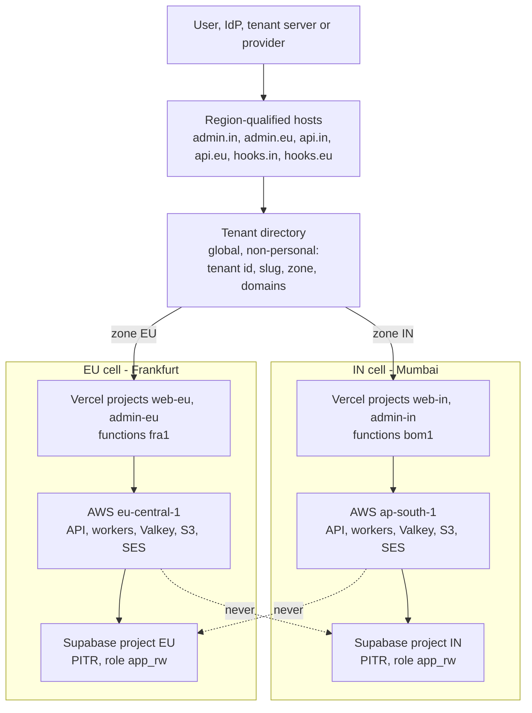

**Tenant directory (DEC-895).** A small global service holds only non-personal routing data: `tenant_id`, `slug`, `zone` (IN or EU), verified domain names, cell endpoints and status. It is replicated read-only to both cells (it contains no personal data, so replication does not breach residency). Every entry point resolves the zone **before** any personal data is processed: the Admin login page resolves the zone from the subdomain (`admin.in.` / `admin.eu.`) or from the email domain via HRD; the website resolves it from the custom domain; API callers use the region-qualified host printed on their credential; SCIM and webhooks are configured with the region-qualified base URL. A request that reaches the wrong cell is answered with `421 Misdirected Request` and a `Location`-free problem body (no data lookup is attempted), never proxied across zones.

| Convention | Rule in this part | Source |
|---|---|---|
| Hosts | `admin.<zone>.<platform-domain>`, `api.<zone>.<platform-domain>`, `hooks.<zone>.<platform-domain>`; legacy `admin.<platform-domain>` redirects to the zone chosen at sign-in | DEC-772, DEC-895 |
| Errors | RFC 9457 problem details with `code`, `rule_ids[]`, `correlation_id`; denials are NSE (Part 6.2a shorthand) | Part 3.2 §3.2.1.5; DEC-641 |
| Events | Part 3.2 §3.2.3.1 envelope; `data_region` added to the envelope (enum IN, EU); consumers reject events whose `data_region` differs from the cell | DEC-772 |
| Audit | Hash-chained audit per cell; anchors in the cell's S3 Object Lock bucket | ENT-ACC-03 |
| Secrets | Only `credential_ref` (Secrets Manager ARN in the tenant's zone); never in rows, logs, prompts or HTML | ENT-INT-02, SB-09 |
| Time | Stored UTC; displayed in the user's zone; IST / CET in examples | NFR-017 |
| Feature flags | Every capability has a platform flag and a tenant flag; default **off** until its activation gate passes | RECOMMENDATION-005 |

---

### 11.19.5.1 C1 Enterprise identity: SSO, verified domains, MFA and sessions, break-glass, SCIM 2.0, custom roles and SoD (DEC-784)

#### A. Design stance and decisions

The identity design of Part 11.5a §11.5.5.2 stands: the **reused AppNAI IdP (DEC-003/019) acts as the identity broker**, so the product still receives one token format with `aud=growth-engine`; the tenant's IdP connection metadata and policy live in the product; the broker performs the SAML/OIDC exchange. This part completes the design to build depth and moves SCIM and custom roles into Release 1 (DEC-881).

| # | Decision point | Choice | Why | ID |
|---|---|---|---|---|
| 1 | Federation pattern | Broker per tenant in the reused IdP (Sprint 0 identity spike **check 13**); fallback in-product SP in the BFF (pysaml2 / python3-saml for SAML, Authlib for OIDC; licences verify) behind flag `idp_broker_fallback` | One token format, one session model, no second login stack unless the broker fails | DEC-880, ADR-255, [ASSUMPTION-1080] |
| 2 | IdPs certified for Release 1 | Okta, Microsoft Entra ID, Google Workspace (V12 decision "Okta, Entra ID and Google first"), plus **generic SAML 2.0** and **generic OIDC** connections for any conformant IdP | V12 BRD 25 / FSD 40 decision row | DEC-880 |
| 3 | Connections per tenant | Up to 5 IdP connections per tenant (V12 C2 has one row per tenant; extended for mergers and contractors), each bound to ≥ 1 verified domain; one connection per domain | Real enterprises run more than one IdP | DEC-880, [CONFLICT-1091] |
| 4 | Assertion security | SAML: signed assertion **and** response accepted, `Destination`, `Audience`, `InResponseTo`, `NotOnOrAfter` (60 s skew), replay cache 10 min keyed by assertion ID; SHA-256+ only; encrypted assertions supported. OIDC: authorization code + PKCE (S256), `nonce`, `iss`, `aud`, `azp`, `exp`, `iat` (60 s skew), JWKS cached 10 min with rotation, `alg` allowlist RS256/PS256/ES256, `none` rejected | SAML/OIDC best practice; ENT-IDN-01 acceptance | ADR-255 |
| 5 | MFA | Tenant policy may only tighten the platform floor (Part 4.1 §4.3.3); IdP MFA accepted only when `amr`/`AuthnContextClassRef` proves it; privileged roles (R01, R02, R08–R12, approvers and custom roles holding any privileged permission) require phishing-resistant factors (DEC-077) — step-up through the reused IdP's WebAuthn if the IdP did not prove it | ENT-IDN-04, SEC-03 | DEC-880 |
| 6 | Sessions | Tenant `max_session_hours` 1–24, `idle_minutes` 5–120; privileged ceiling 12 h / 30 min (RECOMMENDATION-847 kept); revocation ≤ 60 s | ENT-IDN-05 | — |
| 7 | SCIM server | In-product SCIM 2.0 service provider per zone, RFC 7643/7644: `/Users`, `/Groups`, `/ServiceProviderConfig`, `/Schemas`, `/ResourceTypes`, `/Bulk` (≤ 100 operations), filtering `eq`/`co`/`sw` on `userName`, `externalId`, `emails.value`, `displayName`; PATCH per RFC 7644 §3.5.2; ETags (`meta.version`) supported | ENT-IDN-03 | DEC-881, ADR-256 |
| 8 | De-provisioning SLA | Product side ≤ 60 s after the SCIM call; **end to end ≤ 15 min** from IdP change, measured by AU-291 from the IdP's `meta.lastModified` where provided, and by the reconciliation sweep every 10 min otherwise | ENT-IDN-03 acceptance ("15 minutes (proposed)" adopted as binding) | DEC-881 |
| 9 | Group → role mapping | `scim_group_role_map` reviewed by R12; unmapped groups grant nothing; mapping changes are approved (requester ≠ approver) | Least privilege | DEC-881 |
| 10 | Custom roles and SoD | Custom roles from the generated permission catalogue (resource × action), scope tenant or company; creator cannot grant what they lack; SoD checked at save (API), at assignment (API and trigger), at SCIM group mapping, and at run time (ABAC-03); SoD matrix extended beyond V12's four pairs (§F) | ENT-ACC-01/02 | DEC-898 |
| 11 | Access recertification | Quarterly campaign by AU-292: every privileged membership and custom role confirmed by R12; not confirmed in 14 days → privileged permissions suspended (not the account) | SOC 2 CC6 evidence (DEC-775) | DEC-898 |
| 12 | Break-glass | 1–2 accounts per tenant, local credential + **hardware security key** [RECOMMENDATION-1096]; excluded from SSO enforcement and from SCIM; each use → SEV3, notification to all R12 and R10, audit; quarterly test login recorded | ENT-IDN-06 | — |

#### B. Sequence diagrams

**B1. SP-initiated SAML sign-in through the broker with HRD and step-up.**

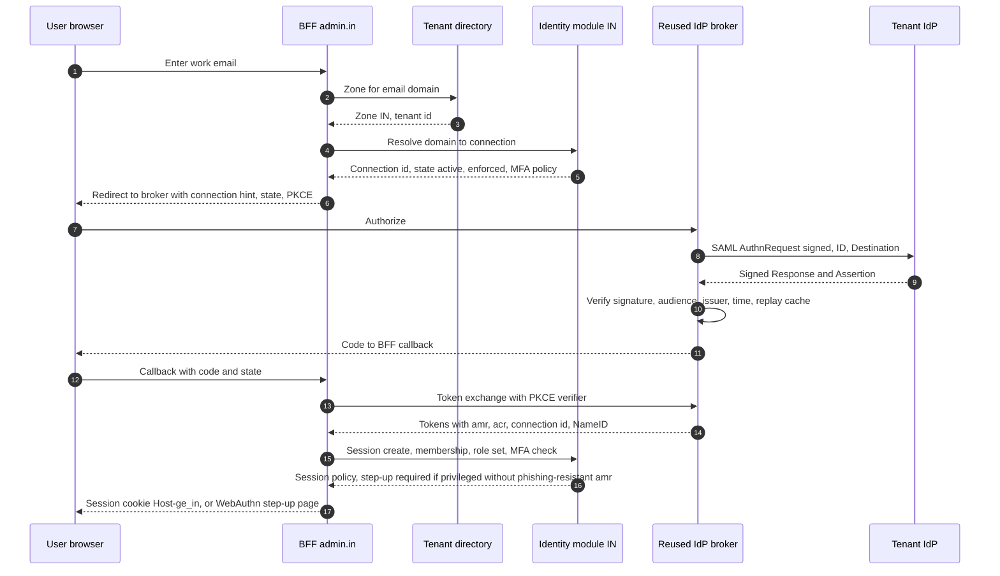

**B2. SCIM de-provisioning to full revocation within 60 s (product side).**

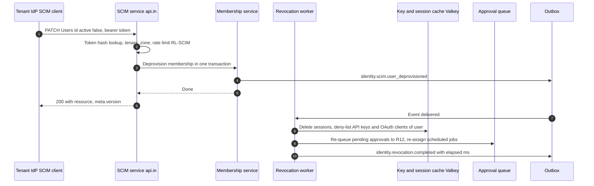

**B3. Custom role save with SoD enforcement in API and database.**

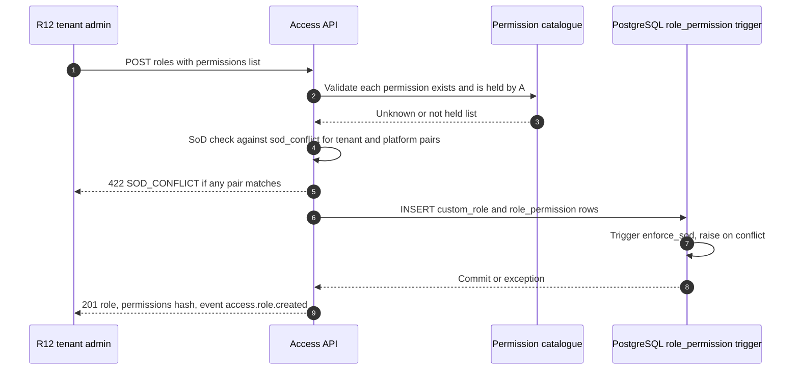

#### C. Configuration

| Key | Scope | Default | Allowed values | Who may change | Effect |
|---|---|---|---|---|---|
| `sso.connections.max` | Platform | 5 | 1–10 | Platform owner (change record) | Hard limit per tenant |
| `sso.saml.clock_skew_s` | Platform | 60 | 0–120 | Platform owner | Assertion time window |
| `sso.saml.replay_cache_min` | Platform | 10 | 5–60 | Platform owner | Replay detection window |
| `sso.oidc.jwks_cache_min` | Platform | 10 | 1–60 | Platform owner | Key rotation pick-up |
| `sso.metadata.refresh_h` | Connection | 24 | 1–168 | R12 | AU-290 metadata refresh |
| `sso.cert.expiry_warn_days` | Platform | 30, 14, 7, 1 | list | Platform owner | AU-290 alerts to R12 |
| `domain.recheck_h` | Platform | 24 | 6–24 | Platform owner | TXT recheck cadence |
| `domain.loss_threshold` | Platform | 2 consecutive misses | 1–3 | Platform owner | `verification_lost` state |
| `tenant.mfa_mode` | Tenant | `required_privileged` | `required_privileged`, `required_all` (floor cannot be lowered) | R12 (step-up, second approver R12/R10) | ENT-IDN-04 |
| `tenant.max_session_hours` / `idle_minutes` | Tenant | 12 / 30 | 1–24 / 5–120; privileged ≤ 12 / ≤ 30 | R12 | ENT-IDN-05 |
| `scim.enabled` | Tenant | off | on/off | R12 | Exposes the SCIM endpoint for the tenant |
| `scim.token.lifetime_days` | Tenant | 365 | 30–397 | R12 | Matches Part 11.9b `scim_token_life_ck` |
| `scim.reconcile_every_min` | Platform | 10 | 5–60 | Platform owner | AU-291 sweep |
| `scim.deprovision.sla_min` | Platform | 15 | fixed (binding) | — | AU-291 breach alert |
| `roles.custom.max` | Tenant | 50 | 1–200 | Platform owner | Role sprawl limit |
| `access.recert.cadence_days` | Tenant | 90 | 30–90 | R12 (shorter only) | AU-292 campaign |
| `breakglass.accounts` | Tenant | 1 | 1–2 | R12 + R10 | Required before enforcement |

#### D. Data model and DDL deltas (DDL-V12-R part 1, applied after DDL-V12-I)

The V12 C2 table `identity_provider` (one row per tenant) is kept for compatibility as a view over the new multi-connection table. All tables are in schema `ge`, RLS-forced, with the P-TEN policy template of Part 11.9b §11.9.5.4 (`tenant_id = ge.ctx_tenant()`).

```sql
-- DDL-V12-R-01 Identity connections (ENT-IDN-01, 02, 06; DEC-880)
CREATE TABLE ge.idp_connection (
  tenant_id        uuid NOT NULL REFERENCES ge.tenant(tenant_id),
  connection_id    uuid NOT NULL DEFAULT gen_random_uuid(),
  display_name     text NOT NULL,
  vendor           text NOT NULL CHECK (vendor IN ('okta','entra_id','google_workspace','generic_saml','generic_oidc')),
  protocol         text NOT NULL CHECK (protocol IN ('SAML 2.0','OpenID Connect')),
  issuer           text NOT NULL,                      -- SAML entityID or OIDC iss
  metadata_url     text CHECK (metadata_url ~ '^https://'),
  sso_url          text NOT NULL CHECK (sso_url ~ '^https://'),
  audience         text NOT NULL,                      -- our SP entityID / client_id, per zone
  attribute_map    jsonb NOT NULL DEFAULT '{"email":"email","given_name":"given_name","family_name":"family_name","groups":"groups"}',
  broker_ref       text,                               -- connection id inside the reused IdP broker
  state            text NOT NULL DEFAULT 'draft' CHECK (state IN ('draft','testing','active','disabled')),
  enforced         boolean NOT NULL DEFAULT false,
  last_test_ok_at  timestamptz,
  created_by       uuid NOT NULL, created_at timestamptz NOT NULL DEFAULT now(),
  version          int NOT NULL DEFAULT 1,
  PRIMARY KEY (tenant_id, connection_id),
  CHECK (NOT (vendor = 'generic_saml' AND protocol <> 'SAML 2.0')),
  CHECK (NOT (vendor = 'generic_oidc' AND protocol <> 'OpenID Connect')),
  CHECK (state = 'active' OR NOT enforced),
  CHECK (state <> 'active' OR last_test_ok_at IS NOT NULL)          -- test login before activation
);
CREATE TABLE ge.idp_certificate (
  tenant_id uuid NOT NULL, connection_id uuid NOT NULL, cert_id uuid NOT NULL DEFAULT gen_random_uuid(),
  use text NOT NULL CHECK (use IN ('signing','encryption')), pem_sha256 bytea NOT NULL, not_after timestamptz NOT NULL,
  active boolean NOT NULL DEFAULT true, PRIMARY KEY (tenant_id, cert_id),
  FOREIGN KEY (tenant_id, connection_id) REFERENCES ge.idp_connection(tenant_id, connection_id));
CREATE UNIQUE INDEX ux_idp_cert_two_active ON ge.idp_certificate (tenant_id, connection_id, use, cert_id) WHERE active;
CREATE TABLE ge.verified_domain (
  tenant_id uuid NOT NULL, domain_id uuid NOT NULL DEFAULT gen_random_uuid(),
  domain citext NOT NULL CHECK (domain ~ '^[a-z0-9.-]+\.[a-z]{2,}$'),
  txt_token text NOT NULL, state text NOT NULL DEFAULT 'pending' CHECK (state IN ('pending','verified','verification_lost','released')),
  connection_id uuid, consecutive_misses int NOT NULL DEFAULT 0, last_checked_at timestamptz, verified_at timestamptz,
  PRIMARY KEY (tenant_id, domain_id),
  FOREIGN KEY (tenant_id, connection_id) REFERENCES ge.idp_connection(tenant_id, connection_id));
CREATE UNIQUE INDEX ux_verified_domain_global ON ge.verified_domain (domain) WHERE state IN ('verified','verification_lost');  -- a domain belongs to one tenant per zone
CREATE TABLE ge.breakglass_account (
  tenant_id uuid NOT NULL, user_id uuid NOT NULL, hardware_key_registered boolean NOT NULL,
  last_test_at timestamptz, PRIMARY KEY (tenant_id, user_id), CHECK (hardware_key_registered));
-- Enforcement guard: a connection can be enforced only if one of its domains is verified and a break-glass account exists
CREATE FUNCTION ge.enforce_sso_guard() RETURNS trigger LANGUAGE plpgsql AS $$
BEGIN
  IF NEW.enforced AND NOT EXISTS (SELECT 1 FROM ge.verified_domain d WHERE d.tenant_id = NEW.tenant_id
        AND d.connection_id = NEW.connection_id AND d.state IN ('verified','verification_lost')) THEN
    RAISE EXCEPTION 'SSO_ENFORCEMENT_REQUIRES_VERIFIED_DOMAIN' USING ERRCODE = 'check_violation'; END IF;
  IF NEW.enforced AND NOT EXISTS (SELECT 1 FROM ge.breakglass_account b WHERE b.tenant_id = NEW.tenant_id) THEN
    RAISE EXCEPTION 'SSO_ENFORCEMENT_REQUIRES_BREAKGLASS' USING ERRCODE = 'check_violation'; END IF;
  RETURN NEW; END $$;
CREATE TRIGGER idp_connection_enforce_guard BEFORE INSERT OR UPDATE OF enforced ON ge.idp_connection
  FOR EACH ROW EXECUTE FUNCTION ge.enforce_sso_guard();
-- Compatibility view for the V12 C2 shape (one row per tenant: the enforced or newest active connection)
CREATE VIEW ge.identity_provider AS
  SELECT DISTINCT ON (c.tenant_id) c.tenant_id, c.protocol, c.sso_url, c.issuer, d.domain::text AS domain,
         (d.state = 'verified') AS domain_verified, (SELECT u.email FROM ge.app_user u JOIN ge.breakglass_account b USING (user_id)
          WHERE b.tenant_id = c.tenant_id LIMIT 1) AS breakglass_email, c.enforced,
         p.mfa_mode AS mfa_policy, p.max_session_hours, p.idle_minutes
  FROM ge.idp_connection c LEFT JOIN ge.verified_domain d ON d.tenant_id = c.tenant_id AND d.connection_id = c.connection_id
  JOIN ge.tenant_security_policy p ON p.tenant_id = c.tenant_id
  WHERE c.state = 'active' ORDER BY c.tenant_id, c.enforced DESC, c.created_at DESC;

-- DDL-V12-R-02 Security policy and sessions (ENT-IDN-04, 05)
CREATE TABLE ge.tenant_security_policy (
  tenant_id uuid PRIMARY KEY REFERENCES ge.tenant(tenant_id),
  mfa_mode text NOT NULL DEFAULT 'required_privileged' CHECK (mfa_mode IN ('required_privileged','required_all')),
  privileged_factor text NOT NULL DEFAULT 'phishing_resistant' CHECK (privileged_factor = 'phishing_resistant'),  -- floor DEC-077
  max_session_hours int NOT NULL DEFAULT 12 CHECK (max_session_hours BETWEEN 1 AND 24),
  idle_minutes int NOT NULL DEFAULT 30 CHECK (idle_minutes BETWEEN 5 AND 120),
  version int NOT NULL DEFAULT 1, updated_by uuid, updated_at timestamptz NOT NULL DEFAULT now());
CREATE TABLE ge.user_session (
  tenant_id uuid NOT NULL, session_id uuid NOT NULL DEFAULT gen_random_uuid(), user_id uuid NOT NULL,
  connection_id uuid, amr text[] NOT NULL DEFAULT '{}', acr text, privileged boolean NOT NULL,
  created_at timestamptz NOT NULL DEFAULT now(), last_seen_at timestamptz NOT NULL DEFAULT now(),
  expires_at timestamptz NOT NULL, revoked_at timestamptz, revoke_reason text,
  PRIMARY KEY (tenant_id, session_id));
CREATE INDEX ix_user_session_live ON ge.user_session (tenant_id, user_id) WHERE revoked_at IS NULL;

-- DDL-V12-R-03 SCIM (ENT-IDN-03; DEC-881) — extends C2 scim_token
ALTER TABLE ge.scim_token ADD COLUMN IF NOT EXISTS zone text NOT NULL DEFAULT current_setting('app.zone') CHECK (zone IN ('IN','EU'));
ALTER TABLE ge.scim_token ADD COLUMN IF NOT EXISTS last_used_at timestamptz;
CREATE TABLE ge.scim_identity (
  tenant_id uuid NOT NULL, user_id uuid NOT NULL, external_id text NOT NULL, user_name citext NOT NULL,
  active boolean NOT NULL DEFAULT true, meta_version int NOT NULL DEFAULT 1, idp_last_modified timestamptz,
  deprovisioned_at timestamptz, PRIMARY KEY (tenant_id, user_id), UNIQUE (tenant_id, external_id), UNIQUE (tenant_id, user_name));
CREATE TABLE ge.scim_group (
  tenant_id uuid NOT NULL, group_id uuid NOT NULL DEFAULT gen_random_uuid(), external_id text, display_name text NOT NULL,
  PRIMARY KEY (tenant_id, group_id), UNIQUE (tenant_id, display_name));
CREATE TABLE ge.scim_group_member (tenant_id uuid NOT NULL, group_id uuid NOT NULL, user_id uuid NOT NULL,
  PRIMARY KEY (tenant_id, group_id, user_id), FOREIGN KEY (tenant_id, group_id) REFERENCES ge.scim_group(tenant_id, group_id));
CREATE TABLE ge.scim_group_role_map (
  tenant_id uuid NOT NULL, group_id uuid NOT NULL, role_id uuid NOT NULL, company_id uuid,
  state text NOT NULL DEFAULT 'requested' CHECK (state IN ('requested','approved','blocked','retired')),
  requested_by uuid NOT NULL, approved_by uuid, CHECK (approved_by IS NULL OR approved_by <> requested_by),
  PRIMARY KEY (tenant_id, group_id, role_id));
CREATE TABLE ge.scim_deprovision_sla (
  tenant_id uuid NOT NULL, user_id uuid NOT NULL, idp_changed_at timestamptz, received_at timestamptz NOT NULL,
  revoked_at timestamptz, product_ms int GENERATED ALWAYS AS ((extract(epoch FROM revoked_at - received_at) * 1000)::int) STORED,
  end_to_end_s int GENERATED ALWAYS AS ((extract(epoch FROM revoked_at - coalesce(idp_changed_at, received_at)))::int) STORED,
  PRIMARY KEY (tenant_id, user_id, received_at));

-- DDL-V12-R-04 Custom roles and SoD (ENT-ACC-01, 02; DEC-898) — extends C2/C3
ALTER TABLE ge.custom_role ADD COLUMN IF NOT EXISTS scope text NOT NULL DEFAULT 'tenant' CHECK (scope IN ('tenant','company'));
ALTER TABLE ge.custom_role ADD COLUMN IF NOT EXISTS privileged boolean NOT NULL DEFAULT false;   -- computed by API from permission flags
ALTER TABLE ge.custom_role ADD COLUMN IF NOT EXISTS permissions_hash bytea;
ALTER TABLE ge.custom_role ADD COLUMN IF NOT EXISTS state text NOT NULL DEFAULT 'active' CHECK (state IN ('active','retired'));
CREATE TABLE ge.permission_catalogue (
  permission text PRIMARY KEY CHECK (permission ~ '^[A-Z][A-Za-z]+:[a-z_]+$'), resource text NOT NULL, action text NOT NULL,
  privileged boolean NOT NULL, consequential boolean NOT NULL, catalogue_version int NOT NULL);   -- generated from RBAC YAML, platform table
ALTER TABLE ge.sod_conflict ADD COLUMN IF NOT EXISTS source text NOT NULL DEFAULT 'V12-C2';
INSERT INTO ge.sod_conflict (permission_a, permission_b, source) VALUES
  ('Finance:verify_first','Finance:verify_second','DEC-898'), ('Billing:purchase','Billing:approve_refund','DEC-898'),
  ('Roles:edit','Roles:approve_assignment','DEC-898'), ('Mandates:request','Mandates:approve','DEC-898 + Part 11.17'),
  ('Connectors:request_activation','Connectors:approve_activation','DEC-898'), ('Models:propose','Models:approve','DEC-898 + DEC-890'),
  ('Benchmarks:enrol','Benchmarks:approve_release','DEC-898 + DEC-893'), ('ApiKeys:create_unmasked_scope','ApiKeys:approve_unmasked_scope','DEC-898')
ON CONFLICT DO NOTHING;
CREATE TABLE ge.access_recert_campaign (
  tenant_id uuid NOT NULL, campaign_id uuid NOT NULL DEFAULT gen_random_uuid(), opened_at timestamptz NOT NULL, due_at timestamptz NOT NULL,
  state text NOT NULL CHECK (state IN ('open','closed','escalated')), PRIMARY KEY (tenant_id, campaign_id));
CREATE TABLE ge.access_recert_item (
  tenant_id uuid NOT NULL, campaign_id uuid NOT NULL, user_id uuid NOT NULL, role_id uuid NOT NULL,
  decision text CHECK (decision IN ('keep','remove')), decided_by uuid, decided_at timestamptz,
  CHECK (decided_by IS NULL OR decided_by <> user_id),                -- nobody recertifies themself
  PRIMARY KEY (tenant_id, campaign_id, user_id, role_id));
```

Grants and policies: `app_rw` receives `SELECT, INSERT, UPDATE` on the identity tables (no `DELETE`; retire by state), `SELECT` on `permission_catalogue` and `sod_conflict` (platform tables, writes only by `app_owner` migrations); `app_worker` additionally `UPDATE` on `user_session` (revocation) and `scim_deprovision_sla`. RLS P-TEN on every tenant table above. The V12 test C2-T1 (SoD trigger) is extended to the `membership_role` trigger of Part 11.9b (line `enforce_sod_assignment`).

#### E. APIs (published contract additions; base `https://api.<zone>.<platform-domain>` for SCIM and developer callers, `admin.<zone>` BFF for browser callers)

| ID | Method and path | Caller and auth | Request (key fields) | Responses and codes | Idempotency | V12 / earlier |
|---|---|---|---|---|---|---|
| API-V12-R-001 | `GET /api/v1/tenants/{tid}/idp-connections` | R12 browser (BFF) | — | 200 list | — | API-V12-H-015 |
| API-V12-R-002 | `POST /api/v1/tenants/{tid}/idp-connections` | R12 + step-up | vendor, protocol, issuer, metadata_url or sso_url + certificates, attribute_map | 201; 422 `METADATA_URL_NOT_HTTPS`, `UNSUPPORTED_ALG`, `CONNECTION_LIMIT` | `Idempotency-Key` | ENT-IDN-01 |
| API-V12-R-003 | `PATCH /api/v1/tenants/{tid}/idp-connections/{cid}` | R12 + step-up | any mutable field, `If-Match` version | 200; 412 version; 409 `ENFORCED_CONNECTION_LOCKED` for issuer change while enforced | If-Match | ENT-IDN-01 |
| API-V12-R-004 | `POST …/idp-connections/{cid}/test-login` | R12 | — | 202 with test URL; result event `identity.sso_config.tested` | — | ENT-IDN-01 |
| API-V12-R-005 | `POST …/idp-connections/{cid}/activate` / `/enforce` / `/unenforce` | R12 + step-up; enforce needs second approver R12 or R10 | reason | 200; 409 `SSO_ENFORCEMENT_REQUIRES_VERIFIED_DOMAIN`, `SSO_ENFORCEMENT_REQUIRES_BREAKGLASS`, `TEST_LOGIN_REQUIRED` | — | ENT-IDN-02/06 |
| API-V12-R-006 | `POST /api/v1/tenants/{tid}/verified-domains`, `POST …/{did}/verify` | R12 | domain | 201 with TXT `growth-verify=<token>`; 409 `DOMAIN_CLAIMED`; 422 `TXT_NOT_FOUND` | — | ENT-IDN-02 |
| API-V12-R-007 | `GET/PATCH /api/v1/tenants/{tid}/security-policy` | R12 + step-up; loosening `idle`/`max` needs second approver | mfa_mode, max_session_hours, idle_minutes | 200; 422 `OUT_OF_RANGE`, `BELOW_PLATFORM_FLOOR` | If-Match | ENT-IDN-04/05 |
| API-V12-R-008 | `POST /api/v1/sessions/{sid}/revoke`, `POST /api/v1/users/{uid}/sessions/revoke-all` | R12, user (own) | reason | 204; effect ≤ 60 s | — | ENT-IDN-05 |
| API-V12-R-009 | `POST /api/v1/tenants/{tid}/breakglass-accounts` | R12 + R10 approval | user_id, hardware key attestation | 201; 422 `HARDWARE_KEY_REQUIRED`; 409 `MAX_TWO` | — | ENT-IDN-06 |
| API-V12-R-010 | `GET/POST/DELETE /api/v1/tenants/{tid}/scim-tokens` | R12 + step-up | label, lifetime_days | 201 token shown once (`Cache-Control: no-store`); 204 revoke | — | ENT-IDN-03 |
| API-V12-R-011 | `/scim/v2/Users` `GET` (filter, `startIndex`, `count` ≤ 200), `POST`, `GET/PUT/PATCH/DELETE /Users/{id}` | Tenant IdP, SCIM bearer | RFC 7643 User core + enterprise extension (`employeeNumber`, `department`, `manager`) | 200/201/204; SCIM errors `invalidFilter`, `uniqueness`, `mutability`, `noTarget`, `invalidValue`, `tooMany` (429) | `externalId`; ETag | A2 SCIM ops |
| API-V12-R-012 | `/scim/v2/Groups` (same verbs), `/scim/v2/Bulk`, `/ServiceProviderConfig`, `/Schemas`, `/ResourceTypes` | Tenant IdP | RFC 7643 Group; Bulk ≤ 100 ops, `failOnErrors` | as above | `bulkId` | A2 SCIM ops |
| API-V12-R-013 | `GET/POST /api/v1/tenants/{tid}/scim-group-mappings`, `POST …/{mid}/approve` | R12 (request), another R12 or R10 (approve) | group_id, role_id, company_id | 201; 409 `SOD_CONFLICT_ON_ASSIGNMENT`; 403 `SAME_APPROVER` | — | ENT-IDN-03 |
| API-V12-R-014 | `GET /api/v1/permissions` | R12 | `?resource=` | 200 catalogue with `privileged`, `consequential` flags | — | ENT-ACC-01 |
| API-V12-R-015 | `GET/POST/PATCH /api/v1/roles`, `POST /api/v1/roles/{rid}/retire` | R12 + step-up | name, scope, permissions[] | 201; 422 `SOD_CONFLICT`, `UNKNOWN_PERMISSION`; 403 `PERMISSION_NOT_HELD` | If-Match | API-V12-H-029…032 |
| API-V12-R-016 | `POST /api/v1/memberships/{mid}/roles` | R12 + step-up | role_id, company_id | 201; 409 `SOD_CONFLICT_ON_ASSIGNMENT` | — | ENT-ACC-02 |
| API-V12-R-017 | `GET /api/v1/access-reviews`, `POST /api/v1/access-reviews/{cid}/items/{iid}/decide` | R12 | keep/remove | 200; 403 `SELF_REVIEW` | — | DEC-898 |
| API-V12-R-018 | `GET/POST /api/v1/siem-sinks`, `POST …/{sid}/test` | R12 + R10 | kind https/syslog-tls/object-storage, endpoint, format JSON/CEF, retention 1/3/7 | 201; 422 `NON_TLS_ENDPOINT` | — | ENT-ACC-04 |

#### F. SoD matrix of record (V12 four pairs + DEC-898 additions)

| Pair | Source | Checked at |
|---|---|---|
| Runs:create ↔ Runs:approve | V12 C2 | role save, assignment, SCIM mapping, run time (ABAC-03) |
| Configuration:edit ↔ Configuration:approve | V12 C2 | same |
| Billing:view ↔ Billing:approve | V12 C2 | same |
| Runs:approve ↔ Runs:dispatch | V12 C2 | same |
| Finance:verify_first ↔ Finance:verify_second | DEC-898 (R08/R09 dual verification) | same |
| Billing:purchase ↔ Billing:approve_refund | DEC-898 (Part 11.5a R12B) | same |
| Roles:edit ↔ Roles:approve_assignment | DEC-898 | same |
| Mandates:request ↔ Mandates:approve | DEC-898 + Part 11.17 (two-person mandate) | same + mandate engine |
| Connectors:request_activation ↔ Connectors:approve_activation | DEC-898 (C3 gate) | same |
| Models:propose ↔ Models:approve | DEC-898 + DEC-890 (C6) | same |
| Benchmarks:enrol ↔ Benchmarks:approve_release | DEC-898 + DEC-893 (C7) | same |
| ApiKeys:create_unmasked_scope ↔ ApiKeys:approve_unmasked_scope | DEC-898 (C2 `contacts:read_unmasked`) | same |

#### G. Events (envelope Part 3.2 §3.2.3.1 + `data_region`)

| Event | Producer | Consumers | Key payload | Notes |
|---|---|---|---|---|
| `identity.sso_config.created/updated/tested/activated/enforced/unenforced` | identity | session policy cache, Notify R12, SIEM, audit | connection_id, version, result | earlier: Part 11.8b |
| `identity.sso.login_failed` | broker adapter | AU-290 anomaly counter, SIEM | connection_id, code, ip_hash | no assertion body stored |
| `identity.sso.replay` / `.signature_invalid` | broker adapter | security events (SEV3), SIEM | connection_id, assertion_id_hash | — |
| `identity.email_domain.verified/verification_lost/released` | AU-290 | enforcement guard, Notify (High) | domain_id | — |
| `identity.certificate.expiring` | AU-290 | Notify R12 at 30/14/7/1 days | cert_id, not_after | — |
| `identity.scim.user_provisioned/updated/deprovisioned/reactivated`, `.group_changed`, `.token_created/revoked`, `.auth_failed` | SCIM service | membership, revocation worker, Notify, SIEM | user_id, external_id, change | — |
| `identity.revocation.completed` | revocation worker | AU-291 SLA ledger | user_id, product_ms | product SLA ≤ 60 000 ms |
| `identity.breakglass.used` / `.tested` | identity | SEV3, Notify all R12 and R10, SIEM | user_id, reason | — |
| `access.role.created/updated/retired`, `access.assignment.denied_sod` | access | permission cache, audit, R10 | role_id, permissions_hash, pair | — |
| `access.recert.opened/overdue/closed` | AU-292 | Notify R12, evidence store | campaign_id, counts | SOC 2 evidence |

#### H. Runbooks

| ID | Trigger | Steps | Target | Owner |
|---|---|---|---|---|
| RB-ID-01 Tenant IdP outage | `identity.sso.login_failed` spike > 20 in 5 min for one connection, or tenant report | 1. Confirm on IdP status page. 2. Tell R12 that break-glass is available; do **not** unenforce SSO on behalf of the tenant. 3. Existing sessions continue until expiry. 4. If the tenant asks, R12 may unenforce with second approver; audit | Communication ≤ 15 min | Support L1 / IAM lead |
| RB-ID-02 Signing certificate rotated by tenant without notice | Signature failures after a rotation | 1. AU-290 metadata refresh (if metadata URL). 2. Else R12 uploads the new certificate (two certificates may be active). 3. Re-test login | ≤ 30 min | R12 / Support |
| RB-ID-03 Domain verification lost | Two consecutive TXT misses | 1. High notification to R12. 2. Enforcement continues for existing users until R12 confirms (no surprise lockout). 3. New domain claim by another tenant is blocked while `verification_lost`. 4. After 30 days in `verification_lost`, enforcement off with R12 notice | — | IAM lead |
| RB-ID-04 SCIM de-provisioning SLA breach | AU-291 `end_to_end_s > 900` or `product_ms > 60000` | 1. SEV2 security incident. 2. Manual revoke-all for the user. 3. Check SCIM client errors (429, 401). 4. Root cause and evidence | Containment ≤ 15 min | Security on-call (DEC-773) |
| RB-ID-05 Break-glass use | `identity.breakglass.used` | 1. SEV3; confirm with R12 by a second channel. 2. If not confirmed in 30 min: revoke sessions, rotate credential, SEV2. 3. Post-use review | ≤ 30 min | Security on-call |
| RB-ID-06 SoD violation attempt | `access.assignment.denied_sod` repeated ≥ 3 per day by one actor | Review with R10; possible insider-risk case | Next business day | R10 |
| RB-ID-07 Quarterly recertification | AU-292 campaign | Remind at day 7 and 12; at day 14 suspend unconfirmed privileged permissions; evidence export | 14 days | R12 |

#### I. Security controls (threat → control → test)

| Threat (STRIDE) | Control | Test |
|---|---|---|
| Spoofing: forged SAML assertion / XML signature wrapping | Strict schema validation, signature over the asserted element by ID reference, single assertion only, reject comments in NameID, library hardened config (`wantAssertionsSigned`, `rejectUnsolicitedResponsesWithInResponseTo`) | TC-V12-R-003, generated M01 `unsigned` rows; XSW corpus of 12 variants in CI |
| Spoofing: IdP mix-up between tenants | Audience per zone and per connection; `iss` bound to the connection; HRD by verified domain only | TC-V12-R-002 |
| Replay of assertion or code | Assertion ID cache 10 min; OIDC code single use; PKCE | M01 `replayed` rows |
| Elevation: user invents a group | Groups only from SCIM or signed `groups` claim of an active connection; unmapped groups grant nothing; mapping approved by second person | TC-V12-R-012; M02 |
| Elevation: custom role exceeds creator | Permission subset rule; consequential permissions flagged and require R10 co-approval | TC-V12-R-017/018; M03 |
| Repudiation | Hash-chained audit, break-glass alerts | TC-V12-R-019 |
| Information disclosure: SCIM enumeration across tenants | Token scoped to tenant and zone; uniform `noTarget` | M02 `other tenant` rows |
| Denial of service: SCIM flood | RL-SCIM 60/min, Bulk ≤ 100, payload ≤ 1 MB | TC-V12-R-014 |
| Lockout of a tenant | Break-glass mandatory; no auto-unenforce on DNS loss | TC-V12-R-007/008 |

#### J. Cut-over into Release 1

| Step | When | Activity | Exit evidence |
|---|---|---|---|
| ID-C1 | Sprint 0 | Identity spike check 13 (broker per tenant, issuer/audience binding, `amr` passthrough) on Okta, Entra ID and Google developer tenants (free developer tenants, verify) | Pass/fail per IdP; fallback flag decision (DEC-880) |
| ID-C2 | Sprint 1–2 | DDL-V12-R-01…04 migrations; permission catalogue generator; SoD triggers | Part 11.9b + this part CI suites green |
| ID-C3 | Sprint 2–4 | SSO configuration UI (A203 tabs Connections, Domains, Policy, Break-glass), test login, enforcement | TC-V12-R-001…010 |
| ID-C4 | Sprint 3–5 | SCIM server; conformance run against Okta and Entra ID provisioning test harnesses and the RFC 7644 conformance suite (open-source suite, verify) | TC-V12-R-011…016 + M02 rows |
| ID-C5 | Sprint 4–5 | Custom roles UI (A002 Roles tab), SoD, recertification (AU-292) | TC-V12-R-017…020 + M03 |
| ID-C6 | Release 1 hardening | Pen-test scope includes SSO/SCIM (R1 pen test, V12 R1 exit "pen test #1 no open critical/high") | Report with no open critical/high |
| ID-C7 | Release 1 go-live | Owned startups move to SSO first (Owner Portfolio IdP), then external tenants on request; flag `sso.enabled` per tenant | Activation log |

---

### 11.19.5.2 C2 Developer platform: API keys, OAuth client credentials, rate limits, versioning, signed webhooks, developer portal, SDKs and sandbox (DEC-785)

#### A. Design stance and decisions

Part 11.8b §11.8.5.4 specified the developer host, the API-key format, the scope registry, the RL-KEY classes, the 12-month deprecation rule and the portal/SDK approach. DEC-785 brings **all** of ENT-API-01…07 and ENT-DAT-04/05 into Release 1. This section completes the design: OAuth client credentials, webhook signing and delivery, SDK build and release, sandbox tenants and configuration promotion, and region binding.

| # | Decision point | Choice | ID |
|---|---|---|---|
| 1 | Hosts | `api.<zone>.<platform-domain>` per residency cell, AWS only (no Vercel in the server-to-server path); CORS disabled; WAF with per-tenant rate rules | DEC-882, ADR-257 |
| 2 | Credential types | (a) API key `gek_<env>_<zone>_<prefix8>_<secret43>` (zone added to the Part 11.8b format so a key is never looked up in the wrong cell); (b) OAuth 2.0 **client credentials** with `private_key_jwt` (RFC 7523, preferred, ES256/PS256) or `client_secret_basic`; access token = JWT (ES256), lifetime 15 min, audience `api.<zone>`, scopes, `tenant_id`, `cnf` absent (bearer) | DEC-882, ADR-257 |
| 3 | Scope registry | Part 11.8b scope registry kept; **no scope exists for approve, send, publish, pay, sign, submit bids, set prices, change roles or policies**. `runs:create` may start workflows; any consequential step stops at a human approval or executes only under an active **bounded mandate** of Part 11.17 (DEC-779), whose controls the API cannot bypass | DEC-883, [CONFLICT-1093] |
| 4 | Rate limits | RL-KEY 300/min per key, 1,500/min per tenant; RL-KEY-H 10/min per key for run creation and exports; token endpoint 30/min per client; `RateLimit-Policy` and `RateLimit` headers (IETF draft, verify), `Retry-After` on 429 | ENT-API-03 |
| 5 | Versioning | URL major version (`/api/v1`, `/api/v2`); additive changes any time; breaking change only in a new major with ≥ 12 months' notice (`Deprecation`, `Sunset`, `Link rel=deprecation`), changelog and owner e-mails; `oasdiff` gate in CI | ENT-API-04, DEC-646 |
| 6 | Webhooks | Signed with HMAC-SHA-256 over `t + "." + raw_body`, header `GE-Signature: t=<unix>,v1=<hex>[,v1=<hex-old>]`; tolerance ±300 s; secret rotation with 24 h overlap (both signatures sent); `GE-Event-Id`, `GE-Event-Type`, `GE-Delivery-Attempt`; payloads carry references and digests, never Restricted fields; delivery schedule 6 attempts within 24 h (T, +5 min, +30 min, +2 h, +6 h, +15 h; ±10% jitter); 410 disables; replay from the log for 30 days; endpoint verification challenge before activation | ENT-API-05, DEC-882, ADR-258 |
| 7 | SDKs | TypeScript (npm), Python (PyPI), **Java** (Maven Central) generated with openapi-generator from the published OpenAPI, plus hand-written helpers: auth (key and client-assertion signer), pagination, retries honouring `Retry-After`, idempotency keys, webhook `verify()`; semantic versions tied to the API major; signed releases with provenance [RECOMMENDATION-1097] | ENT-API-06, DEC-882 |
| 8 | Developer portal | Static site generated from the OpenAPI (Redoc, MIT) + guides, on a separate Vercel project `developers` (no personal data; public); "Try it" only against the sandbox host; per-region base URLs shown | ENT-API-07 |
| 9 | Sandbox | One sandbox tenant per real tenant on request (and a public shared sandbox for the portal), in the **same zone**, synthetic data only (`contains_personal_data = false` enforced), sandbox adapters only (no real provider credentials), API keys prefixed `gek_test_`; configuration promotion sandbox → production as a reviewed configuration revision (requester ≠ approver) | ENT-DAT-04/05, DEC-899 |
| 10 | Leak response | Prefix `gek_` registered for secret-scanning partner programs where available [RECOMMENDATION-1098]; on a leak report AU-293 revokes the key within 60 s and notifies R12 | DEC-882 |

#### B. Sequence diagrams

**B1. OAuth client-credentials token with `private_key_jwt`, then an API call.**

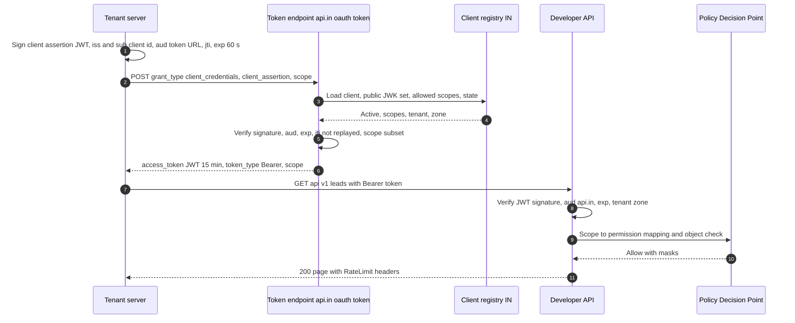

**B2. Webhook delivery with signing, retries and replay.**

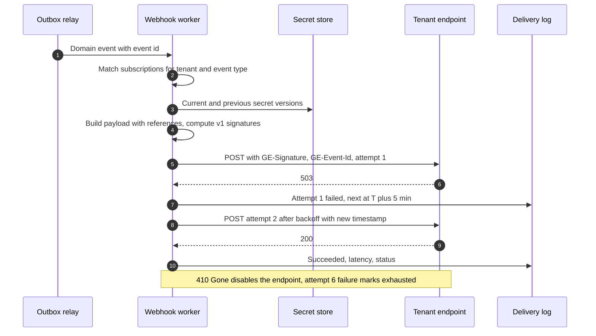

**B3. Sandbox to production configuration promotion.**

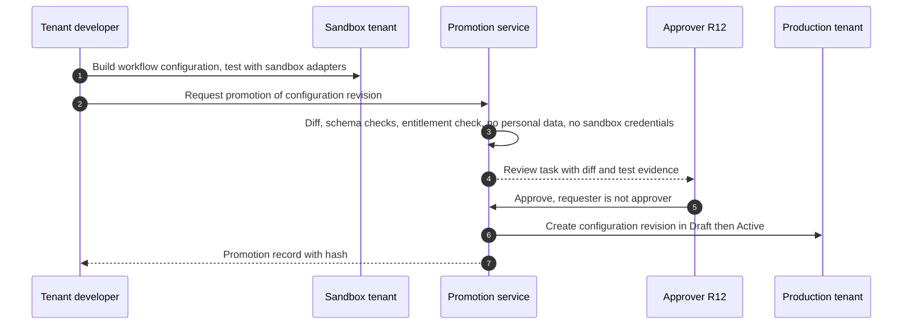

#### C. Configuration

| Key | Default | Allowed | Owner |
|---|---|---|---|
| `apikey.default_lifetime_days` | 90 | 1–365 (hard cap 397 by DDL) | R12 per key |
| `apikey.max_per_tenant` | 50 | 1–500 | Platform owner |
| `apikey.unused_revoke_days` | 180 (warn at 90) | 30–365 | R12 |
| `oauth.token_ttl_min` | 15 | 5–60 | Platform owner |
| `oauth.client.jwks_url_required` | true for `private_key_jwt` | — | — |
| `oauth.client_secret.lifetime_days` | 180 | 30–365 | R12 |
| `ratelimit.key_per_min` / `tenant_per_min` | 300 / 1,500 | Enterprise tier up to 1,200 / 6,000 by contract | Platform owner |
| `webhook.max_endpoints` | 10 per tenant | 1–50 | Platform owner |
| `webhook.timeout_s` | 10 | 5–15 | — |
| `webhook.schedule` | 0, 5 m, 30 m, 2 h, 6 h, 15 h | fixed in R1 | — |
| `webhook.secret_overlap_h` | 24 | 1–72 | R12 at rotation |
| `webhook.replay_window_days` | 30 | 7–30 | — |
| `sandbox.max_per_tenant` | 2 | 1–5 | Platform owner |
| `sandbox.ttl_days_idle` | 90 | 30–365 | R12 |
| `deprecation.notice_months` | 12 | ≥ 12 | Platform owner |

#### D. Data model and DDL deltas (DDL-V12-R part 2)

```sql
-- DDL-V12-R-05 API keys (extends C2 api_key + Part 11.9b checks)
ALTER TABLE ge.api_key ADD COLUMN IF NOT EXISTS zone text NOT NULL DEFAULT current_setting('app.zone') CHECK (zone IN ('IN','EU'));
ALTER TABLE ge.api_key ADD COLUMN IF NOT EXISTS environment text NOT NULL DEFAULT 'live' CHECK (environment IN ('live','test'));
ALTER TABLE ge.api_key ADD COLUMN IF NOT EXISTS created_by uuid NOT NULL;
ALTER TABLE ge.api_key ADD COLUMN IF NOT EXISTS last_used_at timestamptz;
ALTER TABLE ge.api_key ADD COLUMN IF NOT EXISTS revoke_reason text CHECK (revoke_reason IN ('owner','expired','deprovisioned','leak_report','idle','admin'));
ALTER TABLE ge.api_key ADD CONSTRAINT api_key_no_consequential_scope_ck
  CHECK (NOT scopes && ARRAY['approve','send','publish','pay','sign','bids:submit','prices:set','roles:write','policies:write']::text[]);
-- DDL-V12-R-06 OAuth clients (ENT-API-02)
CREATE TABLE ge.oauth_client (
  tenant_id uuid NOT NULL REFERENCES ge.tenant(tenant_id), client_id text NOT NULL CHECK (client_id ~ '^gec_[a-z0-9]{20}$'),
  zone text NOT NULL CHECK (zone IN ('IN','EU')), name text NOT NULL,
  auth_method text NOT NULL CHECK (auth_method IN ('private_key_jwt','client_secret_basic')),
  jwks_url text CHECK (jwks_url ~ '^https://'), jwks_inline jsonb, secret_hash bytea, secret_expires_at timestamptz,
  scopes text[] NOT NULL CHECK (cardinality(scopes) > 0), ip_allowlist cidr[], state text NOT NULL DEFAULT 'active' CHECK (state IN ('active','suspended','revoked')),
  created_by uuid NOT NULL, created_at timestamptz NOT NULL DEFAULT now(), last_token_at timestamptz,
  PRIMARY KEY (tenant_id, client_id), UNIQUE (client_id),
  CHECK (auth_method <> 'private_key_jwt' OR jwks_url IS NOT NULL OR jwks_inline IS NOT NULL),
  CHECK (auth_method <> 'client_secret_basic' OR (secret_hash IS NOT NULL AND secret_expires_at IS NOT NULL)),
  CHECK (NOT scopes && ARRAY['approve','send','publish','pay','sign','bids:submit','prices:set','roles:write','policies:write']::text[]));
CREATE TABLE ge.oauth_jti_seen (client_id text NOT NULL, jti text NOT NULL, exp timestamptz NOT NULL, PRIMARY KEY (client_id, jti));  -- platform, purged after exp
-- DDL-V12-R-07 Webhooks (extends C2 webhook_endpoint, webhook_delivery)
ALTER TABLE ge.webhook_endpoint ADD COLUMN IF NOT EXISTS secret_version int NOT NULL DEFAULT 1;
ALTER TABLE ge.webhook_endpoint ADD COLUMN IF NOT EXISTS previous_secret_ref text;
ALTER TABLE ge.webhook_endpoint ADD COLUMN IF NOT EXISTS previous_secret_until timestamptz;
ALTER TABLE ge.webhook_endpoint ADD COLUMN IF NOT EXISTS disabled_reason text CHECK (disabled_reason IN ('owner','gone_410','exhausted_threshold','verification_failed'));
ALTER TABLE ge.webhook_endpoint ADD COLUMN IF NOT EXISTS consecutive_exhausted int NOT NULL DEFAULT 0;
ALTER TABLE ge.webhook_delivery ADD COLUMN IF NOT EXISTS event_id uuid NOT NULL;
ALTER TABLE ge.webhook_delivery ADD COLUMN IF NOT EXISTS next_attempt_at timestamptz;
ALTER TABLE ge.webhook_delivery ADD COLUMN IF NOT EXISTS outcome text NOT NULL DEFAULT 'pending' CHECK (outcome IN ('pending','succeeded','failed','exhausted','disabled','replayed'));
ALTER TABLE ge.webhook_delivery ADD COLUMN IF NOT EXISTS latency_ms int;
ALTER TABLE ge.webhook_delivery ADD CONSTRAINT webhook_delivery_attempt_uq UNIQUE (tenant_id, endpoint_id, event_id, attempt);
-- partitioned monthly by signed_at in production (Part 11.9b §11.9.5.9); retention 30 days payload refs, 13 months metadata
-- DDL-V12-R-08 Sandbox and promotion (extends C2 sandbox_environment, config_promotion)
ALTER TABLE ge.sandbox_environment ADD COLUMN IF NOT EXISTS sandbox_tenant_id uuid NOT NULL;   -- a separate tenant row of kind 'sandbox'
ALTER TABLE ge.sandbox_environment ADD COLUMN IF NOT EXISTS dataset_version text NOT NULL DEFAULT 'gse_syn 1.4.0';
ALTER TABLE ge.config_promotion ADD COLUMN IF NOT EXISTS config_revision_id uuid NOT NULL;
ALTER TABLE ge.config_promotion ADD COLUMN IF NOT EXISTS diff_hash bytea NOT NULL;
ALTER TABLE ge.config_promotion ADD CONSTRAINT config_promotion_status_ck CHECK (status IN ('Requested','Approved','Rejected','Applied','RolledBack'));
ALTER TABLE ge.tenant ADD CONSTRAINT tenant_kind_ck CHECK (kind IN ('owned','client','sandbox'));
```

Sandbox tenants carry `kind = 'sandbox'`; a database trigger rejects inserts of `consent_record`, `contact_point` and other Restricted tables whose values do not match the synthetic generator's checksum pattern, and the adapter registry returns only simulator adapters for sandbox tenants (fail-closed).

#### E. APIs (in addition to Part 11.8b API-V12-H-001…014)

| ID | Method and path | Caller | Key fields | Responses and codes |
|---|---|---|---|---|
| API-V12-R-019 | `POST /api/v1/api-keys` | R12 browser + step-up | name, scopes[], expires_at, ip_allowlist[], environment | 201 plaintext once; 422 `SCOPE_NOT_GRANTABLE`, `LIFETIME_TOO_LONG` |
| API-V12-R-020 | `POST /api/v1/api-keys/{kid}/rotate` | R12 | overlap_hours ≤ 24 | 201 new key; old key expires at overlap end |
| API-V12-R-021 | `DELETE /api/v1/api-keys/{kid}` | R12, owner | reason | 204; effective ≤ 60 s |
| API-V12-R-022 | `POST /api/v1/oauth-clients` | R12 + step-up | name, auth_method, jwks_url or generate secret, scopes[] | 201 (`client_secret` shown once for basic) |
| API-V12-R-023 | `POST /oauth/token` (host `api.<zone>`) | Registered client | `grant_type=client_credentials`, `client_assertion_type=urn:ietf:params:oauth:client-assertion-type:jwt-bearer`, `client_assertion`, `scope` | 200 token; 400 `invalid_client`, `invalid_scope`, `invalid_grant` (RFC 6749 §5.2); 429 |
| API-V12-R-024 | `POST /oauth/revoke` | Client or R12 | token | 200 (RFC 7009) |
| API-V12-R-025 | `POST /api/v1/webhook-endpoints` | R12 | url (https), events[], description | 201 state `unverified`; challenge sent |
| API-V12-R-026 | `POST /api/v1/webhook-endpoints/{eid}/verify` | R12 | — | 200 when the endpoint echoed the challenge token within 10 s |
| API-V12-R-027 | `POST /api/v1/webhook-endpoints/{eid}/rotate-secret` | R12 | overlap_hours | 201 new secret once |
| API-V12-R-028 | `GET /api/v1/webhook-deliveries?endpoint_id&outcome&from&to` | R12, `webhooks:read` | filters | 200 page |
| API-V12-R-029 | `POST /api/v1/webhook-deliveries/{did}/replay` | R12 | — | 202; 409 `OUTSIDE_REPLAY_WINDOW` |
| API-V12-R-030 | `POST /api/v1/sandboxes` / `DELETE …/{sid}` | R12 | name, copy_configuration | 201 sandbox tenant id and `gek_test_` key option |
| API-V12-R-031 | `POST /api/v1/sandboxes/{sid}/promotions`, `POST /api/v1/promotions/{pid}/approve` | R12 (request), another R12 (approve) | config_revision_id | 201; 403 `SAME_APPROVER`; 422 `CONTAINS_SANDBOX_CREDENTIAL` |
| API-V12-R-032 | `GET /api/v1/changelog`, `GET /api/v1/deprecations` | Any credential | — | 200 (also on portal) |

#### F. Webhook event catalogue (published, version 1)

| Event type | Trigger | Payload (references only) | Subscribable by scope |
|---|---|---|---|
| `lead.created`, `lead.updated` | Lead intake or edit | lead_id, company_id, source, changed_fields[] | `leads:read` |
| `organization.updated` | Organisation change | organization_id, changed_fields[] | `organizations:read` |
| `deal.stage_changed` | Deal stage | deal_id, from, to | `deals:read` |
| `quote.approved`, `order.created`, `invoice.issued`, `invoice.paid` | Commercial events | ids, amounts as decimal strings with currency | `quotes:read`, `orders:read`, `invoices:read` |
| `meeting.booked`, `meeting.cancelled` | Calendar | meeting_id, start (UTC) | `meetings:read` |
| `run.created`, `run.awaiting_approval`, `run.completed`, `run.failed` | Workflow runs | run_id, workflow_id, version, state | `runs:read` |
| `connector.degraded`, `connector.recovered` | C3 health | installation_id, connector_id | `connectors:read` |
| `consent.withdrawn` | Data subject withdraws | subject_ref (hash), channel | `contacts:read` (+ R10 approval) |

#### G. Runbooks

| ID | Trigger | Steps | Target |
|---|---|---|---|
| RB-DP-01 Leaked API key | Partner report, customer report or AU-293 anomaly (new ASN + spike) | Revoke (≤ 60 s), notify R12 and key creator, list calls in last 30 days, SEV3 (SEV2 if write scope) | Revocation ≤ 5 min from report |
| RB-DP-02 Webhook endpoint failing | `exhausted` for 3 events in 24 h | Notify R12; keep queueing up to 7 days; R12 replays after fix | — |
| RB-DP-03 Token endpoint abuse | > 30 failed client assertions per client in 5 min | Temporarily suspend client 15 min; notify R12 | Automatic |
| RB-DP-04 Breaking change request | Contract diff flagged by `oasdiff` | Route to API council; new major version or reject; 12-month notice plan | Before merge |
| RB-DP-05 SDK release | Tag on `main` | Generate, unit + contract tests against sandbox, sign, publish to npm, PyPI, Maven Central with provenance; changelog | Same day as API release |

#### H. Security controls

| Threat | Control | Test |
|---|---|---|
| Key theft from logs | Keys never logged (redaction filter on `Authorization` and `gek_` pattern); only prefix and last4 stored in plaintext | TC-V12-R-022 |
| Client assertion replay | `jti` stored until `exp`; `exp` ≤ 60 s ahead | TC-V12-R-025 |
| Confused deputy across zones | Zone inside key and token `aud`; registry per cell | M04 `other region host` rows |
| SSRF via webhook URL | https only; DNS resolved and private, link-local, loopback and cloud-metadata ranges rejected at registration **and** at each delivery; no redirects followed; egress through a dedicated NAT with an IP list published to customers | TC-V12-R-030 |
| Webhook forgery to tenants | HMAC signature with timestamp; SDK `verify()` constant-time compare | M06 exhaustive |
| Data leakage in webhook payloads | References only; Restricted fields never; `consent.withdrawn` uses a hash | TC-V12-R-031 |
| Abuse of sandbox for real data | Synthetic-only checks; simulator adapters only | TC-V12-R-034 |

#### I. Cut-over into Release 1

| Step | Sprint | Activity | Exit |
|---|---|---|---|
| DP-C1 | 1 | Developer host per cell, WAF, key format with zone | TC-V12-R-021…023 |
| DP-C2 | 2–3 | OAuth client credentials, token endpoint, revocation | TC-V12-R-024…026; M04 |
| DP-C3 | 2–4 | Webhook engine, delivery log, replay, A168 Webhooks tab | TC-V12-R-027…031; M05, M06 |
| DP-C4 | 3–5 | SDK generation pipeline (TS, Python, Java), contract tests against sandbox | TC-V12-R-032/033 |
| DP-C5 | 4–5 | Sandbox tenants, promotion, A204 | TC-V12-R-034…036 |
| DP-C6 | 5 | Developer portal W47 (`developers.<platform-domain>`), changelog, deprecation policy page | Accessibility pass (WCAG 2.2 AA) |
| DP-C7 | Release 1 go-live | Publish SDK 1.0.0; announce to owned startups; external tenants per contract | Release notes |

---

### 11.19.5.3 C3 Connectors: framework with activation gate, CRM (Salesforce, HubSpot, Zoho CRM), SMS via DLT and voice transport (DEC-785)

#### A. Design stance and decisions

The connector framework of Part 11.8b §11.8.5.7 (clauses CF-01…CF-12 and the activation state machine) is adopted unchanged as the contract every connector implements. DEC-785 withdraws exclusion X-09 (CONFLICT-776) and places CRM, SMS and voice connectors in Release 1. RECOMMENDATION-902 ("one CRM provider first") is superseded: all three V12 INT-01 providers are built in Release 1, sequenced inside the release.

| # | Decision point | Choice | ID |
|---|---|---|---|
| 1 | System of record | The platform stays the system of record for **consent, suppression, approvals, mandates, audit and AI outputs**. CRM sync never overwrites these; a CRM opt-out is imported as a suppression (stricter wins). Ownership of business fields (owner, stage, amount) is configured per field mapping: `platform_wins`, `crm_wins` or `newest_wins` with conflict queue | DEC-885, ADR-259 |
| 2 | CRM providers and sequence | Release 1 builds `CrmSyncPort` adapters in this order: **Zoho CRM** (Indian owned-startup base, India data centre available, verify) → **HubSpot** → **Salesforce**. All are BYO (tenant's own licence) | DEC-884, [ASSUMPTION-1086] |
| 3 | CRM authentication | OAuth 2.0 authorization code + PKCE for the tenant admin grant (refresh tokens in Secrets Manager); Salesforce may use the JWT bearer flow with a tenant-created connected app for server-to-server; HubSpot private app tokens accepted as an alternative; tokens refreshed by workers only | CF-02 |
| 4 | CRM objects | Contacts ↔ `contact`; Accounts/Companies ↔ `organization`; Opportunities/Deals ↔ `deal`; Activities (tasks, calls, e-mails as metadata) one-way platform → CRM; custom fields by mapping | INT-01 |
| 5 | Change capture | Salesforce Change Data Capture / Pub/Sub API or Streaming (verify edition), HubSpot webhooks v3, Zoho notification API; else incremental polling with `SystemModstamp`/`hs_lastmodifieddate`/`Modified_Time` cursors (GC-08) | CF-08 |
| 6 | SMS (India) | `SmsPort` via a **DLT-registered telecom aggregator**; every message carries entity ID (PE-ID), header (sender ID) and template ID (CT-ID); template variables validated against the registered template; promotional messages scrubbed against the preference registry (NCPR/DND) through the aggregator or the operator's scrubbing API; promotional sends only in the TRAI window and the DEC-777 window, whichever is stricter; transactional/service via service headers; STOP keyword handling | DEC-884, [ASSUMPTION-1087] |
| 7 | Voice transport | `VoicePort` via CPaaS with **140-series** numbers (promotional) and **160-series** (service/transactional, per TRAI numbering, verify) for India; click-to-call (agent ↔ customer bridge) and approved voice notifications in Release 1; recording only with consent per jurisdiction; AI voice agents (SM-SVC-26) plug in through the same port under Part 11.18 controls | DEC-884, [GAP-1089] |
| 8 | Activation gate | CF-11 mandatory for production: security review reference, DPA, transfer basis (CJ-R15), channel registration (DLT IDs, WhatsApp templates), licence/budget line, and the **jurisdiction rule pack for every market the installation serves must be counsel-approved** (Part 11.15). Requester ≠ approver (SoD pair `Connectors:request_activation` ↔ `approve_activation`) | ENT-INT-05, DEC-884 |
| 9 | Residency | Credentials and sync state live in the tenant's cell. Data sent to a provider outside the zone needs a CJ-R15 transfer entry; EU tenants with a US-hosted CRM edition require SCCs/adequacy evidence in the gate | DEC-772 |

#### B. Sequence diagrams

**B1. CRM bi-directional sync with conflict policy.**

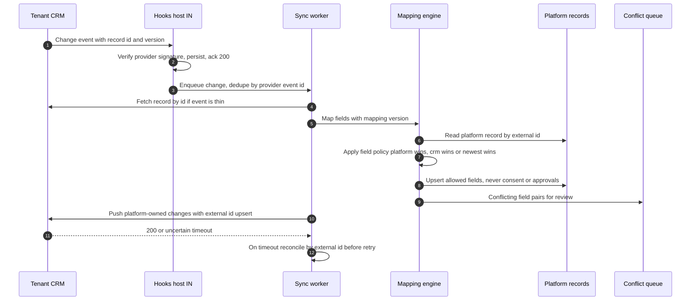

**B2. SMS dispatch with DLT and registry checks.**

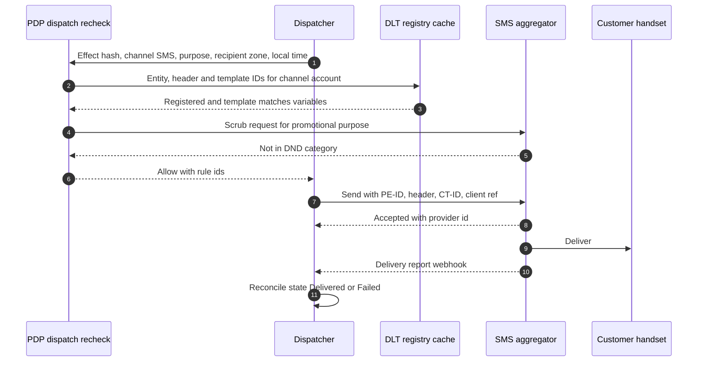

**B3. Connector activation through the gate.**

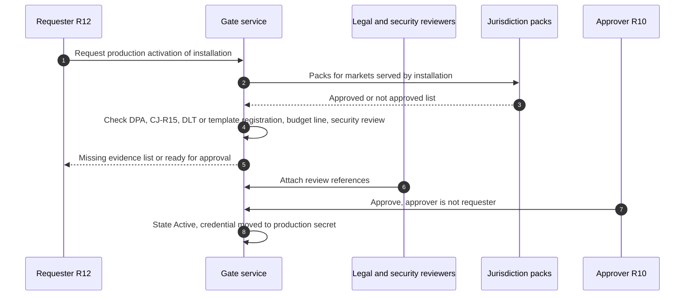

#### C. Configuration

| Key | Default | Allowed | Owner |
|---|---|---|---|
| `connector.crm.sync_interval_min` (poll fallback) | 5 | 1–60 | R12 |
| `connector.crm.field_policy.<field>` | per mapping template | `platform_wins`, `crm_wins`, `newest_wins` | R12 (consent/suppression fixed `platform_wins_stricter`) |
| `connector.crm.max_batch` | 200 | 1–2,000 (provider limit, verify) | — |
| `connector.breaker.error_rate` | 50% over 20 calls | 10–90% | Platform owner |
| `connector.breaker.open_s` | 60 → probe | 30–600 | — |
| `connector.disable_after_401` | 3 consecutive | 1–5 | — |
| `sms.promo_window` | 10:00–21:00 IST (TRAI, verify) ∩ DEC-777 09:00–21:00 local | stricter of law and DEC-777 | Rule pack |
| `sms.max_parts` | 3 | 1–6 | R12 |
| `sms.stop_keywords` | STOP, UNSUB, रोकें (Hindi) | list | R10 |
| `voice.calling_window` | per rule pack (India: TRAI/DEC-777 stricter) | — | Rule pack |
| `voice.recording` | off | on only where the pack allows and consent captured | R10 |

#### D. Data model and DDL deltas (DDL-V12-R part 3)

```sql
-- DDL-V12-R-09 Connector installations (extends C2 connector_installation; CF-01…12)
ALTER TABLE ge.connector_installation ADD COLUMN IF NOT EXISTS provider text NOT NULL
  CHECK (provider IN ('salesforce','hubspot','zoho_crm','sms_dlt_aggregator','voice_cpaas','ses','whatsapp_bsp','google_calendar','m365_calendar','payments','warehouse','siem','idp'));
ALTER TABLE ge.connector_installation ADD COLUMN IF NOT EXISTS ownership text NOT NULL DEFAULT 'tenant_byo' CHECK (ownership IN ('tenant_byo','platform'));
ALTER TABLE ge.connector_installation ADD COLUMN IF NOT EXISTS dpa_ref text;
ALTER TABLE ge.connector_installation ADD COLUMN IF NOT EXISTS transfer_entry_ref text;         -- CJ-R15
ALTER TABLE ge.connector_installation ADD COLUMN IF NOT EXISTS registration_ref text;           -- DLT entity/header/template set or WA templates
ALTER TABLE ge.connector_installation ADD COLUMN IF NOT EXISTS markets text[] NOT NULL DEFAULT '{}';
ALTER TABLE ge.connector_installation ADD COLUMN IF NOT EXISTS requested_by uuid, ADD COLUMN IF NOT EXISTS approved_by uuid;
ALTER TABLE ge.connector_installation ADD CONSTRAINT connector_gate_ck CHECK (
  environment = 'sandbox' OR status NOT IN ('Active') OR (
    legal_review_ref IS NOT NULL AND security_review_ref IS NOT NULL AND dpa_ref IS NOT NULL AND transfer_entry_ref IS NOT NULL
    AND approved_by IS NOT NULL AND approved_by <> requested_by
    AND (provider NOT IN ('sms_dlt_aggregator','voice_cpaas','whatsapp_bsp') OR registration_ref IS NOT NULL)));
-- rule-pack check is a trigger because it reads another table (corrected in v1.2: Appendix C names `jurisdiction`, `pack_code`, status 'Approved'; CONFLICT-1215, DEC-1000, Part 11.25)
CREATE FUNCTION ge.connector_pack_guard() RETURNS trigger LANGUAGE plpgsql AS $$
BEGIN
  -- v1.2 (Part 11.25, CONFLICT-1215 resolved by DEC-1000): Appendix C names. Packs are keyed by
  -- jurisdiction_pack.jurisdiction / pack_code, status vocabulary 'Approved'; the required packs per
  -- capability come from ge.rulepack_requirement, the same join as ge.fn_activation_gate().
  IF NEW.environment = 'production' AND NEW.status = 'Active' AND EXISTS (
       SELECT 1 FROM unnest(NEW.markets) m WHERE
         NOT EXISTS (SELECT 1 FROM ge.jurisdiction_pack p WHERE p.jurisdiction = m AND p.status = 'Approved'
                       AND p.counsel_signoff_ref IS NOT NULL AND p.effective_from <= current_date
                       AND (p.effective_to IS NULL OR p.effective_to >= current_date))
         OR EXISTS (SELECT 1 FROM ge.rulepack_requirement r
                     WHERE r.jurisdiction = m
                       AND r.capability = CASE NEW.provider WHEN 'sms_dlt_aggregator' THEN 'outreach.sms'
                                            WHEN 'whatsapp_bsp' THEN 'outreach.whatsapp' WHEN 'ses' THEN 'outreach.email'
                                            WHEN 'voice_cpaas' THEN 'voice.ai_calls' WHEN 'payments' THEN 'payments.mandated' END
                       AND NOT EXISTS (SELECT 1 FROM ge.jurisdiction_pack p WHERE p.pack_code = r.pack_code AND p.status = 'Approved'
                                         AND p.counsel_signoff_ref IS NOT NULL AND p.effective_from <= current_date
                                         AND (p.effective_to IS NULL OR p.effective_to >= current_date)))) THEN
    RAISE EXCEPTION 'CONNECTOR_MARKET_PACK_NOT_APPROVED' USING ERRCODE = 'check_violation'; END IF;
  RETURN NEW; END $$;
CREATE TRIGGER connector_installation_pack_guard BEFORE INSERT OR UPDATE ON ge.connector_installation
  FOR EACH ROW EXECUTE FUNCTION ge.connector_pack_guard();
-- DDL-V12-R-10 CRM sync state and mappings
CREATE TABLE ge.crm_field_mapping (
  tenant_id uuid NOT NULL, installation_id uuid NOT NULL, mapping_version int NOT NULL, object text NOT NULL CHECK (object IN ('contact','organization','deal','activity')),
  platform_field text NOT NULL, crm_field text NOT NULL, policy text NOT NULL CHECK (policy IN ('platform_wins','crm_wins','newest_wins','platform_wins_stricter')),
  PRIMARY KEY (tenant_id, installation_id, mapping_version, object, platform_field),
  CHECK (platform_field NOT IN ('consent_state','suppression','approval_state','mandate_id') OR policy = 'platform_wins_stricter'));
CREATE TABLE ge.crm_link (
  tenant_id uuid NOT NULL, installation_id uuid NOT NULL, object text NOT NULL, platform_id uuid NOT NULL, crm_id text NOT NULL,
  last_platform_version int, last_crm_version text, last_synced_at timestamptz,
  PRIMARY KEY (tenant_id, installation_id, object, platform_id), UNIQUE (tenant_id, installation_id, object, crm_id));
CREATE TABLE ge.sync_cursor (tenant_id uuid NOT NULL, installation_id uuid NOT NULL, object text NOT NULL, cursor text, cursor_at timestamptz, gap_detected boolean NOT NULL DEFAULT false,
  PRIMARY KEY (tenant_id, installation_id, object));
CREATE TABLE ge.sync_conflict (tenant_id uuid NOT NULL, conflict_id uuid NOT NULL DEFAULT gen_random_uuid(), installation_id uuid NOT NULL, object text NOT NULL,
  platform_id uuid NOT NULL, field text NOT NULL, platform_value_hash bytea, crm_value_hash bytea, state text NOT NULL DEFAULT 'open' CHECK (state IN ('open','resolved_platform','resolved_crm','ignored')),
  resolved_by uuid, PRIMARY KEY (tenant_id, conflict_id));
-- DDL-V12-R-11 DLT registry (India SMS/voice; CJ-IN-06/07)
CREATE TABLE ge.dlt_registration (
  tenant_id uuid NOT NULL, company_id uuid NOT NULL, channel_account_id uuid NOT NULL, entity_id text NOT NULL CHECK (entity_id ~ '^[0-9]{19}$'),
  header text NOT NULL CHECK (header ~ '^[A-Z0-9]{3,11}$'), header_type text NOT NULL CHECK (header_type IN ('promotional','service_implicit','service_explicit','transactional')),
  valid_from date NOT NULL, valid_to date, PRIMARY KEY (tenant_id, channel_account_id, header));     -- ID formats per operator portal, verify
CREATE TABLE ge.dlt_template (
  tenant_id uuid NOT NULL, channel_account_id uuid NOT NULL, template_id text NOT NULL, header text NOT NULL, category text NOT NULL,
  body_pattern text NOT NULL, variables int NOT NULL CHECK (variables BETWEEN 0 AND 10), approved_at date NOT NULL, state text NOT NULL CHECK (state IN ('active','suspended','expired')),
  PRIMARY KEY (tenant_id, channel_account_id, template_id),
  FOREIGN KEY (tenant_id, channel_account_id, header) REFERENCES ge.dlt_registration(tenant_id, channel_account_id, header));
CREATE TABLE ge.voice_number (
  tenant_id uuid NOT NULL, channel_account_id uuid NOT NULL, e164 text NOT NULL CHECK (e164 ~ '^\+[1-9][0-9]{7,14}$'),
  series text CHECK (series IN ('140','160','other')), purpose text NOT NULL CHECK (purpose IN ('promotional','service','transactional')),
  CHECK (series IS NULL OR (series = '140') = (purpose = 'promotional')),
  PRIMARY KEY (tenant_id, e164));
```

#### E. Connector specifications (Part 11.8b adapter tables extended)

| Field | Salesforce | HubSpot | Zoho CRM | SMS-DLT aggregator | Voice CPaaS |
|---|---|---|---|---|---|
| Port | `CrmSyncPort` | `CrmSyncPort` | `CrmSyncPort` | `SmsPort` | `VoicePort` |
| Auth | OAuth 2.0 auth code + PKCE; JWT bearer for server flow | OAuth 2.0 auth code; private app token alternative | OAuth 2.0 auth code (data-centre specific accounts domain, verify) | API key in vault | API key / account SID + token in vault |
| Objects | Contact, Account, Opportunity, Task | Contacts, Companies, Deals, Engagements | Contacts, Accounts, Deals, Activities | Messages, delivery reports, inbound | Calls, call status, recordings (consent) |
| Change capture | CDC/Pub-Sub API or polling (`SystemModstamp`) — edition-dependent, verify | Webhooks v3 + polling | Notification API + polling (`Modified_Time`) | DLR webhooks | Status webhooks |
| Limits (verify) | Daily API request allocation per edition | Per-app burst and daily limits | Credits per edition | Throughput per account | Concurrent calls per number |
| Idempotency | Upsert by external ID field `GE_Id__c` | Upsert by `ge_id` unique property | Upsert by `GE_Id` unique field | Client reference = message id | Call reference = action id |
| Failure classes | 429/`REQUEST_LIMIT_EXCEEDED`, 5xx, 401 `INVALID_SESSION_ID`, validation (`FIELD_CUSTOM_VALIDATION_EXCEPTION`), uncertain timeout | 429, 5xx, 401, 400 validation | 429, 5xx, 401 `INVALID_TOKEN`, validation | throttle, template mismatch, DND, invalid number, uncertain | busy, no answer, failed, uncertain |
| Fallback | Sync paused; conflict queue | same | same | Email if consented; else human task | Human callback task |
| Data sent | Business records; contact fields only with consent basis | same | same | E.164 phone + template variables | E.164 phone; recording only with consent |
| Release 1 sprint | S6–S7 | S5–S6 | S4–S5 | S4–S5 | S6–S7 |

#### F. APIs

| ID | Method and path | Caller | Responses |
|---|---|---|---|
| API-V12-R-033 | `GET /api/v1/connectors` (catalogue with manifests) | R12 | 200 |
| API-V12-R-034 | `POST /api/v1/connector-installations` | R12 | 201 `SandboxActive` or `Available` |
| API-V12-R-035 | `GET /api/v1/connector-installations/{iid}/oauth/start`, `GET /oauth/callback/{provider}` | R12 browser | 302 to provider; callback stores refresh token in vault |
| API-V12-R-036 | `POST /api/v1/connector-installations/{iid}/activation-requests`, `POST …/approve` | R12 (request), R10 (approve) | 202; 409 `CONNECTOR_GATE_INCOMPLETE` (list), `CONNECTOR_MARKET_PACK_NOT_APPROVED`; 403 `SAME_APPROVER` |
| API-V12-R-037 | `GET/PUT /api/v1/connector-installations/{iid}/mappings` | R12 | 200; 422 `PROTECTED_FIELD_POLICY` |
| API-V12-R-038 | `GET /api/v1/sync-conflicts`, `POST …/{cid}/resolve` | R12, R03L | 200 |
| API-V12-R-039 | `GET/POST /api/v1/channel-accounts/{aid}/dlt-registrations`, `/dlt-templates` | R10, R12 | 201; 422 `ENTITY_ID_FORMAT`, `TEMPLATE_VARIABLES` |
| API-V12-R-040 | `GET/POST /api/v1/channel-accounts/{aid}/voice-numbers` | R12 | 201; 422 `SERIES_PURPOSE_MISMATCH` |
| API-V12-R-041 | `GET /api/v1/connector-installations/{iid}/health` | R12, ops | 200 lag, error rate, breaker, last success |
| API-V12-R-042 | `POST /hooks/{provider}/{installation}` (hooks host) | Provider | 200 after persist; 401 bad signature |

#### G. Events

| Event | Consumers |
|---|---|
| `connector.installation.requested/approved/activated/degraded/recovered/disabled` | Notify, A008 dashboard, webhooks (`connector.degraded`) |
| `connector.sync.completed/gap_detected/conflict_raised` | A008, AU-295 |
| `sms.dispatched/delivered/failed/held` (reason `DLT_TEMPLATE_MISMATCH`, `REGISTRY_SCRUB_BLOCKED`, `OUTSIDE_WINDOW`) | Outbox ledger, analytics |
| `voice.call_started/answered/completed/failed/recording_available` | Outbox ledger; Part 11.18 consumers |
| `inbound.sms.received` (STOP detection) | Suppression service (deterministic STOP, BRL) |

#### H. Runbooks

| ID | Trigger | Steps |
|---|---|---|
| RB-CN-01 CRM token revoked | 3 × 401 | Disable installation; R12 task "Reconnect"; no data loss (cursor kept) |
| RB-CN-02 CRM quota exhausted | 429 with daily-limit code | Pause to next window; notify R12 with usage; suggest edition/limit change (GC-11) |
| RB-CN-03 Sync gap | Cursor discontinuity or missed event | Repair fetch over the gap window; dedupe by external ID; report |
| RB-CN-04 DLT template suspended | Aggregator rejection or registry sync | Hold all sends on that template; R10 task; never substitute another template automatically |
| RB-CN-05 Aggregator outage | Breaker open | Queue promotional sends until window end then drop to "not sent" with reason; transactional via secondary aggregator only if separately gated |
| RB-CN-06 Voice number misuse report | Complaint or regulator notice | Suspend number; review call logs; legal notification per pack |

#### I. Security controls

| Threat | Control | Test |
|---|---|---|
| Token theft from CRM installation | Vault only; scope minimum (`api`, `refresh_token` for Salesforce; minimal HubSpot scopes); refresh by workers | TC-V12-R-038 |
| CRM overwrites consent | Protected field policy (DDL check) | TC-V12-R-040 |
| Spoofed provider webhook | Provider signature verification per provider (Salesforce: authenticated subscription / mutual TLS where available; HubSpot v3 signature; Zoho token in channel), persist then ack | TC-V12-R-041 |
| SMS to DND number for promotion | Registry scrub at dispatch (PDP) | M07 rows |
| Template injection in SMS variables | Variable length/charset validation against the registered pattern | TC-V12-R-045 |
| Cross-zone data via CRM | Transfer entry in gate; EU tenant CRM data centre recorded | TC-V12-R-047 |

#### J. Cut-over into Release 1

| Step | Sprint | Activity | Exit |
|---|---|---|---|
| CN-C1 | 3 | Connector framework base classes, gate service, A008 Connectors tab | TC-V12-R-037…039 |
| CN-C2 | 4–5 | SMS-DLT adapter, DLT registry tables, PDP rules, India pack dependency | TC-V12-R-044…046; M07 SMS rows |
| CN-C3 | 4–5 | Zoho CRM adapter | TC-V12-R-040…043 (Zoho) |
| CN-C4 | 5–6 | HubSpot adapter | same (HubSpot) |
| CN-C5 | 6–7 | Salesforce adapter; Voice CPaaS transport | same (Salesforce); TC-V12-R-048…050 |
| CN-C6 | Release 1 gate | V12 R1 exit "DLT live", India pack approved, connectors activated for owned startups that requested them | Activation log |

---

### 11.19.5.4 C4 Vercel personal-data path (DEC-786, with DEC-772)

#### A. Design stance and decisions

DEC-421 said that Vercel functions process no personal data; Part 11.8b found that Vercel rewrites already proxy personal data (CONFLICT-889). DEC-786 permits personal data through Vercel **rewrites and server functions** with five required controls: Vercel as a sub-processor under a DPA; functions pinned to the tenant's residency region; no request or response body logging; TLS end to end; a header allowlist. This section turns those into enforceable configuration, CI checks and monitoring (AU-296).

| # | Decision point | Choice | ID |
|---|---|---|---|
| 1 | Project topology | One Vercel project **per surface per zone**: `web-in`, `web-eu`, `admin-in`, `admin-eu` (and `developers`, static, global, no personal data). A startup custom domain is attached to the project of its tenant's zone only | DEC-886, ADR-260 |
| 2 | Function region | Serverless/edge-rendered functions of `*-in` projects pinned to `bom1` (Mumbai) and of `*-eu` projects to `fra1` (Frankfurt) — region IDs verify at time of implementation (as of 27 Nov 2026) [ASSUMPTION-1082]. Edge Middleware is limited to non-personal routing (zone, locale, A/B bucket by hashed cookie); it must not read request bodies or personal cookies | DEC-886 |
| 3 | What functions may do | BFF session handling (cookie ↔ session lookup by calling the AWS API), server-side rendering of authenticated pages, response shaping, uploads streamed straight to S3 presigned URLs (functions never buffer document bodies). No database or cache credentials in Vercel; functions call only the zone's AWS origin | DEC-786 |
| 4 | TLS end to end | Browser → Vercel edge (TLS 1.2+/1.3, HSTS preload) → origin `*-origin.<zone>.<platform-domain>` (TLS 1.2+ with certificate validation) → ALB → ECS (TLS) → Supabase (`verify-full`). Origin rejects requests without the rotating `X-Origin-Verify` secret (WAF rule) | DEC-786 |
| 5 | Logging | Vercel runtime logs carry metadata only; application code may not log bodies, cookies, `Authorization`, query strings with tokens (lint rule VD-07); log drains go to the zone's collector (AWS) with field redaction; Vercel Web Analytics and Speed Insights **off** for authenticated surfaces (verify product behaviour) | DEC-786 |
| 6 | Header allowlist | Functions and rewrites forward only allowlisted request headers to the origin (VD-05); response headers set `Cache-Control: no-store` for any personal-data response; `Set-Cookie` only `__Host-` cookies | DEC-786 |
| 7 | Caching | Personal-data routes are `no-store`; ISR/data cache disabled for authenticated routes; CDN cache keys never include cookies | DEC-786 |
| 8 | Edge transit location | Vercel terminates TLS at the nearest edge location, which can be outside the zone for a travelling user. This is **transit**; storage and processing (functions, logs) stay in-zone. The EU and India rule packs must state this position; counsel sign-off (Part 11.15) is required before the first EU tenant [GAP-1088] | DEC-887 |
| 9 | Contract | Vercel added to the public sub-processor list (30-day notice, ENT-CMP-04); DPA with SCCs where needed; plan that offers region pinning and log controls (Pro or Enterprise; DEC-774 Enterprise tier for SLA) — verify | DEC-786, DEC-774 |
| 10 | Fallback | DR-04 of Part 11.5b (static builds mirrored to S3 + CloudFront per zone) kept; in fallback mode the AWS distribution serves the SPA and `/api` same-origin | — |

#### B. Sequence diagram: authenticated portal request with personal data (EU tenant)

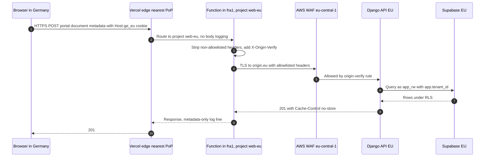

#### C. Configuration (per project, enforced by CI policy as code)

| Rule ID | Setting | Required value | Checked by |
|---|---|---|---|
| VD-01 | Project → zone binding | `web-in`/`admin-in` ↔ IN; `web-eu`/`admin-eu` ↔ EU; recorded in the tenant directory | AU-296 daily |
| VD-02 | Function regions | Exactly `["bom1"]` for IN, `["fra1"]` for EU (`vercel.json` `regions`, or project setting; verify mechanism) | CI before deploy; AU-296 |
| VD-03 | Edge Middleware | No body access; no personal cookie read except the `__Host-` session cookie name presence | Static analysis in CI |
| VD-04 | Rewrites | `/api/*`, `/bff/*` → `https://<surface>-origin.<zone>.<platform-domain>`; no other external rewrites | CI diff check |
| VD-05 | Header allowlist | `accept`, `accept-language`, `content-type`, `content-length`, `cookie` (only `__Host-ge_*`), `x-csrf-token`, `x-correlation-id`, `idempotency-key`, `if-match`, `user-agent` (truncated 256) → everything else stripped | Unit test of the proxy helper; M08 rows |
| VD-06 | Origin verify | `X-Origin-Verify` secret rotated every 30 days with 24 h overlap (secret in Vercel env per zone, encrypted, sensitive) | WAF rule; RB-VD-02 |
| VD-07 | Logging lint | ESLint rule bans `console.*` of `req.body`, `request.json()`, headers objects, cookies | CI |
| VD-08 | Log drain | Drain to `logs.<zone>` collector; fields: time, project, deployment, region, method, route template, status, duration, request id; query strings stripped | AU-296 sample audit weekly |
| VD-09 | Analytics | Web Analytics/Speed Insights off on `admin-*` and portal routes | AU-296 |
| VD-10 | Env vars | No database URL, no Supabase keys, no provider secrets in Vercel; only origin-verify secret and public config | Secret scan + AU-296 |
| VD-11 | Domains | Custom domain attached to exactly one project of the tenant's zone | AU-296 vs tenant directory |
| VD-12 | Deployment protection | Preview deployments protected (SSO for team), never connected to production origins | CI |

#### D. Data model (control-plane tables, platform scope, no personal data)

```sql
-- DDL-V12-R-12 Vercel data-path conformance (platform tables, no RLS: no tenant data; writes by app_owner/automation role only)
CREATE TABLE ge.edge_project (
  project text PRIMARY KEY CHECK (project ~ '^(web|admin|developers)(-(in|eu))?$'), zone text CHECK (zone IN ('IN','EU')),
  function_regions text[] NOT NULL, carries_personal_data boolean NOT NULL,
  CHECK (NOT carries_personal_data OR zone IS NOT NULL),
  CHECK (zone IS NULL OR function_regions = CASE zone WHEN 'IN' THEN ARRAY['bom1'] ELSE ARRAY['fra1'] END));
CREATE TABLE ge.edge_conformance_check (
  check_id bigserial PRIMARY KEY, project text NOT NULL REFERENCES ge.edge_project(project), rule_id text NOT NULL CHECK (rule_id ~ '^VD-[0-9]{2}$'),
  checked_at timestamptz NOT NULL DEFAULT now(), passed boolean NOT NULL, evidence_ref text NOT NULL, finding_id uuid);
CREATE TABLE ge.subprocessor (
  name text PRIMARY KEY, purpose text NOT NULL, zones text[] NOT NULL, dpa_ref text NOT NULL, transfer_mechanism text,
  listed_at date NOT NULL, notice_sent_at date, CHECK (notice_sent_at IS NULL OR listed_at >= notice_sent_at + 30));
```

#### E. Runbooks

| ID | Trigger | Steps | Target |
|---|---|---|---|
| RB-VD-01 Region-pin drift | AU-296 VD-02 fail | Block promotion; roll alias back to last compliant deployment; SEV2 privacy incident if any request was served from a non-zone function; DPIA log entry | Rollback ≤ 15 min |
| RB-VD-02 Origin-verify secret rotation | Every 30 days | Add new secret to WAF (both accepted), deploy Vercel env, verify, remove old after 24 h | Zero downtime |
| RB-VD-03 Body found in logs | AU-296 sample audit or report | Purge drain data, find code path, hotfix, privacy incident assessment (DPDP/GDPR clocks via Part 11.11) | Containment ≤ 4 h |
| RB-VD-04 Vercel outage | Status or synthetic probe | DR-04: DNS switch to S3/CloudFront fallback in the same zone | ≤ 60 min |
| RB-VD-05 New Vercel feature that logs or caches | Vendor changelog review monthly | Assess against VD rules; disable or update rule | Monthly |

#### F. Security and privacy controls

| Risk | Control | Test |
|---|---|---|
| Personal data processed outside zone | VD-01/02/11 + AU-296 + CI gate | M08 `non-home region` rows; TC-V12-R-051 |
| Bodies or tokens in vendor logs | VD-07/08, metadata-only drain | TC-V12-R-053 |
| Origin bypass of the WAF | `X-Origin-Verify` + WAF + origin security groups | TC-V12-R-054 |
| Header smuggling to origin | VD-05 allowlist | TC-V12-R-055 |
| Cached personal responses | `no-store`, no ISR | TC-V12-R-056 |
| Sub-processor transparency | `subprocessor` list, 30-day notice | TC-V12-R-057 |
| Edge transit outside zone | DEC-887 position in rule packs; counsel sign-off | TC-V12-R-058 (document check) |

#### G. Cut-over into Release 1

| Step | Sprint | Activity | Exit |
|---|---|---|---|
| VD-C1 | 0–1 | Create `web-in`, `admin-in`, `developers`; region pin; VD rules as policy-as-code | VD-01…12 green |
| VD-C2 | 1 | DPA with Vercel signed; sub-processor list published; DPIA (India) updated | Contract refs in `subprocessor` |
| VD-C3 | 2 | BFF functions with header allowlist and origin verify; lint rule | TC-V12-R-051…056 |
| VD-C4 | Release 1 gate | AU-296 running daily; evidence attached to the release record | 30 days of passing checks |
| VD-C5 | First EU contract | Create `web-eu`, `admin-eu` from the same templates; EU counsel sign-off on DEC-887 position | M08 EU rows pass |

---

## Quality gate: Batch 11.19a

| # | Item | Result | Notes |
|---|---|---|---|
| 1 | Every requirement traced to a source | **Pass** | Each design row cites ENT-/INT-/MDL-/DEC- IDs; register rows carry the V12 chapter and line-derived aspect IDs |
| 2 | Assumptions, gaps and conflicts tagged and logged | **Pass** | Tags 1080–1099 used here are registered in Part 11.19c §11.19.9 |
| 3 | IDs unique and consistent | **Pass** | DEC-880…899, ADR-255…264, FR-V12-R, API-V12-R, DDL-V12-R, RB-ID/DP/CN/VD are new; screen IDs reuse the Part 11.7a mapping |
| 4 | No story lacks AC; no requirement lacks a test | **Pass (in 11.19c)** | Stories and tests for C1–C4 are in Part 11.19c |
| 5 | Negative, edge, security and accessibility cases | **Pass** | Threat tables per capability; generated models M01–M08 |
| 6 | No agent lacks guardrail, fallback, KPI, cost | **N/A here** | No new agents; automations AU-290…296 are carded in Part 11.19b |
| 7 | Time-sensitive facts flagged | **Pass** | Vercel regions, provider limits, TRAI windows, IdP features marked verify (as of 27 Nov 2026) |
| 8 | No restricted data to free-tier models | **Pass** | No model routing in this file |
| 9 | Consistent with earlier parts | **Pass with reported items** | Role-name and scope-registry differences reported as CONFLICT-1092/1093 |

**Status: Part 11 Batch 11.19a complete. Material, coverage, register and designs C1–C4 written; continued in Part 11.19b.**
