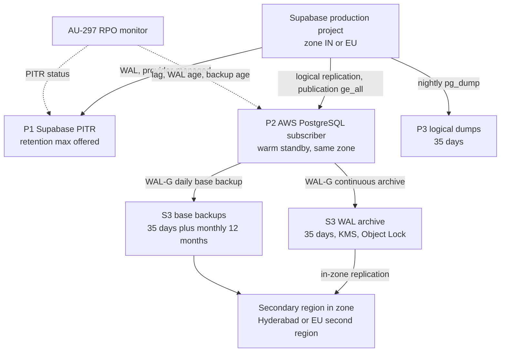
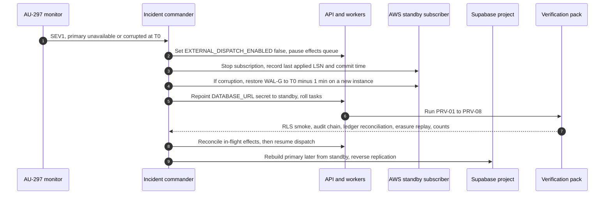
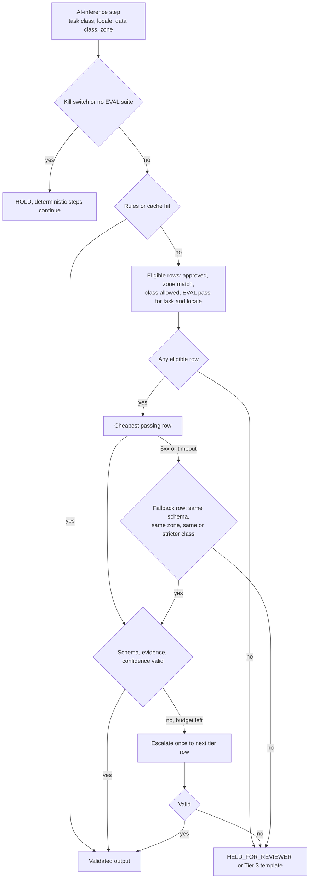
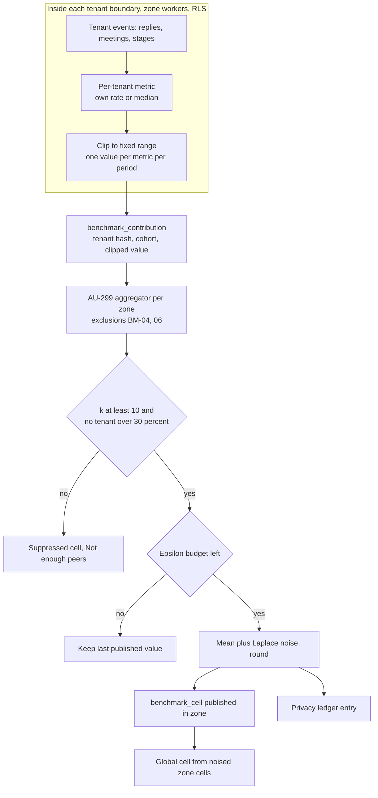

# AI Growth Engine: Employee Sales & Marketing Automation
## Application Blueprint: PART 11 (Batch 11.19b), Platform Decisions Implementation: RPO ≤ 15 min, Model Registry, Cross-Tenant Benchmarks, Supabase Access Model, Automations AU-290…299, FR Register, ADRs, Cut-over, Effort and Cost

| Field | Value |
|---|---|
| Document | Part 11.19b: capabilities C5 (RPO ≤ 15 min), C6 (provider-neutral model registry), C7 (cross-tenant benchmarks) and C8 (Supabase access model) at full implementation depth; automations AU-290…299; functional requirements FR-V12-R-001…155; ADR-255…264; cut-over into Release 1; development and running costs in separate tables |
| Version | 1.0 · 28 Nov 2026 |
| Baseline | Part 11.19a (shared foundation §11.19.5.0 and C1–C4); Part 11.14 DEC-771/772/778/787/788/789; Part 11.5b §11.5.5.9; Part 11.6b §11.6.5.3–6; Part 11.9b; Part 11.13b; Part 8.1, 8.2, 8.4 |
| Roles applied | Database reliability engineer · LLM platform lead · Privacy-preserving analytics scientist · Privacy and cloud-security lead · DevOps/SRE Lead · FinOps Lead · QA Lead |

---

### 11.19.5.5 C5 RPO ≤ 15 minutes in every residency region (DEC-787, with DEC-771 RTO ≤ 120 min)

#### A. Design stance and decisions

V12 FSD ch38 V8: "PostgreSQL: continuous WAL archiving + daily base backup, PITR 35 days, encrypted, stored in the same jurisdiction (CJ-R09)"; DEC-V9-01: critical RPO ≤ 15 min, RTO ≤ 4 h; growth RTO ≤ 2 h (made blocking by DEC-771). DEC-787 adopts this for **every residency region**. Part 11.5b offered Option A (Supabase PITR add-on) and Option B (logical replica on AWS). Because Supabase PITR retention choices may be shorter than 35 days and because a single-provider backup does not survive loss of the provider project or account, this part adopts **both**, as two independent recovery paths per zone.

| # | Decision point | Choice | ID |
|---|---|---|---|
| 1 | Path P1 (primary, fastest) | **Supabase PITR** add-on on the production project of each zone, at the longest retention offered (≥ 28 days; 35 if available — verify) [ASSUMPTION-1081]; restore to a new project at any second within retention; daily base backups included | DEC-888, ADR-261 |
| 2 | Path P2 (independent, 35 days) | **Logical replication** from Supabase (publication `ge_all`) to an AWS-hosted PostgreSQL subscriber in the same zone (IN: `ap-south-1`; EU: `eu-central-1`), on which **WAL-G** (Apache-2.0, verify) performs continuous WAL archiving plus a **daily base backup** to S3 in the zone (KMS-encrypted, Object Lock governance mode, 35-day retention + monthly copy 12 months). The subscriber is a warm standby (DEC-771) | DEC-888, DEC-889 |
| 3 | Path P3 (logical, slow) | Nightly `pg_dump -Fc` to S3 in the zone (kept from DEC-421) for tenant-level restores and portability | — |
| 4 | Residency of copies | All copies stay in the zone; secondary-region copies for region loss stay in-zone (IN: `ap-south-2` Hyderabad; EU: another EU region, e.g. `eu-west-1`, verify) — S3 Cross-Region Replication limited to those pairs by bucket policy | DEC-772 |
| 5 | Monitoring | AU-297 measures (a) replication lag (LSN difference) every 30 s, (b) age of the last archived WAL segment, (c) last successful base backup, (d) Supabase PITR status via the management API (verify). Warn at 5 min, page at 10 min, SEV1 at 15 min | DEC-888 |
| 6 | Sequences, large objects, DDL | Logical replication does not carry DDL or sequence values: migrations are applied to the subscriber by the same CI job (P2 schema = production schema), sequences are re-synced after restore (`setval` from max IDs; most keys are UUID), no large objects used | ADR-261 |
| 7 | Drills | Restore drill **at every release gate and quarterly** per zone, alternating P1 and P2; evidence pack PRV-01…08; RPO/RTO measured, not estimated (OPT-TC-ST-14) | DEC-787 |
| 8 | Erasure after restore | Replay of `privacy_erasure_log` (IDs and hashes only) after any restore (V12 ch38) | — |



#### B. Recovery objective matrix (per zone)

| Data class | RPO | RTO | Primary path | Secondary path | KPI |
|---|---|---|---|---|---|
| Critical transactional (RC-1) | ≤ 15 min | ≤ 4 h | P1 PITR | P2 WAL-G | KPI-18, KPI-19 |
| Growth workload (runs, outbox, approvals, mandate ledgers) | ≤ 15 min | **≤ 120 min (blocking, DEC-771)** | P2 warm standby promotion (fastest) or P1 | P1 | KPI-18, KPI-32 |
| Regenerable research data (RC-2) | ≤ 24 h | ≤ 8 h | P3 + rebuild | P1 | KPI-33, KPI-34 |
| Audit anchors | 1 day (anchors) / chain in DB per above | — | S3 Object Lock | — | — |

#### C. Sequence diagram: growth-workload recovery by standby promotion (target ≤ 120 min)



#### D. Data model (platform tables)

```sql
-- DDL-V12-R-13 Recovery evidence (platform scope, no personal data)
CREATE TABLE ge.recovery_path (
  zone text NOT NULL CHECK (zone IN ('IN','EU')), path text NOT NULL CHECK (path IN ('P1_supabase_pitr','P2_walg_standby','P3_logical_dump')),
  retention_days int NOT NULL, location text NOT NULL, secondary_location text, enabled boolean NOT NULL,
  PRIMARY KEY (zone, path), CHECK (path <> 'P2_walg_standby' OR retention_days >= 35));
CREATE TABLE ge.rpo_sample (
  zone text NOT NULL, sampled_at timestamptz NOT NULL, replication_lag_s int, wal_archive_age_s int, last_base_backup_at timestamptz,
  pitr_status text, PRIMARY KEY (zone, sampled_at));                         -- 30 s samples, 90-day retention, partitioned daily
CREATE TABLE ge.restore_drill (
  drill_id uuid PRIMARY KEY DEFAULT gen_random_uuid(), zone text NOT NULL, path text NOT NULL, trigger text NOT NULL CHECK (trigger IN ('release_gate','quarterly','incident')),
  release_ref text, started_at timestamptz NOT NULL, target_time timestamptz NOT NULL, restored_to timestamptz,
  service_restored_at timestamptz, achieved_rpo_s int GENERATED ALWAYS AS ((extract(epoch FROM target_time - restored_to))::int) STORED,
  achieved_rto_min int GENERATED ALWAYS AS ((extract(epoch FROM service_restored_at - started_at)/60)::int) STORED,
  prv_results jsonb NOT NULL DEFAULT '{}', passed boolean, evidence_ref text,
  CHECK (passed IS NULL OR evidence_ref IS NOT NULL));
```

#### E. Configuration

| Key | Value | Owner |
|---|---|---|
| `dr.rpo_target_s` | 900 | Fixed (DEC-787) |
| `dr.rto_growth_min` / `dr.rto_critical_min` | 120 / 240 | Fixed (DEC-771, DEC-V9-01) |
| `dr.lag_warn_s` / `page_s` / `sev1_s` | 300 / 600 / 900 | SRE |
| `walg.archive_timeout_s` (subscriber `archive_timeout`) | 60 | DBRE |
| `walg.base_backup_cron` | 02:15 local zone time daily | DBRE |
| `walg.retain_days` | 35 (+ monthly 12) | Fixed |
| `pitr.retention_days` (Supabase) | maximum offered (verify) | DBRE |
| `drill.cadence` | each release gate + quarterly per zone | SRE |

#### F. Runbooks (supersede DR-01…05 of Part 11.5b for the database; the AWS compute and Vercel runbooks stay)

| ID | Scenario | Path | Steps (summary) | RPO / RTO target |
|---|---|---|---|---|
| DR-R1 | Logical corruption or bad migration | P1 (or P2) | Pause effects; choose T = incident − 1 min from audit; P1 restore to new project, or P2 WAL-G PITR on new instance; PRV pack; repoint; reconcile; resume | ≤ 15 min / ≤ 120 min growth |
| DR-R2 | Supabase project or provider unavailable | P2 | Promote standby (already current within lag); PRV pack; repoint; inform customers via status page | lag (≤ 15 min) / ≤ 60 min |
| DR-R3 | AZ loss | provider / P2 | Supabase handles within region (plan-dependent, verify); AWS standby is multi-AZ storage; ECS reschedule | ≤ 15 min / ≤ 60 min |
| DR-R4 | Accidental tenant data deletion | P3 or P1 clone | Restore to a side database; extract the tenant's rows by `tenant_id`; re-insert through a reviewed script; audit | per request |
| DR-R5 | Region loss | P2 copy in secondary in-zone region | IaC apply in secondary region; WAL-G restore from replicated archive; Supabase new project only in the same zone (or AWS PostgreSQL); DNS switch; never restore outside the zone | ≤ 15 min (+ replication delay of S3 CRR, measured) / best effort ≤ 8 h |
| DR-R6 | RPO monitor breach without outage | — | Find the cause (subscriber stopped, slot lag, S3 errors); SEV1 if ≥ 15 min; fix; record | — |

**Post-restore verification pack (PRV).** PRV-01 RLS negative suite (sample of 30 policies); PRV-02 audit hash-chain verification against the last anchor; PRV-03 money ledgers reconciled (sum by currency, open invoices, usage ledger); PRV-04 outbox and effect ledger reconciliation (uncertain effects listed); PRV-05 erasure replay; PRV-06 row counts per table vs last sample; PRV-07 tenant-isolation spot check (two tenants, cross-reads 0); PRV-08 application smoke (sign-in, list, create draft, approval view).

#### G. Security controls

Backups encrypted with zone KMS keys (separate key per path); restore credentials held by two people (DBRE + SRE lead) with break-glass audit; Object Lock governance mode prevents deletion within retention; replication slot and subscriber credentials in Secrets Manager; the subscriber has no public IP and accepts connections only from the restore runner; S3 buckets deny any principal outside the zone account and any CRR destination outside the zone pair.

#### H. Cut-over into Release 1

| Step | Sprint | Activity | Exit |
|---|---|---|---|
| RPO-C1 | 1 | Enable Supabase PITR (IN); `recovery_path` rows | PITR status green |
| RPO-C2 | 2–3 | AWS subscriber, publication, WAL-G archive and base backups; CRR to Hyderabad | Lag < 60 s steady state |
| RPO-C3 | 3 | AU-297 monitor and alerts | Synthetic lag test pages |
| RPO-C4 | 4 | First full drill P1 and P2 (IN) | `restore_drill` passed with evidence |
| RPO-C5 | Release 1 gate | Drill under gate conditions; KPI-32 blocking test | RPO ≤ 15 min and growth RTO ≤ 120 min measured |
| RPO-C6 | EU provisioning | Same for EU | EU drill passed before first EU tenant data |

---

### 11.19.5.6 C6 Provider-neutral model registry (DEC-788)

#### A. Design stance and decisions

DEC-788 adopts V12 16.2 and AIX-02/03: **no model is used unless approved in the registry** with a DPA carrying a no-training clause, a processing region, allowed data classes, passed evaluation suites and a cost record. The Founder approves **Claude Sonnet through this registry as the current primary**. Other candidates (Anthropic Claude family, OpenAI, Google Gemini, Llama, Mistral, Qwen) become eligible **per task class** when they pass the same gate. Open-weight models may receive **masked personal data** (MDL-S1). An advanced tier (MDL-L1) and multimodal generation (image, video, voice) are adopted. The V12 fallback rule applies; all 111 evaluation suites are funded. AU-151/152/154 (Part 11.6b) implement eligibility, routing and evaluation; this part supplies the registry data model, the approval workflow, region handling, the change to Tier 2 and the re-certification automation AU-298.

| # | Decision point | Choice | ID |
|---|---|---|---|
| 1 | Unit of approval | A **registry row** = provider × model family × exact version × **hosting** (`provider_hosted`, `cloud_marketplace` such as a hyperscaler model service, `self_hosted_in_zone`, `free_third_party`) × **processing location** (per zone) × modality. Approval is per row and per task class | DEC-890, ADR-262 |
| 2 | Approval evidence (V12 16.2, all seven required) | Passing EVAL suites for the task class and locale (16.4); red-team pass (16.5); signed DPA with **no-training** clause, retention and region; cost per accepted result; latency p95; security review; plus licence check (open-weight, AU-047) | DEC-890 |
| 3 | Approvers | **Two distinct people**: R10 AI governance lead + R01 (or the Founder's named delegate); SoD pair `Models:propose` ↔ `Models:approve` | DEC-890, DEC-898 |
| 4 | Re-certification | Every 12 months, and immediately on: DPA change or expiry, region change, provider deprecation notice, price change > 20%, EVAL regression, security advisory. AU-298 suspends a row whose evidence lapses; routing moves to the next eligible row or HOLD | DEC-890 |
| 5 | Primary | **Claude Sonnet (current version)** approved for MDL-M1 and as the escalation target for MDL-L1 at higher effort; a larger Claude model may be approved as MDL-L1 when it passes; Haiku-class for MDL-S1 where its EVAL passes (model IDs verify at time of implementation, as of 27 Nov 2026) | DEC-788, DEC-892 |
| 6 | Zone processing | EU tenants route only to rows whose processing location is in the EU (e.g. a model offered through a cloud provider's EU region, or the provider's EU processing option — verify each); India tenants to rows with India processing where offered, otherwise to rows whose DPA and the India rule pack permit transfer (DPDP Act transfer rules; counsel-approved pack). If no eligible row exists for a zone and task, the AI step HOLDs or degrades to Tier 3; data never crosses zones silently [ASSUMPTION-1083] | DEC-891 |
| 7 | Open-weight | `self_hosted_in_zone` rows (vLLM on GPU or CPU workers in the zone; Llama, Mistral, Qwen families subject to licence) may receive **Personal (masked)** data via the Presidio masking step (AU-004); never unmasked Personal or Restricted | DEC-788, [CONFLICT-1094] |
| 8 | Tier 2 free fallbacks | Kept only as `free_third_party` rows that pass the same registry gate (DPA with no-training is usually unavailable on free tiers, so most will not qualify); data classes Public and Internal-non-personal only (invariant unchanged); opt-in per tenant, default off | DEC-890 (resolves CONFLICT-857) |
| 9 | Fallback rule | Same output schema, same zone, same-or-stricter data class, approved row; never silently to an unapproved model; otherwise HOLD/Tier 3 | V12 16.2 |
| 10 | Multimodal | Image, video and voice (TTS/ASR) rows registered with modality and with likeness/rights policy (DEC-576 carried); generation outputs labelled (AU-177); voice rows used by Part 11.18 | DEC-892 |
| 11 | Kill switch and rollback | Kill switch per row, per task class and per workflow pin (AIX-20, ≤ 60 s); `rollback_to` pointer per pin | V12 16.2 |

#### B. Registry rows at Release 1 (initial state; versions and availability verify at time of implementation, as of 27 Nov 2026)

| Row | MDL | Model (family) | Hosting | Zones (processing) | Data classes allowed | Task classes | Initial state |
|---|---|---|---|---|---|---|---|
| REG-001 | MDL-R0 | Rules engine | — | IN, EU | All | arithmetic, dedupe, filters | approved |
| REG-002 | MDL-M1 | **Claude Sonnet** (current) | provider_hosted or cloud_marketplace | IN (per DPA/pack), EU (EU processing option) | Public, Internal, Personal, Confidential; Restricted minimized | drafting, summarisation, qualification reasoning, escalation | **approved (Founder, DEC-788)** |
| REG-003 | MDL-S1 | Claude Haiku-class | as REG-002 | as REG-002 | Public, Internal, Personal masked, Confidential | classification, extraction, routing, short drafts | approved where EVAL passes per workflow/locale |
| REG-004 | MDL-L1 | Larger Claude model | as REG-002 | as REG-002 | as REG-002 | complex synthesis, proposals | candidate until EVAL + cost pass |
| REG-005 | MDL-S1 | Open-weight instruct (Llama / Mistral / Qwen family) | self_hosted_in_zone | IN, EU | Public, Internal, **Personal masked** | classification, extraction | candidate |
| REG-006 | MDL-E1 | Multilingual open-source embedding (E5-family or equivalent) | self_hosted_in_zone | IN, EU | Internal, Personal masked | embedding | approved (Part 7.3 §7.5.1) |
| REG-007 | MDL-G1 | Open-source injection/moderation classifier | self_hosted_in_zone | IN, EU | All | safety screening | approved after benchmark |
| REG-008 | MDL-M1 | OpenAI GPT family | provider_hosted / cloud_marketplace | EU (if EU processing offered); IN verify | per approval | per approval | candidate |
| REG-009 | MDL-M1 | Google Gemini family | cloud_marketplace | IN, EU (verify) | per approval | per approval | candidate |
| REG-010 | — | Image generation model | provider_hosted | per approval | Public, Internal (brand assets) | image | candidate |
| REG-011 | — | Video generation model | provider_hosted | per approval | Public, Internal | video | candidate |
| REG-012 | — | TTS/ASR voice models | provider_hosted / self_hosted_in_zone | IN, EU | Personal (call audio) only with Part 11.18 consent | voice | candidate |
| REG-013 | Tier 2 | Free third-party fallback(s) | free_third_party | none guaranteed | Public, Internal-non-personal | short drafts (availability only) | candidate (most will fail the DPA no-training test) |

#### C. Routing (AIX-03 as implemented by AU-152, with registry eligibility by AU-151 and AU-298)



#### D. Data model and DDL deltas (DDL-V12-R part 4; extends `ai_model` of Appendix C / Part 11.9b)

```sql
-- DDL-V12-R-14 Registry (platform tables; writes only by app_owner migrations or the registry service role app_registry)
ALTER TABLE ge.ai_model ADD COLUMN IF NOT EXISTS reg_id text UNIQUE CHECK (reg_id ~ '^REG-[0-9]{3}$');
ALTER TABLE ge.ai_model ADD COLUMN IF NOT EXISTS hosting text NOT NULL DEFAULT 'provider_hosted'
  CHECK (hosting IN ('provider_hosted','cloud_marketplace','self_hosted_in_zone','free_third_party'));
ALTER TABLE ge.ai_model ADD COLUMN IF NOT EXISTS modality text NOT NULL DEFAULT 'text' CHECK (modality IN ('text','embedding','classifier','image','video','voice'));
ALTER TABLE ge.ai_model ADD COLUMN IF NOT EXISTS task_classes text[] NOT NULL DEFAULT '{}';
ALTER TABLE ge.ai_model ADD COLUMN IF NOT EXISTS licence_ref text;                -- open-weight licence check (AU-047)
ALTER TABLE ge.ai_model ADD COLUMN IF NOT EXISTS redteam_ref text, ADD COLUMN IF NOT EXISTS recert_due date;
ALTER TABLE ge.ai_model DROP CONSTRAINT IF EXISTS ai_model_t2_data_ck;           -- replaced by hosting-based checks (CONFLICT-1094)
ALTER TABLE ge.ai_model ADD CONSTRAINT ai_model_free_tier_data_ck
  CHECK (hosting <> 'free_third_party' OR data_classes <@ ARRAY['Public','Internal-non-personal']::text[]);
ALTER TABLE ge.ai_model ADD CONSTRAINT ai_model_open_weight_data_ck
  CHECK (hosting <> 'self_hosted_in_zone' OR NOT (data_classes && ARRAY['Personal','Restricted']::text[]));   -- 'Personal-masked' allowed
ALTER TABLE ge.ai_model ADD CONSTRAINT ai_model_approved_evidence_ck
  CHECK (status <> 'approved' OR (dpa_ref IS NOT NULL AND no_training AND eval_status = 'passed' AND redteam_ref IS NOT NULL
         AND security_review_ref IS NOT NULL AND cpar_inr IS NOT NULL AND latency_p95_ms IS NOT NULL AND recert_due IS NOT NULL
         AND (hosting <> 'self_hosted_in_zone' OR licence_ref IS NOT NULL)));
CREATE TABLE ge.ai_model_region (
  model_id uuid NOT NULL REFERENCES ge.ai_model(model_id), zone text NOT NULL CHECK (zone IN ('IN','EU')),
  processing_location text NOT NULL, endpoint_ref text NOT NULL, transfer_basis_ref text,
  PRIMARY KEY (model_id, zone));
CREATE TABLE ge.ai_model_approval (
  model_id uuid NOT NULL REFERENCES ge.ai_model(model_id), approval_no int NOT NULL, task_class text NOT NULL,
  proposed_by uuid NOT NULL, approver_1 uuid, approver_1_role text CHECK (approver_1_role = 'R10'),
  approver_2 uuid, approver_2_role text CHECK (approver_2_role IN ('R01','R01-delegate')),
  decided_at timestamptz, decision text CHECK (decision IN ('approved','rejected','suspended','retired')), evidence_hash bytea NOT NULL,
  CHECK (approver_1 IS NULL OR approver_1 <> proposed_by), CHECK (approver_2 IS NULL OR (approver_2 <> approver_1 AND approver_2 <> proposed_by)),
  PRIMARY KEY (model_id, approval_no, task_class));
CREATE TABLE ge.ai_model_pin (                  -- per workflow (and optional tenant override within approved rows)
  workflow_id text NOT NULL, task_class text NOT NULL, locale text NOT NULL, zone text NOT NULL,
  model_id uuid NOT NULL REFERENCES ge.ai_model(model_id), prompt_version text NOT NULL, rollback_to uuid REFERENCES ge.ai_model(model_id),
  kill_switch boolean NOT NULL DEFAULT false, PRIMARY KEY (workflow_id, task_class, locale, zone));
```

#### E. APIs

| ID | Method and path | Caller | Notes |
|---|---|---|---|
| API-V12-R-043 | `GET /api/v1/ai/models` (AIX-02; V12 Appendix A "List model registry entries") | R10, R12 (read) | Filters zone, task, state |
| API-V12-R-044 | `POST /api/v1/ai/models` (propose row) | R10 or AI platform engineer | Evidence references |
| API-V12-R-045 | `POST /api/v1/ai/models/{mid}/approvals` | R10, then R01/delegate | 403 `SAME_APPROVER`; 422 `EVIDENCE_INCOMPLETE` (list) |
| API-V12-R-046 | `POST /api/v1/ai/models/{mid}/suspend` / `/retire` | R10, AU-298 | Immediate routing change |
| API-V12-R-047 | `PUT /api/v1/ai/pins/{workflow}/{task}/{locale}/{zone}` | R10 | Only to an approved row; `rollback_to` required |
| API-V12-R-048 | `POST /api/v1/ai/kill-switch` | R10, R01 | Scope row / task / workflow; ≤ 60 s |
| API-V12-R-049 | `GET /api/v1/ai/route-decisions?run_id=` | R10, R15 | Explains eligibility and choice |

#### F. Events and runbooks

Events: `ai.model.proposed/approved/rejected/suspended/retired/recert_due`, `ai.route.held` (reason), `ai.fallback.used`, `ai.kill_switch.changed`. Runbooks: **RB-AI-01** provider outage → fallback by rule or HOLD; status notice if HOLD > 30 min; **RB-AI-02** provider DPA change → AU-298 suspends affected rows the day the change is effective unless re-approved; **RB-AI-03** EVAL regression after a provider silent update → pin to `rollback_to`, re-run suites; **RB-AI-04** new candidate onboarding → 7-step evidence checklist, two-person approval, canary at 5% of eligible traffic for 7 days per task class.

#### G. Cut-over into Release 1

| Step | Sprint | Activity | Exit |
|---|---|---|---|
| MR-C1 | 1 | DDL-V12-R-14; seed REG-001…013 | Constraint tests TC-V12-R-067/068 |
| MR-C2 | 2 | Approval workflow (A011 tab Registry; Part 9.7 A115), two-person | TC-V12-R-069 |
| MR-C3 | 2–3 | AU-151/152 read the registry; zone filter; pins | M10 rows |
| MR-C4 | 3 | AU-298 re-certification | TC-V12-R-072 |
| MR-C5 | 3–6 | EVAL suites for the Release 1 AI workflows (EVAL-PRG-1, Part 11.6b) | Suites green per locale |
| MR-C6 | Release 1 gate | Founder approval record of REG-002 attached; first candidate evaluation (REG-005 open-weight) reported | Evidence pack |

---

### 11.19.5.7 C7 Cross-tenant benchmarks with privacy-preserving aggregation (DEC-789)

#### A. Design stance and decisions

DEC-789: tenants take part under a **contract clause**, with an **opt-in default**; benchmarks are computed only over cohorts of **at least 10 tenants**, with **noise added**; **no tenant-level or personal data leaves the tenant boundary**. This part reads "opt-in default" as: participation is off until the tenant opts in, and the contract clause makes the opt-in available and governs it [ASSUMPTION-1084]. The AU-143 proposal of Part 11.13b (CONFLICT-983) is superseded by AU-299 and the parameters below ([CONFLICT-1095] resolved).

| # | Rule | Specification | ID |
|---|---|---|---|
| BM-01 | Participation | Contract clause BM-CL-1 in the order form/MSA; tenant R12 opts in on A042 Benchmarks tab with step-up; withdrawal any time, effective from the next period; published cells are not recomputed | DEC-893 |
| BM-02 | Minimum cohort | A cell is published only if **k ≥ 10 distinct contributing tenants** after all exclusions | DEC-789 |
| BM-03 | Dominance | No single tenant contributes > 30% of the cell's underlying events (n-dominance rule); otherwise suppressed | DEC-893 |
| BM-04 | Reciprocity | Only contributing tenants may view benchmarks | DEC-893 |
| BM-05 | Metrics | Rates and durations only (reply rate, meeting rate, lead-to-meeting cycle time, win rate, time to first response); no content, no counts of contacts, no revenue amounts in Release 2 | DEC-893 |
| BM-06 | Owner Portfolio | Owned startups are excluded unless R01 opts in (per startup) | CONFLICT-983 condition 5 |
| BM-07 | Noise | **Tenant-level differential privacy**: each tenant contributes one clipped value per metric per period (its own rate or median duration, clipped to a fixed range); the cell value is the mean of contributions plus Laplace noise with scale Δ/ε where Δ = (upper − lower)/k; **ε = 0.5 per metric per cell per month**, yearly cap ε = 6 per metric; values rounded to 1 percentage point or 0.5 day; k shown as a band (10–24, 25+) | DEC-893, [RECOMMENDATION-1099] |
| BM-08 | Zone locality | Contributions are computed inside each zone (IN, EU) by the zone's workers; the **global** benchmark is the weighted combination of the two already-noised zone cells (post-processing, no extra privacy cost); no tenant-level value crosses zones | DEC-772 |
| BM-09 | Cohorts | Industry (12 groups) × company size band (4 bands) × region of operation (zone); cells with k < 10 are merged up one level (size band → all sizes) before suppression | DEC-893 |
| BM-10 | Privacy ledger | `benchmark_privacy_ledger` records ε spent per metric per cell per period; AU-299 refuses releases beyond the cap | DEC-893 |
| BM-11 | DPIA | DPIA updated before first release (India, EU); data-protection notice wording in the contract clause | DEC-789 |
| BM-12 | Release | Built in **Release 2**; a cohort activates automatically when BM-02 is met [ASSUMPTION-1085] | DEC-893 |

#### B. Pipeline



#### C. Data model (DDL-V12-R part 5)

```sql
-- DDL-V12-R-15 Benchmarks
CREATE TABLE ge.benchmark_enrolment (
  tenant_id uuid NOT NULL REFERENCES ge.tenant(tenant_id), company_id uuid, contract_clause_ref text NOT NULL,
  opted_in_at timestamptz NOT NULL, opted_in_by uuid NOT NULL, withdrawn_at timestamptz, owner_portfolio boolean NOT NULL DEFAULT false,
  r01_opt_in_ref text, PRIMARY KEY (tenant_id, opted_in_at),
  CHECK (NOT owner_portfolio OR r01_opt_in_ref IS NOT NULL));             -- RLS P-TEN
CREATE TABLE ge.benchmark_contribution (                                    -- written by app_bench via a SECURITY DEFINER function; no tenant_id column
  period date NOT NULL, zone text NOT NULL, cohort text NOT NULL, metric text NOT NULL,
  contributor_hash bytea NOT NULL,                                          -- HMAC(zone pepper, tenant_id || period); not reversible without the pepper
  clipped_value numeric NOT NULL, event_share numeric NOT NULL CHECK (event_share BETWEEN 0 AND 1),
  PRIMARY KEY (period, zone, cohort, metric, contributor_hash));
CREATE TABLE ge.benchmark_cell (
  period date NOT NULL, zone text NOT NULL CHECK (zone IN ('IN','EU','GLOBAL')), cohort text NOT NULL, metric text NOT NULL,
  value_noised numeric, k_band text CHECK (k_band IN ('10-24','25+')), state text NOT NULL CHECK (state IN ('published','suppressed_k','suppressed_dominance','budget_exhausted')),
  epsilon numeric, published_at timestamptz, PRIMARY KEY (period, zone, cohort, metric),
  CHECK (state <> 'published' OR (value_noised IS NOT NULL AND k_band IS NOT NULL AND epsilon IS NOT NULL)));
CREATE TABLE ge.benchmark_privacy_ledger (
  zone text NOT NULL, cohort text NOT NULL, metric text NOT NULL, year int NOT NULL, epsilon_spent numeric NOT NULL DEFAULT 0 CHECK (epsilon_spent <= 6),
  PRIMARY KEY (zone, cohort, metric, year));
-- Contribution function: the only path from tenant data to the contribution table
CREATE FUNCTION ge.bench_contribute(p_period date, p_metric text) RETURNS void
  LANGUAGE plpgsql SECURITY DEFINER SET search_path = ge, pg_temp AS $$
BEGIN
  -- runs once per enrolled tenant with app.tenant_id set by the AU-299 worker; reads only that tenant's rows under RLS
  PERFORM ge.require_ctx();
  IF NOT EXISTS (SELECT 1 FROM ge.benchmark_enrolment e WHERE e.tenant_id = ge.ctx_tenant() AND e.withdrawn_at IS NULL) THEN RETURN; END IF;
  INSERT INTO ge.benchmark_contribution (period, zone, cohort, metric, contributor_hash, clipped_value, event_share)
  SELECT p_period, current_setting('app.zone'), ge.bench_cohort(ge.ctx_tenant()), p_metric,
         hmac(ge.ctx_tenant()::text || p_period::text, current_setting('app.bench_pepper'), 'sha256'),
         ge.bench_clip(p_metric, ge.bench_metric(ge.ctx_tenant(), p_metric, p_period)), ge.bench_event_share(ge.ctx_tenant(), p_metric, p_period)
  ON CONFLICT DO NOTHING;
END $$;
REVOKE ALL ON FUNCTION ge.bench_contribute(date, text) FROM PUBLIC; GRANT EXECUTE ON FUNCTION ge.bench_contribute(date, text) TO app_bench;
```

`app_bench` has no `SELECT` on business tables; it can only execute `bench_contribute` (which reads under the tenant's RLS context) and read/write the three benchmark tables. `app_rw` can read only `benchmark_cell` rows with `state = 'published'`, and the API returns them only to tenants with an active enrolment (BM-04).

#### D. APIs, events, runbooks

| ID | Method and path | Caller | Notes |
|---|---|---|---|
| API-V12-R-050 | `GET/POST /api/v1/benchmarks/enrolment`, `POST …/withdraw` | R12 + step-up | Contract clause reference required |
| API-V12-R-051 | `GET /api/v1/benchmarks?metric&cohort&period&scope=IN/EU/global` | Enrolled tenants (R12, R02, R17) | Replaces API-V12-M-24; 403 `BENCHMARKS_NOT_ENROLLED` |
| API-V12-R-052 | `GET /api/v1/admin/benchmarks/ledger` | R10, privacy officer | ε ledger and suppression stats |

Events: `benchmark.enrolment.changed`, `benchmark.period.published`, `benchmark.cell.suppressed`, `benchmark.budget.exhausted`. Runbooks: **RB-BM-01** suspected re-identification report → freeze publication, privacy review, adjust cohorts; **RB-BM-02** budget exhausted → keep previous value, review cadence; **RB-BM-03** cohort merge changes → recompute only future periods.

#### E. Cut-over

Release 2: Sprint R2-3 DDL and AU-299; R2-4 A042 Benchmarks tab and contract clause BM-CL-1 approved by Legal; R2-5 DPIA updates (IN, EU) and privacy-scientist review of the noise implementation (independent re-derivation of Δ and ε accounting); activation automatic per cohort when k ≥ 10.

---

### 11.19.5.8 C8 Supabase access model (DEC-778)

#### A. Design stance and decisions

DEC-778 corrects DEC-421: Django never uses the Supabase `service_role` key (which bypasses RLS). It connects through a dedicated least-privilege role **`app_rw`** (one canonical name) that is subject to every RLS policy and sets `app.tenant_id` and `app.company_ids` per transaction. The Supabase Data API (PostgREST/GraphQL) is disabled for application schemas. `service_role` is used only by the migration pipeline in CI behind break-glass approval with an audit trail. Part 11.9b used `ge_app`/`ge_worker`/`ge_owner` and noted that `ge_app` = `app_user` = `app_rw`; this part fixes the canonical names ([CONFLICT-1092] resolved by DEC-894) and provides the rename migration.

| Role (canonical) | Former name (Part 11.9b) | LOGIN | BYPASSRLS | Used by | Privileges |
|---|---|---|---|---|---|
| `app_owner` | `ge_owner` | NOLOGIN | no (owner; `FORCE ROW LEVEL SECURITY` on every table) | Owns schema `ge` objects | DDL via `SET ROLE` only |
| `app_migrator` | — (new) | LOGIN, CI runner IPs only | no | CI migration job | `SET ROLE app_owner`; DDL; reviewed backfills only |
| `app_rw` | `ge_app` (= V12 `app_user`) | LOGIN | **no** | Django API | DML per table grants; RLS applies |
| `app_worker` | `ge_worker` | LOGIN | **no** | Celery workers | as `app_rw` + worker-only tables (outbox relay, revocation, delivery) |
| `app_readonly` | `ge_readonly` | LOGIN | no | Reporting replicas, support with JIT grant | SELECT; RLS applies |
| `app_retention` | `ge_retention` | LOGIN | no | Retention job | DELETE on eligible partitions via functions |
| `app_platform_sec` | `ge_platform_sec` | LOGIN | no | Security findings | Platform security tables |
| `app_bench` | — (new, C7) | LOGIN | no | AU-299 | EXECUTE `bench_contribute`; benchmark tables |
| `app_registry` | — (new, C6) | LOGIN | no | Registry service | Registry tables |
| `service_role` (Supabase) | — | via key | **yes** | **CI migrations only, break-glass** | Never present in API/worker secrets |
| `postgres` (Supabase) | — | yes | yes | Break-glass DBA only (two-person) | — |
| `anon`, `authenticated` (Supabase) | — | via Data API | no | **Nobody** (Data API disabled for `ge`) | `REVOKE ALL` |

#### B. Controls

| ID | Control | Specification | Verified by |
|---|---|---|---|
| SA-01 | Data API off | Remove `ge` from exposed schemas; disable the Data API for the project where the setting exists (verify); `REVOKE ALL ON SCHEMA ge FROM anon, authenticated, PUBLIC` | TC-V12-R-081; M12 |
| SA-02 | No `service_role` in runtime | Secrets for API/worker task definitions contain only `app_rw`/`app_worker` DSNs; CI policy check fails a deploy that references `SUPABASE_SERVICE_ROLE_KEY` or a `postgres` DSN; runtime detector AU-292 queries `pg_stat_activity` every minute for sessions of `service_role`/`postgres` from app subnets → SEV2 | TC-V12-R-082 |
| SA-03 | Break-glass for migrations | `service_role` (or `postgres`) used by CI only when a migration needs it (extensions, Supabase-managed objects); approval by two people (DBRE + Security), time-boxed ≤ 2 h, ticket ID, audit event `db.break_glass.used`; normal migrations use `app_migrator` | TC-V12-R-083 |
| SA-04 | Context per transaction | First statement of every transaction: `SELECT ge.set_ctx($tenant, $companies, $write_company, $actor, $actor_kind, $zone)` (all `set_config(..., true)`); `ge.require_ctx()` raises `CONTEXT_MISSING` inside policies' helper when unset | TC-V12-R-084 |
| SA-05 | Pooler safety | Supavisor transaction mode; no session state; prepared statements off (Part 11.9b SB-03) | Pooled-reuse test |
| SA-06 | Network | Supabase network restrictions: AWS NAT IPs of the zone and the CI runner only (verify plan feature); SSL enforced; `verify-full` | Infra check |
| SA-07 | Password rotation | 90 days, dual-password overlap via two login roles `app_rw_a`/`app_rw_b` that are members of `app_rw` (grants inherited, `NOINHERIT` not set), switched by secret version | RB-SA-01 |
| SA-08 | Least privilege | No `DELETE` on append-only tables; no `TRUNCATE`; no `REFERENCES`; sequences `USAGE` only | Grant snapshot test |
| SA-09 | Drift detection | AU-292 nightly compares `pg_roles`, `pg_auth_members`, `information_schema.role_table_grants`, `pg_policies` and Data API settings to the expected snapshot in Git | TC-V12-R-085 |
| SA-10 | Dashboard access | Supabase organisation members via SSO with MFA (plan feature, verify) [GAP-1090]; least roles; quarterly review in AU-292 | Evidence |

#### C. Rename migration (DDL-V12-R part 6)

```sql
-- DDL-V12-R-16 Canonical role names (DEC-778, DEC-894); idempotent; run as app_owner via break-glass once
DO $$ BEGIN
  IF EXISTS (SELECT 1 FROM pg_roles WHERE rolname = 'ge_app') AND NOT EXISTS (SELECT 1 FROM pg_roles WHERE rolname = 'app_rw') THEN
    ALTER ROLE ge_app RENAME TO app_rw; END IF;
  IF EXISTS (SELECT 1 FROM pg_roles WHERE rolname = 'ge_worker') AND NOT EXISTS (SELECT 1 FROM pg_roles WHERE rolname = 'app_worker') THEN
    ALTER ROLE ge_worker RENAME TO app_worker; END IF;
  IF EXISTS (SELECT 1 FROM pg_roles WHERE rolname = 'ge_owner') AND NOT EXISTS (SELECT 1 FROM pg_roles WHERE rolname = 'app_owner') THEN
    ALTER ROLE ge_owner RENAME TO app_owner; END IF;
  IF EXISTS (SELECT 1 FROM pg_roles WHERE rolname = 'ge_readonly') THEN ALTER ROLE ge_readonly RENAME TO app_readonly; END IF;
  IF EXISTS (SELECT 1 FROM pg_roles WHERE rolname = 'ge_retention') THEN ALTER ROLE ge_retention RENAME TO app_retention; END IF;
  IF EXISTS (SELECT 1 FROM pg_roles WHERE rolname = 'ge_platform_sec') THEN ALTER ROLE ge_platform_sec RENAME TO app_platform_sec; END IF;
END $$;
DO $$ BEGIN
  IF NOT EXISTS (SELECT 1 FROM pg_roles WHERE rolname = 'app_migrator') THEN CREATE ROLE app_migrator LOGIN NOBYPASSRLS; END IF;
  IF NOT EXISTS (SELECT 1 FROM pg_roles WHERE rolname = 'app_bench') THEN CREATE ROLE app_bench LOGIN NOBYPASSRLS; END IF;
  IF NOT EXISTS (SELECT 1 FROM pg_roles WHERE rolname = 'app_registry') THEN CREATE ROLE app_registry LOGIN NOBYPASSRLS; END IF;
END $$;
GRANT app_owner TO app_migrator;                       -- SET ROLE only; app_owner itself NOLOGIN
ALTER ROLE app_rw NOBYPASSRLS; ALTER ROLE app_worker NOBYPASSRLS;
REVOKE ALL ON SCHEMA ge FROM PUBLIC, anon, authenticated;
ALTER DEFAULT PRIVILEGES FOR ROLE app_owner IN SCHEMA ge REVOKE ALL ON TABLES FROM PUBLIC, anon, authenticated;
CREATE TABLE IF NOT EXISTS ge.platform_table_allowlist (table_name text PRIMARY KEY, reason text NOT NULL);  -- the 16 + new platform tables (no tenant data)
-- Assertion used in CI and by AU-292 (fails the pipeline if any application role can bypass RLS)
DO $$ BEGIN
  IF EXISTS (SELECT 1 FROM pg_roles WHERE rolname IN ('app_rw','app_worker','app_readonly','app_retention','app_bench','app_registry','app_migrator') AND (rolbypassrls OR rolsuper)) THEN
    RAISE EXCEPTION 'APP_ROLE_CAN_BYPASS_RLS'; END IF;
  IF EXISTS (SELECT 1 FROM pg_class c JOIN pg_namespace n ON n.oid = c.relnamespace
             WHERE n.nspname = 'ge' AND c.relkind IN ('r','p') AND c.relname NOT IN (SELECT table_name FROM ge.platform_table_allowlist)
               AND NOT (c.relrowsecurity AND c.relforcerowsecurity)) THEN
    RAISE EXCEPTION 'TENANT_TABLE_WITHOUT_FORCED_RLS'; END IF;
END $$;
```

#### D. Runbooks

| ID | Trigger | Steps |
|---|---|---|
| RB-SA-01 Password rotation | 90 days | Create new password on the idle login (`app_rw_b`), deploy secret version, drain old connections, disable old login |
| RB-SA-02 `service_role` session detected from app subnet | AU-292 | SEV2; rotate service key; identify deploy; audit queries during window; privacy assessment |
| RB-SA-03 Migration needs `service_role` | Change ticket | Two-person approval; time-box; run; revoke; attach audit |
| RB-SA-04 Data API re-enabled by mistake | AU-292 drift | Disable; verify no grants; review access logs (Supabase API logs, verify retention) |

#### E. Cut-over

Sprint 0: roles and grants created with canonical names before any tenant data; Data API disabled; CI policy checks. Sprint 1: rename migration applied to environments that were created with `ge_*` names; AU-292 SA checks live. Release 1 gate: the Part 11.9b verification suite and the CI assertions above are blocking.

---

### 11.19.5.9 Automations AU-290…AU-299

No new AI agent is needed for these capabilities: every control is deterministic. The ten automations below are rules-only (Tier 0, no model call), run in the tenant's zone and write evidence to the audit store. They follow the AU table format of Part 7.4b / V11 brief.

| ID | Name | Wave / Release | Linked BR / FR / rule | Trigger | Deterministic logic | Outputs | Autonomy | Guardrail | Failure / fallback | KPI | Cost |
|---|---|---|---|---|---|---|---|---|---|---|---|
| AU-290 | IdP federation health watcher | Release 1 | FR-V12-R-006, 027, 028; ENT-IDN-01/02; DEC-880 | Daily 02:00 zone time; metadata URL change; login-failure spike (> 20 in 5 min per connection) | Fetch metadata over https; compare certificate set and endpoints; certificate `not_after` vs 30/14/7/1-day thresholds; DNS TXT recheck for each verified domain; 2 misses → `verification_lost`; failure-spike detector per connection | Updated certificate list (only from signed metadata), `identity.certificate.expiring`, `identity.email_domain.verification_lost`, R12 notifications, SIEM events | L3 internal (no tenant-visible effect except alerts); never unenforces SSO | Only signed metadata is applied; unsigned metadata → alert, no change; never removes the last active certificate | Metadata fetch fails 3 days in a row → High alert to R12, configuration unchanged | 0 tenant lockouts caused by expired certificates; alerts ≥ 7 days before expiry in 100% of cases | ₹0 (shared worker); 2/3/4 pd |
| AU-291 | SCIM reconciler and de-provisioning SLA monitor | Release 1 | FR-V12-R-011…016; ENT-IDN-03 | Every 10 min; each `identity.scim.*` event | Compare SCIM-managed memberships with last IdP state (`meta.lastModified` and full list pull where the IdP supports it); detect orphans (active product user, inactive or missing in IdP); compute `product_ms` and `end_to_end_s`; breach when > 60 s or > 900 s | SLA ledger rows, orphan list, SEV2 incident on breach, revoke-all for confirmed orphans (R12 confirm unless the IdP states `active=false`) | L1 for revocation of orphans without IdP signal (R12 confirms); L3 for SLA measurement | Never deletes users; only revokes access; break-glass excluded | IdP list API unavailable → measure from events only and flag "partial evidence" | De-provisioning p95 ≤ 60 s product side; 100% ≤ 15 min end to end | ₹0; 3/4/6 pd |
| AU-292 | Access governance and database privilege drift guard | Release 1 (Sprint 1 for DB checks) | FR-V12-R-019…023, 143…155; ENT-ACC-02; DEC-778; DEC-898 | Quarterly campaign; nightly drift scan; every minute `pg_stat_activity` probe | Open recertification items for privileged memberships and custom roles; suspend unconfirmed privileged permissions at day 14; compare roles, memberships, grants, RLS flags, policies and Data API exposure with the Git snapshot; detect sessions of `service_role`/`postgres` from app subnets | Campaigns, suspensions, drift findings (`security_finding`), SEV2 on privileged-role session | L1 for suspension (R12 can reinstate immediately); L3 for detection | Suspends permissions, never accounts; never changes grants itself (finding + runbook) | Probe failure → finding "monitor blind" High | 100% privileged access recertified each quarter; drift MTTD ≤ 24 h; privileged session MTTD ≤ 2 min | ₹0; 3/5/7 pd |
| AU-293 | Credential hygiene | Release 1 | FR-V12-R-031…033, 052, 153; ENT-API-01/02; SB-09 | Daily; leak report webhook; key use from new ASN with 10× baseline | Expiry reminders (14/7/1 days) for API keys, OAuth secrets, SCIM tokens, webhook secrets, DB passwords; idle credentials (no use 90 days) flagged, 180 days revoked with notice; leak report → revoke within 60 s | Notifications, revocations, findings | L3 for leak revocation and idle revocation after notice (pre-approved policy); L1 for anomalies (R12 decides) | Never revokes break-glass or DB credentials automatically (runbook) | Notification failure → retry, then finding | 0 expired-credential outages; leak revocation p95 ≤ 60 s | ₹0; 2/3/4 pd |
| AU-294 | Webhook delivery scheduler and endpoint health | Release 1 | FR-V12-R-041…047; ENT-API-05 | Outbox events; schedule ticks | Sign and deliver; schedule retries 5 m/30 m/2 h/6 h/15 h ±10%; disable on 410; flag endpoints with 3 exhausted events in 24 h; SSRF re-check per delivery | Delivery rows, events, notifications | L3 (data delivery of tenant-subscribed references, no consequential effect) | References only; SSRF guard; no redirects | Worker crash → resume from `next_attempt_at`; duplicates prevented by unique (endpoint, event, attempt) | Delivery success ≥ 99% within 24 h for healthy endpoints; p95 first-attempt latency ≤ 5 s | Compute in existing workers; 2/3/4 pd |
| AU-295 | Connector gate, health and DLT registry sync | Release 1 | FR-V12-R-056…080; ENT-INT-03/04/05; GC-15 | Activation request; every 5 min health; daily DLT template sync; weekly idle scan | Evaluate gate evidence (incl. rule-pack approval per market); compute lag, error rate, breaker state; sync DLT template status from the aggregator; flag idle connectors | Gate checklist, health metrics, `connector.degraded`, template suspensions, FinOps findings | L3 for health and template suspension (blocks sends); activation itself is human-approved | Never activates a connector; never deletes idle connectors | Aggregator sync failure → templates keep last known state for 24 h, then HOLD promotional sends | 0 activations with incomplete evidence; MTTD of degradation ≤ 5 min | ₹0; 3/4/6 pd |
| AU-296 | Vercel data-path conformance monitor | Release 1 | FR-V12-R-081…095; DEC-786; VD-01…12 | Every deployment (CI) and daily | Read project settings and deployments through the Vercel API; assert regions, domains, env vars, analytics settings, rewrites, log drain fields; weekly sample of 1,000 log lines scanned for body/token patterns | `edge_conformance_check` rows, findings, deployment block | L3 (blocks non-conforming deployment; rollback runbook human-run) | Read-only on Vercel except deployment-check status | API unavailable → deployment blocked (fail closed) | 100% deployments checked; 0 production requests served from a non-zone region | ₹0; 2/3/4 pd |
| AU-297 | RPO monitor and restore-drill orchestrator | Release 1 | FR-V12-R-096…110; DEC-787; KPI-18/19/32 | Every 30 s sampling; drill schedule (release gates, quarterly) | Compute replication lag, WAL archive age, base-backup age, PITR status; thresholds 5/10/15 min; drill orchestration: create isolated restore target, run path steps, PRV pack, compute achieved RPO/RTO | `rpo_sample`, pages, `restore_drill` records, release-blocker flag | L3 for monitoring; drills run in isolated targets only; production failover is human-led | Never touches production during a drill; never deletes backups | Monitor failure → page "RPO monitor blind" | 100% of samples ≤ 15 min; drills pass at every gate | Restore-target compute ≈ ₹500–1,500 per drill; 3/5/7 pd |
| AU-298 | Model registry re-certification and eligibility guard | Release 1 | FR-V12-R-111…130; DEC-788; DEC-890; AIX-02 | Daily; provider notices; EVAL regression event; price change > 20% | Check `recert_due`, DPA validity, zone processing records, EVAL status per task/locale, red-team freshness (≤ 12 months), price vs recorded CPAR; suspend lapsed rows; recompute eligible-row cache for AU-151/152 | Row state changes, `ai.model.recert_due`, route-cache refresh, R10 tasks | L3 for suspension (policy-defined); approval and re-approval are human (two-person) | Never approves; never routes to a non-approved row; suspension of the only eligible row → HOLD/Tier 3, not fallback to unapproved | Data source unavailable → keep state, flag "evidence stale" after 7 days → suspend | 0 calls routed to rows with lapsed evidence | ₹0; 2/3/5 pd |
| AU-299 | Benchmark aggregator and privacy-budget accountant | Release 2 | FR-V12-R-131…142; DEC-789; DEC-893 | Monthly (day 3, zone time) | Per enrolled tenant call `bench_contribute`; per cohort apply exclusions, k ≥ 10, dominance ≤ 30%, merge-up rule, ε budget check, Laplace noise, rounding; publish zone cells; compose global cells from noised zone cells; ledger | `benchmark_cell`, `benchmark_privacy_ledger`, events | L3 (internal aggregate publication under fixed rules) | No tenant-level value leaves the tenant context except clipped contributions under a non-reversible hash; never publishes k < 10 | Any step failure → no publication this period (previous values remain) | 0 cells published with k < 10; 0 re-identification findings in annual privacy review | Compute ≈ ₹0–500/month; 3/5/7 pd (part of R-WP19) |

---

### 11.19.5.10 Functional requirement register (FR-V12-R-001…155)

| FR | Cap. | Requirement | Source | Story | Tests | Release | MoSCoW |
|---|---|---|---|---|---|---|---|
| FR-V12-R-001 | C1 | The system shall let R12 create up to 5 IdP connections (Okta, Entra ID, Google Workspace, generic SAML 2.0, generic OIDC) per tenant, each in state draft/testing/active/disabled | ENT-IDN-01; DEC-880 | US-01-ZR01 | TC-V12-R-001; M01 | Release 1 | Must |
| FR-V12-R-002 | C1 | The system shall reject metadata or SSO URLs that are not https and algorithms outside RS256/PS256/ES256 (SAML SHA-256+) | ENT-IDN-01 | US-01-ZR01 | TC-V12-R-002 | Release 1 | Must |
| FR-V12-R-003 | C1 | The system shall validate SAML signature, Audience, Destination, InResponseTo, NotOnOrAfter (60 s skew) and assertion-ID replay; OIDC iss, aud, azp, nonce, exp and PKCE | ENT-IDN-01; ADR-255 | US-01-ZR01 | TC-V12-R-003; M01 | Release 1 | Must |
| FR-V12-R-004 | C1 | The system shall require a successful test login before a connection becomes active | ENT-IDN-01 | US-01-ZR01 | TC-V12-R-004 | Release 1 | Must |
| FR-V12-R-005 | C1 | The system shall resolve the residency zone before processing personal data and issue sessions only from the tenant's zone | DEC-772; DEC-895 | US-01-ZR28 | TC-V12-R-005; M01 | Release 1 | Must |
| FR-V12-R-006 | C1 | The system shall verify email domains by DNS TXT, recheck daily and mark verification lost after 2 consecutive misses with a High alert, without locking users out | ENT-IDN-02 | US-01-ZR02 | TC-V12-R-006 | Release 1 | Must |
| FR-V12-R-007 | C1 | The system shall refuse SSO enforcement unless the connection has a verified domain and the tenant has a break-glass account (API and DB trigger) | ENT-IDN-02, 06 | US-01-ZR02 | TC-V12-R-007 | Release 1 | Must |
| FR-V12-R-008 | C1 | The system shall require 1–2 break-glass accounts with hardware keys and raise SEV3 with notification on every use | ENT-IDN-06 | US-01-ZR02 | TC-V12-R-008 | Release 1 | Must |
| FR-V12-R-009 | C1 | The system shall enforce tenant MFA policy that can only tighten the platform floor and require phishing-resistant factors for privileged roles, with WebAuthn step-up where the IdP amr does not prove it | ENT-IDN-04; SEC-03; DEC-077 | US-01-ZR02 | TC-V12-R-009; M01 | Release 1 | Must |
| FR-V12-R-010 | C1 | The system shall enforce session max 1–24 h and idle 5–120 min (privileged ≤ 12 h / ≤ 30 min) and revoke sessions within 60 s | ENT-IDN-05 | US-01-ZR02 | TC-V12-R-010 | Release 1 | Must |
| FR-V12-R-011 | C1 | The system shall expose a SCIM 2.0 service provider per zone (Users, Groups, Bulk ≤ 100, ServiceProviderConfig, Schemas, ResourceTypes) conforming to RFC 7643/7644 | ENT-IDN-03; DEC-881 | US-01-ZR03 | TC-V12-R-011; M02 | Release 1 | Must |
| FR-V12-R-012 | C1 | The system shall issue tenant SCIM tokens shown once, stored as hash, zone-bound, lifetime ≤ 397 days, revocable | ENT-IDN-03 | US-01-ZR03 | TC-V12-R-013 | Release 1 | Must |
| FR-V12-R-013 | C1 | The system shall grant no role for unmapped SCIM groups and require an approved group-to-role mapping (requester ≠ approver) | ENT-IDN-03; DEC-881 | US-01-ZR03 | TC-V12-R-012; M02 | Release 1 | Must |
| FR-V12-R-014 | C1 | The system shall on de-provisioning revoke sessions, API keys and OAuth clients of the user and re-queue approvals within 60 s of receipt | ENT-IDN-03 | US-01-ZR03 | TC-V12-R-015; M02 | Release 1 | Must |
| FR-V12-R-015 | C1 | The system shall measure end-to-end de-provisioning and alert when it exceeds 15 minutes (reconciliation sweep every 10 min) | ENT-IDN-03; DEC-881 | US-01-ZR03 | TC-V12-R-016 | Release 1 | Must |
| FR-V12-R-016 | C1 | The system shall apply RL-SCIM (60/min per token, Bulk ≤ 100, 1 MB) and return SCIM error types | ENT-IDN-03; ENT-API-03 | US-01-ZR03 | TC-V12-R-014 | Release 1 | Must |
| FR-V12-R-017 | C1 | The system shall offer a permission catalogue generated from the RBAC YAML with privileged and consequential flags | ENT-ACC-01 | US-01-ZR04 | TC-V12-R-017 | Release 1 | Must |
| FR-V12-R-018 | C1 | The system shall let R12 build tenant- or company-scoped custom roles only from permissions they hold | ENT-ACC-01 | US-01-ZR04 | TC-V12-R-018; M03 | Release 1 | Must |
| FR-V12-R-019 | C1 | The system shall reject any role or assignment that combines an SoD pair, at API, assignment trigger, SCIM mapping and run time | ENT-ACC-02; C2-T1; DEC-898 | US-01-ZR04 | M03 | Release 1 | Must |
| FR-V12-R-020 | C1 | The system shall maintain the SoD matrix of record (V12 four pairs plus eight DEC-898 pairs) as platform data | ENT-ACC-02; DEC-898 | US-01-ZR04 | TC-V12-R-019 | Release 1 | Must |
| FR-V12-R-021 | C1 | The system shall apply custom roles identically at API, worker and UI | ENT-ACC-01 acceptance | US-01-ZR04 | TC-V12-R-020 | Release 1 | Must |
| FR-V12-R-022 | C1 | The system shall require R10 co-approval for custom roles that hold any consequential permission | DEC-898; DEC-779 | US-01-ZR04 | M03 | Release 1 | Must |
| FR-V12-R-023 | C1 | The system shall run quarterly access recertification and suspend unconfirmed privileged permissions after 14 days | DEC-898; DEC-775 | US-01-ZR05 | TC-V12-R-020; AU-292 | Release 1 | Must |
| FR-V12-R-024 | C1 | The system shall stream audit and identity events to SIEM sinks (HTTPS, syslog-TLS, object storage; JSON/CEF; retention 1/3/7 years) and reject non-TLS endpoints | ENT-ACC-04 | US-01-ZR05 | TC-V12-R-019 | Release 1 | Must |
| FR-V12-R-025 | C1 | The system shall export the hash-chained audit as JSON Lines or CSV with a manifest and verify endpoint | ENT-ACC-03 | US-01-ZR05 | TC-V12-R-019 | Release 1 | Must |
| FR-V12-R-026 | C1 | The system shall require a ticket ID, tenant approval and expiry on every support access grant and show tenants every support session | ENT-ACC-05 | US-01-ZR05 | TC-V12-R-020 | Release 1 | Must |
| FR-V12-R-027 | C1 | The system shall monitor IdP certificates and metadata and alert at 30/14/7/1 days before expiry (AU-290) | ENT-IDN-01; DEC-880 | US-01-ZR29 | TC-V12-R-004; AU-290 | Release 1 | Must |
| FR-V12-R-028 | C1 | The system shall raise SEV3 security events for SSO replay and signature failures without storing assertion bodies | ENT-IDN-01 | US-01-ZR01 | M01 | Release 1 | Must |
| FR-V12-R-029 | C1 | The system shall keep the V12 C2 `identity_provider` shape as a compatibility view | Appendix C2 | US-01-ZR01 | TC-V12-R-001 | Release 1 | Must |
| FR-V12-R-030 | C1 | The system shall exclude break-glass accounts from SCIM changes and SSO enforcement | ENT-IDN-06 | US-01-ZR03 | M02 | Release 1 | Must |
| FR-V12-R-031 | C2 | The system shall issue scoped, expiring API keys `gek_<env>_<zone>_…`, shown once, stored as HMAC hash with prefix and last4, lifetime ≤ 365 days (DDL cap 397) | ENT-API-01 | US-20-ZR06 | TC-V12-R-021; M04 | Release 1 | Must |
| FR-V12-R-032 | C2 | The system shall support IPv4/IPv6 allowlists per key and per OAuth client | ENT-API-01 | US-20-ZR06 | M04 | Release 1 | Must |
| FR-V12-R-033 | C2 | The system shall rotate keys with ≤ 24 h overlap and revoke within 60 s | ENT-API-01 | US-20-ZR06 | TC-V12-R-022 | Release 1 | Must |
| FR-V12-R-034 | C2 | The system shall never create a scope for approve, send, publish, pay, sign, submit bids, set prices, roles or policies (DDL check) | DEC-883; DEC-779 | US-20-ZR06 | TC-V12-R-023; M04 | Release 1 | Must |
| FR-V12-R-035 | C2 | The system shall offer OAuth 2.0 client credentials with private_key_jwt (preferred) or client_secret_basic and 15-minute JWT access tokens bound to the zone | ENT-API-02; DEC-882 | US-20-ZR07 | TC-V12-R-024; M04 | Release 1 | Must |
| FR-V12-R-036 | C2 | The system shall reject replayed client assertions (jti) and assertions with exp > 60 s | ENT-API-02 | US-20-ZR07 | TC-V12-R-025 | Release 1 | Must |
| FR-V12-R-037 | C2 | The system shall support token revocation (RFC 7009) and client suspension | ENT-API-02 | US-20-ZR07 | TC-V12-R-026 | Release 1 | Must |
| FR-V12-R-038 | C2 | The system shall apply RL-KEY, RL-KEY-H and token-endpoint limits with 429, Retry-After and RateLimit headers and isolate noisy tenants | ENT-API-03 | US-20-ZR06 | M04 | Release 1 | Must |
| FR-V12-R-039 | C2 | The system shall accept bearer credentials only on the developer host of the credential's zone | DEC-882; DEC-772 | US-20-ZR06 | M04 | Release 1 | Must |
| FR-V12-R-040 | C2 | The system shall version the published API by URL major and give ≥ 12 months' notice with Deprecation/Sunset headers for breaking changes | ENT-API-04; DEC-646 | US-20-ZR09 | TC-V12-R-032 | Release 1 | Must |
| FR-V12-R-041 | C2 | The system shall sign webhooks with HMAC-SHA-256 over timestamp and raw body, ±300 s tolerance, with dual signatures during secret rotation | ENT-API-05 | US-20-ZR08 | TC-V12-R-027; M06 | Release 1 | Must |
| FR-V12-R-042 | C2 | The system shall deliver webhooks with 6 attempts within 24 h, disable on 410, and mark exhausted after attempt 6 | ENT-API-05 | US-20-ZR08 | TC-V12-R-028; M05 | Release 1 | Must |
| FR-V12-R-043 | C2 | The system shall require endpoint verification (challenge) before delivery | ENT-API-05; DEC-882 | US-20-ZR08 | M05 | Release 1 | Must |
| FR-V12-R-044 | C2 | The system shall keep a delivery log and allow replay for 30 days | ENT-API-05 | US-20-ZR08 | TC-V12-R-029 | Release 1 | Must |
| FR-V12-R-045 | C2 | The system shall block SSRF targets at registration and every delivery and never follow redirects | ENT-API-05; SEC | US-20-ZR08 | TC-V12-R-030 | Release 1 | Must |
| FR-V12-R-046 | C2 | The system shall send references and digests only in webhook payloads, never Restricted fields | ENT-API-05; DEC-883 | US-20-ZR08 | TC-V12-R-031 | Release 1 | Must |
| FR-V12-R-047 | C2 | The system shall publish the webhook event catalogue v1 with scope-based subscription | ENT-API-05 | US-20-ZR08 | TC-V12-R-031 | Release 1 | Must |
| FR-V12-R-048 | C2 | The system shall publish TypeScript, Python and Java SDKs generated from the OpenAPI with auth, pagination, retry, idempotency and webhook verify helpers | ENT-API-06; DEC-882 | US-20-ZR10 | TC-V12-R-033; M06 | Release 1 | Must |
| FR-V12-R-049 | C2 | The system shall run SDK contract tests against the sandbox in CI on every release | ENT-API-06 acceptance | US-20-ZR10 | TC-V12-R-033 | Release 1 | Must |
| FR-V12-R-050 | C2 | The system shall sign SDK releases with provenance | RECOMMENDATION-1097 | US-20-ZR10 | TC-V12-R-033 | Release 1 | Must |
| FR-V12-R-051 | C2 | The system shall host a developer portal with API reference, guides, changelog and sandbox Try-it, without personal data | ENT-API-07 | US-20-ZR09 | TC-V12-R-032 | Release 1 | Must |
| FR-V12-R-052 | C2 | The system shall revoke a key within 60 s of a leak report and notify R12 (AU-293) | DEC-882 | US-20-ZR06 | TC-V12-R-022; AU-293 | Release 1 | Must |
| FR-V12-R-053 | C2 | The system shall create sandbox tenants in the same zone with synthetic data only and simulator adapters only | ENT-DAT-04; DEC-899 | US-20-ZR09 | TC-V12-R-034 | Release 1 | Must |
| FR-V12-R-054 | C2 | The system shall promote configuration from sandbox to production as a reviewed revision (requester ≠ approver) | ENT-DAT-05 | US-20-ZR09 | TC-V12-R-035 | Release 1 | Must |
| FR-V12-R-055 | C2 | The system shall refuse promotions that contain sandbox credentials or personal data | ENT-DAT-04/05 | US-20-ZR09 | TC-V12-R-036 | Release 1 | Must |
| FR-V12-R-056 | C3 | The system shall implement every connector against the CF-01…12 contract with a manifest | ENT-INT-01 | US-18-ZR11 | TC-V12-R-037 | Release 1 | Must |
| FR-V12-R-057 | C3 | The system shall store OAuth tokens and API secrets only in the zone's vault and refresh them only in workers | ENT-INT-02 | US-18-ZR11 | TC-V12-R-038 | Release 1 | Must |
| FR-V12-R-058 | C3 | The system shall block production activation until security review, DPA, CJ-R15 transfer entry, channel registration and approval (requester ≠ approver) are present | ENT-INT-05 | US-18-ZR11 | TC-V12-R-039; M07 | Release 1 | Must |
| FR-V12-R-059 | C3 | The system shall block activation for any market whose jurisdiction rule pack is not counsel-approved | DEC-785; Part 11.15 | US-18-ZR11 | M07 | Release 1 | Must |
| FR-V12-R-060 | C3 | The system shall apply per-connector rate limits, backoff with jitter, circuit breaker and bulkheads | ENT-INT-03 | US-18-ZR11 | M07 | Release 1 | Must |
| FR-V12-R-061 | C3 | The system shall reconcile uncertain writes before any retry | ENT-INT-03 | US-18-ZR11 | M07 | Release 1 | Must |
| FR-V12-R-062 | C3 | The system shall show connector health, sync lag, error rate and breaker state with alerts | ENT-INT-04 | US-18-ZR11 | TC-V12-R-043 | Release 1 | Must |
| FR-V12-R-063 | C3 | The system shall sync contacts, accounts and opportunities bi-directionally with Salesforce, HubSpot and Zoho CRM in Release 1 | INT-01; DEC-884 | US-07-ZR12 | TC-V12-R-040; M07 | Release 1 | Must |
| FR-V12-R-064 | C3 | The system shall keep consent, suppression, approvals and mandates platform-owned; CRM opt-outs import as suppression | DEC-885 | US-07-ZR13 | TC-V12-R-040 | Release 1 | Must |
| FR-V12-R-065 | C3 | The system shall apply per-field policies platform_wins, crm_wins or newest_wins and queue conflicts | DEC-885 | US-07-ZR13 | TC-V12-R-041 | Release 1 | Must |
| FR-V12-R-066 | C3 | The system shall upsert by external ID and keep a link table per object | INT-01 | US-07-ZR12 | M07 | Release 1 | Must |
| FR-V12-R-067 | C3 | The system shall use change capture (CDC, webhooks, notifications) and fall back to cursor polling with gap repair | GC-08 | US-07-ZR12 | TC-V12-R-042; M07 | Release 1 | Must |
| FR-V12-R-068 | C3 | The system shall verify provider webhook authenticity and persist before acknowledging | CF-06 | US-07-ZR12 | TC-V12-R-041 | Release 1 | Must |
| FR-V12-R-069 | C3 | The system shall disable an installation after 3 consecutive 401 responses and create a reconnect task | CF-07 | US-07-ZR12 | M07 | Release 1 | Must |
| FR-V12-R-070 | C3 | The system shall send SMS in India only with registered DLT entity, header and template IDs and matching variables | INT-04; CJ-IN-06 | US-23-ZR14 | TC-V12-R-044; M07 | Release 1 | Must |
| FR-V12-R-071 | C3 | The system shall scrub promotional SMS and calls against the preference registry before dispatch | BRD 20; FSD 18 | US-23-ZR14 | M07 | Release 1 | Must |
| FR-V12-R-072 | C3 | The system shall send promotional SMS only within the stricter of the legal window and DEC-777 | DEC-777; CJ-IN-06 | US-23-ZR14 | TC-V12-R-045 | Release 1 | Must |
| FR-V12-R-073 | C3 | The system shall reconcile SMS delivery reports and handle STOP keywords deterministically | INT-04 | US-23-ZR14 | TC-V12-R-046 | Release 1 | Must |
| FR-V12-R-074 | C3 | The system shall store DLT registrations and templates per channel account with format checks | FSD 18 DLT and registry integration | US-23-ZR14 | TC-V12-R-044 | Release 1 | Must |
| FR-V12-R-075 | C3 | The system shall place calls only from numbers whose series matches the purpose (140 promotional, 160 service) | INT-05; CJ-IN-07 | US-22-ZR15 | TC-V12-R-048 | Release 1 | Must |
| FR-V12-R-076 | C3 | The system shall provide click-to-call and approved voice notifications through VoicePort with status reconciliation | INT-05; DEC-884 | US-22-ZR15 | TC-V12-R-049 | Release 1 | Must |
| FR-V12-R-077 | C3 | The system shall record calls only where the pack allows and consent is captured | DEC-782; Part 11.18 | US-22-ZR15 | TC-V12-R-050 | Release 1 | Must |
| FR-V12-R-078 | C3 | The system shall expose VoicePort to Part 11.18 AI voice workflows without bypassing its controls | DEC-782; GAP-1089 | US-22-ZR15 | TC-V12-R-050 | Release 1 | Must |
| FR-V12-R-079 | C3 | The system shall record a CJ-R15 transfer entry for providers processing outside the tenant's zone | DEC-772; CJ-R15 | US-18-ZR11 | TC-V12-R-047 | Release 1 | Must |
| FR-V12-R-080 | C3 | The system shall flag idle connectors (no successful call in 30 days) without auto-deleting them | GC-15 | US-18-ZR11 | AU-295 | Release 1 | Must |
| FR-V12-R-081 | C4 | The system shall deploy one Vercel project per surface per zone and attach each custom domain to its tenant's zone project only | DEC-786; DEC-886 | US-21-ZR16 | TC-V12-R-051; M08 | Release 1 | Must |
| FR-V12-R-082 | C4 | The system shall pin functions to bom1 (IN) or fra1 (EU) and block deployments that are not pinned | DEC-786 | US-21-ZR16 | TC-V12-R-052; M08 | Release 1 | Must |
| FR-V12-R-083 | C4 | The system shall restrict Edge Middleware to non-personal routing | DEC-786 | US-21-ZR16 | M08 | Release 1 | Must |
| FR-V12-R-084 | C4 | The system shall stream uploads to presigned in-zone storage without buffering bodies in functions | DEC-786 | US-21-ZR16 | M08 | Release 1 | Must |
| FR-V12-R-085 | C4 | The system shall never log request or response bodies, cookies, Authorization headers or token query strings in Vercel | DEC-786 | US-21-ZR17 | TC-V12-R-053; M08 | Release 1 | Must |
| FR-V12-R-086 | C4 | The system shall drain Vercel logs to the zone's collector with metadata fields only | DEC-786 | US-21-ZR17 | TC-V12-R-053 | Release 1 | Must |
| FR-V12-R-087 | C4 | The system shall forward only allowlisted headers to the origin | DEC-786 | US-21-ZR17 | TC-V12-R-055; M08 | Release 1 | Must |
| FR-V12-R-088 | C4 | The system shall enforce TLS on every hop and reject origin requests without X-Origin-Verify | DEC-786 | US-21-ZR17 | TC-V12-R-054; M08 | Release 1 | Must |
| FR-V12-R-089 | C4 | The system shall mark personal-data responses no-store and disable ISR/data cache on authenticated routes | DEC-786 | US-21-ZR17 | TC-V12-R-056 | Release 1 | Must |
| FR-V12-R-090 | C4 | The system shall keep database and provider secrets out of Vercel | DEC-786; SB-09 | US-21-ZR17 | AU-296 | Release 1 | Must |
| FR-V12-R-091 | C4 | The system shall list Vercel as a sub-processor under a DPA with 30-day change notice | DEC-786; ENT-CMP-04 | US-21-ZR17 | TC-V12-R-057 | Release 1 | Must |
| FR-V12-R-092 | C4 | The system shall disable Web Analytics/Speed Insights on authenticated surfaces | DEC-786 | US-21-ZR17 | AU-296 | Release 1 | Must |
| FR-V12-R-093 | C4 | The system shall check VD-01…12 daily and on every deployment (AU-296) | DEC-786 | US-21-ZR16 | AU-296 | Release 1 | Must |
| FR-V12-R-094 | C4 | The system shall keep a same-zone static fallback for Vercel outages | DR-04 | US-21-ZR16 | TC-V12-R-052 | Release 1 | Must |
| FR-V12-R-095 | C4 | The system shall document the edge-transit position in the IN and EU rule packs before EU onboarding | DEC-887; GAP-1088 | US-21-ZR17 | TC-V12-R-058 | Release 1 | Must |
| FR-V12-R-096 | C5 | The system shall run Supabase PITR at the longest retention offered in every zone | DEC-787 | US-21-ZR18 | TC-V12-R-059 | Release 1 gate | Must |
| FR-V12-R-097 | C5 | The system shall maintain an in-zone AWS standby by logical replication with WAL-G continuous archiving and daily base backups retained 35 days | DEC-787; FSD 38 V8 | US-21-ZR18 | TC-V12-R-060 | Release 1 gate | Must |
| FR-V12-R-098 | C5 | The system shall encrypt every backup with zone KMS keys and protect archives with Object Lock | FSD 38; ST-14 | US-21-ZR18 | TC-V12-R-061 | Release 1 gate | Must |
| FR-V12-R-099 | C5 | The system shall replicate archives only to the in-zone secondary region | DEC-772; CJ-R09 | US-21-ZR18 | M09 | Release 1 gate | Must |
| FR-V12-R-100 | C5 | The system shall sample replication lag and WAL archive age every 30 s and page at 10 min, SEV1 at 15 min (AU-297) | DEC-787 | US-21-ZR18 | TC-V12-R-062 | Release 1 gate | Must |
| FR-V12-R-101 | C5 | The system shall apply migrations to the standby in the same CI job as production | ADR-261 | US-21-ZR18 | TC-V12-R-060 | Release 1 gate | Must |
| FR-V12-R-102 | C5 | The system shall meet RPO ≤ 15 min for critical and growth data, proven by drills | DEC-V9-01; DEC-787 | US-21-ZR19 | M09 | Release 1 gate | Must |
| FR-V12-R-103 | C5 | The system shall meet growth RTO ≤ 120 min and critical RTO ≤ 4 h, measured | DEC-771; DEC-V9-01 | US-21-ZR19 | TC-V12-R-063; M09 | Release 1 gate | Must |
| FR-V12-R-104 | C5 | The system shall run restore drills at every release gate and quarterly per zone, alternating paths | DEC-787; OPT-TC-ST-14 | US-21-ZR19 | TC-V12-R-064 | Release 1 gate | Must |
| FR-V12-R-105 | C5 | The system shall run the PRV-01…08 verification pack after every restore | FSD 38 | US-21-ZR19 | TC-V12-R-065 | Release 1 gate | Must |
| FR-V12-R-106 | C5 | The system shall replay the erasure log after any restore | FSD 38 V8 | US-21-ZR19 | TC-V12-R-065 | Release 1 gate | Must |
| FR-V12-R-107 | C5 | The system shall pause external effects during failover until in-flight effects are reconciled | FSD 38 V8 | US-21-ZR19 | M09 | Release 1 gate | Must |
| FR-V12-R-108 | C5 | The system shall record drills with achieved RPO/RTO and evidence, and treat a miss as a release blocker | OPT-TC-ST-14 | US-21-ZR19 | TC-V12-R-066 | Release 1 gate | Must |
| FR-V12-R-109 | C5 | The system shall support tenant-level restore from logical dumps by reviewed script | DR-R4 | US-21-ZR19 | M09 | Release 1 gate | Must |
| FR-V12-R-110 | C5 | The system shall restrict restore credentials to two holders with audited break-glass | FSD 38 V8 keys | US-21-ZR18 | TC-V12-R-061 | Release 1 gate | Must |
| FR-V12-R-111 | C6 | The system shall route AI calls only to approved registry rows | AIX-02; DEC-788 | US-04-ZR22 | TC-V12-R-067; M10 | Release 1 | Must |
| FR-V12-R-112 | C6 | The system shall store per row provider, version, hosting, modality, zones, data classes, task classes, context limit, DPA/no-training/retention, EVAL status, red-team, security review, cost per accepted result, latency p95, licence, rollback and re-certification date | AIX-02; V12 16.2 | US-04-ZR20 | TC-V12-R-067 | Release 1 | Must |
| FR-V12-R-113 | C6 | The system shall refuse approval unless all seven V12 evidence items (and licence for open-weight) are present | V12 16.2; DEC-890 | US-04-ZR21 | TC-V12-R-068; M13 | Release 1 | Must |
| FR-V12-R-114 | C6 | The system shall require two distinct approvers (R10 and R01 or delegate) for each row and task class | DEC-890 | US-04-ZR20 | TC-V12-R-069; M13 | Release 1 | Must |
| FR-V12-R-115 | C6 | The system shall record the Founder approval of Claude Sonnet as the current primary (REG-002) | DEC-788 | US-04-ZR23 | TC-V12-R-070 | Release 1 | Must |
| FR-V12-R-116 | C6 | The system shall route EU tenants only to rows with EU processing and India tenants only to rows permitted for India | DEC-772; DEC-891 | US-04-ZR22 | M10 | Release 1 | Must |
| FR-V12-R-117 | C6 | The system shall allow masked personal data to self-hosted in-zone open-weight rows and never unmasked Personal or Restricted | DEC-788; MDL-S1 | US-04-ZR22 | M10 | Release 1 | Must |
| FR-V12-R-118 | C6 | The system shall restrict free third-party rows to Public and Internal-non-personal data, opt-in, default off | Invariant; DEC-890 | US-04-ZR22 | M10 | Release 1 | Must |
| FR-V12-R-119 | C6 | The system shall choose the cheapest row whose suite passes for workflow, language and data class | AIX-03 | US-04-ZR22 | M10 | Release 1 | Must |
| FR-V12-R-120 | C6 | The system shall escalate at most once within the remaining budget, else HOLD for a reviewer | AIX-03 | US-04-ZR22 | M10 | Release 1 | Must |
| FR-V12-R-121 | C6 | The system shall fall back only to a row with the same schema, zone and same-or-stricter class | V12 16.2 fallback | US-04-ZR22 | TC-V12-R-071; M10 | Release 1 | Must |
| FR-V12-R-122 | C6 | The system shall pin model and prompt per workflow, task, locale and zone with a rollback pointer | V12 16.2 rollback | US-04-ZR22 | TC-V12-R-071 | Release 1 | Must |
| FR-V12-R-123 | C6 | The system shall apply a kill switch per row, task or workflow within 60 s | AIX-20 | US-04-ZR22 | TC-V12-R-073 | Release 1 | Must |
| FR-V12-R-124 | C6 | The system shall re-certify rows every 12 months and suspend on DPA, region, price, regression or advisory triggers (AU-298) | DEC-890 | US-04-ZR21 | TC-V12-R-072 | Release 1 | Must |
| FR-V12-R-125 | C6 | The system shall register image, video and voice rows with modality and likeness/rights policy | DEC-788; DEC-892 | US-04-ZR21 | M13 | Release 1 | Must |
| FR-V12-R-126 | C6 | The system shall register an advanced tier MDL-L1 row and route complex synthesis to it only when approved | DEC-892; MDL-L1 | US-04-ZR23 | M10 | Release 1 | Should |
| FR-V12-R-127 | C6 | The system shall onboard new candidates through a 5% canary for 7 days per task class | DEC-890 | US-04-ZR23 | TC-V12-R-074 | Release 1 | Should |
| FR-V12-R-128 | C6 | The system shall explain each route decision (eligible rows, reasons) to R10 and auditors | AIX-03 | US-04-ZR22 | TC-V12-R-071 | Release 1 | Must |
| FR-V12-R-129 | C6 | The system shall fund and run the 111 EVAL suites as registry evidence | DEC-788; DEC-603 | US-04-ZR21 | AU-154 | Release 1 | Must |
| FR-V12-R-130 | C6 | The system shall expose the registry list API (V12 Appendix A AIX-02 operation) | AIX-02 | US-04-ZR20 | TC-V12-R-067 | Release 1 | Must |
| FR-V12-R-131 | C7 | The system shall enrol tenants in benchmarks only by explicit opt-in under contract clause BM-CL-1 | DEC-789; ASSUMPTION-1084 | US-17-ZR24 | TC-V12-R-075; M11 | Release 2 | Must |
| FR-V12-R-132 | C7 | The system shall apply withdrawal from the next period without recomputing published cells | DEC-789 | US-17-ZR24 | M11 | Release 2 | Must |
| FR-V12-R-133 | C7 | The system shall exclude Owner Portfolio startups unless R01 opts in per startup | DEC-893 | US-17-ZR24 | M11 | Release 2 | Must |
| FR-V12-R-134 | C7 | The system shall show benchmarks only to contributing tenants | DEC-893 BM-04 | US-17-ZR24 | M11 | Release 2 | Must |
| FR-V12-R-135 | C7 | The system shall compute per-tenant clipped contributions inside the tenant boundary under RLS | DEC-789 | US-17-ZR25 | TC-V12-R-076 | Release 2 | Must |
| FR-V12-R-136 | C7 | The system shall publish a cell only when k ≥ 10 contributing tenants | DEC-789 | US-17-ZR25 | TC-V12-R-077; M11 | Release 2 | Must |
| FR-V12-R-137 | C7 | The system shall suppress cells where one tenant exceeds 30% of events | DEC-893 | US-17-ZR25 | M11 | Release 2 | Must |
| FR-V12-R-138 | C7 | The system shall add Laplace noise at ε = 0.5 per metric per cell per month with a yearly cap of 6 and keep a privacy ledger | DEC-893 | US-17-ZR25 | TC-V12-R-078; M11 | Release 2 | Must |
| FR-V12-R-139 | C7 | The system shall compute benchmarks per zone and form global cells only from noised zone cells | DEC-772; DEC-893 | US-17-ZR25 | M11 | Release 2 | Must |
| FR-V12-R-140 | C7 | The system shall publish rates and durations only, rounded, with k bands | DEC-893 | US-17-ZR25 | TC-V12-R-079 | Release 2 | Must |
| FR-V12-R-141 | C7 | The system shall merge sparse cohorts up one level before suppression | DEC-893 BM-09 | US-17-ZR25 | TC-V12-R-080 | Release 2 | Must |
| FR-V12-R-142 | C7 | The system shall complete DPIA updates before the first publication in each zone | DEC-789 | US-17-ZR24 | TC-V12-R-080 | Release 2 | Must |
| FR-V12-R-143 | C8 | The system shall connect Django only as app_rw and Celery only as app_worker, both NOBYPASSRLS | DEC-778 | US-01-ZR26 | TC-V12-R-084; M12 | Sprint 0–1 | Must |
| FR-V12-R-144 | C8 | The system shall never place service_role or postgres credentials in API or worker runtime | DEC-778 | US-01-ZR27 | TC-V12-R-082; M12 | Sprint 0–1 | Must |
| FR-V12-R-145 | C8 | The system shall disable the Data API for application schemas and revoke anon/authenticated privileges | DEC-778 | US-01-ZR27 | TC-V12-R-081; M12 | Sprint 0–1 | Must |
| FR-V12-R-146 | C8 | The system shall use service_role only for CI migrations behind two-person, time-boxed break-glass with audit | DEC-778 | US-01-ZR27 | TC-V12-R-083; M12 | Sprint 0–1 | Must |
| FR-V12-R-147 | C8 | The system shall run normal migrations as app_migrator with SET ROLE app_owner | DEC-894 | US-01-ZR26 | M12 | Sprint 0–1 | Must |
| FR-V12-R-148 | C8 | The system shall set tenant, company, actor and zone context per transaction and fail closed when unset | DEC-778; SB-03 | US-01-ZR26 | TC-V12-R-084; M12 | Sprint 0–1 | Must |
| FR-V12-R-149 | C8 | The system shall force RLS on every tenant table and fail CI if any is missing | DEC-778 | US-01-ZR26 | TC-V12-R-085 | Sprint 0–1 | Must |
| FR-V12-R-150 | C8 | The system shall fail CI if any application role can bypass RLS | DEC-778 | US-01-ZR26 | TC-V12-R-085 | Sprint 0–1 | Must |
| FR-V12-R-151 | C8 | The system shall rename ge_* roles to canonical app_* names idempotently | DEC-894; CONFLICT-1092 | US-01-ZR26 | TC-V12-R-086 | Sprint 0–1 | Must |
| FR-V12-R-152 | C8 | The system shall restrict Supabase network access to zone NAT IPs and the CI runner | SB-05 | US-01-ZR27 | AU-292 | Sprint 0–1 | Must |
| FR-V12-R-153 | C8 | The system shall rotate database passwords every 90 days with dual logins | SB-09 | US-01-ZR26 | AU-293 | Sprint 0–1 | Must |
| FR-V12-R-154 | C8 | The system shall detect role, grant, policy and Data API drift nightly (AU-292) | DEC-778 | US-01-ZR27 | TC-V12-R-085 | Sprint 0–1 | Must |
| FR-V12-R-155 | C8 | The system shall alert SEV2 when a service_role or postgres session appears from an application subnet | DEC-778 | US-01-ZR27 | TC-V12-R-082 | Sprint 0–1 | Must |


---

### 11.19.5.11 Architecture decision records (ADR-255…264)

| ADR | Title | Context | Decision | Consequences | Status |
|---|---|---|---|---|---|
| ADR-255 | Tenant federation through the reused IdP as broker | DEC-003/019 reuse; DEC-784 SSO in R1 | Broker per tenant connection in the reused IdP; product stores connection metadata, policy and HRD; fallback in-product SP behind a flag if Sprint 0 check 13 fails | One token format and session model; dependency on the IdP team (DP-15) for connection provisioning automation | Accepted (DEC-880) |
| ADR-256 | In-product SCIM 2.0 server per zone | ENT-IDN-03 in R1 (DEC-881) | Thin SCIM service in `core.identity` (or django-scim2 if it passes conformance), zone-bound tokens, approval for group mappings | Small surface; conformance suite in CI; IdP-specific quirks handled in a compatibility layer | Accepted |
| ADR-257 | Developer credentials: zone-bound API keys and OAuth client credentials | ENT-API-01/02 in R1 | Key format with zone; JWT access tokens from `private_key_jwt`; no consequential scopes | No cross-zone lookups; tenants must use region host; client libraries handle both | Accepted (DEC-882/883) |
| ADR-258 | Native webhook engine on Celery | ENT-API-05 | Outbox-driven delivery with HMAC signatures, fixed schedule, verification challenge, SSRF guard | No extra service to run (Part 11.8b rejected Svix OSS for operations load); throughput within existing workers | Accepted |
| ADR-259 | Connector framework with platform-owned consent and per-field policies | DEC-785; X-09 withdrawn | CF-01…12 contract; CRM adapters for Zoho, HubSpot, Salesforce; protected fields platform-wins-stricter; DLT registry | Tenants keep their CRM; platform stays authoritative for consent/approvals; more simulators to maintain | Accepted (DEC-884/885) |
| ADR-260 | Regional Vercel projects with personal-data controls | DEC-786 | Project per surface per zone; function region pin; VD-01…12 enforced in CI and by AU-296 | Two more projects per new zone; clear residency evidence; edge transit documented (DEC-887) | Accepted (DEC-886) |
| ADR-261 | Dual-path recovery: Supabase PITR plus in-zone WAL-G standby | DEC-787, DEC-771 | P1 PITR, P2 logical replica with WAL-G 35 days, P3 dumps; drills per gate | Survives provider loss; extra AWS instance cost; logical replication limits (DDL, sequences) handled in CI and runbook | Accepted (DEC-888/889) |
| ADR-262 | Provider-neutral model registry as the only routing source | DEC-788 | Registry rows by provider × version × hosting × zone × modality; two-person approval; AU-298 re-certification; zone-aware routing | Any provider can be added by evidence, not code; DEC-418 primary preserved through approval | Accepted (DEC-890…892) |
| ADR-263 | Tenant-level differential privacy for benchmarks | DEC-789 | Clipped per-tenant contributions, k ≥ 10, dominance rule, Laplace ε = 0.5/month, zone-local computation | Stronger guarantee than k-anonymity alone; small cohorts suppressed; values noisy by design | Accepted (DEC-893) |
| ADR-264 | Canonical least-privilege database roles on Supabase | DEC-778 | `app_*` roles NOBYPASSRLS; Data API off; `service_role` only CI break-glass; CI assertions and drift detection | Closes RLS bypass; requires rename migration of Part 11.9b names | Accepted (DEC-894) |

---

### 11.19.5.12 Cut-over into Release 1 (implementation plan in the Part 8.1 format)

Dates follow the work (DEC-770); the master plan (Part 11.20) places these sprints on the calendar. Sprint numbers below are **relative Release 1 build sprints** (2-week cadence, Part 8.1 §8.1.4.1).

**Sprint-by-sprint allocation (P4 capabilities only).**

| Sprint | C1 Identity | C2 Developer platform | C3 Connectors | C4 Vercel | C5 RPO | C6 Registry | C8 DB roles | Gate / exit evidence |
|---|---|---|---|---|---|---|---|---|
| S0 | Identity spike check 13 (Okta, Entra, Google) | — | Provider sandboxes requested (Zoho, HubSpot, Salesforce dev orgs; aggregator and CPaaS test accounts) | Projects `web-in`, `admin-in`, `developers`; VD policy as code | — | — | Canonical roles, Data API off, CI assertions | Spike report; SA checks green |
| S1 | DDL-V12-R-01…04 | Developer host, key format | — | DPA signed; sub-processor list | PITR on; `recovery_path` | DDL-V12-R-14; seed rows | Rename migration; AU-292 DB probes | Migrations green |
| S2 | SSO config, test login, HRD | OAuth CC, token endpoint | — | BFF allowlist, origin verify, lint | Standby + WAL-G | Two-person approval UI | — | TC-V12-R-001…010, 021…026 |
| S3 | Enforcement, break-glass, policy | Webhooks engine | Framework + gate (CN-C1) | AU-296 | AU-297 monitor | AU-151/152 zone routing | — | M04, M05, M06 rows green |
| S4 | SCIM server | Webhook UI, replay; SDK pipeline | SMS-DLT; Zoho | — | First drill (P1, P2) | AU-298 | — | M02 rows; drill passed |
| S5 | Custom roles, SoD, recert | Sandbox + promotion; portal | HubSpot | — | — | EVAL-PRG-1 suites | — | M03 rows; TC-V12-R-034…036 |
| S6 | SIEM, audit export, JIT | SDK 1.0 RC (TS, Python, Java) | Salesforce; Voice transport | — | — | Candidate REG-005 evaluation | — | M07 rows (all connectors) |
| S7 (hardening) | Pen test scope SSO/SCIM | Pen test scope developer host | DLT live; India pack approved | 30 days of passing checks | Gate drill | Founder approval record attached | Blocking suites | Release 1 go/no-go items below |

**Feature flags (per release, default off until the activation gate passes).**

| Flag | Scope | Default | Turned on by | Gate |
|---|---|---|---|---|
| `sso.enabled` | tenant | off | R12 after test login | ENT-IDN-01 acceptance |
| `sso.enforced` | connection | off | R12 + second approver | Verified domain + break-glass |
| `scim.enabled` | tenant | off | R12 | Token issued; mapping approved |
| `roles.custom.enabled` | tenant | on (R1) | — | SoD suite green |
| `developer.api.enabled` | tenant | off | R12 | Entitlement (SKU) |
| `webhooks.enabled` | tenant | off | R12 | Endpoint verified |
| `connector.<provider>.enabled` | installation | off | R10 approval | CF-11 + rule pack |
| `benchmarks.enabled` | platform | off until Release 2 | Platform owner | DPIA + legal clause |
| `ai.registry.row.<REG>` | platform | per state | Two-person approval | Evidence complete |
| `idp_broker_fallback` | platform | off | Platform owner | Spike check 13 failed |

**Release 1 go/no-go items added by this part.**

| # | Item | Evidence | Owner |
|---|---|---|---|
| GNG-R-01 | SSO works with Okta, Entra ID, Google and one generic SAML and one generic OIDC IdP; enforcement and break-glass verified | TC-V12-R-001…010; M01 3-way rows green | IAM lead |
| GNG-R-02 | SCIM conformance and de-provisioning SLA (≤ 60 s product, ≤ 15 min end to end) | TC-V12-R-011…016; AU-291 ledger | IAM lead |
| GNG-R-03 | SoD enforced at API, DB, assignment and SCIM paths | M03 rows | Security lead |
| GNG-R-04 | Developer platform: keys, OAuth, webhooks, SDK 1.0 in three languages, portal, sandbox | TC-V12-R-021…036; M04–M06 | Platform lead |
| GNG-R-05 | Connectors activated only through the gate; DLT live; India pack approved | M07 rows; activation log | Integration lead + Legal |
| GNG-R-06 | VD-01…12 green for 30 days; Vercel DPA and sub-processor notice | AU-296 evidence | Privacy lead |
| GNG-R-07 | Restore drill at the gate: RPO ≤ 15 min, growth RTO ≤ 120 min (KPI-32 blocking) | `restore_drill` record | DBRE / SRE |
| GNG-R-08 | Registry: only approved rows routable; REG-002 approval record; zone routing tests | M10, M13 rows | LLM platform lead |
| GNG-R-09 | Supabase access model: no app role can bypass RLS; Data API off; no `service_role` in runtime | M12 rows; CI assertions | DBRE |
| GNG-R-10 | Pen test #1 (incl. SSO, SCIM, developer host, webhooks) with no open critical/high | Report | Security lead |

**Risks (Part 8.2 format).**

| ID | Risk | Likelihood | Impact | Mitigation | Owner | Trigger |
|---|---|---|---|---|---|---|
| RSK-V12-R-01 | Reused IdP cannot broker per-tenant SAML/OIDC | Medium | High (C1 slips) | Fallback in-product SP behind flag (ADR-255) | IAM lead | Spike check 13 fails |
| RSK-V12-R-02 | Salesforce edition limits (API access, CDC) block some tenants | Medium | Medium | Polling fallback; edition check in gate; document requirements | Integration lead | Tenant edition lacks API |
| RSK-V12-R-03 | DLT registration delays for owned startups | High | Medium | Start registration in S0; transactional first | Growth/compliance | Registration > 3 weeks |
| RSK-V12-R-04 | Supabase PITR retention < 35 days | Medium | Low (P2 covers) | P2 WAL-G 35 days | DBRE | Plan options at implementation |
| RSK-V12-R-05 | Logical replication lag under bulk loads | Medium | Medium | Batch sizes, monitor, slot sizing | DBRE | Lag > 5 min |
| RSK-V12-R-06 | No EU processing location for a needed model | Medium | Medium | HOLD/Tier 3 for EU; alternative approved rows | LLM platform lead | Before first EU tenant |
| RSK-V12-R-07 | Edge transit position not accepted by EU counsel | Low | High | Vercel enterprise options or EU-only AWS CloudFront fallback for EU surfaces | Privacy lead | Counsel opinion |
| RSK-V12-R-08 | Fewer than 10 opted-in tenants per cohort for long | High | Low | Merge-up rule; communicate; no publication | Product | — |
| RSK-V12-R-09 | Scope added to Release 1 extends dates | High | Medium | Funded and dates follow work (DEC-770/790); parallel streams | Delivery lead | Re-plan |
| RSK-V12-R-10 | Three SDK languages increase maintenance | Medium | Low | Generated core, thin helpers, contract tests | Platform lead | — |

---

### 11.19.5.13 Effort and cost (proposal CR-V12-R-01; funded under DEC-790; development and running in separate tables)

Rates ₹4,545 / 5,682 / 6,818 per person-day (Part 8.4 §8.4.2.1), low × low rate, central × central, high × high. Estimates; AI-built delivery (DEC-420) may reduce effort after calibration; not assumed. **Overlap:** CR-V12-H-01 (Part 11.8b §11.8.5.15) already estimated H1 developer platform, H2 identity APIs, H3 access/audit, H7 connector framework and part of H8 (one CRM + SMS-DLT); AU-151/152 were estimated in Part 11.6b. The net column removes that overlap so the same work is not funded twice.

**Development (one-time).**

| WP | Cap. | Scope | pd low / central / high | ₹ low / central / high |
|---|---|---|---|---|
| R-WP01 | C1 | SSO broker integration, IdP connections, domains, policy, break-glass, A203 tabs | 14 / 20 / 28 | 0.64 / 1.14 / 1.91 L |
| R-WP02 | C1 | SCIM 2.0 server, tokens, group mapping, revocation worker, conformance runs | 12 / 17 / 24 | 0.55 / 0.97 / 1.64 L |
| R-WP03 | C1 | Custom roles, permission catalogue, SoD triggers, recertification, SIEM and audit export, JIT ticket | 10 / 15 / 21 | 0.45 / 0.85 / 1.43 L |
| R-WP04 | C2 | API keys with zone, OAuth client credentials, token and revocation endpoints, rate limits | 8 / 12 / 17 | 0.36 / 0.68 / 1.16 L |
| R-WP05 | C2 | Webhook engine, signing, schedule, verification, SSRF guard, log and replay | 7 / 10 / 14 | 0.32 / 0.57 / 0.95 L |
| R-WP06 | C2 | SDKs TypeScript, Python, Java: generation, helpers, signing, publishing | 9 / 13 / 19 | 0.41 / 0.74 / 1.30 L |
| R-WP07 | C2 | Developer portal W47, changelog, deprecation tooling | 4 / 6 / 9 | 0.18 / 0.34 / 0.61 L |
| R-WP08 | C2 | Sandbox tenants, synthetic guards, promotion workflow A204 | 7 / 10 / 14 | 0.32 / 0.57 / 0.95 L |
| R-WP09 | C3 | Connector framework base, gate service with rule-pack check, A008 tab, health | 6 / 9 / 13 | 0.27 / 0.51 / 0.89 L |
| R-WP10 | C3 | Zoho CRM adapter | 7 / 10 / 14 | 0.32 / 0.57 / 0.95 L |
| R-WP11 | C3 | HubSpot adapter | 7 / 10 / 14 | 0.32 / 0.57 / 0.95 L |
| R-WP12 | C3 | Salesforce adapter incl. CDC/JWT bearer | 9 / 13 / 18 | 0.41 / 0.74 / 1.23 L |
| R-WP13 | C3 | SMS-DLT adapter, DLT registry, PDP rules, STOP | 7 / 10 / 14 | 0.32 / 0.57 / 0.95 L |
| R-WP14 | C3 | Voice CPaaS transport, number series, status reconciliation | 6 / 9 / 13 | 0.27 / 0.51 / 0.89 L |
| R-WP15 | C4 | Vercel per-zone projects, VD-01…12 policy as code, BFF header allowlist, lint, log drain | 5 / 8 / 11 | 0.23 / 0.45 / 0.75 L |
| R-WP16 | C5 | WAL-G standby, logical replication, CRR, monitor, PRV pack, runbooks, first drills | 9 / 13 / 18 | 0.41 / 0.74 / 1.23 L |
| R-WP17 | C6 | Registry DDL, two-person approval, zone routing, pins, kill switch, canary | 9 / 13 / 18 | 0.41 / 0.74 / 1.23 L |
| R-WP18 | C6 | Candidate evaluations (4 candidates × EVAL subsets, red-team) | 8 / 12 / 20 | 0.36 / 0.68 / 1.36 L |
| R-WP19 | C7 | Benchmarks: contribution function, aggregator, DP noise, ledger, A042 tab | 10 / 15 / 21 | 0.45 / 0.85 / 1.43 L |
| R-WP20 | C8 | Canonical roles, rename migration, CI assertions, drift detection | 3 / 5 / 7 | 0.14 / 0.28 / 0.48 L |
| R-WP21 | All | Automations AU-290…299 wiring, dashboards, alerts | 6 / 9 / 13 | 0.27 / 0.51 / 0.89 L |
| R-WP22 | All | Tests: 86 full-form + 1,072 generated cases, harnesses, simulators (IdP, SCIM, CRM, SMS, voice, webhook receiver) | 20 / 30 / 42 | 0.91 / 1.70 / 2.86 L |
| **Gross** | | | **183 / 269 / 382** | **₹8.32 / 15.28 / 26.04 L** |
| Less overlap | | CR-V12-H-01 H1, H2, H3, H7 and the CRM + SMS lines of H8 | −63 / −93 / −129 | −₹2.86 / −5.28 / −8.80 L |
| **Net new (CR-V12-R-01)** | | | **120 / 176 / 253** | **₹5.45 / 10.00 / 17.25 L** |
| Per-zone repeat (EU) | C4, C5 | EU projects, standby, drills, EU counsel items | 4 / 6 / 9 | ₹0.18 / 0.34 / 0.61 L |

**External one-time costs (verify quotes).**

| Item | ₹ estimate | Basis |
|---|---|---|
| Pen-test scope extension (SSO, SCIM, developer host, webhooks, connectors) | 1.5–3.0 L | Added days on the R1 pen test |
| Independent review of the differential-privacy implementation | 1.0–2.5 L | Privacy scientist, 3–6 days |
| Legal: Vercel DPA review, CRM transfer entries, contract clause BM-CL-1, edge-transit opinion (IN, EU) | 2.0–5.0 L | Counsel hours |
| DLT entity/header/template registration per owned startup | 0.1–0.3 L | Operator portal fees (verify) |
| IdP developer tenants, CRM developer orgs, aggregator/CPaaS test accounts | 0 | Free developer programmes (verify) |
| **Total external** | **₹4.6–10.8 L** | |

**Running (recurring, per month, IN cell; verify at implementation, as of 27 Nov 2026).**

| Line | Item | ₹ / month | Basis |
|---|---|---|---|
| B-R01 | AWS standby PostgreSQL (memory-optimised instance + gp3 storage, multi-AZ storage) | 9,000–18,000 | Replaces the DEC-771 standby line (₹3,600–5,400) → net +5,400–12,600 |
| B-R02 | S3 WAL archive + base backups (35 days, delta backups) + CRR to Hyderabad | 1,500–4,500 | 0.5–1.5 TB-month × S3 price + replication transfer |
| B-R03 | Supabase PITR at maximum retention | 0–9,000 | 7-day PITR already in DEC-771; longer retention option uplift (verify) |
| B-R04 | Vercel log drains and per-zone projects | 0–4,000 | Plan feature pricing (verify); projects within plan |
| B-R05 | Developer host WAF rules and webhook egress NAT | 1,000–3,000 | WAF rule/request charges; NAT data |
| B25 (from 11.8b) | SMS-DLT pilot volume | 300–1,000 | Unchanged |
| B-R06 | Voice CPaaS: numbers (140 and 160 series) + minutes at pilot volume | 1,500–6,000 | Number rental and per-minute (verify) |
| B-R07 | Registry: candidate evaluation calls | 2,000–8,000 | EVAL replays for candidates (B23 extension) |
| B-R08 | Open-weight self-hosted row (only if REG-005 approved): CPU small model / GPU | 5,000–12,000 CPU · 35,000–90,000 GPU | Conditional; only after approval and cost-per-accepted-result comparison |
| B-R09 | Benchmarks compute | 0–500 | Monthly batch |
| — | CRM, SIEM, warehouse | 0 | Tenant-owned (BYO) |
| **Total (without B-R08)** | | **₹15,300–54,000** | Net of DEC-771 standby: ₹11,700–48,600 |
| EU cell (at first EU contract) | B-R01…B-R05 again | ₹11,500–38,500 | DEC-772 adds the hosting copy; these lines are additional |

---

## Quality gate: Batch 11.19b

| # | Item | Result | Notes |
|---|---|---|---|
| 1 | Every requirement traced to a source | **Pass** | 155 FRs with source column |
| 2 | Assumptions, gaps and conflicts tagged | **Pass** | Registered in Part 11.19c §11.19.9 |
| 3 | IDs unique and consistent | **Pass** | FR-V12-R-001…155, AU-290…299, ADR-255…264, RSK-V12-R-01…10, DDL-V12-R-13…16, API-V12-R-043…052 |
| 4 | No story lacks AC; no requirement lacks a test | **Pass** | Every FR names a test or model; stories in Part 11.19c |
| 5 | Negative, edge, security, accessibility | **Pass** | Runbooks, threat tables, generated models M09–M13 |
| 6 | No automation lacks guardrail, fallback, KPI, cost | **Pass** | AU-290…299 table complete; no new agents |
| 7 | Time-sensitive facts flagged | **Pass** | Supabase options, provider regions, prices marked verify (as of 27 Nov 2026) |
| 8 | No restricted data to free-tier models | **Pass** | `ai_model_free_tier_data_ck`; open-weight masked only; M10 oracle |
| 9 | Consistent with earlier parts | **Pass with reported items** | CONFLICT-1092/1094/1095 resolved here; Part 11.9b and 11.13b not edited |

**Status: Part 11 Batch 11.19b complete. C5–C8, automations, FR register, ADRs, cut-over and costs written; continued in Part 11.19c.**
