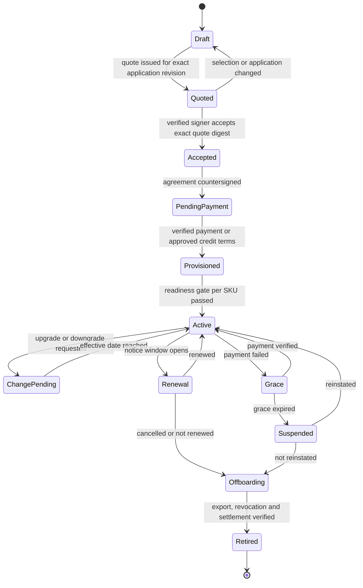
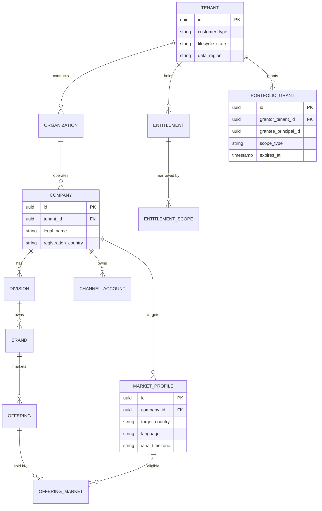
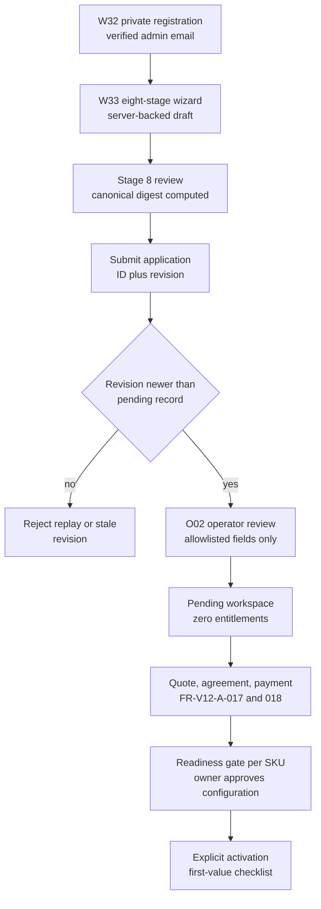

# AI Growth Engine: Employee Sales & Marketing Automation
## Application Blueprint: PART 11 (Batch 11.1b), V12 Business Requirements (BRD chapters 01–07 and 10–25): Enhancements, Conflicts and Decisions

| Field | Value |
|---|---|
| Document | Part 11, Batch 1b (Part 11.1b). Continues Part 11.1a (material, coverage, detailed register, catalogue reconciliation) |
| Version | 1.0 · 28 Nov 2026 |
| Purpose | Close every Partially covered, Not covered and adopted-Conflict aspect of the BRD V12 business chapters with requirements, rules, designs, stories, tests and decisions at blueprint depth; raise the Founder-level conflicts with recommended resolutions |
| Authority | Customer revision V12 (28 Nov 2026) for adopted items; "Pending Founder decision" where a Founder decision or safety invariant is met |
| Baseline | Parts 0–9.10; decisions DEC-001…422; approved budgets DEC-230 and DEC-422 unchanged; precedence DEC-415, extended by DEC-500 |
| ID ranges used | FR-V12-A-001…222 (123 requirements) · US-&lt;EP&gt;-YA01…YA03 per epic (24 stories) · TC-V12-A-001…238 (122 test IDs in 115 rows) · DEC-500…519 · ADR-180…184 · tags 760–777 · local family KPI-V12-A-01…19 |
| Roles applied | Chief Product Officer (lead) · Principal Business Systems Analyst · SaaS monetization and pricing strategist · Head of GRC (DPDP/GDPR) · Customer Success executive; consulted: Solutions Architect, FinOps Lead, QA Lead |

**Safety envelope (unchanged by anything below).** AI drafts, classifies, extracts and matches; it never signs, pays, submits bids, sets prices or sends consequential external actions without a human; consequential actions are capped at blueprint autonomy L1 (DEC-064); the Policy Decision Point (PDP) rechecks scope, consent, jurisdiction, budget and approval hash at dispatch; model gateway tiers 0/1a/1b/2/3 with no personal or restricted data to Tier 2 (DEC-418); tenant and company isolation by row-level security (RLS); Website/Admin separation; fail-closed; no outreach to minors (DEC-030); no patient data (X-02); no fundraising capability (DEC-002, BRL-TEN-12).

**Release labels used in this part.** *R1-B* = blueprint Release 1 (W0–W3, go/no-go Day 180, 4 Jun 2027); *R2-B* = blueprint Release 2 (W4–W5, build Day 208, exit Day 229); *W6* = Day ≈ 237–365; *A1/A2/A3* = advanced releases (DEC-411; A1 approved by DEC-417). V12 phases R0…R5 are written "V12-R0"…"V12-R5" to avoid confusion (DEC-512). **Budget tag**: *In scope* = amends text inside already-approved scope; *P-A* = part of the separately approvable proposal in §11.1.5.20.

---

## 11.1.5 Enhancements

### 11.1.5.1 Commercial unit and catalogue governance

The customer's commercial unit rule (BRD 01 §V12, §V8; BR-V3-01; BR-C03, BR-C04) replaces the plan-archetype-first model of DEC-047 [CONFLICT-767]: **39 service SKUs are sold; 156 workflows are included under their parent SKU and are never sold separately; 25 foundations are included and never charged.** DEC-047 archetypes survive as *bundles* (named SKU sets with an allowance), not as the unit of sale (DEC-501).

| ID | Requirement | V12 source | Rule / acceptance | Priority | Release | Epic | Budget | Test |
|---|---|---|---|---|---|---|---|---|
| FR-V12-A-001 | Maintain a **SaaS service catalogue** of 39 SKUs (SM-SVC-01…39) with stable ID, name, family (13–17 chapter grouping), outcome text, meter, readiness state (planned / pilot / released / suspended / retired), prerequisite SKUs (optional, never forced), required inputs, provider prerequisites and limitations | BR-V3-01, BR-C03, ch13–17 tables | Exactly 39 active SKU IDs; duplicate or unknown SKU ID rejected; a planned SKU cannot be quoted or sold (CJ-GL-04) | Must | R2-B | EP-20 | P-A | TC-V12-A-001 |
| FR-V12-A-002 | Maintain a **workflow registry**: 156 workflow contracts `SM-SVC-nn-WF01…04`, each bound to exactly one parent SKU, versioned, with an immutable run snapshot reference; blueprint WF-01…38 are mapped to registry entries by Groups C/D | FL-01, BR-V3-13, BRD 01 §V12 | Registry validates 156 IDs and four per SKU; unapproved version rejected; run keeps its snapshot, live safety controls rechecked (BR-C12) | Must | R2-B | EP-18 | P-A | TC-V12-A-002 |
| FR-V12-A-003 | Every released SKU has a **service workspace** with domain-specific draft and evidence fields, searchable scoped records, versioned edits, review and export (generic pattern; bespoke design gated) | BR-V3-11 | No workspace renders for an unentitled SKU; edits create versions | Should | R2-B | EP-20 | P-A | TC-V12-A-003 |
| FR-V12-A-004 | **Catalogue versioning and alias map**: every SKU/workflow change is a new version; legacy capability IDs (100) and the 75 old selectable entries map as aliases, never as products | BR-C12, BRD 12 §V4 | Alias resolves to one SKU; alias is not purchasable | Should | R2-B | EP-20 | P-A | TC-V12-A-004 |
| FR-V12-A-005 | **Bundles** (full suite = all released eligible SKUs; partial bundle; DEC-047 archetypes Starter/Growth/Scale as preset bundles) expand to stable SKU IDs at quote time | BR-C04, BR-V3-04 | Full suite expands to all *released* SKUs only; bundle never contains a planned SKU | Must | R2-B | EP-20 | P-A | TC-V12-A-005 |
| FR-V12-A-006 | **Product separation** (amended v1.2 per DEC-783, DEC-947): Sales & Marketing (SM) and Investment Automation (INV, Parts 11.16a–e) are separate product codes with separate entitlements; only libraries/patterns are reused; no implicit cross-product access; investor entities, routes, filters and terms exist only in the INV product code and `inv` schema, never in the SM catalogue, routes or schemas (DEC-058, BRL-TEN-12; DEC-002 investor exclusion superseded by DEC-783) | BR-C14, REC-V2-10 | CI build check finds no investor/fundraising term in the **SM** catalogue, routes or schemas; an SM-only tenant receives 404 on `/api/v1/investor/*` and an investor-audience token is rejected by SM endpoints; INV endpoints are reachable only with the INV entitlement | Must | R1-B | EP-01 | In scope | TC-V12-A-006 |

### 11.1.5.2 Subscription, bundle and entitlement model

**ADR-180 is in §11.1.5.5; ADR-181 here.**

#### ADR-181 SKU-scoped entitlement ledger with atomic reservation

| Field | Content |
|---|---|
| Context | BRD 10 requires independent SKU purchase, use of one SKU across several offerings and markets, company-level and tenant-level limits, and atomic reservation (MT-16, MT-30, BR-V3-09). The blueprint enforces entitlements per plan (BRL-SVC-03) without SKU or company scope |
| Decision | One **Entitlement** row per (tenant, SKU, plan version) with allowance per meter and period; optional **EntitlementScope** rows narrow use to companies, offerings, markets or channel accounts. A run reserves units in a **UsageReservation** (pending, queued, running and uncertain runs hold units; completion consumes; cancel/failure releases). Company budget, tenant aggregate cap and SKU allowance are all checked in one transaction at reservation and rechecked by the PDP at effect time |
| Alternatives | (a) Keep plan-level quotas only: fails MT-16/MT-30. (b) Separate entitlement service: premature (GC-01 modular monolith) |
| Consequences | `saas` module gains three entities; Group I adds DDL; usage ledger stays append-only (BRL-SVC-04). Pending/queued reservation display in A101/W34 |
| Status | Accepted (Customer revision V12, 28 Nov 2026) |



| ID | Requirement | V12 source | Rule / acceptance | Priority | Release | Epic | Budget | Test |
|---|---|---|---|---|---|---|---|---|
| FR-V12-A-010 | A subscriber may **buy any released SKU alone** with authorized equivalent inputs; no upstream SKU purchase is forced | BR-C04, ch10 §V6 | 39 single-SKU purchase tests (SM-SVC-nn-ENT-AT01) | Must | R2-B | EP-20 | P-A | TC-V12-A-020 |
| FR-V12-A-011 | Configurations **reference the entitlement and SKU/workflow**; scope by company, offering, market and channel account; offering configuration never creates a new subscription or charge | MT-16 | One SKU used for two eligible offerings → one entitlement, no extra charge; unknown or unentitled SKU rejected | Must | R2-B | EP-20 | P-A | TC-V12-A-011 |
| FR-V12-A-012 | **New SKU or plan expansion** only through a signed new version; no automatic activation on application import, organization creation or configuration review | ch10 rules "New SKU"; ch10 §V6 | Import with zero entitlements; activation needs signed version | Must | R2-B | EP-20 | P-A | TC-V12-A-012 |
| FR-V12-A-013 | **Tenant lifecycle** states pending → active → suspended → offboarding → retired, versioned; suspension revokes new execution, preserves ledger, reconciles in-flight actions | MT-06 | Suspended tenant: new run denied with reason `TENANT_SUSPENDED`; in-flight effects reconciled | Must | R2-B | EP-20 | In scope | TC-V12-A-013 |
| FR-V12-A-014 | **Scoped budgets and reservation**: company, offering and workflow budgets plus tenant aggregate cap, each with currency, period and IANA timezone; atomic reservation; overage default hard stop | MT-30, BR-V3-09, ch10 "Overage" | Units 0 or > allowance cap rejected; over-allowance request creates a Held run with no effect (V8-QA-052) | Must | R2-B | EP-20 | P-A | TC-V12-A-014 |
| FR-V12-A-015 | **Consumption forecast and quota alerts**: remaining allowance, reservations and trend; alerts at 80% (soft, DEC-V7-07) and 100% (hard); overage impossible without approved terms | RT-07 | Forecast + remaining reconcile to ledger; alert sent once per threshold per period | Should | R2-B | EP-20 | P-A | TC-V12-A-015 |
| FR-V12-A-016 | **Plan-change preview and proration**: effective date; upgrade on approved effective date with explicit proration; downgrade at renewal unless a signed exception; usage reconciliation; pause/downgrade/cancel under approved terms; no silent loss of rights | RT-11; ch10 "Upgrade/downgrade"; lifecycle decisions | Preview shows charge delta, rights gained/lost and affected runs; nothing changes until confirmed | Must | R2-B | EP-20 | P-A | TC-V12-A-016 |
| FR-V12-A-017 | **Versioned SaaS quote and agreement**: quote binds application ID and revision, SKU versions, allowances, billing cycle, currency, taxes, delivery model, validity; acceptance binds verified signer to the exact digest; any material edit invalidates acceptance | CV-12; BR-C10; ch10 "Quote" | Edited quote → prior acceptance void; demo agreements never binding | Must | R2-B | EP-20 | P-A | TC-V12-A-017 |
| FR-V12-A-018 | **Verified checkout and idempotent provisioning**: approved payment adapter (DEC-022), verified webhook, unique event key; mismatch held | CV-13 | Duplicate receipt cannot activate twice; unpaid or mismatched order stays pending | Must | R2-B | EP-20 | In scope | TC-V12-A-018 |
| FR-V12-A-019 | **Trial**: approved eligible SKUs only, synthetic or authorized inputs, cap and expiry (default 14 days, BRL-SVC-05); no automatic charge without a contract | ch10 "Trial" | Trial expiry → read-only + export; no charge record | Must | R2-B | EP-20 | In scope | TC-V12-A-019 |
| FR-V12-A-020 | **Partner / reseller** (future option): contract, separate tenant consent, attribution and billing ownership; white-label never weakens isolation; commissions recorded only (DEC-046) | ch05 "Partner / reseller"; AT-10 | Disabled by feature flag until approved | Could | A2 | EP-16 | P-A | TC-V12-A-021 |
| FR-V12-A-021 | **Failed payment and grace**: approved grace period and retry/notice schedule per contract; new effects blocked on suspension; authorized export and support remain | ch10 "Failed payment"; lifecycle "Suspension and renewal" | Grace state visible in W26/W34; suspension after grace blocks effects only | Must | R2-B | EP-20 | P-A | TC-V12-A-022 |
| FR-V12-A-022 | **Cancellation, renewal and refund**: explicit terms, renewal notice, opt-out of auto-renewal, final usage settlement, export and retention; refunds need finance approval and a linked credit note; reversal never deletes ledger or audit history | ch10 "Cancel / renew", "Refund"; RT-12 | Credit note references invoice and reason; ledger row count never decreases | Must | R2-B | EP-20 | P-A | TC-V12-A-023 |
| FR-V12-A-023 | **BYO provider**: customer-owned credential reference with verified permissions and quoted responsibility; BYO charges billed by the provider, kept separate from platform charges; revocation blocks calls | ch10 "BYO provider"; GC-10 | No credential sharing; revoked BYO credential → hold | Should | R2-B | EP-20 | In scope | TC-V12-A-024 |
| FR-V12-A-024 | **Delivery models** self-service, assisted, managed and enterprise stored on the subscription; delegation scoped, revocable and audited; managed labour quoted separately (extends §8.3.5.13.1 two-model matrix) | ch05 lifecycle "Delivery models" | Delivery model changes only by contract version | Should | R2-B | EP-20 | In scope | TC-V12-A-025 |

**Entitlement check at effect time (deterministic, Tier 0).**

```text
allow_effect(run) :=
    entitlement(tenant, sku, plan_version).status == ACTIVE
and now < entitlement.expiry
and scope_matches(entitlement_scope, run.company, run.offering, run.market, run.channel_account)
and reservation(run).state in {RESERVED}
and reservation.units <= remaining(sku_allowance) and <= remaining(company_budget) and <= remaining(tenant_cap)
and tenant.state == ACTIVE and company.state == ACTIVE and offering.state in {PILOT, ACTIVE}
and PDP(scope, consent, jurisdiction, budget, approval_hash) == ALLOW
else HOLD(reason_code)
```

### 11.1.5.3 Pricing, billing and commercial unit economics

No price is approved by V12 or by this part (BRD 10 §lifecycle "Pricing"; CV-05; DEC-047). The formulas below are adopted as the **method**; numbers are estimates.

| Formula (BRD 11 §V5) | Definition | Edge rule |
|---|---|---|
| Direct cost per SKU run | C = Σ (quantity × contracted unit cost) + allocated direct labour + allocated direct infrastructure, using the usage ledger and timestamped FX | Unknown unit cost → C *unassessed*, never 0 |
| Accepted result cost | Σ eligible direct costs ÷ accepted results | Denominator 0 → *undefined* |
| Price floor | C ÷ (1 − target gross margin), margin approved in [0, 1) | Tax and pass-through excluded |
| Monthly TCO (customer view) | subscription + provider fees + managed operations + amortized setup + other direct costs; one-time costs shown separately | Estimate, not a quote |
| Contribution | recognized revenue − allocated direct costs (approved allocation policy; taxes collected for authorities excluded) | Same as §8.3.5.13.7 contribution margin |
| Meter policy | Billable unit per contract; platform-caused retries not billable; credits and reversals are ledger entries | — |
| Price composition | base subscription + usage overage or prepaid credits + approved provider pass-through + managed effort + taxes | Never present an illustrative rate as approved |

| ID | Requirement | V12 source | Rule / acceptance | Priority | Release | Epic | Budget | Test |
|---|---|---|---|---|---|---|---|---|
| FR-V12-A-030 | **Transparent pricing methodology**: the quote shows an itemized approved rate-card version or the status "Quote pending"; price composition as above | CV-05; BR-C10 | Quote without approved version shows *Quote pending*; no invented price | Must | R2-B | EP-20 | In scope | TC-V12-A-030 |
| FR-V12-A-031 | **TCO and contribution** reported per tenant and per SKU monthly; one-time costs separate | ch11 "Commercial economics" | Report reconciles to ledger | Should | R2-B | EP-20 | P-A | TC-V12-A-031 |
| FR-V12-A-032 | **Per-SKU cost model**: per accepted output, record LLM input/output/reasoning/embedding tokens, search/licensed data, verification, channel/provider/voice/media, compute/storage/egress, retry/failure, human review/support, payment and allocated direct overhead. Ad spend, marketplace settlement and customer business money are pass-through and never subscription revenue | ch11 per-SKU paragraph; cost formula | Pass-through lines excluded from MRR; unknown cost component flagged *unassessed* | Must | R2-B | EP-04 | P-A | TC-V12-A-032 |
| FR-V12-A-033 | **Accepted-result cost and price floor** computed per SKU and workflow version; Finance approves price, allowance and SLA only after a measured pilot | ch11 formula rows; BR-V7-AI-04 | Zero denominator → undefined; floor formula exact to 2 dp | Must | R2-B | EP-04 | P-A | TC-V12-A-033 |
| FR-V12-A-034 | **Billing dispute** workflow: itemized usage, invoice, credits; private dispute case; refund review only under approved policy; no refund before authorization and reconciliation | CS-14 | Dispute visible only to tenant and finance; refund needs maker-checker | Should | R2-B | EP-20 | P-A | TC-V12-A-034 |
| FR-V12-A-035 | **SKU meter registry** with V12 meter, proposed pilot cap and internal cost range per run (table below); price status "Quote pending; excludes external fees" until Finance approves [GAP-769] | ch11 SKU table | 39 rows; cap enforced as allowance default for pilots only | Must | R2-B | EP-20 | P-A | TC-V12-A-035 |
| FR-V12-A-036 | **Native-currency integrity**: amounts grouped by native currency; conversion only with approved rate, source, timestamp, direction, rounding and period; missing rate excluded and counted; negative rate rejected; SaaS fees never mixed with subscriber revenue | MT-21, MOB-15, ch11 §V6 | V8-QA-053 behaviour | Must | R1-B | EP-15 | In scope | TC-V12-A-036 |

**SKU meter registry (FR-V12-A-035; BRD 11).** "Internal INR / run" is the customer's source estimate of internal platform cost per run (min–max), **excluding external fees**; it is an estimate, not a price. Allowance defaults for pilots equal the proposed cap.

| SKU | Meter | Pilot cap | Internal INR/run | SKU | Meter | Pilot cap | Internal INR/run |
|---|---|---|---|---|---|---|---|
| 01 | market research batch | 100 | 1.05–1.61 | 21 | invoice or receipt record | 500 | 0.15–0.55 |
| 02 | discovery batch | 100 | 0.55–1.43 | 22 | onboarding case | 100 | 0.15–0.97 |
| 03 | contact assessed | 500 | 0.15–0.75 | 23 | customer review | 500 | 0.15–0.87 |
| 04 | lead assessed | 500 | 0.15–0.87 | 24 | analytics review | 100 | 0.15–1.05 |
| 05 | relationship update | 500 | 0.15–0.75 | 25 | document processed | 200 | 0.55–1.35 |
| 06 | email attempt | 1,000 | 0.15–0.69 | 26 | call minute | 100 | 0.55–1.05 |
| 07 | message attempt | 500 | 0.15–0.55 | 27 | creative asset | 50 | 0.55–1.05 |
| 08 | follow-up decision | 1,000 | 0.15–0.67 | 28 | agent transaction case | 50 | 0.55–0.55 |
| 09 | conversation item | 1,000 | 0.15–1.15 | 29 | account review | 100 | 0.55–1.05 |
| 10 | meeting cycle | 100 | 0.15–1.45 | 30 | experiment | 30 | 0.55–1.05 |
| 11 | content draft | 100 | 0.55–2.27 | 31 | marketplace order/event | 500 | 0.55–0.55 |
| 12 | social action or listening batch | 300 | 0.15–1.25 | 32 | partner opportunity | 100 | 0.55–0.55 |
| 13 | page or keyword review | 200 | 0.55–0.97 | 33 | support case | 500 | 0.55–1.05 |
| 14 | campaign review or action | 100 | 0.15–1.05 | 34 | account usage review | 200 | 0.55–1.05 |
| 15 | page draft or enquiry event | 500 | 0.15–1.77 | 35 | review item | 200 | 0.55–1.05 |
| 16 | attendee or referral event | 500 | 0.47–0.55 | 36 | coaching session | 100 | 0.55–1.05 |
| 17 | proposal or quotation case | 100 | 0.15–1.77 | 37 | pricing scenario | 50 | 0.55–1.05 |
| 18 | agreement case | 50 | 0.15–1.95 | 38 | message attempt (SMS/RCS) | 500 | 0.55–0.55 |
| 19 | tender case | 50 | 0.55–2.31 | 39 | procurement case | 200 | 0.55–1.05 |
| 20 | order case | 200 | 0.15–0.55 | | | | |

**Worked check (synthetic; TC-V12-A-033).** SKU 11 pilot month: 80 content drafts run, 60 accepted; internal cost 80 × ₹2.27 (high) = ₹181.60; provider fees ₹0 (BYO); review labour 2 h × ₹400 (assumed loaded rate, Finance to set) = ₹800.00; C = ₹981.60; accepted-result cost = 981.60 ÷ 60 = **₹16.36**; price floor per accepted result at a 60% target margin = 16.36 ÷ 0.40 = **₹40.90**. With 0 accepted results the cost is *undefined*. Platform-caused retries (for example 5 regenerations after a gateway timeout) are excluded from billable units but included in C.

**Pilot capacity check against DEC-008.** At the high end, running every SKU at its pilot cap costs Σ(cap × max INR/run) ≈ ₹11,600 per tenant-month of internal cost; AI is only part of that cost. This is above the ₹3,000 pilot AI ceiling (DEC-008) if a single tenant used every cap fully, so the default pilot allowance for owned companies stays bound by the DEC-008 hard caps and M53; the V12 caps are maxima, not defaults, for owned-portfolio pilots [GAP-769].

### 11.1.5.4 Public SaaS website and customer acquisition

V12 makes the public website a **neutral SaaS storefront**: it sells the 39 automation SKUs and contains only approved platform service information and synthetic examples — no customer profiles, offerings, directories or investor data (BR-C01; REC-V2-01/05; BRD 12 §V4). The blueprint's website (BRD V1) publishes a **company and startup directory (W02)** and **individual startup websites (W03)**. This is CONFLICT-764; no Founder decision is involved, so V12 governs (DEC-505).

#### ADR-182 Neutral storefront; tenant publication only on the tenant's own property

| Field | Content |
|---|---|
| Context | BR-C01, REC-V2-01/05 and BRD 12 ("Tenant own-site lead intake is a separate SM-SVC-15 integration, never public platform tenant publication"; "Tenant landing page only on approved client property") versus FR-W02/W03, API-497 and US-1905 |
| Decision | (1) The platform storefront (operator tenant, platform domain) shows only the catalogue, plans, resources, trust, privacy and intake routes. (2) **The startup directory (FR-W02, API-497) is retired**. (3) Startup websites, landing pages, forms and the external-customer portal become **SM-SVC-15 outputs served only on a tenant-verified custom domain** (BRL-TEN-10) — the tenant's "own property"; unverified host → 404. (4) Nothing from a tenant is indexed or linked from the platform storefront |
| Consequences | Publication engine, snapshots and portal are reused (no new build); their host binding changes. Group G renumbers or namespaces routes (RECOMMENDATION-773). The four owned startups publish on their own domains like any external tenant (customer parity, BR-C02) |
| Status | Accepted (Customer revision V12, 28 Nov 2026) |

| ID | Requirement | V12 source | Rule / acceptance | Priority | Release | Epic | Budget | Test |
|---|---|---|---|---|---|---|---|---|
| FR-V12-A-050 | **Neutral storefront**: platform pages contain only approved platform service information and synthetic examples; HTML, API, cache and search index inspection finds no tenant profile, offering, directory or investor data | BR-C01 | Crawl of public build + API + CDN cache finds 0 tenant identifiers | Must | R1-B | EP-19 | In scope | TC-V12-A-050 |
| FR-V12-A-051 | **Retire the platform directory**: FR-W02 and API-497 removed; requests return 404 | REC-V2-01/05 | `GET ~/public/directory` → 404 | Must | R1-B | EP-19 | In scope | TC-V12-A-051 |
| FR-V12-A-052 | **Tenant publication on own property only** (SM-SVC-15): startup sites and landing pages served only on a verified tenant domain; never linked from the storefront | ADR-182; ch14 | Unverified host → 404; storefront has no outbound link to tenant sites | Must | R1-B | EP-12 | In scope | TC-V12-A-052 |
| FR-V12-A-053 | **Public data-rights request page**: request types access, correction, erasure, objection, grievance, nomination; identity verification; reference number; due date by pack (EU one month; India per Rules) | BR-V7-WEB-03, BR-V7-CJ-05 | Empty submit → inline errors; valid EU erasure → reference and one-month due date | Must | R1-B | EP-03 | In scope | TC-V12-A-053 |
| FR-V12-A-054 | **Public AI transparency page**: where AI is used, safeguards, human review, labelling of AI-generated messages and assets | BR-V7-WEB-04, BR-V7-AI-01 | Page published; sample outputs carry the AI-generated disclosure | Must | R1-B | EP-19 | In scope | TC-V12-A-054 |
| FR-V12-A-055 | **Crawlable service pages**: one canonical route per released SKU with unique title, description and indexable content; sitemap from the public catalogue projection only; four workflow contracts and fictional examples per SKU | AT-01, AT-08, BR-V3-02 | 39 unique titles; no tenant data | Should | R2-B | EP-19 | P-A | TC-V12-A-055 |
| FR-V12-A-056 | **Selection assistant and explainable bundles**: objective, business model and constraints → suggested SKUs with reasons and optional prerequisites; persona entry paths (founder, marketing, sales, enterprise) change suggestions only; customer confirms each SKU; no auto-purchase | BR-V3-03, CV-03, AT-03 | Reasons visible; nothing added to the selection without a click | Should | R2-B | EP-19 | P-A | TC-V12-A-056 |
| FR-V12-A-057 | **Side-by-side comparison** of SKUs (output, limits, dependencies, meter, approved cost or "pending") and transparent comparison with manual/point-tool alternatives (limitations stated, no unsupported competitor claims) | CV-04, AT-04, BR-V3-04 | Compare two SKUs without adding to selection | Should | R2-B | EP-19 | P-A | TC-V12-A-057 |
| FR-V12-A-058 | **Workflow output previews**: each of the 156 workflows shows a curated fictional output preview derived from its output contract; labelled synthetic | BRD 12 "Workflow demonstrations"; AT-08 | 156 previews; each labelled fictional and AI-disclosed | Should | R2-B | EP-19 | P-A | TC-V12-A-058 |
| FR-V12-A-059 | **TCO estimator and ROI sensitivity**: customer-supplied subscription, provider, labour and implementation assumptions; currency and period shown; one-time cost separate; negative ROI stays visible; "estimate, not a quote" | CV-06, CV-07, W01 ROI | Total equals inputs; no invented baseline | Should | R2-B | EP-19 | P-A | TC-V12-A-059 |
| FR-V12-A-060 | **Automation maturity assessment and opportunity report**: non-identifying answers → explainable category score; local report with score, reasons, suggested SKU IDs and caveat; no mandatory personal data | AT-05, AT-06 | Score reproducible from answers; export contains inputs, recommendations, caveat | Could | W6 | EP-19 | P-A | TC-V12-A-060 |
| FR-V12-A-061 | **Controlled sandbox, integration directory, trust centre and operator conversion intelligence**: synthetic sample execution with hard limits and no external effects; integration compatibility directory (unknown connector shown *unverified*; approved connector shows version and conditions); trust centre with verified evidence and stated gaps (no compliance or availability claim without evidence); first-party consent-aware funnel by cohort, industry and selected SKU with unknowns distinguished | AT-07, AT-11, AT-12, CV-15 | Sandbox makes 0 network calls; trust claims link evidence | Should | R2-B / A1 (trust centre CAP-X3-12) | EP-19 | P-A | TC-V12-A-061 |

**V12 route purposes adopted (business meaning; IDs decided by Group G).** W01 Home · W02 Automation categories · W03 Automation family details · W04 Complete automation catalog · W05 Individual automation details · W06 Plans & automation selection · W07 Industry solution guide · W08 Resources & guides · W09 Illustrative use cases · W10 Campaign automation overview · W11 Selection assistant · W12 Service enquiry · W13 Demo & partnership enquiry · W14 Custom quotation request · W15 Automation requirements builder · W16 Channel & integration options · W17 Service delivery models · W18 Consultation & demo booking · W19 Webinars & events · W20 Service referral programme · W21 Client sign-in & recovery · W22 Client service dashboard · W23 Subscription quotation review · W24 Service agreement review · W25 Subscription order status · W26 Billing & invoice status · W27 Private onboarding checklist · W28 Support, feedback & renewal · W29 Communication preferences · W30 Contact, privacy & help · W31 Compare bundles · W32 Private client registration · W33 Private configuration wizard · W34 Client service portal; plus V12 W35 data-rights request and W36 AI transparency (FR-V12-A-053/054). The blueprint's end-customer journeys (enquiry, RFQ, supplier registration, student/institution enquiry, quote and agreement review, order and invoice status: former W12–W29 content) continue as **tenant-property pages** under ADR-182.

### 11.1.5.5 Multi-tenant and multi-company business architecture

#### ADR-180 Tenant per customer contract; company as scope; portfolio as a revocable grant

| Field | Content |
|---|---|
| Context | BRD 06 §V6: "A tenant is the independent SaaS contract and data security boundary… The four owned startups each have independent tenant IDs… A portfolio is an explicit revocable grant relationship, not an implicit tenant parent." BR-C02 customer parity. Blueprint DEC-065: one Owner Portfolio Tenant with 25+ startup workspaces; DEC-055 portfolio scope read-only inside that tenant |
| Decision | Adopt V12 [CONFLICT-763]: (1) **each owned company is its own tenant** with the same registration, payment (or contracted credit), provisioning and entitlement lifecycle as an external customer; (2) inside a tenant: organization → company → division → brand → offering; market and channel account are company-owned profiles; (3) **PortfolioGrant** (grantor tenant, grantee principal, scope = aggregate metrics or named resources, expiry, revocation) is the only route to cross-tenant aggregates; drill-down to records needs a separate object-level grant; (4) independent customers are never included unless they grant; (5) the operator (platform) is itself a tenant for SaaS acquisition (AT-15) |
| Consequences | DEC-065 and DEC-055 amended (DEC-504). RLS already keys on tenant; cross-tenant aggregates move from in-tenant queries to a grant-checked projection (Group E/I design). Founder's 25+ companies remain one login via grants. Isolation becomes stronger, not weaker |
| Status | Accepted (Customer revision V12, 28 Nov 2026) |



| ID | Requirement | V12 source | Rule / acceptance | Priority | Release | Epic | Budget | Test |
|---|---|---|---|---|---|---|---|---|
| FR-V12-A-070 | **Tenant, organization and company are separately keyed**; a company can never cross tenants through a parent foreign key | MT-01 | Two tenants with identical names get different IDs; cross-parent insert or read denied | Must | R1-B | EP-01 | P-A | TC-V12-A-070 |
| FR-V12-A-071 | **Customer parity**: owned and third-party companies use identical registration, payment (or contracted credit), provisioning and entitlement lifecycle via the same API | BR-C02, BR-V3-08 | Onboard a synthetic owned company and an external company through the same API; identical state transitions | Must | R1-B | EP-20 | P-A | TC-V12-A-071 |
| FR-V12-A-072 | **Portfolio grants**: explicit, revocable, resource- and aggregate-scoped, expiring; independent clients excluded unless separately authorized; drill-down needs an object-level grant | MT-07, BR-C07 | Grant then revoke an owned company: aggregate disappears; unauthorized client and row drill-down blocked | Must | R1-B | EP-17 | P-A | TC-V12-A-072 |
| FR-V12-A-073 | **Operator acquisition tenant**: the platform operator uses subscribed services under its own tenant for SaaS acquisition; operator campaigns cannot read customer private records by default | AT-15 | Operator query of a customer tenant → 0 rows | Should | R2-B | EP-20 | In scope | TC-V12-A-073 |
| FR-V12-A-074 | **Multiple companies under one tenant** by contract: explicit company membership; independent legal identity; no automatic entitlement or membership for a new company | MT-05 | Add two companies; neither inherits entitlement | Must | R1-B | EP-01 | P-A | TC-V12-A-074 |
| FR-V12-A-075 | **Division and brand masters**: division has stable ID and company FK, lifecycle independent of name; brand owned by division, with scoped configuration and approved claims | MT-09, MT-10 | Rename division → linked offering valid; same brand name in two divisions → no leakage | Should | R2-B | EP-02 | P-A | TC-V12-A-075 |
| FR-V12-A-076 | **Registration, operating and target countries** are separate attributes (company registration country ≠ operating countries ≠ market/prospect/delivery country) | MT-17 | India registration with US target; filter target US independently | Must | R1-B | EP-02 | P-A | TC-V12-A-076 |
| FR-V12-A-077 | **Market profiles and channel accounts**: one offering in several markets through offering-market associations (each independently eligible); several channel accounts per company and channel, each with sender aliases and credential reference, mapped to offering-markets | MT-18, MT-22, MT-23 | One offering in two markets; Email and WhatsApp accounts for two markets preserved; wrong-company account denied | Must | R1-B | EP-08 | P-A | TC-V12-A-077 |
| FR-V12-A-078 | **Offering-specific audiences**: ICP, segment, market eligibility and source rights by offering; no cross-product prospect assumptions | MT-13 | Two audiences; results use the selected offering and evidence | Should | R2-B | EP-05 | P-A | TC-V12-A-078 |
| FR-V12-A-079 | **Offering lifecycle** draft → pilot → active → suspended → retired with an authorization gate for live external effects; history preserved; subscriber offering IDs separate from platform SKU IDs | MT-11, MT-15 | Suspend offering → new effect denied; past events retained | Must | R1-B | EP-02 | In scope | TC-V12-A-079 |
| FR-V12-A-080 | **14 customer types**: individual professional, freelancer, solopreneur, creator, proprietorship, partnership, startup, SME, enterprise, institution, agency, distributor, NGO, multi-company group. Individuals use a personal business workspace and are not asked for an inapplicable company registration number; verification follows legal status | MT-04, BRD 04 §V6 | Individual onboarded without registration number; same entitlement flow | Should | R2-B | EP-20 | P-A | TC-V12-A-080 |

### 11.1.5.6 Universal configuration and onboarding

**Eight stages (MT-08, MOB-04).** 1 Identity · 2 Organizations and companies · 3 Divisions and brands · 4 Markets and offerings · 5 Channel accounts · 6 Workflows (SKU/workflow selection) · 7 Budget and governance · 8 Review. Material changes increment the revision. Minimal essential fields first; optional details deferred until review (CV-01).



| ID | Requirement | V12 source | Rule / acceptance | Priority | Release | Epic | Budget | Test |
|---|---|---|---|---|---|---|---|---|
| FR-V12-A-090 | **Eight-stage private configuration wizard** (stages above) on desktop and mobile; configuration groups Identity, Business model, ICP/sales, Channels, Governance, Commercial, Activation (BRD 07 table) | MT-08, MOB-04, BR-V3-05 | Complete a fictional two-company, two-market, two-channel application end to end | Must | R2-B | EP-20 | P-A | TC-V12-A-095 |
| FR-V12-A-091 | **Progressive onboarding**: minimal fields first; incomplete draft resumes without premature quote or entitlement | CV-01 | Resume draft; no quote exists | Should | R2-B | EP-20 | In scope | TC-V12-A-091b |
| FR-V12-A-092 | **Session and draft recovery**: drafts are server-side, protected, versioned and authorized; sign-out clears client-side private state | MOB-11, ST-15 | Expired session re-authenticates and resumes without duplicate submit | Must | R2-B | EP-20 | In scope | TC-V12-A-092b |
| FR-V12-A-093 | **Business & Organization Management Centre** (Admin): operator creates pending customer contracts and companies (no activation); tenant requester edits authorized company data; reviewer applies eligible pending configuration; rollback = new reviewed version; requester ≠ reviewer | BRD 07 §V6 | Self-approval denied; rollback creates revision n+1 | Must | R2-B | EP-20 | P-A | TC-V12-A-093 |
| FR-V12-A-094 | **Industry/business templates** are versioned configuration referencing canonical workflows; applied only with explicit review; never grant entitlement or override policy; workflow definition count stays 156 | MT-29, FL-12 | Apply a template to two businesses → 156 definitions | Should | R2-B | EP-20 | In scope | TC-V12-A-094 |
| FR-V12-A-095 | **Cross-device application handoff**: an application produced on one device can be reviewed on the other, preserving identity, hierarchy, selected SKUs and revision; signed and idempotent; never activates a subscription | MOB-16 | Both directions; duplicate rejected | Could | W6 | EP-20 | P-A | TC-V12-A-095b |
| FR-V12-A-096 | **Canonical application envelope** (production successor of SM-APPLICATION-4/6): schema, product = commercial, kind = request; identity (applicationId, revision ≥ 1, name ≤ 150, administratorEmail, sector, country, website http/https, businessModel, region); operating configuration (description, lines, offerings, objectives, caps, ICP, claims, language, timezone, channels, authority, consentRules; non-empty offerings/objectives/channels); usage (budget finite 0–10¹², volume whole 1–10⁸, illustrative); commercial (currency, service, plan, selectionMode, selectedServiceIds ⊆ 39 without duplicates, selectedAutomationIds, billingCycle; approvalStatus untrusted). Production replaces the 32-bit FNV-1a demo fingerprint with a **SHA-256 canonical digest bound to the signed identity, revision and idempotency key**; the digest alone is never identity | BRD 07 canonical application; SEC-05 | Tampered or replayed submission cannot create a workspace; file > 1 MB, malformed JSON, unsupported schema rejected; credentials never included | Must | R2-B | EP-20 | P-A | TC-V12-A-096 |
| FR-V12-A-097 | **Revision integrity**: application ID unique; same or older revision rejected; a newer pending revision replaces the prior review and invalidates selection, quote, agreement and order; a provisioned application changes only by controlled change request; export only of a current reviewed configuration | BR-V3-06, BR-V3-07 | Stale revision rejected; pending entitlement count = 0 after import | Must | R2-B | EP-20 | In scope | TC-V12-A-097 |

### 11.1.5.7 AI automation authority and governance

V12 defines a five-level business authority scale (BRD 18 §V5). The blueprint uses L0–L3 with consequential actions capped at L1 (DEC-064; Part 9.2 glossary). Mapping:

| V12 level | V12 meaning | Blueprint level | Allowed action classes (DEC-064) | Status |
|---|---|---|---|---|
| L0 | Manual action recorded | L0 (suggest only / human acts) | All | Matched |
| L1 | AI proposes or drafts; human decides | L1 (draft for human approval) | All, including contracts, quotes, discounts, bids, legal terms (maximum) | Matched |
| L2 | Exact approved action with reviewer, expiry and limits | **L1** for consequential classes (human approves the exact payload hash) and L2 dispatch of an already approved item (publishing, campaigns) | Consequential: yes, as blueprint L1. Publishing/campaign dispatch of approved hash: yes | Matched |
| L3 | Bounded routine actions under approved mandate, scope, expiry and caps | L2/L3 for the **routine class only**: approved-FAQ replies, eligible follow-ups, reminders | Routine class only | **Pending Founder** if extended to any consequential class [CONFLICT-762] |
| L4 | Adaptive orchestration inside L3 constraints; never expands authority | No equivalent; proposed as *orchestration of internal, non-effect steps* (routing, ordering, batching) | Internal steps only; no external effect | **Pending Founder** [CONFLICT-762] |

BRD 18 also states "R3 financial/legal/commitment actions default L2" and BR-C09 "real external actions require exact approval **or eligible bounded mandate**". Under the mapping, V12-L2 for R3 actions equals blueprint L1 and is Matched; a bounded mandate (FL-09) for a commitment, payment, price, signature or bid would breach the safety invariant and is not adopted.

| ID | Requirement | V12 source | Rule / acceptance | Priority | Release | Epic | Budget | Test |
|---|---|---|---|---|---|---|---|---|
| FR-V12-A-110 | **Authority level register**: every workflow step records its V12 level and the mapped blueprint level; the PDP enforces the lower of (configured level, DEC-064 cap for the action class) | BRD 18 L0–L4 | Configuring V12-L3 on a quote step is stored as blueprint L1 and audited | Must | R1-B | EP-18 | In scope | TC-V12-A-110 |
| FR-V12-A-111 | **Regulatory override**: regulatory or contractual requirements override any automation preference; simulation never produces external effects; emergency stop revokes future effects; uncertain completed effects are reconciled | BRD 18 §V5 note; BR-V7-AI-08 | Kill switch stops new calls within one scheduler cycle | Must | R1-B | EP-18 | In scope | TC-V12-A-111 |
| FR-V12-A-112 | **Approval mandate record** (FL-09) binding actor, resource, payload digest, action, amount, policy, expiry and revocation — **usable only for the DEC-064 routine class**; changed payload or expired/revoked mandate blocks | FL-09 | Mandate on a consequential class rejected at creation | Must | R1-B | EP-18 | In scope | TC-V12-A-112 |
| FR-V12-A-113 | **Context budgeting, summarisation and multimodal cost tiers**: token allocation by task class with reserved output and safety margin; scoped fact/decision summaries preserving approval and opt-out facts; thumbnail/text/transcript first before full media (detail Group F) | AI-06, AI-07, AI-13 | Oversized context reduced or held; mandatory evidence retained | Should | R2-B | EP-04 | In scope | TC-V12-A-113 |
| FR-V12-A-114 | **AI transparency labels**: AI-generated messages and assets labelled; EU AI Act Art. 50 machine-readable marking when the EU pack is active (applicability date: verify at time of implementation, as of 27 Nov 2026); undisclosed AI content held in EU markets | BR-V7-AI-01, CJ-EU-09 | EU-market draft without label → HOLD | Must | R1-B (labels) / EU gate | EP-04 | In scope | TC-V12-A-054 |
| FR-V12-A-115 | **Cost per accepted result** reported per workflow with denominator; tenant AI budget hard cap holds AI steps | BR-V7-AI-04 | Report shows numerator, denominator and *undefined* at 0 | Must | R2-B | EP-04 | In scope | TC-V12-A-033 |
| FR-V12-A-116 | **Customer data stays private**: no training on customer data (provider DPA evidence); processing in the tenant's region — India now; EU only after CONFLICT-761 | BR-V7-AI-05 | Region-pinning test: model calls for an India tenant use the approved India-region endpoint | Must | R1-B | EP-04 | In scope | TC-V12-A-116 |
| FR-V12-A-117 | **Launch-language evaluation slices**: quality proven per language before a locale goes live — English and Hindi (India) first; English, German, French with the EU pack | BR-V7-AI-07 | Locale enable blocked until its slice passes | Should | R2-B / EU gate | EP-04 | P-A | TC-V12-A-117 |
| FR-V12-A-118 | **AI step inventory**: of 517 steps, 159 AI-inference steps are tagged; all other steps are rules, gates, retrieval or controlled effects that never call a model (detail Groups C/D/F) | BRD 18 "Scope" | Count check 159 / 517 at registry load | Should | R2-B | EP-04 | In scope | TC-V12-A-118 |

### 11.1.5.8 Portfolio command centre

A089 keeps **14 management views** and adds **9 optimization perspectives** as tabs (not new screens; DEC-509). Identity/membership selection is separate from operational filters (MT-02).

| # | View (A089 tab) | Local KPI labels (V12) | Production metric source | Audience |
|---|---|---|---|---|
| 1 | Executive overview | Opportunity records; open pipeline; won deals; receipts | KPI-07, KPI-09, KPI-13 | Company and portfolio (aggregate) |
| 2 | Market intelligence | Research runs; evidence reviews; held signals; completed research | KPI-02, KPI-08, KPI-27 | Company |
| 3 | Lead & contact intelligence | Discovered prospects; qualified prospects; contact & lead runs; pending reviews | KPI-01, KPI-03 | Company |
| 4 | Digital marketing | Marketing runs; completed campaigns; held actions; marketing receipts | KPI-05, KPI-10 | Company |
| 5 | Omnichannel engagement | Engagement runs; completed messages/tasks; held outreach; channel records | KPI-04, KPI-17, KPI-18 | Company |
| 6 | Follow-up & meetings | Follow-up runs; meeting-stage records; pending approvals; held tasks | KPI-06, KPI-20 | Company |
| 7 | Objection & negotiation | Negotiation runs; proposal-stage records; awaiting review; held | KPI-28 | Company |
| 8 | Sales pipeline & closure | Open opportunities; proposal-stage; won deals; open pipeline | KPI-09, KPI-31 | Company and portfolio |
| 9 | Revenue & financial intelligence | Receipts; pipeline; won; financial runs | KPI-13, KPI-14, KPI-16 | Company and portfolio (native currency) |
| 10 | Customer success | Lifecycle runs; completed; open reviews; held | KPI-15, KPI-V12-A-11 | Company |
| 11 | Partner & procurement | Partner/procurement runs; completed; pending; held purchasing | KPI-12, KPI-14 | Company |
| 12 | AI & automation control | Total runs; completed; reserved units; held/failed | KPI-19, KPI-21 | Company and operator |
| 13 | Governance & risk | Awaiting approval; held; failed; uncertain outcomes | KPI-30, KPI-35 alias OKPI-35 | Company and operator |
| 14 | Optimization intelligence | Optimization runs; completed; pending review; held experiments | KPI-22, OKPI-24/25 | Company |

Optimization perspectives: AI cost · General cost · Security · Stability · AI flows · Attraction · Retention · Conversion · Satisfaction. The operator sees all nine; tenant planning roles see AI, Security, Stability, AI flows and Satisfaction; the portfolio receives no operator commercial or customer-level records by default (BRD 19 §V5).

| ID | Requirement | V12 source | Rule / acceptance | Priority | Release | Epic | Budget | Test |
|---|---|---|---|---|---|---|---|---|
| FR-V12-A-120 | **14 differentiated views** in A089 with the KPI mapping above; run counts never substitute for business outcomes; unmeasured live KPIs shown *pending* | BR-V3-10; BRD 19 tables | Each view shows its own KPI set; unmeasured → *pending* | Must | R2-B | EP-17 | P-A | TC-V12-A-120 |
| FR-V12-A-121 | **9 optimization perspectives** as A089 tabs with the role visibility rule above (extends Part 8.3c §8.3.5.15.7) | BRD 19 §V5 | Tenant planner cannot open Attraction/Retention/Conversion | Should | R2-B | EP-17 | P-A | TC-V12-A-121 |
| FR-V12-A-122 | **Context filters**: company, tenant, division, brand, offering, target market/country/region, channel/account, SKU/workflow, date/status and contextual industry, customer type, segment, campaign, opportunity type, employee, team, risk, authority; unsupported values not invented | BRD 19 §V6; MT-25 | Filter business → brand/offer → opportunity type: counts change consistently | Must | R2-B | EP-17 | P-A | TC-V12-A-122 |
| FR-V12-A-123 | **Cascading filter semantics**: changing an ancestor clears stale descendants; options derive from allowed IDs; OR within a dimension, AND across dimensions; stale asynchronous results cancelled; unsupported combinations show an empty state | MT-26, REC-14 | Change company → brand selection cleared; invalid query denied | Must | R2-B | EP-17 | P-A | TC-V12-A-123 |
| FR-V12-A-124 | **Reconciled drill-down**: timestamped scoped drill-down with record count, unknown indicators and original currency; stable cursor; bulk actions recheck each item | REC-15 | Tile total = sum of drill-down rows for the same filter and time | Must | R2-B | EP-17 | In scope | TC-V12-A-124 |
| FR-V12-A-125 | **Portfolio privacy**: aggregates only from granted companies and approved metrics; scope and freshness shown; drill-down needs an object-level grant; SaaS operator revenue never mixed with customer revenue | BRD 19 "Private Command Centre"; REC-06 | Portfolio-only audience sees no record-level action | Must | R1-B | EP-17 | In scope | TC-V12-A-072 |

### 11.1.5.9 Compliance business requirements

#### ADR-184 Market-pack activation gate

| Field | Content |
|---|---|
| Context | V12: "Each market opens only after qualified counsel approves its pack" (BRD 20 §V12; ENT-CMP-08; DEC-V12-07); India first, EU recommended second; UK/US drafts disabled (BR-V7-CJ-01, CJ-UK-01, CJ-US-01). Blueprint DEC-029 allows Year-1 outbound to EU/EEA/UK (B2B email under legitimate interest), US (CAN-SPAM) and UAE/SG/AU (opt-in) after counsel verification |
| Decision | Adopt V12 [CONFLICT-766]: a jurisdiction pack has states *draft → counsel review → approved → active → suspended*. **Outbound to a market requires an active approved pack**; otherwise the PDP returns HOLD/REVIEW (BR-V7-CJ-12: an unreviewed rule can never be the reason a message is allowed). Inbound replies remain allowed. CJ-GL-01…13 apply above every pack and cannot be relaxed by tenants (DEC-V9-03) |
| Consequences | Stricter than DEC-029 (amended by DEC-507). AppNAI's global outreach waits for the EU, UK and US packs; RECOMMENDATION-774 fast-tracks their legal review |
| Status | Accepted (Customer revision V12, 28 Nov 2026) |

| Pack | Rules | V12 status | Blueprint status after DEC-507 |
|---|---|---|---|
| India | CJ-IN-01…11 | Pending qualified legal review; launch market | Active after counsel approval (R1-B gate) |
| EU | CJ-EU-01…10 | Pending review; recommended second market | Draft until approved; EU data region pending (CONFLICT-761) |
| UK | CJ-UK-01 (draft), CJ-UK-02 PECR consent/soft opt-in, CJ-UK-03 DSR one month, ICO breach 72 h | Draft · disabled | Draft · disabled |
| US | CJ-US-01 (draft), CJ-US-02 CAN-SPAM (opt-out within 10 business days, postal address), CJ-US-03 TCPA (prior express written consent; 08:00–21:00 recipient time; National DNC), CJ-US-04 CCPA/CPRA (notice, rights, GPC) | Draft · disabled | Draft · disabled |
| Canada | CJ-CA-01 CASL (express/implied consent; unsubscribe within 10 business days); PIPEDA | Draft | Draft · disabled |
| Australia | CJ-AU-01 Spam Act (unsubscribe within 5 business days; DNC register) | Draft | Draft · disabled |
| Singapore | CJ-SG-01 PDPA DNC registry check; Spam Control Act | Draft | Draft · disabled |
| UAE | CJ-AE-01 PDPL (lawful basis, rights, transfer conditions; telemarketing rules) | Draft | Draft · disabled |
| Brazil | CJ-BR-01 LGPD (legal basis per purpose; rights; ANPD breach communication) | Draft | Draft · disabled |

All legal citations are the customer's summaries; **verify each rule with qualified counsel at time of implementation (as of 27 Nov 2026)**.

| ID | Requirement | V12 source | Rule / acceptance | Priority | Release | Epic | Budget | Test |
|---|---|---|---|---|---|---|---|---|
| FR-V12-A-130 | **Pack activation gate** per ADR-184; pack version, approver, approval date and legal source stored | BR-V7-CJ-01, -12; DEC-V12-07 | Send to a market with a draft pack → HOLD/REVIEW | Must | R1-B | EP-03 | In scope | TC-V12-A-130 |
| FR-V12-A-131 | **Draft packs** for US, UK, CA, AU, SG, AE, BR recorded with the V12 obligations; disabled | BRD 20 §V12 | Draft pack never yields ALLOW | Should | R2-B | EP-03 | In scope | TC-V12-A-131 |
| FR-V12-A-132 | **Data-principal rights extension**: add grievance redressal and nomination (DPDP) and objection (GDPR Art. 21) to the rights workflow; verified; due dates per pack; legal hold recorded | BR-V7-CJ-05; CJ-IN-05; CJ-EU-03/04 | Nomination request routed and tracked | Must | R1-B | EP-03 | In scope | TC-V12-A-132 |
| FR-V12-A-133 | **India telecom rules**: DLT entity, header and template registration; preference-registry scrubbing; promotional calls only from the 140 number series, service/transactional from 160 | BR-V7-CJ-04; CJ-IN-06/07 | Promotional voice from a non-140 number → HOLD | Must | R2-B (SMS) / with SM-SVC-26 (voice) | EP-08 | In scope | TC-V12-A-133 |
| FR-V12-A-134 | **Tax approval before invoicing**: GST configuration approved; e-invoice (IRN) where the turnover threshold applies; EU VAT/OSS only with the EU pack | BR-V7-CJ-10; CJ-IN-10; CJ-EU-10 | Invoice blocked without approved tax configuration | Must | R2-B | EP-20 | In scope | TC-V12-A-134 |
| FR-V12-A-135 | **Legal sign-off matrix** by country × channel × industry (data protection, marketing/telephony, consumer, tax, accessibility, advertising); retention schedule per category and region; healthcare and education constraints; no compliance claim before review | BRD 20 closing paragraph; roles | Matrix row required before a pack can be approved | Must | R1-B | EP-03 | In scope | TC-V12-A-135 |

### 11.1.5.10 SLAs and support

V12 proposes contract tiers and support targets (ENT-OPS-01…07; BRD 21 service obligations). The blueprint rule stays: **no SLA figure is offered until measured for three consecutive months and approved** (DEC-044; §8.3.5.13.6). DEC-510 adopts V12 tiers as contract templates under that rule.

| Tier (V12) | Monthly availability | Support first response (V12 proposed) | Coverage | Service credits | Blueprint precondition | Status |
|---|---|---|---|---|---|---|
| Standard | 99.5% | Next business day (P1 during coverage per contract) | Business hours (DEC-044: 10:00–18:00 IST Mon–Sat) | Per contract | SLA-02 pilot target 99.5% already binding internally | Matched (template) |
| Business | 99.9% | P1 4 h | Business hours, extended by contract | Per contract (ladder placeholder SLA-10) | Scale gate passed (OKPI-06), Multi-AZ conditional (Part 9.10 §9.10.7.2) | Matched (template; offer after validation) |
| Enterprise | 99.95% | P1 1 h | 24×7 for SEV1/SEV2 (ENT-OPS-04) | Per contract | Multi-AZ, independent status page, ≥ 2 trained on-call people per window | **Pending Founder** (CONFLICT-760) |

**Severity mapping.** V12 SEV1–SEV4 (ENT-OPS-03) map to blueprint S1–S3 plus SEV4 = informational/no customer impact: SEV1 ≡ S1 (critical outage, data exposure, isolation breach), SEV2 ≡ S2 (major degradation, workaround exists), SEV3 ≡ S3 (minor), SEV4 = request/informational. Incident commander role named per SEV1/SEV2. Post-incident review within 5 business days with tracked actions (ENT-OPS-07; SLA-09).

| ID | Requirement | V12 source | Rule / acceptance | Priority | Release | Epic | Budget | Test |
|---|---|---|---|---|---|---|---|---|
| FR-V12-A-140 | **SLA tier templates** (Standard, Business, Enterprise) attached to a subscription only after the validation procedure of §8.3.5.13.6; availability measured per tier excluding approved maintenance; provider outage reported separately | ENT-OPS-01; BRD 21 "Availability" | Attaching a tier without validation evidence → rejected | Must | R2-B (template) | EP-20 | In scope | TC-V12-A-140 |
| FR-V12-A-141 | **Severity model SEV1–SEV4** with communication timelines (SEV1 status notice ≤ 1 h, updates every 2 h) and incident commander | ENT-OPS-03 | Game-day drill meets timelines | Must | R2-B | EP-21 | In scope | TC-V12-A-141 |
| FR-V12-A-142 | **Public status page hosted independently of the platform** (component status, incidents, maintenance) with private scoped incident detail; unknown status shown as unknown | ENT-OPS-02; CS-11 | Status page reachable when the platform origin is down; private incident not public | Should | W6 / A1 (CAP-X3-12) | EP-21 | P-A | TC-V12-A-142 |
| FR-V12-A-143 | **Tiered support desk** with response targets per tier (V12 proposed: Enterprise P1 1 h, Business 4 h, Standard next business day) reported from ticket timestamps | ENT-OPS-05; BRD 21 "Support" | Ticket SLA report live; no guaranteed resolution | Must | R2-B | EP-20 | In scope | TC-V12-A-143 |
| FR-V12-A-144 | **Help centre and in-product guides** localized with the UI; top 50 tasks documented (from the training task cards TRN-SCR-*) | ENT-OPS-06 | 50 task articles published per launch locale | Should | R2-B | EP-19 | P-A | TC-V12-A-144 |
| FR-V12-A-145 | **Per-SKU workflow SLA matrix**: turnaround by SKU, volume, provider and approval wait; p50/p95 reported excluding separately measured held time; delivery responsibility and monthly value per SKU; fees pending | REC-26; BRD 21 "Workflow SLA" | Report separates held time | Should | W6 | EP-20 | P-A | TC-V12-A-145 |
| FR-V12-A-146 | **Customer responsibilities schedule**: authorized sources, usable inputs, configuration, consent, connector grants, approvals, lawful use, timely issue reporting — part of every contract | BRD 21 "Customer responsibilities" | Contract template includes schedule | Must | R2-B | EP-20 | In scope | TC-V12-A-146 |
| FR-V12-A-147 | **Recovery objectives per data class** (DEC-V9-01): critical transactional RPO ≤ 15 min / RTO ≤ 4 h (KPI-18/19); **growth workload RPO ≤ 15 min / RTO ≤ 2 h** (KPI-32, target; binding pending CONFLICT-765); regenerable research RPO ≤ 24 h / RTO ≤ 8 h (KPI-33/34) | BRD 21 §V9 | Drill per class | Must | R2-B | EP-21 | In scope (2 h binding: Pending Founder) | TC-V12-A-147 |

### 11.1.5.11 KPI framework

#### ADR-183 Metric registry as the single definition of every KPI

| Field | Content |
|---|---|
| Context | BRD 22: "Metric owner, approved denominator, event sources, version, period, filters, freshness and threshold must be stored in metric registry. Zero denominator = not applicable. No arbitrary target represented as measured." Blueprint KPIs live in Part 1 §1.4.2 tables and the X3 semantic layer (CAP-X3-04, advanced) |
| Decision | A **MetricDefinition** record (ID, name, formula, numerator, denominator, event sources, version, owner, period, filters, freshness SLA, threshold, gate type blocking/review, status measured/pending) is created for KPI-01…31, OKPI-01…35 and KPI-V12-A-01…19 in R2-B; dashboards read definitions from it; CAP-X3-04 later implements it as code |
| Status | Accepted (Customer revision V12, 28 Nov 2026) |

| ID | V12 metric (BRD 22) | Formula / definition | Target / gate | Owner | Blueprint relation |
|---|---|---|---|---|---|
| KPI-V12-A-01 | AI evaluation pass rate | AI-enabled workflows with a passing current suite ÷ AI-enabled workflows | 100% before go-live | AI owner | Part 6.4 gate |
| KPI-V12-A-02 | Cost per accepted result | AI + provider + retry cost ÷ accepted outputs, per workflow | Pilot baseline; owner sets target | FinOps | KPI-21 extended |
| KPI-V12-A-03 | Injection red-team violations | Policy violations in AI-INJ suite | 0 | Security | Part 6.4 |
| KPI-V12-A-04 | Preflight hold rate | Effects held by jurisdiction preflight ÷ effects attempted | Monitored; spikes investigated | Compliance | PDP |
| KPI-V12-A-05 | DSAR on-time rate | Requests closed by due date ÷ requests due | 100% | Privacy operations | BRL-PRV-02 |
| KPI-V12-A-06 | Breach notification on-time | Notifications made before statutory deadline | 100% | Security | Part 4.1 |
| KPI-V12-A-07 | Consent coverage | Sends with a valid consent/basis record ÷ sends | 100% | Compliance | KPI-17 complement |
| KPI-V12-A-08 | MRR | Σ recurring subscription revenue normalized monthly; excludes one-off and pass-through | Reported | Service owner | New |
| KPI-V12-A-09 | NRR | (start recurring revenue + expansion − contraction − churn) ÷ start revenue; monthly cohort | Reported | Service owner | §8.3.5.13.7 |
| KPI-V12-A-10 | Gross margin by SKU and customer | (recognized service revenue − direct cost) ÷ recognized revenue | Owner sets after pilot | Finance | KPI-16, KPI-23 |
| KPI-V12-A-11 | Activation | Activated eligible tenants ÷ verified new tenants; weekly cohort (activation = first accepted output) | Baseline | Customer success | New |
| KPI-V12-A-12 | Accepted result rate | Accepted outputs ÷ completed eligible runs; per workflow version weekly | Baseline | Product | New |
| KPI-V12-A-13 | Lead-to-opportunity | Qualified opportunities ÷ eligible lead cohort; monthly | Baseline | Growth | New |
| KPI-V12-A-14 | Win rate | Won ÷ closed eligible deals; monthly | Baseline | Sales | KPI-09 |
| KPI-V12-A-15 | Verified revenue | Σ verified recognized business outcomes; tenant ledger with currency | Reported | Finance | KPI-13 |
| KPI-V12-A-16 | ROAS | Attributed eligible revenue ÷ ad spend; attribution version and window; monthly | Reported | Marketing | New |
| KPI-V12-A-17 | CAC / LTV | Acquisition spend ÷ new customers; LTV cohort contribution with assumptions | Reported | Finance | KPI-10 |
| KPI-V12-A-18 | Churn | Lost customers ÷ starting cohort; period defined | Reported | Customer success | Logo churn §8.3.5.13.7 |
| KPI-V12-A-19 | Forecast error | MAE or weighted absolute error on holdout by cohort and period; uncertainty disclosed | Reported | Revenue | KPI-29 |

Survey metrics (CS-12): CSAT = satisfied ÷ respondents; NPS = promoters % − detractors %; CES = mean of valid effort responses; missing responses never count as satisfaction. Retention = retained starting cohort ÷ starting cohort. All metrics report counts, period, cohort, currency, freshness and unknown attribution [ASSUMPTION-772].

| ID | Requirement | V12 source | Rule / acceptance | Priority | Release | Epic | Budget | Test |
|---|---|---|---|---|---|---|---|---|
| FR-V12-A-150 | Register KPI-V12-A-01…19 with the definitions above | BRD 22 §V8, §V5 | Each KPI shows numerator, denominator, period, freshness | Must | R2-B | EP-21 | P-A | TC-V12-A-150 |
| FR-V12-A-151 | **Metric registry** per ADR-183 | BRD 22 closing paragraph | Dashboard tile without registry definition fails CI | Must | R2-B | EP-21 | P-A | TC-V12-A-151 |
| FR-V12-A-152 | **Zero-denominator and unmeasured rules**: zero denominator = not applicable; unmeasured = *pending*; no arbitrary target shown as measured | BRD 22 §V5 | Tile with 0 denominator shows *n/a* | Must | R1-B | EP-17 | In scope | TC-V12-A-152 |
| FR-V12-A-153 | **CSAT, CES and NPS** collected optionally at defined milestones; aggregates with denominator and period | CS-12 | Missing response not counted as satisfied | Should | R2-B | EP-16 | In scope | TC-V12-A-153 |

### 11.1.5.12 Customer success, retention and product-led growth

**First value** = the first reviewed and **accepted** service output, not a login or a completed run (BRD 17 §V5; DEC-519). Every SKU has one first-value event and an accountable owner.

| ID | Requirement | V12 source | Rule / acceptance | Priority | Release | Epic | Budget | Test |
|---|---|---|---|---|---|---|---|---|
| FR-V12-A-160 | **First-value milestone per SKU** (39) with owner; time-to-first-value tracked (median and p90) from activation | RT-02; BR-OBJ-02 | Every SKU has a measurable first-value event | Must | R2-B | EP-16 | P-A | TC-V12-A-160 |
| FR-V12-A-161 | **Activation checklist and success plan** generated from selected SKUs, data rights and connector readiness; no activation before verified readiness and entitlement approval; unpurchased services never required | REC-25; RT-03 | Plan lists steps and owner only for selected SKUs | Must | R2-B | EP-16 | P-A | TC-V12-A-161 |
| FR-V12-A-162 | **Customer health score**: adoption, quality, value, reliability, support and renewal signals with configurable weights; missing data shown unknown; never used to restrict cancellation | RT-01 | Score reproducible; missing inputs marked unknown | Should | W6 (v2 in A1, Part 9.8) | EP-16 | P-A | TC-V12-A-162 |
| FR-V12-A-163 | **Underused-service detection**: inactive eligible subscription → contextual guidance, never forced upsell; paused/ineligible excluded | RT-04 | Paused plan excluded | Should | W6 | EP-16 | P-A | TC-V12-A-163 |
| FR-V12-A-164 | **Connector and expiry alerts** to the authorized owner before credential/config expiry and on failure; respects preferences; no secret exposed | RT-05 | Expiry fixture alerts once with corrective action | Should | R2-B | EP-16 | In scope | TC-V12-A-164 |
| FR-V12-A-165 | **Customer value report** per period: accepted outputs, usage, measured outcomes and assumptions; observed outcomes separated from estimated value; self-service setup checklist and connector diagnostics with human escalation | RT-06; GC-13 | Report separates observed vs estimated | Should | R2-B | EP-16 | In scope | TC-V12-A-165 |
| FR-V12-A-166 | **Customer-controlled schedules and guided tours**: scoped pause, timezone-aware cadence; service-specific setup tours, dismiss and resume; consent and safety gates remain | RT-08; CS-01; RT-13 | Paused schedule prevents new runs; tour never blocks workflow | Should | R2-B | EP-16 | P-A | TC-V12-A-166 |
| FR-V12-A-167 | **Evidence-based complementary services**: optional SKU recommendations from unmet objectives and usage, with reasons; never activates or bills | RT-09 | Recommendation creates no entitlement | Should | W6 | EP-16 | P-A | TC-V12-A-167 |
| FR-V12-A-168 | **Ethical cancellation and win-back**: cancellation works without a survey or forced retention; optional reason; win-back only with consent; opt-out blocks win-back | RT-12 | Cancel completes with survey skipped | Must | R2-B | EP-20 | In scope | TC-V12-A-168 |
| FR-V12-A-169 | **Grounded customer help, correction memory and closed-loop feedback**: portal help retrieves approved scoped knowledge with version citation and routes uncertainty to a human; approved corrections stored in tenant knowledge with provenance, expiry and revocation (never cross-tenant); private feature-request tracker with owner, status, resolution notice and reopen | CS-02, CS-07, CS-13, RT-15 | Unsupported question escalates; correction never crosses tenants | Should | W6 | EP-16 | P-A | TC-V12-A-169 |
| FR-V12-A-170 | **Enterprise success reviews** under the contracted model with accepted evidence and customer-confirmed actions (extends CSO-08 quarterly review) | RT-14 | Review record lists evidence | Could | A1 | EP-16 | In scope | TC-V12-A-170 |

### 11.1.5.13 Enterprise business requirements BR-V12-01…10

Adopted as business requirements; delivery beyond R2-B is **Pending Founder** because it exceeds the approved budgets and staffing (CONFLICT-760). Overlap with already proposed advanced capabilities (Part 9.9a) is shown so nothing is costed twice.

| ID | BR | Capability (V12) | Traced ENT | Existing blueprint coverage | Gap added | Proposed release | Status |
|---|---|---|---|---|---|---|---|
| FR-V12-A-180 | BR-V12-01 | Enterprise identity: customer IdP sign-in (Okta, Entra ID, Google first), automatic provisioning (SCIM), enforced MFA | ENT-IDN-01…06 | OIDC/SAML reuse (DEC-003/019); MFA and step-up (SEC-03); passkeys CAP-X3-14 | SCIM 2.0 provisioning; per-tenant IdP configuration | SSO A1; SCIM A2 | Pending Founder |
| FR-V12-A-181 | BR-V12-02 | Governed access: customer-defined roles, impossible conflicting duties, exportable audit to customer security tools | ENT-ACC-01…05 | RBAC R01–R20, ABAC-01…12, BRL-APR-01, hash-chained audit | Custom roles within a permission ceiling; SoD rule engine; SIEM export (syslog/HTTPS) | A1–A2 | Pending Founder |
| FR-V12-A-182 | BR-V12-03 | Developer platform: versioned API, signed webhooks, SDKs, sandbox-first | ENT-API-01…07 | Signed webhooks (Part 3.2); CAP-X3-23 developer platform | Tenant sandboxes | A2 | Pending Founder |
| FR-V12-A-183 | BR-V12-04 | Data ownership: full export, choice of region, BYOK on eligible plans | ENT-DAT-01…05 | CSO-10 export; CAP-X3-07; CAP-X3-15 BYOK | Region choice (CONFLICT-761) | Export R2-B; BYOK A2; region V12-R3 | Pending Founder |
| FR-V12-A-184 | BR-V12-05 | Ecosystem: CRM, messaging, calendar, advertising, payment and warehouse connectors through reviewed connectors | ENT-INT-01…05 | Email, WhatsApp, calendar, payment adapters; X-09 excludes enterprise CRM | CRM connector (reverses X-09, CONFLICT-776); curated marketplace CAP-X3-24 | A1 (CRM read/write via reviewed adapter) | Pending Founder |
| FR-V12-A-185 | BR-V12-06 | Assured security: independent testing, vulnerability programme, SOC 2, ISO 27001 | ENT-SEC-01…08, ENT-CMP-01…03 | Pen tests (Part 4.4); CAP-X3-17 readiness | External audits; bug bounty | SOC 2 Type I after R2-B; others later | Pending Founder |
| FR-V12-A-186 | BR-V12-07 | Legal readiness: approved legal documents and DPA; market opens only after legal review | ENT-CMP-04…08 | DPA (BR-V7-CJ-11); DEC-507 | Contract/DPA template set | R2-B | **Matched** (in scope) |
| FR-V12-A-187 | BR-V12-08 | Global reach: language, currency, tax system and region, India and EU first | ENT-GLB-01…08 | DEC-026, DEC-027, MT-21 | en+hi chrome (DEC-516); EU region (CONFLICT-761) | R2-B (en+hi); EU later | Pending Founder (EU part) |
| FR-V12-A-188 | BR-V12-09 | Dependable service: contracted availability, status page, 24×7 incident response, responsive support | ENT-OPS-01…07 | §8.3.5.13.6; FR-V12-A-140…147 | 24×7 on-call (staffing) | V12-R2 equivalent | Pending Founder |
| FR-V12-A-189 | BR-V12-10 | Commercial operations: accurate billing with tax, contracts, onboarding and success programmes, enterprise procurement pack | ENT-BIZ-01…06 | EP-20; FR-V12-A-010…036, 160…170 | Enterprise procurement pack (security questionnaire, DPA, insurance, policies) | R2-B / W6 | **Matched** (in scope except pack: P-A) |

### 11.1.5.14 Roadmap and commercial readiness

**Phase mapping (DEC-512; ASSUMPTION-770).** V12 gives no durations ("engineering estimates are made at R0 planning", BRD 23). The blueprint keeps its approved dates.

| V12 phase | V12 scope (abridged) | Blueprint mapping | In approved scope | Needs approval |
|---|---|---|---|---|
| V12-R0 Foundations | Core platform from appendices; identity reuse; CI/CD with SAST/DAST/SBOM; IaC in IN region; SIT green; RLS and SoD suites | W0–W2 (Day 1–≈ 75) | Yes | — |
| V12-R1 Private beta India (owned companies) | SSO/MFA, audit, API keys, webhooks, exports, connectors email/WhatsApp/SMS-DLT/CRM; India pack approved; pen test #1; DPIA India | R1-B (Day 180, 4 Jun 2027) | Yes except customer-IdP SSO and CRM connector | SSO, CRM (CONFLICT-760/776) |
| V12-R2 GA India | Billing and tax live, status page, support desk, SLA tiers, custom roles, SCIM, sandbox; WCAG 2.2 AA manual audit; SOC 2 Type I; ACR; restore drill meets DEC-V9-01 | R2-B (Day 229) + W6 for billing/support/SLA templates/status page; A1–A2 for custom roles, SCIM, sandbox, SOC 2 Type I | Partly | Custom roles, SCIM, sandbox, SOC 2, manual WCAG audit, 2 h RTO (CONFLICT-760/765) |
| V12-R3 EU launch | EU region; GDPR/ePrivacy/AI Act assessments; de/fr; BYOK; SDKs; bug bounty; SOC 2 Type II; ISO 27001 | After Day 365 (A2/A3 gate) | No | CONFLICT-760, 761 |
| V12-R4 UK, Middle East, APAC | Packs, Arabic RTL, partner programme, ISO 27701/42001 | Year 2+ | No | CONFLICT-760, 761 |
| V12-R5 Americas | US/CA/BR packs, US region, US sales-tax provider | Year 2+ | No | CONFLICT-760, 761 |

| ID | Requirement | V12 source | Rule / acceptance | Priority | Release | Epic | Budget | Test |
|---|---|---|---|---|---|---|---|---|
| FR-V12-A-190 | Maintain the V12 phase map above in the release plan; each phase has exit criteria recorded as release gates in A090 | BRD 23 §V12 | Gate cannot pass with missing evidence | Must | R1-B | EP-21 | In scope | TC-V12-A-190 |
| FR-V12-A-191 | **Priority gating**: 54 P0 controls block affected production releases; 76 P1 scheduled by measured opportunity; 5 P2 need a business case; release-by-service gates instead of delaying unrelated capabilities | BRD 23 §V5 | P0 open → affected SKU release blocked; unrelated SKU proceeds | Must | R1-B | EP-21 | In scope | TC-V12-A-191 |
| FR-V12-A-192 | **SKU release groups** (Foundation; intelligence 01–05, 25; engagement 06–13, 15–16; conversion 17–24, 29, 32–33; advanced 14, 26–28, 30–31, 34–39) mapped to waves per §11.1.4.3; full suite = all released eligible SKUs | BRD 23 §V5 | Catalogue shows only released SKUs as purchasable | Must | R2-B | EP-20 | In scope | TC-V12-A-192 |

### 11.1.5.15 Acceptance and traceability

| ID | Requirement | V12 source | Rule / acceptance | Priority | Release | Epic | Budget | Test |
|---|---|---|---|---|---|---|---|---|
| FR-V12-A-200 | **Readiness register** by area (specified / prototype-demonstrated / production-proven) maintained in A090; only production evidence may mark "production-proven" | BRD 01/24 §V12 readiness tables | No area marked proven without evidence link | Must | R1-B | EP-21 | In scope | TC-V12-A-200 |
| FR-V12-A-201 | **Acceptance ID aliases**: OPT-TC-{ID}, MT-TC-MT-nn, MOB-nn-AT01, SM-SVC-nn-ENT-AT01 resolve to TC-V12-A tests or existing blueprint tests in the RTM; unresolved alias fails the RTM build | BRD 24 §V5, §V6 | RTM build passes with 0 unresolved aliases | Must | R1-B | EP-21 | In scope | TC-V12-A-201 |
| FR-V12-A-202 | **Per-SKU business acceptance record**: business acceptance owner signs deliverable, limits, SLA, pricing and rights per SKU; QA links actual evidence | BRD 24 §V3 | SKU cannot be *released* without a signed record | Must | R2-B | EP-20 | In scope | TC-V12-A-202 |

**Traceability of V12 business requirements (summary; full rows in A_coverage.csv).**

| V12 requirement family | Count | Mapped FR (this part) | Stories | Tests |
|---|---|---|---|---|
| BR-V3-01…14 | 14 | 001, 002, 003, 014, 016–022, 055–057, 071, 090, 096, 097, 120 | US-20-YA01…YA06, US-19-YA01, US-17-YA01 | TC-V12-A-001…097, 120 |
| BR-C01…15 | 15 | 001, 005, 006, 010, 017, 030, 050, 071, 072, 112; existing PDP/RLS rules | US-19-YA01, US-01-YA01, US-18-YA01 | TC-V12-A-006, 020, 050, 071, 072, 112 |
| BR-V7-AI-01…08 | 8 | 054, 111, 114–117 (+ existing gates) | US-04-YA01 | TC-V12-A-054, 111, 116, 117 |
| BR-V7-CJ-01…12 | 12 | 053, 130–135 (+ existing preflight) | US-03-YA01, US-03-YA02 | TC-V12-A-053, 130–135 |
| BR-V7-WEB-01…04, ADM-01…03 | 7 | 053, 054 (+ existing) | US-19-YA02 | TC-V12-A-053, 054, 090–092 |
| BR-V12-01…10 | 10 | 180–189 | US-20-YA08 | TC-V12-A-180 |
| BR-OBJ-01…05 | 5 | 220 | US-21-YA01 | TC-V12-A-220 |

### 11.1.5.16 Decision ownership and customer decisions

| ID | Requirement | V12 source | Rule / acceptance | Priority | Release | Epic | Budget | Test |
|---|---|---|---|---|---|---|---|---|
| FR-V12-A-210 | **Decision ownership register** in A090: product owner/finance (39 release states, pricing, allowances, SLA, contract/refund, billing rules — blocking before commercial launch); backend/database leads (API/DTO, schema, RLS, atomic usage, outbox — blocking before implementation); security/privacy/legal (roles, policies, source rights, jurisdiction, isolation, privacy, recovery — blocking before release); integrations/FinOps (provider permissions, limits, pricing, failover, measured cost, rotation — blocking for provider-enabled SKUs); AI/QA (evaluation, deterministic constraints, fixtures, independent acceptance — blocking before release); delivery owner assigns each inherited customer decision an owner, due date and release; no silent approval | BRD 25 "Outstanding production decisions" | Release gate lists unresolved blocking decisions | Must | R1-B | EP-21 | In scope | TC-V12-A-210 |

### 11.1.5.17 Objectives, positioning and segments

| ID | Requirement | V12 source | Rule / acceptance | Priority | Release | Epic | Budget | Test |
|---|---|---|---|---|---|---|---|---|
| FR-V12-A-220 | **Business objectives BR-OBJ-01…05**: (01) shorter time from authorized source to qualified opportunity, measured by sector and channel; (02) shorter time-to-first-value, median and p90; (03) more verified commercial outcomes via evidence-linked funnel and controlled experiments, not AI-inferred revenue; (04) sustainable gross margin with configurable caps, owner approves targets before pricing; (05) zero critical isolation violations and unapproved effects in mandatory tests | BRD 02 | Each objective has a KPI-V12-A or KPI in the registry | Must | R2-B | EP-21 | In scope | TC-V12-A-220 |
| FR-V12-A-221 | **Pilot outcome hypotheses** registered as hypotheses, not targets: AI inference cost −20…40%, total cost −10…25%, suitable repetitive manual work −50…70%, qualified enquiries +20…30%, visitor conversion +15…30% relative, CSAT ≥ 90%; frozen workload and cohort before comparison; optimization stops if quality, security or consent gates regress | BRD 02 §V5 | Hypothesis dashboard labels "hypothesis"; comparison requires frozen cohort | Should | W6 | EP-21 | In scope | TC-V12-A-221 |
| FR-V12-A-222 | **Positioning and segment evidence**: independent SKU purchase, evidence-linked outputs, configurable orchestration, provider portability, auditable controls; validated by interviews and pilot benchmarks, never claimed as superiority. Segments: startup/SME (time saved, accepted leads), enterprise (security review, successful integration), agency/partner (scope and client consent test), institutional/regulated (legal and domain approval) | BRD 03 | Storefront claims link to evidence (AT-04, AT-12) | Should | R2-B | EP-19 | In scope | TC-V12-A-222 |

### 11.1.5.18 User stories

Stories use the blueprint template (Part 5). Story points: Fibonacci, team-relative.

| ID | Epic | Story | FR | Points | Release |
|---|---|---|---|---|---|
| US-20-YA01 | EP-20 | As a subscriber admin, I want to buy a single SKU without buying its upstream SKUs, so that I pay only for what I need | 010, 011 | 5 | R2-B |
| US-20-YA02 | EP-20 | As a subscriber admin, I want to preview the effect of an upgrade or downgrade before I confirm it, so that I never lose rights or pay unexpectedly | 016 | 8 | R2-B |
| US-20-YA03 | EP-20 | As finance, I want a quote and its acceptance bound to the exact application revision and digest, so that edits invalidate stale approvals | 017 | 5 | R2-B |
| US-20-YA04 | EP-20 | As finance, I want failed payments to enter a grace period with notices before suspension, so that customers can recover without losing data | 021 | 5 | R2-B |
| US-20-YA05 | EP-20 | As a subscriber admin, I want to cancel without a forced survey and receive my export and final settlement | 022, 168 | 5 | R2-B |
| US-20-YA06 | EP-20 | As an applicant, I want an eight-stage wizard that saves server-side drafts and rejects stale revisions | 090–092, 096, 097 | 13 | R2-B |
| US-20-YA07 | EP-20 | As the service owner, I want a per-SKU meter registry with pilot caps and cost ranges, so that pricing is grounded in measured cost | 032, 033, 035 | 8 | R2-B |
| US-20-YA08 | EP-20 | As the CPO, I want BR-V12 enterprise capabilities registered with release mapping and status, so that sales never promises unfunded features | 180–189 | 3 | R1-B |
| US-19-YA01 | EP-19 | As a visitor, I want a neutral catalogue of 39 automation services with no customer data, so that I can evaluate the product safely | 050–052, 055 | 8 | R1-B |
| US-19-YA02 | EP-19 | As a visitor, I want public data-rights and AI-transparency pages | 053, 054 | 5 | R1-B |
| US-19-YA03 | EP-19 | As a visitor, I want explainable SKU suggestions, comparisons and a TCO/ROI estimate that never auto-selects or promises outcomes | 056, 057, 059 | 8 | R2-B |
| US-01-YA01 | EP-01 | As the Founder, I want each owned company to be its own tenant and to see portfolio aggregates only through revocable grants | 070–072, 074 | 13 | R1-B |
| US-02-YA01 | EP-02 | As a tenant admin, I want divisions, brands, markets and channel accounts with separate registration and target countries | 075–077, 079 | 8 | R1-B |
| US-17-YA01 | EP-17 | As a manager, I want 14 differentiated Command Centre views with cascading filters that clear stale selections | 120, 122, 123 | 13 | R2-B |
| US-17-YA02 | EP-17 | As an analyst, I want drill-down totals that reconcile to tiles in native currency | 124, 036 | 5 | R2-B |
| US-18-YA01 | EP-18 | As the compliance lead, I want V12 authority levels mapped to the DEC-064 caps so that no configuration lets AI commit, pay, price, sign or bid | 110–112 | 5 | R1-B |
| US-03-YA01 | EP-03 | As legal, I want a market pack to block outbound until counsel approves it | 130, 131, 135 | 5 | R1-B |
| US-03-YA02 | EP-03 | As a data principal, I want to lodge grievance and nomination requests and receive a due date | 132 | 3 | R1-B |
| US-04-YA01 | EP-04 | As the AI owner, I want AI labels, region pinning and language slice gates before a locale goes live | 114, 116, 117 | 5 | R1-B |
| US-16-YA01 | EP-16 | As a customer success manager, I want a first-value milestone and success plan for each selected SKU | 160, 161 | 8 | R2-B |
| US-16-YA02 | EP-16 | As a customer success manager, I want health scores that show unknown inputs and never restrict cancellation | 162, 163 | 5 | W6 |
| US-21-YA01 | EP-21 | As the CPO, I want every KPI defined once in a metric registry with denominator and freshness | 150–152, 220 | 8 | R2-B |
| US-21-YA02 | EP-21 | As the service owner, I want SLA tier templates attachable only after three months of measured attainment | 140, 141, 143 | 5 | R2-B |
| US-21-YA03 | EP-21 | As QA, I want V12 acceptance IDs to resolve to blueprint tests in the RTM | 200–202 | 3 | R1-B |

**Acceptance criteria added in release v1.2** (Part 11.25 §11.25.3.6; these stories had a statement only). Format as the Part 5.1a template: one feature per story, a happy-path and a negative or edge scenario, IDs `AC-<epic><story>-nn`.

```gherkin
Feature: US-20-YA02 Plan-change preview before confirmation (FR-V12-A-016)
  @happy
  Scenario: AC-20YA02-01 Upgrade preview shows effective date and proration
    Given subscriber admin "neha@harborfoods.example.com" (R17) holds plan "Growth" with SKU SM-SVC-06 on a monthly cycle
    When she previews an upgrade to "Scale" effective on the approved date
    Then the preview shows the effective date, the prorated charge in INR minor units and every entitlement gained or lost
    And no subscription, invoice or entitlement row changes until she confirms
  @neg
  Scenario: AC-20YA02-02 Downgrade never removes rights silently
    When she requests a downgrade that removes SKU SM-SVC-06 mid-cycle without a signed exception
    Then the change is scheduled for the renewal date and the preview lists the rights that end on that date

Feature: US-20-YA03 Quote and acceptance bound to the application revision and digest (FR-V12-A-017)
  @happy
  Scenario: AC-20YA03-01 Acceptance binds the exact digest
    Given quote Q-1 for application A-7 revision 3 with digest D1
    When the verified signer accepts Q-1
    Then the acceptance record stores A-7, revision 3, digest D1, signer identity and timestamp
  @neg
  Scenario: AC-20YA03-02 A material edit invalidates acceptance
    Given Q-1 was accepted for digest D1
    When finance edits the allowance so that the digest becomes D2
    Then the prior acceptance is marked invalid with reason QUOTE_DIGEST_CHANGED and a new acceptance is required

Feature: US-20-YA04 Failed payment enters grace before suspension (FR-V12-A-021)
  @happy
  Scenario: AC-20YA04-01 Grace with notices
    Given a renewal payment fails for tenant "Harbor Foods Pvt Ltd" under a contract with a 14-day grace period
    When the dunning schedule runs
    Then the tenant shows state Grace in W26 and W34 and receives every notice of the approved schedule
    And new effects continue during grace
  @edge
  Scenario: AC-20YA04-02 Suspension blocks effects only
    Given the grace period ends unpaid
    When the tenant is suspended
    Then new external effects are denied with reason TENANT_SUSPENDED
    And authorized export and support remain available and no data is deleted

Feature: US-20-YA05 Ethical cancellation with export and final settlement (FR-V12-A-022, FR-V12-A-168)
  @happy
  Scenario: AC-20YA05-01 Cancel without a survey
    Given subscriber admin "neha@harborfoods.example.com" (R17) opens cancellation in W34
    When she skips the optional reason and confirms
    Then cancellation completes, a final usage settlement and an export link are issued, and auto-renewal is off
  @neg
  Scenario: AC-20YA05-02 No win-back without consent
    Given she opted out of marketing during cancellation
    When the win-back campaign runs
    Then no win-back message is queued for her and the refund, if any, needs finance approval with a linked credit note

Feature: US-20-YA06 Eight-stage wizard with server-side drafts (FR-V12-A-090, FR-V12-A-091, FR-V12-A-092, FR-V12-A-096, FR-V12-A-097)
  @happy
  Scenario: AC-20YA06-01 Resume a draft on another device
    Given applicant "ravi@kestrel.example.com" saved stage 4 of 8 on a laptop as revision 2
    When he signs in on a phone
    Then stage 4 opens with the same revision and no quote or entitlement exists yet
  @neg
  Scenario: AC-20YA06-02 Stale revision rejected
    Given revision 3 is the current pending revision
    When a submission arrives with revision 2
    Then it is rejected with 409 STALE_REVISION and the current review is unchanged

Feature: US-20-YA07 Per-SKU meter registry with pilot caps and cost ranges (FR-V12-A-032, FR-V12-A-033, FR-V12-A-035)
  @happy
  Scenario: AC-20YA07-01 Accepted-result cost computed per SKU
    Given SKU SM-SVC-06 recorded 100 outputs in the pilot month and 80 were accepted
    When the cost model runs
    Then cost per accepted result equals attributable cost divided by 80, exact to 2 decimals, with every cost component listed
    And the price status reads "Quote pending; excludes external fees" until Finance approves
  @edge
  Scenario: AC-20YA07-02 Zero denominator
    Given a SKU with no accepted output in the period
    Then the accepted-result cost is shown as undefined, never as zero

Feature: US-20-YA08 BR-V12 enterprise capabilities registered with release and status (FR-V12-A-180…189)
  @happy
  Scenario: AC-20YA08-01 Register shows release mapping and decision
    Given the CPO opens the BR-V12 register in A090
    Then each of BR-V12-01…10 shows its release, its status and the deciding decision (e.g. BR-V12-01 SSO/SCIM: Release 1, Adopted DEC-784)
  @neg
  Scenario: AC-20YA08-02 Unfunded capability cannot be promised
    Given a capability whose release gate has no evidence
    When sales generates a proposal that lists it as available
    Then the proposal check flags it as "roadmap" and blocks the "available now" wording

Feature: US-19-YA02 Public data-rights and AI-transparency pages (FR-V12-A-053, FR-V12-A-054)
  @happy
  Scenario: AC-19YA02-01 Valid EU erasure request
    Given an anonymous visitor on the data-rights page in the EU locale
    When she submits an erasure request with a verified e-mail
    Then she receives a reference number and a due date one month ahead
  @neg
  Scenario: AC-19YA02-02 Empty submit and AI disclosure
    When the form is submitted empty
    Then inline errors name each required field and nothing is stored
    And the AI-transparency page lists where AI is used, the safeguards and the human review

Feature: US-19-YA03 Explainable SKU suggestions, comparison and TCO estimate (FR-V12-A-056, FR-V12-A-057, FR-V12-A-059)
  @happy
  Scenario: AC-19YA03-01 Suggestions with reasons, customer confirms each SKU
    Given a visitor selects objective "more qualified B2B meetings" and business model "B2B services"
    When the selection assistant runs
    Then suggested SKUs show their reasons and optional prerequisites, and nothing is added to the selection until the visitor confirms each SKU
  @neg
  Scenario: AC-19YA03-02 TCO estimate never promises outcomes
    When the visitor enters assumptions that give a negative ROI
    Then the negative ROI stays visible, totals equal the inputs, and the result is labelled "estimate, not a quote"

Feature: US-02-YA01 Divisions, brands, markets and channel accounts (FR-V12-A-075, FR-V12-A-076, FR-V12-A-077, FR-V12-A-079)
  @happy
  Scenario: AC-02YA01-01 Separate registration and target countries
    Given company "Kestrel Analytics Pvt Ltd" registered in India with target market United States
    When the analyst filters prospects by target country US
    Then the filter uses the target country only and the registration country stays India
  @neg
  Scenario: AC-02YA01-02 Brand name reuse does not leak
    Given brand "Nova" exists in division D1 and division D2
    When a user scoped to D1 opens brand settings
    Then only the D1 brand configuration and approved claims are visible
    And a suspended offering denies new effects while its past events stay retained

Feature: US-17-YA01 Fourteen Command Centre views with cascading filters (FR-V12-A-120, FR-V12-A-122, FR-V12-A-123)
  @happy
  Scenario: AC-17YA01-01 Each view shows its own KPI set
    Given manager "ira@ownerportfolio.example.com" (R02) opens view 7 of A089
    Then the view shows its mapped KPIs and an unmeasured live KPI reads "pending"
  @neg
  Scenario: AC-17YA01-02 Changing an ancestor clears stale descendants
    Given company "AppNAI" and brand "AppNAI Bids" are selected
    When she changes the company to "MedMaarg"
    Then the brand selection is cleared, options derive only from allowed IDs and the in-flight query for the old filter is cancelled

Feature: US-17-YA02 Drill-down totals reconcile in native currency (FR-V12-A-124, FR-V12-A-036)
  @happy
  Scenario: AC-17YA02-01 Tile equals drill-down
    Given a revenue tile for Q3 with filter "company = OrganicSpec"
    When the analyst drills down
    Then the row count and the per-currency sums equal the tile for the same filter and timestamp
  @neg
  Scenario: AC-17YA02-02 Missing FX rate
    Given an EUR amount has no approved FX rate for the period
    Then the amount is excluded from the INR total, counted as "unconverted" and shown in EUR

Feature: US-03-YA02 Grievance and nomination requests with due dates (FR-V12-A-132)
  @happy
  Scenario: AC-03YA02-01 Nomination routed with due date
    Given a verified data principal in India submits a nomination request
    Then the request is routed to the DPO queue with a due date from the RP-IN-DPDP pack and a reference number
  @neg
  Scenario: AC-03YA02-02 Legal hold recorded
    Given the principal's records are under legal hold
    When an erasure or objection request is completed
    Then the response records the legal hold and the records under hold are not erased

Feature: US-04-YA01 AI labels, region pinning and language slice gates (FR-V12-A-114, FR-V12-A-116, FR-V12-A-117)
  @happy
  Scenario: AC-04YA01-01 Region-pinned model calls
    Given an India tenant and an EU tenant (DEC-772)
    When each requests an AI draft
    Then the India call uses the approved India-region endpoint and the EU call the approved EU-region endpoint, both registry-approved with a no-training DPA (DEC-788)
  @neg
  Scenario: AC-04YA01-02 Unlabelled EU draft and failing language slice
    Given an EU-market draft without the AI-generated label
    Then dispatch is held until the label and machine-readable marking are present
    And enabling the Hindi locale is blocked until the Hindi evaluation slice passes

Feature: US-16-YA01 First-value milestone and success plan per selected SKU (FR-V12-A-160, FR-V12-A-161)
  @happy
  Scenario: AC-16YA01-01 Plan only for selected SKUs
    Given tenant "Harbor Foods Pvt Ltd" activated SKUs SM-SVC-06 and SM-SVC-09
    When the success plan is generated
    Then it lists steps, owners and the first-value event for those two SKUs only, and time-to-first-value is tracked from activation
  @neg
  Scenario: AC-16YA01-02 No activation before readiness
    Given the connector readiness check for SM-SVC-09 is not verified
    Then activation of SM-SVC-09 is refused with reason READINESS_NOT_VERIFIED

Feature: US-16-YA02 Health score with unknown inputs, never restricting cancellation (FR-V12-A-162, FR-V12-A-163)
  @happy
  Scenario: AC-16YA02-01 Missing inputs shown unknown
    Given support data is missing for a tenant
    When the health score is computed
    Then the support component reads "unknown" and the score is reproducible from the stored weights
  @neg
  Scenario: AC-16YA02-02 Health never blocks cancellation
    Given a tenant with a low health score requests cancellation
    Then cancellation proceeds unchanged and paused or ineligible subscriptions are excluded from underuse guidance

Feature: US-21-YA01 Every KPI defined once in the metric registry (FR-V12-A-150, FR-V12-A-151, FR-V12-A-152, FR-V12-A-220)
  @happy
  Scenario: AC-21YA01-01 Registry definition drives the tile
    Given KPI-V12-A-04 is registered with numerator, denominator, period and freshness
    Then its dashboard tile shows those four attributes
  @neg
  Scenario: AC-21YA01-02 Unregistered tile and zero denominator
    Given a dashboard tile has no registry definition
    Then the CI metric check fails the build
    And a tile whose denominator is zero shows "n/a", never a measured value

Feature: US-21-YA02 SLA tier templates attached only with validation evidence (FR-V12-A-140, FR-V12-A-141, FR-V12-A-143; DEC-774)
  @happy
  Scenario: AC-21YA02-01 Validated tier attached
    Given the Business 99.9% tier has validation evidence (composed provider SLAs and measured attainment per §8.3.5.13.6, DEC-774)
    When the service owner attaches it to a subscription
    Then the tier, its credit ladder and the SEV1 communication timeline (notice within 1 h, updates every 2 h) apply
  @neg
  Scenario: AC-21YA02-02 Tier without evidence
    When a tier is attached without validation evidence
    Then the attachment is refused with reason SLA_TIER_NOT_VALIDATED and provider outages are reported separately from platform availability

Feature: US-21-YA03 V12 acceptance IDs resolve in the RTM (FR-V12-A-200, FR-V12-A-201, FR-V12-A-202)
  @happy
  Scenario: AC-21YA03-01 Aliases resolve
    Given acceptance aliases OPT-TC-*, MT-TC-MT-nn, MOB-nn-AT01 and SM-SVC-nn-ENT-AT01
    When the RTM build runs
    Then every alias resolves to a TC-V12 or blueprint test and the build reports 0 unresolved aliases
  @neg
  Scenario: AC-21YA03-02 Unresolved alias or unsigned SKU
    Given one alias has no target test
    Then the RTM build fails
    And a SKU without a signed business acceptance record cannot be set to "released"
```

```gherkin
Feature: Independent SKU purchase and scoped entitlement (US-20-YA01)
  Background:
    Given SKU "SM-SVC-11" is released and SKU "SM-SVC-01" is released
    And tenant "T-ACME" has no entitlements

  Scenario: Buy one SKU alone
    When the admin accepts a quote containing only "SM-SVC-11" and payment is verified
    Then an entitlement for "SM-SVC-11" becomes ACTIVE
    And no entitlement exists for "SM-SVC-01"

  Scenario: Use one SKU for two offerings without a second charge
    Given offerings "OFF-A" and "OFF-B" are ACTIVE in company "C-1"
    When workflows "SM-SVC-11-WF01" run for "OFF-A" and "OFF-B"
    Then both runs reserve units from the same entitlement
    And no new subscription or invoice line is created

  Scenario: Unentitled SKU is held
    When a run of "SM-SVC-01-WF01" is requested
    Then the run is HELD with reason "NOT_ENTITLED"
    And no external effect is recorded

  Scenario Outline: Allowance boundaries
    Given the remaining allowance is 99 units
    When a run requests <units> units
    Then the result is <result>
    Examples:
      | units  | result                   |
      | 0      | rejected INVALID_UNITS   |
      | 99     | reserved                 |
      | 100    | HELD OVER_ALLOWANCE      |
      | 100001 | rejected INVALID_UNITS   |
```

```gherkin
Feature: Portfolio grants across owned-company tenants (US-01-YA01)
  Scenario: Aggregates only through an active grant
    Given tenants "MedMaarg" and "EduVerse" each granted aggregate scope to the Founder
    And tenant "External-1" granted nothing
    When the Founder opens the portfolio Executive overview
    Then totals include MedMaarg and EduVerse only
    And no row-level record is shown

  Scenario: Revocation takes effect immediately
    When "EduVerse" revokes the grant
    Then the next portfolio query excludes EduVerse
    And a cached tile older than the revocation is not served

  Scenario: Drill-down needs an object-level grant
    Given only an aggregate grant exists for "MedMaarg"
    When the Founder opens a MedMaarg opportunity record from a tile
    Then access is denied with reason "OBJECT_GRANT_REQUIRED"
```

```gherkin
Feature: V12 authority levels never exceed DEC-064 caps (US-18-YA01)
  Scenario Outline: Configured level is capped by action class
    Given a step of class "<class>"
    When an admin configures V12 level "<v12>"
    Then the effective blueprint level is "<effective>"
    And the change is audited
    Examples:
      | class                 | v12 | effective |
      | quote_or_discount     | L3  | L1        |
      | bid_submission        | L2  | L1        |
      | approved_faq_reply    | L3  | L3        |
      | campaign_dispatch     | L2  | L2        |
      | internal_routing      | L4  | L3        |

  Scenario: Mandate for a consequential class is rejected
    When a mandate is created for class "payment"
    Then creation fails with reason "MANDATE_CLASS_NOT_ALLOWED"
```

```gherkin
Feature: Market pack activation gate (US-03-YA01)
  Scenario: Draft pack holds outbound
    Given the "UK" pack is in state "draft"
    When an email to a UK recipient reaches dispatch
    Then the PDP returns "HOLD" with reason "PACK_NOT_APPROVED"

  Scenario: Inbound reply still allowed
    Given the "US" pack is in state "draft"
    When a US contact replies to a message
    Then the reply is ingested and routed to a human
```

```gherkin
Feature: Neutral storefront (US-19-YA01)
  Scenario: No tenant data in public assets
    Given tenants "AppNAI" and "External-1" have published offerings on their verified domains
    When the public storefront build, API and CDN cache are crawled
    Then no tenant name, offering, profile or directory entry is found
    And "GET /public/directory" returns 404

  Scenario: Tenant pages only on verified own property
    When "app.unverified-example.test" requests a tenant landing page
    Then the response is 404
```

### 11.1.5.19 Test cases

Columns: ID · Requirement · Preconditions/data · Steps · Expected result · Priority · Type. Boundary (BVA), negative (NEG), security (SEC), accessibility (A11Y) types are marked.

| ID | Req | Preconditions / data | Steps | Expected result | Pri | Type |
|---|---|---|---|---|---|---|
| TC-V12-A-001 | FR-V12-A-001 | Catalogue seed of 39 SKUs; add a 40th with duplicate ID SM-SVC-07 | Load catalogue | 39 active; duplicate rejected; planned SKU not quotable | P1 | NEG |
| TC-V12-A-002 | FR-V12-A-002 | Registry with 156 workflows; one SKU with 5 | Validate | Error for SKU with 5; run keeps snapshot v1 after v2 published | P1 | NEG |
| TC-V12-A-003 | FR-V12-A-003 | Tenant entitled to SKU 11 only | Open SKU 11 and SKU 19 workspaces | 11 renders; 19 not available | P2 | SEC |
| TC-V12-A-004 | FR-V12-A-004 | Legacy alias "CAP-034" → SM-SVC-11 | Resolve and try to buy alias | Resolves; not purchasable | P2 | NEG |
| TC-V12-A-005 | FR-V12-A-005 | 30 released, 9 planned | Expand "full suite" | 30 SKU IDs; 0 planned | P1 | BVA |
| TC-V12-A-006 | FR-V12-A-006 | Built SM artifacts; SM-only tenant and INV-entitled tenant (amended v1.2, DEC-783) | CI scan of the SM bundles for investor/fundraising terms; call SM API with an investor-audience token; SM-only tenant calls `/api/v1/investor/*`; INV-entitled tenant calls the same route | 0 hits in SM; token rejected 401 by SM; SM-only tenant 404; INV-entitled tenant 200 within its own tenant scope | P0 | SEC |
| TC-V12-A-011 | FR-V12-A-011 | See Gherkin US-20-YA01 | Run two offerings | One entitlement, no new charge | P0 | — |
| TC-V12-A-012 | FR-V12-A-012 | Import application | Inspect entitlements | 0 entitlements until signed version | P0 | NEG |
| TC-V12-A-013 | FR-V12-A-013 | Tenant suspended with 1 in-flight run | Request new run | Denied `TENANT_SUSPENDED`; in-flight reconciled | P0 | NEG |
| TC-V12-A-014 | FR-V12-A-014 | Remaining 99 units | Request 0, 99, 100, 100001 | Per Gherkin Outline | P0 | BVA |
| TC-V12-A-015 | FR-V12-A-015 | Allowance 1,000; usage 800 then 1,000 | Run usage job | One 80% alert, one 100% alert; no overage record | P1 | BVA |
| TC-V12-A-016 | FR-V12-A-016 | Monthly plan ₹10,000 (synthetic), day 10 of 30, upgrade to ₹16,000 | Preview | Charge delta = (16,000 − 10,000) × 20/30 = ₹4,000.00; rights gained listed; nothing changes until confirm | P0 | BVA |
| TC-V12-A-017 | FR-V12-A-017 | Accepted quote Q-1 r1 | Edit allowance → r2 | r1 acceptance void; r2 needs new signature | P0 | NEG |
| TC-V12-A-018 | FR-V12-A-018 | Payment webhook delivered twice | Process | One activation | P0 | NEG |
| TC-V12-A-019 | FR-V12-A-019 | Trial day 15 | Attempt run | Read-only; export allowed; no charge | P1 | BVA |
| TC-V12-A-020 | FR-V12-A-010 | Parameterised over SM-SVC-01…39 (= SM-SVC-nn-ENT-AT01) | Buy SKU alone with authorized equivalent input; request unrelated SKU; revoke | Activates with foundation; unrelated denied; revoke blocks new effects | P0 | NEG |
| TC-V12-A-021 | FR-V12-A-020 | Reseller flag off | Create partner billing | Rejected | P3 | NEG |
| TC-V12-A-022 | FR-V12-A-021 | Grace 7 days (contract fixture) | Fail payment; advance 8 days | Grace → Suspended; export works; effects blocked | P0 | BVA |
| TC-V12-A-023 | FR-V12-A-022 | Approved refund ₹500 | Issue | Credit note linked; ledger rows not deleted | P1 | — |
| TC-V12-A-024 | FR-V12-A-023 | BYO WhatsApp credential revoked | Dispatch | HOLD; no platform pass-through line | P1 | SEC |
| TC-V12-A-025 | FR-V12-A-024 | Subscription "managed" | Change to "self-service" without contract version | Rejected | P2 | NEG |
| TC-V12-A-030 | FR-V12-A-030 | SKU without approved rate | Generate quote | Line shows "Quote pending" | P0 | NEG |
| TC-V12-A-031 | FR-V12-A-031 | One-time setup ₹20,000; monthly ₹5,000 | TCO report | One-time shown separately | P2 | — |
| TC-V12-A-032 | FR-V12-A-032 | Ad spend ₹10,000 pass-through | MRR job | Excluded from MRR | P0 | NEG |
| TC-V12-A-033 | FR-V12-A-033 | Worked check §11.1.5.3 | Compute | ₹16.36 per accepted result; floor ₹40.90; 0 accepted → undefined | P0 | BVA |
| TC-V12-A-034 | FR-V12-A-034 | Dispute by tenant T1 | T2 user views dispute | 403; refund blocked until maker-checker | P1 | SEC |
| TC-V12-A-035 | FR-V12-A-035 | Registry load | Count rows and caps | 39 rows; caps equal BRD 11 table | P1 | — |
| TC-V12-A-036 | FR-V12-A-036 | INR 1,000.00 + USD 12.00 without rate; rate −0.012 | Aggregate; enter rate | USD excluded and counted; negative rejected; 0.012 converts | P0 | NEG |
| TC-V12-A-050 | FR-V12-A-050 | Two tenants with published pages | Crawl storefront HTML/API/CDN | 0 tenant identifiers | P0 | SEC |
| TC-V12-A-051 | FR-V12-A-051 | — | GET directory | 404 | P0 | NEG |
| TC-V12-A-052 | FR-V12-A-052 | Unverified host | Request tenant page | 404 | P0 | SEC |
| TC-V12-A-053 | FR-V12-A-053 | Empty form; valid EU erasure | Submit | Inline errors with aria-invalid; reference + due date = submission + 1 month | P0 | A11Y |
| TC-V12-A-054 | FR-V12-A-054, 114 | EU-market draft without label | Dispatch; open AI page | HOLD; page renders; sample shows AI disclosure | P0 | NEG |
| TC-V12-A-055 | FR-V12-A-055 | 39 released SKUs | Render pages, sitemap | 39 unique titles; no tenant data | P2 | — |
| TC-V12-A-056 | FR-V12-A-056 | Objective "lead generation" | Ask assistant | Suggestions with reasons; selection empty until click | P2 | NEG |
| TC-V12-A-057 | FR-V12-A-057 | SKU 06 vs 07 | Compare | Unknown price shows "pending"; selection unchanged | P2 | — |
| TC-V12-A-058 | FR-V12-A-058 | 156 workflows | Open previews | 156 previews labelled fictional and AI | P2 | — |
| TC-V12-A-059 | FR-V12-A-059 | Inputs giving negative ROI | Compute | Negative ROI displayed; "estimate, not a quote" | P2 | BVA |
| TC-V12-A-060 | FR-V12-A-060 | Same answers twice | Score | Same score; no personal field required | P3 | — |
| TC-V12-A-061 | FR-V12-A-061 | Sandbox run | Monitor network | 0 external calls; unknown connector "unverified" | P2 | SEC |
| TC-V12-A-070 | FR-V12-A-070 | Two tenants named "Acme" | Cross-parent insert | Denied by RLS and FK | P0 | SEC |
| TC-V12-A-071 | FR-V12-A-071 | Owned + external synthetic companies | Onboard via same API | Identical transitions | P0 | — |
| TC-V12-A-072 | FR-V12-A-072, 125 | See Gherkin US-01-YA01 | Grant, revoke, drill | Per scenarios | P0 | SEC |
| TC-V12-A-073 | FR-V12-A-073 | Operator user | Query customer tenant | 0 rows | P0 | SEC |
| TC-V12-A-074 | FR-V12-A-074 | Add two companies | Inspect | No inherited entitlement/membership | P1 | NEG |
| TC-V12-A-075 | FR-V12-A-075 | Brand "Nova" in two divisions | Query from division 1 | Only division-1 brand | P1 | SEC |
| TC-V12-A-076 | FR-V12-A-076 | IN registration, US target | Filter target=US | Company returned under target filter only | P1 | — |
| TC-V12-A-077 | FR-V12-A-077 | Email+WhatsApp accounts × 2 markets | Handoff and dispatch from other company's account | Preserved; wrong-company denied | P0 | SEC |
| TC-V12-A-078 | FR-V12-A-078 | Two audiences | Discover | Results tied to selected offering | P2 | — |
| TC-V12-A-079 | FR-V12-A-079 | Offering suspended | New effect | Denied; history kept | P0 | NEG |
| TC-V12-A-080 | FR-V12-A-080 | Individual professional | Onboard without registration number | Accepted; same entitlement flow | P1 | — |
| TC-V12-A-090 | V8-QA cookie | First visit | Load; reload; mobile | Banner; persisted; above bottom nav; no tracker before consent | P1 | A11Y |
| TC-V12-A-091 | V8-QA routing | All routes; unknown route | Visit at 1366 and 390 px | Heading present; no overflow; 404 view; no runtime error | P1 | A11Y |
| TC-V12-A-091b | FR-V12-A-091 | Draft at stage 3 | Resume | No quote exists | P2 | — |
| TC-V12-A-092 | V8-QA forms/keyboard | Empty and invalid forms; HTML in name | Submit; Tab; Enter; Escape | Inline announced errors; focus first error; text escaped; skip link; drawer focus return | P0 | A11Y |
| TC-V12-A-092b | FR-V12-A-092 | Session expires at stage 6 | Re-authenticate | Resumes; single submission | P1 | — |
| TC-V12-A-093 | FR-V12-A-093 | Requester R submits config | R approves | Denied; reviewer approves; rollback → revision n+1 | P0 | SEC |
| TC-V12-A-094 | FR-V12-A-094 | Template applied to two businesses | Count definitions | 156 | P2 | — |
| TC-V12-A-095 | FR-V12-A-090 | Fictional 2 companies × 2 markets × 2 channels | Complete 8 stages | Application submitted; pending workspace 0 entitlements | P0 | — |
| TC-V12-A-095b | FR-V12-A-095 | Desktop application | Import on mobile; import again | Preserved; duplicate rejected; no activation | P3 | NEG |
| TC-V12-A-096 | FR-V12-A-096 | Envelope tampered after digest; 1.1 MB file; replay | Submit | All rejected; no workspace | P0 | SEC |
| TC-V12-A-097 | FR-V12-A-097 | Pending r3 exists | Submit r3, r2, r4 | r3/r2 rejected; r4 replaces and invalidates quote | P0 | BVA |
| TC-V12-A-110 | FR-V12-A-110 | See Gherkin US-18-YA01 | Configure | Effective levels per table | P0 | SEC |
| TC-V12-A-111 | FR-V12-A-111 | Kill switch on workflow | Next cycle | No new model calls | P0 | — |
| TC-V12-A-112 | FR-V12-A-112 | Mandate for "payment" | Create | Rejected | P0 | NEG |
| TC-V12-A-113 | FR-V12-A-113 | Context 2× budget with mandatory evidence | Prepare prompt | Trimmed; evidence kept; or HOLD | P1 | BVA |
| TC-V12-A-116 | FR-V12-A-116 | India tenant | Trace model call | India-region endpoint only | P0 | SEC |
| TC-V12-A-117 | FR-V12-A-117 | hi slice failing | Enable hi locale | Blocked | P1 | NEG |
| TC-V12-A-118 | FR-V12-A-118 | Registry | Count AI steps | 159 / 517 | P3 | — |
| TC-V12-A-120 | FR-V12-A-120 | Seeded runs | Open 14 views | Distinct KPI sets; unmeasured "pending" | P1 | — |
| TC-V12-A-121 | FR-V12-A-121 | Tenant planner | Open Conversion perspective | Not available | P1 | SEC |
| TC-V12-A-122 | FR-V12-A-122 | Filters business→brand→type | Apply | Counts consistent | P1 | — |
| TC-V12-A-123 | FR-V12-A-123 | Brand selected | Change company | Brand cleared; stale request cancelled; invalid query 400 | P0 | NEG |
| TC-V12-A-124 | FR-V12-A-124 | Tile shows 42 | Drill down | 42 rows; same as-of time; native currency | P0 | — |
| TC-V12-A-130 | FR-V12-A-130 | UK pack draft | Dispatch | HOLD `PACK_NOT_APPROVED` | P0 | NEG |
| TC-V12-A-131 | FR-V12-A-131 | Draft packs ×7; compliant IN SMS; non-compliant IN SMS; IN WhatsApp without opt-in | Evaluate | Drafts never ALLOW; IN cases per V8-QA-047 | P0 | NEG |
| TC-V12-A-132 | FR-V12-A-132 | Nomination request | Submit | Routed with due date | P1 | — |
| TC-V12-A-133 | FR-V12-A-133 | Promotional call from 160 series | Dispatch | HOLD | P0 | NEG |
| TC-V12-A-134 | FR-V12-A-134 | Tax config unapproved | Issue invoice | Blocked | P0 | NEG |
| TC-V12-A-135 | FR-V12-A-135 | Pack without matrix row | Approve | Rejected | P1 | NEG |
| TC-V12-A-140 | FR-V12-A-140 | 2 months of data | Attach Business tier | Rejected (3 months required) | P1 | BVA |
| TC-V12-A-141 | FR-V12-A-141 | Game-day SEV1 | Run drill | Notice ≤ 1 h; updates 2 h; PIR ≤ 5 business days | P1 | — |
| TC-V12-A-142 | FR-V12-A-142 | Platform origin down | Open status page | Reachable; private incident absent | P2 | SEC |
| TC-V12-A-143 | FR-V12-A-143 | Tickets per tier | Report | Response attainment per tier | P1 | — |
| TC-V12-A-144 | FR-V12-A-144 | Launch locale en, hi | Count articles | 50 each | P3 | — |
| TC-V12-A-145 | FR-V12-A-145 | Run with 2 h approval wait | Report | p95 excludes held time | P2 | — |
| TC-V12-A-146 | FR-V12-A-146 | Contract template | Inspect | Responsibilities schedule present | P2 | — |
| TC-V12-A-147 | FR-V12-A-147 | Restore drills per class | Measure | Critical ≤ 15 min/4 h; growth reported vs 2 h; regenerable ≤ 24 h/8 h | P0 | — |
| TC-V12-A-150 | FR-V12-A-150 | Registry | Open each KPI-V12-A | Numerator, denominator, period, freshness shown | P1 | — |
| TC-V12-A-151 | FR-V12-A-151 | Tile without definition | CI | Build fails | P1 | NEG |
| TC-V12-A-152 | FR-V12-A-152 | 0 denominator | Render | "n/a" not 0% | P0 | BVA |
| TC-V12-A-153 | FR-V12-A-153 | 10 sent, 4 answered (3 satisfied) | Compute CSAT | 75% of 4 respondents; not 30% or 70% | P1 | BVA |
| TC-V12-A-160 | FR-V12-A-160 | 39 SKUs | Check milestones | 39 events with owner | P1 | — |
| TC-V12-A-161 | FR-V12-A-161 | SKUs 06, 07 selected | Generate plan | Steps only for 06, 07 | P1 | — |
| TC-V12-A-162 | FR-V12-A-162 | Missing support signal | Score; then cancel | "Unknown" shown; cancellation unaffected | P1 | NEG |
| TC-V12-A-163 | FR-V12-A-163 | Paused plan | Detect | Excluded | P2 | — |
| TC-V12-A-164 | FR-V12-A-164 | Credential expiring in 7 days | Job | One alert; no secret in payload | P1 | SEC |
| TC-V12-A-165 | FR-V12-A-165 | Period report | Generate | Observed vs estimated separated | P2 | — |
| TC-V12-A-166 | FR-V12-A-166 | Schedule paused | Due time | No new run | P1 | — |
| TC-V12-A-167 | FR-V12-A-167 | Recommendation shown | Inspect entitlements | Unchanged | P1 | NEG |
| TC-V12-A-168 | FR-V12-A-168 | Cancel, skip survey | Complete | Cancelled; win-back suppressed if opted out | P0 | NEG |
| TC-V12-A-169 | FR-V12-A-169 | Unsupported question; correction in T1 | Ask; query from T2 | Escalated; T2 cannot see | P1 | SEC |
| TC-V12-A-170 | FR-V12-A-170 | Review record | Inspect | Evidence links present | P3 | — |
| TC-V12-A-180 | FR-V12-A-180…189 | Register | Inspect statuses | Every BR-V12 has release and status; sales pages show no unfunded feature | P2 | — |
| TC-V12-A-190 | FR-V12-A-190 | Phase gate with missing evidence | Pass gate | Blocked | P1 | NEG |
| TC-V12-A-191 | FR-V12-A-191 | P0 open on SKU 06 | Release SKU 06 and SKU 01 | 06 blocked; 01 proceeds | P1 | — |
| TC-V12-A-192 | FR-V12-A-192 | SKU 26 planned | Storefront | Not purchasable | P1 | NEG |
| TC-V12-A-200 | FR-V12-A-200 | Area without evidence | Mark proven | Rejected | P2 | NEG |
| TC-V12-A-201 | FR-V12-A-201 | RTM build | Resolve aliases | 0 unresolved | P1 | — |
| TC-V12-A-202 | FR-V12-A-202 | SKU without signed record | Release | Blocked | P1 | NEG |
| TC-V12-A-231…238 | XS-01…XS-08 (and AP-01…09 links) | Scenarios XS-01 scope/onboarding (26+ owned profiles, no code change), XS-02 capability routing, XS-03 concurrency, XS-04 replay, XS-05 omnichannel suppression, XS-06 budget/recovery, XS-07 shared closure, XS-08 Website/Admin handoff; XS-09 and XS-10 run as TC-V12-A-097 and TC-V12-A-091/092 | Run scenario | Per V12 acceptance text (BRD 24 §V9) | P0 | E2E |
| TC-V12-A-210 | FR-V12-A-210 | Unresolved blocking decision | Release gate | Gate lists decision; blocked | P1 | — |
| TC-V12-A-220 | FR-V12-A-220 | Objectives | Registry check | Each BR-OBJ mapped to a KPI | P2 | — |
| TC-V12-A-221 | FR-V12-A-221 | Unfrozen cohort | Compare | Blocked; label "hypothesis" | P2 | NEG |
| TC-V12-A-222 | FR-V12-A-222 | Claim without evidence | Publish | Blocked | P1 | NEG |

### 11.1.5.20 Effort and cost (separately approvable proposal P-A; approved budgets unchanged)

All figures are **estimates**. Day rate ₹4,545 / ₹5,682 / ₹6,818 per person-day (Part 8.4). Items marked *In scope* above amend text within approved scope and are not costed here. Enterprise items already proposed in Parts 9.7–9.9 (A1–A3) are not double-counted.

**Development cost (one-time).**

| Work package | FR | Low pd | Central pd | High pd | Basis |
|---|---|---|---|---|---|
| WP-A1 SKU catalogue, workflow registry, bundles, aliases | 001–005 | 8 | 12 | 17 | 3 entities, admin CRUD, catalogue projection, CI count checks |
| WP-A2 Entitlement ledger, scoped budgets, reservations, alerts | 010–015 | 12 | 17 | 24 | ADR-181; transactional reservation; PDP integration |
| WP-A3 Plan change, proration, grace, cancellation, credit notes, quote binding, partner flag | 016, 017, 020–022 | 10 | 15 | 21 | State machine + preview + finance maker-checker |
| WP-A4 Per-SKU cost model, accepted-result cost, meter registry, dispute | 031–035 | 8 | 12 | 17 | Ledger dimensions; reports |
| WP-A5 Storefront: 39 SKU pages, 156 previews, assistant, compare, TCO/ROI, maturity, sandbox, directory | 055–061 | 18 | 26 | 37 | Reuse website shell; content authoring included at 0.5 pd/SKU |
| WP-A6 Tenancy re-model and portfolio grants | 070–072, 074 | 10 | 15 | 22 | ADR-180; grant-checked projection; migration of synthetic owned tenants |
| WP-A7 Hierarchy, countries, markets, channel accounts, customer types, audiences | 075–078, 080 | 8 | 12 | 17 | 5 masters + associations |
| WP-A8 Wizard 8 stages, envelope, management centre, handoff | 090, 093, 095, 096 | 9 | 13 | 19 | W33 rework; signed digest |
| WP-A9 Command Centre 14 views, 9 perspectives, filters | 120–123 | 10 | 15 | 21 | Tabs on A089; filter state machine |
| WP-A10 Status page, help centre 50 tasks, SLA matrix | 142, 144, 145 | 5 | 8 | 12 | Open-source status page on separate host; articles from TRN cards |
| WP-A11 Metric registry and KPI-V12-A | 150, 151 | 5 | 8 | 11 | ADR-183 |
| WP-A12 Customer success features | 160–163, 166, 167, 169 | 12 | 18 | 26 | Milestones, plan, health v1, detection, tours, help |
| WP-A13 Language slice gates (en, hi) | 117 | 2 | 3 | 5 | Eval data sets |
| WP-A14 Enterprise procurement pack | 189 | 2 | 3 | 5 | Documents |
| **Total P-A development** | | **119** | **177** | **254** | |
| **Cost** | | **₹5.41 L** | **₹10.06 L** | **₹17.32 L** | 119 × ₹4,545; 177 × ₹5,682; 254 × ₹6,818 |

**Not in P-A (Pending Founder, CONFLICT-760/761):** SCIM, custom roles and SoD engine, SIEM export, tenant sandboxes, CRM connector, BYOK, EU region, SOC 2 / ISO 27001 / 27701 / 42001 audits, bug bounty, 24×7 on-call, 99.95% tier. Indicative order of magnitude for the Founder's decision (planning placeholders, **verify by quotation at time of implementation, as of 27 Nov 2026**): engineering 60–110 pd (≈ ₹2.7–7.5 L) for SCIM, custom roles, SoD and SIEM beyond Part 9.9; external audit and certification fees and on-call staffing are third-party or payroll costs that must be quoted [RECOMMENDATION-775].

**Subscription and running cost (recurring, per month).**

| Item | Low | High | Basis |
|---|---|---|---|
| Independent status page host (open-source, separate provider/region) | ₹0 | ₹1,500 | Free tier or smallest VM; verify at time of implementation (as of 27 Nov 2026) |
| Help-centre and translation review (hi) | ₹0 | ₹3,000 | Part-time reviewer hours; content in repo |
| Metric registry and extra projections (compute/storage) | ₹200 | ₹800 | Inside existing Supabase plan headroom; verify |
| Additional AI for language slices and storefront previews (pre-generated, cached) | ₹100 | ₹500 | One-off generation amortized; within DEC-008 ceilings |
| **Total P-A running** | **₹300** | **₹5,800** | Added to Ledger B only if P-A is approved |

---

## 11.1.6 Conflicts and proposed resolutions

| Tag | Conflict | V12 position | Blueprint position | Recommended resolution | Status |
|---|---|---|---|---|---|
| CONFLICT-760 | Enterprise-readiness scope versus approved budgets and staffing | BR-V12-01…10, ENT-OPS-04 (24×7 from R2), DEC-V12-01/02 (certifications, IdPs, SCIM), V12-R2 exit (SOC 2 Type I, custom roles, SCIM, sandbox, manual WCAG audit) | DEC-228 staffing (6.5 FTE + QA), DEC-230/422 budgets; enterprise items only as readiness in A2/A3 (Part 9.9) | Adopt BR-V12 as requirements now (FR-V12-A-180…189) with honest status; deliver legal readiness, billing/tax, SLA templates and support desk inside R2-B/W6; put SSO in A1, SCIM/custom roles/sandbox/BYOK in A2, certifications after R2-B with a quoted budget; no sales claim before delivery | **Adopted (DEC-773)** |
| CONFLICT-761 | Data residency and regions | Customer chooses India or EU region at onboarding (BR-V7-CJ-07, DEC-V7-08); one cloud with India and EU regions (DEC-V7-03); region order IN → EU → UK/ME/APAC → US (DEC-V12-06); EU VAT, US sales-tax provider | DEC-421: Vercel + Supabase + AWS ap-south-1 only | Keep India-only through R2-B; record EU region as an A2/A3 gate item with its own ADR and budget; EU outbound stays under the EU pack (DEC-507) and EU personal data is not onboarded until the region exists | **Adopted (DEC-772)** |
| CONFLICT-762 | Autonomy scale and mandates | L0–L4; L3 bounded mandates; L4 adaptive orchestration; "real external actions require exact approval or eligible bounded mandate" (BR-C09, FL-09); "No autonomous commitment without mandate" (BRD 16) | Safety invariant: consequential actions capped at L1 (DEC-064, DEC-053) | Map V12-L2 → blueprint L1 for consequential classes (Matched); allow mandates and V12-L3 only for the DEC-064 routine class; L4 only for internal non-effect orchestration; SM-SVC-28 agentic commerce exchanges quotes for human approval and never commits | **Adopted (DEC-779)** (recommended: keep the invariant) |
| CONFLICT-763 | Tenancy of owned companies | Each owned company has its own tenant; portfolio is a revocable grant (BRD 06; BR-C02) | DEC-065 one Owner Portfolio Tenant; DEC-055 | Adopt V12 (ADR-180; DEC-504) | Adopted — Matched |
| CONFLICT-764 | Public website purpose | Neutral SaaS storefront; no directories or customer offerings; tenant intake/landing pages only on client property (BR-C01; REC-V2-01/05) | FR-W02 startup directory, FR-W03 startup sites on the platform website | Adopt V12 (ADR-182; DEC-505); Group G renumbers routes | Adopted — Matched |
| CONFLICT-765 | Growth-workload recovery | Growth RTO ≤ 2 h (DEC-V9-01; approved by product owner DEC-V11-01; platform-owner cost confirmation open) | RTO ≤ 4 h (DEC-018); 2 h binding only after Topology B and two drills (RC-1, CONFLICT-462) | Adopt 2 h as the target now and measure in drills; make it binding when the Founder approves the Topology B/Multi-AZ running cost (Part 9.10 §9.10.7.2 conditional ₹2,875–6,900/month for RDS Multi-AZ, verify) | **Adopted (DEC-771)** |
| CONFLICT-766 | Market opening | Each market opens only after counsel approves its pack; UK/US drafts disabled | DEC-029 Year-1 outbound allowlist incl. EU/UK/US/UAE/SG/AU | Adopt V12 (ADR-184; DEC-507); RECOMMENDATION-774 | Adopted — Matched |
| CONFLICT-767 | Unit of sale | 39 SKUs sold independently; workflows included; bundles expand to SKUs | DEC-047 plan archetypes as the unit | Adopt V12; archetypes become preset bundles (DEC-501) | Adopted — Matched |
| CONFLICT-776 | CRM integration | BR-V12-05 connectors incl. CRM; V12-R1 includes a CRM connector | X-09 enterprise CRM integration excluded (build/buy) | Reverse X-09 for a reviewed CRM connector in A1; keep the native CRM (M21) as system of record | **Adopted (DEC-785)** (with CONFLICT-760) |
| CONFLICT-777 | Locales | en + hi (V12-R2), de + fr (V12-R3), ar RTL (V12-R4); five locales in the prototype | DEC-026: Admin en-IN only; content hi/ta/or in W5 | Adopt: Website/portal chrome en + hi at R2-B; Admin stays en-IN until a market requires otherwise; de/fr/ar follow their market packs; machine translation stays draft-only | Adopted — Matched (cost in P-A) |

**Investor / fundraising check (DEC-002).** The assigned BRD chapters do **not** extend scope to investors or fundraising. They reaffirm the exclusion: BR-C01 ("no … investor data"), BR-C03/BR-C14 ("Investment is separate … no implicit cross-product access"), REC-V2-10 ("Investment comparator not commercial functionality"), XS-02 ("Investment excludes commercial activities") and chapter 01 §V8 (the Investment RCTCFE prompt was used only as an evaluation method, "no Investment scope copied"). Persona journeys P-01 and P-06 mention "owner-investment data/records" only as **negative acceptance** (access must be denied); the blueprint treats these as records of the separate investor product, unreachable here (DEC-058) [ASSUMPTION-771]. DEC-517 records the reaffirmation. The **investor/fundraising objective mode in the website prototype** is a separate CONFLICT owned by Group G (Part 11 R6) and is not re-raised here.

---

## 11.1.7 Decisions

| DEC | Decision | Authority | Effect |
|---|---|---|---|
| DEC-500 | **V12 precedence and IDs**: V12 active chapters govern business requirements; V12 IDs (BR-V3, BR-C, BR-V7, BR-V12, BR-OBJ, MT, MOB, OPT families, CJ, SM-SVC, GO, XS, REC) are canonical with aliases (§11.1.4.2); V12 KPI-nn ≡ OKPI-nn; chapter 25's older REC series cited as REC-V2-nn. Precedence: Part 11 (V12) > DEC-415 order | Customer revision V12 (28 Nov 2026) | Extends DEC-415 |
| DEC-501 | **Commercial unit**: 39 SKUs sold independently; 156 workflows included; 25 foundations included; DEC-047 archetypes become preset bundles | Customer revision V12 (28 Nov 2026) | Amends DEC-047 (CONFLICT-767) |
| DEC-502 | **Subscription lifecycle and commercial rules** of §11.1.5.2 (trial, quote, active, plan change with proration, grace, suspension, cancellation/renewal, overage hard stop, refund with credit note, new SKU by signed version, BYO provider) | Customer revision V12 (28 Nov 2026) | Extends BRL-SVC-01…07 and CSO-01…12 |
| DEC-503 | **Pricing method**: cost formula, accepted-result cost, price floor, meter policy, price composition; SKU meter registry; no price until Finance approves after a measured pilot | Customer revision V12 (28 Nov 2026) | Extends DEC-047 "no published price" and §8.3.5.13 |
| DEC-504 | **Tenancy**: each owned company is a tenant; portfolio = revocable grant; drill-down needs object-level grant (ADR-180) | Customer revision V12 (28 Nov 2026) | Amends DEC-065, DEC-055 (CONFLICT-763) |
| DEC-505 | **Neutral storefront**; platform directory retired; tenant pages only on verified own property (ADR-182) | Customer revision V12 (28 Nov 2026) | Amends FR-W02, FR-W03, API-497, US-1905 (CONFLICT-764) |
| DEC-506 | **Business hierarchy** tenant → organization → company → division → brand → offering; market profiles and channel accounts; registration/operating/target countries; 14 customer types | Customer revision V12 (28 Nov 2026) | Extends DEC-016 entities |
| DEC-507 | **Market-pack activation gate** (ADR-184); CJ-GL-01…13 non-relaxable | Customer revision V12 (28 Nov 2026) | Amends DEC-029 (CONFLICT-766) |
| DEC-508 | **Autonomy mapping** V12 L0–L4 → blueprint L0–L3 with DEC-064 caps; mandates only for the routine class | Adopted (DEC-779) | Would amend DEC-064 only if the Founder chooses to widen mandates (not recommended) (CONFLICT-762) |
| DEC-509 | **Command Centre**: 14 views + 9 optimization perspectives as A089 tabs; cascading filter semantics; reconciled drill-down | Customer revision V12 (28 Nov 2026) | Extends DEC-055, DEC-062 |
| DEC-510 | **SLA tiers** Standard 99.5% and Business 99.9% adopted as contract templates under the measure-first rule; Enterprise 99.95% and 24×7 pending | Customer revision V12 (28 Nov 2026) for templates; Adopted (DEC-774) for Enterprise tier | Amends §8.3.5.13.6 SLA-02/05 options; DEC-044 rule retained |
| DEC-511 | **KPI framework**: metric registry (ADR-183); KPI-V12-A-01…19; KPI alias rule | Customer revision V12 (28 Nov 2026) | Extends Part 1 §1.4.2 and Part 8.3c §8.3.5.15.4 |
| DEC-512 | **Phase mapping** V12-R0…R5 to blueprint releases (§11.1.5.14); approved dates unchanged | Customer revision V12 (28 Nov 2026) for the mapping; Adopted (DEC-790) for beyond-budget items | Extends DEC-411 |
| DEC-513 | **Enterprise readiness programme** (SSO/SCIM, custom roles/SoD/SIEM, sandbox, BYOK, connectors, certifications, 24×7) | Adopted (DEC-773) | CONFLICT-760; RECOMMENDATION-775 |
| DEC-514 | **EU region, region choice at onboarding, EU VAT and US tax provider** | Adopted (DEC-772) | CONFLICT-761; DEC-421 unchanged meanwhile |
| DEC-515 | **Growth RTO 2 h** as target now, binding after cost approval | Adopted (DEC-771) | CONFLICT-765; DEC-018 unchanged meanwhile |
| DEC-516 | **Locales**: Website/portal chrome en + hi at R2-B; Admin en-IN; de/fr/ar with market packs | Customer revision V12 (28 Nov 2026) | Amends DEC-026 (CONFLICT-777) |
| DEC-517 | **Investor scope reaffirmed**: BRD V12 does not extend scope; BR-C01/C14 adopted literally; DEC-002, DEC-058, BRL-TEN-12 stand | Customer revision V12 (28 Nov 2026) and DEC-002 | No change to DEC-002 |
| DEC-518 | **Customer decision import**: DEC-V7-01…08, DEC-V9-01…04, DEC-V11-01…02, DEC-V12-01…07 recorded with blueprint answers (§11.1.4.8) | Customer revision V12 (28 Nov 2026) | Register only |
| DEC-519 | **Customer success definitions**: first value = first accepted output; health score never restricts cancellation; ethical cancellation | Customer revision V12 (28 Nov 2026) | Extends KPI-25 and CSO-06/07 |

---

## 11.1.8 Expert persona review

| Persona | Finding | Action taken |
|---|---|---|
| Chief Product Officer (B2B SaaS) | V12 pivots the public site from "portfolio showcase" to "SaaS storefront" and the unit of sale from plans to 39 SKUs. Both are sound for a multi-tenant product and remove a confidentiality risk (publishing startup data on the platform). The largest product risk is promising enterprise features (SSO, SOC 2, 99.95%) that are not funded | ADR-182, DEC-501; enterprise register FR-V12-A-180…189 with honest status; CONFLICT-760 to the Founder |
| Principal Business Systems Analyst | V12 IDs collide with blueprint IDs in three places (KPI-nn, W/A screen numbers, REC series). The coverage CSV keeps both sides resolvable. Every adopted conflict names the amended decision | §11.1.4.2 alias table; DEC-500; GAP-768; RECOMMENDATION-773 |
| SaaS monetization and pricing strategist | SKU-level metering with a cost-plus floor is correct, but per-SKU caps summed across 39 SKUs exceed the pilot AI ceiling if used together; proration, grace and credit notes were missing | Caps as maxima (GAP-769); DEC-008 still binds pilots; FR-V12-A-016, 021, 022, 033 |
| Head of GRC (DPDP/GDPR) | V12's market-pack gate is stricter than DEC-029 and safer; adopt it. EU residency cannot be promised on Mumbai-only hosting. Bounded mandates must not reach consequential actions. Rights workflow lacked DPDP nomination/grievance | DEC-507; CONFLICT-761; CONFLICT-762; FR-V12-A-132 |
| Customer Success executive | "First value = accepted output" is the right activation metric; health scores must never block cancellation; win-back only with consent | DEC-519; FR-V12-A-160…169; KPI-V12-A-11 |

---

## 11.1.9 Tags register

| Tag | Type | Summary | Where | Status |
|---|---|---|---|---|
| CONFLICT-760 | Conflict | Enterprise-readiness scope (BR-V12, ENT-OPS-04, DEC-V12-01/02, V12-R2 exit) vs DEC-228 and DEC-230/422 | §11.1.6; 38 CSV rows | Adopted (DEC-775) |
| CONFLICT-761 | Conflict | EU and multi-region residency vs DEC-421 | §11.1.6; 8 rows | Adopted (DEC-772) |
| CONFLICT-762 | Conflict | V12 L3/L4 and bounded mandates vs L1 cap on consequential actions | §11.1.5.7, §11.1.6; 10 rows | Adopted (DEC-779) |
| CONFLICT-763 | Conflict | Owned companies as separate tenants vs DEC-065/055 | ADR-180; DEC-504 | Resolved (V12 adopted) |
| CONFLICT-764 | Conflict | Neutral storefront vs startup directory and sites | ADR-182; DEC-505 | Resolved (V12 adopted) |
| CONFLICT-765 | Conflict | Growth RTO 2 h vs cost (DEC-018, CONFLICT-462) | DEC-515 | Adopted (DEC-771) |
| CONFLICT-766 | Conflict | Market opening only after counsel approval vs DEC-029 | ADR-184; DEC-507 | Resolved (V12 adopted) |
| CONFLICT-767 | Conflict | 39 SKUs as unit of sale vs DEC-047 plan archetypes | DEC-501 | Resolved (V12 adopted) |
| GAP-768 | Gap | Customer reuses REC-01…12 for an older series in chapter 25 | §11.1.4.9 | Closed by REC-V2-nn citation |
| GAP-769 | Gap | V12 SKU cost table excludes external fees and has no price; caps exceed pilot AI ceiling if summed | §11.1.5.3 | Closed by method; prices pending Finance |
| ASSUMPTION-770 | Assumption | V12-R0…R5 mapping to waves and A-releases | §11.1.5.14 | Open (confirm at R0 planning) |
| ASSUMPTION-771 | Assumption | "Owner-investment data/records" in P-01/P-06 are the separate investor product's records; "MedMaarg AI Hospital" (BR-C08) is a capability label, never patient data | §11.1.6 | Open (confirm with customer) |
| ASSUMPTION-772 | Assumption | Local ID family KPI-V12-A-01…19 for unnumbered V12 metrics | §11.1.5.11 | Open |
| RECOMMENDATION-773 | Recommendation | Namespace V12 screens (V12-W35…W41, V12-A114…A131) or renumber; Group G decides | §11.1.4.1 | Referred to Group G |
| RECOMMENDATION-774 | Recommendation | Fast-track counsel review of EU, UK and US packs to unblock AppNAI global outreach | ADR-184 | Open |
| RECOMMENDATION-775 | Recommendation | Separately approvable enterprise-readiness proposal with quoted audit, certification and on-call costs | §11.1.5.20 | Open |
| CONFLICT-776 | Conflict | CRM connector (BR-V12-05) vs X-09 exclusion | §11.1.6 | Adopted (DEC-785) |
| CONFLICT-777 | Conflict | Locale sequence vs DEC-026 | DEC-516 | Resolved (V12 adopted) |

---

## 11.1.10 Quality gate: Batch 11.1 (files a and b)

| # | Check | Result | Notes and fixes applied |
|---|---|---|---|
| 1 | Every requirement traced to a source | **Pass** | Every FR-V12-A cites its V12 ID or chapter; every CSV row cites a blueprint location; 1,310 of 1,310 aspects classified by script (0 unclassified) |
| 2 | Assumptions, gaps, conflicts tagged and logged | **Pass** | 18 tags (760–777) registered in §11.1.9; Founder items marked "Pending Founder decision" in CSV and decisions |
| 3 | IDs unique and consistent with earlier parts | **Pass** | DEC-500…519, ADR-180…184, FR-V12-A, US-nn-YAnn, TC-V12-A inside allocation; aspect IDs unique (duplicated source IDs suffixed @chapter); KPI collision resolved via OKPI alias; screen-ID collision referred (RECOMMENDATION-773) |
| 4 | No story lacks AC and no requirement lacks a test | **Pass** | 24 stories with FR links and Gherkin for the five riskiest; every FR-V12-A has ≥ 1 TC-V12-A (122 test IDs in 115 rows, incl. the parameterised SKU test over 39 SKUs and XS-01…08 as TC-V12-A-231…238) |
| 5 | Negative, edge, security and accessibility cases covered | **Pass** | BVA (allowance 0/99/100/100001, proration, CSAT denominator), NEG (stale revision, draft packs, mandates), SEC (RLS, grants, storefront crawl), A11Y (forms, focus, skip link) |
| 6 | No agent lacks guardrail, fallback, KPI and cost estimate | **N/A** | No new agents or automations in this group |
| 7 | Time-sensitive facts flagged "verify" with an as-of date | **Pass** | Legal citations, EU AI Act date, hosting and certification costs flagged "verify at time of implementation (as of 27 Nov 2026)"; all INR figures labelled estimates |
| 8 | No restricted data routed to free-tier models | **Pass** | No routing change; region pinning (FR-V12-A-116) and DEC-418 tiers unchanged |
| 9 | Consistent with earlier parts | **Pass with findings** | Amended decisions named (DEC-026, 029, 047, 055, 065; FR-W02/W03). Findings reported: (a) blueprint W01–W34 and V12 W01–W34 share IDs with different meanings; (b) V12 schema-validity target 100% (DEC-V7-06) vs OKPI-13 ≥ 99.5% (Group F); (c) DEC-047 archetype quotas (1,000/5,000 AI tasks) have no SKU dimension; (d) X-09 conflicts with V12 connectors |

**Status: Part 11 Batch 11.1 (a + b) complete. 1,310 aspects of BRD V12 chapters 00–07, 10–25 and the ID index reviewed: before 503 Covered / 352 Partial / 135 Not covered / 92 Conflict / 228 N/A; after 1,022 Matched / 60 Pending Founder decision / 228 Not applicable. 123 FR-V12-A requirements, 24 stories, 122 tests, DEC-500…519, ADR-180…184, tags 760–777. Separately approvable proposal P-A: 119 / 177 / 254 pd (₹5.41 / 10.06 / 17.32 L) and ₹300–5,800/month; approved budgets unchanged.** *(v1.2: every item counted here as "Pending Founder decision" was adopted by DEC-770…791 — Part 11.14; read as Adopted. Part 11.25.)*
