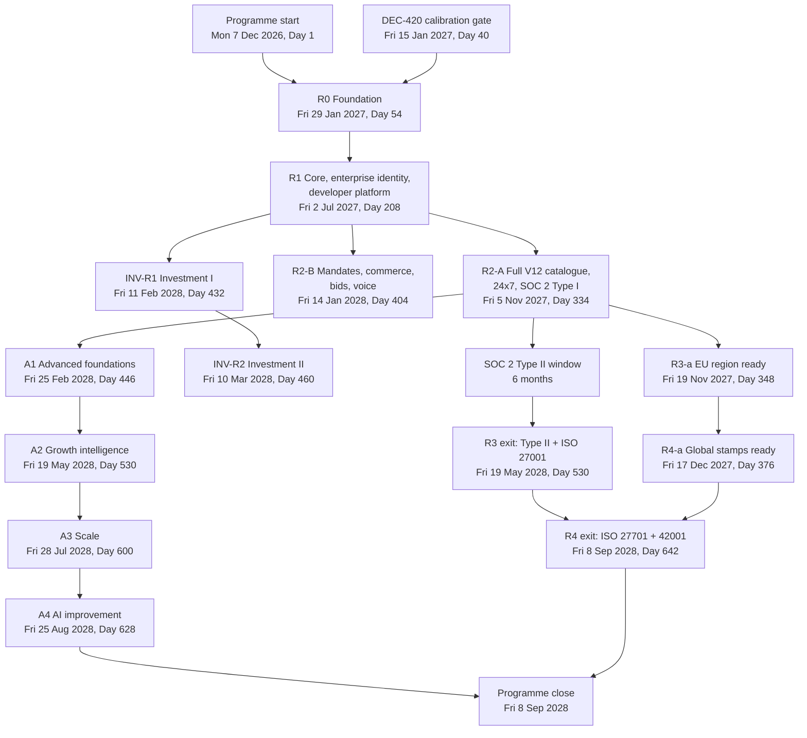
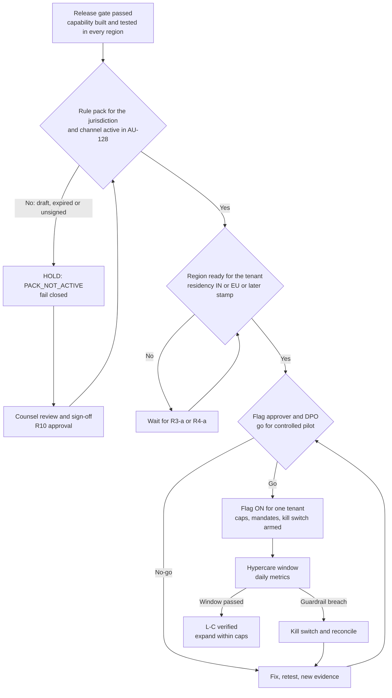
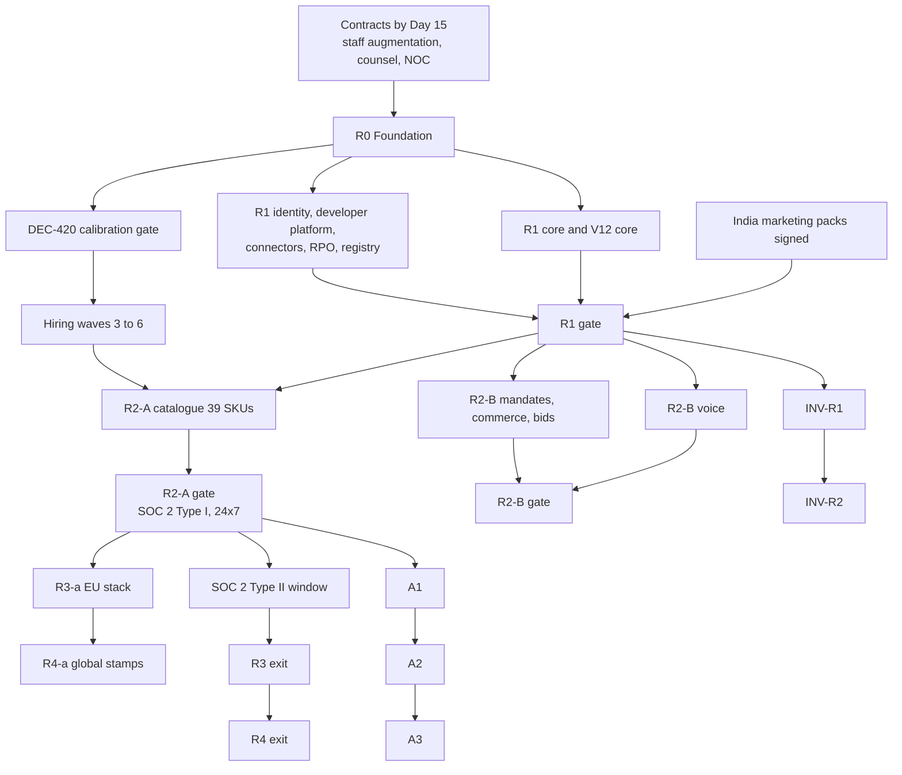
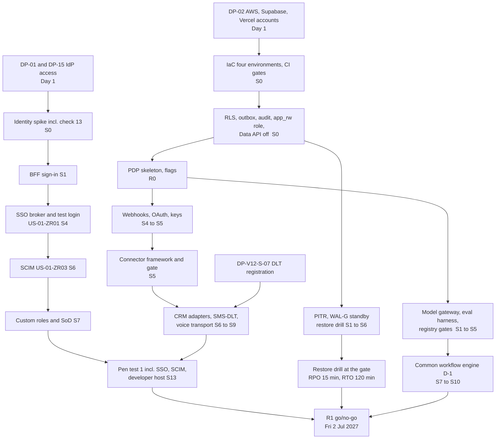
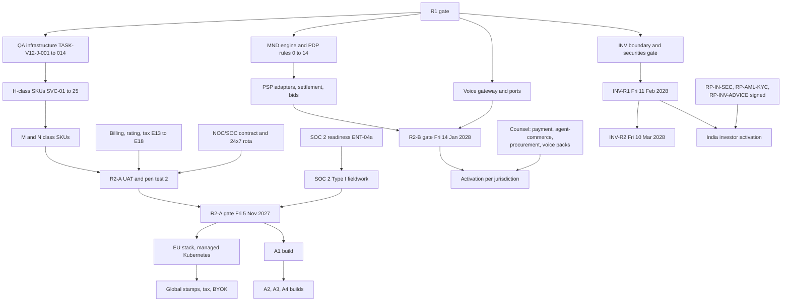
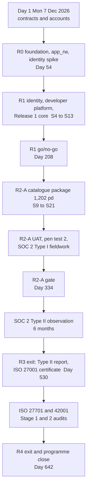

# AI Growth Engine: Employee Sales & Marketing Automation
## Application Blueprint: PART 11 (Batch 11.20a), Master Implementation Plan V12: Effort Roll-up, Releases, Dependencies, Critical Path, Gates and Calendar

| Field | Value |
|---|---|
| Document | Part 11, Batch 11.20a of 11.20a–11.20b (Group P5, letter S). 11.20a holds §11.20.1–§11.20.6: planning baseline, consolidated effort roll-up with overlap netting, release structure, dependency graph and critical path, entry and exit gates with the counsel rule-pack activation matrix, and the capacity-derived calendar. 11.20b holds §11.20.7–§11.20.17: sprint-by-sprint plan, team scaling, budgets, risk register, RAID log, governance, change control, decisions DEC-900…915, ADR-265…269, tags and the quality gate |
| Version | 1.0 · 28 Nov 2026 |
| Baseline | Part 11.14 (Founder decisions DEC-770…791, binding); Part 8.1 and 8.2 (template, capacity method, gates, RACI, risk method); Part 8.4 (two-ledger budget, rates); Part 9.5 §9.5.2 (re-plan, Option 2b, DEC-228…233); Part 9.10 (V11 A1–A3, DEC-410…422); effort and cost tables of Parts 11.1, 11.2, 11.3, 11.4, 11.5, 11.6, 11.7, 11.8, 11.9, 11.10, 11.11, 11.12, 11.13, 11.15, 11.16, 11.17, 11.18 and 11.19 |
| Roles applied | Programme Director (large SaaS platform builds), Agile/SAFe Release Train Engineer, Principal Architect (technical sequencing), FinOps and budgeting lead, Risk manager; with the blueprint's standing roles (Product Owner, QA Lead, Security/Compliance/AI Governance Lead, DevOps/SRE Lead) |
| Model | Every number in this part is produced by `assembly/v12b/s_master_plan.py` (effort roll-up, overlap register, scheduler, cost model) and inserted by `assembly/v12b/s_fragments.py`; output snapshot `assembly/v12b/s_master_plan_out.md` |
| Tag ranges used | ASSUMPTION / GAP / CONFLICT / RECOMMENDATION-1100…1119 · DEC-900…915 · ADR-265…269 · RSK-V12-S-01…24 · DP-V12-S-01…22 |
| Authority | DEC-770 (dates follow the work; scope is never cut), DEC-790 (all V12 change requests funded). This part replaces the date commitments of DEC-228 with the capacity-derived calendar of record (DEC-902) and keeps every approved scope item |

**Acronyms used in this part.** ART agile release train · BAU business as usual (sustain) · CCB change control board · CPaaS communications platform as a service · DLT distributed ledger technology registration (TRAI) · DP external dependency · DPIA data protection impact assessment · FTE full-time equivalent · GA general availability · IP sprint innovation and planning sprint (SAFe) · ISMS information security management system · KYC/AML know your customer / anti-money laundering · L / C / H low / central / high · NOC/SOC network/security operations centre · pd person-day · PERT three-point estimate · PI programme increment (six sprints here) · PSP payment service provider · PY programme year (PY1 = Day 1–364) · RTE release train engineer · SKU stock-keeping unit (one sellable service, SM-SVC-01…39) · SP story point · VD Vercel data-path control.

---

## 11.20.1 Purpose, inputs and planning baseline

### 11.20.1.1 What this part decides

| # | Decision area | Output | Owner after approval |
|---|---|---|---|
| 1 | Consolidated effort | One programme estimate for the entire revised scope, with every overlap the parts report netted once (§11.20.2) | Founder/PO, Finance |
| 2 | Release structure | R0, R1, R2-A, R2-B, R3, R4, INV-R1, INV-R2, A1–A4: scope, epics, story families, flags (§11.20.3) | Founder/PO |
| 3 | Dependencies and critical path | Release-level and build-level dependency graphs; the critical chain; float of every release (§11.20.4) | Principal Architect, RTE |
| 4 | Gates | Entry and exit criteria per release, go/no-go votes, and the counsel rule-pack sign-offs that gate activation per jurisdiction (§11.20.5) | Founder/PO, Legal/DPO |
| 5 | Calendar | Gate dates derived from capacity (2-week sprints from Mon 7 Dec 2026), with low and high bands and the DEC-420 calibration scenarios (§11.20.6) | Founder/PO |
| 6 | Sprints, team, budget, RAID, governance, change control | Part 11.20b | Founder/PO, RTE, Finance |

### 11.20.1.2 Binding inputs used

| Input | What it fixes for this plan | Source |
|---|---|---|
| Founder decisions 28 Nov 2026 | Full Release 2 change request; dates follow the work; scope is never cut; staffing extended by change request if a capacity gap appears | DEC-770 |
| Recovery and residency | Growth RTO ≤ 120 min blocking at every release gate; RPO ≤ 15 min; India and EU residency, blocking test CJ-TC-09 both ways | DEC-771, DEC-787, DEC-772 |
| Enterprise operations | 24×7 human on-call from Release 2 GA; SLA tiers 99.5 / 99.9 / 99.95% with credits; SOC 2 Type I (R2) → Type II + ISO 27001 (R3) → ISO 27701 + ISO 42001 (R4); global expansion IN → EU → UK/ME/APAC → US; messaging window 09:00–21:00 | DEC-773…777 |
| Security correction | `app_rw` least-privilege role, Data API off, no `service_role` at runtime | DEC-778 |
| Consequential capabilities | Bounded mandates, agentic commerce and payments, automatic bids, AI voice and recordings, investor/fundraising product: built, but activated per jurisdiction only after counsel-signed rule packs | DEC-779…783 |
| Platform decisions | SSO/SCIM and developer platform with CRM/SMS/voice connectors in Release 1; personal data via Vercel; provider-neutral registry with Claude Sonnet primary; cross-tenant benchmarks | DEC-784…789 |
| Funding | All V12 change requests funded irrespective of time and cost | DEC-790, DEC-791 |
| Team of record before this part | 4 engineers + 2 contract engineers (S3 → Release 2 gate) + QA 1.0 from S3 + growth/compliance 0.5 (0.75 in W4–W5) | DEC-228, DEC-232 |
| Delivery model | AI-built delivery with human-reviewed PRs; Sprint 2 calibration gate (net saving ≥ 20% → option A or B; 10–20% → keep plan; < 10% → keep plan, revert tooling) | DEC-420 |
| V11 scope | Literal alignment CR-ALN-01; advanced A1 approved (A2/A3 at gates, now funded by DEC-790) | DEC-416, DEC-417, DEC-411 |
| Capacity basis | 33.9 pd per sprint for 4.5 engineering FTE = **7.53 pd per FTE per 10-day sprint**; added engineers lose 15% while onboarding | Part 9.5 §9.5.2.5 |
| Estimation basis | 1 SP ≈ 0.7 pd; rate ₹4,545 / ₹5,682 / ₹6,818 per pd; ₹1.0–1.5 L per FTE-month (employee), ₹1.2–1.8 L (contract) | Part 8.1 §8.1.6.1; Part 8.4; ASSUMPTION-202 |
| Budgets already approved | Ledger A ₹52.7–84.1 L (DEC-230); Ledger B re-based ₹26,105–35,362/month (DEC-422); CR-ALN-01 ₹2.79–11.64 L (DEC-416); A1 ≈ ₹28.0–55.4 L (DEC-417); CR-V12-J-01 ₹9.4–37.3 L (DEC-770); build tooling (DEC-419/420) | Part 8.4; Part 9.10; Part 11.14 |

### 11.20.1.3 Calendar conventions [ASSUMPTION-1100]

**Programme start: Monday 7 December 2026 = Day 1** (task instruction; same as Part 8.1 ASSUMPTION-197). "Day n" counts calendar days. Sprints are two calendar weeks, Monday to Friday of the following week; sprint *k* starts on Day 1 + 14*k*. Gates are held on the Friday that ends a sprint. The working-day count of each sprint removes weekday national holidays and the year-end leave days listed below; the organisation's own holiday calendar replaces this list at Sprint 0 planning (verify, as of 27 Nov 2026).

| Year | Weekday holidays and leave used by the model (verify) |
|---|---|
| 2026–27 | 25 Dec 2026, 1 Jan 2027, 26 Jan, 22 Mar (Holi), 26 Mar (Good Friday), 29 Oct (Diwali) |
| 2028 | 26 Jan, 14 Apr (Good Friday), 15 Aug, 2 Oct, 17 Oct (Diwali), 25 Dec |
| 2029 | 1 Jan, 26 Jan, 1 Mar (Holi), 30 Mar (Good Friday), 15 Aug, 2 Oct, 5 Nov (Diwali), 25 Dec |

**Programme increments.** PI-0 is the foundation (S0–S2). From S3, each PI has six sprints; the sixth is an innovation-and-planning (IP) sprint at 50% feature capacity, used for PI planning, hardening, the release DR drill and technical debt (DEC-905). **Year-end change freeze:** no release gate is held in a sprint that contains 24–31 December; a gate that falls there moves to the next sprint [RECOMMENDATION-1112].

**Programme years** for budgets: PY1 = Mon 7 Dec 2026 – Sun 5 Dec 2027 (Day 1–364); PY2 = Mon 6 Dec 2027 – Sun 3 Dec 2028 (Day 365–728); PY3 = Day 729–1,092.

### 11.20.1.4 Planning principles

| # | Principle | Effect in this plan |
|---|---|---|
| P1 | **Dates follow the work; scope is never cut** (DEC-770) | No MoSCoW spill list. If capacity is short, a squad is added by change request or the gate date moves; nothing leaves a release |
| P2 | **Build everywhere, activate per jurisdiction** (DEC-779…783, DEC-906) | Release gates certify that a capability is built and tested; a capability is switched on for a jurisdiction only when its counsel-signed rule pack is `active` in AU-128/AU-170 and its feature flag approver agrees. A missing sign-off never delays a release gate; it delays only that activation |
| P3 | **Single owner for every capability** (DEC-901, ADR-268) | Where two or more parts specified and estimated the same work, it is built once, by the owner in the overlap register (§11.20.2.3) |
| P4 | **Calendar from capacity, not targets** | Gate dates are the output of a sprint-level scheduler over named squads and their queues; low and high effort give the date band |
| P5 | **Fail-closed controls are never on the scaling path** | Security, PDP, money, consent, mandates, residency and AI guardrail stories are owned by the human-reviewed core and never re-sequenced to save time (DEC-420 human-owned areas) |
| P6 | **Certification clocks are external constraints** | SOC 2 Type II needs an observation window; ISO certificates need stage 1/2 audits. These, not build effort, fix the R3 and R4 exit dates (§11.20.4.4) |

---

## 11.20.2 Consolidated effort roll-up

### 11.20.2.1 Method

```text
gross(group)        = the part's own development effort table (pd low / central / high)
removed(group)      = Σ overlap-register rows owned elsewhere (§11.20.2.3), single-owner rule
net(group)          = gross − removed
absorbed(group)     = net × 10% / 7.5% / 5%   for the V12 review groups A–L only            [ASSUMPTION-1103]
plan(group)         = net − absorbed
programme plan      = Σ plan(group)  →  release packages (§11.20.2.6)  →  scheduler (§11.20.6)
value (₹)           = plan_pd × ₹4,545 (low) / ₹5,682 (central) / ₹6,818 (high)            (Part 8.4)
central of a part with only low/high = midpoint (Part 11.3, 11.4, 11.9, 11.11, 11.12)
```

**Why absorption applies only to groups A–L.** Parts 11.1–11.12 enhance capabilities that already have baseline stories; a Part 5 story point already includes design, tests, documentation and evidence (Part 5.1a ASSUMPTION-152), so part of each V12 delta is absorbed when the story is refined, as Part 9.5 found (20/15/10%). The V12 groups already deducted the overlaps they could see, so this plan uses half of Part 9.5's factor. The Founder-decision parts (11.16–11.19), the AI-improvement catalogue (11.13), V11 advanced (A1–A3) and the enterprise items of this part are new capabilities and are not absorbed.

**Why the Part 11.10 single-count rule decides the catalogue build.** Part 11.10c §11.10.5.12 (RECOMMENDATION-924) states: "The coordinator keeps, per SKU, one build figure (the higher, never the sum)." Parts 11.2, 11.3, 11.4 and 11.10 each estimated the build of the 39 services and 156 workflows. Per range of SKUs the higher central estimate is kept:

| SKU range | Part 11.10 (J) SKU build + tests, pd L / C / H | Competing estimates (per-workflow parts) | Kept | Removed |
|---|---|---|---|---|
| SM-SVC-01…20 (H class) | 104.6 / **169.3** / 273.7 | Part 11.3 binding + partial + not-covered + test automation 109 / 162.5 / 216; Part 11.2 WF04 deltas 30 / 50 / 80 | J (higher central) | C and B shares (OV-01, OV-02) |
| SM-SVC-21…39 except 26, 28 | 152.4 / **248.9** / 400.6 | Part 11.4 D-1 alignment, D-2, D-3 153.5 / 228.75 / 306; Part 11.2 new services and wrappers 113.5 / 165.5 / 242 | J (higher central) | D and B shares (OV-03, OV-04) |
| SM-SVC-26 voice, SM-SVC-28 agentic commerce | 32.2 / 53.7 / 85.3 | Part 11.18 (269 central) and Part 11.17 (435 central) specify them in full under DEC-780/782 | Q and P | J rows (OV-05), B EP-22/EP-24 (OV-06), D-4 (OV-07) |

### 11.20.2.2 Gross effort as stated by each part

| Group | Part | What the part stated (development, one-time) | Basis used here |
|---|---|---|---|
| BASE | Parts 0–9.5 | 532 / 722 / 921 pd (DEC-228; Part 9.5 §9.5.2.4) | As stated; includes Release 1, Release 2 and the W6 backlog |
| ALN | 9.6a/b | CR-ALN-01 61.25 / 107.2 / 170.8 pd after DEC-418 (DEC-416) | As stated |
| ADV | 9.7b, 9.8b, 9.9b | X1 + X2 + X3 = 926 / 1,354 / 1,925 pd after the Part 9.10 §9.10.4 overlap (A1 376 / 553 / 790) | As stated; A2/A3 remainder split 55 / 45% [ASSUMPTION-1108] |
| A | 11.1b §11.1.5.20 | P-A 119 / 177 / 254 pd | As stated |
| B | 11.2a §11.2.5.7 | CR-V12-B-01 236.5 / 349.5 / 512 pd | As stated |
| C | 11.3a §11.3.5.9 | 155–299 pd (base 227) | Midpoint central |
| D | 11.4d §11.4.5.33 | D-1…D-3 212.5–405 pd; D-4 86–172 pd (now adopted by DEC-779…791) | Midpoints; D-4 included gross |
| E | 11.5b §11.5.5.16 | 200 / 297 / 455 pd net of the EP-20 overlap | As stated |
| F | 11.6b §11.6.5.18.1 | CR-V12-F 242 / 357 / 530 pd | As stated |
| G | 11.7b §11.7.5.12 | 252 / 353 / 536 pd | As stated |
| H | 11.8b §11.8.5.15 | R1–R2 110 / 163 / 228 + later 20 / 31 / 44 pd | Both included gross |
| I | 11.9c §11.9.5.19 | D1–D7 49–86 pd | Midpoint central |
| J | 11.10c §11.10.5.12 | 366.1 / 597.8 / 965.4 pd (CR-V12-J-01 + J-02; J-02 now funded by DEC-790) | As stated |
| K | 11.11b §11.11.5.19 | 59.5–107 pd (central ≈ 83) | Midpoint central |
| L | 11.12 §11.12.5.7 | 25–46 pd | Midpoint central |
| M | 11.13b §11.13.5.12 | 240.6 / 367.8 / 534.0 pd (A2–A4, with 20% uplift) | As stated |
| N | 11.16e §11.16.5.16 | CR-V12-N-01 315 / 496 / 751 pd | As stated |
| O | 11.16d §11.16.15.32 | 244 / 358 / 526 pd | As stated |
| P | 11.17b §11.17.15.1 | CR-V12-P 293 / 435 / 625 pd | As stated (component estimate governs, per the part) |
| Q | 11.18c §11.18.5.32 | 187 / 269 / 397 pd (supersedes 11.4d D-4 for voice) | As stated |
| R | 11.19b §11.19.5.13 | Gross 183 / 269 / 382 + EU per-zone 4 / 6 / 9 pd; net of its own H overlap 120 / 176 / 253 | Gross used; the part's own netting is OV-19 |
| ENT | This part §11.20.2.8 | 228 / 348 / 521 pd | Bottom-up, [ASSUMPTION-1104] |
| — | 11.15a/b/c | Rule-pack drafting; engineering is in AU-128 (Part 11.13) and the packs' YAML in P, O and F | No engineering line; counsel cost in Part 11.20b §11.20.9.4 |
| — | 11.0, 11.12 audit, 11.14 | Registers and decisions | No engineering line |

### 11.20.2.3 Overlap register (single-owner rule, DEC-901)

Every row is an overlap that a part itself reported (single-count rule, "same capability pulled forward", "superseded", "counted by the owner group") or that is evident from two parts specifying the same component. The removed amounts are the removed part's own line items.

| # | Removed from | Capability built twice (as the parts report it) | Owner kept (single-owner rule) | Removed pd L / C / H |
|---|---|---|---|---|
| OV-01 | C (11.3) | SVC-01..20 workflow binding, partial and not-covered enhancements, test automation | J SKU build SVC-01..20 (higher central 169.3) | 109.0 / 162.5 / 216.0 |
| OV-02 | B (11.2) | WF04 and SKU deltas SVC-01..25 | J SKU build | 37.5 / 62.5 / 100.0 |
| OV-03 | D (11.4) | D-1 alignment of 19 workflows, D-2, D-3 (SVC-21..39 workflows and adapters) | J SKU build SVC-21..39 (higher central 248.9) | 163.5 / 243.8 / 324.0 |
| OV-04 | B (11.2) | SKU wrappers, tabs, EP-23/25/26/27/28 new services | J SKU build (classes M/N) | 106.0 / 153.0 / 222.0 |
| OV-05 | J (11.10) | SM-SVC-26 and SM-SVC-28 SKU builds | Q (voice) and P (agentic commerce) | 32.2 / 53.7 / 85.3 |
| OV-06 | B (11.2) | EP-22 voice and EP-24 agentic commerce | Q and P | 58.0 / 82.0 / 118.0 |
| OV-07 | D (11.4) | CR-V12-D-4 conflict workflows and voice/media adapters | P, Q and J SVC-27 | 86.0 / 129.0 / 172.0 |
| OV-08 | B (11.2) | EP-29 catalogue framework | E9/E11/E13 + D common engine | 20.0 / 30.0 / 42.0 |
| OV-09 | C (11.3) | Contract registry, DTO validators, run API, step state | D common engine | 21.0 / 29.0 / 37.0 |
| OV-10 | D (11.4) | Archetype test harness | J TASK-V12-J-001/002 | 8.0 / 11.0 / 14.0 |
| OV-11 | B (11.2) | Acceptance of 195 scenarios + 264 TC | J per-SKU test packs | 15.0 / 22.0 / 30.0 |
| OV-12 | E (11.5) | CR-V12-E-02 enterprise identity E2-E6 | R-WP01..03 (DEC-784 owner) | 58.0 / 86.0 / 134.0 |
| OV-13 | E (11.5) | E12 plan change/proration; E21 backup Option A/B | A WP-A3; R-WP16 (DEC-787) | 14.0 / 21.0 / 32.0 |
| OV-14 | A (11.1) | WP-A1 registry, half WP-A2, WP-A8 wizard, WP-A10 status/help, WP-A11 metrics | E9/E13, E7+G14, K, I D3 | 33.0 / 49.5 / 71.0 |
| OV-15 | G (11.7) | A089 delta, storefront calculators, investor-mode removal | A WP-A9, A WP-A5, N (DEC-783) | 15.0 / 22.0 / 33.0 |
| OV-16 | F (11.6) | AG-100 voice router, AG-104 commerce counterparty | Q AG-210..219, P AG-200..209 | 12.0 / 18.0 / 26.0 |
| OV-17 | H (11.8) | H8 SIEM sink; later voice CPaaS, BYOK, Java SDK, US tax | R-WP03, Q, I D7, R-WP06, ENT-06 | 23.0 / 35.0 / 50.0 |
| OV-18 | I (11.9) | D5 audit sinks, D6 sandbox, half D4 | R-WP03, R-WP08, Part 9.5 I-1 | 13.0 / 17.8 / 22.5 |
| OV-19 | R (11.19) | CR-V12-H-01 H1/H2/H3/H7 + CRM/SMS (R's own netting) and R-WP14 voice transport | H and Q | 69.0 / 102.0 / 142.0 |
| OV-20 | ADV (V11) | A3 developer platform, BYOK, status page; A1 registry canary and DR-drill automation | H/R, I D7, K, R-WP16/17 | 39.0 / 58.0 / 83.0 |
| | | **Total removed** | | **932.2 / 1387.7 / 1953.8** |

**Not treated as overlap (checked).** (1) Part 11.13 A2–A4 versus V11 A2/A3: Part 11.13b states its items are "in addition to the A2/A3 scope". (2) Part 11.16 N versus O: different services (INV-SVC-01…12 versus 13…24) on a shared boundary owned by N. (3) Part 11.17 versus Part 11.6 rule-pack configuration (PACKS): different packs. (4) Part 11.19 R-WP17/18 registry versus Part 11.6 AU-151/152: Part 11.19b already excluded AU-151/152. (5) Part 11.5 E16 SaaS subscription collection versus Part 11.17 PSP payment mandates: different money paths. (6) Penetration tests of P, Q, N and R: different surfaces; each is a separate engagement in §11.20.9.4.

### 11.20.2.4 Roll-up by group

| Group | Source part and change request | Gross pd L / C / H | Overlap removed L / C / H | Net L / C / H | Absorbed at refinement L / C / H | **Plan pd L / C / H** | Plan value ₹ L (low × ₹4,545 / central × ₹5,682 / high × ₹6,818) |
|---|---|---|---|---|---|---|---|
| BASE | Baseline Parts 0-9.5 (DEC-228) | 532 / 722 / 921 | 0 / 0 / 0 | 532 / 722 / 921 | 0.0 / 0.0 / 0.0 | **532 / 722 / 921** | 24.18 / 41.02 / 62.79 |
| ALN | V11 literal alignment CR-ALN-01 (DEC-416) | 61 / 107 / 171 | 0 / 0 / 0 | 61 / 107 / 171 | 0.0 / 0.0 / 0.0 | **61 / 107 / 171** | 2.78 / 6.09 / 11.65 |
| ADV | V11 advanced A1-A3 X1+X2+X3 net of 9.10.4 (DEC-411/417) | 926 / 1354 / 1925 | 39 / 58 / 83 | 887 / 1296 / 1842 | 0.0 / 0.0 / 0.0 | **887 / 1296 / 1842** | 40.31 / 73.64 / 125.59 |
| A | 11.1 Business requirements P-A | 119 / 177 / 254 | 33 / 50 / 71 | 86 / 128 / 183 | 8.6 / 9.6 / 9.2 | **77 / 118 / 174** | 3.52 / 6.70 / 11.85 |
| B | 11.2 Service catalogue CR-V12-B-01 | 236 / 350 / 512 | 236 / 350 / 512 | 0 / 0 / 0 | 0.0 / 0.0 / 0.0 | **0 / 0 / 0** | 0.00 / 0.00 / 0.00 |
| C | 11.3 Workflows SVC-01..20 | 155 / 227 / 299 | 130 / 192 / 253 | 25 / 36 / 46 | 2.5 / 2.7 / 2.3 | **22 / 33 / 44** | 1.02 / 1.87 / 2.98 |
| D | 11.4 Workflows SVC-21..39 D-1..D-4 | 298 / 438 / 577 | 258 / 384 / 510 | 41 / 54 / 67 | 4.1 / 4.0 / 3.4 | **37 / 50 / 64** | 1.68 / 2.84 / 4.34 |
| E | 11.5 Platform architecture CR-V12-E-01..03 | 200 / 297 / 455 | 72 / 107 / 166 | 128 / 190 / 289 | 12.8 / 14.2 / 14.5 | **115 / 176 / 275** | 5.24 / 9.99 / 18.72 |
| F | 11.6 AI engines CR-V12-F | 242 / 357 / 530 | 12 / 18 / 26 | 230 / 339 / 504 | 23.0 / 25.4 / 25.2 | **207 / 314 / 479** | 9.41 / 17.82 / 32.64 |
| G | 11.7 UI/UX DEC-633 | 252 / 353 / 536 | 15 / 22 / 33 | 237 / 331 / 503 | 23.7 / 24.8 / 25.2 | **213 / 306 / 478** | 9.69 / 17.40 / 32.58 |
| H | 11.8 API and integrations CR-V12-H-01 (R1-R2 + later) | 130 / 194 / 272 | 23 / 35 / 50 | 107 / 159 / 222 | 10.7 / 11.9 / 11.1 | **96 / 147 / 211** | 4.38 / 8.36 / 14.38 |
| I | 11.9 Data, security, analytics D1-D7 | 49 / 68 / 86 | 13 / 18 / 22 | 36 / 50 / 64 | 3.6 / 3.7 / 3.2 | **32 / 46 / 60** | 1.47 / 2.61 / 4.11 |
| J | 11.10 Backlog CR-V12-J-01 + J-02 | 366 / 598 / 965 | 32 / 54 / 85 | 334 / 544 / 880 | 33.4 / 40.8 / 44.0 | **301 / 503 / 836** | 13.66 / 28.60 / 57.00 |
| K | 11.11 Observability CR-V12-K-01 | 60 / 83 / 107 | 0 / 0 / 0 | 60 / 83 / 107 | 6.0 / 6.2 / 5.4 | **54 / 77 / 102** | 2.43 / 4.38 / 6.93 |
| L | 11.12 Historical annex | 25 / 36 / 46 | 0 / 0 / 0 | 25 / 36 / 46 | 2.5 / 2.7 / 2.3 | **22 / 33 / 44** | 1.02 / 1.87 / 2.98 |
| M | 11.13 AI improvement CR-AIM-01 (A2-A4) | 241 / 368 / 534 | 0 / 0 / 0 | 241 / 368 / 534 | 0.0 / 0.0 / 0.0 | **241 / 368 / 534** | 10.94 / 20.90 / 36.41 |
| N | 11.16a/b/e Investment I CR-V12-N-01 | 315 / 496 / 751 | 0 / 0 / 0 | 315 / 496 / 751 | 0.0 / 0.0 / 0.0 | **315 / 496 / 751** | 14.32 / 28.18 / 51.20 |
| O | 11.16c/d Investment II | 244 / 358 / 526 | 0 / 0 / 0 | 244 / 358 / 526 | 0.0 / 0.0 / 0.0 | **244 / 358 / 526** | 11.09 / 20.34 / 35.86 |
| P | 11.17 Mandates, commerce, bids CR-V12-P | 293 / 435 / 625 | 0 / 0 / 0 | 293 / 435 / 625 | 0.0 / 0.0 / 0.0 | **293 / 435 / 625** | 13.32 / 24.72 / 42.61 |
| Q | 11.18 Voice and recordings | 187 / 269 / 397 | 0 / 0 / 0 | 187 / 269 / 397 | 0.0 / 0.0 / 0.0 | **187 / 269 / 397** | 8.50 / 15.28 / 27.07 |
| R | 11.19 Platform decisions CR-V12-R-01 (gross) | 187 / 275 / 391 | 69 / 102 / 142 | 118 / 173 / 249 | 0.0 / 0.0 / 0.0 | **118 / 173 / 249** | 5.36 / 9.83 / 16.98 |
| ENT | 11.20 Enterprise items ENT-01..10 (this part) | 228 / 348 / 521 | 0 / 0 / 0 | 228 / 348 / 521 | 0.0 / 0.0 / 0.0 | **228 / 348 / 521** | 10.36 / 19.77 / 35.52 |
| **Total** | | **5346 / 7908 / 11401** | **932 / 1388 / 1954** | **4414 / 6521 / 9447** | **131 / 146 / 146** | **4283 / 6374 / 9302** | **194.68 / 362.20 / 634.20** |

### 11.20.2.5 Roll-up by capability

| Cap. | Capability | Groups | Plan pd L / C / H | Share of central | Value ₹ L L / C / H |
|---|---|---|---|---|---|
| C01 | Core growth engine, Release 1/2 baseline (Parts 0–9.5) | BASE | 532 / 722 / 921 | 11.3% | 24.18 / 41.02 / 62.79 |
| C02 | Literal alignment (V11, CR-ALN-01) | ALN | 61 / 107 / 171 | 1.7% | 2.78 / 6.09 / 11.65 |
| C03 | Service catalogue, 156 workflows, SKU build (39 SKUs) | A, B, C, D, J | 437 / 704 / 1117 | 11.0% | 19.88 / 40.00 / 76.18 |
| C04 | Platform architecture, tenancy, billing and tax | E | 115 / 176 / 275 | 2.8% | 5.24 / 9.99 / 18.72 |
| C05 | AI engines, model registry, evaluation (111 suites) | F | 207 / 314 / 479 | 4.9% | 9.41 / 17.82 / 32.64 |
| C06 | Website, portal, Command Centre UX, i18n/RTL | G | 213 / 306 / 478 | 4.8% | 9.69 / 17.40 / 32.58 |
| C07 | Enterprise identity, developer platform, connectors, Vercel, RPO, DB roles | H, R | 214 / 320 / 460 | 5.0% | 9.74 / 18.19 / 31.36 |
| C08 | Data, security, observability, SLA, traceability | I, K, L | 108 / 156 / 206 | 2.4% | 4.93 / 8.86 / 14.02 |
| C09 | Bounded mandates, agentic commerce, payments, automatic bids | P | 293 / 435 / 625 | 6.8% | 13.32 / 24.72 / 42.61 |
| C10 | AI voice calling and recordings | Q | 187 / 269 / 397 | 4.2% | 8.50 / 15.28 / 27.07 |
| C11 | Investment Automation INV-SVC-01…24 | N, O | 559 / 854 / 1277 | 13.4% | 25.41 / 48.52 / 87.07 |
| C12 | Enterprise operations, certification, EU and global regions | ENT | 228 / 348 / 521 | 5.5% | 10.36 / 19.77 / 35.52 |
| C13 | Advanced intelligence A1–A4 (X1–X3 + AI improvement) | ADV, M | 1128 / 1664 / 2376 | 26.1% | 51.25 / 94.54 / 162.00 |
| | **Total** | | **4283 / 6374 / 9302** | 100% | **194.68 / 362.20 / 634.20** |

### 11.20.2.6 Roll-up by release package

Each group's plan effort is allocated to release packages using the release placement each part states (R1-CR, R2-CR, P2, A1…A4, "Release 1", "Release 2", W6), or, where the part left it open, the placement that DEC-784/785 (Release 1) and DEC-770/790 (Release 2) require. Allocation rules: baseline 73 / 408 / 111 / 130 pd central to R0 / R1 / R2-A / R3 (W6 backlog) following Part 8.1 and Part 9.5; CR-ALN-01 80.5 pd Release 1 Musts (Part 9.10 §9.10.6.2) and the remainder to R2-A; Part 11.6 by its R1-CR / R2-CR / P2 columns; Part 11.19 by its cut-over table (§11.19.5.12), with benchmarks (C7) in R2 and the EU zone repeat in R3; Part 11.7, 11.8, 11.11 split R1 / R2 by their own sequencing notes; Part 11.13 by its A2 / A3 / A4 rows; the enterprise items by §11.20.2.8.

| Package | Release | Content | Plan pd L / C / H | Value ₹ L L / C / H | Squads (queue order) | Earliest start | Build complete (central) |
|---|---|---|---|---|---|---|---|
| R0 | R0 | R0 Foundation | 64 / 88 / 115 | 2.91 / 5.00 / 7.82 | SQ-01, SQ-02, SQ-03 | S0 | S3 Fri 29 Jan 2027 |
| R1_BASE | R1 | R1 core (baseline Release 1 + alignment Musts) | 347 / 489 / 649 | 15.75 / 27.76 / 44.23 | SQ-01, SQ-02 | S0 | S12 Fri 4 Jun 2027 |
| R1_V12 | R1 | R1 V12 core platform, AI governance, UX, ops | 350 / 513 / 752 | 15.91 / 29.12 / 51.30 | SQ-02, SQ-04, SQ-05 | S3 | S13 Fri 18 Jun 2027 |
| R1_PD | R1 | R1 enterprise identity, developer platform, connectors, platform decisions | 151 / 225 / 324 | 6.87 / 12.80 / 22.07 | SQ-03 | S1 | S11 Fri 21 May 2027 |
| R2A_BASE | R2A | R2-A baseline Release 2 (closure, SaaS) | 97 / 138 / 184 | 4.41 / 7.82 / 12.55 | SQ-01 | S12 | S18 Fri 27 Aug 2027 |
| R2A_CAT | R2A | R2-A full V12 service catalogue (39 SKUs, billing, screens, agents) | 769 / 1202 / 1888 | 34.97 / 68.29 / 128.74 | SQ-02, SQ-03, SQ-04, SQ-05, SQ-06 | S9 | S21 Fri 8 Oct 2027 |
| R2A_ENT | R2A | R2-A enterprise operations (24x7, 99.95% topology, SOC 2 Type I) | 44 / 67 / 100 | 2.00 / 3.81 / 6.84 | SQ-10 | S18 | S21 Fri 8 Oct 2027 |
| R2B_P | R2B | R2-B bounded mandates, agentic commerce, payments, automatic bids | 293 / 435 / 625 | 13.32 / 24.72 / 42.61 | SQ-07, SQ-08 | S11 | S25 Fri 3 Dec 2027 |
| R2B_Q | R2B | R2-B AI voice and recordings | 187 / 269 / 397 | 8.50 / 15.28 / 27.07 | SQ-08 | S12 | S22 Fri 22 Oct 2027 |
| R3 | R3 | R3 EU region, SOC 2 Type II, ISO 27001, managed Kubernetes, W6 backlog | 203 / 294 / 411 | 9.24 / 16.71 / 28.02 | SQ-01, SQ-02, SQ-03, SQ-10 | S18 | S23 Fri 5 Nov 2027 |
| R4 | R4 | R4 global regions, tax engine, locales, BYOK, ISO 27701/42001 | 91 / 138 / 204 | 4.14 / 7.83 / 13.88 | SQ-03, SQ-07, SQ-08, SQ-10 | R3 build + 1 | S25 Fri 3 Dec 2027 |
| INV1 | INV1 | INV-R1 Investment Automation I (INV-SVC-01..12) | 315 / 496 / 751 | 14.32 / 28.18 / 51.20 | SQ-06, SQ-09 | S16 | S28 Fri 14 Jan 2028 |
| INV2 | INV2 | INV-R2 Investment Automation II (INV-SVC-13..24) | 244 / 358 / 526 | 11.09 / 20.34 / 35.86 | SQ-05, SQ-06, SQ-09 | S22 | S30 Fri 11 Feb 2028 |
| A1 | A1 | A1 advanced foundations (X1-X3) | 368 / 538 / 765 | 16.74 / 30.57 / 52.13 | SQ-02, SQ-04, SQ-11 | R2-A gate − 2 sprints (DEC-417) | S29 Fri 28 Jan 2028 |
| A2 | A2 | A2 growth intelligence + AI improvement A2 | 401 / 592 / 847 | 18.22 / 33.66 / 57.72 | SQ-01, SQ-04, SQ-05, SQ-11 | A1 build + 1 | S35 Fri 21 Apr 2028 |
| A3 | A3 | A3 scale + AI improvement A3 | 322 / 478 / 685 | 14.66 / 27.17 / 46.68 | SQ-01, SQ-04, SQ-05, SQ-11 | A2 build + 1 | S40 Fri 30 Jun 2028 |
| A4 | A4 | A4 AI improvement A4 | 36 / 55 / 80 | 1.64 / 3.14 / 5.46 | SQ-04, SQ-11 | A3 build + 1 | S41 Fri 14 Jul 2028 |

### 11.20.2.7 Programme total, confidence and comparison

```text
Plan (pd)           low 4,283     central 6,374     high 9,302
PERT expected       E = (4,283 + 4 × 6,374 + 9,302) ÷ 6 = 6,514 pd ;  σ = (9,302 − 4,283) ÷ 6 = 836 pd
Confidence          P80 = E + 0.84σ ≈ 7,216 pd ;  P90 = E + 1.28σ ≈ 7,584 pd
Story points        central 6,374 pd ÷ 0.7 ≈ 9,106 SP
Effort value        4,283 × ₹4,545 = ₹1.95 Cr  ·  6,374 × ₹5,682 = ₹3.62 Cr  ·  9,302 × ₹6,818 = ₹6.34 Cr
Overlap netted      gross 5,346 / 7,908 / 11,401 pd → net 4,414 / 6,521 / 9,447 pd (−932 / −1,388 / −1,954)
```

| Measure | pd (L / C / H) | Against the previous baseline |
|---|---|---|
| Baseline of record before V12 (DEC-228) | 532 / 722 / 921 | — |
| + V11 alignment and A1–A3 (DEC-416/417/411) | 948 / 1,403 / 2,013 after OV-20 | Was approved or gated separately |
| + V12 review groups A–M, net and absorbed | 1,418 / 2,170 / 3,299 | Was "pending Founder" until DEC-790 |
| + Founder-decision parts N, O, P, Q, R | 1,157 / 1,731 / 2,548 | New on 28 Nov 2026 |
| + Enterprise items ENT | 228 / 348 / 521 | Costed here for the first time |
| **Programme plan** | **4,283 / 6,374 / 9,302** | **8.8× the central baseline of record** |

### 11.20.2.8 Enterprise items estimated in this part [ASSUMPTION-1104]

Founder decisions DEC-771…776 adopted enterprise operations whose engineering no part estimated in full. Unit sizes follow Part 9.7b §9.7.13.1 and the per-zone repeat of Part 11.19b.

| ID | Item | Decision | Content | Release | pd L / C / H |
|---|---|---|---|---|---|
| ENT-01 | EU regional stack | DEC-772 | Parameterised IaC second stamp (Supabase EU project, AWS EU API/workers/Valkey/S3/SES, Vercel EU functions); residency router; region-pinned model calls and indexes; CJ-TC-09 both directions; in-zone DR copies | R3 | 30 / 45 / 65 |
| ENT-02 | 99.95% Enterprise topology | DEC-774 | ADR before the first Enterprise contract; multi-AZ failover automation; provider SLA composition checks; chaos tests | R2-A | 15 / 22 / 32 |
| ENT-03 | 24×7 operations set-up | DEC-773 | NOC/SOC onboarding, alert routing, runbook conversion, escalation rota tooling, SIEM feed to the SOC (paging test automation stays in Part 11.11) | R2-A | 10 / 15 / 22 |
| ENT-04a | SOC 2 Type I readiness | DEC-775 | Control mapping, policy set, evidence automation on AU-079/151/154, auditor walkthroughs | R2-A | 20 / 30 / 45 |
| ENT-04b | SOC 2 Type II and ISO 27001 | DEC-775 | Operating-effectiveness evidence, ISMS, internal audit, Stage 1/2 support | R3 | 15 / 25 / 40 |
| ENT-04c | ISO 27701 and ISO 42001 | DEC-775 | PIMS and AI management system extensions, AI impact assessments | R4 | 15 / 25 / 40 |
| ENT-05 | Managed Kubernetes for regional stacks | DEC-776 | Migration of API/workers to managed Kubernetes per region; Helm charts; per-zone pipelines | R3 | 40 / 60 / 90 |
| ENT-06 | Global tax engine activation | DEC-776 | TX-04…09 per market on the Part 11.5 rule-table engine; provider adapter; invoice formats | R4 | 20 / 30 / 45 |
| ENT-07 | Four further regional stamps | DEC-776 | UK, Middle East, APAC, US from the EU template (10 / 15 / 22 pd each) | R4 | 40 / 60 / 88 |
| ENT-08 | Locales de, fr, ar | DEC-776 | Content, evaluation slices, locale QA, legal templates (framework and RTL already in Part 11.7) | R3 (de, fr) / R4 (ar) | 15 / 24 / 36 |
| ENT-10 | EU AI Act and DPIA engineering | DEC-776 | Transparency logs, conformity documentation, DPIA evidence hooks | R3 | 8 / 12 / 18 |
| | **Total ENT** | | | | **228 / 348 / 521** |

BYOK across clouds is Part 11.9 D7 (R4); SLA computation and status are Part 11.11; RPO/standby is Part 11.19 R-WP16. They are not repeated here.

---

## 11.20.3 Release structure

### 11.20.3.1 Why the release structure changes

Part 8.1 planned two releases (R1 = W0–W3, R2 = W4–W5) and W6; Part 9.10 added A1–A3. The Founder decisions of 28 Nov 2026 add four kinds of scope that cannot share one gate without the slowest dictating the rest: (1) enterprise identity and the developer platform, required in Release 1 (DEC-784/785); (2) the 39-SKU catalogue with billing, 24×7 and SOC 2 Type I (DEC-770/773/775); (3) consequential capabilities that need two-person mandates, licensed PSPs, portal registries and voice consent (DEC-779…782); (4) a sibling product with securities-law gates (DEC-783); and (5) certification and region work whose clocks are external (DEC-772/775/776). The structure below gives each its own gate while keeping one continuously deployed product behind flags (DEC-006 principle) [RECOMMENDATION-1110].

### 11.20.3.2 Release summary

| Release | Theme | Scope (groups and packages) | Epics and story families | Plan pd L / C / H | Build window (central) | **Gate of record** |
|---|---|---|---|---|---|---|
| **R0** Foundation | W0-A/W0-B controls + V12 platform corrections | Baseline W0 (Part 8.1 S0–S2); DEC-778 `app_rw`, Data API off; Vercel per-zone projects; PITR on; registry seed | EP-01…04, EP-17 shell; US-01-ZR26, US-01-ZR27, US-21-ZR16 (part), US-21-ZR18 (part) | 64 / 88 / 115 | S0–S3 | **Fri 29 Jan 2027 (Day 54)** |
| **R1** Core + enterprise identity + developer platform | Release 1 of record + V12 core + DEC-784/785 | Baseline R1 + CR-ALN-01 Musts; V12 R1 items of A, D, E, F, G, H, I, K, L; Part 11.19 C1–C6, C8 | EP-01…12, 17…21; US-01-ZR01…05, US-20-ZR06…10, US-18-ZR11, US-07-ZR12/13, US-23-ZR14, US-22-ZR15, US-21-ZR16…19, US-04-ZR20…23, US-01-ZR26…28, US-21-ZR29 | 848 / 1,226 / 1,725 | S0–S13 | **Fri 2 Jul 2027 (Day 208)** |
| **R2-A** Full V12 service catalogue | 39 SKUs, 156 workflows, billing, 24×7, SLA tiers, SOC 2 Type I | Baseline R2 (W4–W5) + CR-ALN-01 remainder; J (CR-V12-J-01 + J-02), A, C, E, F R2/P2, G, H, K R2 parts; R C7 benchmarks; ENT-02/03/04a | EP-13…16, 18, 20, 21, EP-25…29; SM-SVC-01…39-BUILD (except 26, 28); US-17-ZR24/25 | 910 / 1,407 / 2,173 | S9–S21 | **Fri 5 Nov 2027 (Day 334)** |
| **R2-B** Consequential capabilities | Bounded mandates, agentic commerce and payments, automatic bids, AI voice and recordings | Part 11.17 (P) and Part 11.18 (Q) | EP-14, 15, 18, 24 (US-14/15/18/24-ZP*); EP-22, EP-08 (US-22-ZQ01…15, US-08-ZQ01…03) | 480 / 704 / 1,022 | S11–S25 | **Fri 14 Jan 2028 (Day 404)** |
| **R3** EU + SOC 2 Type II + ISO 27001 | EU stack (R3-a), certification, managed Kubernetes, W6 backlog | ENT-01, 04b, 05, 08 (de, fr), 10; R EU zone; baseline W6 Should/Could packages | EP-01, 20, 21; W6 backlog of Part 9.5 §9.5.2.7 | 203 / 294 / 411 | S18–S23 (build); exit fixed by the Type II window | **R3-a EU ready Fri 19 Nov 2027 (Day 348); R3 exit Fri 19 May 2028 (Day 530)** |
| **R4** Global + ISO 27701/42001 | UK, Middle East, APAC, US stamps; tax TX-04…09; ar RTL; BYOK multi-cloud | ENT-04c, 06, 07, 08 (ar); I D7 | EP-01, 20, 21 | 91 / 138 / 204 | S24–S25 (build); exit fixed by certification | **R4-a global ready Fri 17 Dec 2027 (Day 376); R4 exit Fri 8 Sep 2028 (Day 642)** |
| **INV-R1** Investment Automation I | Investor mode, INV-SVC-01…12, securities gate | Part 11.16a/b/e (N) | EP-30, EP-31 (US-30-ZN01…18, US-31-ZN01…16) | 315 / 496 / 751 | S16–S28 | **Fri 11 Feb 2028 (Day 432)** |
| **INV-R2** Investment Automation II | INV-SVC-13…24, seven securities packs | Part 11.16c/d (O) | EP-32, EP-33 (US-32-ZO01…10, US-33-ZO01…15) | 244 / 358 / 526 | S22–S30 | **Fri 10 Mar 2028 (Day 460)** |
| **A1** Advanced foundations | X1–X3 A1 (approved, DEC-417) | Part 9.7b/9.8b/9.9b A1 net of OV-20 | US-<EP>-V1/V2/V3 A1 stories | 368 / 538 / 765 | S21–S29 | **Fri 25 Feb 2028 (Day 446)** |
| **A2** Growth intelligence | X1–X3 A2 + Part 11.13 A2 | V11 A2 share + M A2 | US-<EP>-V*, US-<EP>-YM* | 401 / 592 / 847 | S30–S35 | **Fri 19 May 2028 (Day 530)** |
| **A3** Scale | X1–X3 A3 + Part 11.13 A3 | V11 A3 share (net of OV-20) + M A3 | as above | 322 / 478 / 685 | S36–S40 | **Fri 28 Jul 2028 (Day 600)** |
| **A4** AI improvement | Part 11.13 A4 | M A4 | as above | 36 / 55 / 80 | S41 | **Fri 25 Aug 2028 (Day 628)** |
| **Total** | | | | **4,283 / 6,374 / 9,302** | S0–S41 build; S42–S45 gates | **Programme close Fri 8 Sep 2028 (Day 642)** |

### 11.20.3.3 What the business can use, and when (activation sequence, central dates)

| Activation (after its release gate and, where marked ●, after counsel sign-off for the jurisdiction) | Earliest (central) |
|---|---|
| Internal discovery, research review, qualification (owned portfolio) | R0 + S4–S5 (Feb 2027), as in Part 9.5 |
| Email outreach, websites, WhatsApp, campaigns in India ● RP-IN-ADV, RP-IN-DPDP, RP-IN-WA, RP-COMMIT, RP-HEALTH, RP-EDU-MINORS | Progressive from Mar 2027; complete at R1 (Fri 2 Jul 2027) |
| Enterprise SSO, SCIM, custom roles, SIEM export; developer API, webhooks, SDKs, sandbox; CRM connectors (Zoho, HubSpot, Salesforce); SMS-DLT ● RP-IN-SMS | R1, Fri 2 Jul 2027 |
| Residency choice at onboarding (India now; EU accepted from R3-a) | R1, Fri 2 Jul 2027 |
| 39-SKU storefront, SaaS billing and tax (India), Standard and Business SLA tiers, 24×7 on-call, SOC 2 Type I report | R2-A, Fri 5 Nov 2027 |
| Enterprise 99.95% tier | R2-A + topology ADR and provider SLA plans (ENT-02); first Enterprise contract ≈ Jan 2028 |
| EU tenants (personal data in EU only) ● RP-EU-AI, RP-EU-MKT | R3-a, Fri 19 Nov 2027 |
| Bounded mandates, agent-to-agent commerce, PSP payments, automatic bids ● RP-IN-PAY, RP-IN-AGENTCOM, RP-GL-AGENTCOM, RP-IN-PROC (India first) | R2-B, Fri 14 Jan 2028 |
| AI voice: inbound India and UK, then outbound India, then EU inbound, EU/UK/US outbound, UAE ● country `VO` rows (Part 11.18 RECOMMENDATION-1074) | R2-B, Fri 14 Jan 2028, then per pack |
| Investor mode and INV-SVC-01…12 in India ● RP-IN-SEC + RP-AML-KYC + RP-INV-ADVICE | INV-R1, Fri 11 Feb 2028 |
| INV-SVC-13…24; US, EU, UK offerings ● RP-US-REGD/REGCF, RP-EU-PROSP, RP-UK-FINPROM | INV-R2, Fri 10 Mar 2028 (US/UK subject to R4-a region choice) |
| UK, Middle East, APAC, US tenants; de/fr/ar; global tax ● per-market packs and tax adviser approval | R4-a, Fri 17 Dec 2027 onward, per market |
| SOC 2 Type II and ISO 27001 claims in sales material | R3 exit, Fri 19 May 2028 |
| ISO 27701 and ISO 42001 claims | R4 exit, Fri 8 Sep 2028 |

### 11.20.3.4 Roadmap



### 11.20.3.5 Epics and story families mapped to releases

| Epic / family | R0 | R1 | R2-A | R2-B | R3 / R4 | INV | A1–A4 |
|---|---|---|---|---|---|---|---|
| EP-01 Platform foundation | W0-A stories (Part 8.1 S0); US-01-ZR26, ZR27 | US-01-ZR01…05, ZR28 (identity, residency); W0 tail | — | — | EU and region stamps; BYOK | — | X3 passkeys, JIT (A1) |
| EP-02…EP-12 Baseline growth engine | W0-B items | W1–W3 stories (Part 8.1 §8.1.2.4 with Part 9.5 Musts) | — | — | W6 backlog (R3) | — | X1/X2 items |
| EP-13…EP-16 Commercial closure | — | — | W4–W5 baseline | EP-14/15 mandates and payments (US-14/15-ZP*) | — | — | X2 CPQ, health |
| EP-17 Command Centre | Shell | 14 views (Part 11.1 WP-A9) | Service workspaces A170–A183 | Screens A260–A269 | — | — | — |
| EP-18 Automation engine | — | Connector framework US-18-ZR11; common engine (Part 11.4 D-1) | Workflow registry for 156 workflows | MND engine, PDP rules 0–14 (US-18-ZP01…10) | — | — | — |
| EP-19 Website and portal | — | Neutral storefront routes, i18n, cookie, nav (Part 11.7) | 39 SKU pages, calculators (Part 11.1 WP-A5) | — | de/fr/ar | W55–W99 (investor, invite-only) | — |
| EP-20 SaaS lifecycle | — | Developer platform US-20-ZR06…10 | Billing, rating, tax, collection (Part 11.5 E13–E18) | — | Tax TX-04…09 | — | — |
| EP-21 Release readiness | — | Vercel, WAL/standby, drills US-21-ZR16…19, ZR29 | 24×7, SLA tiers, SOC 2 Type I | — | Type II, ISO 27001/27701/42001 | — | X3 DR drills |
| EP-04 AI gateway | Registry seed | Registry and routing US-04-ZR20…23; Part 11.6 R1-CR | EVAL-PRG-2/3; Part 11.6 P2 agents | AG-200…219 | — | AG-160…199 | X1 agents, Part 11.13 AG-081…096 |
| EP-07, EP-23 CRM and SMS | — | US-07-ZR12/13, US-23-ZR14 | SM-SVC-38 SKU | — | — | — | — |
| EP-22 Voice | — | Transport US-22-ZR15 | — | US-22-ZQ01…15, US-08-ZQ01…03 | Country activations | — | — |
| EP-24…EP-29 V12 service domains | — | — | Marketplace, procurement, support, creative, catalogue framework (J SKUs) | EP-24 agentic commerce (US-24-ZP01…05) | — | — | — |
| EP-30…EP-33 Investment Automation | — | — | — | — | — | US-30/31-ZN*, US-32/33-ZO* | — |
| EP-17 benchmarks | — | — | US-17-ZR24/25 (flag on at R2) | — | — | — | — |

### 11.20.3.6 Feature flags per release (all default OFF in production)

Flags follow the Part 4.3 §4.36 pattern and the Part 8.1 §8.1.3.3 rule: a flag is turned on only by its approver after the certification ladder reaches L-C for that scope. Flags named in Parts 11.17–11.19 are used as named; the others are proposals under DEC-906.

| Flag | Release | Turned on by | Precondition (in addition to the release gate) |
|---|---|---|---|
| `sso.enabled` / `sso.enforced` / `scim.enabled` | R1 | R12 (+ second approver for enforcement) | Test login; verified domain; break-glass tested (Part 11.19b) |
| `developer.api.enabled` / `webhooks.enabled` | R1 | R12 | SKU entitlement; endpoint verified |
| `connector.<provider>.enabled` | R1 | R10 | CF-11 gate; rule pack for the channel active |
| `region.eu.enabled` | R3-a | Platform owner + DPO | EU stack drill passed; CJ-TC-09 green both ways; EU packs active |
| `region.<uk|me|apac|us>.enabled` | R4-a | Platform owner + DPO | Region drill; market pack and tax configuration approved |
| `catalogue.sku.<SM-SVC-##>` | R2-A | Service Owner | SKU acceptance (SM-SVC-##-ENT-AT01) and entitlement sign-off |
| `tier.enterprise.sla` | R2-A + ENT-02 | Founder + Finance | 99.95% topology ADR; provider SLA plans contracted |
| `benchmarks.enabled` | R2-A | Platform owner | DPIA; contract clause BM-CL-1; cohort ≥ 10 |
| `mandate.<type>.enabled` | R2-B | R01 + R10 (two-person) | RP pack active for the jurisdiction; kill switch drill |
| `commerce.payment.<psp>` / `commerce.agent.<protocol>` | R2-B | R08 + R01 | PSP certification; counterparty allowlist; RP-*-PAY / AGENTCOM active |
| `bid.auto.<portal-family>` | R2-B | R12 + R02 | Portal capability registry entry counsel-reviewed; RP-*-PROC active; single-use MT-BID |
| `voice.<inbound|outbound|recording>.<country>` | R2-B | R10 + R02 | Country `VO` rows active; activation checklist §11.18.5.3.4 |
| `inv.offering.<jurisdiction>` | INV-R1 / INV-R2 | R22 + R10C | Securities pack signed; counsel UAT signed; DPIA |
| `ai.registry.row.<REG>` | R1 onward | Two-person approval | Evidence complete (DEC-788) |
| `ai.tier2.<provider>` | — | not planned | DEC-007; no personal data (unchanged) |

### 11.20.3.7 Activation path for a capability in a jurisdiction (DEC-906)



---

## 11.20.4 Dependency graph and critical path

### 11.20.4.1 Release-level dependency graph



### 11.20.4.2 Foundation and Release 1 build dependencies



### 11.20.4.3 Release 2 to Release 4, investment and advanced dependencies



### 11.20.4.4 Critical path chain

Two chains determine the programme end. **Chain 1 (certification, zero float to programme close):** the R2-A gate starts the SOC 2 Type II observation window; the Type II report and the ISO 27001 certificate set the R3 exit; ISO 27701 and ISO 42001 follow the ISO 27001 certificate and set the R4 exit and programme close [ASSUMPTION-1105]. **Chain 2 (build capacity):** R0 → R1 (identity and developer platform plus the Release 1 core) → the R2-A catalogue package (1,202 pd central, the largest package) → R2-A gate. Every sprint of slip on chain 2 before the R2-A gate moves chain 1 one sprint.



### 11.20.4.5 Critical and near-critical items

| Node | Planned finish (central) | Float to programme close | What protects it |
|---|---|---|---|
| Staff-augmentation framework agreements (two vendors) | Day 15 | 0 (feeds SQ-03 at S4) | RECOMMENDATION-1111; first wave from the DEC-228 contractor channel |
| Identity spike check 13 (broker per-tenant SAML/OIDC) | Day 12 | 0 | Fallback in-product SP behind `idp_broker_fallback` (ADR-255) |
| R1 identity and developer platform (R1-PD) | S11, Fri 21 May 2027 | 2 sprints inside R1 | SQ-03 dedicated; pen-test scope booked by S10 |
| R1 V12 core (R1-V12) | S13, Fri 18 Jun 2027 | 0 to the R1 gate | SQ-02, SQ-04, SQ-05 pooled |
| R2-A catalogue (R2A-cat) | S21, Fri 8 Oct 2027 | 0 | Five squads pooled; QA infrastructure first (TASK-V12-J-001/002) |
| SOC 2 Type I fieldwork and report | S22–S23 | 0 | Readiness assessment in S19 (ENT-04a); auditor booked by S16 |
| SOC 2 Type II observation window | 5 Nov 2027 → ≈ 5 May 2028 | 0 | Controls operating from R1; continuous evidence (AU-079/151/154) |
| ISO 27001 Stage 2 | ≈ Apr–May 2028 | 0 | ISMS from R2-A; internal audit in S33 |
| ISO 27701 / 42001 | ≈ Jul–Sep 2028 | 0 | PIMS and AIMS extensions built in R4 (ENT-04c) by Dec 2027 |
| R2-B mandates and commerce (R2B-P) | S25, Fri 3 Dec 2027 | ≈ 17 sprints | Two squads; counsel packs started at S11 |
| INV-R2 | S32, Fri 10 Mar 2028 | ≈ 13 sprints | Three squads; securities counsel engaged at S16 |
| A4 | S44, Fri 25 Aug 2028 | 1 sprint | A-builds overlap the KPI windows (DEC-907) |
| Counsel sign-offs per jurisdiction | Not scheduled (external) | n/a to gates; delays only activation | DEC-906 fail-closed; counsel panel by Day 30 (RECOMMENDATION-1113) |

### 11.20.4.6 External dependencies with lead times

Lead times are typical ranges; **every value must be verified when the request is made (as of 27 Nov 2026)**. DP-01…DP-15 of Part 8.1 §8.1.7.3 remain in force; the rows below are added.

| DP | Dependency | Needed by (central) | Typical lead time (verify) | Start by | Owner | Fallback |
|---|---|---|---|---|---|---|
| DP-V12-S-01 | Two staff-augmentation framework agreements (engineers, QA, SRE) | S4, Mon 1 Feb 2027 | 2–4 weeks contract; 2–6 weeks per profile | Day 1 | Programme Director | DEC-228 contractor channel; later squad start (dates move, DEC-770) |
| DP-V12-S-02 | Counsel panel: India (marketing, telecom, securities, FEMA), EU (one member state first), UK, US, UAE | India packs S10; payment/voice packs S20; securities S16 | 2–6 weeks engagement; 4–10 weeks per pack review | Day 5 | Growth/compliance lead | Activation waits (fail closed) |
| DP-V12-S-03 | SOC 2 auditor (Type I then Type II) | Readiness S19; fieldwork S22 | 4–8 weeks to contract; Type II window ≥ 3–12 months (6 assumed) | S12 | Security lead | Delay R3 exit |
| DP-V12-S-04 | ISO 27001 / 27701 / 42001 certification body | Stage 1 S33; Stage 2 S36; 27701/42001 S43 | 4–8 weeks to contract | S24 | Security lead | Delay R3/R4 exit |
| DP-V12-S-05 | 24×7 NOC/SOC vendor (DEC-773) | Contract S18; live at the R2-A gate | 6–10 weeks RFP and onboarding | S12 | SRE lead | Internal rota at ₹2.5–4.0 L/month (Part 11.11 option A) |
| DP-V12-S-06 | IdP developer tenants (Okta, Entra ID, Google), CRM developer orgs | S0 | Same day to 1 week | Day 1 | IAM lead | Simulators (Part 11.19 R-WP22) |
| DP-V12-S-07 | DLT entity, header and template registration per owned startup | S6 (SMS) | 1–3 weeks per operator portal | S0 | Growth/compliance lead | Transactional SMS only; email/web |
| DP-V12-S-08 | CPaaS accounts: one India, one global; number series 140/160/1600; toll-free and DIDs | S12 (voice build); R2-B activation | 1–6 weeks; KYC per country | S9 | Voice lead | Simulator PP-Q-01 for tests |
| DP-V12-S-09 | Licensed PSPs (2 India, 2 EU) with payment-mandate products | S15 (adapters); R2-B | 2–8 weeks merchant onboarding and certification | S11 | Finance + payments lead | Manual payment path (DEC-022) |
| DP-V12-S-10 | Procurement portal access and terms (Ariba, Coupa, PEPPOL, GeM, NIC) | S17 | Weeks per portal; some forbid automation | S11 | Bid desk lead | ASSISTED or MANUAL mode (DEC-851) |
| DP-V12-S-11 | KYC/AML and accreditation providers (India e-KYC, US 506(c) verification) | S18 (INV) | 2–6 weeks | S16 | INV lead | Hand-off only; activation waits |
| DP-V12-S-12 | Supabase EU project; AWS EU region quotas; Vercel EU function region | S18 (R3 build) | Days; quota increases 1–5 business days | S16 | SRE lead | — |
| DP-V12-S-13 | Anthropic regional processing confirmation for EU tenants (DEC-772) | R3-a | 2–6 weeks commercial | S12 | Founder | EU AI requests HOLD/Tier 3 (RSK-V12-R-06) |
| DP-V12-S-14 | Provider plans with SLAs: Supabase Team/Enterprise, Vercel Enterprise (DEC-774) | First Enterprise contract | 2–8 weeks | S20 | Founder + Finance | Sell Standard/Business tiers only |
| DP-V12-S-15 | Managed Kubernetes clusters per region (ENT-05) | S18 | Days | S16 | SRE lead | ECS/containers as today |
| DP-V12-S-16 | Tax engine or tax-data subscription; tax adviser per market | S24 | 2–6 weeks | S20 | Finance | India GST only; markets wait |
| DP-V12-S-17 | EU Art. 27 representative and EU DPIA counsel | R3-a | 2–6 weeks | S16 | DPO | EU onboarding waits |
| DP-V12-S-18 | Penetration-test vendors (CERT-In empanelled for India; verify list) | S13, S22, S26, S30, S36 | 2–4 weeks RFQ; 1–2 weeks test | S8 | Security lead | Gate waits |
| DP-V12-S-19 | E-sign provider (investor offers, governance) | S18 | 2–4 weeks | S16 | Legal | Signed-PDF path (DEC-023) |
| DP-V12-S-20 | Translation vendors (hi, de, fr, ar) and legal translators (GAP-996) | S8 (hi), S18 (de/fr), S24 (ar) | 1–3 weeks | S6 | UX lead | English only in that market |
| DP-V12-S-21 | Independent reviewer pool per gate (BR-S043) | Every gate | 1–2 weeks | S10 | Founder | External QA reviewer |
| DP-V12-S-22 | Business UAT participants for new products (investor, voice, commerce, Enterprise tenants) [GAP-1117] | S12 onward | Calendar blocks 4–6 weeks ahead | S8 | Founder/PO | Proxy users with synthetic identities (non-vertical packs only) |

---

## 11.20.5 Entry and exit gates per release

### 11.20.5.1 Gate criteria

All exits require the BRD §12.2 evidence record for every story and test counted (Part 6.1 §6.1.5.4), an independent reviewer who did not build or test the scope (BR-S043), the restore drill of record (RPO ≤ 15 min, growth RTO ≤ 120 min; KPI-32 blocking, DEC-771/787), no open critical or high security finding, and the combinatorial suites of Part 11.21 for the release's capabilities green.

| Gate | Entry (all true) | Exit evidence (all true) | Accountable | Independent reviewer | If not met |
|---|---|---|---|---|---|
| **R0** (Day 54) | Accounts (DP-02), IdP access (DP-01/15), staff-augmentation contracts signed | Part 8.1 W0-A/W0-B evidence; identity spike 13 checks; `app_rw` subject to every RLS policy, Data API off, no `service_role` in runtime (US-01-ZR26/27; DEC-778 checks blocking in CI); Vercel per-zone projects; PITR on | Founder/PO | FS engineer cross-review; Founder signs | Hold R1 items that depend on the failed control; re-plan via CCB |
| **DEC-420 calibration** (S2 review, Day 40; decision ≤ Day 46) | Sprint 1–2 accepted scope with planned and actual engineer-days | Net saving, defect escape, security findings, review backlog measured (§11.20.8.6) | Founder/PO | Finance | Plan of record stays; hiring waves 3–6 proceed as planned |
| **R1** (Day 208) | R0 passed; India marketing packs at least `review`; pen-test 1 vendor booked; UAT participants booked | Part 6.1 Release 1 criteria (1)–(9); Part 9.5 Release 1 additions (OKPIs, 1,545-record preflight); GNG-R-01…10 (Part 11.19b); residency choice at onboarding; CJ-TC-09 asserts EU refusal until R3-a; DLT live; VD-01…12 green 30 days | Founder/PO | Independent reviewer + DPO | Fix forward ≤ 10 business days; re-run go/no-go; R2 packages continue |
| **R2-A** (Day 334) | R1 live; NOC/SOC contracted; SOC 2 auditor engaged; billing configuration approved by the tax adviser (India) | Part 6.1 Release 2 criteria (1)–(14); every released SKU passes SM-SVC-##-ENT-AT01 and its EVAL suites; usage-ledger and invoice reconciliation; 24×7 paging test passed and SEV1 drill; SLA computation and credits (Part 11.11); SOC 2 Type I report without qualification; pen test 2 closed | Founder/PO | Independent reviewer + Finance + DPO | Catalogue flags stay off per SKU that failed; others proceed |
| **R2-B** (Day 404) | R1 live; PSP sandboxes; CPaaS test numbers; portal registry entries drafted | Part 11.17 and 11.18 acceptance; 3-way combinatorial suites green (mandates, payments, bids, voice); kill-switch drill (one engages, two release); reconciliation RC-P-01…06; voice disclosure, consent and recording matrix tests; pen tests of agent gateway, PSP webhooks and voice surface closed | Founder/PO | Independent reviewer + Finance + Legal/DPO | No activation anywhere; build continues |
| **R3-a EU ready** (Day 348) | R2-A gate passed; EU accounts (DP-V12-S-12); Art. 27 representative | EU stack drill (RPO/RTO in zone); CJ-TC-09 both directions green; EU model processing confirmed or EU AI routes HOLD; de/fr chrome | Founder/PO | DPO | EU onboarding waits |
| **R3 exit** (Day 530) | Type II window complete; ISMS operating | SOC 2 Type II report; ISO 27001 certificate; EU AI Act transparency evidence; managed Kubernetes in IN and EU | Founder/PO | Security lead + external auditors | Certification claims withheld; product unaffected |
| **R4-a global ready** (Day 376) | R3-a; tax adviser per market engaged | Region drills; tax TX-04…09 configured (activation per market); ar RTL; BYOK crypto-shred drill | Founder/PO | DPO + Finance | Markets open one at a time |
| **R4 exit** (Day 642) | ISO 27001 certificate | ISO 27701 and ISO 42001 certificates | Founder/PO | External auditors | Claims withheld |
| **INV-R1** (Day 432) | R1 live; securities counsel engaged; KYC provider sandbox | Part 11.16 exit evidence (PM-N-01…09, EVAL-N-ADV recall ≥ 98%); data-room pen test; DPIA; counsel UAT (IN) | Founder/PO | Independent reviewer + R10 | No offering activated |
| **INV-R2** (Day 460) | INV-R1 | Part 11.16d suites M-O1…M-O7 3-way green; seven securities packs at least `review` | Founder/PO | R10 + counsel | Per-jurisdiction activation waits |
| **A1…A4** (Days 446, 530, 600, 628) | Previous A build complete (DEC-907); budget funded (DEC-790) | G-A1…G-A4: KPIs met for 30 days, no open SEV1, AI cost within its line, evaluation and red-team gates green for each new agent; independent red-team before A3 enablement | Founder/PO | AI governance lead | Agent flags stay off |

### 11.20.5.2 Counsel rule-pack sign-offs that gate activation per jurisdiction

● = pack must be `active` (counsel sign-off + R10 approval in AU-128, not expired; DEC-761/763) before the capability can be switched on in that jurisdiction. Earliest technical date = later of the release gate and the region readiness; the activation date is the later of that and the sign-off date, which is not scheduled because it depends on counsel (DEC-906).

| Capability family | India | EU (first member state) | UK | US | UAE / APAC | Earliest technical date (central) |
|---|---|---|---|---|---|---|
| Email, WhatsApp, web forms, campaigns (Part 11.15) | ● RP-IN-ADV, RP-IN-DPDP, RP-IN-WA, RP-COMMIT (+ RP-HEALTH MedMaarg, RP-EDU-MINORS EduVerse, RP-PLAT-ADS ads) | ● RP-EU-MKT, RP-EU-AI + member-state profile | ● UK profile (blocked in RP-EU-MKT until a UK pack exists) | ● RP-US-EMAIL | ● market pack (DEC-776) | IN: R1 progressive; EU: R3-a; UK/US/UAE/APAC: R4-a |
| SMS and RCS | ● RP-IN-SMS (DLT live) | ● RP-EU-MKT channel rows | ● UK pack | ● RP-US-EMAIL + TCPA rows | ● market pack | IN: R1 |
| CRM, developer platform, SSO/SCIM | No pack (no outbound effect); DPA and transfer entries | Transfer entries; EU region | as EU | — | — | R1 |
| AI voice inbound / outbound / recording / coaching | ● country `VO` rows (RP-IN-SMS-012…017, RP-IN-DPDP) | ● DE, FR `VO` rows under RP-EU-MKT/RP-EU-AI | ● UK `VO` | ● US `VO` (TCPA, state bot laws) | ● AE `VO` | IN/UK inbound: R2-B; EU: max(R2-B, R3-a) |
| Bounded mandates and agent-to-agent commerce | ● RP-IN-AGENTCOM, RP-GL-AGENTCOM | ● RP-EU-AGENTCOM, RP-GL-AGENTCOM | ● (GL + UK addendum) | ● (GL + US addendum) | ● GL | IN: R2-B; EU: R3-a |
| PSP payments and payment mandates | ● RP-IN-PAY | ● RP-EU-PAY | — (pack not drafted) [GAP-1115] | — | — | IN: R2-B; EU: R3-a |
| Automatic bid submission | ● RP-IN-PROC + portal registry | ● RP-EU-PROC | — | ● RP-US-PROC | — | IN: R2-B; EU: R3-a; US: R4-a |
| Investor mode, offerings, data room | ● RP-IN-SEC + RP-AML-KYC + RP-INV-ADVICE | ● RP-EU-PROSP + overlay + RP-AML-KYC + RP-INV-ADVICE | ● RP-UK-FINPROM + RP-AML-KYC + RP-INV-ADVICE | ● RP-US-REGD / RP-US-REGCF + RP-AML-KYC + RP-INV-ADVICE | not in scope | IN: INV-R1; EU: max(INV-R2, R3-a); UK, US: max(INV-R2, R4-a) |
| Messaging window 09:00–21:00 (DEC-777) | Platform default; stricter pack wins | as IN | as IN | as IN | as IN | R1 |

**Counsel engagement schedule [RECOMMENDATION-1113].** Engage counsel for each pack 10 weeks before its earliest technical date: India marketing packs S5 (Mon 15 Feb 2027); India payment, agent-commerce, procurement and voice packs S16; India securities packs S16; EU packs S16; UK, US, UAE, APAC packs S20; quarterly review Q-REV from each sign-off.

### 11.20.5.3 Go/no-go meetings and votes

| Release | Votes required (all "go") | Advisory (must be heard) | Decision record |
|---|---|---|---|
| R0 | Founder/PO; FS engineer (security controls); DevOps | Growth/compliance lead | A090 release record |
| R1 | Founder/PO; QA lead; Legal/DPO; SRE lead; IAM lead; independent reviewer | Startup heads; AI lead; RTE | A090 + GNG-R-01…10 |
| R2-A | As R1 + Finance (billing, tax, credits) + Service Owner + Security lead (SOC 2 Type I) | NOC/SOC vendor; FinOps | A090 |
| R2-B | As R1 + Finance (payments, reconciliation) + payments lead + voice lead | Counsel (advisory only; sign-off is per pack) | A090 + kill-switch drill record |
| R3-a / R3 exit / R4-a / R4 exit | Founder/PO; DPO; Security lead; SRE lead | Auditors (certificates) | A090 |
| INV-R1 / INV-R2 | Founder/PO; R22; R10C; Legal/DPO; independent reviewer | Securities counsel | A090 + counsel UAT record |
| A1…A4 | Founder/PO; AI governance lead; independent reviewer | FinOps | A090 + KPI window report |

A single "no-go" from Legal/DPO, Finance or the independent reviewer on an activation blocker cannot be overruled (Part 8.1 §8.1.3.4, unchanged).

---

## 11.20.6 Calendar derived from capacity

### 11.20.6.1 How the dates are derived

The scheduler in `s_master_plan.py` runs sprint by sprint from S0. Each squad has a start sprint, an FTE profile and a queue of release packages; each sprint it delivers `FTE × 7.53 pd × (working days ÷ 10) × 0.95 leave × coordination factor × (0.5 in IP sprints) × (1 − sustain reserve)` to the first unlocked, unfinished package in its queue. Packages unlock at their earliest sprint or when their predecessor completes (§11.20.2.6). A release's build is complete when all its packages are done; its gate follows after its hardening sprints, the year-end freeze rule and, for R3 and R4, the certification windows. Parameters are in Part 11.20b §11.20.7.2.

### 11.20.6.2 Gate dates of record, with low and high bands

| Release | Workload pd L / C / H | Build complete (central) | **Gate of record (central)** | Low-effort gate | High-effort gate | Hardening sprints |
|---|---|---|---|---|---|---|
| R0 Foundation | 64 / 88 / 115 | S3 Fri 29 Jan 2027 | **S3 Fri 29 Jan 2027 (Day 54)** | S2 Fri 15 Jan 2027 (Day 40) | S4 Fri 12 Feb 2027 (Day 68) | 0 |
| R1 Core + enterprise identity + developer platform | 848 / 1226 / 1725 | S13 Fri 18 Jun 2027 | **S14 Fri 2 Jul 2027 (Day 208)** | S12 Fri 4 Jun 2027 (Day 180) | S18 Fri 27 Aug 2027 (Day 264) | 1 |
| R2-A Full V12 service catalogue | 910 / 1407 / 2173 | S21 Fri 8 Oct 2027 | **S23 Fri 5 Nov 2027 (Day 334)** | S22 Fri 22 Oct 2027 (Day 320) | S31 Fri 25 Feb 2028 (Day 446) | 2 |
| R2-B Consequential capabilities (mandates, commerce, bids, voice) | 480 / 704 / 1022 | S25 Fri 3 Dec 2027 | **S28 Fri 14 Jan 2028 (Day 404)** | S23 Fri 5 Nov 2027 (Day 334) | S32 Fri 10 Mar 2028 (Day 460) | 2 |
| R3 EU region + SOC 2 Type II + ISO 27001 | 203 / 294 / 411 | S23 Fri 5 Nov 2027 | **S37 Fri 19 May 2028 (Day 530)** | S36 Fri 5 May 2028 (Day 516) | S45 Fri 8 Sep 2028 (Day 642) | 1 |
| R4 Global + ISO 27701/42001 | 91 / 138 / 204 | S25 Fri 3 Dec 2027 | **S45 Fri 8 Sep 2028 (Day 642)** | S44 Fri 25 Aug 2028 (Day 628) | S54 Fri 12 Jan 2029 (Day 768) | 1 |
| INV-R1 Investment Automation I | 315 / 496 / 751 | S28 Fri 14 Jan 2028 | **S30 Fri 11 Feb 2028 (Day 432)** | S24 Fri 19 Nov 2027 (Day 348) | S38 Fri 2 Jun 2028 (Day 544) | 2 |
| INV-R2 Investment Automation II | 244 / 358 / 526 | S30 Fri 11 Feb 2028 | **S32 Fri 10 Mar 2028 (Day 460)** | S28 Fri 14 Jan 2028 (Day 404) | S43 Fri 11 Aug 2028 (Day 614) | 2 |
| A1 Advanced foundations | 368 / 538 / 765 | S29 Fri 28 Jan 2028 | **S31 Fri 25 Feb 2028 (Day 446)** | S28 Fri 14 Jan 2028 (Day 404) | S42 Fri 28 Jul 2028 (Day 600) | 2 |
| A2 Growth intelligence | 401 / 592 / 847 | S35 Fri 21 Apr 2028 | **S37 Fri 19 May 2028 (Day 530)** | S31 Fri 25 Feb 2028 (Day 446) | S50 Fri 17 Nov 2028 (Day 712) | 2 |
| A3 Scale | 322 / 478 / 685 | S40 Fri 30 Jun 2028 | **S42 Fri 28 Jul 2028 (Day 600)** | S35 Fri 21 Apr 2028 (Day 502) | S57 Fri 23 Feb 2029 (Day 810) | 2 |
| A4 AI improvement | 36 / 55 / 80 | S41 Fri 14 Jul 2028 | **S44 Fri 25 Aug 2028 (Day 628)** | S37 Fri 19 May 2028 (Day 530) | S59 Fri 23 Mar 2029 (Day 838) | 2 |

**Reading the band.** The low-effort column is what the same team achieves if every part's low estimate holds; the high-effort column if every high estimate holds. Because certification windows are calendar-bound, R3 and R4 move less than the build releases. The **plan of record is the central column** (DEC-902). The DEC-228 dates of record (Release 1 Fri 4 Jun 2027, Release 2 build Fri 2 Jul 2027) become indicative under DEC-770: Release 1 now closes four weeks later with ≈ 2.5× its previous scope, and the previous "Release 2" content is split into R2-A and R2-B [CONFLICT-1118].

### 11.20.6.3 What moves the dates

| Driver | Effect per unit (central) | Lever before moving a date |
|---|---|---|
| Velocity 10% below 7.53 pd/FTE/sprint (model run, multiplier 0.9) | R1 +2 sprints (Fri 30 Jul 2027, Day 236); R2-A +2 sprints (Fri 3 Dec 2027, Day 362); programme close +2 sprints (Fri 6 Oct 2028, Day 670) because the certification chain starts at R2-A | Add a squad by change request (DEC-770); re-sequence queues |
| Hiring wave 3 (SQ-05, SQ-06) four weeks late (model run) | R1 +1 sprint (Day 222); R2-A +1 sprint (Day 348); programme close +1 sprint (Day 656) | Second staff-augmentation vendor (RECOMMENDATION-1111) |
| SOC 2 Type II window 12 months instead of 6 | R3 exit +13 sprints; R4 exit follows | Shorter window agreed with the auditor at contract (verify) |
| High-effort case on all parts | Programme close Fri 12 Jan 2029 (Day 768) | Calibration gate option B; extra squads |
| Counsel sign-off late | No gate moves; only that jurisdiction's activation | Earlier engagement (RECOMMENDATION-1113) |

### 11.20.6.4 DEC-420 calibration scenarios

The plan of record assumes **no AI-built saving** (DEC-420: "team, dates and Ledger A stay as approved until the gate"). The rows below re-run the scheduler with the productivity multiplier implied by a net saving *s* (multiplier = 1 ÷ (1 − *s*)). Option A (default at ≥ 20%) keeps the dates and does not hire SQ-06 (wave 3); option B keeps the team and brings dates forward. Under option A, INV-R2 moves two weeks later and every other gate holds or improves.

| Calibration result (DEC-420) | Productivity multiplier | R1 | R2-A | R2-B | INV-R2 | A4 | R4 exit | People cost ₹ L (central rates) | FTE-months |
|---|---|---|---|---|---|---|---|---|---|
| Plan of record (no saving assumed) | 1.00 | Fri 2 Jul 2027 (Day 208) | Fri 5 Nov 2027 (Day 334) | Fri 14 Jan 2028 (Day 404) | Fri 10 Mar 2028 (Day 460) | Fri 25 Aug 2028 (Day 628) | Fri 8 Sep 2028 (Day 642) | 1607.9 | 900 |
| 10–20% saving (keep plan, DEC-420) | 1.11 | Fri 2 Jul 2027 (Day 208) | Fri 5 Nov 2027 (Day 334) | Fri 3 Dec 2027 (Day 362) | Fri 25 Feb 2028 (Day 446) | Fri 11 Aug 2028 (Day 614) | Fri 8 Sep 2028 (Day 642) | 1543.9 | 864 |
| ≥ 20% saving, option B (same team, earlier dates) | 1.25 | Fri 18 Jun 2027 (Day 194) | Fri 22 Oct 2027 (Day 320) | Fri 19 Nov 2027 (Day 348) | Fri 28 Jan 2028 (Day 418) | Fri 16 Jun 2028 (Day 558) | Fri 25 Aug 2028 (Day 628) | 1384.0 | 775 |
| 30% saving, option B | 1.43 | Fri 4 Jun 2027 (Day 180) | Fri 22 Oct 2027 (Day 320) | Fri 5 Nov 2027 (Day 334) | Fri 14 Jan 2028 (Day 404) | Fri 2 Jun 2028 (Day 544) | Fri 25 Aug 2028 (Day 628) | 1301.9 | 729 |
| ≥ 20% saving, **option A (default)**: keep dates, SQ-06 not hired, its queue moves to SQ-05 | 1.25 | Fri 18 Jun 2027 (Day 194) | Fri 22 Oct 2027 (Day 320) | Fri 19 Nov 2027 (Day 348) | Fri 24 Mar 2028 (Day 474) | Fri 14 Jul 2028 (Day 586) | Fri 25 Aug 2028 (Day 628) | 1424.4 | 795 |

---

## Quality gate: Batch 11.20a

| # | Check | Result | Notes and fixes applied |
|---|---|---|---|
| 1 | Every requirement traced to a source | **Pass** | Every effort figure cites its part and section; every date is model output with its parameters; gates cite Part 6.1, 8.1, 11.16–11.19 |
| 2 | Assumptions, gaps and conflicts tagged and logged | **Pass** | ASSUMPTION-1100, 1103, 1104, 1105, 1108; RECOMMENDATION-1110…1113; GAP-1115, 1117; CONFLICT-1118; register in Part 11.20b §11.20.16 |
| 3 | IDs unique and consistent with earlier parts | **Pass** | Story families, FR families, DEC and ADR IDs as in Parts 11.14–11.19; new IDs only in the allocated ranges |
| 4 | No story lacks AC; no requirement lacks a test | **N/A** | Planning part; stories and tests are in Parts 11.21 and 11.22 and the source parts |
| 5 | Negative, edge, security and accessibility cases covered | **Pass** | Gates require the 3-way combinatorial suites, kill-switch drills, residency tests both ways and pen tests; fail-closed activation path |
| 6 | No agent lacks guardrail, fallback, KPI and cost estimate | **N/A** | Agents are specified in their parts; this part schedules them |
| 7 | Time-sensitive facts flagged "verify" with as-of date | **Pass** | Holidays, lead times, certification windows and provider terms flagged verify (27 Nov 2026) |
| 8 | No restricted data routed to free-tier models | **Pass** | `ai.tier2.*` stays off; open-weight rows only through the registry (DEC-788) |
| 9 | Consistent with earlier parts | **Pass with findings** | Twelve inconsistencies reported in Part 11.20b §11.20.16.2 |

**Status: Part 11 Batch 11.20a complete. Effort roll-up (gross 7,908 → plan 6,374 pd central after 20 overlap rows), twelve releases, dependency graphs, critical path, gates with the counsel activation matrix and the capacity-derived calendar (R1 Fri 2 Jul 2027 → programme close Fri 8 Sep 2028) written. Continue with Batch 11.20b.**
