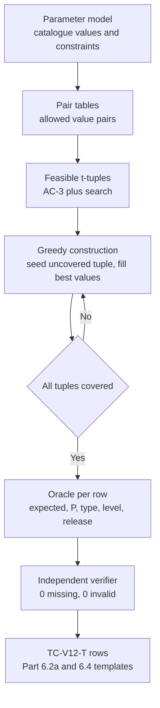

# AI Growth Engine: Employee Sales & Marketing Automation
## Application Blueprint: PART 11 (Batch 11.21b), Master Test Strategy and Combinatorial Test Design (V12): Master Parameter Catalogue, Combinatorial Method, Model Inventory and Platform-wide Cases

| Field | Value |
|---|---|
| Document | Part 11.21b: master parameter catalogue (P-01…P-26) and reference tables (39 SKUs, 24 INV SKUs, 22 roles); combinatorial method, strength policy, constraint handling, layers and verification; model inventory and counts for all 20 Part 11.21 models and the rollup of every combinatorial model in the blueprint; test scenarios TS-V12-T-01…18; generated cases of PM-T01 and PM-T01N in the Part 6.2a parameterized form (PM-T02/PM-T02N are in Part 11.21c) |
| Version | 1.0 · 28 Nov 2026 |
| Baseline | Part 11.21a; Part 6.1 §6.1.11.5 and §6.1.12; Part 6.2a §6.2.1; Parts 11.2, 11.10, 11.15–11.19 |
| Roles applied | Combinatorial test design expert (primary), Head of Quality Engineering, Business Systems Analyst, Principal Engineer |

---

## 11.21.4 Master parameter catalogue

### 11.21.4.1 Cross-cutting dimensions and values

Every Part 11.21 model draws its parameters from this catalogue (single source: `assembly/v12b/t_03_catalogue.py`). Values prefixed with `~` are **invalid values**: they are never combined with each other in the valid-set arrays and are exercised in single-fault layers (Part 6.1 §6.1.11.5 masking rule).

| ID | Dimension | Code | Values | Source | Notes |
|---|---|---|---|---|---|
| P-01 | Tenant type | TEN | T1-AppNAI · T1-MedMaarg · T1-EduVerse · T1-OrganicSpec · EXT-SMB · EXT-ENT · EXT-MSP · INV-T | Part 1 personas; DEC-002 as amended by DEC-783; Part 2.6 R21; DEC-784 | Owner Portfolio startups carry vertical rules (MedMaarg no patient data; EduVerse no outreach to minors; OrganicSpec separate ledgers) |
| P-02 | Plan / subscription | PLAN | FULL · BUNDLE · SELECT · TRIAL · INV plan · ~SKU not in plan · ~Subscription suspended | Part 11.2 entitlement engine; Workbook Entitlement_Rules; DEC-770 | Values with ~ are invalid (negative) values |
| P-03 | SKU | SKU | SM-SVC-01…39 (39) · INV-SVC-01…24 (24) | Service_Index.csv (both catalogues); Part 11.2a; Parts 11.16a–d | Each SKU carries effect class R0–R3, mandate types, meter unit, epic and first release |
| P-04 | Jurisdiction (recipient / counterparty / market) | JUR | IN · EU-DE · EU-FR · UK · US · AE · SG · ~not enabled (e.g. BR) | Part 11.15 rule packs; DEC-776; DEC-029 as amended | Activation requires an Approved pack per jurisdiction ("where lawful") |
| P-05 | Residency region (zone) | REG | IN · EU · ~UK/ME/APAC/US zone not provisioned | DEC-772, DEC-776, DEC-786, DEC-787 | Chosen at onboarding; never written to the other zone (CJ-TC-09) |
| P-06 | Locale | LOC | en-IN · hi-IN · ta-IN · or-IN · en-GB · de-DE · fr-FR · ar-AE · bn-IN · en-US · ~unsupported (xx-YY) | DEC-026/404 as amended by DEC-776; Part 11.7c CONFLICT-872 | ar-AE is right-to-left (R4); de-DE and fr-FR from R3; hi-IN, ta-IN, or-IN from R2 |
| P-07 | Role | ROLE | R01 · R02 · R03 · R04 · R05 · R06 · R07 · R08 · R09 · R10 · R11 · R12 · R13 · R14 · R15 · R16 · R17 · R18 · R19 · R20 · R21 · CUS · ~role without permission · ~R21 without active grant · ~SCIM de-provisioned user | Part 2.3 §2.26; Part 2.6 (R21); Part 11.19 custom roles and SoD | R20 never approves; R15 never mutates; R14 never sees business content |
| P-08 | Channel / surface | CHN | Admin web · Admin mobile web · Public website · Portal · Developer API · Event/webhook · Agent tool call · Email · WhatsApp · SMS/RCS · Voice · Agent-to-agent (SVC-28) | Part 2.5; Part 11.7; Part 11.8; Parts 11.17–11.18 | First seven are request surfaces (PM-T01); the last five are effect channels (PM-T03) |
| P-09 | Autonomy level / mandate state | AUT | L0 · L1 · L2 · L3 · L4 · ~L2 payload changed · ~L2 approval expired · ~mandate Suspended · ~mandate Revoked · ~mandate Exhausted · ~L4 step outside plan graph · ~kill switch engaged | Part 11.17a §11.17.5.2/5.8; DEC-779 | L3 needs an Active two-person mandate; L4 needs a plan-bound L3 mandate |
| P-10 | Data class | DAT | Public · Internal · Personal · Confidential · Restricted · Personal (masked) · ~Prohibited (patient health data, personal data of a minor) | Part 3.3; Part 11.19b registry; DEC-788 | Tier 2 free fallback: Public / Internal non-personal only, opt-in, default off |
| P-11 | Consent / lawful basis | CON | Opt-in recorded · Legitimate interest + LIA · Contract / transactional · Not applicable · ~Withdrawn / opted out · ~Unknown · ~Registry/DND-listed | BRL-ELG; Part 11.15 RP-IN-DPDP, RP-EU-MKT, RP-IN-SMS | Rechecked by the PDP at dispatch |
| P-12 | Provider state | PRV | Available · Throttled (429) · Timeout after submit · Down before submit · ~live key outside prod | FR-ADP-01; FR-STD-02; NFR-005/007/026 | Timeout after submit = Uncertain; reconcile before any retry |
| P-13 | AI route (model registry row) | AIR | Claude Sonnet (registry primary) · Lighter Claude tier (Tier 1a) · Open-weight in zone (masked) · Tier 2 free fallback (opt-in) · Tier 3 degrade (rules/cache) · ~unapproved candidate · ~Tier 2 with personal data | DEC-788; Part 11.19b; Part 7.3 tiers | Claude Sonnet is the registry-approved primary |
| P-14 | Device / viewport | DEV | Desktop 1440 · Laptop 1280 · Tablet 768 · Mobile 390 · Mobile 320 · Headless | Part 2.5; DEC-043; WCAG 2.2 1.4.10 reflow (320 CSS px) | Headless = API or event surface |
| P-15 | Browser | BRW | Chrome · Edge · Firefox · Safari · Headless · ~unsupported legacy browser | DEC-043 (last two versions) | Playwright projects Chromium, Firefox, WebKit; Edge channel |
| P-16 | SLA tier | SLA | Standard 99.5% · Business 99.9% · Enterprise 99.95% | DEC-774; Part 11.11b | Credit ladder per tier |
| P-17 | Identity method | IDN | Password + MFA · SSO SAML · SSO OIDC · API key · OAuth client credentials · Signed webhook · Workload identity · Anonymous session · ~MFA older than policy for privileged action · ~revoked or expired credential | DEC-784/785; Part 11.19a | SAML for EXT-ENT, EXT-MSP and T1 only |
| P-18 | Value vs cap | VAL | below per-action cap · exactly at cap · ~above per-action cap · ~crosses aggregate cap | Part 11.17a §11.17.5.6; DEC-038 | Caps are inclusive [ASSUMPTION-1121] |
| P-19 | Rule-pack state | PCK | Approved · ~Draft · ~In counsel review · ~Suspended · ~Expired · ~Withdrawn | Part 11.15 §11.15.3.5; CJ-R19/R20 | Only Approved packs activate a capability |
| P-20 | Kill switch | KS | off · ~mandate scope · ~tenant scope · ~platform scope | Part 11.17a §11.17.5.13 | Tightening is immediate |
| P-21 | Time window (recipient local) | WIN | 09:00:00 · 20:59:59 · ~08:59:59 · ~21:00:00 · ~restricted day per pack | DEC-777; Part 11.15 packs | Stricter pack wins; transactional messages exempt |
| P-22 | Currency | CUR | INR · EUR · GBP · USD · AED · SGD | NFR-017; DEC-776 tax engine | Decimal amounts + ISO 4217 |
| P-23 | Assistive technology | AT | keyboard only · NVDA + Chrome · JAWS + Edge · VoiceOver + Safari (macOS) · VoiceOver (iOS) · TalkBack (Android) · voice control | WCAG 2.2 AA; Part 2.5 §2.46 | Manual passes PP-07 |
| P-24 | Theme / display | THM | light · dark · forced colors (high contrast) · reduced motion | WCAG 2.2 1.4.3/1.4.11/2.3.3 |  |
| P-25 | Load profile | LOAD | baseline · Year-2 peak · 10× pilot · stress 3× · spike 10× burst · soak 24 h / 72 h | Part 6.1 §6.1.14.1 LT-01…12 | New LT-13…24 in §11.21.3.4 |
| P-26 | Failure mode | FAIL | AZ loss · queue/cache loss · worker crash mid-dispatch · Vercel function region outage · Supabase project unavailable · model provider outage · PSP outage · CPaaS outage · email/SMS provider outage · KMS key unavailable | DEC-771/787; Part 11.19b DR-R1…R8 | RTO ≤ 120 min, RPO ≤ 15 min |

### 11.21.4.2 SKU reference (39 Sales & Marketing services)

Effect classes follow Part 11.17a §11.17.5.2 (R0 read/draft, R1 internal record, R2 external communication, R3 financial/legal/commitment); SKUs that FSD 12 does not classify explicitly are classified from the service definition [ASSUMPTION-1123]. Mandate types and the maximum level come from the eligibility register (Part 11.17a §11.17.5.14). The first release in which the SKU is testable end to end follows Part 11.10b's classification and DEC-770 [ASSUMPTION-1120]. "AI suites" counts the EVAL suites of the SKU's workflows (Part 11.6b).

| SKU | Service | Bundle | Meter unit | Effect class | Mandate type | Max level | Epic | First release | AI suites |
|---|---|---|---|---|---|---|---|---|---|
| SM-SVC-01 | Market & Competitive Intelligence Automation | Research & Lead Intelligence | market research batch | R0 | — | L4 internal | EP-05 | R1 | 4 |
| SM-SVC-02 | Global Business Opportunity Discovery Automation | Research & Lead Intelligence | discovery batch | R0 | — | L4 internal | EP-05 | R1 | 4 |
| SM-SVC-03 | B2B Contact & Decision-Maker Intelligence Automation | Research & Lead Intelligence | contact assessed | R0 | — | L4 internal | EP-06 | R1 | 3 |
| SM-SVC-04 | Lead Qualification & Intelligent Matching Automation | Research & Lead Intelligence | lead assessed | R0 | — | L4 internal | EP-06 | R1 | 3 |
| SM-SVC-05 | CRM & Sales Pipeline Automation | Research & Lead Intelligence | relationship update | R1 | — | L4 internal | EP-07 | R1 | 3 |
| SM-SVC-06 | Email Marketing & Outreach Automation | Outreach & Conversations | email attempt | R2 | MT-OUT | L4 (plan) | EP-08 | R1 | 2 |
| SM-SVC-07 | WhatsApp Business Marketing Automation | Outreach & Conversations | message attempt | R2 | MT-OUT | L4 (plan) | EP-10 | R1 | 2 |
| SM-SVC-08 | Omnichannel Follow-up & Lead Nurturing Automation | Outreach & Conversations | follow-up decision | R2 | — | L2 | EP-08 | R1 | 2 |
| SM-SVC-09 | AI Chat, Unified Inbox & Objection Automation | Outreach & Conversations | conversation item | R2 | MT-OUT | L4 (plan) | EP-08 | R1 | 4 |
| SM-SVC-10 | Meeting, Demo & Appointment Automation | Outreach & Conversations | meeting cycle | R2 | MT-OUT | L4 (plan) | EP-09 | R1 | 3 |
| SM-SVC-11 | Content Marketing Automation | Digital Marketing & Acquisition | content draft | R2 | MT-PUB | L3 | EP-11 | R1 | 4 |
| SM-SVC-12 | Social Media Publishing & Listening Automation | Digital Marketing & Acquisition | social action or listening batch | R2 | MT-OUT | L4 (plan) | EP-11 | R1 | 3 |
| SM-SVC-13 | SEO & Search Visibility Automation | Digital Marketing & Acquisition | page or keyword review | R2 | MT-PUB | L3 | EP-11 | R1 | 4 |
| SM-SVC-14 | Paid Digital Advertising Automation | Digital Marketing & Acquisition | campaign review or action | R3 | MT-SPEND | L3 | EP-12 | R1 | 3 |
| SM-SVC-15 | Landing Page & Website Lead Intake Automation | Digital Marketing & Acquisition | page draft or enquiry event | R2 | — | L2 | EP-12 | R1 | 2 |
| SM-SVC-16 | Webinar, Event & Referral Acquisition Automation | Digital Marketing & Acquisition | attendee or referral event | R2 | MT-OUT | L4 (plan) | EP-12 | R1 | 4 |
| SM-SVC-17 | Proposal & Quotation Automation | Sales Conversion & Operations | proposal or quotation case | R3 | MT-COM | L3 | EP-13 | R2 | 2 |
| SM-SVC-18 | Negotiation, Contract & MoU Automation | Sales Conversion & Operations | agreement case | R3 | MT-COM | L3 | EP-13 | R2 | 3 |
| SM-SVC-19 | Tender & Project Bid Automation | Sales Conversion & Operations | tender case | R3 | MT-BID | L3 | EP-14 | R2 | 3 |
| SM-SVC-20 | Sales Order & Fulfillment Automation | Sales Conversion & Operations | order case | R3 | MT-PROC/MT-PAY | L3 | EP-14 | R2 | 4 |
| SM-SVC-21 | Payment, Invoice & Reconciliation Automation | Sales Conversion & Operations | invoice or receipt record | R3 | MT-COM | L3 | EP-15 | R2 | 3 |
| SM-SVC-22 | Customer, Partner & Institutional Onboarding Automation | Lifecycle & Business Intelligence | onboarding case | R2 | — | L2 | EP-16 | R2 | 3 |
| SM-SVC-23 | Customer Retention, Renewal & Feedback Automation | Lifecycle & Business Intelligence | customer review | R2 | — | L2 | EP-16 | R2 | 4 |
| SM-SVC-24 | Revenue, Attribution & Sales Forecast Automation | Lifecycle & Business Intelligence | analytics review | R0 | — | L4 internal | EP-17 | R2 | 2 |
| SM-SVC-25 | Business Document & Knowledge Intelligence Automation | Lifecycle & Business Intelligence | document processed | R0 | — | L4 internal | EP-02 | R1 | 3 |
| SM-SVC-26 | AI Voice & Intelligent Telephony Automation | Outreach & Conversations | Call minute | R2 | — | L2 | EP-08 | R2 | 1 |
| SM-SVC-27 | Multimodal Creative & Localization Automation | Digital Marketing & Acquisition | Creative asset | R2 | — | L2 | EP-11 | R2 | 3 |
| SM-SVC-28 | Agentic Commerce & AI-to-AI Business Transaction Automation | Commerce & Procurement | Agent transaction case | R3 | MT-COM/MT-PAY | L4 (plan) | EP-14 | R2 | 2 |
| SM-SVC-29 | Account-Based Marketing & Enterprise Buying Group Automation | Research & Lead Intelligence | Account review | R0 | — | L4 internal | EP-06 | R2 | 3 |
| SM-SVC-30 | Conversion Rate Optimization & Intelligent Experimentation Automation | Digital Marketing & Acquisition | Experiment | R3 | MT-PRICE | L3 | EP-12 | R2 | 1 |
| SM-SVC-31 | Marketplace & E-commerce Channel Operations Automation | Commerce & Procurement | Marketplace order/event | R3 | MT-COM/MT-PROC | L3 | EP-14 | R2 | 1 |
| SM-SVC-32 | Partner, Distributor & Co-Selling Automation | Lifecycle & Business Intelligence | Partner opportunity | R3 | MT-PAY | L3 | EP-16 | R2 | 4 |
| SM-SVC-33 | Customer Service & Support Operations Automation | Lifecycle & Business Intelligence | Support case | R2 | — | L2 | EP-16 | R2 | 4 |
| SM-SVC-34 | Product-Led Growth & Usage Intelligence Automation | Lifecycle & Business Intelligence | Account usage review | R0 | — | L4 internal | EP-20 | R2 | 4 |
| SM-SVC-35 | Brand Reputation & Review Intelligence Automation | Digital Marketing & Acquisition | Review item | R2 | — | L2 | EP-11 | R2 | 3 |
| SM-SVC-36 | AI Sales Enablement & Coaching Automation | Lifecycle & Business Intelligence | Coaching session | R0 | — | L4 internal | EP-17 | R2 | 2 |
| SM-SVC-37 | Pricing, Offer & Revenue Optimization Automation | Sales Conversion & Operations | Pricing scenario | R3 | MT-PRICE | L3 | EP-13 | R2 | 2 |
| SM-SVC-38 | SMS, RCS & Business Messaging Automation | Outreach & Conversations | Message attempt | R2 | — | L2 | EP-08 | R2 | 2 |
| SM-SVC-39 | Procurement & Supplier Management Automation | Commerce & Procurement | Procurement case | R3 | MT-PROC/MT-PAY | L3 | EP-14 | R2 | 2 |

### 11.21.4.3 SKU reference (24 Investment Automation services)

| SKU | Service | Group | Roles that operate it (PM-T02) | Offer content |
|---|---|---|---|---|
| INV-SVC-01 | Global Funding & Investor Discovery Automation | Discovery & Qualification | R01, R03, R12, R15, R19 | No |
| INV-SVC-02 | Investor Intelligence & Qualification Automation | Discovery & Qualification | R01, R03, R12, R15, R19 | No |
| INV-SVC-03 | Investor Contact Intelligence Automation | Discovery & Qualification | R01, R03, R12, R15, R19 | No |
| INV-SVC-04 | Investor Email Outreach Automation | Investor Engagement | R01, R03, R12, R15, R19 | No |
| INV-SVC-05 | Investor WhatsApp Engagement Automation | Investor Engagement | R01, R03, R12, R15, R19 | No |
| INV-SVC-06 | Investor Follow-up & Engagement Sequence Automation | Investor Engagement | R01, R03, R12, R15, R19 | No |
| INV-SVC-07 | Investor Conversation & Objection Resolution Automation | Investor Engagement | R01, R03, R12, R15, R19 | No |
| INV-SVC-08 | Investor Meeting & Briefing Automation | Investor Engagement | R01, R03, R12, R15, R16, R19 | No |
| INV-SVC-09 | Fundraising Pitch & Financial Scenario Automation | Diligence & Conversion | R01, R08, R09, R12, R15, R19 | Yes |
| INV-SVC-10 | Due Diligence & Secure Data Room Automation | Diligence & Conversion | R01, R10, R12, R15, R16, R19 | No |
| INV-SVC-11 | Investment Terms, Offers & Agreement Automation | Diligence & Conversion | R01, R10, R12, R15, R16, R19 | Yes |
| INV-SVC-12 | Investment Receipt & Financial Reconciliation Automation | Closing & Investor Lifecycle | R01, R08, R09, R12, R15, R19 | No |
| INV-SVC-13 | Legal Investment Closing & Statutory Task Automation | Closing & Investor Lifecycle | R01, R10, R12, R15, R16, R19 | Yes |
| INV-SVC-14 | Investor Reporting & Capital Lifecycle Automation | Closing & Investor Lifecycle | R01, R08, R09, R12, R15, R16, R19 | No |
| INV-SVC-15 | Fundraising CRM, Pipeline & Analytics Automation | Investor Engagement | R01, R03, R12, R15, R19 | No |
| INV-SVC-16 | Private Website Enquiry & Integration Automation | Investor Engagement | R01, R03, R12, R15, R16, R18, R19 | No |
| INV-SVC-17 | Grant & Non-Dilutive Funding Application Automation | Specialized Funding | R01, R03, R12, R15, R19 | No |
| INV-SVC-18 | Debt Financing & Credit Readiness Automation | Specialized Funding | R01, R08, R09, R12, R15, R19 | No |
| INV-SVC-19 | Continuous Fundraising Readiness & Financial Intelligence Automation | Discovery & Qualification | R01, R03, R08, R09, R12, R15, R19 | No |
| INV-SVC-20 | Cap Table & Ownership Intelligence Automation | Ownership & Governance | R01, R08, R09, R12, R15, R19 | No |
| INV-SVC-21 | ESG, Climate & Impact Funding Intelligence Automation | Specialized Funding | R01, R03, R10, R12, R15, R19 | No |
| INV-SVC-22 | Cross-Border Funding Compliance Coordination Automation | International & Risk | R01, R10, R12, R15, R19 | No |
| INV-SVC-23 | Board & Shareholder Governance Automation | Ownership & Governance | R01, R10, R12, R15, R16, R19 | No |
| INV-SVC-24 | Investor Identity, Ownership & Risk Evidence Automation | International & Risk | R01, R10, R12, R15, R16, R19 | No |

### 11.21.4.4 Role reference (R01–R21 and custom roles)

Channel and identity coupling and the SKUs each role operates are derived from the RBAC matrix (Part 2.3 §2.26.3), the R21 rules (Part 2.6), the custom-role rules (Part 11.19) and the SKU definitions [ASSUMPTION-1122]. R20 operates only SKUs with an AI step (Part 11.6b).

| Role | Name | Action in PM-T01 | Channels | Identity methods | SKUs operated |
|---|---|---|---|---|---|
| R01 | Founder / Portfolio Owner | runs and approves (all startups; mutation per selected startup) | Admin web, Admin mobile web | Password + MFA, SSO SAML, SSO OIDC | all 39 |
| R02 | Startup Head | approves as Startup Head | Admin web, Admin mobile web | Password + MFA, SSO SAML, SSO OIDC | all 39 |
| R03 | Growth Manager | runs the workflow and submits for approval | Admin web, Admin mobile web | Password + MFA, SSO SAML, SSO OIDC | 19: 01, 02, 03, 04, 05, 06, 07, 08, 09, 10, 17, 22, 23, 26, 29, 32, 33, 36, 38 |
| R04 | Research Analyst | runs research and reviews evidence | Admin web, Admin mobile web | Password + MFA, SSO SAML, SSO OIDC | 8: 01, 02, 03, 04, 24, 25, 29, 34 |
| R05 | Marketing Specialist | authors; R05L approves content and campaigns | Admin web, Admin mobile web | Password + MFA, SSO SAML, SSO OIDC | 9: 11, 12, 13, 14, 15, 16, 27, 30, 35 |
| R06 | Bid Manager | prepares the bid package | Admin web, Admin mobile web | Password + MFA, SSO SAML, SSO OIDC | 2: 02, 19 |
| R07 | Order Coordinator | coordinates the order, PO or commerce case | Admin web, Admin mobile web | Password + MFA, SSO SAML, SSO OIDC | 4: 20, 28, 31, 39 |
| R08 | Finance Maker | makes the financial entry (maker) | Admin web, Admin mobile web | Password + MFA, SSO SAML, SSO OIDC | 8: 14, 20, 21, 24, 28, 32, 37, 39 |
| R09 | Finance Checker | checks the financial entry (checker, ≠ maker) | Admin web, Admin mobile web | Password + MFA, SSO SAML, SSO OIDC | 8: 14, 20, 21, 24, 28, 32, 37, 39 |
| R10 | Legal / Compliance / DPO | reviews claims, legal and privacy | Admin web, Admin mobile web | Password + MFA, SSO SAML, SSO OIDC | 14: 06, 07, 11, 13, 14, 15, 17, 18, 19, 25, 26, 27, 35, 38 |
| R11 | Automation Lead | configures the workflow (cannot loosen caps) | Admin web, Admin mobile web | Password + MFA, SSO SAML, SSO OIDC | all 39 |
| R12 | Tenant Administrator | configures entitlement, users and templates (not a business approver) | Admin web, Admin mobile web | Password + MFA, SSO SAML, SSO OIDC | all 39 |
| R13 | Platform Support (JIT grant) | reads run metadata under an active, time-boxed JIT grant | Admin web, Admin mobile web | Password + MFA, SSO SAML, SSO OIDC | all 39 |
| R14 | Platform Billing | reads meters and invoices only (no business content) | Admin web, Admin mobile web | Password + MFA, SSO SAML, SSO OIDC | all 39 |
| R15 | Auditor (read-only) | reads runs, evidence and audit (read-only) | Admin web, Admin mobile web | Password + MFA, SSO SAML, SSO OIDC | all 39 |
| R16 | External Customer / Supplier (portal) | completes the portal step on own records (object grant) | Portal | Password + MFA, SSO OIDC | 8: 10, 17, 18, 20, 21, 22, 23, 33 |
| R17 | SaaS Client Applicant | purchases the SKU on the public website | Public website | Password + MFA, SSO OIDC | all 39 |
| R18 | Anonymous Visitor | submits the public intake / chat / booking step | Public website | Anonymous session | 5: 09, 10, 15, 16, 33 |
| R19 | Service Identity | calls the API or delivers the event (least-privilege scope) | Developer API, Event/webhook | API key, OAuth client credentials, Signed webhook | all 39 |
| R20 | AI Agent Identity | executes the AI step through registered tools only (never approves) | Agent tool call | Workload identity | all 39 |
| R21 | Managed-Service Operator (delegation grant) | operates inside the client tenant under an active delegation grant | Admin web, Admin mobile web | Password + MFA, SSO SAML, SSO OIDC | 23: 01, 02, 03, 04, 05, 06, 07, 08, 09, 10, 11, 12, 13, 15, 16, 22, 23, 24, 29, 30, 33, 35, 38 |
| CUS | Custom role (Part 11.19) | acts with the custom role permission set (SoD rules enforced) | Admin web, Admin mobile web | Password + MFA, SSO SAML, SSO OIDC | all 39 |

### 11.21.4.5 Value-level rules used by the constraints

| Rule | Statement | Source |
|---|---|---|
| CR-01 | Owner Portfolio (T1-*) tenants are on the full suite, in the IN zone, with the Business SLA | DEC-002 as amended; DEC-421/772 |
| CR-02 | Enterprise and managed-service tenants have no trial plan | Part 11.2 subscription engine |
| CR-03 | Locale availability per zone: IN → en-IN, hi-IN, ta-IN, or-IN, ar-AE; EU → en-GB, de-DE, fr-FR, ar-AE | DEC-776; Part 11.7c |
| CR-04 | SLA: SMB ≤ Business; Enterprise ≥ Business | DEC-774 |
| CR-05 | R21 only in EXT-MSP; R17 only for external tenants | Part 2.6; Part 1 |
| CR-06 | Role → SKUs, channels and identity methods per §11.21.4.4; developer API ↔ API key or OAuth; events ↔ signed webhook; agent tool calls ↔ workload identity | Part 2.3; Part 11.19 |
| CR-07 | UI channels ↔ a real device and browser; API/event/agent channels ↔ headless; Admin web ↔ desktop, laptop or tablet; Admin mobile web ↔ tablet or mobile | Part 2.5; DEC-043 |
| CR-08 | SSO SAML only for EXT-ENT, EXT-MSP and T1 | DEC-784 |
| CR-09 | Consent "not applicable" ↔ Public, Internal or Confidential business data; a personal basis ↔ Personal, Confidential or Restricted | BRL-ELG; Part 3.3 |
| CR-10 | Tier 2 free fallback only for Public or Internal data; open-weight in-zone rows never receive Restricted data | DEC-007; DEC-788; Part 11.19b |
| CR-11 | MedMaarg has no Restricted (health) data; WhatsApp, SMS and voice need opt-in or contract, not legitimate interest | MedMaarg rule; RP-IN-WA, RP-IN-SMS |
| CR-12 | Anonymous visitors never carry Restricted or Confidential data | Part 2.4 |
| CR-13 | L3/L4 for R2/R3 SKUs only where the eligibility register has a mandate type; L4 only for "L3 (L4 with plan)" rows; R0/R1 SKUs may run internally at L3/L4 without a mandate | Part 11.17a §11.17.5.2, §11.17.5.14 |

---

## 11.21.5 Combinatorial test design

### 11.21.5.1 Strength policy (DEC-924)

| Area | Strength | Why | Models |
|---|---|---|---|
| Platform-wide behaviour across all SKUs | **Pairwise (2-way)** on the valid set + single-fault layer for every invalid value | Most cross-cutting defects are triggered by one or two interacting values; 16 parameters make higher strength infeasible at this size | PM-T01, PM-T01N, PM-T02, PM-T02N |
| Money-, law- and safety-critical effects (mandates, payments, commerce, bids, voice, investor, publication, spend) | **3-way among the controls** + 2-way capability × control (variable strength), a **3-way positive sub-space**, and a **single-fault × capability** layer | Denials mask deep paths; defects in gates often need three interacting values (e.g. L3 × aggregate cap × EU pack) | PM-T03, PM-T03P, PM-T03N |
| Residency | **3-way** | Zone × component × operation interactions decide where data lands | PM-T04 |
| Isolation and RLS | **3-way** caller × target × operation + 2-way path × each | Confidentiality P0; paths are numerous but behave uniformly per triple | PM-T05 |
| Resilience with in-flight work | **3-way** | Failure × in-flight effect × load interactions decide duplicate-effect risk | PM-T09 |
| Localization, accessibility, performance | **Pairwise** | Quality attributes; interactions above 2 are rare | PM-T06, PM-T07, PM-T08 |
| AI evaluation gate machinery | **Variable strength:** each of the 111 suites once + pairwise among trigger, zone, locale, model row, judge and injected result | Each suite must run; gate behaviour interacts pairwise | PM-T16 |
| Small spaces (≤ 64 valid combinations) | **Exhaustive** | V12-B rule | XT-10…XT-15 |

### 11.21.5.2 Generation method

| Step | Specification |
|---|---|
| 1. Parameter model | Parameters and values from the catalogue; constraints written as a predicate that relates two parameters at a time (binary constraint network) |
| 2. Constraint handling | `t_02_engine.Net` derives the allowed value pairs for every parameter pair once, then decides whether a partial assignment can be completed by **arc consistency (AC-3)** plus backtracking with the smallest remaining domain first. A t-tuple that no valid full row can contain is **excluded by constraint** (reported per model) |
| 3. Required coverage | A list of strength groups (parameter subset, t); the union of their feasible t-tuples must be covered. This expresses pairwise, 3-way, variable-strength and each-choice coverage in one mechanism |
| 4. Construction | Deterministic AETG-style greedy: each new row is seeded with an uncovered tuple and filled parameter by parameter with the value that covers the most still-uncovered tuples while keeping the domains arc-consistent; `ncand` candidate rows per step, the best is kept; fixed seeds (921…936) make re-runs reproduce the same rows |
| 5. Exhaustive spaces | Spaces ≤ 64 valid combinations are enumerated completely |
| 6. Layers | **L1** full-space array (precedence when several faults coincide); **L2** positive sub-space (deep allow paths unmasked); **L3** single fault (each invalid value with all other values valid, paired with every value of the partner parameters) |
| 7. Oracle | Each row's expected result, priority, type, level and release are computed by the model's oracle function from the binding rules (decision orders of Parts 11.15–11.19); the same rule tables are imported by the product (MP-03) |
| 8. Verification | `t_02_engine.verify` is independent of the generator: it checks every row against the original predicate, recomputes every required tuple and, for every tuple absent from the array, proves infeasibility with a separate depth-first search with forward checking on the raw predicate. **Result for every model: 0 missing tuples and 0 invalid rows** |
| 9. IDs and templates | `t_05_build.py` assigns TC-V12-T IDs in model order and renders the Part 6.2a parameterized form (`ID · Data · Expected · Links · P · Type · Tech · Auto · Lvl`) with a Common block per model; AI-evaluation cases use the Part 6.4 template |

### 11.21.5.3 Model counts and verification (Part 11.21)

| Model | Title | Parameters (values) | Raw product | Valid | Method | Required t-tuples | Cases | Pairwise-only size | Missing after verification | TC range |
|---|---|---|---|---|---|---|---|---|---|---|
| PM-T01 | Platform SKU invocation (valid set) | 16 (134) | 3,874,590,720,000 | not enumerated | Pairwise (2-way), valid values only | 6,842 | 648 | — | 0 | TC-V12-T-101…748 |
| PM-T01N | Platform SKU invocation (invalid values, single fault) | — (layer of the parent model) | — | — | Single-fault: each invalid value × every tenant type and × both zones (2-way with the partner), all other values valid | 200 | 156 | — | 0 | TC-V12-T-749…904 |
| PM-T02 | Investment Automation SKU invocation (valid set) | 10 (69) | 16,588,800 | not enumerated | Pairwise (2-way), valid values only | 1,677 | 180 | — | 0 | TC-V12-T-905…1084 |
| PM-T02N | Investment Automation invocation (invalid values, single fault) | — (layer of the parent model) | — | — | Single-fault: each invalid value × every role and × both zones | 65 | 53 | — | 0 | TC-V12-T-1085…1137 |
| PM-T03 | Consequential-effect gateway: full space (layer L1) | 8 (45) | 172,800 | 172,800 | Variable strength: 3-way among the 7 control parameters + 2-way effect × each control | 2,818 | 200 | 151 | 0 | TC-V12-T-1138…1337 |
| PM-T03P | Consequential-effect gateway: positive sub-space (layer L2) | 8 (29) | 960 | 960 | 3-way over the gate-passing values (deep paths unmasked) | 1,467 | 144 | 60 | 0 | TC-V12-T-1338…1481 |
| PM-T03N | Consequential-effect gateway: single fault × effect (layer L3) | — (layer of the parent model) | — | — | Single-fault: each of the 16 invalid control values × each of the 15 effects (exhaustive pairing), other controls valid | 240 | 240 | — | 0 | TC-V12-T-1482…1721 |
| PM-T04 | Data residency (India and EU) across components and operations | 5 (25) | 1,080 | 738 | 3-way | 703 | 142 | 45 | 0 | TC-V12-T-1722…1863 |
| PM-T05 | Multi-tenant isolation and RLS across access paths | 4 (25) | 1,260 | 1,160 | Variable strength: 3-way caller × target × operation + 2-way path × each | 279 | 140 | 61 | 0 | TC-V12-T-1864…2003 |
| PM-T09 | Resilience and DR with consequential work in flight | 4 (20) | 240 | 240 | 3-way | 304 | 120 | 60 | 0 | TC-V12-T-2004…2123 |
| XT-10 | Rule-pack state × capability activation | 2 (14) | 48 | 48 | Exhaustive (48) | 48 | 48 | — | 0 | TC-V12-T-2124…2171 |
| XT-11 | Subscription × entitlement state × meter usage | 3 (12) | 64 | 64 | Exhaustive (64) | 64 | 64 | — | 0 | TC-V12-T-2172…2235 |
| XT-12 | Messaging window (DEC-777) × day × stricter pack × message type | 4 (11) | 48 | 48 | Exhaustive (48) | 48 | 48 | — | 0 | TC-V12-T-2236…2283 |
| XT-13 | On-call and communication: SLA tier × severity × time | 3 (10) | 36 | 36 | Exhaustive (36) | 36 | 36 | — | 0 | TC-V12-T-2284…2319 |
| XT-14 | Service-credit ladder boundaries: tier × monthly availability | 2 (boundary set) | 18 | 18 | Exhaustive boundary set (18) | 18 | 18 | — | 0 | TC-V12-T-2320…2337 |
| XT-15 | Two-person approval and separation of duties for mandates | 4 (11) | 48 | 48 | Exhaustive (48) | 48 | 48 | — | 0 | TC-V12-T-2338…2385 |
| PM-T06 | Localization and right-to-left | 5 (34) | 8,400 | 4,200 | Pairwise (2-way) | 421 | 101 | — | 0 | TC-V12-T-2386…2486 |
| PM-T07 | Accessibility (WCAG 2.2 AA) across screens, assistive technology and display | 6 (31) | 5,040 | 3,168 | Pairwise (2-way) | 350 | 84 | — | 0 | TC-V12-T-2487…2570 |
| PM-T08 | Performance, load, stress, spike and soak workload profiles | 6 (24) | 1,728 | 1,728 | Pairwise (2-way) | 225 | 49 | — | 0 | TC-V12-T-2571…2619 |
| PM-T16 | AI evaluation: 111 V12 suites × change trigger × zone × locale × model row × judge × injected result | 7 (133) | 170,496 | 106,560 | Variable strength: each suite once (1-way) + pairwise among the other six parameters | 304 | 111 | — | 0 | TC-V12-T-2620…2730 |
| **Total generated** | | | | | | | **2,630** | | **0** | TC-V12-T-101…2730 |

**Reading the table.** "Raw product" is the full Cartesian product; "Valid" is the exact number of valid combinations where enumerable. "Required t-tuples" counts the feasible tuples of all strength groups; every one appears in at least one row ("Missing after verification" = 0). "Pairwise-only size" shows how many rows a plain pairwise array would need for the 3-way models, i.e. the price of the higher strength. Priority mix of all Part 11.21 cases including the journeys: P0 2025 · P1 509 · P2 127 · P3 9.

### 11.21.5.4 Combinatorial models across the whole blueprint

| Part | Capability | Models | Strengths | Generated cases | Generator |
|---|---|---|---|---|---|
| Part 6.1 / 6.2a | Dispatch matrix (role × scope × channel × integration × mode) | Sets A and B; TC-08-Q | Pairwise (3-wise nightly) | 26 + 12 | Greedy all-pairs (Part 6.1) |
| Part 11.16d | Investment Automation II (INV-SVC-13…24, securities packs) | 25 (M-O1…M-O16 + 9 mini-models) | 3-way, 2-way, exhaustive | 686 | `o_03_combi.py` |
| Part 11.16e | Investment Automation I (investor engagement, data room, offers, receipts) | 9 (PM-N-01…09) | 3-way, 2-way, exhaustive + base-choice | 760 | `n_comb.py` |
| Part 11.17b | Mandated dispatch, commerce and payment, bids, kill switch | 4 (M, C, B, K) + story arrays | 3-way three layers, exhaustive | 716 | `p_combinatorial.py` |
| Part 11.18d | Voice calls, recording, voicemail, number series, coaching | 5 (C3, RX, VM, NX, CP) | 3-way, exhaustive, pairwise | 465 | `q_voice_combinatorial.py` |
| Part 11.19c | Identity, developer platform, connectors, Vercel path, recovery, registry, benchmarks, DB access | 13 (M01…M13) | 3-way, pairwise, exhaustive | 1,072 | `R_02_combinatorics.py` |
| **Part 11.21** | **Platform-wide and cross-capability** | **20** | **2-way, 3-way, variable strength, single fault, exhaustive** | **2,630** | `t_04_models.py` |
| **Total** | | **76 + Part 6 sets** | | **2,630 + 3,737** | |

The capability models of Parts 11.16–11.19 stay the authority for their capabilities; Part 11.21 adds the dimensions none of them varies together (tenant type × plan × SKU × zone × locale × role × channel × identity × device × browser × data class × consent × provider × autonomy × AI route × SLA), the cross-capability effect gateway, residency, isolation, quality attributes and the AI gate machinery.

### 11.21.5.5 Test scenarios

| ID | Title | Model / journeys | Test cases | Priority |
|---|---|---|---|---|
| TS-V12-T-01 | Platform SKU invocation across tenant, plan, SKU, zone, locale, role, channel, identity, device, browser, data, consent, provider, autonomy, AI route and SLA | PM-T01, PM-T01N | TC-V12-T-101…TC-V12-T-904 | P0 |
| TS-V12-T-02 | Investment Automation SKU invocation with securities packs and investor eligibility | PM-T02, PM-T02N | TC-V12-T-905…TC-V12-T-1137 | P0 |
| TS-V12-T-03 | Consequential-effect gateway: every effect type under every control (money, law, safety) | PM-T03, PM-T03P, PM-T03N | TC-V12-T-1138…TC-V12-T-1721 | P0 |
| TS-V12-T-04 | Data residency India and EU across components, operations and actors (CJ-TC-09) | PM-T04 | TC-V12-T-1722…TC-V12-T-1863 | P0 |
| TS-V12-T-05 | Multi-tenant isolation and RLS across access paths | PM-T05 | TC-V12-T-1864…TC-V12-T-2003 | P0 |
| TS-V12-T-06 | Localization and right-to-left | PM-T06 | TC-V12-T-2386…TC-V12-T-2486 | P1 |
| TS-V12-T-07 | Accessibility WCAG 2.2 AA | PM-T07 | TC-V12-T-2487…TC-V12-T-2570 | P1 |
| TS-V12-T-08 | Performance, load, stress, spike and soak | PM-T08 | TC-V12-T-2571…TC-V12-T-2619 | P0 |
| TS-V12-T-09 | Resilience and DR with consequential work in flight | PM-T09 | TC-V12-T-2004…TC-V12-T-2123 | P0 |
| TS-V12-T-10 | Rule-pack state × capability activation | XT-10 | TC-V12-T-2124…TC-V12-T-2171 | P0 |
| TS-V12-T-11 | Subscription, entitlement and metering | XT-11 | TC-V12-T-2172…TC-V12-T-2235 | P0 |
| TS-V12-T-12 | Messaging window boundaries | XT-12 | TC-V12-T-2236…TC-V12-T-2283 | P0 |
| TS-V12-T-13 | On-call and incident communication by tier | XT-13 | TC-V12-T-2284…TC-V12-T-2319 | P0 |
| TS-V12-T-14 | Service-credit ladder boundaries | XT-14 | TC-V12-T-2320…TC-V12-T-2337 | P1 |
| TS-V12-T-15 | Two-person approval and SoD for mandates | XT-15 | TC-V12-T-2338…TC-V12-T-2385 | P0 |
| TS-V12-T-16 | AI evaluation gates of the 111 V12 suites | PM-T16 | TC-V12-T-2620…TC-V12-T-2730 | P0 |
| TS-V12-T-17 | Cross-capability end-to-end journeys per zone | J-T-01…18 | TC-V12-T-001…TC-V12-T-031 | P0 |
| TS-V12-T-18 | FR-V12 traceability gap closure | FR gap closure | TC-V12-T-032…TC-V12-T-040 | P0 |

---

## 11.21.6 Generated test cases (part 1: platform-wide)

### 11.21.6.1 PM-T01 Platform SKU invocation (valid set, pairwise)

Every valid pair of values of the 16 parameters below appears in at least one case; denial values are tested separately in PM-T01N.

| Parameter | Values | Count |
|---|---|---|
| `tenant` | T1-AppNAI · T1-MedMaarg · T1-EduVerse · T1-OrganicSpec · EXT-SMB · EXT-ENT · EXT-MSP | 7 |
| `plan` | FULL · BUNDLE · SELECT · TRIAL | 4 |
| `sku` | SM-SVC-01 … SM-SVC-39 (Service_Index.csv) | 39 |
| `region` | IN · EU | 2 |
| `locale` | en-IN · hi-IN · ta-IN · or-IN · en-GB · de-DE · fr-FR · ar-AE | 8 |
| `role` | R01 · R02 · R03 · R04 · R05 · R06 · R07 · R08 · R09 · R10 · R11 · R12 · R13 · R14 · R15 · R16 · R17 · R18 · R19 · R20 · R21 · CUS | 22 |
| `channel` | Admin web · Admin mobile web · Public website · Portal · Developer API · Event/webhook · Agent tool call | 7 |
| `identity` | Password + MFA · SSO SAML · SSO OIDC · API key · OAuth client credentials · Signed webhook · Workload identity · Anonymous session | 8 |
| `device` | Desktop 1440 · Laptop 1280 · Tablet 768 · Mobile 390 · Mobile 320 · Headless | 6 |
| `browser` | Chrome · Edge · Firefox · Safari · Headless | 5 |
| `data` | Public · Internal · Personal · Confidential · Restricted | 5 |
| `consent` | Opt-in recorded · Legitimate interest + LIA · Contract / transactional · Not applicable | 4 |
| `provider` | Available · Throttled (429) · Timeout after submit · Down before submit | 4 |
| `autonomy` | L0 · L1 · L2 · L3 · L4 | 5 |
| `ai_route` | Claude Sonnet (registry primary) · Lighter Claude tier (Tier 1a) · Open-weight in zone (masked) · Tier 2 free fallback (opt-in) · Tier 3 degrade (rules/cache) | 5 |
| `sla` | Standard 99.5% · Business 99.9% · Enterprise 99.95% | 3 |

**Method:** Pairwise (2-way), valid values only. Raw product 3,874,590,720,000 · valid not enumerated (product too large; feasibility by AC-3 + search) · required t-tuples 6,842 · **648 cases** (TC-V12-T-101…TC-V12-T-748) · verification: 0 missing tuples, 0 invalid rows, 922 tuples excluded by constraint.

#### Group TC-V12-T-M01: Pairwise combinatorial cases – platform SKU invocation (valid set)

**Common for TC-V12-T-101…TC-V12-T-748:** Pre: PP-01 per zone (IN stack in Mumbai, EU stack in Frankfurt or the EU-configured test cell); tenant fixtures from SYN-T (§11.21.2.4) matching the row; the SKU entitled per the row plan; approved policy, template and price versions; provider simulator in the row state; clock CLK-0. Steps: 1. Authenticate with the row identity on the row channel and device/browser (Playwright project for UI rows; API client for headless rows). 2. Start the SKU's primary workflow (WF01, or the first workflow with an effect step for R2/R3 SKUs) with the fixture FX-<wf>-v1 at the row autonomy level. 3. Drive the run to its effect step. 4. Read run, step, outbox, ledger, meter, audit and simulator logs in the row zone. 5. For UI rows run axe and the viewport checks. Links for every row: FR-V12-B (39 SKU specifications, Part 11.2); FR-V12-I (RLS, Part 11.9b); FR-V12-R-143…155; DEC-770, 772, 779, 784–788. Generated by `assembly/v12b/t_04_models.py` (model PM-T01); IDs assigned by `t_05_build.py`.

| ID | Data | Expected | Links | P | Type | Tech | Auto | Lvl |
|-------|--------------------------|----------------------------------------------|--------------|---|-----|-----|----|----|
| TC-V12-T-101 | TEN EXT-MSP · PLAN BUNDLE · SKU SM-SVC-23 · REG IN · LOC hi-IN · ROLE R21 · CHN Admin web · IDN SSO SAML · DEV Desktop 1440 · BRW Safari · DAT Confidential · CON Legitimate interest + LIA · PRV Timeout after submit · AUT L1 · AIR Claude Sonnet (registry primary) · SLA Business 99.9% | entitled (bundle); meter `customer review` +1; R21 operates inside the client tenant under an active delegation grant via Admin web (SSO SAML); every action stamped with `grant_id`; no export; no approval of client claims, budgets or autonomy (ABAC-ENH-A-01…03); IN zone only: rows, files, cache, logs, audit, Vercel function and model call (CJ-TC-09); UI hi-IN, dir=ltr, CLDR formats; AI via registry row "Claude Sonnet (registry primary)" (approved, IN processing); basis "Legitimate interest + LIA" rechecked by the PDP at dispatch; L1: draft only until the human acts; Uncertain → Reconciling; no retry before the idempotency-key query (NFR-026); ≤ 1 effect; 1440 px on Safari: no horizontal scroll, targets ≥ 24 px, axe 0 critical/serious; SLO tier Business 99.9% | TS-V12-T-01 · SM-SVC-23 (EP-16; R2) · R2 | P0 | T01, T10, T18 | PW | Y | E2E |
| TC-V12-T-102 | TEN EXT-ENT · PLAN SELECT · SKU SM-SVC-14 · REG EU · LOC en-GB · ROLE R01 · CHN Admin mobile web · IDN Password + MFA · DEV Mobile 390 · BRW Chrome · DAT Personal · CON Contract / transactional · PRV Down before submit · AUT L3 · AIR Claude Sonnet (registry primary) · SLA Enterprise 99.95% | entitled (select); meter `campaign review or action` +1; R01 runs and approves (all startups; mutation per selected startup) via Admin mobile web (Password + MFA); EU zone only: rows, files, cache, logs, audit, Vercel function and model call (CJ-TC-09); UI en-GB, dir=ltr, CLDR formats; AI via registry row "Claude Sonnet (registry primary)" (approved, EU processing); basis "Contract / transactional" rechecked by the PDP at dispatch; L3: Active MT-SPEND mandate, reserve → commit, caps checked, visible in A263 ≤ 1 min; ≤ 3 retries, then exception queue; run Held; no effect; 390 px on Chrome: no horizontal scroll, targets ≥ 24 px, axe 0 critical/serious; SLO tier Enterprise 99.95% | TS-V12-T-01 · SM-SVC-14 (EP-12; R3; MT-SPEND) · R2 | P0 | T01, T10, T19 | PW | Y | E2E |
| TC-V12-T-103 | TEN EXT-SMB · PLAN TRIAL · SKU SM-SVC-15 · REG EU · LOC de-DE · ROLE R20 · CHN Agent tool call · IDN Workload identity · DEV Headless · BRW Headless · DAT Public · CON Not applicable · PRV Available · AUT L1 · AIR Lighter Claude tier (Tier 1a) · SLA Standard 99.5% | Entitlement: trial plan → run in simulation; 0 provider calls; 0 ledger or budget consumption (BRL-AUT-04); meter `page draft or enquiry event` recorded as trial; R20 executes the AI step through registered tools only (never approves) via Agent tool call (Workload identity); EU zone only: rows, files, cache, logs, audit, Vercel function and model call (CJ-TC-09); problem details localized for de-DE; AI via registry row "Lighter Claude tier (Tier 1a)" (approved, EU processing); L1: draft only until the human acts; provider accepts; run Completed; SLO tier Standard 99.5% | TS-V12-T-01 · SM-SVC-15 (EP-12; R2) · R3 | P1 | T01 | PW | Y | SYS |
| TC-V12-T-104 | TEN EXT-MSP · PLAN FULL · SKU SM-SVC-09 · REG EU · LOC ar-AE · ROLE R18 · CHN Public website · IDN Anonymous session · DEV Tablet 768 · BRW Edge · DAT Internal · CON Not applicable · PRV Throttled (429) · AUT L2 · AIR Open-weight in zone (masked) · SLA Business 99.9% | entitled (full); meter `conversation item` +1; R18 submits the public intake / chat / booking step via Public website (Anonymous session); EU zone only: rows, files, cache, logs, audit, Vercel function and model call (CJ-TC-09); UI ar-AE, dir=rtl, mirrored layout, CLDR formats; masking (AU-004) applied before the in-zone open-weight model; un-masking only in the EU zone; L2: exact approved hash dispatched once; replay returns the first result; 429 → backoff with jitter, ≤ 3 retries (NFR-016); exactly one effect; 768 px on Edge: no horizontal scroll, targets ≥ 24 px, axe 0 critical/serious; SLO tier Business 99.9% | TS-V12-T-01 · SM-SVC-09 (EP-08; R2; MT-OUT) · R4 | P1 | T01, T10, T14 | PW | Y | E2E |
| TC-V12-T-105 | TEN EXT-SMB · PLAN FULL · SKU SM-SVC-27 · REG IN · LOC ta-IN · ROLE R17 · CHN Public website · IDN SSO OIDC · DEV Laptop 1280 · BRW Firefox · DAT Restricted · CON Opt-in recorded · PRV Down before submit · AUT L0 · AIR Claude Sonnet (registry primary) · SLA Standard 99.5% | Purchase on W-checkout creates the full suite (39 SKUs) entitlement for SM-SVC-27; invoice and meter schedule created; tenant activation follows onboarding; R17 purchases the SKU on the public website via Public website (SSO OIDC); IN zone only: rows, files, cache, logs, audit, Vercel function and model call (CJ-TC-09); UI ta-IN, dir=ltr, CLDR formats; AI via registry row "Claude Sonnet (registry primary)" (approved, IN processing); basis "Opt-in recorded" rechecked by the PDP at dispatch; first run after activation: L0: manual action recorded with evidence; no system dispatch; ≤ 3 retries, then exception queue; run Held; no effect; 1280 px on Firefox: no horizontal scroll, targets ≥ 24 px, axe 0 critical/serious; SLO tier Standard 99.5% | TS-V12-T-01 · SM-SVC-27 (EP-11; R2) · R2 | P0 | T01, T10, T19 | PW | Y | E2E |
| TC-V12-T-106 | TEN EXT-ENT · PLAN SELECT · SKU SM-SVC-02 · REG IN · LOC en-IN · ROLE R19 · CHN Event/webhook · IDN Signed webhook · DEV Headless · BRW Headless · DAT Restricted · CON Legitimate interest + LIA · PRV Available · AUT L4 · AIR Lighter Claude tier (Tier 1a) · SLA Business 99.9% | entitled (select); meter `discovery batch` +1; R19 calls the API or delivers the event (least-privilege scope) via Event/webhook (Signed webhook); IN zone only: rows, files, cache, logs, audit, Vercel function and model call (CJ-TC-09); problem details localized for en-IN; AI via registry row "Lighter Claude tier (Tier 1a)" (approved, IN processing); basis "Legitimate interest + LIA" rechecked by the PDP at dispatch; L4: internal R0 step automatic (no mandate needed); SLO tier Business 99.9% | TS-V12-T-01 · SM-SVC-02 (EP-05; R0) · R2 | P0 | T01, T19 | PW | Y | SYS |
| TC-V12-T-107 | TEN EXT-SMB · PLAN SELECT · SKU SM-SVC-19 · REG IN · LOC or-IN · ROLE R06 · CHN Admin mobile web · IDN Password + MFA · DEV Mobile 320 · BRW Safari · DAT Internal · CON Not applicable · PRV Timeout after submit · AUT L2 · AIR Tier 2 free fallback (opt-in) · SLA Standard 99.5% | entitled (select); meter `tender case` +1; R06 prepares the bid package via Admin mobile web (Password + MFA); IN zone only: rows, files, cache, logs, audit, Vercel function and model call (CJ-TC-09); UI or-IN, dir=ltr, CLDR formats; AI step on Tier 2 only because data class is Internal, the tenant opt-in flag is on and the AU-004 personal-data check is clean; L2: exact approved hash dispatched once; replay returns the first result; Uncertain → Reconciling; no retry before the idempotency-key query (NFR-026); ≤ 1 effect; 320 CSS px (reflow, WCAG 1.4.10) on Safari: no horizontal scroll, targets ≥ 24 px, axe 0 critical/serious; SLO tier Standard 99.5% | TS-V12-T-01 · SM-SVC-19 (EP-14; R3; MT-BID) · R2 | P0 | T01, T10, T18 | PW | Y | E2E |
| TC-V12-T-108 | TEN EXT-ENT · PLAN SELECT · SKU SM-SVC-31 · REG EU · LOC fr-FR · ROLE R14 · CHN Admin web · IDN SSO OIDC · DEV Desktop 1440 · BRW Firefox · DAT Public · CON Not applicable · PRV Throttled (429) · AUT L0 · AIR Tier 3 degrade (rules/cache) · SLA Enterprise 99.95% | entitled (select); meter `Marketplace order/event` +1; R14 reads meters and invoices only (no business content) via Admin web (SSO OIDC); any mutation attempt returns 403 with NSE; EU zone only: rows, files, cache, logs, audit, Vercel function and model call (CJ-TC-09); UI fr-FR, dir=ltr, CLDR formats; no model call; rules/cache output labelled "degraded"; human review task; observed run (started by an operating role): L0: manual action recorded with evidence; no system dispatch; 429 → backoff with jitter, ≤ 3 retries (NFR-016); exactly one effect; 1440 px on Firefox: no horizontal scroll, targets ≥ 24 px, axe 0 critical/serious; SLO tier Enterprise 99.95% | TS-V12-T-01 · SM-SVC-31 (EP-14; R3; MT-COM/MT-PROC) · R3 | P0 | T01, T10 | PW | Y | E2E |
| TC-V12-T-109 | TEN EXT-MSP · PLAN BUNDLE · SKU SM-SVC-37 · REG IN · LOC or-IN · ROLE R19 · CHN Developer API · IDN OAuth client credentials · DEV Headless · BRW Headless · DAT Confidential · CON Contract / transactional · PRV Down before submit · AUT L2 · AIR Tier 3 degrade (rules/cache) · SLA Enterprise 99.95% | entitled (bundle); meter `Pricing scenario` +1; R19 calls the API or delivers the event (least-privilege scope) via Developer API (OAuth client credentials); IN zone only: rows, files, cache, logs, audit, Vercel function and model call (CJ-TC-09); problem details localized for or-IN; no model call; rules/cache output labelled "degraded"; human review task; basis "Contract / transactional" rechecked by the PDP at dispatch; L2: exact approved hash dispatched once; replay returns the first result; ≤ 3 retries, then exception queue; run Held; no effect; SLO tier Enterprise 99.95% | TS-V12-T-01 · SM-SVC-37 (EP-13; R3; MT-PRICE) · R2 | P0 | T01 | PW | Y | SYS |
| TC-V12-T-110 | TEN EXT-SMB · PLAN TRIAL · SKU SM-SVC-21 · REG EU · LOC de-DE · ROLE R16 · CHN Portal · IDN SSO OIDC · DEV Laptop 1280 · BRW Safari · DAT Personal · CON Opt-in recorded · PRV Timeout after submit · AUT L3 · AIR Tier 3 degrade (rules/cache) · SLA Business 99.9% | Entitlement: trial plan → run in simulation; 0 provider calls; 0 ledger or budget consumption (BRL-AUT-04); meter `invoice or receipt record` recorded as trial; R16 completes the portal step on own records (object grant) via Portal (SSO OIDC); EU zone only: rows, files, cache, logs, audit, Vercel function and model call (CJ-TC-09); UI de-DE, dir=ltr, CLDR formats; no model call; rules/cache output labelled "degraded"; human review task; basis "Opt-in recorded" rechecked by the PDP at dispatch; L3: Active MT-COM mandate, reserve → commit, caps checked, visible in A263 ≤ 1 min (simulated in trial: 0 provider calls); Uncertain → Reconciling; no retry before the idempotency-key query (NFR-026); ≤ 1 effect; 1280 px on Safari: no horizontal scroll, targets ≥ 24 px, axe 0 critical/serious; SLO tier Business 99.9% | TS-V12-T-01 · SM-SVC-21 (EP-15; R3; MT-COM) · R3 | P0 | T01, T10, T18 | PW | Y | E2E |
| TC-V12-T-111 | TEN T1-EduVerse · PLAN FULL · SKU SM-SVC-11 · REG IN · LOC or-IN · ROLE R13 · CHN Admin mobile web · IDN SSO SAML · DEV Tablet 768 · BRW Chrome · DAT Personal · CON Legitimate interest + LIA · PRV Available · AUT L0 · AIR Open-weight in zone (masked) · SLA Business 99.9% | entitled (full); meter `content draft` +1; R13 reads run metadata under an active, time-boxed JIT grant via Admin mobile web (SSO SAML); business content only through the grant; grant expiry ends the session view; IN zone only: rows, files, cache, logs, audit, Vercel function and model call (CJ-TC-09); UI or-IN, dir=ltr, CLDR formats; masking (AU-004) applied before the in-zone open-weight model; un-masking only in the IN zone; basis "Legitimate interest + LIA" rechecked by the PDP at dispatch; age-band check: recipient is an adult or institution, never a minor (DEC-030); observed run (started by an operating role): L0: manual action recorded with evidence; no system dispatch; provider accepts; run Completed; 768 px on Chrome: no horizontal scroll, targets ≥ 24 px, axe 0 critical/serious; SLO tier Business 99.9% | TS-V12-T-01 · SM-SVC-11 (EP-11; R2; MT-PUB) · R2 | P0 | T01, T10, T14 | PW | Y | E2E |
| TC-V12-T-112 | TEN EXT-MSP · PLAN FULL · SKU SM-SVC-10 · REG IN · LOC hi-IN · ROLE R16 · CHN Portal · IDN Password + MFA · DEV Mobile 320 · BRW Edge · DAT Public · CON Not applicable · PRV Down before submit · AUT L4 · AIR Lighter Claude tier (Tier 1a) · SLA Enterprise 99.95% | entitled (full); meter `meeting cycle` +1; R16 completes the portal step on own records (object grant) via Portal (Password + MFA); IN zone only: rows, files, cache, logs, audit, Vercel function and model call (CJ-TC-09); UI hi-IN, dir=ltr, CLDR formats; AI via registry row "Lighter Claude tier (Tier 1a)" (approved, IN processing); L4: Active MT-OUT mandate, reserve → commit, caps checked, visible in A263 ≤ 1 min; plan step is inside the approved graph; ≤ 3 retries, then exception queue; run Held; no effect; 320 CSS px (reflow, WCAG 1.4.10) on Edge: no horizontal scroll, targets ≥ 24 px, axe 0 critical/serious; SLO tier Enterprise 99.95% | TS-V12-T-01 · SM-SVC-10 (EP-09; R2; MT-OUT) · R2 | P0 | T01, T10 | PW | Y | E2E |
| TC-V12-T-113 | TEN T1-MedMaarg · PLAN FULL · SKU SM-SVC-33 · REG IN · LOC ar-AE · ROLE R16 · CHN Portal · IDN SSO OIDC · DEV Mobile 390 · BRW Firefox · DAT Confidential · CON Contract / transactional · PRV Available · AUT L1 · AIR Open-weight in zone (masked) · SLA Business 99.9% | entitled (full); meter `Support case` +1; R16 completes the portal step on own records (object grant) via Portal (SSO OIDC); IN zone only: rows, files, cache, logs, audit, Vercel function and model call (CJ-TC-09); UI ar-AE, dir=rtl, mirrored layout, CLDR formats; masking (AU-004) applied before the in-zone open-weight model; un-masking only in the IN zone; basis "Contract / transactional" rechecked by the PDP at dispatch; health-data classifier passes (no patient data); L1: draft only until the human acts; provider accepts; run Completed; 390 px on Firefox: no horizontal scroll, targets ≥ 24 px, axe 0 critical/serious; SLO tier Business 99.9% | TS-V12-T-01 · SM-SVC-33 (EP-16; R2) · R4 | P1 | T01, T10, T14 | PW | Y | E2E |
| TC-V12-T-114 | TEN EXT-SMB · PLAN BUNDLE · SKU SM-SVC-10 · REG EU · LOC en-GB · ROLE R03 · CHN Admin web · IDN SSO OIDC · DEV Laptop 1280 · BRW Edge · DAT Personal · CON Legitimate interest + LIA · PRV Throttled (429) · AUT L4 · AIR Open-weight in zone (masked) · SLA Standard 99.5% | entitled (bundle); meter `meeting cycle` +1; R03 runs the workflow and submits for approval via Admin web (SSO OIDC); EU zone only: rows, files, cache, logs, audit, Vercel function and model call (CJ-TC-09); UI en-GB, dir=ltr, CLDR formats; masking (AU-004) applied before the in-zone open-weight model; un-masking only in the EU zone; basis "Legitimate interest + LIA" rechecked by the PDP at dispatch; L4: Active MT-OUT mandate, reserve → commit, caps checked, visible in A263 ≤ 1 min; plan step is inside the approved graph; 429 → backoff with jitter, ≤ 3 retries (NFR-016); exactly one effect; 1280 px on Edge: no horizontal scroll, targets ≥ 24 px, axe 0 critical/serious; SLO tier Standard 99.5% | TS-V12-T-01 · SM-SVC-10 (EP-09; R2; MT-OUT) · R2 | P0 | T01, T10, T14 | PW | Y | E2E |
| TC-V12-T-115 | TEN EXT-ENT · PLAN SELECT · SKU SM-SVC-28 · REG IN · LOC ta-IN · ROLE R08 · CHN Admin mobile web · IDN SSO SAML · DEV Tablet 768 · BRW Safari · DAT Confidential · CON Opt-in recorded · PRV Throttled (429) · AUT L4 · AIR Lighter Claude tier (Tier 1a) · SLA Enterprise 99.95% | entitled (select); meter `Agent transaction case` +1; R08 makes the financial entry (maker) via Admin mobile web (SSO SAML); IN zone only: rows, files, cache, logs, audit, Vercel function and model call (CJ-TC-09); UI ta-IN, dir=ltr, CLDR formats; AI via registry row "Lighter Claude tier (Tier 1a)" (approved, IN processing); basis "Opt-in recorded" rechecked by the PDP at dispatch; L4: Active MT-COM/MT-PAY mandate, reserve → commit, caps checked, visible in A263 ≤ 1 min; plan step is inside the approved graph; 429 → backoff with jitter, ≤ 3 retries (NFR-016); exactly one effect; 768 px on Safari: no horizontal scroll, targets ≥ 24 px, axe 0 critical/serious; SLO tier Enterprise 99.95% | TS-V12-T-01 · SM-SVC-28 (EP-14; R3; MT-COM/MT-PAY) · R2 | P0 | T01, T10 | PW | Y | E2E |
| TC-V12-T-116 | TEN EXT-SMB · PLAN TRIAL · SKU SM-SVC-07 · REG IN · LOC en-IN · ROLE R13 · CHN Admin web · IDN Password + MFA · DEV Desktop 1440 · BRW Edge · DAT Restricted · CON Contract / transactional · PRV Throttled (429) · AUT L3 · AIR Lighter Claude tier (Tier 1a) · SLA Standard 99.5% | Entitlement: trial plan → run in simulation; 0 provider calls; 0 ledger or budget consumption (BRL-AUT-04); meter `message attempt` recorded as trial; R13 reads run metadata under an active, time-boxed JIT grant via Admin web (Password + MFA); business content only through the grant; grant expiry ends the session view; IN zone only: rows, files, cache, logs, audit, Vercel function and model call (CJ-TC-09); UI en-IN, dir=ltr, CLDR formats; AI via registry row "Lighter Claude tier (Tier 1a)" (approved, IN processing); basis "Contract / transactional" rechecked by the PDP at dispatch; observed run (started by an operating role): L3: Active MT-OUT mandate, reserve → commit, caps checked, visible in A263 ≤ 1 min (simulated in trial: 0 provider calls); 429 → backoff with jitter, ≤ 3 retries (NFR-016); exactly one effect; 1440 px on Edge: no horizontal scroll, targets ≥ 24 px, axe 0 critical/serious; SLO tier Standard 99.5% | TS-V12-T-01 · SM-SVC-07 (EP-10; R2; MT-OUT) · R2 | P0 | T01, T10, T19 | PW | Y | E2E |
| TC-V12-T-117 | TEN EXT-MSP · PLAN BUNDLE · SKU SM-SVC-03 · REG EU · LOC fr-FR · ROLE R17 · CHN Public website · IDN Password + MFA · DEV Mobile 320 · BRW Chrome · DAT Confidential · CON Legitimate interest + LIA · PRV Available · AUT L3 · AIR Tier 3 degrade (rules/cache) · SLA Standard 99.5% | Purchase on W-checkout creates the partial bundle containing the SKU entitlement for SM-SVC-03; invoice and meter schedule created; tenant activation follows onboarding; R17 purchases the SKU on the public website via Public website (Password + MFA); EU zone only: rows, files, cache, logs, audit, Vercel function and model call (CJ-TC-09); UI fr-FR, dir=ltr, CLDR formats; no model call; rules/cache output labelled "degraded"; human review task; basis "Legitimate interest + LIA" rechecked by the PDP at dispatch; first run after activation: L3: internal R0 step automatic (no mandate needed); 320 CSS px (reflow, WCAG 1.4.10) on Chrome: no horizontal scroll, targets ≥ 24 px, axe 0 critical/serious; SLO tier Standard 99.5% | TS-V12-T-01 · SM-SVC-03 (EP-06; R0) · R3 | P1 | T01, T10 | PW | Y | E2E |
| TC-V12-T-118 | TEN T1-MedMaarg · PLAN FULL · SKU SM-SVC-11 · REG IN · LOC ta-IN · ROLE R19 · CHN Developer API · IDN API key · DEV Headless · BRW Headless · DAT Public · CON Not applicable · PRV Timeout after submit · AUT L3 · AIR Tier 2 free fallback (opt-in) · SLA Business 99.9% | entitled (full); meter `content draft` +1; R19 calls the API or delivers the event (least-privilege scope) via Developer API (API key); IN zone only: rows, files, cache, logs, audit, Vercel function and model call (CJ-TC-09); problem details localized for ta-IN; AI step on Tier 2 only because data class is Public, the tenant opt-in flag is on and the AU-004 personal-data check is clean; health-data classifier passes (no patient data); L3: Active MT-PUB mandate, reserve → commit, caps checked, visible in A263 ≤ 1 min; Uncertain → Reconciling; no retry before the idempotency-key query (NFR-026); ≤ 1 effect; SLO tier Business 99.9% | TS-V12-T-01 · SM-SVC-11 (EP-11; R2; MT-PUB) · R2 | P0 | T01, T18 | PW | Y | SYS |
| TC-V12-T-119 | TEN T1-OrganicSpec · PLAN FULL · SKU SM-SVC-15 · REG IN · LOC ar-AE · ROLE CUS · CHN Admin web · IDN SSO SAML · DEV Desktop 1440 · BRW Chrome · DAT Internal · CON Not applicable · PRV Down before submit · AUT L0 · AIR Tier 2 free fallback (opt-in) · SLA Business 99.9% | entitled (full); meter `page draft or enquiry event` +1; CUS acts with the custom role permission set (SoD rules enforced) via Admin web (SSO SAML); IN zone only: rows, files, cache, logs, audit, Vercel function and model call (CJ-TC-09); UI ar-AE, dir=rtl, mirrored layout, CLDR formats; AI step on Tier 2 only because data class is Internal, the tenant opt-in flag is on and the AU-004 personal-data check is clean; L0: manual action recorded with evidence; no system dispatch; ≤ 3 retries, then exception queue; run Held; no effect; 1440 px on Chrome: no horizontal scroll, targets ≥ 24 px, axe 0 critical/serious; SLO tier Business 99.9% | TS-V12-T-01 · SM-SVC-15 (EP-12; R2) · R4 | P0 | T01, T10, T14 | PW | Y | E2E |
| TC-V12-T-120 | TEN EXT-ENT · PLAN BUNDLE · SKU SM-SVC-35 · REG IN · LOC en-IN · ROLE R20 · CHN Agent tool call · IDN Workload identity · DEV Headless · BRW Headless · DAT Confidential · CON Opt-in recorded · PRV Timeout after submit · AUT L0 · AIR Open-weight in zone (masked) · SLA Enterprise 99.95% | entitled (bundle); meter `Review item` +1; R20 executes the AI step through registered tools only (never approves) via Agent tool call (Workload identity); IN zone only: rows, files, cache, logs, audit, Vercel function and model call (CJ-TC-09); problem details localized for en-IN; masking (AU-004) applied before the in-zone open-weight model; un-masking only in the IN zone; basis "Opt-in recorded" rechecked by the PDP at dispatch; L0: manual action recorded with evidence; no system dispatch; Uncertain → Reconciling; no retry before the idempotency-key query (NFR-026); ≤ 1 effect; SLO tier Enterprise 99.95% | TS-V12-T-01 · SM-SVC-35 (EP-11; R2) · R2 | P0 | T01, T18 | PW | Y | SYS |
| TC-V12-T-121 | TEN EXT-MSP · PLAN BUNDLE · SKU SM-SVC-26 · REG EU · LOC ar-AE · ROLE R02 · CHN Admin mobile web · IDN SSO SAML · DEV Mobile 390 · BRW Edge · DAT Restricted · CON Opt-in recorded · PRV Timeout after submit · AUT L1 · AIR Tier 3 degrade (rules/cache) · SLA Standard 99.5% | entitled (bundle); meter `Call minute` +1; R02 approves as Startup Head via Admin mobile web (SSO SAML); EU zone only: rows, files, cache, logs, audit, Vercel function and model call (CJ-TC-09); UI ar-AE, dir=rtl, mirrored layout, CLDR formats; no model call; rules/cache output labelled "degraded"; human review task; basis "Opt-in recorded" rechecked by the PDP at dispatch; L1: draft only until the human acts; Uncertain → Reconciling; no retry before the idempotency-key query (NFR-026); ≤ 1 effect; 390 px on Edge: no horizontal scroll, targets ≥ 24 px, axe 0 critical/serious; SLO tier Standard 99.5% | TS-V12-T-01 · SM-SVC-26 (EP-08; R2) · R4 | P0 | T01, T10, T18 | PW | Y | E2E |
| TC-V12-T-122 | TEN EXT-ENT · PLAN SELECT · SKU SM-SVC-24 · REG EU · LOC de-DE · ROLE R12 · CHN Admin web · IDN Password + MFA · DEV Laptop 1280 · BRW Edge · DAT Internal · CON Not applicable · PRV Available · AUT L1 · AIR Tier 2 free fallback (opt-in) · SLA Enterprise 99.95% | entitled (select); meter `analytics review` +1; R12 configures entitlement, users and templates (not a business approver) via Admin web (Password + MFA); EU zone only: rows, files, cache, logs, audit, Vercel function and model call (CJ-TC-09); UI de-DE, dir=ltr, CLDR formats; AI step on Tier 2 only because data class is Internal, the tenant opt-in flag is on and the AU-004 personal-data check is clean; L1: draft only until the human acts; 1280 px on Edge: no horizontal scroll, targets ≥ 24 px, axe 0 critical/serious; SLO tier Enterprise 99.95% | TS-V12-T-01 · SM-SVC-24 (EP-17; R0) · R3 | P0 | T01, T10, T14 | PW | Y | E2E |
| TC-V12-T-123 | TEN T1-AppNAI · PLAN FULL · SKU SM-SVC-18 · REG IN · LOC hi-IN · ROLE R19 · CHN Event/webhook · IDN Signed webhook · DEV Headless · BRW Headless · DAT Internal · CON Not applicable · PRV Throttled (429) · AUT L0 · AIR Claude Sonnet (registry primary) · SLA Business 99.9% | entitled (full); meter `agreement case` +1; R19 calls the API or delivers the event (least-privilege scope) via Event/webhook (Signed webhook); IN zone only: rows, files, cache, logs, audit, Vercel function and model call (CJ-TC-09); problem details localized for hi-IN; AI via registry row "Claude Sonnet (registry primary)" (approved, IN processing); L0: manual action recorded with evidence; no system dispatch; 429 → backoff with jitter, ≤ 3 retries (NFR-016); exactly one effect; SLO tier Business 99.9% | TS-V12-T-01 · SM-SVC-18 (EP-13; R3; MT-COM) · R2 | P0 | T01 | PW | Y | SYS |
| TC-V12-T-124 | TEN EXT-ENT · PLAN BUNDLE · SKU SM-SVC-16 · REG EU · LOC de-DE · ROLE R18 · CHN Public website · IDN Anonymous session · DEV Mobile 390 · BRW Safari · DAT Personal · CON Contract / transactional · PRV Timeout after submit · AUT L0 · AIR Lighter Claude tier (Tier 1a) · SLA Enterprise 99.95% | entitled (bundle); meter `attendee or referral event` +1; R18 submits the public intake / chat / booking step via Public website (Anonymous session); EU zone only: rows, files, cache, logs, audit, Vercel function and model call (CJ-TC-09); UI de-DE, dir=ltr, CLDR formats; AI via registry row "Lighter Claude tier (Tier 1a)" (approved, EU processing); basis "Contract / transactional" rechecked by the PDP at dispatch; L0: manual action recorded with evidence; no system dispatch; Uncertain → Reconciling; no retry before the idempotency-key query (NFR-026); ≤ 1 effect; 390 px on Safari: no horizontal scroll, targets ≥ 24 px, axe 0 critical/serious; SLO tier Enterprise 99.95% | TS-V12-T-01 · SM-SVC-16 (EP-12; R2; MT-OUT) · R3 | P0 | T01, T10, T18 | PW | Y | E2E |
| TC-V12-T-125 | TEN EXT-SMB · PLAN TRIAL · SKU SM-SVC-20 · REG EU · LOC de-DE · ROLE R16 · CHN Portal · IDN Password + MFA · DEV Tablet 768 · BRW Firefox · DAT Restricted · CON Legitimate interest + LIA · PRV Down before submit · AUT L2 · AIR Claude Sonnet (registry primary) · SLA Standard 99.5% | Entitlement: trial plan → run in simulation; 0 provider calls; 0 ledger or budget consumption (BRL-AUT-04); meter `order case` recorded as trial; R16 completes the portal step on own records (object grant) via Portal (Password + MFA); EU zone only: rows, files, cache, logs, audit, Vercel function and model call (CJ-TC-09); UI de-DE, dir=ltr, CLDR formats; AI via registry row "Claude Sonnet (registry primary)" (approved, EU processing); basis "Legitimate interest + LIA" rechecked by the PDP at dispatch; L2: exact approved hash dispatched once; replay returns the first result (simulated in trial: 0 provider calls); ≤ 3 retries, then exception queue; run Held; no effect; 768 px on Firefox: no horizontal scroll, targets ≥ 24 px, axe 0 critical/serious; SLO tier Standard 99.5% | TS-V12-T-01 · SM-SVC-20 (EP-14; R3; MT-PROC/MT-PAY) · R3 | P0 | T01, T10, T19 | PW | Y | E2E |
| TC-V12-T-126 | TEN T1-AppNAI · PLAN FULL · SKU SM-SVC-12 · REG IN · LOC ta-IN · ROLE R11 · CHN Admin web · IDN Password + MFA · DEV Desktop 1440 · BRW Safari · DAT Personal · CON Opt-in recorded · PRV Available · AUT L2 · AIR Open-weight in zone (masked) · SLA Business 99.9% | entitled (full); meter `social action or listening batch` +1; R11 configures the workflow (cannot loosen caps) via Admin web (Password + MFA); IN zone only: rows, files, cache, logs, audit, Vercel function and model call (CJ-TC-09); UI ta-IN, dir=ltr, CLDR formats; masking (AU-004) applied before the in-zone open-weight model; un-masking only in the IN zone; basis "Opt-in recorded" rechecked by the PDP at dispatch; L2: exact approved hash dispatched once; replay returns the first result; provider accepts; run Completed; 1440 px on Safari: no horizontal scroll, targets ≥ 24 px, axe 0 critical/serious; SLO tier Business 99.9% | TS-V12-T-01 · SM-SVC-12 (EP-11; R2; MT-OUT) · R2 | P1 | T01, T10, T14 | PW | Y | E2E |
| TC-V12-T-127 | TEN EXT-SMB · PLAN TRIAL · SKU SM-SVC-07 · REG EU · LOC fr-FR · ROLE R19 · CHN Event/webhook · IDN Signed webhook · DEV Headless · BRW Headless · DAT Personal · CON Opt-in recorded · PRV Down before submit · AUT L1 · AIR Open-weight in zone (masked) · SLA Standard 99.5% | Entitlement: trial plan → run in simulation; 0 provider calls; 0 ledger or budget consumption (BRL-AUT-04); meter `message attempt` recorded as trial; R19 calls the API or delivers the event (least-privilege scope) via Event/webhook (Signed webhook); EU zone only: rows, files, cache, logs, audit, Vercel function and model call (CJ-TC-09); problem details localized for fr-FR; masking (AU-004) applied before the in-zone open-weight model; un-masking only in the EU zone; basis "Opt-in recorded" rechecked by the PDP at dispatch; L1: draft only until the human acts; ≤ 3 retries, then exception queue; run Held; no effect; SLO tier Standard 99.5% | TS-V12-T-01 · SM-SVC-07 (EP-10; R2; MT-OUT) · R3 | P1 | T01, T14 | PW | Y | SYS |
| TC-V12-T-128 | TEN EXT-SMB · PLAN TRIAL · SKU SM-SVC-09 · REG IN · LOC hi-IN · ROLE R18 · CHN Public website · IDN Anonymous session · DEV Desktop 1440 · BRW Chrome · DAT Personal · CON Opt-in recorded · PRV Available · AUT L4 · AIR Claude Sonnet (registry primary) · SLA Standard 99.5% | Entitlement: trial plan → run in simulation; 0 provider calls; 0 ledger or budget consumption (BRL-AUT-04); meter `conversation item` recorded as trial; R18 submits the public intake / chat / booking step via Public website (Anonymous session); IN zone only: rows, files, cache, logs, audit, Vercel function and model call (CJ-TC-09); UI hi-IN, dir=ltr, CLDR formats; AI via registry row "Claude Sonnet (registry primary)" (approved, IN processing); basis "Opt-in recorded" rechecked by the PDP at dispatch; L4: Active MT-OUT mandate, reserve → commit, caps checked, visible in A263 ≤ 1 min; plan step is inside the approved graph (simulated in trial: 0 provider calls); provider accepts; run Completed; 1440 px on Chrome: no horizontal scroll, targets ≥ 24 px, axe 0 critical/serious; SLO tier Standard 99.5% | TS-V12-T-01 · SM-SVC-09 (EP-08; R2; MT-OUT) · R2 | P0 | T01, T10, T19 | PW | Y | E2E |
| TC-V12-T-129 | TEN T1-EduVerse · PLAN FULL · SKU SM-SVC-34 · REG IN · LOC ar-AE · ROLE R20 · CHN Agent tool call · IDN Workload identity · DEV Headless · BRW Headless · DAT Internal · CON Not applicable · PRV Throttled (429) · AUT L2 · AIR Lighter Claude tier (Tier 1a) · SLA Business 99.9% | entitled (full); meter `Account usage review` +1; R20 executes the AI step through registered tools only (never approves) via Agent tool call (Workload identity); IN zone only: rows, files, cache, logs, audit, Vercel function and model call (CJ-TC-09); problem details localized for ar-AE; AI via registry row "Lighter Claude tier (Tier 1a)" (approved, IN processing); L2: exact approved hash dispatched once; replay returns the first result; 429 → backoff with jitter, ≤ 3 retries (NFR-016); exactly one effect; SLO tier Business 99.9% | TS-V12-T-01 · SM-SVC-34 (EP-20; R0) · R4 | P1 | T01 | PW | Y | SYS |
| TC-V12-T-130 | TEN T1-MedMaarg · PLAN FULL · SKU SM-SVC-14 · REG IN · LOC or-IN · ROLE R09 · CHN Admin mobile web · IDN SSO OIDC · DEV Mobile 320 · BRW Firefox · DAT Personal · CON Opt-in recorded · PRV Throttled (429) · AUT L1 · AIR Lighter Claude tier (Tier 1a) · SLA Business 99.9% | entitled (full); meter `campaign review or action` +1; R09 checks the financial entry (checker, ≠ maker) via Admin mobile web (SSO OIDC); IN zone only: rows, files, cache, logs, audit, Vercel function and model call (CJ-TC-09); UI or-IN, dir=ltr, CLDR formats; AI via registry row "Lighter Claude tier (Tier 1a)" (approved, IN processing); basis "Opt-in recorded" rechecked by the PDP at dispatch; health-data classifier passes (no patient data); L1: draft only until the human acts; 429 → backoff with jitter, ≤ 3 retries (NFR-016); exactly one effect; 320 CSS px (reflow, WCAG 1.4.10) on Firefox: no horizontal scroll, targets ≥ 24 px, axe 0 critical/serious; SLO tier Business 99.9% | TS-V12-T-01 · SM-SVC-14 (EP-12; R3; MT-SPEND) · R2 | P0 | T01, T10, T19 | PW | Y | E2E |
| TC-V12-T-131 | TEN T1-OrganicSpec · PLAN FULL · SKU SM-SVC-07 · REG IN · LOC en-IN · ROLE R12 · CHN Admin mobile web · IDN SSO OIDC · DEV Tablet 768 · BRW Safari · DAT Public · CON Not applicable · PRV Timeout after submit · AUT L2 · AIR Tier 3 degrade (rules/cache) · SLA Business 99.9% | entitled (full); meter `message attempt` +1; R12 configures entitlement, users and templates (not a business approver) via Admin mobile web (SSO OIDC); IN zone only: rows, files, cache, logs, audit, Vercel function and model call (CJ-TC-09); UI en-IN, dir=ltr, CLDR formats; no model call; rules/cache output labelled "degraded"; human review task; L2: exact approved hash dispatched once; replay returns the first result; Uncertain → Reconciling; no retry before the idempotency-key query (NFR-026); ≤ 1 effect; 768 px on Safari: no horizontal scroll, targets ≥ 24 px, axe 0 critical/serious; SLO tier Business 99.9% | TS-V12-T-01 · SM-SVC-07 (EP-10; R2; MT-OUT) · R1 | P0 | T01, T10, T18 | PW | Y | E2E |
| TC-V12-T-132 | TEN EXT-MSP · PLAN SELECT · SKU SM-SVC-28 · REG EU · LOC en-GB · ROLE R15 · CHN Admin mobile web · IDN SSO SAML · DEV Mobile 320 · BRW Firefox · DAT Personal · CON Contract / transactional · PRV Timeout after submit · AUT L3 · AIR Open-weight in zone (masked) · SLA Business 99.9% | entitled (select); meter `Agent transaction case` +1; R15 reads runs, evidence and audit (read-only) via Admin mobile web (SSO SAML); any mutation attempt returns 403 with NSE; EU zone only: rows, files, cache, logs, audit, Vercel function and model call (CJ-TC-09); UI en-GB, dir=ltr, CLDR formats; masking (AU-004) applied before the in-zone open-weight model; un-masking only in the EU zone; basis "Contract / transactional" rechecked by the PDP at dispatch; observed run (started by an operating role): L3: Active MT-COM/MT-PAY mandate, reserve → commit, caps checked, visible in A263 ≤ 1 min; Uncertain → Reconciling; no retry before the idempotency-key query (NFR-026); ≤ 1 effect; 320 CSS px (reflow, WCAG 1.4.10) on Firefox: no horizontal scroll, targets ≥ 24 px, axe 0 critical/serious; SLO tier Business 99.9% | TS-V12-T-01 · SM-SVC-28 (EP-14; R3; MT-COM/MT-PAY) · R2 | P0 | T01, T10, T18 | PW | Y | E2E |
| TC-V12-T-133 | TEN EXT-MSP · PLAN BUNDLE · SKU SM-SVC-01 · REG IN · LOC en-IN · ROLE R01 · CHN Admin web · IDN SSO OIDC · DEV Tablet 768 · BRW Firefox · DAT Internal · CON Not applicable · PRV Throttled (429) · AUT L4 · AIR Tier 2 free fallback (opt-in) · SLA Business 99.9% | entitled (bundle); meter `market research batch` +1; R01 runs and approves (all startups; mutation per selected startup) via Admin web (SSO OIDC); IN zone only: rows, files, cache, logs, audit, Vercel function and model call (CJ-TC-09); UI en-IN, dir=ltr, CLDR formats; AI step on Tier 2 only because data class is Internal, the tenant opt-in flag is on and the AU-004 personal-data check is clean; L4: internal R0 step automatic (no mandate needed); 429 → backoff with jitter, ≤ 3 retries (NFR-016); exactly one effect; 768 px on Firefox: no horizontal scroll, targets ≥ 24 px, axe 0 critical/serious; SLO tier Business 99.9% | TS-V12-T-01 · SM-SVC-01 (EP-05; R0) · R2 | P0 | T01, T10, T14 | PW | Y | E2E |
| TC-V12-T-134 | TEN T1-EduVerse · PLAN FULL · SKU SM-SVC-36 · REG IN · LOC en-IN · ROLE R14 · CHN Admin mobile web · IDN Password + MFA · DEV Mobile 320 · BRW Edge · DAT Restricted · CON Contract / transactional · PRV Down before submit · AUT L4 · AIR Claude Sonnet (registry primary) · SLA Business 99.9% | entitled (full); meter `Coaching session` +1; R14 reads meters and invoices only (no business content) via Admin mobile web (Password + MFA); any mutation attempt returns 403 with NSE; IN zone only: rows, files, cache, logs, audit, Vercel function and model call (CJ-TC-09); UI en-IN, dir=ltr, CLDR formats; AI via registry row "Claude Sonnet (registry primary)" (approved, IN processing); basis "Contract / transactional" rechecked by the PDP at dispatch; age-band check: recipient is an adult or institution, never a minor (DEC-030); observed run (started by an operating role): L4: internal R0 step automatic (no mandate needed); ≤ 3 retries, then exception queue; run Held; no effect; 320 CSS px (reflow, WCAG 1.4.10) on Edge: no horizontal scroll, targets ≥ 24 px, axe 0 critical/serious; SLO tier Business 99.9% | TS-V12-T-01 · SM-SVC-36 (EP-17; R0) · R2 | P0 | T01, T10, T19 | PW | Y | E2E |
| TC-V12-T-135 | TEN EXT-MSP · PLAN SELECT · SKU SM-SVC-05 · REG EU · LOC en-GB · ROLE R20 · CHN Agent tool call · IDN Workload identity · DEV Headless · BRW Headless · DAT Restricted · CON Contract / transactional · PRV Down before submit · AUT L4 · AIR Tier 3 degrade (rules/cache) · SLA Enterprise 99.95% | entitled (select); meter `relationship update` +1; R20 executes the AI step through registered tools only (never approves) via Agent tool call (Workload identity); EU zone only: rows, files, cache, logs, audit, Vercel function and model call (CJ-TC-09); problem details localized for en-GB; no model call; rules/cache output labelled "degraded"; human review task; basis "Contract / transactional" rechecked by the PDP at dispatch; L4: internal R1 step automatic (no mandate needed); ≤ 3 retries, then exception queue; run Held; no effect; SLO tier Enterprise 99.95% | TS-V12-T-01 · SM-SVC-05 (EP-07; R1) · R2 | P0 | T01, T19 | PW | Y | SYS |
| TC-V12-T-136 | TEN T1-EduVerse · PLAN FULL · SKU SM-SVC-13 · REG IN · LOC hi-IN · ROLE R11 · CHN Admin mobile web · IDN SSO OIDC · DEV Mobile 390 · BRW Chrome · DAT Public · CON Not applicable · PRV Timeout after submit · AUT L1 · AIR Tier 2 free fallback (opt-in) · SLA Business 99.9% | entitled (full); meter `page or keyword review` +1; R11 configures the workflow (cannot loosen caps) via Admin mobile web (SSO OIDC); IN zone only: rows, files, cache, logs, audit, Vercel function and model call (CJ-TC-09); UI hi-IN, dir=ltr, CLDR formats; AI step on Tier 2 only because data class is Public, the tenant opt-in flag is on and the AU-004 personal-data check is clean; L1: draft only until the human acts; Uncertain → Reconciling; no retry before the idempotency-key query (NFR-026); ≤ 1 effect; 390 px on Chrome: no horizontal scroll, targets ≥ 24 px, axe 0 critical/serious; SLO tier Business 99.9% | TS-V12-T-01 · SM-SVC-13 (EP-11; R2; MT-PUB) · R2 | P0 | T01, T10, T18 | PW | Y | E2E |
| TC-V12-T-137 | TEN EXT-MSP · PLAN FULL · SKU SM-SVC-39 · REG EU · LOC fr-FR · ROLE R07 · CHN Admin web · IDN SSO SAML · DEV Laptop 1280 · BRW Chrome · DAT Restricted · CON Contract / transactional · PRV Throttled (429) · AUT L2 · AIR Lighter Claude tier (Tier 1a) · SLA Standard 99.5% | entitled (full); meter `Procurement case` +1; R07 coordinates the order, PO or commerce case via Admin web (SSO SAML); EU zone only: rows, files, cache, logs, audit, Vercel function and model call (CJ-TC-09); UI fr-FR, dir=ltr, CLDR formats; AI via registry row "Lighter Claude tier (Tier 1a)" (approved, EU processing); basis "Contract / transactional" rechecked by the PDP at dispatch; L2: exact approved hash dispatched once; replay returns the first result; 429 → backoff with jitter, ≤ 3 retries (NFR-016); exactly one effect; 1280 px on Chrome: no horizontal scroll, targets ≥ 24 px, axe 0 critical/serious; SLO tier Standard 99.5% | TS-V12-T-01 · SM-SVC-39 (EP-14; R3; MT-PROC/MT-PAY) · R3 | P0 | T01, T10, T19 | PW | Y | E2E |
| TC-V12-T-138 | TEN EXT-ENT · PLAN BUNDLE · SKU SM-SVC-12 · REG EU · LOC ar-AE · ROLE R05 · CHN Admin mobile web · IDN Password + MFA · DEV Mobile 320 · BRW Edge · DAT Confidential · CON Legitimate interest + LIA · PRV Timeout after submit · AUT L0 · AIR Claude Sonnet (registry primary) · SLA Enterprise 99.95% | entitled (bundle); meter `social action or listening batch` +1; R05 authors; R05L approves content and campaigns via Admin mobile web (Password + MFA); EU zone only: rows, files, cache, logs, audit, Vercel function and model call (CJ-TC-09); UI ar-AE, dir=rtl, mirrored layout, CLDR formats; AI via registry row "Claude Sonnet (registry primary)" (approved, EU processing); basis "Legitimate interest + LIA" rechecked by the PDP at dispatch; L0: manual action recorded with evidence; no system dispatch; Uncertain → Reconciling; no retry before the idempotency-key query (NFR-026); ≤ 1 effect; 320 CSS px (reflow, WCAG 1.4.10) on Edge: no horizontal scroll, targets ≥ 24 px, axe 0 critical/serious; SLO tier Enterprise 99.95% | TS-V12-T-01 · SM-SVC-12 (EP-11; R2; MT-OUT) · R4 | P0 | T01, T10, T18 | PW | Y | E2E |
| TC-V12-T-139 | TEN EXT-SMB · PLAN TRIAL · SKU SM-SVC-32 · REG IN · LOC or-IN · ROLE R03 · CHN Admin mobile web · IDN Password + MFA · DEV Mobile 390 · BRW Firefox · DAT Confidential · CON Not applicable · PRV Throttled (429) · AUT L0 · AIR Claude Sonnet (registry primary) · SLA Business 99.9% | Entitlement: trial plan → run in simulation; 0 provider calls; 0 ledger or budget consumption (BRL-AUT-04); meter `Partner opportunity` recorded as trial; R03 runs the workflow and submits for approval via Admin mobile web (Password + MFA); IN zone only: rows, files, cache, logs, audit, Vercel function and model call (CJ-TC-09); UI or-IN, dir=ltr, CLDR formats; AI via registry row "Claude Sonnet (registry primary)" (approved, IN processing); L0: manual action recorded with evidence; no system dispatch; 429 → backoff with jitter, ≤ 3 retries (NFR-016); exactly one effect; 390 px on Firefox: no horizontal scroll, targets ≥ 24 px, axe 0 critical/serious; SLO tier Business 99.9% | TS-V12-T-01 · SM-SVC-32 (EP-16; R3; MT-PAY) · R2 | P0 | T01, T10 | PW | Y | E2E |
| TC-V12-T-140 | TEN EXT-ENT · PLAN SELECT · SKU SM-SVC-26 · REG IN · LOC hi-IN · ROLE R10 · CHN Admin web · IDN SSO OIDC · DEV Laptop 1280 · BRW Firefox · DAT Confidential · CON Contract / transactional · PRV Down before submit · AUT L2 · AIR Open-weight in zone (masked) · SLA Business 99.9% | entitled (select); meter `Call minute` +1; R10 reviews claims, legal and privacy via Admin web (SSO OIDC); IN zone only: rows, files, cache, logs, audit, Vercel function and model call (CJ-TC-09); UI hi-IN, dir=ltr, CLDR formats; masking (AU-004) applied before the in-zone open-weight model; un-masking only in the IN zone; basis "Contract / transactional" rechecked by the PDP at dispatch; L2: exact approved hash dispatched once; replay returns the first result; ≤ 3 retries, then exception queue; run Held; no effect; 1280 px on Firefox: no horizontal scroll, targets ≥ 24 px, axe 0 critical/serious; SLO tier Business 99.9% | TS-V12-T-01 · SM-SVC-26 (EP-08; R2) · R2 | P1 | T01, T10, T14 | PW | Y | E2E |
| TC-V12-T-141 | TEN EXT-SMB · PLAN TRIAL · SKU SM-SVC-08 · REG EU · LOC en-GB · ROLE R19 · CHN Developer API · IDN API key · DEV Headless · BRW Headless · DAT Confidential · CON Opt-in recorded · PRV Available · AUT L0 · AIR Lighter Claude tier (Tier 1a) · SLA Standard 99.5% | Entitlement: trial plan → run in simulation; 0 provider calls; 0 ledger or budget consumption (BRL-AUT-04); meter `follow-up decision` recorded as trial; R19 calls the API or delivers the event (least-privilege scope) via Developer API (API key); EU zone only: rows, files, cache, logs, audit, Vercel function and model call (CJ-TC-09); problem details localized for en-GB; AI via registry row "Lighter Claude tier (Tier 1a)" (approved, EU processing); basis "Opt-in recorded" rechecked by the PDP at dispatch; L0: manual action recorded with evidence; no system dispatch; provider accepts; run Completed; SLO tier Standard 99.5% | TS-V12-T-01 · SM-SVC-08 (EP-08; R2) · R1 | P1 | T01 | PW | Y | SYS |
| TC-V12-T-142 | TEN T1-OrganicSpec · PLAN FULL · SKU SM-SVC-05 · REG IN · LOC hi-IN · ROLE R19 · CHN Developer API · IDN OAuth client credentials · DEV Headless · BRW Headless · DAT Personal · CON Legitimate interest + LIA · PRV Throttled (429) · AUT L1 · AIR Open-weight in zone (masked) · SLA Business 99.9% | entitled (full); meter `relationship update` +1; R19 calls the API or delivers the event (least-privilege scope) via Developer API (OAuth client credentials); IN zone only: rows, files, cache, logs, audit, Vercel function and model call (CJ-TC-09); problem details localized for hi-IN; masking (AU-004) applied before the in-zone open-weight model; un-masking only in the IN zone; basis "Legitimate interest + LIA" rechecked by the PDP at dispatch; L1: draft only until the human acts; 429 → backoff with jitter, ≤ 3 retries (NFR-016); exactly one effect; SLO tier Business 99.9% | TS-V12-T-01 · SM-SVC-05 (EP-07; R1) · R2 | P1 | T01, T14 | PW | Y | SYS |
| TC-V12-T-143 | TEN EXT-MSP · PLAN FULL · SKU SM-SVC-30 · REG EU · LOC en-GB · ROLE R05 · CHN Admin web · IDN SSO SAML · DEV Tablet 768 · BRW Safari · DAT Restricted · CON Contract / transactional · PRV Down before submit · AUT L1 · AIR Lighter Claude tier (Tier 1a) · SLA Standard 99.5% | entitled (full); meter `Experiment` +1; R05 authors; R05L approves content and campaigns via Admin web (SSO SAML); EU zone only: rows, files, cache, logs, audit, Vercel function and model call (CJ-TC-09); UI en-GB, dir=ltr, CLDR formats; AI via registry row "Lighter Claude tier (Tier 1a)" (approved, EU processing); basis "Contract / transactional" rechecked by the PDP at dispatch; L1: draft only until the human acts; ≤ 3 retries, then exception queue; run Held; no effect; 768 px on Safari: no horizontal scroll, targets ≥ 24 px, axe 0 critical/serious; SLO tier Standard 99.5% | TS-V12-T-01 · SM-SVC-30 (EP-12; R3; MT-PRICE) · R2 | P0 | T01, T10, T19 | PW | Y | E2E |
| TC-V12-T-144 | TEN EXT-MSP · PLAN BUNDLE · SKU SM-SVC-24 · REG EU · LOC fr-FR · ROLE R04 · CHN Admin mobile web · IDN SSO SAML · DEV Mobile 390 · BRW Safari · DAT Public · CON Not applicable · PRV Timeout after submit · AUT L2 · AIR Lighter Claude tier (Tier 1a) · SLA Business 99.9% | entitled (bundle); meter `analytics review` +1; R04 runs research and reviews evidence via Admin mobile web (SSO SAML); EU zone only: rows, files, cache, logs, audit, Vercel function and model call (CJ-TC-09); UI fr-FR, dir=ltr, CLDR formats; AI via registry row "Lighter Claude tier (Tier 1a)" (approved, EU processing); L2: exact approved hash dispatched once; replay returns the first result; Uncertain → Reconciling; no retry before the idempotency-key query (NFR-026); ≤ 1 effect; 390 px on Safari: no horizontal scroll, targets ≥ 24 px, axe 0 critical/serious; SLO tier Business 99.9% | TS-V12-T-01 · SM-SVC-24 (EP-17; R0) · R3 | P1 | T01, T10, T18 | PW | Y | E2E |
| TC-V12-T-145 | TEN EXT-SMB · PLAN TRIAL · SKU SM-SVC-06 · REG IN · LOC ar-AE · ROLE R15 · CHN Admin web · IDN SSO OIDC · DEV Laptop 1280 · BRW Safari · DAT Public · CON Not applicable · PRV Available · AUT L4 · AIR Claude Sonnet (registry primary) · SLA Standard 99.5% | Entitlement: trial plan → run in simulation; 0 provider calls; 0 ledger or budget consumption (BRL-AUT-04); meter `email attempt` recorded as trial; R15 reads runs, evidence and audit (read-only) via Admin web (SSO OIDC); any mutation attempt returns 403 with NSE; IN zone only: rows, files, cache, logs, audit, Vercel function and model call (CJ-TC-09); UI ar-AE, dir=rtl, mirrored layout, CLDR formats; AI via registry row "Claude Sonnet (registry primary)" (approved, IN processing); observed run (started by an operating role): L4: Active MT-OUT mandate, reserve → commit, caps checked, visible in A263 ≤ 1 min; plan step is inside the approved graph (simulated in trial: 0 provider calls); provider accepts; run Completed; 1280 px on Safari: no horizontal scroll, targets ≥ 24 px, axe 0 critical/serious; SLO tier Standard 99.5% | TS-V12-T-01 · SM-SVC-06 (EP-08; R2; MT-OUT) · R4 | P0 | T01, T10 | PW | Y | E2E |
| TC-V12-T-146 | TEN T1-MedMaarg · PLAN FULL · SKU SM-SVC-29 · REG IN · LOC hi-IN · ROLE R20 · CHN Agent tool call · IDN Workload identity · DEV Headless · BRW Headless · DAT Personal · CON Legitimate interest + LIA · PRV Down before submit · AUT L3 · AIR Claude Sonnet (registry primary) · SLA Business 99.9% | entitled (full); meter `Account review` +1; R20 executes the AI step through registered tools only (never approves) via Agent tool call (Workload identity); IN zone only: rows, files, cache, logs, audit, Vercel function and model call (CJ-TC-09); problem details localized for hi-IN; AI via registry row "Claude Sonnet (registry primary)" (approved, IN processing); basis "Legitimate interest + LIA" rechecked by the PDP at dispatch; health-data classifier passes (no patient data); L3: internal R0 step automatic (no mandate needed); ≤ 3 retries, then exception queue; run Held; no effect; SLO tier Business 99.9% | TS-V12-T-01 · SM-SVC-29 (EP-06; R0) · R2 | P1 | T01, T19 | PW | Y | SYS |
| TC-V12-T-147 | TEN EXT-MSP · PLAN BUNDLE · SKU SM-SVC-04 · REG EU · LOC de-DE · ROLE CUS · CHN Admin mobile web · IDN SSO OIDC · DEV Mobile 390 · BRW Chrome · DAT Confidential · CON Legitimate interest + LIA · PRV Timeout after submit · AUT L4 · AIR Open-weight in zone (masked) · SLA Enterprise 99.95% | entitled (bundle); meter `lead assessed` +1; CUS acts with the custom role permission set (SoD rules enforced) via Admin mobile web (SSO OIDC); EU zone only: rows, files, cache, logs, audit, Vercel function and model call (CJ-TC-09); UI de-DE, dir=ltr, CLDR formats; masking (AU-004) applied before the in-zone open-weight model; un-masking only in the EU zone; basis "Legitimate interest + LIA" rechecked by the PDP at dispatch; L4: internal R0 step automatic (no mandate needed); Uncertain → Reconciling; no retry before the idempotency-key query (NFR-026); ≤ 1 effect; 390 px on Chrome: no horizontal scroll, targets ≥ 24 px, axe 0 critical/serious; SLO tier Enterprise 99.95% | TS-V12-T-01 · SM-SVC-04 (EP-06; R0) · R3 | P1 | T01, T10, T18 | PW | Y | E2E |
| TC-V12-T-148 | TEN EXT-SMB · PLAN TRIAL · SKU SM-SVC-25 · REG EU · LOC fr-FR · ROLE R04 · CHN Admin web · IDN Password + MFA · DEV Tablet 768 · BRW Firefox · DAT Confidential · CON Opt-in recorded · PRV Down before submit · AUT L4 · AIR Claude Sonnet (registry primary) · SLA Standard 99.5% | Entitlement: trial plan → run in simulation; 0 provider calls; 0 ledger or budget consumption (BRL-AUT-04); meter `document processed` recorded as trial; R04 runs research and reviews evidence via Admin web (Password + MFA); EU zone only: rows, files, cache, logs, audit, Vercel function and model call (CJ-TC-09); UI fr-FR, dir=ltr, CLDR formats; AI via registry row "Claude Sonnet (registry primary)" (approved, EU processing); basis "Opt-in recorded" rechecked by the PDP at dispatch; L4: internal R0 step automatic (no mandate needed) (simulated in trial: 0 provider calls); ≤ 3 retries, then exception queue; run Held; no effect; 768 px on Firefox: no horizontal scroll, targets ≥ 24 px, axe 0 critical/serious; SLO tier Standard 99.5% | TS-V12-T-01 · SM-SVC-25 (EP-02; R0) · R3 | P1 | T01, T10 | PW | Y | E2E |
| TC-V12-T-149 | TEN T1-AppNAI · PLAN FULL · SKU SM-SVC-19 · REG IN · LOC ta-IN · ROLE R10 · CHN Admin mobile web · IDN SSO SAML · DEV Mobile 390 · BRW Edge · DAT Restricted · CON Legitimate interest + LIA · PRV Down before submit · AUT L1 · AIR Tier 3 degrade (rules/cache) · SLA Business 99.9% | entitled (full); meter `tender case` +1; R10 reviews claims, legal and privacy via Admin mobile web (SSO SAML); IN zone only: rows, files, cache, logs, audit, Vercel function and model call (CJ-TC-09); UI ta-IN, dir=ltr, CLDR formats; no model call; rules/cache output labelled "degraded"; human review task; basis "Legitimate interest + LIA" rechecked by the PDP at dispatch; L1: draft only until the human acts; ≤ 3 retries, then exception queue; run Held; no effect; 390 px on Edge: no horizontal scroll, targets ≥ 24 px, axe 0 critical/serious; SLO tier Business 99.9% | TS-V12-T-01 · SM-SVC-19 (EP-14; R3; MT-BID) · R2 | P0 | T01, T10, T19 | PW | Y | E2E |
| TC-V12-T-150 | TEN T1-MedMaarg · PLAN FULL · SKU SM-SVC-34 · REG IN · LOC en-IN · ROLE R02 · CHN Admin web · IDN SSO SAML · DEV Laptop 1280 · BRW Safari · DAT Personal · CON Legitimate interest + LIA · PRV Available · AUT L0 · AIR Tier 3 degrade (rules/cache) · SLA Business 99.9% | entitled (full); meter `Account usage review` +1; R02 approves as Startup Head via Admin web (SSO SAML); IN zone only: rows, files, cache, logs, audit, Vercel function and model call (CJ-TC-09); UI en-IN, dir=ltr, CLDR formats; no model call; rules/cache output labelled "degraded"; human review task; basis "Legitimate interest + LIA" rechecked by the PDP at dispatch; health-data classifier passes (no patient data); L0: manual action recorded with evidence; no system dispatch; 1280 px on Safari: no horizontal scroll, targets ≥ 24 px, axe 0 critical/serious; SLO tier Business 99.9% | TS-V12-T-01 · SM-SVC-34 (EP-20; R0) · R2 | P1 | T01, T10, T19 | PW | Y | E2E |
| TC-V12-T-151 | TEN EXT-MSP · PLAN BUNDLE · SKU SM-SVC-22 · REG EU · LOC en-GB · ROLE R13 · CHN Admin mobile web · IDN SSO OIDC · DEV Mobile 320 · BRW Firefox · DAT Internal · CON Not applicable · PRV Timeout after submit · AUT L2 · AIR Tier 3 degrade (rules/cache) · SLA Enterprise 99.95% | entitled (bundle); meter `onboarding case` +1; R13 reads run metadata under an active, time-boxed JIT grant via Admin mobile web (SSO OIDC); business content only through the grant; grant expiry ends the session view; EU zone only: rows, files, cache, logs, audit, Vercel function and model call (CJ-TC-09); UI en-GB, dir=ltr, CLDR formats; no model call; rules/cache output labelled "degraded"; human review task; observed run (started by an operating role): L2: exact approved hash dispatched once; replay returns the first result; Uncertain → Reconciling; no retry before the idempotency-key query (NFR-026); ≤ 1 effect; 320 CSS px (reflow, WCAG 1.4.10) on Firefox: no horizontal scroll, targets ≥ 24 px, axe 0 critical/serious; SLO tier Enterprise 99.95% | TS-V12-T-01 · SM-SVC-22 (EP-16; R2) · R2 | P0 | T01, T10, T18 | PW | Y | E2E |
| TC-V12-T-152 | TEN T1-MedMaarg · PLAN FULL · SKU SM-SVC-38 · REG IN · LOC en-IN · ROLE R15 · CHN Admin mobile web · IDN Password + MFA · DEV Tablet 768 · BRW Chrome · DAT Confidential · CON Opt-in recorded · PRV Throttled (429) · AUT L1 · AIR Lighter Claude tier (Tier 1a) · SLA Business 99.9% | entitled (full); meter `Message attempt` +1; R15 reads runs, evidence and audit (read-only) via Admin mobile web (Password + MFA); any mutation attempt returns 403 with NSE; IN zone only: rows, files, cache, logs, audit, Vercel function and model call (CJ-TC-09); UI en-IN, dir=ltr, CLDR formats; AI via registry row "Lighter Claude tier (Tier 1a)" (approved, IN processing); basis "Opt-in recorded" rechecked by the PDP at dispatch; health-data classifier passes (no patient data); observed run (started by an operating role): L1: draft only until the human acts; 429 → backoff with jitter, ≤ 3 retries (NFR-016); exactly one effect; 768 px on Chrome: no horizontal scroll, targets ≥ 24 px, axe 0 critical/serious; SLO tier Business 99.9% | TS-V12-T-01 · SM-SVC-38 (EP-08; R2) · R2 | P1 | T01, T10 | PW | Y | E2E |
| TC-V12-T-153 | TEN EXT-SMB · PLAN TRIAL · SKU SM-SVC-16 · REG IN · LOC ta-IN · ROLE R05 · CHN Admin web · IDN SSO OIDC · DEV Tablet 768 · BRW Chrome · DAT Internal · CON Not applicable · PRV Throttled (429) · AUT L3 · AIR Tier 2 free fallback (opt-in) · SLA Business 99.9% | Entitlement: trial plan → run in simulation; 0 provider calls; 0 ledger or budget consumption (BRL-AUT-04); meter `attendee or referral event` recorded as trial; R05 authors; R05L approves content and campaigns via Admin web (SSO OIDC); IN zone only: rows, files, cache, logs, audit, Vercel function and model call (CJ-TC-09); UI ta-IN, dir=ltr, CLDR formats; AI step on Tier 2 only because data class is Internal, the tenant opt-in flag is on and the AU-004 personal-data check is clean; L3: Active MT-OUT mandate, reserve → commit, caps checked, visible in A263 ≤ 1 min (simulated in trial: 0 provider calls); 429 → backoff with jitter, ≤ 3 retries (NFR-016); exactly one effect; 768 px on Chrome: no horizontal scroll, targets ≥ 24 px, axe 0 critical/serious; SLO tier Business 99.9% | TS-V12-T-01 · SM-SVC-16 (EP-12; R2; MT-OUT) · R2 | P0 | T01, T10, T14 | PW | Y | E2E |
| TC-V12-T-154 | TEN EXT-MSP · PLAN SELECT · SKU SM-SVC-01 · REG EU · LOC ar-AE · ROLE R19 · CHN Event/webhook · IDN Signed webhook · DEV Headless · BRW Headless · DAT Confidential · CON Contract / transactional · PRV Timeout after submit · AUT L3 · AIR Tier 3 degrade (rules/cache) · SLA Enterprise 99.95% | entitled (select); meter `market research batch` +1; R19 calls the API or delivers the event (least-privilege scope) via Event/webhook (Signed webhook); EU zone only: rows, files, cache, logs, audit, Vercel function and model call (CJ-TC-09); problem details localized for ar-AE; no model call; rules/cache output labelled "degraded"; human review task; basis "Contract / transactional" rechecked by the PDP at dispatch; L3: internal R0 step automatic (no mandate needed); Uncertain → Reconciling; no retry before the idempotency-key query (NFR-026); ≤ 1 effect; SLO tier Enterprise 99.95% | TS-V12-T-01 · SM-SVC-01 (EP-05; R0) · R4 | P1 | T01, T18 | PW | Y | SYS |
| TC-V12-T-155 | TEN T1-OrganicSpec · PLAN FULL · SKU SM-SVC-17 · REG IN · LOC or-IN · ROLE R03 · CHN Admin mobile web · IDN SSO SAML · DEV Mobile 320 · BRW Edge · DAT Restricted · CON Opt-in recorded · PRV Timeout after submit · AUT L3 · AIR Tier 3 degrade (rules/cache) · SLA Business 99.9% | entitled (full); meter `proposal or quotation case` +1; R03 runs the workflow and submits for approval via Admin mobile web (SSO SAML); IN zone only: rows, files, cache, logs, audit, Vercel function and model call (CJ-TC-09); UI or-IN, dir=ltr, CLDR formats; no model call; rules/cache output labelled "degraded"; human review task; basis "Opt-in recorded" rechecked by the PDP at dispatch; L3: Active MT-COM mandate, reserve → commit, caps checked, visible in A263 ≤ 1 min; Uncertain → Reconciling; no retry before the idempotency-key query (NFR-026); ≤ 1 effect; 320 CSS px (reflow, WCAG 1.4.10) on Edge: no horizontal scroll, targets ≥ 24 px, axe 0 critical/serious; SLO tier Business 99.9% | TS-V12-T-01 · SM-SVC-17 (EP-13; R3; MT-COM) · R2 | P0 | T01, T10, T18 | PW | Y | E2E |
| TC-V12-T-156 | TEN T1-AppNAI · PLAN FULL · SKU SM-SVC-08 · REG IN · LOC or-IN · ROLE R14 · CHN Admin web · IDN SSO OIDC · DEV Tablet 768 · BRW Chrome · DAT Public · CON Not applicable · PRV Timeout after submit · AUT L1 · AIR Tier 2 free fallback (opt-in) · SLA Business 99.9% | entitled (full); meter `follow-up decision` +1; R14 reads meters and invoices only (no business content) via Admin web (SSO OIDC); any mutation attempt returns 403 with NSE; IN zone only: rows, files, cache, logs, audit, Vercel function and model call (CJ-TC-09); UI or-IN, dir=ltr, CLDR formats; AI step on Tier 2 only because data class is Public, the tenant opt-in flag is on and the AU-004 personal-data check is clean; observed run (started by an operating role): L1: draft only until the human acts; Uncertain → Reconciling; no retry before the idempotency-key query (NFR-026); ≤ 1 effect; 768 px on Chrome: no horizontal scroll, targets ≥ 24 px, axe 0 critical/serious; SLO tier Business 99.9% | TS-V12-T-01 · SM-SVC-08 (EP-08; R2) · R2 | P0 | T01, T10, T18 | PW | Y | E2E |
| TC-V12-T-157 | TEN EXT-ENT · PLAN SELECT · SKU SM-SVC-23 · REG EU · LOC en-GB · ROLE R16 · CHN Portal · IDN Password + MFA · DEV Desktop 1440 · BRW Chrome · DAT Restricted · CON Contract / transactional · PRV Throttled (429) · AUT L0 · AIR Lighter Claude tier (Tier 1a) · SLA Enterprise 99.95% | entitled (select); meter `customer review` +1; R16 completes the portal step on own records (object grant) via Portal (Password + MFA); EU zone only: rows, files, cache, logs, audit, Vercel function and model call (CJ-TC-09); UI en-GB, dir=ltr, CLDR formats; AI via registry row "Lighter Claude tier (Tier 1a)" (approved, EU processing); basis "Contract / transactional" rechecked by the PDP at dispatch; L0: manual action recorded with evidence; no system dispatch; 429 → backoff with jitter, ≤ 3 retries (NFR-016); exactly one effect; 1440 px on Chrome: no horizontal scroll, targets ≥ 24 px, axe 0 critical/serious; SLO tier Enterprise 99.95% | TS-V12-T-01 · SM-SVC-23 (EP-16; R2) · R2 | P0 | T01, T10, T19 | PW | Y | E2E |
| TC-V12-T-158 | TEN EXT-SMB · PLAN BUNDLE · SKU SM-SVC-17 · REG EU · LOC en-GB · ROLE R10 · CHN Admin web · IDN Password + MFA · DEV Desktop 1440 · BRW Safari · DAT Public · CON Not applicable · PRV Available · AUT L0 · AIR Tier 2 free fallback (opt-in) · SLA Standard 99.5% | entitled (bundle); meter `proposal or quotation case` +1; R10 reviews claims, legal and privacy via Admin web (Password + MFA); EU zone only: rows, files, cache, logs, audit, Vercel function and model call (CJ-TC-09); UI en-GB, dir=ltr, CLDR formats; AI step on Tier 2 only because data class is Public, the tenant opt-in flag is on and the AU-004 personal-data check is clean; L0: manual action recorded with evidence; no system dispatch; provider accepts; run Completed; 1440 px on Safari: no horizontal scroll, targets ≥ 24 px, axe 0 critical/serious; SLO tier Standard 99.5% | TS-V12-T-01 · SM-SVC-17 (EP-13; R3; MT-COM) · R2 | P0 | T01, T10, T14 | PW | Y | E2E |
| TC-V12-T-159 | TEN EXT-SMB · PLAN TRIAL · SKU SM-SVC-37 · REG EU · LOC fr-FR · ROLE R11 · CHN Admin mobile web · IDN Password + MFA · DEV Mobile 320 · BRW Edge · DAT Internal · CON Not applicable · PRV Throttled (429) · AUT L3 · AIR Lighter Claude tier (Tier 1a) · SLA Standard 99.5% | Entitlement: trial plan → run in simulation; 0 provider calls; 0 ledger or budget consumption (BRL-AUT-04); meter `Pricing scenario` recorded as trial; R11 configures the workflow (cannot loosen caps) via Admin mobile web (Password + MFA); EU zone only: rows, files, cache, logs, audit, Vercel function and model call (CJ-TC-09); UI fr-FR, dir=ltr, CLDR formats; AI via registry row "Lighter Claude tier (Tier 1a)" (approved, EU processing); L3: Active MT-PRICE mandate, reserve → commit, caps checked, visible in A263 ≤ 1 min (simulated in trial: 0 provider calls); 429 → backoff with jitter, ≤ 3 retries (NFR-016); exactly one effect; 320 CSS px (reflow, WCAG 1.4.10) on Edge: no horizontal scroll, targets ≥ 24 px, axe 0 critical/serious; SLO tier Standard 99.5% | TS-V12-T-01 · SM-SVC-37 (EP-13; R3; MT-PRICE) · R3 | P0 | T01, T10 | PW | Y | E2E |
| TC-V12-T-160 | TEN EXT-ENT · PLAN BUNDLE · SKU SM-SVC-20 · REG IN · LOC ta-IN · ROLE R07 · CHN Admin mobile web · IDN SSO OIDC · DEV Mobile 320 · BRW Safari · DAT Public · CON Not applicable · PRV Timeout after submit · AUT L1 · AIR Open-weight in zone (masked) · SLA Enterprise 99.95% | entitled (bundle); meter `order case` +1; R07 coordinates the order, PO or commerce case via Admin mobile web (SSO OIDC); IN zone only: rows, files, cache, logs, audit, Vercel function and model call (CJ-TC-09); UI ta-IN, dir=ltr, CLDR formats; masking (AU-004) applied before the in-zone open-weight model; un-masking only in the IN zone; L1: draft only until the human acts; Uncertain → Reconciling; no retry before the idempotency-key query (NFR-026); ≤ 1 effect; 320 CSS px (reflow, WCAG 1.4.10) on Safari: no horizontal scroll, targets ≥ 24 px, axe 0 critical/serious; SLO tier Enterprise 99.95% | TS-V12-T-01 · SM-SVC-20 (EP-14; R3; MT-PROC/MT-PAY) · R2 | P0 | T01, T10, T18 | PW | Y | E2E |
| TC-V12-T-161 | TEN EXT-ENT · PLAN SELECT · SKU SM-SVC-21 · REG IN · LOC or-IN · ROLE R17 · CHN Public website · IDN Password + MFA · DEV Desktop 1440 · BRW Edge · DAT Public · CON Not applicable · PRV Throttled (429) · AUT L1 · AIR Tier 2 free fallback (opt-in) · SLA Enterprise 99.95% | Purchase on W-checkout creates the selective single-SKU subscription entitlement for SM-SVC-21; invoice and meter schedule created; tenant activation follows onboarding; R17 purchases the SKU on the public website via Public website (Password + MFA); IN zone only: rows, files, cache, logs, audit, Vercel function and model call (CJ-TC-09); UI or-IN, dir=ltr, CLDR formats; AI step on Tier 2 only because data class is Public, the tenant opt-in flag is on and the AU-004 personal-data check is clean; first run after activation: L1: draft only until the human acts; 429 → backoff with jitter, ≤ 3 retries (NFR-016); exactly one effect; 1440 px on Edge: no horizontal scroll, targets ≥ 24 px, axe 0 critical/serious; SLO tier Enterprise 99.95% | TS-V12-T-01 · SM-SVC-21 (EP-15; R3; MT-COM) · R2 | P0 | T01, T10, T14 | PW | Y | E2E |
| TC-V12-T-162 | TEN EXT-MSP · PLAN FULL · SKU SM-SVC-02 · REG EU · LOC de-DE · ROLE R01 · CHN Admin web · IDN SSO SAML · DEV Desktop 1440 · BRW Safari · DAT Confidential · CON Opt-in recorded · PRV Timeout after submit · AUT L0 · AIR Open-weight in zone (masked) · SLA Standard 99.5% | entitled (full); meter `discovery batch` +1; R01 runs and approves (all startups; mutation per selected startup) via Admin web (SSO SAML); EU zone only: rows, files, cache, logs, audit, Vercel function and model call (CJ-TC-09); UI de-DE, dir=ltr, CLDR formats; masking (AU-004) applied before the in-zone open-weight model; un-masking only in the EU zone; basis "Opt-in recorded" rechecked by the PDP at dispatch; L0: manual action recorded with evidence; no system dispatch; Uncertain → Reconciling; no retry before the idempotency-key query (NFR-026); ≤ 1 effect; 1440 px on Safari: no horizontal scroll, targets ≥ 24 px, axe 0 critical/serious; SLO tier Standard 99.5% | TS-V12-T-01 · SM-SVC-02 (EP-05; R0) · R3 | P1 | T01, T10, T18 | PW | Y | E2E |
| TC-V12-T-163 | TEN EXT-ENT · PLAN BUNDLE · SKU SM-SVC-39 · REG IN · LOC en-IN · ROLE R09 · CHN Admin mobile web · IDN Password + MFA · DEV Mobile 390 · BRW Safari · DAT Internal · CON Not applicable · PRV Available · AUT L3 · AIR Tier 3 degrade (rules/cache) · SLA Enterprise 99.95% | entitled (bundle); meter `Procurement case` +1; R09 checks the financial entry (checker, ≠ maker) via Admin mobile web (Password + MFA); IN zone only: rows, files, cache, logs, audit, Vercel function and model call (CJ-TC-09); UI en-IN, dir=ltr, CLDR formats; no model call; rules/cache output labelled "degraded"; human review task; L3: Active MT-PROC/MT-PAY mandate, reserve → commit, caps checked, visible in A263 ≤ 1 min; provider accepts; run Completed; 390 px on Safari: no horizontal scroll, targets ≥ 24 px, axe 0 critical/serious; SLO tier Enterprise 99.95% | TS-V12-T-01 · SM-SVC-39 (EP-14; R3; MT-PROC/MT-PAY) · R2 | P0 | T01, T10 | PW | Y | E2E |
| TC-V12-T-164 | TEN T1-AppNAI · PLAN FULL · SKU SM-SVC-30 · REG IN · LOC hi-IN · ROLE R02 · CHN Admin mobile web · IDN SSO OIDC · DEV Mobile 320 · BRW Firefox · DAT Confidential · CON Contract / transactional · PRV Throttled (429) · AUT L3 · AIR Claude Sonnet (registry primary) · SLA Business 99.9% | entitled (full); meter `Experiment` +1; R02 approves as Startup Head via Admin mobile web (SSO OIDC); IN zone only: rows, files, cache, logs, audit, Vercel function and model call (CJ-TC-09); UI hi-IN, dir=ltr, CLDR formats; AI via registry row "Claude Sonnet (registry primary)" (approved, IN processing); basis "Contract / transactional" rechecked by the PDP at dispatch; L3: Active MT-PRICE mandate, reserve → commit, caps checked, visible in A263 ≤ 1 min; 429 → backoff with jitter, ≤ 3 retries (NFR-016); exactly one effect; 320 CSS px (reflow, WCAG 1.4.10) on Firefox: no horizontal scroll, targets ≥ 24 px, axe 0 critical/serious; SLO tier Business 99.9% | TS-V12-T-01 · SM-SVC-30 (EP-12; R3; MT-PRICE) · R2 | P0 | T01, T10 | PW | Y | E2E |
| TC-V12-T-165 | TEN T1-OrganicSpec · PLAN FULL · SKU SM-SVC-25 · REG IN · LOC ta-IN · ROLE R20 · CHN Agent tool call · IDN Workload identity · DEV Headless · BRW Headless · DAT Internal · CON Not applicable · PRV Throttled (429) · AUT L2 · AIR Tier 2 free fallback (opt-in) · SLA Business 99.9% | entitled (full); meter `document processed` +1; R20 executes the AI step through registered tools only (never approves) via Agent tool call (Workload identity); IN zone only: rows, files, cache, logs, audit, Vercel function and model call (CJ-TC-09); problem details localized for ta-IN; AI step on Tier 2 only because data class is Internal, the tenant opt-in flag is on and the AU-004 personal-data check is clean; L2: exact approved hash dispatched once; replay returns the first result; 429 → backoff with jitter, ≤ 3 retries (NFR-016); exactly one effect; SLO tier Business 99.9% | TS-V12-T-01 · SM-SVC-25 (EP-02; R0) · R2 | P0 | T01, T14 | PW | Y | SYS |
| TC-V12-T-166 | TEN T1-OrganicSpec · PLAN FULL · SKU SM-SVC-31 · REG IN · LOC en-IN · ROLE R07 · CHN Admin mobile web · IDN Password + MFA · DEV Mobile 390 · BRW Firefox · DAT Confidential · CON Legitimate interest + LIA · PRV Available · AUT L3 · AIR Claude Sonnet (registry primary) · SLA Business 99.9% | entitled (full); meter `Marketplace order/event` +1; R07 coordinates the order, PO or commerce case via Admin mobile web (Password + MFA); IN zone only: rows, files, cache, logs, audit, Vercel function and model call (CJ-TC-09); UI en-IN, dir=ltr, CLDR formats; AI via registry row "Claude Sonnet (registry primary)" (approved, IN processing); basis "Legitimate interest + LIA" rechecked by the PDP at dispatch; L3: Active MT-COM/MT-PROC mandate, reserve → commit, caps checked, visible in A263 ≤ 1 min; provider accepts; run Completed; 390 px on Firefox: no horizontal scroll, targets ≥ 24 px, axe 0 critical/serious; SLO tier Business 99.9% | TS-V12-T-01 · SM-SVC-31 (EP-14; R3; MT-COM/MT-PROC) · R2 | P0 | T01, T10 | PW | Y | E2E |
| TC-V12-T-167 | TEN T1-MedMaarg · PLAN FULL · SKU SM-SVC-04 · REG IN · LOC hi-IN · ROLE R04 · CHN Admin web · IDN SSO SAML · DEV Desktop 1440 · BRW Edge · DAT Internal · CON Not applicable · PRV Available · AUT L1 · AIR Tier 3 degrade (rules/cache) · SLA Business 99.9% | entitled (full); meter `lead assessed` +1; R04 runs research and reviews evidence via Admin web (SSO SAML); IN zone only: rows, files, cache, logs, audit, Vercel function and model call (CJ-TC-09); UI hi-IN, dir=ltr, CLDR formats; no model call; rules/cache output labelled "degraded"; human review task; health-data classifier passes (no patient data); L1: draft only until the human acts; 1440 px on Edge: no horizontal scroll, targets ≥ 24 px, axe 0 critical/serious; SLO tier Business 99.9% | TS-V12-T-01 · SM-SVC-04 (EP-06; R0) · R2 | P1 | T01, T10 | PW | Y | E2E |
| TC-V12-T-168 | TEN T1-EduVerse · PLAN FULL · SKU SM-SVC-03 · REG IN · LOC ar-AE · ROLE R19 · CHN Developer API · IDN OAuth client credentials · DEV Headless · BRW Headless · DAT Restricted · CON Opt-in recorded · PRV Throttled (429) · AUT L4 · AIR Claude Sonnet (registry primary) · SLA Business 99.9% | entitled (full); meter `contact assessed` +1; R19 calls the API or delivers the event (least-privilege scope) via Developer API (OAuth client credentials); IN zone only: rows, files, cache, logs, audit, Vercel function and model call (CJ-TC-09); problem details localized for ar-AE; AI via registry row "Claude Sonnet (registry primary)" (approved, IN processing); basis "Opt-in recorded" rechecked by the PDP at dispatch; age-band check: recipient is an adult or institution, never a minor (DEC-030); L4: internal R0 step automatic (no mandate needed); 429 → backoff with jitter, ≤ 3 retries (NFR-016); exactly one effect; SLO tier Business 99.9% | TS-V12-T-01 · SM-SVC-03 (EP-06; R0) · R4 | P0 | T01, T19 | PW | Y | SYS |
| TC-V12-T-169 | TEN T1-MedMaarg · PLAN FULL · SKU SM-SVC-21 · REG IN · LOC ar-AE · ROLE R14 · CHN Admin mobile web · IDN SSO SAML · DEV Mobile 390 · BRW Chrome · DAT Personal · CON Legitimate interest + LIA · PRV Available · AUT L2 · AIR Open-weight in zone (masked) · SLA Business 99.9% | entitled (full); meter `invoice or receipt record` +1; R14 reads meters and invoices only (no business content) via Admin mobile web (SSO SAML); any mutation attempt returns 403 with NSE; IN zone only: rows, files, cache, logs, audit, Vercel function and model call (CJ-TC-09); UI ar-AE, dir=rtl, mirrored layout, CLDR formats; masking (AU-004) applied before the in-zone open-weight model; un-masking only in the IN zone; basis "Legitimate interest + LIA" rechecked by the PDP at dispatch; health-data classifier passes (no patient data); observed run (started by an operating role): L2: exact approved hash dispatched once; replay returns the first result; provider accepts; run Completed; 390 px on Chrome: no horizontal scroll, targets ≥ 24 px, axe 0 critical/serious; SLO tier Business 99.9% | TS-V12-T-01 · SM-SVC-21 (EP-15; R3; MT-COM) · R4 | P0 | T01, T10, T14 | PW | Y | E2E |
| TC-V12-T-170 | TEN EXT-SMB · PLAN BUNDLE · SKU SM-SVC-38 · REG EU · LOC de-DE · ROLE R19 · CHN Event/webhook · IDN Signed webhook · DEV Headless · BRW Headless · DAT Public · CON Not applicable · PRV Down before submit · AUT L2 · AIR Tier 2 free fallback (opt-in) · SLA Standard 99.5% | entitled (bundle); meter `Message attempt` +1; R19 calls the API or delivers the event (least-privilege scope) via Event/webhook (Signed webhook); EU zone only: rows, files, cache, logs, audit, Vercel function and model call (CJ-TC-09); problem details localized for de-DE; AI step on Tier 2 only because data class is Public, the tenant opt-in flag is on and the AU-004 personal-data check is clean; L2: exact approved hash dispatched once; replay returns the first result; ≤ 3 retries, then exception queue; run Held; no effect; SLO tier Standard 99.5% | TS-V12-T-01 · SM-SVC-38 (EP-08; R2) · R3 | P0 | T01, T14 | PW | Y | SYS |
| TC-V12-T-171 | TEN EXT-ENT · PLAN BUNDLE · SKU SM-SVC-13 · REG EU · LOC en-GB · ROLE R11 · CHN Admin web · IDN SSO SAML · DEV Laptop 1280 · BRW Firefox · DAT Confidential · CON Legitimate interest + LIA · PRV Down before submit · AUT L0 · AIR Tier 3 degrade (rules/cache) · SLA Enterprise 99.95% | entitled (bundle); meter `page or keyword review` +1; R11 configures the workflow (cannot loosen caps) via Admin web (SSO SAML); EU zone only: rows, files, cache, logs, audit, Vercel function and model call (CJ-TC-09); UI en-GB, dir=ltr, CLDR formats; no model call; rules/cache output labelled "degraded"; human review task; basis "Legitimate interest + LIA" rechecked by the PDP at dispatch; L0: manual action recorded with evidence; no system dispatch; ≤ 3 retries, then exception queue; run Held; no effect; 1280 px on Firefox: no horizontal scroll, targets ≥ 24 px, axe 0 critical/serious; SLO tier Enterprise 99.95% | TS-V12-T-01 · SM-SVC-13 (EP-11; R2; MT-PUB) · R1 | P1 | T01, T10 | PW | Y | E2E |
| TC-V12-T-172 | TEN EXT-SMB · PLAN BUNDLE · SKU SM-SVC-02 · REG IN · LOC ta-IN · ROLE R12 · CHN Admin mobile web · IDN Password + MFA · DEV Mobile 390 · BRW Firefox · DAT Personal · CON Contract / transactional · PRV Throttled (429) · AUT L3 · AIR Claude Sonnet (registry primary) · SLA Standard 99.5% | entitled (bundle); meter `discovery batch` +1; R12 configures entitlement, users and templates (not a business approver) via Admin mobile web (Password + MFA); IN zone only: rows, files, cache, logs, audit, Vercel function and model call (CJ-TC-09); UI ta-IN, dir=ltr, CLDR formats; AI via registry row "Claude Sonnet (registry primary)" (approved, IN processing); basis "Contract / transactional" rechecked by the PDP at dispatch; L3: internal R0 step automatic (no mandate needed); 429 → backoff with jitter, ≤ 3 retries (NFR-016); exactly one effect; 390 px on Firefox: no horizontal scroll, targets ≥ 24 px, axe 0 critical/serious; SLO tier Standard 99.5% | TS-V12-T-01 · SM-SVC-02 (EP-05; R0) · R2 | P1 | T01, T10, T19 | PW | Y | E2E |
| TC-V12-T-173 | TEN EXT-ENT · PLAN BUNDLE · SKU SM-SVC-15 · REG IN · LOC en-IN · ROLE R19 · CHN Developer API · IDN API key · DEV Headless · BRW Headless · DAT Personal · CON Legitimate interest + LIA · PRV Throttled (429) · AUT L2 · AIR Open-weight in zone (masked) · SLA Enterprise 99.95% | entitled (bundle); meter `page draft or enquiry event` +1; R19 calls the API or delivers the event (least-privilege scope) via Developer API (API key); IN zone only: rows, files, cache, logs, audit, Vercel function and model call (CJ-TC-09); problem details localized for en-IN; masking (AU-004) applied before the in-zone open-weight model; un-masking only in the IN zone; basis "Legitimate interest + LIA" rechecked by the PDP at dispatch; L2: exact approved hash dispatched once; replay returns the first result; 429 → backoff with jitter, ≤ 3 retries (NFR-016); exactly one effect; SLO tier Enterprise 99.95% | TS-V12-T-01 · SM-SVC-15 (EP-12; R2) · R1 | P1 | T01, T14 | PW | Y | SYS |
| TC-V12-T-174 | TEN EXT-SMB · PLAN TRIAL · SKU SM-SVC-36 · REG EU · LOC en-GB · ROLE R19 · CHN Developer API · IDN OAuth client credentials · DEV Headless · BRW Headless · DAT Internal · CON Not applicable · PRV Available · AUT L0 · AIR Lighter Claude tier (Tier 1a) · SLA Standard 99.5% | Entitlement: trial plan → run in simulation; 0 provider calls; 0 ledger or budget consumption (BRL-AUT-04); meter `Coaching session` recorded as trial; R19 calls the API or delivers the event (least-privilege scope) via Developer API (OAuth client credentials); EU zone only: rows, files, cache, logs, audit, Vercel function and model call (CJ-TC-09); problem details localized for en-GB; AI via registry row "Lighter Claude tier (Tier 1a)" (approved, EU processing); L0: manual action recorded with evidence; no system dispatch; SLO tier Standard 99.5% | TS-V12-T-01 · SM-SVC-36 (EP-17; R0) · R2 | P1 | T01 | PW | Y | SYS |
| TC-V12-T-175 | TEN EXT-ENT · PLAN BUNDLE · SKU SM-SVC-29 · REG EU · LOC fr-FR · ROLE R15 · CHN Admin mobile web · IDN SSO SAML · DEV Mobile 390 · BRW Edge · DAT Internal · CON Not applicable · PRV Down before submit · AUT L0 · AIR Tier 2 free fallback (opt-in) · SLA Enterprise 99.95% | entitled (bundle); meter `Account review` +1; R15 reads runs, evidence and audit (read-only) via Admin mobile web (SSO SAML); any mutation attempt returns 403 with NSE; EU zone only: rows, files, cache, logs, audit, Vercel function and model call (CJ-TC-09); UI fr-FR, dir=ltr, CLDR formats; AI step on Tier 2 only because data class is Internal, the tenant opt-in flag is on and the AU-004 personal-data check is clean; observed run (started by an operating role): L0: manual action recorded with evidence; no system dispatch; ≤ 3 retries, then exception queue; run Held; no effect; 390 px on Edge: no horizontal scroll, targets ≥ 24 px, axe 0 critical/serious; SLO tier Enterprise 99.95% | TS-V12-T-01 · SM-SVC-29 (EP-06; R0) · R3 | P0 | T01, T10, T14 | PW | Y | E2E |
| TC-V12-T-176 | TEN T1-EduVerse · PLAN FULL · SKU SM-SVC-27 · REG IN · LOC ta-IN · ROLE R02 · CHN Admin web · IDN Password + MFA · DEV Desktop 1440 · BRW Chrome · DAT Public · CON Not applicable · PRV Throttled (429) · AUT L2 · AIR Tier 2 free fallback (opt-in) · SLA Business 99.9% | entitled (full); meter `Creative asset` +1; R02 approves as Startup Head via Admin web (Password + MFA); IN zone only: rows, files, cache, logs, audit, Vercel function and model call (CJ-TC-09); UI ta-IN, dir=ltr, CLDR formats; AI step on Tier 2 only because data class is Public, the tenant opt-in flag is on and the AU-004 personal-data check is clean; L2: exact approved hash dispatched once; replay returns the first result; 429 → backoff with jitter, ≤ 3 retries (NFR-016); exactly one effect; 1440 px on Chrome: no horizontal scroll, targets ≥ 24 px, axe 0 critical/serious; SLO tier Business 99.9% | TS-V12-T-01 · SM-SVC-27 (EP-11; R2) · R2 | P0 | T01, T10, T14 | PW | Y | E2E |
| TC-V12-T-177 | TEN T1-OrganicSpec · PLAN FULL · SKU SM-SVC-16 · REG IN · LOC or-IN · ROLE R01 · CHN Admin web · IDN SSO SAML · DEV Laptop 1280 · BRW Edge · DAT Restricted · CON Legitimate interest + LIA · PRV Available · AUT L4 · AIR Lighter Claude tier (Tier 1a) · SLA Business 99.9% | entitled (full); meter `attendee or referral event` +1; R01 runs and approves (all startups; mutation per selected startup) via Admin web (SSO SAML); IN zone only: rows, files, cache, logs, audit, Vercel function and model call (CJ-TC-09); UI or-IN, dir=ltr, CLDR formats; AI via registry row "Lighter Claude tier (Tier 1a)" (approved, IN processing); basis "Legitimate interest + LIA" rechecked by the PDP at dispatch; L4: Active MT-OUT mandate, reserve → commit, caps checked, visible in A263 ≤ 1 min; plan step is inside the approved graph; provider accepts; run Completed; 1280 px on Edge: no horizontal scroll, targets ≥ 24 px, axe 0 critical/serious; SLO tier Business 99.9% | TS-V12-T-01 · SM-SVC-16 (EP-12; R2; MT-OUT) · R2 | P0 | T01, T10, T19 | PW | Y | E2E |
| TC-V12-T-178 | TEN EXT-SMB · PLAN TRIAL · SKU SM-SVC-01 · REG IN · LOC ta-IN · ROLE CUS · CHN Admin web · IDN Password + MFA · DEV Laptop 1280 · BRW Chrome · DAT Personal · CON Opt-in recorded · PRV Available · AUT L0 · AIR Claude Sonnet (registry primary) · SLA Standard 99.5% | Entitlement: trial plan → run in simulation; 0 provider calls; 0 ledger or budget consumption (BRL-AUT-04); meter `market research batch` recorded as trial; CUS acts with the custom role permission set (SoD rules enforced) via Admin web (Password + MFA); IN zone only: rows, files, cache, logs, audit, Vercel function and model call (CJ-TC-09); UI ta-IN, dir=ltr, CLDR formats; AI via registry row "Claude Sonnet (registry primary)" (approved, IN processing); basis "Opt-in recorded" rechecked by the PDP at dispatch; L0: manual action recorded with evidence; no system dispatch; 1280 px on Chrome: no horizontal scroll, targets ≥ 24 px, axe 0 critical/serious; SLO tier Standard 99.5% | TS-V12-T-01 · SM-SVC-01 (EP-05; R0) · R2 | P1 | T01, T10, T19 | PW | Y | E2E |
| TC-V12-T-179 | TEN EXT-MSP · PLAN SELECT · SKU SM-SVC-09 · REG EU · LOC de-DE · ROLE R21 · CHN Admin mobile web · IDN Password + MFA · DEV Mobile 390 · BRW Firefox · DAT Confidential · CON Contract / transactional · PRV Timeout after submit · AUT L3 · AIR Tier 3 degrade (rules/cache) · SLA Enterprise 99.95% | entitled (select); meter `conversation item` +1; R21 operates inside the client tenant under an active delegation grant via Admin mobile web (Password + MFA); every action stamped with `grant_id`; no export; no approval of client claims, budgets or autonomy (ABAC-ENH-A-01…03); EU zone only: rows, files, cache, logs, audit, Vercel function and model call (CJ-TC-09); UI de-DE, dir=ltr, CLDR formats; no model call; rules/cache output labelled "degraded"; human review task; basis "Contract / transactional" rechecked by the PDP at dispatch; L3: Active MT-OUT mandate, reserve → commit, caps checked, visible in A263 ≤ 1 min; Uncertain → Reconciling; no retry before the idempotency-key query (NFR-026); ≤ 1 effect; 390 px on Firefox: no horizontal scroll, targets ≥ 24 px, axe 0 critical/serious; SLO tier Enterprise 99.95% | TS-V12-T-01 · SM-SVC-09 (EP-08; R2; MT-OUT) · R3 | P0 | T01, T10, T18 | PW | Y | E2E |
| TC-V12-T-180 | TEN EXT-SMB · PLAN TRIAL · SKU SM-SVC-28 · REG IN · LOC or-IN · ROLE R07 · CHN Admin web · IDN SSO OIDC · DEV Desktop 1440 · BRW Edge · DAT Internal · CON Not applicable · PRV Down before submit · AUT L0 · AIR Tier 2 free fallback (opt-in) · SLA Standard 99.5% | Entitlement: trial plan → run in simulation; 0 provider calls; 0 ledger or budget consumption (BRL-AUT-04); meter `Agent transaction case` recorded as trial; R07 coordinates the order, PO or commerce case via Admin web (SSO OIDC); IN zone only: rows, files, cache, logs, audit, Vercel function and model call (CJ-TC-09); UI or-IN, dir=ltr, CLDR formats; AI step on Tier 2 only because data class is Internal, the tenant opt-in flag is on and the AU-004 personal-data check is clean; L0: manual action recorded with evidence; no system dispatch; ≤ 3 retries, then exception queue; run Held; no effect; 1440 px on Edge: no horizontal scroll, targets ≥ 24 px, axe 0 critical/serious; SLO tier Standard 99.5% | TS-V12-T-01 · SM-SVC-28 (EP-14; R3; MT-COM/MT-PAY) · R2 | P0 | T01, T10, T14 | PW | Y | E2E |
| TC-V12-T-181 | TEN EXT-MSP · PLAN SELECT · SKU SM-SVC-32 · REG EU · LOC fr-FR · ROLE R19 · CHN Developer API · IDN API key · DEV Headless · BRW Headless · DAT Personal · CON Contract / transactional · PRV Down before submit · AUT L1 · AIR Tier 3 degrade (rules/cache) · SLA Enterprise 99.95% | entitled (select); meter `Partner opportunity` +1; R19 calls the API or delivers the event (least-privilege scope) via Developer API (API key); EU zone only: rows, files, cache, logs, audit, Vercel function and model call (CJ-TC-09); problem details localized for fr-FR; no model call; rules/cache output labelled "degraded"; human review task; basis "Contract / transactional" rechecked by the PDP at dispatch; L1: draft only until the human acts; ≤ 3 retries, then exception queue; run Held; no effect; SLO tier Enterprise 99.95% | TS-V12-T-01 · SM-SVC-32 (EP-16; R3; MT-PAY) · R3 | P0 | T01, T19 | PW | Y | SYS |
| TC-V12-T-182 | TEN EXT-ENT · PLAN FULL · SKU SM-SVC-02 · REG EU · LOC ar-AE · ROLE R06 · CHN Admin web · IDN SSO OIDC · DEV Laptop 1280 · BRW Edge · DAT Personal · CON Opt-in recorded · PRV Down before submit · AUT L1 · AIR Tier 3 degrade (rules/cache) · SLA Enterprise 99.95% | entitled (full); meter `discovery batch` +1; R06 prepares the bid package via Admin web (SSO OIDC); EU zone only: rows, files, cache, logs, audit, Vercel function and model call (CJ-TC-09); UI ar-AE, dir=rtl, mirrored layout, CLDR formats; no model call; rules/cache output labelled "degraded"; human review task; basis "Opt-in recorded" rechecked by the PDP at dispatch; L1: draft only until the human acts; ≤ 3 retries, then exception queue; run Held; no effect; 1280 px on Edge: no horizontal scroll, targets ≥ 24 px, axe 0 critical/serious; SLO tier Enterprise 99.95% | TS-V12-T-01 · SM-SVC-02 (EP-05; R0) · R4 | P1 | T01, T10, T19 | PW | Y | E2E |
| TC-V12-T-183 | TEN T1-AppNAI · PLAN FULL · SKU SM-SVC-28 · REG IN · LOC en-IN · ROLE R08 · CHN Admin web · IDN Password + MFA · DEV Laptop 1280 · BRW Chrome · DAT Public · CON Not applicable · PRV Available · AUT L2 · AIR Claude Sonnet (registry primary) · SLA Business 99.9% | entitled (full); meter `Agent transaction case` +1; R08 makes the financial entry (maker) via Admin web (Password + MFA); IN zone only: rows, files, cache, logs, audit, Vercel function and model call (CJ-TC-09); UI en-IN, dir=ltr, CLDR formats; AI via registry row "Claude Sonnet (registry primary)" (approved, IN processing); L2: exact approved hash dispatched once; replay returns the first result; provider accepts; run Completed; 1280 px on Chrome: no horizontal scroll, targets ≥ 24 px, axe 0 critical/serious; SLO tier Business 99.9% | TS-V12-T-01 · SM-SVC-28 (EP-14; R3; MT-COM/MT-PAY) · R2 | P0 | T01, T10 | PW | Y | E2E |
| TC-V12-T-184 | TEN EXT-MSP · PLAN BUNDLE · SKU SM-SVC-32 · REG IN · LOC ta-IN · ROLE R14 · CHN Admin web · IDN SSO OIDC · DEV Laptop 1280 · BRW Safari · DAT Restricted · CON Opt-in recorded · PRV Available · AUT L3 · AIR Lighter Claude tier (Tier 1a) · SLA Standard 99.5% | entitled (bundle); meter `Partner opportunity` +1; R14 reads meters and invoices only (no business content) via Admin web (SSO OIDC); any mutation attempt returns 403 with NSE; IN zone only: rows, files, cache, logs, audit, Vercel function and model call (CJ-TC-09); UI ta-IN, dir=ltr, CLDR formats; AI via registry row "Lighter Claude tier (Tier 1a)" (approved, IN processing); basis "Opt-in recorded" rechecked by the PDP at dispatch; observed run (started by an operating role): L3: Active MT-PAY mandate, reserve → commit, caps checked, visible in A263 ≤ 1 min; provider accepts; run Completed; 1280 px on Safari: no horizontal scroll, targets ≥ 24 px, axe 0 critical/serious; SLO tier Standard 99.5% | TS-V12-T-01 · SM-SVC-32 (EP-16; R3; MT-PAY) · R2 | P0 | T01, T10, T19 | PW | Y | E2E |
| TC-V12-T-185 | TEN EXT-SMB · PLAN TRIAL · SKU SM-SVC-33 · REG EU · LOC fr-FR · ROLE R18 · CHN Public website · IDN Anonymous session · DEV Laptop 1280 · BRW Firefox · DAT Personal · CON Legitimate interest + LIA · PRV Down before submit · AUT L0 · AIR Tier 3 degrade (rules/cache) · SLA Standard 99.5% | Entitlement: trial plan → run in simulation; 0 provider calls; 0 ledger or budget consumption (BRL-AUT-04); meter `Support case` recorded as trial; R18 submits the public intake / chat / booking step via Public website (Anonymous session); EU zone only: rows, files, cache, logs, audit, Vercel function and model call (CJ-TC-09); UI fr-FR, dir=ltr, CLDR formats; no model call; rules/cache output labelled "degraded"; human review task; basis "Legitimate interest + LIA" rechecked by the PDP at dispatch; L0: manual action recorded with evidence; no system dispatch; ≤ 3 retries, then exception queue; run Held; no effect; 1280 px on Firefox: no horizontal scroll, targets ≥ 24 px, axe 0 critical/serious; SLO tier Standard 99.5% | TS-V12-T-01 · SM-SVC-33 (EP-16; R2) · R3 | P1 | T01, T10, T19 | PW | Y | E2E |
| TC-V12-T-186 | TEN EXT-MSP · PLAN FULL · SKU SM-SVC-06 · REG EU · LOC en-GB · ROLE R17 · CHN Public website · IDN Password + MFA · DEV Desktop 1440 · BRW Firefox · DAT Personal · CON Contract / transactional · PRV Timeout after submit · AUT L2 · AIR Lighter Claude tier (Tier 1a) · SLA Business 99.9% | Purchase on W-checkout creates the full suite (39 SKUs) entitlement for SM-SVC-06; invoice and meter schedule created; tenant activation follows onboarding; R17 purchases the SKU on the public website via Public website (Password + MFA); EU zone only: rows, files, cache, logs, audit, Vercel function and model call (CJ-TC-09); UI en-GB, dir=ltr, CLDR formats; AI via registry row "Lighter Claude tier (Tier 1a)" (approved, EU processing); basis "Contract / transactional" rechecked by the PDP at dispatch; first run after activation: L2: exact approved hash dispatched once; replay returns the first result; Uncertain → Reconciling; no retry before the idempotency-key query (NFR-026); ≤ 1 effect; 1440 px on Firefox: no horizontal scroll, targets ≥ 24 px, axe 0 critical/serious; SLO tier Business 99.9% | TS-V12-T-01 · SM-SVC-06 (EP-08; R2; MT-OUT) · R1 | P0 | T01, T10, T18 | PW | Y | E2E |
| TC-V12-T-187 | TEN T1-EduVerse · PLAN FULL · SKU SM-SVC-22 · REG IN · LOC or-IN · ROLE R16 · CHN Portal · IDN SSO OIDC · DEV Laptop 1280 · BRW Safari · DAT Internal · CON Not applicable · PRV Available · AUT L2 · AIR Tier 2 free fallback (opt-in) · SLA Business 99.9% | entitled (full); meter `onboarding case` +1; R16 completes the portal step on own records (object grant) via Portal (SSO OIDC); IN zone only: rows, files, cache, logs, audit, Vercel function and model call (CJ-TC-09); UI or-IN, dir=ltr, CLDR formats; AI step on Tier 2 only because data class is Internal, the tenant opt-in flag is on and the AU-004 personal-data check is clean; L2: exact approved hash dispatched once; replay returns the first result; provider accepts; run Completed; 1280 px on Safari: no horizontal scroll, targets ≥ 24 px, axe 0 critical/serious; SLO tier Business 99.9% | TS-V12-T-01 · SM-SVC-22 (EP-16; R2) · R2 | P0 | T01, T10, T14 | PW | Y | E2E |
| TC-V12-T-188 | TEN EXT-MSP · PLAN SELECT · SKU SM-SVC-18 · REG EU · LOC fr-FR · ROLE R13 · CHN Admin mobile web · IDN Password + MFA · DEV Mobile 390 · BRW Safari · DAT Confidential · CON Opt-in recorded · PRV Timeout after submit · AUT L1 · AIR Lighter Claude tier (Tier 1a) · SLA Enterprise 99.95% | entitled (select); meter `agreement case` +1; R13 reads run metadata under an active, time-boxed JIT grant via Admin mobile web (Password + MFA); business content only through the grant; grant expiry ends the session view; EU zone only: rows, files, cache, logs, audit, Vercel function and model call (CJ-TC-09); UI fr-FR, dir=ltr, CLDR formats; AI via registry row "Lighter Claude tier (Tier 1a)" (approved, EU processing); basis "Opt-in recorded" rechecked by the PDP at dispatch; observed run (started by an operating role): L1: draft only until the human acts; Uncertain → Reconciling; no retry before the idempotency-key query (NFR-026); ≤ 1 effect; 390 px on Safari: no horizontal scroll, targets ≥ 24 px, axe 0 critical/serious; SLO tier Enterprise 99.95% | TS-V12-T-01 · SM-SVC-18 (EP-13; R3; MT-COM) · R3 | P0 | T01, T10, T18 | PW | Y | E2E |
| TC-V12-T-189 | TEN EXT-MSP · PLAN BUNDLE · SKU SM-SVC-24 · REG EU · LOC de-DE · ROLE R08 · CHN Admin mobile web · IDN SSO OIDC · DEV Mobile 320 · BRW Firefox · DAT Personal · CON Legitimate interest + LIA · PRV Down before submit · AUT L3 · AIR Open-weight in zone (masked) · SLA Standard 99.5% | entitled (bundle); meter `analytics review` +1; R08 makes the financial entry (maker) via Admin mobile web (SSO OIDC); EU zone only: rows, files, cache, logs, audit, Vercel function and model call (CJ-TC-09); UI de-DE, dir=ltr, CLDR formats; masking (AU-004) applied before the in-zone open-weight model; un-masking only in the EU zone; basis "Legitimate interest + LIA" rechecked by the PDP at dispatch; L3: internal R0 step automatic (no mandate needed); ≤ 3 retries, then exception queue; run Held; no effect; 320 CSS px (reflow, WCAG 1.4.10) on Firefox: no horizontal scroll, targets ≥ 24 px, axe 0 critical/serious; SLO tier Standard 99.5% | TS-V12-T-01 · SM-SVC-24 (EP-17; R0) · R3 | P1 | T01, T10, T14 | PW | Y | E2E |
| TC-V12-T-190 | TEN EXT-ENT · PLAN SELECT · SKU SM-SVC-11 · REG EU · LOC fr-FR · ROLE CUS · CHN Admin web · IDN Password + MFA · DEV Desktop 1440 · BRW Safari · DAT Restricted · CON Contract / transactional · PRV Throttled (429) · AUT L2 · AIR Lighter Claude tier (Tier 1a) · SLA Enterprise 99.95% | entitled (select); meter `content draft` +1; CUS acts with the custom role permission set (SoD rules enforced) via Admin web (Password + MFA); EU zone only: rows, files, cache, logs, audit, Vercel function and model call (CJ-TC-09); UI fr-FR, dir=ltr, CLDR formats; AI via registry row "Lighter Claude tier (Tier 1a)" (approved, EU processing); basis "Contract / transactional" rechecked by the PDP at dispatch; L2: exact approved hash dispatched once; replay returns the first result; 429 → backoff with jitter, ≤ 3 retries (NFR-016); exactly one effect; 1440 px on Safari: no horizontal scroll, targets ≥ 24 px, axe 0 critical/serious; SLO tier Enterprise 99.95% | TS-V12-T-01 · SM-SVC-11 (EP-11; R2; MT-PUB) · R3 | P0 | T01, T10, T19 | PW | Y | E2E |
| TC-V12-T-191 | TEN T1-EduVerse · PLAN FULL · SKU SM-SVC-19 · REG IN · LOC hi-IN · ROLE CUS · CHN Admin web · IDN SSO OIDC · DEV Tablet 768 · BRW Firefox · DAT Public · CON Not applicable · PRV Throttled (429) · AUT L3 · AIR Tier 3 degrade (rules/cache) · SLA Business 99.9% | entitled (full); meter `tender case` +1; CUS acts with the custom role permission set (SoD rules enforced) via Admin web (SSO OIDC); IN zone only: rows, files, cache, logs, audit, Vercel function and model call (CJ-TC-09); UI hi-IN, dir=ltr, CLDR formats; no model call; rules/cache output labelled "degraded"; human review task; L3: Active MT-BID mandate, reserve → commit, caps checked, visible in A263 ≤ 1 min; 429 → backoff with jitter, ≤ 3 retries (NFR-016); exactly one effect; 768 px on Firefox: no horizontal scroll, targets ≥ 24 px, axe 0 critical/serious; SLO tier Business 99.9% | TS-V12-T-01 · SM-SVC-19 (EP-14; R3; MT-BID) · R2 | P0 | T01, T10 | PW | Y | E2E |
| TC-V12-T-192 | TEN T1-AppNAI · PLAN FULL · SKU SM-SVC-35 · REG IN · LOC ar-AE · ROLE R19 · CHN Developer API · IDN API key · DEV Headless · BRW Headless · DAT Restricted · CON Legitimate interest + LIA · PRV Throttled (429) · AUT L1 · AIR Claude Sonnet (registry primary) · SLA Business 99.9% | entitled (full); meter `Review item` +1; R19 calls the API or delivers the event (least-privilege scope) via Developer API (API key); IN zone only: rows, files, cache, logs, audit, Vercel function and model call (CJ-TC-09); problem details localized for ar-AE; AI via registry row "Claude Sonnet (registry primary)" (approved, IN processing); basis "Legitimate interest + LIA" rechecked by the PDP at dispatch; L1: draft only until the human acts; 429 → backoff with jitter, ≤ 3 retries (NFR-016); exactly one effect; SLO tier Business 99.9% | TS-V12-T-01 · SM-SVC-35 (EP-11; R2) · R4 | P0 | T01, T19 | PW | Y | SYS |
| TC-V12-T-193 | TEN EXT-ENT · PLAN SELECT · SKU SM-SVC-10 · REG IN · LOC or-IN · ROLE R18 · CHN Public website · IDN Anonymous session · DEV Mobile 320 · BRW Safari · DAT Internal · CON Not applicable · PRV Available · AUT L1 · AIR Tier 2 free fallback (opt-in) · SLA Business 99.9% | entitled (select); meter `meeting cycle` +1; R18 submits the public intake / chat / booking step via Public website (Anonymous session); IN zone only: rows, files, cache, logs, audit, Vercel function and model call (CJ-TC-09); UI or-IN, dir=ltr, CLDR formats; AI step on Tier 2 only because data class is Internal, the tenant opt-in flag is on and the AU-004 personal-data check is clean; L1: draft only until the human acts; provider accepts; run Completed; 320 CSS px (reflow, WCAG 1.4.10) on Safari: no horizontal scroll, targets ≥ 24 px, axe 0 critical/serious; SLO tier Business 99.9% | TS-V12-T-01 · SM-SVC-10 (EP-09; R2; MT-OUT) · R2 | P0 | T01, T10, T14 | PW | Y | E2E |
| TC-V12-T-194 | TEN EXT-ENT · PLAN SELECT · SKU SM-SVC-03 · REG IN · LOC en-IN · ROLE R04 · CHN Admin web · IDN SSO OIDC · DEV Laptop 1280 · BRW Firefox · DAT Personal · CON Contract / transactional · PRV Throttled (429) · AUT L0 · AIR Open-weight in zone (masked) · SLA Enterprise 99.95% | entitled (select); meter `contact assessed` +1; R04 runs research and reviews evidence via Admin web (SSO OIDC); IN zone only: rows, files, cache, logs, audit, Vercel function and model call (CJ-TC-09); UI en-IN, dir=ltr, CLDR formats; masking (AU-004) applied before the in-zone open-weight model; un-masking only in the IN zone; basis "Contract / transactional" rechecked by the PDP at dispatch; L0: manual action recorded with evidence; no system dispatch; 429 → backoff with jitter, ≤ 3 retries (NFR-016); exactly one effect; 1280 px on Firefox: no horizontal scroll, targets ≥ 24 px, axe 0 critical/serious; SLO tier Enterprise 99.95% | TS-V12-T-01 · SM-SVC-03 (EP-06; R0) · R1 | P1 | T01, T10, T14 | PW | Y | E2E |
| TC-V12-T-195 | TEN EXT-ENT · PLAN SELECT · SKU SM-SVC-33 · REG EU · LOC de-DE · ROLE R19 · CHN Developer API · IDN OAuth client credentials · DEV Headless · BRW Headless · DAT Public · CON Not applicable · PRV Timeout after submit · AUT L2 · AIR Tier 2 free fallback (opt-in) · SLA Enterprise 99.95% | entitled (select); meter `Support case` +1; R19 calls the API or delivers the event (least-privilege scope) via Developer API (OAuth client credentials); EU zone only: rows, files, cache, logs, audit, Vercel function and model call (CJ-TC-09); problem details localized for de-DE; AI step on Tier 2 only because data class is Public, the tenant opt-in flag is on and the AU-004 personal-data check is clean; L2: exact approved hash dispatched once; replay returns the first result; Uncertain → Reconciling; no retry before the idempotency-key query (NFR-026); ≤ 1 effect; SLO tier Enterprise 99.95% | TS-V12-T-01 · SM-SVC-33 (EP-16; R2) · R3 | P0 | T01, T18 | PW | Y | SYS |
| TC-V12-T-196 | TEN EXT-MSP · PLAN SELECT · SKU SM-SVC-27 · REG EU · LOC en-GB · ROLE R12 · CHN Admin mobile web · IDN SSO SAML · DEV Mobile 320 · BRW Safari · DAT Confidential · CON Legitimate interest + LIA · PRV Available · AUT L0 · AIR Lighter Claude tier (Tier 1a) · SLA Enterprise 99.95% | entitled (select); meter `Creative asset` +1; R12 configures entitlement, users and templates (not a business approver) via Admin mobile web (SSO SAML); EU zone only: rows, files, cache, logs, audit, Vercel function and model call (CJ-TC-09); UI en-GB, dir=ltr, CLDR formats; AI via registry row "Lighter Claude tier (Tier 1a)" (approved, EU processing); basis "Legitimate interest + LIA" rechecked by the PDP at dispatch; L0: manual action recorded with evidence; no system dispatch; provider accepts; run Completed; 320 CSS px (reflow, WCAG 1.4.10) on Safari: no horizontal scroll, targets ≥ 24 px, axe 0 critical/serious; SLO tier Enterprise 99.95% | TS-V12-T-01 · SM-SVC-27 (EP-11; R2) · R2 | P1 | T01, T10 | PW | Y | E2E |
| TC-V12-T-197 | TEN EXT-MSP · PLAN FULL · SKU SM-SVC-35 · REG EU · LOC en-GB · ROLE R21 · CHN Admin mobile web · IDN SSO OIDC · DEV Mobile 320 · BRW Edge · DAT Personal · CON Opt-in recorded · PRV Throttled (429) · AUT L2 · AIR Lighter Claude tier (Tier 1a) · SLA Standard 99.5% | entitled (full); meter `Review item` +1; R21 operates inside the client tenant under an active delegation grant via Admin mobile web (SSO OIDC); every action stamped with `grant_id`; no export; no approval of client claims, budgets or autonomy (ABAC-ENH-A-01…03); EU zone only: rows, files, cache, logs, audit, Vercel function and model call (CJ-TC-09); UI en-GB, dir=ltr, CLDR formats; AI via registry row "Lighter Claude tier (Tier 1a)" (approved, EU processing); basis "Opt-in recorded" rechecked by the PDP at dispatch; L2: exact approved hash dispatched once; replay returns the first result; 429 → backoff with jitter, ≤ 3 retries (NFR-016); exactly one effect; 320 CSS px (reflow, WCAG 1.4.10) on Edge: no horizontal scroll, targets ≥ 24 px, axe 0 critical/serious; SLO tier Standard 99.5% | TS-V12-T-01 · SM-SVC-35 (EP-11; R2) · R2 | P0 | T01, T10, T19 | PW | Y | E2E |
| TC-V12-T-198 | TEN EXT-MSP · PLAN SELECT · SKU SM-SVC-20 · REG EU · LOC fr-FR · ROLE R09 · CHN Admin web · IDN SSO SAML · DEV Desktop 1440 · BRW Edge · DAT Confidential · CON Contract / transactional · PRV Available · AUT L0 · AIR Lighter Claude tier (Tier 1a) · SLA Business 99.9% | entitled (select); meter `order case` +1; R09 checks the financial entry (checker, ≠ maker) via Admin web (SSO SAML); EU zone only: rows, files, cache, logs, audit, Vercel function and model call (CJ-TC-09); UI fr-FR, dir=ltr, CLDR formats; AI via registry row "Lighter Claude tier (Tier 1a)" (approved, EU processing); basis "Contract / transactional" rechecked by the PDP at dispatch; L0: manual action recorded with evidence; no system dispatch; provider accepts; run Completed; 1440 px on Edge: no horizontal scroll, targets ≥ 24 px, axe 0 critical/serious; SLO tier Business 99.9% | TS-V12-T-01 · SM-SVC-20 (EP-14; R3; MT-PROC/MT-PAY) · R3 | P0 | T01, T10 | PW | Y | E2E |
| TC-V12-T-199 | TEN EXT-SMB · PLAN SELECT · SKU SM-SVC-12 · REG IN · LOC or-IN · ROLE R05 · CHN Admin web · IDN SSO OIDC · DEV Desktop 1440 · BRW Firefox · DAT Public · CON Not applicable · PRV Throttled (429) · AUT L4 · AIR Tier 3 degrade (rules/cache) · SLA Standard 99.5% | entitled (select); meter `social action or listening batch` +1; R05 authors; R05L approves content and campaigns via Admin web (SSO OIDC); IN zone only: rows, files, cache, logs, audit, Vercel function and model call (CJ-TC-09); UI or-IN, dir=ltr, CLDR formats; no model call; rules/cache output labelled "degraded"; human review task; L4: Active MT-OUT mandate, reserve → commit, caps checked, visible in A263 ≤ 1 min; plan step is inside the approved graph; 429 → backoff with jitter, ≤ 3 retries (NFR-016); exactly one effect; 1440 px on Firefox: no horizontal scroll, targets ≥ 24 px, axe 0 critical/serious; SLO tier Standard 99.5% | TS-V12-T-01 · SM-SVC-12 (EP-11; R2; MT-OUT) · R2 | P0 | T01, T10 | PW | Y | E2E |
| TC-V12-T-200 | TEN EXT-ENT · PLAN SELECT · SKU SM-SVC-37 · REG IN · LOC or-IN · ROLE R12 · CHN Admin web · IDN SSO SAML · DEV Desktop 1440 · BRW Chrome · DAT Restricted · CON Opt-in recorded · PRV Timeout after submit · AUT L1 · AIR Claude Sonnet (registry primary) · SLA Business 99.9% | entitled (select); meter `Pricing scenario` +1; R12 configures entitlement, users and templates (not a business approver) via Admin web (SSO SAML); IN zone only: rows, files, cache, logs, audit, Vercel function and model call (CJ-TC-09); UI or-IN, dir=ltr, CLDR formats; AI via registry row "Claude Sonnet (registry primary)" (approved, IN processing); basis "Opt-in recorded" rechecked by the PDP at dispatch; L1: draft only until the human acts; Uncertain → Reconciling; no retry before the idempotency-key query (NFR-026); ≤ 1 effect; 1440 px on Chrome: no horizontal scroll, targets ≥ 24 px, axe 0 critical/serious; SLO tier Business 99.9% | TS-V12-T-01 · SM-SVC-37 (EP-13; R3; MT-PRICE) · R2 | P0 | T01, T10, T18 | PW | Y | E2E |
| TC-V12-T-201 | TEN EXT-ENT · PLAN FULL · SKU SM-SVC-01 · REG EU · LOC de-DE · ROLE R03 · CHN Admin web · IDN SSO SAML · DEV Desktop 1440 · BRW Safari · DAT Restricted · CON Contract / transactional · PRV Down before submit · AUT L1 · AIR Lighter Claude tier (Tier 1a) · SLA Enterprise 99.95% | entitled (full); meter `market research batch` +1; R03 runs the workflow and submits for approval via Admin web (SSO SAML); EU zone only: rows, files, cache, logs, audit, Vercel function and model call (CJ-TC-09); UI de-DE, dir=ltr, CLDR formats; AI via registry row "Lighter Claude tier (Tier 1a)" (approved, EU processing); basis "Contract / transactional" rechecked by the PDP at dispatch; L1: draft only until the human acts; ≤ 3 retries, then exception queue; run Held; no effect; 1440 px on Safari: no horizontal scroll, targets ≥ 24 px, axe 0 critical/serious; SLO tier Enterprise 99.95% | TS-V12-T-01 · SM-SVC-01 (EP-05; R0) · R3 | P0 | T01, T10, T19 | PW | Y | E2E |
| TC-V12-T-202 | TEN EXT-MSP · PLAN BUNDLE · SKU SM-SVC-14 · REG EU · LOC de-DE · ROLE R10 · CHN Admin web · IDN SSO SAML · DEV Tablet 768 · BRW Chrome · DAT Confidential · CON Legitimate interest + LIA · PRV Timeout after submit · AUT L2 · AIR Lighter Claude tier (Tier 1a) · SLA Enterprise 99.95% | entitled (bundle); meter `campaign review or action` +1; R10 reviews claims, legal and privacy via Admin web (SSO SAML); EU zone only: rows, files, cache, logs, audit, Vercel function and model call (CJ-TC-09); UI de-DE, dir=ltr, CLDR formats; AI via registry row "Lighter Claude tier (Tier 1a)" (approved, EU processing); basis "Legitimate interest + LIA" rechecked by the PDP at dispatch; L2: exact approved hash dispatched once; replay returns the first result; Uncertain → Reconciling; no retry before the idempotency-key query (NFR-026); ≤ 1 effect; 768 px on Chrome: no horizontal scroll, targets ≥ 24 px, axe 0 critical/serious; SLO tier Enterprise 99.95% | TS-V12-T-01 · SM-SVC-14 (EP-12; R3; MT-SPEND) · R3 | P0 | T01, T10, T18 | PW | Y | E2E |
| TC-V12-T-203 | TEN T1-AppNAI · PLAN FULL · SKU SM-SVC-25 · REG IN · LOC or-IN · ROLE R04 · CHN Admin mobile web · IDN SSO SAML · DEV Mobile 320 · BRW Chrome · DAT Restricted · CON Legitimate interest + LIA · PRV Available · AUT L4 · AIR Lighter Claude tier (Tier 1a) · SLA Business 99.9% | entitled (full); meter `document processed` +1; R04 runs research and reviews evidence via Admin mobile web (SSO SAML); IN zone only: rows, files, cache, logs, audit, Vercel function and model call (CJ-TC-09); UI or-IN, dir=ltr, CLDR formats; AI via registry row "Lighter Claude tier (Tier 1a)" (approved, IN processing); basis "Legitimate interest + LIA" rechecked by the PDP at dispatch; L4: internal R0 step automatic (no mandate needed); 320 CSS px (reflow, WCAG 1.4.10) on Chrome: no horizontal scroll, targets ≥ 24 px, axe 0 critical/serious; SLO tier Business 99.9% | TS-V12-T-01 · SM-SVC-25 (EP-02; R0) · R2 | P0 | T01, T10, T19 | PW | Y | E2E |
| TC-V12-T-204 | TEN EXT-ENT · PLAN SELECT · SKU SM-SVC-22 · REG EU · LOC de-DE · ROLE R02 · CHN Admin web · IDN Password + MFA · DEV Tablet 768 · BRW Chrome · DAT Restricted · CON Contract / transactional · PRV Throttled (429) · AUT L1 · AIR Lighter Claude tier (Tier 1a) · SLA Business 99.9% | entitled (select); meter `onboarding case` +1; R02 approves as Startup Head via Admin web (Password + MFA); EU zone only: rows, files, cache, logs, audit, Vercel function and model call (CJ-TC-09); UI de-DE, dir=ltr, CLDR formats; AI via registry row "Lighter Claude tier (Tier 1a)" (approved, EU processing); basis "Contract / transactional" rechecked by the PDP at dispatch; L1: draft only until the human acts; 429 → backoff with jitter, ≤ 3 retries (NFR-016); exactly one effect; 768 px on Chrome: no horizontal scroll, targets ≥ 24 px, axe 0 critical/serious; SLO tier Business 99.9% | TS-V12-T-01 · SM-SVC-22 (EP-16; R2) · R3 | P0 | T01, T10, T19 | PW | Y | E2E |
| TC-V12-T-205 | TEN EXT-SMB · PLAN TRIAL · SKU SM-SVC-04 · REG EU · LOC fr-FR · ROLE R19 · CHN Developer API · IDN OAuth client credentials · DEV Headless · BRW Headless · DAT Restricted · CON Opt-in recorded · PRV Down before submit · AUT L3 · AIR Claude Sonnet (registry primary) · SLA Standard 99.5% | Entitlement: trial plan → run in simulation; 0 provider calls; 0 ledger or budget consumption (BRL-AUT-04); meter `lead assessed` recorded as trial; R19 calls the API or delivers the event (least-privilege scope) via Developer API (OAuth client credentials); EU zone only: rows, files, cache, logs, audit, Vercel function and model call (CJ-TC-09); problem details localized for fr-FR; AI via registry row "Claude Sonnet (registry primary)" (approved, EU processing); basis "Opt-in recorded" rechecked by the PDP at dispatch; L3: internal R0 step automatic (no mandate needed) (simulated in trial: 0 provider calls); ≤ 3 retries, then exception queue; run Held; no effect; SLO tier Standard 99.5% | TS-V12-T-01 · SM-SVC-04 (EP-06; R0) · R3 | P0 | T01, T19 | PW | Y | SYS |
| TC-V12-T-206 | TEN EXT-MSP · PLAN SELECT · SKU SM-SVC-29 · REG EU · LOC ar-AE · ROLE R03 · CHN Admin web · IDN SSO OIDC · DEV Tablet 768 · BRW Chrome · DAT Confidential · CON Opt-in recorded · PRV Available · AUT L2 · AIR Open-weight in zone (masked) · SLA Standard 99.5% | entitled (select); meter `Account review` +1; R03 runs the workflow and submits for approval via Admin web (SSO OIDC); EU zone only: rows, files, cache, logs, audit, Vercel function and model call (CJ-TC-09); UI ar-AE, dir=rtl, mirrored layout, CLDR formats; masking (AU-004) applied before the in-zone open-weight model; un-masking only in the EU zone; basis "Opt-in recorded" rechecked by the PDP at dispatch; L2: exact approved hash dispatched once; replay returns the first result; 768 px on Chrome: no horizontal scroll, targets ≥ 24 px, axe 0 critical/serious; SLO tier Standard 99.5% | TS-V12-T-01 · SM-SVC-29 (EP-06; R0) · R4 | P1 | T01, T10, T14 | PW | Y | E2E |
| TC-V12-T-207 | TEN T1-MedMaarg · PLAN FULL · SKU SM-SVC-09 · REG IN · LOC ta-IN · ROLE R13 · CHN Admin web · IDN SSO SAML · DEV Laptop 1280 · BRW Safari · DAT Confidential · CON Legitimate interest + LIA · PRV Down before submit · AUT L4 · AIR Lighter Claude tier (Tier 1a) · SLA Business 99.9% | entitled (full); meter `conversation item` +1; R13 reads run metadata under an active, time-boxed JIT grant via Admin web (SSO SAML); business content only through the grant; grant expiry ends the session view; IN zone only: rows, files, cache, logs, audit, Vercel function and model call (CJ-TC-09); UI ta-IN, dir=ltr, CLDR formats; AI via registry row "Lighter Claude tier (Tier 1a)" (approved, IN processing); basis "Legitimate interest + LIA" rechecked by the PDP at dispatch; health-data classifier passes (no patient data); observed run (started by an operating role): L4: Active MT-OUT mandate, reserve → commit, caps checked, visible in A263 ≤ 1 min; plan step is inside the approved graph; ≤ 3 retries, then exception queue; run Held; no effect; 1280 px on Safari: no horizontal scroll, targets ≥ 24 px, axe 0 critical/serious; SLO tier Business 99.9% | TS-V12-T-01 · SM-SVC-09 (EP-08; R2; MT-OUT) · R2 | P0 | T01, T10 | PW | Y | E2E |
| TC-V12-T-208 | TEN T1-OrganicSpec · PLAN FULL · SKU SM-SVC-24 · REG IN · LOC hi-IN · ROLE R19 · CHN Developer API · IDN API key · DEV Headless · BRW Headless · DAT Personal · CON Contract / transactional · PRV Throttled (429) · AUT L4 · AIR Claude Sonnet (registry primary) · SLA Business 99.9% | entitled (full); meter `analytics review` +1; R19 calls the API or delivers the event (least-privilege scope) via Developer API (API key); IN zone only: rows, files, cache, logs, audit, Vercel function and model call (CJ-TC-09); problem details localized for hi-IN; AI via registry row "Claude Sonnet (registry primary)" (approved, IN processing); basis "Contract / transactional" rechecked by the PDP at dispatch; L4: internal R0 step automatic (no mandate needed); 429 → backoff with jitter, ≤ 3 retries (NFR-016); exactly one effect; SLO tier Business 99.9% | TS-V12-T-01 · SM-SVC-24 (EP-17; R0) · R2 | P1 | T01, T19 | PW | Y | SYS |
| TC-V12-T-209 | TEN EXT-ENT · PLAN SELECT · SKU SM-SVC-38 · REG IN · LOC or-IN · ROLE R10 · CHN Admin mobile web · IDN SSO SAML · DEV Mobile 320 · BRW Safari · DAT Personal · CON Contract / transactional · PRV Throttled (429) · AUT L0 · AIR Claude Sonnet (registry primary) · SLA Enterprise 99.95% | entitled (select); meter `Message attempt` +1; R10 reviews claims, legal and privacy via Admin mobile web (SSO SAML); IN zone only: rows, files, cache, logs, audit, Vercel function and model call (CJ-TC-09); UI or-IN, dir=ltr, CLDR formats; AI via registry row "Claude Sonnet (registry primary)" (approved, IN processing); basis "Contract / transactional" rechecked by the PDP at dispatch; L0: manual action recorded with evidence; no system dispatch; 429 → backoff with jitter, ≤ 3 retries (NFR-016); exactly one effect; 320 CSS px (reflow, WCAG 1.4.10) on Safari: no horizontal scroll, targets ≥ 24 px, axe 0 critical/serious; SLO tier Enterprise 99.95% | TS-V12-T-01 · SM-SVC-38 (EP-08; R2) · R2 | P1 | T01, T10, T19 | PW | Y | E2E |
| TC-V12-T-210 | TEN EXT-SMB · PLAN TRIAL · SKU SM-SVC-03 · REG EU · LOC en-GB · ROLE R02 · CHN Admin mobile web · IDN SSO OIDC · DEV Mobile 390 · BRW Safari · DAT Internal · CON Not applicable · PRV Down before submit · AUT L1 · AIR Tier 2 free fallback (opt-in) · SLA Business 99.9% | Entitlement: trial plan → run in simulation; 0 provider calls; 0 ledger or budget consumption (BRL-AUT-04); meter `contact assessed` recorded as trial; R02 approves as Startup Head via Admin mobile web (SSO OIDC); EU zone only: rows, files, cache, logs, audit, Vercel function and model call (CJ-TC-09); UI en-GB, dir=ltr, CLDR formats; AI step on Tier 2 only because data class is Internal, the tenant opt-in flag is on and the AU-004 personal-data check is clean; L1: draft only until the human acts; ≤ 3 retries, then exception queue; run Held; no effect; 390 px on Safari: no horizontal scroll, targets ≥ 24 px, axe 0 critical/serious; SLO tier Business 99.9% | TS-V12-T-01 · SM-SVC-03 (EP-06; R0) · R1 | P0 | T01, T10, T14 | PW | Y | E2E |
| TC-V12-T-211 | TEN EXT-MSP · PLAN SELECT · SKU SM-SVC-34 · REG EU · LOC de-DE · ROLE R11 · CHN Admin mobile web · IDN SSO OIDC · DEV Mobile 390 · BRW Edge · DAT Restricted · CON Contract / transactional · PRV Down before submit · AUT L1 · AIR Claude Sonnet (registry primary) · SLA Standard 99.5% | entitled (select); meter `Account usage review` +1; R11 configures the workflow (cannot loosen caps) via Admin mobile web (SSO OIDC); EU zone only: rows, files, cache, logs, audit, Vercel function and model call (CJ-TC-09); UI de-DE, dir=ltr, CLDR formats; AI via registry row "Claude Sonnet (registry primary)" (approved, EU processing); basis "Contract / transactional" rechecked by the PDP at dispatch; L1: draft only until the human acts; ≤ 3 retries, then exception queue; run Held; no effect; 390 px on Edge: no horizontal scroll, targets ≥ 24 px, axe 0 critical/serious; SLO tier Standard 99.5% | TS-V12-T-01 · SM-SVC-34 (EP-20; R0) · R3 | P0 | T01, T10, T19 | PW | Y | E2E |
| TC-V12-T-212 | TEN EXT-SMB · PLAN TRIAL · SKU SM-SVC-18 · REG EU · LOC de-DE · ROLE R17 · CHN Public website · IDN SSO OIDC · DEV Laptop 1280 · BRW Chrome · DAT Personal · CON Legitimate interest + LIA · PRV Available · AUT L2 · AIR Open-weight in zone (masked) · SLA Standard 99.5% | Entitlement: trial plan → run in simulation; 0 provider calls; 0 ledger or budget consumption (BRL-AUT-04); meter `agreement case` recorded as trial; R17 purchases the SKU on the public website via Public website (SSO OIDC); EU zone only: rows, files, cache, logs, audit, Vercel function and model call (CJ-TC-09); UI de-DE, dir=ltr, CLDR formats; masking (AU-004) applied before the in-zone open-weight model; un-masking only in the EU zone; basis "Legitimate interest + LIA" rechecked by the PDP at dispatch; first run after activation: L2: exact approved hash dispatched once; replay returns the first result (simulated in trial: 0 provider calls); provider accepts; run Completed; 1280 px on Chrome: no horizontal scroll, targets ≥ 24 px, axe 0 critical/serious; SLO tier Standard 99.5% | TS-V12-T-01 · SM-SVC-18 (EP-13; R3; MT-COM) · R3 | P0 | T01, T10, T14 | PW | Y | E2E |
| TC-V12-T-213 | TEN EXT-ENT · PLAN SELECT · SKU SM-SVC-06 · REG IN · LOC hi-IN · ROLE R01 · CHN Admin mobile web · IDN SSO SAML · DEV Mobile 320 · BRW Edge · DAT Restricted · CON Opt-in recorded · PRV Throttled (429) · AUT L1 · AIR Tier 3 degrade (rules/cache) · SLA Enterprise 99.95% | entitled (select); meter `email attempt` +1; R01 runs and approves (all startups; mutation per selected startup) via Admin mobile web (SSO SAML); IN zone only: rows, files, cache, logs, audit, Vercel function and model call (CJ-TC-09); UI hi-IN, dir=ltr, CLDR formats; no model call; rules/cache output labelled "degraded"; human review task; basis "Opt-in recorded" rechecked by the PDP at dispatch; L1: draft only until the human acts; 429 → backoff with jitter, ≤ 3 retries (NFR-016); exactly one effect; 320 CSS px (reflow, WCAG 1.4.10) on Edge: no horizontal scroll, targets ≥ 24 px, axe 0 critical/serious; SLO tier Enterprise 99.95% | TS-V12-T-01 · SM-SVC-06 (EP-08; R2; MT-OUT) · R2 | P0 | T01, T10, T19 | PW | Y | E2E |
| TC-V12-T-214 | TEN EXT-SMB · PLAN BUNDLE · SKU SM-SVC-05 · REG EU · LOC fr-FR · ROLE R01 · CHN Admin mobile web · IDN SSO OIDC · DEV Mobile 320 · BRW Chrome · DAT Public · CON Not applicable · PRV Timeout after submit · AUT L2 · AIR Lighter Claude tier (Tier 1a) · SLA Standard 99.5% | entitled (bundle); meter `relationship update` +1; R01 runs and approves (all startups; mutation per selected startup) via Admin mobile web (SSO OIDC); EU zone only: rows, files, cache, logs, audit, Vercel function and model call (CJ-TC-09); UI fr-FR, dir=ltr, CLDR formats; AI via registry row "Lighter Claude tier (Tier 1a)" (approved, EU processing); L2: exact approved hash dispatched once; replay returns the first result; Uncertain → Reconciling; no retry before the idempotency-key query (NFR-026); ≤ 1 effect; 320 CSS px (reflow, WCAG 1.4.10) on Chrome: no horizontal scroll, targets ≥ 24 px, axe 0 critical/serious; SLO tier Standard 99.5% | TS-V12-T-01 · SM-SVC-05 (EP-07; R1) · R3 | P1 | T01, T10, T18 | PW | Y | E2E |
| TC-V12-T-215 | TEN T1-EduVerse · PLAN FULL · SKU SM-SVC-16 · REG IN · LOC hi-IN · ROLE R14 · CHN Admin mobile web · IDN Password + MFA · DEV Mobile 320 · BRW Firefox · DAT Confidential · CON Opt-in recorded · PRV Down before submit · AUT L2 · AIR Tier 3 degrade (rules/cache) · SLA Business 99.9% | entitled (full); meter `attendee or referral event` +1; R14 reads meters and invoices only (no business content) via Admin mobile web (Password + MFA); any mutation attempt returns 403 with NSE; IN zone only: rows, files, cache, logs, audit, Vercel function and model call (CJ-TC-09); UI hi-IN, dir=ltr, CLDR formats; no model call; rules/cache output labelled "degraded"; human review task; basis "Opt-in recorded" rechecked by the PDP at dispatch; observed run (started by an operating role): L2: exact approved hash dispatched once; replay returns the first result; ≤ 3 retries, then exception queue; run Held; no effect; 320 CSS px (reflow, WCAG 1.4.10) on Firefox: no horizontal scroll, targets ≥ 24 px, axe 0 critical/serious; SLO tier Business 99.9% | TS-V12-T-01 · SM-SVC-16 (EP-12; R2; MT-OUT) · R2 | P1 | T01, T10 | PW | Y | E2E |
| TC-V12-T-216 | TEN EXT-MSP · PLAN SELECT · SKU SM-SVC-17 · REG EU · LOC fr-FR · ROLE R20 · CHN Agent tool call · IDN Workload identity · DEV Headless · BRW Headless · DAT Confidential · CON Legitimate interest + LIA · PRV Down before submit · AUT L1 · AIR Lighter Claude tier (Tier 1a) · SLA Enterprise 99.95% | entitled (select); meter `proposal or quotation case` +1; R20 executes the AI step through registered tools only (never approves) via Agent tool call (Workload identity); EU zone only: rows, files, cache, logs, audit, Vercel function and model call (CJ-TC-09); problem details localized for fr-FR; AI via registry row "Lighter Claude tier (Tier 1a)" (approved, EU processing); basis "Legitimate interest + LIA" rechecked by the PDP at dispatch; L1: draft only until the human acts; ≤ 3 retries, then exception queue; run Held; no effect; SLO tier Enterprise 99.95% | TS-V12-T-01 · SM-SVC-17 (EP-13; R3; MT-COM) · R3 | P0 | T01 | PW | Y | SYS |
| TC-V12-T-217 | TEN EXT-ENT · PLAN SELECT · SKU SM-SVC-36 · REG EU · LOC de-DE · ROLE R13 · CHN Admin web · IDN SSO SAML · DEV Laptop 1280 · BRW Firefox · DAT Public · CON Not applicable · PRV Throttled (429) · AUT L2 · AIR Tier 2 free fallback (opt-in) · SLA Enterprise 99.95% | entitled (select); meter `Coaching session` +1; R13 reads run metadata under an active, time-boxed JIT grant via Admin web (SSO SAML); business content only through the grant; grant expiry ends the session view; EU zone only: rows, files, cache, logs, audit, Vercel function and model call (CJ-TC-09); UI de-DE, dir=ltr, CLDR formats; AI step on Tier 2 only because data class is Public, the tenant opt-in flag is on and the AU-004 personal-data check is clean; observed run (started by an operating role): L2: exact approved hash dispatched once; replay returns the first result; 429 → backoff with jitter, ≤ 3 retries (NFR-016); exactly one effect; 1280 px on Firefox: no horizontal scroll, targets ≥ 24 px, axe 0 critical/serious; SLO tier Enterprise 99.95% | TS-V12-T-01 · SM-SVC-36 (EP-17; R0) · R3 | P0 | T01, T10, T14 | PW | Y | E2E |
| TC-V12-T-218 | TEN T1-MedMaarg · PLAN FULL · SKU SM-SVC-10 · REG IN · LOC en-IN · ROLE R18 · CHN Public website · IDN Anonymous session · DEV Mobile 390 · BRW Chrome · DAT Personal · CON Legitimate interest + LIA · PRV Timeout after submit · AUT L3 · AIR Claude Sonnet (registry primary) · SLA Business 99.9% | entitled (full); meter `meeting cycle` +1; R18 submits the public intake / chat / booking step via Public website (Anonymous session); IN zone only: rows, files, cache, logs, audit, Vercel function and model call (CJ-TC-09); UI en-IN, dir=ltr, CLDR formats; AI via registry row "Claude Sonnet (registry primary)" (approved, IN processing); basis "Legitimate interest + LIA" rechecked by the PDP at dispatch; health-data classifier passes (no patient data); L3: Active MT-OUT mandate, reserve → commit, caps checked, visible in A263 ≤ 1 min; Uncertain → Reconciling; no retry before the idempotency-key query (NFR-026); ≤ 1 effect; 390 px on Chrome: no horizontal scroll, targets ≥ 24 px, axe 0 critical/serious; SLO tier Business 99.9% | TS-V12-T-01 · SM-SVC-10 (EP-09; R2; MT-OUT) · R2 | P0 | T01, T10, T18 | PW | Y | E2E |
| TC-V12-T-219 | TEN EXT-SMB · PLAN TRIAL · SKU SM-SVC-24 · REG IN · LOC ar-AE · ROLE R09 · CHN Admin web · IDN SSO OIDC · DEV Tablet 768 · BRW Chrome · DAT Public · CON Not applicable · PRV Down before submit · AUT L4 · AIR Tier 3 degrade (rules/cache) · SLA Standard 99.5% | Entitlement: trial plan → run in simulation; 0 provider calls; 0 ledger or budget consumption (BRL-AUT-04); meter `analytics review` recorded as trial; R09 checks the financial entry (checker, ≠ maker) via Admin web (SSO OIDC); IN zone only: rows, files, cache, logs, audit, Vercel function and model call (CJ-TC-09); UI ar-AE, dir=rtl, mirrored layout, CLDR formats; no model call; rules/cache output labelled "degraded"; human review task; L4: internal R0 step automatic (no mandate needed) (simulated in trial: 0 provider calls); ≤ 3 retries, then exception queue; run Held; no effect; 768 px on Chrome: no horizontal scroll, targets ≥ 24 px, axe 0 critical/serious; SLO tier Standard 99.5% | TS-V12-T-01 · SM-SVC-24 (EP-17; R0) · R4 | P1 | T01, T10 | PW | Y | E2E |
| TC-V12-T-220 | TEN T1-EduVerse · PLAN FULL · SKU SM-SVC-08 · REG IN · LOC hi-IN · ROLE R15 · CHN Admin mobile web · IDN SSO SAML · DEV Mobile 320 · BRW Safari · DAT Restricted · CON Legitimate interest + LIA · PRV Throttled (429) · AUT L2 · AIR Tier 3 degrade (rules/cache) · SLA Business 99.9% | entitled (full); meter `follow-up decision` +1; R15 reads runs, evidence and audit (read-only) via Admin mobile web (SSO SAML); any mutation attempt returns 403 with NSE; IN zone only: rows, files, cache, logs, audit, Vercel function and model call (CJ-TC-09); UI hi-IN, dir=ltr, CLDR formats; no model call; rules/cache output labelled "degraded"; human review task; basis "Legitimate interest + LIA" rechecked by the PDP at dispatch; age-band check: recipient is an adult or institution, never a minor (DEC-030); observed run (started by an operating role): L2: exact approved hash dispatched once; replay returns the first result; 429 → backoff with jitter, ≤ 3 retries (NFR-016); exactly one effect; 320 CSS px (reflow, WCAG 1.4.10) on Safari: no horizontal scroll, targets ≥ 24 px, axe 0 critical/serious; SLO tier Business 99.9% | TS-V12-T-01 · SM-SVC-08 (EP-08; R2) · R2 | P0 | T01, T10, T19 | PW | Y | E2E |
| TC-V12-T-221 | TEN T1-OrganicSpec · PLAN FULL · SKU SM-SVC-23 · REG IN · LOC or-IN · ROLE R02 · CHN Admin mobile web · IDN SSO OIDC · DEV Mobile 320 · BRW Edge · DAT Personal · CON Opt-in recorded · PRV Available · AUT L2 · AIR Open-weight in zone (masked) · SLA Business 99.9% | entitled (full); meter `customer review` +1; R02 approves as Startup Head via Admin mobile web (SSO OIDC); IN zone only: rows, files, cache, logs, audit, Vercel function and model call (CJ-TC-09); UI or-IN, dir=ltr, CLDR formats; masking (AU-004) applied before the in-zone open-weight model; un-masking only in the IN zone; basis "Opt-in recorded" rechecked by the PDP at dispatch; L2: exact approved hash dispatched once; replay returns the first result; provider accepts; run Completed; 320 CSS px (reflow, WCAG 1.4.10) on Edge: no horizontal scroll, targets ≥ 24 px, axe 0 critical/serious; SLO tier Business 99.9% | TS-V12-T-01 · SM-SVC-23 (EP-16; R2) · R2 | P1 | T01, T10, T14 | PW | Y | E2E |
| TC-V12-T-222 | TEN T1-AppNAI · PLAN FULL · SKU SM-SVC-31 · REG IN · LOC or-IN · ROLE R20 · CHN Agent tool call · IDN Workload identity · DEV Headless · BRW Headless · DAT Restricted · CON Contract / transactional · PRV Timeout after submit · AUT L2 · AIR Lighter Claude tier (Tier 1a) · SLA Business 99.9% | entitled (full); meter `Marketplace order/event` +1; R20 executes the AI step through registered tools only (never approves) via Agent tool call (Workload identity); IN zone only: rows, files, cache, logs, audit, Vercel function and model call (CJ-TC-09); problem details localized for or-IN; AI via registry row "Lighter Claude tier (Tier 1a)" (approved, IN processing); basis "Contract / transactional" rechecked by the PDP at dispatch; L2: exact approved hash dispatched once; replay returns the first result; Uncertain → Reconciling; no retry before the idempotency-key query (NFR-026); ≤ 1 effect; SLO tier Business 99.9% | TS-V12-T-01 · SM-SVC-31 (EP-14; R3; MT-COM/MT-PROC) · R2 | P0 | T01, T18 | PW | Y | SYS |
| TC-V12-T-223 | TEN EXT-MSP · PLAN SELECT · SKU SM-SVC-38 · REG EU · LOC fr-FR · ROLE R21 · CHN Admin web · IDN SSO OIDC · DEV Laptop 1280 · BRW Firefox · DAT Internal · CON Not applicable · PRV Timeout after submit · AUT L0 · AIR Open-weight in zone (masked) · SLA Business 99.9% | entitled (select); meter `Message attempt` +1; R21 operates inside the client tenant under an active delegation grant via Admin web (SSO OIDC); every action stamped with `grant_id`; no export; no approval of client claims, budgets or autonomy (ABAC-ENH-A-01…03); EU zone only: rows, files, cache, logs, audit, Vercel function and model call (CJ-TC-09); UI fr-FR, dir=ltr, CLDR formats; masking (AU-004) applied before the in-zone open-weight model; un-masking only in the EU zone; L0: manual action recorded with evidence; no system dispatch; Uncertain → Reconciling; no retry before the idempotency-key query (NFR-026); ≤ 1 effect; 1280 px on Firefox: no horizontal scroll, targets ≥ 24 px, axe 0 critical/serious; SLO tier Business 99.9% | TS-V12-T-01 · SM-SVC-38 (EP-08; R2) · R3 | P0 | T01, T10, T18 | PW | Y | E2E |
| TC-V12-T-224 | TEN EXT-ENT · PLAN SELECT · SKU SM-SVC-08 · REG IN · LOC en-IN · ROLE R17 · CHN Public website · IDN Password + MFA · DEV Mobile 390 · BRW Edge · DAT Internal · CON Not applicable · PRV Down before submit · AUT L1 · AIR Open-weight in zone (masked) · SLA Enterprise 99.95% | Purchase on W-checkout creates the selective single-SKU subscription entitlement for SM-SVC-08; invoice and meter schedule created; tenant activation follows onboarding; R17 purchases the SKU on the public website via Public website (Password + MFA); IN zone only: rows, files, cache, logs, audit, Vercel function and model call (CJ-TC-09); UI en-IN, dir=ltr, CLDR formats; masking (AU-004) applied before the in-zone open-weight model; un-masking only in the IN zone; first run after activation: L1: draft only until the human acts; ≤ 3 retries, then exception queue; run Held; no effect; 390 px on Edge: no horizontal scroll, targets ≥ 24 px, axe 0 critical/serious; SLO tier Enterprise 99.95% | TS-V12-T-01 · SM-SVC-08 (EP-08; R2) · R1 | P1 | T01, T10, T14 | PW | Y | E2E |
| TC-V12-T-225 | TEN T1-MedMaarg · PLAN FULL · SKU SM-SVC-19 · REG IN · LOC en-IN · ROLE R06 · CHN Admin mobile web · IDN SSO SAML · DEV Tablet 768 · BRW Chrome · DAT Confidential · CON Contract / transactional · PRV Available · AUT L0 · AIR Open-weight in zone (masked) · SLA Business 99.9% | entitled (full); meter `tender case` +1; R06 prepares the bid package via Admin mobile web (SSO SAML); IN zone only: rows, files, cache, logs, audit, Vercel function and model call (CJ-TC-09); UI en-IN, dir=ltr, CLDR formats; masking (AU-004) applied before the in-zone open-weight model; un-masking only in the IN zone; basis "Contract / transactional" rechecked by the PDP at dispatch; health-data classifier passes (no patient data); L0: manual action recorded with evidence; no system dispatch; provider accepts; run Completed; 768 px on Chrome: no horizontal scroll, targets ≥ 24 px, axe 0 critical/serious; SLO tier Business 99.9% | TS-V12-T-01 · SM-SVC-19 (EP-14; R3; MT-BID) · R2 | P0 | T01, T10, T14 | PW | Y | E2E |
| TC-V12-T-226 | TEN T1-AppNAI · PLAN FULL · SKU SM-SVC-32 · REG IN · LOC hi-IN · ROLE R09 · CHN Admin web · IDN SSO SAML · DEV Laptop 1280 · BRW Edge · DAT Public · CON Not applicable · PRV Timeout after submit · AUT L2 · AIR Tier 2 free fallback (opt-in) · SLA Business 99.9% | entitled (full); meter `Partner opportunity` +1; R09 checks the financial entry (checker, ≠ maker) via Admin web (SSO SAML); IN zone only: rows, files, cache, logs, audit, Vercel function and model call (CJ-TC-09); UI hi-IN, dir=ltr, CLDR formats; AI step on Tier 2 only because data class is Public, the tenant opt-in flag is on and the AU-004 personal-data check is clean; L2: exact approved hash dispatched once; replay returns the first result; Uncertain → Reconciling; no retry before the idempotency-key query (NFR-026); ≤ 1 effect; 1280 px on Edge: no horizontal scroll, targets ≥ 24 px, axe 0 critical/serious; SLO tier Business 99.9% | TS-V12-T-01 · SM-SVC-32 (EP-16; R3; MT-PAY) · R2 | P0 | T01, T10, T18 | PW | Y | E2E |
| TC-V12-T-227 | TEN EXT-SMB · PLAN TRIAL · SKU SM-SVC-39 · REG EU · LOC ar-AE · ROLE R01 · CHN Admin web · IDN SSO OIDC · DEV Desktop 1440 · BRW Firefox · DAT Personal · CON Opt-in recorded · PRV Down before submit · AUT L1 · AIR Open-weight in zone (masked) · SLA Business 99.9% | Entitlement: trial plan → run in simulation; 0 provider calls; 0 ledger or budget consumption (BRL-AUT-04); meter `Procurement case` recorded as trial; R01 runs and approves (all startups; mutation per selected startup) via Admin web (SSO OIDC); EU zone only: rows, files, cache, logs, audit, Vercel function and model call (CJ-TC-09); UI ar-AE, dir=rtl, mirrored layout, CLDR formats; masking (AU-004) applied before the in-zone open-weight model; un-masking only in the EU zone; basis "Opt-in recorded" rechecked by the PDP at dispatch; L1: draft only until the human acts; ≤ 3 retries, then exception queue; run Held; no effect; 1440 px on Firefox: no horizontal scroll, targets ≥ 24 px, axe 0 critical/serious; SLO tier Business 99.9% | TS-V12-T-01 · SM-SVC-39 (EP-14; R3; MT-PROC/MT-PAY) · R4 | P0 | T01, T10, T14 | PW | Y | E2E |
| TC-V12-T-228 | TEN T1-EduVerse · PLAN FULL · SKU SM-SVC-10 · REG IN · LOC ta-IN · ROLE R19 · CHN Event/webhook · IDN Signed webhook · DEV Headless · BRW Headless · DAT Restricted · CON Opt-in recorded · PRV Down before submit · AUT L0 · AIR Tier 3 degrade (rules/cache) · SLA Business 99.9% | entitled (full); meter `meeting cycle` +1; R19 calls the API or delivers the event (least-privilege scope) via Event/webhook (Signed webhook); IN zone only: rows, files, cache, logs, audit, Vercel function and model call (CJ-TC-09); problem details localized for ta-IN; no model call; rules/cache output labelled "degraded"; human review task; basis "Opt-in recorded" rechecked by the PDP at dispatch; age-band check: recipient is an adult or institution, never a minor (DEC-030); L0: manual action recorded with evidence; no system dispatch; ≤ 3 retries, then exception queue; run Held; no effect; SLO tier Business 99.9% | TS-V12-T-01 · SM-SVC-10 (EP-09; R2; MT-OUT) · R2 | P0 | T01, T19 | PW | Y | SYS |
| TC-V12-T-229 | TEN EXT-MSP · PLAN BUNDLE · SKU SM-SVC-33 · REG IN · LOC en-IN · ROLE CUS · CHN Admin mobile web · IDN SSO SAML · DEV Mobile 320 · BRW Chrome · DAT Restricted · CON Opt-in recorded · PRV Throttled (429) · AUT L2 · AIR Claude Sonnet (registry primary) · SLA Standard 99.5% | entitled (bundle); meter `Support case` +1; CUS acts with the custom role permission set (SoD rules enforced) via Admin mobile web (SSO SAML); IN zone only: rows, files, cache, logs, audit, Vercel function and model call (CJ-TC-09); UI en-IN, dir=ltr, CLDR formats; AI via registry row "Claude Sonnet (registry primary)" (approved, IN processing); basis "Opt-in recorded" rechecked by the PDP at dispatch; L2: exact approved hash dispatched once; replay returns the first result; 429 → backoff with jitter, ≤ 3 retries (NFR-016); exactly one effect; 320 CSS px (reflow, WCAG 1.4.10) on Chrome: no horizontal scroll, targets ≥ 24 px, axe 0 critical/serious; SLO tier Standard 99.5% | TS-V12-T-01 · SM-SVC-33 (EP-16; R2) · R2 | P0 | T01, T10, T19 | PW | Y | E2E |
| TC-V12-T-230 | TEN EXT-ENT · PLAN BUNDLE · SKU SM-SVC-30 · REG IN · LOC or-IN · ROLE R19 · CHN Developer API · IDN API key · DEV Headless · BRW Headless · DAT Internal · CON Not applicable · PRV Timeout after submit · AUT L1 · AIR Tier 3 degrade (rules/cache) · SLA Enterprise 99.95% | entitled (bundle); meter `Experiment` +1; R19 calls the API or delivers the event (least-privilege scope) via Developer API (API key); IN zone only: rows, files, cache, logs, audit, Vercel function and model call (CJ-TC-09); problem details localized for or-IN; no model call; rules/cache output labelled "degraded"; human review task; L1: draft only until the human acts; Uncertain → Reconciling; no retry before the idempotency-key query (NFR-026); ≤ 1 effect; SLO tier Enterprise 99.95% | TS-V12-T-01 · SM-SVC-30 (EP-12; R3; MT-PRICE) · R2 | P0 | T01, T18 | PW | Y | SYS |
| TC-V12-T-231 | TEN EXT-SMB · PLAN SELECT · SKU SM-SVC-13 · REG EU · LOC de-DE · ROLE R17 · CHN Public website · IDN Password + MFA · DEV Desktop 1440 · BRW Safari · DAT Personal · CON Opt-in recorded · PRV Throttled (429) · AUT L3 · AIR Claude Sonnet (registry primary) · SLA Standard 99.5% | Purchase on W-checkout creates the selective single-SKU subscription entitlement for SM-SVC-13; invoice and meter schedule created; tenant activation follows onboarding; R17 purchases the SKU on the public website via Public website (Password + MFA); EU zone only: rows, files, cache, logs, audit, Vercel function and model call (CJ-TC-09); UI de-DE, dir=ltr, CLDR formats; AI via registry row "Claude Sonnet (registry primary)" (approved, EU processing); basis "Opt-in recorded" rechecked by the PDP at dispatch; first run after activation: L3: Active MT-PUB mandate, reserve → commit, caps checked, visible in A263 ≤ 1 min; 429 → backoff with jitter, ≤ 3 retries (NFR-016); exactly one effect; 1440 px on Safari: no horizontal scroll, targets ≥ 24 px, axe 0 critical/serious; SLO tier Standard 99.5% | TS-V12-T-01 · SM-SVC-13 (EP-11; R2; MT-PUB) · R3 | P0 | T01, T10, T19 | PW | Y | E2E |
| TC-V12-T-232 | TEN T1-EduVerse · PLAN FULL · SKU SM-SVC-14 · REG IN · LOC ar-AE · ROLE R08 · CHN Admin web · IDN SSO SAML · DEV Desktop 1440 · BRW Edge · DAT Internal · CON Not applicable · PRV Available · AUT L0 · AIR Tier 3 degrade (rules/cache) · SLA Business 99.9% | entitled (full); meter `campaign review or action` +1; R08 makes the financial entry (maker) via Admin web (SSO SAML); IN zone only: rows, files, cache, logs, audit, Vercel function and model call (CJ-TC-09); UI ar-AE, dir=rtl, mirrored layout, CLDR formats; no model call; rules/cache output labelled "degraded"; human review task; L0: manual action recorded with evidence; no system dispatch; provider accepts; run Completed; 1440 px on Edge: no horizontal scroll, targets ≥ 24 px, axe 0 critical/serious; SLO tier Business 99.9% | TS-V12-T-01 · SM-SVC-14 (EP-12; R3; MT-SPEND) · R4 | P0 | T01, T10 | PW | Y | E2E |
| TC-V12-T-233 | TEN EXT-MSP · PLAN SELECT · SKU SM-SVC-15 · REG EU · LOC en-GB · ROLE R18 · CHN Public website · IDN Anonymous session · DEV Tablet 768 · BRW Edge · DAT Public · CON Not applicable · PRV Timeout after submit · AUT L2 · AIR Claude Sonnet (registry primary) · SLA Business 99.9% | entitled (select); meter `page draft or enquiry event` +1; R18 submits the public intake / chat / booking step via Public website (Anonymous session); EU zone only: rows, files, cache, logs, audit, Vercel function and model call (CJ-TC-09); UI en-GB, dir=ltr, CLDR formats; AI via registry row "Claude Sonnet (registry primary)" (approved, EU processing); L2: exact approved hash dispatched once; replay returns the first result; Uncertain → Reconciling; no retry before the idempotency-key query (NFR-026); ≤ 1 effect; 768 px on Edge: no horizontal scroll, targets ≥ 24 px, axe 0 critical/serious; SLO tier Business 99.9% | TS-V12-T-01 · SM-SVC-15 (EP-12; R2) · R1 | P0 | T01, T10, T18 | PW | Y | E2E |
| TC-V12-T-234 | TEN EXT-SMB · PLAN TRIAL · SKU SM-SVC-35 · REG EU · LOC fr-FR · ROLE R10 · CHN Admin web · IDN Password + MFA · DEV Tablet 768 · BRW Firefox · DAT Internal · CON Not applicable · PRV Down before submit · AUT L2 · AIR Tier 3 degrade (rules/cache) · SLA Business 99.9% | Entitlement: trial plan → run in simulation; 0 provider calls; 0 ledger or budget consumption (BRL-AUT-04); meter `Review item` recorded as trial; R10 reviews claims, legal and privacy via Admin web (Password + MFA); EU zone only: rows, files, cache, logs, audit, Vercel function and model call (CJ-TC-09); UI fr-FR, dir=ltr, CLDR formats; no model call; rules/cache output labelled "degraded"; human review task; L2: exact approved hash dispatched once; replay returns the first result (simulated in trial: 0 provider calls); ≤ 3 retries, then exception queue; run Held; no effect; 768 px on Firefox: no horizontal scroll, targets ≥ 24 px, axe 0 critical/serious; SLO tier Business 99.9% | TS-V12-T-01 · SM-SVC-35 (EP-11; R2) · R3 | P1 | T01, T10 | PW | Y | E2E |
| TC-V12-T-235 | TEN EXT-MSP · PLAN FULL · SKU SM-SVC-26 · REG EU · LOC de-DE · ROLE R19 · CHN Developer API · IDN API key · DEV Headless · BRW Headless · DAT Internal · CON Not applicable · PRV Throttled (429) · AUT L0 · AIR Lighter Claude tier (Tier 1a) · SLA Enterprise 99.95% | entitled (full); meter `Call minute` +1; R19 calls the API or delivers the event (least-privilege scope) via Developer API (API key); EU zone only: rows, files, cache, logs, audit, Vercel function and model call (CJ-TC-09); problem details localized for de-DE; AI via registry row "Lighter Claude tier (Tier 1a)" (approved, EU processing); L0: manual action recorded with evidence; no system dispatch; 429 → backoff with jitter, ≤ 3 retries (NFR-016); exactly one effect; SLO tier Enterprise 99.95% | TS-V12-T-01 · SM-SVC-26 (EP-08; R2) · R3 | P1 | T01 | PW | Y | SYS |
| TC-V12-T-236 | TEN EXT-SMB · PLAN TRIAL · SKU SM-SVC-22 · REG EU · LOC en-GB · ROLE R19 · CHN Event/webhook · IDN Signed webhook · DEV Headless · BRW Headless · DAT Personal · CON Legitimate interest + LIA · PRV Down before submit · AUT L0 · AIR Claude Sonnet (registry primary) · SLA Standard 99.5% | Entitlement: trial plan → run in simulation; 0 provider calls; 0 ledger or budget consumption (BRL-AUT-04); meter `onboarding case` recorded as trial; R19 calls the API or delivers the event (least-privilege scope) via Event/webhook (Signed webhook); EU zone only: rows, files, cache, logs, audit, Vercel function and model call (CJ-TC-09); problem details localized for en-GB; AI via registry row "Claude Sonnet (registry primary)" (approved, EU processing); basis "Legitimate interest + LIA" rechecked by the PDP at dispatch; L0: manual action recorded with evidence; no system dispatch; ≤ 3 retries, then exception queue; run Held; no effect; SLO tier Standard 99.5% | TS-V12-T-01 · SM-SVC-22 (EP-16; R2) · R2 | P1 | T01, T19 | PW | Y | SYS |
| TC-V12-T-237 | TEN T1-MedMaarg · PLAN FULL · SKU SM-SVC-36 · REG IN · LOC ar-AE · ROLE R12 · CHN Admin mobile web · IDN SSO OIDC · DEV Tablet 768 · BRW Safari · DAT Personal · CON Opt-in recorded · PRV Timeout after submit · AUT L3 · AIR Open-weight in zone (masked) · SLA Business 99.9% | entitled (full); meter `Coaching session` +1; R12 configures entitlement, users and templates (not a business approver) via Admin mobile web (SSO OIDC); IN zone only: rows, files, cache, logs, audit, Vercel function and model call (CJ-TC-09); UI ar-AE, dir=rtl, mirrored layout, CLDR formats; masking (AU-004) applied before the in-zone open-weight model; un-masking only in the IN zone; basis "Opt-in recorded" rechecked by the PDP at dispatch; health-data classifier passes (no patient data); L3: internal R0 step automatic (no mandate needed); Uncertain → Reconciling; no retry before the idempotency-key query (NFR-026); ≤ 1 effect; 768 px on Safari: no horizontal scroll, targets ≥ 24 px, axe 0 critical/serious; SLO tier Business 99.9% | TS-V12-T-01 · SM-SVC-36 (EP-17; R0) · R4 | P1 | T01, T10, T18 | PW | Y | E2E |
| TC-V12-T-238 | TEN EXT-ENT · PLAN BUNDLE · SKU SM-SVC-34 · REG IN · LOC or-IN · ROLE R17 · CHN Public website · IDN Password + MFA · DEV Tablet 768 · BRW Firefox · DAT Confidential · CON Opt-in recorded · PRV Timeout after submit · AUT L4 · AIR Open-weight in zone (masked) · SLA Enterprise 99.95% | Purchase on W-checkout creates the partial bundle containing the SKU entitlement for SM-SVC-34; invoice and meter schedule created; tenant activation follows onboarding; R17 purchases the SKU on the public website via Public website (Password + MFA); IN zone only: rows, files, cache, logs, audit, Vercel function and model call (CJ-TC-09); UI or-IN, dir=ltr, CLDR formats; masking (AU-004) applied before the in-zone open-weight model; un-masking only in the IN zone; basis "Opt-in recorded" rechecked by the PDP at dispatch; first run after activation: L4: internal R0 step automatic (no mandate needed); Uncertain → Reconciling; no retry before the idempotency-key query (NFR-026); ≤ 1 effect; 768 px on Firefox: no horizontal scroll, targets ≥ 24 px, axe 0 critical/serious; SLO tier Enterprise 99.95% | TS-V12-T-01 · SM-SVC-34 (EP-20; R0) · R2 | P1 | T01, T10, T18 | PW | Y | E2E |
| TC-V12-T-239 | TEN T1-OrganicSpec · PLAN FULL · SKU SM-SVC-29 · REG IN · LOC or-IN · ROLE R11 · CHN Admin web · IDN Password + MFA · DEV Laptop 1280 · BRW Edge · DAT Restricted · CON Contract / transactional · PRV Timeout after submit · AUT L4 · AIR Tier 3 degrade (rules/cache) · SLA Business 99.9% | entitled (full); meter `Account review` +1; R11 configures the workflow (cannot loosen caps) via Admin web (Password + MFA); IN zone only: rows, files, cache, logs, audit, Vercel function and model call (CJ-TC-09); UI or-IN, dir=ltr, CLDR formats; no model call; rules/cache output labelled "degraded"; human review task; basis "Contract / transactional" rechecked by the PDP at dispatch; L4: internal R0 step automatic (no mandate needed); Uncertain → Reconciling; no retry before the idempotency-key query (NFR-026); ≤ 1 effect; 1280 px on Edge: no horizontal scroll, targets ≥ 24 px, axe 0 critical/serious; SLO tier Business 99.9% | TS-V12-T-01 · SM-SVC-29 (EP-06; R0) · R2 | P0 | T01, T10, T18 | PW | Y | E2E |
| TC-V12-T-240 | TEN T1-OrganicSpec · PLAN FULL · SKU SM-SVC-21 · REG IN · LOC hi-IN · ROLE R08 · CHN Admin mobile web · IDN Password + MFA · DEV Mobile 320 · BRW Firefox · DAT Restricted · CON Contract / transactional · PRV Timeout after submit · AUT L1 · AIR Claude Sonnet (registry primary) · SLA Business 99.9% | entitled (full); meter `invoice or receipt record` +1; R08 makes the financial entry (maker) via Admin mobile web (Password + MFA); IN zone only: rows, files, cache, logs, audit, Vercel function and model call (CJ-TC-09); UI hi-IN, dir=ltr, CLDR formats; AI via registry row "Claude Sonnet (registry primary)" (approved, IN processing); basis "Contract / transactional" rechecked by the PDP at dispatch; L1: draft only until the human acts; Uncertain → Reconciling; no retry before the idempotency-key query (NFR-026); ≤ 1 effect; 320 CSS px (reflow, WCAG 1.4.10) on Firefox: no horizontal scroll, targets ≥ 24 px, axe 0 critical/serious; SLO tier Business 99.9% | TS-V12-T-01 · SM-SVC-21 (EP-15; R3; MT-COM) · R2 | P0 | T01, T10, T18 | PW | Y | E2E |
| TC-V12-T-241 | TEN EXT-ENT · PLAN BUNDLE · SKU SM-SVC-18 · REG IN · LOC en-IN · ROLE R16 · CHN Portal · IDN SSO OIDC · DEV Mobile 320 · BRW Firefox · DAT Restricted · CON Contract / transactional · PRV Down before submit · AUT L3 · AIR Tier 3 degrade (rules/cache) · SLA Enterprise 99.95% | entitled (bundle); meter `agreement case` +1; R16 completes the portal step on own records (object grant) via Portal (SSO OIDC); IN zone only: rows, files, cache, logs, audit, Vercel function and model call (CJ-TC-09); UI en-IN, dir=ltr, CLDR formats; no model call; rules/cache output labelled "degraded"; human review task; basis "Contract / transactional" rechecked by the PDP at dispatch; L3: Active MT-COM mandate, reserve → commit, caps checked, visible in A263 ≤ 1 min; ≤ 3 retries, then exception queue; run Held; no effect; 320 CSS px (reflow, WCAG 1.4.10) on Firefox: no horizontal scroll, targets ≥ 24 px, axe 0 critical/serious; SLO tier Enterprise 99.95% | TS-V12-T-01 · SM-SVC-18 (EP-13; R3; MT-COM) · R2 | P0 | T01, T10, T19 | PW | Y | E2E |
| TC-V12-T-242 | TEN EXT-SMB · PLAN TRIAL · SKU SM-SVC-11 · REG IN · LOC en-IN · ROLE R10 · CHN Admin web · IDN SSO OIDC · DEV Laptop 1280 · BRW Edge · DAT Confidential · CON Opt-in recorded · PRV Down before submit · AUT L1 · AIR Claude Sonnet (registry primary) · SLA Standard 99.5% | Entitlement: trial plan → run in simulation; 0 provider calls; 0 ledger or budget consumption (BRL-AUT-04); meter `content draft` recorded as trial; R10 reviews claims, legal and privacy via Admin web (SSO OIDC); IN zone only: rows, files, cache, logs, audit, Vercel function and model call (CJ-TC-09); UI en-IN, dir=ltr, CLDR formats; AI via registry row "Claude Sonnet (registry primary)" (approved, IN processing); basis "Opt-in recorded" rechecked by the PDP at dispatch; L1: draft only until the human acts; ≤ 3 retries, then exception queue; run Held; no effect; 1280 px on Edge: no horizontal scroll, targets ≥ 24 px, axe 0 critical/serious; SLO tier Standard 99.5% | TS-V12-T-01 · SM-SVC-11 (EP-11; R2; MT-PUB) · R1 | P1 | T01, T10 | PW | Y | E2E |
| TC-V12-T-243 | TEN EXT-ENT · PLAN BUNDLE · SKU SM-SVC-27 · REG IN · LOC or-IN · ROLE R19 · CHN Event/webhook · IDN Signed webhook · DEV Headless · BRW Headless · DAT Personal · CON Contract / transactional · PRV Timeout after submit · AUT L1 · AIR Open-weight in zone (masked) · SLA Enterprise 99.95% | entitled (bundle); meter `Creative asset` +1; R19 calls the API or delivers the event (least-privilege scope) via Event/webhook (Signed webhook); IN zone only: rows, files, cache, logs, audit, Vercel function and model call (CJ-TC-09); problem details localized for or-IN; masking (AU-004) applied before the in-zone open-weight model; un-masking only in the IN zone; basis "Contract / transactional" rechecked by the PDP at dispatch; L1: draft only until the human acts; Uncertain → Reconciling; no retry before the idempotency-key query (NFR-026); ≤ 1 effect; SLO tier Enterprise 99.95% | TS-V12-T-01 · SM-SVC-27 (EP-11; R2) · R2 | P0 | T01, T18 | PW | Y | SYS |
| TC-V12-T-244 | TEN EXT-SMB · PLAN TRIAL · SKU SM-SVC-31 · REG EU · LOC en-GB · ROLE R14 · CHN Admin mobile web · IDN Password + MFA · DEV Tablet 768 · BRW Edge · DAT Internal · CON Not applicable · PRV Down before submit · AUT L1 · AIR Open-weight in zone (masked) · SLA Standard 99.5% | Entitlement: trial plan → run in simulation; 0 provider calls; 0 ledger or budget consumption (BRL-AUT-04); meter `Marketplace order/event` recorded as trial; R14 reads meters and invoices only (no business content) via Admin mobile web (Password + MFA); any mutation attempt returns 403 with NSE; EU zone only: rows, files, cache, logs, audit, Vercel function and model call (CJ-TC-09); UI en-GB, dir=ltr, CLDR formats; masking (AU-004) applied before the in-zone open-weight model; un-masking only in the EU zone; observed run (started by an operating role): L1: draft only until the human acts; ≤ 3 retries, then exception queue; run Held; no effect; 768 px on Edge: no horizontal scroll, targets ≥ 24 px, axe 0 critical/serious; SLO tier Standard 99.5% | TS-V12-T-01 · SM-SVC-31 (EP-14; R3; MT-COM/MT-PROC) · R2 | P0 | T01, T10, T14 | PW | Y | E2E |
| TC-V12-T-245 | TEN EXT-SMB · PLAN TRIAL · SKU SM-SVC-05 · REG IN · LOC ar-AE · ROLE R17 · CHN Public website · IDN Password + MFA · DEV Desktop 1440 · BRW Safari · DAT Confidential · CON Opt-in recorded · PRV Available · AUT L0 · AIR Claude Sonnet (registry primary) · SLA Business 99.9% | Entitlement: trial plan → run in simulation; 0 provider calls; 0 ledger or budget consumption (BRL-AUT-04); meter `relationship update` recorded as trial; R17 purchases the SKU on the public website via Public website (Password + MFA); IN zone only: rows, files, cache, logs, audit, Vercel function and model call (CJ-TC-09); UI ar-AE, dir=rtl, mirrored layout, CLDR formats; AI via registry row "Claude Sonnet (registry primary)" (approved, IN processing); basis "Opt-in recorded" rechecked by the PDP at dispatch; first run after activation: L0: manual action recorded with evidence; no system dispatch; 1440 px on Safari: no horizontal scroll, targets ≥ 24 px, axe 0 critical/serious; SLO tier Business 99.9% | TS-V12-T-01 · SM-SVC-05 (EP-07; R1) · R4 | P1 | T01, T10 | PW | Y | E2E |
| TC-V12-T-246 | TEN EXT-MSP · PLAN BUNDLE · SKU SM-SVC-21 · REG EU · LOC fr-FR · ROLE R16 · CHN Portal · IDN SSO OIDC · DEV Tablet 768 · BRW Firefox · DAT Internal · CON Not applicable · PRV Down before submit · AUT L0 · AIR Lighter Claude tier (Tier 1a) · SLA Standard 99.5% | entitled (bundle); meter `invoice or receipt record` +1; R16 completes the portal step on own records (object grant) via Portal (SSO OIDC); EU zone only: rows, files, cache, logs, audit, Vercel function and model call (CJ-TC-09); UI fr-FR, dir=ltr, CLDR formats; AI via registry row "Lighter Claude tier (Tier 1a)" (approved, EU processing); L0: manual action recorded with evidence; no system dispatch; ≤ 3 retries, then exception queue; run Held; no effect; 768 px on Firefox: no horizontal scroll, targets ≥ 24 px, axe 0 critical/serious; SLO tier Standard 99.5% | TS-V12-T-01 · SM-SVC-21 (EP-15; R3; MT-COM) · R3 | P0 | T01, T10 | PW | Y | E2E |
| TC-V12-T-247 | TEN T1-EduVerse · PLAN FULL · SKU SM-SVC-25 · REG IN · LOC ar-AE · ROLE R10 · CHN Admin web · IDN SSO OIDC · DEV Desktop 1440 · BRW Safari · DAT Personal · CON Contract / transactional · PRV Timeout after submit · AUT L4 · AIR Open-weight in zone (masked) · SLA Business 99.9% | entitled (full); meter `document processed` +1; R10 reviews claims, legal and privacy via Admin web (SSO OIDC); IN zone only: rows, files, cache, logs, audit, Vercel function and model call (CJ-TC-09); UI ar-AE, dir=rtl, mirrored layout, CLDR formats; masking (AU-004) applied before the in-zone open-weight model; un-masking only in the IN zone; basis "Contract / transactional" rechecked by the PDP at dispatch; age-band check: recipient is an adult or institution, never a minor (DEC-030); L4: internal R0 step automatic (no mandate needed); Uncertain → Reconciling; no retry before the idempotency-key query (NFR-026); ≤ 1 effect; 1440 px on Safari: no horizontal scroll, targets ≥ 24 px, axe 0 critical/serious; SLO tier Business 99.9% | TS-V12-T-01 · SM-SVC-25 (EP-02; R0) · R4 | P1 | T01, T10, T18 | PW | Y | E2E |
| TC-V12-T-248 | TEN EXT-SMB · PLAN TRIAL · SKU SM-SVC-17 · REG IN · LOC ta-IN · ROLE R16 · CHN Portal · IDN Password + MFA · DEV Laptop 1280 · BRW Firefox · DAT Personal · CON Legitimate interest + LIA · PRV Available · AUT L2 · AIR Open-weight in zone (masked) · SLA Standard 99.5% | Entitlement: trial plan → run in simulation; 0 provider calls; 0 ledger or budget consumption (BRL-AUT-04); meter `proposal or quotation case` recorded as trial; R16 completes the portal step on own records (object grant) via Portal (Password + MFA); IN zone only: rows, files, cache, logs, audit, Vercel function and model call (CJ-TC-09); UI ta-IN, dir=ltr, CLDR formats; masking (AU-004) applied before the in-zone open-weight model; un-masking only in the IN zone; basis "Legitimate interest + LIA" rechecked by the PDP at dispatch; L2: exact approved hash dispatched once; replay returns the first result (simulated in trial: 0 provider calls); provider accepts; run Completed; 1280 px on Firefox: no horizontal scroll, targets ≥ 24 px, axe 0 critical/serious; SLO tier Standard 99.5% | TS-V12-T-01 · SM-SVC-17 (EP-13; R3; MT-COM) · R2 | P0 | T01, T10, T14 | PW | Y | E2E |
| TC-V12-T-249 | TEN T1-EduVerse · PLAN FULL · SKU SM-SVC-28 · REG IN · LOC hi-IN · ROLE R19 · CHN Developer API · IDN API key · DEV Headless · BRW Headless · DAT Restricted · CON Legitimate interest + LIA · PRV Throttled (429) · AUT L1 · AIR Tier 3 degrade (rules/cache) · SLA Business 99.9% | entitled (full); meter `Agent transaction case` +1; R19 calls the API or delivers the event (least-privilege scope) via Developer API (API key); IN zone only: rows, files, cache, logs, audit, Vercel function and model call (CJ-TC-09); problem details localized for hi-IN; no model call; rules/cache output labelled "degraded"; human review task; basis "Legitimate interest + LIA" rechecked by the PDP at dispatch; age-band check: recipient is an adult or institution, never a minor (DEC-030); L1: draft only until the human acts; 429 → backoff with jitter, ≤ 3 retries (NFR-016); exactly one effect; SLO tier Business 99.9% | TS-V12-T-01 · SM-SVC-28 (EP-14; R3; MT-COM/MT-PAY) · R2 | P0 | T01, T19 | PW | Y | SYS |
| TC-V12-T-250 | TEN EXT-SMB · PLAN SELECT · SKU SM-SVC-30 · REG EU · LOC de-DE · ROLE R05 · CHN Admin mobile web · IDN Password + MFA · DEV Mobile 390 · BRW Edge · DAT Personal · CON Opt-in recorded · PRV Available · AUT L2 · AIR Open-weight in zone (masked) · SLA Standard 99.5% | entitled (select); meter `Experiment` +1; R05 authors; R05L approves content and campaigns via Admin mobile web (Password + MFA); EU zone only: rows, files, cache, logs, audit, Vercel function and model call (CJ-TC-09); UI de-DE, dir=ltr, CLDR formats; masking (AU-004) applied before the in-zone open-weight model; un-masking only in the EU zone; basis "Opt-in recorded" rechecked by the PDP at dispatch; L2: exact approved hash dispatched once; replay returns the first result; provider accepts; run Completed; 390 px on Edge: no horizontal scroll, targets ≥ 24 px, axe 0 critical/serious; SLO tier Standard 99.5% | TS-V12-T-01 · SM-SVC-30 (EP-12; R3; MT-PRICE) · R3 | P0 | T01, T10, T14 | PW | Y | E2E |
| TC-V12-T-251 | TEN EXT-MSP · PLAN SELECT · SKU SM-SVC-07 · REG IN · LOC hi-IN · ROLE R17 · CHN Public website · IDN Password + MFA · DEV Laptop 1280 · BRW Chrome · DAT Confidential · CON Not applicable · PRV Available · AUT L0 · AIR Claude Sonnet (registry primary) · SLA Enterprise 99.95% | Purchase on W-checkout creates the selective single-SKU subscription entitlement for SM-SVC-07; invoice and meter schedule created; tenant activation follows onboarding; R17 purchases the SKU on the public website via Public website (Password + MFA); IN zone only: rows, files, cache, logs, audit, Vercel function and model call (CJ-TC-09); UI hi-IN, dir=ltr, CLDR formats; AI via registry row "Claude Sonnet (registry primary)" (approved, IN processing); first run after activation: L0: manual action recorded with evidence; no system dispatch; provider accepts; run Completed; 1280 px on Chrome: no horizontal scroll, targets ≥ 24 px, axe 0 critical/serious; SLO tier Enterprise 99.95% | TS-V12-T-01 · SM-SVC-07 (EP-10; R2; MT-OUT) · R2 | P1 | T01, T10 | PW | Y | E2E |
| TC-V12-T-252 | TEN T1-MedMaarg · PLAN FULL · SKU SM-SVC-20 · REG IN · LOC en-IN · ROLE R19 · CHN Developer API · IDN OAuth client credentials · DEV Headless · BRW Headless · DAT Personal · CON Legitimate interest + LIA · PRV Throttled (429) · AUT L3 · AIR Tier 3 degrade (rules/cache) · SLA Business 99.9% | entitled (full); meter `order case` +1; R19 calls the API or delivers the event (least-privilege scope) via Developer API (OAuth client credentials); IN zone only: rows, files, cache, logs, audit, Vercel function and model call (CJ-TC-09); problem details localized for en-IN; no model call; rules/cache output labelled "degraded"; human review task; basis "Legitimate interest + LIA" rechecked by the PDP at dispatch; health-data classifier passes (no patient data); L3: Active MT-PROC/MT-PAY mandate, reserve → commit, caps checked, visible in A263 ≤ 1 min; 429 → backoff with jitter, ≤ 3 retries (NFR-016); exactly one effect; SLO tier Business 99.9% | TS-V12-T-01 · SM-SVC-20 (EP-14; R3; MT-PROC/MT-PAY) · R2 | P0 | T01, T19 | PW | Y | SYS |
| TC-V12-T-253 | TEN EXT-SMB · PLAN TRIAL · SKU SM-SVC-23 · REG IN · LOC ar-AE · ROLE R20 · CHN Agent tool call · IDN Workload identity · DEV Headless · BRW Headless · DAT Public · CON Not applicable · PRV Down before submit · AUT L1 · AIR Tier 2 free fallback (opt-in) · SLA Standard 99.5% | Entitlement: trial plan → run in simulation; 0 provider calls; 0 ledger or budget consumption (BRL-AUT-04); meter `customer review` recorded as trial; R20 executes the AI step through registered tools only (never approves) via Agent tool call (Workload identity); IN zone only: rows, files, cache, logs, audit, Vercel function and model call (CJ-TC-09); problem details localized for ar-AE; AI step on Tier 2 only because data class is Public, the tenant opt-in flag is on and the AU-004 personal-data check is clean; L1: draft only until the human acts; ≤ 3 retries, then exception queue; run Held; no effect; SLO tier Standard 99.5% | TS-V12-T-01 · SM-SVC-23 (EP-16; R2) · R4 | P0 | T01, T14 | PW | Y | SYS |
| TC-V12-T-254 | TEN EXT-MSP · PLAN BUNDLE · SKU SM-SVC-31 · REG IN · LOC hi-IN · ROLE R07 · CHN Admin web · IDN SSO SAML · DEV Tablet 768 · BRW Safari · DAT Personal · CON Opt-in recorded · PRV Timeout after submit · AUT L3 · AIR Tier 3 degrade (rules/cache) · SLA Business 99.9% | entitled (bundle); meter `Marketplace order/event` +1; R07 coordinates the order, PO or commerce case via Admin web (SSO SAML); IN zone only: rows, files, cache, logs, audit, Vercel function and model call (CJ-TC-09); UI hi-IN, dir=ltr, CLDR formats; no model call; rules/cache output labelled "degraded"; human review task; basis "Opt-in recorded" rechecked by the PDP at dispatch; L3: Active MT-COM/MT-PROC mandate, reserve → commit, caps checked, visible in A263 ≤ 1 min; Uncertain → Reconciling; no retry before the idempotency-key query (NFR-026); ≤ 1 effect; 768 px on Safari: no horizontal scroll, targets ≥ 24 px, axe 0 critical/serious; SLO tier Business 99.9% | TS-V12-T-01 · SM-SVC-31 (EP-14; R3; MT-COM/MT-PROC) · R2 | P0 | T01, T10, T18 | PW | Y | E2E |
| TC-V12-T-255 | TEN EXT-SMB · PLAN SELECT · SKU SM-SVC-04 · REG IN · LOC en-IN · ROLE R11 · CHN Admin web · IDN Password + MFA · DEV Tablet 768 · BRW Safari · DAT Personal · CON Contract / transactional · PRV Throttled (429) · AUT L2 · AIR Lighter Claude tier (Tier 1a) · SLA Standard 99.5% | entitled (select); meter `lead assessed` +1; R11 configures the workflow (cannot loosen caps) via Admin web (Password + MFA); IN zone only: rows, files, cache, logs, audit, Vercel function and model call (CJ-TC-09); UI en-IN, dir=ltr, CLDR formats; AI via registry row "Lighter Claude tier (Tier 1a)" (approved, IN processing); basis "Contract / transactional" rechecked by the PDP at dispatch; L2: exact approved hash dispatched once; replay returns the first result; 429 → backoff with jitter, ≤ 3 retries (NFR-016); exactly one effect; 768 px on Safari: no horizontal scroll, targets ≥ 24 px, axe 0 critical/serious; SLO tier Standard 99.5% | TS-V12-T-01 · SM-SVC-04 (EP-06; R0) · R1 | P1 | T01, T10, T19 | PW | Y | E2E |
| TC-V12-T-256 | TEN T1-MedMaarg · PLAN FULL · SKU SM-SVC-15 · REG IN · LOC ta-IN · ROLE R01 · CHN Admin mobile web · IDN SSO OIDC · DEV Mobile 390 · BRW Firefox · DAT Confidential · CON Contract / transactional · PRV Available · AUT L2 · AIR Tier 3 degrade (rules/cache) · SLA Business 99.9% | entitled (full); meter `page draft or enquiry event` +1; R01 runs and approves (all startups; mutation per selected startup) via Admin mobile web (SSO OIDC); IN zone only: rows, files, cache, logs, audit, Vercel function and model call (CJ-TC-09); UI ta-IN, dir=ltr, CLDR formats; no model call; rules/cache output labelled "degraded"; human review task; basis "Contract / transactional" rechecked by the PDP at dispatch; health-data classifier passes (no patient data); L2: exact approved hash dispatched once; replay returns the first result; provider accepts; run Completed; 390 px on Firefox: no horizontal scroll, targets ≥ 24 px, axe 0 critical/serious; SLO tier Business 99.9% | TS-V12-T-01 · SM-SVC-15 (EP-12; R2) · R2 | P1 | T01, T10 | PW | Y | E2E |
| TC-V12-T-257 | TEN EXT-MSP · PLAN FULL · SKU SM-SVC-16 · REG EU · LOC ar-AE · ROLE R21 · CHN Admin web · IDN SSO SAML · DEV Desktop 1440 · BRW Chrome · DAT Public · CON Not applicable · PRV Down before submit · AUT L4 · AIR Claude Sonnet (registry primary) · SLA Standard 99.5% | entitled (full); meter `attendee or referral event` +1; R21 operates inside the client tenant under an active delegation grant via Admin web (SSO SAML); every action stamped with `grant_id`; no export; no approval of client claims, budgets or autonomy (ABAC-ENH-A-01…03); EU zone only: rows, files, cache, logs, audit, Vercel function and model call (CJ-TC-09); UI ar-AE, dir=rtl, mirrored layout, CLDR formats; AI via registry row "Claude Sonnet (registry primary)" (approved, EU processing); L4: Active MT-OUT mandate, reserve → commit, caps checked, visible in A263 ≤ 1 min; plan step is inside the approved graph; ≤ 3 retries, then exception queue; run Held; no effect; 1440 px on Chrome: no horizontal scroll, targets ≥ 24 px, axe 0 critical/serious; SLO tier Standard 99.5% | TS-V12-T-01 · SM-SVC-16 (EP-12; R2; MT-OUT) · R4 | P0 | T01, T10 | PW | Y | E2E |
| TC-V12-T-258 | TEN T1-OrganicSpec · PLAN FULL · SKU SM-SVC-37 · REG IN · LOC hi-IN · ROLE R13 · CHN Admin mobile web · IDN SSO OIDC · DEV Tablet 768 · BRW Safari · DAT Personal · CON Legitimate interest + LIA · PRV Available · AUT L0 · AIR Open-weight in zone (masked) · SLA Business 99.9% | entitled (full); meter `Pricing scenario` +1; R13 reads run metadata under an active, time-boxed JIT grant via Admin mobile web (SSO OIDC); business content only through the grant; grant expiry ends the session view; IN zone only: rows, files, cache, logs, audit, Vercel function and model call (CJ-TC-09); UI hi-IN, dir=ltr, CLDR formats; masking (AU-004) applied before the in-zone open-weight model; un-masking only in the IN zone; basis "Legitimate interest + LIA" rechecked by the PDP at dispatch; observed run (started by an operating role): L0: manual action recorded with evidence; no system dispatch; provider accepts; run Completed; 768 px on Safari: no horizontal scroll, targets ≥ 24 px, axe 0 critical/serious; SLO tier Business 99.9% | TS-V12-T-01 · SM-SVC-37 (EP-13; R3; MT-PRICE) · R2 | P0 | T01, T10, T14 | PW | Y | E2E |
| TC-V12-T-259 | TEN EXT-MSP · PLAN BUNDLE · SKU SM-SVC-19 · REG IN · LOC hi-IN · ROLE R06 · CHN Admin web · IDN SSO SAML · DEV Desktop 1440 · BRW Firefox · DAT Public · CON Not applicable · PRV Throttled (429) · AUT L3 · AIR Lighter Claude tier (Tier 1a) · SLA Enterprise 99.95% | entitled (bundle); meter `tender case` +1; R06 prepares the bid package via Admin web (SSO SAML); IN zone only: rows, files, cache, logs, audit, Vercel function and model call (CJ-TC-09); UI hi-IN, dir=ltr, CLDR formats; AI via registry row "Lighter Claude tier (Tier 1a)" (approved, IN processing); L3: Active MT-BID mandate, reserve → commit, caps checked, visible in A263 ≤ 1 min; 429 → backoff with jitter, ≤ 3 retries (NFR-016); exactly one effect; 1440 px on Firefox: no horizontal scroll, targets ≥ 24 px, axe 0 critical/serious; SLO tier Enterprise 99.95% | TS-V12-T-01 · SM-SVC-19 (EP-14; R3; MT-BID) · R2 | P0 | T01, T10 | PW | Y | E2E |
| TC-V12-T-260 | TEN T1-OrganicSpec · PLAN FULL · SKU SM-SVC-02 · REG IN · LOC ar-AE · ROLE R04 · CHN Admin mobile web · IDN SSO OIDC · DEV Tablet 768 · BRW Chrome · DAT Internal · CON Not applicable · PRV Down before submit · AUT L3 · AIR Tier 2 free fallback (opt-in) · SLA Business 99.9% | entitled (full); meter `discovery batch` +1; R04 runs research and reviews evidence via Admin mobile web (SSO OIDC); IN zone only: rows, files, cache, logs, audit, Vercel function and model call (CJ-TC-09); UI ar-AE, dir=rtl, mirrored layout, CLDR formats; AI step on Tier 2 only because data class is Internal, the tenant opt-in flag is on and the AU-004 personal-data check is clean; L3: internal R0 step automatic (no mandate needed); ≤ 3 retries, then exception queue; run Held; no effect; 768 px on Chrome: no horizontal scroll, targets ≥ 24 px, axe 0 critical/serious; SLO tier Business 99.9% | TS-V12-T-01 · SM-SVC-02 (EP-05; R0) · R4 | P0 | T01, T10, T14 | PW | Y | E2E |
| TC-V12-T-261 | TEN EXT-SMB · PLAN TRIAL · SKU SM-SVC-29 · REG EU · LOC en-GB · ROLE CUS · CHN Admin web · IDN SSO OIDC · DEV Desktop 1440 · BRW Edge · DAT Public · CON Not applicable · PRV Throttled (429) · AUT L1 · AIR Lighter Claude tier (Tier 1a) · SLA Standard 99.5% | Entitlement: trial plan → run in simulation; 0 provider calls; 0 ledger or budget consumption (BRL-AUT-04); meter `Account review` recorded as trial; CUS acts with the custom role permission set (SoD rules enforced) via Admin web (SSO OIDC); EU zone only: rows, files, cache, logs, audit, Vercel function and model call (CJ-TC-09); UI en-GB, dir=ltr, CLDR formats; AI via registry row "Lighter Claude tier (Tier 1a)" (approved, EU processing); L1: draft only until the human acts; 429 → backoff with jitter, ≤ 3 retries (NFR-016); exactly one effect; 1440 px on Edge: no horizontal scroll, targets ≥ 24 px, axe 0 critical/serious; SLO tier Standard 99.5% | TS-V12-T-01 · SM-SVC-29 (EP-06; R0) · R2 | P1 | T01, T10 | PW | Y | E2E |
| TC-V12-T-262 | TEN EXT-ENT · PLAN SELECT · SKU SM-SVC-04 · REG IN · LOC or-IN · ROLE R02 · CHN Admin web · IDN Password + MFA · DEV Laptop 1280 · BRW Firefox · DAT Public · CON Not applicable · PRV Throttled (429) · AUT L0 · AIR Tier 2 free fallback (opt-in) · SLA Enterprise 99.95% | entitled (select); meter `lead assessed` +1; R02 approves as Startup Head via Admin web (Password + MFA); IN zone only: rows, files, cache, logs, audit, Vercel function and model call (CJ-TC-09); UI or-IN, dir=ltr, CLDR formats; AI step on Tier 2 only because data class is Public, the tenant opt-in flag is on and the AU-004 personal-data check is clean; L0: manual action recorded with evidence; no system dispatch; 429 → backoff with jitter, ≤ 3 retries (NFR-016); exactly one effect; 1280 px on Firefox: no horizontal scroll, targets ≥ 24 px, axe 0 critical/serious; SLO tier Enterprise 99.95% | TS-V12-T-01 · SM-SVC-04 (EP-06; R0) · R2 | P0 | T01, T10, T14 | PW | Y | E2E |
| TC-V12-T-263 | TEN EXT-MSP · PLAN FULL · SKU SM-SVC-13 · REG IN · LOC or-IN · ROLE R19 · CHN Event/webhook · IDN Signed webhook · DEV Headless · BRW Headless · DAT Restricted · CON Contract / transactional · PRV Available · AUT L2 · AIR Lighter Claude tier (Tier 1a) · SLA Standard 99.5% | entitled (full); meter `page or keyword review` +1; R19 calls the API or delivers the event (least-privilege scope) via Event/webhook (Signed webhook); IN zone only: rows, files, cache, logs, audit, Vercel function and model call (CJ-TC-09); problem details localized for or-IN; AI via registry row "Lighter Claude tier (Tier 1a)" (approved, IN processing); basis "Contract / transactional" rechecked by the PDP at dispatch; L2: exact approved hash dispatched once; replay returns the first result; provider accepts; run Completed; SLO tier Standard 99.5% | TS-V12-T-01 · SM-SVC-13 (EP-11; R2; MT-PUB) · R2 | P0 | T01, T19 | PW | Y | SYS |
| TC-V12-T-264 | TEN T1-OrganicSpec · PLAN FULL · SKU SM-SVC-12 · REG IN · LOC en-IN · ROLE R20 · CHN Agent tool call · IDN Workload identity · DEV Headless · BRW Headless · DAT Restricted · CON Contract / transactional · PRV Down before submit · AUT L3 · AIR Lighter Claude tier (Tier 1a) · SLA Business 99.9% | entitled (full); meter `social action or listening batch` +1; R20 executes the AI step through registered tools only (never approves) via Agent tool call (Workload identity); IN zone only: rows, files, cache, logs, audit, Vercel function and model call (CJ-TC-09); problem details localized for en-IN; AI via registry row "Lighter Claude tier (Tier 1a)" (approved, IN processing); basis "Contract / transactional" rechecked by the PDP at dispatch; L3: Active MT-OUT mandate, reserve → commit, caps checked, visible in A263 ≤ 1 min; ≤ 3 retries, then exception queue; run Held; no effect; SLO tier Business 99.9% | TS-V12-T-01 · SM-SVC-12 (EP-11; R2; MT-OUT) · R2 | P0 | T01, T19 | PW | Y | SYS |
| TC-V12-T-265 | TEN T1-MedMaarg · PLAN FULL · SKU SM-SVC-06 · REG IN · LOC en-IN · ROLE R19 · CHN Event/webhook · IDN Signed webhook · DEV Headless · BRW Headless · DAT Confidential · CON Legitimate interest + LIA · PRV Down before submit · AUT L0 · AIR Open-weight in zone (masked) · SLA Business 99.9% | entitled (full); meter `email attempt` +1; R19 calls the API or delivers the event (least-privilege scope) via Event/webhook (Signed webhook); IN zone only: rows, files, cache, logs, audit, Vercel function and model call (CJ-TC-09); problem details localized for en-IN; masking (AU-004) applied before the in-zone open-weight model; un-masking only in the IN zone; basis "Legitimate interest + LIA" rechecked by the PDP at dispatch; health-data classifier passes (no patient data); L0: manual action recorded with evidence; no system dispatch; ≤ 3 retries, then exception queue; run Held; no effect; SLO tier Business 99.9% | TS-V12-T-01 · SM-SVC-06 (EP-08; R2; MT-OUT) · R1 | P1 | T01, T14 | PW | Y | SYS |
| TC-V12-T-266 | TEN T1-EduVerse · PLAN FULL · SKU SM-SVC-35 · REG IN · LOC hi-IN · ROLE R05 · CHN Admin web · IDN SSO SAML · DEV Laptop 1280 · BRW Chrome · DAT Personal · CON Contract / transactional · PRV Available · AUT L1 · AIR Claude Sonnet (registry primary) · SLA Business 99.9% | entitled (full); meter `Review item` +1; R05 authors; R05L approves content and campaigns via Admin web (SSO SAML); IN zone only: rows, files, cache, logs, audit, Vercel function and model call (CJ-TC-09); UI hi-IN, dir=ltr, CLDR formats; AI via registry row "Claude Sonnet (registry primary)" (approved, IN processing); basis "Contract / transactional" rechecked by the PDP at dispatch; age-band check: recipient is an adult or institution, never a minor (DEC-030); L1: draft only until the human acts; provider accepts; run Completed; 1280 px on Chrome: no horizontal scroll, targets ≥ 24 px, axe 0 critical/serious; SLO tier Business 99.9% | TS-V12-T-01 · SM-SVC-35 (EP-11; R2) · R2 | P1 | T01, T10, T19 | PW | Y | E2E |
| TC-V12-T-267 | TEN T1-AppNAI · PLAN FULL · SKU SM-SVC-10 · REG IN · LOC ta-IN · ROLE R18 · CHN Public website · IDN Anonymous session · DEV Tablet 768 · BRW Firefox · DAT Personal · CON Contract / transactional · PRV Timeout after submit · AUT L2 · AIR Tier 3 degrade (rules/cache) · SLA Business 99.9% | entitled (full); meter `meeting cycle` +1; R18 submits the public intake / chat / booking step via Public website (Anonymous session); IN zone only: rows, files, cache, logs, audit, Vercel function and model call (CJ-TC-09); UI ta-IN, dir=ltr, CLDR formats; no model call; rules/cache output labelled "degraded"; human review task; basis "Contract / transactional" rechecked by the PDP at dispatch; L2: exact approved hash dispatched once; replay returns the first result; Uncertain → Reconciling; no retry before the idempotency-key query (NFR-026); ≤ 1 effect; 768 px on Firefox: no horizontal scroll, targets ≥ 24 px, axe 0 critical/serious; SLO tier Business 99.9% | TS-V12-T-01 · SM-SVC-10 (EP-09; R2; MT-OUT) · R2 | P0 | T01, T10, T18 | PW | Y | E2E |
| TC-V12-T-268 | TEN EXT-MSP · PLAN SELECT · SKU SM-SVC-39 · REG IN · LOC ta-IN · ROLE R09 · CHN Admin mobile web · IDN SSO OIDC · DEV Mobile 320 · BRW Chrome · DAT Restricted · CON Legitimate interest + LIA · PRV Down before submit · AUT L0 · AIR Claude Sonnet (registry primary) · SLA Standard 99.5% | entitled (select); meter `Procurement case` +1; R09 checks the financial entry (checker, ≠ maker) via Admin mobile web (SSO OIDC); IN zone only: rows, files, cache, logs, audit, Vercel function and model call (CJ-TC-09); UI ta-IN, dir=ltr, CLDR formats; AI via registry row "Claude Sonnet (registry primary)" (approved, IN processing); basis "Legitimate interest + LIA" rechecked by the PDP at dispatch; L0: manual action recorded with evidence; no system dispatch; ≤ 3 retries, then exception queue; run Held; no effect; 320 CSS px (reflow, WCAG 1.4.10) on Chrome: no horizontal scroll, targets ≥ 24 px, axe 0 critical/serious; SLO tier Standard 99.5% | TS-V12-T-01 · SM-SVC-39 (EP-14; R3; MT-PROC/MT-PAY) · R2 | P0 | T01, T10, T19 | PW | Y | E2E |
| TC-V12-T-269 | TEN T1-AppNAI · PLAN FULL · SKU SM-SVC-38 · REG IN · LOC ta-IN · ROLE R19 · CHN Developer API · IDN OAuth client credentials · DEV Headless · BRW Headless · DAT Restricted · CON Contract / transactional · PRV Available · AUT L2 · AIR Tier 3 degrade (rules/cache) · SLA Business 99.9% | entitled (full); meter `Message attempt` +1; R19 calls the API or delivers the event (least-privilege scope) via Developer API (OAuth client credentials); IN zone only: rows, files, cache, logs, audit, Vercel function and model call (CJ-TC-09); problem details localized for ta-IN; no model call; rules/cache output labelled "degraded"; human review task; basis "Contract / transactional" rechecked by the PDP at dispatch; L2: exact approved hash dispatched once; replay returns the first result; provider accepts; run Completed; SLO tier Business 99.9% | TS-V12-T-01 · SM-SVC-38 (EP-08; R2) · R2 | P0 | T01, T19 | PW | Y | SYS |
| TC-V12-T-270 | TEN EXT-ENT · PLAN BUNDLE · SKU SM-SVC-19 · REG EU · LOC de-DE · ROLE R20 · CHN Agent tool call · IDN Workload identity · DEV Headless · BRW Headless · DAT Personal · CON Opt-in recorded · PRV Down before submit · AUT L0 · AIR Claude Sonnet (registry primary) · SLA Business 99.9% | entitled (bundle); meter `tender case` +1; R20 executes the AI step through registered tools only (never approves) via Agent tool call (Workload identity); EU zone only: rows, files, cache, logs, audit, Vercel function and model call (CJ-TC-09); problem details localized for de-DE; AI via registry row "Claude Sonnet (registry primary)" (approved, EU processing); basis "Opt-in recorded" rechecked by the PDP at dispatch; L0: manual action recorded with evidence; no system dispatch; ≤ 3 retries, then exception queue; run Held; no effect; SLO tier Business 99.9% | TS-V12-T-01 · SM-SVC-19 (EP-14; R3; MT-BID) · R3 | P0 | T01, T19 | PW | Y | SYS |
| TC-V12-T-271 | TEN EXT-MSP · PLAN SELECT · SKU SM-SVC-25 · REG EU · LOC en-GB · ROLE R12 · CHN Admin mobile web · IDN SSO SAML · DEV Mobile 390 · BRW Edge · DAT Personal · CON Legitimate interest + LIA · PRV Down before submit · AUT L1 · AIR Tier 3 degrade (rules/cache) · SLA Enterprise 99.95% | entitled (select); meter `document processed` +1; R12 configures entitlement, users and templates (not a business approver) via Admin mobile web (SSO SAML); EU zone only: rows, files, cache, logs, audit, Vercel function and model call (CJ-TC-09); UI en-GB, dir=ltr, CLDR formats; no model call; rules/cache output labelled "degraded"; human review task; basis "Legitimate interest + LIA" rechecked by the PDP at dispatch; L1: draft only until the human acts; ≤ 3 retries, then exception queue; run Held; no effect; 390 px on Edge: no horizontal scroll, targets ≥ 24 px, axe 0 critical/serious; SLO tier Enterprise 99.95% | TS-V12-T-01 · SM-SVC-25 (EP-02; R0) · R1 | P1 | T01, T10, T19 | PW | Y | E2E |
| TC-V12-T-272 | TEN EXT-ENT · PLAN FULL · SKU SM-SVC-17 · REG IN · LOC ar-AE · ROLE R17 · CHN Public website · IDN SSO OIDC · DEV Tablet 768 · BRW Chrome · DAT Personal · CON Contract / transactional · PRV Throttled (429) · AUT L2 · AIR Claude Sonnet (registry primary) · SLA Enterprise 99.95% | Purchase on W-checkout creates the full suite (39 SKUs) entitlement for SM-SVC-17; invoice and meter schedule created; tenant activation follows onboarding; R17 purchases the SKU on the public website via Public website (SSO OIDC); IN zone only: rows, files, cache, logs, audit, Vercel function and model call (CJ-TC-09); UI ar-AE, dir=rtl, mirrored layout, CLDR formats; AI via registry row "Claude Sonnet (registry primary)" (approved, IN processing); basis "Contract / transactional" rechecked by the PDP at dispatch; first run after activation: L2: exact approved hash dispatched once; replay returns the first result; 429 → backoff with jitter, ≤ 3 retries (NFR-016); exactly one effect; 768 px on Chrome: no horizontal scroll, targets ≥ 24 px, axe 0 critical/serious; SLO tier Enterprise 99.95% | TS-V12-T-01 · SM-SVC-17 (EP-13; R3; MT-COM) · R4 | P0 | T01, T10, T19 | PW | Y | E2E |
| TC-V12-T-273 | TEN EXT-MSP · PLAN SELECT · SKU SM-SVC-16 · REG IN · LOC en-IN · ROLE R19 · CHN Developer API · IDN OAuth client credentials · DEV Headless · BRW Headless · DAT Public · CON Not applicable · PRV Down before submit · AUT L1 · AIR Open-weight in zone (masked) · SLA Enterprise 99.95% | entitled (select); meter `attendee or referral event` +1; R19 calls the API or delivers the event (least-privilege scope) via Developer API (OAuth client credentials); IN zone only: rows, files, cache, logs, audit, Vercel function and model call (CJ-TC-09); problem details localized for en-IN; masking (AU-004) applied before the in-zone open-weight model; un-masking only in the IN zone; L1: draft only until the human acts; ≤ 3 retries, then exception queue; run Held; no effect; SLO tier Enterprise 99.95% | TS-V12-T-01 · SM-SVC-16 (EP-12; R2; MT-OUT) · R1 | P1 | T01, T14 | PW | Y | SYS |
| TC-V12-T-274 | TEN EXT-SMB · PLAN TRIAL · SKU SM-SVC-26 · REG IN · LOC ta-IN · ROLE R03 · CHN Admin web · IDN Password + MFA · DEV Desktop 1440 · BRW Chrome · DAT Public · CON Not applicable · PRV Available · AUT L2 · AIR Tier 2 free fallback (opt-in) · SLA Standard 99.5% | Entitlement: trial plan → run in simulation; 0 provider calls; 0 ledger or budget consumption (BRL-AUT-04); meter `Call minute` recorded as trial; R03 runs the workflow and submits for approval via Admin web (Password + MFA); IN zone only: rows, files, cache, logs, audit, Vercel function and model call (CJ-TC-09); UI ta-IN, dir=ltr, CLDR formats; AI step on Tier 2 only because data class is Public, the tenant opt-in flag is on and the AU-004 personal-data check is clean; L2: exact approved hash dispatched once; replay returns the first result (simulated in trial: 0 provider calls); provider accepts; run Completed; 1440 px on Chrome: no horizontal scroll, targets ≥ 24 px, axe 0 critical/serious; SLO tier Standard 99.5% | TS-V12-T-01 · SM-SVC-26 (EP-08; R2) · R2 | P0 | T01, T10, T14 | PW | Y | E2E |
| TC-V12-T-275 | TEN T1-EduVerse · PLAN FULL · SKU SM-SVC-03 · REG IN · LOC hi-IN · ROLE R12 · CHN Admin web · IDN SSO SAML · DEV Tablet 768 · BRW Edge · DAT Personal · CON Contract / transactional · PRV Timeout after submit · AUT L4 · AIR Lighter Claude tier (Tier 1a) · SLA Business 99.9% | entitled (full); meter `contact assessed` +1; R12 configures entitlement, users and templates (not a business approver) via Admin web (SSO SAML); IN zone only: rows, files, cache, logs, audit, Vercel function and model call (CJ-TC-09); UI hi-IN, dir=ltr, CLDR formats; AI via registry row "Lighter Claude tier (Tier 1a)" (approved, IN processing); basis "Contract / transactional" rechecked by the PDP at dispatch; age-band check: recipient is an adult or institution, never a minor (DEC-030); L4: internal R0 step automatic (no mandate needed); Uncertain → Reconciling; no retry before the idempotency-key query (NFR-026); ≤ 1 effect; 768 px on Edge: no horizontal scroll, targets ≥ 24 px, axe 0 critical/serious; SLO tier Business 99.9% | TS-V12-T-01 · SM-SVC-03 (EP-06; R0) · R2 | P1 | T01, T10, T18 | PW | Y | E2E |
| TC-V12-T-276 | TEN T1-MedMaarg · PLAN FULL · SKU SM-SVC-33 · REG IN · LOC hi-IN · ROLE R03 · CHN Admin web · IDN SSO OIDC · DEV Tablet 768 · BRW Edge · DAT Internal · CON Not applicable · PRV Down before submit · AUT L2 · AIR Lighter Claude tier (Tier 1a) · SLA Business 99.9% | entitled (full); meter `Support case` +1; R03 runs the workflow and submits for approval via Admin web (SSO OIDC); IN zone only: rows, files, cache, logs, audit, Vercel function and model call (CJ-TC-09); UI hi-IN, dir=ltr, CLDR formats; AI via registry row "Lighter Claude tier (Tier 1a)" (approved, IN processing); health-data classifier passes (no patient data); L2: exact approved hash dispatched once; replay returns the first result; ≤ 3 retries, then exception queue; run Held; no effect; 768 px on Edge: no horizontal scroll, targets ≥ 24 px, axe 0 critical/serious; SLO tier Business 99.9% | TS-V12-T-01 · SM-SVC-33 (EP-16; R2) · R2 | P1 | T01, T10 | PW | Y | E2E |
| TC-V12-T-277 | TEN T1-OrganicSpec · PLAN FULL · SKU SM-SVC-09 · REG IN · LOC en-IN · ROLE R14 · CHN Admin mobile web · IDN SSO OIDC · DEV Mobile 320 · BRW Chrome · DAT Public · CON Not applicable · PRV Timeout after submit · AUT L0 · AIR Tier 2 free fallback (opt-in) · SLA Business 99.9% | entitled (full); meter `conversation item` +1; R14 reads meters and invoices only (no business content) via Admin mobile web (SSO OIDC); any mutation attempt returns 403 with NSE; IN zone only: rows, files, cache, logs, audit, Vercel function and model call (CJ-TC-09); UI en-IN, dir=ltr, CLDR formats; AI step on Tier 2 only because data class is Public, the tenant opt-in flag is on and the AU-004 personal-data check is clean; observed run (started by an operating role): L0: manual action recorded with evidence; no system dispatch; Uncertain → Reconciling; no retry before the idempotency-key query (NFR-026); ≤ 1 effect; 320 CSS px (reflow, WCAG 1.4.10) on Chrome: no horizontal scroll, targets ≥ 24 px, axe 0 critical/serious; SLO tier Business 99.9% | TS-V12-T-01 · SM-SVC-09 (EP-08; R2; MT-OUT) · R1 | P0 | T01, T10, T18 | PW | Y | E2E |
| TC-V12-T-278 | TEN EXT-MSP · PLAN BUNDLE · SKU SM-SVC-36 · REG EU · LOC de-DE · ROLE R15 · CHN Admin web · IDN Password + MFA · DEV Desktop 1440 · BRW Chrome · DAT Confidential · CON Legitimate interest + LIA · PRV Available · AUT L1 · AIR Tier 3 degrade (rules/cache) · SLA Business 99.9% | entitled (bundle); meter `Coaching session` +1; R15 reads runs, evidence and audit (read-only) via Admin web (Password + MFA); any mutation attempt returns 403 with NSE; EU zone only: rows, files, cache, logs, audit, Vercel function and model call (CJ-TC-09); UI de-DE, dir=ltr, CLDR formats; no model call; rules/cache output labelled "degraded"; human review task; basis "Legitimate interest + LIA" rechecked by the PDP at dispatch; observed run (started by an operating role): L1: draft only until the human acts; 1440 px on Chrome: no horizontal scroll, targets ≥ 24 px, axe 0 critical/serious; SLO tier Business 99.9% | TS-V12-T-01 · SM-SVC-36 (EP-17; R0) · R3 | P1 | T01, T10 | PW | Y | E2E |
| TC-V12-T-279 | TEN T1-EduVerse · PLAN FULL · SKU SM-SVC-01 · REG IN · LOC or-IN · ROLE R15 · CHN Admin mobile web · IDN SSO SAML · DEV Mobile 320 · BRW Edge · DAT Public · CON Not applicable · PRV Throttled (429) · AUT L2 · AIR Open-weight in zone (masked) · SLA Business 99.9% | entitled (full); meter `market research batch` +1; R15 reads runs, evidence and audit (read-only) via Admin mobile web (SSO SAML); any mutation attempt returns 403 with NSE; IN zone only: rows, files, cache, logs, audit, Vercel function and model call (CJ-TC-09); UI or-IN, dir=ltr, CLDR formats; masking (AU-004) applied before the in-zone open-weight model; un-masking only in the IN zone; observed run (started by an operating role): L2: exact approved hash dispatched once; replay returns the first result; 429 → backoff with jitter, ≤ 3 retries (NFR-016); exactly one effect; 320 CSS px (reflow, WCAG 1.4.10) on Edge: no horizontal scroll, targets ≥ 24 px, axe 0 critical/serious; SLO tier Business 99.9% | TS-V12-T-01 · SM-SVC-01 (EP-05; R0) · R2 | P1 | T01, T10, T14 | PW | Y | E2E |
| TC-V12-T-280 | TEN T1-OrganicSpec · PLAN FULL · SKU SM-SVC-30 · REG IN · LOC ta-IN · ROLE R15 · CHN Admin web · IDN SSO OIDC · DEV Desktop 1440 · BRW Chrome · DAT Public · CON Not applicable · PRV Throttled (429) · AUT L0 · AIR Tier 2 free fallback (opt-in) · SLA Business 99.9% | entitled (full); meter `Experiment` +1; R15 reads runs, evidence and audit (read-only) via Admin web (SSO OIDC); any mutation attempt returns 403 with NSE; IN zone only: rows, files, cache, logs, audit, Vercel function and model call (CJ-TC-09); UI ta-IN, dir=ltr, CLDR formats; AI step on Tier 2 only because data class is Public, the tenant opt-in flag is on and the AU-004 personal-data check is clean; observed run (started by an operating role): L0: manual action recorded with evidence; no system dispatch; 429 → backoff with jitter, ≤ 3 retries (NFR-016); exactly one effect; 1440 px on Chrome: no horizontal scroll, targets ≥ 24 px, axe 0 critical/serious; SLO tier Business 99.9% | TS-V12-T-01 · SM-SVC-30 (EP-12; R3; MT-PRICE) · R2 | P0 | T01, T10, T14 | PW | Y | E2E |
| TC-V12-T-281 | TEN EXT-SMB · PLAN TRIAL · SKU SM-SVC-20 · REG IN · LOC or-IN · ROLE R08 · CHN Admin mobile web · IDN Password + MFA · DEV Mobile 390 · BRW Chrome · DAT Restricted · CON Opt-in recorded · PRV Available · AUT L3 · AIR Tier 3 degrade (rules/cache) · SLA Business 99.9% | Entitlement: trial plan → run in simulation; 0 provider calls; 0 ledger or budget consumption (BRL-AUT-04); meter `order case` recorded as trial; R08 makes the financial entry (maker) via Admin mobile web (Password + MFA); IN zone only: rows, files, cache, logs, audit, Vercel function and model call (CJ-TC-09); UI or-IN, dir=ltr, CLDR formats; no model call; rules/cache output labelled "degraded"; human review task; basis "Opt-in recorded" rechecked by the PDP at dispatch; L3: Active MT-PROC/MT-PAY mandate, reserve → commit, caps checked, visible in A263 ≤ 1 min (simulated in trial: 0 provider calls); provider accepts; run Completed; 390 px on Chrome: no horizontal scroll, targets ≥ 24 px, axe 0 critical/serious; SLO tier Business 99.9% | TS-V12-T-01 · SM-SVC-20 (EP-14; R3; MT-PROC/MT-PAY) · R2 | P0 | T01, T10, T19 | PW | Y | E2E |
| TC-V12-T-282 | TEN EXT-ENT · PLAN BUNDLE · SKU SM-SVC-09 · REG IN · LOC or-IN · ROLE R19 · CHN Event/webhook · IDN Signed webhook · DEV Headless · BRW Headless · DAT Restricted · CON Legitimate interest + LIA · PRV Timeout after submit · AUT L1 · AIR Tier 3 degrade (rules/cache) · SLA Enterprise 99.95% | entitled (bundle); meter `conversation item` +1; R19 calls the API or delivers the event (least-privilege scope) via Event/webhook (Signed webhook); IN zone only: rows, files, cache, logs, audit, Vercel function and model call (CJ-TC-09); problem details localized for or-IN; no model call; rules/cache output labelled "degraded"; human review task; basis "Legitimate interest + LIA" rechecked by the PDP at dispatch; L1: draft only until the human acts; Uncertain → Reconciling; no retry before the idempotency-key query (NFR-026); ≤ 1 effect; SLO tier Enterprise 99.95% | TS-V12-T-01 · SM-SVC-09 (EP-08; R2; MT-OUT) · R2 | P0 | T01, T18 | PW | Y | SYS |
| TC-V12-T-283 | TEN T1-AppNAI · PLAN FULL · SKU SM-SVC-34 · REG IN · LOC hi-IN · ROLE R19 · CHN Developer API · IDN OAuth client credentials · DEV Headless · BRW Headless · DAT Public · CON Not applicable · PRV Throttled (429) · AUT L3 · AIR Tier 2 free fallback (opt-in) · SLA Business 99.9% | entitled (full); meter `Account usage review` +1; R19 calls the API or delivers the event (least-privilege scope) via Developer API (OAuth client credentials); IN zone only: rows, files, cache, logs, audit, Vercel function and model call (CJ-TC-09); problem details localized for hi-IN; AI step on Tier 2 only because data class is Public, the tenant opt-in flag is on and the AU-004 personal-data check is clean; L3: internal R0 step automatic (no mandate needed); 429 → backoff with jitter, ≤ 3 retries (NFR-016); exactly one effect; SLO tier Business 99.9% | TS-V12-T-01 · SM-SVC-34 (EP-20; R0) · R2 | P0 | T01, T14 | PW | Y | SYS |
| TC-V12-T-284 | TEN EXT-MSP · PLAN BUNDLE · SKU SM-SVC-08 · REG EU · LOC fr-FR · ROLE R03 · CHN Admin web · IDN SSO SAML · DEV Desktop 1440 · BRW Firefox · DAT Personal · CON Contract / transactional · PRV Available · AUT L1 · AIR Claude Sonnet (registry primary) · SLA Business 99.9% | entitled (bundle); meter `follow-up decision` +1; R03 runs the workflow and submits for approval via Admin web (SSO SAML); EU zone only: rows, files, cache, logs, audit, Vercel function and model call (CJ-TC-09); UI fr-FR, dir=ltr, CLDR formats; AI via registry row "Claude Sonnet (registry primary)" (approved, EU processing); basis "Contract / transactional" rechecked by the PDP at dispatch; L1: draft only until the human acts; provider accepts; run Completed; 1440 px on Firefox: no horizontal scroll, targets ≥ 24 px, axe 0 critical/serious; SLO tier Business 99.9% | TS-V12-T-01 · SM-SVC-08 (EP-08; R2) · R3 | P1 | T01, T10, T19 | PW | Y | E2E |
| TC-V12-T-285 | TEN T1-EduVerse · PLAN FULL · SKU SM-SVC-02 · REG IN · LOC hi-IN · ROLE R20 · CHN Agent tool call · IDN Workload identity · DEV Headless · BRW Headless · DAT Public · CON Not applicable · PRV Timeout after submit · AUT L2 · AIR Lighter Claude tier (Tier 1a) · SLA Business 99.9% | entitled (full); meter `discovery batch` +1; R20 executes the AI step through registered tools only (never approves) via Agent tool call (Workload identity); IN zone only: rows, files, cache, logs, audit, Vercel function and model call (CJ-TC-09); problem details localized for hi-IN; AI via registry row "Lighter Claude tier (Tier 1a)" (approved, IN processing); L2: exact approved hash dispatched once; replay returns the first result; Uncertain → Reconciling; no retry before the idempotency-key query (NFR-026); ≤ 1 effect; SLO tier Business 99.9% | TS-V12-T-01 · SM-SVC-02 (EP-05; R0) · R2 | P1 | T01, T18 | PW | Y | SYS |
| TC-V12-T-286 | TEN T1-EduVerse · PLAN FULL · SKU SM-SVC-18 · REG IN · LOC ta-IN · ROLE R01 · CHN Admin web · IDN SSO SAML · DEV Tablet 768 · BRW Edge · DAT Public · CON Not applicable · PRV Timeout after submit · AUT L3 · AIR Tier 2 free fallback (opt-in) · SLA Business 99.9% | entitled (full); meter `agreement case` +1; R01 runs and approves (all startups; mutation per selected startup) via Admin web (SSO SAML); IN zone only: rows, files, cache, logs, audit, Vercel function and model call (CJ-TC-09); UI ta-IN, dir=ltr, CLDR formats; AI step on Tier 2 only because data class is Public, the tenant opt-in flag is on and the AU-004 personal-data check is clean; L3: Active MT-COM mandate, reserve → commit, caps checked, visible in A263 ≤ 1 min; Uncertain → Reconciling; no retry before the idempotency-key query (NFR-026); ≤ 1 effect; 768 px on Edge: no horizontal scroll, targets ≥ 24 px, axe 0 critical/serious; SLO tier Business 99.9% | TS-V12-T-01 · SM-SVC-18 (EP-13; R3; MT-COM) · R2 | P0 | T01, T10, T18 | PW | Y | E2E |
| TC-V12-T-287 | TEN T1-MedMaarg · PLAN FULL · SKU SM-SVC-07 · REG IN · LOC ar-AE · ROLE R14 · CHN Admin web · IDN SSO SAML · DEV Desktop 1440 · BRW Firefox · DAT Internal · CON Not applicable · PRV Available · AUT L4 · AIR Tier 2 free fallback (opt-in) · SLA Business 99.9% | entitled (full); meter `message attempt` +1; R14 reads meters and invoices only (no business content) via Admin web (SSO SAML); any mutation attempt returns 403 with NSE; IN zone only: rows, files, cache, logs, audit, Vercel function and model call (CJ-TC-09); UI ar-AE, dir=rtl, mirrored layout, CLDR formats; AI step on Tier 2 only because data class is Internal, the tenant opt-in flag is on and the AU-004 personal-data check is clean; health-data classifier passes (no patient data); observed run (started by an operating role): L4: Active MT-OUT mandate, reserve → commit, caps checked, visible in A263 ≤ 1 min; plan step is inside the approved graph; provider accepts; run Completed; 1440 px on Firefox: no horizontal scroll, targets ≥ 24 px, axe 0 critical/serious; SLO tier Business 99.9% | TS-V12-T-01 · SM-SVC-07 (EP-10; R2; MT-OUT) · R4 | P0 | T01, T10, T14 | PW | Y | E2E |
| TC-V12-T-288 | TEN EXT-ENT · PLAN BUNDLE · SKU SM-SVC-25 · REG IN · LOC en-IN · ROLE R17 · CHN Public website · IDN SSO OIDC · DEV Laptop 1280 · BRW Firefox · DAT Public · CON Not applicable · PRV Down before submit · AUT L0 · AIR Tier 3 degrade (rules/cache) · SLA Business 99.9% | Purchase on W-checkout creates the partial bundle containing the SKU entitlement for SM-SVC-25; invoice and meter schedule created; tenant activation follows onboarding; R17 purchases the SKU on the public website via Public website (SSO OIDC); IN zone only: rows, files, cache, logs, audit, Vercel function and model call (CJ-TC-09); UI en-IN, dir=ltr, CLDR formats; no model call; rules/cache output labelled "degraded"; human review task; first run after activation: L0: manual action recorded with evidence; no system dispatch; ≤ 3 retries, then exception queue; run Held; no effect; 1280 px on Firefox: no horizontal scroll, targets ≥ 24 px, axe 0 critical/serious; SLO tier Business 99.9% | TS-V12-T-01 · SM-SVC-25 (EP-02; R0) · R1 | P1 | T01, T10 | PW | Y | E2E |
| TC-V12-T-289 | TEN T1-AppNAI · PLAN FULL · SKU SM-SVC-14 · REG IN · LOC en-IN · ROLE R20 · CHN Agent tool call · IDN Workload identity · DEV Headless · BRW Headless · DAT Restricted · CON Contract / transactional · PRV Throttled (429) · AUT L3 · AIR Lighter Claude tier (Tier 1a) · SLA Business 99.9% | entitled (full); meter `campaign review or action` +1; R20 executes the AI step through registered tools only (never approves) via Agent tool call (Workload identity); IN zone only: rows, files, cache, logs, audit, Vercel function and model call (CJ-TC-09); problem details localized for en-IN; AI via registry row "Lighter Claude tier (Tier 1a)" (approved, IN processing); basis "Contract / transactional" rechecked by the PDP at dispatch; L3: Active MT-SPEND mandate, reserve → commit, caps checked, visible in A263 ≤ 1 min; 429 → backoff with jitter, ≤ 3 retries (NFR-016); exactly one effect; SLO tier Business 99.9% | TS-V12-T-01 · SM-SVC-14 (EP-12; R3; MT-SPEND) · R2 | P0 | T01, T19 | PW | Y | SYS |
| TC-V12-T-290 | TEN EXT-MSP · PLAN BUNDLE · SKU SM-SVC-11 · REG EU · LOC ar-AE · ROLE R20 · CHN Agent tool call · IDN Workload identity · DEV Headless · BRW Headless · DAT Internal · CON Not applicable · PRV Timeout after submit · AUT L1 · AIR Tier 3 degrade (rules/cache) · SLA Standard 99.5% | entitled (bundle); meter `content draft` +1; R20 executes the AI step through registered tools only (never approves) via Agent tool call (Workload identity); EU zone only: rows, files, cache, logs, audit, Vercel function and model call (CJ-TC-09); problem details localized for ar-AE; no model call; rules/cache output labelled "degraded"; human review task; L1: draft only until the human acts; Uncertain → Reconciling; no retry before the idempotency-key query (NFR-026); ≤ 1 effect; SLO tier Standard 99.5% | TS-V12-T-01 · SM-SVC-11 (EP-11; R2; MT-PUB) · R4 | P0 | T01, T18 | PW | Y | SYS |
| TC-V12-T-291 | TEN T1-MedMaarg · PLAN FULL · SKU SM-SVC-12 · REG IN · LOC hi-IN · ROLE CUS · CHN Admin web · IDN SSO SAML · DEV Tablet 768 · BRW Chrome · DAT Personal · CON Contract / transactional · PRV Down before submit · AUT L1 · AIR Tier 3 degrade (rules/cache) · SLA Business 99.9% | entitled (full); meter `social action or listening batch` +1; CUS acts with the custom role permission set (SoD rules enforced) via Admin web (SSO SAML); IN zone only: rows, files, cache, logs, audit, Vercel function and model call (CJ-TC-09); UI hi-IN, dir=ltr, CLDR formats; no model call; rules/cache output labelled "degraded"; human review task; basis "Contract / transactional" rechecked by the PDP at dispatch; health-data classifier passes (no patient data); L1: draft only until the human acts; ≤ 3 retries, then exception queue; run Held; no effect; 768 px on Chrome: no horizontal scroll, targets ≥ 24 px, axe 0 critical/serious; SLO tier Business 99.9% | TS-V12-T-01 · SM-SVC-12 (EP-11; R2; MT-OUT) · R2 | P1 | T01, T10, T19 | PW | Y | E2E |
| TC-V12-T-292 | TEN EXT-MSP · PLAN SELECT · SKU SM-SVC-31 · REG EU · LOC ar-AE · ROLE R07 · CHN Admin mobile web · IDN SSO SAML · DEV Mobile 320 · BRW Chrome · DAT Internal · CON Not applicable · PRV Available · AUT L1 · AIR Tier 2 free fallback (opt-in) · SLA Standard 99.5% | entitled (select); meter `Marketplace order/event` +1; R07 coordinates the order, PO or commerce case via Admin mobile web (SSO SAML); EU zone only: rows, files, cache, logs, audit, Vercel function and model call (CJ-TC-09); UI ar-AE, dir=rtl, mirrored layout, CLDR formats; AI step on Tier 2 only because data class is Internal, the tenant opt-in flag is on and the AU-004 personal-data check is clean; L1: draft only until the human acts; provider accepts; run Completed; 320 CSS px (reflow, WCAG 1.4.10) on Chrome: no horizontal scroll, targets ≥ 24 px, axe 0 critical/serious; SLO tier Standard 99.5% | TS-V12-T-01 · SM-SVC-31 (EP-14; R3; MT-COM/MT-PROC) · R4 | P0 | T01, T10, T14 | PW | Y | E2E |
| TC-V12-T-293 | TEN EXT-MSP · PLAN FULL · SKU SM-SVC-05 · REG EU · LOC de-DE · ROLE R12 · CHN Admin web · IDN SSO SAML · DEV Laptop 1280 · BRW Firefox · DAT Internal · CON Not applicable · PRV Throttled (429) · AUT L3 · AIR Tier 2 free fallback (opt-in) · SLA Standard 99.5% | entitled (full); meter `relationship update` +1; R12 configures entitlement, users and templates (not a business approver) via Admin web (SSO SAML); EU zone only: rows, files, cache, logs, audit, Vercel function and model call (CJ-TC-09); UI de-DE, dir=ltr, CLDR formats; AI step on Tier 2 only because data class is Internal, the tenant opt-in flag is on and the AU-004 personal-data check is clean; L3: internal R1 step automatic (no mandate needed); 429 → backoff with jitter, ≤ 3 retries (NFR-016); exactly one effect; 1280 px on Firefox: no horizontal scroll, targets ≥ 24 px, axe 0 critical/serious; SLO tier Standard 99.5% | TS-V12-T-01 · SM-SVC-05 (EP-07; R1) · R3 | P0 | T01, T10, T14 | PW | Y | E2E |
| TC-V12-T-294 | TEN EXT-MSP · PLAN BUNDLE · SKU SM-SVC-39 · REG EU · LOC en-GB · ROLE R19 · CHN Event/webhook · IDN Signed webhook · DEV Headless · BRW Headless · DAT Confidential · CON Contract / transactional · PRV Timeout after submit · AUT L2 · AIR Lighter Claude tier (Tier 1a) · SLA Business 99.9% | entitled (bundle); meter `Procurement case` +1; R19 calls the API or delivers the event (least-privilege scope) via Event/webhook (Signed webhook); EU zone only: rows, files, cache, logs, audit, Vercel function and model call (CJ-TC-09); problem details localized for en-GB; AI via registry row "Lighter Claude tier (Tier 1a)" (approved, EU processing); basis "Contract / transactional" rechecked by the PDP at dispatch; L2: exact approved hash dispatched once; replay returns the first result; Uncertain → Reconciling; no retry before the idempotency-key query (NFR-026); ≤ 1 effect; SLO tier Business 99.9% | TS-V12-T-01 · SM-SVC-39 (EP-14; R3; MT-PROC/MT-PAY) · R2 | P0 | T01, T18 | PW | Y | SYS |
| TC-V12-T-295 | TEN T1-MedMaarg · PLAN FULL · SKU SM-SVC-22 · REG IN · LOC ar-AE · ROLE R11 · CHN Admin mobile web · IDN SSO SAML · DEV Mobile 390 · BRW Edge · DAT Confidential · CON Opt-in recorded · PRV Down before submit · AUT L0 · AIR Open-weight in zone (masked) · SLA Business 99.9% | entitled (full); meter `onboarding case` +1; R11 configures the workflow (cannot loosen caps) via Admin mobile web (SSO SAML); IN zone only: rows, files, cache, logs, audit, Vercel function and model call (CJ-TC-09); UI ar-AE, dir=rtl, mirrored layout, CLDR formats; masking (AU-004) applied before the in-zone open-weight model; un-masking only in the IN zone; basis "Opt-in recorded" rechecked by the PDP at dispatch; health-data classifier passes (no patient data); L0: manual action recorded with evidence; no system dispatch; ≤ 3 retries, then exception queue; run Held; no effect; 390 px on Edge: no horizontal scroll, targets ≥ 24 px, axe 0 critical/serious; SLO tier Business 99.9% | TS-V12-T-01 · SM-SVC-22 (EP-16; R2) · R4 | P1 | T01, T10, T14 | PW | Y | E2E |
| TC-V12-T-296 | TEN EXT-SMB · PLAN TRIAL · SKU SM-SVC-14 · REG IN · LOC ta-IN · ROLE R17 · CHN Public website · IDN Password + MFA · DEV Laptop 1280 · BRW Safari · DAT Personal · CON Legitimate interest + LIA · PRV Timeout after submit · AUT L1 · AIR Open-weight in zone (masked) · SLA Standard 99.5% | Entitlement: trial plan → run in simulation; 0 provider calls; 0 ledger or budget consumption (BRL-AUT-04); meter `campaign review or action` recorded as trial; R17 purchases the SKU on the public website via Public website (Password + MFA); IN zone only: rows, files, cache, logs, audit, Vercel function and model call (CJ-TC-09); UI ta-IN, dir=ltr, CLDR formats; masking (AU-004) applied before the in-zone open-weight model; un-masking only in the IN zone; basis "Legitimate interest + LIA" rechecked by the PDP at dispatch; first run after activation: L1: draft only until the human acts; Uncertain → Reconciling; no retry before the idempotency-key query (NFR-026); ≤ 1 effect; 1280 px on Safari: no horizontal scroll, targets ≥ 24 px, axe 0 critical/serious; SLO tier Standard 99.5% | TS-V12-T-01 · SM-SVC-14 (EP-12; R3; MT-SPEND) · R2 | P0 | T01, T10, T18 | PW | Y | E2E |
| TC-V12-T-297 | TEN EXT-SMB · PLAN TRIAL · SKU SM-SVC-10 · REG EU · LOC ar-AE · ROLE R13 · CHN Admin mobile web · IDN Password + MFA · DEV Mobile 320 · BRW Edge · DAT Confidential · CON Contract / transactional · PRV Down before submit · AUT L3 · AIR Claude Sonnet (registry primary) · SLA Standard 99.5% | Entitlement: trial plan → run in simulation; 0 provider calls; 0 ledger or budget consumption (BRL-AUT-04); meter `meeting cycle` recorded as trial; R13 reads run metadata under an active, time-boxed JIT grant via Admin mobile web (Password + MFA); business content only through the grant; grant expiry ends the session view; EU zone only: rows, files, cache, logs, audit, Vercel function and model call (CJ-TC-09); UI ar-AE, dir=rtl, mirrored layout, CLDR formats; AI via registry row "Claude Sonnet (registry primary)" (approved, EU processing); basis "Contract / transactional" rechecked by the PDP at dispatch; observed run (started by an operating role): L3: Active MT-OUT mandate, reserve → commit, caps checked, visible in A263 ≤ 1 min (simulated in trial: 0 provider calls); ≤ 3 retries, then exception queue; run Held; no effect; 320 CSS px (reflow, WCAG 1.4.10) on Edge: no horizontal scroll, targets ≥ 24 px, axe 0 critical/serious; SLO tier Standard 99.5% | TS-V12-T-01 · SM-SVC-10 (EP-09; R2; MT-OUT) · R4 | P0 | T01, T10 | PW | Y | E2E |
| TC-V12-T-298 | TEN EXT-ENT · PLAN BUNDLE · SKU SM-SVC-23 · REG EU · LOC de-DE · ROLE R17 · CHN Public website · IDN Password + MFA · DEV Laptop 1280 · BRW Firefox · DAT Internal · CON Not applicable · PRV Timeout after submit · AUT L2 · AIR Tier 3 degrade (rules/cache) · SLA Enterprise 99.95% | Purchase on W-checkout creates the partial bundle containing the SKU entitlement for SM-SVC-23; invoice and meter schedule created; tenant activation follows onboarding; R17 purchases the SKU on the public website via Public website (Password + MFA); EU zone only: rows, files, cache, logs, audit, Vercel function and model call (CJ-TC-09); UI de-DE, dir=ltr, CLDR formats; no model call; rules/cache output labelled "degraded"; human review task; first run after activation: L2: exact approved hash dispatched once; replay returns the first result; Uncertain → Reconciling; no retry before the idempotency-key query (NFR-026); ≤ 1 effect; 1280 px on Firefox: no horizontal scroll, targets ≥ 24 px, axe 0 critical/serious; SLO tier Enterprise 99.95% | TS-V12-T-01 · SM-SVC-23 (EP-16; R2) · R3 | P0 | T01, T10, T18 | PW | Y | E2E |
| TC-V12-T-299 | TEN T1-AppNAI · PLAN FULL · SKU SM-SVC-37 · REG IN · LOC ta-IN · ROLE R01 · CHN Admin web · IDN Password + MFA · DEV Laptop 1280 · BRW Firefox · DAT Public · CON Not applicable · PRV Down before submit · AUT L2 · AIR Tier 2 free fallback (opt-in) · SLA Business 99.9% | entitled (full); meter `Pricing scenario` +1; R01 runs and approves (all startups; mutation per selected startup) via Admin web (Password + MFA); IN zone only: rows, files, cache, logs, audit, Vercel function and model call (CJ-TC-09); UI ta-IN, dir=ltr, CLDR formats; AI step on Tier 2 only because data class is Public, the tenant opt-in flag is on and the AU-004 personal-data check is clean; L2: exact approved hash dispatched once; replay returns the first result; ≤ 3 retries, then exception queue; run Held; no effect; 1280 px on Firefox: no horizontal scroll, targets ≥ 24 px, axe 0 critical/serious; SLO tier Business 99.9% | TS-V12-T-01 · SM-SVC-37 (EP-13; R3; MT-PRICE) · R2 | P0 | T01, T10, T14 | PW | Y | E2E |
| TC-V12-T-300 | TEN T1-MedMaarg · PLAN FULL · SKU SM-SVC-32 · REG IN · LOC ar-AE · ROLE R02 · CHN Admin web · IDN Password + MFA · DEV Desktop 1440 · BRW Chrome · DAT Confidential · CON Legitimate interest + LIA · PRV Throttled (429) · AUT L0 · AIR Open-weight in zone (masked) · SLA Business 99.9% | entitled (full); meter `Partner opportunity` +1; R02 approves as Startup Head via Admin web (Password + MFA); IN zone only: rows, files, cache, logs, audit, Vercel function and model call (CJ-TC-09); UI ar-AE, dir=rtl, mirrored layout, CLDR formats; masking (AU-004) applied before the in-zone open-weight model; un-masking only in the IN zone; basis "Legitimate interest + LIA" rechecked by the PDP at dispatch; health-data classifier passes (no patient data); L0: manual action recorded with evidence; no system dispatch; 429 → backoff with jitter, ≤ 3 retries (NFR-016); exactly one effect; 1440 px on Chrome: no horizontal scroll, targets ≥ 24 px, axe 0 critical/serious; SLO tier Business 99.9% | TS-V12-T-01 · SM-SVC-32 (EP-16; R3; MT-PAY) · R4 | P0 | T01, T10, T14 | PW | Y | E2E |
| TC-V12-T-301 | TEN T1-EduVerse · PLAN FULL · SKU SM-SVC-26 · REG IN · LOC or-IN · ROLE CUS · CHN Admin mobile web · IDN SSO OIDC · DEV Tablet 768 · BRW Safari · DAT Personal · CON Opt-in recorded · PRV Throttled (429) · AUT L1 · AIR Claude Sonnet (registry primary) · SLA Business 99.9% | entitled (full); meter `Call minute` +1; CUS acts with the custom role permission set (SoD rules enforced) via Admin mobile web (SSO OIDC); IN zone only: rows, files, cache, logs, audit, Vercel function and model call (CJ-TC-09); UI or-IN, dir=ltr, CLDR formats; AI via registry row "Claude Sonnet (registry primary)" (approved, IN processing); basis "Opt-in recorded" rechecked by the PDP at dispatch; age-band check: recipient is an adult or institution, never a minor (DEC-030); L1: draft only until the human acts; 429 → backoff with jitter, ≤ 3 retries (NFR-016); exactly one effect; 768 px on Safari: no horizontal scroll, targets ≥ 24 px, axe 0 critical/serious; SLO tier Business 99.9% | TS-V12-T-01 · SM-SVC-26 (EP-08; R2) · R2 | P1 | T01, T10, T19 | PW | Y | E2E |
| TC-V12-T-302 | TEN T1-AppNAI · PLAN FULL · SKU SM-SVC-13 · REG IN · LOC en-IN · ROLE R14 · CHN Admin mobile web · IDN Password + MFA · DEV Tablet 768 · BRW Edge · DAT Internal · CON Not applicable · PRV Throttled (429) · AUT L3 · AIR Open-weight in zone (masked) · SLA Business 99.9% | entitled (full); meter `page or keyword review` +1; R14 reads meters and invoices only (no business content) via Admin mobile web (Password + MFA); any mutation attempt returns 403 with NSE; IN zone only: rows, files, cache, logs, audit, Vercel function and model call (CJ-TC-09); UI en-IN, dir=ltr, CLDR formats; masking (AU-004) applied before the in-zone open-weight model; un-masking only in the IN zone; observed run (started by an operating role): L3: Active MT-PUB mandate, reserve → commit, caps checked, visible in A263 ≤ 1 min; 429 → backoff with jitter, ≤ 3 retries (NFR-016); exactly one effect; 768 px on Edge: no horizontal scroll, targets ≥ 24 px, axe 0 critical/serious; SLO tier Business 99.9% | TS-V12-T-01 · SM-SVC-13 (EP-11; R2; MT-PUB) · R2 | P0 | T01, T10, T14 | PW | Y | E2E |
| TC-V12-T-303 | TEN EXT-MSP · PLAN FULL · SKU SM-SVC-02 · REG EU · LOC en-GB · ROLE R06 · CHN Admin mobile web · IDN SSO SAML · DEV Mobile 390 · BRW Firefox · DAT Restricted · CON Legitimate interest + LIA · PRV Down before submit · AUT L4 · AIR Claude Sonnet (registry primary) · SLA Business 99.9% | entitled (full); meter `discovery batch` +1; R06 prepares the bid package via Admin mobile web (SSO SAML); EU zone only: rows, files, cache, logs, audit, Vercel function and model call (CJ-TC-09); UI en-GB, dir=ltr, CLDR formats; AI via registry row "Claude Sonnet (registry primary)" (approved, EU processing); basis "Legitimate interest + LIA" rechecked by the PDP at dispatch; L4: internal R0 step automatic (no mandate needed); ≤ 3 retries, then exception queue; run Held; no effect; 390 px on Firefox: no horizontal scroll, targets ≥ 24 px, axe 0 critical/serious; SLO tier Business 99.9% | TS-V12-T-01 · SM-SVC-02 (EP-05; R0) · R2 | P0 | T01, T10, T19 | PW | Y | E2E |
| TC-V12-T-304 | TEN EXT-MSP · PLAN SELECT · SKU SM-SVC-13 · REG IN · LOC ta-IN · ROLE R21 · CHN Admin mobile web · IDN SSO SAML · DEV Mobile 320 · BRW Safari · DAT Public · CON Not applicable · PRV Available · AUT L3 · AIR Tier 2 free fallback (opt-in) · SLA Business 99.9% | entitled (select); meter `page or keyword review` +1; R21 operates inside the client tenant under an active delegation grant via Admin mobile web (SSO SAML); every action stamped with `grant_id`; no export; no approval of client claims, budgets or autonomy (ABAC-ENH-A-01…03); IN zone only: rows, files, cache, logs, audit, Vercel function and model call (CJ-TC-09); UI ta-IN, dir=ltr, CLDR formats; AI step on Tier 2 only because data class is Public, the tenant opt-in flag is on and the AU-004 personal-data check is clean; L3: Active MT-PUB mandate, reserve → commit, caps checked, visible in A263 ≤ 1 min; provider accepts; run Completed; 320 CSS px (reflow, WCAG 1.4.10) on Safari: no horizontal scroll, targets ≥ 24 px, axe 0 critical/serious; SLO tier Business 99.9% | TS-V12-T-01 · SM-SVC-13 (EP-11; R2; MT-PUB) · R2 | P0 | T01, T10, T14 | PW | Y | E2E |
| TC-V12-T-305 | TEN EXT-MSP · PLAN FULL · SKU SM-SVC-15 · REG EU · LOC fr-FR · ROLE R17 · CHN Public website · IDN Password + MFA · DEV Mobile 320 · BRW Safari · DAT Restricted · CON Opt-in recorded · PRV Timeout after submit · AUT L2 · AIR Lighter Claude tier (Tier 1a) · SLA Enterprise 99.95% | Purchase on W-checkout creates the full suite (39 SKUs) entitlement for SM-SVC-15; invoice and meter schedule created; tenant activation follows onboarding; R17 purchases the SKU on the public website via Public website (Password + MFA); EU zone only: rows, files, cache, logs, audit, Vercel function and model call (CJ-TC-09); UI fr-FR, dir=ltr, CLDR formats; AI via registry row "Lighter Claude tier (Tier 1a)" (approved, EU processing); basis "Opt-in recorded" rechecked by the PDP at dispatch; first run after activation: L2: exact approved hash dispatched once; replay returns the first result; Uncertain → Reconciling; no retry before the idempotency-key query (NFR-026); ≤ 1 effect; 320 CSS px (reflow, WCAG 1.4.10) on Safari: no horizontal scroll, targets ≥ 24 px, axe 0 critical/serious; SLO tier Enterprise 99.95% | TS-V12-T-01 · SM-SVC-15 (EP-12; R2) · R3 | P0 | T01, T10, T18 | PW | Y | E2E |
| TC-V12-T-306 | TEN T1-AppNAI · PLAN FULL · SKU SM-SVC-21 · REG IN · LOC ta-IN · ROLE R20 · CHN Agent tool call · IDN Workload identity · DEV Headless · BRW Headless · DAT Confidential · CON Contract / transactional · PRV Timeout after submit · AUT L3 · AIR Lighter Claude tier (Tier 1a) · SLA Business 99.9% | entitled (full); meter `invoice or receipt record` +1; R20 executes the AI step through registered tools only (never approves) via Agent tool call (Workload identity); IN zone only: rows, files, cache, logs, audit, Vercel function and model call (CJ-TC-09); problem details localized for ta-IN; AI via registry row "Lighter Claude tier (Tier 1a)" (approved, IN processing); basis "Contract / transactional" rechecked by the PDP at dispatch; L3: Active MT-COM mandate, reserve → commit, caps checked, visible in A263 ≤ 1 min; Uncertain → Reconciling; no retry before the idempotency-key query (NFR-026); ≤ 1 effect; SLO tier Business 99.9% | TS-V12-T-01 · SM-SVC-21 (EP-15; R3; MT-COM) · R2 | P0 | T01, T18 | PW | Y | SYS |
| TC-V12-T-307 | TEN T1-OrganicSpec · PLAN FULL · SKU SM-SVC-33 · REG IN · LOC ta-IN · ROLE R19 · CHN Event/webhook · IDN Signed webhook · DEV Headless · BRW Headless · DAT Confidential · CON Opt-in recorded · PRV Timeout after submit · AUT L1 · AIR Open-weight in zone (masked) · SLA Business 99.9% | entitled (full); meter `Support case` +1; R19 calls the API or delivers the event (least-privilege scope) via Event/webhook (Signed webhook); IN zone only: rows, files, cache, logs, audit, Vercel function and model call (CJ-TC-09); problem details localized for ta-IN; masking (AU-004) applied before the in-zone open-weight model; un-masking only in the IN zone; basis "Opt-in recorded" rechecked by the PDP at dispatch; L1: draft only until the human acts; Uncertain → Reconciling; no retry before the idempotency-key query (NFR-026); ≤ 1 effect; SLO tier Business 99.9% | TS-V12-T-01 · SM-SVC-33 (EP-16; R2) · R2 | P0 | T01, T18 | PW | Y | SYS |
| TC-V12-T-308 | TEN EXT-MSP · PLAN FULL · SKU SM-SVC-39 · REG EU · LOC de-DE · ROLE R14 · CHN Admin web · IDN Password + MFA · DEV Tablet 768 · BRW Edge · DAT Public · CON Not applicable · PRV Down before submit · AUT L1 · AIR Tier 2 free fallback (opt-in) · SLA Business 99.9% | entitled (full); meter `Procurement case` +1; R14 reads meters and invoices only (no business content) via Admin web (Password + MFA); any mutation attempt returns 403 with NSE; EU zone only: rows, files, cache, logs, audit, Vercel function and model call (CJ-TC-09); UI de-DE, dir=ltr, CLDR formats; AI step on Tier 2 only because data class is Public, the tenant opt-in flag is on and the AU-004 personal-data check is clean; observed run (started by an operating role): L1: draft only until the human acts; ≤ 3 retries, then exception queue; run Held; no effect; 768 px on Edge: no horizontal scroll, targets ≥ 24 px, axe 0 critical/serious; SLO tier Business 99.9% | TS-V12-T-01 · SM-SVC-39 (EP-14; R3; MT-PROC/MT-PAY) · R3 | P0 | T01, T10, T14 | PW | Y | E2E |
| TC-V12-T-309 | TEN T1-AppNAI · PLAN FULL · SKU SM-SVC-11 · REG IN · LOC hi-IN · ROLE R15 · CHN Admin mobile web · IDN SSO SAML · DEV Mobile 390 · BRW Firefox · DAT Confidential · CON Legitimate interest + LIA · PRV Down before submit · AUT L0 · AIR Open-weight in zone (masked) · SLA Business 99.9% | entitled (full); meter `content draft` +1; R15 reads runs, evidence and audit (read-only) via Admin mobile web (SSO SAML); any mutation attempt returns 403 with NSE; IN zone only: rows, files, cache, logs, audit, Vercel function and model call (CJ-TC-09); UI hi-IN, dir=ltr, CLDR formats; masking (AU-004) applied before the in-zone open-weight model; un-masking only in the IN zone; basis "Legitimate interest + LIA" rechecked by the PDP at dispatch; observed run (started by an operating role): L0: manual action recorded with evidence; no system dispatch; ≤ 3 retries, then exception queue; run Held; no effect; 390 px on Firefox: no horizontal scroll, targets ≥ 24 px, axe 0 critical/serious; SLO tier Business 99.9% | TS-V12-T-01 · SM-SVC-11 (EP-11; R2; MT-PUB) · R2 | P1 | T01, T10, T14 | PW | Y | E2E |
| TC-V12-T-310 | TEN EXT-SMB · PLAN TRIAL · SKU SM-SVC-34 · REG EU · LOC fr-FR · ROLE R14 · CHN Admin web · IDN SSO OIDC · DEV Desktop 1440 · BRW Chrome · DAT Personal · CON Contract / transactional · PRV Timeout after submit · AUT L3 · AIR Lighter Claude tier (Tier 1a) · SLA Standard 99.5% | Entitlement: trial plan → run in simulation; 0 provider calls; 0 ledger or budget consumption (BRL-AUT-04); meter `Account usage review` recorded as trial; R14 reads meters and invoices only (no business content) via Admin web (SSO OIDC); any mutation attempt returns 403 with NSE; EU zone only: rows, files, cache, logs, audit, Vercel function and model call (CJ-TC-09); UI fr-FR, dir=ltr, CLDR formats; AI via registry row "Lighter Claude tier (Tier 1a)" (approved, EU processing); basis "Contract / transactional" rechecked by the PDP at dispatch; observed run (started by an operating role): L3: internal R0 step automatic (no mandate needed) (simulated in trial: 0 provider calls); Uncertain → Reconciling; no retry before the idempotency-key query (NFR-026); ≤ 1 effect; 1440 px on Chrome: no horizontal scroll, targets ≥ 24 px, axe 0 critical/serious; SLO tier Standard 99.5% | TS-V12-T-01 · SM-SVC-34 (EP-20; R0) · R3 | P1 | T01, T10, T18 | PW | Y | E2E |
| TC-V12-T-311 | TEN T1-MedMaarg · PLAN FULL · SKU SM-SVC-08 · REG IN · LOC ar-AE · ROLE R20 · CHN Agent tool call · IDN Workload identity · DEV Headless · BRW Headless · DAT Personal · CON Opt-in recorded · PRV Timeout after submit · AUT L2 · AIR Lighter Claude tier (Tier 1a) · SLA Business 99.9% | entitled (full); meter `follow-up decision` +1; R20 executes the AI step through registered tools only (never approves) via Agent tool call (Workload identity); IN zone only: rows, files, cache, logs, audit, Vercel function and model call (CJ-TC-09); problem details localized for ar-AE; AI via registry row "Lighter Claude tier (Tier 1a)" (approved, IN processing); basis "Opt-in recorded" rechecked by the PDP at dispatch; health-data classifier passes (no patient data); L2: exact approved hash dispatched once; replay returns the first result; Uncertain → Reconciling; no retry before the idempotency-key query (NFR-026); ≤ 1 effect; SLO tier Business 99.9% | TS-V12-T-01 · SM-SVC-08 (EP-08; R2) · R4 | P0 | T01, T18 | PW | Y | SYS |
| TC-V12-T-312 | TEN T1-MedMaarg · PLAN FULL · SKU SM-SVC-35 · REG IN · LOC or-IN · ROLE R05 · CHN Admin mobile web · IDN SSO OIDC · DEV Mobile 390 · BRW Safari · DAT Public · CON Not applicable · PRV Available · AUT L0 · AIR Tier 2 free fallback (opt-in) · SLA Business 99.9% | entitled (full); meter `Review item` +1; R05 authors; R05L approves content and campaigns via Admin mobile web (SSO OIDC); IN zone only: rows, files, cache, logs, audit, Vercel function and model call (CJ-TC-09); UI or-IN, dir=ltr, CLDR formats; AI step on Tier 2 only because data class is Public, the tenant opt-in flag is on and the AU-004 personal-data check is clean; health-data classifier passes (no patient data); L0: manual action recorded with evidence; no system dispatch; provider accepts; run Completed; 390 px on Safari: no horizontal scroll, targets ≥ 24 px, axe 0 critical/serious; SLO tier Business 99.9% | TS-V12-T-01 · SM-SVC-35 (EP-11; R2) · R2 | P0 | T01, T10, T14 | PW | Y | E2E |
| TC-V12-T-313 | TEN EXT-ENT · PLAN BUNDLE · SKU SM-SVC-06 · REG EU · LOC de-DE · ROLE R10 · CHN Admin web · IDN SSO SAML · DEV Tablet 768 · BRW Chrome · DAT Internal · CON Not applicable · PRV Timeout after submit · AUT L3 · AIR Tier 2 free fallback (opt-in) · SLA Business 99.9% | entitled (bundle); meter `email attempt` +1; R10 reviews claims, legal and privacy via Admin web (SSO SAML); EU zone only: rows, files, cache, logs, audit, Vercel function and model call (CJ-TC-09); UI de-DE, dir=ltr, CLDR formats; AI step on Tier 2 only because data class is Internal, the tenant opt-in flag is on and the AU-004 personal-data check is clean; L3: Active MT-OUT mandate, reserve → commit, caps checked, visible in A263 ≤ 1 min; Uncertain → Reconciling; no retry before the idempotency-key query (NFR-026); ≤ 1 effect; 768 px on Chrome: no horizontal scroll, targets ≥ 24 px, axe 0 critical/serious; SLO tier Business 99.9% | TS-V12-T-01 · SM-SVC-06 (EP-08; R2; MT-OUT) · R3 | P0 | T01, T10, T18 | PW | Y | E2E |
| TC-V12-T-314 | TEN EXT-ENT · PLAN FULL · SKU SM-SVC-29 · REG EU · LOC de-DE · ROLE R04 · CHN Admin mobile web · IDN SSO SAML · DEV Mobile 320 · BRW Safari · DAT Confidential · CON Not applicable · PRV Throttled (429) · AUT L4 · AIR Open-weight in zone (masked) · SLA Enterprise 99.95% | entitled (full); meter `Account review` +1; R04 runs research and reviews evidence via Admin mobile web (SSO SAML); EU zone only: rows, files, cache, logs, audit, Vercel function and model call (CJ-TC-09); UI de-DE, dir=ltr, CLDR formats; masking (AU-004) applied before the in-zone open-weight model; un-masking only in the EU zone; L4: internal R0 step automatic (no mandate needed); 429 → backoff with jitter, ≤ 3 retries (NFR-016); exactly one effect; 320 CSS px (reflow, WCAG 1.4.10) on Safari: no horizontal scroll, targets ≥ 24 px, axe 0 critical/serious; SLO tier Enterprise 99.95% | TS-V12-T-01 · SM-SVC-29 (EP-06; R0) · R3 | P1 | T01, T10, T14 | PW | Y | E2E |
| TC-V12-T-315 | TEN T1-EduVerse · PLAN FULL · SKU SM-SVC-30 · REG IN · LOC ar-AE · ROLE R01 · CHN Admin web · IDN Password + MFA · DEV Laptop 1280 · BRW Chrome · DAT Confidential · CON Legitimate interest + LIA · PRV Down before submit · AUT L2 · AIR Lighter Claude tier (Tier 1a) · SLA Business 99.9% | entitled (full); meter `Experiment` +1; R01 runs and approves (all startups; mutation per selected startup) via Admin web (Password + MFA); IN zone only: rows, files, cache, logs, audit, Vercel function and model call (CJ-TC-09); UI ar-AE, dir=rtl, mirrored layout, CLDR formats; AI via registry row "Lighter Claude tier (Tier 1a)" (approved, IN processing); basis "Legitimate interest + LIA" rechecked by the PDP at dispatch; L2: exact approved hash dispatched once; replay returns the first result; ≤ 3 retries, then exception queue; run Held; no effect; 1280 px on Chrome: no horizontal scroll, targets ≥ 24 px, axe 0 critical/serious; SLO tier Business 99.9% | TS-V12-T-01 · SM-SVC-30 (EP-12; R3; MT-PRICE) · R4 | P0 | T01, T10 | PW | Y | E2E |
| TC-V12-T-316 | TEN EXT-MSP · PLAN FULL · SKU SM-SVC-03 · REG EU · LOC de-DE · ROLE R15 · CHN Admin web · IDN Password + MFA · DEV Desktop 1440 · BRW Firefox · DAT Public · CON Not applicable · PRV Available · AUT L2 · AIR Open-weight in zone (masked) · SLA Standard 99.5% | entitled (full); meter `contact assessed` +1; R15 reads runs, evidence and audit (read-only) via Admin web (Password + MFA); any mutation attempt returns 403 with NSE; EU zone only: rows, files, cache, logs, audit, Vercel function and model call (CJ-TC-09); UI de-DE, dir=ltr, CLDR formats; masking (AU-004) applied before the in-zone open-weight model; un-masking only in the EU zone; observed run (started by an operating role): L2: exact approved hash dispatched once; replay returns the first result; 1440 px on Firefox: no horizontal scroll, targets ≥ 24 px, axe 0 critical/serious; SLO tier Standard 99.5% | TS-V12-T-01 · SM-SVC-03 (EP-06; R0) · R3 | P1 | T01, T10, T14 | PW | Y | E2E |
| TC-V12-T-317 | TEN T1-AppNAI · PLAN FULL · SKU SM-SVC-07 · REG IN · LOC ta-IN · ROLE R20 · CHN Agent tool call · IDN Workload identity · DEV Headless · BRW Headless · DAT Public · CON Not applicable · PRV Down before submit · AUT L2 · AIR Tier 2 free fallback (opt-in) · SLA Business 99.9% | entitled (full); meter `message attempt` +1; R20 executes the AI step through registered tools only (never approves) via Agent tool call (Workload identity); IN zone only: rows, files, cache, logs, audit, Vercel function and model call (CJ-TC-09); problem details localized for ta-IN; AI step on Tier 2 only because data class is Public, the tenant opt-in flag is on and the AU-004 personal-data check is clean; L2: exact approved hash dispatched once; replay returns the first result; ≤ 3 retries, then exception queue; run Held; no effect; SLO tier Business 99.9% | TS-V12-T-01 · SM-SVC-07 (EP-10; R2; MT-OUT) · R2 | P0 | T01, T14 | PW | Y | SYS |
| TC-V12-T-318 | TEN T1-EduVerse · PLAN FULL · SKU SM-SVC-23 · REG IN · LOC en-IN · ROLE R19 · CHN Developer API · IDN API key · DEV Headless · BRW Headless · DAT Confidential · CON Not applicable · PRV Timeout after submit · AUT L1 · AIR Open-weight in zone (masked) · SLA Business 99.9% | entitled (full); meter `customer review` +1; R19 calls the API or delivers the event (least-privilege scope) via Developer API (API key); IN zone only: rows, files, cache, logs, audit, Vercel function and model call (CJ-TC-09); problem details localized for en-IN; masking (AU-004) applied before the in-zone open-weight model; un-masking only in the IN zone; L1: draft only until the human acts; Uncertain → Reconciling; no retry before the idempotency-key query (NFR-026); ≤ 1 effect; SLO tier Business 99.9% | TS-V12-T-01 · SM-SVC-23 (EP-16; R2) · R2 | P0 | T01, T18 | PW | Y | SYS |
| TC-V12-T-319 | TEN T1-AppNAI · PLAN FULL · SKU SM-SVC-22 · REG IN · LOC hi-IN · ROLE R16 · CHN Portal · IDN SSO OIDC · DEV Desktop 1440 · BRW Edge · DAT Public · CON Not applicable · PRV Available · AUT L0 · AIR Open-weight in zone (masked) · SLA Business 99.9% | entitled (full); meter `onboarding case` +1; R16 completes the portal step on own records (object grant) via Portal (SSO OIDC); IN zone only: rows, files, cache, logs, audit, Vercel function and model call (CJ-TC-09); UI hi-IN, dir=ltr, CLDR formats; masking (AU-004) applied before the in-zone open-weight model; un-masking only in the IN zone; L0: manual action recorded with evidence; no system dispatch; provider accepts; run Completed; 1440 px on Edge: no horizontal scroll, targets ≥ 24 px, axe 0 critical/serious; SLO tier Business 99.9% | TS-V12-T-01 · SM-SVC-22 (EP-16; R2) · R2 | P1 | T01, T10, T14 | PW | Y | E2E |
| TC-V12-T-320 | TEN T1-AppNAI · PLAN FULL · SKU SM-SVC-20 · REG IN · LOC ar-AE · ROLE CUS · CHN Admin web · IDN Password + MFA · DEV Laptop 1280 · BRW Chrome · DAT Internal · CON Not applicable · PRV Down before submit · AUT L1 · AIR Tier 2 free fallback (opt-in) · SLA Business 99.9% | entitled (full); meter `order case` +1; CUS acts with the custom role permission set (SoD rules enforced) via Admin web (Password + MFA); IN zone only: rows, files, cache, logs, audit, Vercel function and model call (CJ-TC-09); UI ar-AE, dir=rtl, mirrored layout, CLDR formats; AI step on Tier 2 only because data class is Internal, the tenant opt-in flag is on and the AU-004 personal-data check is clean; L1: draft only until the human acts; ≤ 3 retries, then exception queue; run Held; no effect; 1280 px on Chrome: no horizontal scroll, targets ≥ 24 px, axe 0 critical/serious; SLO tier Business 99.9% | TS-V12-T-01 · SM-SVC-20 (EP-14; R3; MT-PROC/MT-PAY) · R4 | P0 | T01, T10, T14 | PW | Y | E2E |
| TC-V12-T-321 | TEN T1-MedMaarg · PLAN FULL · SKU SM-SVC-17 · REG IN · LOC hi-IN · ROLE CUS · CHN Admin mobile web · IDN SSO SAML · DEV Mobile 390 · BRW Firefox · DAT Internal · CON Not applicable · PRV Throttled (429) · AUT L0 · AIR Lighter Claude tier (Tier 1a) · SLA Business 99.9% | entitled (full); meter `proposal or quotation case` +1; CUS acts with the custom role permission set (SoD rules enforced) via Admin mobile web (SSO SAML); IN zone only: rows, files, cache, logs, audit, Vercel function and model call (CJ-TC-09); UI hi-IN, dir=ltr, CLDR formats; AI via registry row "Lighter Claude tier (Tier 1a)" (approved, IN processing); health-data classifier passes (no patient data); L0: manual action recorded with evidence; no system dispatch; 429 → backoff with jitter, ≤ 3 retries (NFR-016); exactly one effect; 390 px on Firefox: no horizontal scroll, targets ≥ 24 px, axe 0 critical/serious; SLO tier Business 99.9% | TS-V12-T-01 · SM-SVC-17 (EP-13; R3; MT-COM) · R2 | P0 | T01, T10 | PW | Y | E2E |
| TC-V12-T-322 | TEN T1-EduVerse · PLAN FULL · SKU SM-SVC-39 · REG IN · LOC hi-IN · ROLE R20 · CHN Agent tool call · IDN Workload identity · DEV Headless · BRW Headless · DAT Personal · CON Legitimate interest + LIA · PRV Throttled (429) · AUT L1 · AIR Lighter Claude tier (Tier 1a) · SLA Business 99.9% | entitled (full); meter `Procurement case` +1; R20 executes the AI step through registered tools only (never approves) via Agent tool call (Workload identity); IN zone only: rows, files, cache, logs, audit, Vercel function and model call (CJ-TC-09); problem details localized for hi-IN; AI via registry row "Lighter Claude tier (Tier 1a)" (approved, IN processing); basis "Legitimate interest + LIA" rechecked by the PDP at dispatch; age-band check: recipient is an adult or institution, never a minor (DEC-030); L1: draft only until the human acts; 429 → backoff with jitter, ≤ 3 retries (NFR-016); exactly one effect; SLO tier Business 99.9% | TS-V12-T-01 · SM-SVC-39 (EP-14; R3; MT-PROC/MT-PAY) · R2 | P0 | T01, T19 | PW | Y | SYS |
| TC-V12-T-323 | TEN T1-AppNAI · PLAN FULL · SKU SM-SVC-27 · REG IN · LOC ar-AE · ROLE R13 · CHN Admin mobile web · IDN Password + MFA · DEV Mobile 390 · BRW Edge · DAT Internal · CON Not applicable · PRV Available · AUT L1 · AIR Tier 3 degrade (rules/cache) · SLA Business 99.9% | entitled (full); meter `Creative asset` +1; R13 reads run metadata under an active, time-boxed JIT grant via Admin mobile web (Password + MFA); business content only through the grant; grant expiry ends the session view; IN zone only: rows, files, cache, logs, audit, Vercel function and model call (CJ-TC-09); UI ar-AE, dir=rtl, mirrored layout, CLDR formats; no model call; rules/cache output labelled "degraded"; human review task; observed run (started by an operating role): L1: draft only until the human acts; provider accepts; run Completed; 390 px on Edge: no horizontal scroll, targets ≥ 24 px, axe 0 critical/serious; SLO tier Business 99.9% | TS-V12-T-01 · SM-SVC-27 (EP-11; R2) · R4 | P0 | T01, T10 | PW | Y | E2E |
| TC-V12-T-324 | TEN T1-OrganicSpec · PLAN FULL · SKU SM-SVC-19 · REG IN · LOC ar-AE · ROLE R19 · CHN Event/webhook · IDN Signed webhook · DEV Headless · BRW Headless · DAT Personal · CON Contract / transactional · PRV Down before submit · AUT L1 · AIR Tier 3 degrade (rules/cache) · SLA Business 99.9% | entitled (full); meter `tender case` +1; R19 calls the API or delivers the event (least-privilege scope) via Event/webhook (Signed webhook); IN zone only: rows, files, cache, logs, audit, Vercel function and model call (CJ-TC-09); problem details localized for ar-AE; no model call; rules/cache output labelled "degraded"; human review task; basis "Contract / transactional" rechecked by the PDP at dispatch; L1: draft only until the human acts; ≤ 3 retries, then exception queue; run Held; no effect; SLO tier Business 99.9% | TS-V12-T-01 · SM-SVC-19 (EP-14; R3; MT-BID) · R4 | P0 | T01, T19 | PW | Y | SYS |
| TC-V12-T-325 | TEN EXT-ENT · PLAN FULL · SKU SM-SVC-36 · REG EU · LOC fr-FR · ROLE R17 · CHN Public website · IDN SSO OIDC · DEV Mobile 390 · BRW Safari · DAT Public · CON Not applicable · PRV Throttled (429) · AUT L1 · AIR Claude Sonnet (registry primary) · SLA Business 99.9% | Purchase on W-checkout creates the full suite (39 SKUs) entitlement for SM-SVC-36; invoice and meter schedule created; tenant activation follows onboarding; R17 purchases the SKU on the public website via Public website (SSO OIDC); EU zone only: rows, files, cache, logs, audit, Vercel function and model call (CJ-TC-09); UI fr-FR, dir=ltr, CLDR formats; AI via registry row "Claude Sonnet (registry primary)" (approved, EU processing); first run after activation: L1: draft only until the human acts; 429 → backoff with jitter, ≤ 3 retries (NFR-016); exactly one effect; 390 px on Safari: no horizontal scroll, targets ≥ 24 px, axe 0 critical/serious; SLO tier Business 99.9% | TS-V12-T-01 · SM-SVC-36 (EP-17; R0) · R3 | P1 | T01, T10 | PW | Y | E2E |
| TC-V12-T-326 | TEN EXT-SMB · PLAN BUNDLE · SKU SM-SVC-33 · REG EU · LOC en-GB · ROLE R13 · CHN Admin web · IDN Password + MFA · DEV Desktop 1440 · BRW Safari · DAT Public · CON Not applicable · PRV Timeout after submit · AUT L2 · AIR Tier 3 degrade (rules/cache) · SLA Standard 99.5% | entitled (bundle); meter `Support case` +1; R13 reads run metadata under an active, time-boxed JIT grant via Admin web (Password + MFA); business content only through the grant; grant expiry ends the session view; EU zone only: rows, files, cache, logs, audit, Vercel function and model call (CJ-TC-09); UI en-GB, dir=ltr, CLDR formats; no model call; rules/cache output labelled "degraded"; human review task; observed run (started by an operating role): L2: exact approved hash dispatched once; replay returns the first result; Uncertain → Reconciling; no retry before the idempotency-key query (NFR-026); ≤ 1 effect; 1440 px on Safari: no horizontal scroll, targets ≥ 24 px, axe 0 critical/serious; SLO tier Standard 99.5% | TS-V12-T-01 · SM-SVC-33 (EP-16; R2) · R2 | P0 | T01, T10, T18 | PW | Y | E2E |
| TC-V12-T-327 | TEN T1-AppNAI · PLAN FULL · SKU SM-SVC-36 · REG IN · LOC ta-IN · ROLE R20 · CHN Agent tool call · IDN Workload identity · DEV Headless · BRW Headless · DAT Internal · CON Not applicable · PRV Timeout after submit · AUT L0 · AIR Lighter Claude tier (Tier 1a) · SLA Business 99.9% | entitled (full); meter `Coaching session` +1; R20 executes the AI step through registered tools only (never approves) via Agent tool call (Workload identity); IN zone only: rows, files, cache, logs, audit, Vercel function and model call (CJ-TC-09); problem details localized for ta-IN; AI via registry row "Lighter Claude tier (Tier 1a)" (approved, IN processing); L0: manual action recorded with evidence; no system dispatch; Uncertain → Reconciling; no retry before the idempotency-key query (NFR-026); ≤ 1 effect; SLO tier Business 99.9% | TS-V12-T-01 · SM-SVC-36 (EP-17; R0) · R2 | P1 | T01, T18 | PW | Y | SYS |
| TC-V12-T-328 | TEN T1-AppNAI · PLAN FULL · SKU SM-SVC-26 · REG IN · LOC en-IN · ROLE R20 · CHN Agent tool call · IDN Workload identity · DEV Headless · BRW Headless · DAT Personal · CON Opt-in recorded · PRV Available · AUT L1 · AIR Tier 3 degrade (rules/cache) · SLA Business 99.9% | entitled (full); meter `Call minute` +1; R20 executes the AI step through registered tools only (never approves) via Agent tool call (Workload identity); IN zone only: rows, files, cache, logs, audit, Vercel function and model call (CJ-TC-09); problem details localized for en-IN; no model call; rules/cache output labelled "degraded"; human review task; basis "Opt-in recorded" rechecked by the PDP at dispatch; L1: draft only until the human acts; provider accepts; run Completed; SLO tier Business 99.9% | TS-V12-T-01 · SM-SVC-26 (EP-08; R2) · R2 | P1 | T01, T19 | PW | Y | SYS |
| TC-V12-T-329 | TEN T1-OrganicSpec · PLAN FULL · SKU SM-SVC-32 · REG IN · LOC en-IN · ROLE R19 · CHN Event/webhook · IDN Signed webhook · DEV Headless · BRW Headless · DAT Internal · CON Not applicable · PRV Down before submit · AUT L2 · AIR Lighter Claude tier (Tier 1a) · SLA Business 99.9% | entitled (full); meter `Partner opportunity` +1; R19 calls the API or delivers the event (least-privilege scope) via Event/webhook (Signed webhook); IN zone only: rows, files, cache, logs, audit, Vercel function and model call (CJ-TC-09); problem details localized for en-IN; AI via registry row "Lighter Claude tier (Tier 1a)" (approved, IN processing); L2: exact approved hash dispatched once; replay returns the first result; ≤ 3 retries, then exception queue; run Held; no effect; SLO tier Business 99.9% | TS-V12-T-01 · SM-SVC-32 (EP-16; R3; MT-PAY) · R2 | P0 | T01 | PW | Y | SYS |
| TC-V12-T-330 | TEN EXT-SMB · PLAN TRIAL · SKU SM-SVC-19 · REG EU · LOC en-GB · ROLE R17 · CHN Public website · IDN SSO OIDC · DEV Laptop 1280 · BRW Firefox · DAT Restricted · CON Legitimate interest + LIA · PRV Down before submit · AUT L0 · AIR Tier 3 degrade (rules/cache) · SLA Business 99.9% | Entitlement: trial plan → run in simulation; 0 provider calls; 0 ledger or budget consumption (BRL-AUT-04); meter `tender case` recorded as trial; R17 purchases the SKU on the public website via Public website (SSO OIDC); EU zone only: rows, files, cache, logs, audit, Vercel function and model call (CJ-TC-09); UI en-GB, dir=ltr, CLDR formats; no model call; rules/cache output labelled "degraded"; human review task; basis "Legitimate interest + LIA" rechecked by the PDP at dispatch; first run after activation: L0: manual action recorded with evidence; no system dispatch; ≤ 3 retries, then exception queue; run Held; no effect; 1280 px on Firefox: no horizontal scroll, targets ≥ 24 px, axe 0 critical/serious; SLO tier Business 99.9% | TS-V12-T-01 · SM-SVC-19 (EP-14; R3; MT-BID) · R2 | P0 | T01, T10, T19 | PW | Y | E2E |
| TC-V12-T-331 | TEN EXT-MSP · PLAN BUNDLE · SKU SM-SVC-38 · REG EU · LOC en-GB · ROLE R17 · CHN Public website · IDN SSO OIDC · DEV Mobile 390 · BRW Edge · DAT Public · CON Not applicable · PRV Down before submit · AUT L1 · AIR Open-weight in zone (masked) · SLA Enterprise 99.95% | Purchase on W-checkout creates the partial bundle containing the SKU entitlement for SM-SVC-38; invoice and meter schedule created; tenant activation follows onboarding; R17 purchases the SKU on the public website via Public website (SSO OIDC); EU zone only: rows, files, cache, logs, audit, Vercel function and model call (CJ-TC-09); UI en-GB, dir=ltr, CLDR formats; masking (AU-004) applied before the in-zone open-weight model; un-masking only in the EU zone; first run after activation: L1: draft only until the human acts; ≤ 3 retries, then exception queue; run Held; no effect; 390 px on Edge: no horizontal scroll, targets ≥ 24 px, axe 0 critical/serious; SLO tier Enterprise 99.95% | TS-V12-T-01 · SM-SVC-38 (EP-08; R2) · R2 | P1 | T01, T10, T14 | PW | Y | E2E |
| TC-V12-T-332 | TEN EXT-ENT · PLAN BUNDLE · SKU SM-SVC-07 · REG EU · LOC de-DE · ROLE R01 · CHN Admin mobile web · IDN SSO OIDC · DEV Mobile 390 · BRW Firefox · DAT Personal · CON Opt-in recorded · PRV Timeout after submit · AUT L3 · AIR Tier 3 degrade (rules/cache) · SLA Enterprise 99.95% | entitled (bundle); meter `message attempt` +1; R01 runs and approves (all startups; mutation per selected startup) via Admin mobile web (SSO OIDC); EU zone only: rows, files, cache, logs, audit, Vercel function and model call (CJ-TC-09); UI de-DE, dir=ltr, CLDR formats; no model call; rules/cache output labelled "degraded"; human review task; basis "Opt-in recorded" rechecked by the PDP at dispatch; L3: Active MT-OUT mandate, reserve → commit, caps checked, visible in A263 ≤ 1 min; Uncertain → Reconciling; no retry before the idempotency-key query (NFR-026); ≤ 1 effect; 390 px on Firefox: no horizontal scroll, targets ≥ 24 px, axe 0 critical/serious; SLO tier Enterprise 99.95% | TS-V12-T-01 · SM-SVC-07 (EP-10; R2; MT-OUT) · R3 | P0 | T01, T10, T18 | PW | Y | E2E |
| TC-V12-T-333 | TEN T1-EduVerse · PLAN FULL · SKU SM-SVC-34 · REG IN · LOC ta-IN · ROLE R04 · CHN Admin mobile web · IDN SSO OIDC · DEV Mobile 320 · BRW Edge · DAT Personal · CON Opt-in recorded · PRV Throttled (429) · AUT L0 · AIR Open-weight in zone (masked) · SLA Business 99.9% | entitled (full); meter `Account usage review` +1; R04 runs research and reviews evidence via Admin mobile web (SSO OIDC); IN zone only: rows, files, cache, logs, audit, Vercel function and model call (CJ-TC-09); UI ta-IN, dir=ltr, CLDR formats; masking (AU-004) applied before the in-zone open-weight model; un-masking only in the IN zone; basis "Opt-in recorded" rechecked by the PDP at dispatch; age-band check: recipient is an adult or institution, never a minor (DEC-030); L0: manual action recorded with evidence; no system dispatch; 429 → backoff with jitter, ≤ 3 retries (NFR-016); exactly one effect; 320 CSS px (reflow, WCAG 1.4.10) on Edge: no horizontal scroll, targets ≥ 24 px, axe 0 critical/serious; SLO tier Business 99.9% | TS-V12-T-01 · SM-SVC-34 (EP-20; R0) · R2 | P1 | T01, T10, T14 | PW | Y | E2E |
| TC-V12-T-334 | TEN T1-MedMaarg · PLAN FULL · SKU SM-SVC-37 · REG IN · LOC en-IN · ROLE R09 · CHN Admin mobile web · IDN SSO OIDC · DEV Mobile 390 · BRW Edge · DAT Internal · CON Not applicable · PRV Throttled (429) · AUT L3 · AIR Open-weight in zone (masked) · SLA Business 99.9% | entitled (full); meter `Pricing scenario` +1; R09 checks the financial entry (checker, ≠ maker) via Admin mobile web (SSO OIDC); IN zone only: rows, files, cache, logs, audit, Vercel function and model call (CJ-TC-09); UI en-IN, dir=ltr, CLDR formats; masking (AU-004) applied before the in-zone open-weight model; un-masking only in the IN zone; health-data classifier passes (no patient data); L3: Active MT-PRICE mandate, reserve → commit, caps checked, visible in A263 ≤ 1 min; 429 → backoff with jitter, ≤ 3 retries (NFR-016); exactly one effect; 390 px on Edge: no horizontal scroll, targets ≥ 24 px, axe 0 critical/serious; SLO tier Business 99.9% | TS-V12-T-01 · SM-SVC-37 (EP-13; R3; MT-PRICE) · R2 | P0 | T01, T10, T14 | PW | Y | E2E |
| TC-V12-T-335 | TEN EXT-MSP · PLAN BUNDLE · SKU SM-SVC-30 · REG EU · LOC fr-FR · ROLE R20 · CHN Agent tool call · IDN Workload identity · DEV Headless · BRW Headless · DAT Public · CON Not applicable · PRV Throttled (429) · AUT L0 · AIR Open-weight in zone (masked) · SLA Enterprise 99.95% | entitled (bundle); meter `Experiment` +1; R20 executes the AI step through registered tools only (never approves) via Agent tool call (Workload identity); EU zone only: rows, files, cache, logs, audit, Vercel function and model call (CJ-TC-09); problem details localized for fr-FR; masking (AU-004) applied before the in-zone open-weight model; un-masking only in the EU zone; L0: manual action recorded with evidence; no system dispatch; 429 → backoff with jitter, ≤ 3 retries (NFR-016); exactly one effect; SLO tier Enterprise 99.95% | TS-V12-T-01 · SM-SVC-30 (EP-12; R3; MT-PRICE) · R3 | P0 | T01, T14 | PW | Y | SYS |
| TC-V12-T-336 | TEN EXT-SMB · PLAN TRIAL · SKU SM-SVC-24 · REG EU · LOC en-GB · ROLE R17 · CHN Public website · IDN Password + MFA · DEV Desktop 1440 · BRW Firefox · DAT Confidential · CON Opt-in recorded · PRV Down before submit · AUT L0 · AIR Claude Sonnet (registry primary) · SLA Business 99.9% | Entitlement: trial plan → run in simulation; 0 provider calls; 0 ledger or budget consumption (BRL-AUT-04); meter `analytics review` recorded as trial; R17 purchases the SKU on the public website via Public website (Password + MFA); EU zone only: rows, files, cache, logs, audit, Vercel function and model call (CJ-TC-09); UI en-GB, dir=ltr, CLDR formats; AI via registry row "Claude Sonnet (registry primary)" (approved, EU processing); basis "Opt-in recorded" rechecked by the PDP at dispatch; first run after activation: L0: manual action recorded with evidence; no system dispatch; ≤ 3 retries, then exception queue; run Held; no effect; 1440 px on Firefox: no horizontal scroll, targets ≥ 24 px, axe 0 critical/serious; SLO tier Business 99.9% | TS-V12-T-01 · SM-SVC-24 (EP-17; R0) · R2 | P1 | T01, T10 | PW | Y | E2E |
| TC-V12-T-337 | TEN EXT-SMB · PLAN TRIAL · SKU SM-SVC-04 · REG EU · LOC ar-AE · ROLE R12 · CHN Admin mobile web · IDN Password + MFA · DEV Mobile 320 · BRW Edge · DAT Internal · CON Not applicable · PRV Throttled (429) · AUT L3 · AIR Tier 2 free fallback (opt-in) · SLA Standard 99.5% | Entitlement: trial plan → run in simulation; 0 provider calls; 0 ledger or budget consumption (BRL-AUT-04); meter `lead assessed` recorded as trial; R12 configures entitlement, users and templates (not a business approver) via Admin mobile web (Password + MFA); EU zone only: rows, files, cache, logs, audit, Vercel function and model call (CJ-TC-09); UI ar-AE, dir=rtl, mirrored layout, CLDR formats; AI step on Tier 2 only because data class is Internal, the tenant opt-in flag is on and the AU-004 personal-data check is clean; L3: internal R0 step automatic (no mandate needed) (simulated in trial: 0 provider calls); 429 → backoff with jitter, ≤ 3 retries (NFR-016); exactly one effect; 320 CSS px (reflow, WCAG 1.4.10) on Edge: no horizontal scroll, targets ≥ 24 px, axe 0 critical/serious; SLO tier Standard 99.5% | TS-V12-T-01 · SM-SVC-04 (EP-06; R0) · R4 | P0 | T01, T10, T14 | PW | Y | E2E |
| TC-V12-T-338 | TEN T1-EduVerse · PLAN FULL · SKU SM-SVC-21 · REG IN · LOC en-IN · ROLE R19 · CHN Developer API · IDN OAuth client credentials · DEV Headless · BRW Headless · DAT Internal · CON Not applicable · PRV Available · AUT L1 · AIR Tier 2 free fallback (opt-in) · SLA Business 99.9% | entitled (full); meter `invoice or receipt record` +1; R19 calls the API or delivers the event (least-privilege scope) via Developer API (OAuth client credentials); IN zone only: rows, files, cache, logs, audit, Vercel function and model call (CJ-TC-09); problem details localized for en-IN; AI step on Tier 2 only because data class is Internal, the tenant opt-in flag is on and the AU-004 personal-data check is clean; L1: draft only until the human acts; provider accepts; run Completed; SLO tier Business 99.9% | TS-V12-T-01 · SM-SVC-21 (EP-15; R3; MT-COM) · R2 | P0 | T01, T14 | PW | Y | SYS |
| TC-V12-T-339 | TEN T1-MedMaarg · PLAN FULL · SKU SM-SVC-39 · REG IN · LOC or-IN · ROLE R08 · CHN Admin mobile web · IDN Password + MFA · DEV Mobile 320 · BRW Firefox · DAT Public · CON Not applicable · PRV Timeout after submit · AUT L2 · AIR Tier 2 free fallback (opt-in) · SLA Business 99.9% | entitled (full); meter `Procurement case` +1; R08 makes the financial entry (maker) via Admin mobile web (Password + MFA); IN zone only: rows, files, cache, logs, audit, Vercel function and model call (CJ-TC-09); UI or-IN, dir=ltr, CLDR formats; AI step on Tier 2 only because data class is Public, the tenant opt-in flag is on and the AU-004 personal-data check is clean; health-data classifier passes (no patient data); L2: exact approved hash dispatched once; replay returns the first result; Uncertain → Reconciling; no retry before the idempotency-key query (NFR-026); ≤ 1 effect; 320 CSS px (reflow, WCAG 1.4.10) on Firefox: no horizontal scroll, targets ≥ 24 px, axe 0 critical/serious; SLO tier Business 99.9% | TS-V12-T-01 · SM-SVC-39 (EP-14; R3; MT-PROC/MT-PAY) · R2 | P0 | T01, T10, T18 | PW | Y | E2E |
| TC-V12-T-340 | TEN T1-AppNAI · PLAN FULL · SKU SM-SVC-29 · REG IN · LOC ta-IN · ROLE R19 · CHN Developer API · IDN API key · DEV Headless · BRW Headless · DAT Restricted · CON Contract / transactional · PRV Timeout after submit · AUT L2 · AIR Lighter Claude tier (Tier 1a) · SLA Business 99.9% | entitled (full); meter `Account review` +1; R19 calls the API or delivers the event (least-privilege scope) via Developer API (API key); IN zone only: rows, files, cache, logs, audit, Vercel function and model call (CJ-TC-09); problem details localized for ta-IN; AI via registry row "Lighter Claude tier (Tier 1a)" (approved, IN processing); basis "Contract / transactional" rechecked by the PDP at dispatch; L2: exact approved hash dispatched once; replay returns the first result; Uncertain → Reconciling; no retry before the idempotency-key query (NFR-026); ≤ 1 effect; SLO tier Business 99.9% | TS-V12-T-01 · SM-SVC-29 (EP-06; R0) · R2 | P0 | T01, T18 | PW | Y | SYS |
| TC-V12-T-341 | TEN T1-AppNAI · PLAN FULL · SKU SM-SVC-01 · REG IN · LOC hi-IN · ROLE R12 · CHN Admin mobile web · IDN Password + MFA · DEV Mobile 390 · BRW Firefox · DAT Restricted · CON Legitimate interest + LIA · PRV Timeout after submit · AUT L2 · AIR Lighter Claude tier (Tier 1a) · SLA Business 99.9% | entitled (full); meter `market research batch` +1; R12 configures entitlement, users and templates (not a business approver) via Admin mobile web (Password + MFA); IN zone only: rows, files, cache, logs, audit, Vercel function and model call (CJ-TC-09); UI hi-IN, dir=ltr, CLDR formats; AI via registry row "Lighter Claude tier (Tier 1a)" (approved, IN processing); basis "Legitimate interest + LIA" rechecked by the PDP at dispatch; L2: exact approved hash dispatched once; replay returns the first result; Uncertain → Reconciling; no retry before the idempotency-key query (NFR-026); ≤ 1 effect; 390 px on Firefox: no horizontal scroll, targets ≥ 24 px, axe 0 critical/serious; SLO tier Business 99.9% | TS-V12-T-01 · SM-SVC-01 (EP-05; R0) · R2 | P0 | T01, T10, T18 | PW | Y | E2E |
| TC-V12-T-342 | TEN EXT-ENT · PLAN FULL · SKU SM-SVC-32 · REG EU · LOC en-GB · ROLE R08 · CHN Admin web · IDN Password + MFA · DEV Tablet 768 · BRW Chrome · DAT Confidential · CON Legitimate interest + LIA · PRV Throttled (429) · AUT L1 · AIR Open-weight in zone (masked) · SLA Business 99.9% | entitled (full); meter `Partner opportunity` +1; R08 makes the financial entry (maker) via Admin web (Password + MFA); EU zone only: rows, files, cache, logs, audit, Vercel function and model call (CJ-TC-09); UI en-GB, dir=ltr, CLDR formats; masking (AU-004) applied before the in-zone open-weight model; un-masking only in the EU zone; basis "Legitimate interest + LIA" rechecked by the PDP at dispatch; L1: draft only until the human acts; 429 → backoff with jitter, ≤ 3 retries (NFR-016); exactly one effect; 768 px on Chrome: no horizontal scroll, targets ≥ 24 px, axe 0 critical/serious; SLO tier Business 99.9% | TS-V12-T-01 · SM-SVC-32 (EP-16; R3; MT-PAY) · R2 | P0 | T01, T10, T14 | PW | Y | E2E |
| TC-V12-T-343 | TEN EXT-SMB · PLAN TRIAL · SKU SM-SVC-38 · REG IN · LOC hi-IN · ROLE R20 · CHN Agent tool call · IDN Workload identity · DEV Headless · BRW Headless · DAT Confidential · CON Opt-in recorded · PRV Throttled (429) · AUT L2 · AIR Lighter Claude tier (Tier 1a) · SLA Business 99.9% | Entitlement: trial plan → run in simulation; 0 provider calls; 0 ledger or budget consumption (BRL-AUT-04); meter `Message attempt` recorded as trial; R20 executes the AI step through registered tools only (never approves) via Agent tool call (Workload identity); IN zone only: rows, files, cache, logs, audit, Vercel function and model call (CJ-TC-09); problem details localized for hi-IN; AI via registry row "Lighter Claude tier (Tier 1a)" (approved, IN processing); basis "Opt-in recorded" rechecked by the PDP at dispatch; L2: exact approved hash dispatched once; replay returns the first result (simulated in trial: 0 provider calls); 429 → backoff with jitter, ≤ 3 retries (NFR-016); exactly one effect; SLO tier Business 99.9% | TS-V12-T-01 · SM-SVC-38 (EP-08; R2) · R2 | P1 | T01 | PW | Y | SYS |
| TC-V12-T-344 | TEN T1-EduVerse · PLAN FULL · SKU SM-SVC-07 · REG IN · LOC or-IN · ROLE R19 · CHN Developer API · IDN OAuth client credentials · DEV Headless · BRW Headless · DAT Internal · CON Not applicable · PRV Available · AUT L3 · AIR Open-weight in zone (masked) · SLA Business 99.9% | entitled (full); meter `message attempt` +1; R19 calls the API or delivers the event (least-privilege scope) via Developer API (OAuth client credentials); IN zone only: rows, files, cache, logs, audit, Vercel function and model call (CJ-TC-09); problem details localized for or-IN; masking (AU-004) applied before the in-zone open-weight model; un-masking only in the IN zone; L3: Active MT-OUT mandate, reserve → commit, caps checked, visible in A263 ≤ 1 min; provider accepts; run Completed; SLO tier Business 99.9% | TS-V12-T-01 · SM-SVC-07 (EP-10; R2; MT-OUT) · R2 | P0 | T01, T14 | PW | Y | SYS |
| TC-V12-T-345 | TEN EXT-SMB · PLAN TRIAL · SKU SM-SVC-02 · REG EU · LOC de-DE · ROLE R06 · CHN Admin mobile web · IDN Password + MFA · DEV Mobile 320 · BRW Chrome · DAT Internal · CON Not applicable · PRV Available · AUT L2 · AIR Tier 2 free fallback (opt-in) · SLA Business 99.9% | Entitlement: trial plan → run in simulation; 0 provider calls; 0 ledger or budget consumption (BRL-AUT-04); meter `discovery batch` recorded as trial; R06 prepares the bid package via Admin mobile web (Password + MFA); EU zone only: rows, files, cache, logs, audit, Vercel function and model call (CJ-TC-09); UI de-DE, dir=ltr, CLDR formats; AI step on Tier 2 only because data class is Internal, the tenant opt-in flag is on and the AU-004 personal-data check is clean; L2: exact approved hash dispatched once; replay returns the first result (simulated in trial: 0 provider calls); 320 CSS px (reflow, WCAG 1.4.10) on Chrome: no horizontal scroll, targets ≥ 24 px, axe 0 critical/serious; SLO tier Business 99.9% | TS-V12-T-01 · SM-SVC-02 (EP-05; R0) · R3 | P0 | T01, T10, T14 | PW | Y | E2E |
| TC-V12-T-346 | TEN EXT-SMB · PLAN BUNDLE · SKU SM-SVC-28 · REG EU · LOC de-DE · ROLE R07 · CHN Admin mobile web · IDN SSO OIDC · DEV Mobile 390 · BRW Chrome · DAT Personal · CON Opt-in recorded · PRV Throttled (429) · AUT L4 · AIR Open-weight in zone (masked) · SLA Business 99.9% | entitled (bundle); meter `Agent transaction case` +1; R07 coordinates the order, PO or commerce case via Admin mobile web (SSO OIDC); EU zone only: rows, files, cache, logs, audit, Vercel function and model call (CJ-TC-09); UI de-DE, dir=ltr, CLDR formats; masking (AU-004) applied before the in-zone open-weight model; un-masking only in the EU zone; basis "Opt-in recorded" rechecked by the PDP at dispatch; L4: Active MT-COM/MT-PAY mandate, reserve → commit, caps checked, visible in A263 ≤ 1 min; plan step is inside the approved graph; 429 → backoff with jitter, ≤ 3 retries (NFR-016); exactly one effect; 390 px on Chrome: no horizontal scroll, targets ≥ 24 px, axe 0 critical/serious; SLO tier Business 99.9% | TS-V12-T-01 · SM-SVC-28 (EP-14; R3; MT-COM/MT-PAY) · R3 | P0 | T01, T10, T14 | PW | Y | E2E |
| TC-V12-T-347 | TEN EXT-SMB · PLAN TRIAL · SKU SM-SVC-22 · REG IN · LOC ta-IN · ROLE R20 · CHN Agent tool call · IDN Workload identity · DEV Headless · BRW Headless · DAT Confidential · CON Contract / transactional · PRV Available · AUT L2 · AIR Lighter Claude tier (Tier 1a) · SLA Standard 99.5% | Entitlement: trial plan → run in simulation; 0 provider calls; 0 ledger or budget consumption (BRL-AUT-04); meter `onboarding case` recorded as trial; R20 executes the AI step through registered tools only (never approves) via Agent tool call (Workload identity); IN zone only: rows, files, cache, logs, audit, Vercel function and model call (CJ-TC-09); problem details localized for ta-IN; AI via registry row "Lighter Claude tier (Tier 1a)" (approved, IN processing); basis "Contract / transactional" rechecked by the PDP at dispatch; L2: exact approved hash dispatched once; replay returns the first result (simulated in trial: 0 provider calls); provider accepts; run Completed; SLO tier Standard 99.5% | TS-V12-T-01 · SM-SVC-22 (EP-16; R2) · R2 | P1 | T01 | PW | Y | SYS |
| TC-V12-T-348 | TEN T1-AppNAI · PLAN FULL · SKU SM-SVC-23 · REG IN · LOC ta-IN · ROLE R19 · CHN Event/webhook · IDN Signed webhook · DEV Headless · BRW Headless · DAT Confidential · CON Legitimate interest + LIA · PRV Timeout after submit · AUT L0 · AIR Lighter Claude tier (Tier 1a) · SLA Business 99.9% | entitled (full); meter `customer review` +1; R19 calls the API or delivers the event (least-privilege scope) via Event/webhook (Signed webhook); IN zone only: rows, files, cache, logs, audit, Vercel function and model call (CJ-TC-09); problem details localized for ta-IN; AI via registry row "Lighter Claude tier (Tier 1a)" (approved, IN processing); basis "Legitimate interest + LIA" rechecked by the PDP at dispatch; L0: manual action recorded with evidence; no system dispatch; Uncertain → Reconciling; no retry before the idempotency-key query (NFR-026); ≤ 1 effect; SLO tier Business 99.9% | TS-V12-T-01 · SM-SVC-23 (EP-16; R2) · R2 | P0 | T01, T18 | PW | Y | SYS |
| TC-V12-T-349 | TEN EXT-ENT · PLAN SELECT · SKU SM-SVC-05 · REG IN · LOC en-IN · ROLE R11 · CHN Admin mobile web · IDN SSO OIDC · DEV Tablet 768 · BRW Edge · DAT Public · CON Not applicable · PRV Throttled (429) · AUT L0 · AIR Tier 2 free fallback (opt-in) · SLA Business 99.9% | entitled (select); meter `relationship update` +1; R11 configures the workflow (cannot loosen caps) via Admin mobile web (SSO OIDC); IN zone only: rows, files, cache, logs, audit, Vercel function and model call (CJ-TC-09); UI en-IN, dir=ltr, CLDR formats; AI step on Tier 2 only because data class is Public, the tenant opt-in flag is on and the AU-004 personal-data check is clean; L0: manual action recorded with evidence; no system dispatch; 429 → backoff with jitter, ≤ 3 retries (NFR-016); exactly one effect; 768 px on Edge: no horizontal scroll, targets ≥ 24 px, axe 0 critical/serious; SLO tier Business 99.9% | TS-V12-T-01 · SM-SVC-05 (EP-07; R1) · R1 | P0 | T01, T10, T14 | PW | Y | E2E |
| TC-V12-T-350 | TEN EXT-MSP · PLAN SELECT · SKU SM-SVC-37 · REG EU · LOC de-DE · ROLE R20 · CHN Agent tool call · IDN Workload identity · DEV Headless · BRW Headless · DAT Restricted · CON Contract / transactional · PRV Available · AUT L3 · AIR Tier 3 degrade (rules/cache) · SLA Enterprise 99.95% | entitled (select); meter `Pricing scenario` +1; R20 executes the AI step through registered tools only (never approves) via Agent tool call (Workload identity); EU zone only: rows, files, cache, logs, audit, Vercel function and model call (CJ-TC-09); problem details localized for de-DE; no model call; rules/cache output labelled "degraded"; human review task; basis "Contract / transactional" rechecked by the PDP at dispatch; L3: Active MT-PRICE mandate, reserve → commit, caps checked, visible in A263 ≤ 1 min; provider accepts; run Completed; SLO tier Enterprise 99.95% | TS-V12-T-01 · SM-SVC-37 (EP-13; R3; MT-PRICE) · R3 | P0 | T01, T19 | PW | Y | SYS |
| TC-V12-T-351 | TEN EXT-MSP · PLAN BUNDLE · SKU SM-SVC-12 · REG EU · LOC de-DE · ROLE R21 · CHN Admin mobile web · IDN SSO OIDC · DEV Mobile 390 · BRW Firefox · DAT Confidential · CON Contract / transactional · PRV Available · AUT L2 · AIR Open-weight in zone (masked) · SLA Business 99.9% | entitled (bundle); meter `social action or listening batch` +1; R21 operates inside the client tenant under an active delegation grant via Admin mobile web (SSO OIDC); every action stamped with `grant_id`; no export; no approval of client claims, budgets or autonomy (ABAC-ENH-A-01…03); EU zone only: rows, files, cache, logs, audit, Vercel function and model call (CJ-TC-09); UI de-DE, dir=ltr, CLDR formats; masking (AU-004) applied before the in-zone open-weight model; un-masking only in the EU zone; basis "Contract / transactional" rechecked by the PDP at dispatch; L2: exact approved hash dispatched once; replay returns the first result; provider accepts; run Completed; 390 px on Firefox: no horizontal scroll, targets ≥ 24 px, axe 0 critical/serious; SLO tier Business 99.9% | TS-V12-T-01 · SM-SVC-12 (EP-11; R2; MT-OUT) · R3 | P0 | T01, T10, T14 | PW | Y | E2E |
| TC-V12-T-352 | TEN EXT-MSP · PLAN SELECT · SKU SM-SVC-29 · REG IN · LOC en-IN · ROLE R21 · CHN Admin mobile web · IDN Password + MFA · DEV Tablet 768 · BRW Firefox · DAT Personal · CON Contract / transactional · PRV Throttled (429) · AUT L3 · AIR Lighter Claude tier (Tier 1a) · SLA Standard 99.5% | entitled (select); meter `Account review` +1; R21 operates inside the client tenant under an active delegation grant via Admin mobile web (Password + MFA); every action stamped with `grant_id`; no export; no approval of client claims, budgets or autonomy (ABAC-ENH-A-01…03); IN zone only: rows, files, cache, logs, audit, Vercel function and model call (CJ-TC-09); UI en-IN, dir=ltr, CLDR formats; AI via registry row "Lighter Claude tier (Tier 1a)" (approved, IN processing); basis "Contract / transactional" rechecked by the PDP at dispatch; L3: internal R0 step automatic (no mandate needed); 429 → backoff with jitter, ≤ 3 retries (NFR-016); exactly one effect; 768 px on Firefox: no horizontal scroll, targets ≥ 24 px, axe 0 critical/serious; SLO tier Standard 99.5% | TS-V12-T-01 · SM-SVC-29 (EP-06; R0) · R2 | P0 | T01, T10, T19 | PW | Y | E2E |
| TC-V12-T-353 | TEN EXT-ENT · PLAN SELECT · SKU SM-SVC-35 · REG IN · LOC ta-IN · ROLE R02 · CHN Admin web · IDN SSO SAML · DEV Desktop 1440 · BRW Firefox · DAT Restricted · CON Opt-in recorded · PRV Throttled (429) · AUT L0 · AIR Claude Sonnet (registry primary) · SLA Business 99.9% | entitled (select); meter `Review item` +1; R02 approves as Startup Head via Admin web (SSO SAML); IN zone only: rows, files, cache, logs, audit, Vercel function and model call (CJ-TC-09); UI ta-IN, dir=ltr, CLDR formats; AI via registry row "Claude Sonnet (registry primary)" (approved, IN processing); basis "Opt-in recorded" rechecked by the PDP at dispatch; L0: manual action recorded with evidence; no system dispatch; 429 → backoff with jitter, ≤ 3 retries (NFR-016); exactly one effect; 1440 px on Firefox: no horizontal scroll, targets ≥ 24 px, axe 0 critical/serious; SLO tier Business 99.9% | TS-V12-T-01 · SM-SVC-35 (EP-11; R2) · R2 | P0 | T01, T10, T19 | PW | Y | E2E |
| TC-V12-T-354 | TEN EXT-MSP · PLAN SELECT · SKU SM-SVC-06 · REG IN · LOC or-IN · ROLE R21 · CHN Admin mobile web · IDN SSO OIDC · DEV Mobile 390 · BRW Chrome · DAT Restricted · CON Legitimate interest + LIA · PRV Available · AUT L4 · AIR Claude Sonnet (registry primary) · SLA Business 99.9% | entitled (select); meter `email attempt` +1; R21 operates inside the client tenant under an active delegation grant via Admin mobile web (SSO OIDC); every action stamped with `grant_id`; no export; no approval of client claims, budgets or autonomy (ABAC-ENH-A-01…03); IN zone only: rows, files, cache, logs, audit, Vercel function and model call (CJ-TC-09); UI or-IN, dir=ltr, CLDR formats; AI via registry row "Claude Sonnet (registry primary)" (approved, IN processing); basis "Legitimate interest + LIA" rechecked by the PDP at dispatch; L4: Active MT-OUT mandate, reserve → commit, caps checked, visible in A263 ≤ 1 min; plan step is inside the approved graph; provider accepts; run Completed; 390 px on Chrome: no horizontal scroll, targets ≥ 24 px, axe 0 critical/serious; SLO tier Business 99.9% | TS-V12-T-01 · SM-SVC-06 (EP-08; R2; MT-OUT) · R2 | P0 | T01, T10, T19 | PW | Y | E2E |
| TC-V12-T-355 | TEN EXT-MSP · PLAN FULL · SKU SM-SVC-14 · REG EU · LOC fr-FR · ROLE R19 · CHN Developer API · IDN API key · DEV Headless · BRW Headless · DAT Public · CON Not applicable · PRV Down before submit · AUT L1 · AIR Tier 2 free fallback (opt-in) · SLA Standard 99.5% | entitled (full); meter `campaign review or action` +1; R19 calls the API or delivers the event (least-privilege scope) via Developer API (API key); EU zone only: rows, files, cache, logs, audit, Vercel function and model call (CJ-TC-09); problem details localized for fr-FR; AI step on Tier 2 only because data class is Public, the tenant opt-in flag is on and the AU-004 personal-data check is clean; L1: draft only until the human acts; ≤ 3 retries, then exception queue; run Held; no effect; SLO tier Standard 99.5% | TS-V12-T-01 · SM-SVC-14 (EP-12; R3; MT-SPEND) · R3 | P0 | T01, T14 | PW | Y | SYS |
| TC-V12-T-356 | TEN T1-EduVerse · PLAN FULL · SKU SM-SVC-31 · REG IN · LOC ta-IN · ROLE R12 · CHN Admin web · IDN SSO SAML · DEV Laptop 1280 · BRW Edge · DAT Restricted · CON Opt-in recorded · PRV Throttled (429) · AUT L0 · AIR Claude Sonnet (registry primary) · SLA Business 99.9% | entitled (full); meter `Marketplace order/event` +1; R12 configures entitlement, users and templates (not a business approver) via Admin web (SSO SAML); IN zone only: rows, files, cache, logs, audit, Vercel function and model call (CJ-TC-09); UI ta-IN, dir=ltr, CLDR formats; AI via registry row "Claude Sonnet (registry primary)" (approved, IN processing); basis "Opt-in recorded" rechecked by the PDP at dispatch; age-band check: recipient is an adult or institution, never a minor (DEC-030); L0: manual action recorded with evidence; no system dispatch; 429 → backoff with jitter, ≤ 3 retries (NFR-016); exactly one effect; 1280 px on Edge: no horizontal scroll, targets ≥ 24 px, axe 0 critical/serious; SLO tier Business 99.9% | TS-V12-T-01 · SM-SVC-31 (EP-14; R3; MT-COM/MT-PROC) · R2 | P0 | T01, T10, T19 | PW | Y | E2E |
| TC-V12-T-357 | TEN EXT-SMB · PLAN FULL · SKU SM-SVC-32 · REG EU · LOC de-DE · ROLE R09 · CHN Admin mobile web · IDN Password + MFA · DEV Mobile 320 · BRW Edge · DAT Internal · CON Not applicable · PRV Throttled (429) · AUT L1 · AIR Tier 3 degrade (rules/cache) · SLA Business 99.9% | entitled (full); meter `Partner opportunity` +1; R09 checks the financial entry (checker, ≠ maker) via Admin mobile web (Password + MFA); EU zone only: rows, files, cache, logs, audit, Vercel function and model call (CJ-TC-09); UI de-DE, dir=ltr, CLDR formats; no model call; rules/cache output labelled "degraded"; human review task; L1: draft only until the human acts; 429 → backoff with jitter, ≤ 3 retries (NFR-016); exactly one effect; 320 CSS px (reflow, WCAG 1.4.10) on Edge: no horizontal scroll, targets ≥ 24 px, axe 0 critical/serious; SLO tier Business 99.9% | TS-V12-T-01 · SM-SVC-32 (EP-16; R3; MT-PAY) · R3 | P0 | T01, T10 | PW | Y | E2E |
| TC-V12-T-358 | TEN T1-MedMaarg · PLAN FULL · SKU SM-SVC-24 · REG IN · LOC en-IN · ROLE R19 · CHN Event/webhook · IDN Signed webhook · DEV Headless · BRW Headless · DAT Confidential · CON Legitimate interest + LIA · PRV Available · AUT L0 · AIR Lighter Claude tier (Tier 1a) · SLA Business 99.9% | entitled (full); meter `analytics review` +1; R19 calls the API or delivers the event (least-privilege scope) via Event/webhook (Signed webhook); IN zone only: rows, files, cache, logs, audit, Vercel function and model call (CJ-TC-09); problem details localized for en-IN; AI via registry row "Lighter Claude tier (Tier 1a)" (approved, IN processing); basis "Legitimate interest + LIA" rechecked by the PDP at dispatch; health-data classifier passes (no patient data); L0: manual action recorded with evidence; no system dispatch; SLO tier Business 99.9% | TS-V12-T-01 · SM-SVC-24 (EP-17; R0) · R2 | P1 | T01 | PW | Y | SYS |
| TC-V12-T-359 | TEN EXT-SMB · PLAN TRIAL · SKU SM-SVC-12 · REG EU · LOC en-GB · ROLE R19 · CHN Developer API · IDN OAuth client credentials · DEV Headless · BRW Headless · DAT Confidential · CON Contract / transactional · PRV Throttled (429) · AUT L4 · AIR Claude Sonnet (registry primary) · SLA Business 99.9% | Entitlement: trial plan → run in simulation; 0 provider calls; 0 ledger or budget consumption (BRL-AUT-04); meter `social action or listening batch` recorded as trial; R19 calls the API or delivers the event (least-privilege scope) via Developer API (OAuth client credentials); EU zone only: rows, files, cache, logs, audit, Vercel function and model call (CJ-TC-09); problem details localized for en-GB; AI via registry row "Claude Sonnet (registry primary)" (approved, EU processing); basis "Contract / transactional" rechecked by the PDP at dispatch; L4: Active MT-OUT mandate, reserve → commit, caps checked, visible in A263 ≤ 1 min; plan step is inside the approved graph (simulated in trial: 0 provider calls); 429 → backoff with jitter, ≤ 3 retries (NFR-016); exactly one effect; SLO tier Business 99.9% | TS-V12-T-01 · SM-SVC-12 (EP-11; R2; MT-OUT) · R2 | P0 | T01 | PW | Y | SYS |
| TC-V12-T-360 | TEN T1-MedMaarg · PLAN FULL · SKU SM-SVC-28 · REG IN · LOC ar-AE · ROLE R19 · CHN Event/webhook · IDN Signed webhook · DEV Headless · BRW Headless · DAT Public · CON Not applicable · PRV Available · AUT L4 · AIR Claude Sonnet (registry primary) · SLA Business 99.9% | entitled (full); meter `Agent transaction case` +1; R19 calls the API or delivers the event (least-privilege scope) via Event/webhook (Signed webhook); IN zone only: rows, files, cache, logs, audit, Vercel function and model call (CJ-TC-09); problem details localized for ar-AE; AI via registry row "Claude Sonnet (registry primary)" (approved, IN processing); health-data classifier passes (no patient data); L4: Active MT-COM/MT-PAY mandate, reserve → commit, caps checked, visible in A263 ≤ 1 min; plan step is inside the approved graph; provider accepts; run Completed; SLO tier Business 99.9% | TS-V12-T-01 · SM-SVC-28 (EP-14; R3; MT-COM/MT-PAY) · R4 | P0 | T01 | PW | Y | SYS |
| TC-V12-T-361 | TEN EXT-SMB · PLAN TRIAL · SKU SM-SVC-27 · REG IN · LOC en-IN · ROLE R19 · CHN Developer API · IDN API key · DEV Headless · BRW Headless · DAT Confidential · CON Legitimate interest + LIA · PRV Timeout after submit · AUT L0 · AIR Open-weight in zone (masked) · SLA Business 99.9% | Entitlement: trial plan → run in simulation; 0 provider calls; 0 ledger or budget consumption (BRL-AUT-04); meter `Creative asset` recorded as trial; R19 calls the API or delivers the event (least-privilege scope) via Developer API (API key); IN zone only: rows, files, cache, logs, audit, Vercel function and model call (CJ-TC-09); problem details localized for en-IN; masking (AU-004) applied before the in-zone open-weight model; un-masking only in the IN zone; basis "Legitimate interest + LIA" rechecked by the PDP at dispatch; L0: manual action recorded with evidence; no system dispatch; Uncertain → Reconciling; no retry before the idempotency-key query (NFR-026); ≤ 1 effect; SLO tier Business 99.9% | TS-V12-T-01 · SM-SVC-27 (EP-11; R2) · R2 | P0 | T01, T18 | PW | Y | SYS |
| TC-V12-T-362 | TEN EXT-MSP · PLAN BUNDLE · SKU SM-SVC-01 · REG EU · LOC en-GB · ROLE R04 · CHN Admin mobile web · IDN SSO OIDC · DEV Mobile 320 · BRW Edge · DAT Public · CON Not applicable · PRV Available · AUT L2 · AIR Tier 3 degrade (rules/cache) · SLA Business 99.9% | entitled (bundle); meter `market research batch` +1; R04 runs research and reviews evidence via Admin mobile web (SSO OIDC); EU zone only: rows, files, cache, logs, audit, Vercel function and model call (CJ-TC-09); UI en-GB, dir=ltr, CLDR formats; no model call; rules/cache output labelled "degraded"; human review task; L2: exact approved hash dispatched once; replay returns the first result; 320 CSS px (reflow, WCAG 1.4.10) on Edge: no horizontal scroll, targets ≥ 24 px, axe 0 critical/serious; SLO tier Business 99.9% | TS-V12-T-01 · SM-SVC-01 (EP-05; R0) · R1 | P1 | T01, T10 | PW | Y | E2E |
| TC-V12-T-363 | TEN T1-OrganicSpec · PLAN FULL · SKU SM-SVC-28 · REG IN · LOC or-IN · ROLE R20 · CHN Agent tool call · IDN Workload identity · DEV Headless · BRW Headless · DAT Confidential · CON Not applicable · PRV Available · AUT L1 · AIR Tier 3 degrade (rules/cache) · SLA Business 99.9% | entitled (full); meter `Agent transaction case` +1; R20 executes the AI step through registered tools only (never approves) via Agent tool call (Workload identity); IN zone only: rows, files, cache, logs, audit, Vercel function and model call (CJ-TC-09); problem details localized for or-IN; no model call; rules/cache output labelled "degraded"; human review task; L1: draft only until the human acts; provider accepts; run Completed; SLO tier Business 99.9% | TS-V12-T-01 · SM-SVC-28 (EP-14; R3; MT-COM/MT-PAY) · R2 | P0 | T01 | PW | Y | SYS |
| TC-V12-T-364 | TEN T1-OrganicSpec · PLAN FULL · SKU SM-SVC-22 · REG IN · LOC en-IN · ROLE R19 · CHN Developer API · IDN API key · DEV Headless · BRW Headless · DAT Confidential · CON Legitimate interest + LIA · PRV Down before submit · AUT L1 · AIR Open-weight in zone (masked) · SLA Business 99.9% | entitled (full); meter `onboarding case` +1; R19 calls the API or delivers the event (least-privilege scope) via Developer API (API key); IN zone only: rows, files, cache, logs, audit, Vercel function and model call (CJ-TC-09); problem details localized for en-IN; masking (AU-004) applied before the in-zone open-weight model; un-masking only in the IN zone; basis "Legitimate interest + LIA" rechecked by the PDP at dispatch; L1: draft only until the human acts; ≤ 3 retries, then exception queue; run Held; no effect; SLO tier Business 99.9% | TS-V12-T-01 · SM-SVC-22 (EP-16; R2) · R2 | P1 | T01, T14 | PW | Y | SYS |
| TC-V12-T-365 | TEN EXT-ENT · PLAN SELECT · SKU SM-SVC-12 · REG EU · LOC fr-FR · ROLE R12 · CHN Admin mobile web · IDN SSO SAML · DEV Tablet 768 · BRW Chrome · DAT Internal · CON Not applicable · PRV Available · AUT L3 · AIR Tier 2 free fallback (opt-in) · SLA Enterprise 99.95% | entitled (select); meter `social action or listening batch` +1; R12 configures entitlement, users and templates (not a business approver) via Admin mobile web (SSO SAML); EU zone only: rows, files, cache, logs, audit, Vercel function and model call (CJ-TC-09); UI fr-FR, dir=ltr, CLDR formats; AI step on Tier 2 only because data class is Internal, the tenant opt-in flag is on and the AU-004 personal-data check is clean; L3: Active MT-OUT mandate, reserve → commit, caps checked, visible in A263 ≤ 1 min; provider accepts; run Completed; 768 px on Chrome: no horizontal scroll, targets ≥ 24 px, axe 0 critical/serious; SLO tier Enterprise 99.95% | TS-V12-T-01 · SM-SVC-12 (EP-11; R2; MT-OUT) · R3 | P0 | T01, T10, T14 | PW | Y | E2E |
| TC-V12-T-366 | TEN EXT-SMB · PLAN FULL · SKU SM-SVC-27 · REG EU · LOC de-DE · ROLE R20 · CHN Agent tool call · IDN Workload identity · DEV Headless · BRW Headless · DAT Internal · CON Not applicable · PRV Timeout after submit · AUT L2 · AIR Tier 2 free fallback (opt-in) · SLA Standard 99.5% | entitled (full); meter `Creative asset` +1; R20 executes the AI step through registered tools only (never approves) via Agent tool call (Workload identity); EU zone only: rows, files, cache, logs, audit, Vercel function and model call (CJ-TC-09); problem details localized for de-DE; AI step on Tier 2 only because data class is Internal, the tenant opt-in flag is on and the AU-004 personal-data check is clean; L2: exact approved hash dispatched once; replay returns the first result; Uncertain → Reconciling; no retry before the idempotency-key query (NFR-026); ≤ 1 effect; SLO tier Standard 99.5% | TS-V12-T-01 · SM-SVC-27 (EP-11; R2) · R3 | P0 | T01, T18 | PW | Y | SYS |
| TC-V12-T-367 | TEN T1-OrganicSpec · PLAN FULL · SKU SM-SVC-11 · REG IN · LOC en-IN · ROLE R05 · CHN Admin web · IDN SSO SAML · DEV Laptop 1280 · BRW Edge · DAT Internal · CON Not applicable · PRV Timeout after submit · AUT L3 · AIR Open-weight in zone (masked) · SLA Business 99.9% | entitled (full); meter `content draft` +1; R05 authors; R05L approves content and campaigns via Admin web (SSO SAML); IN zone only: rows, files, cache, logs, audit, Vercel function and model call (CJ-TC-09); UI en-IN, dir=ltr, CLDR formats; masking (AU-004) applied before the in-zone open-weight model; un-masking only in the IN zone; L3: Active MT-PUB mandate, reserve → commit, caps checked, visible in A263 ≤ 1 min; Uncertain → Reconciling; no retry before the idempotency-key query (NFR-026); ≤ 1 effect; 1280 px on Edge: no horizontal scroll, targets ≥ 24 px, axe 0 critical/serious; SLO tier Business 99.9% | TS-V12-T-01 · SM-SVC-11 (EP-11; R2; MT-PUB) · R2 | P0 | T01, T10, T18 | PW | Y | E2E |
| TC-V12-T-368 | TEN T1-MedMaarg · PLAN FULL · SKU SM-SVC-18 · REG IN · LOC or-IN · ROLE R20 · CHN Agent tool call · IDN Workload identity · DEV Headless · BRW Headless · DAT Internal · CON Not applicable · PRV Timeout after submit · AUT L2 · AIR Tier 2 free fallback (opt-in) · SLA Business 99.9% | entitled (full); meter `agreement case` +1; R20 executes the AI step through registered tools only (never approves) via Agent tool call (Workload identity); IN zone only: rows, files, cache, logs, audit, Vercel function and model call (CJ-TC-09); problem details localized for or-IN; AI step on Tier 2 only because data class is Internal, the tenant opt-in flag is on and the AU-004 personal-data check is clean; health-data classifier passes (no patient data); L2: exact approved hash dispatched once; replay returns the first result; Uncertain → Reconciling; no retry before the idempotency-key query (NFR-026); ≤ 1 effect; SLO tier Business 99.9% | TS-V12-T-01 · SM-SVC-18 (EP-13; R3; MT-COM) · R2 | P0 | T01, T18 | PW | Y | SYS |
| TC-V12-T-369 | TEN T1-AppNAI · PLAN FULL · SKU SM-SVC-06 · REG IN · LOC ta-IN · ROLE R20 · CHN Agent tool call · IDN Workload identity · DEV Headless · BRW Headless · DAT Restricted · CON Legitimate interest + LIA · PRV Timeout after submit · AUT L2 · AIR Tier 3 degrade (rules/cache) · SLA Business 99.9% | entitled (full); meter `email attempt` +1; R20 executes the AI step through registered tools only (never approves) via Agent tool call (Workload identity); IN zone only: rows, files, cache, logs, audit, Vercel function and model call (CJ-TC-09); problem details localized for ta-IN; no model call; rules/cache output labelled "degraded"; human review task; basis "Legitimate interest + LIA" rechecked by the PDP at dispatch; L2: exact approved hash dispatched once; replay returns the first result; Uncertain → Reconciling; no retry before the idempotency-key query (NFR-026); ≤ 1 effect; SLO tier Business 99.9% | TS-V12-T-01 · SM-SVC-06 (EP-08; R2; MT-OUT) · R2 | P0 | T01, T18 | PW | Y | SYS |
| TC-V12-T-370 | TEN T1-EduVerse · PLAN FULL · SKU SM-SVC-12 · REG IN · LOC hi-IN · ROLE R02 · CHN Admin web · IDN SSO SAML · DEV Laptop 1280 · BRW Safari · DAT Public · CON Not applicable · PRV Timeout after submit · AUT L4 · AIR Tier 2 free fallback (opt-in) · SLA Business 99.9% | entitled (full); meter `social action or listening batch` +1; R02 approves as Startup Head via Admin web (SSO SAML); IN zone only: rows, files, cache, logs, audit, Vercel function and model call (CJ-TC-09); UI hi-IN, dir=ltr, CLDR formats; AI step on Tier 2 only because data class is Public, the tenant opt-in flag is on and the AU-004 personal-data check is clean; L4: Active MT-OUT mandate, reserve → commit, caps checked, visible in A263 ≤ 1 min; plan step is inside the approved graph; Uncertain → Reconciling; no retry before the idempotency-key query (NFR-026); ≤ 1 effect; 1280 px on Safari: no horizontal scroll, targets ≥ 24 px, axe 0 critical/serious; SLO tier Business 99.9% | TS-V12-T-01 · SM-SVC-12 (EP-11; R2; MT-OUT) · R2 | P0 | T01, T10, T18 | PW | Y | E2E |
| TC-V12-T-371 | TEN T1-EduVerse · PLAN FULL · SKU SM-SVC-24 · REG IN · LOC or-IN · ROLE R20 · CHN Agent tool call · IDN Workload identity · DEV Headless · BRW Headless · DAT Restricted · CON Legitimate interest + LIA · PRV Available · AUT L0 · AIR Claude Sonnet (registry primary) · SLA Business 99.9% | entitled (full); meter `analytics review` +1; R20 executes the AI step through registered tools only (never approves) via Agent tool call (Workload identity); IN zone only: rows, files, cache, logs, audit, Vercel function and model call (CJ-TC-09); problem details localized for or-IN; AI via registry row "Claude Sonnet (registry primary)" (approved, IN processing); basis "Legitimate interest + LIA" rechecked by the PDP at dispatch; age-band check: recipient is an adult or institution, never a minor (DEC-030); L0: manual action recorded with evidence; no system dispatch; SLO tier Business 99.9% | TS-V12-T-01 · SM-SVC-24 (EP-17; R0) · R2 | P0 | T01, T19 | PW | Y | SYS |
| TC-V12-T-372 | TEN T1-EduVerse · PLAN FULL · SKU SM-SVC-33 · REG IN · LOC or-IN · ROLE R01 · CHN Admin mobile web · IDN Password + MFA · DEV Mobile 390 · BRW Safari · DAT Personal · CON Opt-in recorded · PRV Down before submit · AUT L1 · AIR Claude Sonnet (registry primary) · SLA Business 99.9% | entitled (full); meter `Support case` +1; R01 runs and approves (all startups; mutation per selected startup) via Admin mobile web (Password + MFA); IN zone only: rows, files, cache, logs, audit, Vercel function and model call (CJ-TC-09); UI or-IN, dir=ltr, CLDR formats; AI via registry row "Claude Sonnet (registry primary)" (approved, IN processing); basis "Opt-in recorded" rechecked by the PDP at dispatch; age-band check: recipient is an adult or institution, never a minor (DEC-030); L1: draft only until the human acts; ≤ 3 retries, then exception queue; run Held; no effect; 390 px on Safari: no horizontal scroll, targets ≥ 24 px, axe 0 critical/serious; SLO tier Business 99.9% | TS-V12-T-01 · SM-SVC-33 (EP-16; R2) · R2 | P1 | T01, T10, T19 | PW | Y | E2E |
| TC-V12-T-373 | TEN T1-MedMaarg · PLAN FULL · SKU SM-SVC-27 · REG IN · LOC hi-IN · ROLE CUS · CHN Admin web · IDN SSO OIDC · DEV Tablet 768 · BRW Safari · DAT Personal · CON Legitimate interest + LIA · PRV Throttled (429) · AUT L1 · AIR Claude Sonnet (registry primary) · SLA Business 99.9% | entitled (full); meter `Creative asset` +1; CUS acts with the custom role permission set (SoD rules enforced) via Admin web (SSO OIDC); IN zone only: rows, files, cache, logs, audit, Vercel function and model call (CJ-TC-09); UI hi-IN, dir=ltr, CLDR formats; AI via registry row "Claude Sonnet (registry primary)" (approved, IN processing); basis "Legitimate interest + LIA" rechecked by the PDP at dispatch; health-data classifier passes (no patient data); L1: draft only until the human acts; 429 → backoff with jitter, ≤ 3 retries (NFR-016); exactly one effect; 768 px on Safari: no horizontal scroll, targets ≥ 24 px, axe 0 critical/serious; SLO tier Business 99.9% | TS-V12-T-01 · SM-SVC-27 (EP-11; R2) · R2 | P1 | T01, T10, T19 | PW | Y | E2E |
| TC-V12-T-374 | TEN EXT-MSP · PLAN FULL · SKU SM-SVC-25 · REG EU · LOC de-DE · ROLE R19 · CHN Developer API · IDN OAuth client credentials · DEV Headless · BRW Headless · DAT Personal · CON Opt-in recorded · PRV Down before submit · AUT L3 · AIR Open-weight in zone (masked) · SLA Standard 99.5% | entitled (full); meter `document processed` +1; R19 calls the API or delivers the event (least-privilege scope) via Developer API (OAuth client credentials); EU zone only: rows, files, cache, logs, audit, Vercel function and model call (CJ-TC-09); problem details localized for de-DE; masking (AU-004) applied before the in-zone open-weight model; un-masking only in the EU zone; basis "Opt-in recorded" rechecked by the PDP at dispatch; L3: internal R0 step automatic (no mandate needed); ≤ 3 retries, then exception queue; run Held; no effect; SLO tier Standard 99.5% | TS-V12-T-01 · SM-SVC-25 (EP-02; R0) · R3 | P1 | T01, T14 | PW | Y | SYS |
| TC-V12-T-375 | TEN EXT-SMB · PLAN TRIAL · SKU SM-SVC-13 · REG EU · LOC ar-AE · ROLE R20 · CHN Agent tool call · IDN Workload identity · DEV Headless · BRW Headless · DAT Confidential · CON Opt-in recorded · PRV Throttled (429) · AUT L3 · AIR Open-weight in zone (masked) · SLA Standard 99.5% | Entitlement: trial plan → run in simulation; 0 provider calls; 0 ledger or budget consumption (BRL-AUT-04); meter `page or keyword review` recorded as trial; R20 executes the AI step through registered tools only (never approves) via Agent tool call (Workload identity); EU zone only: rows, files, cache, logs, audit, Vercel function and model call (CJ-TC-09); problem details localized for ar-AE; masking (AU-004) applied before the in-zone open-weight model; un-masking only in the EU zone; basis "Opt-in recorded" rechecked by the PDP at dispatch; L3: Active MT-PUB mandate, reserve → commit, caps checked, visible in A263 ≤ 1 min (simulated in trial: 0 provider calls); 429 → backoff with jitter, ≤ 3 retries (NFR-016); exactly one effect; SLO tier Standard 99.5% | TS-V12-T-01 · SM-SVC-13 (EP-11; R2; MT-PUB) · R4 | P0 | T01, T14 | PW | Y | SYS |
| TC-V12-T-376 | TEN T1-AppNAI · PLAN FULL · SKU SM-SVC-33 · REG IN · LOC ar-AE · ROLE R20 · CHN Agent tool call · IDN Workload identity · DEV Headless · BRW Headless · DAT Confidential · CON Opt-in recorded · PRV Available · AUT L0 · AIR Claude Sonnet (registry primary) · SLA Business 99.9% | entitled (full); meter `Support case` +1; R20 executes the AI step through registered tools only (never approves) via Agent tool call (Workload identity); IN zone only: rows, files, cache, logs, audit, Vercel function and model call (CJ-TC-09); problem details localized for ar-AE; AI via registry row "Claude Sonnet (registry primary)" (approved, IN processing); basis "Opt-in recorded" rechecked by the PDP at dispatch; L0: manual action recorded with evidence; no system dispatch; provider accepts; run Completed; SLO tier Business 99.9% | TS-V12-T-01 · SM-SVC-33 (EP-16; R2) · R4 | P1 | T01 | PW | Y | SYS |
| TC-V12-T-377 | TEN T1-EduVerse · PLAN FULL · SKU SM-SVC-05 · REG IN · LOC ta-IN · ROLE R13 · CHN Admin mobile web · IDN Password + MFA · DEV Mobile 390 · BRW Firefox · DAT Internal · CON Not applicable · PRV Down before submit · AUT L1 · AIR Tier 2 free fallback (opt-in) · SLA Business 99.9% | entitled (full); meter `relationship update` +1; R13 reads run metadata under an active, time-boxed JIT grant via Admin mobile web (Password + MFA); business content only through the grant; grant expiry ends the session view; IN zone only: rows, files, cache, logs, audit, Vercel function and model call (CJ-TC-09); UI ta-IN, dir=ltr, CLDR formats; AI step on Tier 2 only because data class is Internal, the tenant opt-in flag is on and the AU-004 personal-data check is clean; observed run (started by an operating role): L1: draft only until the human acts; ≤ 3 retries, then exception queue; run Held; no effect; 390 px on Firefox: no horizontal scroll, targets ≥ 24 px, axe 0 critical/serious; SLO tier Business 99.9% | TS-V12-T-01 · SM-SVC-05 (EP-07; R1) · R2 | P0 | T01, T10, T14 | PW | Y | E2E |
| TC-V12-T-378 | TEN T1-AppNAI · PLAN FULL · SKU SM-SVC-04 · REG IN · LOC ta-IN · ROLE R20 · CHN Agent tool call · IDN Workload identity · DEV Headless · BRW Headless · DAT Internal · CON Not applicable · PRV Timeout after submit · AUT L4 · AIR Tier 3 degrade (rules/cache) · SLA Business 99.9% | entitled (full); meter `lead assessed` +1; R20 executes the AI step through registered tools only (never approves) via Agent tool call (Workload identity); IN zone only: rows, files, cache, logs, audit, Vercel function and model call (CJ-TC-09); problem details localized for ta-IN; no model call; rules/cache output labelled "degraded"; human review task; L4: internal R0 step automatic (no mandate needed); Uncertain → Reconciling; no retry before the idempotency-key query (NFR-026); ≤ 1 effect; SLO tier Business 99.9% | TS-V12-T-01 · SM-SVC-04 (EP-06; R0) · R2 | P1 | T01, T18 | PW | Y | SYS |
| TC-V12-T-379 | TEN T1-EduVerse · PLAN FULL · SKU SM-SVC-06 · REG IN · LOC en-IN · ROLE R03 · CHN Admin mobile web · IDN SSO OIDC · DEV Mobile 320 · BRW Chrome · DAT Restricted · CON Contract / transactional · PRV Timeout after submit · AUT L2 · AIR Tier 3 degrade (rules/cache) · SLA Business 99.9% | entitled (full); meter `email attempt` +1; R03 runs the workflow and submits for approval via Admin mobile web (SSO OIDC); IN zone only: rows, files, cache, logs, audit, Vercel function and model call (CJ-TC-09); UI en-IN, dir=ltr, CLDR formats; no model call; rules/cache output labelled "degraded"; human review task; basis "Contract / transactional" rechecked by the PDP at dispatch; age-band check: recipient is an adult or institution, never a minor (DEC-030); L2: exact approved hash dispatched once; replay returns the first result; Uncertain → Reconciling; no retry before the idempotency-key query (NFR-026); ≤ 1 effect; 320 CSS px (reflow, WCAG 1.4.10) on Chrome: no horizontal scroll, targets ≥ 24 px, axe 0 critical/serious; SLO tier Business 99.9% | TS-V12-T-01 · SM-SVC-06 (EP-08; R2; MT-OUT) · R1 | P0 | T01, T10, T18 | PW | Y | E2E |
| TC-V12-T-380 | TEN T1-AppNAI · PLAN FULL · SKU SM-SVC-03 · REG IN · LOC or-IN · ROLE R03 · CHN Admin mobile web · IDN SSO OIDC · DEV Mobile 390 · BRW Chrome · DAT Confidential · CON Not applicable · PRV Down before submit · AUT L4 · AIR Tier 3 degrade (rules/cache) · SLA Business 99.9% | entitled (full); meter `contact assessed` +1; R03 runs the workflow and submits for approval via Admin mobile web (SSO OIDC); IN zone only: rows, files, cache, logs, audit, Vercel function and model call (CJ-TC-09); UI or-IN, dir=ltr, CLDR formats; no model call; rules/cache output labelled "degraded"; human review task; L4: internal R0 step automatic (no mandate needed); ≤ 3 retries, then exception queue; run Held; no effect; 390 px on Chrome: no horizontal scroll, targets ≥ 24 px, axe 0 critical/serious; SLO tier Business 99.9% | TS-V12-T-01 · SM-SVC-03 (EP-06; R0) · R2 | P1 | T01, T10 | PW | Y | E2E |
| TC-V12-T-381 | TEN EXT-SMB · PLAN TRIAL · SKU SM-SVC-30 · REG EU · LOC en-GB · ROLE R17 · CHN Public website · IDN Password + MFA · DEV Mobile 320 · BRW Safari · DAT Public · CON Not applicable · PRV Available · AUT L1 · AIR Claude Sonnet (registry primary) · SLA Business 99.9% | Entitlement: trial plan → run in simulation; 0 provider calls; 0 ledger or budget consumption (BRL-AUT-04); meter `Experiment` recorded as trial; R17 purchases the SKU on the public website via Public website (Password + MFA); EU zone only: rows, files, cache, logs, audit, Vercel function and model call (CJ-TC-09); UI en-GB, dir=ltr, CLDR formats; AI via registry row "Claude Sonnet (registry primary)" (approved, EU processing); first run after activation: L1: draft only until the human acts; provider accepts; run Completed; 320 CSS px (reflow, WCAG 1.4.10) on Safari: no horizontal scroll, targets ≥ 24 px, axe 0 critical/serious; SLO tier Business 99.9% | TS-V12-T-01 · SM-SVC-30 (EP-12; R3; MT-PRICE) · R2 | P0 | T01, T10 | PW | Y | E2E |
| TC-V12-T-382 | TEN EXT-MSP · PLAN SELECT · SKU SM-SVC-27 · REG EU · LOC fr-FR · ROLE R05 · CHN Admin web · IDN SSO SAML · DEV Desktop 1440 · BRW Edge · DAT Restricted · CON Opt-in recorded · PRV Throttled (429) · AUT L1 · AIR Claude Sonnet (registry primary) · SLA Enterprise 99.95% | entitled (select); meter `Creative asset` +1; R05 authors; R05L approves content and campaigns via Admin web (SSO SAML); EU zone only: rows, files, cache, logs, audit, Vercel function and model call (CJ-TC-09); UI fr-FR, dir=ltr, CLDR formats; AI via registry row "Claude Sonnet (registry primary)" (approved, EU processing); basis "Opt-in recorded" rechecked by the PDP at dispatch; L1: draft only until the human acts; 429 → backoff with jitter, ≤ 3 retries (NFR-016); exactly one effect; 1440 px on Edge: no horizontal scroll, targets ≥ 24 px, axe 0 critical/serious; SLO tier Enterprise 99.95% | TS-V12-T-01 · SM-SVC-27 (EP-11; R2) · R3 | P0 | T01, T10, T19 | PW | Y | E2E |
| TC-V12-T-383 | TEN EXT-SMB · PLAN FULL · SKU SM-SVC-08 · REG EU · LOC de-DE · ROLE R19 · CHN Event/webhook · IDN Signed webhook · DEV Headless · BRW Headless · DAT Personal · CON Opt-in recorded · PRV Available · AUT L2 · AIR Claude Sonnet (registry primary) · SLA Business 99.9% | entitled (full); meter `follow-up decision` +1; R19 calls the API or delivers the event (least-privilege scope) via Event/webhook (Signed webhook); EU zone only: rows, files, cache, logs, audit, Vercel function and model call (CJ-TC-09); problem details localized for de-DE; AI via registry row "Claude Sonnet (registry primary)" (approved, EU processing); basis "Opt-in recorded" rechecked by the PDP at dispatch; L2: exact approved hash dispatched once; replay returns the first result; provider accepts; run Completed; SLO tier Business 99.9% | TS-V12-T-01 · SM-SVC-08 (EP-08; R2) · R3 | P1 | T01, T19 | PW | Y | SYS |
| TC-V12-T-384 | TEN EXT-MSP · PLAN BUNDLE · SKU SM-SVC-06 · REG EU · LOC fr-FR · ROLE R19 · CHN Developer API · IDN OAuth client credentials · DEV Headless · BRW Headless · DAT Internal · CON Not applicable · PRV Down before submit · AUT L0 · AIR Tier 3 degrade (rules/cache) · SLA Enterprise 99.95% | entitled (bundle); meter `email attempt` +1; R19 calls the API or delivers the event (least-privilege scope) via Developer API (OAuth client credentials); EU zone only: rows, files, cache, logs, audit, Vercel function and model call (CJ-TC-09); problem details localized for fr-FR; no model call; rules/cache output labelled "degraded"; human review task; L0: manual action recorded with evidence; no system dispatch; ≤ 3 retries, then exception queue; run Held; no effect; SLO tier Enterprise 99.95% | TS-V12-T-01 · SM-SVC-06 (EP-08; R2; MT-OUT) · R3 | P1 | T01 | PW | Y | SYS |
| TC-V12-T-385 | TEN T1-EduVerse · PLAN FULL · SKU SM-SVC-17 · REG IN · LOC en-IN · ROLE R14 · CHN Admin web · IDN Password + MFA · DEV Tablet 768 · BRW Chrome · DAT Internal · CON Not applicable · PRV Timeout after submit · AUT L1 · AIR Tier 3 degrade (rules/cache) · SLA Business 99.9% | entitled (full); meter `proposal or quotation case` +1; R14 reads meters and invoices only (no business content) via Admin web (Password + MFA); any mutation attempt returns 403 with NSE; IN zone only: rows, files, cache, logs, audit, Vercel function and model call (CJ-TC-09); UI en-IN, dir=ltr, CLDR formats; no model call; rules/cache output labelled "degraded"; human review task; observed run (started by an operating role): L1: draft only until the human acts; Uncertain → Reconciling; no retry before the idempotency-key query (NFR-026); ≤ 1 effect; 768 px on Chrome: no horizontal scroll, targets ≥ 24 px, axe 0 critical/serious; SLO tier Business 99.9% | TS-V12-T-01 · SM-SVC-17 (EP-13; R3; MT-COM) · R2 | P0 | T01, T10, T18 | PW | Y | E2E |
| TC-V12-T-386 | TEN T1-MedMaarg · PLAN FULL · SKU SM-SVC-16 · REG IN · LOC en-IN · ROLE R20 · CHN Agent tool call · IDN Workload identity · DEV Headless · BRW Headless · DAT Confidential · CON Opt-in recorded · PRV Timeout after submit · AUT L0 · AIR Open-weight in zone (masked) · SLA Business 99.9% | entitled (full); meter `attendee or referral event` +1; R20 executes the AI step through registered tools only (never approves) via Agent tool call (Workload identity); IN zone only: rows, files, cache, logs, audit, Vercel function and model call (CJ-TC-09); problem details localized for en-IN; masking (AU-004) applied before the in-zone open-weight model; un-masking only in the IN zone; basis "Opt-in recorded" rechecked by the PDP at dispatch; health-data classifier passes (no patient data); L0: manual action recorded with evidence; no system dispatch; Uncertain → Reconciling; no retry before the idempotency-key query (NFR-026); ≤ 1 effect; SLO tier Business 99.9% | TS-V12-T-01 · SM-SVC-16 (EP-12; R2; MT-OUT) · R1 | P0 | T01, T18 | PW | Y | SYS |
| TC-V12-T-387 | TEN EXT-MSP · PLAN FULL · SKU SM-SVC-21 · REG EU · LOC en-GB · ROLE R09 · CHN Admin web · IDN SSO OIDC · DEV Laptop 1280 · BRW Chrome · DAT Confidential · CON Contract / transactional · PRV Throttled (429) · AUT L0 · AIR Claude Sonnet (registry primary) · SLA Enterprise 99.95% | entitled (full); meter `invoice or receipt record` +1; R09 checks the financial entry (checker, ≠ maker) via Admin web (SSO OIDC); EU zone only: rows, files, cache, logs, audit, Vercel function and model call (CJ-TC-09); UI en-GB, dir=ltr, CLDR formats; AI via registry row "Claude Sonnet (registry primary)" (approved, EU processing); basis "Contract / transactional" rechecked by the PDP at dispatch; L0: manual action recorded with evidence; no system dispatch; 429 → backoff with jitter, ≤ 3 retries (NFR-016); exactly one effect; 1280 px on Chrome: no horizontal scroll, targets ≥ 24 px, axe 0 critical/serious; SLO tier Enterprise 99.95% | TS-V12-T-01 · SM-SVC-21 (EP-15; R3; MT-COM) · R2 | P0 | T01, T10 | PW | Y | E2E |
| TC-V12-T-388 | TEN EXT-SMB · PLAN BUNDLE · SKU SM-SVC-18 · REG IN · LOC ar-AE · ROLE R15 · CHN Admin web · IDN SSO OIDC · DEV Desktop 1440 · BRW Firefox · DAT Restricted · CON Opt-in recorded · PRV Available · AUT L1 · AIR Claude Sonnet (registry primary) · SLA Standard 99.5% | entitled (bundle); meter `agreement case` +1; R15 reads runs, evidence and audit (read-only) via Admin web (SSO OIDC); any mutation attempt returns 403 with NSE; IN zone only: rows, files, cache, logs, audit, Vercel function and model call (CJ-TC-09); UI ar-AE, dir=rtl, mirrored layout, CLDR formats; AI via registry row "Claude Sonnet (registry primary)" (approved, IN processing); basis "Opt-in recorded" rechecked by the PDP at dispatch; observed run (started by an operating role): L1: draft only until the human acts; provider accepts; run Completed; 1440 px on Firefox: no horizontal scroll, targets ≥ 24 px, axe 0 critical/serious; SLO tier Standard 99.5% | TS-V12-T-01 · SM-SVC-18 (EP-13; R3; MT-COM) · R4 | P0 | T01, T10, T19 | PW | Y | E2E |
| TC-V12-T-389 | TEN T1-MedMaarg · PLAN FULL · SKU SM-SVC-31 · REG IN · LOC hi-IN · ROLE R19 · CHN Developer API · IDN API key · DEV Headless · BRW Headless · DAT Confidential · CON Opt-in recorded · PRV Down before submit · AUT L3 · AIR Claude Sonnet (registry primary) · SLA Business 99.9% | entitled (full); meter `Marketplace order/event` +1; R19 calls the API or delivers the event (least-privilege scope) via Developer API (API key); IN zone only: rows, files, cache, logs, audit, Vercel function and model call (CJ-TC-09); problem details localized for hi-IN; AI via registry row "Claude Sonnet (registry primary)" (approved, IN processing); basis "Opt-in recorded" rechecked by the PDP at dispatch; health-data classifier passes (no patient data); L3: Active MT-COM/MT-PROC mandate, reserve → commit, caps checked, visible in A263 ≤ 1 min; ≤ 3 retries, then exception queue; run Held; no effect; SLO tier Business 99.9% | TS-V12-T-01 · SM-SVC-31 (EP-14; R3; MT-COM/MT-PROC) · R2 | P0 | T01 | PW | Y | SYS |
| TC-V12-T-390 | TEN T1-OrganicSpec · PLAN FULL · SKU SM-SVC-20 · REG IN · LOC hi-IN · ROLE R16 · CHN Portal · IDN Password + MFA · DEV Laptop 1280 · BRW Chrome · DAT Public · CON Not applicable · PRV Timeout after submit · AUT L3 · AIR Claude Sonnet (registry primary) · SLA Business 99.9% | entitled (full); meter `order case` +1; R16 completes the portal step on own records (object grant) via Portal (Password + MFA); IN zone only: rows, files, cache, logs, audit, Vercel function and model call (CJ-TC-09); UI hi-IN, dir=ltr, CLDR formats; AI via registry row "Claude Sonnet (registry primary)" (approved, IN processing); L3: Active MT-PROC/MT-PAY mandate, reserve → commit, caps checked, visible in A263 ≤ 1 min; Uncertain → Reconciling; no retry before the idempotency-key query (NFR-026); ≤ 1 effect; 1280 px on Chrome: no horizontal scroll, targets ≥ 24 px, axe 0 critical/serious; SLO tier Business 99.9% | TS-V12-T-01 · SM-SVC-20 (EP-14; R3; MT-PROC/MT-PAY) · R2 | P0 | T01, T10, T18 | PW | Y | E2E |
| TC-V12-T-391 | TEN EXT-SMB · PLAN TRIAL · SKU SM-SVC-35 · REG EU · LOC de-DE · ROLE R19 · CHN Event/webhook · IDN Signed webhook · DEV Headless · BRW Headless · DAT Personal · CON Opt-in recorded · PRV Throttled (429) · AUT L0 · AIR Lighter Claude tier (Tier 1a) · SLA Standard 99.5% | Entitlement: trial plan → run in simulation; 0 provider calls; 0 ledger or budget consumption (BRL-AUT-04); meter `Review item` recorded as trial; R19 calls the API or delivers the event (least-privilege scope) via Event/webhook (Signed webhook); EU zone only: rows, files, cache, logs, audit, Vercel function and model call (CJ-TC-09); problem details localized for de-DE; AI via registry row "Lighter Claude tier (Tier 1a)" (approved, EU processing); basis "Opt-in recorded" rechecked by the PDP at dispatch; L0: manual action recorded with evidence; no system dispatch; 429 → backoff with jitter, ≤ 3 retries (NFR-016); exactly one effect; SLO tier Standard 99.5% | TS-V12-T-01 · SM-SVC-35 (EP-11; R2) · R3 | P1 | T01, T19 | PW | Y | SYS |
| TC-V12-T-392 | TEN EXT-MSP · PLAN BUNDLE · SKU SM-SVC-38 · REG EU · LOC ar-AE · ROLE R02 · CHN Admin web · IDN Password + MFA · DEV Desktop 1440 · BRW Edge · DAT Personal · CON Opt-in recorded · PRV Timeout after submit · AUT L1 · AIR Lighter Claude tier (Tier 1a) · SLA Standard 99.5% | entitled (bundle); meter `Message attempt` +1; R02 approves as Startup Head via Admin web (Password + MFA); EU zone only: rows, files, cache, logs, audit, Vercel function and model call (CJ-TC-09); UI ar-AE, dir=rtl, mirrored layout, CLDR formats; AI via registry row "Lighter Claude tier (Tier 1a)" (approved, EU processing); basis "Opt-in recorded" rechecked by the PDP at dispatch; L1: draft only until the human acts; Uncertain → Reconciling; no retry before the idempotency-key query (NFR-026); ≤ 1 effect; 1440 px on Edge: no horizontal scroll, targets ≥ 24 px, axe 0 critical/serious; SLO tier Standard 99.5% | TS-V12-T-01 · SM-SVC-38 (EP-08; R2) · R4 | P0 | T01, T10, T18 | PW | Y | E2E |
| TC-V12-T-393 | TEN T1-MedMaarg · PLAN FULL · SKU SM-SVC-30 · REG IN · LOC en-IN · ROLE R19 · CHN Event/webhook · IDN Signed webhook · DEV Headless · BRW Headless · DAT Confidential · CON Contract / transactional · PRV Throttled (429) · AUT L2 · AIR Tier 3 degrade (rules/cache) · SLA Business 99.9% | entitled (full); meter `Experiment` +1; R19 calls the API or delivers the event (least-privilege scope) via Event/webhook (Signed webhook); IN zone only: rows, files, cache, logs, audit, Vercel function and model call (CJ-TC-09); problem details localized for en-IN; no model call; rules/cache output labelled "degraded"; human review task; basis "Contract / transactional" rechecked by the PDP at dispatch; health-data classifier passes (no patient data); L2: exact approved hash dispatched once; replay returns the first result; 429 → backoff with jitter, ≤ 3 retries (NFR-016); exactly one effect; SLO tier Business 99.9% | TS-V12-T-01 · SM-SVC-30 (EP-12; R3; MT-PRICE) · R2 | P0 | T01 | PW | Y | SYS |
| TC-V12-T-394 | TEN EXT-ENT · PLAN BUNDLE · SKU SM-SVC-09 · REG EU · LOC en-GB · ROLE R20 · CHN Agent tool call · IDN Workload identity · DEV Headless · BRW Headless · DAT Confidential · CON Not applicable · PRV Down before submit · AUT L1 · AIR Open-weight in zone (masked) · SLA Business 99.9% | entitled (bundle); meter `conversation item` +1; R20 executes the AI step through registered tools only (never approves) via Agent tool call (Workload identity); EU zone only: rows, files, cache, logs, audit, Vercel function and model call (CJ-TC-09); problem details localized for en-GB; masking (AU-004) applied before the in-zone open-weight model; un-masking only in the EU zone; L1: draft only until the human acts; ≤ 3 retries, then exception queue; run Held; no effect; SLO tier Business 99.9% | TS-V12-T-01 · SM-SVC-09 (EP-08; R2; MT-OUT) · R1 | P1 | T01, T14 | PW | Y | SYS |
| TC-V12-T-395 | TEN EXT-SMB · PLAN TRIAL · SKU SM-SVC-11 · REG EU · LOC de-DE · ROLE R12 · CHN Admin mobile web · IDN Password + MFA · DEV Mobile 320 · BRW Safari · DAT Confidential · CON Opt-in recorded · PRV Throttled (429) · AUT L0 · AIR Open-weight in zone (masked) · SLA Standard 99.5% | Entitlement: trial plan → run in simulation; 0 provider calls; 0 ledger or budget consumption (BRL-AUT-04); meter `content draft` recorded as trial; R12 configures entitlement, users and templates (not a business approver) via Admin mobile web (Password + MFA); EU zone only: rows, files, cache, logs, audit, Vercel function and model call (CJ-TC-09); UI de-DE, dir=ltr, CLDR formats; masking (AU-004) applied before the in-zone open-weight model; un-masking only in the EU zone; basis "Opt-in recorded" rechecked by the PDP at dispatch; L0: manual action recorded with evidence; no system dispatch; 429 → backoff with jitter, ≤ 3 retries (NFR-016); exactly one effect; 320 CSS px (reflow, WCAG 1.4.10) on Safari: no horizontal scroll, targets ≥ 24 px, axe 0 critical/serious; SLO tier Standard 99.5% | TS-V12-T-01 · SM-SVC-11 (EP-11; R2; MT-PUB) · R3 | P1 | T01, T10, T14 | PW | Y | E2E |
| TC-V12-T-396 | TEN T1-OrganicSpec · PLAN FULL · SKU SM-SVC-03 · REG IN · LOC ta-IN · ROLE R19 · CHN Developer API · IDN API key · DEV Headless · BRW Headless · DAT Personal · CON Legitimate interest + LIA · PRV Available · AUT L0 · AIR Open-weight in zone (masked) · SLA Business 99.9% | entitled (full); meter `contact assessed` +1; R19 calls the API or delivers the event (least-privilege scope) via Developer API (API key); IN zone only: rows, files, cache, logs, audit, Vercel function and model call (CJ-TC-09); problem details localized for ta-IN; masking (AU-004) applied before the in-zone open-weight model; un-masking only in the IN zone; basis "Legitimate interest + LIA" rechecked by the PDP at dispatch; L0: manual action recorded with evidence; no system dispatch; SLO tier Business 99.9% | TS-V12-T-01 · SM-SVC-03 (EP-06; R0) · R2 | P1 | T01, T14 | PW | Y | SYS |
| TC-V12-T-397 | TEN T1-OrganicSpec · PLAN FULL · SKU SM-SVC-14 · REG IN · LOC hi-IN · ROLE R12 · CHN Admin mobile web · IDN Password + MFA · DEV Mobile 320 · BRW Safari · DAT Public · CON Not applicable · PRV Down before submit · AUT L3 · AIR Tier 2 free fallback (opt-in) · SLA Business 99.9% | entitled (full); meter `campaign review or action` +1; R12 configures entitlement, users and templates (not a business approver) via Admin mobile web (Password + MFA); IN zone only: rows, files, cache, logs, audit, Vercel function and model call (CJ-TC-09); UI hi-IN, dir=ltr, CLDR formats; AI step on Tier 2 only because data class is Public, the tenant opt-in flag is on and the AU-004 personal-data check is clean; L3: Active MT-SPEND mandate, reserve → commit, caps checked, visible in A263 ≤ 1 min; ≤ 3 retries, then exception queue; run Held; no effect; 320 CSS px (reflow, WCAG 1.4.10) on Safari: no horizontal scroll, targets ≥ 24 px, axe 0 critical/serious; SLO tier Business 99.9% | TS-V12-T-01 · SM-SVC-14 (EP-12; R3; MT-SPEND) · R2 | P0 | T01, T10, T14 | PW | Y | E2E |
| TC-V12-T-398 | TEN EXT-MSP · PLAN SELECT · SKU SM-SVC-10 · REG EU · LOC fr-FR · ROLE R02 · CHN Admin web · IDN SSO SAML · DEV Desktop 1440 · BRW Firefox · DAT Restricted · CON Legitimate interest + LIA · PRV Timeout after submit · AUT L2 · AIR Lighter Claude tier (Tier 1a) · SLA Standard 99.5% | entitled (select); meter `meeting cycle` +1; R02 approves as Startup Head via Admin web (SSO SAML); EU zone only: rows, files, cache, logs, audit, Vercel function and model call (CJ-TC-09); UI fr-FR, dir=ltr, CLDR formats; AI via registry row "Lighter Claude tier (Tier 1a)" (approved, EU processing); basis "Legitimate interest + LIA" rechecked by the PDP at dispatch; L2: exact approved hash dispatched once; replay returns the first result; Uncertain → Reconciling; no retry before the idempotency-key query (NFR-026); ≤ 1 effect; 1440 px on Firefox: no horizontal scroll, targets ≥ 24 px, axe 0 critical/serious; SLO tier Standard 99.5% | TS-V12-T-01 · SM-SVC-10 (EP-09; R2; MT-OUT) · R3 | P0 | T01, T10, T18 | PW | Y | E2E |
| TC-V12-T-399 | TEN T1-AppNAI · PLAN FULL · SKU SM-SVC-39 · REG IN · LOC ta-IN · ROLE R19 · CHN Developer API · IDN API key · DEV Headless · BRW Headless · DAT Public · CON Not applicable · PRV Throttled (429) · AUT L3 · AIR Lighter Claude tier (Tier 1a) · SLA Business 99.9% | entitled (full); meter `Procurement case` +1; R19 calls the API or delivers the event (least-privilege scope) via Developer API (API key); IN zone only: rows, files, cache, logs, audit, Vercel function and model call (CJ-TC-09); problem details localized for ta-IN; AI via registry row "Lighter Claude tier (Tier 1a)" (approved, IN processing); L3: Active MT-PROC/MT-PAY mandate, reserve → commit, caps checked, visible in A263 ≤ 1 min; 429 → backoff with jitter, ≤ 3 retries (NFR-016); exactly one effect; SLO tier Business 99.9% | TS-V12-T-01 · SM-SVC-39 (EP-14; R3; MT-PROC/MT-PAY) · R2 | P0 | T01 | PW | Y | SYS |
| TC-V12-T-400 | TEN T1-MedMaarg · PLAN FULL · SKU SM-SVC-23 · REG IN · LOC en-IN · ROLE R03 · CHN Admin mobile web · IDN SSO SAML · DEV Mobile 390 · BRW Safari · DAT Internal · CON Not applicable · PRV Timeout after submit · AUT L1 · AIR Lighter Claude tier (Tier 1a) · SLA Business 99.9% | entitled (full); meter `customer review` +1; R03 runs the workflow and submits for approval via Admin mobile web (SSO SAML); IN zone only: rows, files, cache, logs, audit, Vercel function and model call (CJ-TC-09); UI en-IN, dir=ltr, CLDR formats; AI via registry row "Lighter Claude tier (Tier 1a)" (approved, IN processing); health-data classifier passes (no patient data); L1: draft only until the human acts; Uncertain → Reconciling; no retry before the idempotency-key query (NFR-026); ≤ 1 effect; 390 px on Safari: no horizontal scroll, targets ≥ 24 px, axe 0 critical/serious; SLO tier Business 99.9% | TS-V12-T-01 · SM-SVC-23 (EP-16; R2) · R2 | P0 | T01, T10, T18 | PW | Y | E2E |
| TC-V12-T-401 | TEN T1-EduVerse · PLAN FULL · SKU SM-SVC-29 · REG IN · LOC ar-AE · ROLE R19 · CHN Event/webhook · IDN Signed webhook · DEV Headless · BRW Headless · DAT Personal · CON Contract / transactional · PRV Timeout after submit · AUT L1 · AIR Tier 3 degrade (rules/cache) · SLA Business 99.9% | entitled (full); meter `Account review` +1; R19 calls the API or delivers the event (least-privilege scope) via Event/webhook (Signed webhook); IN zone only: rows, files, cache, logs, audit, Vercel function and model call (CJ-TC-09); problem details localized for ar-AE; no model call; rules/cache output labelled "degraded"; human review task; basis "Contract / transactional" rechecked by the PDP at dispatch; age-band check: recipient is an adult or institution, never a minor (DEC-030); L1: draft only until the human acts; Uncertain → Reconciling; no retry before the idempotency-key query (NFR-026); ≤ 1 effect; SLO tier Business 99.9% | TS-V12-T-01 · SM-SVC-29 (EP-06; R0) · R4 | P1 | T01, T18 | PW | Y | SYS |
| TC-V12-T-402 | TEN T1-AppNAI · PLAN FULL · SKU SM-SVC-02 · REG IN · LOC or-IN · ROLE R13 · CHN Admin mobile web · IDN SSO SAML · DEV Mobile 390 · BRW Edge · DAT Personal · CON Legitimate interest + LIA · PRV Timeout after submit · AUT L2 · AIR Open-weight in zone (masked) · SLA Business 99.9% | entitled (full); meter `discovery batch` +1; R13 reads run metadata under an active, time-boxed JIT grant via Admin mobile web (SSO SAML); business content only through the grant; grant expiry ends the session view; IN zone only: rows, files, cache, logs, audit, Vercel function and model call (CJ-TC-09); UI or-IN, dir=ltr, CLDR formats; masking (AU-004) applied before the in-zone open-weight model; un-masking only in the IN zone; basis "Legitimate interest + LIA" rechecked by the PDP at dispatch; observed run (started by an operating role): L2: exact approved hash dispatched once; replay returns the first result; Uncertain → Reconciling; no retry before the idempotency-key query (NFR-026); ≤ 1 effect; 390 px on Edge: no horizontal scroll, targets ≥ 24 px, axe 0 critical/serious; SLO tier Business 99.9% | TS-V12-T-01 · SM-SVC-02 (EP-05; R0) · R2 | P0 | T01, T10, T18 | PW | Y | E2E |
| TC-V12-T-403 | TEN EXT-SMB · PLAN TRIAL · SKU SM-SVC-20 · REG EU · LOC en-GB · ROLE R17 · CHN Public website · IDN SSO OIDC · DEV Laptop 1280 · BRW Edge · DAT Confidential · CON Contract / transactional · PRV Available · AUT L1 · AIR Lighter Claude tier (Tier 1a) · SLA Business 99.9% | Entitlement: trial plan → run in simulation; 0 provider calls; 0 ledger or budget consumption (BRL-AUT-04); meter `order case` recorded as trial; R17 purchases the SKU on the public website via Public website (SSO OIDC); EU zone only: rows, files, cache, logs, audit, Vercel function and model call (CJ-TC-09); UI en-GB, dir=ltr, CLDR formats; AI via registry row "Lighter Claude tier (Tier 1a)" (approved, EU processing); basis "Contract / transactional" rechecked by the PDP at dispatch; first run after activation: L1: draft only until the human acts; provider accepts; run Completed; 1280 px on Edge: no horizontal scroll, targets ≥ 24 px, axe 0 critical/serious; SLO tier Business 99.9% | TS-V12-T-01 · SM-SVC-20 (EP-14; R3; MT-PROC/MT-PAY) · R2 | P0 | T01, T10 | PW | Y | E2E |
| TC-V12-T-404 | TEN T1-OrganicSpec · PLAN FULL · SKU SM-SVC-36 · REG IN · LOC or-IN · ROLE R19 · CHN Event/webhook · IDN Signed webhook · DEV Headless · BRW Headless · DAT Confidential · CON Opt-in recorded · PRV Down before submit · AUT L0 · AIR Claude Sonnet (registry primary) · SLA Business 99.9% | entitled (full); meter `Coaching session` +1; R19 calls the API or delivers the event (least-privilege scope) via Event/webhook (Signed webhook); IN zone only: rows, files, cache, logs, audit, Vercel function and model call (CJ-TC-09); problem details localized for or-IN; AI via registry row "Claude Sonnet (registry primary)" (approved, IN processing); basis "Opt-in recorded" rechecked by the PDP at dispatch; L0: manual action recorded with evidence; no system dispatch; ≤ 3 retries, then exception queue; run Held; no effect; SLO tier Business 99.9% | TS-V12-T-01 · SM-SVC-36 (EP-17; R0) · R2 | P1 | T01 | PW | Y | SYS |
| TC-V12-T-405 | TEN T1-AppNAI · PLAN FULL · SKU SM-SVC-17 · REG IN · LOC ar-AE · ROLE R19 · CHN Developer API · IDN OAuth client credentials · DEV Headless · BRW Headless · DAT Confidential · CON Opt-in recorded · PRV Timeout after submit · AUT L0 · AIR Claude Sonnet (registry primary) · SLA Business 99.9% | entitled (full); meter `proposal or quotation case` +1; R19 calls the API or delivers the event (least-privilege scope) via Developer API (OAuth client credentials); IN zone only: rows, files, cache, logs, audit, Vercel function and model call (CJ-TC-09); problem details localized for ar-AE; AI via registry row "Claude Sonnet (registry primary)" (approved, IN processing); basis "Opt-in recorded" rechecked by the PDP at dispatch; L0: manual action recorded with evidence; no system dispatch; Uncertain → Reconciling; no retry before the idempotency-key query (NFR-026); ≤ 1 effect; SLO tier Business 99.9% | TS-V12-T-01 · SM-SVC-17 (EP-13; R3; MT-COM) · R4 | P0 | T01, T18 | PW | Y | SYS |
| TC-V12-T-406 | TEN EXT-MSP · PLAN SELECT · SKU SM-SVC-25 · REG IN · LOC hi-IN · ROLE R19 · CHN Event/webhook · IDN Signed webhook · DEV Headless · BRW Headless · DAT Personal · CON Contract / transactional · PRV Timeout after submit · AUT L3 · AIR Tier 3 degrade (rules/cache) · SLA Enterprise 99.95% | entitled (select); meter `document processed` +1; R19 calls the API or delivers the event (least-privilege scope) via Event/webhook (Signed webhook); IN zone only: rows, files, cache, logs, audit, Vercel function and model call (CJ-TC-09); problem details localized for hi-IN; no model call; rules/cache output labelled "degraded"; human review task; basis "Contract / transactional" rechecked by the PDP at dispatch; L3: internal R0 step automatic (no mandate needed); Uncertain → Reconciling; no retry before the idempotency-key query (NFR-026); ≤ 1 effect; SLO tier Enterprise 99.95% | TS-V12-T-01 · SM-SVC-25 (EP-02; R0) · R2 | P1 | T01, T18 | PW | Y | SYS |
| TC-V12-T-407 | TEN T1-AppNAI · PLAN FULL · SKU SM-SVC-05 · REG IN · LOC or-IN · ROLE R19 · CHN Event/webhook · IDN Signed webhook · DEV Headless · BRW Headless · DAT Public · CON Not applicable · PRV Throttled (429) · AUT L2 · AIR Claude Sonnet (registry primary) · SLA Business 99.9% | entitled (full); meter `relationship update` +1; R19 calls the API or delivers the event (least-privilege scope) via Event/webhook (Signed webhook); IN zone only: rows, files, cache, logs, audit, Vercel function and model call (CJ-TC-09); problem details localized for or-IN; AI via registry row "Claude Sonnet (registry primary)" (approved, IN processing); L2: exact approved hash dispatched once; replay returns the first result; 429 → backoff with jitter, ≤ 3 retries (NFR-016); exactly one effect; SLO tier Business 99.9% | TS-V12-T-01 · SM-SVC-05 (EP-07; R1) · R2 | P1 | T01 | PW | Y | SYS |
| TC-V12-T-408 | TEN EXT-MSP · PLAN SELECT · SKU SM-SVC-15 · REG IN · LOC hi-IN · ROLE R21 · CHN Admin web · IDN SSO SAML · DEV Laptop 1280 · BRW Edge · DAT Confidential · CON Legitimate interest + LIA · PRV Timeout after submit · AUT L2 · AIR Claude Sonnet (registry primary) · SLA Standard 99.5% | entitled (select); meter `page draft or enquiry event` +1; R21 operates inside the client tenant under an active delegation grant via Admin web (SSO SAML); every action stamped with `grant_id`; no export; no approval of client claims, budgets or autonomy (ABAC-ENH-A-01…03); IN zone only: rows, files, cache, logs, audit, Vercel function and model call (CJ-TC-09); UI hi-IN, dir=ltr, CLDR formats; AI via registry row "Claude Sonnet (registry primary)" (approved, IN processing); basis "Legitimate interest + LIA" rechecked by the PDP at dispatch; L2: exact approved hash dispatched once; replay returns the first result; Uncertain → Reconciling; no retry before the idempotency-key query (NFR-026); ≤ 1 effect; 1280 px on Edge: no horizontal scroll, targets ≥ 24 px, axe 0 critical/serious; SLO tier Standard 99.5% | TS-V12-T-01 · SM-SVC-15 (EP-12; R2) · R2 | P0 | T01, T10, T18 | PW | Y | E2E |
| TC-V12-T-409 | TEN EXT-SMB · PLAN TRIAL · SKU SM-SVC-04 · REG EU · LOC en-GB · ROLE R17 · CHN Public website · IDN SSO OIDC · DEV Mobile 320 · BRW Chrome · DAT Personal · CON Opt-in recorded · PRV Down before submit · AUT L1 · AIR Open-weight in zone (masked) · SLA Standard 99.5% | Entitlement: trial plan → run in simulation; 0 provider calls; 0 ledger or budget consumption (BRL-AUT-04); meter `lead assessed` recorded as trial; R17 purchases the SKU on the public website via Public website (SSO OIDC); EU zone only: rows, files, cache, logs, audit, Vercel function and model call (CJ-TC-09); UI en-GB, dir=ltr, CLDR formats; masking (AU-004) applied before the in-zone open-weight model; un-masking only in the EU zone; basis "Opt-in recorded" rechecked by the PDP at dispatch; first run after activation: L1: draft only until the human acts; ≤ 3 retries, then exception queue; run Held; no effect; 320 CSS px (reflow, WCAG 1.4.10) on Chrome: no horizontal scroll, targets ≥ 24 px, axe 0 critical/serious; SLO tier Standard 99.5% | TS-V12-T-01 · SM-SVC-04 (EP-06; R0) · R1 | P1 | T01, T10, T14 | PW | Y | E2E |
| TC-V12-T-410 | TEN EXT-ENT · PLAN FULL · SKU SM-SVC-31 · REG EU · LOC de-DE · ROLE R17 · CHN Public website · IDN SSO OIDC · DEV Desktop 1440 · BRW Edge · DAT Personal · CON Contract / transactional · PRV Throttled (429) · AUT L1 · AIR Lighter Claude tier (Tier 1a) · SLA Business 99.9% | Purchase on W-checkout creates the full suite (39 SKUs) entitlement for SM-SVC-31; invoice and meter schedule created; tenant activation follows onboarding; R17 purchases the SKU on the public website via Public website (SSO OIDC); EU zone only: rows, files, cache, logs, audit, Vercel function and model call (CJ-TC-09); UI de-DE, dir=ltr, CLDR formats; AI via registry row "Lighter Claude tier (Tier 1a)" (approved, EU processing); basis "Contract / transactional" rechecked by the PDP at dispatch; first run after activation: L1: draft only until the human acts; 429 → backoff with jitter, ≤ 3 retries (NFR-016); exactly one effect; 1440 px on Edge: no horizontal scroll, targets ≥ 24 px, axe 0 critical/serious; SLO tier Business 99.9% | TS-V12-T-01 · SM-SVC-31 (EP-14; R3; MT-COM/MT-PROC) · R3 | P0 | T01, T10, T19 | PW | Y | E2E |
| TC-V12-T-411 | TEN T1-EduVerse · PLAN FULL · SKU SM-SVC-09 · REG IN · LOC or-IN · ROLE R19 · CHN Developer API · IDN API key · DEV Headless · BRW Headless · DAT Confidential · CON Contract / transactional · PRV Timeout after submit · AUT L0 · AIR Lighter Claude tier (Tier 1a) · SLA Business 99.9% | entitled (full); meter `conversation item` +1; R19 calls the API or delivers the event (least-privilege scope) via Developer API (API key); IN zone only: rows, files, cache, logs, audit, Vercel function and model call (CJ-TC-09); problem details localized for or-IN; AI via registry row "Lighter Claude tier (Tier 1a)" (approved, IN processing); basis "Contract / transactional" rechecked by the PDP at dispatch; L0: manual action recorded with evidence; no system dispatch; Uncertain → Reconciling; no retry before the idempotency-key query (NFR-026); ≤ 1 effect; SLO tier Business 99.9% | TS-V12-T-01 · SM-SVC-09 (EP-08; R2; MT-OUT) · R2 | P0 | T01, T18 | PW | Y | SYS |
| TC-V12-T-412 | TEN EXT-SMB · PLAN FULL · SKU SM-SVC-03 · REG EU · LOC en-GB · ROLE R19 · CHN Event/webhook · IDN Signed webhook · DEV Headless · BRW Headless · DAT Personal · CON Legitimate interest + LIA · PRV Down before submit · AUT L1 · AIR Tier 3 degrade (rules/cache) · SLA Standard 99.5% | entitled (full); meter `contact assessed` +1; R19 calls the API or delivers the event (least-privilege scope) via Event/webhook (Signed webhook); EU zone only: rows, files, cache, logs, audit, Vercel function and model call (CJ-TC-09); problem details localized for en-GB; no model call; rules/cache output labelled "degraded"; human review task; basis "Legitimate interest + LIA" rechecked by the PDP at dispatch; L1: draft only until the human acts; ≤ 3 retries, then exception queue; run Held; no effect; SLO tier Standard 99.5% | TS-V12-T-01 · SM-SVC-03 (EP-06; R0) · R1 | P1 | T01, T19 | PW | Y | SYS |
| TC-V12-T-413 | TEN EXT-ENT · PLAN FULL · SKU SM-SVC-23 · REG EU · LOC fr-FR · ROLE R12 · CHN Admin mobile web · IDN Password + MFA · DEV Tablet 768 · BRW Edge · DAT Confidential · CON Legitimate interest + LIA · PRV Timeout after submit · AUT L0 · AIR Claude Sonnet (registry primary) · SLA Enterprise 99.95% | entitled (full); meter `customer review` +1; R12 configures entitlement, users and templates (not a business approver) via Admin mobile web (Password + MFA); EU zone only: rows, files, cache, logs, audit, Vercel function and model call (CJ-TC-09); UI fr-FR, dir=ltr, CLDR formats; AI via registry row "Claude Sonnet (registry primary)" (approved, EU processing); basis "Legitimate interest + LIA" rechecked by the PDP at dispatch; L0: manual action recorded with evidence; no system dispatch; Uncertain → Reconciling; no retry before the idempotency-key query (NFR-026); ≤ 1 effect; 768 px on Edge: no horizontal scroll, targets ≥ 24 px, axe 0 critical/serious; SLO tier Enterprise 99.95% | TS-V12-T-01 · SM-SVC-23 (EP-16; R2) · R3 | P0 | T01, T10, T18 | PW | Y | E2E |
| TC-V12-T-414 | TEN T1-OrganicSpec · PLAN FULL · SKU SM-SVC-10 · REG IN · LOC ta-IN · ROLE R18 · CHN Public website · IDN Anonymous session · DEV Mobile 320 · BRW Chrome · DAT Personal · CON Contract / transactional · PRV Timeout after submit · AUT L1 · AIR Lighter Claude tier (Tier 1a) · SLA Business 99.9% | entitled (full); meter `meeting cycle` +1; R18 submits the public intake / chat / booking step via Public website (Anonymous session); IN zone only: rows, files, cache, logs, audit, Vercel function and model call (CJ-TC-09); UI ta-IN, dir=ltr, CLDR formats; AI via registry row "Lighter Claude tier (Tier 1a)" (approved, IN processing); basis "Contract / transactional" rechecked by the PDP at dispatch; L1: draft only until the human acts; Uncertain → Reconciling; no retry before the idempotency-key query (NFR-026); ≤ 1 effect; 320 CSS px (reflow, WCAG 1.4.10) on Chrome: no horizontal scroll, targets ≥ 24 px, axe 0 critical/serious; SLO tier Business 99.9% | TS-V12-T-01 · SM-SVC-10 (EP-09; R2; MT-OUT) · R2 | P0 | T01, T10, T18 | PW | Y | E2E |
| TC-V12-T-415 | TEN EXT-SMB · PLAN SELECT · SKU SM-SVC-37 · REG IN · LOC ar-AE · ROLE R17 · CHN Public website · IDN SSO OIDC · DEV Tablet 768 · BRW Edge · DAT Personal · CON Legitimate interest + LIA · PRV Throttled (429) · AUT L3 · AIR Open-weight in zone (masked) · SLA Business 99.9% | Purchase on W-checkout creates the selective single-SKU subscription entitlement for SM-SVC-37; invoice and meter schedule created; tenant activation follows onboarding; R17 purchases the SKU on the public website via Public website (SSO OIDC); IN zone only: rows, files, cache, logs, audit, Vercel function and model call (CJ-TC-09); UI ar-AE, dir=rtl, mirrored layout, CLDR formats; masking (AU-004) applied before the in-zone open-weight model; un-masking only in the IN zone; basis "Legitimate interest + LIA" rechecked by the PDP at dispatch; first run after activation: L3: Active MT-PRICE mandate, reserve → commit, caps checked, visible in A263 ≤ 1 min; 429 → backoff with jitter, ≤ 3 retries (NFR-016); exactly one effect; 768 px on Edge: no horizontal scroll, targets ≥ 24 px, axe 0 critical/serious; SLO tier Business 99.9% | TS-V12-T-01 · SM-SVC-37 (EP-13; R3; MT-PRICE) · R4 | P0 | T01, T10, T14 | PW | Y | E2E |
| TC-V12-T-416 | TEN T1-AppNAI · PLAN FULL · SKU SM-SVC-09 · REG IN · LOC ta-IN · ROLE R19 · CHN Developer API · IDN OAuth client credentials · DEV Headless · BRW Headless · DAT Public · CON Not applicable · PRV Down before submit · AUT L4 · AIR Claude Sonnet (registry primary) · SLA Business 99.9% | entitled (full); meter `conversation item` +1; R19 calls the API or delivers the event (least-privilege scope) via Developer API (OAuth client credentials); IN zone only: rows, files, cache, logs, audit, Vercel function and model call (CJ-TC-09); problem details localized for ta-IN; AI via registry row "Claude Sonnet (registry primary)" (approved, IN processing); L4: Active MT-OUT mandate, reserve → commit, caps checked, visible in A263 ≤ 1 min; plan step is inside the approved graph; ≤ 3 retries, then exception queue; run Held; no effect; SLO tier Business 99.9% | TS-V12-T-01 · SM-SVC-09 (EP-08; R2; MT-OUT) · R2 | P0 | T01 | PW | Y | SYS |
| TC-V12-T-417 | TEN EXT-SMB · PLAN TRIAL · SKU SM-SVC-03 · REG IN · LOC or-IN · ROLE R20 · CHN Agent tool call · IDN Workload identity · DEV Headless · BRW Headless · DAT Confidential · CON Not applicable · PRV Available · AUT L1 · AIR Open-weight in zone (masked) · SLA Standard 99.5% | Entitlement: trial plan → run in simulation; 0 provider calls; 0 ledger or budget consumption (BRL-AUT-04); meter `contact assessed` recorded as trial; R20 executes the AI step through registered tools only (never approves) via Agent tool call (Workload identity); IN zone only: rows, files, cache, logs, audit, Vercel function and model call (CJ-TC-09); problem details localized for or-IN; masking (AU-004) applied before the in-zone open-weight model; un-masking only in the IN zone; L1: draft only until the human acts; SLO tier Standard 99.5% | TS-V12-T-01 · SM-SVC-03 (EP-06; R0) · R2 | P1 | T01, T14 | PW | Y | SYS |
| TC-V12-T-418 | TEN T1-MedMaarg · PLAN FULL · SKU SM-SVC-02 · REG IN · LOC or-IN · ROLE R19 · CHN Developer API · IDN API key · DEV Headless · BRW Headless · DAT Confidential · CON Contract / transactional · PRV Throttled (429) · AUT L4 · AIR Tier 3 degrade (rules/cache) · SLA Business 99.9% | entitled (full); meter `discovery batch` +1; R19 calls the API or delivers the event (least-privilege scope) via Developer API (API key); IN zone only: rows, files, cache, logs, audit, Vercel function and model call (CJ-TC-09); problem details localized for or-IN; no model call; rules/cache output labelled "degraded"; human review task; basis "Contract / transactional" rechecked by the PDP at dispatch; health-data classifier passes (no patient data); L4: internal R0 step automatic (no mandate needed); 429 → backoff with jitter, ≤ 3 retries (NFR-016); exactly one effect; SLO tier Business 99.9% | TS-V12-T-01 · SM-SVC-02 (EP-05; R0) · R2 | P1 | T01 | PW | Y | SYS |
| TC-V12-T-419 | TEN EXT-MSP · PLAN BUNDLE · SKU SM-SVC-22 · REG EU · LOC fr-FR · ROLE R21 · CHN Admin web · IDN SSO SAML · DEV Desktop 1440 · BRW Chrome · DAT Confidential · CON Opt-in recorded · PRV Available · AUT L0 · AIR Open-weight in zone (masked) · SLA Business 99.9% | entitled (bundle); meter `onboarding case` +1; R21 operates inside the client tenant under an active delegation grant via Admin web (SSO SAML); every action stamped with `grant_id`; no export; no approval of client claims, budgets or autonomy (ABAC-ENH-A-01…03); EU zone only: rows, files, cache, logs, audit, Vercel function and model call (CJ-TC-09); UI fr-FR, dir=ltr, CLDR formats; masking (AU-004) applied before the in-zone open-weight model; un-masking only in the EU zone; basis "Opt-in recorded" rechecked by the PDP at dispatch; L0: manual action recorded with evidence; no system dispatch; provider accepts; run Completed; 1440 px on Chrome: no horizontal scroll, targets ≥ 24 px, axe 0 critical/serious; SLO tier Business 99.9% | TS-V12-T-01 · SM-SVC-22 (EP-16; R2) · R3 | P0 | T01, T10, T14 | PW | Y | E2E |
| TC-V12-T-420 | TEN EXT-SMB · PLAN TRIAL · SKU SM-SVC-18 · REG EU · LOC en-GB · ROLE R10 · CHN Admin web · IDN SSO OIDC · DEV Laptop 1280 · BRW Chrome · DAT Confidential · CON Not applicable · PRV Throttled (429) · AUT L1 · AIR Open-weight in zone (masked) · SLA Business 99.9% | Entitlement: trial plan → run in simulation; 0 provider calls; 0 ledger or budget consumption (BRL-AUT-04); meter `agreement case` recorded as trial; R10 reviews claims, legal and privacy via Admin web (SSO OIDC); EU zone only: rows, files, cache, logs, audit, Vercel function and model call (CJ-TC-09); UI en-GB, dir=ltr, CLDR formats; masking (AU-004) applied before the in-zone open-weight model; un-masking only in the EU zone; L1: draft only until the human acts; 429 → backoff with jitter, ≤ 3 retries (NFR-016); exactly one effect; 1280 px on Chrome: no horizontal scroll, targets ≥ 24 px, axe 0 critical/serious; SLO tier Business 99.9% | TS-V12-T-01 · SM-SVC-18 (EP-13; R3; MT-COM) · R2 | P0 | T01, T10, T14 | PW | Y | E2E |
| TC-V12-T-421 | TEN T1-EduVerse · PLAN FULL · SKU SM-SVC-20 · REG IN · LOC hi-IN · ROLE R14 · CHN Admin mobile web · IDN SSO SAML · DEV Mobile 390 · BRW Chrome · DAT Internal · CON Not applicable · PRV Down before submit · AUT L1 · AIR Claude Sonnet (registry primary) · SLA Business 99.9% | entitled (full); meter `order case` +1; R14 reads meters and invoices only (no business content) via Admin mobile web (SSO SAML); any mutation attempt returns 403 with NSE; IN zone only: rows, files, cache, logs, audit, Vercel function and model call (CJ-TC-09); UI hi-IN, dir=ltr, CLDR formats; AI via registry row "Claude Sonnet (registry primary)" (approved, IN processing); observed run (started by an operating role): L1: draft only until the human acts; ≤ 3 retries, then exception queue; run Held; no effect; 390 px on Chrome: no horizontal scroll, targets ≥ 24 px, axe 0 critical/serious; SLO tier Business 99.9% | TS-V12-T-01 · SM-SVC-20 (EP-14; R3; MT-PROC/MT-PAY) · R2 | P0 | T01, T10 | PW | Y | E2E |
| TC-V12-T-422 | TEN T1-EduVerse · PLAN FULL · SKU SM-SVC-15 · REG IN · LOC or-IN · ROLE R18 · CHN Public website · IDN Anonymous session · DEV Laptop 1280 · BRW Edge · DAT Public · CON Not applicable · PRV Throttled (429) · AUT L0 · AIR Claude Sonnet (registry primary) · SLA Business 99.9% | entitled (full); meter `page draft or enquiry event` +1; R18 submits the public intake / chat / booking step via Public website (Anonymous session); IN zone only: rows, files, cache, logs, audit, Vercel function and model call (CJ-TC-09); UI or-IN, dir=ltr, CLDR formats; AI via registry row "Claude Sonnet (registry primary)" (approved, IN processing); L0: manual action recorded with evidence; no system dispatch; 429 → backoff with jitter, ≤ 3 retries (NFR-016); exactly one effect; 1280 px on Edge: no horizontal scroll, targets ≥ 24 px, axe 0 critical/serious; SLO tier Business 99.9% | TS-V12-T-01 · SM-SVC-15 (EP-12; R2) · R2 | P1 | T01, T10 | PW | Y | E2E |
| TC-V12-T-423 | TEN T1-AppNAI · PLAN FULL · SKU SM-SVC-24 · REG IN · LOC ta-IN · ROLE R11 · CHN Admin web · IDN SSO OIDC · DEV Laptop 1280 · BRW Firefox · DAT Internal · CON Not applicable · PRV Throttled (429) · AUT L3 · AIR Lighter Claude tier (Tier 1a) · SLA Business 99.9% | entitled (full); meter `analytics review` +1; R11 configures the workflow (cannot loosen caps) via Admin web (SSO OIDC); IN zone only: rows, files, cache, logs, audit, Vercel function and model call (CJ-TC-09); UI ta-IN, dir=ltr, CLDR formats; AI via registry row "Lighter Claude tier (Tier 1a)" (approved, IN processing); L3: internal R0 step automatic (no mandate needed); 429 → backoff with jitter, ≤ 3 retries (NFR-016); exactly one effect; 1280 px on Firefox: no horizontal scroll, targets ≥ 24 px, axe 0 critical/serious; SLO tier Business 99.9% | TS-V12-T-01 · SM-SVC-24 (EP-17; R0) · R2 | P1 | T01, T10 | PW | Y | E2E |
| TC-V12-T-424 | TEN EXT-MSP · PLAN SELECT · SKU SM-SVC-17 · REG EU · LOC de-DE · ROLE R19 · CHN Event/webhook · IDN Signed webhook · DEV Headless · BRW Headless · DAT Public · CON Not applicable · PRV Throttled (429) · AUT L1 · AIR Open-weight in zone (masked) · SLA Standard 99.5% | entitled (select); meter `proposal or quotation case` +1; R19 calls the API or delivers the event (least-privilege scope) via Event/webhook (Signed webhook); EU zone only: rows, files, cache, logs, audit, Vercel function and model call (CJ-TC-09); problem details localized for de-DE; masking (AU-004) applied before the in-zone open-weight model; un-masking only in the EU zone; L1: draft only until the human acts; 429 → backoff with jitter, ≤ 3 retries (NFR-016); exactly one effect; SLO tier Standard 99.5% | TS-V12-T-01 · SM-SVC-17 (EP-13; R3; MT-COM) · R3 | P0 | T01, T14 | PW | Y | SYS |
| TC-V12-T-425 | TEN EXT-MSP · PLAN BUNDLE · SKU SM-SVC-11 · REG EU · LOC en-GB · ROLE R19 · CHN Developer API · IDN OAuth client credentials · DEV Headless · BRW Headless · DAT Restricted · CON Opt-in recorded · PRV Down before submit · AUT L1 · AIR Tier 3 degrade (rules/cache) · SLA Enterprise 99.95% | entitled (bundle); meter `content draft` +1; R19 calls the API or delivers the event (least-privilege scope) via Developer API (OAuth client credentials); EU zone only: rows, files, cache, logs, audit, Vercel function and model call (CJ-TC-09); problem details localized for en-GB; no model call; rules/cache output labelled "degraded"; human review task; basis "Opt-in recorded" rechecked by the PDP at dispatch; L1: draft only until the human acts; ≤ 3 retries, then exception queue; run Held; no effect; SLO tier Enterprise 99.95% | TS-V12-T-01 · SM-SVC-11 (EP-11; R2; MT-PUB) · R1 | P0 | T01, T19 | PW | Y | SYS |
| TC-V12-T-426 | TEN T1-MedMaarg · PLAN FULL · SKU SM-SVC-05 · REG IN · LOC hi-IN · ROLE R03 · CHN Admin mobile web · IDN Password + MFA · DEV Mobile 390 · BRW Firefox · DAT Confidential · CON Contract / transactional · PRV Down before submit · AUT L1 · AIR Claude Sonnet (registry primary) · SLA Business 99.9% | entitled (full); meter `relationship update` +1; R03 runs the workflow and submits for approval via Admin mobile web (Password + MFA); IN zone only: rows, files, cache, logs, audit, Vercel function and model call (CJ-TC-09); UI hi-IN, dir=ltr, CLDR formats; AI via registry row "Claude Sonnet (registry primary)" (approved, IN processing); basis "Contract / transactional" rechecked by the PDP at dispatch; health-data classifier passes (no patient data); L1: draft only until the human acts; ≤ 3 retries, then exception queue; run Held; no effect; 390 px on Firefox: no horizontal scroll, targets ≥ 24 px, axe 0 critical/serious; SLO tier Business 99.9% | TS-V12-T-01 · SM-SVC-05 (EP-07; R1) · R2 | P1 | T01, T10 | PW | Y | E2E |
| TC-V12-T-427 | TEN EXT-MSP · PLAN FULL · SKU SM-SVC-11 · REG EU · LOC en-GB · ROLE R17 · CHN Public website · IDN SSO OIDC · DEV Mobile 320 · BRW Safari · DAT Personal · CON Opt-in recorded · PRV Available · AUT L0 · AIR Tier 3 degrade (rules/cache) · SLA Enterprise 99.95% | Purchase on W-checkout creates the full suite (39 SKUs) entitlement for SM-SVC-11; invoice and meter schedule created; tenant activation follows onboarding; R17 purchases the SKU on the public website via Public website (SSO OIDC); EU zone only: rows, files, cache, logs, audit, Vercel function and model call (CJ-TC-09); UI en-GB, dir=ltr, CLDR formats; no model call; rules/cache output labelled "degraded"; human review task; basis "Opt-in recorded" rechecked by the PDP at dispatch; first run after activation: L0: manual action recorded with evidence; no system dispatch; provider accepts; run Completed; 320 CSS px (reflow, WCAG 1.4.10) on Safari: no horizontal scroll, targets ≥ 24 px, axe 0 critical/serious; SLO tier Enterprise 99.95% | TS-V12-T-01 · SM-SVC-11 (EP-11; R2; MT-PUB) · R1 | P1 | T01, T10, T19 | PW | Y | E2E |
| TC-V12-T-428 | TEN EXT-ENT · PLAN FULL · SKU SM-SVC-18 · REG IN · LOC or-IN · ROLE R19 · CHN Developer API · IDN API key · DEV Headless · BRW Headless · DAT Internal · CON Not applicable · PRV Down before submit · AUT L2 · AIR Lighter Claude tier (Tier 1a) · SLA Enterprise 99.95% | entitled (full); meter `agreement case` +1; R19 calls the API or delivers the event (least-privilege scope) via Developer API (API key); IN zone only: rows, files, cache, logs, audit, Vercel function and model call (CJ-TC-09); problem details localized for or-IN; AI via registry row "Lighter Claude tier (Tier 1a)" (approved, IN processing); L2: exact approved hash dispatched once; replay returns the first result; ≤ 3 retries, then exception queue; run Held; no effect; SLO tier Enterprise 99.95% | TS-V12-T-01 · SM-SVC-18 (EP-13; R3; MT-COM) · R2 | P0 | T01 | PW | Y | SYS |
| TC-V12-T-429 | TEN EXT-MSP · PLAN SELECT · SKU SM-SVC-10 · REG EU · LOC de-DE · ROLE R20 · CHN Agent tool call · IDN Workload identity · DEV Headless · BRW Headless · DAT Personal · CON Opt-in recorded · PRV Available · AUT L3 · AIR Open-weight in zone (masked) · SLA Enterprise 99.95% | entitled (select); meter `meeting cycle` +1; R20 executes the AI step through registered tools only (never approves) via Agent tool call (Workload identity); EU zone only: rows, files, cache, logs, audit, Vercel function and model call (CJ-TC-09); problem details localized for de-DE; masking (AU-004) applied before the in-zone open-weight model; un-masking only in the EU zone; basis "Opt-in recorded" rechecked by the PDP at dispatch; L3: Active MT-OUT mandate, reserve → commit, caps checked, visible in A263 ≤ 1 min; provider accepts; run Completed; SLO tier Enterprise 99.95% | TS-V12-T-01 · SM-SVC-10 (EP-09; R2; MT-OUT) · R3 | P0 | T01, T14 | PW | Y | SYS |
| TC-V12-T-430 | TEN EXT-ENT · PLAN SELECT · SKU SM-SVC-07 · REG EU · LOC en-GB · ROLE R02 · CHN Admin mobile web · IDN SSO OIDC · DEV Mobile 320 · BRW Safari · DAT Internal · CON Not applicable · PRV Down before submit · AUT L4 · AIR Open-weight in zone (masked) · SLA Enterprise 99.95% | entitled (select); meter `message attempt` +1; R02 approves as Startup Head via Admin mobile web (SSO OIDC); EU zone only: rows, files, cache, logs, audit, Vercel function and model call (CJ-TC-09); UI en-GB, dir=ltr, CLDR formats; masking (AU-004) applied before the in-zone open-weight model; un-masking only in the EU zone; L4: Active MT-OUT mandate, reserve → commit, caps checked, visible in A263 ≤ 1 min; plan step is inside the approved graph; ≤ 3 retries, then exception queue; run Held; no effect; 320 CSS px (reflow, WCAG 1.4.10) on Safari: no horizontal scroll, targets ≥ 24 px, axe 0 critical/serious; SLO tier Enterprise 99.95% | TS-V12-T-01 · SM-SVC-07 (EP-10; R2; MT-OUT) · R2 | P0 | T01, T10, T14 | PW | Y | E2E |
| TC-V12-T-431 | TEN EXT-SMB · PLAN TRIAL · SKU SM-SVC-26 · REG EU · LOC en-GB · ROLE R01 · CHN Admin mobile web · IDN SSO OIDC · DEV Mobile 320 · BRW Edge · DAT Confidential · CON Opt-in recorded · PRV Available · AUT L1 · AIR Claude Sonnet (registry primary) · SLA Business 99.9% | Entitlement: trial plan → run in simulation; 0 provider calls; 0 ledger or budget consumption (BRL-AUT-04); meter `Call minute` recorded as trial; R01 runs and approves (all startups; mutation per selected startup) via Admin mobile web (SSO OIDC); EU zone only: rows, files, cache, logs, audit, Vercel function and model call (CJ-TC-09); UI en-GB, dir=ltr, CLDR formats; AI via registry row "Claude Sonnet (registry primary)" (approved, EU processing); basis "Opt-in recorded" rechecked by the PDP at dispatch; L1: draft only until the human acts; provider accepts; run Completed; 320 CSS px (reflow, WCAG 1.4.10) on Edge: no horizontal scroll, targets ≥ 24 px, axe 0 critical/serious; SLO tier Business 99.9% | TS-V12-T-01 · SM-SVC-26 (EP-08; R2) · R2 | P1 | T01, T10 | PW | Y | E2E |
| TC-V12-T-432 | TEN EXT-MSP · PLAN FULL · SKU SM-SVC-13 · REG EU · LOC fr-FR · ROLE R05 · CHN Admin mobile web · IDN Password + MFA · DEV Mobile 390 · BRW Firefox · DAT Confidential · CON Legitimate interest + LIA · PRV Timeout after submit · AUT L3 · AIR Lighter Claude tier (Tier 1a) · SLA Standard 99.5% | entitled (full); meter `page or keyword review` +1; R05 authors; R05L approves content and campaigns via Admin mobile web (Password + MFA); EU zone only: rows, files, cache, logs, audit, Vercel function and model call (CJ-TC-09); UI fr-FR, dir=ltr, CLDR formats; AI via registry row "Lighter Claude tier (Tier 1a)" (approved, EU processing); basis "Legitimate interest + LIA" rechecked by the PDP at dispatch; L3: Active MT-PUB mandate, reserve → commit, caps checked, visible in A263 ≤ 1 min; Uncertain → Reconciling; no retry before the idempotency-key query (NFR-026); ≤ 1 effect; 390 px on Firefox: no horizontal scroll, targets ≥ 24 px, axe 0 critical/serious; SLO tier Standard 99.5% | TS-V12-T-01 · SM-SVC-13 (EP-11; R2; MT-PUB) · R3 | P0 | T01, T10, T18 | PW | Y | E2E |
| TC-V12-T-433 | TEN EXT-MSP · PLAN SELECT · SKU SM-SVC-28 · REG EU · LOC fr-FR · ROLE R11 · CHN Admin web · IDN SSO OIDC · DEV Tablet 768 · BRW Chrome · DAT Restricted · CON Legitimate interest + LIA · PRV Timeout after submit · AUT L4 · AIR Claude Sonnet (registry primary) · SLA Standard 99.5% | entitled (select); meter `Agent transaction case` +1; R11 configures the workflow (cannot loosen caps) via Admin web (SSO OIDC); EU zone only: rows, files, cache, logs, audit, Vercel function and model call (CJ-TC-09); UI fr-FR, dir=ltr, CLDR formats; AI via registry row "Claude Sonnet (registry primary)" (approved, EU processing); basis "Legitimate interest + LIA" rechecked by the PDP at dispatch; L4: Active MT-COM/MT-PAY mandate, reserve → commit, caps checked, visible in A263 ≤ 1 min; plan step is inside the approved graph; Uncertain → Reconciling; no retry before the idempotency-key query (NFR-026); ≤ 1 effect; 768 px on Chrome: no horizontal scroll, targets ≥ 24 px, axe 0 critical/serious; SLO tier Standard 99.5% | TS-V12-T-01 · SM-SVC-28 (EP-14; R3; MT-COM/MT-PAY) · R3 | P0 | T01, T10, T18 | PW | Y | E2E |
| TC-V12-T-434 | TEN T1-OrganicSpec · PLAN FULL · SKU SM-SVC-26 · REG IN · LOC en-IN · ROLE R19 · CHN Event/webhook · IDN Signed webhook · DEV Headless · BRW Headless · DAT Confidential · CON Opt-in recorded · PRV Timeout after submit · AUT L2 · AIR Open-weight in zone (masked) · SLA Business 99.9% | entitled (full); meter `Call minute` +1; R19 calls the API or delivers the event (least-privilege scope) via Event/webhook (Signed webhook); IN zone only: rows, files, cache, logs, audit, Vercel function and model call (CJ-TC-09); problem details localized for en-IN; masking (AU-004) applied before the in-zone open-weight model; un-masking only in the IN zone; basis "Opt-in recorded" rechecked by the PDP at dispatch; L2: exact approved hash dispatched once; replay returns the first result; Uncertain → Reconciling; no retry before the idempotency-key query (NFR-026); ≤ 1 effect; SLO tier Business 99.9% | TS-V12-T-01 · SM-SVC-26 (EP-08; R2) · R2 | P0 | T01, T18 | PW | Y | SYS |
| TC-V12-T-435 | TEN EXT-MSP · PLAN BUNDLE · SKU SM-SVC-37 · REG EU · LOC en-GB · ROLE R19 · CHN Event/webhook · IDN Signed webhook · DEV Headless · BRW Headless · DAT Personal · CON Opt-in recorded · PRV Throttled (429) · AUT L1 · AIR Open-weight in zone (masked) · SLA Business 99.9% | entitled (bundle); meter `Pricing scenario` +1; R19 calls the API or delivers the event (least-privilege scope) via Event/webhook (Signed webhook); EU zone only: rows, files, cache, logs, audit, Vercel function and model call (CJ-TC-09); problem details localized for en-GB; masking (AU-004) applied before the in-zone open-weight model; un-masking only in the EU zone; basis "Opt-in recorded" rechecked by the PDP at dispatch; L1: draft only until the human acts; 429 → backoff with jitter, ≤ 3 retries (NFR-016); exactly one effect; SLO tier Business 99.9% | TS-V12-T-01 · SM-SVC-37 (EP-13; R3; MT-PRICE) · R2 | P0 | T01, T14 | PW | Y | SYS |
| TC-V12-T-436 | TEN EXT-SMB · PLAN SELECT · SKU SM-SVC-13 · REG IN · LOC ar-AE · ROLE R19 · CHN Developer API · IDN API key · DEV Headless · BRW Headless · DAT Internal · CON Not applicable · PRV Throttled (429) · AUT L3 · AIR Open-weight in zone (masked) · SLA Standard 99.5% | entitled (select); meter `page or keyword review` +1; R19 calls the API or delivers the event (least-privilege scope) via Developer API (API key); IN zone only: rows, files, cache, logs, audit, Vercel function and model call (CJ-TC-09); problem details localized for ar-AE; masking (AU-004) applied before the in-zone open-weight model; un-masking only in the IN zone; L3: Active MT-PUB mandate, reserve → commit, caps checked, visible in A263 ≤ 1 min; 429 → backoff with jitter, ≤ 3 retries (NFR-016); exactly one effect; SLO tier Standard 99.5% | TS-V12-T-01 · SM-SVC-13 (EP-11; R2; MT-PUB) · R4 | P0 | T01, T14 | PW | Y | SYS |
| TC-V12-T-437 | TEN T1-MedMaarg · PLAN FULL · SKU SM-SVC-03 · REG IN · LOC ta-IN · ROLE R01 · CHN Admin web · IDN SSO SAML · DEV Tablet 768 · BRW Firefox · DAT Personal · CON Legitimate interest + LIA · PRV Throttled (429) · AUT L0 · AIR Claude Sonnet (registry primary) · SLA Business 99.9% | entitled (full); meter `contact assessed` +1; R01 runs and approves (all startups; mutation per selected startup) via Admin web (SSO SAML); IN zone only: rows, files, cache, logs, audit, Vercel function and model call (CJ-TC-09); UI ta-IN, dir=ltr, CLDR formats; AI via registry row "Claude Sonnet (registry primary)" (approved, IN processing); basis "Legitimate interest + LIA" rechecked by the PDP at dispatch; health-data classifier passes (no patient data); L0: manual action recorded with evidence; no system dispatch; 429 → backoff with jitter, ≤ 3 retries (NFR-016); exactly one effect; 768 px on Firefox: no horizontal scroll, targets ≥ 24 px, axe 0 critical/serious; SLO tier Business 99.9% | TS-V12-T-01 · SM-SVC-03 (EP-06; R0) · R2 | P1 | T01, T10, T19 | PW | Y | E2E |
| TC-V12-T-438 | TEN T1-AppNAI · PLAN FULL · SKU SM-SVC-15 · REG IN · LOC or-IN · ROLE R05 · CHN Admin mobile web · IDN SSO OIDC · DEV Mobile 320 · BRW Chrome · DAT Confidential · CON Not applicable · PRV Available · AUT L2 · AIR Tier 3 degrade (rules/cache) · SLA Business 99.9% | entitled (full); meter `page draft or enquiry event` +1; R05 authors; R05L approves content and campaigns via Admin mobile web (SSO OIDC); IN zone only: rows, files, cache, logs, audit, Vercel function and model call (CJ-TC-09); UI or-IN, dir=ltr, CLDR formats; no model call; rules/cache output labelled "degraded"; human review task; L2: exact approved hash dispatched once; replay returns the first result; provider accepts; run Completed; 320 CSS px (reflow, WCAG 1.4.10) on Chrome: no horizontal scroll, targets ≥ 24 px, axe 0 critical/serious; SLO tier Business 99.9% | TS-V12-T-01 · SM-SVC-15 (EP-12; R2) · R2 | P1 | T01, T10 | PW | Y | E2E |
| TC-V12-T-439 | TEN EXT-SMB · PLAN SELECT · SKU SM-SVC-32 · REG EU · LOC de-DE · ROLE R20 · CHN Agent tool call · IDN Workload identity · DEV Headless · BRW Headless · DAT Personal · CON Opt-in recorded · PRV Throttled (429) · AUT L3 · AIR Lighter Claude tier (Tier 1a) · SLA Business 99.9% | entitled (select); meter `Partner opportunity` +1; R20 executes the AI step through registered tools only (never approves) via Agent tool call (Workload identity); EU zone only: rows, files, cache, logs, audit, Vercel function and model call (CJ-TC-09); problem details localized for de-DE; AI via registry row "Lighter Claude tier (Tier 1a)" (approved, EU processing); basis "Opt-in recorded" rechecked by the PDP at dispatch; L3: Active MT-PAY mandate, reserve → commit, caps checked, visible in A263 ≤ 1 min; 429 → backoff with jitter, ≤ 3 retries (NFR-016); exactly one effect; SLO tier Business 99.9% | TS-V12-T-01 · SM-SVC-32 (EP-16; R3; MT-PAY) · R3 | P0 | T01, T19 | PW | Y | SYS |
| TC-V12-T-440 | TEN EXT-MSP · PLAN BUNDLE · SKU SM-SVC-10 · REG EU · LOC en-GB · ROLE R19 · CHN Developer API · IDN OAuth client credentials · DEV Headless · BRW Headless · DAT Public · CON Not applicable · PRV Throttled (429) · AUT L3 · AIR Claude Sonnet (registry primary) · SLA Standard 99.5% | entitled (bundle); meter `meeting cycle` +1; R19 calls the API or delivers the event (least-privilege scope) via Developer API (OAuth client credentials); EU zone only: rows, files, cache, logs, audit, Vercel function and model call (CJ-TC-09); problem details localized for en-GB; AI via registry row "Claude Sonnet (registry primary)" (approved, EU processing); L3: Active MT-OUT mandate, reserve → commit, caps checked, visible in A263 ≤ 1 min; 429 → backoff with jitter, ≤ 3 retries (NFR-016); exactly one effect; SLO tier Standard 99.5% | TS-V12-T-01 · SM-SVC-10 (EP-09; R2; MT-OUT) · R2 | P0 | T01 | PW | Y | SYS |
| TC-V12-T-441 | TEN T1-OrganicSpec · PLAN FULL · SKU SM-SVC-27 · REG IN · LOC en-IN · ROLE R10 · CHN Admin mobile web · IDN SSO SAML · DEV Tablet 768 · BRW Safari · DAT Personal · CON Contract / transactional · PRV Available · AUT L2 · AIR Open-weight in zone (masked) · SLA Business 99.9% | entitled (full); meter `Creative asset` +1; R10 reviews claims, legal and privacy via Admin mobile web (SSO SAML); IN zone only: rows, files, cache, logs, audit, Vercel function and model call (CJ-TC-09); UI en-IN, dir=ltr, CLDR formats; masking (AU-004) applied before the in-zone open-weight model; un-masking only in the IN zone; basis "Contract / transactional" rechecked by the PDP at dispatch; L2: exact approved hash dispatched once; replay returns the first result; provider accepts; run Completed; 768 px on Safari: no horizontal scroll, targets ≥ 24 px, axe 0 critical/serious; SLO tier Business 99.9% | TS-V12-T-01 · SM-SVC-27 (EP-11; R2) · R2 | P1 | T01, T10, T14 | PW | Y | E2E |
| TC-V12-T-442 | TEN EXT-MSP · PLAN SELECT · SKU SM-SVC-08 · REG IN · LOC ta-IN · ROLE R21 · CHN Admin web · IDN SSO SAML · DEV Laptop 1280 · BRW Firefox · DAT Confidential · CON Opt-in recorded · PRV Available · AUT L2 · AIR Tier 3 degrade (rules/cache) · SLA Business 99.9% | entitled (select); meter `follow-up decision` +1; R21 operates inside the client tenant under an active delegation grant via Admin web (SSO SAML); every action stamped with `grant_id`; no export; no approval of client claims, budgets or autonomy (ABAC-ENH-A-01…03); IN zone only: rows, files, cache, logs, audit, Vercel function and model call (CJ-TC-09); UI ta-IN, dir=ltr, CLDR formats; no model call; rules/cache output labelled "degraded"; human review task; basis "Opt-in recorded" rechecked by the PDP at dispatch; L2: exact approved hash dispatched once; replay returns the first result; provider accepts; run Completed; 1280 px on Firefox: no horizontal scroll, targets ≥ 24 px, axe 0 critical/serious; SLO tier Business 99.9% | TS-V12-T-01 · SM-SVC-08 (EP-08; R2) · R2 | P0 | T01, T10 | PW | Y | E2E |
| TC-V12-T-443 | TEN EXT-SMB · PLAN BUNDLE · SKU SM-SVC-34 · REG EU · LOC en-GB · ROLE R15 · CHN Admin mobile web · IDN Password + MFA · DEV Mobile 390 · BRW Safari · DAT Public · CON Not applicable · PRV Timeout after submit · AUT L3 · AIR Open-weight in zone (masked) · SLA Standard 99.5% | entitled (bundle); meter `Account usage review` +1; R15 reads runs, evidence and audit (read-only) via Admin mobile web (Password + MFA); any mutation attempt returns 403 with NSE; EU zone only: rows, files, cache, logs, audit, Vercel function and model call (CJ-TC-09); UI en-GB, dir=ltr, CLDR formats; masking (AU-004) applied before the in-zone open-weight model; un-masking only in the EU zone; observed run (started by an operating role): L3: internal R0 step automatic (no mandate needed); Uncertain → Reconciling; no retry before the idempotency-key query (NFR-026); ≤ 1 effect; 390 px on Safari: no horizontal scroll, targets ≥ 24 px, axe 0 critical/serious; SLO tier Standard 99.5% | TS-V12-T-01 · SM-SVC-34 (EP-20; R0) · R2 | P1 | T01, T10, T18 | PW | Y | E2E |
| TC-V12-T-444 | TEN EXT-MSP · PLAN FULL · SKU SM-SVC-21 · REG EU · LOC de-DE · ROLE R19 · CHN Event/webhook · IDN Signed webhook · DEV Headless · BRW Headless · DAT Internal · CON Not applicable · PRV Timeout after submit · AUT L3 · AIR Lighter Claude tier (Tier 1a) · SLA Standard 99.5% | entitled (full); meter `invoice or receipt record` +1; R19 calls the API or delivers the event (least-privilege scope) via Event/webhook (Signed webhook); EU zone only: rows, files, cache, logs, audit, Vercel function and model call (CJ-TC-09); problem details localized for de-DE; AI via registry row "Lighter Claude tier (Tier 1a)" (approved, EU processing); L3: Active MT-COM mandate, reserve → commit, caps checked, visible in A263 ≤ 1 min; Uncertain → Reconciling; no retry before the idempotency-key query (NFR-026); ≤ 1 effect; SLO tier Standard 99.5% | TS-V12-T-01 · SM-SVC-21 (EP-15; R3; MT-COM) · R3 | P0 | T01, T18 | PW | Y | SYS |
| TC-V12-T-445 | TEN EXT-SMB · PLAN BUNDLE · SKU SM-SVC-20 · REG EU · LOC fr-FR · ROLE R20 · CHN Agent tool call · IDN Workload identity · DEV Headless · BRW Headless · DAT Restricted · CON Legitimate interest + LIA · PRV Down before submit · AUT L3 · AIR Claude Sonnet (registry primary) · SLA Business 99.9% | entitled (bundle); meter `order case` +1; R20 executes the AI step through registered tools only (never approves) via Agent tool call (Workload identity); EU zone only: rows, files, cache, logs, audit, Vercel function and model call (CJ-TC-09); problem details localized for fr-FR; AI via registry row "Claude Sonnet (registry primary)" (approved, EU processing); basis "Legitimate interest + LIA" rechecked by the PDP at dispatch; L3: Active MT-PROC/MT-PAY mandate, reserve → commit, caps checked, visible in A263 ≤ 1 min; ≤ 3 retries, then exception queue; run Held; no effect; SLO tier Business 99.9% | TS-V12-T-01 · SM-SVC-20 (EP-14; R3; MT-PROC/MT-PAY) · R3 | P0 | T01, T19 | PW | Y | SYS |
| TC-V12-T-446 | TEN T1-OrganicSpec · PLAN FULL · SKU SM-SVC-28 · REG IN · LOC hi-IN · ROLE R09 · CHN Admin mobile web · IDN SSO SAML · DEV Mobile 320 · BRW Firefox · DAT Public · CON Not applicable · PRV Timeout after submit · AUT L3 · AIR Lighter Claude tier (Tier 1a) · SLA Business 99.9% | entitled (full); meter `Agent transaction case` +1; R09 checks the financial entry (checker, ≠ maker) via Admin mobile web (SSO SAML); IN zone only: rows, files, cache, logs, audit, Vercel function and model call (CJ-TC-09); UI hi-IN, dir=ltr, CLDR formats; AI via registry row "Lighter Claude tier (Tier 1a)" (approved, IN processing); L3: Active MT-COM/MT-PAY mandate, reserve → commit, caps checked, visible in A263 ≤ 1 min; Uncertain → Reconciling; no retry before the idempotency-key query (NFR-026); ≤ 1 effect; 320 CSS px (reflow, WCAG 1.4.10) on Firefox: no horizontal scroll, targets ≥ 24 px, axe 0 critical/serious; SLO tier Business 99.9% | TS-V12-T-01 · SM-SVC-28 (EP-14; R3; MT-COM/MT-PAY) · R2 | P0 | T01, T10, T18 | PW | Y | E2E |
| TC-V12-T-447 | TEN EXT-SMB · PLAN FULL · SKU SM-SVC-16 · REG EU · LOC fr-FR · ROLE R19 · CHN Event/webhook · IDN Signed webhook · DEV Headless · BRW Headless · DAT Confidential · CON Opt-in recorded · PRV Available · AUT L4 · AIR Tier 3 degrade (rules/cache) · SLA Standard 99.5% | entitled (full); meter `attendee or referral event` +1; R19 calls the API or delivers the event (least-privilege scope) via Event/webhook (Signed webhook); EU zone only: rows, files, cache, logs, audit, Vercel function and model call (CJ-TC-09); problem details localized for fr-FR; no model call; rules/cache output labelled "degraded"; human review task; basis "Opt-in recorded" rechecked by the PDP at dispatch; L4: Active MT-OUT mandate, reserve → commit, caps checked, visible in A263 ≤ 1 min; plan step is inside the approved graph; provider accepts; run Completed; SLO tier Standard 99.5% | TS-V12-T-01 · SM-SVC-16 (EP-12; R2; MT-OUT) · R3 | P0 | T01 | PW | Y | SYS |
| TC-V12-T-448 | TEN EXT-MSP · PLAN FULL · SKU SM-SVC-20 · REG EU · LOC en-GB · ROLE R07 · CHN Admin mobile web · IDN Password + MFA · DEV Tablet 768 · BRW Firefox · DAT Personal · CON Legitimate interest + LIA · PRV Available · AUT L0 · AIR Lighter Claude tier (Tier 1a) · SLA Business 99.9% | entitled (full); meter `order case` +1; R07 coordinates the order, PO or commerce case via Admin mobile web (Password + MFA); EU zone only: rows, files, cache, logs, audit, Vercel function and model call (CJ-TC-09); UI en-GB, dir=ltr, CLDR formats; AI via registry row "Lighter Claude tier (Tier 1a)" (approved, EU processing); basis "Legitimate interest + LIA" rechecked by the PDP at dispatch; L0: manual action recorded with evidence; no system dispatch; provider accepts; run Completed; 768 px on Firefox: no horizontal scroll, targets ≥ 24 px, axe 0 critical/serious; SLO tier Business 99.9% | TS-V12-T-01 · SM-SVC-20 (EP-14; R3; MT-PROC/MT-PAY) · R2 | P0 | T01, T10, T19 | PW | Y | E2E |
| TC-V12-T-449 | TEN EXT-MSP · PLAN FULL · SKU SM-SVC-19 · REG EU · LOC fr-FR · ROLE R06 · CHN Admin web · IDN Password + MFA · DEV Desktop 1440 · BRW Edge · DAT Confidential · CON Opt-in recorded · PRV Throttled (429) · AUT L3 · AIR Claude Sonnet (registry primary) · SLA Business 99.9% | entitled (full); meter `tender case` +1; R06 prepares the bid package via Admin web (Password + MFA); EU zone only: rows, files, cache, logs, audit, Vercel function and model call (CJ-TC-09); UI fr-FR, dir=ltr, CLDR formats; AI via registry row "Claude Sonnet (registry primary)" (approved, EU processing); basis "Opt-in recorded" rechecked by the PDP at dispatch; L3: Active MT-BID mandate, reserve → commit, caps checked, visible in A263 ≤ 1 min; 429 → backoff with jitter, ≤ 3 retries (NFR-016); exactly one effect; 1440 px on Edge: no horizontal scroll, targets ≥ 24 px, axe 0 critical/serious; SLO tier Business 99.9% | TS-V12-T-01 · SM-SVC-19 (EP-14; R3; MT-BID) · R3 | P0 | T01, T10 | PW | Y | E2E |
| TC-V12-T-450 | TEN T1-EduVerse · PLAN FULL · SKU SM-SVC-32 · REG IN · LOC ta-IN · ROLE R13 · CHN Admin mobile web · IDN SSO SAML · DEV Mobile 390 · BRW Edge · DAT Internal · CON Not applicable · PRV Down before submit · AUT L2 · AIR Tier 2 free fallback (opt-in) · SLA Business 99.9% | entitled (full); meter `Partner opportunity` +1; R13 reads run metadata under an active, time-boxed JIT grant via Admin mobile web (SSO SAML); business content only through the grant; grant expiry ends the session view; IN zone only: rows, files, cache, logs, audit, Vercel function and model call (CJ-TC-09); UI ta-IN, dir=ltr, CLDR formats; AI step on Tier 2 only because data class is Internal, the tenant opt-in flag is on and the AU-004 personal-data check is clean; observed run (started by an operating role): L2: exact approved hash dispatched once; replay returns the first result; ≤ 3 retries, then exception queue; run Held; no effect; 390 px on Edge: no horizontal scroll, targets ≥ 24 px, axe 0 critical/serious; SLO tier Business 99.9% | TS-V12-T-01 · SM-SVC-32 (EP-16; R3; MT-PAY) · R2 | P0 | T01, T10, T14 | PW | Y | E2E |
| TC-V12-T-451 | TEN EXT-ENT · PLAN FULL · SKU SM-SVC-37 · REG EU · LOC fr-FR · ROLE R08 · CHN Admin web · IDN Password + MFA · DEV Desktop 1440 · BRW Edge · DAT Confidential · CON Legitimate interest + LIA · PRV Available · AUT L2 · AIR Lighter Claude tier (Tier 1a) · SLA Business 99.9% | entitled (full); meter `Pricing scenario` +1; R08 makes the financial entry (maker) via Admin web (Password + MFA); EU zone only: rows, files, cache, logs, audit, Vercel function and model call (CJ-TC-09); UI fr-FR, dir=ltr, CLDR formats; AI via registry row "Lighter Claude tier (Tier 1a)" (approved, EU processing); basis "Legitimate interest + LIA" rechecked by the PDP at dispatch; L2: exact approved hash dispatched once; replay returns the first result; provider accepts; run Completed; 1440 px on Edge: no horizontal scroll, targets ≥ 24 px, axe 0 critical/serious; SLO tier Business 99.9% | TS-V12-T-01 · SM-SVC-37 (EP-13; R3; MT-PRICE) · R3 | P0 | T01, T10 | PW | Y | E2E |
| TC-V12-T-452 | TEN EXT-SMB · PLAN TRIAL · SKU SM-SVC-29 · REG IN · LOC ta-IN · ROLE R17 · CHN Public website · IDN Password + MFA · DEV Mobile 320 · BRW Safari · DAT Confidential · CON Legitimate interest + LIA · PRV Timeout after submit · AUT L0 · AIR Lighter Claude tier (Tier 1a) · SLA Business 99.9% | Entitlement: trial plan → run in simulation; 0 provider calls; 0 ledger or budget consumption (BRL-AUT-04); meter `Account review` recorded as trial; R17 purchases the SKU on the public website via Public website (Password + MFA); IN zone only: rows, files, cache, logs, audit, Vercel function and model call (CJ-TC-09); UI ta-IN, dir=ltr, CLDR formats; AI via registry row "Lighter Claude tier (Tier 1a)" (approved, IN processing); basis "Legitimate interest + LIA" rechecked by the PDP at dispatch; first run after activation: L0: manual action recorded with evidence; no system dispatch; Uncertain → Reconciling; no retry before the idempotency-key query (NFR-026); ≤ 1 effect; 320 CSS px (reflow, WCAG 1.4.10) on Safari: no horizontal scroll, targets ≥ 24 px, axe 0 critical/serious; SLO tier Business 99.9% | TS-V12-T-01 · SM-SVC-29 (EP-06; R0) · R2 | P1 | T01, T10, T18 | PW | Y | E2E |
| TC-V12-T-453 | TEN T1-AppNAI · PLAN FULL · SKU SM-SVC-02 · REG IN · LOC ta-IN · ROLE R06 · CHN Admin web · IDN Password + MFA · DEV Laptop 1280 · BRW Firefox · DAT Restricted · CON Legitimate interest + LIA · PRV Down before submit · AUT L3 · AIR Lighter Claude tier (Tier 1a) · SLA Business 99.9% | entitled (full); meter `discovery batch` +1; R06 prepares the bid package via Admin web (Password + MFA); IN zone only: rows, files, cache, logs, audit, Vercel function and model call (CJ-TC-09); UI ta-IN, dir=ltr, CLDR formats; AI via registry row "Lighter Claude tier (Tier 1a)" (approved, IN processing); basis "Legitimate interest + LIA" rechecked by the PDP at dispatch; L3: internal R0 step automatic (no mandate needed); ≤ 3 retries, then exception queue; run Held; no effect; 1280 px on Firefox: no horizontal scroll, targets ≥ 24 px, axe 0 critical/serious; SLO tier Business 99.9% | TS-V12-T-01 · SM-SVC-02 (EP-05; R0) · R2 | P0 | T01, T10, T19 | PW | Y | E2E |
| TC-V12-T-454 | TEN T1-MedMaarg · PLAN FULL · SKU SM-SVC-01 · REG IN · LOC hi-IN · ROLE R20 · CHN Agent tool call · IDN Workload identity · DEV Headless · BRW Headless · DAT Public · CON Not applicable · PRV Available · AUT L0 · AIR Tier 2 free fallback (opt-in) · SLA Business 99.9% | entitled (full); meter `market research batch` +1; R20 executes the AI step through registered tools only (never approves) via Agent tool call (Workload identity); IN zone only: rows, files, cache, logs, audit, Vercel function and model call (CJ-TC-09); problem details localized for hi-IN; AI step on Tier 2 only because data class is Public, the tenant opt-in flag is on and the AU-004 personal-data check is clean; health-data classifier passes (no patient data); L0: manual action recorded with evidence; no system dispatch; SLO tier Business 99.9% | TS-V12-T-01 · SM-SVC-01 (EP-05; R0) · R2 | P0 | T01, T14 | PW | Y | SYS |
| TC-V12-T-455 | TEN EXT-ENT · PLAN FULL · SKU SM-SVC-01 · REG EU · LOC fr-FR · ROLE R19 · CHN Developer API · IDN API key · DEV Headless · BRW Headless · DAT Public · CON Not applicable · PRV Throttled (429) · AUT L1 · AIR Open-weight in zone (masked) · SLA Business 99.9% | entitled (full); meter `market research batch` +1; R19 calls the API or delivers the event (least-privilege scope) via Developer API (API key); EU zone only: rows, files, cache, logs, audit, Vercel function and model call (CJ-TC-09); problem details localized for fr-FR; masking (AU-004) applied before the in-zone open-weight model; un-masking only in the EU zone; L1: draft only until the human acts; 429 → backoff with jitter, ≤ 3 retries (NFR-016); exactly one effect; SLO tier Business 99.9% | TS-V12-T-01 · SM-SVC-01 (EP-05; R0) · R3 | P1 | T01, T14 | PW | Y | SYS |
| TC-V12-T-456 | TEN EXT-MSP · PLAN BUNDLE · SKU SM-SVC-01 · REG IN · LOC hi-IN · ROLE R17 · CHN Public website · IDN Password + MFA · DEV Mobile 320 · BRW Chrome · DAT Personal · CON Legitimate interest + LIA · PRV Throttled (429) · AUT L3 · AIR Tier 3 degrade (rules/cache) · SLA Standard 99.5% | Purchase on W-checkout creates the partial bundle containing the SKU entitlement for SM-SVC-01; invoice and meter schedule created; tenant activation follows onboarding; R17 purchases the SKU on the public website via Public website (Password + MFA); IN zone only: rows, files, cache, logs, audit, Vercel function and model call (CJ-TC-09); UI hi-IN, dir=ltr, CLDR formats; no model call; rules/cache output labelled "degraded"; human review task; basis "Legitimate interest + LIA" rechecked by the PDP at dispatch; first run after activation: L3: internal R0 step automatic (no mandate needed); 429 → backoff with jitter, ≤ 3 retries (NFR-016); exactly one effect; 320 CSS px (reflow, WCAG 1.4.10) on Chrome: no horizontal scroll, targets ≥ 24 px, axe 0 critical/serious; SLO tier Standard 99.5% | TS-V12-T-01 · SM-SVC-01 (EP-05; R0) · R2 | P1 | T01, T10, T19 | PW | Y | E2E |
| TC-V12-T-457 | TEN EXT-MSP · PLAN SELECT · SKU SM-SVC-02 · REG EU · LOC fr-FR · ROLE R17 · CHN Public website · IDN SSO OIDC · DEV Laptop 1280 · BRW Safari · DAT Personal · CON Legitimate interest + LIA · PRV Available · AUT L2 · AIR Open-weight in zone (masked) · SLA Enterprise 99.95% | Purchase on W-checkout creates the selective single-SKU subscription entitlement for SM-SVC-02; invoice and meter schedule created; tenant activation follows onboarding; R17 purchases the SKU on the public website via Public website (SSO OIDC); EU zone only: rows, files, cache, logs, audit, Vercel function and model call (CJ-TC-09); UI fr-FR, dir=ltr, CLDR formats; masking (AU-004) applied before the in-zone open-weight model; un-masking only in the EU zone; basis "Legitimate interest + LIA" rechecked by the PDP at dispatch; first run after activation: L2: exact approved hash dispatched once; replay returns the first result; 1280 px on Safari: no horizontal scroll, targets ≥ 24 px, axe 0 critical/serious; SLO tier Enterprise 99.95% | TS-V12-T-01 · SM-SVC-02 (EP-05; R0) · R3 | P1 | T01, T10, T14 | PW | Y | E2E |
| TC-V12-T-458 | TEN EXT-SMB · PLAN BUNDLE · SKU SM-SVC-04 · REG EU · LOC fr-FR · ROLE R19 · CHN Event/webhook · IDN Signed webhook · DEV Headless · BRW Headless · DAT Public · CON Not applicable · PRV Available · AUT L2 · AIR Tier 2 free fallback (opt-in) · SLA Standard 99.5% | entitled (bundle); meter `lead assessed` +1; R19 calls the API or delivers the event (least-privilege scope) via Event/webhook (Signed webhook); EU zone only: rows, files, cache, logs, audit, Vercel function and model call (CJ-TC-09); problem details localized for fr-FR; AI step on Tier 2 only because data class is Public, the tenant opt-in flag is on and the AU-004 personal-data check is clean; L2: exact approved hash dispatched once; replay returns the first result; SLO tier Standard 99.5% | TS-V12-T-01 · SM-SVC-04 (EP-06; R0) · R3 | P0 | T01, T14 | PW | Y | SYS |
| TC-V12-T-459 | TEN EXT-SMB · PLAN BUNDLE · SKU SM-SVC-11 · REG IN · LOC en-IN · ROLE R19 · CHN Event/webhook · IDN Signed webhook · DEV Headless · BRW Headless · DAT Public · CON Not applicable · PRV Down before submit · AUT L2 · AIR Tier 3 degrade (rules/cache) · SLA Standard 99.5% | entitled (bundle); meter `content draft` +1; R19 calls the API or delivers the event (least-privilege scope) via Event/webhook (Signed webhook); IN zone only: rows, files, cache, logs, audit, Vercel function and model call (CJ-TC-09); problem details localized for en-IN; no model call; rules/cache output labelled "degraded"; human review task; L2: exact approved hash dispatched once; replay returns the first result; ≤ 3 retries, then exception queue; run Held; no effect; SLO tier Standard 99.5% | TS-V12-T-01 · SM-SVC-11 (EP-11; R2; MT-PUB) · R1 | P1 | T01 | PW | Y | SYS |
| TC-V12-T-460 | TEN EXT-MSP · PLAN BUNDLE · SKU SM-SVC-12 · REG IN · LOC or-IN · ROLE R19 · CHN Event/webhook · IDN Signed webhook · DEV Headless · BRW Headless · DAT Personal · CON Legitimate interest + LIA · PRV Timeout after submit · AUT L3 · AIR Open-weight in zone (masked) · SLA Standard 99.5% | entitled (bundle); meter `social action or listening batch` +1; R19 calls the API or delivers the event (least-privilege scope) via Event/webhook (Signed webhook); IN zone only: rows, files, cache, logs, audit, Vercel function and model call (CJ-TC-09); problem details localized for or-IN; masking (AU-004) applied before the in-zone open-weight model; un-masking only in the IN zone; basis "Legitimate interest + LIA" rechecked by the PDP at dispatch; L3: Active MT-OUT mandate, reserve → commit, caps checked, visible in A263 ≤ 1 min; Uncertain → Reconciling; no retry before the idempotency-key query (NFR-026); ≤ 1 effect; SLO tier Standard 99.5% | TS-V12-T-01 · SM-SVC-12 (EP-11; R2; MT-OUT) · R2 | P0 | T01, T18 | PW | Y | SYS |
| TC-V12-T-461 | TEN EXT-SMB · PLAN TRIAL · SKU SM-SVC-12 · REG EU · LOC de-DE · ROLE R17 · CHN Public website · IDN Password + MFA · DEV Desktop 1440 · BRW Firefox · DAT Internal · CON Not applicable · PRV Available · AUT L3 · AIR Tier 3 degrade (rules/cache) · SLA Standard 99.5% | Entitlement: trial plan → run in simulation; 0 provider calls; 0 ledger or budget consumption (BRL-AUT-04); meter `social action or listening batch` recorded as trial; R17 purchases the SKU on the public website via Public website (Password + MFA); EU zone only: rows, files, cache, logs, audit, Vercel function and model call (CJ-TC-09); UI de-DE, dir=ltr, CLDR formats; no model call; rules/cache output labelled "degraded"; human review task; first run after activation: L3: Active MT-OUT mandate, reserve → commit, caps checked, visible in A263 ≤ 1 min (simulated in trial: 0 provider calls); provider accepts; run Completed; 1440 px on Firefox: no horizontal scroll, targets ≥ 24 px, axe 0 critical/serious; SLO tier Standard 99.5% | TS-V12-T-01 · SM-SVC-12 (EP-11; R2; MT-OUT) · R3 | P0 | T01, T10 | PW | Y | E2E |
| TC-V12-T-462 | TEN EXT-ENT · PLAN SELECT · SKU SM-SVC-14 · REG EU · LOC ar-AE · ROLE R19 · CHN Event/webhook · IDN Signed webhook · DEV Headless · BRW Headless · DAT Internal · CON Not applicable · PRV Timeout after submit · AUT L0 · AIR Lighter Claude tier (Tier 1a) · SLA Enterprise 99.95% | entitled (select); meter `campaign review or action` +1; R19 calls the API or delivers the event (least-privilege scope) via Event/webhook (Signed webhook); EU zone only: rows, files, cache, logs, audit, Vercel function and model call (CJ-TC-09); problem details localized for ar-AE; AI via registry row "Lighter Claude tier (Tier 1a)" (approved, EU processing); L0: manual action recorded with evidence; no system dispatch; Uncertain → Reconciling; no retry before the idempotency-key query (NFR-026); ≤ 1 effect; SLO tier Enterprise 99.95% | TS-V12-T-01 · SM-SVC-14 (EP-12; R3; MT-SPEND) · R4 | P0 | T01, T18 | PW | Y | SYS |
| TC-V12-T-463 | TEN EXT-MSP · PLAN BUNDLE · SKU SM-SVC-15 · REG EU · LOC fr-FR · ROLE R19 · CHN Event/webhook · IDN Signed webhook · DEV Headless · BRW Headless · DAT Internal · CON Not applicable · PRV Throttled (429) · AUT L0 · AIR Tier 3 degrade (rules/cache) · SLA Enterprise 99.95% | entitled (bundle); meter `page draft or enquiry event` +1; R19 calls the API or delivers the event (least-privilege scope) via Event/webhook (Signed webhook); EU zone only: rows, files, cache, logs, audit, Vercel function and model call (CJ-TC-09); problem details localized for fr-FR; no model call; rules/cache output labelled "degraded"; human review task; L0: manual action recorded with evidence; no system dispatch; 429 → backoff with jitter, ≤ 3 retries (NFR-016); exactly one effect; SLO tier Enterprise 99.95% | TS-V12-T-01 · SM-SVC-15 (EP-12; R2) · R3 | P1 | T01 | PW | Y | SYS |
| TC-V12-T-464 | TEN T1-EduVerse · PLAN FULL · SKU SM-SVC-19 · REG IN · LOC ta-IN · ROLE R19 · CHN Developer API · IDN OAuth client credentials · DEV Headless · BRW Headless · DAT Internal · CON Not applicable · PRV Throttled (429) · AUT L0 · AIR Open-weight in zone (masked) · SLA Business 99.9% | entitled (full); meter `tender case` +1; R19 calls the API or delivers the event (least-privilege scope) via Developer API (OAuth client credentials); IN zone only: rows, files, cache, logs, audit, Vercel function and model call (CJ-TC-09); problem details localized for ta-IN; masking (AU-004) applied before the in-zone open-weight model; un-masking only in the IN zone; L0: manual action recorded with evidence; no system dispatch; 429 → backoff with jitter, ≤ 3 retries (NFR-016); exactly one effect; SLO tier Business 99.9% | TS-V12-T-01 · SM-SVC-19 (EP-14; R3; MT-BID) · R2 | P0 | T01, T14 | PW | Y | SYS |
| TC-V12-T-465 | TEN EXT-SMB · PLAN SELECT · SKU SM-SVC-20 · REG EU · LOC fr-FR · ROLE R19 · CHN Event/webhook · IDN Signed webhook · DEV Headless · BRW Headless · DAT Confidential · CON Opt-in recorded · PRV Down before submit · AUT L0 · AIR Claude Sonnet (registry primary) · SLA Standard 99.5% | entitled (select); meter `order case` +1; R19 calls the API or delivers the event (least-privilege scope) via Event/webhook (Signed webhook); EU zone only: rows, files, cache, logs, audit, Vercel function and model call (CJ-TC-09); problem details localized for fr-FR; AI via registry row "Claude Sonnet (registry primary)" (approved, EU processing); basis "Opt-in recorded" rechecked by the PDP at dispatch; L0: manual action recorded with evidence; no system dispatch; ≤ 3 retries, then exception queue; run Held; no effect; SLO tier Standard 99.5% | TS-V12-T-01 · SM-SVC-20 (EP-14; R3; MT-PROC/MT-PAY) · R3 | P0 | T01 | PW | Y | SYS |
| TC-V12-T-466 | TEN EXT-ENT · PLAN BUNDLE · SKU SM-SVC-22 · REG IN · LOC en-IN · ROLE R17 · CHN Public website · IDN Password + MFA · DEV Tablet 768 · BRW Chrome · DAT Restricted · CON Contract / transactional · PRV Down before submit · AUT L2 · AIR Claude Sonnet (registry primary) · SLA Enterprise 99.95% | Purchase on W-checkout creates the partial bundle containing the SKU entitlement for SM-SVC-22; invoice and meter schedule created; tenant activation follows onboarding; R17 purchases the SKU on the public website via Public website (Password + MFA); IN zone only: rows, files, cache, logs, audit, Vercel function and model call (CJ-TC-09); UI en-IN, dir=ltr, CLDR formats; AI via registry row "Claude Sonnet (registry primary)" (approved, IN processing); basis "Contract / transactional" rechecked by the PDP at dispatch; first run after activation: L2: exact approved hash dispatched once; replay returns the first result; ≤ 3 retries, then exception queue; run Held; no effect; 768 px on Chrome: no horizontal scroll, targets ≥ 24 px, axe 0 critical/serious; SLO tier Enterprise 99.95% | TS-V12-T-01 · SM-SVC-22 (EP-16; R2) · R2 | P0 | T01, T10, T19 | PW | Y | E2E |
| TC-V12-T-467 | TEN EXT-MSP · PLAN BUNDLE · SKU SM-SVC-26 · REG EU · LOC fr-FR · ROLE R17 · CHN Public website · IDN Password + MFA · DEV Laptop 1280 · BRW Edge · DAT Confidential · CON Contract / transactional · PRV Available · AUT L0 · AIR Lighter Claude tier (Tier 1a) · SLA Enterprise 99.95% | Purchase on W-checkout creates the partial bundle containing the SKU entitlement for SM-SVC-26; invoice and meter schedule created; tenant activation follows onboarding; R17 purchases the SKU on the public website via Public website (Password + MFA); EU zone only: rows, files, cache, logs, audit, Vercel function and model call (CJ-TC-09); UI fr-FR, dir=ltr, CLDR formats; AI via registry row "Lighter Claude tier (Tier 1a)" (approved, EU processing); basis "Contract / transactional" rechecked by the PDP at dispatch; first run after activation: L0: manual action recorded with evidence; no system dispatch; provider accepts; run Completed; 1280 px on Edge: no horizontal scroll, targets ≥ 24 px, axe 0 critical/serious; SLO tier Enterprise 99.95% | TS-V12-T-01 · SM-SVC-26 (EP-08; R2) · R3 | P1 | T01, T10 | PW | Y | E2E |
| TC-V12-T-468 | TEN EXT-SMB · PLAN SELECT · SKU SM-SVC-28 · REG IN · LOC ar-AE · ROLE R17 · CHN Public website · IDN SSO OIDC · DEV Tablet 768 · BRW Safari · DAT Internal · CON Not applicable · PRV Down before submit · AUT L3 · AIR Claude Sonnet (registry primary) · SLA Business 99.9% | Purchase on W-checkout creates the selective single-SKU subscription entitlement for SM-SVC-28; invoice and meter schedule created; tenant activation follows onboarding; R17 purchases the SKU on the public website via Public website (SSO OIDC); IN zone only: rows, files, cache, logs, audit, Vercel function and model call (CJ-TC-09); UI ar-AE, dir=rtl, mirrored layout, CLDR formats; AI via registry row "Claude Sonnet (registry primary)" (approved, IN processing); first run after activation: L3: Active MT-COM/MT-PAY mandate, reserve → commit, caps checked, visible in A263 ≤ 1 min; ≤ 3 retries, then exception queue; run Held; no effect; 768 px on Safari: no horizontal scroll, targets ≥ 24 px, axe 0 critical/serious; SLO tier Business 99.9% | TS-V12-T-01 · SM-SVC-28 (EP-14; R3; MT-COM/MT-PAY) · R4 | P0 | T01, T10 | PW | Y | E2E |
| TC-V12-T-469 | TEN EXT-MSP · PLAN FULL · SKU SM-SVC-31 · REG IN · LOC ta-IN · ROLE R19 · CHN Event/webhook · IDN Signed webhook · DEV Headless · BRW Headless · DAT Personal · CON Opt-in recorded · PRV Throttled (429) · AUT L0 · AIR Open-weight in zone (masked) · SLA Standard 99.5% | entitled (full); meter `Marketplace order/event` +1; R19 calls the API or delivers the event (least-privilege scope) via Event/webhook (Signed webhook); IN zone only: rows, files, cache, logs, audit, Vercel function and model call (CJ-TC-09); problem details localized for ta-IN; masking (AU-004) applied before the in-zone open-weight model; un-masking only in the IN zone; basis "Opt-in recorded" rechecked by the PDP at dispatch; L0: manual action recorded with evidence; no system dispatch; 429 → backoff with jitter, ≤ 3 retries (NFR-016); exactly one effect; SLO tier Standard 99.5% | TS-V12-T-01 · SM-SVC-31 (EP-14; R3; MT-COM/MT-PROC) · R2 | P0 | T01, T14 | PW | Y | SYS |
| TC-V12-T-470 | TEN EXT-SMB · PLAN SELECT · SKU SM-SVC-32 · REG EU · LOC de-DE · ROLE R17 · CHN Public website · IDN SSO OIDC · DEV Mobile 390 · BRW Edge · DAT Personal · CON Contract / transactional · PRV Throttled (429) · AUT L1 · AIR Lighter Claude tier (Tier 1a) · SLA Standard 99.5% | Purchase on W-checkout creates the selective single-SKU subscription entitlement for SM-SVC-32; invoice and meter schedule created; tenant activation follows onboarding; R17 purchases the SKU on the public website via Public website (SSO OIDC); EU zone only: rows, files, cache, logs, audit, Vercel function and model call (CJ-TC-09); UI de-DE, dir=ltr, CLDR formats; AI via registry row "Lighter Claude tier (Tier 1a)" (approved, EU processing); basis "Contract / transactional" rechecked by the PDP at dispatch; first run after activation: L1: draft only until the human acts; 429 → backoff with jitter, ≤ 3 retries (NFR-016); exactly one effect; 390 px on Edge: no horizontal scroll, targets ≥ 24 px, axe 0 critical/serious; SLO tier Standard 99.5% | TS-V12-T-01 · SM-SVC-32 (EP-16; R3; MT-PAY) · R3 | P0 | T01, T10, T19 | PW | Y | E2E |
| TC-V12-T-471 | TEN T1-OrganicSpec · PLAN FULL · SKU SM-SVC-34 · REG IN · LOC hi-IN · ROLE R19 · CHN Event/webhook · IDN Signed webhook · DEV Headless · BRW Headless · DAT Restricted · CON Opt-in recorded · PRV Down before submit · AUT L4 · AIR Tier 3 degrade (rules/cache) · SLA Business 99.9% | entitled (full); meter `Account usage review` +1; R19 calls the API or delivers the event (least-privilege scope) via Event/webhook (Signed webhook); IN zone only: rows, files, cache, logs, audit, Vercel function and model call (CJ-TC-09); problem details localized for hi-IN; no model call; rules/cache output labelled "degraded"; human review task; basis "Opt-in recorded" rechecked by the PDP at dispatch; L4: internal R0 step automatic (no mandate needed); ≤ 3 retries, then exception queue; run Held; no effect; SLO tier Business 99.9% | TS-V12-T-01 · SM-SVC-34 (EP-20; R0) · R2 | P0 | T01, T19 | PW | Y | SYS |
| TC-V12-T-472 | TEN EXT-SMB · PLAN SELECT · SKU SM-SVC-35 · REG EU · LOC de-DE · ROLE R17 · CHN Public website · IDN SSO OIDC · DEV Mobile 390 · BRW Chrome · DAT Public · CON Not applicable · PRV Throttled (429) · AUT L1 · AIR Tier 3 degrade (rules/cache) · SLA Business 99.9% | Purchase on W-checkout creates the selective single-SKU subscription entitlement for SM-SVC-35; invoice and meter schedule created; tenant activation follows onboarding; R17 purchases the SKU on the public website via Public website (SSO OIDC); EU zone only: rows, files, cache, logs, audit, Vercel function and model call (CJ-TC-09); UI de-DE, dir=ltr, CLDR formats; no model call; rules/cache output labelled "degraded"; human review task; first run after activation: L1: draft only until the human acts; 429 → backoff with jitter, ≤ 3 retries (NFR-016); exactly one effect; 390 px on Chrome: no horizontal scroll, targets ≥ 24 px, axe 0 critical/serious; SLO tier Business 99.9% | TS-V12-T-01 · SM-SVC-35 (EP-11; R2) · R3 | P1 | T01, T10 | PW | Y | E2E |
| TC-V12-T-473 | TEN EXT-SMB · PLAN FULL · SKU SM-SVC-39 · REG EU · LOC fr-FR · ROLE R17 · CHN Public website · IDN Password + MFA · DEV Mobile 390 · BRW Edge · DAT Restricted · CON Contract / transactional · PRV Down before submit · AUT L2 · AIR Claude Sonnet (registry primary) · SLA Business 99.9% | Purchase on W-checkout creates the full suite (39 SKUs) entitlement for SM-SVC-39; invoice and meter schedule created; tenant activation follows onboarding; R17 purchases the SKU on the public website via Public website (Password + MFA); EU zone only: rows, files, cache, logs, audit, Vercel function and model call (CJ-TC-09); UI fr-FR, dir=ltr, CLDR formats; AI via registry row "Claude Sonnet (registry primary)" (approved, EU processing); basis "Contract / transactional" rechecked by the PDP at dispatch; first run after activation: L2: exact approved hash dispatched once; replay returns the first result; ≤ 3 retries, then exception queue; run Held; no effect; 390 px on Edge: no horizontal scroll, targets ≥ 24 px, axe 0 critical/serious; SLO tier Business 99.9% | TS-V12-T-01 · SM-SVC-39 (EP-14; R3; MT-PROC/MT-PAY) · R3 | P0 | T01, T10, T19 | PW | Y | E2E |
| TC-V12-T-474 | TEN EXT-ENT · PLAN FULL · SKU SM-SVC-16 · REG EU · LOC en-GB · ROLE R13 · CHN Admin mobile web · IDN SSO OIDC · DEV Mobile 320 · BRW Safari · DAT Confidential · CON Contract / transactional · PRV Timeout after submit · AUT L2 · AIR Open-weight in zone (masked) · SLA Enterprise 99.95% | entitled (full); meter `attendee or referral event` +1; R13 reads run metadata under an active, time-boxed JIT grant via Admin mobile web (SSO OIDC); business content only through the grant; grant expiry ends the session view; EU zone only: rows, files, cache, logs, audit, Vercel function and model call (CJ-TC-09); UI en-GB, dir=ltr, CLDR formats; masking (AU-004) applied before the in-zone open-weight model; un-masking only in the EU zone; basis "Contract / transactional" rechecked by the PDP at dispatch; observed run (started by an operating role): L2: exact approved hash dispatched once; replay returns the first result; Uncertain → Reconciling; no retry before the idempotency-key query (NFR-026); ≤ 1 effect; 320 CSS px (reflow, WCAG 1.4.10) on Safari: no horizontal scroll, targets ≥ 24 px, axe 0 critical/serious; SLO tier Enterprise 99.95% | TS-V12-T-01 · SM-SVC-16 (EP-12; R2; MT-OUT) · R1 | P0 | T01, T10, T18 | PW | Y | E2E |
| TC-V12-T-475 | TEN T1-OrganicSpec · PLAN FULL · SKU SM-SVC-06 · REG IN · LOC en-IN · ROLE R14 · CHN Admin web · IDN SSO OIDC · DEV Desktop 1440 · BRW Safari · DAT Personal · CON Opt-in recorded · PRV Down before submit · AUT L3 · AIR Lighter Claude tier (Tier 1a) · SLA Business 99.9% | entitled (full); meter `email attempt` +1; R14 reads meters and invoices only (no business content) via Admin web (SSO OIDC); any mutation attempt returns 403 with NSE; IN zone only: rows, files, cache, logs, audit, Vercel function and model call (CJ-TC-09); UI en-IN, dir=ltr, CLDR formats; AI via registry row "Lighter Claude tier (Tier 1a)" (approved, IN processing); basis "Opt-in recorded" rechecked by the PDP at dispatch; observed run (started by an operating role): L3: Active MT-OUT mandate, reserve → commit, caps checked, visible in A263 ≤ 1 min; ≤ 3 retries, then exception queue; run Held; no effect; 1440 px on Safari: no horizontal scroll, targets ≥ 24 px, axe 0 critical/serious; SLO tier Business 99.9% | TS-V12-T-01 · SM-SVC-06 (EP-08; R2; MT-OUT) · R2 | P0 | T01, T10, T19 | PW | Y | E2E |
| TC-V12-T-476 | TEN T1-EduVerse · PLAN FULL · SKU SM-SVC-37 · REG IN · LOC hi-IN · ROLE CUS · CHN Admin mobile web · IDN Password + MFA · DEV Mobile 320 · BRW Edge · DAT Confidential · CON Contract / transactional · PRV Throttled (429) · AUT L2 · AIR Claude Sonnet (registry primary) · SLA Business 99.9% | entitled (full); meter `Pricing scenario` +1; CUS acts with the custom role permission set (SoD rules enforced) via Admin mobile web (Password + MFA); IN zone only: rows, files, cache, logs, audit, Vercel function and model call (CJ-TC-09); UI hi-IN, dir=ltr, CLDR formats; AI via registry row "Claude Sonnet (registry primary)" (approved, IN processing); basis "Contract / transactional" rechecked by the PDP at dispatch; L2: exact approved hash dispatched once; replay returns the first result; 429 → backoff with jitter, ≤ 3 retries (NFR-016); exactly one effect; 320 CSS px (reflow, WCAG 1.4.10) on Edge: no horizontal scroll, targets ≥ 24 px, axe 0 critical/serious; SLO tier Business 99.9% | TS-V12-T-01 · SM-SVC-37 (EP-13; R3; MT-PRICE) · R2 | P0 | T01, T10 | PW | Y | E2E |
| TC-V12-T-477 | TEN T1-OrganicSpec · PLAN FULL · SKU SM-SVC-35 · REG IN · LOC ta-IN · ROLE R15 · CHN Admin web · IDN SSO SAML · DEV Laptop 1280 · BRW Chrome · DAT Public · CON Not applicable · PRV Throttled (429) · AUT L0 · AIR Lighter Claude tier (Tier 1a) · SLA Business 99.9% | entitled (full); meter `Review item` +1; R15 reads runs, evidence and audit (read-only) via Admin web (SSO SAML); any mutation attempt returns 403 with NSE; IN zone only: rows, files, cache, logs, audit, Vercel function and model call (CJ-TC-09); UI ta-IN, dir=ltr, CLDR formats; AI via registry row "Lighter Claude tier (Tier 1a)" (approved, IN processing); observed run (started by an operating role): L0: manual action recorded with evidence; no system dispatch; 429 → backoff with jitter, ≤ 3 retries (NFR-016); exactly one effect; 1280 px on Chrome: no horizontal scroll, targets ≥ 24 px, axe 0 critical/serious; SLO tier Business 99.9% | TS-V12-T-01 · SM-SVC-35 (EP-11; R2) · R2 | P1 | T01, T10 | PW | Y | E2E |
| TC-V12-T-478 | TEN T1-MedMaarg · PLAN FULL · SKU SM-SVC-26 · REG IN · LOC ta-IN · ROLE R11 · CHN Admin web · IDN SSO SAML · DEV Laptop 1280 · BRW Safari · DAT Confidential · CON Contract / transactional · PRV Down before submit · AUT L1 · AIR Claude Sonnet (registry primary) · SLA Business 99.9% | entitled (full); meter `Call minute` +1; R11 configures the workflow (cannot loosen caps) via Admin web (SSO SAML); IN zone only: rows, files, cache, logs, audit, Vercel function and model call (CJ-TC-09); UI ta-IN, dir=ltr, CLDR formats; AI via registry row "Claude Sonnet (registry primary)" (approved, IN processing); basis "Contract / transactional" rechecked by the PDP at dispatch; health-data classifier passes (no patient data); L1: draft only until the human acts; ≤ 3 retries, then exception queue; run Held; no effect; 1280 px on Safari: no horizontal scroll, targets ≥ 24 px, axe 0 critical/serious; SLO tier Business 99.9% | TS-V12-T-01 · SM-SVC-26 (EP-08; R2) · R2 | P1 | T01, T10 | PW | Y | E2E |
| TC-V12-T-479 | TEN EXT-MSP · PLAN SELECT · SKU SM-SVC-01 · REG IN · LOC en-IN · ROLE R19 · CHN Developer API · IDN OAuth client credentials · DEV Headless · BRW Headless · DAT Restricted · CON Opt-in recorded · PRV Available · AUT L1 · AIR Claude Sonnet (registry primary) · SLA Standard 99.5% | entitled (select); meter `market research batch` +1; R19 calls the API or delivers the event (least-privilege scope) via Developer API (OAuth client credentials); IN zone only: rows, files, cache, logs, audit, Vercel function and model call (CJ-TC-09); problem details localized for en-IN; AI via registry row "Claude Sonnet (registry primary)" (approved, IN processing); basis "Opt-in recorded" rechecked by the PDP at dispatch; L1: draft only until the human acts; SLO tier Standard 99.5% | TS-V12-T-01 · SM-SVC-01 (EP-05; R0) · R1 | P0 | T01, T19 | PW | Y | SYS |
| TC-V12-T-480 | TEN EXT-ENT · PLAN FULL · SKU SM-SVC-02 · REG EU · LOC ar-AE · ROLE R19 · CHN Developer API · IDN OAuth client credentials · DEV Headless · BRW Headless · DAT Internal · CON Not applicable · PRV Throttled (429) · AUT L4 · AIR Tier 2 free fallback (opt-in) · SLA Business 99.9% | entitled (full); meter `discovery batch` +1; R19 calls the API or delivers the event (least-privilege scope) via Developer API (OAuth client credentials); EU zone only: rows, files, cache, logs, audit, Vercel function and model call (CJ-TC-09); problem details localized for ar-AE; AI step on Tier 2 only because data class is Internal, the tenant opt-in flag is on and the AU-004 personal-data check is clean; L4: internal R0 step automatic (no mandate needed); 429 → backoff with jitter, ≤ 3 retries (NFR-016); exactly one effect; SLO tier Business 99.9% | TS-V12-T-01 · SM-SVC-02 (EP-05; R0) · R4 | P0 | T01, T14 | PW | Y | SYS |
| TC-V12-T-481 | TEN EXT-SMB · PLAN TRIAL · SKU SM-SVC-04 · REG EU · LOC en-GB · ROLE R19 · CHN Developer API · IDN API key · DEV Headless · BRW Headless · DAT Public · CON Not applicable · PRV Timeout after submit · AUT L2 · AIR Tier 3 degrade (rules/cache) · SLA Business 99.9% | Entitlement: trial plan → run in simulation; 0 provider calls; 0 ledger or budget consumption (BRL-AUT-04); meter `lead assessed` recorded as trial; R19 calls the API or delivers the event (least-privilege scope) via Developer API (API key); EU zone only: rows, files, cache, logs, audit, Vercel function and model call (CJ-TC-09); problem details localized for en-GB; no model call; rules/cache output labelled "degraded"; human review task; L2: exact approved hash dispatched once; replay returns the first result (simulated in trial: 0 provider calls); Uncertain → Reconciling; no retry before the idempotency-key query (NFR-026); ≤ 1 effect; SLO tier Business 99.9% | TS-V12-T-01 · SM-SVC-04 (EP-06; R0) · R1 | P1 | T01, T18 | PW | Y | SYS |
| TC-V12-T-482 | TEN T1-OrganicSpec · PLAN FULL · SKU SM-SVC-08 · REG IN · LOC hi-IN · ROLE R19 · CHN Developer API · IDN OAuth client credentials · DEV Headless · BRW Headless · DAT Confidential · CON Not applicable · PRV Down before submit · AUT L0 · AIR Tier 3 degrade (rules/cache) · SLA Business 99.9% | entitled (full); meter `follow-up decision` +1; R19 calls the API or delivers the event (least-privilege scope) via Developer API (OAuth client credentials); IN zone only: rows, files, cache, logs, audit, Vercel function and model call (CJ-TC-09); problem details localized for hi-IN; no model call; rules/cache output labelled "degraded"; human review task; L0: manual action recorded with evidence; no system dispatch; ≤ 3 retries, then exception queue; run Held; no effect; SLO tier Business 99.9% | TS-V12-T-01 · SM-SVC-08 (EP-08; R2) · R2 | P1 | T01 | PW | Y | SYS |
| TC-V12-T-483 | TEN T1-MedMaarg · PLAN FULL · SKU SM-SVC-25 · REG IN · LOC ar-AE · ROLE CUS · CHN Admin web · IDN SSO OIDC · DEV Laptop 1280 · BRW Safari · DAT Public · CON Not applicable · PRV Down before submit · AUT L0 · AIR Tier 3 degrade (rules/cache) · SLA Business 99.9% | entitled (full); meter `document processed` +1; CUS acts with the custom role permission set (SoD rules enforced) via Admin web (SSO OIDC); IN zone only: rows, files, cache, logs, audit, Vercel function and model call (CJ-TC-09); UI ar-AE, dir=rtl, mirrored layout, CLDR formats; no model call; rules/cache output labelled "degraded"; human review task; health-data classifier passes (no patient data); L0: manual action recorded with evidence; no system dispatch; ≤ 3 retries, then exception queue; run Held; no effect; 1280 px on Safari: no horizontal scroll, targets ≥ 24 px, axe 0 critical/serious; SLO tier Business 99.9% | TS-V12-T-01 · SM-SVC-25 (EP-02; R0) · R4 | P1 | T01, T10 | PW | Y | E2E |
| TC-V12-T-484 | TEN EXT-SMB · PLAN FULL · SKU SM-SVC-36 · REG IN · LOC hi-IN · ROLE R11 · CHN Admin mobile web · IDN SSO OIDC · DEV Mobile 320 · BRW Edge · DAT Confidential · CON Contract / transactional · PRV Timeout after submit · AUT L2 · AIR Tier 3 degrade (rules/cache) · SLA Standard 99.5% | entitled (full); meter `Coaching session` +1; R11 configures the workflow (cannot loosen caps) via Admin mobile web (SSO OIDC); IN zone only: rows, files, cache, logs, audit, Vercel function and model call (CJ-TC-09); UI hi-IN, dir=ltr, CLDR formats; no model call; rules/cache output labelled "degraded"; human review task; basis "Contract / transactional" rechecked by the PDP at dispatch; L2: exact approved hash dispatched once; replay returns the first result; Uncertain → Reconciling; no retry before the idempotency-key query (NFR-026); ≤ 1 effect; 320 CSS px (reflow, WCAG 1.4.10) on Edge: no horizontal scroll, targets ≥ 24 px, axe 0 critical/serious; SLO tier Standard 99.5% | TS-V12-T-01 · SM-SVC-36 (EP-17; R0) · R2 | P1 | T01, T10, T18 | PW | Y | E2E |
| TC-V12-T-485 | TEN EXT-SMB · PLAN TRIAL · SKU SM-SVC-09 · REG EU · LOC fr-FR · ROLE R03 · CHN Admin web · IDN Password + MFA · DEV Tablet 768 · BRW Chrome · DAT Personal · CON Contract / transactional · PRV Available · AUT L3 · AIR Open-weight in zone (masked) · SLA Standard 99.5% | Entitlement: trial plan → run in simulation; 0 provider calls; 0 ledger or budget consumption (BRL-AUT-04); meter `conversation item` recorded as trial; R03 runs the workflow and submits for approval via Admin web (Password + MFA); EU zone only: rows, files, cache, logs, audit, Vercel function and model call (CJ-TC-09); UI fr-FR, dir=ltr, CLDR formats; masking (AU-004) applied before the in-zone open-weight model; un-masking only in the EU zone; basis "Contract / transactional" rechecked by the PDP at dispatch; L3: Active MT-OUT mandate, reserve → commit, caps checked, visible in A263 ≤ 1 min (simulated in trial: 0 provider calls); provider accepts; run Completed; 768 px on Chrome: no horizontal scroll, targets ≥ 24 px, axe 0 critical/serious; SLO tier Standard 99.5% | TS-V12-T-01 · SM-SVC-09 (EP-08; R2; MT-OUT) · R3 | P0 | T01, T10, T14 | PW | Y | E2E |
| TC-V12-T-486 | TEN T1-OrganicSpec · PLAN FULL · SKU SM-SVC-05 · REG IN · LOC ar-AE · ROLE R19 · CHN Developer API · IDN API key · DEV Headless · BRW Headless · DAT Personal · CON Legitimate interest + LIA · PRV Timeout after submit · AUT L1 · AIR Open-weight in zone (masked) · SLA Business 99.9% | entitled (full); meter `relationship update` +1; R19 calls the API or delivers the event (least-privilege scope) via Developer API (API key); IN zone only: rows, files, cache, logs, audit, Vercel function and model call (CJ-TC-09); problem details localized for ar-AE; masking (AU-004) applied before the in-zone open-weight model; un-masking only in the IN zone; basis "Legitimate interest + LIA" rechecked by the PDP at dispatch; L1: draft only until the human acts; Uncertain → Reconciling; no retry before the idempotency-key query (NFR-026); ≤ 1 effect; SLO tier Business 99.9% | TS-V12-T-01 · SM-SVC-05 (EP-07; R1) · R4 | P1 | T01, T18 | PW | Y | SYS |
| TC-V12-T-487 | TEN T1-OrganicSpec · PLAN FULL · SKU SM-SVC-39 · REG IN · LOC ar-AE · ROLE R02 · CHN Admin mobile web · IDN SSO SAML · DEV Mobile 390 · BRW Edge · DAT Confidential · CON Legitimate interest + LIA · PRV Down before submit · AUT L1 · AIR Open-weight in zone (masked) · SLA Business 99.9% | entitled (full); meter `Procurement case` +1; R02 approves as Startup Head via Admin mobile web (SSO SAML); IN zone only: rows, files, cache, logs, audit, Vercel function and model call (CJ-TC-09); UI ar-AE, dir=rtl, mirrored layout, CLDR formats; masking (AU-004) applied before the in-zone open-weight model; un-masking only in the IN zone; basis "Legitimate interest + LIA" rechecked by the PDP at dispatch; L1: draft only until the human acts; ≤ 3 retries, then exception queue; run Held; no effect; 390 px on Edge: no horizontal scroll, targets ≥ 24 px, axe 0 critical/serious; SLO tier Business 99.9% | TS-V12-T-01 · SM-SVC-39 (EP-14; R3; MT-PROC/MT-PAY) · R4 | P0 | T01, T10, T14 | PW | Y | E2E |
| TC-V12-T-488 | TEN EXT-SMB · PLAN SELECT · SKU SM-SVC-06 · REG EU · LOC en-GB · ROLE R19 · CHN Developer API · IDN API key · DEV Headless · BRW Headless · DAT Personal · CON Contract / transactional · PRV Throttled (429) · AUT L2 · AIR Tier 3 degrade (rules/cache) · SLA Standard 99.5% | entitled (select); meter `email attempt` +1; R19 calls the API or delivers the event (least-privilege scope) via Developer API (API key); EU zone only: rows, files, cache, logs, audit, Vercel function and model call (CJ-TC-09); problem details localized for en-GB; no model call; rules/cache output labelled "degraded"; human review task; basis "Contract / transactional" rechecked by the PDP at dispatch; L2: exact approved hash dispatched once; replay returns the first result; 429 → backoff with jitter, ≤ 3 retries (NFR-016); exactly one effect; SLO tier Standard 99.5% | TS-V12-T-01 · SM-SVC-06 (EP-08; R2; MT-OUT) · R1 | P1 | T01, T19 | PW | Y | SYS |
| TC-V12-T-489 | TEN T1-OrganicSpec · PLAN FULL · SKU SM-SVC-13 · REG IN · LOC or-IN · ROLE R02 · CHN Admin web · IDN SSO SAML · DEV Laptop 1280 · BRW Safari · DAT Internal · CON Not applicable · PRV Timeout after submit · AUT L1 · AIR Tier 3 degrade (rules/cache) · SLA Business 99.9% | entitled (full); meter `page or keyword review` +1; R02 approves as Startup Head via Admin web (SSO SAML); IN zone only: rows, files, cache, logs, audit, Vercel function and model call (CJ-TC-09); UI or-IN, dir=ltr, CLDR formats; no model call; rules/cache output labelled "degraded"; human review task; L1: draft only until the human acts; Uncertain → Reconciling; no retry before the idempotency-key query (NFR-026); ≤ 1 effect; 1280 px on Safari: no horizontal scroll, targets ≥ 24 px, axe 0 critical/serious; SLO tier Business 99.9% | TS-V12-T-01 · SM-SVC-13 (EP-11; R2; MT-PUB) · R2 | P0 | T01, T10, T18 | PW | Y | E2E |
| TC-V12-T-490 | TEN EXT-MSP · PLAN FULL · SKU SM-SVC-07 · REG EU · LOC ar-AE · ROLE R19 · CHN Developer API · IDN API key · DEV Headless · BRW Headless · DAT Internal · CON Not applicable · PRV Throttled (429) · AUT L1 · AIR Tier 2 free fallback (opt-in) · SLA Enterprise 99.95% | entitled (full); meter `message attempt` +1; R19 calls the API or delivers the event (least-privilege scope) via Developer API (API key); EU zone only: rows, files, cache, logs, audit, Vercel function and model call (CJ-TC-09); problem details localized for ar-AE; AI step on Tier 2 only because data class is Internal, the tenant opt-in flag is on and the AU-004 personal-data check is clean; L1: draft only until the human acts; 429 → backoff with jitter, ≤ 3 retries (NFR-016); exactly one effect; SLO tier Enterprise 99.95% | TS-V12-T-01 · SM-SVC-07 (EP-10; R2; MT-OUT) · R4 | P0 | T01, T14 | PW | Y | SYS |
| TC-V12-T-491 | TEN EXT-ENT · PLAN BUNDLE · SKU SM-SVC-10 · REG EU · LOC de-DE · ROLE R19 · CHN Developer API · IDN API key · DEV Headless · BRW Headless · DAT Public · CON Not applicable · PRV Throttled (429) · AUT L3 · AIR Tier 2 free fallback (opt-in) · SLA Business 99.9% | entitled (bundle); meter `meeting cycle` +1; R19 calls the API or delivers the event (least-privilege scope) via Developer API (API key); EU zone only: rows, files, cache, logs, audit, Vercel function and model call (CJ-TC-09); problem details localized for de-DE; AI step on Tier 2 only because data class is Public, the tenant opt-in flag is on and the AU-004 personal-data check is clean; L3: Active MT-OUT mandate, reserve → commit, caps checked, visible in A263 ≤ 1 min; 429 → backoff with jitter, ≤ 3 retries (NFR-016); exactly one effect; SLO tier Business 99.9% | TS-V12-T-01 · SM-SVC-10 (EP-09; R2; MT-OUT) · R3 | P0 | T01, T14 | PW | Y | SYS |
| TC-V12-T-492 | TEN T1-EduVerse · PLAN FULL · SKU SM-SVC-38 · REG IN · LOC hi-IN · ROLE R14 · CHN Admin web · IDN SSO SAML · DEV Tablet 768 · BRW Chrome · DAT Confidential · CON Not applicable · PRV Available · AUT L1 · AIR Claude Sonnet (registry primary) · SLA Business 99.9% | entitled (full); meter `Message attempt` +1; R14 reads meters and invoices only (no business content) via Admin web (SSO SAML); any mutation attempt returns 403 with NSE; IN zone only: rows, files, cache, logs, audit, Vercel function and model call (CJ-TC-09); UI hi-IN, dir=ltr, CLDR formats; AI via registry row "Claude Sonnet (registry primary)" (approved, IN processing); observed run (started by an operating role): L1: draft only until the human acts; provider accepts; run Completed; 768 px on Chrome: no horizontal scroll, targets ≥ 24 px, axe 0 critical/serious; SLO tier Business 99.9% | TS-V12-T-01 · SM-SVC-38 (EP-08; R2) · R2 | P1 | T01, T10 | PW | Y | E2E |
| TC-V12-T-493 | TEN T1-AppNAI · PLAN FULL · SKU SM-SVC-16 · REG IN · LOC en-IN · ROLE R15 · CHN Admin mobile web · IDN Password + MFA · DEV Mobile 390 · BRW Safari · DAT Internal · CON Not applicable · PRV Timeout after submit · AUT L4 · AIR Lighter Claude tier (Tier 1a) · SLA Business 99.9% | entitled (full); meter `attendee or referral event` +1; R15 reads runs, evidence and audit (read-only) via Admin mobile web (Password + MFA); any mutation attempt returns 403 with NSE; IN zone only: rows, files, cache, logs, audit, Vercel function and model call (CJ-TC-09); UI en-IN, dir=ltr, CLDR formats; AI via registry row "Lighter Claude tier (Tier 1a)" (approved, IN processing); observed run (started by an operating role): L4: Active MT-OUT mandate, reserve → commit, caps checked, visible in A263 ≤ 1 min; plan step is inside the approved graph; Uncertain → Reconciling; no retry before the idempotency-key query (NFR-026); ≤ 1 effect; 390 px on Safari: no horizontal scroll, targets ≥ 24 px, axe 0 critical/serious; SLO tier Business 99.9% | TS-V12-T-01 · SM-SVC-16 (EP-12; R2; MT-OUT) · R2 | P0 | T01, T10, T18 | PW | Y | E2E |
| TC-V12-T-494 | TEN EXT-ENT · PLAN FULL · SKU SM-SVC-12 · REG IN · LOC or-IN · ROLE R19 · CHN Developer API · IDN API key · DEV Headless · BRW Headless · DAT Public · CON Not applicable · PRV Available · AUT L1 · AIR Open-weight in zone (masked) · SLA Enterprise 99.95% | entitled (full); meter `social action or listening batch` +1; R19 calls the API or delivers the event (least-privilege scope) via Developer API (API key); IN zone only: rows, files, cache, logs, audit, Vercel function and model call (CJ-TC-09); problem details localized for or-IN; masking (AU-004) applied before the in-zone open-weight model; un-masking only in the IN zone; L1: draft only until the human acts; provider accepts; run Completed; SLO tier Enterprise 99.95% | TS-V12-T-01 · SM-SVC-12 (EP-11; R2; MT-OUT) · R2 | P1 | T01, T14 | PW | Y | SYS |
| TC-V12-T-495 | TEN EXT-SMB · PLAN TRIAL · SKU SM-SVC-13 · REG EU · LOC de-DE · ROLE R19 · CHN Developer API · IDN OAuth client credentials · DEV Headless · BRW Headless · DAT Public · CON Not applicable · PRV Available · AUT L3 · AIR Tier 3 degrade (rules/cache) · SLA Business 99.9% | Entitlement: trial plan → run in simulation; 0 provider calls; 0 ledger or budget consumption (BRL-AUT-04); meter `page or keyword review` recorded as trial; R19 calls the API or delivers the event (least-privilege scope) via Developer API (OAuth client credentials); EU zone only: rows, files, cache, logs, audit, Vercel function and model call (CJ-TC-09); problem details localized for de-DE; no model call; rules/cache output labelled "degraded"; human review task; L3: Active MT-PUB mandate, reserve → commit, caps checked, visible in A263 ≤ 1 min (simulated in trial: 0 provider calls); provider accepts; run Completed; SLO tier Business 99.9% | TS-V12-T-01 · SM-SVC-13 (EP-11; R2; MT-PUB) · R3 | P0 | T01 | PW | Y | SYS |
| TC-V12-T-496 | TEN EXT-MSP · PLAN SELECT · SKU SM-SVC-14 · REG IN · LOC ta-IN · ROLE R19 · CHN Developer API · IDN OAuth client credentials · DEV Headless · BRW Headless · DAT Public · CON Not applicable · PRV Available · AUT L0 · AIR Tier 2 free fallback (opt-in) · SLA Standard 99.5% | entitled (select); meter `campaign review or action` +1; R19 calls the API or delivers the event (least-privilege scope) via Developer API (OAuth client credentials); IN zone only: rows, files, cache, logs, audit, Vercel function and model call (CJ-TC-09); problem details localized for ta-IN; AI step on Tier 2 only because data class is Public, the tenant opt-in flag is on and the AU-004 personal-data check is clean; L0: manual action recorded with evidence; no system dispatch; provider accepts; run Completed; SLO tier Standard 99.5% | TS-V12-T-01 · SM-SVC-14 (EP-12; R3; MT-SPEND) · R2 | P0 | T01, T14 | PW | Y | SYS |
| TC-V12-T-497 | TEN EXT-MSP · PLAN FULL · SKU SM-SVC-15 · REG EU · LOC de-DE · ROLE R19 · CHN Developer API · IDN OAuth client credentials · DEV Headless · BRW Headless · DAT Internal · CON Not applicable · PRV Available · AUT L2 · AIR Claude Sonnet (registry primary) · SLA Standard 99.5% | entitled (full); meter `page draft or enquiry event` +1; R19 calls the API or delivers the event (least-privilege scope) via Developer API (OAuth client credentials); EU zone only: rows, files, cache, logs, audit, Vercel function and model call (CJ-TC-09); problem details localized for de-DE; AI via registry row "Claude Sonnet (registry primary)" (approved, EU processing); L2: exact approved hash dispatched once; replay returns the first result; provider accepts; run Completed; SLO tier Standard 99.5% | TS-V12-T-01 · SM-SVC-15 (EP-12; R2) · R3 | P1 | T01 | PW | Y | SYS |
| TC-V12-T-498 | TEN T1-MedMaarg · PLAN FULL · SKU SM-SVC-13 · REG IN · LOC en-IN · ROLE R10 · CHN Admin web · IDN SSO OIDC · DEV Desktop 1440 · BRW Firefox · DAT Confidential · CON Opt-in recorded · PRV Available · AUT L2 · AIR Claude Sonnet (registry primary) · SLA Business 99.9% | entitled (full); meter `page or keyword review` +1; R10 reviews claims, legal and privacy via Admin web (SSO OIDC); IN zone only: rows, files, cache, logs, audit, Vercel function and model call (CJ-TC-09); UI en-IN, dir=ltr, CLDR formats; AI via registry row "Claude Sonnet (registry primary)" (approved, IN processing); basis "Opt-in recorded" rechecked by the PDP at dispatch; health-data classifier passes (no patient data); L2: exact approved hash dispatched once; replay returns the first result; provider accepts; run Completed; 1440 px on Firefox: no horizontal scroll, targets ≥ 24 px, axe 0 critical/serious; SLO tier Business 99.9% | TS-V12-T-01 · SM-SVC-13 (EP-11; R2; MT-PUB) · R1 | P1 | T01, T10 | PW | Y | E2E |
| TC-V12-T-499 | TEN EXT-MSP · PLAN BUNDLE · SKU SM-SVC-16 · REG IN · LOC en-IN · ROLE R19 · CHN Developer API · IDN API key · DEV Headless · BRW Headless · DAT Public · CON Not applicable · PRV Down before submit · AUT L3 · AIR Claude Sonnet (registry primary) · SLA Enterprise 99.95% | entitled (bundle); meter `attendee or referral event` +1; R19 calls the API or delivers the event (least-privilege scope) via Developer API (API key); IN zone only: rows, files, cache, logs, audit, Vercel function and model call (CJ-TC-09); problem details localized for en-IN; AI via registry row "Claude Sonnet (registry primary)" (approved, IN processing); L3: Active MT-OUT mandate, reserve → commit, caps checked, visible in A263 ≤ 1 min; ≤ 3 retries, then exception queue; run Held; no effect; SLO tier Enterprise 99.95% | TS-V12-T-01 · SM-SVC-16 (EP-12; R2; MT-OUT) · R2 | P0 | T01 | PW | Y | SYS |
| TC-V12-T-500 | TEN EXT-SMB · PLAN TRIAL · SKU SM-SVC-17 · REG EU · LOC en-GB · ROLE R19 · CHN Developer API · IDN API key · DEV Headless · BRW Headless · DAT Internal · CON Not applicable · PRV Timeout after submit · AUT L1 · AIR Lighter Claude tier (Tier 1a) · SLA Business 99.9% | Entitlement: trial plan → run in simulation; 0 provider calls; 0 ledger or budget consumption (BRL-AUT-04); meter `proposal or quotation case` recorded as trial; R19 calls the API or delivers the event (least-privilege scope) via Developer API (API key); EU zone only: rows, files, cache, logs, audit, Vercel function and model call (CJ-TC-09); problem details localized for en-GB; AI via registry row "Lighter Claude tier (Tier 1a)" (approved, EU processing); L1: draft only until the human acts; Uncertain → Reconciling; no retry before the idempotency-key query (NFR-026); ≤ 1 effect; SLO tier Business 99.9% | TS-V12-T-01 · SM-SVC-17 (EP-13; R3; MT-COM) · R2 | P0 | T01, T18 | PW | Y | SYS |
| TC-V12-T-501 | TEN EXT-MSP · PLAN SELECT · SKU SM-SVC-18 · REG EU · LOC fr-FR · ROLE R19 · CHN Developer API · IDN OAuth client credentials · DEV Headless · BRW Headless · DAT Internal · CON Not applicable · PRV Down before submit · AUT L1 · AIR Claude Sonnet (registry primary) · SLA Standard 99.5% | entitled (select); meter `agreement case` +1; R19 calls the API or delivers the event (least-privilege scope) via Developer API (OAuth client credentials); EU zone only: rows, files, cache, logs, audit, Vercel function and model call (CJ-TC-09); problem details localized for fr-FR; AI via registry row "Claude Sonnet (registry primary)" (approved, EU processing); L1: draft only until the human acts; ≤ 3 retries, then exception queue; run Held; no effect; SLO tier Standard 99.5% | TS-V12-T-01 · SM-SVC-18 (EP-13; R3; MT-COM) · R3 | P0 | T01 | PW | Y | SYS |
| TC-V12-T-502 | TEN EXT-ENT · PLAN BUNDLE · SKU SM-SVC-19 · REG IN · LOC ta-IN · ROLE R19 · CHN Developer API · IDN API key · DEV Headless · BRW Headless · DAT Public · CON Not applicable · PRV Available · AUT L0 · AIR Tier 3 degrade (rules/cache) · SLA Enterprise 99.95% | entitled (bundle); meter `tender case` +1; R19 calls the API or delivers the event (least-privilege scope) via Developer API (API key); IN zone only: rows, files, cache, logs, audit, Vercel function and model call (CJ-TC-09); problem details localized for ta-IN; no model call; rules/cache output labelled "degraded"; human review task; L0: manual action recorded with evidence; no system dispatch; provider accepts; run Completed; SLO tier Enterprise 99.95% | TS-V12-T-01 · SM-SVC-19 (EP-14; R3; MT-BID) · R2 | P0 | T01 | PW | Y | SYS |
| TC-V12-T-503 | TEN EXT-MSP · PLAN BUNDLE · SKU SM-SVC-20 · REG EU · LOC ar-AE · ROLE R19 · CHN Developer API · IDN API key · DEV Headless · BRW Headless · DAT Confidential · CON Contract / transactional · PRV Timeout after submit · AUT L0 · AIR Tier 3 degrade (rules/cache) · SLA Standard 99.5% | entitled (bundle); meter `order case` +1; R19 calls the API or delivers the event (least-privilege scope) via Developer API (API key); EU zone only: rows, files, cache, logs, audit, Vercel function and model call (CJ-TC-09); problem details localized for ar-AE; no model call; rules/cache output labelled "degraded"; human review task; basis "Contract / transactional" rechecked by the PDP at dispatch; L0: manual action recorded with evidence; no system dispatch; Uncertain → Reconciling; no retry before the idempotency-key query (NFR-026); ≤ 1 effect; SLO tier Standard 99.5% | TS-V12-T-01 · SM-SVC-20 (EP-14; R3; MT-PROC/MT-PAY) · R4 | P0 | T01, T18 | PW | Y | SYS |
| TC-V12-T-504 | TEN T1-AppNAI · PLAN FULL · SKU SM-SVC-21 · REG IN · LOC or-IN · ROLE R19 · CHN Developer API · IDN API key · DEV Headless · BRW Headless · DAT Confidential · CON Legitimate interest + LIA · PRV Down before submit · AUT L1 · AIR Open-weight in zone (masked) · SLA Business 99.9% | entitled (full); meter `invoice or receipt record` +1; R19 calls the API or delivers the event (least-privilege scope) via Developer API (API key); IN zone only: rows, files, cache, logs, audit, Vercel function and model call (CJ-TC-09); problem details localized for or-IN; masking (AU-004) applied before the in-zone open-weight model; un-masking only in the IN zone; basis "Legitimate interest + LIA" rechecked by the PDP at dispatch; L1: draft only until the human acts; ≤ 3 retries, then exception queue; run Held; no effect; SLO tier Business 99.9% | TS-V12-T-01 · SM-SVC-21 (EP-15; R3; MT-COM) · R2 | P0 | T01, T14 | PW | Y | SYS |
| TC-V12-T-505 | TEN EXT-SMB · PLAN TRIAL · SKU SM-SVC-22 · REG EU · LOC fr-FR · ROLE R19 · CHN Developer API · IDN OAuth client credentials · DEV Headless · BRW Headless · DAT Personal · CON Opt-in recorded · PRV Timeout after submit · AUT L1 · AIR Open-weight in zone (masked) · SLA Business 99.9% | Entitlement: trial plan → run in simulation; 0 provider calls; 0 ledger or budget consumption (BRL-AUT-04); meter `onboarding case` recorded as trial; R19 calls the API or delivers the event (least-privilege scope) via Developer API (OAuth client credentials); EU zone only: rows, files, cache, logs, audit, Vercel function and model call (CJ-TC-09); problem details localized for fr-FR; masking (AU-004) applied before the in-zone open-weight model; un-masking only in the EU zone; basis "Opt-in recorded" rechecked by the PDP at dispatch; L1: draft only until the human acts; Uncertain → Reconciling; no retry before the idempotency-key query (NFR-026); ≤ 1 effect; SLO tier Business 99.9% | TS-V12-T-01 · SM-SVC-22 (EP-16; R2) · R3 | P0 | T01, T18 | PW | Y | SYS |
| TC-V12-T-506 | TEN EXT-ENT · PLAN BUNDLE · SKU SM-SVC-23 · REG IN · LOC ta-IN · ROLE R19 · CHN Developer API · IDN OAuth client credentials · DEV Headless · BRW Headless · DAT Internal · CON Not applicable · PRV Available · AUT L1 · AIR Tier 3 degrade (rules/cache) · SLA Business 99.9% | entitled (bundle); meter `customer review` +1; R19 calls the API or delivers the event (least-privilege scope) via Developer API (OAuth client credentials); IN zone only: rows, files, cache, logs, audit, Vercel function and model call (CJ-TC-09); problem details localized for ta-IN; no model call; rules/cache output labelled "degraded"; human review task; L1: draft only until the human acts; provider accepts; run Completed; SLO tier Business 99.9% | TS-V12-T-01 · SM-SVC-23 (EP-16; R2) · R2 | P1 | T01 | PW | Y | SYS |
| TC-V12-T-507 | TEN T1-EduVerse · PLAN FULL · SKU SM-SVC-04 · REG IN · LOC hi-IN · ROLE R03 · CHN Admin mobile web · IDN Password + MFA · DEV Tablet 768 · BRW Edge · DAT Confidential · CON Legitimate interest + LIA · PRV Throttled (429) · AUT L1 · AIR Claude Sonnet (registry primary) · SLA Business 99.9% | entitled (full); meter `lead assessed` +1; R03 runs the workflow and submits for approval via Admin mobile web (Password + MFA); IN zone only: rows, files, cache, logs, audit, Vercel function and model call (CJ-TC-09); UI hi-IN, dir=ltr, CLDR formats; AI via registry row "Claude Sonnet (registry primary)" (approved, IN processing); basis "Legitimate interest + LIA" rechecked by the PDP at dispatch; L1: draft only until the human acts; 429 → backoff with jitter, ≤ 3 retries (NFR-016); exactly one effect; 768 px on Edge: no horizontal scroll, targets ≥ 24 px, axe 0 critical/serious; SLO tier Business 99.9% | TS-V12-T-01 · SM-SVC-04 (EP-06; R0) · R2 | P1 | T01, T10 | PW | Y | E2E |
| TC-V12-T-508 | TEN T1-AppNAI · PLAN FULL · SKU SM-SVC-24 · REG IN · LOC ar-AE · ROLE R19 · CHN Developer API · IDN OAuth client credentials · DEV Headless · BRW Headless · DAT Internal · CON Not applicable · PRV Timeout after submit · AUT L3 · AIR Claude Sonnet (registry primary) · SLA Business 99.9% | entitled (full); meter `analytics review` +1; R19 calls the API or delivers the event (least-privilege scope) via Developer API (OAuth client credentials); IN zone only: rows, files, cache, logs, audit, Vercel function and model call (CJ-TC-09); problem details localized for ar-AE; AI via registry row "Claude Sonnet (registry primary)" (approved, IN processing); L3: internal R0 step automatic (no mandate needed); Uncertain → Reconciling; no retry before the idempotency-key query (NFR-026); ≤ 1 effect; SLO tier Business 99.9% | TS-V12-T-01 · SM-SVC-24 (EP-17; R0) · R4 | P1 | T01, T18 | PW | Y | SYS |
| TC-V12-T-509 | TEN EXT-SMB · PLAN FULL · SKU SM-SVC-25 · REG IN · LOC or-IN · ROLE R19 · CHN Developer API · IDN API key · DEV Headless · BRW Headless · DAT Restricted · CON Opt-in recorded · PRV Down before submit · AUT L2 · AIR Tier 3 degrade (rules/cache) · SLA Business 99.9% | entitled (full); meter `document processed` +1; R19 calls the API or delivers the event (least-privilege scope) via Developer API (API key); IN zone only: rows, files, cache, logs, audit, Vercel function and model call (CJ-TC-09); problem details localized for or-IN; no model call; rules/cache output labelled "degraded"; human review task; basis "Opt-in recorded" rechecked by the PDP at dispatch; L2: exact approved hash dispatched once; replay returns the first result; ≤ 3 retries, then exception queue; run Held; no effect; SLO tier Business 99.9% | TS-V12-T-01 · SM-SVC-25 (EP-02; R0) · R2 | P0 | T01, T19 | PW | Y | SYS |
| TC-V12-T-510 | TEN T1-EduVerse · PLAN FULL · SKU SM-SVC-26 · REG IN · LOC hi-IN · ROLE R19 · CHN Developer API · IDN OAuth client credentials · DEV Headless · BRW Headless · DAT Personal · CON Contract / transactional · PRV Timeout after submit · AUT L1 · AIR Open-weight in zone (masked) · SLA Business 99.9% | entitled (full); meter `Call minute` +1; R19 calls the API or delivers the event (least-privilege scope) via Developer API (OAuth client credentials); IN zone only: rows, files, cache, logs, audit, Vercel function and model call (CJ-TC-09); problem details localized for hi-IN; masking (AU-004) applied before the in-zone open-weight model; un-masking only in the IN zone; basis "Contract / transactional" rechecked by the PDP at dispatch; age-band check: recipient is an adult or institution, never a minor (DEC-030); L1: draft only until the human acts; Uncertain → Reconciling; no retry before the idempotency-key query (NFR-026); ≤ 1 effect; SLO tier Business 99.9% | TS-V12-T-01 · SM-SVC-26 (EP-08; R2) · R2 | P0 | T01, T18 | PW | Y | SYS |
| TC-V12-T-511 | TEN EXT-SMB · PLAN TRIAL · SKU SM-SVC-27 · REG IN · LOC en-IN · ROLE R19 · CHN Developer API · IDN OAuth client credentials · DEV Headless · BRW Headless · DAT Personal · CON Opt-in recorded · PRV Available · AUT L1 · AIR Open-weight in zone (masked) · SLA Business 99.9% | Entitlement: trial plan → run in simulation; 0 provider calls; 0 ledger or budget consumption (BRL-AUT-04); meter `Creative asset` recorded as trial; R19 calls the API or delivers the event (least-privilege scope) via Developer API (OAuth client credentials); IN zone only: rows, files, cache, logs, audit, Vercel function and model call (CJ-TC-09); problem details localized for en-IN; masking (AU-004) applied before the in-zone open-weight model; un-masking only in the IN zone; basis "Opt-in recorded" rechecked by the PDP at dispatch; L1: draft only until the human acts; provider accepts; run Completed; SLO tier Business 99.9% | TS-V12-T-01 · SM-SVC-27 (EP-11; R2) · R2 | P1 | T01, T14 | PW | Y | SYS |
| TC-V12-T-512 | TEN T1-AppNAI · PLAN FULL · SKU SM-SVC-28 · REG IN · LOC or-IN · ROLE R19 · CHN Developer API · IDN OAuth client credentials · DEV Headless · BRW Headless · DAT Personal · CON Opt-in recorded · PRV Timeout after submit · AUT L1 · AIR Tier 3 degrade (rules/cache) · SLA Business 99.9% | entitled (full); meter `Agent transaction case` +1; R19 calls the API or delivers the event (least-privilege scope) via Developer API (OAuth client credentials); IN zone only: rows, files, cache, logs, audit, Vercel function and model call (CJ-TC-09); problem details localized for or-IN; no model call; rules/cache output labelled "degraded"; human review task; basis "Opt-in recorded" rechecked by the PDP at dispatch; L1: draft only until the human acts; Uncertain → Reconciling; no retry before the idempotency-key query (NFR-026); ≤ 1 effect; SLO tier Business 99.9% | TS-V12-T-01 · SM-SVC-28 (EP-14; R3; MT-COM/MT-PAY) · R2 | P0 | T01, T18 | PW | Y | SYS |
| TC-V12-T-513 | TEN EXT-ENT · PLAN BUNDLE · SKU SM-SVC-29 · REG IN · LOC en-IN · ROLE R19 · CHN Developer API · IDN OAuth client credentials · DEV Headless · BRW Headless · DAT Public · CON Not applicable · PRV Down before submit · AUT L0 · AIR Open-weight in zone (masked) · SLA Enterprise 99.95% | entitled (bundle); meter `Account review` +1; R19 calls the API or delivers the event (least-privilege scope) via Developer API (OAuth client credentials); IN zone only: rows, files, cache, logs, audit, Vercel function and model call (CJ-TC-09); problem details localized for en-IN; masking (AU-004) applied before the in-zone open-weight model; un-masking only in the IN zone; L0: manual action recorded with evidence; no system dispatch; ≤ 3 retries, then exception queue; run Held; no effect; SLO tier Enterprise 99.95% | TS-V12-T-01 · SM-SVC-29 (EP-06; R0) · R2 | P1 | T01, T14 | PW | Y | SYS |
| TC-V12-T-514 | TEN T1-AppNAI · PLAN FULL · SKU SM-SVC-30 · REG IN · LOC hi-IN · ROLE R19 · CHN Developer API · IDN OAuth client credentials · DEV Headless · BRW Headless · DAT Public · CON Not applicable · PRV Available · AUT L3 · AIR Tier 2 free fallback (opt-in) · SLA Business 99.9% | entitled (full); meter `Experiment` +1; R19 calls the API or delivers the event (least-privilege scope) via Developer API (OAuth client credentials); IN zone only: rows, files, cache, logs, audit, Vercel function and model call (CJ-TC-09); problem details localized for hi-IN; AI step on Tier 2 only because data class is Public, the tenant opt-in flag is on and the AU-004 personal-data check is clean; L3: Active MT-PRICE mandate, reserve → commit, caps checked, visible in A263 ≤ 1 min; provider accepts; run Completed; SLO tier Business 99.9% | TS-V12-T-01 · SM-SVC-30 (EP-12; R3; MT-PRICE) · R2 | P0 | T01, T14 | PW | Y | SYS |
| TC-V12-T-515 | TEN T1-OrganicSpec · PLAN FULL · SKU SM-SVC-01 · REG IN · LOC ta-IN · ROLE R13 · CHN Admin web · IDN Password + MFA · DEV Desktop 1440 · BRW Firefox · DAT Internal · CON Not applicable · PRV Throttled (429) · AUT L1 · AIR Tier 2 free fallback (opt-in) · SLA Business 99.9% | entitled (full); meter `market research batch` +1; R13 reads run metadata under an active, time-boxed JIT grant via Admin web (Password + MFA); business content only through the grant; grant expiry ends the session view; IN zone only: rows, files, cache, logs, audit, Vercel function and model call (CJ-TC-09); UI ta-IN, dir=ltr, CLDR formats; AI step on Tier 2 only because data class is Internal, the tenant opt-in flag is on and the AU-004 personal-data check is clean; observed run (started by an operating role): L1: draft only until the human acts; 429 → backoff with jitter, ≤ 3 retries (NFR-016); exactly one effect; 1440 px on Firefox: no horizontal scroll, targets ≥ 24 px, axe 0 critical/serious; SLO tier Business 99.9% | TS-V12-T-01 · SM-SVC-01 (EP-05; R0) · R2 | P0 | T01, T10, T14 | PW | Y | E2E |
| TC-V12-T-516 | TEN EXT-MSP · PLAN SELECT · SKU SM-SVC-31 · REG IN · LOC ta-IN · ROLE R19 · CHN Developer API · IDN OAuth client credentials · DEV Headless · BRW Headless · DAT Internal · CON Not applicable · PRV Available · AUT L2 · AIR Lighter Claude tier (Tier 1a) · SLA Enterprise 99.95% | entitled (select); meter `Marketplace order/event` +1; R19 calls the API or delivers the event (least-privilege scope) via Developer API (OAuth client credentials); IN zone only: rows, files, cache, logs, audit, Vercel function and model call (CJ-TC-09); problem details localized for ta-IN; AI via registry row "Lighter Claude tier (Tier 1a)" (approved, IN processing); L2: exact approved hash dispatched once; replay returns the first result; provider accepts; run Completed; SLO tier Enterprise 99.95% | TS-V12-T-01 · SM-SVC-31 (EP-14; R3; MT-COM/MT-PROC) · R2 | P0 | T01 | PW | Y | SYS |
| TC-V12-T-517 | TEN EXT-MSP · PLAN FULL · SKU SM-SVC-32 · REG IN · LOC en-IN · ROLE R19 · CHN Developer API · IDN OAuth client credentials · DEV Headless · BRW Headless · DAT Confidential · CON Contract / transactional · PRV Available · AUT L2 · AIR Lighter Claude tier (Tier 1a) · SLA Business 99.9% | entitled (full); meter `Partner opportunity` +1; R19 calls the API or delivers the event (least-privilege scope) via Developer API (OAuth client credentials); IN zone only: rows, files, cache, logs, audit, Vercel function and model call (CJ-TC-09); problem details localized for en-IN; AI via registry row "Lighter Claude tier (Tier 1a)" (approved, IN processing); basis "Contract / transactional" rechecked by the PDP at dispatch; L2: exact approved hash dispatched once; replay returns the first result; provider accepts; run Completed; SLO tier Business 99.9% | TS-V12-T-01 · SM-SVC-32 (EP-16; R3; MT-PAY) · R2 | P0 | T01 | PW | Y | SYS |
| TC-V12-T-518 | TEN EXT-ENT · PLAN FULL · SKU SM-SVC-33 · REG IN · LOC or-IN · ROLE R19 · CHN Developer API · IDN API key · DEV Headless · BRW Headless · DAT Confidential · CON Contract / transactional · PRV Down before submit · AUT L1 · AIR Open-weight in zone (masked) · SLA Enterprise 99.95% | entitled (full); meter `Support case` +1; R19 calls the API or delivers the event (least-privilege scope) via Developer API (API key); IN zone only: rows, files, cache, logs, audit, Vercel function and model call (CJ-TC-09); problem details localized for or-IN; masking (AU-004) applied before the in-zone open-weight model; un-masking only in the IN zone; basis "Contract / transactional" rechecked by the PDP at dispatch; L1: draft only until the human acts; ≤ 3 retries, then exception queue; run Held; no effect; SLO tier Enterprise 99.95% | TS-V12-T-01 · SM-SVC-33 (EP-16; R2) · R2 | P1 | T01, T14 | PW | Y | SYS |
| TC-V12-T-519 | TEN EXT-MSP · PLAN FULL · SKU SM-SVC-34 · REG IN · LOC en-IN · ROLE R19 · CHN Developer API · IDN API key · DEV Headless · BRW Headless · DAT Internal · CON Not applicable · PRV Available · AUT L2 · AIR Open-weight in zone (masked) · SLA Standard 99.5% | entitled (full); meter `Account usage review` +1; R19 calls the API or delivers the event (least-privilege scope) via Developer API (API key); IN zone only: rows, files, cache, logs, audit, Vercel function and model call (CJ-TC-09); problem details localized for en-IN; masking (AU-004) applied before the in-zone open-weight model; un-masking only in the IN zone; L2: exact approved hash dispatched once; replay returns the first result; SLO tier Standard 99.5% | TS-V12-T-01 · SM-SVC-34 (EP-20; R0) · R2 | P1 | T01, T14 | PW | Y | SYS |
| TC-V12-T-520 | TEN T1-MedMaarg · PLAN FULL · SKU SM-SVC-35 · REG IN · LOC ar-AE · ROLE R19 · CHN Developer API · IDN OAuth client credentials · DEV Headless · BRW Headless · DAT Personal · CON Contract / transactional · PRV Timeout after submit · AUT L1 · AIR Lighter Claude tier (Tier 1a) · SLA Business 99.9% | entitled (full); meter `Review item` +1; R19 calls the API or delivers the event (least-privilege scope) via Developer API (OAuth client credentials); IN zone only: rows, files, cache, logs, audit, Vercel function and model call (CJ-TC-09); problem details localized for ar-AE; AI via registry row "Lighter Claude tier (Tier 1a)" (approved, IN processing); basis "Contract / transactional" rechecked by the PDP at dispatch; health-data classifier passes (no patient data); L1: draft only until the human acts; Uncertain → Reconciling; no retry before the idempotency-key query (NFR-026); ≤ 1 effect; SLO tier Business 99.9% | TS-V12-T-01 · SM-SVC-35 (EP-11; R2) · R4 | P0 | T01, T18 | PW | Y | SYS |
| TC-V12-T-521 | TEN EXT-ENT · PLAN BUNDLE · SKU SM-SVC-36 · REG IN · LOC hi-IN · ROLE R19 · CHN Developer API · IDN API key · DEV Headless · BRW Headless · DAT Personal · CON Legitimate interest + LIA · PRV Throttled (429) · AUT L0 · AIR Open-weight in zone (masked) · SLA Enterprise 99.95% | entitled (bundle); meter `Coaching session` +1; R19 calls the API or delivers the event (least-privilege scope) via Developer API (API key); IN zone only: rows, files, cache, logs, audit, Vercel function and model call (CJ-TC-09); problem details localized for hi-IN; masking (AU-004) applied before the in-zone open-weight model; un-masking only in the IN zone; basis "Legitimate interest + LIA" rechecked by the PDP at dispatch; L0: manual action recorded with evidence; no system dispatch; 429 → backoff with jitter, ≤ 3 retries (NFR-016); exactly one effect; SLO tier Enterprise 99.95% | TS-V12-T-01 · SM-SVC-36 (EP-17; R0) · R2 | P1 | T01, T14 | PW | Y | SYS |
| TC-V12-T-522 | TEN EXT-SMB · PLAN FULL · SKU SM-SVC-37 · REG EU · LOC de-DE · ROLE R19 · CHN Developer API · IDN API key · DEV Headless · BRW Headless · DAT Public · CON Not applicable · PRV Available · AUT L0 · AIR Tier 2 free fallback (opt-in) · SLA Business 99.9% | entitled (full); meter `Pricing scenario` +1; R19 calls the API or delivers the event (least-privilege scope) via Developer API (API key); EU zone only: rows, files, cache, logs, audit, Vercel function and model call (CJ-TC-09); problem details localized for de-DE; AI step on Tier 2 only because data class is Public, the tenant opt-in flag is on and the AU-004 personal-data check is clean; L0: manual action recorded with evidence; no system dispatch; provider accepts; run Completed; SLO tier Business 99.9% | TS-V12-T-01 · SM-SVC-37 (EP-13; R3; MT-PRICE) · R3 | P0 | T01, T14 | PW | Y | SYS |
| TC-V12-T-523 | TEN T1-OrganicSpec · PLAN FULL · SKU SM-SVC-38 · REG IN · LOC en-IN · ROLE R19 · CHN Developer API · IDN API key · DEV Headless · BRW Headless · DAT Restricted · CON Opt-in recorded · PRV Available · AUT L0 · AIR Tier 3 degrade (rules/cache) · SLA Business 99.9% | entitled (full); meter `Message attempt` +1; R19 calls the API or delivers the event (least-privilege scope) via Developer API (API key); IN zone only: rows, files, cache, logs, audit, Vercel function and model call (CJ-TC-09); problem details localized for en-IN; no model call; rules/cache output labelled "degraded"; human review task; basis "Opt-in recorded" rechecked by the PDP at dispatch; L0: manual action recorded with evidence; no system dispatch; provider accepts; run Completed; SLO tier Business 99.9% | TS-V12-T-01 · SM-SVC-38 (EP-08; R2) · R2 | P0 | T01, T19 | PW | Y | SYS |
| TC-V12-T-524 | TEN EXT-MSP · PLAN SELECT · SKU SM-SVC-39 · REG EU · LOC fr-FR · ROLE R19 · CHN Developer API · IDN OAuth client credentials · DEV Headless · BRW Headless · DAT Personal · CON Opt-in recorded · PRV Throttled (429) · AUT L2 · AIR Lighter Claude tier (Tier 1a) · SLA Enterprise 99.95% | entitled (select); meter `Procurement case` +1; R19 calls the API or delivers the event (least-privilege scope) via Developer API (OAuth client credentials); EU zone only: rows, files, cache, logs, audit, Vercel function and model call (CJ-TC-09); problem details localized for fr-FR; AI via registry row "Lighter Claude tier (Tier 1a)" (approved, EU processing); basis "Opt-in recorded" rechecked by the PDP at dispatch; L2: exact approved hash dispatched once; replay returns the first result; 429 → backoff with jitter, ≤ 3 retries (NFR-016); exactly one effect; SLO tier Enterprise 99.95% | TS-V12-T-01 · SM-SVC-39 (EP-14; R3; MT-PROC/MT-PAY) · R3 | P0 | T01, T19 | PW | Y | SYS |
| TC-V12-T-525 | TEN T1-EduVerse · PLAN FULL · SKU SM-SVC-01 · REG IN · LOC ar-AE · ROLE R02 · CHN Admin web · IDN Password + MFA · DEV Laptop 1280 · BRW Safari · DAT Confidential · CON Contract / transactional · PRV Available · AUT L0 · AIR Tier 3 degrade (rules/cache) · SLA Business 99.9% | entitled (full); meter `market research batch` +1; R02 approves as Startup Head via Admin web (Password + MFA); IN zone only: rows, files, cache, logs, audit, Vercel function and model call (CJ-TC-09); UI ar-AE, dir=rtl, mirrored layout, CLDR formats; no model call; rules/cache output labelled "degraded"; human review task; basis "Contract / transactional" rechecked by the PDP at dispatch; L0: manual action recorded with evidence; no system dispatch; 1280 px on Safari: no horizontal scroll, targets ≥ 24 px, axe 0 critical/serious; SLO tier Business 99.9% | TS-V12-T-01 · SM-SVC-01 (EP-05; R0) · R4 | P1 | T01, T10 | PW | Y | E2E |
| TC-V12-T-526 | TEN EXT-ENT · PLAN SELECT · SKU SM-SVC-01 · REG IN · LOC ta-IN · ROLE R11 · CHN Admin web · IDN SSO OIDC · DEV Laptop 1280 · BRW Firefox · DAT Restricted · CON Opt-in recorded · PRV Available · AUT L1 · AIR Tier 3 degrade (rules/cache) · SLA Business 99.9% | entitled (select); meter `market research batch` +1; R11 configures the workflow (cannot loosen caps) via Admin web (SSO OIDC); IN zone only: rows, files, cache, logs, audit, Vercel function and model call (CJ-TC-09); UI ta-IN, dir=ltr, CLDR formats; no model call; rules/cache output labelled "degraded"; human review task; basis "Opt-in recorded" rechecked by the PDP at dispatch; L1: draft only until the human acts; 1280 px on Firefox: no horizontal scroll, targets ≥ 24 px, axe 0 critical/serious; SLO tier Business 99.9% | TS-V12-T-01 · SM-SVC-01 (EP-05; R0) · R2 | P0 | T01, T10, T19 | PW | Y | E2E |
| TC-V12-T-527 | TEN EXT-MSP · PLAN FULL · SKU SM-SVC-01 · REG IN · LOC hi-IN · ROLE R14 · CHN Admin mobile web · IDN SSO SAML · DEV Mobile 320 · BRW Chrome · DAT Restricted · CON Opt-in recorded · PRV Available · AUT L4 · AIR Claude Sonnet (registry primary) · SLA Standard 99.5% | entitled (full); meter `market research batch` +1; R14 reads meters and invoices only (no business content) via Admin mobile web (SSO SAML); any mutation attempt returns 403 with NSE; IN zone only: rows, files, cache, logs, audit, Vercel function and model call (CJ-TC-09); UI hi-IN, dir=ltr, CLDR formats; AI via registry row "Claude Sonnet (registry primary)" (approved, IN processing); basis "Opt-in recorded" rechecked by the PDP at dispatch; observed run (started by an operating role): L4: internal R0 step automatic (no mandate needed); 320 CSS px (reflow, WCAG 1.4.10) on Chrome: no horizontal scroll, targets ≥ 24 px, axe 0 critical/serious; SLO tier Standard 99.5% | TS-V12-T-01 · SM-SVC-01 (EP-05; R0) · R2 | P0 | T01, T10, T19 | PW | Y | E2E |
| TC-V12-T-528 | TEN EXT-MSP · PLAN BUNDLE · SKU SM-SVC-01 · REG EU · LOC de-DE · ROLE R21 · CHN Admin mobile web · IDN SSO SAML · DEV Mobile 390 · BRW Chrome · DAT Internal · CON Not applicable · PRV Available · AUT L4 · AIR Open-weight in zone (masked) · SLA Enterprise 99.95% | entitled (bundle); meter `market research batch` +1; R21 operates inside the client tenant under an active delegation grant via Admin mobile web (SSO SAML); every action stamped with `grant_id`; no export; no approval of client claims, budgets or autonomy (ABAC-ENH-A-01…03); EU zone only: rows, files, cache, logs, audit, Vercel function and model call (CJ-TC-09); UI de-DE, dir=ltr, CLDR formats; masking (AU-004) applied before the in-zone open-weight model; un-masking only in the EU zone; L4: internal R0 step automatic (no mandate needed); 390 px on Chrome: no horizontal scroll, targets ≥ 24 px, axe 0 critical/serious; SLO tier Enterprise 99.95% | TS-V12-T-01 · SM-SVC-01 (EP-05; R0) · R3 | P0 | T01, T10, T14 | PW | Y | E2E |
| TC-V12-T-529 | TEN EXT-SMB · PLAN TRIAL · SKU SM-SVC-02 · REG EU · LOC ar-AE · ROLE CUS · CHN Admin mobile web · IDN SSO OIDC · DEV Tablet 768 · BRW Safari · DAT Confidential · CON Contract / transactional · PRV Timeout after submit · AUT L0 · AIR Open-weight in zone (masked) · SLA Standard 99.5% | Entitlement: trial plan → run in simulation; 0 provider calls; 0 ledger or budget consumption (BRL-AUT-04); meter `discovery batch` recorded as trial; CUS acts with the custom role permission set (SoD rules enforced) via Admin mobile web (SSO OIDC); EU zone only: rows, files, cache, logs, audit, Vercel function and model call (CJ-TC-09); UI ar-AE, dir=rtl, mirrored layout, CLDR formats; masking (AU-004) applied before the in-zone open-weight model; un-masking only in the EU zone; basis "Contract / transactional" rechecked by the PDP at dispatch; L0: manual action recorded with evidence; no system dispatch; Uncertain → Reconciling; no retry before the idempotency-key query (NFR-026); ≤ 1 effect; 768 px on Safari: no horizontal scroll, targets ≥ 24 px, axe 0 critical/serious; SLO tier Standard 99.5% | TS-V12-T-01 · SM-SVC-02 (EP-05; R0) · R4 | P1 | T01, T10, T18 | PW | Y | E2E |
| TC-V12-T-530 | TEN EXT-ENT · PLAN SELECT · SKU SM-SVC-02 · REG EU · LOC fr-FR · ROLE R02 · CHN Admin web · IDN SSO OIDC · DEV Tablet 768 · BRW Safari · DAT Internal · CON Not applicable · PRV Timeout after submit · AUT L1 · AIR Claude Sonnet (registry primary) · SLA Enterprise 99.95% | entitled (select); meter `discovery batch` +1; R02 approves as Startup Head via Admin web (SSO OIDC); EU zone only: rows, files, cache, logs, audit, Vercel function and model call (CJ-TC-09); UI fr-FR, dir=ltr, CLDR formats; AI via registry row "Claude Sonnet (registry primary)" (approved, EU processing); L1: draft only until the human acts; Uncertain → Reconciling; no retry before the idempotency-key query (NFR-026); ≤ 1 effect; 768 px on Safari: no horizontal scroll, targets ≥ 24 px, axe 0 critical/serious; SLO tier Enterprise 99.95% | TS-V12-T-01 · SM-SVC-02 (EP-05; R0) · R3 | P1 | T01, T10, T18 | PW | Y | E2E |
| TC-V12-T-531 | TEN EXT-ENT · PLAN SELECT · SKU SM-SVC-02 · REG IN · LOC hi-IN · ROLE R03 · CHN Admin mobile web · IDN SSO SAML · DEV Mobile 390 · BRW Edge · DAT Confidential · CON Opt-in recorded · PRV Available · AUT L2 · AIR Tier 3 degrade (rules/cache) · SLA Business 99.9% | entitled (select); meter `discovery batch` +1; R03 runs the workflow and submits for approval via Admin mobile web (SSO SAML); IN zone only: rows, files, cache, logs, audit, Vercel function and model call (CJ-TC-09); UI hi-IN, dir=ltr, CLDR formats; no model call; rules/cache output labelled "degraded"; human review task; basis "Opt-in recorded" rechecked by the PDP at dispatch; L2: exact approved hash dispatched once; replay returns the first result; 390 px on Edge: no horizontal scroll, targets ≥ 24 px, axe 0 critical/serious; SLO tier Business 99.9% | TS-V12-T-01 · SM-SVC-02 (EP-05; R0) · R2 | P1 | T01, T10 | PW | Y | E2E |
| TC-V12-T-532 | TEN T1-MedMaarg · PLAN FULL · SKU SM-SVC-02 · REG IN · LOC en-IN · ROLE R11 · CHN Admin web · IDN SSO OIDC · DEV Laptop 1280 · BRW Firefox · DAT Internal · CON Not applicable · PRV Throttled (429) · AUT L0 · AIR Tier 2 free fallback (opt-in) · SLA Business 99.9% | entitled (full); meter `discovery batch` +1; R11 configures the workflow (cannot loosen caps) via Admin web (SSO OIDC); IN zone only: rows, files, cache, logs, audit, Vercel function and model call (CJ-TC-09); UI en-IN, dir=ltr, CLDR formats; AI step on Tier 2 only because data class is Internal, the tenant opt-in flag is on and the AU-004 personal-data check is clean; health-data classifier passes (no patient data); L0: manual action recorded with evidence; no system dispatch; 429 → backoff with jitter, ≤ 3 retries (NFR-016); exactly one effect; 1280 px on Firefox: no horizontal scroll, targets ≥ 24 px, axe 0 critical/serious; SLO tier Business 99.9% | TS-V12-T-01 · SM-SVC-02 (EP-05; R0) · R1 | P0 | T01, T10, T14 | PW | Y | E2E |
| TC-V12-T-533 | TEN T1-OrganicSpec · PLAN FULL · SKU SM-SVC-04 · REG IN · LOC or-IN · ROLE R15 · CHN Admin mobile web · IDN SSO OIDC · DEV Mobile 320 · BRW Chrome · DAT Personal · CON Opt-in recorded · PRV Timeout after submit · AUT L4 · AIR Lighter Claude tier (Tier 1a) · SLA Business 99.9% | entitled (full); meter `lead assessed` +1; R15 reads runs, evidence and audit (read-only) via Admin mobile web (SSO OIDC); any mutation attempt returns 403 with NSE; IN zone only: rows, files, cache, logs, audit, Vercel function and model call (CJ-TC-09); UI or-IN, dir=ltr, CLDR formats; AI via registry row "Lighter Claude tier (Tier 1a)" (approved, IN processing); basis "Opt-in recorded" rechecked by the PDP at dispatch; observed run (started by an operating role): L4: internal R0 step automatic (no mandate needed); Uncertain → Reconciling; no retry before the idempotency-key query (NFR-026); ≤ 1 effect; 320 CSS px (reflow, WCAG 1.4.10) on Chrome: no horizontal scroll, targets ≥ 24 px, axe 0 critical/serious; SLO tier Business 99.9% | TS-V12-T-01 · SM-SVC-04 (EP-06; R0) · R2 | P1 | T01, T10, T18 | PW | Y | E2E |
| TC-V12-T-534 | TEN EXT-ENT · PLAN BUNDLE · SKU SM-SVC-02 · REG IN · LOC ta-IN · ROLE R14 · CHN Admin web · IDN SSO OIDC · DEV Laptop 1280 · BRW Chrome · DAT Confidential · CON Legitimate interest + LIA · PRV Down before submit · AUT L3 · AIR Claude Sonnet (registry primary) · SLA Enterprise 99.95% | entitled (bundle); meter `discovery batch` +1; R14 reads meters and invoices only (no business content) via Admin web (SSO OIDC); any mutation attempt returns 403 with NSE; IN zone only: rows, files, cache, logs, audit, Vercel function and model call (CJ-TC-09); UI ta-IN, dir=ltr, CLDR formats; AI via registry row "Claude Sonnet (registry primary)" (approved, IN processing); basis "Legitimate interest + LIA" rechecked by the PDP at dispatch; observed run (started by an operating role): L3: internal R0 step automatic (no mandate needed); ≤ 3 retries, then exception queue; run Held; no effect; 1280 px on Chrome: no horizontal scroll, targets ≥ 24 px, axe 0 critical/serious; SLO tier Enterprise 99.95% | TS-V12-T-01 · SM-SVC-02 (EP-05; R0) · R2 | P1 | T01, T10 | PW | Y | E2E |
| TC-V12-T-535 | TEN EXT-SMB · PLAN TRIAL · SKU SM-SVC-02 · REG IN · LOC en-IN · ROLE R15 · CHN Admin web · IDN Password + MFA · DEV Desktop 1440 · BRW Chrome · DAT Internal · CON Not applicable · PRV Available · AUT L4 · AIR Tier 2 free fallback (opt-in) · SLA Business 99.9% | Entitlement: trial plan → run in simulation; 0 provider calls; 0 ledger or budget consumption (BRL-AUT-04); meter `discovery batch` recorded as trial; R15 reads runs, evidence and audit (read-only) via Admin web (Password + MFA); any mutation attempt returns 403 with NSE; IN zone only: rows, files, cache, logs, audit, Vercel function and model call (CJ-TC-09); UI en-IN, dir=ltr, CLDR formats; AI step on Tier 2 only because data class is Internal, the tenant opt-in flag is on and the AU-004 personal-data check is clean; observed run (started by an operating role): L4: internal R0 step automatic (no mandate needed) (simulated in trial: 0 provider calls); 1440 px on Chrome: no horizontal scroll, targets ≥ 24 px, axe 0 critical/serious; SLO tier Business 99.9% | TS-V12-T-01 · SM-SVC-02 (EP-05; R0) · R2 | P0 | T01, T10, T14 | PW | Y | E2E |
| TC-V12-T-536 | TEN EXT-MSP · PLAN FULL · SKU SM-SVC-02 · REG EU · LOC en-GB · ROLE R21 · CHN Admin web · IDN SSO OIDC · DEV Laptop 1280 · BRW Firefox · DAT Internal · CON Not applicable · PRV Timeout after submit · AUT L0 · AIR Tier 2 free fallback (opt-in) · SLA Business 99.9% | entitled (full); meter `discovery batch` +1; R21 operates inside the client tenant under an active delegation grant via Admin web (SSO OIDC); every action stamped with `grant_id`; no export; no approval of client claims, budgets or autonomy (ABAC-ENH-A-01…03); EU zone only: rows, files, cache, logs, audit, Vercel function and model call (CJ-TC-09); UI en-GB, dir=ltr, CLDR formats; AI step on Tier 2 only because data class is Internal, the tenant opt-in flag is on and the AU-004 personal-data check is clean; L0: manual action recorded with evidence; no system dispatch; Uncertain → Reconciling; no retry before the idempotency-key query (NFR-026); ≤ 1 effect; 1280 px on Firefox: no horizontal scroll, targets ≥ 24 px, axe 0 critical/serious; SLO tier Business 99.9% | TS-V12-T-01 · SM-SVC-02 (EP-05; R0) · R1 | P0 | T01, T10, T18 | PW | Y | E2E |
| TC-V12-T-537 | TEN EXT-MSP · PLAN SELECT · SKU SM-SVC-03 · REG IN · LOC or-IN · ROLE CUS · CHN Admin web · IDN Password + MFA · DEV Desktop 1440 · BRW Edge · DAT Internal · CON Not applicable · PRV Available · AUT L1 · AIR Claude Sonnet (registry primary) · SLA Standard 99.5% | entitled (select); meter `contact assessed` +1; CUS acts with the custom role permission set (SoD rules enforced) via Admin web (Password + MFA); IN zone only: rows, files, cache, logs, audit, Vercel function and model call (CJ-TC-09); UI or-IN, dir=ltr, CLDR formats; AI via registry row "Claude Sonnet (registry primary)" (approved, IN processing); L1: draft only until the human acts; 1440 px on Edge: no horizontal scroll, targets ≥ 24 px, axe 0 critical/serious; SLO tier Standard 99.5% | TS-V12-T-01 · SM-SVC-03 (EP-06; R0) · R2 | P1 | T01, T10 | PW | Y | E2E |
| TC-V12-T-538 | TEN EXT-SMB · PLAN TRIAL · SKU SM-SVC-03 · REG EU · LOC ar-AE · ROLE R11 · CHN Admin mobile web · IDN Password + MFA · DEV Mobile 320 · BRW Safari · DAT Public · CON Not applicable · PRV Throttled (429) · AUT L0 · AIR Tier 2 free fallback (opt-in) · SLA Standard 99.5% | Entitlement: trial plan → run in simulation; 0 provider calls; 0 ledger or budget consumption (BRL-AUT-04); meter `contact assessed` recorded as trial; R11 configures the workflow (cannot loosen caps) via Admin mobile web (Password + MFA); EU zone only: rows, files, cache, logs, audit, Vercel function and model call (CJ-TC-09); UI ar-AE, dir=rtl, mirrored layout, CLDR formats; AI step on Tier 2 only because data class is Public, the tenant opt-in flag is on and the AU-004 personal-data check is clean; L0: manual action recorded with evidence; no system dispatch; 429 → backoff with jitter, ≤ 3 retries (NFR-016); exactly one effect; 320 CSS px (reflow, WCAG 1.4.10) on Safari: no horizontal scroll, targets ≥ 24 px, axe 0 critical/serious; SLO tier Standard 99.5% | TS-V12-T-01 · SM-SVC-03 (EP-06; R0) · R4 | P0 | T01, T10, T14 | PW | Y | E2E |
| TC-V12-T-539 | TEN EXT-ENT · PLAN SELECT · SKU SM-SVC-03 · REG EU · LOC de-DE · ROLE R13 · CHN Admin web · IDN SSO SAML · DEV Tablet 768 · BRW Firefox · DAT Confidential · CON Opt-in recorded · PRV Available · AUT L3 · AIR Lighter Claude tier (Tier 1a) · SLA Enterprise 99.95% | entitled (select); meter `contact assessed` +1; R13 reads run metadata under an active, time-boxed JIT grant via Admin web (SSO SAML); business content only through the grant; grant expiry ends the session view; EU zone only: rows, files, cache, logs, audit, Vercel function and model call (CJ-TC-09); UI de-DE, dir=ltr, CLDR formats; AI via registry row "Lighter Claude tier (Tier 1a)" (approved, EU processing); basis "Opt-in recorded" rechecked by the PDP at dispatch; observed run (started by an operating role): L3: internal R0 step automatic (no mandate needed); 768 px on Firefox: no horizontal scroll, targets ≥ 24 px, axe 0 critical/serious; SLO tier Enterprise 99.95% | TS-V12-T-01 · SM-SVC-03 (EP-06; R0) · R3 | P0 | T01, T10 | PW | Y | E2E |
| TC-V12-T-540 | TEN EXT-MSP · PLAN BUNDLE · SKU SM-SVC-03 · REG IN · LOC hi-IN · ROLE R14 · CHN Admin web · IDN SSO OIDC · DEV Tablet 768 · BRW Edge · DAT Confidential · CON Legitimate interest + LIA · PRV Throttled (429) · AUT L4 · AIR Open-weight in zone (masked) · SLA Enterprise 99.95% | entitled (bundle); meter `contact assessed` +1; R14 reads meters and invoices only (no business content) via Admin web (SSO OIDC); any mutation attempt returns 403 with NSE; IN zone only: rows, files, cache, logs, audit, Vercel function and model call (CJ-TC-09); UI hi-IN, dir=ltr, CLDR formats; masking (AU-004) applied before the in-zone open-weight model; un-masking only in the IN zone; basis "Legitimate interest + LIA" rechecked by the PDP at dispatch; observed run (started by an operating role): L4: internal R0 step automatic (no mandate needed); 429 → backoff with jitter, ≤ 3 retries (NFR-016); exactly one effect; 768 px on Edge: no horizontal scroll, targets ≥ 24 px, axe 0 critical/serious; SLO tier Enterprise 99.95% | TS-V12-T-01 · SM-SVC-03 (EP-06; R0) · R2 | P1 | T01, T10, T14 | PW | Y | E2E |
| TC-V12-T-541 | TEN EXT-MSP · PLAN FULL · SKU SM-SVC-03 · REG EU · LOC de-DE · ROLE R21 · CHN Admin web · IDN SSO OIDC · DEV Tablet 768 · BRW Safari · DAT Personal · CON Legitimate interest + LIA · PRV Throttled (429) · AUT L2 · AIR Claude Sonnet (registry primary) · SLA Enterprise 99.95% | entitled (full); meter `contact assessed` +1; R21 operates inside the client tenant under an active delegation grant via Admin web (SSO OIDC); every action stamped with `grant_id`; no export; no approval of client claims, budgets or autonomy (ABAC-ENH-A-01…03); EU zone only: rows, files, cache, logs, audit, Vercel function and model call (CJ-TC-09); UI de-DE, dir=ltr, CLDR formats; AI via registry row "Claude Sonnet (registry primary)" (approved, EU processing); basis "Legitimate interest + LIA" rechecked by the PDP at dispatch; L2: exact approved hash dispatched once; replay returns the first result; 429 → backoff with jitter, ≤ 3 retries (NFR-016); exactly one effect; 768 px on Safari: no horizontal scroll, targets ≥ 24 px, axe 0 critical/serious; SLO tier Enterprise 99.95% | TS-V12-T-01 · SM-SVC-03 (EP-06; R0) · R3 | P0 | T01, T10, T19 | PW | Y | E2E |
| TC-V12-T-542 | TEN EXT-MSP · PLAN SELECT · SKU SM-SVC-04 · REG EU · LOC en-GB · ROLE R01 · CHN Admin web · IDN SSO SAML · DEV Desktop 1440 · BRW Safari · DAT Confidential · CON Legitimate interest + LIA · PRV Down before submit · AUT L2 · AIR Open-weight in zone (masked) · SLA Business 99.9% | entitled (select); meter `lead assessed` +1; R01 runs and approves (all startups; mutation per selected startup) via Admin web (SSO SAML); EU zone only: rows, files, cache, logs, audit, Vercel function and model call (CJ-TC-09); UI en-GB, dir=ltr, CLDR formats; masking (AU-004) applied before the in-zone open-weight model; un-masking only in the EU zone; basis "Legitimate interest + LIA" rechecked by the PDP at dispatch; L2: exact approved hash dispatched once; replay returns the first result; ≤ 3 retries, then exception queue; run Held; no effect; 1440 px on Safari: no horizontal scroll, targets ≥ 24 px, axe 0 critical/serious; SLO tier Business 99.9% | TS-V12-T-01 · SM-SVC-04 (EP-06; R0) · R1 | P1 | T01, T10, T14 | PW | Y | E2E |
| TC-V12-T-543 | TEN EXT-SMB · PLAN FULL · SKU SM-SVC-04 · REG EU · LOC ar-AE · ROLE R13 · CHN Admin web · IDN Password + MFA · DEV Tablet 768 · BRW Chrome · DAT Internal · CON Not applicable · PRV Available · AUT L2 · AIR Claude Sonnet (registry primary) · SLA Standard 99.5% | entitled (full); meter `lead assessed` +1; R13 reads run metadata under an active, time-boxed JIT grant via Admin web (Password + MFA); business content only through the grant; grant expiry ends the session view; EU zone only: rows, files, cache, logs, audit, Vercel function and model call (CJ-TC-09); UI ar-AE, dir=rtl, mirrored layout, CLDR formats; AI via registry row "Claude Sonnet (registry primary)" (approved, EU processing); observed run (started by an operating role): L2: exact approved hash dispatched once; replay returns the first result; 768 px on Chrome: no horizontal scroll, targets ≥ 24 px, axe 0 critical/serious; SLO tier Standard 99.5% | TS-V12-T-01 · SM-SVC-04 (EP-06; R0) · R4 | P0 | T01, T10 | PW | Y | E2E |
| TC-V12-T-544 | TEN EXT-ENT · PLAN SELECT · SKU SM-SVC-04 · REG EU · LOC de-DE · ROLE R14 · CHN Admin mobile web · IDN SSO OIDC · DEV Tablet 768 · BRW Safari · DAT Public · CON Not applicable · PRV Throttled (429) · AUT L1 · AIR Lighter Claude tier (Tier 1a) · SLA Enterprise 99.95% | entitled (select); meter `lead assessed` +1; R14 reads meters and invoices only (no business content) via Admin mobile web (SSO OIDC); any mutation attempt returns 403 with NSE; EU zone only: rows, files, cache, logs, audit, Vercel function and model call (CJ-TC-09); UI de-DE, dir=ltr, CLDR formats; AI via registry row "Lighter Claude tier (Tier 1a)" (approved, EU processing); observed run (started by an operating role): L1: draft only until the human acts; 429 → backoff with jitter, ≤ 3 retries (NFR-016); exactly one effect; 768 px on Safari: no horizontal scroll, targets ≥ 24 px, axe 0 critical/serious; SLO tier Enterprise 99.95% | TS-V12-T-01 · SM-SVC-04 (EP-06; R0) · R3 | P1 | T01, T10 | PW | Y | E2E |
| TC-V12-T-545 | TEN EXT-MSP · PLAN FULL · SKU SM-SVC-04 · REG EU · LOC en-GB · ROLE R21 · CHN Admin web · IDN Password + MFA · DEV Desktop 1440 · BRW Firefox · DAT Internal · CON Not applicable · PRV Down before submit · AUT L4 · AIR Lighter Claude tier (Tier 1a) · SLA Business 99.9% | entitled (full); meter `lead assessed` +1; R21 operates inside the client tenant under an active delegation grant via Admin web (Password + MFA); every action stamped with `grant_id`; no export; no approval of client claims, budgets or autonomy (ABAC-ENH-A-01…03); EU zone only: rows, files, cache, logs, audit, Vercel function and model call (CJ-TC-09); UI en-GB, dir=ltr, CLDR formats; AI via registry row "Lighter Claude tier (Tier 1a)" (approved, EU processing); L4: internal R0 step automatic (no mandate needed); ≤ 3 retries, then exception queue; run Held; no effect; 1440 px on Firefox: no horizontal scroll, targets ≥ 24 px, axe 0 critical/serious; SLO tier Business 99.9% | TS-V12-T-01 · SM-SVC-04 (EP-06; R0) · R2 | P0 | T01, T10 | PW | Y | E2E |
| TC-V12-T-546 | TEN EXT-MSP · PLAN BUNDLE · SKU SM-SVC-05 · REG IN · LOC or-IN · ROLE CUS · CHN Admin web · IDN SSO OIDC · DEV Laptop 1280 · BRW Chrome · DAT Confidential · CON Opt-in recorded · PRV Timeout after submit · AUT L2 · AIR Claude Sonnet (registry primary) · SLA Standard 99.5% | entitled (bundle); meter `relationship update` +1; CUS acts with the custom role permission set (SoD rules enforced) via Admin web (SSO OIDC); IN zone only: rows, files, cache, logs, audit, Vercel function and model call (CJ-TC-09); UI or-IN, dir=ltr, CLDR formats; AI via registry row "Claude Sonnet (registry primary)" (approved, IN processing); basis "Opt-in recorded" rechecked by the PDP at dispatch; L2: exact approved hash dispatched once; replay returns the first result; Uncertain → Reconciling; no retry before the idempotency-key query (NFR-026); ≤ 1 effect; 1280 px on Chrome: no horizontal scroll, targets ≥ 24 px, axe 0 critical/serious; SLO tier Standard 99.5% | TS-V12-T-01 · SM-SVC-05 (EP-07; R1) · R2 | P1 | T01, T10, T18 | PW | Y | E2E |
| TC-V12-T-547 | TEN EXT-MSP · PLAN BUNDLE · SKU SM-SVC-05 · REG EU · LOC de-DE · ROLE R02 · CHN Admin mobile web · IDN SSO OIDC · DEV Mobile 390 · BRW Edge · DAT Personal · CON Contract / transactional · PRV Available · AUT L4 · AIR Claude Sonnet (registry primary) · SLA Business 99.9% | entitled (bundle); meter `relationship update` +1; R02 approves as Startup Head via Admin mobile web (SSO OIDC); EU zone only: rows, files, cache, logs, audit, Vercel function and model call (CJ-TC-09); UI de-DE, dir=ltr, CLDR formats; AI via registry row "Claude Sonnet (registry primary)" (approved, EU processing); basis "Contract / transactional" rechecked by the PDP at dispatch; L4: internal R1 step automatic (no mandate needed); 390 px on Edge: no horizontal scroll, targets ≥ 24 px, axe 0 critical/serious; SLO tier Business 99.9% | TS-V12-T-01 · SM-SVC-05 (EP-07; R1) · R3 | P1 | T01, T10, T19 | PW | Y | E2E |
| TC-V12-T-548 | TEN EXT-ENT · PLAN SELECT · SKU SM-SVC-05 · REG EU · LOC ar-AE · ROLE R14 · CHN Admin mobile web · IDN Password + MFA · DEV Tablet 768 · BRW Chrome · DAT Public · CON Not applicable · PRV Available · AUT L2 · AIR Tier 3 degrade (rules/cache) · SLA Business 99.9% | entitled (select); meter `relationship update` +1; R14 reads meters and invoices only (no business content) via Admin mobile web (Password + MFA); any mutation attempt returns 403 with NSE; EU zone only: rows, files, cache, logs, audit, Vercel function and model call (CJ-TC-09); UI ar-AE, dir=rtl, mirrored layout, CLDR formats; no model call; rules/cache output labelled "degraded"; human review task; observed run (started by an operating role): L2: exact approved hash dispatched once; replay returns the first result; 768 px on Chrome: no horizontal scroll, targets ≥ 24 px, axe 0 critical/serious; SLO tier Business 99.9% | TS-V12-T-01 · SM-SVC-05 (EP-07; R1) · R4 | P1 | T01, T10 | PW | Y | E2E |
| TC-V12-T-549 | TEN T1-MedMaarg · PLAN FULL · SKU SM-SVC-05 · REG IN · LOC or-IN · ROLE R15 · CHN Admin web · IDN Password + MFA · DEV Desktop 1440 · BRW Safari · DAT Personal · CON Legitimate interest + LIA · PRV Timeout after submit · AUT L3 · AIR Claude Sonnet (registry primary) · SLA Business 99.9% | entitled (full); meter `relationship update` +1; R15 reads runs, evidence and audit (read-only) via Admin web (Password + MFA); any mutation attempt returns 403 with NSE; IN zone only: rows, files, cache, logs, audit, Vercel function and model call (CJ-TC-09); UI or-IN, dir=ltr, CLDR formats; AI via registry row "Claude Sonnet (registry primary)" (approved, IN processing); basis "Legitimate interest + LIA" rechecked by the PDP at dispatch; health-data classifier passes (no patient data); observed run (started by an operating role): L3: internal R1 step automatic (no mandate needed); Uncertain → Reconciling; no retry before the idempotency-key query (NFR-026); ≤ 1 effect; 1440 px on Safari: no horizontal scroll, targets ≥ 24 px, axe 0 critical/serious; SLO tier Business 99.9% | TS-V12-T-01 · SM-SVC-05 (EP-07; R1) · R2 | P1 | T01, T10, T18 | PW | Y | E2E |
| TC-V12-T-550 | TEN EXT-MSP · PLAN SELECT · SKU SM-SVC-05 · REG IN · LOC or-IN · ROLE R21 · CHN Admin mobile web · IDN SSO SAML · DEV Mobile 390 · BRW Edge · DAT Public · CON Not applicable · PRV Down before submit · AUT L1 · AIR Lighter Claude tier (Tier 1a) · SLA Standard 99.5% | entitled (select); meter `relationship update` +1; R21 operates inside the client tenant under an active delegation grant via Admin mobile web (SSO SAML); every action stamped with `grant_id`; no export; no approval of client claims, budgets or autonomy (ABAC-ENH-A-01…03); IN zone only: rows, files, cache, logs, audit, Vercel function and model call (CJ-TC-09); UI or-IN, dir=ltr, CLDR formats; AI via registry row "Lighter Claude tier (Tier 1a)" (approved, IN processing); L1: draft only until the human acts; ≤ 3 retries, then exception queue; run Held; no effect; 390 px on Edge: no horizontal scroll, targets ≥ 24 px, axe 0 critical/serious; SLO tier Standard 99.5% | TS-V12-T-01 · SM-SVC-05 (EP-07; R1) · R2 | P0 | T01, T10 | PW | Y | E2E |
| TC-V12-T-551 | TEN EXT-SMB · PLAN TRIAL · SKU SM-SVC-06 · REG EU · LOC de-DE · ROLE CUS · CHN Admin mobile web · IDN SSO OIDC · DEV Mobile 320 · BRW Firefox · DAT Public · CON Not applicable · PRV Down before submit · AUT L4 · AIR Claude Sonnet (registry primary) · SLA Standard 99.5% | Entitlement: trial plan → run in simulation; 0 provider calls; 0 ledger or budget consumption (BRL-AUT-04); meter `email attempt` recorded as trial; CUS acts with the custom role permission set (SoD rules enforced) via Admin mobile web (SSO OIDC); EU zone only: rows, files, cache, logs, audit, Vercel function and model call (CJ-TC-09); UI de-DE, dir=ltr, CLDR formats; AI via registry row "Claude Sonnet (registry primary)" (approved, EU processing); L4: Active MT-OUT mandate, reserve → commit, caps checked, visible in A263 ≤ 1 min; plan step is inside the approved graph (simulated in trial: 0 provider calls); ≤ 3 retries, then exception queue; run Held; no effect; 320 CSS px (reflow, WCAG 1.4.10) on Firefox: no horizontal scroll, targets ≥ 24 px, axe 0 critical/serious; SLO tier Standard 99.5% | TS-V12-T-01 · SM-SVC-06 (EP-08; R2; MT-OUT) · R3 | P0 | T01, T10 | PW | Y | E2E |
| TC-V12-T-552 | TEN EXT-ENT · PLAN BUNDLE · SKU SM-SVC-06 · REG IN · LOC ar-AE · ROLE R02 · CHN Admin mobile web · IDN Password + MFA · DEV Mobile 390 · BRW Chrome · DAT Personal · CON Contract / transactional · PRV Throttled (429) · AUT L3 · AIR Open-weight in zone (masked) · SLA Enterprise 99.95% | entitled (bundle); meter `email attempt` +1; R02 approves as Startup Head via Admin mobile web (Password + MFA); IN zone only: rows, files, cache, logs, audit, Vercel function and model call (CJ-TC-09); UI ar-AE, dir=rtl, mirrored layout, CLDR formats; masking (AU-004) applied before the in-zone open-weight model; un-masking only in the IN zone; basis "Contract / transactional" rechecked by the PDP at dispatch; L3: Active MT-OUT mandate, reserve → commit, caps checked, visible in A263 ≤ 1 min; 429 → backoff with jitter, ≤ 3 retries (NFR-016); exactly one effect; 390 px on Chrome: no horizontal scroll, targets ≥ 24 px, axe 0 critical/serious; SLO tier Enterprise 99.95% | TS-V12-T-01 · SM-SVC-06 (EP-08; R2; MT-OUT) · R4 | P0 | T01, T10, T14 | PW | Y | E2E |
| TC-V12-T-553 | TEN T1-AppNAI · PLAN FULL · SKU SM-SVC-06 · REG IN · LOC or-IN · ROLE R11 · CHN Admin mobile web · IDN Password + MFA · DEV Mobile 320 · BRW Edge · DAT Restricted · CON Legitimate interest + LIA · PRV Down before submit · AUT L3 · AIR Tier 3 degrade (rules/cache) · SLA Business 99.9% | entitled (full); meter `email attempt` +1; R11 configures the workflow (cannot loosen caps) via Admin mobile web (Password + MFA); IN zone only: rows, files, cache, logs, audit, Vercel function and model call (CJ-TC-09); UI or-IN, dir=ltr, CLDR formats; no model call; rules/cache output labelled "degraded"; human review task; basis "Legitimate interest + LIA" rechecked by the PDP at dispatch; L3: Active MT-OUT mandate, reserve → commit, caps checked, visible in A263 ≤ 1 min; ≤ 3 retries, then exception queue; run Held; no effect; 320 CSS px (reflow, WCAG 1.4.10) on Edge: no horizontal scroll, targets ≥ 24 px, axe 0 critical/serious; SLO tier Business 99.9% | TS-V12-T-01 · SM-SVC-06 (EP-08; R2; MT-OUT) · R2 | P0 | T01, T10, T19 | PW | Y | E2E |
| TC-V12-T-554 | TEN EXT-ENT · PLAN FULL · SKU SM-SVC-06 · REG IN · LOC ta-IN · ROLE R12 · CHN Admin mobile web · IDN Password + MFA · DEV Mobile 390 · BRW Firefox · DAT Confidential · CON Contract / transactional · PRV Down before submit · AUT L0 · AIR Claude Sonnet (registry primary) · SLA Enterprise 99.95% | entitled (full); meter `email attempt` +1; R12 configures entitlement, users and templates (not a business approver) via Admin mobile web (Password + MFA); IN zone only: rows, files, cache, logs, audit, Vercel function and model call (CJ-TC-09); UI ta-IN, dir=ltr, CLDR formats; AI via registry row "Claude Sonnet (registry primary)" (approved, IN processing); basis "Contract / transactional" rechecked by the PDP at dispatch; L0: manual action recorded with evidence; no system dispatch; ≤ 3 retries, then exception queue; run Held; no effect; 390 px on Firefox: no horizontal scroll, targets ≥ 24 px, axe 0 critical/serious; SLO tier Enterprise 99.95% | TS-V12-T-01 · SM-SVC-06 (EP-08; R2; MT-OUT) · R2 | P1 | T01, T10 | PW | Y | E2E |
| TC-V12-T-555 | TEN EXT-ENT · PLAN FULL · SKU SM-SVC-06 · REG EU · LOC ar-AE · ROLE R13 · CHN Admin mobile web · IDN SSO OIDC · DEV Tablet 768 · BRW Edge · DAT Confidential · CON Opt-in recorded · PRV Down before submit · AUT L0 · AIR Claude Sonnet (registry primary) · SLA Enterprise 99.95% | entitled (full); meter `email attempt` +1; R13 reads run metadata under an active, time-boxed JIT grant via Admin mobile web (SSO OIDC); business content only through the grant; grant expiry ends the session view; EU zone only: rows, files, cache, logs, audit, Vercel function and model call (CJ-TC-09); UI ar-AE, dir=rtl, mirrored layout, CLDR formats; AI via registry row "Claude Sonnet (registry primary)" (approved, EU processing); basis "Opt-in recorded" rechecked by the PDP at dispatch; observed run (started by an operating role): L0: manual action recorded with evidence; no system dispatch; ≤ 3 retries, then exception queue; run Held; no effect; 768 px on Edge: no horizontal scroll, targets ≥ 24 px, axe 0 critical/serious; SLO tier Enterprise 99.95% | TS-V12-T-01 · SM-SVC-06 (EP-08; R2; MT-OUT) · R4 | P0 | T01, T10 | PW | Y | E2E |
| TC-V12-T-556 | TEN EXT-ENT · PLAN FULL · SKU SM-SVC-07 · REG EU · LOC fr-FR · ROLE CUS · CHN Admin mobile web · IDN SSO OIDC · DEV Mobile 320 · BRW Safari · DAT Restricted · CON Opt-in recorded · PRV Throttled (429) · AUT L0 · AIR Claude Sonnet (registry primary) · SLA Enterprise 99.95% | entitled (full); meter `message attempt` +1; CUS acts with the custom role permission set (SoD rules enforced) via Admin mobile web (SSO OIDC); EU zone only: rows, files, cache, logs, audit, Vercel function and model call (CJ-TC-09); UI fr-FR, dir=ltr, CLDR formats; AI via registry row "Claude Sonnet (registry primary)" (approved, EU processing); basis "Opt-in recorded" rechecked by the PDP at dispatch; L0: manual action recorded with evidence; no system dispatch; 429 → backoff with jitter, ≤ 3 retries (NFR-016); exactly one effect; 320 CSS px (reflow, WCAG 1.4.10) on Safari: no horizontal scroll, targets ≥ 24 px, axe 0 critical/serious; SLO tier Enterprise 99.95% | TS-V12-T-01 · SM-SVC-07 (EP-10; R2; MT-OUT) · R3 | P0 | T01, T10, T19 | PW | Y | E2E |
| TC-V12-T-557 | TEN T1-AppNAI · PLAN FULL · SKU SM-SVC-07 · REG IN · LOC or-IN · ROLE R03 · CHN Admin mobile web · IDN SSO OIDC · DEV Mobile 320 · BRW Firefox · DAT Public · CON Not applicable · PRV Timeout after submit · AUT L1 · AIR Lighter Claude tier (Tier 1a) · SLA Business 99.9% | entitled (full); meter `message attempt` +1; R03 runs the workflow and submits for approval via Admin mobile web (SSO OIDC); IN zone only: rows, files, cache, logs, audit, Vercel function and model call (CJ-TC-09); UI or-IN, dir=ltr, CLDR formats; AI via registry row "Lighter Claude tier (Tier 1a)" (approved, IN processing); L1: draft only until the human acts; Uncertain → Reconciling; no retry before the idempotency-key query (NFR-026); ≤ 1 effect; 320 CSS px (reflow, WCAG 1.4.10) on Firefox: no horizontal scroll, targets ≥ 24 px, axe 0 critical/serious; SLO tier Business 99.9% | TS-V12-T-01 · SM-SVC-07 (EP-10; R2; MT-OUT) · R2 | P0 | T01, T10, T18 | PW | Y | E2E |
| TC-V12-T-558 | TEN EXT-MSP · PLAN SELECT · SKU SM-SVC-07 · REG EU · LOC fr-FR · ROLE R10 · CHN Admin mobile web · IDN SSO OIDC · DEV Mobile 320 · BRW Safari · DAT Restricted · CON Contract / transactional · PRV Down before submit · AUT L4 · AIR Lighter Claude tier (Tier 1a) · SLA Enterprise 99.95% | entitled (select); meter `message attempt` +1; R10 reviews claims, legal and privacy via Admin mobile web (SSO OIDC); EU zone only: rows, files, cache, logs, audit, Vercel function and model call (CJ-TC-09); UI fr-FR, dir=ltr, CLDR formats; AI via registry row "Lighter Claude tier (Tier 1a)" (approved, EU processing); basis "Contract / transactional" rechecked by the PDP at dispatch; L4: Active MT-OUT mandate, reserve → commit, caps checked, visible in A263 ≤ 1 min; plan step is inside the approved graph; ≤ 3 retries, then exception queue; run Held; no effect; 320 CSS px (reflow, WCAG 1.4.10) on Safari: no horizontal scroll, targets ≥ 24 px, axe 0 critical/serious; SLO tier Enterprise 99.95% | TS-V12-T-01 · SM-SVC-07 (EP-10; R2; MT-OUT) · R3 | P0 | T01, T10, T19 | PW | Y | E2E |
| TC-V12-T-559 | TEN EXT-MSP · PLAN FULL · SKU SM-SVC-07 · REG EU · LOC de-DE · ROLE R11 · CHN Admin mobile web · IDN Password + MFA · DEV Mobile 390 · BRW Chrome · DAT Public · CON Not applicable · PRV Timeout after submit · AUT L1 · AIR Tier 2 free fallback (opt-in) · SLA Standard 99.5% | entitled (full); meter `message attempt` +1; R11 configures the workflow (cannot loosen caps) via Admin mobile web (Password + MFA); EU zone only: rows, files, cache, logs, audit, Vercel function and model call (CJ-TC-09); UI de-DE, dir=ltr, CLDR formats; AI step on Tier 2 only because data class is Public, the tenant opt-in flag is on and the AU-004 personal-data check is clean; L1: draft only until the human acts; Uncertain → Reconciling; no retry before the idempotency-key query (NFR-026); ≤ 1 effect; 390 px on Chrome: no horizontal scroll, targets ≥ 24 px, axe 0 critical/serious; SLO tier Standard 99.5% | TS-V12-T-01 · SM-SVC-07 (EP-10; R2; MT-OUT) · R3 | P0 | T01, T10, T18 | PW | Y | E2E |
| TC-V12-T-560 | TEN T1-OrganicSpec · PLAN FULL · SKU SM-SVC-07 · REG IN · LOC hi-IN · ROLE R15 · CHN Admin mobile web · IDN SSO OIDC · DEV Mobile 320 · BRW Safari · DAT Restricted · CON Contract / transactional · PRV Down before submit · AUT L1 · AIR Tier 3 degrade (rules/cache) · SLA Business 99.9% | entitled (full); meter `message attempt` +1; R15 reads runs, evidence and audit (read-only) via Admin mobile web (SSO OIDC); any mutation attempt returns 403 with NSE; IN zone only: rows, files, cache, logs, audit, Vercel function and model call (CJ-TC-09); UI hi-IN, dir=ltr, CLDR formats; no model call; rules/cache output labelled "degraded"; human review task; basis "Contract / transactional" rechecked by the PDP at dispatch; observed run (started by an operating role): L1: draft only until the human acts; ≤ 3 retries, then exception queue; run Held; no effect; 320 CSS px (reflow, WCAG 1.4.10) on Safari: no horizontal scroll, targets ≥ 24 px, axe 0 critical/serious; SLO tier Business 99.9% | TS-V12-T-01 · SM-SVC-07 (EP-10; R2; MT-OUT) · R2 | P0 | T01, T10, T19 | PW | Y | E2E |
| TC-V12-T-561 | TEN EXT-MSP · PLAN BUNDLE · SKU SM-SVC-07 · REG IN · LOC en-IN · ROLE R21 · CHN Admin web · IDN SSO OIDC · DEV Tablet 768 · BRW Safari · DAT Public · CON Not applicable · PRV Down before submit · AUT L0 · AIR Lighter Claude tier (Tier 1a) · SLA Standard 99.5% | entitled (bundle); meter `message attempt` +1; R21 operates inside the client tenant under an active delegation grant via Admin web (SSO OIDC); every action stamped with `grant_id`; no export; no approval of client claims, budgets or autonomy (ABAC-ENH-A-01…03); IN zone only: rows, files, cache, logs, audit, Vercel function and model call (CJ-TC-09); UI en-IN, dir=ltr, CLDR formats; AI via registry row "Lighter Claude tier (Tier 1a)" (approved, IN processing); L0: manual action recorded with evidence; no system dispatch; ≤ 3 retries, then exception queue; run Held; no effect; 768 px on Safari: no horizontal scroll, targets ≥ 24 px, axe 0 critical/serious; SLO tier Standard 99.5% | TS-V12-T-01 · SM-SVC-07 (EP-10; R2; MT-OUT) · R1 | P0 | T01, T10 | PW | Y | E2E |
| TC-V12-T-562 | TEN T1-MedMaarg · PLAN FULL · SKU SM-SVC-08 · REG IN · LOC ar-AE · ROLE CUS · CHN Admin web · IDN SSO SAML · DEV Tablet 768 · BRW Safari · DAT Confidential · CON Contract / transactional · PRV Down before submit · AUT L2 · AIR Claude Sonnet (registry primary) · SLA Business 99.9% | entitled (full); meter `follow-up decision` +1; CUS acts with the custom role permission set (SoD rules enforced) via Admin web (SSO SAML); IN zone only: rows, files, cache, logs, audit, Vercel function and model call (CJ-TC-09); UI ar-AE, dir=rtl, mirrored layout, CLDR formats; AI via registry row "Claude Sonnet (registry primary)" (approved, IN processing); basis "Contract / transactional" rechecked by the PDP at dispatch; health-data classifier passes (no patient data); L2: exact approved hash dispatched once; replay returns the first result; ≤ 3 retries, then exception queue; run Held; no effect; 768 px on Safari: no horizontal scroll, targets ≥ 24 px, axe 0 critical/serious; SLO tier Business 99.9% | TS-V12-T-01 · SM-SVC-08 (EP-08; R2) · R4 | P1 | T01, T10 | PW | Y | E2E |
| TC-V12-T-563 | TEN EXT-MSP · PLAN BUNDLE · SKU SM-SVC-08 · REG EU · LOC en-GB · ROLE R01 · CHN Admin mobile web · IDN SSO SAML · DEV Mobile 390 · BRW Safari · DAT Restricted · CON Contract / transactional · PRV Down before submit · AUT L1 · AIR Claude Sonnet (registry primary) · SLA Enterprise 99.95% | entitled (bundle); meter `follow-up decision` +1; R01 runs and approves (all startups; mutation per selected startup) via Admin mobile web (SSO SAML); EU zone only: rows, files, cache, logs, audit, Vercel function and model call (CJ-TC-09); UI en-GB, dir=ltr, CLDR formats; AI via registry row "Claude Sonnet (registry primary)" (approved, EU processing); basis "Contract / transactional" rechecked by the PDP at dispatch; L1: draft only until the human acts; ≤ 3 retries, then exception queue; run Held; no effect; 390 px on Safari: no horizontal scroll, targets ≥ 24 px, axe 0 critical/serious; SLO tier Enterprise 99.95% | TS-V12-T-01 · SM-SVC-08 (EP-08; R2) · R1 | P0 | T01, T10, T19 | PW | Y | E2E |
| TC-V12-T-564 | TEN EXT-MSP · PLAN SELECT · SKU SM-SVC-08 · REG IN · LOC en-IN · ROLE R02 · CHN Admin web · IDN SSO OIDC · DEV Laptop 1280 · BRW Firefox · DAT Personal · CON Opt-in recorded · PRV Timeout after submit · AUT L0 · AIR Lighter Claude tier (Tier 1a) · SLA Enterprise 99.95% | entitled (select); meter `follow-up decision` +1; R02 approves as Startup Head via Admin web (SSO OIDC); IN zone only: rows, files, cache, logs, audit, Vercel function and model call (CJ-TC-09); UI en-IN, dir=ltr, CLDR formats; AI via registry row "Lighter Claude tier (Tier 1a)" (approved, IN processing); basis "Opt-in recorded" rechecked by the PDP at dispatch; L0: manual action recorded with evidence; no system dispatch; Uncertain → Reconciling; no retry before the idempotency-key query (NFR-026); ≤ 1 effect; 1280 px on Firefox: no horizontal scroll, targets ≥ 24 px, axe 0 critical/serious; SLO tier Enterprise 99.95% | TS-V12-T-01 · SM-SVC-08 (EP-08; R2) · R1 | P0 | T01, T10, T18 | PW | Y | E2E |
| TC-V12-T-565 | TEN T1-OrganicSpec · PLAN FULL · SKU SM-SVC-18 · REG IN · LOC ar-AE · ROLE R12 · CHN Admin web · IDN Password + MFA · DEV Laptop 1280 · BRW Firefox · DAT Internal · CON Not applicable · PRV Available · AUT L2 · AIR Open-weight in zone (masked) · SLA Business 99.9% | entitled (full); meter `agreement case` +1; R12 configures entitlement, users and templates (not a business approver) via Admin web (Password + MFA); IN zone only: rows, files, cache, logs, audit, Vercel function and model call (CJ-TC-09); UI ar-AE, dir=rtl, mirrored layout, CLDR formats; masking (AU-004) applied before the in-zone open-weight model; un-masking only in the IN zone; L2: exact approved hash dispatched once; replay returns the first result; provider accepts; run Completed; 1280 px on Firefox: no horizontal scroll, targets ≥ 24 px, axe 0 critical/serious; SLO tier Business 99.9% | TS-V12-T-01 · SM-SVC-18 (EP-13; R3; MT-COM) · R4 | P0 | T01, T10, T14 | PW | Y | E2E |
| TC-V12-T-566 | TEN EXT-MSP · PLAN FULL · SKU SM-SVC-08 · REG IN · LOC ta-IN · ROLE R11 · CHN Admin web · IDN Password + MFA · DEV Desktop 1440 · BRW Edge · DAT Personal · CON Legitimate interest + LIA · PRV Down before submit · AUT L1 · AIR Claude Sonnet (registry primary) · SLA Business 99.9% | entitled (full); meter `follow-up decision` +1; R11 configures the workflow (cannot loosen caps) via Admin web (Password + MFA); IN zone only: rows, files, cache, logs, audit, Vercel function and model call (CJ-TC-09); UI ta-IN, dir=ltr, CLDR formats; AI via registry row "Claude Sonnet (registry primary)" (approved, IN processing); basis "Legitimate interest + LIA" rechecked by the PDP at dispatch; L1: draft only until the human acts; ≤ 3 retries, then exception queue; run Held; no effect; 1440 px on Edge: no horizontal scroll, targets ≥ 24 px, axe 0 critical/serious; SLO tier Business 99.9% | TS-V12-T-01 · SM-SVC-08 (EP-08; R2) · R2 | P1 | T01, T10, T19 | PW | Y | E2E |
| TC-V12-T-567 | TEN EXT-ENT · PLAN BUNDLE · SKU SM-SVC-08 · REG IN · LOC ar-AE · ROLE R12 · CHN Admin web · IDN SSO SAML · DEV Desktop 1440 · BRW Firefox · DAT Personal · CON Legitimate interest + LIA · PRV Timeout after submit · AUT L2 · AIR Tier 3 degrade (rules/cache) · SLA Enterprise 99.95% | entitled (bundle); meter `follow-up decision` +1; R12 configures entitlement, users and templates (not a business approver) via Admin web (SSO SAML); IN zone only: rows, files, cache, logs, audit, Vercel function and model call (CJ-TC-09); UI ar-AE, dir=rtl, mirrored layout, CLDR formats; no model call; rules/cache output labelled "degraded"; human review task; basis "Legitimate interest + LIA" rechecked by the PDP at dispatch; L2: exact approved hash dispatched once; replay returns the first result; Uncertain → Reconciling; no retry before the idempotency-key query (NFR-026); ≤ 1 effect; 1440 px on Firefox: no horizontal scroll, targets ≥ 24 px, axe 0 critical/serious; SLO tier Enterprise 99.95% | TS-V12-T-01 · SM-SVC-08 (EP-08; R2) · R4 | P0 | T01, T10, T18 | PW | Y | E2E |
| TC-V12-T-568 | TEN EXT-MSP · PLAN SELECT · SKU SM-SVC-08 · REG EU · LOC ar-AE · ROLE R13 · CHN Admin web · IDN Password + MFA · DEV Laptop 1280 · BRW Firefox · DAT Public · CON Not applicable · PRV Down before submit · AUT L2 · AIR Lighter Claude tier (Tier 1a) · SLA Standard 99.5% | entitled (select); meter `follow-up decision` +1; R13 reads run metadata under an active, time-boxed JIT grant via Admin web (Password + MFA); business content only through the grant; grant expiry ends the session view; EU zone only: rows, files, cache, logs, audit, Vercel function and model call (CJ-TC-09); UI ar-AE, dir=rtl, mirrored layout, CLDR formats; AI via registry row "Lighter Claude tier (Tier 1a)" (approved, EU processing); observed run (started by an operating role): L2: exact approved hash dispatched once; replay returns the first result; ≤ 3 retries, then exception queue; run Held; no effect; 1280 px on Firefox: no horizontal scroll, targets ≥ 24 px, axe 0 critical/serious; SLO tier Standard 99.5% | TS-V12-T-01 · SM-SVC-08 (EP-08; R2) · R4 | P0 | T01, T10 | PW | Y | E2E |
| TC-V12-T-569 | TEN EXT-SMB · PLAN BUNDLE · SKU SM-SVC-09 · REG IN · LOC hi-IN · ROLE CUS · CHN Admin web · IDN SSO OIDC · DEV Desktop 1440 · BRW Chrome · DAT Personal · CON Contract / transactional · PRV Available · AUT L0 · AIR Lighter Claude tier (Tier 1a) · SLA Standard 99.5% | entitled (bundle); meter `conversation item` +1; CUS acts with the custom role permission set (SoD rules enforced) via Admin web (SSO OIDC); IN zone only: rows, files, cache, logs, audit, Vercel function and model call (CJ-TC-09); UI hi-IN, dir=ltr, CLDR formats; AI via registry row "Lighter Claude tier (Tier 1a)" (approved, IN processing); basis "Contract / transactional" rechecked by the PDP at dispatch; L0: manual action recorded with evidence; no system dispatch; provider accepts; run Completed; 1440 px on Chrome: no horizontal scroll, targets ≥ 24 px, axe 0 critical/serious; SLO tier Standard 99.5% | TS-V12-T-01 · SM-SVC-09 (EP-08; R2; MT-OUT) · R2 | P1 | T01, T10, T19 | PW | Y | E2E |
| TC-V12-T-570 | TEN T1-OrganicSpec · PLAN FULL · SKU SM-SVC-09 · REG IN · LOC hi-IN · ROLE R01 · CHN Admin web · IDN SSO SAML · DEV Desktop 1440 · BRW Chrome · DAT Personal · CON Opt-in recorded · PRV Down before submit · AUT L1 · AIR Tier 3 degrade (rules/cache) · SLA Business 99.9% | entitled (full); meter `conversation item` +1; R01 runs and approves (all startups; mutation per selected startup) via Admin web (SSO SAML); IN zone only: rows, files, cache, logs, audit, Vercel function and model call (CJ-TC-09); UI hi-IN, dir=ltr, CLDR formats; no model call; rules/cache output labelled "degraded"; human review task; basis "Opt-in recorded" rechecked by the PDP at dispatch; L1: draft only until the human acts; ≤ 3 retries, then exception queue; run Held; no effect; 1440 px on Chrome: no horizontal scroll, targets ≥ 24 px, axe 0 critical/serious; SLO tier Business 99.9% | TS-V12-T-01 · SM-SVC-09 (EP-08; R2; MT-OUT) · R2 | P1 | T01, T10, T19 | PW | Y | E2E |
| TC-V12-T-571 | TEN EXT-ENT · PLAN BUNDLE · SKU SM-SVC-09 · REG EU · LOC en-GB · ROLE R02 · CHN Admin web · IDN SSO SAML · DEV Desktop 1440 · BRW Safari · DAT Personal · CON Contract / transactional · PRV Available · AUT L2 · AIR Lighter Claude tier (Tier 1a) · SLA Business 99.9% | entitled (bundle); meter `conversation item` +1; R02 approves as Startup Head via Admin web (SSO SAML); EU zone only: rows, files, cache, logs, audit, Vercel function and model call (CJ-TC-09); UI en-GB, dir=ltr, CLDR formats; AI via registry row "Lighter Claude tier (Tier 1a)" (approved, EU processing); basis "Contract / transactional" rechecked by the PDP at dispatch; L2: exact approved hash dispatched once; replay returns the first result; provider accepts; run Completed; 1440 px on Safari: no horizontal scroll, targets ≥ 24 px, axe 0 critical/serious; SLO tier Business 99.9% | TS-V12-T-01 · SM-SVC-09 (EP-08; R2; MT-OUT) · R1 | P1 | T01, T10, T19 | PW | Y | E2E |
| TC-V12-T-572 | TEN EXT-MSP · PLAN SELECT · SKU SM-SVC-09 · REG EU · LOC ar-AE · ROLE R11 · CHN Admin web · IDN SSO OIDC · DEV Laptop 1280 · BRW Edge · DAT Internal · CON Not applicable · PRV Throttled (429) · AUT L1 · AIR Lighter Claude tier (Tier 1a) · SLA Standard 99.5% | entitled (select); meter `conversation item` +1; R11 configures the workflow (cannot loosen caps) via Admin web (SSO OIDC); EU zone only: rows, files, cache, logs, audit, Vercel function and model call (CJ-TC-09); UI ar-AE, dir=rtl, mirrored layout, CLDR formats; AI via registry row "Lighter Claude tier (Tier 1a)" (approved, EU processing); L1: draft only until the human acts; 429 → backoff with jitter, ≤ 3 retries (NFR-016); exactly one effect; 1280 px on Edge: no horizontal scroll, targets ≥ 24 px, axe 0 critical/serious; SLO tier Standard 99.5% | TS-V12-T-01 · SM-SVC-09 (EP-08; R2; MT-OUT) · R4 | P1 | T01, T10 | PW | Y | E2E |
| TC-V12-T-573 | TEN EXT-ENT · PLAN SELECT · SKU SM-SVC-09 · REG IN · LOC ta-IN · ROLE R12 · CHN Admin mobile web · IDN SSO OIDC · DEV Mobile 320 · BRW Edge · DAT Internal · CON Not applicable · PRV Down before submit · AUT L0 · AIR Lighter Claude tier (Tier 1a) · SLA Enterprise 99.95% | entitled (select); meter `conversation item` +1; R12 configures entitlement, users and templates (not a business approver) via Admin mobile web (SSO OIDC); IN zone only: rows, files, cache, logs, audit, Vercel function and model call (CJ-TC-09); UI ta-IN, dir=ltr, CLDR formats; AI via registry row "Lighter Claude tier (Tier 1a)" (approved, IN processing); L0: manual action recorded with evidence; no system dispatch; ≤ 3 retries, then exception queue; run Held; no effect; 320 CSS px (reflow, WCAG 1.4.10) on Edge: no horizontal scroll, targets ≥ 24 px, axe 0 critical/serious; SLO tier Enterprise 99.95% | TS-V12-T-01 · SM-SVC-09 (EP-08; R2; MT-OUT) · R2 | P1 | T01, T10 | PW | Y | E2E |
| TC-V12-T-574 | TEN EXT-ENT · PLAN BUNDLE · SKU SM-SVC-09 · REG IN · LOC en-IN · ROLE R15 · CHN Admin mobile web · IDN SSO OIDC · DEV Tablet 768 · BRW Firefox · DAT Confidential · CON Opt-in recorded · PRV Throttled (429) · AUT L2 · AIR Tier 3 degrade (rules/cache) · SLA Business 99.9% | entitled (bundle); meter `conversation item` +1; R15 reads runs, evidence and audit (read-only) via Admin mobile web (SSO OIDC); any mutation attempt returns 403 with NSE; IN zone only: rows, files, cache, logs, audit, Vercel function and model call (CJ-TC-09); UI en-IN, dir=ltr, CLDR formats; no model call; rules/cache output labelled "degraded"; human review task; basis "Opt-in recorded" rechecked by the PDP at dispatch; observed run (started by an operating role): L2: exact approved hash dispatched once; replay returns the first result; 429 → backoff with jitter, ≤ 3 retries (NFR-016); exactly one effect; 768 px on Firefox: no horizontal scroll, targets ≥ 24 px, axe 0 critical/serious; SLO tier Business 99.9% | TS-V12-T-01 · SM-SVC-09 (EP-08; R2; MT-OUT) · R1 | P1 | T01, T10 | PW | Y | E2E |
| TC-V12-T-575 | TEN EXT-ENT · PLAN SELECT · SKU SM-SVC-09 · REG IN · LOC en-IN · ROLE R17 · CHN Public website · IDN SSO OIDC · DEV Mobile 320 · BRW Chrome · DAT Public · CON Not applicable · PRV Down before submit · AUT L1 · AIR Tier 3 degrade (rules/cache) · SLA Enterprise 99.95% | Purchase on W-checkout creates the selective single-SKU subscription entitlement for SM-SVC-09; invoice and meter schedule created; tenant activation follows onboarding; R17 purchases the SKU on the public website via Public website (SSO OIDC); IN zone only: rows, files, cache, logs, audit, Vercel function and model call (CJ-TC-09); UI en-IN, dir=ltr, CLDR formats; no model call; rules/cache output labelled "degraded"; human review task; first run after activation: L1: draft only until the human acts; ≤ 3 retries, then exception queue; run Held; no effect; 320 CSS px (reflow, WCAG 1.4.10) on Chrome: no horizontal scroll, targets ≥ 24 px, axe 0 critical/serious; SLO tier Enterprise 99.95% | TS-V12-T-01 · SM-SVC-09 (EP-08; R2; MT-OUT) · R1 | P1 | T01, T10 | PW | Y | E2E |
| TC-V12-T-576 | TEN T1-EduVerse · PLAN FULL · SKU SM-SVC-10 · REG IN · LOC ar-AE · ROLE CUS · CHN Admin web · IDN SSO SAML · DEV Laptop 1280 · BRW Firefox · DAT Internal · CON Not applicable · PRV Down before submit · AUT L2 · AIR Tier 2 free fallback (opt-in) · SLA Business 99.9% | entitled (full); meter `meeting cycle` +1; CUS acts with the custom role permission set (SoD rules enforced) via Admin web (SSO SAML); IN zone only: rows, files, cache, logs, audit, Vercel function and model call (CJ-TC-09); UI ar-AE, dir=rtl, mirrored layout, CLDR formats; AI step on Tier 2 only because data class is Internal, the tenant opt-in flag is on and the AU-004 personal-data check is clean; L2: exact approved hash dispatched once; replay returns the first result; ≤ 3 retries, then exception queue; run Held; no effect; 1280 px on Firefox: no horizontal scroll, targets ≥ 24 px, axe 0 critical/serious; SLO tier Business 99.9% | TS-V12-T-01 · SM-SVC-10 (EP-09; R2; MT-OUT) · R4 | P0 | T01, T10, T14 | PW | Y | E2E |
| TC-V12-T-577 | TEN T1-OrganicSpec · PLAN FULL · SKU SM-SVC-10 · REG IN · LOC hi-IN · ROLE R01 · CHN Admin web · IDN SSO SAML · DEV Desktop 1440 · BRW Edge · DAT Personal · CON Opt-in recorded · PRV Available · AUT L4 · AIR Lighter Claude tier (Tier 1a) · SLA Business 99.9% | entitled (full); meter `meeting cycle` +1; R01 runs and approves (all startups; mutation per selected startup) via Admin web (SSO SAML); IN zone only: rows, files, cache, logs, audit, Vercel function and model call (CJ-TC-09); UI hi-IN, dir=ltr, CLDR formats; AI via registry row "Lighter Claude tier (Tier 1a)" (approved, IN processing); basis "Opt-in recorded" rechecked by the PDP at dispatch; L4: Active MT-OUT mandate, reserve → commit, caps checked, visible in A263 ≤ 1 min; plan step is inside the approved graph; provider accepts; run Completed; 1440 px on Edge: no horizontal scroll, targets ≥ 24 px, axe 0 critical/serious; SLO tier Business 99.9% | TS-V12-T-01 · SM-SVC-10 (EP-09; R2; MT-OUT) · R2 | P0 | T01, T10, T19 | PW | Y | E2E |
| TC-V12-T-578 | TEN T1-EduVerse · PLAN FULL · SKU SM-SVC-10 · REG IN · LOC ar-AE · ROLE R11 · CHN Admin mobile web · IDN SSO OIDC · DEV Mobile 390 · BRW Safari · DAT Personal · CON Opt-in recorded · PRV Timeout after submit · AUT L4 · AIR Lighter Claude tier (Tier 1a) · SLA Business 99.9% | entitled (full); meter `meeting cycle` +1; R11 configures the workflow (cannot loosen caps) via Admin mobile web (SSO OIDC); IN zone only: rows, files, cache, logs, audit, Vercel function and model call (CJ-TC-09); UI ar-AE, dir=rtl, mirrored layout, CLDR formats; AI via registry row "Lighter Claude tier (Tier 1a)" (approved, IN processing); basis "Opt-in recorded" rechecked by the PDP at dispatch; age-band check: recipient is an adult or institution, never a minor (DEC-030); L4: Active MT-OUT mandate, reserve → commit, caps checked, visible in A263 ≤ 1 min; plan step is inside the approved graph; Uncertain → Reconciling; no retry before the idempotency-key query (NFR-026); ≤ 1 effect; 390 px on Safari: no horizontal scroll, targets ≥ 24 px, axe 0 critical/serious; SLO tier Business 99.9% | TS-V12-T-01 · SM-SVC-10 (EP-09; R2; MT-OUT) · R4 | P0 | T01, T10, T18 | PW | Y | E2E |
| TC-V12-T-579 | TEN EXT-SMB · PLAN TRIAL · SKU SM-SVC-10 · REG IN · LOC en-IN · ROLE R12 · CHN Admin web · IDN SSO OIDC · DEV Laptop 1280 · BRW Edge · DAT Public · CON Not applicable · PRV Timeout after submit · AUT L4 · AIR Tier 3 degrade (rules/cache) · SLA Business 99.9% | Entitlement: trial plan → run in simulation; 0 provider calls; 0 ledger or budget consumption (BRL-AUT-04); meter `meeting cycle` recorded as trial; R12 configures entitlement, users and templates (not a business approver) via Admin web (SSO OIDC); IN zone only: rows, files, cache, logs, audit, Vercel function and model call (CJ-TC-09); UI en-IN, dir=ltr, CLDR formats; no model call; rules/cache output labelled "degraded"; human review task; L4: Active MT-OUT mandate, reserve → commit, caps checked, visible in A263 ≤ 1 min; plan step is inside the approved graph (simulated in trial: 0 provider calls); Uncertain → Reconciling; no retry before the idempotency-key query (NFR-026); ≤ 1 effect; 1280 px on Edge: no horizontal scroll, targets ≥ 24 px, axe 0 critical/serious; SLO tier Business 99.9% | TS-V12-T-01 · SM-SVC-10 (EP-09; R2; MT-OUT) · R2 | P0 | T01, T10, T18 | PW | Y | E2E |
| TC-V12-T-580 | TEN T1-AppNAI · PLAN FULL · SKU SM-SVC-10 · REG IN · LOC hi-IN · ROLE R14 · CHN Admin mobile web · IDN Password + MFA · DEV Tablet 768 · BRW Safari · DAT Public · CON Not applicable · PRV Timeout after submit · AUT L3 · AIR Open-weight in zone (masked) · SLA Business 99.9% | entitled (full); meter `meeting cycle` +1; R14 reads meters and invoices only (no business content) via Admin mobile web (Password + MFA); any mutation attempt returns 403 with NSE; IN zone only: rows, files, cache, logs, audit, Vercel function and model call (CJ-TC-09); UI hi-IN, dir=ltr, CLDR formats; masking (AU-004) applied before the in-zone open-weight model; un-masking only in the IN zone; observed run (started by an operating role): L3: Active MT-OUT mandate, reserve → commit, caps checked, visible in A263 ≤ 1 min; Uncertain → Reconciling; no retry before the idempotency-key query (NFR-026); ≤ 1 effect; 768 px on Safari: no horizontal scroll, targets ≥ 24 px, axe 0 critical/serious; SLO tier Business 99.9% | TS-V12-T-01 · SM-SVC-10 (EP-09; R2; MT-OUT) · R2 | P0 | T01, T10, T18 | PW | Y | E2E |
| TC-V12-T-581 | TEN EXT-SMB · PLAN SELECT · SKU SM-SVC-10 · REG IN · LOC or-IN · ROLE R15 · CHN Admin web · IDN Password + MFA · DEV Laptop 1280 · BRW Firefox · DAT Confidential · CON Opt-in recorded · PRV Available · AUT L2 · AIR Open-weight in zone (masked) · SLA Standard 99.5% | entitled (select); meter `meeting cycle` +1; R15 reads runs, evidence and audit (read-only) via Admin web (Password + MFA); any mutation attempt returns 403 with NSE; IN zone only: rows, files, cache, logs, audit, Vercel function and model call (CJ-TC-09); UI or-IN, dir=ltr, CLDR formats; masking (AU-004) applied before the in-zone open-weight model; un-masking only in the IN zone; basis "Opt-in recorded" rechecked by the PDP at dispatch; observed run (started by an operating role): L2: exact approved hash dispatched once; replay returns the first result; provider accepts; run Completed; 1280 px on Firefox: no horizontal scroll, targets ≥ 24 px, axe 0 critical/serious; SLO tier Standard 99.5% | TS-V12-T-01 · SM-SVC-10 (EP-09; R2; MT-OUT) · R2 | P1 | T01, T10, T14 | PW | Y | E2E |
| TC-V12-T-582 | TEN EXT-SMB · PLAN FULL · SKU SM-SVC-10 · REG IN · LOC ta-IN · ROLE R17 · CHN Public website · IDN Password + MFA · DEV Mobile 390 · BRW Chrome · DAT Confidential · CON Contract / transactional · PRV Throttled (429) · AUT L4 · AIR Claude Sonnet (registry primary) · SLA Standard 99.5% | Purchase on W-checkout creates the full suite (39 SKUs) entitlement for SM-SVC-10; invoice and meter schedule created; tenant activation follows onboarding; R17 purchases the SKU on the public website via Public website (Password + MFA); IN zone only: rows, files, cache, logs, audit, Vercel function and model call (CJ-TC-09); UI ta-IN, dir=ltr, CLDR formats; AI via registry row "Claude Sonnet (registry primary)" (approved, IN processing); basis "Contract / transactional" rechecked by the PDP at dispatch; first run after activation: L4: Active MT-OUT mandate, reserve → commit, caps checked, visible in A263 ≤ 1 min; plan step is inside the approved graph; 429 → backoff with jitter, ≤ 3 retries (NFR-016); exactly one effect; 390 px on Chrome: no horizontal scroll, targets ≥ 24 px, axe 0 critical/serious; SLO tier Standard 99.5% | TS-V12-T-01 · SM-SVC-10 (EP-09; R2; MT-OUT) · R2 | P0 | T01, T10 | PW | Y | E2E |
| TC-V12-T-583 | TEN EXT-MSP · PLAN SELECT · SKU SM-SVC-10 · REG EU · LOC ar-AE · ROLE R21 · CHN Admin mobile web · IDN SSO SAML · DEV Mobile 320 · BRW Safari · DAT Personal · CON Opt-in recorded · PRV Timeout after submit · AUT L4 · AIR Tier 3 degrade (rules/cache) · SLA Standard 99.5% | entitled (select); meter `meeting cycle` +1; R21 operates inside the client tenant under an active delegation grant via Admin mobile web (SSO SAML); every action stamped with `grant_id`; no export; no approval of client claims, budgets or autonomy (ABAC-ENH-A-01…03); EU zone only: rows, files, cache, logs, audit, Vercel function and model call (CJ-TC-09); UI ar-AE, dir=rtl, mirrored layout, CLDR formats; no model call; rules/cache output labelled "degraded"; human review task; basis "Opt-in recorded" rechecked by the PDP at dispatch; L4: Active MT-OUT mandate, reserve → commit, caps checked, visible in A263 ≤ 1 min; plan step is inside the approved graph; Uncertain → Reconciling; no retry before the idempotency-key query (NFR-026); ≤ 1 effect; 320 CSS px (reflow, WCAG 1.4.10) on Safari: no horizontal scroll, targets ≥ 24 px, axe 0 critical/serious; SLO tier Standard 99.5% | TS-V12-T-01 · SM-SVC-10 (EP-09; R2; MT-OUT) · R4 | P0 | T01, T10, T18 | PW | Y | E2E |
| TC-V12-T-584 | TEN EXT-MSP · PLAN BUNDLE · SKU SM-SVC-11 · REG IN · LOC ta-IN · ROLE R01 · CHN Admin web · IDN SSO SAML · DEV Desktop 1440 · BRW Edge · DAT Public · CON Not applicable · PRV Throttled (429) · AUT L3 · AIR Open-weight in zone (masked) · SLA Business 99.9% | entitled (bundle); meter `content draft` +1; R01 runs and approves (all startups; mutation per selected startup) via Admin web (SSO SAML); IN zone only: rows, files, cache, logs, audit, Vercel function and model call (CJ-TC-09); UI ta-IN, dir=ltr, CLDR formats; masking (AU-004) applied before the in-zone open-weight model; un-masking only in the IN zone; L3: Active MT-PUB mandate, reserve → commit, caps checked, visible in A263 ≤ 1 min; 429 → backoff with jitter, ≤ 3 retries (NFR-016); exactly one effect; 1440 px on Edge: no horizontal scroll, targets ≥ 24 px, axe 0 critical/serious; SLO tier Business 99.9% | TS-V12-T-01 · SM-SVC-11 (EP-11; R2; MT-PUB) · R2 | P0 | T01, T10, T14 | PW | Y | E2E |
| TC-V12-T-585 | TEN EXT-SMB · PLAN FULL · SKU SM-SVC-11 · REG EU · LOC en-GB · ROLE R02 · CHN Admin web · IDN SSO OIDC · DEV Tablet 768 · BRW Safari · DAT Restricted · CON Opt-in recorded · PRV Down before submit · AUT L2 · AIR Lighter Claude tier (Tier 1a) · SLA Standard 99.5% | entitled (full); meter `content draft` +1; R02 approves as Startup Head via Admin web (SSO OIDC); EU zone only: rows, files, cache, logs, audit, Vercel function and model call (CJ-TC-09); UI en-GB, dir=ltr, CLDR formats; AI via registry row "Lighter Claude tier (Tier 1a)" (approved, EU processing); basis "Opt-in recorded" rechecked by the PDP at dispatch; L2: exact approved hash dispatched once; replay returns the first result; ≤ 3 retries, then exception queue; run Held; no effect; 768 px on Safari: no horizontal scroll, targets ≥ 24 px, axe 0 critical/serious; SLO tier Standard 99.5% | TS-V12-T-01 · SM-SVC-11 (EP-11; R2; MT-PUB) · R1 | P0 | T01, T10, T19 | PW | Y | E2E |
| TC-V12-T-586 | TEN EXT-MSP · PLAN SELECT · SKU SM-SVC-11 · REG EU · LOC ar-AE · ROLE R11 · CHN Admin mobile web · IDN Password + MFA · DEV Mobile 390 · BRW Safari · DAT Public · CON Not applicable · PRV Available · AUT L2 · AIR Lighter Claude tier (Tier 1a) · SLA Business 99.9% | entitled (select); meter `content draft` +1; R11 configures the workflow (cannot loosen caps) via Admin mobile web (Password + MFA); EU zone only: rows, files, cache, logs, audit, Vercel function and model call (CJ-TC-09); UI ar-AE, dir=rtl, mirrored layout, CLDR formats; AI via registry row "Lighter Claude tier (Tier 1a)" (approved, EU processing); L2: exact approved hash dispatched once; replay returns the first result; provider accepts; run Completed; 390 px on Safari: no horizontal scroll, targets ≥ 24 px, axe 0 critical/serious; SLO tier Business 99.9% | TS-V12-T-01 · SM-SVC-11 (EP-11; R2; MT-PUB) · R4 | P1 | T01, T10 | PW | Y | E2E |
| TC-V12-T-587 | TEN EXT-ENT · PLAN BUNDLE · SKU SM-SVC-11 · REG EU · LOC en-GB · ROLE R14 · CHN Admin web · IDN SSO SAML · DEV Tablet 768 · BRW Edge · DAT Personal · CON Legitimate interest + LIA · PRV Available · AUT L2 · AIR Open-weight in zone (masked) · SLA Business 99.9% | entitled (bundle); meter `content draft` +1; R14 reads meters and invoices only (no business content) via Admin web (SSO SAML); any mutation attempt returns 403 with NSE; EU zone only: rows, files, cache, logs, audit, Vercel function and model call (CJ-TC-09); UI en-GB, dir=ltr, CLDR formats; masking (AU-004) applied before the in-zone open-weight model; un-masking only in the EU zone; basis "Legitimate interest + LIA" rechecked by the PDP at dispatch; observed run (started by an operating role): L2: exact approved hash dispatched once; replay returns the first result; provider accepts; run Completed; 768 px on Edge: no horizontal scroll, targets ≥ 24 px, axe 0 critical/serious; SLO tier Business 99.9% | TS-V12-T-01 · SM-SVC-11 (EP-11; R2; MT-PUB) · R1 | P1 | T01, T10, T14 | PW | Y | E2E |
| TC-V12-T-588 | TEN EXT-MSP · PLAN FULL · SKU SM-SVC-11 · REG IN · LOC ta-IN · ROLE R21 · CHN Admin mobile web · IDN Password + MFA · DEV Mobile 390 · BRW Edge · DAT Personal · CON Contract / transactional · PRV Timeout after submit · AUT L1 · AIR Open-weight in zone (masked) · SLA Enterprise 99.95% | entitled (full); meter `content draft` +1; R21 operates inside the client tenant under an active delegation grant via Admin mobile web (Password + MFA); every action stamped with `grant_id`; no export; no approval of client claims, budgets or autonomy (ABAC-ENH-A-01…03); IN zone only: rows, files, cache, logs, audit, Vercel function and model call (CJ-TC-09); UI ta-IN, dir=ltr, CLDR formats; masking (AU-004) applied before the in-zone open-weight model; un-masking only in the IN zone; basis "Contract / transactional" rechecked by the PDP at dispatch; L1: draft only until the human acts; Uncertain → Reconciling; no retry before the idempotency-key query (NFR-026); ≤ 1 effect; 390 px on Edge: no horizontal scroll, targets ≥ 24 px, axe 0 critical/serious; SLO tier Enterprise 99.95% | TS-V12-T-01 · SM-SVC-11 (EP-11; R2; MT-PUB) · R2 | P0 | T01, T10, T18 | PW | Y | E2E |
| TC-V12-T-589 | TEN EXT-ENT · PLAN SELECT · SKU SM-SVC-12 · REG EU · LOC fr-FR · ROLE R01 · CHN Admin web · IDN SSO OIDC · DEV Tablet 768 · BRW Edge · DAT Restricted · CON Legitimate interest + LIA · PRV Available · AUT L0 · AIR Tier 3 degrade (rules/cache) · SLA Business 99.9% | entitled (select); meter `social action or listening batch` +1; R01 runs and approves (all startups; mutation per selected startup) via Admin web (SSO OIDC); EU zone only: rows, files, cache, logs, audit, Vercel function and model call (CJ-TC-09); UI fr-FR, dir=ltr, CLDR formats; no model call; rules/cache output labelled "degraded"; human review task; basis "Legitimate interest + LIA" rechecked by the PDP at dispatch; L0: manual action recorded with evidence; no system dispatch; provider accepts; run Completed; 768 px on Edge: no horizontal scroll, targets ≥ 24 px, axe 0 critical/serious; SLO tier Business 99.9% | TS-V12-T-01 · SM-SVC-12 (EP-11; R2; MT-OUT) · R3 | P0 | T01, T10, T19 | PW | Y | E2E |
| TC-V12-T-590 | TEN EXT-ENT · PLAN BUNDLE · SKU SM-SVC-12 · REG IN · LOC or-IN · ROLE R13 · CHN Admin mobile web · IDN SSO SAML · DEV Tablet 768 · BRW Edge · DAT Public · CON Not applicable · PRV Timeout after submit · AUT L1 · AIR Tier 3 degrade (rules/cache) · SLA Enterprise 99.95% | entitled (bundle); meter `social action or listening batch` +1; R13 reads run metadata under an active, time-boxed JIT grant via Admin mobile web (SSO SAML); business content only through the grant; grant expiry ends the session view; IN zone only: rows, files, cache, logs, audit, Vercel function and model call (CJ-TC-09); UI or-IN, dir=ltr, CLDR formats; no model call; rules/cache output labelled "degraded"; human review task; observed run (started by an operating role): L1: draft only until the human acts; Uncertain → Reconciling; no retry before the idempotency-key query (NFR-026); ≤ 1 effect; 768 px on Edge: no horizontal scroll, targets ≥ 24 px, axe 0 critical/serious; SLO tier Enterprise 99.95% | TS-V12-T-01 · SM-SVC-12 (EP-11; R2; MT-OUT) · R2 | P0 | T01, T10, T18 | PW | Y | E2E |
| TC-V12-T-591 | TEN EXT-ENT · PLAN SELECT · SKU SM-SVC-12 · REG EU · LOC ar-AE · ROLE R14 · CHN Admin web · IDN SSO SAML · DEV Laptop 1280 · BRW Edge · DAT Restricted · CON Legitimate interest + LIA · PRV Timeout after submit · AUT L0 · AIR Claude Sonnet (registry primary) · SLA Enterprise 99.95% | entitled (select); meter `social action or listening batch` +1; R14 reads meters and invoices only (no business content) via Admin web (SSO SAML); any mutation attempt returns 403 with NSE; EU zone only: rows, files, cache, logs, audit, Vercel function and model call (CJ-TC-09); UI ar-AE, dir=rtl, mirrored layout, CLDR formats; AI via registry row "Claude Sonnet (registry primary)" (approved, EU processing); basis "Legitimate interest + LIA" rechecked by the PDP at dispatch; observed run (started by an operating role): L0: manual action recorded with evidence; no system dispatch; Uncertain → Reconciling; no retry before the idempotency-key query (NFR-026); ≤ 1 effect; 1280 px on Edge: no horizontal scroll, targets ≥ 24 px, axe 0 critical/serious; SLO tier Enterprise 99.95% | TS-V12-T-01 · SM-SVC-12 (EP-11; R2; MT-OUT) · R4 | P0 | T01, T10, T18 | PW | Y | E2E |
| TC-V12-T-592 | TEN EXT-MSP · PLAN FULL · SKU SM-SVC-12 · REG IN · LOC or-IN · ROLE R15 · CHN Admin mobile web · IDN Password + MFA · DEV Mobile 320 · BRW Edge · DAT Restricted · CON Legitimate interest + LIA · PRV Timeout after submit · AUT L3 · AIR Claude Sonnet (registry primary) · SLA Standard 99.5% | entitled (full); meter `social action or listening batch` +1; R15 reads runs, evidence and audit (read-only) via Admin mobile web (Password + MFA); any mutation attempt returns 403 with NSE; IN zone only: rows, files, cache, logs, audit, Vercel function and model call (CJ-TC-09); UI or-IN, dir=ltr, CLDR formats; AI via registry row "Claude Sonnet (registry primary)" (approved, IN processing); basis "Legitimate interest + LIA" rechecked by the PDP at dispatch; observed run (started by an operating role): L3: Active MT-OUT mandate, reserve → commit, caps checked, visible in A263 ≤ 1 min; Uncertain → Reconciling; no retry before the idempotency-key query (NFR-026); ≤ 1 effect; 320 CSS px (reflow, WCAG 1.4.10) on Edge: no horizontal scroll, targets ≥ 24 px, axe 0 critical/serious; SLO tier Standard 99.5% | TS-V12-T-01 · SM-SVC-12 (EP-11; R2; MT-OUT) · R2 | P0 | T01, T10, T18 | PW | Y | E2E |
| TC-V12-T-593 | TEN EXT-SMB · PLAN SELECT · SKU SM-SVC-13 · REG EU · LOC fr-FR · ROLE CUS · CHN Admin web · IDN Password + MFA · DEV Desktop 1440 · BRW Safari · DAT Restricted · CON Contract / transactional · PRV Timeout after submit · AUT L3 · AIR Tier 3 degrade (rules/cache) · SLA Standard 99.5% | entitled (select); meter `page or keyword review` +1; CUS acts with the custom role permission set (SoD rules enforced) via Admin web (Password + MFA); EU zone only: rows, files, cache, logs, audit, Vercel function and model call (CJ-TC-09); UI fr-FR, dir=ltr, CLDR formats; no model call; rules/cache output labelled "degraded"; human review task; basis "Contract / transactional" rechecked by the PDP at dispatch; L3: Active MT-PUB mandate, reserve → commit, caps checked, visible in A263 ≤ 1 min; Uncertain → Reconciling; no retry before the idempotency-key query (NFR-026); ≤ 1 effect; 1440 px on Safari: no horizontal scroll, targets ≥ 24 px, axe 0 critical/serious; SLO tier Standard 99.5% | TS-V12-T-01 · SM-SVC-13 (EP-11; R2; MT-PUB) · R3 | P0 | T01, T10, T18 | PW | Y | E2E |
| TC-V12-T-594 | TEN EXT-SMB · PLAN TRIAL · SKU SM-SVC-13 · REG IN · LOC ta-IN · ROLE R01 · CHN Admin mobile web · IDN SSO OIDC · DEV Mobile 320 · BRW Safari · DAT Internal · CON Not applicable · PRV Available · AUT L2 · AIR Tier 3 degrade (rules/cache) · SLA Standard 99.5% | Entitlement: trial plan → run in simulation; 0 provider calls; 0 ledger or budget consumption (BRL-AUT-04); meter `page or keyword review` recorded as trial; R01 runs and approves (all startups; mutation per selected startup) via Admin mobile web (SSO OIDC); IN zone only: rows, files, cache, logs, audit, Vercel function and model call (CJ-TC-09); UI ta-IN, dir=ltr, CLDR formats; no model call; rules/cache output labelled "degraded"; human review task; L2: exact approved hash dispatched once; replay returns the first result (simulated in trial: 0 provider calls); provider accepts; run Completed; 320 CSS px (reflow, WCAG 1.4.10) on Safari: no horizontal scroll, targets ≥ 24 px, axe 0 critical/serious; SLO tier Standard 99.5% | TS-V12-T-01 · SM-SVC-13 (EP-11; R2; MT-PUB) · R2 | P1 | T01, T10 | PW | Y | E2E |
| TC-V12-T-595 | TEN T1-AppNAI · PLAN FULL · SKU SM-SVC-13 · REG IN · LOC en-IN · ROLE R12 · CHN Admin mobile web · IDN Password + MFA · DEV Mobile 390 · BRW Chrome · DAT Internal · CON Not applicable · PRV Down before submit · AUT L0 · AIR Open-weight in zone (masked) · SLA Business 99.9% | entitled (full); meter `page or keyword review` +1; R12 configures entitlement, users and templates (not a business approver) via Admin mobile web (Password + MFA); IN zone only: rows, files, cache, logs, audit, Vercel function and model call (CJ-TC-09); UI en-IN, dir=ltr, CLDR formats; masking (AU-004) applied before the in-zone open-weight model; un-masking only in the IN zone; L0: manual action recorded with evidence; no system dispatch; ≤ 3 retries, then exception queue; run Held; no effect; 390 px on Chrome: no horizontal scroll, targets ≥ 24 px, axe 0 critical/serious; SLO tier Business 99.9% | TS-V12-T-01 · SM-SVC-13 (EP-11; R2; MT-PUB) · R1 | P1 | T01, T10, T14 | PW | Y | E2E |
| TC-V12-T-596 | TEN EXT-SMB · PLAN TRIAL · SKU SM-SVC-13 · REG IN · LOC ar-AE · ROLE R13 · CHN Admin mobile web · IDN Password + MFA · DEV Mobile 390 · BRW Edge · DAT Internal · CON Not applicable · PRV Down before submit · AUT L0 · AIR Tier 3 degrade (rules/cache) · SLA Standard 99.5% | Entitlement: trial plan → run in simulation; 0 provider calls; 0 ledger or budget consumption (BRL-AUT-04); meter `page or keyword review` recorded as trial; R13 reads run metadata under an active, time-boxed JIT grant via Admin mobile web (Password + MFA); business content only through the grant; grant expiry ends the session view; IN zone only: rows, files, cache, logs, audit, Vercel function and model call (CJ-TC-09); UI ar-AE, dir=rtl, mirrored layout, CLDR formats; no model call; rules/cache output labelled "degraded"; human review task; observed run (started by an operating role): L0: manual action recorded with evidence; no system dispatch; ≤ 3 retries, then exception queue; run Held; no effect; 390 px on Edge: no horizontal scroll, targets ≥ 24 px, axe 0 critical/serious; SLO tier Standard 99.5% | TS-V12-T-01 · SM-SVC-13 (EP-11; R2; MT-PUB) · R4 | P0 | T01, T10 | PW | Y | E2E |
| TC-V12-T-597 | TEN EXT-SMB · PLAN SELECT · SKU SM-SVC-13 · REG EU · LOC ar-AE · ROLE R15 · CHN Admin web · IDN Password + MFA · DEV Tablet 768 · BRW Edge · DAT Internal · CON Not applicable · PRV Timeout after submit · AUT L0 · AIR Tier 3 degrade (rules/cache) · SLA Standard 99.5% | entitled (select); meter `page or keyword review` +1; R15 reads runs, evidence and audit (read-only) via Admin web (Password + MFA); any mutation attempt returns 403 with NSE; EU zone only: rows, files, cache, logs, audit, Vercel function and model call (CJ-TC-09); UI ar-AE, dir=rtl, mirrored layout, CLDR formats; no model call; rules/cache output labelled "degraded"; human review task; observed run (started by an operating role): L0: manual action recorded with evidence; no system dispatch; Uncertain → Reconciling; no retry before the idempotency-key query (NFR-026); ≤ 1 effect; 768 px on Edge: no horizontal scroll, targets ≥ 24 px, axe 0 critical/serious; SLO tier Standard 99.5% | TS-V12-T-01 · SM-SVC-13 (EP-11; R2; MT-PUB) · R4 | P0 | T01, T10, T18 | PW | Y | E2E |
| TC-V12-T-598 | TEN EXT-MSP · PLAN FULL · SKU SM-SVC-14 · REG EU · LOC fr-FR · ROLE CUS · CHN Admin mobile web · IDN SSO SAML · DEV Mobile 390 · BRW Edge · DAT Public · CON Not applicable · PRV Timeout after submit · AUT L1 · AIR Open-weight in zone (masked) · SLA Business 99.9% | entitled (full); meter `campaign review or action` +1; CUS acts with the custom role permission set (SoD rules enforced) via Admin mobile web (SSO SAML); EU zone only: rows, files, cache, logs, audit, Vercel function and model call (CJ-TC-09); UI fr-FR, dir=ltr, CLDR formats; masking (AU-004) applied before the in-zone open-weight model; un-masking only in the EU zone; L1: draft only until the human acts; Uncertain → Reconciling; no retry before the idempotency-key query (NFR-026); ≤ 1 effect; 390 px on Edge: no horizontal scroll, targets ≥ 24 px, axe 0 critical/serious; SLO tier Business 99.9% | TS-V12-T-01 · SM-SVC-14 (EP-12; R3; MT-SPEND) · R3 | P0 | T01, T10, T18 | PW | Y | E2E |
| TC-V12-T-599 | TEN EXT-MSP · PLAN BUNDLE · SKU SM-SVC-14 · REG EU · LOC de-DE · ROLE R02 · CHN Admin web · IDN SSO SAML · DEV Laptop 1280 · BRW Edge · DAT Confidential · CON Opt-in recorded · PRV Down before submit · AUT L2 · AIR Tier 3 degrade (rules/cache) · SLA Business 99.9% | entitled (bundle); meter `campaign review or action` +1; R02 approves as Startup Head via Admin web (SSO SAML); EU zone only: rows, files, cache, logs, audit, Vercel function and model call (CJ-TC-09); UI de-DE, dir=ltr, CLDR formats; no model call; rules/cache output labelled "degraded"; human review task; basis "Opt-in recorded" rechecked by the PDP at dispatch; L2: exact approved hash dispatched once; replay returns the first result; ≤ 3 retries, then exception queue; run Held; no effect; 1280 px on Edge: no horizontal scroll, targets ≥ 24 px, axe 0 critical/serious; SLO tier Business 99.9% | TS-V12-T-01 · SM-SVC-14 (EP-12; R3; MT-SPEND) · R3 | P0 | T01, T10 | PW | Y | E2E |
| TC-V12-T-600 | TEN EXT-MSP · PLAN FULL · SKU SM-SVC-14 · REG IN · LOC ta-IN · ROLE R05 · CHN Admin mobile web · IDN SSO OIDC · DEV Mobile 320 · BRW Chrome · DAT Personal · CON Legitimate interest + LIA · PRV Timeout after submit · AUT L3 · AIR Lighter Claude tier (Tier 1a) · SLA Enterprise 99.95% | entitled (full); meter `campaign review or action` +1; R05 authors; R05L approves content and campaigns via Admin mobile web (SSO OIDC); IN zone only: rows, files, cache, logs, audit, Vercel function and model call (CJ-TC-09); UI ta-IN, dir=ltr, CLDR formats; AI via registry row "Lighter Claude tier (Tier 1a)" (approved, IN processing); basis "Legitimate interest + LIA" rechecked by the PDP at dispatch; L3: Active MT-SPEND mandate, reserve → commit, caps checked, visible in A263 ≤ 1 min; Uncertain → Reconciling; no retry before the idempotency-key query (NFR-026); ≤ 1 effect; 320 CSS px (reflow, WCAG 1.4.10) on Chrome: no horizontal scroll, targets ≥ 24 px, axe 0 critical/serious; SLO tier Enterprise 99.95% | TS-V12-T-01 · SM-SVC-14 (EP-12; R3; MT-SPEND) · R2 | P0 | T01, T10, T18 | PW | Y | E2E |
| TC-V12-T-601 | TEN EXT-SMB · PLAN SELECT · SKU SM-SVC-14 · REG IN · LOC ta-IN · ROLE R11 · CHN Admin web · IDN SSO OIDC · DEV Desktop 1440 · BRW Firefox · DAT Public · CON Not applicable · PRV Timeout after submit · AUT L0 · AIR Tier 2 free fallback (opt-in) · SLA Business 99.9% | entitled (select); meter `campaign review or action` +1; R11 configures the workflow (cannot loosen caps) via Admin web (SSO OIDC); IN zone only: rows, files, cache, logs, audit, Vercel function and model call (CJ-TC-09); UI ta-IN, dir=ltr, CLDR formats; AI step on Tier 2 only because data class is Public, the tenant opt-in flag is on and the AU-004 personal-data check is clean; L0: manual action recorded with evidence; no system dispatch; Uncertain → Reconciling; no retry before the idempotency-key query (NFR-026); ≤ 1 effect; 1440 px on Firefox: no horizontal scroll, targets ≥ 24 px, axe 0 critical/serious; SLO tier Business 99.9% | TS-V12-T-01 · SM-SVC-14 (EP-12; R3; MT-SPEND) · R2 | P0 | T01, T10, T18 | PW | Y | E2E |
| TC-V12-T-602 | TEN T1-EduVerse · PLAN FULL · SKU SM-SVC-14 · REG IN · LOC en-IN · ROLE R13 · CHN Admin mobile web · IDN SSO OIDC · DEV Mobile 390 · BRW Chrome · DAT Personal · CON Contract / transactional · PRV Throttled (429) · AUT L1 · AIR Lighter Claude tier (Tier 1a) · SLA Business 99.9% | entitled (full); meter `campaign review or action` +1; R13 reads run metadata under an active, time-boxed JIT grant via Admin mobile web (SSO OIDC); business content only through the grant; grant expiry ends the session view; IN zone only: rows, files, cache, logs, audit, Vercel function and model call (CJ-TC-09); UI en-IN, dir=ltr, CLDR formats; AI via registry row "Lighter Claude tier (Tier 1a)" (approved, IN processing); basis "Contract / transactional" rechecked by the PDP at dispatch; age-band check: recipient is an adult or institution, never a minor (DEC-030); observed run (started by an operating role): L1: draft only until the human acts; 429 → backoff with jitter, ≤ 3 retries (NFR-016); exactly one effect; 390 px on Chrome: no horizontal scroll, targets ≥ 24 px, axe 0 critical/serious; SLO tier Business 99.9% | TS-V12-T-01 · SM-SVC-14 (EP-12; R3; MT-SPEND) · R1 | P0 | T01, T10, T19 | PW | Y | E2E |
| TC-V12-T-603 | TEN EXT-MSP · PLAN BUNDLE · SKU SM-SVC-14 · REG EU · LOC en-GB · ROLE R14 · CHN Admin web · IDN SSO OIDC · DEV Desktop 1440 · BRW Chrome · DAT Personal · CON Contract / transactional · PRV Timeout after submit · AUT L0 · AIR Lighter Claude tier (Tier 1a) · SLA Business 99.9% | entitled (bundle); meter `campaign review or action` +1; R14 reads meters and invoices only (no business content) via Admin web (SSO OIDC); any mutation attempt returns 403 with NSE; EU zone only: rows, files, cache, logs, audit, Vercel function and model call (CJ-TC-09); UI en-GB, dir=ltr, CLDR formats; AI via registry row "Lighter Claude tier (Tier 1a)" (approved, EU processing); basis "Contract / transactional" rechecked by the PDP at dispatch; observed run (started by an operating role): L0: manual action recorded with evidence; no system dispatch; Uncertain → Reconciling; no retry before the idempotency-key query (NFR-026); ≤ 1 effect; 1440 px on Chrome: no horizontal scroll, targets ≥ 24 px, axe 0 critical/serious; SLO tier Business 99.9% | TS-V12-T-01 · SM-SVC-14 (EP-12; R3; MT-SPEND) · R1 | P0 | T01, T10, T18 | PW | Y | E2E |
| TC-V12-T-604 | TEN T1-MedMaarg · PLAN FULL · SKU SM-SVC-14 · REG IN · LOC or-IN · ROLE R15 · CHN Admin web · IDN Password + MFA · DEV Laptop 1280 · BRW Edge · DAT Personal · CON Legitimate interest + LIA · PRV Down before submit · AUT L2 · AIR Claude Sonnet (registry primary) · SLA Business 99.9% | entitled (full); meter `campaign review or action` +1; R15 reads runs, evidence and audit (read-only) via Admin web (Password + MFA); any mutation attempt returns 403 with NSE; IN zone only: rows, files, cache, logs, audit, Vercel function and model call (CJ-TC-09); UI or-IN, dir=ltr, CLDR formats; AI via registry row "Claude Sonnet (registry primary)" (approved, IN processing); basis "Legitimate interest + LIA" rechecked by the PDP at dispatch; health-data classifier passes (no patient data); observed run (started by an operating role): L2: exact approved hash dispatched once; replay returns the first result; ≤ 3 retries, then exception queue; run Held; no effect; 1280 px on Edge: no horizontal scroll, targets ≥ 24 px, axe 0 critical/serious; SLO tier Business 99.9% | TS-V12-T-01 · SM-SVC-14 (EP-12; R3; MT-SPEND) · R2 | P0 | T01, T10, T19 | PW | Y | E2E |
| TC-V12-T-605 | TEN EXT-ENT · PLAN SELECT · SKU SM-SVC-15 · REG EU · LOC en-GB · ROLE R02 · CHN Admin web · IDN SSO SAML · DEV Laptop 1280 · BRW Chrome · DAT Restricted · CON Opt-in recorded · PRV Down before submit · AUT L1 · AIR Lighter Claude tier (Tier 1a) · SLA Enterprise 99.95% | entitled (select); meter `page draft or enquiry event` +1; R02 approves as Startup Head via Admin web (SSO SAML); EU zone only: rows, files, cache, logs, audit, Vercel function and model call (CJ-TC-09); UI en-GB, dir=ltr, CLDR formats; AI via registry row "Lighter Claude tier (Tier 1a)" (approved, EU processing); basis "Opt-in recorded" rechecked by the PDP at dispatch; L1: draft only until the human acts; ≤ 3 retries, then exception queue; run Held; no effect; 1280 px on Chrome: no horizontal scroll, targets ≥ 24 px, axe 0 critical/serious; SLO tier Enterprise 99.95% | TS-V12-T-01 · SM-SVC-15 (EP-12; R2) · R1 | P0 | T01, T10, T19 | PW | Y | E2E |
| TC-V12-T-606 | TEN T1-OrganicSpec · PLAN FULL · SKU SM-SVC-15 · REG IN · LOC en-IN · ROLE R10 · CHN Admin web · IDN SSO OIDC · DEV Desktop 1440 · BRW Safari · DAT Restricted · CON Legitimate interest + LIA · PRV Available · AUT L2 · AIR Lighter Claude tier (Tier 1a) · SLA Business 99.9% | entitled (full); meter `page draft or enquiry event` +1; R10 reviews claims, legal and privacy via Admin web (SSO OIDC); IN zone only: rows, files, cache, logs, audit, Vercel function and model call (CJ-TC-09); UI en-IN, dir=ltr, CLDR formats; AI via registry row "Lighter Claude tier (Tier 1a)" (approved, IN processing); basis "Legitimate interest + LIA" rechecked by the PDP at dispatch; L2: exact approved hash dispatched once; replay returns the first result; provider accepts; run Completed; 1440 px on Safari: no horizontal scroll, targets ≥ 24 px, axe 0 critical/serious; SLO tier Business 99.9% | TS-V12-T-01 · SM-SVC-15 (EP-12; R2) · R1 | P0 | T01, T10, T19 | PW | Y | E2E |
| TC-V12-T-607 | TEN EXT-ENT · PLAN BUNDLE · SKU SM-SVC-15 · REG EU · LOC ar-AE · ROLE R11 · CHN Admin web · IDN Password + MFA · DEV Tablet 768 · BRW Safari · DAT Public · CON Not applicable · PRV Down before submit · AUT L1 · AIR Tier 2 free fallback (opt-in) · SLA Business 99.9% | entitled (bundle); meter `page draft or enquiry event` +1; R11 configures the workflow (cannot loosen caps) via Admin web (Password + MFA); EU zone only: rows, files, cache, logs, audit, Vercel function and model call (CJ-TC-09); UI ar-AE, dir=rtl, mirrored layout, CLDR formats; AI step on Tier 2 only because data class is Public, the tenant opt-in flag is on and the AU-004 personal-data check is clean; L1: draft only until the human acts; ≤ 3 retries, then exception queue; run Held; no effect; 768 px on Safari: no horizontal scroll, targets ≥ 24 px, axe 0 critical/serious; SLO tier Business 99.9% | TS-V12-T-01 · SM-SVC-15 (EP-12; R2) · R4 | P0 | T01, T10, T14 | PW | Y | E2E |
| TC-V12-T-608 | TEN T1-EduVerse · PLAN FULL · SKU SM-SVC-15 · REG IN · LOC en-IN · ROLE R12 · CHN Admin web · IDN SSO OIDC · DEV Tablet 768 · BRW Edge · DAT Internal · CON Not applicable · PRV Throttled (429) · AUT L1 · AIR Tier 2 free fallback (opt-in) · SLA Business 99.9% | entitled (full); meter `page draft or enquiry event` +1; R12 configures entitlement, users and templates (not a business approver) via Admin web (SSO OIDC); IN zone only: rows, files, cache, logs, audit, Vercel function and model call (CJ-TC-09); UI en-IN, dir=ltr, CLDR formats; AI step on Tier 2 only because data class is Internal, the tenant opt-in flag is on and the AU-004 personal-data check is clean; L1: draft only until the human acts; 429 → backoff with jitter, ≤ 3 retries (NFR-016); exactly one effect; 768 px on Edge: no horizontal scroll, targets ≥ 24 px, axe 0 critical/serious; SLO tier Business 99.9% | TS-V12-T-01 · SM-SVC-15 (EP-12; R2) · R1 | P0 | T01, T10, T14 | PW | Y | E2E |
| TC-V12-T-609 | TEN EXT-SMB · PLAN TRIAL · SKU SM-SVC-15 · REG IN · LOC or-IN · ROLE R13 · CHN Admin mobile web · IDN Password + MFA · DEV Mobile 320 · BRW Chrome · DAT Confidential · CON Legitimate interest + LIA · PRV Down before submit · AUT L2 · AIR Lighter Claude tier (Tier 1a) · SLA Standard 99.5% | Entitlement: trial plan → run in simulation; 0 provider calls; 0 ledger or budget consumption (BRL-AUT-04); meter `page draft or enquiry event` recorded as trial; R13 reads run metadata under an active, time-boxed JIT grant via Admin mobile web (Password + MFA); business content only through the grant; grant expiry ends the session view; IN zone only: rows, files, cache, logs, audit, Vercel function and model call (CJ-TC-09); UI or-IN, dir=ltr, CLDR formats; AI via registry row "Lighter Claude tier (Tier 1a)" (approved, IN processing); basis "Legitimate interest + LIA" rechecked by the PDP at dispatch; observed run (started by an operating role): L2: exact approved hash dispatched once; replay returns the first result (simulated in trial: 0 provider calls); ≤ 3 retries, then exception queue; run Held; no effect; 320 CSS px (reflow, WCAG 1.4.10) on Chrome: no horizontal scroll, targets ≥ 24 px, axe 0 critical/serious; SLO tier Standard 99.5% | TS-V12-T-01 · SM-SVC-15 (EP-12; R2) · R2 | P0 | T01, T10 | PW | Y | E2E |
| TC-V12-T-610 | TEN T1-OrganicSpec · PLAN FULL · SKU SM-SVC-15 · REG IN · LOC en-IN · ROLE R14 · CHN Admin mobile web · IDN SSO SAML · DEV Mobile 390 · BRW Edge · DAT Internal · CON Not applicable · PRV Down before submit · AUT L0 · AIR Claude Sonnet (registry primary) · SLA Business 99.9% | entitled (full); meter `page draft or enquiry event` +1; R14 reads meters and invoices only (no business content) via Admin mobile web (SSO SAML); any mutation attempt returns 403 with NSE; IN zone only: rows, files, cache, logs, audit, Vercel function and model call (CJ-TC-09); UI en-IN, dir=ltr, CLDR formats; AI via registry row "Claude Sonnet (registry primary)" (approved, IN processing); observed run (started by an operating role): L0: manual action recorded with evidence; no system dispatch; ≤ 3 retries, then exception queue; run Held; no effect; 390 px on Edge: no horizontal scroll, targets ≥ 24 px, axe 0 critical/serious; SLO tier Business 99.9% | TS-V12-T-01 · SM-SVC-15 (EP-12; R2) · R1 | P1 | T01, T10 | PW | Y | E2E |
| TC-V12-T-611 | TEN EXT-ENT · PLAN BUNDLE · SKU SM-SVC-15 · REG EU · LOC de-DE · ROLE R15 · CHN Admin web · IDN SSO OIDC · DEV Desktop 1440 · BRW Firefox · DAT Personal · CON Opt-in recorded · PRV Down before submit · AUT L1 · AIR Claude Sonnet (registry primary) · SLA Enterprise 99.95% | entitled (bundle); meter `page draft or enquiry event` +1; R15 reads runs, evidence and audit (read-only) via Admin web (SSO OIDC); any mutation attempt returns 403 with NSE; EU zone only: rows, files, cache, logs, audit, Vercel function and model call (CJ-TC-09); UI de-DE, dir=ltr, CLDR formats; AI via registry row "Claude Sonnet (registry primary)" (approved, EU processing); basis "Opt-in recorded" rechecked by the PDP at dispatch; observed run (started by an operating role): L1: draft only until the human acts; ≤ 3 retries, then exception queue; run Held; no effect; 1440 px on Firefox: no horizontal scroll, targets ≥ 24 px, axe 0 critical/serious; SLO tier Enterprise 99.95% | TS-V12-T-01 · SM-SVC-15 (EP-12; R2) · R3 | P1 | T01, T10, T19 | PW | Y | E2E |
| TC-V12-T-612 | TEN EXT-SMB · PLAN TRIAL · SKU SM-SVC-16 · REG IN · LOC hi-IN · ROLE CUS · CHN Admin web · IDN Password + MFA · DEV Tablet 768 · BRW Edge · DAT Restricted · CON Contract / transactional · PRV Throttled (429) · AUT L2 · AIR Lighter Claude tier (Tier 1a) · SLA Business 99.9% | Entitlement: trial plan → run in simulation; 0 provider calls; 0 ledger or budget consumption (BRL-AUT-04); meter `attendee or referral event` recorded as trial; CUS acts with the custom role permission set (SoD rules enforced) via Admin web (Password + MFA); IN zone only: rows, files, cache, logs, audit, Vercel function and model call (CJ-TC-09); UI hi-IN, dir=ltr, CLDR formats; AI via registry row "Lighter Claude tier (Tier 1a)" (approved, IN processing); basis "Contract / transactional" rechecked by the PDP at dispatch; L2: exact approved hash dispatched once; replay returns the first result (simulated in trial: 0 provider calls); 429 → backoff with jitter, ≤ 3 retries (NFR-016); exactly one effect; 768 px on Edge: no horizontal scroll, targets ≥ 24 px, axe 0 critical/serious; SLO tier Business 99.9% | TS-V12-T-01 · SM-SVC-16 (EP-12; R2; MT-OUT) · R2 | P0 | T01, T10, T19 | PW | Y | E2E |
| TC-V12-T-613 | TEN EXT-SMB · PLAN TRIAL · SKU SM-SVC-16 · REG EU · LOC fr-FR · ROLE R02 · CHN Admin web · IDN Password + MFA · DEV Desktop 1440 · BRW Chrome · DAT Internal · CON Not applicable · PRV Available · AUT L2 · AIR Open-weight in zone (masked) · SLA Standard 99.5% | Entitlement: trial plan → run in simulation; 0 provider calls; 0 ledger or budget consumption (BRL-AUT-04); meter `attendee or referral event` recorded as trial; R02 approves as Startup Head via Admin web (Password + MFA); EU zone only: rows, files, cache, logs, audit, Vercel function and model call (CJ-TC-09); UI fr-FR, dir=ltr, CLDR formats; masking (AU-004) applied before the in-zone open-weight model; un-masking only in the EU zone; L2: exact approved hash dispatched once; replay returns the first result (simulated in trial: 0 provider calls); provider accepts; run Completed; 1440 px on Chrome: no horizontal scroll, targets ≥ 24 px, axe 0 critical/serious; SLO tier Standard 99.5% | TS-V12-T-01 · SM-SVC-16 (EP-12; R2; MT-OUT) · R3 | P1 | T01, T10, T14 | PW | Y | E2E |
| TC-V12-T-614 | TEN EXT-ENT · PLAN FULL · SKU SM-SVC-16 · REG EU · LOC de-DE · ROLE R11 · CHN Admin web · IDN Password + MFA · DEV Laptop 1280 · BRW Chrome · DAT Restricted · CON Contract / transactional · PRV Down before submit · AUT L3 · AIR Lighter Claude tier (Tier 1a) · SLA Business 99.9% | entitled (full); meter `attendee or referral event` +1; R11 configures the workflow (cannot loosen caps) via Admin web (Password + MFA); EU zone only: rows, files, cache, logs, audit, Vercel function and model call (CJ-TC-09); UI de-DE, dir=ltr, CLDR formats; AI via registry row "Lighter Claude tier (Tier 1a)" (approved, EU processing); basis "Contract / transactional" rechecked by the PDP at dispatch; L3: Active MT-OUT mandate, reserve → commit, caps checked, visible in A263 ≤ 1 min; ≤ 3 retries, then exception queue; run Held; no effect; 1280 px on Chrome: no horizontal scroll, targets ≥ 24 px, axe 0 critical/serious; SLO tier Business 99.9% | TS-V12-T-01 · SM-SVC-16 (EP-12; R2; MT-OUT) · R3 | P0 | T01, T10, T19 | PW | Y | E2E |
| TC-V12-T-615 | TEN EXT-SMB · PLAN TRIAL · SKU SM-SVC-16 · REG IN · LOC hi-IN · ROLE R12 · CHN Admin mobile web · IDN Password + MFA · DEV Tablet 768 · BRW Edge · DAT Confidential · CON Opt-in recorded · PRV Throttled (429) · AUT L4 · AIR Open-weight in zone (masked) · SLA Business 99.9% | Entitlement: trial plan → run in simulation; 0 provider calls; 0 ledger or budget consumption (BRL-AUT-04); meter `attendee or referral event` recorded as trial; R12 configures entitlement, users and templates (not a business approver) via Admin mobile web (Password + MFA); IN zone only: rows, files, cache, logs, audit, Vercel function and model call (CJ-TC-09); UI hi-IN, dir=ltr, CLDR formats; masking (AU-004) applied before the in-zone open-weight model; un-masking only in the IN zone; basis "Opt-in recorded" rechecked by the PDP at dispatch; L4: Active MT-OUT mandate, reserve → commit, caps checked, visible in A263 ≤ 1 min; plan step is inside the approved graph (simulated in trial: 0 provider calls); 429 → backoff with jitter, ≤ 3 retries (NFR-016); exactly one effect; 768 px on Edge: no horizontal scroll, targets ≥ 24 px, axe 0 critical/serious; SLO tier Business 99.9% | TS-V12-T-01 · SM-SVC-16 (EP-12; R2; MT-OUT) · R2 | P0 | T01, T10, T14 | PW | Y | E2E |
| TC-V12-T-616 | TEN EXT-SMB · PLAN TRIAL · SKU SM-SVC-16 · REG IN · LOC hi-IN · ROLE R17 · CHN Public website · IDN SSO OIDC · DEV Mobile 320 · BRW Safari · DAT Restricted · CON Legitimate interest + LIA · PRV Available · AUT L0 · AIR Claude Sonnet (registry primary) · SLA Standard 99.5% | Entitlement: trial plan → run in simulation; 0 provider calls; 0 ledger or budget consumption (BRL-AUT-04); meter `attendee or referral event` recorded as trial; R17 purchases the SKU on the public website via Public website (SSO OIDC); IN zone only: rows, files, cache, logs, audit, Vercel function and model call (CJ-TC-09); UI hi-IN, dir=ltr, CLDR formats; AI via registry row "Claude Sonnet (registry primary)" (approved, IN processing); basis "Legitimate interest + LIA" rechecked by the PDP at dispatch; first run after activation: L0: manual action recorded with evidence; no system dispatch; provider accepts; run Completed; 320 CSS px (reflow, WCAG 1.4.10) on Safari: no horizontal scroll, targets ≥ 24 px, axe 0 critical/serious; SLO tier Standard 99.5% | TS-V12-T-01 · SM-SVC-16 (EP-12; R2; MT-OUT) · R2 | P0 | T01, T10, T19 | PW | Y | E2E |
| TC-V12-T-617 | TEN EXT-MSP · PLAN BUNDLE · SKU SM-SVC-17 · REG IN · LOC en-IN · ROLE R01 · CHN Admin mobile web · IDN SSO SAML · DEV Tablet 768 · BRW Safari · DAT Personal · CON Legitimate interest + LIA · PRV Throttled (429) · AUT L1 · AIR Lighter Claude tier (Tier 1a) · SLA Enterprise 99.95% | entitled (bundle); meter `proposal or quotation case` +1; R01 runs and approves (all startups; mutation per selected startup) via Admin mobile web (SSO SAML); IN zone only: rows, files, cache, logs, audit, Vercel function and model call (CJ-TC-09); UI en-IN, dir=ltr, CLDR formats; AI via registry row "Lighter Claude tier (Tier 1a)" (approved, IN processing); basis "Legitimate interest + LIA" rechecked by the PDP at dispatch; L1: draft only until the human acts; 429 → backoff with jitter, ≤ 3 retries (NFR-016); exactly one effect; 768 px on Safari: no horizontal scroll, targets ≥ 24 px, axe 0 critical/serious; SLO tier Enterprise 99.95% | TS-V12-T-01 · SM-SVC-17 (EP-13; R3; MT-COM) · R2 | P0 | T01, T10, T19 | PW | Y | E2E |
| TC-V12-T-618 | TEN EXT-MSP · PLAN BUNDLE · SKU SM-SVC-17 · REG EU · LOC en-GB · ROLE R02 · CHN Admin mobile web · IDN Password + MFA · DEV Mobile 390 · BRW Edge · DAT Public · CON Not applicable · PRV Available · AUT L2 · AIR Lighter Claude tier (Tier 1a) · SLA Enterprise 99.95% | entitled (bundle); meter `proposal or quotation case` +1; R02 approves as Startup Head via Admin mobile web (Password + MFA); EU zone only: rows, files, cache, logs, audit, Vercel function and model call (CJ-TC-09); UI en-GB, dir=ltr, CLDR formats; AI via registry row "Lighter Claude tier (Tier 1a)" (approved, EU processing); L2: exact approved hash dispatched once; replay returns the first result; provider accepts; run Completed; 390 px on Edge: no horizontal scroll, targets ≥ 24 px, axe 0 critical/serious; SLO tier Enterprise 99.95% | TS-V12-T-01 · SM-SVC-17 (EP-13; R3; MT-COM) · R2 | P0 | T01, T10 | PW | Y | E2E |
| TC-V12-T-619 | TEN EXT-ENT · PLAN SELECT · SKU SM-SVC-17 · REG EU · LOC de-DE · ROLE R11 · CHN Admin mobile web · IDN SSO SAML · DEV Tablet 768 · BRW Firefox · DAT Restricted · CON Opt-in recorded · PRV Throttled (429) · AUT L3 · AIR Claude Sonnet (registry primary) · SLA Business 99.9% | entitled (select); meter `proposal or quotation case` +1; R11 configures the workflow (cannot loosen caps) via Admin mobile web (SSO SAML); EU zone only: rows, files, cache, logs, audit, Vercel function and model call (CJ-TC-09); UI de-DE, dir=ltr, CLDR formats; AI via registry row "Claude Sonnet (registry primary)" (approved, EU processing); basis "Opt-in recorded" rechecked by the PDP at dispatch; L3: Active MT-COM mandate, reserve → commit, caps checked, visible in A263 ≤ 1 min; 429 → backoff with jitter, ≤ 3 retries (NFR-016); exactly one effect; 768 px on Firefox: no horizontal scroll, targets ≥ 24 px, axe 0 critical/serious; SLO tier Business 99.9% | TS-V12-T-01 · SM-SVC-17 (EP-13; R3; MT-COM) · R3 | P0 | T01, T10, T19 | PW | Y | E2E |
| TC-V12-T-620 | TEN T1-OrganicSpec · PLAN FULL · SKU SM-SVC-17 · REG IN · LOC ta-IN · ROLE R12 · CHN Admin mobile web · IDN SSO SAML · DEV Mobile 390 · BRW Chrome · DAT Restricted · CON Contract / transactional · PRV Timeout after submit · AUT L2 · AIR Tier 3 degrade (rules/cache) · SLA Business 99.9% | entitled (full); meter `proposal or quotation case` +1; R12 configures entitlement, users and templates (not a business approver) via Admin mobile web (SSO SAML); IN zone only: rows, files, cache, logs, audit, Vercel function and model call (CJ-TC-09); UI ta-IN, dir=ltr, CLDR formats; no model call; rules/cache output labelled "degraded"; human review task; basis "Contract / transactional" rechecked by the PDP at dispatch; L2: exact approved hash dispatched once; replay returns the first result; Uncertain → Reconciling; no retry before the idempotency-key query (NFR-026); ≤ 1 effect; 390 px on Chrome: no horizontal scroll, targets ≥ 24 px, axe 0 critical/serious; SLO tier Business 99.9% | TS-V12-T-01 · SM-SVC-17 (EP-13; R3; MT-COM) · R2 | P0 | T01, T10, T18 | PW | Y | E2E |
| TC-V12-T-621 | TEN EXT-ENT · PLAN BUNDLE · SKU SM-SVC-17 · REG EU · LOC en-GB · ROLE R13 · CHN Admin web · IDN SSO OIDC · DEV Laptop 1280 · BRW Safari · DAT Confidential · CON Contract / transactional · PRV Throttled (429) · AUT L1 · AIR Open-weight in zone (masked) · SLA Business 99.9% | entitled (bundle); meter `proposal or quotation case` +1; R13 reads run metadata under an active, time-boxed JIT grant via Admin web (SSO OIDC); business content only through the grant; grant expiry ends the session view; EU zone only: rows, files, cache, logs, audit, Vercel function and model call (CJ-TC-09); UI en-GB, dir=ltr, CLDR formats; masking (AU-004) applied before the in-zone open-weight model; un-masking only in the EU zone; basis "Contract / transactional" rechecked by the PDP at dispatch; observed run (started by an operating role): L1: draft only until the human acts; 429 → backoff with jitter, ≤ 3 retries (NFR-016); exactly one effect; 1280 px on Safari: no horizontal scroll, targets ≥ 24 px, axe 0 critical/serious; SLO tier Business 99.9% | TS-V12-T-01 · SM-SVC-17 (EP-13; R3; MT-COM) · R2 | P0 | T01, T10, T14 | PW | Y | E2E |
| TC-V12-T-622 | TEN EXT-MSP · PLAN FULL · SKU SM-SVC-17 · REG IN · LOC or-IN · ROLE R15 · CHN Admin web · IDN SSO SAML · DEV Laptop 1280 · BRW Edge · DAT Confidential · CON Contract / transactional · PRV Timeout after submit · AUT L0 · AIR Tier 3 degrade (rules/cache) · SLA Enterprise 99.95% | entitled (full); meter `proposal or quotation case` +1; R15 reads runs, evidence and audit (read-only) via Admin web (SSO SAML); any mutation attempt returns 403 with NSE; IN zone only: rows, files, cache, logs, audit, Vercel function and model call (CJ-TC-09); UI or-IN, dir=ltr, CLDR formats; no model call; rules/cache output labelled "degraded"; human review task; basis "Contract / transactional" rechecked by the PDP at dispatch; observed run (started by an operating role): L0: manual action recorded with evidence; no system dispatch; Uncertain → Reconciling; no retry before the idempotency-key query (NFR-026); ≤ 1 effect; 1280 px on Edge: no horizontal scroll, targets ≥ 24 px, axe 0 critical/serious; SLO tier Enterprise 99.95% | TS-V12-T-01 · SM-SVC-17 (EP-13; R3; MT-COM) · R2 | P0 | T01, T10, T18 | PW | Y | E2E |
| TC-V12-T-623 | TEN EXT-SMB · PLAN TRIAL · SKU SM-SVC-18 · REG EU · LOC de-DE · ROLE CUS · CHN Admin mobile web · IDN Password + MFA · DEV Mobile 390 · BRW Firefox · DAT Internal · CON Not applicable · PRV Throttled (429) · AUT L3 · AIR Open-weight in zone (masked) · SLA Business 99.9% | Entitlement: trial plan → run in simulation; 0 provider calls; 0 ledger or budget consumption (BRL-AUT-04); meter `agreement case` recorded as trial; CUS acts with the custom role permission set (SoD rules enforced) via Admin mobile web (Password + MFA); EU zone only: rows, files, cache, logs, audit, Vercel function and model call (CJ-TC-09); UI de-DE, dir=ltr, CLDR formats; masking (AU-004) applied before the in-zone open-weight model; un-masking only in the EU zone; L3: Active MT-COM mandate, reserve → commit, caps checked, visible in A263 ≤ 1 min (simulated in trial: 0 provider calls); 429 → backoff with jitter, ≤ 3 retries (NFR-016); exactly one effect; 390 px on Firefox: no horizontal scroll, targets ≥ 24 px, axe 0 critical/serious; SLO tier Business 99.9% | TS-V12-T-01 · SM-SVC-18 (EP-13; R3; MT-COM) · R3 | P0 | T01, T10, T14 | PW | Y | E2E |
| TC-V12-T-624 | TEN T1-MedMaarg · PLAN FULL · SKU SM-SVC-18 · REG IN · LOC ta-IN · ROLE R02 · CHN Admin mobile web · IDN SSO OIDC · DEV Mobile 320 · BRW Edge · DAT Confidential · CON Not applicable · PRV Down before submit · AUT L3 · AIR Claude Sonnet (registry primary) · SLA Business 99.9% | entitled (full); meter `agreement case` +1; R02 approves as Startup Head via Admin mobile web (SSO OIDC); IN zone only: rows, files, cache, logs, audit, Vercel function and model call (CJ-TC-09); UI ta-IN, dir=ltr, CLDR formats; AI via registry row "Claude Sonnet (registry primary)" (approved, IN processing); health-data classifier passes (no patient data); L3: Active MT-COM mandate, reserve → commit, caps checked, visible in A263 ≤ 1 min; ≤ 3 retries, then exception queue; run Held; no effect; 320 CSS px (reflow, WCAG 1.4.10) on Edge: no horizontal scroll, targets ≥ 24 px, axe 0 critical/serious; SLO tier Business 99.9% | TS-V12-T-01 · SM-SVC-18 (EP-13; R3; MT-COM) · R2 | P0 | T01, T10 | PW | Y | E2E |
| TC-V12-T-625 | TEN T1-EduVerse · PLAN FULL · SKU SM-SVC-18 · REG IN · LOC hi-IN · ROLE R11 · CHN Admin web · IDN Password + MFA · DEV Laptop 1280 · BRW Firefox · DAT Personal · CON Legitimate interest + LIA · PRV Throttled (429) · AUT L1 · AIR Tier 3 degrade (rules/cache) · SLA Business 99.9% | entitled (full); meter `agreement case` +1; R11 configures the workflow (cannot loosen caps) via Admin web (Password + MFA); IN zone only: rows, files, cache, logs, audit, Vercel function and model call (CJ-TC-09); UI hi-IN, dir=ltr, CLDR formats; no model call; rules/cache output labelled "degraded"; human review task; basis "Legitimate interest + LIA" rechecked by the PDP at dispatch; age-band check: recipient is an adult or institution, never a minor (DEC-030); L1: draft only until the human acts; 429 → backoff with jitter, ≤ 3 retries (NFR-016); exactly one effect; 1280 px on Firefox: no horizontal scroll, targets ≥ 24 px, axe 0 critical/serious; SLO tier Business 99.9% | TS-V12-T-01 · SM-SVC-18 (EP-13; R3; MT-COM) · R2 | P0 | T01, T10, T19 | PW | Y | E2E |
| TC-V12-T-626 | TEN EXT-SMB · PLAN TRIAL · SKU SM-SVC-18 · REG IN · LOC hi-IN · ROLE R14 · CHN Admin web · IDN SSO OIDC · DEV Laptop 1280 · BRW Edge · DAT Public · CON Not applicable · PRV Timeout after submit · AUT L0 · AIR Open-weight in zone (masked) · SLA Business 99.9% | Entitlement: trial plan → run in simulation; 0 provider calls; 0 ledger or budget consumption (BRL-AUT-04); meter `agreement case` recorded as trial; R14 reads meters and invoices only (no business content) via Admin web (SSO OIDC); any mutation attempt returns 403 with NSE; IN zone only: rows, files, cache, logs, audit, Vercel function and model call (CJ-TC-09); UI hi-IN, dir=ltr, CLDR formats; masking (AU-004) applied before the in-zone open-weight model; un-masking only in the IN zone; observed run (started by an operating role): L0: manual action recorded with evidence; no system dispatch; Uncertain → Reconciling; no retry before the idempotency-key query (NFR-026); ≤ 1 effect; 1280 px on Edge: no horizontal scroll, targets ≥ 24 px, axe 0 critical/serious; SLO tier Business 99.9% | TS-V12-T-01 · SM-SVC-18 (EP-13; R3; MT-COM) · R2 | P0 | T01, T10, T18 | PW | Y | E2E |
| TC-V12-T-627 | TEN T1-EduVerse · PLAN FULL · SKU SM-SVC-19 · REG IN · LOC ta-IN · ROLE R01 · CHN Admin mobile web · IDN SSO SAML · DEV Mobile 320 · BRW Safari · DAT Confidential · CON Opt-in recorded · PRV Down before submit · AUT L0 · AIR Claude Sonnet (registry primary) · SLA Business 99.9% | entitled (full); meter `tender case` +1; R01 runs and approves (all startups; mutation per selected startup) via Admin mobile web (SSO SAML); IN zone only: rows, files, cache, logs, audit, Vercel function and model call (CJ-TC-09); UI ta-IN, dir=ltr, CLDR formats; AI via registry row "Claude Sonnet (registry primary)" (approved, IN processing); basis "Opt-in recorded" rechecked by the PDP at dispatch; L0: manual action recorded with evidence; no system dispatch; ≤ 3 retries, then exception queue; run Held; no effect; 320 CSS px (reflow, WCAG 1.4.10) on Safari: no horizontal scroll, targets ≥ 24 px, axe 0 critical/serious; SLO tier Business 99.9% | TS-V12-T-01 · SM-SVC-19 (EP-14; R3; MT-BID) · R2 | P0 | T01, T10 | PW | Y | E2E |
| TC-V12-T-628 | TEN EXT-ENT · PLAN BUNDLE · SKU SM-SVC-19 · REG EU · LOC en-GB · ROLE R02 · CHN Admin mobile web · IDN SSO SAML · DEV Tablet 768 · BRW Firefox · DAT Restricted · CON Opt-in recorded · PRV Timeout after submit · AUT L0 · AIR Tier 3 degrade (rules/cache) · SLA Enterprise 99.95% | entitled (bundle); meter `tender case` +1; R02 approves as Startup Head via Admin mobile web (SSO SAML); EU zone only: rows, files, cache, logs, audit, Vercel function and model call (CJ-TC-09); UI en-GB, dir=ltr, CLDR formats; no model call; rules/cache output labelled "degraded"; human review task; basis "Opt-in recorded" rechecked by the PDP at dispatch; L0: manual action recorded with evidence; no system dispatch; Uncertain → Reconciling; no retry before the idempotency-key query (NFR-026); ≤ 1 effect; 768 px on Firefox: no horizontal scroll, targets ≥ 24 px, axe 0 critical/serious; SLO tier Enterprise 99.95% | TS-V12-T-01 · SM-SVC-19 (EP-14; R3; MT-BID) · R2 | P0 | T01, T10, T18 | PW | Y | E2E |
| TC-V12-T-629 | TEN EXT-ENT · PLAN FULL · SKU SM-SVC-19 · REG IN · LOC or-IN · ROLE R11 · CHN Admin web · IDN SSO SAML · DEV Tablet 768 · BRW Edge · DAT Restricted · CON Legitimate interest + LIA · PRV Down before submit · AUT L1 · AIR Lighter Claude tier (Tier 1a) · SLA Enterprise 99.95% | entitled (full); meter `tender case` +1; R11 configures the workflow (cannot loosen caps) via Admin web (SSO SAML); IN zone only: rows, files, cache, logs, audit, Vercel function and model call (CJ-TC-09); UI or-IN, dir=ltr, CLDR formats; AI via registry row "Lighter Claude tier (Tier 1a)" (approved, IN processing); basis "Legitimate interest + LIA" rechecked by the PDP at dispatch; L1: draft only until the human acts; ≤ 3 retries, then exception queue; run Held; no effect; 768 px on Edge: no horizontal scroll, targets ≥ 24 px, axe 0 critical/serious; SLO tier Enterprise 99.95% | TS-V12-T-01 · SM-SVC-19 (EP-14; R3; MT-BID) · R2 | P0 | T01, T10, T19 | PW | Y | E2E |
| TC-V12-T-630 | TEN EXT-SMB · PLAN FULL · SKU SM-SVC-19 · REG EU · LOC de-DE · ROLE R12 · CHN Admin web · IDN Password + MFA · DEV Desktop 1440 · BRW Edge · DAT Confidential · CON Contract / transactional · PRV Timeout after submit · AUT L2 · AIR Open-weight in zone (masked) · SLA Standard 99.5% | entitled (full); meter `tender case` +1; R12 configures entitlement, users and templates (not a business approver) via Admin web (Password + MFA); EU zone only: rows, files, cache, logs, audit, Vercel function and model call (CJ-TC-09); UI de-DE, dir=ltr, CLDR formats; masking (AU-004) applied before the in-zone open-weight model; un-masking only in the EU zone; basis "Contract / transactional" rechecked by the PDP at dispatch; L2: exact approved hash dispatched once; replay returns the first result; Uncertain → Reconciling; no retry before the idempotency-key query (NFR-026); ≤ 1 effect; 1440 px on Edge: no horizontal scroll, targets ≥ 24 px, axe 0 critical/serious; SLO tier Standard 99.5% | TS-V12-T-01 · SM-SVC-19 (EP-14; R3; MT-BID) · R3 | P0 | T01, T10, T18 | PW | Y | E2E |
| TC-V12-T-631 | TEN T1-AppNAI · PLAN FULL · SKU SM-SVC-19 · REG IN · LOC en-IN · ROLE R13 · CHN Admin mobile web · IDN SSO OIDC · DEV Mobile 390 · BRW Firefox · DAT Restricted · CON Contract / transactional · PRV Throttled (429) · AUT L1 · AIR Lighter Claude tier (Tier 1a) · SLA Business 99.9% | entitled (full); meter `tender case` +1; R13 reads run metadata under an active, time-boxed JIT grant via Admin mobile web (SSO OIDC); business content only through the grant; grant expiry ends the session view; IN zone only: rows, files, cache, logs, audit, Vercel function and model call (CJ-TC-09); UI en-IN, dir=ltr, CLDR formats; AI via registry row "Lighter Claude tier (Tier 1a)" (approved, IN processing); basis "Contract / transactional" rechecked by the PDP at dispatch; observed run (started by an operating role): L1: draft only until the human acts; 429 → backoff with jitter, ≤ 3 retries (NFR-016); exactly one effect; 390 px on Firefox: no horizontal scroll, targets ≥ 24 px, axe 0 critical/serious; SLO tier Business 99.9% | TS-V12-T-01 · SM-SVC-19 (EP-14; R3; MT-BID) · R2 | P0 | T01, T10, T19 | PW | Y | E2E |
| TC-V12-T-632 | TEN EXT-MSP · PLAN BUNDLE · SKU SM-SVC-19 · REG IN · LOC hi-IN · ROLE R14 · CHN Admin mobile web · IDN SSO SAML · DEV Mobile 390 · BRW Edge · DAT Restricted · CON Contract / transactional · PRV Down before submit · AUT L0 · AIR Lighter Claude tier (Tier 1a) · SLA Enterprise 99.95% | entitled (bundle); meter `tender case` +1; R14 reads meters and invoices only (no business content) via Admin mobile web (SSO SAML); any mutation attempt returns 403 with NSE; IN zone only: rows, files, cache, logs, audit, Vercel function and model call (CJ-TC-09); UI hi-IN, dir=ltr, CLDR formats; AI via registry row "Lighter Claude tier (Tier 1a)" (approved, IN processing); basis "Contract / transactional" rechecked by the PDP at dispatch; observed run (started by an operating role): L0: manual action recorded with evidence; no system dispatch; ≤ 3 retries, then exception queue; run Held; no effect; 390 px on Edge: no horizontal scroll, targets ≥ 24 px, axe 0 critical/serious; SLO tier Enterprise 99.95% | TS-V12-T-01 · SM-SVC-19 (EP-14; R3; MT-BID) · R2 | P0 | T01, T10, T19 | PW | Y | E2E |
| TC-V12-T-633 | TEN T1-MedMaarg · PLAN FULL · SKU SM-SVC-19 · REG IN · LOC ar-AE · ROLE R15 · CHN Admin mobile web · IDN Password + MFA · DEV Mobile 320 · BRW Firefox · DAT Confidential · CON Contract / transactional · PRV Available · AUT L3 · AIR Tier 3 degrade (rules/cache) · SLA Business 99.9% | entitled (full); meter `tender case` +1; R15 reads runs, evidence and audit (read-only) via Admin mobile web (Password + MFA); any mutation attempt returns 403 with NSE; IN zone only: rows, files, cache, logs, audit, Vercel function and model call (CJ-TC-09); UI ar-AE, dir=rtl, mirrored layout, CLDR formats; no model call; rules/cache output labelled "degraded"; human review task; basis "Contract / transactional" rechecked by the PDP at dispatch; health-data classifier passes (no patient data); observed run (started by an operating role): L3: Active MT-BID mandate, reserve → commit, caps checked, visible in A263 ≤ 1 min; provider accepts; run Completed; 320 CSS px (reflow, WCAG 1.4.10) on Firefox: no horizontal scroll, targets ≥ 24 px, axe 0 critical/serious; SLO tier Business 99.9% | TS-V12-T-01 · SM-SVC-19 (EP-14; R3; MT-BID) · R4 | P0 | T01, T10 | PW | Y | E2E |
| TC-V12-T-634 | TEN EXT-MSP · PLAN FULL · SKU SM-SVC-20 · REG IN · LOC hi-IN · ROLE R01 · CHN Admin mobile web · IDN SSO SAML · DEV Mobile 390 · BRW Safari · DAT Internal · CON Not applicable · PRV Timeout after submit · AUT L0 · AIR Tier 3 degrade (rules/cache) · SLA Standard 99.5% | entitled (full); meter `order case` +1; R01 runs and approves (all startups; mutation per selected startup) via Admin mobile web (SSO SAML); IN zone only: rows, files, cache, logs, audit, Vercel function and model call (CJ-TC-09); UI hi-IN, dir=ltr, CLDR formats; no model call; rules/cache output labelled "degraded"; human review task; L0: manual action recorded with evidence; no system dispatch; Uncertain → Reconciling; no retry before the idempotency-key query (NFR-026); ≤ 1 effect; 390 px on Safari: no horizontal scroll, targets ≥ 24 px, axe 0 critical/serious; SLO tier Standard 99.5% | TS-V12-T-01 · SM-SVC-20 (EP-14; R3; MT-PROC/MT-PAY) · R2 | P0 | T01, T10, T18 | PW | Y | E2E |
| TC-V12-T-635 | TEN EXT-MSP · PLAN SELECT · SKU SM-SVC-20 · REG EU · LOC de-DE · ROLE R02 · CHN Admin web · IDN SSO SAML · DEV Laptop 1280 · BRW Safari · DAT Restricted · CON Opt-in recorded · PRV Available · AUT L1 · AIR Tier 3 degrade (rules/cache) · SLA Business 99.9% | entitled (select); meter `order case` +1; R02 approves as Startup Head via Admin web (SSO SAML); EU zone only: rows, files, cache, logs, audit, Vercel function and model call (CJ-TC-09); UI de-DE, dir=ltr, CLDR formats; no model call; rules/cache output labelled "degraded"; human review task; basis "Opt-in recorded" rechecked by the PDP at dispatch; L1: draft only until the human acts; provider accepts; run Completed; 1280 px on Safari: no horizontal scroll, targets ≥ 24 px, axe 0 critical/serious; SLO tier Business 99.9% | TS-V12-T-01 · SM-SVC-20 (EP-14; R3; MT-PROC/MT-PAY) · R3 | P0 | T01, T10, T19 | PW | Y | E2E |
| TC-V12-T-636 | TEN EXT-ENT · PLAN FULL · SKU SM-SVC-20 · REG IN · LOC ta-IN · ROLE R11 · CHN Admin web · IDN SSO OIDC · DEV Desktop 1440 · BRW Chrome · DAT Personal · CON Contract / transactional · PRV Available · AUT L2 · AIR Open-weight in zone (masked) · SLA Business 99.9% | entitled (full); meter `order case` +1; R11 configures the workflow (cannot loosen caps) via Admin web (SSO OIDC); IN zone only: rows, files, cache, logs, audit, Vercel function and model call (CJ-TC-09); UI ta-IN, dir=ltr, CLDR formats; masking (AU-004) applied before the in-zone open-weight model; un-masking only in the IN zone; basis "Contract / transactional" rechecked by the PDP at dispatch; L2: exact approved hash dispatched once; replay returns the first result; provider accepts; run Completed; 1440 px on Chrome: no horizontal scroll, targets ≥ 24 px, axe 0 critical/serious; SLO tier Business 99.9% | TS-V12-T-01 · SM-SVC-20 (EP-14; R3; MT-PROC/MT-PAY) · R2 | P0 | T01, T10, T14 | PW | Y | E2E |
| TC-V12-T-637 | TEN T1-EduVerse · PLAN FULL · SKU SM-SVC-20 · REG IN · LOC ar-AE · ROLE R12 · CHN Admin web · IDN SSO SAML · DEV Tablet 768 · BRW Chrome · DAT Restricted · CON Contract / transactional · PRV Throttled (429) · AUT L0 · AIR Claude Sonnet (registry primary) · SLA Business 99.9% | entitled (full); meter `order case` +1; R12 configures entitlement, users and templates (not a business approver) via Admin web (SSO SAML); IN zone only: rows, files, cache, logs, audit, Vercel function and model call (CJ-TC-09); UI ar-AE, dir=rtl, mirrored layout, CLDR formats; AI via registry row "Claude Sonnet (registry primary)" (approved, IN processing); basis "Contract / transactional" rechecked by the PDP at dispatch; age-band check: recipient is an adult or institution, never a minor (DEC-030); L0: manual action recorded with evidence; no system dispatch; 429 → backoff with jitter, ≤ 3 retries (NFR-016); exactly one effect; 768 px on Chrome: no horizontal scroll, targets ≥ 24 px, axe 0 critical/serious; SLO tier Business 99.9% | TS-V12-T-01 · SM-SVC-20 (EP-14; R3; MT-PROC/MT-PAY) · R4 | P0 | T01, T10, T19 | PW | Y | E2E |
| TC-V12-T-638 | TEN EXT-SMB · PLAN TRIAL · SKU SM-SVC-20 · REG IN · LOC ar-AE · ROLE R13 · CHN Admin web · IDN Password + MFA · DEV Desktop 1440 · BRW Chrome · DAT Restricted · CON Contract / transactional · PRV Timeout after submit · AUT L3 · AIR Tier 3 degrade (rules/cache) · SLA Business 99.9% | Entitlement: trial plan → run in simulation; 0 provider calls; 0 ledger or budget consumption (BRL-AUT-04); meter `order case` recorded as trial; R13 reads run metadata under an active, time-boxed JIT grant via Admin web (Password + MFA); business content only through the grant; grant expiry ends the session view; IN zone only: rows, files, cache, logs, audit, Vercel function and model call (CJ-TC-09); UI ar-AE, dir=rtl, mirrored layout, CLDR formats; no model call; rules/cache output labelled "degraded"; human review task; basis "Contract / transactional" rechecked by the PDP at dispatch; observed run (started by an operating role): L3: Active MT-PROC/MT-PAY mandate, reserve → commit, caps checked, visible in A263 ≤ 1 min (simulated in trial: 0 provider calls); Uncertain → Reconciling; no retry before the idempotency-key query (NFR-026); ≤ 1 effect; 1440 px on Chrome: no horizontal scroll, targets ≥ 24 px, axe 0 critical/serious; SLO tier Business 99.9% | TS-V12-T-01 · SM-SVC-20 (EP-14; R3; MT-PROC/MT-PAY) · R4 | P0 | T01, T10, T18 | PW | Y | E2E |
| TC-V12-T-639 | TEN EXT-SMB · PLAN SELECT · SKU SM-SVC-20 · REG IN · LOC or-IN · ROLE R15 · CHN Admin mobile web · IDN Password + MFA · DEV Tablet 768 · BRW Safari · DAT Restricted · CON Contract / transactional · PRV Throttled (429) · AUT L0 · AIR Lighter Claude tier (Tier 1a) · SLA Business 99.9% | entitled (select); meter `order case` +1; R15 reads runs, evidence and audit (read-only) via Admin mobile web (Password + MFA); any mutation attempt returns 403 with NSE; IN zone only: rows, files, cache, logs, audit, Vercel function and model call (CJ-TC-09); UI or-IN, dir=ltr, CLDR formats; AI via registry row "Lighter Claude tier (Tier 1a)" (approved, IN processing); basis "Contract / transactional" rechecked by the PDP at dispatch; observed run (started by an operating role): L0: manual action recorded with evidence; no system dispatch; 429 → backoff with jitter, ≤ 3 retries (NFR-016); exactly one effect; 768 px on Safari: no horizontal scroll, targets ≥ 24 px, axe 0 critical/serious; SLO tier Business 99.9% | TS-V12-T-01 · SM-SVC-20 (EP-14; R3; MT-PROC/MT-PAY) · R2 | P0 | T01, T10, T19 | PW | Y | E2E |
| TC-V12-T-640 | TEN EXT-SMB · PLAN TRIAL · SKU SM-SVC-21 · REG EU · LOC en-GB · ROLE CUS · CHN Admin mobile web · IDN Password + MFA · DEV Mobile 320 · BRW Edge · DAT Public · CON Not applicable · PRV Timeout after submit · AUT L3 · AIR Claude Sonnet (registry primary) · SLA Standard 99.5% | Entitlement: trial plan → run in simulation; 0 provider calls; 0 ledger or budget consumption (BRL-AUT-04); meter `invoice or receipt record` recorded as trial; CUS acts with the custom role permission set (SoD rules enforced) via Admin mobile web (Password + MFA); EU zone only: rows, files, cache, logs, audit, Vercel function and model call (CJ-TC-09); UI en-GB, dir=ltr, CLDR formats; AI via registry row "Claude Sonnet (registry primary)" (approved, EU processing); L3: Active MT-COM mandate, reserve → commit, caps checked, visible in A263 ≤ 1 min (simulated in trial: 0 provider calls); Uncertain → Reconciling; no retry before the idempotency-key query (NFR-026); ≤ 1 effect; 320 CSS px (reflow, WCAG 1.4.10) on Edge: no horizontal scroll, targets ≥ 24 px, axe 0 critical/serious; SLO tier Standard 99.5% | TS-V12-T-01 · SM-SVC-21 (EP-15; R3; MT-COM) · R2 | P0 | T01, T10, T18 | PW | Y | E2E |
| TC-V12-T-641 | TEN T1-MedMaarg · PLAN FULL · SKU SM-SVC-21 · REG IN · LOC hi-IN · ROLE R01 · CHN Admin web · IDN SSO SAML · DEV Tablet 768 · BRW Firefox · DAT Personal · CON Legitimate interest + LIA · PRV Throttled (429) · AUT L1 · AIR Open-weight in zone (masked) · SLA Business 99.9% | entitled (full); meter `invoice or receipt record` +1; R01 runs and approves (all startups; mutation per selected startup) via Admin web (SSO SAML); IN zone only: rows, files, cache, logs, audit, Vercel function and model call (CJ-TC-09); UI hi-IN, dir=ltr, CLDR formats; masking (AU-004) applied before the in-zone open-weight model; un-masking only in the IN zone; basis "Legitimate interest + LIA" rechecked by the PDP at dispatch; health-data classifier passes (no patient data); L1: draft only until the human acts; 429 → backoff with jitter, ≤ 3 retries (NFR-016); exactly one effect; 768 px on Firefox: no horizontal scroll, targets ≥ 24 px, axe 0 critical/serious; SLO tier Business 99.9% | TS-V12-T-01 · SM-SVC-21 (EP-15; R3; MT-COM) · R2 | P0 | T01, T10, T14 | PW | Y | E2E |
| TC-V12-T-642 | TEN EXT-MSP · PLAN BUNDLE · SKU SM-SVC-21 · REG EU · LOC ar-AE · ROLE R02 · CHN Admin web · IDN SSO OIDC · DEV Tablet 768 · BRW Firefox · DAT Confidential · CON Legitimate interest + LIA · PRV Timeout after submit · AUT L1 · AIR Claude Sonnet (registry primary) · SLA Business 99.9% | entitled (bundle); meter `invoice or receipt record` +1; R02 approves as Startup Head via Admin web (SSO OIDC); EU zone only: rows, files, cache, logs, audit, Vercel function and model call (CJ-TC-09); UI ar-AE, dir=rtl, mirrored layout, CLDR formats; AI via registry row "Claude Sonnet (registry primary)" (approved, EU processing); basis "Legitimate interest + LIA" rechecked by the PDP at dispatch; L1: draft only until the human acts; Uncertain → Reconciling; no retry before the idempotency-key query (NFR-026); ≤ 1 effect; 768 px on Firefox: no horizontal scroll, targets ≥ 24 px, axe 0 critical/serious; SLO tier Business 99.9% | TS-V12-T-01 · SM-SVC-21 (EP-15; R3; MT-COM) · R4 | P0 | T01, T10, T18 | PW | Y | E2E |
| TC-V12-T-643 | TEN EXT-SMB · PLAN TRIAL · SKU SM-SVC-21 · REG EU · LOC de-DE · ROLE R11 · CHN Admin mobile web · IDN Password + MFA · DEV Tablet 768 · BRW Edge · DAT Personal · CON Legitimate interest + LIA · PRV Throttled (429) · AUT L0 · AIR Lighter Claude tier (Tier 1a) · SLA Standard 99.5% | Entitlement: trial plan → run in simulation; 0 provider calls; 0 ledger or budget consumption (BRL-AUT-04); meter `invoice or receipt record` recorded as trial; R11 configures the workflow (cannot loosen caps) via Admin mobile web (Password + MFA); EU zone only: rows, files, cache, logs, audit, Vercel function and model call (CJ-TC-09); UI de-DE, dir=ltr, CLDR formats; AI via registry row "Lighter Claude tier (Tier 1a)" (approved, EU processing); basis "Legitimate interest + LIA" rechecked by the PDP at dispatch; L0: manual action recorded with evidence; no system dispatch; 429 → backoff with jitter, ≤ 3 retries (NFR-016); exactly one effect; 768 px on Edge: no horizontal scroll, targets ≥ 24 px, axe 0 critical/serious; SLO tier Standard 99.5% | TS-V12-T-01 · SM-SVC-21 (EP-15; R3; MT-COM) · R3 | P0 | T01, T10, T19 | PW | Y | E2E |
| TC-V12-T-644 | TEN EXT-SMB · PLAN TRIAL · SKU SM-SVC-21 · REG IN · LOC ta-IN · ROLE R12 · CHN Admin web · IDN Password + MFA · DEV Tablet 768 · BRW Chrome · DAT Confidential · CON Not applicable · PRV Throttled (429) · AUT L2 · AIR Open-weight in zone (masked) · SLA Standard 99.5% | Entitlement: trial plan → run in simulation; 0 provider calls; 0 ledger or budget consumption (BRL-AUT-04); meter `invoice or receipt record` recorded as trial; R12 configures entitlement, users and templates (not a business approver) via Admin web (Password + MFA); IN zone only: rows, files, cache, logs, audit, Vercel function and model call (CJ-TC-09); UI ta-IN, dir=ltr, CLDR formats; masking (AU-004) applied before the in-zone open-weight model; un-masking only in the IN zone; L2: exact approved hash dispatched once; replay returns the first result (simulated in trial: 0 provider calls); 429 → backoff with jitter, ≤ 3 retries (NFR-016); exactly one effect; 768 px on Chrome: no horizontal scroll, targets ≥ 24 px, axe 0 critical/serious; SLO tier Standard 99.5% | TS-V12-T-01 · SM-SVC-21 (EP-15; R3; MT-COM) · R2 | P0 | T01, T10, T14 | PW | Y | E2E |
| TC-V12-T-645 | TEN T1-AppNAI · PLAN FULL · SKU SM-SVC-21 · REG IN · LOC ta-IN · ROLE R13 · CHN Admin mobile web · IDN SSO SAML · DEV Mobile 320 · BRW Firefox · DAT Restricted · CON Opt-in recorded · PRV Down before submit · AUT L2 · AIR Tier 3 degrade (rules/cache) · SLA Business 99.9% | entitled (full); meter `invoice or receipt record` +1; R13 reads run metadata under an active, time-boxed JIT grant via Admin mobile web (SSO SAML); business content only through the grant; grant expiry ends the session view; IN zone only: rows, files, cache, logs, audit, Vercel function and model call (CJ-TC-09); UI ta-IN, dir=ltr, CLDR formats; no model call; rules/cache output labelled "degraded"; human review task; basis "Opt-in recorded" rechecked by the PDP at dispatch; observed run (started by an operating role): L2: exact approved hash dispatched once; replay returns the first result; ≤ 3 retries, then exception queue; run Held; no effect; 320 CSS px (reflow, WCAG 1.4.10) on Firefox: no horizontal scroll, targets ≥ 24 px, axe 0 critical/serious; SLO tier Business 99.9% | TS-V12-T-01 · SM-SVC-21 (EP-15; R3; MT-COM) · R2 | P0 | T01, T10, T19 | PW | Y | E2E |
| TC-V12-T-646 | TEN EXT-SMB · PLAN TRIAL · SKU SM-SVC-21 · REG IN · LOC en-IN · ROLE R15 · CHN Admin web · IDN SSO OIDC · DEV Laptop 1280 · BRW Chrome · DAT Confidential · CON Contract / transactional · PRV Available · AUT L0 · AIR Open-weight in zone (masked) · SLA Standard 99.5% | Entitlement: trial plan → run in simulation; 0 provider calls; 0 ledger or budget consumption (BRL-AUT-04); meter `invoice or receipt record` recorded as trial; R15 reads runs, evidence and audit (read-only) via Admin web (SSO OIDC); any mutation attempt returns 403 with NSE; IN zone only: rows, files, cache, logs, audit, Vercel function and model call (CJ-TC-09); UI en-IN, dir=ltr, CLDR formats; masking (AU-004) applied before the in-zone open-weight model; un-masking only in the IN zone; basis "Contract / transactional" rechecked by the PDP at dispatch; observed run (started by an operating role): L0: manual action recorded with evidence; no system dispatch; provider accepts; run Completed; 1280 px on Chrome: no horizontal scroll, targets ≥ 24 px, axe 0 critical/serious; SLO tier Standard 99.5% | TS-V12-T-01 · SM-SVC-21 (EP-15; R3; MT-COM) · R2 | P0 | T01, T10, T14 | PW | Y | E2E |
| TC-V12-T-647 | TEN T1-AppNAI · PLAN FULL · SKU SM-SVC-22 · REG IN · LOC ta-IN · ROLE CUS · CHN Admin mobile web · IDN SSO SAML · DEV Mobile 320 · BRW Chrome · DAT Personal · CON Contract / transactional · PRV Throttled (429) · AUT L2 · AIR Claude Sonnet (registry primary) · SLA Business 99.9% | entitled (full); meter `onboarding case` +1; CUS acts with the custom role permission set (SoD rules enforced) via Admin mobile web (SSO SAML); IN zone only: rows, files, cache, logs, audit, Vercel function and model call (CJ-TC-09); UI ta-IN, dir=ltr, CLDR formats; AI via registry row "Claude Sonnet (registry primary)" (approved, IN processing); basis "Contract / transactional" rechecked by the PDP at dispatch; L2: exact approved hash dispatched once; replay returns the first result; 429 → backoff with jitter, ≤ 3 retries (NFR-016); exactly one effect; 320 CSS px (reflow, WCAG 1.4.10) on Chrome: no horizontal scroll, targets ≥ 24 px, axe 0 critical/serious; SLO tier Business 99.9% | TS-V12-T-01 · SM-SVC-22 (EP-16; R2) · R2 | P1 | T01, T10, T19 | PW | Y | E2E |
| TC-V12-T-648 | TEN EXT-ENT · PLAN FULL · SKU SM-SVC-22 · REG EU · LOC fr-FR · ROLE R01 · CHN Admin web · IDN SSO OIDC · DEV Laptop 1280 · BRW Firefox · DAT Personal · CON Opt-in recorded · PRV Throttled (429) · AUT L0 · AIR Tier 3 degrade (rules/cache) · SLA Enterprise 99.95% | entitled (full); meter `onboarding case` +1; R01 runs and approves (all startups; mutation per selected startup) via Admin web (SSO OIDC); EU zone only: rows, files, cache, logs, audit, Vercel function and model call (CJ-TC-09); UI fr-FR, dir=ltr, CLDR formats; no model call; rules/cache output labelled "degraded"; human review task; basis "Opt-in recorded" rechecked by the PDP at dispatch; L0: manual action recorded with evidence; no system dispatch; 429 → backoff with jitter, ≤ 3 retries (NFR-016); exactly one effect; 1280 px on Firefox: no horizontal scroll, targets ≥ 24 px, axe 0 critical/serious; SLO tier Enterprise 99.95% | TS-V12-T-01 · SM-SVC-22 (EP-16; R2) · R3 | P1 | T01, T10, T19 | PW | Y | E2E |
| TC-V12-T-649 | TEN EXT-ENT · PLAN BUNDLE · SKU SM-SVC-22 · REG IN · LOC en-IN · ROLE R03 · CHN Admin mobile web · IDN Password + MFA · DEV Mobile 320 · BRW Safari · DAT Internal · CON Not applicable · PRV Throttled (429) · AUT L0 · AIR Open-weight in zone (masked) · SLA Business 99.9% | entitled (bundle); meter `onboarding case` +1; R03 runs the workflow and submits for approval via Admin mobile web (Password + MFA); IN zone only: rows, files, cache, logs, audit, Vercel function and model call (CJ-TC-09); UI en-IN, dir=ltr, CLDR formats; masking (AU-004) applied before the in-zone open-weight model; un-masking only in the IN zone; L0: manual action recorded with evidence; no system dispatch; 429 → backoff with jitter, ≤ 3 retries (NFR-016); exactly one effect; 320 CSS px (reflow, WCAG 1.4.10) on Safari: no horizontal scroll, targets ≥ 24 px, axe 0 critical/serious; SLO tier Business 99.9% | TS-V12-T-01 · SM-SVC-22 (EP-16; R2) · R2 | P1 | T01, T10, T14 | PW | Y | E2E |
| TC-V12-T-650 | TEN EXT-MSP · PLAN BUNDLE · SKU SM-SVC-22 · REG EU · LOC de-DE · ROLE R12 · CHN Admin mobile web · IDN Password + MFA · DEV Mobile 320 · BRW Chrome · DAT Internal · CON Not applicable · PRV Throttled (429) · AUT L1 · AIR Open-weight in zone (masked) · SLA Business 99.9% | entitled (bundle); meter `onboarding case` +1; R12 configures entitlement, users and templates (not a business approver) via Admin mobile web (Password + MFA); EU zone only: rows, files, cache, logs, audit, Vercel function and model call (CJ-TC-09); UI de-DE, dir=ltr, CLDR formats; masking (AU-004) applied before the in-zone open-weight model; un-masking only in the EU zone; L1: draft only until the human acts; 429 → backoff with jitter, ≤ 3 retries (NFR-016); exactly one effect; 320 CSS px (reflow, WCAG 1.4.10) on Chrome: no horizontal scroll, targets ≥ 24 px, axe 0 critical/serious; SLO tier Business 99.9% | TS-V12-T-01 · SM-SVC-22 (EP-16; R2) · R3 | P1 | T01, T10, T14 | PW | Y | E2E |
| TC-V12-T-651 | TEN EXT-MSP · PLAN BUNDLE · SKU SM-SVC-22 · REG EU · LOC fr-FR · ROLE R14 · CHN Admin mobile web · IDN Password + MFA · DEV Tablet 768 · BRW Chrome · DAT Personal · CON Legitimate interest + LIA · PRV Available · AUT L0 · AIR Claude Sonnet (registry primary) · SLA Standard 99.5% | entitled (bundle); meter `onboarding case` +1; R14 reads meters and invoices only (no business content) via Admin mobile web (Password + MFA); any mutation attempt returns 403 with NSE; EU zone only: rows, files, cache, logs, audit, Vercel function and model call (CJ-TC-09); UI fr-FR, dir=ltr, CLDR formats; AI via registry row "Claude Sonnet (registry primary)" (approved, EU processing); basis "Legitimate interest + LIA" rechecked by the PDP at dispatch; observed run (started by an operating role): L0: manual action recorded with evidence; no system dispatch; provider accepts; run Completed; 768 px on Chrome: no horizontal scroll, targets ≥ 24 px, axe 0 critical/serious; SLO tier Standard 99.5% | TS-V12-T-01 · SM-SVC-22 (EP-16; R2) · R3 | P1 | T01, T10, T19 | PW | Y | E2E |
| TC-V12-T-652 | TEN EXT-MSP · PLAN FULL · SKU SM-SVC-22 · REG IN · LOC or-IN · ROLE R15 · CHN Admin web · IDN Password + MFA · DEV Laptop 1280 · BRW Chrome · DAT Public · CON Not applicable · PRV Timeout after submit · AUT L0 · AIR Lighter Claude tier (Tier 1a) · SLA Enterprise 99.95% | entitled (full); meter `onboarding case` +1; R15 reads runs, evidence and audit (read-only) via Admin web (Password + MFA); any mutation attempt returns 403 with NSE; IN zone only: rows, files, cache, logs, audit, Vercel function and model call (CJ-TC-09); UI or-IN, dir=ltr, CLDR formats; AI via registry row "Lighter Claude tier (Tier 1a)" (approved, IN processing); observed run (started by an operating role): L0: manual action recorded with evidence; no system dispatch; Uncertain → Reconciling; no retry before the idempotency-key query (NFR-026); ≤ 1 effect; 1280 px on Chrome: no horizontal scroll, targets ≥ 24 px, axe 0 critical/serious; SLO tier Enterprise 99.95% | TS-V12-T-01 · SM-SVC-22 (EP-16; R2) · R2 | P0 | T01, T10, T18 | PW | Y | E2E |
| TC-V12-T-653 | TEN EXT-MSP · PLAN FULL · SKU SM-SVC-23 · REG IN · LOC hi-IN · ROLE CUS · CHN Admin web · IDN Password + MFA · DEV Laptop 1280 · BRW Safari · DAT Personal · CON Contract / transactional · PRV Throttled (429) · AUT L1 · AIR Lighter Claude tier (Tier 1a) · SLA Standard 99.5% | entitled (full); meter `customer review` +1; CUS acts with the custom role permission set (SoD rules enforced) via Admin web (Password + MFA); IN zone only: rows, files, cache, logs, audit, Vercel function and model call (CJ-TC-09); UI hi-IN, dir=ltr, CLDR formats; AI via registry row "Lighter Claude tier (Tier 1a)" (approved, IN processing); basis "Contract / transactional" rechecked by the PDP at dispatch; L1: draft only until the human acts; 429 → backoff with jitter, ≤ 3 retries (NFR-016); exactly one effect; 1280 px on Safari: no horizontal scroll, targets ≥ 24 px, axe 0 critical/serious; SLO tier Standard 99.5% | TS-V12-T-01 · SM-SVC-23 (EP-16; R2) · R2 | P1 | T01, T10, T19 | PW | Y | E2E |
| TC-V12-T-654 | TEN T1-OrganicSpec · PLAN FULL · SKU SM-SVC-23 · REG IN · LOC hi-IN · ROLE R01 · CHN Admin mobile web · IDN SSO SAML · DEV Mobile 390 · BRW Safari · DAT Internal · CON Not applicable · PRV Down before submit · AUT L0 · AIR Tier 2 free fallback (opt-in) · SLA Business 99.9% | entitled (full); meter `customer review` +1; R01 runs and approves (all startups; mutation per selected startup) via Admin mobile web (SSO SAML); IN zone only: rows, files, cache, logs, audit, Vercel function and model call (CJ-TC-09); UI hi-IN, dir=ltr, CLDR formats; AI step on Tier 2 only because data class is Internal, the tenant opt-in flag is on and the AU-004 personal-data check is clean; L0: manual action recorded with evidence; no system dispatch; ≤ 3 retries, then exception queue; run Held; no effect; 390 px on Safari: no horizontal scroll, targets ≥ 24 px, axe 0 critical/serious; SLO tier Business 99.9% | TS-V12-T-01 · SM-SVC-23 (EP-16; R2) · R2 | P0 | T01, T10, T14 | PW | Y | E2E |
| TC-V12-T-655 | TEN EXT-MSP · PLAN BUNDLE · SKU SM-SVC-23 · REG EU · LOC en-GB · ROLE R11 · CHN Admin web · IDN SSO OIDC · DEV Tablet 768 · BRW Edge · DAT Personal · CON Legitimate interest + LIA · PRV Down before submit · AUT L1 · AIR Claude Sonnet (registry primary) · SLA Standard 99.5% | entitled (bundle); meter `customer review` +1; R11 configures the workflow (cannot loosen caps) via Admin web (SSO OIDC); EU zone only: rows, files, cache, logs, audit, Vercel function and model call (CJ-TC-09); UI en-GB, dir=ltr, CLDR formats; AI via registry row "Claude Sonnet (registry primary)" (approved, EU processing); basis "Legitimate interest + LIA" rechecked by the PDP at dispatch; L1: draft only until the human acts; ≤ 3 retries, then exception queue; run Held; no effect; 768 px on Edge: no horizontal scroll, targets ≥ 24 px, axe 0 critical/serious; SLO tier Standard 99.5% | TS-V12-T-01 · SM-SVC-23 (EP-16; R2) · R2 | P1 | T01, T10, T19 | PW | Y | E2E |
| TC-V12-T-656 | TEN EXT-SMB · PLAN BUNDLE · SKU SM-SVC-23 · REG IN · LOC or-IN · ROLE R13 · CHN Admin mobile web · IDN Password + MFA · DEV Mobile 320 · BRW Chrome · DAT Confidential · CON Opt-in recorded · PRV Timeout after submit · AUT L1 · AIR Open-weight in zone (masked) · SLA Standard 99.5% | entitled (bundle); meter `customer review` +1; R13 reads run metadata under an active, time-boxed JIT grant via Admin mobile web (Password + MFA); business content only through the grant; grant expiry ends the session view; IN zone only: rows, files, cache, logs, audit, Vercel function and model call (CJ-TC-09); UI or-IN, dir=ltr, CLDR formats; masking (AU-004) applied before the in-zone open-weight model; un-masking only in the IN zone; basis "Opt-in recorded" rechecked by the PDP at dispatch; observed run (started by an operating role): L1: draft only until the human acts; Uncertain → Reconciling; no retry before the idempotency-key query (NFR-026); ≤ 1 effect; 320 CSS px (reflow, WCAG 1.4.10) on Chrome: no horizontal scroll, targets ≥ 24 px, axe 0 critical/serious; SLO tier Standard 99.5% | TS-V12-T-01 · SM-SVC-23 (EP-16; R2) · R2 | P0 | T01, T10, T18 | PW | Y | E2E |
| TC-V12-T-657 | TEN EXT-ENT · PLAN BUNDLE · SKU SM-SVC-23 · REG IN · LOC ar-AE · ROLE R14 · CHN Admin mobile web · IDN SSO SAML · DEV Mobile 320 · BRW Safari · DAT Internal · CON Not applicable · PRV Throttled (429) · AUT L0 · AIR Lighter Claude tier (Tier 1a) · SLA Enterprise 99.95% | entitled (bundle); meter `customer review` +1; R14 reads meters and invoices only (no business content) via Admin mobile web (SSO SAML); any mutation attempt returns 403 with NSE; IN zone only: rows, files, cache, logs, audit, Vercel function and model call (CJ-TC-09); UI ar-AE, dir=rtl, mirrored layout, CLDR formats; AI via registry row "Lighter Claude tier (Tier 1a)" (approved, IN processing); observed run (started by an operating role): L0: manual action recorded with evidence; no system dispatch; 429 → backoff with jitter, ≤ 3 retries (NFR-016); exactly one effect; 320 CSS px (reflow, WCAG 1.4.10) on Safari: no horizontal scroll, targets ≥ 24 px, axe 0 critical/serious; SLO tier Enterprise 99.95% | TS-V12-T-01 · SM-SVC-23 (EP-16; R2) · R4 | P1 | T01, T10 | PW | Y | E2E |
| TC-V12-T-658 | TEN EXT-SMB · PLAN SELECT · SKU SM-SVC-23 · REG EU · LOC ar-AE · ROLE R15 · CHN Admin web · IDN Password + MFA · DEV Laptop 1280 · BRW Firefox · DAT Personal · CON Legitimate interest + LIA · PRV Timeout after submit · AUT L2 · AIR Tier 3 degrade (rules/cache) · SLA Standard 99.5% | entitled (select); meter `customer review` +1; R15 reads runs, evidence and audit (read-only) via Admin web (Password + MFA); any mutation attempt returns 403 with NSE; EU zone only: rows, files, cache, logs, audit, Vercel function and model call (CJ-TC-09); UI ar-AE, dir=rtl, mirrored layout, CLDR formats; no model call; rules/cache output labelled "degraded"; human review task; basis "Legitimate interest + LIA" rechecked by the PDP at dispatch; observed run (started by an operating role): L2: exact approved hash dispatched once; replay returns the first result; Uncertain → Reconciling; no retry before the idempotency-key query (NFR-026); ≤ 1 effect; 1280 px on Firefox: no horizontal scroll, targets ≥ 24 px, axe 0 critical/serious; SLO tier Standard 99.5% | TS-V12-T-01 · SM-SVC-23 (EP-16; R2) · R4 | P0 | T01, T10, T18 | PW | Y | E2E |
| TC-V12-T-659 | TEN EXT-MSP · PLAN SELECT · SKU SM-SVC-24 · REG EU · LOC ar-AE · ROLE CUS · CHN Admin web · IDN Password + MFA · DEV Laptop 1280 · BRW Chrome · DAT Public · CON Not applicable · PRV Available · AUT L4 · AIR Tier 2 free fallback (opt-in) · SLA Standard 99.5% | entitled (select); meter `analytics review` +1; CUS acts with the custom role permission set (SoD rules enforced) via Admin web (Password + MFA); EU zone only: rows, files, cache, logs, audit, Vercel function and model call (CJ-TC-09); UI ar-AE, dir=rtl, mirrored layout, CLDR formats; AI step on Tier 2 only because data class is Public, the tenant opt-in flag is on and the AU-004 personal-data check is clean; L4: internal R0 step automatic (no mandate needed); 1280 px on Chrome: no horizontal scroll, targets ≥ 24 px, axe 0 critical/serious; SLO tier Standard 99.5% | TS-V12-T-01 · SM-SVC-24 (EP-17; R0) · R4 | P0 | T01, T10, T14 | PW | Y | E2E |
| TC-V12-T-660 | TEN EXT-ENT · PLAN BUNDLE · SKU SM-SVC-24 · REG IN · LOC hi-IN · ROLE R01 · CHN Admin web · IDN Password + MFA · DEV Laptop 1280 · BRW Chrome · DAT Internal · CON Not applicable · PRV Down before submit · AUT L3 · AIR Tier 2 free fallback (opt-in) · SLA Business 99.9% | entitled (bundle); meter `analytics review` +1; R01 runs and approves (all startups; mutation per selected startup) via Admin web (Password + MFA); IN zone only: rows, files, cache, logs, audit, Vercel function and model call (CJ-TC-09); UI hi-IN, dir=ltr, CLDR formats; AI step on Tier 2 only because data class is Internal, the tenant opt-in flag is on and the AU-004 personal-data check is clean; L3: internal R0 step automatic (no mandate needed); ≤ 3 retries, then exception queue; run Held; no effect; 1280 px on Chrome: no horizontal scroll, targets ≥ 24 px, axe 0 critical/serious; SLO tier Business 99.9% | TS-V12-T-01 · SM-SVC-24 (EP-17; R0) · R2 | P0 | T01, T10, T14 | PW | Y | E2E |
| TC-V12-T-661 | TEN EXT-SMB · PLAN FULL · SKU SM-SVC-24 · REG IN · LOC or-IN · ROLE R02 · CHN Admin web · IDN SSO OIDC · DEV Laptop 1280 · BRW Edge · DAT Restricted · CON Opt-in recorded · PRV Available · AUT L4 · AIR Lighter Claude tier (Tier 1a) · SLA Business 99.9% | entitled (full); meter `analytics review` +1; R02 approves as Startup Head via Admin web (SSO OIDC); IN zone only: rows, files, cache, logs, audit, Vercel function and model call (CJ-TC-09); UI or-IN, dir=ltr, CLDR formats; AI via registry row "Lighter Claude tier (Tier 1a)" (approved, IN processing); basis "Opt-in recorded" rechecked by the PDP at dispatch; L4: internal R0 step automatic (no mandate needed); 1280 px on Edge: no horizontal scroll, targets ≥ 24 px, axe 0 critical/serious; SLO tier Business 99.9% | TS-V12-T-01 · SM-SVC-24 (EP-17; R0) · R2 | P0 | T01, T10, T19 | PW | Y | E2E |
| TC-V12-T-662 | TEN EXT-MSP · PLAN SELECT · SKU SM-SVC-24 · REG EU · LOC de-DE · ROLE R13 · CHN Admin mobile web · IDN SSO OIDC · DEV Mobile 320 · BRW Safari · DAT Internal · CON Not applicable · PRV Available · AUT L2 · AIR Open-weight in zone (masked) · SLA Business 99.9% | entitled (select); meter `analytics review` +1; R13 reads run metadata under an active, time-boxed JIT grant via Admin mobile web (SSO OIDC); business content only through the grant; grant expiry ends the session view; EU zone only: rows, files, cache, logs, audit, Vercel function and model call (CJ-TC-09); UI de-DE, dir=ltr, CLDR formats; masking (AU-004) applied before the in-zone open-weight model; un-masking only in the EU zone; observed run (started by an operating role): L2: exact approved hash dispatched once; replay returns the first result; 320 CSS px (reflow, WCAG 1.4.10) on Safari: no horizontal scroll, targets ≥ 24 px, axe 0 critical/serious; SLO tier Business 99.9% | TS-V12-T-01 · SM-SVC-24 (EP-17; R0) · R3 | P0 | T01, T10, T14 | PW | Y | E2E |
| TC-V12-T-663 | TEN T1-AppNAI · PLAN FULL · SKU SM-SVC-24 · REG IN · LOC en-IN · ROLE R14 · CHN Admin web · IDN SSO OIDC · DEV Tablet 768 · BRW Edge · DAT Public · CON Not applicable · PRV Timeout after submit · AUT L1 · AIR Lighter Claude tier (Tier 1a) · SLA Business 99.9% | entitled (full); meter `analytics review` +1; R14 reads meters and invoices only (no business content) via Admin web (SSO OIDC); any mutation attempt returns 403 with NSE; IN zone only: rows, files, cache, logs, audit, Vercel function and model call (CJ-TC-09); UI en-IN, dir=ltr, CLDR formats; AI via registry row "Lighter Claude tier (Tier 1a)" (approved, IN processing); observed run (started by an operating role): L1: draft only until the human acts; Uncertain → Reconciling; no retry before the idempotency-key query (NFR-026); ≤ 1 effect; 768 px on Edge: no horizontal scroll, targets ≥ 24 px, axe 0 critical/serious; SLO tier Business 99.9% | TS-V12-T-01 · SM-SVC-24 (EP-17; R0) · R2 | P1 | T01, T10, T18 | PW | Y | E2E |
| TC-V12-T-664 | TEN EXT-SMB · PLAN TRIAL · SKU SM-SVC-24 · REG IN · LOC hi-IN · ROLE R15 · CHN Admin web · IDN SSO OIDC · DEV Laptop 1280 · BRW Edge · DAT Internal · CON Not applicable · PRV Down before submit · AUT L2 · AIR Open-weight in zone (masked) · SLA Standard 99.5% | Entitlement: trial plan → run in simulation; 0 provider calls; 0 ledger or budget consumption (BRL-AUT-04); meter `analytics review` recorded as trial; R15 reads runs, evidence and audit (read-only) via Admin web (SSO OIDC); any mutation attempt returns 403 with NSE; IN zone only: rows, files, cache, logs, audit, Vercel function and model call (CJ-TC-09); UI hi-IN, dir=ltr, CLDR formats; masking (AU-004) applied before the in-zone open-weight model; un-masking only in the IN zone; observed run (started by an operating role): L2: exact approved hash dispatched once; replay returns the first result (simulated in trial: 0 provider calls); ≤ 3 retries, then exception queue; run Held; no effect; 1280 px on Edge: no horizontal scroll, targets ≥ 24 px, axe 0 critical/serious; SLO tier Standard 99.5% | TS-V12-T-01 · SM-SVC-24 (EP-17; R0) · R2 | P1 | T01, T10, T14 | PW | Y | E2E |
| TC-V12-T-665 | TEN EXT-MSP · PLAN FULL · SKU SM-SVC-24 · REG IN · LOC or-IN · ROLE R21 · CHN Admin web · IDN SSO OIDC · DEV Laptop 1280 · BRW Safari · DAT Public · CON Not applicable · PRV Timeout after submit · AUT L2 · AIR Open-weight in zone (masked) · SLA Business 99.9% | entitled (full); meter `analytics review` +1; R21 operates inside the client tenant under an active delegation grant via Admin web (SSO OIDC); every action stamped with `grant_id`; no export; no approval of client claims, budgets or autonomy (ABAC-ENH-A-01…03); IN zone only: rows, files, cache, logs, audit, Vercel function and model call (CJ-TC-09); UI or-IN, dir=ltr, CLDR formats; masking (AU-004) applied before the in-zone open-weight model; un-masking only in the IN zone; L2: exact approved hash dispatched once; replay returns the first result; Uncertain → Reconciling; no retry before the idempotency-key query (NFR-026); ≤ 1 effect; 1280 px on Safari: no horizontal scroll, targets ≥ 24 px, axe 0 critical/serious; SLO tier Business 99.9% | TS-V12-T-01 · SM-SVC-24 (EP-17; R0) · R2 | P0 | T01, T10, T18 | PW | Y | E2E |
| TC-V12-T-666 | TEN EXT-MSP · PLAN BUNDLE · SKU SM-SVC-25 · REG EU · LOC fr-FR · ROLE R01 · CHN Admin web · IDN SSO SAML · DEV Desktop 1440 · BRW Chrome · DAT Public · CON Not applicable · PRV Timeout after submit · AUT L0 · AIR Claude Sonnet (registry primary) · SLA Standard 99.5% | entitled (bundle); meter `document processed` +1; R01 runs and approves (all startups; mutation per selected startup) via Admin web (SSO SAML); EU zone only: rows, files, cache, logs, audit, Vercel function and model call (CJ-TC-09); UI fr-FR, dir=ltr, CLDR formats; AI via registry row "Claude Sonnet (registry primary)" (approved, EU processing); L0: manual action recorded with evidence; no system dispatch; Uncertain → Reconciling; no retry before the idempotency-key query (NFR-026); ≤ 1 effect; 1440 px on Chrome: no horizontal scroll, targets ≥ 24 px, axe 0 critical/serious; SLO tier Standard 99.5% | TS-V12-T-01 · SM-SVC-25 (EP-02; R0) · R3 | P1 | T01, T10, T18 | PW | Y | E2E |
| TC-V12-T-667 | TEN EXT-SMB · PLAN TRIAL · SKU SM-SVC-25 · REG EU · LOC en-GB · ROLE R02 · CHN Admin web · IDN Password + MFA · DEV Tablet 768 · BRW Chrome · DAT Personal · CON Contract / transactional · PRV Down before submit · AUT L0 · AIR Lighter Claude tier (Tier 1a) · SLA Standard 99.5% | Entitlement: trial plan → run in simulation; 0 provider calls; 0 ledger or budget consumption (BRL-AUT-04); meter `document processed` recorded as trial; R02 approves as Startup Head via Admin web (Password + MFA); EU zone only: rows, files, cache, logs, audit, Vercel function and model call (CJ-TC-09); UI en-GB, dir=ltr, CLDR formats; AI via registry row "Lighter Claude tier (Tier 1a)" (approved, EU processing); basis "Contract / transactional" rechecked by the PDP at dispatch; L0: manual action recorded with evidence; no system dispatch; ≤ 3 retries, then exception queue; run Held; no effect; 768 px on Chrome: no horizontal scroll, targets ≥ 24 px, axe 0 critical/serious; SLO tier Standard 99.5% | TS-V12-T-01 · SM-SVC-25 (EP-02; R0) · R1 | P1 | T01, T10, T19 | PW | Y | E2E |
| TC-V12-T-668 | TEN T1-AppNAI · PLAN FULL · SKU SM-SVC-25 · REG IN · LOC ta-IN · ROLE R11 · CHN Admin web · IDN SSO SAML · DEV Laptop 1280 · BRW Chrome · DAT Personal · CON Contract / transactional · PRV Throttled (429) · AUT L0 · AIR Lighter Claude tier (Tier 1a) · SLA Business 99.9% | entitled (full); meter `document processed` +1; R11 configures the workflow (cannot loosen caps) via Admin web (SSO SAML); IN zone only: rows, files, cache, logs, audit, Vercel function and model call (CJ-TC-09); UI ta-IN, dir=ltr, CLDR formats; AI via registry row "Lighter Claude tier (Tier 1a)" (approved, IN processing); basis "Contract / transactional" rechecked by the PDP at dispatch; L0: manual action recorded with evidence; no system dispatch; 429 → backoff with jitter, ≤ 3 retries (NFR-016); exactly one effect; 1280 px on Chrome: no horizontal scroll, targets ≥ 24 px, axe 0 critical/serious; SLO tier Business 99.9% | TS-V12-T-01 · SM-SVC-25 (EP-02; R0) · R2 | P1 | T01, T10, T19 | PW | Y | E2E |
| TC-V12-T-669 | TEN EXT-SMB · PLAN FULL · SKU SM-SVC-25 · REG IN · LOC hi-IN · ROLE R13 · CHN Admin mobile web · IDN SSO OIDC · DEV Mobile 390 · BRW Chrome · DAT Confidential · CON Contract / transactional · PRV Throttled (429) · AUT L3 · AIR Claude Sonnet (registry primary) · SLA Standard 99.5% | entitled (full); meter `document processed` +1; R13 reads run metadata under an active, time-boxed JIT grant via Admin mobile web (SSO OIDC); business content only through the grant; grant expiry ends the session view; IN zone only: rows, files, cache, logs, audit, Vercel function and model call (CJ-TC-09); UI hi-IN, dir=ltr, CLDR formats; AI via registry row "Claude Sonnet (registry primary)" (approved, IN processing); basis "Contract / transactional" rechecked by the PDP at dispatch; observed run (started by an operating role): L3: internal R0 step automatic (no mandate needed); 429 → backoff with jitter, ≤ 3 retries (NFR-016); exactly one effect; 390 px on Chrome: no horizontal scroll, targets ≥ 24 px, axe 0 critical/serious; SLO tier Standard 99.5% | TS-V12-T-01 · SM-SVC-25 (EP-02; R0) · R2 | P0 | T01, T10 | PW | Y | E2E |
| TC-V12-T-670 | TEN EXT-MSP · PLAN BUNDLE · SKU SM-SVC-25 · REG EU · LOC en-GB · ROLE R14 · CHN Admin mobile web · IDN SSO OIDC · DEV Tablet 768 · BRW Firefox · DAT Confidential · CON Opt-in recorded · PRV Available · AUT L1 · AIR Lighter Claude tier (Tier 1a) · SLA Enterprise 99.95% | entitled (bundle); meter `document processed` +1; R14 reads meters and invoices only (no business content) via Admin mobile web (SSO OIDC); any mutation attempt returns 403 with NSE; EU zone only: rows, files, cache, logs, audit, Vercel function and model call (CJ-TC-09); UI en-GB, dir=ltr, CLDR formats; AI via registry row "Lighter Claude tier (Tier 1a)" (approved, EU processing); basis "Opt-in recorded" rechecked by the PDP at dispatch; observed run (started by an operating role): L1: draft only until the human acts; 768 px on Firefox: no horizontal scroll, targets ≥ 24 px, axe 0 critical/serious; SLO tier Enterprise 99.95% | TS-V12-T-01 · SM-SVC-25 (EP-02; R0) · R1 | P1 | T01, T10 | PW | Y | E2E |
| TC-V12-T-671 | TEN EXT-MSP · PLAN FULL · SKU SM-SVC-25 · REG IN · LOC hi-IN · ROLE R15 · CHN Admin web · IDN SSO OIDC · DEV Desktop 1440 · BRW Chrome · DAT Internal · CON Not applicable · PRV Throttled (429) · AUT L3 · AIR Tier 3 degrade (rules/cache) · SLA Enterprise 99.95% | entitled (full); meter `document processed` +1; R15 reads runs, evidence and audit (read-only) via Admin web (SSO OIDC); any mutation attempt returns 403 with NSE; IN zone only: rows, files, cache, logs, audit, Vercel function and model call (CJ-TC-09); UI hi-IN, dir=ltr, CLDR formats; no model call; rules/cache output labelled "degraded"; human review task; observed run (started by an operating role): L3: internal R0 step automatic (no mandate needed); 429 → backoff with jitter, ≤ 3 retries (NFR-016); exactly one effect; 1440 px on Chrome: no horizontal scroll, targets ≥ 24 px, axe 0 critical/serious; SLO tier Enterprise 99.95% | TS-V12-T-01 · SM-SVC-25 (EP-02; R0) · R2 | P1 | T01, T10 | PW | Y | E2E |
| TC-V12-T-672 | TEN EXT-MSP · PLAN BUNDLE · SKU SM-SVC-26 · REG EU · LOC fr-FR · ROLE R12 · CHN Admin mobile web · IDN SSO SAML · DEV Mobile 390 · BRW Chrome · DAT Internal · CON Not applicable · PRV Timeout after submit · AUT L0 · AIR Claude Sonnet (registry primary) · SLA Business 99.9% | entitled (bundle); meter `Call minute` +1; R12 configures entitlement, users and templates (not a business approver) via Admin mobile web (SSO SAML); EU zone only: rows, files, cache, logs, audit, Vercel function and model call (CJ-TC-09); UI fr-FR, dir=ltr, CLDR formats; AI via registry row "Claude Sonnet (registry primary)" (approved, EU processing); L0: manual action recorded with evidence; no system dispatch; Uncertain → Reconciling; no retry before the idempotency-key query (NFR-026); ≤ 1 effect; 390 px on Chrome: no horizontal scroll, targets ≥ 24 px, axe 0 critical/serious; SLO tier Business 99.9% | TS-V12-T-01 · SM-SVC-26 (EP-08; R2) · R3 | P0 | T01, T10, T18 | PW | Y | E2E |
| TC-V12-T-673 | TEN EXT-MSP · PLAN SELECT · SKU SM-SVC-26 · REG EU · LOC en-GB · ROLE R13 · CHN Admin web · IDN SSO OIDC · DEV Laptop 1280 · BRW Chrome · DAT Internal · CON Not applicable · PRV Available · AUT L2 · AIR Tier 2 free fallback (opt-in) · SLA Enterprise 99.95% | entitled (select); meter `Call minute` +1; R13 reads run metadata under an active, time-boxed JIT grant via Admin web (SSO OIDC); business content only through the grant; grant expiry ends the session view; EU zone only: rows, files, cache, logs, audit, Vercel function and model call (CJ-TC-09); UI en-GB, dir=ltr, CLDR formats; AI step on Tier 2 only because data class is Internal, the tenant opt-in flag is on and the AU-004 personal-data check is clean; observed run (started by an operating role): L2: exact approved hash dispatched once; replay returns the first result; provider accepts; run Completed; 1280 px on Chrome: no horizontal scroll, targets ≥ 24 px, axe 0 critical/serious; SLO tier Enterprise 99.95% | TS-V12-T-01 · SM-SVC-26 (EP-08; R2) · R2 | P0 | T01, T10, T14 | PW | Y | E2E |
| TC-V12-T-674 | TEN EXT-ENT · PLAN SELECT · SKU SM-SVC-26 · REG IN · LOC en-IN · ROLE R14 · CHN Admin web · IDN SSO SAML · DEV Laptop 1280 · BRW Edge · DAT Restricted · CON Contract / transactional · PRV Timeout after submit · AUT L2 · AIR Lighter Claude tier (Tier 1a) · SLA Business 99.9% | entitled (select); meter `Call minute` +1; R14 reads meters and invoices only (no business content) via Admin web (SSO SAML); any mutation attempt returns 403 with NSE; IN zone only: rows, files, cache, logs, audit, Vercel function and model call (CJ-TC-09); UI en-IN, dir=ltr, CLDR formats; AI via registry row "Lighter Claude tier (Tier 1a)" (approved, IN processing); basis "Contract / transactional" rechecked by the PDP at dispatch; observed run (started by an operating role): L2: exact approved hash dispatched once; replay returns the first result; Uncertain → Reconciling; no retry before the idempotency-key query (NFR-026); ≤ 1 effect; 1280 px on Edge: no horizontal scroll, targets ≥ 24 px, axe 0 critical/serious; SLO tier Business 99.9% | TS-V12-T-01 · SM-SVC-26 (EP-08; R2) · R2 | P0 | T01, T10, T18 | PW | Y | E2E |
| TC-V12-T-675 | TEN EXT-SMB · PLAN TRIAL · SKU SM-SVC-26 · REG EU · LOC de-DE · ROLE R15 · CHN Admin web · IDN Password + MFA · DEV Laptop 1280 · BRW Firefox · DAT Restricted · CON Contract / transactional · PRV Throttled (429) · AUT L2 · AIR Claude Sonnet (registry primary) · SLA Standard 99.5% | Entitlement: trial plan → run in simulation; 0 provider calls; 0 ledger or budget consumption (BRL-AUT-04); meter `Call minute` recorded as trial; R15 reads runs, evidence and audit (read-only) via Admin web (Password + MFA); any mutation attempt returns 403 with NSE; EU zone only: rows, files, cache, logs, audit, Vercel function and model call (CJ-TC-09); UI de-DE, dir=ltr, CLDR formats; AI via registry row "Claude Sonnet (registry primary)" (approved, EU processing); basis "Contract / transactional" rechecked by the PDP at dispatch; observed run (started by an operating role): L2: exact approved hash dispatched once; replay returns the first result (simulated in trial: 0 provider calls); 429 → backoff with jitter, ≤ 3 retries (NFR-016); exactly one effect; 1280 px on Firefox: no horizontal scroll, targets ≥ 24 px, axe 0 critical/serious; SLO tier Standard 99.5% | TS-V12-T-01 · SM-SVC-26 (EP-08; R2) · R3 | P0 | T01, T10, T19 | PW | Y | E2E |
| TC-V12-T-676 | TEN T1-MedMaarg · PLAN FULL · SKU SM-SVC-27 · REG IN · LOC ar-AE · ROLE R01 · CHN Admin web · IDN SSO SAML · DEV Laptop 1280 · BRW Safari · DAT Internal · CON Not applicable · PRV Throttled (429) · AUT L0 · AIR Tier 2 free fallback (opt-in) · SLA Business 99.9% | entitled (full); meter `Creative asset` +1; R01 runs and approves (all startups; mutation per selected startup) via Admin web (SSO SAML); IN zone only: rows, files, cache, logs, audit, Vercel function and model call (CJ-TC-09); UI ar-AE, dir=rtl, mirrored layout, CLDR formats; AI step on Tier 2 only because data class is Internal, the tenant opt-in flag is on and the AU-004 personal-data check is clean; health-data classifier passes (no patient data); L0: manual action recorded with evidence; no system dispatch; 429 → backoff with jitter, ≤ 3 retries (NFR-016); exactly one effect; 1280 px on Safari: no horizontal scroll, targets ≥ 24 px, axe 0 critical/serious; SLO tier Business 99.9% | TS-V12-T-01 · SM-SVC-27 (EP-11; R2) · R4 | P0 | T01, T10, T14 | PW | Y | E2E |
| TC-V12-T-677 | TEN EXT-SMB · PLAN TRIAL · SKU SM-SVC-27 · REG IN · LOC en-IN · ROLE R11 · CHN Admin mobile web · IDN Password + MFA · DEV Mobile 320 · BRW Safari · DAT Public · CON Not applicable · PRV Timeout after submit · AUT L0 · AIR Claude Sonnet (registry primary) · SLA Business 99.9% | Entitlement: trial plan → run in simulation; 0 provider calls; 0 ledger or budget consumption (BRL-AUT-04); meter `Creative asset` recorded as trial; R11 configures the workflow (cannot loosen caps) via Admin mobile web (Password + MFA); IN zone only: rows, files, cache, logs, audit, Vercel function and model call (CJ-TC-09); UI en-IN, dir=ltr, CLDR formats; AI via registry row "Claude Sonnet (registry primary)" (approved, IN processing); L0: manual action recorded with evidence; no system dispatch; Uncertain → Reconciling; no retry before the idempotency-key query (NFR-026); ≤ 1 effect; 320 CSS px (reflow, WCAG 1.4.10) on Safari: no horizontal scroll, targets ≥ 24 px, axe 0 critical/serious; SLO tier Business 99.9% | TS-V12-T-01 · SM-SVC-27 (EP-11; R2) · R2 | P0 | T01, T10, T18 | PW | Y | E2E |
| TC-V12-T-678 | TEN EXT-ENT · PLAN BUNDLE · SKU SM-SVC-27 · REG EU · LOC fr-FR · ROLE R14 · CHN Admin mobile web · IDN SSO OIDC · DEV Mobile 320 · BRW Chrome · DAT Confidential · CON Legitimate interest + LIA · PRV Throttled (429) · AUT L2 · AIR Open-weight in zone (masked) · SLA Enterprise 99.95% | entitled (bundle); meter `Creative asset` +1; R14 reads meters and invoices only (no business content) via Admin mobile web (SSO OIDC); any mutation attempt returns 403 with NSE; EU zone only: rows, files, cache, logs, audit, Vercel function and model call (CJ-TC-09); UI fr-FR, dir=ltr, CLDR formats; masking (AU-004) applied before the in-zone open-weight model; un-masking only in the EU zone; basis "Legitimate interest + LIA" rechecked by the PDP at dispatch; observed run (started by an operating role): L2: exact approved hash dispatched once; replay returns the first result; 429 → backoff with jitter, ≤ 3 retries (NFR-016); exactly one effect; 320 CSS px (reflow, WCAG 1.4.10) on Chrome: no horizontal scroll, targets ≥ 24 px, axe 0 critical/serious; SLO tier Enterprise 99.95% | TS-V12-T-01 · SM-SVC-27 (EP-11; R2) · R3 | P1 | T01, T10, T14 | PW | Y | E2E |
| TC-V12-T-679 | TEN EXT-SMB · PLAN SELECT · SKU SM-SVC-27 · REG IN · LOC en-IN · ROLE R15 · CHN Admin mobile web · IDN Password + MFA · DEV Mobile 390 · BRW Safari · DAT Internal · CON Not applicable · PRV Throttled (429) · AUT L0 · AIR Tier 2 free fallback (opt-in) · SLA Standard 99.5% | entitled (select); meter `Creative asset` +1; R15 reads runs, evidence and audit (read-only) via Admin mobile web (Password + MFA); any mutation attempt returns 403 with NSE; IN zone only: rows, files, cache, logs, audit, Vercel function and model call (CJ-TC-09); UI en-IN, dir=ltr, CLDR formats; AI step on Tier 2 only because data class is Internal, the tenant opt-in flag is on and the AU-004 personal-data check is clean; observed run (started by an operating role): L0: manual action recorded with evidence; no system dispatch; 429 → backoff with jitter, ≤ 3 retries (NFR-016); exactly one effect; 390 px on Safari: no horizontal scroll, targets ≥ 24 px, axe 0 critical/serious; SLO tier Standard 99.5% | TS-V12-T-01 · SM-SVC-27 (EP-11; R2) · R2 | P0 | T01, T10, T14 | PW | Y | E2E |
| TC-V12-T-680 | TEN EXT-MSP · PLAN FULL · SKU SM-SVC-28 · REG EU · LOC de-DE · ROLE CUS · CHN Admin mobile web · IDN SSO SAML · DEV Mobile 320 · BRW Chrome · DAT Confidential · CON Contract / transactional · PRV Down before submit · AUT L2 · AIR Open-weight in zone (masked) · SLA Standard 99.5% | entitled (full); meter `Agent transaction case` +1; CUS acts with the custom role permission set (SoD rules enforced) via Admin mobile web (SSO SAML); EU zone only: rows, files, cache, logs, audit, Vercel function and model call (CJ-TC-09); UI de-DE, dir=ltr, CLDR formats; masking (AU-004) applied before the in-zone open-weight model; un-masking only in the EU zone; basis "Contract / transactional" rechecked by the PDP at dispatch; L2: exact approved hash dispatched once; replay returns the first result; ≤ 3 retries, then exception queue; run Held; no effect; 320 CSS px (reflow, WCAG 1.4.10) on Chrome: no horizontal scroll, targets ≥ 24 px, axe 0 critical/serious; SLO tier Standard 99.5% | TS-V12-T-01 · SM-SVC-28 (EP-14; R3; MT-COM/MT-PAY) · R3 | P0 | T01, T10, T14 | PW | Y | E2E |
| TC-V12-T-681 | TEN EXT-ENT · PLAN BUNDLE · SKU SM-SVC-28 · REG IN · LOC ar-AE · ROLE R01 · CHN Admin mobile web · IDN SSO OIDC · DEV Tablet 768 · BRW Safari · DAT Personal · CON Opt-in recorded · PRV Available · AUT L2 · AIR Lighter Claude tier (Tier 1a) · SLA Enterprise 99.95% | entitled (bundle); meter `Agent transaction case` +1; R01 runs and approves (all startups; mutation per selected startup) via Admin mobile web (SSO OIDC); IN zone only: rows, files, cache, logs, audit, Vercel function and model call (CJ-TC-09); UI ar-AE, dir=rtl, mirrored layout, CLDR formats; AI via registry row "Lighter Claude tier (Tier 1a)" (approved, IN processing); basis "Opt-in recorded" rechecked by the PDP at dispatch; L2: exact approved hash dispatched once; replay returns the first result; provider accepts; run Completed; 768 px on Safari: no horizontal scroll, targets ≥ 24 px, axe 0 critical/serious; SLO tier Enterprise 99.95% | TS-V12-T-01 · SM-SVC-28 (EP-14; R3; MT-COM/MT-PAY) · R4 | P0 | T01, T10, T19 | PW | Y | E2E |
| TC-V12-T-682 | TEN EXT-MSP · PLAN FULL · SKU SM-SVC-28 · REG EU · LOC fr-FR · ROLE R02 · CHN Admin mobile web · IDN SSO OIDC · DEV Tablet 768 · BRW Safari · DAT Personal · CON Legitimate interest + LIA · PRV Down before submit · AUT L2 · AIR Tier 3 degrade (rules/cache) · SLA Standard 99.5% | entitled (full); meter `Agent transaction case` +1; R02 approves as Startup Head via Admin mobile web (SSO OIDC); EU zone only: rows, files, cache, logs, audit, Vercel function and model call (CJ-TC-09); UI fr-FR, dir=ltr, CLDR formats; no model call; rules/cache output labelled "degraded"; human review task; basis "Legitimate interest + LIA" rechecked by the PDP at dispatch; L2: exact approved hash dispatched once; replay returns the first result; ≤ 3 retries, then exception queue; run Held; no effect; 768 px on Safari: no horizontal scroll, targets ≥ 24 px, axe 0 critical/serious; SLO tier Standard 99.5% | TS-V12-T-01 · SM-SVC-28 (EP-14; R3; MT-COM/MT-PAY) · R3 | P0 | T01, T10, T19 | PW | Y | E2E |
| TC-V12-T-683 | TEN EXT-ENT · PLAN FULL · SKU SM-SVC-28 · REG IN · LOC ar-AE · ROLE R12 · CHN Admin mobile web · IDN Password + MFA · DEV Tablet 768 · BRW Chrome · DAT Internal · CON Not applicable · PRV Throttled (429) · AUT L0 · AIR Lighter Claude tier (Tier 1a) · SLA Enterprise 99.95% | entitled (full); meter `Agent transaction case` +1; R12 configures entitlement, users and templates (not a business approver) via Admin mobile web (Password + MFA); IN zone only: rows, files, cache, logs, audit, Vercel function and model call (CJ-TC-09); UI ar-AE, dir=rtl, mirrored layout, CLDR formats; AI via registry row "Lighter Claude tier (Tier 1a)" (approved, IN processing); L0: manual action recorded with evidence; no system dispatch; 429 → backoff with jitter, ≤ 3 retries (NFR-016); exactly one effect; 768 px on Chrome: no horizontal scroll, targets ≥ 24 px, axe 0 critical/serious; SLO tier Enterprise 99.95% | TS-V12-T-01 · SM-SVC-28 (EP-14; R3; MT-COM/MT-PAY) · R4 | P0 | T01, T10 | PW | Y | E2E |
| TC-V12-T-684 | TEN EXT-SMB · PLAN TRIAL · SKU SM-SVC-28 · REG EU · LOC fr-FR · ROLE R13 · CHN Admin web · IDN SSO OIDC · DEV Tablet 768 · BRW Edge · DAT Restricted · CON Opt-in recorded · PRV Timeout after submit · AUT L4 · AIR Lighter Claude tier (Tier 1a) · SLA Standard 99.5% | Entitlement: trial plan → run in simulation; 0 provider calls; 0 ledger or budget consumption (BRL-AUT-04); meter `Agent transaction case` recorded as trial; R13 reads run metadata under an active, time-boxed JIT grant via Admin web (SSO OIDC); business content only through the grant; grant expiry ends the session view; EU zone only: rows, files, cache, logs, audit, Vercel function and model call (CJ-TC-09); UI fr-FR, dir=ltr, CLDR formats; AI via registry row "Lighter Claude tier (Tier 1a)" (approved, EU processing); basis "Opt-in recorded" rechecked by the PDP at dispatch; observed run (started by an operating role): L4: Active MT-COM/MT-PAY mandate, reserve → commit, caps checked, visible in A263 ≤ 1 min; plan step is inside the approved graph (simulated in trial: 0 provider calls); Uncertain → Reconciling; no retry before the idempotency-key query (NFR-026); ≤ 1 effect; 768 px on Edge: no horizontal scroll, targets ≥ 24 px, axe 0 critical/serious; SLO tier Standard 99.5% | TS-V12-T-01 · SM-SVC-28 (EP-14; R3; MT-COM/MT-PAY) · R3 | P0 | T01, T10, T18 | PW | Y | E2E |
| TC-V12-T-685 | TEN EXT-ENT · PLAN FULL · SKU SM-SVC-28 · REG IN · LOC hi-IN · ROLE R14 · CHN Admin web · IDN Password + MFA · DEV Desktop 1440 · BRW Edge · DAT Internal · CON Not applicable · PRV Down before submit · AUT L0 · AIR Tier 3 degrade (rules/cache) · SLA Business 99.9% | entitled (full); meter `Agent transaction case` +1; R14 reads meters and invoices only (no business content) via Admin web (Password + MFA); any mutation attempt returns 403 with NSE; IN zone only: rows, files, cache, logs, audit, Vercel function and model call (CJ-TC-09); UI hi-IN, dir=ltr, CLDR formats; no model call; rules/cache output labelled "degraded"; human review task; observed run (started by an operating role): L0: manual action recorded with evidence; no system dispatch; ≤ 3 retries, then exception queue; run Held; no effect; 1440 px on Edge: no horizontal scroll, targets ≥ 24 px, axe 0 critical/serious; SLO tier Business 99.9% | TS-V12-T-01 · SM-SVC-28 (EP-14; R3; MT-COM/MT-PAY) · R2 | P0 | T01, T10 | PW | Y | E2E |
| TC-V12-T-686 | TEN EXT-MSP · PLAN BUNDLE · SKU SM-SVC-29 · REG EU · LOC en-GB · ROLE R01 · CHN Admin web · IDN Password + MFA · DEV Laptop 1280 · BRW Firefox · DAT Public · CON Not applicable · PRV Timeout after submit · AUT L2 · AIR Claude Sonnet (registry primary) · SLA Business 99.9% | entitled (bundle); meter `Account review` +1; R01 runs and approves (all startups; mutation per selected startup) via Admin web (Password + MFA); EU zone only: rows, files, cache, logs, audit, Vercel function and model call (CJ-TC-09); UI en-GB, dir=ltr, CLDR formats; AI via registry row "Claude Sonnet (registry primary)" (approved, EU processing); L2: exact approved hash dispatched once; replay returns the first result; Uncertain → Reconciling; no retry before the idempotency-key query (NFR-026); ≤ 1 effect; 1280 px on Firefox: no horizontal scroll, targets ≥ 24 px, axe 0 critical/serious; SLO tier Business 99.9% | TS-V12-T-01 · SM-SVC-29 (EP-06; R0) · R2 | P1 | T01, T10, T18 | PW | Y | E2E |
| TC-V12-T-687 | TEN T1-MedMaarg · PLAN FULL · SKU SM-SVC-29 · REG IN · LOC or-IN · ROLE R02 · CHN Admin mobile web · IDN SSO OIDC · DEV Mobile 390 · BRW Firefox · DAT Personal · CON Contract / transactional · PRV Timeout after submit · AUT L1 · AIR Open-weight in zone (masked) · SLA Business 99.9% | entitled (full); meter `Account review` +1; R02 approves as Startup Head via Admin mobile web (SSO OIDC); IN zone only: rows, files, cache, logs, audit, Vercel function and model call (CJ-TC-09); UI or-IN, dir=ltr, CLDR formats; masking (AU-004) applied before the in-zone open-weight model; un-masking only in the IN zone; basis "Contract / transactional" rechecked by the PDP at dispatch; health-data classifier passes (no patient data); L1: draft only until the human acts; Uncertain → Reconciling; no retry before the idempotency-key query (NFR-026); ≤ 1 effect; 390 px on Firefox: no horizontal scroll, targets ≥ 24 px, axe 0 critical/serious; SLO tier Business 99.9% | TS-V12-T-01 · SM-SVC-29 (EP-06; R0) · R2 | P1 | T01, T10, T18 | PW | Y | E2E |
| TC-V12-T-688 | TEN T1-AppNAI · PLAN FULL · SKU SM-SVC-29 · REG IN · LOC or-IN · ROLE R12 · CHN Admin web · IDN Password + MFA · DEV Desktop 1440 · BRW Edge · DAT Personal · CON Opt-in recorded · PRV Available · AUT L3 · AIR Claude Sonnet (registry primary) · SLA Business 99.9% | entitled (full); meter `Account review` +1; R12 configures entitlement, users and templates (not a business approver) via Admin web (Password + MFA); IN zone only: rows, files, cache, logs, audit, Vercel function and model call (CJ-TC-09); UI or-IN, dir=ltr, CLDR formats; AI via registry row "Claude Sonnet (registry primary)" (approved, IN processing); basis "Opt-in recorded" rechecked by the PDP at dispatch; L3: internal R0 step automatic (no mandate needed); 1440 px on Edge: no horizontal scroll, targets ≥ 24 px, axe 0 critical/serious; SLO tier Business 99.9% | TS-V12-T-01 · SM-SVC-29 (EP-06; R0) · R2 | P1 | T01, T10, T19 | PW | Y | E2E |
| TC-V12-T-689 | TEN EXT-MSP · PLAN FULL · SKU SM-SVC-29 · REG IN · LOC ta-IN · ROLE R13 · CHN Admin mobile web · IDN SSO OIDC · DEV Mobile 320 · BRW Firefox · DAT Personal · CON Legitimate interest + LIA · PRV Down before submit · AUT L1 · AIR Open-weight in zone (masked) · SLA Business 99.9% | entitled (full); meter `Account review` +1; R13 reads run metadata under an active, time-boxed JIT grant via Admin mobile web (SSO OIDC); business content only through the grant; grant expiry ends the session view; IN zone only: rows, files, cache, logs, audit, Vercel function and model call (CJ-TC-09); UI ta-IN, dir=ltr, CLDR formats; masking (AU-004) applied before the in-zone open-weight model; un-masking only in the IN zone; basis "Legitimate interest + LIA" rechecked by the PDP at dispatch; observed run (started by an operating role): L1: draft only until the human acts; ≤ 3 retries, then exception queue; run Held; no effect; 320 CSS px (reflow, WCAG 1.4.10) on Firefox: no horizontal scroll, targets ≥ 24 px, axe 0 critical/serious; SLO tier Business 99.9% | TS-V12-T-01 · SM-SVC-29 (EP-06; R0) · R2 | P0 | T01, T10, T14 | PW | Y | E2E |
| TC-V12-T-690 | TEN EXT-MSP · PLAN FULL · SKU SM-SVC-29 · REG IN · LOC ar-AE · ROLE R14 · CHN Admin mobile web · IDN Password + MFA · DEV Mobile 390 · BRW Edge · DAT Restricted · CON Contract / transactional · PRV Timeout after submit · AUT L2 · AIR Tier 3 degrade (rules/cache) · SLA Business 99.9% | entitled (full); meter `Account review` +1; R14 reads meters and invoices only (no business content) via Admin mobile web (Password + MFA); any mutation attempt returns 403 with NSE; IN zone only: rows, files, cache, logs, audit, Vercel function and model call (CJ-TC-09); UI ar-AE, dir=rtl, mirrored layout, CLDR formats; no model call; rules/cache output labelled "degraded"; human review task; basis "Contract / transactional" rechecked by the PDP at dispatch; observed run (started by an operating role): L2: exact approved hash dispatched once; replay returns the first result; Uncertain → Reconciling; no retry before the idempotency-key query (NFR-026); ≤ 1 effect; 390 px on Edge: no horizontal scroll, targets ≥ 24 px, axe 0 critical/serious; SLO tier Business 99.9% | TS-V12-T-01 · SM-SVC-29 (EP-06; R0) · R4 | P0 | T01, T10, T18 | PW | Y | E2E |
| TC-V12-T-691 | TEN EXT-SMB · PLAN BUNDLE · SKU SM-SVC-30 · REG IN · LOC hi-IN · ROLE CUS · CHN Admin mobile web · IDN Password + MFA · DEV Mobile 320 · BRW Chrome · DAT Personal · CON Contract / transactional · PRV Timeout after submit · AUT L3 · AIR Lighter Claude tier (Tier 1a) · SLA Standard 99.5% | entitled (bundle); meter `Experiment` +1; CUS acts with the custom role permission set (SoD rules enforced) via Admin mobile web (Password + MFA); IN zone only: rows, files, cache, logs, audit, Vercel function and model call (CJ-TC-09); UI hi-IN, dir=ltr, CLDR formats; AI via registry row "Lighter Claude tier (Tier 1a)" (approved, IN processing); basis "Contract / transactional" rechecked by the PDP at dispatch; L3: Active MT-PRICE mandate, reserve → commit, caps checked, visible in A263 ≤ 1 min; Uncertain → Reconciling; no retry before the idempotency-key query (NFR-026); ≤ 1 effect; 320 CSS px (reflow, WCAG 1.4.10) on Chrome: no horizontal scroll, targets ≥ 24 px, axe 0 critical/serious; SLO tier Standard 99.5% | TS-V12-T-01 · SM-SVC-30 (EP-12; R3; MT-PRICE) · R2 | P0 | T01, T10, T18 | PW | Y | E2E |
| TC-V12-T-692 | TEN EXT-ENT · PLAN BUNDLE · SKU SM-SVC-30 · REG EU · LOC de-DE · ROLE R11 · CHN Admin mobile web · IDN SSO OIDC · DEV Mobile 320 · BRW Chrome · DAT Personal · CON Contract / transactional · PRV Down before submit · AUT L2 · AIR Lighter Claude tier (Tier 1a) · SLA Enterprise 99.95% | entitled (bundle); meter `Experiment` +1; R11 configures the workflow (cannot loosen caps) via Admin mobile web (SSO OIDC); EU zone only: rows, files, cache, logs, audit, Vercel function and model call (CJ-TC-09); UI de-DE, dir=ltr, CLDR formats; AI via registry row "Lighter Claude tier (Tier 1a)" (approved, EU processing); basis "Contract / transactional" rechecked by the PDP at dispatch; L2: exact approved hash dispatched once; replay returns the first result; ≤ 3 retries, then exception queue; run Held; no effect; 320 CSS px (reflow, WCAG 1.4.10) on Chrome: no horizontal scroll, targets ≥ 24 px, axe 0 critical/serious; SLO tier Enterprise 99.95% | TS-V12-T-01 · SM-SVC-30 (EP-12; R3; MT-PRICE) · R3 | P0 | T01, T10, T19 | PW | Y | E2E |
| TC-V12-T-693 | TEN EXT-SMB · PLAN SELECT · SKU SM-SVC-30 · REG EU · LOC ar-AE · ROLE R12 · CHN Admin mobile web · IDN SSO OIDC · DEV Mobile 320 · BRW Chrome · DAT Confidential · CON Legitimate interest + LIA · PRV Available · AUT L0 · AIR Claude Sonnet (registry primary) · SLA Standard 99.5% | entitled (select); meter `Experiment` +1; R12 configures entitlement, users and templates (not a business approver) via Admin mobile web (SSO OIDC); EU zone only: rows, files, cache, logs, audit, Vercel function and model call (CJ-TC-09); UI ar-AE, dir=rtl, mirrored layout, CLDR formats; AI via registry row "Claude Sonnet (registry primary)" (approved, EU processing); basis "Legitimate interest + LIA" rechecked by the PDP at dispatch; L0: manual action recorded with evidence; no system dispatch; provider accepts; run Completed; 320 CSS px (reflow, WCAG 1.4.10) on Chrome: no horizontal scroll, targets ≥ 24 px, axe 0 critical/serious; SLO tier Standard 99.5% | TS-V12-T-01 · SM-SVC-30 (EP-12; R3; MT-PRICE) · R4 | P0 | T01, T10 | PW | Y | E2E |
| TC-V12-T-694 | TEN EXT-ENT · PLAN SELECT · SKU SM-SVC-30 · REG IN · LOC ta-IN · ROLE R13 · CHN Admin web · IDN SSO SAML · DEV Laptop 1280 · BRW Edge · DAT Confidential · CON Not applicable · PRV Timeout after submit · AUT L2 · AIR Lighter Claude tier (Tier 1a) · SLA Enterprise 99.95% | entitled (select); meter `Experiment` +1; R13 reads run metadata under an active, time-boxed JIT grant via Admin web (SSO SAML); business content only through the grant; grant expiry ends the session view; IN zone only: rows, files, cache, logs, audit, Vercel function and model call (CJ-TC-09); UI ta-IN, dir=ltr, CLDR formats; AI via registry row "Lighter Claude tier (Tier 1a)" (approved, IN processing); observed run (started by an operating role): L2: exact approved hash dispatched once; replay returns the first result; Uncertain → Reconciling; no retry before the idempotency-key query (NFR-026); ≤ 1 effect; 1280 px on Edge: no horizontal scroll, targets ≥ 24 px, axe 0 critical/serious; SLO tier Enterprise 99.95% | TS-V12-T-01 · SM-SVC-30 (EP-12; R3; MT-PRICE) · R2 | P0 | T01, T10, T18 | PW | Y | E2E |
| TC-V12-T-695 | TEN EXT-ENT · PLAN SELECT · SKU SM-SVC-30 · REG EU · LOC fr-FR · ROLE R14 · CHN Admin mobile web · IDN SSO SAML · DEV Mobile 390 · BRW Chrome · DAT Confidential · CON Contract / transactional · PRV Timeout after submit · AUT L3 · AIR Lighter Claude tier (Tier 1a) · SLA Business 99.9% | entitled (select); meter `Experiment` +1; R14 reads meters and invoices only (no business content) via Admin mobile web (SSO SAML); any mutation attempt returns 403 with NSE; EU zone only: rows, files, cache, logs, audit, Vercel function and model call (CJ-TC-09); UI fr-FR, dir=ltr, CLDR formats; AI via registry row "Lighter Claude tier (Tier 1a)" (approved, EU processing); basis "Contract / transactional" rechecked by the PDP at dispatch; observed run (started by an operating role): L3: Active MT-PRICE mandate, reserve → commit, caps checked, visible in A263 ≤ 1 min; Uncertain → Reconciling; no retry before the idempotency-key query (NFR-026); ≤ 1 effect; 390 px on Chrome: no horizontal scroll, targets ≥ 24 px, axe 0 critical/serious; SLO tier Business 99.9% | TS-V12-T-01 · SM-SVC-30 (EP-12; R3; MT-PRICE) · R3 | P0 | T01, T10, T18 | PW | Y | E2E |
| TC-V12-T-696 | TEN EXT-MSP · PLAN BUNDLE · SKU SM-SVC-30 · REG IN · LOC ta-IN · ROLE R21 · CHN Admin mobile web · IDN Password + MFA · DEV Tablet 768 · BRW Safari · DAT Internal · CON Not applicable · PRV Throttled (429) · AUT L0 · AIR Tier 3 degrade (rules/cache) · SLA Business 99.9% | entitled (bundle); meter `Experiment` +1; R21 operates inside the client tenant under an active delegation grant via Admin mobile web (Password + MFA); every action stamped with `grant_id`; no export; no approval of client claims, budgets or autonomy (ABAC-ENH-A-01…03); IN zone only: rows, files, cache, logs, audit, Vercel function and model call (CJ-TC-09); UI ta-IN, dir=ltr, CLDR formats; no model call; rules/cache output labelled "degraded"; human review task; L0: manual action recorded with evidence; no system dispatch; 429 → backoff with jitter, ≤ 3 retries (NFR-016); exactly one effect; 768 px on Safari: no horizontal scroll, targets ≥ 24 px, axe 0 critical/serious; SLO tier Business 99.9% | TS-V12-T-01 · SM-SVC-30 (EP-12; R3; MT-PRICE) · R2 | P0 | T01, T10 | PW | Y | E2E |
| TC-V12-T-697 | TEN EXT-MSP · PLAN BUNDLE · SKU SM-SVC-31 · REG EU · LOC en-GB · ROLE CUS · CHN Admin web · IDN SSO SAML · DEV Desktop 1440 · BRW Firefox · DAT Restricted · CON Opt-in recorded · PRV Down before submit · AUT L0 · AIR Claude Sonnet (registry primary) · SLA Standard 99.5% | entitled (bundle); meter `Marketplace order/event` +1; CUS acts with the custom role permission set (SoD rules enforced) via Admin web (SSO SAML); EU zone only: rows, files, cache, logs, audit, Vercel function and model call (CJ-TC-09); UI en-GB, dir=ltr, CLDR formats; AI via registry row "Claude Sonnet (registry primary)" (approved, EU processing); basis "Opt-in recorded" rechecked by the PDP at dispatch; L0: manual action recorded with evidence; no system dispatch; ≤ 3 retries, then exception queue; run Held; no effect; 1440 px on Firefox: no horizontal scroll, targets ≥ 24 px, axe 0 critical/serious; SLO tier Standard 99.5% | TS-V12-T-01 · SM-SVC-31 (EP-14; R3; MT-COM/MT-PROC) · R2 | P0 | T01, T10, T19 | PW | Y | E2E |
| TC-V12-T-698 | TEN EXT-ENT · PLAN SELECT · SKU SM-SVC-31 · REG IN · LOC ar-AE · ROLE R01 · CHN Admin web · IDN SSO SAML · DEV Laptop 1280 · BRW Safari · DAT Personal · CON Contract / transactional · PRV Timeout after submit · AUT L1 · AIR Claude Sonnet (registry primary) · SLA Enterprise 99.95% | entitled (select); meter `Marketplace order/event` +1; R01 runs and approves (all startups; mutation per selected startup) via Admin web (SSO SAML); IN zone only: rows, files, cache, logs, audit, Vercel function and model call (CJ-TC-09); UI ar-AE, dir=rtl, mirrored layout, CLDR formats; AI via registry row "Claude Sonnet (registry primary)" (approved, IN processing); basis "Contract / transactional" rechecked by the PDP at dispatch; L1: draft only until the human acts; Uncertain → Reconciling; no retry before the idempotency-key query (NFR-026); ≤ 1 effect; 1280 px on Safari: no horizontal scroll, targets ≥ 24 px, axe 0 critical/serious; SLO tier Enterprise 99.95% | TS-V12-T-01 · SM-SVC-31 (EP-14; R3; MT-COM/MT-PROC) · R4 | P0 | T01, T10, T18 | PW | Y | E2E |
| TC-V12-T-699 | TEN EXT-SMB · PLAN TRIAL · SKU SM-SVC-31 · REG EU · LOC fr-FR · ROLE R02 · CHN Admin web · IDN SSO OIDC · DEV Desktop 1440 · BRW Edge · DAT Personal · CON Legitimate interest + LIA · PRV Down before submit · AUT L1 · AIR Open-weight in zone (masked) · SLA Business 99.9% | Entitlement: trial plan → run in simulation; 0 provider calls; 0 ledger or budget consumption (BRL-AUT-04); meter `Marketplace order/event` recorded as trial; R02 approves as Startup Head via Admin web (SSO OIDC); EU zone only: rows, files, cache, logs, audit, Vercel function and model call (CJ-TC-09); UI fr-FR, dir=ltr, CLDR formats; masking (AU-004) applied before the in-zone open-weight model; un-masking only in the EU zone; basis "Legitimate interest + LIA" rechecked by the PDP at dispatch; L1: draft only until the human acts; ≤ 3 retries, then exception queue; run Held; no effect; 1440 px on Edge: no horizontal scroll, targets ≥ 24 px, axe 0 critical/serious; SLO tier Business 99.9% | TS-V12-T-01 · SM-SVC-31 (EP-14; R3; MT-COM/MT-PROC) · R3 | P0 | T01, T10, T14 | PW | Y | E2E |
| TC-V12-T-700 | TEN T1-MedMaarg · PLAN FULL · SKU SM-SVC-31 · REG IN · LOC hi-IN · ROLE R11 · CHN Admin mobile web · IDN SSO OIDC · DEV Mobile 320 · BRW Firefox · DAT Personal · CON Legitimate interest + LIA · PRV Timeout after submit · AUT L3 · AIR Lighter Claude tier (Tier 1a) · SLA Business 99.9% | entitled (full); meter `Marketplace order/event` +1; R11 configures the workflow (cannot loosen caps) via Admin mobile web (SSO OIDC); IN zone only: rows, files, cache, logs, audit, Vercel function and model call (CJ-TC-09); UI hi-IN, dir=ltr, CLDR formats; AI via registry row "Lighter Claude tier (Tier 1a)" (approved, IN processing); basis "Legitimate interest + LIA" rechecked by the PDP at dispatch; health-data classifier passes (no patient data); L3: Active MT-COM/MT-PROC mandate, reserve → commit, caps checked, visible in A263 ≤ 1 min; Uncertain → Reconciling; no retry before the idempotency-key query (NFR-026); ≤ 1 effect; 320 CSS px (reflow, WCAG 1.4.10) on Firefox: no horizontal scroll, targets ≥ 24 px, axe 0 critical/serious; SLO tier Business 99.9% | TS-V12-T-01 · SM-SVC-31 (EP-14; R3; MT-COM/MT-PROC) · R2 | P0 | T01, T10, T18 | PW | Y | E2E |
| TC-V12-T-701 | TEN T1-AppNAI · PLAN FULL · SKU SM-SVC-31 · REG IN · LOC ta-IN · ROLE R13 · CHN Admin mobile web · IDN SSO SAML · DEV Tablet 768 · BRW Safari · DAT Personal · CON Legitimate interest + LIA · PRV Available · AUT L2 · AIR Open-weight in zone (masked) · SLA Business 99.9% | entitled (full); meter `Marketplace order/event` +1; R13 reads run metadata under an active, time-boxed JIT grant via Admin mobile web (SSO SAML); business content only through the grant; grant expiry ends the session view; IN zone only: rows, files, cache, logs, audit, Vercel function and model call (CJ-TC-09); UI ta-IN, dir=ltr, CLDR formats; masking (AU-004) applied before the in-zone open-weight model; un-masking only in the IN zone; basis "Legitimate interest + LIA" rechecked by the PDP at dispatch; observed run (started by an operating role): L2: exact approved hash dispatched once; replay returns the first result; provider accepts; run Completed; 768 px on Safari: no horizontal scroll, targets ≥ 24 px, axe 0 critical/serious; SLO tier Business 99.9% | TS-V12-T-01 · SM-SVC-31 (EP-14; R3; MT-COM/MT-PROC) · R2 | P0 | T01, T10, T14 | PW | Y | E2E |
| TC-V12-T-702 | TEN EXT-MSP · PLAN SELECT · SKU SM-SVC-31 · REG EU · LOC fr-FR · ROLE R15 · CHN Admin web · IDN SSO OIDC · DEV Tablet 768 · BRW Chrome · DAT Restricted · CON Opt-in recorded · PRV Throttled (429) · AUT L2 · AIR Claude Sonnet (registry primary) · SLA Standard 99.5% | entitled (select); meter `Marketplace order/event` +1; R15 reads runs, evidence and audit (read-only) via Admin web (SSO OIDC); any mutation attempt returns 403 with NSE; EU zone only: rows, files, cache, logs, audit, Vercel function and model call (CJ-TC-09); UI fr-FR, dir=ltr, CLDR formats; AI via registry row "Claude Sonnet (registry primary)" (approved, EU processing); basis "Opt-in recorded" rechecked by the PDP at dispatch; observed run (started by an operating role): L2: exact approved hash dispatched once; replay returns the first result; 429 → backoff with jitter, ≤ 3 retries (NFR-016); exactly one effect; 768 px on Chrome: no horizontal scroll, targets ≥ 24 px, axe 0 critical/serious; SLO tier Standard 99.5% | TS-V12-T-01 · SM-SVC-31 (EP-14; R3; MT-COM/MT-PROC) · R3 | P0 | T01, T10, T19 | PW | Y | E2E |
| TC-V12-T-703 | TEN T1-AppNAI · PLAN FULL · SKU SM-SVC-32 · REG IN · LOC ta-IN · ROLE CUS · CHN Admin web · IDN SSO OIDC · DEV Laptop 1280 · BRW Safari · DAT Confidential · CON Legitimate interest + LIA · PRV Down before submit · AUT L1 · AIR Open-weight in zone (masked) · SLA Business 99.9% | entitled (full); meter `Partner opportunity` +1; CUS acts with the custom role permission set (SoD rules enforced) via Admin web (SSO OIDC); IN zone only: rows, files, cache, logs, audit, Vercel function and model call (CJ-TC-09); UI ta-IN, dir=ltr, CLDR formats; masking (AU-004) applied before the in-zone open-weight model; un-masking only in the IN zone; basis "Legitimate interest + LIA" rechecked by the PDP at dispatch; L1: draft only until the human acts; ≤ 3 retries, then exception queue; run Held; no effect; 1280 px on Safari: no horizontal scroll, targets ≥ 24 px, axe 0 critical/serious; SLO tier Business 99.9% | TS-V12-T-01 · SM-SVC-32 (EP-16; R3; MT-PAY) · R2 | P0 | T01, T10, T14 | PW | Y | E2E |
| TC-V12-T-704 | TEN EXT-ENT · PLAN FULL · SKU SM-SVC-32 · REG EU · LOC fr-FR · ROLE R01 · CHN Admin web · IDN SSO SAML · DEV Laptop 1280 · BRW Edge · DAT Confidential · CON Not applicable · PRV Available · AUT L0 · AIR Lighter Claude tier (Tier 1a) · SLA Business 99.9% | entitled (full); meter `Partner opportunity` +1; R01 runs and approves (all startups; mutation per selected startup) via Admin web (SSO SAML); EU zone only: rows, files, cache, logs, audit, Vercel function and model call (CJ-TC-09); UI fr-FR, dir=ltr, CLDR formats; AI via registry row "Lighter Claude tier (Tier 1a)" (approved, EU processing); L0: manual action recorded with evidence; no system dispatch; provider accepts; run Completed; 1280 px on Edge: no horizontal scroll, targets ≥ 24 px, axe 0 critical/serious; SLO tier Business 99.9% | TS-V12-T-01 · SM-SVC-32 (EP-16; R3; MT-PAY) · R3 | P0 | T01, T10 | PW | Y | E2E |
| TC-V12-T-705 | TEN EXT-MSP · PLAN BUNDLE · SKU SM-SVC-32 · REG EU · LOC de-DE · ROLE R11 · CHN Admin mobile web · IDN SSO SAML · DEV Mobile 320 · BRW Edge · DAT Confidential · CON Legitimate interest + LIA · PRV Available · AUT L1 · AIR Open-weight in zone (masked) · SLA Enterprise 99.95% | entitled (bundle); meter `Partner opportunity` +1; R11 configures the workflow (cannot loosen caps) via Admin mobile web (SSO SAML); EU zone only: rows, files, cache, logs, audit, Vercel function and model call (CJ-TC-09); UI de-DE, dir=ltr, CLDR formats; masking (AU-004) applied before the in-zone open-weight model; un-masking only in the EU zone; basis "Legitimate interest + LIA" rechecked by the PDP at dispatch; L1: draft only until the human acts; provider accepts; run Completed; 320 CSS px (reflow, WCAG 1.4.10) on Edge: no horizontal scroll, targets ≥ 24 px, axe 0 critical/serious; SLO tier Enterprise 99.95% | TS-V12-T-01 · SM-SVC-32 (EP-16; R3; MT-PAY) · R3 | P0 | T01, T10, T14 | PW | Y | E2E |
| TC-V12-T-706 | TEN EXT-MSP · PLAN FULL · SKU SM-SVC-32 · REG IN · LOC en-IN · ROLE R12 · CHN Admin web · IDN SSO SAML · DEV Tablet 768 · BRW Edge · DAT Personal · CON Opt-in recorded · PRV Timeout after submit · AUT L3 · AIR Claude Sonnet (registry primary) · SLA Standard 99.5% | entitled (full); meter `Partner opportunity` +1; R12 configures entitlement, users and templates (not a business approver) via Admin web (SSO SAML); IN zone only: rows, files, cache, logs, audit, Vercel function and model call (CJ-TC-09); UI en-IN, dir=ltr, CLDR formats; AI via registry row "Claude Sonnet (registry primary)" (approved, IN processing); basis "Opt-in recorded" rechecked by the PDP at dispatch; L3: Active MT-PAY mandate, reserve → commit, caps checked, visible in A263 ≤ 1 min; Uncertain → Reconciling; no retry before the idempotency-key query (NFR-026); ≤ 1 effect; 768 px on Edge: no horizontal scroll, targets ≥ 24 px, axe 0 critical/serious; SLO tier Standard 99.5% | TS-V12-T-01 · SM-SVC-32 (EP-16; R3; MT-PAY) · R2 | P0 | T01, T10, T18 | PW | Y | E2E |
| TC-V12-T-707 | TEN EXT-MSP · PLAN SELECT · SKU SM-SVC-32 · REG IN · LOC ta-IN · ROLE R15 · CHN Admin mobile web · IDN Password + MFA · DEV Mobile 320 · BRW Safari · DAT Restricted · CON Contract / transactional · PRV Available · AUT L0 · AIR Tier 3 degrade (rules/cache) · SLA Standard 99.5% | entitled (select); meter `Partner opportunity` +1; R15 reads runs, evidence and audit (read-only) via Admin mobile web (Password + MFA); any mutation attempt returns 403 with NSE; IN zone only: rows, files, cache, logs, audit, Vercel function and model call (CJ-TC-09); UI ta-IN, dir=ltr, CLDR formats; no model call; rules/cache output labelled "degraded"; human review task; basis "Contract / transactional" rechecked by the PDP at dispatch; observed run (started by an operating role): L0: manual action recorded with evidence; no system dispatch; provider accepts; run Completed; 320 CSS px (reflow, WCAG 1.4.10) on Safari: no horizontal scroll, targets ≥ 24 px, axe 0 critical/serious; SLO tier Standard 99.5% | TS-V12-T-01 · SM-SVC-32 (EP-16; R3; MT-PAY) · R2 | P0 | T01, T10, T19 | PW | Y | E2E |
| TC-V12-T-708 | TEN EXT-MSP · PLAN BUNDLE · SKU SM-SVC-33 · REG IN · LOC en-IN · ROLE R02 · CHN Admin mobile web · IDN Password + MFA · DEV Mobile 390 · BRW Safari · DAT Personal · CON Contract / transactional · PRV Timeout after submit · AUT L2 · AIR Claude Sonnet (registry primary) · SLA Standard 99.5% | entitled (bundle); meter `Support case` +1; R02 approves as Startup Head via Admin mobile web (Password + MFA); IN zone only: rows, files, cache, logs, audit, Vercel function and model call (CJ-TC-09); UI en-IN, dir=ltr, CLDR formats; AI via registry row "Claude Sonnet (registry primary)" (approved, IN processing); basis "Contract / transactional" rechecked by the PDP at dispatch; L2: exact approved hash dispatched once; replay returns the first result; Uncertain → Reconciling; no retry before the idempotency-key query (NFR-026); ≤ 1 effect; 390 px on Safari: no horizontal scroll, targets ≥ 24 px, axe 0 critical/serious; SLO tier Standard 99.5% | TS-V12-T-01 · SM-SVC-33 (EP-16; R2) · R2 | P0 | T01, T10, T18 | PW | Y | E2E |
| TC-V12-T-709 | TEN EXT-MSP · PLAN SELECT · SKU SM-SVC-33 · REG IN · LOC en-IN · ROLE R11 · CHN Admin web · IDN SSO OIDC · DEV Desktop 1440 · BRW Firefox · DAT Restricted · CON Contract / transactional · PRV Available · AUT L1 · AIR Claude Sonnet (registry primary) · SLA Enterprise 99.95% | entitled (select); meter `Support case` +1; R11 configures the workflow (cannot loosen caps) via Admin web (SSO OIDC); IN zone only: rows, files, cache, logs, audit, Vercel function and model call (CJ-TC-09); UI en-IN, dir=ltr, CLDR formats; AI via registry row "Claude Sonnet (registry primary)" (approved, IN processing); basis "Contract / transactional" rechecked by the PDP at dispatch; L1: draft only until the human acts; provider accepts; run Completed; 1440 px on Firefox: no horizontal scroll, targets ≥ 24 px, axe 0 critical/serious; SLO tier Enterprise 99.95% | TS-V12-T-01 · SM-SVC-33 (EP-16; R2) · R2 | P0 | T01, T10, T19 | PW | Y | E2E |
| TC-V12-T-710 | TEN EXT-MSP · PLAN BUNDLE · SKU SM-SVC-33 · REG IN · LOC or-IN · ROLE R12 · CHN Admin web · IDN SSO OIDC · DEV Tablet 768 · BRW Firefox · DAT Public · CON Not applicable · PRV Throttled (429) · AUT L1 · AIR Lighter Claude tier (Tier 1a) · SLA Business 99.9% | entitled (bundle); meter `Support case` +1; R12 configures entitlement, users and templates (not a business approver) via Admin web (SSO OIDC); IN zone only: rows, files, cache, logs, audit, Vercel function and model call (CJ-TC-09); UI or-IN, dir=ltr, CLDR formats; AI via registry row "Lighter Claude tier (Tier 1a)" (approved, IN processing); L1: draft only until the human acts; 429 → backoff with jitter, ≤ 3 retries (NFR-016); exactly one effect; 768 px on Firefox: no horizontal scroll, targets ≥ 24 px, axe 0 critical/serious; SLO tier Business 99.9% | TS-V12-T-01 · SM-SVC-33 (EP-16; R2) · R2 | P1 | T01, T10 | PW | Y | E2E |
| TC-V12-T-711 | TEN EXT-SMB · PLAN TRIAL · SKU SM-SVC-33 · REG EU · LOC de-DE · ROLE R14 · CHN Admin web · IDN SSO OIDC · DEV Desktop 1440 · BRW Edge · DAT Personal · CON Contract / transactional · PRV Available · AUT L1 · AIR Lighter Claude tier (Tier 1a) · SLA Standard 99.5% | Entitlement: trial plan → run in simulation; 0 provider calls; 0 ledger or budget consumption (BRL-AUT-04); meter `Support case` recorded as trial; R14 reads meters and invoices only (no business content) via Admin web (SSO OIDC); any mutation attempt returns 403 with NSE; EU zone only: rows, files, cache, logs, audit, Vercel function and model call (CJ-TC-09); UI de-DE, dir=ltr, CLDR formats; AI via registry row "Lighter Claude tier (Tier 1a)" (approved, EU processing); basis "Contract / transactional" rechecked by the PDP at dispatch; observed run (started by an operating role): L1: draft only until the human acts; provider accepts; run Completed; 1440 px on Edge: no horizontal scroll, targets ≥ 24 px, axe 0 critical/serious; SLO tier Standard 99.5% | TS-V12-T-01 · SM-SVC-33 (EP-16; R2) · R3 | P1 | T01, T10, T19 | PW | Y | E2E |
| TC-V12-T-712 | TEN T1-OrganicSpec · PLAN FULL · SKU SM-SVC-33 · REG IN · LOC ar-AE · ROLE R15 · CHN Admin mobile web · IDN SSO OIDC · DEV Tablet 768 · BRW Firefox · DAT Personal · CON Legitimate interest + LIA · PRV Throttled (429) · AUT L0 · AIR Claude Sonnet (registry primary) · SLA Business 99.9% | entitled (full); meter `Support case` +1; R15 reads runs, evidence and audit (read-only) via Admin mobile web (SSO OIDC); any mutation attempt returns 403 with NSE; IN zone only: rows, files, cache, logs, audit, Vercel function and model call (CJ-TC-09); UI ar-AE, dir=rtl, mirrored layout, CLDR formats; AI via registry row "Claude Sonnet (registry primary)" (approved, IN processing); basis "Legitimate interest + LIA" rechecked by the PDP at dispatch; observed run (started by an operating role): L0: manual action recorded with evidence; no system dispatch; 429 → backoff with jitter, ≤ 3 retries (NFR-016); exactly one effect; 768 px on Firefox: no horizontal scroll, targets ≥ 24 px, axe 0 critical/serious; SLO tier Business 99.9% | TS-V12-T-01 · SM-SVC-33 (EP-16; R2) · R4 | P1 | T01, T10, T19 | PW | Y | E2E |
| TC-V12-T-713 | TEN EXT-MSP · PLAN SELECT · SKU SM-SVC-33 · REG EU · LOC en-GB · ROLE R17 · CHN Public website · IDN SSO OIDC · DEV Desktop 1440 · BRW Edge · DAT Confidential · CON Contract / transactional · PRV Throttled (429) · AUT L0 · AIR Tier 3 degrade (rules/cache) · SLA Business 99.9% | Purchase on W-checkout creates the selective single-SKU subscription entitlement for SM-SVC-33; invoice and meter schedule created; tenant activation follows onboarding; R17 purchases the SKU on the public website via Public website (SSO OIDC); EU zone only: rows, files, cache, logs, audit, Vercel function and model call (CJ-TC-09); UI en-GB, dir=ltr, CLDR formats; no model call; rules/cache output labelled "degraded"; human review task; basis "Contract / transactional" rechecked by the PDP at dispatch; first run after activation: L0: manual action recorded with evidence; no system dispatch; 429 → backoff with jitter, ≤ 3 retries (NFR-016); exactly one effect; 1440 px on Edge: no horizontal scroll, targets ≥ 24 px, axe 0 critical/serious; SLO tier Business 99.9% | TS-V12-T-01 · SM-SVC-33 (EP-16; R2) · R2 | P1 | T01, T10 | PW | Y | E2E |
| TC-V12-T-714 | TEN EXT-MSP · PLAN SELECT · SKU SM-SVC-33 · REG IN · LOC or-IN · ROLE R21 · CHN Admin mobile web · IDN Password + MFA · DEV Mobile 320 · BRW Chrome · DAT Restricted · CON Opt-in recorded · PRV Throttled (429) · AUT L0 · AIR Tier 3 degrade (rules/cache) · SLA Business 99.9% | entitled (select); meter `Support case` +1; R21 operates inside the client tenant under an active delegation grant via Admin mobile web (Password + MFA); every action stamped with `grant_id`; no export; no approval of client claims, budgets or autonomy (ABAC-ENH-A-01…03); IN zone only: rows, files, cache, logs, audit, Vercel function and model call (CJ-TC-09); UI or-IN, dir=ltr, CLDR formats; no model call; rules/cache output labelled "degraded"; human review task; basis "Opt-in recorded" rechecked by the PDP at dispatch; L0: manual action recorded with evidence; no system dispatch; 429 → backoff with jitter, ≤ 3 retries (NFR-016); exactly one effect; 320 CSS px (reflow, WCAG 1.4.10) on Chrome: no horizontal scroll, targets ≥ 24 px, axe 0 critical/serious; SLO tier Business 99.9% | TS-V12-T-01 · SM-SVC-33 (EP-16; R2) · R2 | P0 | T01, T10, T19 | PW | Y | E2E |
| TC-V12-T-715 | TEN EXT-ENT · PLAN SELECT · SKU SM-SVC-34 · REG EU · LOC en-GB · ROLE CUS · CHN Admin web · IDN Password + MFA · DEV Desktop 1440 · BRW Chrome · DAT Public · CON Not applicable · PRV Down before submit · AUT L0 · AIR Open-weight in zone (masked) · SLA Enterprise 99.95% | entitled (select); meter `Account usage review` +1; CUS acts with the custom role permission set (SoD rules enforced) via Admin web (Password + MFA); EU zone only: rows, files, cache, logs, audit, Vercel function and model call (CJ-TC-09); UI en-GB, dir=ltr, CLDR formats; masking (AU-004) applied before the in-zone open-weight model; un-masking only in the EU zone; L0: manual action recorded with evidence; no system dispatch; ≤ 3 retries, then exception queue; run Held; no effect; 1440 px on Chrome: no horizontal scroll, targets ≥ 24 px, axe 0 critical/serious; SLO tier Enterprise 99.95% | TS-V12-T-01 · SM-SVC-34 (EP-20; R0) · R2 | P1 | T01, T10, T14 | PW | Y | E2E |
| TC-V12-T-716 | TEN T1-AppNAI · PLAN FULL · SKU SM-SVC-34 · REG IN · LOC hi-IN · ROLE R01 · CHN Admin mobile web · IDN Password + MFA · DEV Tablet 768 · BRW Safari · DAT Internal · CON Not applicable · PRV Available · AUT L2 · AIR Tier 3 degrade (rules/cache) · SLA Business 99.9% | entitled (full); meter `Account usage review` +1; R01 runs and approves (all startups; mutation per selected startup) via Admin mobile web (Password + MFA); IN zone only: rows, files, cache, logs, audit, Vercel function and model call (CJ-TC-09); UI hi-IN, dir=ltr, CLDR formats; no model call; rules/cache output labelled "degraded"; human review task; L2: exact approved hash dispatched once; replay returns the first result; 768 px on Safari: no horizontal scroll, targets ≥ 24 px, axe 0 critical/serious; SLO tier Business 99.9% | TS-V12-T-01 · SM-SVC-34 (EP-20; R0) · R2 | P1 | T01, T10 | PW | Y | E2E |
| TC-V12-T-717 | TEN EXT-MSP · PLAN FULL · SKU SM-SVC-34 · REG IN · LOC en-IN · ROLE R12 · CHN Admin web · IDN SSO SAML · DEV Laptop 1280 · BRW Safari · DAT Internal · CON Not applicable · PRV Timeout after submit · AUT L2 · AIR Claude Sonnet (registry primary) · SLA Standard 99.5% | entitled (full); meter `Account usage review` +1; R12 configures entitlement, users and templates (not a business approver) via Admin web (SSO SAML); IN zone only: rows, files, cache, logs, audit, Vercel function and model call (CJ-TC-09); UI en-IN, dir=ltr, CLDR formats; AI via registry row "Claude Sonnet (registry primary)" (approved, IN processing); L2: exact approved hash dispatched once; replay returns the first result; Uncertain → Reconciling; no retry before the idempotency-key query (NFR-026); ≤ 1 effect; 1280 px on Safari: no horizontal scroll, targets ≥ 24 px, axe 0 critical/serious; SLO tier Standard 99.5% | TS-V12-T-01 · SM-SVC-34 (EP-20; R0) · R2 | P1 | T01, T10, T18 | PW | Y | E2E |
| TC-V12-T-718 | TEN EXT-MSP · PLAN FULL · SKU SM-SVC-34 · REG IN · LOC hi-IN · ROLE R13 · CHN Admin mobile web · IDN Password + MFA · DEV Mobile 320 · BRW Firefox · DAT Restricted · CON Opt-in recorded · PRV Throttled (429) · AUT L1 · AIR Claude Sonnet (registry primary) · SLA Standard 99.5% | entitled (full); meter `Account usage review` +1; R13 reads run metadata under an active, time-boxed JIT grant via Admin mobile web (Password + MFA); business content only through the grant; grant expiry ends the session view; IN zone only: rows, files, cache, logs, audit, Vercel function and model call (CJ-TC-09); UI hi-IN, dir=ltr, CLDR formats; AI via registry row "Claude Sonnet (registry primary)" (approved, IN processing); basis "Opt-in recorded" rechecked by the PDP at dispatch; observed run (started by an operating role): L1: draft only until the human acts; 429 → backoff with jitter, ≤ 3 retries (NFR-016); exactly one effect; 320 CSS px (reflow, WCAG 1.4.10) on Firefox: no horizontal scroll, targets ≥ 24 px, axe 0 critical/serious; SLO tier Standard 99.5% | TS-V12-T-01 · SM-SVC-34 (EP-20; R0) · R2 | P0 | T01, T10, T19 | PW | Y | E2E |
| TC-V12-T-719 | TEN EXT-MSP · PLAN SELECT · SKU SM-SVC-35 · REG EU · LOC fr-FR · ROLE CUS · CHN Admin web · IDN Password + MFA · DEV Tablet 768 · BRW Edge · DAT Confidential · CON Contract / transactional · PRV Down before submit · AUT L2 · AIR Claude Sonnet (registry primary) · SLA Standard 99.5% | entitled (select); meter `Review item` +1; CUS acts with the custom role permission set (SoD rules enforced) via Admin web (Password + MFA); EU zone only: rows, files, cache, logs, audit, Vercel function and model call (CJ-TC-09); UI fr-FR, dir=ltr, CLDR formats; AI via registry row "Claude Sonnet (registry primary)" (approved, EU processing); basis "Contract / transactional" rechecked by the PDP at dispatch; L2: exact approved hash dispatched once; replay returns the first result; ≤ 3 retries, then exception queue; run Held; no effect; 768 px on Edge: no horizontal scroll, targets ≥ 24 px, axe 0 critical/serious; SLO tier Standard 99.5% | TS-V12-T-01 · SM-SVC-35 (EP-11; R2) · R3 | P1 | T01, T10 | PW | Y | E2E |
| TC-V12-T-720 | TEN EXT-SMB · PLAN FULL · SKU SM-SVC-35 · REG EU · LOC de-DE · ROLE R01 · CHN Admin web · IDN Password + MFA · DEV Laptop 1280 · BRW Chrome · DAT Personal · CON Legitimate interest + LIA · PRV Available · AUT L1 · AIR Tier 3 degrade (rules/cache) · SLA Business 99.9% | entitled (full); meter `Review item` +1; R01 runs and approves (all startups; mutation per selected startup) via Admin web (Password + MFA); EU zone only: rows, files, cache, logs, audit, Vercel function and model call (CJ-TC-09); UI de-DE, dir=ltr, CLDR formats; no model call; rules/cache output labelled "degraded"; human review task; basis "Legitimate interest + LIA" rechecked by the PDP at dispatch; L1: draft only until the human acts; provider accepts; run Completed; 1280 px on Chrome: no horizontal scroll, targets ≥ 24 px, axe 0 critical/serious; SLO tier Business 99.9% | TS-V12-T-01 · SM-SVC-35 (EP-11; R2) · R3 | P1 | T01, T10, T19 | PW | Y | E2E |
| TC-V12-T-721 | TEN T1-AppNAI · PLAN FULL · SKU SM-SVC-35 · REG IN · LOC hi-IN · ROLE R11 · CHN Admin web · IDN Password + MFA · DEV Desktop 1440 · BRW Chrome · DAT Personal · CON Legitimate interest + LIA · PRV Throttled (429) · AUT L2 · AIR Open-weight in zone (masked) · SLA Business 99.9% | entitled (full); meter `Review item` +1; R11 configures the workflow (cannot loosen caps) via Admin web (Password + MFA); IN zone only: rows, files, cache, logs, audit, Vercel function and model call (CJ-TC-09); UI hi-IN, dir=ltr, CLDR formats; masking (AU-004) applied before the in-zone open-weight model; un-masking only in the IN zone; basis "Legitimate interest + LIA" rechecked by the PDP at dispatch; L2: exact approved hash dispatched once; replay returns the first result; 429 → backoff with jitter, ≤ 3 retries (NFR-016); exactly one effect; 1440 px on Chrome: no horizontal scroll, targets ≥ 24 px, axe 0 critical/serious; SLO tier Business 99.9% | TS-V12-T-01 · SM-SVC-35 (EP-11; R2) · R2 | P1 | T01, T10, T14 | PW | Y | E2E |
| TC-V12-T-722 | TEN EXT-MSP · PLAN BUNDLE · SKU SM-SVC-35 · REG EU · LOC de-DE · ROLE R12 · CHN Admin web · IDN SSO SAML · DEV Tablet 768 · BRW Safari · DAT Confidential · CON Legitimate interest + LIA · PRV Throttled (429) · AUT L1 · AIR Claude Sonnet (registry primary) · SLA Business 99.9% | entitled (bundle); meter `Review item` +1; R12 configures entitlement, users and templates (not a business approver) via Admin web (SSO SAML); EU zone only: rows, files, cache, logs, audit, Vercel function and model call (CJ-TC-09); UI de-DE, dir=ltr, CLDR formats; AI via registry row "Claude Sonnet (registry primary)" (approved, EU processing); basis "Legitimate interest + LIA" rechecked by the PDP at dispatch; L1: draft only until the human acts; 429 → backoff with jitter, ≤ 3 retries (NFR-016); exactly one effect; 768 px on Safari: no horizontal scroll, targets ≥ 24 px, axe 0 critical/serious; SLO tier Business 99.9% | TS-V12-T-01 · SM-SVC-35 (EP-11; R2) · R3 | P1 | T01, T10 | PW | Y | E2E |
| TC-V12-T-723 | TEN EXT-MSP · PLAN FULL · SKU SM-SVC-35 · REG EU · LOC de-DE · ROLE R13 · CHN Admin web · IDN SSO SAML · DEV Desktop 1440 · BRW Chrome · DAT Public · CON Not applicable · PRV Down before submit · AUT L2 · AIR Claude Sonnet (registry primary) · SLA Business 99.9% | entitled (full); meter `Review item` +1; R13 reads run metadata under an active, time-boxed JIT grant via Admin web (SSO SAML); business content only through the grant; grant expiry ends the session view; EU zone only: rows, files, cache, logs, audit, Vercel function and model call (CJ-TC-09); UI de-DE, dir=ltr, CLDR formats; AI via registry row "Claude Sonnet (registry primary)" (approved, EU processing); observed run (started by an operating role): L2: exact approved hash dispatched once; replay returns the first result; ≤ 3 retries, then exception queue; run Held; no effect; 1440 px on Chrome: no horizontal scroll, targets ≥ 24 px, axe 0 critical/serious; SLO tier Business 99.9% | TS-V12-T-01 · SM-SVC-35 (EP-11; R2) · R3 | P0 | T01, T10 | PW | Y | E2E |
| TC-V12-T-724 | TEN T1-EduVerse · PLAN FULL · SKU SM-SVC-35 · REG IN · LOC ta-IN · ROLE R14 · CHN Admin mobile web · IDN SSO SAML · DEV Mobile 390 · BRW Edge · DAT Confidential · CON Opt-in recorded · PRV Timeout after submit · AUT L0 · AIR Open-weight in zone (masked) · SLA Business 99.9% | entitled (full); meter `Review item` +1; R14 reads meters and invoices only (no business content) via Admin mobile web (SSO SAML); any mutation attempt returns 403 with NSE; IN zone only: rows, files, cache, logs, audit, Vercel function and model call (CJ-TC-09); UI ta-IN, dir=ltr, CLDR formats; masking (AU-004) applied before the in-zone open-weight model; un-masking only in the IN zone; basis "Opt-in recorded" rechecked by the PDP at dispatch; observed run (started by an operating role): L0: manual action recorded with evidence; no system dispatch; Uncertain → Reconciling; no retry before the idempotency-key query (NFR-026); ≤ 1 effect; 390 px on Edge: no horizontal scroll, targets ≥ 24 px, axe 0 critical/serious; SLO tier Business 99.9% | TS-V12-T-01 · SM-SVC-35 (EP-11; R2) · R2 | P0 | T01, T10, T18 | PW | Y | E2E |
| TC-V12-T-725 | TEN EXT-ENT · PLAN BUNDLE · SKU SM-SVC-36 · REG EU · LOC ar-AE · ROLE CUS · CHN Admin mobile web · IDN SSO OIDC · DEV Mobile 390 · BRW Edge · DAT Restricted · CON Opt-in recorded · PRV Available · AUT L3 · AIR Claude Sonnet (registry primary) · SLA Business 99.9% | entitled (bundle); meter `Coaching session` +1; CUS acts with the custom role permission set (SoD rules enforced) via Admin mobile web (SSO OIDC); EU zone only: rows, files, cache, logs, audit, Vercel function and model call (CJ-TC-09); UI ar-AE, dir=rtl, mirrored layout, CLDR formats; AI via registry row "Claude Sonnet (registry primary)" (approved, EU processing); basis "Opt-in recorded" rechecked by the PDP at dispatch; L3: internal R0 step automatic (no mandate needed); 390 px on Edge: no horizontal scroll, targets ≥ 24 px, axe 0 critical/serious; SLO tier Business 99.9% | TS-V12-T-01 · SM-SVC-36 (EP-17; R0) · R4 | P0 | T01, T10, T19 | PW | Y | E2E |
| TC-V12-T-726 | TEN EXT-ENT · PLAN SELECT · SKU SM-SVC-36 · REG IN · LOC en-IN · ROLE R01 · CHN Admin web · IDN SSO SAML · DEV Desktop 1440 · BRW Chrome · DAT Restricted · CON Opt-in recorded · PRV Down before submit · AUT L2 · AIR Claude Sonnet (registry primary) · SLA Enterprise 99.95% | entitled (select); meter `Coaching session` +1; R01 runs and approves (all startups; mutation per selected startup) via Admin web (SSO SAML); IN zone only: rows, files, cache, logs, audit, Vercel function and model call (CJ-TC-09); UI en-IN, dir=ltr, CLDR formats; AI via registry row "Claude Sonnet (registry primary)" (approved, IN processing); basis "Opt-in recorded" rechecked by the PDP at dispatch; L2: exact approved hash dispatched once; replay returns the first result; ≤ 3 retries, then exception queue; run Held; no effect; 1440 px on Chrome: no horizontal scroll, targets ≥ 24 px, axe 0 critical/serious; SLO tier Enterprise 99.95% | TS-V12-T-01 · SM-SVC-36 (EP-17; R0) · R2 | P0 | T01, T10, T19 | PW | Y | E2E |
| TC-V12-T-727 | TEN EXT-ENT · PLAN BUNDLE · SKU SM-SVC-36 · REG EU · LOC fr-FR · ROLE R02 · CHN Admin web · IDN SSO SAML · DEV Desktop 1440 · BRW Safari · DAT Confidential · CON Legitimate interest + LIA · PRV Available · AUT L2 · AIR Open-weight in zone (masked) · SLA Business 99.9% | entitled (bundle); meter `Coaching session` +1; R02 approves as Startup Head via Admin web (SSO SAML); EU zone only: rows, files, cache, logs, audit, Vercel function and model call (CJ-TC-09); UI fr-FR, dir=ltr, CLDR formats; masking (AU-004) applied before the in-zone open-weight model; un-masking only in the EU zone; basis "Legitimate interest + LIA" rechecked by the PDP at dispatch; L2: exact approved hash dispatched once; replay returns the first result; 1440 px on Safari: no horizontal scroll, targets ≥ 24 px, axe 0 critical/serious; SLO tier Business 99.9% | TS-V12-T-01 · SM-SVC-36 (EP-17; R0) · R3 | P1 | T01, T10, T14 | PW | Y | E2E |
| TC-V12-T-728 | TEN EXT-SMB · PLAN TRIAL · SKU SM-SVC-36 · REG EU · LOC en-GB · ROLE R03 · CHN Admin mobile web · IDN SSO OIDC · DEV Mobile 320 · BRW Chrome · DAT Public · CON Not applicable · PRV Timeout after submit · AUT L2 · AIR Lighter Claude tier (Tier 1a) · SLA Business 99.9% | Entitlement: trial plan → run in simulation; 0 provider calls; 0 ledger or budget consumption (BRL-AUT-04); meter `Coaching session` recorded as trial; R03 runs the workflow and submits for approval via Admin mobile web (SSO OIDC); EU zone only: rows, files, cache, logs, audit, Vercel function and model call (CJ-TC-09); UI en-GB, dir=ltr, CLDR formats; AI via registry row "Lighter Claude tier (Tier 1a)" (approved, EU processing); L2: exact approved hash dispatched once; replay returns the first result (simulated in trial: 0 provider calls); Uncertain → Reconciling; no retry before the idempotency-key query (NFR-026); ≤ 1 effect; 320 CSS px (reflow, WCAG 1.4.10) on Chrome: no horizontal scroll, targets ≥ 24 px, axe 0 critical/serious; SLO tier Business 99.9% | TS-V12-T-01 · SM-SVC-36 (EP-17; R0) · R2 | P1 | T01, T10, T18 | PW | Y | E2E |
| TC-V12-T-729 | TEN EXT-ENT · PLAN SELECT · SKU SM-SVC-37 · REG IN · LOC ta-IN · ROLE R02 · CHN Admin mobile web · IDN SSO SAML · DEV Tablet 768 · BRW Safari · DAT Restricted · CON Opt-in recorded · PRV Available · AUT L2 · AIR Claude Sonnet (registry primary) · SLA Enterprise 99.95% | entitled (select); meter `Pricing scenario` +1; R02 approves as Startup Head via Admin mobile web (SSO SAML); IN zone only: rows, files, cache, logs, audit, Vercel function and model call (CJ-TC-09); UI ta-IN, dir=ltr, CLDR formats; AI via registry row "Claude Sonnet (registry primary)" (approved, IN processing); basis "Opt-in recorded" rechecked by the PDP at dispatch; L2: exact approved hash dispatched once; replay returns the first result; provider accepts; run Completed; 768 px on Safari: no horizontal scroll, targets ≥ 24 px, axe 0 critical/serious; SLO tier Enterprise 99.95% | TS-V12-T-01 · SM-SVC-37 (EP-13; R3; MT-PRICE) · R2 | P0 | T01, T10, T19 | PW | Y | E2E |
| TC-V12-T-730 | TEN EXT-ENT · PLAN SELECT · SKU SM-SVC-37 · REG EU · LOC fr-FR · ROLE R14 · CHN Admin mobile web · IDN Password + MFA · DEV Mobile 390 · BRW Safari · DAT Internal · CON Not applicable · PRV Down before submit · AUT L3 · AIR Lighter Claude tier (Tier 1a) · SLA Enterprise 99.95% | entitled (select); meter `Pricing scenario` +1; R14 reads meters and invoices only (no business content) via Admin mobile web (Password + MFA); any mutation attempt returns 403 with NSE; EU zone only: rows, files, cache, logs, audit, Vercel function and model call (CJ-TC-09); UI fr-FR, dir=ltr, CLDR formats; AI via registry row "Lighter Claude tier (Tier 1a)" (approved, EU processing); observed run (started by an operating role): L3: Active MT-PRICE mandate, reserve → commit, caps checked, visible in A263 ≤ 1 min; ≤ 3 retries, then exception queue; run Held; no effect; 390 px on Safari: no horizontal scroll, targets ≥ 24 px, axe 0 critical/serious; SLO tier Enterprise 99.95% | TS-V12-T-01 · SM-SVC-37 (EP-13; R3; MT-PRICE) · R3 | P0 | T01, T10 | PW | Y | E2E |
| TC-V12-T-731 | TEN EXT-MSP · PLAN FULL · SKU SM-SVC-37 · REG IN · LOC hi-IN · ROLE R15 · CHN Admin web · IDN SSO SAML · DEV Laptop 1280 · BRW Firefox · DAT Personal · CON Legitimate interest + LIA · PRV Available · AUT L3 · AIR Tier 3 degrade (rules/cache) · SLA Standard 99.5% | entitled (full); meter `Pricing scenario` +1; R15 reads runs, evidence and audit (read-only) via Admin web (SSO SAML); any mutation attempt returns 403 with NSE; IN zone only: rows, files, cache, logs, audit, Vercel function and model call (CJ-TC-09); UI hi-IN, dir=ltr, CLDR formats; no model call; rules/cache output labelled "degraded"; human review task; basis "Legitimate interest + LIA" rechecked by the PDP at dispatch; observed run (started by an operating role): L3: Active MT-PRICE mandate, reserve → commit, caps checked, visible in A263 ≤ 1 min; provider accepts; run Completed; 1280 px on Firefox: no horizontal scroll, targets ≥ 24 px, axe 0 critical/serious; SLO tier Standard 99.5% | TS-V12-T-01 · SM-SVC-37 (EP-13; R3; MT-PRICE) · R2 | P0 | T01, T10, T19 | PW | Y | E2E |
| TC-V12-T-732 | TEN EXT-ENT · PLAN BUNDLE · SKU SM-SVC-38 · REG IN · LOC ar-AE · ROLE CUS · CHN Admin mobile web · IDN SSO OIDC · DEV Mobile 320 · BRW Safari · DAT Personal · CON Contract / transactional · PRV Timeout after submit · AUT L2 · AIR Lighter Claude tier (Tier 1a) · SLA Enterprise 99.95% | entitled (bundle); meter `Message attempt` +1; CUS acts with the custom role permission set (SoD rules enforced) via Admin mobile web (SSO OIDC); IN zone only: rows, files, cache, logs, audit, Vercel function and model call (CJ-TC-09); UI ar-AE, dir=rtl, mirrored layout, CLDR formats; AI via registry row "Lighter Claude tier (Tier 1a)" (approved, IN processing); basis "Contract / transactional" rechecked by the PDP at dispatch; L2: exact approved hash dispatched once; replay returns the first result; Uncertain → Reconciling; no retry before the idempotency-key query (NFR-026); ≤ 1 effect; 320 CSS px (reflow, WCAG 1.4.10) on Safari: no horizontal scroll, targets ≥ 24 px, axe 0 critical/serious; SLO tier Enterprise 99.95% | TS-V12-T-01 · SM-SVC-38 (EP-08; R2) · R4 | P0 | T01, T10, T18 | PW | Y | E2E |
| TC-V12-T-733 | TEN EXT-ENT · PLAN FULL · SKU SM-SVC-38 · REG EU · LOC fr-FR · ROLE R01 · CHN Admin web · IDN SSO OIDC · DEV Laptop 1280 · BRW Chrome · DAT Restricted · CON Contract / transactional · PRV Timeout after submit · AUT L2 · AIR Tier 3 degrade (rules/cache) · SLA Business 99.9% | entitled (full); meter `Message attempt` +1; R01 runs and approves (all startups; mutation per selected startup) via Admin web (SSO OIDC); EU zone only: rows, files, cache, logs, audit, Vercel function and model call (CJ-TC-09); UI fr-FR, dir=ltr, CLDR formats; no model call; rules/cache output labelled "degraded"; human review task; basis "Contract / transactional" rechecked by the PDP at dispatch; L2: exact approved hash dispatched once; replay returns the first result; Uncertain → Reconciling; no retry before the idempotency-key query (NFR-026); ≤ 1 effect; 1280 px on Chrome: no horizontal scroll, targets ≥ 24 px, axe 0 critical/serious; SLO tier Business 99.9% | TS-V12-T-01 · SM-SVC-38 (EP-08; R2) · R3 | P0 | T01, T10, T18 | PW | Y | E2E |
| TC-V12-T-734 | TEN EXT-MSP · PLAN BUNDLE · SKU SM-SVC-38 · REG EU · LOC ar-AE · ROLE R03 · CHN Admin web · IDN Password + MFA · DEV Desktop 1440 · BRW Firefox · DAT Public · CON Not applicable · PRV Timeout after submit · AUT L2 · AIR Tier 3 degrade (rules/cache) · SLA Business 99.9% | entitled (bundle); meter `Message attempt` +1; R03 runs the workflow and submits for approval via Admin web (Password + MFA); EU zone only: rows, files, cache, logs, audit, Vercel function and model call (CJ-TC-09); UI ar-AE, dir=rtl, mirrored layout, CLDR formats; no model call; rules/cache output labelled "degraded"; human review task; L2: exact approved hash dispatched once; replay returns the first result; Uncertain → Reconciling; no retry before the idempotency-key query (NFR-026); ≤ 1 effect; 1440 px on Firefox: no horizontal scroll, targets ≥ 24 px, axe 0 critical/serious; SLO tier Business 99.9% | TS-V12-T-01 · SM-SVC-38 (EP-08; R2) · R4 | P0 | T01, T10, T18 | PW | Y | E2E |
| TC-V12-T-735 | TEN T1-AppNAI · PLAN FULL · SKU SM-SVC-38 · REG IN · LOC en-IN · ROLE R11 · CHN Admin mobile web · IDN SSO OIDC · DEV Mobile 320 · BRW Firefox · DAT Internal · CON Not applicable · PRV Timeout after submit · AUT L1 · AIR Tier 2 free fallback (opt-in) · SLA Business 99.9% | entitled (full); meter `Message attempt` +1; R11 configures the workflow (cannot loosen caps) via Admin mobile web (SSO OIDC); IN zone only: rows, files, cache, logs, audit, Vercel function and model call (CJ-TC-09); UI en-IN, dir=ltr, CLDR formats; AI step on Tier 2 only because data class is Internal, the tenant opt-in flag is on and the AU-004 personal-data check is clean; L1: draft only until the human acts; Uncertain → Reconciling; no retry before the idempotency-key query (NFR-026); ≤ 1 effect; 320 CSS px (reflow, WCAG 1.4.10) on Firefox: no horizontal scroll, targets ≥ 24 px, axe 0 critical/serious; SLO tier Business 99.9% | TS-V12-T-01 · SM-SVC-38 (EP-08; R2) · R2 | P0 | T01, T10, T18 | PW | Y | E2E |
| TC-V12-T-736 | TEN T1-OrganicSpec · PLAN FULL · SKU SM-SVC-38 · REG IN · LOC en-IN · ROLE R12 · CHN Admin mobile web · IDN SSO OIDC · DEV Mobile 390 · BRW Safari · DAT Confidential · CON Not applicable · PRV Down before submit · AUT L0 · AIR Open-weight in zone (masked) · SLA Business 99.9% | entitled (full); meter `Message attempt` +1; R12 configures entitlement, users and templates (not a business approver) via Admin mobile web (SSO OIDC); IN zone only: rows, files, cache, logs, audit, Vercel function and model call (CJ-TC-09); UI en-IN, dir=ltr, CLDR formats; masking (AU-004) applied before the in-zone open-weight model; un-masking only in the IN zone; L0: manual action recorded with evidence; no system dispatch; ≤ 3 retries, then exception queue; run Held; no effect; 390 px on Safari: no horizontal scroll, targets ≥ 24 px, axe 0 critical/serious; SLO tier Business 99.9% | TS-V12-T-01 · SM-SVC-38 (EP-08; R2) · R2 | P1 | T01, T10, T14 | PW | Y | E2E |
| TC-V12-T-737 | TEN EXT-MSP · PLAN FULL · SKU SM-SVC-38 · REG IN · LOC hi-IN · ROLE R13 · CHN Admin web · IDN SSO OIDC · DEV Desktop 1440 · BRW Chrome · DAT Restricted · CON Contract / transactional · PRV Timeout after submit · AUT L2 · AIR Claude Sonnet (registry primary) · SLA Enterprise 99.95% | entitled (full); meter `Message attempt` +1; R13 reads run metadata under an active, time-boxed JIT grant via Admin web (SSO OIDC); business content only through the grant; grant expiry ends the session view; IN zone only: rows, files, cache, logs, audit, Vercel function and model call (CJ-TC-09); UI hi-IN, dir=ltr, CLDR formats; AI via registry row "Claude Sonnet (registry primary)" (approved, IN processing); basis "Contract / transactional" rechecked by the PDP at dispatch; observed run (started by an operating role): L2: exact approved hash dispatched once; replay returns the first result; Uncertain → Reconciling; no retry before the idempotency-key query (NFR-026); ≤ 1 effect; 1440 px on Chrome: no horizontal scroll, targets ≥ 24 px, axe 0 critical/serious; SLO tier Enterprise 99.95% | TS-V12-T-01 · SM-SVC-38 (EP-08; R2) · R2 | P0 | T01, T10, T18 | PW | Y | E2E |
| TC-V12-T-738 | TEN EXT-ENT · PLAN SELECT · SKU SM-SVC-39 · REG IN · LOC ta-IN · ROLE CUS · CHN Admin web · IDN SSO OIDC · DEV Tablet 768 · BRW Chrome · DAT Confidential · CON Contract / transactional · PRV Timeout after submit · AUT L3 · AIR Claude Sonnet (registry primary) · SLA Enterprise 99.95% | entitled (select); meter `Procurement case` +1; CUS acts with the custom role permission set (SoD rules enforced) via Admin web (SSO OIDC); IN zone only: rows, files, cache, logs, audit, Vercel function and model call (CJ-TC-09); UI ta-IN, dir=ltr, CLDR formats; AI via registry row "Claude Sonnet (registry primary)" (approved, IN processing); basis "Contract / transactional" rechecked by the PDP at dispatch; L3: Active MT-PROC/MT-PAY mandate, reserve → commit, caps checked, visible in A263 ≤ 1 min; Uncertain → Reconciling; no retry before the idempotency-key query (NFR-026); ≤ 1 effect; 768 px on Chrome: no horizontal scroll, targets ≥ 24 px, axe 0 critical/serious; SLO tier Enterprise 99.95% | TS-V12-T-01 · SM-SVC-39 (EP-14; R3; MT-PROC/MT-PAY) · R2 | P0 | T01, T10, T18 | PW | Y | E2E |
| TC-V12-T-739 | TEN EXT-MSP · PLAN BUNDLE · SKU SM-SVC-39 · REG EU · LOC en-GB · ROLE R11 · CHN Admin web · IDN SSO OIDC · DEV Tablet 768 · BRW Chrome · DAT Internal · CON Not applicable · PRV Down before submit · AUT L2 · AIR Lighter Claude tier (Tier 1a) · SLA Business 99.9% | entitled (bundle); meter `Procurement case` +1; R11 configures the workflow (cannot loosen caps) via Admin web (SSO OIDC); EU zone only: rows, files, cache, logs, audit, Vercel function and model call (CJ-TC-09); UI en-GB, dir=ltr, CLDR formats; AI via registry row "Lighter Claude tier (Tier 1a)" (approved, EU processing); L2: exact approved hash dispatched once; replay returns the first result; ≤ 3 retries, then exception queue; run Held; no effect; 768 px on Chrome: no horizontal scroll, targets ≥ 24 px, axe 0 critical/serious; SLO tier Business 99.9% | TS-V12-T-01 · SM-SVC-39 (EP-14; R3; MT-PROC/MT-PAY) · R2 | P0 | T01, T10 | PW | Y | E2E |
| TC-V12-T-740 | TEN EXT-ENT · PLAN FULL · SKU SM-SVC-39 · REG EU · LOC en-GB · ROLE R12 · CHN Admin mobile web · IDN SSO OIDC · DEV Mobile 390 · BRW Firefox · DAT Internal · CON Not applicable · PRV Available · AUT L3 · AIR Tier 3 degrade (rules/cache) · SLA Enterprise 99.95% | entitled (full); meter `Procurement case` +1; R12 configures entitlement, users and templates (not a business approver) via Admin mobile web (SSO OIDC); EU zone only: rows, files, cache, logs, audit, Vercel function and model call (CJ-TC-09); UI en-GB, dir=ltr, CLDR formats; no model call; rules/cache output labelled "degraded"; human review task; L3: Active MT-PROC/MT-PAY mandate, reserve → commit, caps checked, visible in A263 ≤ 1 min; provider accepts; run Completed; 390 px on Firefox: no horizontal scroll, targets ≥ 24 px, axe 0 critical/serious; SLO tier Enterprise 99.95% | TS-V12-T-01 · SM-SVC-39 (EP-14; R3; MT-PROC/MT-PAY) · R2 | P0 | T01, T10 | PW | Y | E2E |
| TC-V12-T-741 | TEN EXT-SMB · PLAN BUNDLE · SKU SM-SVC-39 · REG EU · LOC ar-AE · ROLE R13 · CHN Admin web · IDN SSO OIDC · DEV Desktop 1440 · BRW Safari · DAT Public · CON Not applicable · PRV Timeout after submit · AUT L2 · AIR Tier 3 degrade (rules/cache) · SLA Standard 99.5% | entitled (bundle); meter `Procurement case` +1; R13 reads run metadata under an active, time-boxed JIT grant via Admin web (SSO OIDC); business content only through the grant; grant expiry ends the session view; EU zone only: rows, files, cache, logs, audit, Vercel function and model call (CJ-TC-09); UI ar-AE, dir=rtl, mirrored layout, CLDR formats; no model call; rules/cache output labelled "degraded"; human review task; observed run (started by an operating role): L2: exact approved hash dispatched once; replay returns the first result; Uncertain → Reconciling; no retry before the idempotency-key query (NFR-026); ≤ 1 effect; 1440 px on Safari: no horizontal scroll, targets ≥ 24 px, axe 0 critical/serious; SLO tier Standard 99.5% | TS-V12-T-01 · SM-SVC-39 (EP-14; R3; MT-PROC/MT-PAY) · R4 | P0 | T01, T10, T18 | PW | Y | E2E |
| TC-V12-T-742 | TEN EXT-SMB · PLAN FULL · SKU SM-SVC-39 · REG IN · LOC hi-IN · ROLE R15 · CHN Admin web · IDN SSO OIDC · DEV Laptop 1280 · BRW Chrome · DAT Public · CON Not applicable · PRV Timeout after submit · AUT L3 · AIR Claude Sonnet (registry primary) · SLA Standard 99.5% | entitled (full); meter `Procurement case` +1; R15 reads runs, evidence and audit (read-only) via Admin web (SSO OIDC); any mutation attempt returns 403 with NSE; IN zone only: rows, files, cache, logs, audit, Vercel function and model call (CJ-TC-09); UI hi-IN, dir=ltr, CLDR formats; AI via registry row "Claude Sonnet (registry primary)" (approved, IN processing); observed run (started by an operating role): L3: Active MT-PROC/MT-PAY mandate, reserve → commit, caps checked, visible in A263 ≤ 1 min; Uncertain → Reconciling; no retry before the idempotency-key query (NFR-026); ≤ 1 effect; 1280 px on Chrome: no horizontal scroll, targets ≥ 24 px, axe 0 critical/serious; SLO tier Standard 99.5% | TS-V12-T-01 · SM-SVC-39 (EP-14; R3; MT-PROC/MT-PAY) · R2 | P0 | T01, T10, T18 | PW | Y | E2E |
| TC-V12-T-743 | TEN T1-AppNAI · PLAN FULL · SKU SM-SVC-39 · REG IN · LOC hi-IN · ROLE R07 · CHN Admin web · IDN Password + MFA · DEV Desktop 1440 · BRW Edge · DAT Confidential · CON Legitimate interest + LIA · PRV Timeout after submit · AUT L0 · AIR Open-weight in zone (masked) · SLA Business 99.9% | entitled (full); meter `Procurement case` +1; R07 coordinates the order, PO or commerce case via Admin web (Password + MFA); IN zone only: rows, files, cache, logs, audit, Vercel function and model call (CJ-TC-09); UI hi-IN, dir=ltr, CLDR formats; masking (AU-004) applied before the in-zone open-weight model; un-masking only in the IN zone; basis "Legitimate interest + LIA" rechecked by the PDP at dispatch; L0: manual action recorded with evidence; no system dispatch; Uncertain → Reconciling; no retry before the idempotency-key query (NFR-026); ≤ 1 effect; 1440 px on Edge: no horizontal scroll, targets ≥ 24 px, axe 0 critical/serious; SLO tier Business 99.9% | TS-V12-T-01 · SM-SVC-39 (EP-14; R3; MT-PROC/MT-PAY) · R2 | P0 | T01, T10, T18 | PW | Y | E2E |
| TC-V12-T-744 | TEN T1-EduVerse · PLAN FULL · SKU SM-SVC-02 · REG IN · LOC hi-IN · ROLE R06 · CHN Admin mobile web · IDN SSO OIDC · DEV Mobile 320 · BRW Firefox · DAT Public · CON Not applicable · PRV Down before submit · AUT L3 · AIR Tier 3 degrade (rules/cache) · SLA Business 99.9% | entitled (full); meter `discovery batch` +1; R06 prepares the bid package via Admin mobile web (SSO OIDC); IN zone only: rows, files, cache, logs, audit, Vercel function and model call (CJ-TC-09); UI hi-IN, dir=ltr, CLDR formats; no model call; rules/cache output labelled "degraded"; human review task; L3: internal R0 step automatic (no mandate needed); ≤ 3 retries, then exception queue; run Held; no effect; 320 CSS px (reflow, WCAG 1.4.10) on Firefox: no horizontal scroll, targets ≥ 24 px, axe 0 critical/serious; SLO tier Business 99.9% | TS-V12-T-01 · SM-SVC-02 (EP-05; R0) · R2 | P1 | T01, T10 | PW | Y | E2E |
| TC-V12-T-745 | TEN T1-EduVerse · PLAN FULL · SKU SM-SVC-28 · REG IN · LOC ar-AE · ROLE R07 · CHN Admin mobile web · IDN SSO OIDC · DEV Mobile 320 · BRW Chrome · DAT Confidential · CON Opt-in recorded · PRV Down before submit · AUT L0 · AIR Tier 3 degrade (rules/cache) · SLA Business 99.9% | entitled (full); meter `Agent transaction case` +1; R07 coordinates the order, PO or commerce case via Admin mobile web (SSO OIDC); IN zone only: rows, files, cache, logs, audit, Vercel function and model call (CJ-TC-09); UI ar-AE, dir=rtl, mirrored layout, CLDR formats; no model call; rules/cache output labelled "degraded"; human review task; basis "Opt-in recorded" rechecked by the PDP at dispatch; L0: manual action recorded with evidence; no system dispatch; ≤ 3 retries, then exception queue; run Held; no effect; 320 CSS px (reflow, WCAG 1.4.10) on Chrome: no horizontal scroll, targets ≥ 24 px, axe 0 critical/serious; SLO tier Business 99.9% | TS-V12-T-01 · SM-SVC-28 (EP-14; R3; MT-COM/MT-PAY) · R4 | P0 | T01, T10 | PW | Y | E2E |
| TC-V12-T-746 | TEN T1-EduVerse · PLAN FULL · SKU SM-SVC-32 · REG IN · LOC hi-IN · ROLE R09 · CHN Admin web · IDN SSO SAML · DEV Desktop 1440 · BRW Chrome · DAT Confidential · CON Legitimate interest + LIA · PRV Throttled (429) · AUT L2 · AIR Lighter Claude tier (Tier 1a) · SLA Business 99.9% | entitled (full); meter `Partner opportunity` +1; R09 checks the financial entry (checker, ≠ maker) via Admin web (SSO SAML); IN zone only: rows, files, cache, logs, audit, Vercel function and model call (CJ-TC-09); UI hi-IN, dir=ltr, CLDR formats; AI via registry row "Lighter Claude tier (Tier 1a)" (approved, IN processing); basis "Legitimate interest + LIA" rechecked by the PDP at dispatch; L2: exact approved hash dispatched once; replay returns the first result; 429 → backoff with jitter, ≤ 3 retries (NFR-016); exactly one effect; 1440 px on Chrome: no horizontal scroll, targets ≥ 24 px, axe 0 critical/serious; SLO tier Business 99.9% | TS-V12-T-01 · SM-SVC-32 (EP-16; R3; MT-PAY) · R2 | P0 | T01, T10 | PW | Y | E2E |
| TC-V12-T-747 | TEN T1-MedMaarg · PLAN FULL · SKU SM-SVC-28 · REG IN · LOC hi-IN · ROLE R07 · CHN Admin mobile web · IDN SSO OIDC · DEV Tablet 768 · BRW Safari · DAT Internal · CON Not applicable · PRV Timeout after submit · AUT L3 · AIR Lighter Claude tier (Tier 1a) · SLA Business 99.9% | entitled (full); meter `Agent transaction case` +1; R07 coordinates the order, PO or commerce case via Admin mobile web (SSO OIDC); IN zone only: rows, files, cache, logs, audit, Vercel function and model call (CJ-TC-09); UI hi-IN, dir=ltr, CLDR formats; AI via registry row "Lighter Claude tier (Tier 1a)" (approved, IN processing); health-data classifier passes (no patient data); L3: Active MT-COM/MT-PAY mandate, reserve → commit, caps checked, visible in A263 ≤ 1 min; Uncertain → Reconciling; no retry before the idempotency-key query (NFR-026); ≤ 1 effect; 768 px on Safari: no horizontal scroll, targets ≥ 24 px, axe 0 critical/serious; SLO tier Business 99.9% | TS-V12-T-01 · SM-SVC-28 (EP-14; R3; MT-COM/MT-PAY) · R2 | P0 | T01, T10, T18 | PW | Y | E2E |
| TC-V12-T-748 | TEN T1-OrganicSpec · PLAN FULL · SKU SM-SVC-02 · REG IN · LOC ar-AE · ROLE R06 · CHN Admin web · IDN SSO OIDC · DEV Desktop 1440 · BRW Chrome · DAT Personal · CON Contract / transactional · PRV Timeout after submit · AUT L0 · AIR Open-weight in zone (masked) · SLA Business 99.9% | entitled (full); meter `discovery batch` +1; R06 prepares the bid package via Admin web (SSO OIDC); IN zone only: rows, files, cache, logs, audit, Vercel function and model call (CJ-TC-09); UI ar-AE, dir=rtl, mirrored layout, CLDR formats; masking (AU-004) applied before the in-zone open-weight model; un-masking only in the IN zone; basis "Contract / transactional" rechecked by the PDP at dispatch; L0: manual action recorded with evidence; no system dispatch; Uncertain → Reconciling; no retry before the idempotency-key query (NFR-026); ≤ 1 effect; 1440 px on Chrome: no horizontal scroll, targets ≥ 24 px, axe 0 critical/serious; SLO tier Business 99.9% | TS-V12-T-01 · SM-SVC-02 (EP-05; R0) · R4 | P1 | T01, T10, T18 | PW | Y | E2E |

### 11.21.6.2 PM-T01N Platform SKU invocation (invalid values, single fault)

Each invalid value is combined with every tenant type and with both zones, all other values valid, so that the denial is observable and not masked. The oracle per invalid value:

| Parameter | Invalid value | Expected (oracle) | P |
|---|---|---|---|
| `plan` | SKU not in plan | 403 `ENTITLEMENT_REQUIRED`; upgrade prompt on A-screen; workflow not started; NSE | P0 |
| `plan` | Subscription suspended | 403 `SUBSCRIPTION_SUSPENDED`; read and export of own data still allowed; no new runs or effects; NSE | P0 |
| `region` | UK zone not provisioned | 409 `RESIDENCY_ZONE_UNAVAILABLE`; fail closed; nothing written in IN or EU on behalf of the UK zone | P0 |
| `role` | role without permission for the SKU action | 403 `PERMISSION_DENIED` (U404 for objects outside scope, BRL-TEN-04); NSE; denial audit event | P0 |
| `role` | R21 without active delegation grant | 403 `DELEGATION_SCOPE` (ABAC-ENH-A-01); NSE; audit | P0 |
| `role` | SCIM de-provisioned user | 401; sessions revoked ≤ 60 s after the SCIM delete (Part 11.19a); NSE | P0 |
| `identity` | MFA older than policy for privileged action | 403 `STEP_UP_REQUIRED` until WebAuthn step-up (ABAC-11); NSE | P0 |
| `identity` | revoked or expired credential | 401 `CREDENTIAL_REVOKED`; no partial processing; security event | P0 |
| `data` | Prohibited (patient health data or personal data of a minor) | 422 `PROHIBITED_DATA_CLASS`; record quarantined; R10 task; no AI call, no dispatch (DEC-030; MedMaarg rule) | P0 |
| `consent` | Withdrawn / opted out | PDP deny `SUPPRESSED` at dispatch; queued items Cancelled; KPI-17 stays 0 | P0 |
| `consent` | Unknown | PDP hold `ELIGIBILITY_UNKNOWN`; review task; no effect | P0 |
| `autonomy` | L2 payload changed after approval | Block `APPROVAL_HASH_MISMATCH`; new approval required; NSE | P0 |
| `autonomy` | L2 approval expired | Block `APPROVAL_EXPIRED`; NSE | P0 |
| `autonomy` | L3 mandate Suspended | Block `MANDATE_NOT_ACTIVE`; reservation released; NSE | P0 |
| `autonomy` | L3 mandate Revoked | Block `MANDATE_NOT_ACTIVE`; in-flight held; reconciliation task; NSE | P0 |
| `autonomy` | L3 requested for a workflow outside the eligibility register | Mandate rejected at submit `MANDATE_TYPE_NOT_ELIGIBLE`; workflow stays ≤ L2 (FR-V12-P-013) | P0 |
| `autonomy` | kill switch engaged (tenant) | Block `KILL_SWITCH_ENGAGED`; reservations released; NSE | P0 |
| `ai_route` | Tier 2 requested with personal data | Gateway refuses Tier 2 (DEC-007/788); routes to the approved primary or Tier 3; 0 calls to the free provider | P0 |
| `ai_route` | unapproved registry candidate | Route refused `MODEL_NOT_APPROVED`; approved primary used; registry audit | P0 |
| `provider` | live provider key outside prod | Start-up fails `ENV_GUARD` (ABAC-12); no outbound call | P0 |
| `browser` | unsupported legacy browser | Upgrade notice; read paths usable; no data loss; no mutation submitted with a broken form | P2 |
| `locale` | unsupported locale (xx-YY) | Fallback to the tenant default locale with notice; no mixed-direction layout | P2 |
| `channel` | Admin route on the public origin | 404 (NFR-001 separate origins and route allowlists); no Admin bundle served | P0 |

**Method:** Single-fault: each invalid value × every tenant type and × both zones (2-way with the partner), all other values valid. **156 cases** (TC-V12-T-749…TC-V12-T-904) · verification: 0 missing tuples, 0 invalid rows.

#### Group TC-V12-T-M01N: Single-fault cases – platform SKU invocation (invalid values)

**Common for TC-V12-T-749…TC-V12-T-904:** Pre: PP-01 per zone (IN stack in Mumbai, EU stack in Frankfurt or the EU-configured test cell); tenant fixtures from SYN-T (§11.21.2.4) matching the row; the SKU entitled per the row plan; approved policy, template and price versions; provider simulator in the row state; clock CLK-0. Steps: 1. Authenticate with the row identity on the row channel and device/browser (Playwright project for UI rows; API client for headless rows). 2. Start the SKU's primary workflow (WF01, or the first workflow with an effect step for R2/R3 SKUs) with the fixture FX-<wf>-v1 at the row autonomy level. 3. Drive the run to its effect step. 4. Read run, step, outbox, ledger, meter, audit and simulator logs in the row zone. 5. For UI rows run axe and the viewport checks. Links for every row: FR-V12-B (39 SKU specifications, Part 11.2); FR-V12-I (RLS, Part 11.9b); FR-V12-R-143…155; DEC-770, 772, 779, 784–788. Generated by `assembly/v12b/t_04_models.py` (model PM-T01N); IDs assigned by `t_05_build.py`.

| ID | Data | Expected | Links | P | Type | Tech | Auto | Lvl |
|-------|--------------------------|----------------------------------------------|--------------|---|-----|-----|----|----|
| TC-V12-T-749 | TEN EXT-ENT · PLAN ~SKU not in plan · SKU SM-SVC-09 · REG EU · LOC ar-AE · ROLE R18 · CHN Public website · IDN Anonymous session · DEV Tablet 768 · BRW Edge · DAT Internal · CON Not applicable · PRV Down before submit · AUT L4 · AIR Claude Sonnet (registry primary) · SLA Enterprise 99.95% | 403 `ENTITLEMENT_REQUIRED`; upgrade prompt on A-screen; workflow not started; NSE | TS-V12-T-01 · SM-SVC-09 (EP-08; R2; MT-OUT) · R4 · fault ~SKU not in plan | P0 | T07 | EG, EP (single fault) | Y | SYS |
| TC-V12-T-750 | TEN T1-EduVerse · PLAN ~SKU not in plan · SKU SM-SVC-35 · REG IN · LOC hi-IN · ROLE R19 · CHN Event/webhook · IDN Signed webhook · DEV Headless · BRW Headless · DAT Personal · CON Opt-in recorded · PRV Timeout after submit · AUT L0 · AIR Open-weight in zone (masked) · SLA Business 99.9% | 403 `ENTITLEMENT_REQUIRED`; upgrade prompt on A-screen; workflow not started; NSE | TS-V12-T-01 · SM-SVC-35 (EP-11; R2) · R2 · fault ~SKU not in plan | P0 | T07 | EG, EP (single fault) | Y | SYS |
| TC-V12-T-751 | TEN EXT-MSP · PLAN ~SKU not in plan · SKU SM-SVC-20 · REG IN · LOC en-IN · ROLE R12 · CHN Admin mobile web · IDN SSO SAML · DEV Tablet 768 · BRW Edge · DAT Confidential · CON Contract / transactional · PRV Timeout after submit · AUT L2 · AIR Lighter Claude tier (Tier 1a) · SLA Standard 99.5% | 403 `ENTITLEMENT_REQUIRED`; upgrade prompt on A-screen; workflow not started; NSE | TS-V12-T-01 · SM-SVC-20 (EP-14; R3; MT-PROC/MT-PAY) · R2 · fault ~SKU not in plan | P0 | T07 | EG, EP (single fault) | Y | SYS |
| TC-V12-T-752 | TEN EXT-SMB · PLAN ~SKU not in plan · SKU SM-SVC-33 · REG EU · LOC fr-FR · ROLE R16 · CHN Portal · IDN Password + MFA · DEV Tablet 768 · BRW Firefox · DAT Personal · CON Opt-in recorded · PRV Available · AUT L0 · AIR Claude Sonnet (registry primary) · SLA Business 99.9% | 403 `ENTITLEMENT_REQUIRED`; upgrade prompt on A-screen; workflow not started; NSE | TS-V12-T-01 · SM-SVC-33 (EP-16; R2) · R3 · fault ~SKU not in plan | P0 | T07 | EG, EP (single fault) | Y | SYS |
| TC-V12-T-753 | TEN T1-AppNAI · PLAN ~SKU not in plan · SKU SM-SVC-37 · REG IN · LOC ar-AE · ROLE R13 · CHN Admin web · IDN SSO SAML · DEV Desktop 1440 · BRW Edge · DAT Internal · CON Not applicable · PRV Timeout after submit · AUT L3 · AIR Lighter Claude tier (Tier 1a) · SLA Business 99.9% | 403 `ENTITLEMENT_REQUIRED`; upgrade prompt on A-screen; workflow not started; NSE | TS-V12-T-01 · SM-SVC-37 (EP-13; R3; MT-PRICE) · R4 · fault ~SKU not in plan | P0 | T07 | EG, EP (single fault) | Y | SYS |
| TC-V12-T-754 | TEN T1-MedMaarg · PLAN ~SKU not in plan · SKU SM-SVC-15 · REG IN · LOC or-IN · ROLE R18 · CHN Public website · IDN Anonymous session · DEV Desktop 1440 · BRW Safari · DAT Personal · CON Opt-in recorded · PRV Down before submit · AUT L0 · AIR Tier 3 degrade (rules/cache) · SLA Business 99.9% | 403 `ENTITLEMENT_REQUIRED`; upgrade prompt on A-screen; workflow not started; NSE | TS-V12-T-01 · SM-SVC-15 (EP-12; R2) · R2 · fault ~SKU not in plan | P0 | T07 | EG, EP (single fault) | Y | SYS |
| TC-V12-T-755 | TEN T1-OrganicSpec · PLAN ~SKU not in plan · SKU SM-SVC-36 · REG IN · LOC hi-IN · ROLE R20 · CHN Agent tool call · IDN Workload identity · DEV Headless · BRW Headless · DAT Confidential · CON Contract / transactional · PRV Available · AUT L4 · AIR Lighter Claude tier (Tier 1a) · SLA Business 99.9% | 403 `ENTITLEMENT_REQUIRED`; upgrade prompt on A-screen; workflow not started; NSE | TS-V12-T-01 · SM-SVC-36 (EP-17; R0) · R2 · fault ~SKU not in plan | P0 | T07 | EG, EP (single fault) | Y | SYS |
| TC-V12-T-756 | TEN EXT-SMB · PLAN ~Subscription suspended · SKU SM-SVC-06 · REG EU · LOC de-DE · ROLE R19 · CHN Developer API · IDN API key · DEV Headless · BRW Headless · DAT Internal · CON Not applicable · PRV Available · AUT L4 · AIR Claude Sonnet (registry primary) · SLA Standard 99.5% | 403 `SUBSCRIPTION_SUSPENDED`; read and export of own data still allowed; no new runs or effects; NSE | TS-V12-T-01 · SM-SVC-06 (EP-08; R2; MT-OUT) · R3 · fault ~Subscription suspended | P0 | T01 | EG, EP (single fault) | Y | SYS |
| TC-V12-T-757 | TEN T1-OrganicSpec · PLAN ~Subscription suspended · SKU SM-SVC-31 · REG IN · LOC en-IN · ROLE CUS · CHN Admin web · IDN Password + MFA · DEV Tablet 768 · BRW Firefox · DAT Personal · CON Legitimate interest + LIA · PRV Throttled (429) · AUT L3 · AIR Tier 3 degrade (rules/cache) · SLA Business 99.9% | 403 `SUBSCRIPTION_SUSPENDED`; read and export of own data still allowed; no new runs or effects; NSE | TS-V12-T-01 · SM-SVC-31 (EP-14; R3; MT-COM/MT-PROC) · R2 · fault ~Subscription suspended | P0 | T01 | EG, EP (single fault) | Y | SYS |
| TC-V12-T-758 | TEN EXT-ENT · PLAN ~Subscription suspended · SKU SM-SVC-15 · REG EU · LOC en-GB · ROLE R05 · CHN Admin mobile web · IDN SSO SAML · DEV Mobile 390 · BRW Firefox · DAT Personal · CON Contract / transactional · PRV Throttled (429) · AUT L1 · AIR Tier 3 degrade (rules/cache) · SLA Business 99.9% | 403 `SUBSCRIPTION_SUSPENDED`; read and export of own data still allowed; no new runs or effects; NSE | TS-V12-T-01 · SM-SVC-15 (EP-12; R2) · R1 · fault ~Subscription suspended | P0 | T01 | EG, EP (single fault) | Y | SYS |
| TC-V12-T-759 | TEN EXT-MSP · PLAN ~Subscription suspended · SKU SM-SVC-32 · REG IN · LOC hi-IN · ROLE R19 · CHN Developer API · IDN API key · DEV Headless · BRW Headless · DAT Confidential · CON Opt-in recorded · PRV Throttled (429) · AUT L1 · AIR Lighter Claude tier (Tier 1a) · SLA Standard 99.5% | 403 `SUBSCRIPTION_SUSPENDED`; read and export of own data still allowed; no new runs or effects; NSE | TS-V12-T-01 · SM-SVC-32 (EP-16; R3; MT-PAY) · R2 · fault ~Subscription suspended | P0 | T01 | EG, EP (single fault) | Y | SYS |
| TC-V12-T-760 | TEN T1-AppNAI · PLAN ~Subscription suspended · SKU SM-SVC-31 · REG IN · LOC hi-IN · ROLE R15 · CHN Admin web · IDN Password + MFA · DEV Tablet 768 · BRW Edge · DAT Personal · CON Opt-in recorded · PRV Down before submit · AUT L0 · AIR Claude Sonnet (registry primary) · SLA Business 99.9% | 403 `SUBSCRIPTION_SUSPENDED`; read and export of own data still allowed; no new runs or effects; NSE | TS-V12-T-01 · SM-SVC-31 (EP-14; R3; MT-COM/MT-PROC) · R2 · fault ~Subscription suspended | P0 | T01 | EG, EP (single fault) | Y | SYS |
| TC-V12-T-761 | TEN T1-EduVerse · PLAN ~Subscription suspended · SKU SM-SVC-34 · REG IN · LOC en-IN · ROLE R15 · CHN Admin mobile web · IDN SSO SAML · DEV Mobile 320 · BRW Chrome · DAT Public · CON Not applicable · PRV Throttled (429) · AUT L3 · AIR Tier 2 free fallback (opt-in) · SLA Business 99.9% | 403 `SUBSCRIPTION_SUSPENDED`; read and export of own data still allowed; no new runs or effects; NSE | TS-V12-T-01 · SM-SVC-34 (EP-20; R0) · R2 · fault ~Subscription suspended | P0 | T01 | EG, EP (single fault) | Y | SYS |
| TC-V12-T-762 | TEN T1-MedMaarg · PLAN ~Subscription suspended · SKU SM-SVC-04 · REG IN · LOC or-IN · ROLE R19 · CHN Developer API · IDN API key · DEV Headless · BRW Headless · DAT Confidential · CON Legitimate interest + LIA · PRV Down before submit · AUT L0 · AIR Tier 3 degrade (rules/cache) · SLA Business 99.9% | 403 `SUBSCRIPTION_SUSPENDED`; read and export of own data still allowed; no new runs or effects; NSE | TS-V12-T-01 · SM-SVC-04 (EP-06; R0) · R2 · fault ~Subscription suspended | P0 | T01 | EG, EP (single fault) | Y | SYS |
| TC-V12-T-763 | TEN EXT-MSP · PLAN SELECT · SKU SM-SVC-02 · REG ~UK zone not provisioned · LOC en-GB · ROLE R11 · CHN Admin web · IDN SSO OIDC · DEV Desktop 1440 · BRW Edge · DAT Restricted · CON Opt-in recorded · PRV Available · AUT L3 · AIR Claude Sonnet (registry primary) · SLA Standard 99.5% | 409 `RESIDENCY_ZONE_UNAVAILABLE`; fail closed; nothing written in IN or EU on behalf of the UK zone | TS-V12-T-01 · SM-SVC-02 (EP-05; R0) · R1 · fault ~UK zone not provisioned | P0 | T19 | EG, EP (single fault) | Y | SYS |
| TC-V12-T-764 | TEN EXT-ENT · PLAN BUNDLE · SKU SM-SVC-19 · REG ~UK zone not provisioned · LOC ar-AE · ROLE R10 · CHN Admin web · IDN Password + MFA · DEV Tablet 768 · BRW Safari · DAT Personal · CON Legitimate interest + LIA · PRV Timeout after submit · AUT L0 · AIR Open-weight in zone (masked) · SLA Business 99.9% | 409 `RESIDENCY_ZONE_UNAVAILABLE`; fail closed; nothing written in IN or EU on behalf of the UK zone | TS-V12-T-01 · SM-SVC-19 (EP-14; R3; MT-BID) · R4 · fault ~UK zone not provisioned | P0 | T19 | EG, EP (single fault) | Y | SYS |
| TC-V12-T-765 | TEN EXT-SMB · PLAN TRIAL · SKU SM-SVC-33 · REG ~UK zone not provisioned · LOC or-IN · ROLE R03 · CHN Admin mobile web · IDN SSO OIDC · DEV Mobile 390 · BRW Chrome · DAT Internal · CON Not applicable · PRV Down before submit · AUT L0 · AIR Open-weight in zone (masked) · SLA Standard 99.5% | 409 `RESIDENCY_ZONE_UNAVAILABLE`; fail closed; nothing written in IN or EU on behalf of the UK zone | TS-V12-T-01 · SM-SVC-33 (EP-16; R2) · R2 · fault ~UK zone not provisioned | P0 | T19 | EG, EP (single fault) | Y | SYS |
| TC-V12-T-766 | TEN T1-AppNAI · PLAN FULL · SKU SM-SVC-28 · REG ~UK zone not provisioned · LOC en-IN · ROLE R09 · CHN Admin mobile web · IDN SSO OIDC · DEV Mobile 320 · BRW Firefox · DAT Public · CON Not applicable · PRV Available · AUT L1 · AIR Tier 3 degrade (rules/cache) · SLA Business 99.9% | 409 `RESIDENCY_ZONE_UNAVAILABLE`; fail closed; nothing written in IN or EU on behalf of the UK zone | TS-V12-T-01 · SM-SVC-28 (EP-14; R3; MT-COM/MT-PAY) · R2 · fault ~UK zone not provisioned | P0 | T19 | EG, EP (single fault) | Y | SYS |
| TC-V12-T-767 | TEN T1-EduVerse · PLAN FULL · SKU SM-SVC-13 · REG ~UK zone not provisioned · LOC or-IN · ROLE R02 · CHN Admin web · IDN Password + MFA · DEV Tablet 768 · BRW Edge · DAT Internal · CON Not applicable · PRV Timeout after submit · AUT L2 · AIR Claude Sonnet (registry primary) · SLA Business 99.9% | 409 `RESIDENCY_ZONE_UNAVAILABLE`; fail closed; nothing written in IN or EU on behalf of the UK zone | TS-V12-T-01 · SM-SVC-13 (EP-11; R2; MT-PUB) · R2 · fault ~UK zone not provisioned | P0 | T19 | EG, EP (single fault) | Y | SYS |
| TC-V12-T-768 | TEN T1-MedMaarg · PLAN FULL · SKU SM-SVC-01 · REG ~UK zone not provisioned · LOC de-DE · ROLE R12 · CHN Admin mobile web · IDN SSO OIDC · DEV Mobile 320 · BRW Firefox · DAT Personal · CON Legitimate interest + LIA · PRV Timeout after submit · AUT L2 · AIR Lighter Claude tier (Tier 1a) · SLA Business 99.9% | 409 `RESIDENCY_ZONE_UNAVAILABLE`; fail closed; nothing written in IN or EU on behalf of the UK zone | TS-V12-T-01 · SM-SVC-01 (EP-05; R0) · R3 · fault ~UK zone not provisioned | P0 | T19 | EG, EP (single fault) | Y | SYS |
| TC-V12-T-769 | TEN T1-OrganicSpec · PLAN FULL · SKU SM-SVC-23 · REG ~UK zone not provisioned · LOC de-DE · ROLE R02 · CHN Admin mobile web · IDN Password + MFA · DEV Mobile 320 · BRW Firefox · DAT Personal · CON Contract / transactional · PRV Available · AUT L0 · AIR Tier 3 degrade (rules/cache) · SLA Business 99.9% | 409 `RESIDENCY_ZONE_UNAVAILABLE`; fail closed; nothing written in IN or EU on behalf of the UK zone | TS-V12-T-01 · SM-SVC-23 (EP-16; R2) · R3 · fault ~UK zone not provisioned | P0 | T19 | EG, EP (single fault) | Y | SYS |
| TC-V12-T-770 | TEN EXT-ENT · PLAN SELECT · SKU SM-SVC-38 · REG EU · LOC de-DE · ROLE ~role without permission for the SKU action · CHN Portal · IDN Anonymous session · DEV Desktop 1440 · BRW Safari · DAT Personal · CON Opt-in recorded · PRV Available · AUT L0 · AIR Claude Sonnet (registry primary) · SLA Business 99.9% | 403 `PERMISSION_DENIED` (U404 for objects outside scope, BRL-TEN-04); NSE; denial audit event | TS-V12-T-01 · SM-SVC-38 (EP-08; R2) · R3 · fault ~role without permission for the SKU action | P0 | T07 | EG, EP (single fault) | Y | SYS |
| TC-V12-T-771 | TEN EXT-MSP · PLAN SELECT · SKU SM-SVC-14 · REG IN · LOC ar-AE · ROLE ~role without permission for the SKU action · CHN Admin mobile web · IDN Workload identity · DEV Mobile 390 · BRW Firefox · DAT Confidential · CON Contract / transactional · PRV Available · AUT L1 · AIR Open-weight in zone (masked) · SLA Enterprise 99.95% | 403 `PERMISSION_DENIED` (U404 for objects outside scope, BRL-TEN-04); NSE; denial audit event | TS-V12-T-01 · SM-SVC-14 (EP-12; R3; MT-SPEND) · R4 · fault ~role without permission for the SKU action | P0 | T07 | EG, EP (single fault) | Y | SYS |
| TC-V12-T-772 | TEN EXT-SMB · PLAN TRIAL · SKU SM-SVC-24 · REG EU · LOC fr-FR · ROLE ~role without permission for the SKU action · CHN Admin mobile web · IDN API key · DEV Mobile 320 · BRW Safari · DAT Internal · CON Not applicable · PRV Available · AUT L1 · AIR Tier 2 free fallback (opt-in) · SLA Standard 99.5% | 403 `PERMISSION_DENIED` (U404 for objects outside scope, BRL-TEN-04); NSE; denial audit event | TS-V12-T-01 · SM-SVC-24 (EP-17; R0) · R3 · fault ~role without permission for the SKU action | P0 | T07 | EG, EP (single fault) | Y | SYS |
| TC-V12-T-773 | TEN T1-AppNAI · PLAN FULL · SKU SM-SVC-25 · REG IN · LOC or-IN · ROLE ~role without permission for the SKU action · CHN Agent tool call · IDN Workload identity · DEV Headless · BRW Headless · DAT Internal · CON Not applicable · PRV Throttled (429) · AUT L1 · AIR Tier 2 free fallback (opt-in) · SLA Business 99.9% | 403 `PERMISSION_DENIED` (U404 for objects outside scope, BRL-TEN-04); NSE; denial audit event | TS-V12-T-01 · SM-SVC-25 (EP-02; R0) · R2 · fault ~role without permission for the SKU action | P0 | T07 | EG, EP (single fault) | Y | SYS |
| TC-V12-T-774 | TEN T1-EduVerse · PLAN FULL · SKU SM-SVC-35 · REG IN · LOC ta-IN · ROLE ~role without permission for the SKU action · CHN Developer API · IDN OAuth client credentials · DEV Headless · BRW Headless · DAT Personal · CON Opt-in recorded · PRV Available · AUT L2 · AIR Tier 3 degrade (rules/cache) · SLA Business 99.9% | 403 `PERMISSION_DENIED` (U404 for objects outside scope, BRL-TEN-04); NSE; denial audit event | TS-V12-T-01 · SM-SVC-35 (EP-11; R2) · R2 · fault ~role without permission for the SKU action | P0 | T07 | EG, EP (single fault) | Y | SYS |
| TC-V12-T-775 | TEN T1-MedMaarg · PLAN FULL · SKU SM-SVC-21 · REG IN · LOC hi-IN · ROLE ~role without permission for the SKU action · CHN Portal · IDN API key · DEV Mobile 390 · BRW Chrome · DAT Confidential · CON Not applicable · PRV Available · AUT L0 · AIR Open-weight in zone (masked) · SLA Business 99.9% | 403 `PERMISSION_DENIED` (U404 for objects outside scope, BRL-TEN-04); NSE; denial audit event | TS-V12-T-01 · SM-SVC-21 (EP-15; R3; MT-COM) · R2 · fault ~role without permission for the SKU action | P0 | T07 | EG, EP (single fault) | Y | SYS |
| TC-V12-T-776 | TEN T1-OrganicSpec · PLAN FULL · SKU SM-SVC-14 · REG IN · LOC hi-IN · ROLE ~role without permission for the SKU action · CHN Admin mobile web · IDN SSO SAML · DEV Tablet 768 · BRW Safari · DAT Confidential · CON Not applicable · PRV Down before submit · AUT L0 · AIR Open-weight in zone (masked) · SLA Business 99.9% | 403 `PERMISSION_DENIED` (U404 for objects outside scope, BRL-TEN-04); NSE; denial audit event | TS-V12-T-01 · SM-SVC-14 (EP-12; R3; MT-SPEND) · R2 · fault ~role without permission for the SKU action | P0 | T07 | EG, EP (single fault) | Y | SYS |
| TC-V12-T-777 | TEN EXT-MSP · PLAN FULL · SKU SM-SVC-11 · REG EU · LOC en-GB · ROLE ~R21 without active delegation grant · CHN Portal · IDN SSO SAML · DEV Mobile 320 · BRW Chrome · DAT Public · CON Not applicable · PRV Down before submit · AUT L3 · AIR Tier 3 degrade (rules/cache) · SLA Standard 99.5% | 403 `DELEGATION_SCOPE` (ABAC-ENH-A-01); NSE; audit | TS-V12-T-01 · SM-SVC-11 (EP-11; R2; MT-PUB) · R1 · fault ~R21 without active delegation grant | P0 | T07 | EG, EP (single fault) | Y | SYS |
| TC-V12-T-778 | TEN EXT-MSP · PLAN BUNDLE · SKU SM-SVC-12 · REG IN · LOC ar-AE · ROLE ~R21 without active delegation grant · CHN Portal · IDN SSO SAML · DEV Tablet 768 · BRW Safari · DAT Public · CON Not applicable · PRV Timeout after submit · AUT L3 · AIR Tier 3 degrade (rules/cache) · SLA Enterprise 99.95% | 403 `DELEGATION_SCOPE` (ABAC-ENH-A-01); NSE; audit | TS-V12-T-01 · SM-SVC-12 (EP-11; R2; MT-OUT) · R4 · fault ~R21 without active delegation grant | P0 | T07 | EG, EP (single fault) | Y | SYS |
| TC-V12-T-779 | TEN EXT-SMB · PLAN TRIAL · SKU SM-SVC-05 · REG EU · LOC de-DE · ROLE ~SCIM de-provisioned user · CHN Developer API · IDN API key · DEV Headless · BRW Headless · DAT Internal · CON Not applicable · PRV Down before submit · AUT L4 · AIR Tier 2 free fallback (opt-in) · SLA Standard 99.5% | 401; sessions revoked ≤ 60 s after the SCIM delete (Part 11.19a); NSE | TS-V12-T-01 · SM-SVC-05 (EP-07; R1) · R3 · fault ~SCIM de-provisioned user | P0 | T07 | EG, EP (single fault) | Y | SYS |
| TC-V12-T-780 | TEN EXT-MSP · PLAN SELECT · SKU SM-SVC-31 · REG IN · LOC ta-IN · ROLE ~SCIM de-provisioned user · CHN Public website · IDN SSO OIDC · DEV Desktop 1440 · BRW Safari · DAT Personal · CON Opt-in recorded · PRV Throttled (429) · AUT L1 · AIR Claude Sonnet (registry primary) · SLA Standard 99.5% | 401; sessions revoked ≤ 60 s after the SCIM delete (Part 11.19a); NSE | TS-V12-T-01 · SM-SVC-31 (EP-14; R3; MT-COM/MT-PROC) · R2 · fault ~SCIM de-provisioned user | P0 | T07 | EG, EP (single fault) | Y | SYS |
| TC-V12-T-781 | TEN EXT-ENT · PLAN SELECT · SKU SM-SVC-22 · REG IN · LOC ar-AE · ROLE ~SCIM de-provisioned user · CHN Admin web · IDN API key · DEV Laptop 1280 · BRW Edge · DAT Public · CON Not applicable · PRV Down before submit · AUT L1 · AIR Tier 3 degrade (rules/cache) · SLA Business 99.9% | 401; sessions revoked ≤ 60 s after the SCIM delete (Part 11.19a); NSE | TS-V12-T-01 · SM-SVC-22 (EP-16; R2) · R4 · fault ~SCIM de-provisioned user | P0 | T07 | EG, EP (single fault) | Y | SYS |
| TC-V12-T-782 | TEN T1-AppNAI · PLAN FULL · SKU SM-SVC-27 · REG IN · LOC ar-AE · ROLE ~SCIM de-provisioned user · CHN Portal · IDN Password + MFA · DEV Tablet 768 · BRW Firefox · DAT Public · CON Not applicable · PRV Throttled (429) · AUT L0 · AIR Tier 3 degrade (rules/cache) · SLA Business 99.9% | 401; sessions revoked ≤ 60 s after the SCIM delete (Part 11.19a); NSE | TS-V12-T-01 · SM-SVC-27 (EP-11; R2) · R4 · fault ~SCIM de-provisioned user | P0 | T07 | EG, EP (single fault) | Y | SYS |
| TC-V12-T-783 | TEN T1-EduVerse · PLAN FULL · SKU SM-SVC-22 · REG IN · LOC ta-IN · ROLE ~SCIM de-provisioned user · CHN Admin mobile web · IDN SSO OIDC · DEV Mobile 390 · BRW Safari · DAT Personal · CON Legitimate interest + LIA · PRV Down before submit · AUT L1 · AIR Claude Sonnet (registry primary) · SLA Business 99.9% | 401; sessions revoked ≤ 60 s after the SCIM delete (Part 11.19a); NSE | TS-V12-T-01 · SM-SVC-22 (EP-16; R2) · R2 · fault ~SCIM de-provisioned user | P0 | T07 | EG, EP (single fault) | Y | SYS |
| TC-V12-T-784 | TEN T1-MedMaarg · PLAN FULL · SKU SM-SVC-38 · REG IN · LOC hi-IN · ROLE ~SCIM de-provisioned user · CHN Admin web · IDN SSO SAML · DEV Laptop 1280 · BRW Firefox · DAT Confidential · CON Contract / transactional · PRV Throttled (429) · AUT L0 · AIR Claude Sonnet (registry primary) · SLA Business 99.9% | 401; sessions revoked ≤ 60 s after the SCIM delete (Part 11.19a); NSE | TS-V12-T-01 · SM-SVC-38 (EP-08; R2) · R2 · fault ~SCIM de-provisioned user | P0 | T07 | EG, EP (single fault) | Y | SYS |
| TC-V12-T-785 | TEN T1-OrganicSpec · PLAN FULL · SKU SM-SVC-10 · REG IN · LOC or-IN · ROLE ~SCIM de-provisioned user · CHN Portal · IDN Signed webhook · DEV Mobile 320 · BRW Edge · DAT Public · CON Not applicable · PRV Down before submit · AUT L0 · AIR Open-weight in zone (masked) · SLA Business 99.9% | 401; sessions revoked ≤ 60 s after the SCIM delete (Part 11.19a); NSE | TS-V12-T-01 · SM-SVC-10 (EP-09; R2; MT-OUT) · R2 · fault ~SCIM de-provisioned user | P0 | T07 | EG, EP (single fault) | Y | SYS |
| TC-V12-T-786 | TEN EXT-MSP · PLAN BUNDLE · SKU SM-SVC-30 · REG EU · LOC fr-FR · ROLE R02 · CHN Admin mobile web · IDN ~MFA older than policy for privileged action · DEV Mobile 320 · BRW Safari · DAT Internal · CON Not applicable · PRV Down before submit · AUT L1 · AIR Open-weight in zone (masked) · SLA Enterprise 99.95% | 403 `STEP_UP_REQUIRED` until WebAuthn step-up (ABAC-11); NSE | TS-V12-T-01 · SM-SVC-30 (EP-12; R3; MT-PRICE) · R3 · fault ~MFA older than policy for privileged action | P0 | T07 | EG, EP (single fault) | Y | SYS |
| TC-V12-T-787 | TEN EXT-ENT · PLAN SELECT · SKU SM-SVC-39 · REG IN · LOC en-IN · ROLE R01 · CHN Admin mobile web · IDN ~MFA older than policy for privileged action · DEV Mobile 320 · BRW Safari · DAT Confidential · CON Contract / transactional · PRV Down before submit · AUT L0 · AIR Open-weight in zone (masked) · SLA Enterprise 99.95% | 403 `STEP_UP_REQUIRED` until WebAuthn step-up (ABAC-11); NSE | TS-V12-T-01 · SM-SVC-39 (EP-14; R3; MT-PROC/MT-PAY) · R2 · fault ~MFA older than policy for privileged action | P0 | T07 | EG, EP (single fault) | Y | SYS |
| TC-V12-T-788 | TEN EXT-SMB · PLAN TRIAL · SKU SM-SVC-09 · REG EU · LOC en-GB · ROLE R12 · CHN Admin web · IDN ~MFA older than policy for privileged action · DEV Tablet 768 · BRW Safari · DAT Restricted · CON Contract / transactional · PRV Throttled (429) · AUT L2 · AIR Claude Sonnet (registry primary) · SLA Business 99.9% | 403 `STEP_UP_REQUIRED` until WebAuthn step-up (ABAC-11); NSE | TS-V12-T-01 · SM-SVC-09 (EP-08; R2; MT-OUT) · R1 · fault ~MFA older than policy for privileged action | P0 | T07 | EG, EP (single fault) | Y | SYS |
| TC-V12-T-789 | TEN T1-AppNAI · PLAN FULL · SKU SM-SVC-39 · REG IN · LOC en-IN · ROLE R08 · CHN Admin mobile web · IDN ~MFA older than policy for privileged action · DEV Mobile 390 · BRW Chrome · DAT Public · CON Not applicable · PRV Down before submit · AUT L0 · AIR Lighter Claude tier (Tier 1a) · SLA Business 99.9% | 403 `STEP_UP_REQUIRED` until WebAuthn step-up (ABAC-11); NSE | TS-V12-T-01 · SM-SVC-39 (EP-14; R3; MT-PROC/MT-PAY) · R2 · fault ~MFA older than policy for privileged action | P0 | T07 | EG, EP (single fault) | Y | SYS |
| TC-V12-T-790 | TEN T1-EduVerse · PLAN FULL · SKU SM-SVC-28 · REG IN · LOC or-IN · ROLE R09 · CHN Admin mobile web · IDN ~MFA older than policy for privileged action · DEV Mobile 390 · BRW Firefox · DAT Personal · CON Opt-in recorded · PRV Available · AUT L3 · AIR Lighter Claude tier (Tier 1a) · SLA Business 99.9% | 403 `STEP_UP_REQUIRED` until WebAuthn step-up (ABAC-11); NSE | TS-V12-T-01 · SM-SVC-28 (EP-14; R3; MT-COM/MT-PAY) · R2 · fault ~MFA older than policy for privileged action | P0 | T07 | EG, EP (single fault) | Y | SYS |
| TC-V12-T-791 | TEN T1-MedMaarg · PLAN FULL · SKU SM-SVC-19 · REG IN · LOC ta-IN · ROLE R10 · CHN Admin mobile web · IDN ~MFA older than policy for privileged action · DEV Mobile 320 · BRW Edge · DAT Confidential · CON Opt-in recorded · PRV Available · AUT L3 · AIR Claude Sonnet (registry primary) · SLA Business 99.9% | 403 `STEP_UP_REQUIRED` until WebAuthn step-up (ABAC-11); NSE | TS-V12-T-01 · SM-SVC-19 (EP-14; R3; MT-BID) · R2 · fault ~MFA older than policy for privileged action | P0 | T07 | EG, EP (single fault) | Y | SYS |
| TC-V12-T-792 | TEN T1-OrganicSpec · PLAN FULL · SKU SM-SVC-20 · REG IN · LOC or-IN · ROLE R08 · CHN Admin mobile web · IDN ~MFA older than policy for privileged action · DEV Tablet 768 · BRW Safari · DAT Internal · CON Not applicable · PRV Timeout after submit · AUT L0 · AIR Claude Sonnet (registry primary) · SLA Business 99.9% | 403 `STEP_UP_REQUIRED` until WebAuthn step-up (ABAC-11); NSE | TS-V12-T-01 · SM-SVC-20 (EP-14; R3; MT-PROC/MT-PAY) · R2 · fault ~MFA older than policy for privileged action | P0 | T07 | EG, EP (single fault) | Y | SYS |
| TC-V12-T-793 | TEN EXT-MSP · PLAN BUNDLE · SKU SM-SVC-39 · REG EU · LOC de-DE · ROLE R14 · CHN Admin web · IDN ~revoked or expired credential · DEV Laptop 1280 · BRW Safari · DAT Public · CON Not applicable · PRV Throttled (429) · AUT L1 · AIR Tier 2 free fallback (opt-in) · SLA Standard 99.5% | 401 `CREDENTIAL_REVOKED`; no partial processing; security event | TS-V12-T-01 · SM-SVC-39 (EP-14; R3; MT-PROC/MT-PAY) · R3 · fault ~revoked or expired credential | P0 | T07 | EG, EP (single fault) | Y | SYS |
| TC-V12-T-794 | TEN EXT-SMB · PLAN BUNDLE · SKU SM-SVC-03 · REG IN · LOC ar-AE · ROLE R02 · CHN Admin mobile web · IDN ~revoked or expired credential · DEV Mobile 390 · BRW Edge · DAT Public · CON Not applicable · PRV Down before submit · AUT L3 · AIR Claude Sonnet (registry primary) · SLA Standard 99.5% | 401 `CREDENTIAL_REVOKED`; no partial processing; security event | TS-V12-T-01 · SM-SVC-03 (EP-06; R0) · R4 · fault ~revoked or expired credential | P0 | T07 | EG, EP (single fault) | Y | SYS |
| TC-V12-T-795 | TEN EXT-ENT · PLAN SELECT · SKU SM-SVC-23 · REG EU · LOC en-GB · ROLE R14 · CHN Admin web · IDN ~revoked or expired credential · DEV Tablet 768 · BRW Edge · DAT Public · CON Not applicable · PRV Timeout after submit · AUT L2 · AIR Tier 2 free fallback (opt-in) · SLA Enterprise 99.95% | 401 `CREDENTIAL_REVOKED`; no partial processing; security event | TS-V12-T-01 · SM-SVC-23 (EP-16; R2) · R2 · fault ~revoked or expired credential | P0 | T07 | EG, EP (single fault) | Y | SYS |
| TC-V12-T-796 | TEN T1-AppNAI · PLAN FULL · SKU SM-SVC-37 · REG IN · LOC or-IN · ROLE R01 · CHN Admin mobile web · IDN ~revoked or expired credential · DEV Mobile 390 · BRW Chrome · DAT Public · CON Not applicable · PRV Down before submit · AUT L2 · AIR Claude Sonnet (registry primary) · SLA Business 99.9% | 401 `CREDENTIAL_REVOKED`; no partial processing; security event | TS-V12-T-01 · SM-SVC-37 (EP-13; R3; MT-PRICE) · R2 · fault ~revoked or expired credential | P0 | T07 | EG, EP (single fault) | Y | SYS |
| TC-V12-T-797 | TEN T1-EduVerse · PLAN FULL · SKU SM-SVC-25 · REG IN · LOC hi-IN · ROLE R04 · CHN Admin mobile web · IDN ~revoked or expired credential · DEV Mobile 320 · BRW Edge · DAT Personal · CON Opt-in recorded · PRV Down before submit · AUT L2 · AIR Claude Sonnet (registry primary) · SLA Business 99.9% | 401 `CREDENTIAL_REVOKED`; no partial processing; security event | TS-V12-T-01 · SM-SVC-25 (EP-02; R0) · R2 · fault ~revoked or expired credential | P0 | T07 | EG, EP (single fault) | Y | SYS |
| TC-V12-T-798 | TEN T1-MedMaarg · PLAN FULL · SKU SM-SVC-22 · REG IN · LOC or-IN · ROLE R12 · CHN Admin mobile web · IDN ~revoked or expired credential · DEV Tablet 768 · BRW Safari · DAT Personal · CON Contract / transactional · PRV Throttled (429) · AUT L0 · AIR Claude Sonnet (registry primary) · SLA Business 99.9% | 401 `CREDENTIAL_REVOKED`; no partial processing; security event | TS-V12-T-01 · SM-SVC-22 (EP-16; R2) · R2 · fault ~revoked or expired credential | P0 | T07 | EG, EP (single fault) | Y | SYS |
| TC-V12-T-799 | TEN T1-OrganicSpec · PLAN FULL · SKU SM-SVC-08 · REG IN · LOC hi-IN · ROLE R14 · CHN Admin mobile web · IDN ~revoked or expired credential · DEV Mobile 320 · BRW Edge · DAT Public · CON Not applicable · PRV Throttled (429) · AUT L0 · AIR Claude Sonnet (registry primary) · SLA Business 99.9% | 401 `CREDENTIAL_REVOKED`; no partial processing; security event | TS-V12-T-01 · SM-SVC-08 (EP-08; R2) · R2 · fault ~revoked or expired credential | P0 | T07 | EG, EP (single fault) | Y | SYS |
| TC-V12-T-800 | TEN EXT-SMB · PLAN FULL · SKU SM-SVC-28 · REG EU · LOC fr-FR · ROLE R19 · CHN Developer API · IDN OAuth client credentials · DEV Headless · BRW Headless · DAT ~Prohibited (patient health data or personal data of a minor) · CON Not applicable · PRV Throttled (429) · AUT L3 · AIR Tier 2 free fallback (opt-in) · SLA Standard 99.5% | 422 `PROHIBITED_DATA_CLASS`; record quarantined; R10 task; no AI call, no dispatch (DEC-030; MedMaarg rule) | TS-V12-T-01 · SM-SVC-28 (EP-14; R3; MT-COM/MT-PAY) · R3 · fault ~Prohibited (patient health data or personal data of a minor) | P0 | T19 | EG, EP (single fault) | Y | SYS |
| TC-V12-T-801 | TEN EXT-MSP · PLAN FULL · SKU SM-SVC-07 · REG IN · LOC hi-IN · ROLE CUS · CHN Admin mobile web · IDN Password + MFA · DEV Mobile 390 · BRW Firefox · DAT ~Prohibited (patient health data or personal data of a minor) · CON Contract / transactional · PRV Timeout after submit · AUT L4 · AIR Tier 2 free fallback (opt-in) · SLA Standard 99.5% | 422 `PROHIBITED_DATA_CLASS`; record quarantined; R10 task; no AI call, no dispatch (DEC-030; MedMaarg rule) | TS-V12-T-01 · SM-SVC-07 (EP-10; R2; MT-OUT) · R2 · fault ~Prohibited (patient health data or personal data of a minor) | P0 | T19 | EG, EP (single fault) | Y | SYS |
| TC-V12-T-802 | TEN EXT-ENT · PLAN FULL · SKU SM-SVC-23 · REG EU · LOC en-GB · ROLE R15 · CHN Admin web · IDN SSO OIDC · DEV Desktop 1440 · BRW Safari · DAT ~Prohibited (patient health data or personal data of a minor) · CON Contract / transactional · PRV Timeout after submit · AUT L0 · AIR Lighter Claude tier (Tier 1a) · SLA Business 99.9% | 422 `PROHIBITED_DATA_CLASS`; record quarantined; R10 task; no AI call, no dispatch (DEC-030; MedMaarg rule) | TS-V12-T-01 · SM-SVC-23 (EP-16; R2) · R2 · fault ~Prohibited (patient health data or personal data of a minor) | P0 | T19 | EG, EP (single fault) | Y | SYS |
| TC-V12-T-803 | TEN T1-AppNAI · PLAN FULL · SKU SM-SVC-24 · REG IN · LOC ar-AE · ROLE R04 · CHN Admin mobile web · IDN SSO OIDC · DEV Mobile 320 · BRW Chrome · DAT ~Prohibited (patient health data or personal data of a minor) · CON Opt-in recorded · PRV Available · AUT L0 · AIR Lighter Claude tier (Tier 1a) · SLA Business 99.9% | 422 `PROHIBITED_DATA_CLASS`; record quarantined; R10 task; no AI call, no dispatch (DEC-030; MedMaarg rule) | TS-V12-T-01 · SM-SVC-24 (EP-17; R0) · R4 · fault ~Prohibited (patient health data or personal data of a minor) | P0 | T19 | EG, EP (single fault) | Y | SYS |
| TC-V12-T-804 | TEN T1-EduVerse · PLAN FULL · SKU SM-SVC-12 · REG IN · LOC or-IN · ROLE R01 · CHN Admin mobile web · IDN SSO OIDC · DEV Mobile 320 · BRW Safari · DAT ~Prohibited (patient health data or personal data of a minor) · CON Contract / transactional · PRV Available · AUT L0 · AIR Lighter Claude tier (Tier 1a) · SLA Business 99.9% | 422 `PROHIBITED_DATA_CLASS`; record quarantined; R10 task; no AI call, no dispatch (DEC-030; MedMaarg rule) | TS-V12-T-01 · SM-SVC-12 (EP-11; R2; MT-OUT) · R2 · fault ~Prohibited (patient health data or personal data of a minor) | P0 | T19 | EG, EP (single fault) | Y | SYS |
| TC-V12-T-805 | TEN T1-MedMaarg · PLAN FULL · SKU SM-SVC-39 · REG IN · LOC en-IN · ROLE R19 · CHN Developer API · IDN API key · DEV Headless · BRW Headless · DAT ~Prohibited (patient health data or personal data of a minor) · CON Opt-in recorded · PRV Timeout after submit · AUT L3 · AIR Lighter Claude tier (Tier 1a) · SLA Business 99.9% | 422 `PROHIBITED_DATA_CLASS`; record quarantined; R10 task; no AI call, no dispatch (DEC-030; MedMaarg rule) | TS-V12-T-01 · SM-SVC-39 (EP-14; R3; MT-PROC/MT-PAY) · R2 · fault ~Prohibited (patient health data or personal data of a minor) | P0 | T19 | EG, EP (single fault) | Y | SYS |
| TC-V12-T-806 | TEN T1-OrganicSpec · PLAN FULL · SKU SM-SVC-08 · REG IN · LOC ta-IN · ROLE R12 · CHN Admin web · IDN SSO OIDC · DEV Laptop 1280 · BRW Safari · DAT ~Prohibited (patient health data or personal data of a minor) · CON Opt-in recorded · PRV Down before submit · AUT L0 · AIR Lighter Claude tier (Tier 1a) · SLA Business 99.9% | 422 `PROHIBITED_DATA_CLASS`; record quarantined; R10 task; no AI call, no dispatch (DEC-030; MedMaarg rule) | TS-V12-T-01 · SM-SVC-08 (EP-08; R2) · R2 · fault ~Prohibited (patient health data or personal data of a minor) | P0 | T19 | EG, EP (single fault) | Y | SYS |
| TC-V12-T-807 | TEN EXT-MSP · PLAN SELECT · SKU SM-SVC-28 · REG EU · LOC ar-AE · ROLE CUS · CHN Admin mobile web · IDN SSO OIDC · DEV Tablet 768 · BRW Edge · DAT Restricted · CON ~Withdrawn / opted out · PRV Throttled (429) · AUT L3 · AIR Claude Sonnet (registry primary) · SLA Standard 99.5% | PDP deny `SUPPRESSED` at dispatch; queued items Cancelled; KPI-17 stays 0 | TS-V12-T-01 · SM-SVC-28 (EP-14; R3; MT-COM/MT-PAY) · R4 · fault ~Withdrawn / opted out | P0 | T19 | EG, EP (single fault) | Y | SYS |
| TC-V12-T-808 | TEN T1-MedMaarg · PLAN FULL · SKU SM-SVC-20 · REG IN · LOC en-IN · ROLE R16 · CHN Portal · IDN Password + MFA · DEV Mobile 390 · BRW Edge · DAT Confidential · CON ~Withdrawn / opted out · PRV Timeout after submit · AUT L1 · AIR Lighter Claude tier (Tier 1a) · SLA Business 99.9% | PDP deny `SUPPRESSED` at dispatch; queued items Cancelled; KPI-17 stays 0 | TS-V12-T-01 · SM-SVC-20 (EP-14; R3; MT-PROC/MT-PAY) · R2 · fault ~Withdrawn / opted out | P0 | T19 | EG, EP (single fault) | Y | SYS |
| TC-V12-T-809 | TEN EXT-ENT · PLAN FULL · SKU SM-SVC-17 · REG EU · LOC de-DE · ROLE R10 · CHN Admin web · IDN Password + MFA · DEV Laptop 1280 · BRW Edge · DAT Restricted · CON ~Withdrawn / opted out · PRV Down before submit · AUT L1 · AIR Claude Sonnet (registry primary) · SLA Business 99.9% | PDP deny `SUPPRESSED` at dispatch; queued items Cancelled; KPI-17 stays 0 | TS-V12-T-01 · SM-SVC-17 (EP-13; R3; MT-COM) · R3 · fault ~Withdrawn / opted out | P0 | T19 | EG, EP (single fault) | Y | SYS |
| TC-V12-T-810 | TEN EXT-SMB · PLAN FULL · SKU SM-SVC-33 · REG EU · LOC ar-AE · ROLE R18 · CHN Public website · IDN Anonymous session · DEV Laptop 1280 · BRW Edge · DAT Personal · CON ~Withdrawn / opted out · PRV Down before submit · AUT L0 · AIR Open-weight in zone (masked) · SLA Standard 99.5% | PDP deny `SUPPRESSED` at dispatch; queued items Cancelled; KPI-17 stays 0 | TS-V12-T-01 · SM-SVC-33 (EP-16; R2) · R4 · fault ~Withdrawn / opted out | P0 | T19 | EG, EP (single fault) | Y | SYS |
| TC-V12-T-811 | TEN T1-AppNAI · PLAN FULL · SKU SM-SVC-10 · REG IN · LOC ta-IN · ROLE R19 · CHN Event/webhook · IDN Signed webhook · DEV Headless · BRW Headless · DAT Personal · CON ~Withdrawn / opted out · PRV Throttled (429) · AUT L3 · AIR Claude Sonnet (registry primary) · SLA Business 99.9% | PDP deny `SUPPRESSED` at dispatch; queued items Cancelled; KPI-17 stays 0 | TS-V12-T-01 · SM-SVC-10 (EP-09; R2; MT-OUT) · R2 · fault ~Withdrawn / opted out | P0 | T19 | EG, EP (single fault) | Y | SYS |
| TC-V12-T-812 | TEN T1-EduVerse · PLAN FULL · SKU SM-SVC-16 · REG IN · LOC hi-IN · ROLE R02 · CHN Admin mobile web · IDN Password + MFA · DEV Mobile 320 · BRW Safari · DAT Restricted · CON ~Withdrawn / opted out · PRV Down before submit · AUT L4 · AIR Lighter Claude tier (Tier 1a) · SLA Business 99.9% | PDP deny `SUPPRESSED` at dispatch; queued items Cancelled; KPI-17 stays 0 | TS-V12-T-01 · SM-SVC-16 (EP-12; R2; MT-OUT) · R2 · fault ~Withdrawn / opted out | P0 | T19 | EG, EP (single fault) | Y | SYS |
| TC-V12-T-813 | TEN T1-OrganicSpec · PLAN FULL · SKU SM-SVC-35 · REG IN · LOC ar-AE · ROLE R20 · CHN Agent tool call · IDN Workload identity · DEV Headless · BRW Headless · DAT Confidential · CON ~Withdrawn / opted out · PRV Timeout after submit · AUT L1 · AIR Open-weight in zone (masked) · SLA Business 99.9% | PDP deny `SUPPRESSED` at dispatch; queued items Cancelled; KPI-17 stays 0 | TS-V12-T-01 · SM-SVC-35 (EP-11; R2) · R4 · fault ~Withdrawn / opted out | P0 | T19 | EG, EP (single fault) | Y | SYS |
| TC-V12-T-814 | TEN EXT-ENT · PLAN SELECT · SKU SM-SVC-31 · REG EU · LOC fr-FR · ROLE R02 · CHN Admin mobile web · IDN SSO OIDC · DEV Mobile 390 · BRW Chrome · DAT Confidential · CON ~Unknown · PRV Down before submit · AUT L0 · AIR Open-weight in zone (masked) · SLA Business 99.9% | PDP hold `ELIGIBILITY_UNKNOWN`; review task; no effect | TS-V12-T-01 · SM-SVC-31 (EP-14; R3; MT-COM/MT-PROC) · R3 · fault ~Unknown | P0 | T19 | EG, EP (single fault) | Y | SYS |
| TC-V12-T-815 | TEN EXT-MSP · PLAN BUNDLE · SKU SM-SVC-16 · REG IN · LOC en-IN · ROLE R19 · CHN Developer API · IDN OAuth client credentials · DEV Headless · BRW Headless · DAT Confidential · CON ~Unknown · PRV Down before submit · AUT L4 · AIR Lighter Claude tier (Tier 1a) · SLA Business 99.9% | PDP hold `ELIGIBILITY_UNKNOWN`; review task; no effect | TS-V12-T-01 · SM-SVC-16 (EP-12; R2; MT-OUT) · R1 · fault ~Unknown | P0 | T19 | EG, EP (single fault) | Y | SYS |
| TC-V12-T-816 | TEN EXT-SMB · PLAN FULL · SKU SM-SVC-08 · REG IN · LOC ta-IN · ROLE R13 · CHN Admin web · IDN SSO OIDC · DEV Desktop 1440 · BRW Edge · DAT Personal · CON ~Unknown · PRV Down before submit · AUT L1 · AIR Open-weight in zone (masked) · SLA Business 99.9% | PDP hold `ELIGIBILITY_UNKNOWN`; review task; no effect | TS-V12-T-01 · SM-SVC-08 (EP-08; R2) · R2 · fault ~Unknown | P0 | T19 | EG, EP (single fault) | Y | SYS |
| TC-V12-T-817 | TEN T1-AppNAI · PLAN FULL · SKU SM-SVC-15 · REG IN · LOC ar-AE · ROLE R19 · CHN Event/webhook · IDN Signed webhook · DEV Headless · BRW Headless · DAT Restricted · CON ~Unknown · PRV Available · AUT L1 · AIR Claude Sonnet (registry primary) · SLA Business 99.9% | PDP hold `ELIGIBILITY_UNKNOWN`; review task; no effect | TS-V12-T-01 · SM-SVC-15 (EP-12; R2) · R4 · fault ~Unknown | P0 | T19 | EG, EP (single fault) | Y | SYS |
| TC-V12-T-818 | TEN T1-EduVerse · PLAN FULL · SKU SM-SVC-06 · REG IN · LOC en-IN · ROLE R01 · CHN Admin mobile web · IDN SSO SAML · DEV Mobile 390 · BRW Chrome · DAT Restricted · CON ~Unknown · PRV Down before submit · AUT L3 · AIR Claude Sonnet (registry primary) · SLA Business 99.9% | PDP hold `ELIGIBILITY_UNKNOWN`; review task; no effect | TS-V12-T-01 · SM-SVC-06 (EP-08; R2; MT-OUT) · R1 · fault ~Unknown | P0 | T19 | EG, EP (single fault) | Y | SYS |
| TC-V12-T-819 | TEN T1-MedMaarg · PLAN FULL · SKU SM-SVC-16 · REG IN · LOC ar-AE · ROLE R19 · CHN Event/webhook · IDN Signed webhook · DEV Headless · BRW Headless · DAT Personal · CON ~Unknown · PRV Timeout after submit · AUT L4 · AIR Lighter Claude tier (Tier 1a) · SLA Business 99.9% | PDP hold `ELIGIBILITY_UNKNOWN`; review task; no effect | TS-V12-T-01 · SM-SVC-16 (EP-12; R2; MT-OUT) · R4 · fault ~Unknown | P0 | T19 | EG, EP (single fault) | Y | SYS |
| TC-V12-T-820 | TEN T1-OrganicSpec · PLAN FULL · SKU SM-SVC-12 · REG IN · LOC ar-AE · ROLE R02 · CHN Admin web · IDN Password + MFA · DEV Desktop 1440 · BRW Firefox · DAT Confidential · CON ~Unknown · PRV Available · AUT L4 · AIR Claude Sonnet (registry primary) · SLA Business 99.9% | PDP hold `ELIGIBILITY_UNKNOWN`; review task; no effect | TS-V12-T-01 · SM-SVC-12 (EP-11; R2; MT-OUT) · R4 · fault ~Unknown | P0 | T19 | EG, EP (single fault) | Y | SYS |
| TC-V12-T-821 | TEN EXT-MSP · PLAN SELECT · SKU SM-SVC-20 · REG EU · LOC de-DE · ROLE R16 · CHN Portal · IDN Password + MFA · DEV Tablet 768 · BRW Chrome · DAT Restricted · CON Opt-in recorded · PRV Down before submit · AUT ~L2 payload changed after approval · AIR Lighter Claude tier (Tier 1a) · SLA Enterprise 99.95% | Block `APPROVAL_HASH_MISMATCH`; new approval required; NSE | TS-V12-T-01 · SM-SVC-20 (EP-14; R3; MT-PROC/MT-PAY) · R3 · fault ~L2 payload changed after approval | P0 | T07 | EG, EP (single fault) | Y | SYS |
| TC-V12-T-822 | TEN T1-OrganicSpec · PLAN FULL · SKU SM-SVC-26 · REG IN · LOC ta-IN · ROLE R20 · CHN Agent tool call · IDN Workload identity · DEV Headless · BRW Headless · DAT Personal · CON Opt-in recorded · PRV Timeout after submit · AUT ~L2 payload changed after approval · AIR Tier 3 degrade (rules/cache) · SLA Business 99.9% | Block `APPROVAL_HASH_MISMATCH`; new approval required; NSE | TS-V12-T-01 · SM-SVC-26 (EP-08; R2) · R2 · fault ~L2 payload changed after approval | P0 | T07 | EG, EP (single fault) | Y | SYS |
| TC-V12-T-823 | TEN EXT-ENT · PLAN BUNDLE · SKU SM-SVC-19 · REG EU · LOC fr-FR · ROLE R06 · CHN Admin web · IDN Password + MFA · DEV Laptop 1280 · BRW Edge · DAT Personal · CON Legitimate interest + LIA · PRV Timeout after submit · AUT ~L2 payload changed after approval · AIR Claude Sonnet (registry primary) · SLA Enterprise 99.95% | Block `APPROVAL_HASH_MISMATCH`; new approval required; NSE | TS-V12-T-01 · SM-SVC-19 (EP-14; R3; MT-BID) · R3 · fault ~L2 payload changed after approval | P0 | T07 | EG, EP (single fault) | Y | SYS |
| TC-V12-T-824 | TEN EXT-SMB · PLAN BUNDLE · SKU SM-SVC-19 · REG EU · LOC fr-FR · ROLE R19 · CHN Event/webhook · IDN Signed webhook · DEV Headless · BRW Headless · DAT Personal · CON Contract / transactional · PRV Throttled (429) · AUT ~L2 payload changed after approval · AIR Lighter Claude tier (Tier 1a) · SLA Standard 99.5% | Block `APPROVAL_HASH_MISMATCH`; new approval required; NSE | TS-V12-T-01 · SM-SVC-19 (EP-14; R3; MT-BID) · R3 · fault ~L2 payload changed after approval | P0 | T07 | EG, EP (single fault) | Y | SYS |
| TC-V12-T-825 | TEN T1-AppNAI · PLAN FULL · SKU SM-SVC-23 · REG IN · LOC or-IN · ROLE R16 · CHN Portal · IDN Password + MFA · DEV Mobile 390 · BRW Chrome · DAT Restricted · CON Legitimate interest + LIA · PRV Available · AUT ~L2 payload changed after approval · AIR Claude Sonnet (registry primary) · SLA Business 99.9% | Block `APPROVAL_HASH_MISMATCH`; new approval required; NSE | TS-V12-T-01 · SM-SVC-23 (EP-16; R2) · R2 · fault ~L2 payload changed after approval | P0 | T07 | EG, EP (single fault) | Y | SYS |
| TC-V12-T-826 | TEN T1-EduVerse · PLAN FULL · SKU SM-SVC-14 · REG IN · LOC hi-IN · ROLE R10 · CHN Admin web · IDN SSO OIDC · DEV Laptop 1280 · BRW Edge · DAT Restricted · CON Contract / transactional · PRV Available · AUT ~L2 payload changed after approval · AIR Tier 3 degrade (rules/cache) · SLA Business 99.9% | Block `APPROVAL_HASH_MISMATCH`; new approval required; NSE | TS-V12-T-01 · SM-SVC-14 (EP-12; R3; MT-SPEND) · R2 · fault ~L2 payload changed after approval | P0 | T07 | EG, EP (single fault) | Y | SYS |
| TC-V12-T-827 | TEN T1-MedMaarg · PLAN FULL · SKU SM-SVC-23 · REG IN · LOC hi-IN · ROLE R16 · CHN Portal · IDN SSO OIDC · DEV Mobile 390 · BRW Firefox · DAT Confidential · CON Not applicable · PRV Available · AUT ~L2 payload changed after approval · AIR Tier 3 degrade (rules/cache) · SLA Business 99.9% | Block `APPROVAL_HASH_MISMATCH`; new approval required; NSE | TS-V12-T-01 · SM-SVC-23 (EP-16; R2) · R2 · fault ~L2 payload changed after approval | P0 | T07 | EG, EP (single fault) | Y | SYS |
| TC-V12-T-828 | TEN EXT-SMB · PLAN FULL · SKU SM-SVC-26 · REG EU · LOC ar-AE · ROLE R19 · CHN Developer API · IDN API key · DEV Headless · BRW Headless · DAT Personal · CON Opt-in recorded · PRV Available · AUT ~L2 approval expired · AIR Open-weight in zone (masked) · SLA Business 99.9% | Block `APPROVAL_EXPIRED`; NSE | TS-V12-T-01 · SM-SVC-26 (EP-08; R2) · R4 · fault ~L2 approval expired | P0 | T07 | EG, EP (single fault) | Y | SYS |
| TC-V12-T-829 | TEN EXT-MSP · PLAN SELECT · SKU SM-SVC-11 · REG IN · LOC ar-AE · ROLE R02 · CHN Admin mobile web · IDN Password + MFA · DEV Mobile 320 · BRW Firefox · DAT Confidential · CON Legitimate interest + LIA · PRV Throttled (429) · AUT ~L2 approval expired · AIR Claude Sonnet (registry primary) · SLA Business 99.9% | Block `APPROVAL_EXPIRED`; NSE | TS-V12-T-01 · SM-SVC-11 (EP-11; R2; MT-PUB) · R4 · fault ~L2 approval expired | P0 | T07 | EG, EP (single fault) | Y | SYS |
| TC-V12-T-830 | TEN EXT-ENT · PLAN SELECT · SKU SM-SVC-30 · REG IN · LOC hi-IN · ROLE R19 · CHN Event/webhook · IDN Signed webhook · DEV Headless · BRW Headless · DAT Restricted · CON Contract / transactional · PRV Down before submit · AUT ~L2 approval expired · AIR Claude Sonnet (registry primary) · SLA Business 99.9% | Block `APPROVAL_EXPIRED`; NSE | TS-V12-T-01 · SM-SVC-30 (EP-12; R3; MT-PRICE) · R2 · fault ~L2 approval expired | P0 | T07 | EG, EP (single fault) | Y | SYS |
| TC-V12-T-831 | TEN T1-AppNAI · PLAN FULL · SKU SM-SVC-33 · REG IN · LOC ar-AE · ROLE R20 · CHN Agent tool call · IDN Workload identity · DEV Headless · BRW Headless · DAT Restricted · CON Legitimate interest + LIA · PRV Throttled (429) · AUT ~L2 approval expired · AIR Lighter Claude tier (Tier 1a) · SLA Business 99.9% | Block `APPROVAL_EXPIRED`; NSE | TS-V12-T-01 · SM-SVC-33 (EP-16; R2) · R4 · fault ~L2 approval expired | P0 | T07 | EG, EP (single fault) | Y | SYS |
| TC-V12-T-832 | TEN T1-EduVerse · PLAN FULL · SKU SM-SVC-16 · REG IN · LOC en-IN · ROLE R20 · CHN Agent tool call · IDN Workload identity · DEV Headless · BRW Headless · DAT Personal · CON Legitimate interest + LIA · PRV Available · AUT ~L2 approval expired · AIR Tier 3 degrade (rules/cache) · SLA Business 99.9% | Block `APPROVAL_EXPIRED`; NSE | TS-V12-T-01 · SM-SVC-16 (EP-12; R2; MT-OUT) · R1 · fault ~L2 approval expired | P0 | T07 | EG, EP (single fault) | Y | SYS |
| TC-V12-T-833 | TEN T1-MedMaarg · PLAN FULL · SKU SM-SVC-30 · REG IN · LOC ta-IN · ROLE R15 · CHN Admin web · IDN SSO SAML · DEV Desktop 1440 · BRW Chrome · DAT Confidential · CON Legitimate interest + LIA · PRV Throttled (429) · AUT ~L2 approval expired · AIR Tier 3 degrade (rules/cache) · SLA Business 99.9% | Block `APPROVAL_EXPIRED`; NSE | TS-V12-T-01 · SM-SVC-30 (EP-12; R3; MT-PRICE) · R2 · fault ~L2 approval expired | P0 | T07 | EG, EP (single fault) | Y | SYS |
| TC-V12-T-834 | TEN T1-OrganicSpec · PLAN FULL · SKU SM-SVC-10 · REG IN · LOC ta-IN · ROLE R20 · CHN Agent tool call · IDN Workload identity · DEV Headless · BRW Headless · DAT Confidential · CON Contract / transactional · PRV Timeout after submit · AUT ~L2 approval expired · AIR Open-weight in zone (masked) · SLA Business 99.9% | Block `APPROVAL_EXPIRED`; NSE | TS-V12-T-01 · SM-SVC-10 (EP-09; R2; MT-OUT) · R2 · fault ~L2 approval expired | P0 | T07 | EG, EP (single fault) | Y | SYS |
| TC-V12-T-835 | TEN EXT-SMB · PLAN FULL · SKU SM-SVC-18 · REG EU · LOC de-DE · ROLE R10 · CHN Admin web · IDN Password + MFA · DEV Tablet 768 · BRW Firefox · DAT Internal · CON Not applicable · PRV Down before submit · AUT ~L3 mandate Suspended · AIR Lighter Claude tier (Tier 1a) · SLA Business 99.9% | Block `MANDATE_NOT_ACTIVE`; reservation released; NSE | TS-V12-T-01 · SM-SVC-18 (EP-13; R3; MT-COM) · R3 · fault ~L3 mandate Suspended | P0 | T19 | EG, EP (single fault) | Y | SYS |
| TC-V12-T-836 | TEN EXT-MSP · PLAN BUNDLE · SKU SM-SVC-21 · REG IN · LOC hi-IN · ROLE R16 · CHN Portal · IDN SSO OIDC · DEV Mobile 390 · BRW Firefox · DAT Public · CON Not applicable · PRV Throttled (429) · AUT ~L3 mandate Suspended · AIR Open-weight in zone (masked) · SLA Standard 99.5% | Block `MANDATE_NOT_ACTIVE`; reservation released; NSE | TS-V12-T-01 · SM-SVC-21 (EP-15; R3; MT-COM) · R2 · fault ~L3 mandate Suspended | P0 | T19 | EG, EP (single fault) | Y | SYS |
| TC-V12-T-837 | TEN EXT-ENT · PLAN BUNDLE · SKU SM-SVC-07 · REG EU · LOC de-DE · ROLE R19 · CHN Developer API · IDN API key · DEV Headless · BRW Headless · DAT Personal · CON Contract / transactional · PRV Timeout after submit · AUT ~L3 mandate Suspended · AIR Claude Sonnet (registry primary) · SLA Business 99.9% | Block `MANDATE_NOT_ACTIVE`; reservation released; NSE | TS-V12-T-01 · SM-SVC-07 (EP-10; R2; MT-OUT) · R3 · fault ~L3 mandate Suspended | P0 | T19 | EG, EP (single fault) | Y | SYS |
| TC-V12-T-838 | TEN T1-AppNAI · PLAN FULL · SKU SM-SVC-06 · REG IN · LOC or-IN · ROLE R11 · CHN Admin web · IDN Password + MFA · DEV Tablet 768 · BRW Firefox · DAT Restricted · CON Opt-in recorded · PRV Timeout after submit · AUT ~L3 mandate Suspended · AIR Claude Sonnet (registry primary) · SLA Business 99.9% | Block `MANDATE_NOT_ACTIVE`; reservation released; NSE | TS-V12-T-01 · SM-SVC-06 (EP-08; R2; MT-OUT) · R2 · fault ~L3 mandate Suspended | P0 | T19 | EG, EP (single fault) | Y | SYS |
| TC-V12-T-839 | TEN T1-EduVerse · PLAN FULL · SKU SM-SVC-20 · REG IN · LOC en-IN · ROLE R20 · CHN Agent tool call · IDN Workload identity · DEV Headless · BRW Headless · DAT Personal · CON Contract / transactional · PRV Timeout after submit · AUT ~L3 mandate Suspended · AIR Open-weight in zone (masked) · SLA Business 99.9% | Block `MANDATE_NOT_ACTIVE`; reservation released; NSE | TS-V12-T-01 · SM-SVC-20 (EP-14; R3; MT-PROC/MT-PAY) · R2 · fault ~L3 mandate Suspended | P0 | T19 | EG, EP (single fault) | Y | SYS |
| TC-V12-T-840 | TEN T1-MedMaarg · PLAN FULL · SKU SM-SVC-30 · REG IN · LOC en-IN · ROLE R20 · CHN Agent tool call · IDN Workload identity · DEV Headless · BRW Headless · DAT Confidential · CON Opt-in recorded · PRV Available · AUT ~L3 mandate Suspended · AIR Claude Sonnet (registry primary) · SLA Business 99.9% | Block `MANDATE_NOT_ACTIVE`; reservation released; NSE | TS-V12-T-01 · SM-SVC-30 (EP-12; R3; MT-PRICE) · R2 · fault ~L3 mandate Suspended | P0 | T19 | EG, EP (single fault) | Y | SYS |
| TC-V12-T-841 | TEN T1-OrganicSpec · PLAN FULL · SKU SM-SVC-10 · REG IN · LOC en-IN · ROLE R01 · CHN Admin web · IDN SSO OIDC · DEV Laptop 1280 · BRW Firefox · DAT Internal · CON Not applicable · PRV Available · AUT ~L3 mandate Suspended · AIR Tier 3 degrade (rules/cache) · SLA Business 99.9% | Block `MANDATE_NOT_ACTIVE`; reservation released; NSE | TS-V12-T-01 · SM-SVC-10 (EP-09; R2; MT-OUT) · R2 · fault ~L3 mandate Suspended | P0 | T19 | EG, EP (single fault) | Y | SYS |
| TC-V12-T-842 | TEN EXT-MSP · PLAN FULL · SKU SM-SVC-06 · REG EU · LOC fr-FR · ROLE R01 · CHN Admin mobile web · IDN SSO SAML · DEV Mobile 390 · BRW Safari · DAT Personal · CON Legitimate interest + LIA · PRV Timeout after submit · AUT ~L3 mandate Revoked · AIR Lighter Claude tier (Tier 1a) · SLA Standard 99.5% | Block `MANDATE_NOT_ACTIVE`; in-flight held; reconciliation task; NSE | TS-V12-T-01 · SM-SVC-06 (EP-08; R2; MT-OUT) · R3 · fault ~L3 mandate Revoked | P0 | T19 | EG, EP (single fault) | Y | SYS |
| TC-V12-T-843 | TEN EXT-SMB · PLAN FULL · SKU SM-SVC-30 · REG IN · LOC ta-IN · ROLE R05 · CHN Admin mobile web · IDN Password + MFA · DEV Mobile 320 · BRW Firefox · DAT Personal · CON Opt-in recorded · PRV Timeout after submit · AUT ~L3 mandate Revoked · AIR Claude Sonnet (registry primary) · SLA Business 99.9% | Block `MANDATE_NOT_ACTIVE`; in-flight held; reconciliation task; NSE | TS-V12-T-01 · SM-SVC-30 (EP-12; R3; MT-PRICE) · R2 · fault ~L3 mandate Revoked | P0 | T19 | EG, EP (single fault) | Y | SYS |
| TC-V12-T-844 | TEN EXT-ENT · PLAN BUNDLE · SKU SM-SVC-07 · REG EU · LOC en-GB · ROLE R19 · CHN Event/webhook · IDN Signed webhook · DEV Headless · BRW Headless · DAT Public · CON Not applicable · PRV Down before submit · AUT ~L3 mandate Revoked · AIR Lighter Claude tier (Tier 1a) · SLA Enterprise 99.95% | Block `MANDATE_NOT_ACTIVE`; in-flight held; reconciliation task; NSE | TS-V12-T-01 · SM-SVC-07 (EP-10; R2; MT-OUT) · R2 · fault ~L3 mandate Revoked | P0 | T19 | EG, EP (single fault) | Y | SYS |
| TC-V12-T-845 | TEN T1-AppNAI · PLAN FULL · SKU SM-SVC-19 · REG IN · LOC en-IN · ROLE R11 · CHN Admin mobile web · IDN SSO OIDC · DEV Mobile 320 · BRW Firefox · DAT Restricted · CON Contract / transactional · PRV Down before submit · AUT ~L3 mandate Revoked · AIR Tier 3 degrade (rules/cache) · SLA Business 99.9% | Block `MANDATE_NOT_ACTIVE`; in-flight held; reconciliation task; NSE | TS-V12-T-01 · SM-SVC-19 (EP-14; R3; MT-BID) · R2 · fault ~L3 mandate Revoked | P0 | T19 | EG, EP (single fault) | Y | SYS |
| TC-V12-T-846 | TEN T1-EduVerse · PLAN FULL · SKU SM-SVC-12 · REG IN · LOC or-IN · ROLE R19 · CHN Developer API · IDN API key · DEV Headless · BRW Headless · DAT Confidential · CON Legitimate interest + LIA · PRV Throttled (429) · AUT ~L3 mandate Revoked · AIR Lighter Claude tier (Tier 1a) · SLA Business 99.9% | Block `MANDATE_NOT_ACTIVE`; in-flight held; reconciliation task; NSE | TS-V12-T-01 · SM-SVC-12 (EP-11; R2; MT-OUT) · R2 · fault ~L3 mandate Revoked | P0 | T19 | EG, EP (single fault) | Y | SYS |
| TC-V12-T-847 | TEN T1-MedMaarg · PLAN FULL · SKU SM-SVC-21 · REG IN · LOC ar-AE · ROLE R19 · CHN Event/webhook · IDN Signed webhook · DEV Headless · BRW Headless · DAT Public · CON Not applicable · PRV Available · AUT ~L3 mandate Revoked · AIR Tier 3 degrade (rules/cache) · SLA Business 99.9% | Block `MANDATE_NOT_ACTIVE`; in-flight held; reconciliation task; NSE | TS-V12-T-01 · SM-SVC-21 (EP-15; R3; MT-COM) · R4 · fault ~L3 mandate Revoked | P0 | T19 | EG, EP (single fault) | Y | SYS |
| TC-V12-T-848 | TEN T1-OrganicSpec · PLAN FULL · SKU SM-SVC-09 · REG IN · LOC en-IN · ROLE R01 · CHN Admin mobile web · IDN Password + MFA · DEV Mobile 320 · BRW Edge · DAT Restricted · CON Contract / transactional · PRV Available · AUT ~L3 mandate Revoked · AIR Lighter Claude tier (Tier 1a) · SLA Business 99.9% | Block `MANDATE_NOT_ACTIVE`; in-flight held; reconciliation task; NSE | TS-V12-T-01 · SM-SVC-09 (EP-08; R2; MT-OUT) · R2 · fault ~L3 mandate Revoked | P0 | T19 | EG, EP (single fault) | Y | SYS |
| TC-V12-T-849 | TEN EXT-MSP · PLAN SELECT · SKU SM-SVC-33 · REG EU · LOC fr-FR · ROLE R18 · CHN Public website · IDN Anonymous session · DEV Desktop 1440 · BRW Firefox · DAT Public · CON Not applicable · PRV Throttled (429) · AUT ~L3 requested for a workflow outside the eligibility register · AIR Claude Sonnet (registry primary) · SLA Standard 99.5% | Mandate rejected at submit `MANDATE_TYPE_NOT_ELIGIBLE`; workflow stays ≤ L2 (FR-V12-P-013) | TS-V12-T-01 · SM-SVC-33 (EP-16; R2) · R3 · fault ~L3 requested for a workflow outside the eligibility register | P0 | T19 | EG, EP (single fault) | Y | SYS |
| TC-V12-T-850 | TEN EXT-SMB · PLAN TRIAL · SKU SM-SVC-22 · REG IN · LOC or-IN · ROLE R19 · CHN Developer API · IDN OAuth client credentials · DEV Headless · BRW Headless · DAT Confidential · CON Legitimate interest + LIA · PRV Available · AUT ~L3 requested for a workflow outside the eligibility register · AIR Open-weight in zone (masked) · SLA Business 99.9% | Mandate rejected at submit `MANDATE_TYPE_NOT_ELIGIBLE`; workflow stays ≤ L2 (FR-V12-P-013) | TS-V12-T-01 · SM-SVC-22 (EP-16; R2) · R2 · fault ~L3 requested for a workflow outside the eligibility register | P0 | T19 | EG, EP (single fault) | Y | SYS |
| TC-V12-T-851 | TEN EXT-ENT · PLAN SELECT · SKU SM-SVC-08 · REG IN · LOC ta-IN · ROLE R20 · CHN Agent tool call · IDN Workload identity · DEV Headless · BRW Headless · DAT Restricted · CON Legitimate interest + LIA · PRV Down before submit · AUT ~L3 requested for a workflow outside the eligibility register · AIR Claude Sonnet (registry primary) · SLA Enterprise 99.95% | Mandate rejected at submit `MANDATE_TYPE_NOT_ELIGIBLE`; workflow stays ≤ L2 (FR-V12-P-013) | TS-V12-T-01 · SM-SVC-08 (EP-08; R2) · R2 · fault ~L3 requested for a workflow outside the eligibility register | P0 | T19 | EG, EP (single fault) | Y | SYS |
| TC-V12-T-852 | TEN T1-AppNAI · PLAN FULL · SKU SM-SVC-33 · REG IN · LOC hi-IN · ROLE R20 · CHN Agent tool call · IDN Workload identity · DEV Headless · BRW Headless · DAT Confidential · CON Opt-in recorded · PRV Timeout after submit · AUT ~L3 requested for a workflow outside the eligibility register · AIR Open-weight in zone (masked) · SLA Business 99.9% | Mandate rejected at submit `MANDATE_TYPE_NOT_ELIGIBLE`; workflow stays ≤ L2 (FR-V12-P-013) | TS-V12-T-01 · SM-SVC-33 (EP-16; R2) · R2 · fault ~L3 requested for a workflow outside the eligibility register | P0 | T19 | EG, EP (single fault) | Y | SYS |
| TC-V12-T-853 | TEN T1-EduVerse · PLAN FULL · SKU SM-SVC-08 · REG IN · LOC hi-IN · ROLE R15 · CHN Admin web · IDN SSO OIDC · DEV Desktop 1440 · BRW Edge · DAT Personal · CON Contract / transactional · PRV Timeout after submit · AUT ~L3 requested for a workflow outside the eligibility register · AIR Open-weight in zone (masked) · SLA Business 99.9% | Mandate rejected at submit `MANDATE_TYPE_NOT_ELIGIBLE`; workflow stays ≤ L2 (FR-V12-P-013) | TS-V12-T-01 · SM-SVC-08 (EP-08; R2) · R2 · fault ~L3 requested for a workflow outside the eligibility register | P0 | T19 | EG, EP (single fault) | Y | SYS |
| TC-V12-T-854 | TEN T1-MedMaarg · PLAN FULL · SKU SM-SVC-15 · REG IN · LOC ta-IN · ROLE R18 · CHN Public website · IDN Anonymous session · DEV Desktop 1440 · BRW Edge · DAT Personal · CON Opt-in recorded · PRV Timeout after submit · AUT ~L3 requested for a workflow outside the eligibility register · AIR Open-weight in zone (masked) · SLA Business 99.9% | Mandate rejected at submit `MANDATE_TYPE_NOT_ELIGIBLE`; workflow stays ≤ L2 (FR-V12-P-013) | TS-V12-T-01 · SM-SVC-15 (EP-12; R2) · R2 · fault ~L3 requested for a workflow outside the eligibility register | P0 | T19 | EG, EP (single fault) | Y | SYS |
| TC-V12-T-855 | TEN T1-OrganicSpec · PLAN FULL · SKU SM-SVC-22 · REG IN · LOC ta-IN · ROLE R20 · CHN Agent tool call · IDN Workload identity · DEV Headless · BRW Headless · DAT Restricted · CON Opt-in recorded · PRV Available · AUT ~L3 requested for a workflow outside the eligibility register · AIR Tier 3 degrade (rules/cache) · SLA Business 99.9% | Mandate rejected at submit `MANDATE_TYPE_NOT_ELIGIBLE`; workflow stays ≤ L2 (FR-V12-P-013) | TS-V12-T-01 · SM-SVC-22 (EP-16; R2) · R2 · fault ~L3 requested for a workflow outside the eligibility register | P0 | T19 | EG, EP (single fault) | Y | SYS |
| TC-V12-T-856 | TEN EXT-ENT · PLAN BUNDLE · SKU SM-SVC-27 · REG EU · LOC de-DE · ROLE R20 · CHN Agent tool call · IDN Workload identity · DEV Headless · BRW Headless · DAT Personal · CON Legitimate interest + LIA · PRV Down before submit · AUT ~kill switch engaged (tenant) · AIR Open-weight in zone (masked) · SLA Business 99.9% | Block `KILL_SWITCH_ENGAGED`; reservations released; NSE | TS-V12-T-01 · SM-SVC-27 (EP-11; R2) · R3 · fault ~kill switch engaged (tenant) | P0 | T19 | EG, EP (single fault) | Y | SYS |
| TC-V12-T-857 | TEN EXT-MSP · PLAN FULL · SKU SM-SVC-10 · REG IN · LOC ta-IN · ROLE R17 · CHN Public website · IDN SSO OIDC · DEV Mobile 320 · BRW Firefox · DAT Public · CON Not applicable · PRV Throttled (429) · AUT ~kill switch engaged (tenant) · AIR Open-weight in zone (masked) · SLA Business 99.9% | Block `KILL_SWITCH_ENGAGED`; reservations released; NSE | TS-V12-T-01 · SM-SVC-10 (EP-09; R2; MT-OUT) · R2 · fault ~kill switch engaged (tenant) | P0 | T19 | EG, EP (single fault) | Y | SYS |
| TC-V12-T-858 | TEN EXT-SMB · PLAN BUNDLE · SKU SM-SVC-19 · REG EU · LOC en-GB · ROLE R15 · CHN Admin web · IDN Password + MFA · DEV Laptop 1280 · BRW Edge · DAT Restricted · CON Contract / transactional · PRV Down before submit · AUT ~kill switch engaged (tenant) · AIR Lighter Claude tier (Tier 1a) · SLA Business 99.9% | Block `KILL_SWITCH_ENGAGED`; reservations released; NSE | TS-V12-T-01 · SM-SVC-19 (EP-14; R3; MT-BID) · R2 · fault ~kill switch engaged (tenant) | P0 | T19 | EG, EP (single fault) | Y | SYS |
| TC-V12-T-859 | TEN T1-AppNAI · PLAN FULL · SKU SM-SVC-08 · REG IN · LOC ta-IN · ROLE R11 · CHN Admin web · IDN Password + MFA · DEV Desktop 1440 · BRW Edge · DAT Confidential · CON Legitimate interest + LIA · PRV Timeout after submit · AUT ~kill switch engaged (tenant) · AIR Lighter Claude tier (Tier 1a) · SLA Business 99.9% | Block `KILL_SWITCH_ENGAGED`; reservations released; NSE | TS-V12-T-01 · SM-SVC-08 (EP-08; R2) · R2 · fault ~kill switch engaged (tenant) | P0 | T19 | EG, EP (single fault) | Y | SYS |
| TC-V12-T-860 | TEN T1-EduVerse · PLAN FULL · SKU SM-SVC-35 · REG IN · LOC en-IN · ROLE R13 · CHN Admin mobile web · IDN SSO OIDC · DEV Mobile 390 · BRW Edge · DAT Public · CON Not applicable · PRV Timeout after submit · AUT ~kill switch engaged (tenant) · AIR Tier 2 free fallback (opt-in) · SLA Business 99.9% | Block `KILL_SWITCH_ENGAGED`; reservations released; NSE | TS-V12-T-01 · SM-SVC-35 (EP-11; R2) · R2 · fault ~kill switch engaged (tenant) | P0 | T19 | EG, EP (single fault) | Y | SYS |
| TC-V12-T-861 | TEN T1-MedMaarg · PLAN FULL · SKU SM-SVC-37 · REG IN · LOC en-IN · ROLE R11 · CHN Admin mobile web · IDN SSO SAML · DEV Mobile 390 · BRW Firefox · DAT Personal · CON Contract / transactional · PRV Down before submit · AUT ~kill switch engaged (tenant) · AIR Claude Sonnet (registry primary) · SLA Business 99.9% | Block `KILL_SWITCH_ENGAGED`; reservations released; NSE | TS-V12-T-01 · SM-SVC-37 (EP-13; R3; MT-PRICE) · R2 · fault ~kill switch engaged (tenant) | P0 | T19 | EG, EP (single fault) | Y | SYS |
| TC-V12-T-862 | TEN T1-OrganicSpec · PLAN FULL · SKU SM-SVC-26 · REG IN · LOC ta-IN · ROLE R12 · CHN Admin mobile web · IDN Password + MFA · DEV Mobile 390 · BRW Edge · DAT Confidential · CON Not applicable · PRV Available · AUT ~kill switch engaged (tenant) · AIR Tier 3 degrade (rules/cache) · SLA Business 99.9% | Block `KILL_SWITCH_ENGAGED`; reservations released; NSE | TS-V12-T-01 · SM-SVC-26 (EP-08; R2) · R2 · fault ~kill switch engaged (tenant) | P0 | T19 | EG, EP (single fault) | Y | SYS |
| TC-V12-T-863 | TEN EXT-MSP · PLAN SELECT · SKU SM-SVC-20 · REG EU · LOC de-DE · ROLE R08 · CHN Admin mobile web · IDN Password + MFA · DEV Tablet 768 · BRW Edge · DAT Restricted · CON Contract / transactional · PRV Down before submit · AUT L0 · AIR ~Tier 2 requested with personal data · SLA Enterprise 99.95% | Gateway refuses Tier 2 (DEC-007/788); routes to the approved primary or Tier 3; 0 calls to the free provider | TS-V12-T-01 · SM-SVC-20 (EP-14; R3; MT-PROC/MT-PAY) · R3 · fault ~Tier 2 requested with personal data | P0 | T14 | EG, EP (single fault) | Y | SYS |
| TC-V12-T-864 | TEN T1-MedMaarg · PLAN FULL · SKU SM-SVC-39 · REG IN · LOC en-IN · ROLE R11 · CHN Admin web · IDN SSO OIDC · DEV Laptop 1280 · BRW Chrome · DAT Personal · CON Opt-in recorded · PRV Down before submit · AUT L0 · AIR ~Tier 2 requested with personal data · SLA Business 99.9% | Gateway refuses Tier 2 (DEC-007/788); routes to the approved primary or Tier 3; 0 calls to the free provider | TS-V12-T-01 · SM-SVC-39 (EP-14; R3; MT-PROC/MT-PAY) · R2 · fault ~Tier 2 requested with personal data | P0 | T14 | EG, EP (single fault) | Y | SYS |
| TC-V12-T-865 | TEN EXT-ENT · PLAN SELECT · SKU SM-SVC-20 · REG EU · LOC fr-FR · ROLE R16 · CHN Portal · IDN SSO OIDC · DEV Mobile 390 · BRW Safari · DAT Restricted · CON Opt-in recorded · PRV Throttled (429) · AUT L0 · AIR ~Tier 2 requested with personal data · SLA Enterprise 99.95% | Gateway refuses Tier 2 (DEC-007/788); routes to the approved primary or Tier 3; 0 calls to the free provider | TS-V12-T-01 · SM-SVC-20 (EP-14; R3; MT-PROC/MT-PAY) · R3 · fault ~Tier 2 requested with personal data | P0 | T14 | EG, EP (single fault) | Y | SYS |
| TC-V12-T-866 | TEN EXT-SMB · PLAN FULL · SKU SM-SVC-30 · REG IN · LOC en-IN · ROLE R01 · CHN Admin web · IDN SSO OIDC · DEV Laptop 1280 · BRW Edge · DAT Restricted · CON Opt-in recorded · PRV Throttled (429) · AUT L1 · AIR ~Tier 2 requested with personal data · SLA Standard 99.5% | Gateway refuses Tier 2 (DEC-007/788); routes to the approved primary or Tier 3; 0 calls to the free provider | TS-V12-T-01 · SM-SVC-30 (EP-12; R3; MT-PRICE) · R2 · fault ~Tier 2 requested with personal data | P0 | T14 | EG, EP (single fault) | Y | SYS |
| TC-V12-T-867 | TEN T1-AppNAI · PLAN FULL · SKU SM-SVC-35 · REG IN · LOC en-IN · ROLE R02 · CHN Admin web · IDN SSO SAML · DEV Desktop 1440 · BRW Firefox · DAT Personal · CON Legitimate interest + LIA · PRV Available · AUT L0 · AIR ~Tier 2 requested with personal data · SLA Business 99.9% | Gateway refuses Tier 2 (DEC-007/788); routes to the approved primary or Tier 3; 0 calls to the free provider | TS-V12-T-01 · SM-SVC-35 (EP-11; R2) · R2 · fault ~Tier 2 requested with personal data | P0 | T14 | EG, EP (single fault) | Y | SYS |
| TC-V12-T-868 | TEN T1-EduVerse · PLAN FULL · SKU SM-SVC-09 · REG IN · LOC hi-IN · ROLE R13 · CHN Admin web · IDN Password + MFA · DEV Desktop 1440 · BRW Safari · DAT Personal · CON Contract / transactional · PRV Throttled (429) · AUT L2 · AIR ~Tier 2 requested with personal data · SLA Business 99.9% | Gateway refuses Tier 2 (DEC-007/788); routes to the approved primary or Tier 3; 0 calls to the free provider | TS-V12-T-01 · SM-SVC-09 (EP-08; R2; MT-OUT) · R2 · fault ~Tier 2 requested with personal data | P0 | T14 | EG, EP (single fault) | Y | SYS |
| TC-V12-T-869 | TEN T1-OrganicSpec · PLAN FULL · SKU SM-SVC-02 · REG IN · LOC ar-AE · ROLE R15 · CHN Admin web · IDN SSO SAML · DEV Desktop 1440 · BRW Safari · DAT Restricted · CON Opt-in recorded · PRV Timeout after submit · AUT L1 · AIR ~Tier 2 requested with personal data · SLA Business 99.9% | Gateway refuses Tier 2 (DEC-007/788); routes to the approved primary or Tier 3; 0 calls to the free provider | TS-V12-T-01 · SM-SVC-02 (EP-05; R0) · R4 · fault ~Tier 2 requested with personal data | P0 | T14 | EG, EP (single fault) | Y | SYS |
| TC-V12-T-870 | TEN EXT-SMB · PLAN BUNDLE · SKU SM-SVC-21 · REG EU · LOC fr-FR · ROLE R16 · CHN Portal · IDN SSO OIDC · DEV Desktop 1440 · BRW Firefox · DAT Internal · CON Not applicable · PRV Available · AUT L3 · AIR ~unapproved registry candidate · SLA Business 99.9% | Route refused `MODEL_NOT_APPROVED`; approved primary used; registry audit | TS-V12-T-01 · SM-SVC-21 (EP-15; R3; MT-COM) · R3 · fault ~unapproved registry candidate | P0 | T14 | EG, EP (single fault) | Y | SYS |
| TC-V12-T-871 | TEN EXT-MSP · PLAN FULL · SKU SM-SVC-12 · REG IN · LOC ta-IN · ROLE R19 · CHN Event/webhook · IDN Signed webhook · DEV Headless · BRW Headless · DAT Personal · CON Contract / transactional · PRV Down before submit · AUT L1 · AIR ~unapproved registry candidate · SLA Standard 99.5% | Route refused `MODEL_NOT_APPROVED`; approved primary used; registry audit | TS-V12-T-01 · SM-SVC-12 (EP-11; R2; MT-OUT) · R2 · fault ~unapproved registry candidate | P0 | T14 | EG, EP (single fault) | Y | SYS |
| TC-V12-T-872 | TEN EXT-ENT · PLAN FULL · SKU SM-SVC-19 · REG IN · LOC ta-IN · ROLE R06 · CHN Admin web · IDN Password + MFA · DEV Tablet 768 · BRW Edge · DAT Internal · CON Not applicable · PRV Down before submit · AUT L2 · AIR ~unapproved registry candidate · SLA Enterprise 99.95% | Route refused `MODEL_NOT_APPROVED`; approved primary used; registry audit | TS-V12-T-01 · SM-SVC-19 (EP-14; R3; MT-BID) · R2 · fault ~unapproved registry candidate | P0 | T14 | EG, EP (single fault) | Y | SYS |
| TC-V12-T-873 | TEN T1-AppNAI · PLAN FULL · SKU SM-SVC-06 · REG IN · LOC ta-IN · ROLE R03 · CHN Admin web · IDN SSO OIDC · DEV Tablet 768 · BRW Safari · DAT Restricted · CON Opt-in recorded · PRV Down before submit · AUT L4 · AIR ~unapproved registry candidate · SLA Business 99.9% | Route refused `MODEL_NOT_APPROVED`; approved primary used; registry audit | TS-V12-T-01 · SM-SVC-06 (EP-08; R2; MT-OUT) · R2 · fault ~unapproved registry candidate | P0 | T14 | EG, EP (single fault) | Y | SYS |
| TC-V12-T-874 | TEN T1-EduVerse · PLAN FULL · SKU SM-SVC-09 · REG IN · LOC ta-IN · ROLE R18 · CHN Public website · IDN Anonymous session · DEV Tablet 768 · BRW Edge · DAT Public · CON Not applicable · PRV Available · AUT L0 · AIR ~unapproved registry candidate · SLA Business 99.9% | Route refused `MODEL_NOT_APPROVED`; approved primary used; registry audit | TS-V12-T-01 · SM-SVC-09 (EP-08; R2; MT-OUT) · R2 · fault ~unapproved registry candidate | P0 | T14 | EG, EP (single fault) | Y | SYS |
| TC-V12-T-875 | TEN T1-MedMaarg · PLAN FULL · SKU SM-SVC-18 · REG IN · LOC hi-IN · ROLE R12 · CHN Admin web · IDN SSO OIDC · DEV Laptop 1280 · BRW Edge · DAT Public · CON Not applicable · PRV Timeout after submit · AUT L3 · AIR ~unapproved registry candidate · SLA Business 99.9% | Route refused `MODEL_NOT_APPROVED`; approved primary used; registry audit | TS-V12-T-01 · SM-SVC-18 (EP-13; R3; MT-COM) · R2 · fault ~unapproved registry candidate | P0 | T14 | EG, EP (single fault) | Y | SYS |
| TC-V12-T-876 | TEN T1-OrganicSpec · PLAN FULL · SKU SM-SVC-28 · REG IN · LOC hi-IN · ROLE R08 · CHN Admin mobile web · IDN SSO OIDC · DEV Mobile 390 · BRW Chrome · DAT Confidential · CON Not applicable · PRV Down before submit · AUT L2 · AIR ~unapproved registry candidate · SLA Business 99.9% | Route refused `MODEL_NOT_APPROVED`; approved primary used; registry audit | TS-V12-T-01 · SM-SVC-28 (EP-14; R3; MT-COM/MT-PAY) · R2 · fault ~unapproved registry candidate | P0 | T14 | EG, EP (single fault) | Y | SYS |
| TC-V12-T-877 | TEN EXT-MSP · PLAN FULL · SKU SM-SVC-32 · REG EU · LOC de-DE · ROLE R19 · CHN Event/webhook · IDN Signed webhook · DEV Headless · BRW Headless · DAT Confidential · CON Not applicable · PRV ~live provider key outside prod · AUT L2 · AIR Open-weight in zone (masked) · SLA Enterprise 99.95% | Start-up fails `ENV_GUARD` (ABAC-12); no outbound call | TS-V12-T-01 · SM-SVC-32 (EP-16; R3; MT-PAY) · R3 · fault ~live provider key outside prod | P0 | T07 | EG, EP (single fault) | Y | SYS |
| TC-V12-T-878 | TEN T1-EduVerse · PLAN FULL · SKU SM-SVC-26 · REG IN · LOC or-IN · ROLE R14 · CHN Admin web · IDN SSO SAML · DEV Laptop 1280 · BRW Firefox · DAT Restricted · CON Opt-in recorded · PRV ~live provider key outside prod · AUT L1 · AIR Claude Sonnet (registry primary) · SLA Business 99.9% | Start-up fails `ENV_GUARD` (ABAC-12); no outbound call | TS-V12-T-01 · SM-SVC-26 (EP-08; R2) · R2 · fault ~live provider key outside prod | P0 | T07 | EG, EP (single fault) | Y | SYS |
| TC-V12-T-879 | TEN EXT-ENT · PLAN BUNDLE · SKU SM-SVC-10 · REG EU · LOC de-DE · ROLE R18 · CHN Public website · IDN Anonymous session · DEV Mobile 390 · BRW Edge · DAT Internal · CON Not applicable · PRV ~live provider key outside prod · AUT L3 · AIR Tier 2 free fallback (opt-in) · SLA Business 99.9% | Start-up fails `ENV_GUARD` (ABAC-12); no outbound call | TS-V12-T-01 · SM-SVC-10 (EP-09; R2; MT-OUT) · R3 · fault ~live provider key outside prod | P0 | T07 | EG, EP (single fault) | Y | SYS |
| TC-V12-T-880 | TEN EXT-SMB · PLAN SELECT · SKU SM-SVC-30 · REG EU · LOC fr-FR · ROLE R20 · CHN Agent tool call · IDN Workload identity · DEV Headless · BRW Headless · DAT Confidential · CON Legitimate interest + LIA · PRV ~live provider key outside prod · AUT L2 · AIR Tier 3 degrade (rules/cache) · SLA Standard 99.5% | Start-up fails `ENV_GUARD` (ABAC-12); no outbound call | TS-V12-T-01 · SM-SVC-30 (EP-12; R3; MT-PRICE) · R3 · fault ~live provider key outside prod | P0 | T07 | EG, EP (single fault) | Y | SYS |
| TC-V12-T-881 | TEN T1-AppNAI · PLAN FULL · SKU SM-SVC-39 · REG IN · LOC en-IN · ROLE R20 · CHN Agent tool call · IDN Workload identity · DEV Headless · BRW Headless · DAT Restricted · CON Opt-in recorded · PRV ~live provider key outside prod · AUT L1 · AIR Tier 3 degrade (rules/cache) · SLA Business 99.9% | Start-up fails `ENV_GUARD` (ABAC-12); no outbound call | TS-V12-T-01 · SM-SVC-39 (EP-14; R3; MT-PROC/MT-PAY) · R2 · fault ~live provider key outside prod | P0 | T07 | EG, EP (single fault) | Y | SYS |
| TC-V12-T-882 | TEN T1-MedMaarg · PLAN FULL · SKU SM-SVC-09 · REG IN · LOC or-IN · ROLE R18 · CHN Public website · IDN Anonymous session · DEV Laptop 1280 · BRW Safari · DAT Internal · CON Not applicable · PRV ~live provider key outside prod · AUT L2 · AIR Claude Sonnet (registry primary) · SLA Business 99.9% | Start-up fails `ENV_GUARD` (ABAC-12); no outbound call | TS-V12-T-01 · SM-SVC-09 (EP-08; R2; MT-OUT) · R2 · fault ~live provider key outside prod | P0 | T07 | EG, EP (single fault) | Y | SYS |
| TC-V12-T-883 | TEN T1-OrganicSpec · PLAN FULL · SKU SM-SVC-11 · REG IN · LOC or-IN · ROLE R11 · CHN Admin web · IDN SSO OIDC · DEV Desktop 1440 · BRW Firefox · DAT Personal · CON Legitimate interest + LIA · PRV ~live provider key outside prod · AUT L0 · AIR Lighter Claude tier (Tier 1a) · SLA Business 99.9% | Start-up fails `ENV_GUARD` (ABAC-12); no outbound call | TS-V12-T-01 · SM-SVC-11 (EP-11; R2; MT-PUB) · R2 · fault ~live provider key outside prod | P0 | T07 | EG, EP (single fault) | Y | SYS |
| TC-V12-T-884 | TEN EXT-SMB · PLAN TRIAL · SKU SM-SVC-09 · REG EU · LOC ar-AE · ROLE R18 · CHN Public website · IDN Anonymous session · DEV Mobile 390 · BRW ~unsupported legacy browser · DAT Internal · CON Not applicable · PRV Throttled (429) · AUT L4 · AIR Tier 3 degrade (rules/cache) · SLA Business 99.9% | Upgrade notice; read paths usable; no data loss; no mutation submitted with a broken form | TS-V12-T-01 · SM-SVC-09 (EP-08; R2; MT-OUT) · R4 · fault ~unsupported legacy browser | P2 | T10 | EG, EP (single fault) | Y | SYS |
| TC-V12-T-885 | TEN T1-MedMaarg · PLAN FULL · SKU SM-SVC-09 · REG IN · LOC hi-IN · ROLE R18 · CHN Public website · IDN Anonymous session · DEV Mobile 390 · BRW ~unsupported legacy browser · DAT Internal · CON Not applicable · PRV Throttled (429) · AUT L2 · AIR Tier 2 free fallback (opt-in) · SLA Business 99.9% | Upgrade notice; read paths usable; no data loss; no mutation submitted with a broken form | TS-V12-T-01 · SM-SVC-09 (EP-08; R2; MT-OUT) · R2 · fault ~unsupported legacy browser | P2 | T10 | EG, EP (single fault) | Y | SYS |
| TC-V12-T-886 | TEN EXT-ENT · PLAN SELECT · SKU SM-SVC-29 · REG IN · LOC ar-AE · ROLE R04 · CHN Admin mobile web · IDN SSO SAML · DEV Mobile 390 · BRW ~unsupported legacy browser · DAT Confidential · CON Not applicable · PRV Throttled (429) · AUT L0 · AIR Lighter Claude tier (Tier 1a) · SLA Enterprise 99.95% | Upgrade notice; read paths usable; no data loss; no mutation submitted with a broken form | TS-V12-T-01 · SM-SVC-29 (EP-06; R0) · R4 · fault ~unsupported legacy browser | P2 | T10 | EG, EP (single fault) | Y | SYS |
| TC-V12-T-887 | TEN EXT-MSP · PLAN SELECT · SKU SM-SVC-37 · REG EU · LOC fr-FR · ROLE R17 · CHN Public website · IDN Password + MFA · DEV Mobile 320 · BRW ~unsupported legacy browser · DAT Internal · CON Not applicable · PRV Timeout after submit · AUT L3 · AIR Lighter Claude tier (Tier 1a) · SLA Standard 99.5% | Upgrade notice; read paths usable; no data loss; no mutation submitted with a broken form | TS-V12-T-01 · SM-SVC-37 (EP-13; R3; MT-PRICE) · R3 · fault ~unsupported legacy browser | P2 | T10 | EG, EP (single fault) | Y | SYS |
| TC-V12-T-888 | TEN T1-AppNAI · PLAN FULL · SKU SM-SVC-10 · REG IN · LOC ta-IN · ROLE R16 · CHN Portal · IDN SSO OIDC · DEV Tablet 768 · BRW ~unsupported legacy browser · DAT Internal · CON Not applicable · PRV Throttled (429) · AUT L4 · AIR Tier 2 free fallback (opt-in) · SLA Business 99.9% | Upgrade notice; read paths usable; no data loss; no mutation submitted with a broken form | TS-V12-T-01 · SM-SVC-10 (EP-09; R2; MT-OUT) · R2 · fault ~unsupported legacy browser | P2 | T10 | EG, EP (single fault) | Y | SYS |
| TC-V12-T-889 | TEN T1-EduVerse · PLAN FULL · SKU SM-SVC-27 · REG IN · LOC or-IN · ROLE R05 · CHN Admin mobile web · IDN SSO OIDC · DEV Mobile 390 · BRW ~unsupported legacy browser · DAT Confidential · CON Legitimate interest + LIA · PRV Throttled (429) · AUT L1 · AIR Lighter Claude tier (Tier 1a) · SLA Business 99.9% | Upgrade notice; read paths usable; no data loss; no mutation submitted with a broken form | TS-V12-T-01 · SM-SVC-27 (EP-11; R2) · R2 · fault ~unsupported legacy browser | P2 | T10 | EG, EP (single fault) | Y | SYS |
| TC-V12-T-890 | TEN T1-OrganicSpec · PLAN FULL · SKU SM-SVC-04 · REG IN · LOC en-IN · ROLE R04 · CHN Admin mobile web · IDN SSO OIDC · DEV Mobile 320 · BRW ~unsupported legacy browser · DAT Confidential · CON Not applicable · PRV Throttled (429) · AUT L2 · AIR Open-weight in zone (masked) · SLA Business 99.9% | Upgrade notice; read paths usable; no data loss; no mutation submitted with a broken form | TS-V12-T-01 · SM-SVC-04 (EP-06; R0) · R1 · fault ~unsupported legacy browser | P2 | T10 | EG, EP (single fault) | Y | SYS |
| TC-V12-T-891 | TEN EXT-ENT · PLAN SELECT · SKU SM-SVC-31 · REG EU · LOC ~unsupported locale (xx-YY) · ROLE R19 · CHN Developer API · IDN API key · DEV Headless · BRW Headless · DAT Confidential · CON Contract / transactional · PRV Throttled (429) · AUT L3 · AIR Claude Sonnet (registry primary) · SLA Enterprise 99.95% | Fallback to the tenant default locale with notice; no mixed-direction layout | TS-V12-T-01 · SM-SVC-31 (EP-14; R3; MT-COM/MT-PROC) · R2 · fault ~unsupported locale (xx-YY) | P2 | T13 | EG, EP (single fault) | Y | SYS |
| TC-V12-T-892 | TEN T1-EduVerse · PLAN FULL · SKU SM-SVC-22 · REG IN · LOC ~unsupported locale (xx-YY) · ROLE R16 · CHN Portal · IDN SSO OIDC · DEV Tablet 768 · BRW Chrome · DAT Public · CON Not applicable · PRV Down before submit · AUT L0 · AIR Tier 2 free fallback (opt-in) · SLA Business 99.9% | Fallback to the tenant default locale with notice; no mixed-direction layout | TS-V12-T-01 · SM-SVC-22 (EP-16; R2) · R2 · fault ~unsupported locale (xx-YY) | P2 | T13 | EG, EP (single fault) | Y | SYS |
| TC-V12-T-893 | TEN EXT-MSP · PLAN FULL · SKU SM-SVC-23 · REG IN · LOC ~unsupported locale (xx-YY) · ROLE R16 · CHN Portal · IDN SSO OIDC · DEV Mobile 320 · BRW Chrome · DAT Confidential · CON Contract / transactional · PRV Throttled (429) · AUT L0 · AIR Open-weight in zone (masked) · SLA Business 99.9% | Fallback to the tenant default locale with notice; no mixed-direction layout | TS-V12-T-01 · SM-SVC-23 (EP-16; R2) · R2 · fault ~unsupported locale (xx-YY) | P2 | T13 | EG, EP (single fault) | Y | SYS |
| TC-V12-T-894 | TEN EXT-SMB · PLAN BUNDLE · SKU SM-SVC-27 · REG IN · LOC ~unsupported locale (xx-YY) · ROLE R17 · CHN Public website · IDN Password + MFA · DEV Laptop 1280 · BRW Edge · DAT Confidential · CON Not applicable · PRV Down before submit · AUT L0 · AIR Tier 3 degrade (rules/cache) · SLA Standard 99.5% | Fallback to the tenant default locale with notice; no mixed-direction layout | TS-V12-T-01 · SM-SVC-27 (EP-11; R2) · R2 · fault ~unsupported locale (xx-YY) | P2 | T13 | EG, EP (single fault) | Y | SYS |
| TC-V12-T-895 | TEN T1-AppNAI · PLAN FULL · SKU SM-SVC-19 · REG IN · LOC ~unsupported locale (xx-YY) · ROLE R20 · CHN Agent tool call · IDN Workload identity · DEV Headless · BRW Headless · DAT Public · CON Not applicable · PRV Down before submit · AUT L1 · AIR Tier 2 free fallback (opt-in) · SLA Business 99.9% | Fallback to the tenant default locale with notice; no mixed-direction layout | TS-V12-T-01 · SM-SVC-19 (EP-14; R3; MT-BID) · R2 · fault ~unsupported locale (xx-YY) | P2 | T13 | EG, EP (single fault) | Y | SYS |
| TC-V12-T-896 | TEN T1-MedMaarg · PLAN FULL · SKU SM-SVC-17 · REG IN · LOC ~unsupported locale (xx-YY) · ROLE R03 · CHN Admin mobile web · IDN SSO OIDC · DEV Tablet 768 · BRW Chrome · DAT Personal · CON Legitimate interest + LIA · PRV Throttled (429) · AUT L2 · AIR Tier 3 degrade (rules/cache) · SLA Business 99.9% | Fallback to the tenant default locale with notice; no mixed-direction layout | TS-V12-T-01 · SM-SVC-17 (EP-13; R3; MT-COM) · R2 · fault ~unsupported locale (xx-YY) | P2 | T13 | EG, EP (single fault) | Y | SYS |
| TC-V12-T-897 | TEN T1-OrganicSpec · PLAN FULL · SKU SM-SVC-16 · REG IN · LOC ~unsupported locale (xx-YY) · ROLE R18 · CHN Public website · IDN Anonymous session · DEV Mobile 390 · BRW Safari · DAT Personal · CON Legitimate interest + LIA · PRV Timeout after submit · AUT L4 · AIR Open-weight in zone (masked) · SLA Business 99.9% | Fallback to the tenant default locale with notice; no mixed-direction layout | TS-V12-T-01 · SM-SVC-16 (EP-12; R2; MT-OUT) · R1 · fault ~unsupported locale (xx-YY) | P2 | T13 | EG, EP (single fault) | Y | SYS |
| TC-V12-T-898 | TEN EXT-MSP · PLAN SELECT · SKU SM-SVC-36 · REG EU · LOC fr-FR · ROLE R03 · CHN ~Admin route on the public origin · IDN SSO SAML · DEV Laptop 1280 · BRW Chrome · DAT Internal · CON Not applicable · PRV Available · AUT L1 · AIR Tier 3 degrade (rules/cache) · SLA Business 99.9% | 404 (NFR-001 separate origins and route allowlists); no Admin bundle served | TS-V12-T-01 · SM-SVC-36 (EP-17; R0) · R3 · fault ~Admin route on the public origin | P0 | T07 | EG, EP (single fault) | Y | SYS |
| TC-V12-T-899 | TEN EXT-ENT · PLAN SELECT · SKU SM-SVC-10 · REG IN · LOC hi-IN · ROLE R11 · CHN ~Admin route on the public origin · IDN Password + MFA · DEV Desktop 1440 · BRW Safari · DAT Restricted · CON Opt-in recorded · PRV Timeout after submit · AUT L2 · AIR Lighter Claude tier (Tier 1a) · SLA Business 99.9% | 404 (NFR-001 separate origins and route allowlists); no Admin bundle served | TS-V12-T-01 · SM-SVC-10 (EP-09; R2; MT-OUT) · R2 · fault ~Admin route on the public origin | P0 | T07 | EG, EP (single fault) | Y | SYS |
| TC-V12-T-900 | TEN EXT-SMB · PLAN BUNDLE · SKU SM-SVC-12 · REG IN · LOC hi-IN · ROLE R01 · CHN ~Admin route on the public origin · IDN Password + MFA · DEV Desktop 1440 · BRW Edge · DAT Confidential · CON Not applicable · PRV Throttled (429) · AUT L0 · AIR Tier 3 degrade (rules/cache) · SLA Standard 99.5% | 404 (NFR-001 separate origins and route allowlists); no Admin bundle served | TS-V12-T-01 · SM-SVC-12 (EP-11; R2; MT-OUT) · R2 · fault ~Admin route on the public origin | P0 | T07 | EG, EP (single fault) | Y | SYS |
| TC-V12-T-901 | TEN T1-AppNAI · PLAN FULL · SKU SM-SVC-15 · REG IN · LOC en-IN · ROLE R10 · CHN ~Admin route on the public origin · IDN Password + MFA · DEV Desktop 1440 · BRW Safari · DAT Personal · CON Legitimate interest + LIA · PRV Down before submit · AUT L2 · AIR Open-weight in zone (masked) · SLA Business 99.9% | 404 (NFR-001 separate origins and route allowlists); no Admin bundle served | TS-V12-T-01 · SM-SVC-15 (EP-12; R2) · R1 · fault ~Admin route on the public origin | P0 | T07 | EG, EP (single fault) | Y | SYS |
| TC-V12-T-902 | TEN T1-EduVerse · PLAN FULL · SKU SM-SVC-04 · REG IN · LOC or-IN · ROLE R12 · CHN ~Admin route on the public origin · IDN SSO OIDC · DEV Laptop 1280 · BRW Edge · DAT Personal · CON Legitimate interest + LIA · PRV Throttled (429) · AUT L4 · AIR Open-weight in zone (masked) · SLA Business 99.9% | 404 (NFR-001 separate origins and route allowlists); no Admin bundle served | TS-V12-T-01 · SM-SVC-04 (EP-06; R0) · R2 · fault ~Admin route on the public origin | P0 | T07 | EG, EP (single fault) | Y | SYS |
| TC-V12-T-903 | TEN T1-MedMaarg · PLAN FULL · SKU SM-SVC-20 · REG IN · LOC en-IN · ROLE R15 · CHN ~Admin route on the public origin · IDN Password + MFA · DEV Laptop 1280 · BRW Edge · DAT Personal · CON Contract / transactional · PRV Available · AUT L3 · AIR Tier 3 degrade (rules/cache) · SLA Business 99.9% | 404 (NFR-001 separate origins and route allowlists); no Admin bundle served | TS-V12-T-01 · SM-SVC-20 (EP-14; R3; MT-PROC/MT-PAY) · R2 · fault ~Admin route on the public origin | P0 | T07 | EG, EP (single fault) | Y | SYS |
| TC-V12-T-904 | TEN T1-OrganicSpec · PLAN FULL · SKU SM-SVC-20 · REG IN · LOC hi-IN · ROLE R07 · CHN ~Admin route on the public origin · IDN SSO OIDC · DEV Laptop 1280 · BRW Safari · DAT Personal · CON Legitimate interest + LIA · PRV Timeout after submit · AUT L2 · AIR Claude Sonnet (registry primary) · SLA Business 99.9% | 404 (NFR-001 separate origins and route allowlists); no Admin bundle served | TS-V12-T-01 · SM-SVC-20 (EP-14; R3; MT-PROC/MT-PAY) · R2 · fault ~Admin route on the public origin | P0 | T07 | EG, EP (single fault) | Y | SYS |

---

### Quality gate: Part 11.21b

| # | Check | Result | Notes |
|---|---|---|---|
| 1 | Every requirement traced to a source | Pass | Catalogue rows cite sources; each case cites TS, SKU/epic, effect class, mandate type and release |
| 2 | Tags logged | Pass | ASSUMPTION-1120, 1122, 1123 used here; register in Part 11.21e |
| 3 | IDs unique and consistent | Pass | TC-V12-T IDs assigned once by `t_05_build.py`; no reuse |
| 4 | No requirement without a test | Pass | Every SKU appears with every role that operates it (pairwise) |
| 5 | Negative, edge, security, accessibility | Pass | 23 invalid values (PM-T01N), each with every tenant type and both zones |
| 6 | Agents | N/A | |
| 7 | Time-sensitive facts flagged | Pass | Region codes "verify" |
| 8 | No restricted data to free tiers | Pass | CR-10 constraint; Tier 2 rows only with Public/Internal data; PM-T01N fault row |
| 9 | Consistent with earlier parts | Pass | Mandate types and levels as Part 11.17a |

**Status: Part 11 Batch 11.21 file b complete. Catalogue, method, counts and the platform-wide generated cases are published.**
