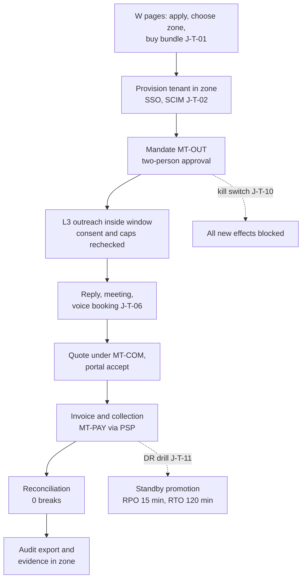

# AI Growth Engine: Employee Sales & Marketing Automation
## Application Blueprint: PART 11 (Batch 11.21e), Master Test Strategy and Combinatorial Test Design (V12): Cross-capability End-to-End Suites, Traceability Rollup, Release Suites, Regression Strategy and Decisions

| Field | Value |
|---|---|
| Document | Part 11.21e: cross-capability end-to-end journeys J-T-01…18 run per zone (31 full-form cases TC-V12-T-001…031), the traceability rollup of every test in the blueprint and of all 1,260 FR-V12 requirements (with 9 gap-closure cases TC-V12-T-032…040), the suites run per release, the regression strategy, conflicts, decisions DEC-920…939, ADR-270…274, the expert panel review, the tags register and the quality gate of Part 11.21 |
| Version | 1.0 · 28 Nov 2026 |
| Baseline | Parts 11.21a–d; Part 6.1 §6.1.12.6 (traceability matrix specification), §6.1.13 (UAT); Parts 11.10a–c (V12 test catalogue); Parts 11.14–11.19 |
| Roles applied | Head of Quality Engineering (primary), AI evaluation lead, performance and resilience architect, security test lead, accessibility test lead, combinatorial test design expert, Product Owner |

---

## 11.21.7 Cross-capability end-to-end scenario suites

### 11.21.7.1 Journey register

Each journey chains several capabilities end to end and is executed once per zone in which the capability exists (IN; EU in the EU-configured test cell until the EU stack is provisioned, DEC-927). Every page passes axe; one correlation ID spans the journey; every effect is reconciled; every record is checked to be in the journey's zone.

| Journey | Title | Zones | TCs | Release | UAT pack |
|---|---|---|---|---|---|
| J-T-01 | Tenant onboards, buys a bundle, runs mandated outreach, quotes, collects payment, reconciles and exports audit | IN, EU | TC-V12-T-001, TC-V12-T-002 | R2 | UAT-PK-V12-01 |
| J-T-02 | Enterprise tenant: SSO + SCIM, custom roles with SoD, API key, CRM connector, webhooks, then SCIM de-provisioning | IN, EU | TC-V12-T-003, TC-V12-T-004 | R1 | UAT-PK-V12-02 |
| J-T-03 | Agentic commerce: counterparty agent negotiation, order, pay-out, settlement, dispute and reconciliation | IN, EU | TC-V12-T-005, TC-V12-T-006 | R2 | UAT-PK-V12-03 |
| J-T-04 | OrganicSpec procurement: RFQ, supplier comparison, PO under MT-PROC, receipt, supplier pay-out under MT-PAY | IN | TC-V12-T-007 | R2 | UAT-PK-V12-03 |
| J-T-05 | Automatic bid submission of the exact approved package under MT-BID, receipt, award and order | IN, EU | TC-V12-T-008, TC-V12-T-009 | R2 | UAT-PK-V12-04 |
| J-T-06 | Inbound AI voice call: disclosure, multilingual booking, recording consent, transcript and coaching | IN, EU | TC-V12-T-010, TC-V12-T-011 | R2 | UAT-PK-V12-05 |
| J-T-07 | Outbound AI voice campaign with registry scrubbing, calling window and hand-off | IN, EU | TC-V12-T-012, TC-V12-T-013 | R2 | UAT-PK-V12-05 |
| J-T-08 | Investor journey: investor-mode website, private enquiry, eligibility and KYC, data room, two-person offer, receipt, allotment | IN, EU | TC-V12-T-014, TC-V12-T-015 | R2 | UAT-PK-V12-06 |
| J-T-09 | Managed-service operator runs a client campaign under a delegation grant until the grant expires | IN | TC-V12-T-016 | R2 | UAT-PK-V12-07 |
| J-T-10 | Kill switch and mandate revocation while outreach, commerce and bid work is in flight | IN, EU | TC-V12-T-017, TC-V12-T-018 | R2 | UAT-PK-V12-08 |
| J-T-11 | Disaster-recovery drill with an active mandate: standby promotion, RPO and RTO measured (KPI-32) | IN, EU | TC-V12-T-019, TC-V12-T-020 | R1 | UAT-PK-V12-09 |
| J-T-12 | Data-subject rights: export and erasure across database, files, recordings, indexes, logs and backups | IN, EU | TC-V12-T-021, TC-V12-T-022 | R2 | UAT-PK-V12-10 |
| J-T-13 | Rule-pack lifecycle: counsel sign-off activates a capability; expiry suspends mandates | IN | TC-V12-T-023 | R2 | UAT-PK-V12-08 |
| J-T-14 | Arabic right-to-left tenant: UI works in ar-AE, AE market blocked until its pack and zone are approved | EU | TC-V12-T-024 | R4 | UAT-PK-V12-11 |
| J-T-15 | Vertical safety: EduVerse never contacts minors; MedMaarg never stores patient data | IN | TC-V12-T-025 | R1 | UAT-PK-V12-12 |
| J-T-16 | Model registry change: candidate onboarding, affected EVAL suites, two-person approval, canary and rollback | IN, EU | TC-V12-T-026, TC-V12-T-027 | R2 | UAT-PK-V12-13 |
| J-T-17 | Cross-tenant benchmark published only for cohorts of at least 10 opted-in tenants with noise | IN, EU | TC-V12-T-028, TC-V12-T-029 | R2 | UAT-PK-V12-13 |
| J-T-18 | Tenant offboarding: cancellation, portability export, retention and deletion schedule | IN, EU | TC-V12-T-030, TC-V12-T-031 | R1 | UAT-PK-V12-10 |

*Figure: journey J-T-01 with the journeys that branch from it.*

### 11.21.7.2 End-to-end test cases (full form, Part 6.2a)

| ID | Title | Links | Preconditions · Test data | Steps | Expected result | P | Type | Tech | Auto | Lvl |
|-------|------------|-------------|--------------|----------------------|----------------------|---|----|---|---|---|
| TC-V12-T-001 | J-T-01 (IN zone): Tenant onboards, buys a bundle, runs mandated outreach, quotes, collects payment, reconciles and exports audit | TS-V12-T-17 · J-T-01 · SM-SVC-06/10/17/21/32; MT-OUT, MT-COM, MT-PAY; DEC-770, 772, 777, 779, 780; FR-V12-P-001…099; CJ-TC-09 · R2 | Pre: PP-06 (Chromium + WebKit) and PP-01 in the IN zone; SYN-T fixtures; provider simulators; clock control. Data: Kestrel Analytics Pvt Ltd (EXT-SMB, en-IN), UPI AutoPay/e-NACH collection | 1. R17 applies on W-pages, verifies e-mail, picks residency zone IN at onboarding and buys bundle "Outreach & Conversations" + SM-SVC-17/21 (checkout W). 2. Provisioning creates the tenant in IN; R12 invites R03, R05L, R08, R09, R10 (password + MFA). 3. R03 creates MT-OUT mandate (templates v1, 200 msgs/day, 2 per recipient per 7 d); R05L and R10 approve (two-person). 4. SM-SVC-06-WF02 sends at L3 to 40 consented contacts inside 09:00–21:00 local. 5. One reply → SM-SVC-09 intent → SM-SVC-10 meeting booked. 6. SM-SVC-17-WF02 quote within the discount band under MT-COM; customer accepts on Portal (R16). 7. SM-SVC-21 invoice; collection under MT-PAY via the zone PSP; pre-debit notice. 8. Signed PSP webhook → reconciliation. 9. R15 exports the audit pack | Tenant, data, logs and backups only in IN; mandate Active only after both approvals and Approved packs (IN packs); 40 sends exactly once, none outside the window or to suppressed contacts; meeting, quote (hash-bound), invoice and collection posted once; reconciliation match = 100%, 0 breaks; consumption ledger reserve→commit for every L3 effect; audit export complete with evidence IDs; axe 0 critical/serious on every page; all money as Decimal + ISO 4217 (INR) | P0 | T01, T19, T20 | UC | Y | E2E |
| TC-V12-T-002 | J-T-01 (EU zone): Tenant onboards, buys a bundle, runs mandated outreach, quotes, collects payment, reconciles and exports audit | TS-V12-T-17 · J-T-01 · SM-SVC-06/10/17/21/32; MT-OUT, MT-COM, MT-PAY; DEC-770, 772, 777, 779, 780; FR-V12-P-001…099; CJ-TC-09 · R2 | Pre: PP-06 (Chromium + WebKit) and PP-01 in the EU zone; SYN-T fixtures; provider simulators; clock control. Data: Nordlicht GmbH (EXT-SMB, de-DE), SEPA Direct Debit collection | 1. R17 applies on W-pages, verifies e-mail, picks residency zone EU at onboarding and buys bundle "Outreach & Conversations" + SM-SVC-17/21 (checkout W). 2. Provisioning creates the tenant in EU; R12 invites R03, R05L, R08, R09, R10 (password + MFA). 3. R03 creates MT-OUT mandate (templates v1, 200 msgs/day, 2 per recipient per 7 d); R05L and R10 approve (two-person). 4. SM-SVC-06-WF02 sends at L3 to 40 consented contacts inside 09:00–21:00 local. 5. One reply → SM-SVC-09 intent → SM-SVC-10 meeting booked. 6. SM-SVC-17-WF02 quote within the discount band under MT-COM; customer accepts on Portal (R16). 7. SM-SVC-21 invoice; collection under MT-PAY via the zone PSP; pre-debit notice. 8. Signed PSP webhook → reconciliation. 9. R15 exports the audit pack | Tenant, data, logs and backups only in EU; mandate Active only after both approvals and Approved packs (EU packs); 40 sends exactly once, none outside the window or to suppressed contacts; meeting, quote (hash-bound), invoice and collection posted once; reconciliation match = 100%, 0 breaks; consumption ledger reserve→commit for every L3 effect; audit export complete with evidence IDs; axe 0 critical/serious on every page; all money as Decimal + ISO 4217 (EUR) | P0 | T01, T19, T20 | UC | Y | E2E |
| TC-V12-T-003 | J-T-02 (IN zone): Enterprise tenant: SSO + SCIM, custom roles with SoD, API key, CRM connector, webhooks, then SCIM de-provisioning | TS-V12-T-17 · J-T-02 · DEC-784, 785, 786; FR-V12-R-001…055; US-01-ZR01…05, US-20-ZR06…10, US-18-ZR11, US-07-ZR12/13 · R1 | Pre: PP-06 (Chromium + WebKit) and PP-01 in the IN zone; SYN-T fixtures; provider simulators; clock control. Data: Saffron Retail Ltd (EXT-ENT, Okta SAML) | 1. R12 verifies the domain, configures the IdP and enforces SSO. 2. SCIM pushes 25 users and 4 groups. 3. R12 creates custom role "Campaign Approver" (SoD: cannot author). 4. R12 issues a zone-bound API key and an OAuth client. 5. CRM connector activated through the activation gate; bi-directional sync of 500 contacts. 6. Outbound webhook subscription receives `run.completed`. 7. SCIM deletes 3 users | SSO sessions issued only by the IN stack; SCIM objects created ≤ 5 s p95; SoD rule refuses author+approve on one item; API key works only on IN host; CRM sync respects field ownership and protected consent; webhook payload has references and digests only, signature verifies; de-provisioned users lose sessions ≤ 60 s; every step audited in IN | P0 | T07, T01 | UC | Y | E2E |
| TC-V12-T-004 | J-T-02 (EU zone): Enterprise tenant: SSO + SCIM, custom roles with SoD, API key, CRM connector, webhooks, then SCIM de-provisioning | TS-V12-T-17 · J-T-02 · DEC-784, 785, 786; FR-V12-R-001…055; US-01-ZR01…05, US-20-ZR06…10, US-18-ZR11, US-07-ZR12/13 · R1 | Pre: PP-06 (Chromium + WebKit) and PP-01 in the EU zone; SYN-T fixtures; provider simulators; clock control. Data: Nordlicht GmbH Enterprise (EXT-ENT, Entra ID OIDC) | 1. R12 verifies the domain, configures the IdP and enforces SSO. 2. SCIM pushes 25 users and 4 groups. 3. R12 creates custom role "Campaign Approver" (SoD: cannot author). 4. R12 issues a zone-bound API key and an OAuth client. 5. CRM connector activated through the activation gate; bi-directional sync of 500 contacts. 6. Outbound webhook subscription receives `run.completed`. 7. SCIM deletes 3 users | SSO sessions issued only by the EU stack; SCIM objects created ≤ 5 s p95; SoD rule refuses author+approve on one item; API key works only on EU host; CRM sync respects field ownership and protected consent; webhook payload has references and digests only, signature verifies; de-provisioned users lose sessions ≤ 60 s; every step audited in EU | P0 | T07, T01 | UC | Y | E2E |
| TC-V12-T-005 | J-T-03 (IN zone): Agentic commerce: counterparty agent negotiation, order, pay-out, settlement, dispute and reconciliation | TS-V12-T-17 · J-T-03 · SM-SVC-28-WF01…04; MT-COM, MT-PAY; DEC-780; FR-V12-P-070…099; RP-GL-AGENTCOM, RP-IN-AGENTCOM/RP-EU-AGENTCOM, RP-IN-PAY/RP-EU-PAY · R2 | Pre: PP-06 (Chromium + WebKit) and PP-01 in the IN zone; SYN-T fixtures; provider simulators; clock control. Data: OrganicSpec (T1) selling to a verified buyer agent; UPI/e-NACH rails | 1. Publish the approved catalog version to authorized agent endpoints (MT-PUB). 2. Counterparty agent presents a verifiable credential; negotiation within bounds (max discount, min margin, rounds). 3. Order accepted under MT-COM (L3). 4. Pay-out or collection under MT-PAY through the licensed PSP. 5. PSP settles; one item disputed; chargeback evidence pack built. 6. Daily reconciliation | Credential verified (issuer trusted, not revoked); offers beyond bounds rejected with a counter-offer inside bounds; signed acceptance; exactly one PSP instruction per order; commerce sub-ledger double-entry balanced; dispute flow opens a case and freezes the related mandate amount; reconciliation 100% matched or breaks routed to R08/R09; kill switch test during step 3 blocks the next order | P0 | T19, T20, T16 | UC | Y | E2E |
| TC-V12-T-006 | J-T-03 (EU zone): Agentic commerce: counterparty agent negotiation, order, pay-out, settlement, dispute and reconciliation | TS-V12-T-17 · J-T-03 · SM-SVC-28-WF01…04; MT-COM, MT-PAY; DEC-780; FR-V12-P-070…099; RP-GL-AGENTCOM, RP-IN-AGENTCOM/RP-EU-AGENTCOM, RP-IN-PAY/RP-EU-PAY · R2 | Pre: PP-06 (Chromium + WebKit) and PP-01 in the EU zone; SYN-T fixtures; provider simulators; clock control. Data: Atelier Lumière SAS (EXT-SMB, fr-FR) buying from a verified supplier agent; SEPA rails | 1. Publish the approved catalog version to authorized agent endpoints (MT-PUB). 2. Counterparty agent presents a verifiable credential; negotiation within bounds (max discount, min margin, rounds). 3. Order accepted under MT-COM (L3). 4. Pay-out or collection under MT-PAY through the licensed PSP. 5. PSP settles; one item disputed; chargeback evidence pack built. 6. Daily reconciliation | Credential verified (issuer trusted, not revoked); offers beyond bounds rejected with a counter-offer inside bounds; signed acceptance; exactly one PSP instruction per order; commerce sub-ledger double-entry balanced; dispute flow opens a case and freezes the related mandate amount; reconciliation 100% matched or breaks routed to R08/R09; kill switch test during step 3 blocks the next order | P0 | T19, T20, T16 | UC | Y | E2E |
| TC-V12-T-007 | J-T-04 (IN zone): OrganicSpec procurement: RFQ, supplier comparison, PO under MT-PROC, receipt, supplier pay-out under MT-PAY | TS-V12-T-17 · J-T-04 · SM-SVC-39-WF01…04; MT-PROC + MT-PAY; BRL-APR-06/07; DEC-779, 780 · R2 | Pre: PP-06 (Chromium + WebKit) and PP-01 in the IN zone; SYN-T fixtures; provider simulators; clock control. Data: T1 OrganicSpec, payable ledger, UPI pay-out | 1. Need validated (approval-binding TC-V12-J-209). 2. RFQ to 3 approved suppliers; AI compares quotations (EVAL-SM-SVC-39-WF02). 3. R07 and R02/R08 approve MT-PROC; PO committed at L3 within per-PO cap. 4. Goods received. 5. Pay-out under MT-PAY (R08 maker + R09 checker mandate) | PO only to allowlisted suppliers; per-PO and aggregate caps enforced; payable posted once; pay-out once with idempotency key; receivable and payable ledgers separate; reconciliation match; evidence pack complete | P0 | T19, T20 | UC | Y | E2E |
| TC-V12-T-008 | J-T-05 (IN zone): Automatic bid submission of the exact approved package under MT-BID, receipt, award and order | TS-V12-T-17 · J-T-05 · SM-SVC-19-WF01…04; MT-BID; DEC-781; Part 11.17b; RP-IN-PROC / RP-EU-PROC · R2 | Pre: PP-06 (Chromium + WebKit) and PP-01 in the IN zone; SYN-T fixtures; provider simulators; clock control. Data: T1 AppNAI, GeM-type portal simulator, DSC signer | 1. Tender discovered (SM-SVC-02). 2. R06 prepares the package; compliance check (SM-SVC-19-WF04). 3. R02 and R10 approve package hash, price, terms and portal; MT-BID issued (count 1). 4. Agent submits before the deadline. 5. Portal receipt stored. 6. Award → SM-SVC-20 order | Submission only if portal terms permit automation (IN packs Approved); submitted bytes hash = approved hash; second submission impossible (mandate Exhausted); receipt and evidence stored in IN; a changed price after approval blocks submission | P0 | T19, T07 | UC | Y | E2E |
| TC-V12-T-009 | J-T-05 (EU zone): Automatic bid submission of the exact approved package under MT-BID, receipt, award and order | TS-V12-T-17 · J-T-05 · SM-SVC-19-WF01…04; MT-BID; DEC-781; Part 11.17b; RP-IN-PROC / RP-EU-PROC · R2 | Pre: PP-06 (Chromium + WebKit) and PP-01 in the EU zone; SYN-T fixtures; provider simulators; clock control. Data: Nordlicht GmbH, eSubmission simulator, eIDAS signer | 1. Tender discovered (SM-SVC-02). 2. R06 prepares the package; compliance check (SM-SVC-19-WF04). 3. R02 and R10 approve package hash, price, terms and portal; MT-BID issued (count 1). 4. Agent submits before the deadline. 5. Portal receipt stored. 6. Award → SM-SVC-20 order | Submission only if portal terms permit automation (EU packs Approved); submitted bytes hash = approved hash; second submission impossible (mandate Exhausted); receipt and evidence stored in EU; a changed price after approval blocks submission | P0 | T19, T07 | UC | Y | E2E |
| TC-V12-T-010 | J-T-06 (IN zone): Inbound AI voice call: disclosure, multilingual booking, recording consent, transcript and coaching | TS-V12-T-17 · J-T-06 · SM-SVC-26-WF01/03/04, SM-SVC-36-WF03; DEC-782; FR-V12-Q; US-22-ZQ01, US-08-ZQ01 · R2 | Pre: PP-06 (Chromium + WebKit) and PP-01 in the IN zone; SYN-T fixtures; provider simulators; clock control. Data: T1 MedMaarg (hi-IN caller), institutional enquiry | 1. Caller dials the tenant number. 2. AI identifies itself as AI in the caller language. 3. Recording consent prompt per pack. 4. Booking via the calendar adapter with verbal read-back. 5. Transcript and summary; CRM sync approved. 6. Coaching feedback generated from the consented recording | Disclosure within the first utterance; recording only after the consent the pack requires (all-party in DE); booking once; transcript persisted only with a recording basis; coaching uses only recordings with a coaching purpose; human hand-off offered and works; all audio and transcripts in IN | P0 | T19, T14 | UC | Y | E2E |
| TC-V12-T-011 | J-T-06 (EU zone): Inbound AI voice call: disclosure, multilingual booking, recording consent, transcript and coaching | TS-V12-T-17 · J-T-06 · SM-SVC-26-WF01/03/04, SM-SVC-36-WF03; DEC-782; FR-V12-Q; US-22-ZQ01, US-08-ZQ01 · R2 | Pre: PP-06 (Chromium + WebKit) and PP-01 in the EU zone; SYN-T fixtures; provider simulators; clock control. Data: Nordlicht GmbH (de-DE caller), all-party recording consent | 1. Caller dials the tenant number. 2. AI identifies itself as AI in the caller language. 3. Recording consent prompt per pack. 4. Booking via the calendar adapter with verbal read-back. 5. Transcript and summary; CRM sync approved. 6. Coaching feedback generated from the consented recording | Disclosure within the first utterance; recording only after the consent the pack requires (all-party in DE); booking once; transcript persisted only with a recording basis; coaching uses only recordings with a coaching purpose; human hand-off offered and works; all audio and transcripts in EU | P0 | T19, T14 | UC | Y | E2E |
| TC-V12-T-012 | J-T-07 (IN zone): Outbound AI voice campaign with registry scrubbing, calling window and hand-off | TS-V12-T-17 · J-T-07 · SM-SVC-26-WF02; DEC-777, 782; RP-IN-SMS (voice), RP-EU-MKT; TC-V12-Q-C3 · R2 | Pre: PP-06 (Chromium + WebKit) and PP-01 in the IN zone; SYN-T fixtures; provider simulators; clock control. Data: Kestrel Analytics, NCPR scrub, DLT-registered number series | 1. Campaign approved (script hash). 2. AU-280 preflight scrubs the list. 3. Calls placed inside the effective window. 4. One callee asks for a human. 5. One number is registry-listed | Registry-listed numbers never dialled; calls only inside the stricter of 09:00–21:00 and the pack hours; AI disclosure; hand-off within the SLA; caller ID compliant; outcome per callee recorded once | P0 | T19 | UC | Y | E2E |
| TC-V12-T-013 | J-T-07 (EU zone): Outbound AI voice campaign with registry scrubbing, calling window and hand-off | TS-V12-T-17 · J-T-07 · SM-SVC-26-WF02; DEC-777, 782; RP-IN-SMS (voice), RP-EU-MKT; TC-V12-Q-C3 · R2 | Pre: PP-06 (Chromium + WebKit) and PP-01 in the EU zone; SYN-T fixtures; provider simulators; clock control. Data: Atelier Lumière SAS, Bloctel scrub, FR calling hours | 1. Campaign approved (script hash). 2. AU-280 preflight scrubs the list. 3. Calls placed inside the effective window. 4. One callee asks for a human. 5. One number is registry-listed | Registry-listed numbers never dialled; calls only inside the stricter of 09:00–21:00 and the pack hours; AI disclosure; hand-off within the SLA; caller ID compliant; outcome per callee recorded once | P0 | T19 | UC | Y | E2E |
| TC-V12-T-014 | J-T-08 (IN zone): Investor journey: investor-mode website, private enquiry, eligibility and KYC, data room, two-person offer, receipt, allotment | TS-V12-T-17 · J-T-08 · INV-SVC-01…16, 24; DEC-783; FR-V12-N/O; RP-AML-KYC, RP-INV-ADVICE; M-O1, M-O2 (Part 11.16d), PM-N-01…03 (Part 11.16e) · R2 | Pre: PP-06 (Chromium + WebKit) and PP-01 in the IN zone; SYN-T fixtures; provider simulators; clock control. Data: Lumen Robotics Pvt Ltd, private placement to named investors (RP-IN-SEC) | 1. Visitor submits a private enquiry (no offer content shown). 2. KYC and eligibility verification. 3. NDA and data-room grant. 4. Offer document approved by two people and issued to the named eligible investor. 5. Funds received from the investor's own account; reconciliation. 6. Allotment and statutory filing tasks | No general solicitation; offer terms only to verified-eligible recipients; AI never gives investment advice; data-room access watermarked and logged; receipt reconciled before allotment; statutory clocks tracked; everything in IN | P0 | T19, T07 | UC | Y | E2E |
| TC-V12-T-015 | J-T-08 (EU zone): Investor journey: investor-mode website, private enquiry, eligibility and KYC, data room, two-person offer, receipt, allotment | TS-V12-T-17 · J-T-08 · INV-SVC-01…16, 24; DEC-783; FR-V12-N/O; RP-AML-KYC, RP-INV-ADVICE; M-O1, M-O2 (Part 11.16d), PM-N-01…03 (Part 11.16e) · R2 | Pre: PP-06 (Chromium + WebKit) and PP-01 in the EU zone; SYN-T fixtures; provider simulators; clock control. Data: Lumen Robotics GmbH, prospectus-exempt offer to qualified investors (RP-EU-PROSP) | 1. Visitor submits a private enquiry (no offer content shown). 2. KYC and eligibility verification. 3. NDA and data-room grant. 4. Offer document approved by two people and issued to the named eligible investor. 5. Funds received from the investor's own account; reconciliation. 6. Allotment and statutory filing tasks | No general solicitation; offer terms only to verified-eligible recipients; AI never gives investment advice; data-room access watermarked and logged; receipt reconciled before allotment; statutory clocks tracked; everything in EU | P0 | T19, T07 | UC | Y | E2E |
| TC-V12-T-016 | J-T-09 (IN zone): Managed-service operator runs a client campaign under a delegation grant until the grant expires | TS-V12-T-17 · J-T-09 · FR-ENH-A-015; ABAC-ENH-A-01…03; NT-ENH-A-05; TC-ENH-A-024…026 · R2 | Pre: PP-06 (Chromium + WebKit) and PP-01 in the IN zone; SYN-T fixtures; provider simulators; clock control. Data: Harbor Foods Pvt Ltd (EXT-MSP) and operator Corvid Managed Services (R21) | 1. Client approves grant G-1 (Outreach, sender S-1, budget B-1, 90 days). 2. R21 builds and runs a campaign. 3. R21 tries export and approval of claims. 4. Clock advanced past expiry | Actions stamped with grant_id; export and claims approval refused; after expiry 403 DELEGATION_SCOPE and session context cleared; client sees the full trail | P0 | T07 | UC | Y | E2E |
| TC-V12-T-017 | J-T-10 (IN zone): Kill switch and mandate revocation while outreach, commerce and bid work is in flight | TS-V12-T-17 · J-T-10 · Part 11.17a §11.17.5.13; DEC-779; XT-15; PM-T03 · R2 | Pre: PP-06 (Chromium + WebKit) and PP-01 in the IN zone; SYN-T fixtures; provider simulators; clock control. Data: T1 portfolio | 1. Start MT-OUT batch, MT-COM negotiation and MT-BID submission preparation. 2. R10 engages the tenant kill switch. 3. Resume with two-person approval. 4. Revoke MT-COM | No new effect after the switch time (±1 s); reservations released; in-flight items held and reconciled; resume needs two people; revoked mandate never dispatches again | P0 | T19, T18 | UC | Y | E2E |
| TC-V12-T-018 | J-T-10 (EU zone): Kill switch and mandate revocation while outreach, commerce and bid work is in flight | TS-V12-T-17 · J-T-10 · Part 11.17a §11.17.5.13; DEC-779; XT-15; PM-T03 · R2 | Pre: PP-06 (Chromium + WebKit) and PP-01 in the EU zone; SYN-T fixtures; provider simulators; clock control. Data: Nordlicht GmbH | 1. Start MT-OUT batch, MT-COM negotiation and MT-BID submission preparation. 2. R10 engages the tenant kill switch. 3. Resume with two-person approval. 4. Revoke MT-COM | No new effect after the switch time (±1 s); reservations released; in-flight items held and reconciled; resume needs two people; revoked mandate never dispatches again | P0 | T19, T18 | UC | Y | E2E |
| TC-V12-T-019 | J-T-11 (IN zone): Disaster-recovery drill with an active mandate: standby promotion, RPO and RTO measured (KPI-32) | TS-V12-T-17 · J-T-11 · DEC-771, 787; KPI-32; DR-V12-T-01…08; Part 11.19b DR-R1…R8; PM-T09 · R1 | Pre: PP-06 (Chromium + WebKit) and PP-01 in the IN zone; SYN-T fixtures; provider simulators; clock control. Data: IN zone stack | 1. Run LT-04 load with an MT-PAY pay-out batch. 2. Make the Supabase primary unavailable. 3. Promote the in-zone standby; replay the outbox. 4. Reconcile PSP truth | Achieved RPO ≤ 15 min and RTO ≤ 120 min recorded in the drill evidence; no cross-zone copy used; no duplicate pay-out; drill evidence signed by SRE and QA | P0 | T12 | UC | Y | E2E |
| TC-V12-T-020 | J-T-11 (EU zone): Disaster-recovery drill with an active mandate: standby promotion, RPO and RTO measured (KPI-32) | TS-V12-T-17 · J-T-11 · DEC-771, 787; KPI-32; DR-V12-T-01…08; Part 11.19b DR-R1…R8; PM-T09 · R1 | Pre: PP-06 (Chromium + WebKit) and PP-01 in the EU zone; SYN-T fixtures; provider simulators; clock control. Data: EU zone stack | 1. Run LT-04 load with an MT-PAY pay-out batch. 2. Make the Supabase primary unavailable. 3. Promote the in-zone standby; replay the outbox. 4. Reconcile PSP truth | Achieved RPO ≤ 15 min and RTO ≤ 120 min recorded in the drill evidence; no cross-zone copy used; no duplicate pay-out; drill evidence signed by SRE and QA | P0 | T12 | UC | Y | E2E |
| TC-V12-T-021 | J-T-12 (IN zone): Data-subject rights: export and erasure across database, files, recordings, indexes, logs and backups | TS-V12-T-17 · J-T-12 · Part 4.1 privacy; RP-IN-DPDP; DEC-772; PM-T04 · R2 | Pre: PP-06 (Chromium + WebKit) and PP-01 in the IN zone; SYN-T fixtures; provider simulators; clock control. Data: DPDP request (RP-IN-DPDP) | 1. Data principal submits a request. 2. Identity verified. 3. Export package built. 4. Erasure executed with legal-hold check. 5. Backups age out per retention | Export complete within the statutory clock (verify); erasure covers rows, objects, recordings, embeddings and caches; legal-hold items retained with reason; backups never restored without re-applying erasures; all within IN | P0 | T19 | UC | Y | E2E |
| TC-V12-T-022 | J-T-12 (EU zone): Data-subject rights: export and erasure across database, files, recordings, indexes, logs and backups | TS-V12-T-17 · J-T-12 · Part 4.1 privacy; RP-IN-DPDP; DEC-772; PM-T04 · R2 | Pre: PP-06 (Chromium + WebKit) and PP-01 in the EU zone; SYN-T fixtures; provider simulators; clock control. Data: GDPR request (RP-EU-MKT, GDPR rights) | 1. Data principal submits a request. 2. Identity verified. 3. Export package built. 4. Erasure executed with legal-hold check. 5. Backups age out per retention | Export complete within the statutory clock (verify); erasure covers rows, objects, recordings, embeddings and caches; legal-hold items retained with reason; backups never restored without re-applying erasures; all within EU | P0 | T19 | UC | Y | E2E |
| TC-V12-T-023 | J-T-13 (IN zone): Rule-pack lifecycle: counsel sign-off activates a capability; expiry suspends mandates | TS-V12-T-17 · J-T-13 · Part 11.15 §11.15.3.5; XT-10; DEC-779/780 · R2 | Pre: PP-06 (Chromium + WebKit) and PP-01 in the IN zone; SYN-T fixtures; provider simulators; clock control. Data: RP-IN-PAY for MT-PAY | 1. Pack in counsel review. 2. Counsel signs; AU-128 loads. 3. MT-PAY mandate activates. 4. Review date passes | Capability inactive before signature; active after; on expiry every MT-PAY mandate in IN suspends within 1 min and R10 is notified | P0 | T19 | UC | Y | E2E |
| TC-V12-T-024 | J-T-14 (EU zone): Arabic right-to-left tenant: UI works in ar-AE, AE market blocked until its pack and zone are approved | TS-V12-T-17 · J-T-14 · DEC-776; Part 11.7c CONFLICT-872; PM-T06, PM-T07 · R4 | Pre: PP-06 (Chromium + WebKit) and PP-01 in the EU zone; SYN-T fixtures; provider simulators; clock control. Data: Al Noor Trading FZ-LLC (EXT-SMB, ar-AE UI, EU zone by choice) | 1. Onboard with ar-AE. 2. Use Admin and Website in RTL. 3. Try outreach to AE recipients | RTL layout, mirrored icons, bidi-safe IDs; AE outreach blocked JURISDICTION_NOT_ENABLED until the AE pack is Approved; no data written outside the chosen zone | P1 | T13, T08 | UC | Y | E2E |
| TC-V12-T-025 | J-T-15 (IN zone): Vertical safety: EduVerse never contacts minors; MedMaarg never stores patient data | TS-V12-T-17 · J-T-15 · DEC-030; MedMaarg rule; RP-EDU-MINORS, RP-HEALTH · R1 | Pre: PP-06 (Chromium + WebKit) and PP-01 in the IN zone; SYN-T fixtures; provider simulators; clock control. Data: T1 EduVerse and MedMaarg | 1. Import a list containing a learner aged 16. 2. Run SM-SVC-06 at L3. 3. Upload a document containing a patient record to MedMaarg | Minor excluded before any draft; no message; patient record quarantined PROHIBITED_DATA_CLASS; R10 task; no AI call on the record | P0 | T19 | UC | Y | E2E |
| TC-V12-T-026 | J-T-16 (IN zone): Model registry change: candidate onboarding, affected EVAL suites, two-person approval, canary and rollback | TS-V12-T-17 · J-T-16 · DEC-788; PM-T16; AU-054/057/154 · R2 | Pre: PP-06 (Chromium + WebKit) and PP-01 in the IN zone; SYN-T fixtures; provider simulators; clock control. Data: IN registry rows | 1. Add a candidate model row. 2. AU-154 selects affected suites. 3. Suites pass; two approvers approve. 4. Canary 5%. 5. Inject drift; roll back | Candidate never routable before approval; canary limited; rollback restores the previous row in ≤ 5 min; all evaluation evidence stored per zone | P0 | T14 | UC | Y | E2E |
| TC-V12-T-027 | J-T-16 (EU zone): Model registry change: candidate onboarding, affected EVAL suites, two-person approval, canary and rollback | TS-V12-T-17 · J-T-16 · DEC-788; PM-T16; AU-054/057/154 · R2 | Pre: PP-06 (Chromium + WebKit) and PP-01 in the EU zone; SYN-T fixtures; provider simulators; clock control. Data: EU registry rows | 1. Add a candidate model row. 2. AU-154 selects affected suites. 3. Suites pass; two approvers approve. 4. Canary 5%. 5. Inject drift; roll back | Candidate never routable before approval; canary limited; rollback restores the previous row in ≤ 5 min; all evaluation evidence stored per zone | P0 | T14 | UC | Y | E2E |
| TC-V12-T-028 | J-T-17 (IN zone): Cross-tenant benchmark published only for cohorts of at least 10 opted-in tenants with noise | TS-V12-T-17 · J-T-17 · DEC-789; Part 11.19 M11 · R2 | Pre: PP-06 (Chromium + WebKit) and PP-01 in the IN zone; SYN-T fixtures; provider simulators; clock control. Data: IN cohort | 1. 9 then 12 tenants opt in. 2. Compute reply-rate benchmark. 3. Tenant withdraws | No publication at 9; publication at 12 with noise and no tenant-level value; withdrawal excludes the tenant from the next period; nothing crosses zones | P0 | T19, T15 | UC | Y | E2E |
| TC-V12-T-029 | J-T-17 (EU zone): Cross-tenant benchmark published only for cohorts of at least 10 opted-in tenants with noise | TS-V12-T-17 · J-T-17 · DEC-789; Part 11.19 M11 · R2 | Pre: PP-06 (Chromium + WebKit) and PP-01 in the EU zone; SYN-T fixtures; provider simulators; clock control. Data: EU cohort | 1. 9 then 12 tenants opt in. 2. Compute reply-rate benchmark. 3. Tenant withdraws | No publication at 9; publication at 12 with noise and no tenant-level value; withdrawal excludes the tenant from the next period; nothing crosses zones | P0 | T19, T15 | UC | Y | E2E |
| TC-V12-T-030 | J-T-18 (IN zone): Tenant offboarding: cancellation, portability export, retention and deletion schedule | TS-V12-T-17 · J-T-18 · Part 11.2 subscription engine; EP-20; DEC-772 · R1 | Pre: PP-06 (Chromium + WebKit) and PP-01 in the IN zone; SYN-T fixtures; provider simulators; clock control. Data: Kestrel Analytics | 1. R12 cancels. 2. Portability export. 3. Grace period. 4. Deletion executed | Export complete and signed; access ends at period end; deletion certificate; backups expire on schedule; meter and invoices final | P1 | T01, T19 | UC | Y | E2E |
| TC-V12-T-031 | J-T-18 (EU zone): Tenant offboarding: cancellation, portability export, retention and deletion schedule | TS-V12-T-17 · J-T-18 · Part 11.2 subscription engine; EP-20; DEC-772 · R1 | Pre: PP-06 (Chromium + WebKit) and PP-01 in the EU zone; SYN-T fixtures; provider simulators; clock control. Data: Nordlicht GmbH | 1. R12 cancels. 2. Portability export. 3. Grace period. 4. Deletion executed | Export complete and signed; access ends at period end; deletion certificate; backups expire on schedule; meter and invoices final | P1 | T01, T19 | UC | Y | E2E |

---

## 11.21.8 Traceability rollup, release suites and regression strategy

### 11.21.8.1 Test totals across the blueprint

Counted by `assembly/v12b/t_01_inventory.py`: an ID in the first cell of a table row is a definition; IDs are de-duplicated across files; Part 11.21 is excluded from the scan and added below.

| Part (group) | Test cases defined (unique IDs) | Main families |
|---|---|---|
| Part 2.6 | 50 | TC-ENH-A 50 |
| Part 2.7 | 57 | TC-ENH-C 57 |
| Part 3.4 | 30 | TC-ENH-B 30 |
| Part 3.5 | 345 | TC-ENH-D 345 |
| Part 3.6 | 36 | TC-ENH-E 36 |
| Part 4.4 | 41 | TC-ENH-I 41 |
| Part 6.2 | 685 | TC-<epic> 685 |
| Part 6.3 | 734 | TC-<epic> 734 |
| Part 6.4 | 774 | TC-AI 586, TC-AU 188 |
| Part 6.5 | 562 | TC-<epic> 562 |
| Part 6.7 | 160 | TC-NFR 100, TC-FLT 46, TC-BRS 14 |
| Part 6.8 | 45 | TC-ENH-G 45 |
| Part 6.9 | 36 | TC-ENH-H 36 |
| Part 6.10 | 67 | TC-ENH-K 64, TC-ENH-D 3 |
| Part 7.4 | 40 | TC-ENH-F 40 |
| Part 8.3 | 66 | TC-ENH-J 66 |
| Part 9.2 | 1 | TC-ENH 1 |
| Part 9.6 | 91 | TC-ALN-A 54, TC-ALN-B 37 |
| Part 9.7 | 92 | TC-ADV-X1 92 |
| Part 9.8 | 104 | TC-ADV-X2 104 |
| Part 9.9 | 62 | TC-ADV-X3 62 |
| Part 11.1 | 114 | TC-V12-A 114 |
| Part 11.2 | 264 | TC-V12-B 264 |
| Part 11.3 | 712 | TC-V12-C 712 |
| Part 11.4 | 58 | TC-V12-D 58 |
| Part 11.5 | 120 | TC-V12-E 120 |
| Part 11.6 | 275 | TC-V12-F 275 |
| Part 11.7 | 234 | TC-V12-G 234 |
| Part 11.8 | 97 | TC-V12-H 97 |
| Part 11.9 | 61 | TC-V12-I 61 |
| Part 11.10 | 60 | TC-V12-J 60 |
| Part 11.11 | 42 | TC-V12-K 42 |
| Part 11.12 | 48 | TC-V12-L 48 |
| Part 11.13 | 104 | TC-V12-M 104 |
| Part 11.15 | 257 | TC-RP 257 |
| Part 11.16 | 2,391 | TC-V12-N 1220, TC-V12-O 1070, TC-AI 60, TC-RP 41 |
| Part 11.17 | 873 | TC-V12-P 826, TC-AI 47 |
| Part 11.18 | 676 | TC-V12-Q 676 |
| Part 11.19 | 1,158 | TC-V12-R 1158 |

| Measure | Count | Basis |
|---|---|---|
| Test cases defined in Parts 2.6–9.10 (before V12) | 4,078 | `t_01_inventory.py` scan of table rows. The V12 brief quotes 4,156; the difference (−78) is IDs that earlier parts count but do not define in their own table row (ranges and aliases) |
| Test cases defined in Parts 11.1–11.19 | 7,544 | Same scan |
| Unique test-case IDs defined before Part 11.21 | 11,622 | Same scan, de-duplicated across files |
| minus Part 11.10 class definitions TC-V12-J-001…019 (counted through instances) | −19 | Part 11.10b §11.10.4.5 |
| plus executable instances of those classes (1,342 scenarios, 517 steps, 156 AT01, 39 ENT-AT01, 221 canonical acceptance rows) | +2,275 | Part 11.10b §11.10.4.5 |
| **Executable test cases before Part 11.21** | **13,878** | |
| Part 11.21 end-to-end journey cases (full form) | +31 | §11.21.7.2 |
| Part 11.21 FR gap-closure cases (full form) | +9 | §11.21.8.2 |
| Part 11.21 generated combinatorial cases | +2,630 | §11.21.6 |
| **Executable test cases after Part 11.21** | **16,548** | |
| Test scenarios (TS) defined | 340 + 18 | scan + TS-V12-T-01…18 |
| Parts written in parallel (not counted above) | Part-11-23a: 34, Part-11-24a: 12, Part-11-24b: 42 | Parts 11.20, 11.22–11.24 appeared while this part was written; their rows are added at the next rollup |
| Evaluation suites bound as gates (not counted as tests) | 111 | EVAL-SM-SVC-##-WF## |

**Result.** The blueprint holds **13,878 executable test cases before Part 11.21** and **16,548 after it** (2,670 new TC-V12-T cases: 31 end-to-end, 9 FR gap-closure and 2,630 generated). The V12 brief's starting figure of 4,156 and Part 11.10's 6,472 (= 4,156 + 2,316) use the parts' own counts; this rollup recounts row definitions and expands Part 11.10's classes into their instances, which is the basis for release planning.

### 11.21.8.2 Functional-requirement traceability (FR-V12, Parts 11.1–11.19)

Every FR-V12 row defined in Parts 11.1–11.19 was checked programmatically (`t_05_build.py`, function `fr_trace`): first for a test named in the FR row itself (TC, TS, EVAL, workflow test, AT01 or combinatorial model), then for a TC row or a TC range anywhere in the blueprint that cites it. Nine FRs had a test description but no test ID; Part 11.21 closes them with TC-V12-T-032…040 (scenario TS-V12-T-18).

| FR family | Part | FRs defined | Test named in the FR row | Referenced by a TC row or range | Closed by Part 11.21 (TC-V12-T-032…040) | Without a test |
|---|---|---|---|---|---|---|
| FR-V12-A | 11.1 | 123 | 113 | 10 | 0 | 0 |
| FR-V12-B | 11.2 | 105 | 105 | 0 | 0 | 0 |
| FR-V12-C | 11.3 | 12 | 12 | 0 | 0 | 0 |
| FR-V12-D | 11.4 | 47 | 47 | 0 | 0 | 0 |
| FR-V12-E | 11.5 | 102 | 102 | 0 | 0 | 0 |
| FR-V12-F | 11.6 | 73 | 73 | 0 | 0 | 0 |
| FR-V12-G | 11.7 | 117 | 0 | 117 | 0 | 0 |
| FR-V12-H | 11.8 | 41 | 3 | 38 | 0 | 0 |
| FR-V12-I | 11.9 | 46 | 32 | 9 | 5 | 0 |
| FR-V12-J | 11.10 | 6 | 6 | 0 | 0 | 0 |
| FR-V12-K | 11.11 | 79 | 79 | 0 | 0 | 0 |
| FR-V12-L | 11.12 | 30 | 30 | 0 | 0 | 0 |
| FR-V12-M | 11.13 | 100 | 23 | 73 | 4 | 0 |
| FR-V12-N | 11.16a/b/e | 62 | 1 | 61 | 0 | 0 |
| FR-V12-O | 11.16c/d | 43 | 31 | 12 | 0 | 0 |
| FR-V12-P | 11.17 | 64 | 59 | 5 | 0 | 0 |
| FR-V12-Q | 11.18 | 55 | 53 | 2 | 0 | 0 |
| FR-V12-R | 11.19 | 155 | 148 | 7 | 0 | 0 |
| **Total** | | **1,260** | **917** | **334** | **9** | **0** |

**Gap-closure cases (full form, Part 6.2a).**

| ID | Title | Links | Preconditions · Test data | Steps | Expected result | P | Type | Tech | Auto | Lvl |
|-------|------------|-------------|--------------|----------------------|----------------------|---|----|---|---|---|
| TC-V12-T-032 | Attach a signed provenance manifest and an "AI-generated" label to every AI-generated media asset | TS-V12-T-18 · FR-V12-M-097 · AU-142; BR-V7-AI-01; SM-SVC-27 | Pre: PP-01; SM-SVC-27 entitled; creative fixture brief CR-12 | 1. Generate an image and a short video through SM-SVC-27-WF01. 2. Download the assets. 3. Verify the manifest signature with the platform public key. 4. Alter one byte and verify again | Each asset carries a signed manifest (generator, model registry row, prompt hash, time, tenant) and a visible label; verification passes on the original and fails on the altered asset; manifest stored in the tenant zone | P1 | T14 | EP | Y | SYS |
| TC-V12-T-033 | Publish a cross-tenant benchmark only from opted-in tenants with k ≥ 10 and noise | TS-V12-T-18 · FR-V12-M-098 · AU-143; DEC-789 (Founder decision now recorded); CONFLICT-983 resolved | Pre: PP-01 per zone; 9 then 12 opted-in tenants; ε budget available | 1. Run AU-143 with 9 opted-in tenants. 2. Add 3 tenants and rerun. 3. Withdraw one tenant | No publication at k = 9; publication at k = 12 with noise and no tenant-level value; the withdrawn tenant is excluded from the next period; computation stays in the zone | P0 | T19 | EP | Y | SYS |
| TC-V12-T-034 | Meter all Part 11.13 agent usage to Ledger B line B25 with a hard cap and an alert ladder | TS-V12-T-18 · FR-V12-M-099 · AU-002; DEC-743; BR-V7-AI-04 | Pre: PP-01; B25 monthly cap set to a fixture value; Part 11.13 agents enabled | 1. Run agents until 80%, 100% and then one more request. 2. Read Ledger B, alerts and gateway logs | Every call metered to B25 before it is made; alerts at 50/80/100%; the request after 100% is refused before any provider call (NFR-014); no paid fallback | P0 | T20 | EP | Y | SYS |
| TC-V12-T-035 | Label every Part 11.13 AI output as AI-assisted wherever a person sees it | TS-V12-T-18 · FR-V12-M-100 · BR-V7-AI-01; EU AI Act Article 50 transparency (verify application date) | Pre: PP-06; outputs of every Part 11.13 agent on Admin, Portal, e-mail digest and PDF | 1. Open each surface showing an AI output. 2. Inspect with a screen reader | Label "AI-assisted" visible and programmatically exposed (accessible name) on every surface; no unlabeled AI text found by the surface scan | P1 | T14, T08 | EP | Y | SYS |
| TC-V12-T-036 | Execute the PERF-01…07 load profiles before each release gate and record V12 KPI-05/26/27/28 | TS-V12-T-18 · FR-V12-I-041 · Part 11.9c; ch29 V9; LT-01…12, LT-V12-T-01…12 | Pre: `perf-*` per zone | 1. Run the release load set mapped to PERF-01…07. 2. Compute KPI-05/26/27/28 from the run | Every profile run with evidence; KPI values within target or the gate is blocked | P1 | T03 | EP | Y | SYS |
| TC-V12-T-037 | Implement the fourteen management views with production metrics MET-V12-I-10…65 | TS-V12-T-18 · FR-V12-I-043 · Part 11.9c; ch29 V4 mapping | Pre: PP-01; golden metric dataset with hand-computed values | 1. Load the golden dataset. 2. Open each of the 14 views. 3. Compare each MET value | All 56 metrics equal the hand-computed values (Decimal exact or stated rounding); each view filters by scope; tenant sees only own data | P1 | T01 | EP | Y | SYS |
| TC-V12-T-038 | Operate a public bug-bounty programme | TS-V12-T-18 · FR-V12-I-054 · Part 11.9c; ENT-SEC-05; W6 | Pre: programme page published; triage rota | 1. Review the scope, safe-harbour and disclosure text. 2. Submit a test report through the intake channel. 3. Track triage | Scope excludes production data exfiltration; safe-harbour approved by counsel; report acknowledged within the published SLA; triage record kept | P2 | T07 | EP | N (programme review) | OAT |
| TC-V12-T-039 | Encrypt data in transit and at rest and rotate keys | TS-V12-T-18 · FR-V12-I-055 · Part 11.9c; ENT-SEC-06 | Pre: staging per zone | 1. TLS scan of every public host. 2. Read storage encryption settings and KMS key policies. 3. Rotate the zone data key | TLS 1.2+ only with approved ciphers; every store encrypted at rest with the zone KMS key; rotation completes without downtime and old data stays readable | P0 | T07 | EP | Y | SYS |
| TC-V12-T-040 | Rotate secrets and run break-glass access | TS-V12-T-18 · FR-V12-I-056 · Part 11.9c; ENT-SEC-07; DEC-778 | Pre: staging per zone; break-glass role configured | 1. Rotate provider secrets and the database password of `app_rw`. 2. Invoke break-glass for the migration role. 3. Review alerts and audit | Rotation with zero failed requests; break-glass requires two approvers, is time-boxed, alerts security and is reviewed; `service_role` never used outside CI migration | P0 | T07 | EP | Y | OAT |

### 11.21.8.3 Decision-to-test traceability (Founder decisions DEC-770…791)

| DEC | Decision (short) | Blocking tests in this part | Capability tests elsewhere |
|---|---|---|---|
| DEC-770 | Full Release 2 change request; dates follow the work | Release entry/exit §11.21.2.6; release suites §11.21.8.4 | Part 11.10 classes |
| DEC-771 | RTO ≤ 120 min | PM-T09; DR-V12-T-01…08; J-T-11; GV-DR | Part 11.19 M09 |
| DEC-772 | IN and EU residency; CJ-TC-09 both directions | PM-T04; PM-T01 zone values; J-T-01…18 per zone; GV-RES | Part 11.19 M08 |
| DEC-773 | 24×7 on-call | XT-13; monthly paging test | Part 11.11 TC-V12-K |
| DEC-774 | SLA tiers with credits | XT-13, XT-14; PM-T01 SLA values; PM-T08 tiers | Part 11.11 |
| DEC-775 | Certification sequence | OAT evidence; evidence completeness metric | Part 11.11 |
| DEC-776 | Global expansion: zones, locales, tax | PM-T06; PM-T01N zone fault; J-T-14 | Part 11.7 |
| DEC-777 | 09:00–21:00 window | XT-12; PM-T03 E04 | Part 11.18 call model |
| DEC-778 | `app_rw`, no `service_role` | PM-T05 (Data API rows); GV-RLS | Part 11.9b; Part 11.19 M12 |
| DEC-779 | Bounded mandates L3/L4 | PM-T03 (all layers); XT-15; J-T-01/03/04/05/10 | Part 11.17b model M, K |
| DEC-780 | Agentic commerce and payments | PM-T03 E09–E11; J-T-03/04; LT-V12-T-03/06 | Part 11.17b model C |
| DEC-781 | Automatic bid submission | PM-T03 E12; J-T-05; DR-V12-T-07 | Part 11.17b model B |
| DEC-782 | AI voice and recordings | PM-T03 E04; J-T-06/07; LT-V12-T-02; DR-V12-T-02 | Part 11.18d (465 cases) |
| DEC-783 | Investor mode and Investment Automation | PM-T02, PM-T02N; PM-T03 E14/E15; J-T-08 | Parts 11.16d/e |
| DEC-784 | SSO/SCIM in Release 1 | PM-T01 identity values; J-T-02; LT-V12-T-04 | Part 11.19 M01–M03 |
| DEC-785 | Developer platform and connectors | PM-T05 developer-key and webhook paths; J-T-02 | Part 11.19 M04–M07 |
| DEC-786 | Personal data via Vercel | PM-T04 Vercel rows; DR-V12-T-03 | Part 11.19 M08 |
| DEC-787 | RPO ≤ 15 min | PM-T04 backup rows; PM-T09; LT-V12-T-12 | Part 11.19 M09 |
| DEC-788 | Model registry; Claude Sonnet primary; 111 suites | PM-T16; PM-T01 AI-route values; J-T-16; DR-V12-T-04 | Part 11.19 M10, M13; Part 11.6b |
| DEC-789 | Cross-tenant benchmarks | PM-T05 benchmark path; J-T-17 | Part 11.19 M11 |
| DEC-790 | All change requests funded | Effort §11.21.2.11 | Part 11.20 |
| DEC-791 | Every other pending item adopted (pricing experiments, generative media) | PM-T03 E13; PM-T01 SKU 27, 37 rows | Part 11.17 MT-PRICE |

### 11.21.8.4 Suites run per release

**Part 11.21 cases by first release** (a case runs from its first release onward; regression is cumulative):

| Model | R1 | R2 | R3 | R4 | Total |
|---|---|---|---|---|---|
| PM-T01 | 51 | 357 | 146 | 94 | 648 |
| PM-T01N | 10 | 96 | 28 | 22 | 156 |
| PM-T02 | 0 | 92 | 58 | 30 | 180 |
| PM-T02N | 0 | 53 | 0 | 0 | 53 |
| PM-T03 | 22 | 178 | 0 | 0 | 200 |
| PM-T03P | 20 | 124 | 0 | 0 | 144 |
| PM-T03N | 48 | 192 | 0 | 0 | 240 |
| PM-T04 | 129 | 13 | 0 | 0 | 142 |
| PM-T05 | 140 | 0 | 0 | 0 | 140 |
| PM-T09 | 40 | 80 | 0 | 0 | 120 |
| XT-10 | 0 | 48 | 0 | 0 | 48 |
| XT-11 | 64 | 0 | 0 | 0 | 64 |
| XT-12 | 48 | 0 | 0 | 0 | 48 |
| XT-13 | 18 | 18 | 0 | 0 | 36 |
| XT-14 | 0 | 18 | 0 | 0 | 18 |
| XT-15 | 0 | 48 | 0 | 0 | 48 |
| PM-T06 | 20 | 30 | 41 | 10 | 101 |
| PM-T07 | 30 | 10 | 0 | 44 | 84 |
| PM-T08 | 37 | 12 | 0 | 0 | 49 |
| PM-T16 | 32 | 35 | 44 | 0 | 111 |
| E2E (J-T) | 7 | 23 | 0 | 1 | 31 |
| FR gap closure | 3 | 3 | 3 | 0 | 9 |
| **Total** | **719** | **1,430** | **320** | **201** | **2,670** |

Cumulative regression size of the Part 11.21 cases at each release gate: R1 719 · R2 2,149 · R3 2,469 · R4 2,670.

**All suites by release** ("●" = runs at the release gate; "○" = runs where the scope exists or for regression only).

| Suite family | Source | R1 | R2 | R3 | R4 | Gate |
|---|---|---|---|---|---|---|
| TC-<epic> functional suites EP-01…EP-21 | Parts 6.2–6.5 | ● | ● | ● | ● | G3/G4 |
| TC-NFR, TC-FLT, TC-ENH-*, TC-ADV-*, TC-ALN-* | Parts 6.7–6.10, 2.6–9.10 | ● | ● | ● | ● | G3/G4 |
| TC-AI-AG### agent evaluation cases | Part 6.4 | ● | ● | ● | ● | GV-EVAL |
| V12 workflow classes TC-V12-J-001…019 (2,275 instances) | Part 11.10 | ● (SKUs 01–16, 25) | ● (all SKUs) | ● | ● | G3/G4 |
| TC-V12-A…I, K…M | Parts 11.1–11.9, 11.11–11.13 | ● | ● | ● | ● | G3 |
| Rule-pack cases | Part 11.15 | ● (IN outbound packs) | ● | ● (new markets) | ● | GV-PACK |
| Investment Automation (TC-V12-N, TC-V12-O) | Parts 11.16a–e | ○ | ● | ● | ● | G4 |
| Mandates, commerce, payments, bids (TC-V12-P) | Part 11.17b | ○ | ● | ● | ● | GV-MND |
| Voice (TC-V12-Q) | Part 11.18c/d | ○ | ● | ● | ● | G4 |
| Platform decisions (TC-V12-R) | Part 11.19c | ● | ● | ● | ● | G4 |
| PM-T01/T01N platform pairwise | Part 11.21b | ● (R1 rows) | ● | ● | ● | G3 |
| PM-T02/T02N investment | Part 11.21b | — | ● | ● | ● | G3 |
| PM-T03 (L1–L3) effect gateway | Part 11.21c | ● (L1/L2 rows of E01, E02, E05, E06) | ● | ● | ● | GV-MND |
| PM-T04 residency, PM-T05 isolation | Part 11.21c | ● | ● | ● | ● | GV-RES, GV-RLS |
| PM-T09 resilience, DR-V12-T-01…08 | Parts 11.21a/c | ● (idle and MT-OUT rows) | ● | ● | ● | GV-DR |
| XT-10…XT-15 exhaustive | Part 11.21c | ● (XT-11, 12) | ● | ● | ● | G3 |
| PM-T06 localization | Part 11.21d | ● (en-IN, en-GB) | ● (+ hi, ta, or) | ● (+ de, fr) | ● (+ ar RTL) | G3 |
| PM-T07 accessibility | Part 11.21d | ● (LTR) | ● | ● | ● (+ RTL) | GV-A11Y |
| PM-T08 performance, LT-01…12, LT-V12-T-01…12 | Parts 6.1, 11.21a/d | ● | ● | ● | ● | GV-PERF |
| EVAL-SM-SVC suites (111) and PM-T16 | Parts 11.6b, 11.21d | ● (enabled R1 workflows, en) | ● (+ hi) | ● (+ de, fr) | ● (+ ar) | GV-EVAL |
| E2E journeys J-T-01…18 | Part 11.21e | ● (J-T-02, 11, 15, 18) | ● (all except J-T-14) | ● | ● (+ J-T-14) | G4 |
| UAT-PK (Part 6.1) and UAT-PK-V12-01…13 | Parts 6.1, 11.21a | ● | ● | ● | ● | G4 |

### 11.21.8.5 Regression strategy (DEC-932)

| Tier | Trigger | Selection rule | Contents | Time budget | Blocking |
|---|---|---|---|---|---|
| **RT-0 smoke** | Every deploy (dev, test, staging, prod read-only) | Fixed | Health/ready, login per zone, one read per surface, residency probe sample | ≤ 5 min | Yes |
| **RT-1 impact** | Pull request | Trace graph: changed module → FRs → stories → TCs; plus every generated row whose parameter values touch the changed area (e.g. a change in `app/rules/pdp/` selects every PM-T03 row; a change in the WhatsApp adapter selects rows with SKU 07 or effect E02) (RECOMMENDATION-1134, ADR-274); plus the pinned S1/S2 regression set | Selected UT/IT/CT/SYS | ≤ 15 min p90 | Yes |
| **RT-2 nightly** | Nightly per zone | All generated SYS rows of the current release and earlier; E2E on three engines; EVAL suites affected by the day's changes | Full SYS + E2E | ≤ 3 h | Next release candidate blocked if red |
| **RT-3 release** | Release-candidate tag | Everything of RT-2 + all P0 twice + DR drills + load set + manual AT passes + UAT | Full regression | 1–5 days | Yes |
| **RT-4 pack change** | A rule pack version changes | Every row whose jurisdiction, pack or channel value is governed by the pack (PM-T01, PM-T02, PM-T03, XT-10, XT-12) + the pack's own cases (Part 11.15) | Targeted | ≤ 30 min | Blocks pack activation |
| **RT-5 model change** | Model, prompt, retrieval, policy or tool change | AU-154 selection of affected EVAL suites + PM-T16 rows of those suites + TC-AI cases of the agents | Targeted | ≤ 3 h | Blocks promotion |
| **RT-6 zone change** | New zone, region move or infrastructure change in one zone | PM-T04 and PM-T05 complete, PM-T09 for the zone, all E2E for the zone | Targeted | ≤ 1 day | Blocks zone go-live |

**Regression set maintenance.** (1) Every fixed defect adds a test (Part 6.1 T02). (2) Retired requirements retire their cases with status *Retired*; IDs are never reused. (3) Regenerating a model after a catalogue change produces a reviewed diff; cases whose row values no longer exist are retired, new rows get new IDs after the current maximum. (4) The permanent negative test of Part 6.1 §6.1.3.2 "no fundraising" is retired and replaced by securities permanent negatives (PM-T02N rows; DEC-923).

---

## 11.21.9 Conflicts and proposed resolutions

| ID | Conflict | Resolution | Status |
|---|---|---|---|
| [CONFLICT-1129] | Part 11.10c rule R-8 says consequential effects in any test keep autonomy L1 and "no test may assert an AI-executed signature, payment, bid submission or price"; DEC-779…781 allow mandated L3/L4 payments, commerce and bids | Amend R-8: a consequential effect in a test requires either a human approval bound to the payload hash (L1/L2) **or** an Active two-person mandate with all PDP rules passing (L3/L4); tests **must** assert system-executed effects under mandates; AI never signs or sets prices outside approved revisions (DEC-921) | Resolved by DEC-921 (consequence of DEC-779…781) |
| [CONFLICT-1130] | Part 6.1 T12 and DR-1…8 use RTO ≤ 4 h (DEC-018/158); DEC-771 sets RTO ≤ 120 min as blocking | All DR tests and drills use RTO ≤ 120 min and RPO ≤ 15 min (DEC-922) | Resolved by DEC-922 |
| [CONFLICT-1131] | Part 6 quiet-hour cases use 09:00–19:00 Monday–Saturday (BRL-ELG-08); DEC-777 sets 09:00–21:00 with stricter packs winning | XT-12 replaces the window oracle; affected Part 6.2a cases (e.g. TC-08-114…137) are re-baselined to the DEC-777 window at the next regeneration (DEC-931) | Resolved by DEC-931 |
| [CONFLICT-1132] | Part 6.1 G1 includes a permanent "no-fundraising check (DEC-002)"; DEC-783 adopts investor/fundraising | Retire the check; replace with securities permanent negatives: no offer to ineligible recipients, no general solicitation where prohibited, no personalised investment advice (DEC-923) | Resolved by DEC-923 |

## 11.21.10 Decisions

| DEC | Decision | Authority | Effect |
|---|---|---|---|
| DEC-920 | Part 11.21 is the master test strategy for the V12 scope; Part 6.1 stays binding where this part is silent | Customer revision V12 (28 Nov 2026); Founder instruction DEC-779…791 ("test strategies … all using permutations and combinations") | Single strategy across Parts 11.15–11.22 |
| DEC-921 | Part 11.10c R-8 amended (CONFLICT-1129) | Consequence of DEC-779…781 | Mandated effects are asserted in tests |
| DEC-922 | RTO ≤ 120 min and RPO ≤ 15 min are the blocking targets of every DR test and drill | Consequence of DEC-771, DEC-787 | Part 6.1 T12 target superseded |
| DEC-923 | "No fundraising" permanent negative retired; securities permanent negatives added | Consequence of DEC-783 | G1 content updated |
| DEC-924 | Strength policy: pairwise default; 3-way for money, law, safety, residency, isolation and resilience; exhaustive ≤ 64; single-fault layers for invalid values; positive sub-space layers for gate-heavy models | Customer revision V12 (V12-B brief) | §11.21.5.1 |
| DEC-925 | Covering arrays are generated by code and verified (0 missing tuples, 0 invalid rows) on every change | Customer revision V12 (V12-B brief) | GV-COMB |
| DEC-926 | Eleven V12 CI gates GV-COMB, GV-RLS, GV-CT, GV-SEC, GV-RES, GV-EVAL, GV-PACK, GV-A11Y, GV-MND, GV-DR, GV-PERF | Customer revision V12 (28 Nov 2026) | §11.21.2.9 |
| DEC-927 | EU-configured test cell from Release 1; all EU-zone suites run there until the EU stack exists | Consequence of DEC-772 | `test-EU` environment |
| DEC-928 | Entry and exit criteria per release R1–R4 as §11.21.2.6 | Customer revision V12 (28 Nov 2026) | A090 go/no-go |
| DEC-929 | Severity model extended with V12 S1 examples | Customer revision V12 (28 Nov 2026) | §11.21.2.7 |
| DEC-930 | Synthetic tenants SYN-T01…T12 and fixture packs are versioned test assets; no production personal data in non-production; EU synthetic data generated in the EU cell | Consequence of DEC-772 | §11.21.2.5 |
| DEC-931 | Messaging-window oracle: half-open [09:00, 21:00) recipient local; stricter pack wins; transactional exempt | Consequence of DEC-777 | XT-12; CONFLICT-1131 |
| DEC-932 | Regression tiers RT-0…RT-6 | Customer revision V12 (28 Nov 2026) | §11.21.8.5 |
| DEC-933 | Journey register J-T-01…18 and UAT packs UAT-PK-V12-01…13 | Customer revision V12 (28 Nov 2026) | §11.21.7, §11.21.3.3 |
| DEC-934 | Load tests LT-V12-T-01…12 and drills DR-V12-T-01…08 | Customer revision V12 (28 Nov 2026) | §11.21.3.6–3.7 |
| DEC-935 | EVAL suites gate promotion per workflow and locale; PM-T16 tests the gate machinery | Consequence of DEC-788 | GV-EVAL |
| DEC-936 | Effort 167 / 250 / 364 pd (≈ ₹7.55 / 14.24 / 24.78 L) and the running items of §11.21.2.11, funded under DEC-790, de-duplicated in Part 11.20 | Consequence of DEC-790 | Plan and budget |
| DEC-937 | Manual AT matrix includes JAWS, mobile screen readers and voice control | Customer revision V12 (28 Nov 2026) | PM-T07 |
| DEC-938 | Executed t-way coverage of P0 models = 100% is a release KPI | Customer revision V12 (V12-B brief) | §11.21.2.10 |
| DEC-939 | Test evidence is stored in the zone of the tenant whose data the test touched | Consequence of DEC-772 | ADR-273 |

**Architecture decision records.**

| ADR | Title | Decision | Alternatives rejected |
|---|---|---|---|
| ADR-270 | Model-driven combinatorial test generation | Parameter catalogue, models and oracles as code; JSON row store; pytest/Playwright parametrization; deterministic seeds; independent verifier | Commercial or external pairwise tools only (no shared oracle, no verification in CI); hand-written tables (drift) |
| ADR-271 | Per-zone test environments with an EU test cell from R1 | `test-*`, `staging-*`, `perf-*`, `uat-*`, `drill-*` per zone; no cross-zone replication | Single test environment simulating zones (cannot prove residency) |
| ADR-272 | Test-only seeding API and simulators | Seeding API and simulators behind a build flag and a start-up guard; never present in `prod` | Direct DB seeding (bypasses RLS and audit) |
| ADR-273 | Evidence store per zone | Evidence records with model ID, row values, oracle version and seed versions, stored in the zone | Central evidence store (residency breach risk) |
| ADR-274 | Impact-based regression selection | Trace graph + parameter-value addressing of generated rows | Full-suite-only (too slow for PRs); manual selection (misses) |

## 11.21.11 Expert panel review

| Panel member | Finding | Action taken |
|---|---|---|
| Head of Quality Engineering | The V12 scope multiplies suites; without one release table, gates drift | Release entry/exit (§11.21.2.6), release counts and suite matrix (§11.21.8.4) |
| Combinatorial test design expert | Plain arrays over gate-heavy models produce mostly denials (L1 of PM-T03: only a handful of ALLOW rows) | Three layers per critical model; constraint-excluded tuples reported; independent verifier |
| Combinatorial test design expert | A 16-parameter platform model is dominated by SKU × role (39 × 22) | Valid pairs derived from RBAC (CR-06) so only meaningful pairs are required; 648 rows instead of thousands |
| AI evaluation lead | Model quality and gate machinery are different concerns | Suites measure quality; PM-T16 tests the gates; registry approval tested separately (J-T-16) |
| Performance and resilience architect | DR tests must include in-flight consequential work, not only idle restores | PM-T09 in-flight parameter; DR-V12-T-01/05/07 |
| Security test lead | Isolation must cover non-obvious paths (embeddings, webhooks, notifications, benchmarks, Data API) | PM-T05 paths; GV-RLS blocking |
| Accessibility test lead | Mobile screen readers and voice control were missing from Part 6 | DEC-937; PM-T07 AT values |
| Counsel (advisory) | Oracles derived from packs encode legal interpretations | RECOMMENDATION-1137: counsel reviews oracle tables of law-critical models |

## 11.21.12 Tags register

### 11.21.12.1 Tags issued in Part 11.21 (range 1120–1139, all used)

| Tag | Statement | Where |
|---|---|---|
| [ASSUMPTION-1120] | First testable release per SKU: SM-SVC-01…16 and 25 in R1; 17…24 and 26…39 in R2 (Part 11.10b classes and epics; DEC-770) | §11.21.4.2 |
| [ASSUMPTION-1121] | Mandate and budget caps are inclusive: a value exactly at the cap is allowed | PM-T03 oracle |
| [ASSUMPTION-1122] | Role → SKU, channel and identity coupling derived from RBAC, R21 and custom-role rules and the SKU definitions | §11.21.4.4 |
| [ASSUMPTION-1123] | Effect class of SKUs not explicitly classified in FSD 12 derived from the service definition | §11.21.4.2 |
| [ASSUMPTION-1124] | Synthetic tenants, persons, numbers and amounts are fictional fixtures | §11.21.2.5 |
| [ASSUMPTION-1125] | Performance targets for AI gateway, voice, payments, SSO/SCIM, mandates, negotiation, data room and webhooks are proposed until NFRs confirm them | §11.21.3.6 |
| [GAP-1126] | No Approved-pack drafts yet for SG, AE (and UK/US for non-securities capabilities); those jurisdictions are tested only for fail-closed behaviour | §11.21.3.11 |
| [GAP-1127] | Parts 11.20 (plan) and 11.22 (stories) are produced in parallel; sprint placement of suites, de-duplication of effort and links to US-…-ZU stories to be completed there | §11.21.2.11 |
| [GAP-1128] | No contractual acknowledgement targets for SEV3/SEV4 by SLA tier; the Part 11.11b matrix is used | XT-13 |
| [CONFLICT-1129] | Part 11.10c R-8 vs DEC-779…781 | §11.21.9 |
| [CONFLICT-1130] | Part 6.1 RTO 4 h vs DEC-771 | §11.21.9 |
| [CONFLICT-1131] | Part 6 quiet-hour window vs DEC-777 | §11.21.9 |
| [CONFLICT-1132] | Part 6.1 no-fundraising permanent negative vs DEC-783 | §11.21.9 |
| [RECOMMENDATION-1133] | Generate tests from models as code with shared oracles (ADR-270) | §11.21.2.8 |
| [RECOMMENDATION-1134] | Select regression by parameter-value addressing of generated rows | §11.21.8.5 |
| [RECOMMENDATION-1135] | Run an EU-configured test cell from Release 1 (DEC-927) | §11.21.2.4 |
| [RECOMMENDATION-1136] | Report executed t-way coverage as a release KPI (DEC-938) | §11.21.2.10 |
| [RECOMMENDATION-1137] | Counsel reviews the oracle tables of law-critical models | §11.21.2.8 |
| [RECOMMENDATION-1138] | Test-only seeding API with a production start-up guard (ADR-272) | §11.21.1.4 MP-16 |
| [RECOMMENDATION-1139] | Regenerate models when catalogue values change and review the diff like code | §11.21.1.4 MP-15 |

### 11.21.12.2 Inconsistencies found in earlier parts (reported, not edited)

| # | Part | Inconsistency | Handling |
|---|---|---|---|
| 1 | Part 11.10c §11.10.5.1 R-8 | Still states the L1 cap for every consequential test after DEC-779…781 | CONFLICT-1129 / DEC-921; R-8 reworded in v1.2 (Part 11.25) |
| 2 | Part 6.1 §6.1.3.1 T12, §6.1.14.4 | RTO 4 h | CONFLICT-1130 / DEC-922 |
| 3 | Part 6.1 §6.1.9.5 G1 | "no-fundraising check (DEC-002)" | CONFLICT-1132 / DEC-923 |
| 4 | Part 11.17a §11.17.5.3 vs §11.17.5.14 | The mandate-type table lists SM-SVC-38 (SMS) as a typical MT-OUT workflow, but the binding eligibility register does not; Part 11.21 follows the register (SMS has no mandate path) | Corrected in Part 11.17a in v1.2 (DEC-1003, Part 11.25) |
| 5 | Load-test numbering | LT-13 and LT-16 are referenced in Part 3.4 as proposed numbers; Part 11.21 therefore uses LT-V12-T-01…12 to avoid a collision | Noted |
| 6 | Test totals | The V12 brief's 4,156 differs slightly from a row-definition scan of Parts 2.6–9.10 (§11.21.8.1) because worked examples and aliases are counted differently | Counting basis stated |

## 11.21.13 Quality gate: Part 11.21 (files a–e)

| # | Check | Result | Notes and fixes applied |
|---|---|---|---|
| 1 | Every requirement traced to a source | Pass | DEC-770…791 → tests (§11.21.8.3); all 1,260 FR-V12 rows traced to ≥ 1 test (§11.21.8.2, 9 closed here); every case links TS, workflow/SKU and release |
| 2 | Assumptions, gaps, conflicts tagged and logged | Pass | 20 tags 1120…1139 (§11.21.12.1) |
| 3 | IDs unique and consistent with earlier parts | Pass | TC-V12-T-001…040 and 101…2730; DEC-920…939; ADR-270…274; LT/DR/UAT IDs checked for collisions |
| 4 | No story lacks AC and no requirement lacks a test | Pass (N/A for stories) | Stories are Part 11.22; every DEC and capability has tests |
| 5 | Negative, edge, security and accessibility cases covered | Pass | Single-fault layers; boundaries (XT-12, XT-14); isolation; WCAG 2.2 AA with AT |
| 6 | No agent lacks guardrail, fallback, KPI and cost | N/A | No new agents; AI gate machinery tested (PM-T16) |
| 7 | Time-sensitive facts flagged "verify" with an as-of date | Pass | Tools, regions, providers, AT versions, prices |
| 8 | No restricted data routed to free-tier models | Pass | Constraint CR-10; fault rows; LT-V12-T-01; DR-V12-T-04 |
| 9 | Consistent with earlier parts | Pass with conflicts raised | CONFLICT-1129…1132 resolved by DEC-921…923, 931 |
| 10 | Combinatorial coverage verified | Pass | All 20 models: 0 missing t-tuples, 0 invalid rows (independent verifier) |

**Status: Part 11 Batch 11.21 complete (files a–e). Master test strategy for the full V12 scope; master parameter catalogue of 26 dimensions; 20 combinatorial models generated programmatically and verified; 2,670 new test cases (31 end-to-end + 9 FR gap-closure + 2,630 generated); blueprint executable test total 13,878 → 16,548; DEC-920…939, ADR-270…274.**
