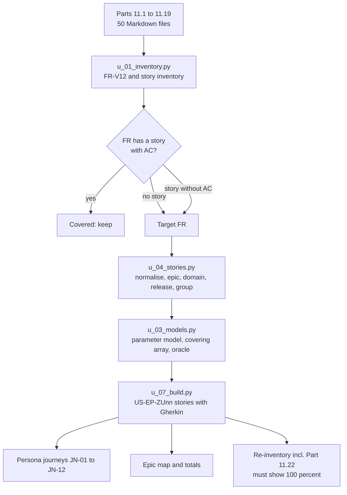

# AI Growth Engine: Employee Sales & Marketing Automation
## Application Blueprint: PART 11 (Batch 11.22a), Master User Stories and Persona Journeys with Permutations (V12): Inventory, Coverage, Models and Conventions

| Field | Value |
|---|---|
| Document | Part 11, Batch 22, file a of f: §11.22.1 material reviewed, §11.22.2 coverage summary, §11.22.3 detailed register, §11.22.4 story-catalogue reconciliation, §11.22.5.1–§11.22.5.3 conventions, ADRs, parameter models and epic placement. Files b–d hold the new stories (§11.22.5.4), file e the persona journeys (§11.22.5.5), file f the epic map, totals, conflicts, decisions, persona review, tags and quality gate (§11.22.5.6–§11.22.10) |
| Version | 1.0 · 28 Nov 2026 |
| Baseline | Parts 0–9.10; Parts 11.1–11.19 (V12 review and V12-B Founder decisions, Part 11.14 DEC-770…791); story template Part 5.1a (§5.2 DoR, §5.3 DoD, §5.5 estimation, §5.6 dimension matrix, §5.7 conventions) |
| Roles applied | Chief Product Officer · Principal Agile Product Owner · Business Systems Analyst (BDD/Gherkin) · UX researcher (persona journeys) · QA Lead (combinatorial design) |
| ID ranges used | DEC-940…959 · tags ASSUMPTION/GAP/CONFLICT/RECOMMENDATION-1140…1159 · ADR-275…279 · stories US-&lt;EP&gt;-ZU&lt;nn&gt; · AC-&lt;EP&gt;ZU&lt;nn&gt;-&lt;seq&gt; · example rows EX-&lt;EP&gt;ZU&lt;nn&gt;-&lt;seq&gt; · parameter models MU01…MU13 · journeys JN-01…JN-12 · new epic EP-34 · new personas P21–P23 |

**Acronyms used in this part.** AC = acceptance criterion · BDD = behaviour-driven development · CPO = Chief Product Officer · DoD / DoR = Definition of Done / Ready · EX = generated example row · FR = functional requirement · INV = Investment Automation product · MAS = minimum AC set (Part 5.1a §5.6.6) · NSE = no side effect · PDP = Policy Decision Point · PSP = payment service provider · RLS = row-level security · SKU = stock-keeping unit (a sellable service, SM-SVC-01…39 or INV-SVC-01…24) · SoD = separation of duties · SP = story point · t-way = covering array in which every combination of any t parameter values appears in at least one row.

**What this part does.** The Founder adopted V12 on every pending item and asked for user stories "using permutations and combinations" that "follow the exact template" (Part 11.14 DEC-779…791; V12-B brief). Parts 11.1–11.19 wrote 1,467 FR-V12 requirements and 555 V12 stories across 50 files and several story formats. This part (1) inventories every FR-V12 requirement and every V12 story by script, (2) finds each FR with no story, or with stories that carry no acceptance criteria, (3) writes a Part 5.1a-template story with Gherkin and generated `Scenario Outline` Examples for every one of them, (4) writes end-to-end persona journeys for the full V12 product with every step mapped to stories, (5) maps all epics EP-01…EP-34 to stories and requirements, and (6) totals stories and story points per epic and per release. **Result: 1,467 / 1,467 FR-V12 requirements (100%) have at least one story with acceptance criteria.**

**Scripts (in `assembly/v12b/`, run with `python3 -I`).** `u_01_inventory.py` (FR and story inventory, trace links, AC detection) → `u_02_baseline.py` (pre-V12 story census) → `u_07_build.py` with `u_03_models.py` (parameter models, covering arrays, oracle), `u_04_stories.py` (FR normalisation, epic, domain, release, grouping), `u_05_context.py` (domain contexts and outline steps), `u_06_journeys.py` (journeys) and `u_08_files.py` (this text). Every count in this part is printed by those scripts; regenerate after any change to Parts 11.1–11.19 (DEC-940).



## 11.22.1 Material reviewed

| File | FR-V12 IDs defined | FR-V12 IDs mentioned | V12 stories defined | Purpose in this part |
|---|---|---|---|---|
| `Part-11-10a_V12_Tests_QC_Coding_Backlog.md` | 0 | 2 | 0 | references only |
| `Part-11-10b_V12_Tests_QC_Coding_Backlog.md` | 0 | 0 | 0 | references only |
| `Part-11-10c_V12_Tests_QC_Coding_Backlog.md` | 6 | 6 | 5 | FR register and stories |
| `Part-11-11a_V12_Observability_Traceability_Decision_Register.md` | 0 | 73 | 0 | references only |
| `Part-11-11b_V12_Observability_Traceability_Decision_Register.md` | 79 | 79 | 12 | FR register and stories |
| `Part-11-12_Historical_Annex_V1_Baseline_and_Source_Archive_Audit.md` | 30 | 30 | 7 | FR register and stories |
| `Part-11-13a_AI_Improvement_Agents_Automations_Workflows.md` | 0 | 17 | 0 | references only |
| `Part-11-13b_AI_Improvement_Agents_Automations_Workflows.md` | 100 | 100 | 38 | FR register and stories |
| `Part-11-14_V12_Consolidation_and_Founder_Decisions.md` | 0 | 0 | 0 | references only |
| `Part-11-15a_Regulatory_Rule_Packs_Draft_Legal_Wording.md` | 0 | 5 | 0 | references only |
| `Part-11-15b_Regulatory_Rule_Packs_Draft_Legal_Wording.md` | 0 | 3 | 0 | references only |
| `Part-11-15c_Regulatory_Rule_Packs_Draft_Legal_Wording.md` | 0 | 3 | 0 | references only |
| `Part-11-15d_Additional_Rule_Packs_Payments_AgentCommerce_Procurement_Voice.md` | 0 | 5 | 0 | references only |
| `Part-11-15e_Additional_Rule_Packs_Procurement_Voice_Recording_Decisions.md` | 0 | 6 | 0 | references only |
| `Part-11-16a_Investment_Automation_I_Investor_Mode_and_INV-SVC-01-12.md` | 62 | 110 | 0 | FR register |
| `Part-11-16b_Investment_Automation_I_Workflow_Specifications.md` | 48 | 49 | 0 | FR register |
| `Part-11-16c_Investment_Automation_II_Services_Workflows_Agents_Screens.md` | 84 | 85 | 0 | FR register |
| `Part-11-16d_Investment_Automation_II_Securities_Rule_Packs_Stories_Tests_Cost.md` | 7 | 21 | 25 | FR register and stories |
| `Part-11-16e_Investment_Automation_I_Stories_Tests_Cost_Decisions.md` | 0 | 86 | 34 | stories |
| `Part-11-17a_Bounded_Mandates_Agentic_Commerce_and_Payments.md` | 46 | 63 | 0 | FR register |
| `Part-11-17b_Automatic_Bid_Submission_Agents_Tests_Stories_and_Costs.md` | 18 | 77 | 22 | FR register and stories |
| `Part-11-18a_AI_Voice_Telephony_and_Call_Recordings.md` | 55 | 57 | 0 | FR register |
| `Part-11-18b_AI_Voice_Telephony_and_Call_Recordings.md` | 0 | 20 | 0 | references only |
| `Part-11-18c_AI_Voice_Telephony_and_Call_Recordings.md` | 0 | 55 | 18 | stories |
| `Part-11-18d_AI_Voice_Telephony_and_Call_Recordings.md` | 0 | 22 | 0 | references only |
| `Part-11-19a_Platform_Decisions_Identity_Developer_Platform_Connectors_Vercel.md` | 0 | 18 | 0 | references only |
| `Part-11-19b_Platform_Decisions_RPO_Model_Registry_Benchmarks_Supabase_Access.md` | 155 | 155 | 0 | FR register |
| `Part-11-19c_Platform_Decisions_Stories_Combinatorial_Tests_Decisions.md` | 0 | 92 | 29 | stories |
| `Part-11-1a_V12_Business_Requirements.md` | 0 | 82 | 0 | references only |
| `Part-11-1b_V12_Business_Requirements.md` | 123 | 123 | 24 | FR register and stories |
| `Part-11-2a_V12_Master_Automation_Service_Catalogue_39_Services.md` | 30 | 105 | 78 | FR register and stories |
| `Part-11-2b_V12_Master_Automation_Service_Catalogue_39_Services.md` | 24 | 28 | 0 | FR register |
| `Part-11-2c_V12_Master_Automation_Service_Catalogue_39_Services.md` | 51 | 62 | 0 | FR register |
| `Part-11-3a_V12_Executable_Workflows_SVC01-20.md` | 12 | 92 | 2 | FR register and stories |
| `Part-11-3b_V12_Executable_Workflows_SVC01-20.md` | 40 | 41 | 10 | FR register and stories |
| `Part-11-3c_V12_Executable_Workflows_SVC01-20.md` | 40 | 46 | 10 | FR register and stories |
| `Part-11-4a_V12_Executable_Workflows_SVC21-39_Registry_and_DTOs.md` | 0 | 24 | 0 | references only |
| `Part-11-4b_V12_Executable_Workflows_SVC21-39_Registry_and_DTOs.md` | 0 | 5 | 0 | references only |
| `Part-11-4c_V12_Executable_Workflows_SVC21-39_Registry_and_DTOs.md` | 10 | 10 | 0 | FR register |
| `Part-11-4d_V12_Executable_Workflows_SVC21-39_Registry_and_DTOs.md` | 37 | 47 | 29 | FR register and stories |
| `Part-11-5a_V12_Platform_Architecture.md` | 0 | 89 | 0 | references only |
| `Part-11-5b_V12_Platform_Architecture.md` | 102 | 102 | 34 | FR register and stories |
| `Part-11-6a_V12_AI_Engines_Agents_Models_Evaluation_RAG_Policy_Cost.md` | 0 | 31 | 0 | references only |
| `Part-11-6b_V12_AI_Engines_Agents_Models_Evaluation_RAG_Policy_Cost.md` | 73 | 73 | 29 | FR register and stories |
| `Part-11-7a_V12_Website_Portal_Operator_Portfolio_UIUX_Prototypes.md` | 0 | 117 | 0 | references only |
| `Part-11-7b_V12_Website_Portal_Operator_Portfolio_UIUX_Prototypes.md` | 0 | 109 | 0 | references only |
| `Part-11-7c_V12_Website_Portal_Operator_Portfolio_UIUX_Prototypes.md` | 117 | 117 | 117 | FR register and stories |
| `Part-11-8a_V12_REST_API_Event_Contracts_Integrations_Plugins.md` | 0 | 14 | 0 | references only |
| `Part-11-8b_V12_REST_API_Event_Contracts_Integrations_Plugins.md` | 41 | 41 | 13 | FR register and stories |
| `Part-11-9a_V12_Database_Schema_Reconciliation.md` | 0 | 12 | 0 | references only |
| `Part-11-9b_V12_DDL_RLS_Supabase.md` | 28 | 28 | 12 | FR register and stories |
| `Part-11-9c_V12_Security_Privacy_Analytics_KPI.md` | 18 | 20 | 7 | FR register and stories |
| **Total (50 files, Parts 11.1–11.19)** | **1436** | **1467 distinct** | **555** | |

**Inventory method (u_01).**

| Item | Rule implemented by the script |
|---|---|
| FR defined | The FR ID is the first cell of a Markdown table row, a heading subject, a "Functional requirement" field, or a bold `**Requirement FR-…**` paragraph (workflow specifications of Parts 11.3 and 11.16c) |
| FR inventory | Defined IDs plus IDs written explicitly elsewhere; IDs only implied by a declared range (e.g. "FR-V12-A-001…222", which holds 123 requirements) are not invented |
| Story defined | Heading `US-<EP>-<family><nn>`, bold paragraph story, first cell of a story table, or a field table `ID` row; families YA…YM (Parts 11.1–11.13), ZN…ZR (Parts 11.16–11.19), EH |
| Story → FR trace | FR IDs, lists and ranges inside a story block; FR IDs in any table row that names a story; bare number lists (e.g. "001, 002, 006") in a story row, resolved to the story family letter (YA→A … ZR→R) |
| Story has AC | A Gherkin block that names the story, a Gherkin block inside the story's own section, a `Feature:` line naming it, or a table row with Given/AC text |
| Target FR | No story at all (**264**) or only stories without AC (**116**) |

## 11.22.2 Coverage summary

| FR family | Source part | FR-V12 total | Covered by a story with AC (before) | Story without AC (before) | No story (before) | New ZU stories | Covered with AC (after) |
|---|---|---|---|---|---|---|---|
| FR-V12-A | 11.1 | 123 | 38 | 44 | 41 | 39 | 123 (100%) |
| FR-V12-B | 11.2 | 105 | 105 | 0 | 0 | 0 | 105 (100%) |
| FR-V12-C | 11.3 | 92 | 92 | 0 | 0 | 0 | 92 (100%) |
| FR-V12-D | 11.4 | 47 | 44 | 0 | 3 | 1 | 47 (100%) |
| FR-V12-E | 11.5 | 102 | 55 | 46 | 1 | 20 | 102 (100%) |
| FR-V12-F | 11.6 | 73 | 32 | 0 | 41 | 17 | 73 (100%) |
| FR-V12-G | 11.7 | 117 | 117 | 0 | 0 | 0 | 117 (100%) |
| FR-V12-H | 11.8 | 41 | 15 | 3 | 23 | 14 | 41 (100%) |
| FR-V12-I | 11.9 | 46 | 21 | 0 | 25 | 12 | 46 (100%) |
| FR-V12-J | 11.10 | 6 | 5 | 0 | 1 | 1 | 6 (100%) |
| FR-V12-K | 11.11 | 79 | 16 | 1 | 62 | 27 | 79 (100%) |
| FR-V12-L | 11.12 | 30 | 10 | 20 | 0 | 6 | 30 (100%) |
| FR-V12-M | 11.13 | 100 | 98 | 2 | 0 | 2 | 100 (100%) |
| FR-V12-N | 11.16a/b/e | 110 | 105 | 0 | 5 | 2 | 110 (100%) |
| FR-V12-O | 11.16c/d | 91 | 29 | 0 | 62 | 25 | 91 (100%) |
| FR-V12-P | 11.17 | 95 | 95 | 0 | 0 | 0 | 95 (100%) |
| FR-V12-Q | 11.18 | 55 | 55 | 0 | 0 | 0 | 55 (100%) |
| FR-V12-R | 11.19 | 155 | 155 | 0 | 0 | 0 | 155 (100%) |
| **Total** | | **1467** | **1087 (74.1%)** | **116** | **264** | **166** | **1467 (100%)** |

**Reading the summary.** Before this part, 1087 FR-V12 requirements (74.1%) had a story with acceptance criteria. 264 had no story at all — mainly the ENT trace requirements of Part 11.11b (FR-V12-K-101…158), the AI controls of Part 11.6b (AIX-01…20, CTRL-AI-01…09), the securities controls and INV-SVC-13…24 workflow requirements of Parts 11.16a/c, and the H and I registers of Parts 11.8b and 11.9b/c. 116 were traced only to statement-only stories (Parts 11.1b, 11.5b, 11.12 and two rows of 11.8b/11.13b) that carry no Gherkin. After this part all 1467 are covered by a story with Gherkin acceptance criteria and a generated Scenario Outline.

**Verification by re-inventory (ADR-275).** `U_MAXPART=22 python3 -I u_01_inventory.py` re-reads Parts 11.1–11.19 together with this part: **1467 FR-V12 requirements, 721 stories, 0 FRs without a story, 0 FRs whose stories lack AC** (stories with AC: 672; the 49 statement-only source stories keep their statements and are bound by ZU stories).

| Measure | Value |
|---|---|
| New stories (US-&lt;EP&gt;-ZU&lt;nn&gt;) | 166 |
| New story points (Fibonacci ranges summed) | 735–1195 SP |
| Gherkin scenarios in new stories (incl. one Scenario Outline each) | 1241 |
| Generated Examples rows (EX-…) | 6,604 |
| Stories that are acceptance bindings (anchor or ENT trace; DEC-941) | 60 |
| Persona journeys (JN-01…JN-12) and journey steps | 12 journeys · 126 steps |

## 11.22.3 Detailed register (every target FR)

One row per FR that had no story or no story with AC. "Status after" is Matched for every row: the new story holds Gherkin AC and a generated Scenario Outline.

| FR | Defined in | Requirement (abridged) | Status before | Epic | Release | New story | Status after |
|---|---|---|---|---|---|---|---|
| FR-V12-A-004 | Part 11.1b | Catalogue versioning and alias map: every SKU/workflow change is a new version | Not covered | EP-20 | Release 2 | US-20-ZU01 | Matched |
| FR-V12-A-005 | Part 11.1b | Bundles (full suite = all released eligible SKUs; partial bundle; DEC-047 archetypes Starter/Growth/Scale as preset bundles)… | Not covered | EP-20 | Release 2 | US-20-ZU01 | Matched |
| FR-V12-A-006 | Part 11.1b | Product separation (amended by DEC-783): Sales & Marketing and Investment Automation are separate product codes | Not covered | EP-01 | Release 1 | US-01-ZU01 | Matched |
| FR-V12-A-012 | Part 11.1b | New SKU or plan expansion only through a signed new version; no automatic activation on application import | Not covered | EP-20 | Release 2 | US-20-ZU02 | Matched |
| FR-V12-A-013 | Part 11.1b | Tenant lifecycle states pending → active → suspended → offboarding → retired, versioned | Not covered | EP-20 | Release 2 | US-20-ZU02 | Matched |
| FR-V12-A-015 | Part 11.1b | Consumption forecast and quota alerts: remaining allowance, reservations and trend | Not covered | EP-20 | Release 2 | US-20-ZU02 | Matched |
| FR-V12-A-023 | Part 11.1b | BYO provider: customer-owned credential reference with verified permissions and quoted responsibility | Not covered | EP-20 | Release 2 | US-20-ZU03 | Matched |
| FR-V12-A-024 | Part 11.1b | Delivery models self-service, assisted, managed and enterprise stored on the subscription | Not covered | EP-20 | Release 2 | US-20-ZU03 | Matched |
| FR-V12-A-030 | Part 11.1b | Transparent pricing methodology: the quote shows an itemized approved rate-card version or the status "Quote pending" | Not covered | EP-20 | Release 2 | US-20-ZU04 | Matched |
| FR-V12-A-031 | Part 11.1b | TCO and contribution reported per tenant and per SKU monthly; one-time costs separate | Not covered | EP-20 | Release 2 | US-20-ZU04 | Matched |
| FR-V12-A-032 | Part 11.1b | Per-SKU cost model: per accepted output, record LLM input/output/reasoning/embedding tokens, search/licensed data, verification | Covered without AC (US-20-YA07) | EP-20 | Release 2 | US-20-ZU05 | Matched |
| FR-V12-A-033 | Part 11.1b | Accepted-result cost and price floor computed per SKU and workflow version | Covered without AC (US-20-YA07) | EP-20 | Release 2 | US-20-ZU05 | Matched |
| FR-V12-A-034 | Part 11.1b | Billing dispute workflow: itemized usage, invoice, credits; private dispute case; refund review only under approved policy | Not covered | EP-20 | Release 2 | US-20-ZU04 | Matched |
| FR-V12-A-035 | Part 11.1b | SKU meter registry with V12 meter, proposed pilot cap and internal cost range per run (table below); price status "Quote pending | Covered without AC (US-20-YA07) | EP-20 | Release 2 | US-20-ZU05 | Matched |
| FR-V12-A-036 | Part 11.1b | Native-currency integrity: amounts grouped by native currency; conversion only with approved rate, source, timestamp, direction | Covered without AC (US-17-YA02) | EP-17 | Release 1 | US-17-ZU01 | Matched |
| FR-V12-A-054 | Part 11.1b | Public AI transparency page: where AI is used, safeguards, human review, labelling of AI-generated messages and assets | Covered without AC (US-04-YA01) | EP-04 | Release 1 | US-04-ZU01 | Matched |
| FR-V12-A-058 | Part 11.1b | Workflow output previews: each of the 156 workflows shows a curated fictional output preview derived from its output contract | Not covered | EP-19 | Release 2 | US-19-ZU01 | Matched |
| FR-V12-A-059 | Part 11.1b | TCO estimator and ROI sensitivity: customer-supplied subscription, provider, labour and implementation assumptions | Covered without AC (US-19-YA03) | EP-19 | Release 2 | US-19-ZU02 | Matched |
| FR-V12-A-060 | Part 11.1b | Automation maturity assessment and opportunity report: non-identifying answers → explainable category score | Not covered | EP-19 | Release 3+ | US-19-ZU01 | Matched |
| FR-V12-A-061 | Part 11.1b | Controlled sandbox, integration directory, trust centre and operator conversion intelligence: synthetic sample execution with… | Not covered | EP-19 | Release 3+ | US-19-ZU01 | Matched |
| FR-V12-A-073 | Part 11.1b | Operator acquisition tenant: the platform operator uses subscribed services under its own tenant for SaaS acquisition | Not covered | EP-20 | Release 2 | US-20-ZU06 | Matched |
| FR-V12-A-075 | Part 11.1b | Division and brand masters: division has stable ID and company FK, lifecycle independent of name | Covered without AC (US-02-YA01) | EP-02 | Release 2 | US-02-ZU01 | Matched |
| FR-V12-A-076 | Part 11.1b | Registration, operating and target countries are separate attributes (company registration country ≠ operating countries ≠… | Covered without AC (US-02-YA01) | EP-02 | Release 1 | US-02-ZU01 | Matched |
| FR-V12-A-077 | Part 11.1b | Market profiles and channel accounts: one offering in several markets through offering-market associations | Covered without AC (US-02-YA01) | EP-02 | Release 1 | US-02-ZU01 | Matched |
| FR-V12-A-078 | Part 11.1b | Offering-specific audiences: ICP, segment, market eligibility and source rights by offering; no cross-product prospect assumptions | Not covered | EP-05 | Release 2 | US-05-ZU01 | Matched |
| FR-V12-A-079 | Part 11.1b | Offering lifecycle draft → pilot → active → suspended → retired with an authorization gate for live external effects | Covered without AC (US-02-YA01) | EP-02 | Release 1 | US-02-ZU01 | Matched |
| FR-V12-A-080 | Part 11.1b | 14 customer types: individual professional, freelancer, solopreneur, creator, proprietorship, partnership, startup, SME | Not covered | EP-20 | Release 2 | US-20-ZU06 | Matched |
| FR-V12-A-091 | Part 11.1b | Progressive onboarding: minimal fields first; incomplete draft resumes without premature quote or entitlement | Covered without AC (US-20-YA06) | EP-20 | Release 2 | US-20-ZU07 | Matched |
| FR-V12-A-092 | Part 11.1b | Session and draft recovery: drafts are server-side, protected, versioned and authorized; sign-out clears client-side private state | Covered without AC (US-20-YA06) | EP-20 | Release 2 | US-20-ZU07 | Matched |
| FR-V12-A-093 | Part 11.1b | Business & Organization Management Centre (Admin): operator creates pending customer contracts and companies (no activation) | Not covered | EP-20 | Release 2 | US-20-ZU08 | Matched |
| FR-V12-A-094 | Part 11.1b | Industry/business templates are versioned configuration referencing canonical workflows; applied only with explicit review | Not covered | EP-20 | Release 2 | US-20-ZU08 | Matched |
| FR-V12-A-095 | Part 11.1b | Cross-device application handoff: an application produced on one device can be reviewed on the other, preserving identity | Not covered | EP-20 | Release 3+ | US-20-ZU08 | Matched |
| FR-V12-A-113 | Part 11.1b | Context budgeting, summarisation and multimodal cost tiers: token allocation by task class with reserved output and safety… | Not covered | EP-04 | Release 2 | US-04-ZU02 | Matched |
| FR-V12-A-114 | Part 11.1b | AI transparency labels: AI-generated messages and assets labelled; EU AI Act Art. 50 machine-readable marking when the EU pack is… | Covered without AC (US-04-YA01) | EP-04 | Release 1 | US-04-ZU01 | Matched |
| FR-V12-A-115 | Part 11.1b | Cost per accepted result reported per workflow with denominator; tenant AI budget hard cap holds AI steps | Covered without AC (US-04-YA01) | EP-04 | Release 2 | US-04-ZU01 | Matched |
| FR-V12-A-116 | Part 11.1b | Customer data stays private: no training on customer data (provider DPA evidence); processing in the tenant's region — India now | Covered without AC (US-04-YA01) | EP-04 | Release 1 | US-04-ZU01 | Matched |
| FR-V12-A-117 | Part 11.1b | Launch-language evaluation slices: quality proven per language before a locale goes live — English and Hindi (India) first | Covered without AC (US-04-YA01) | EP-04 | Release 2 | US-04-ZU03 | Matched |
| FR-V12-A-118 | Part 11.1b | AI step inventory: of 517 steps, 159 AI-inference steps are tagged; all other steps are rules, gates | Not covered | EP-04 | Release 2 | US-04-ZU02 | Matched |
| FR-V12-A-121 | Part 11.1b | 9 optimization perspectives as A089 tabs with the role visibility rule above (extends Part 8.3c §8.3.5.15.7) | Not covered | EP-17 | Release 2 | US-17-ZU02 | Matched |
| FR-V12-A-122 | Part 11.1b | Context filters: company, tenant, division, brand, offering, target market/country/region, channel/account, SKU/workflow | Covered without AC (US-17-YA01) | EP-17 | Release 2 | US-17-ZU03 | Matched |
| FR-V12-A-123 | Part 11.1b | Cascading filter semantics: changing an ancestor clears stale descendants; options derive from allowed IDs | Covered without AC (US-17-YA01) | EP-17 | Release 2 | US-17-ZU03 | Matched |
| FR-V12-A-124 | Part 11.1b | Reconciled drill-down: timestamped scoped drill-down with record count, unknown indicators and original currency; stable cursor | Covered without AC (US-17-YA02) | EP-17 | Release 2 | US-17-ZU01 | Matched |
| FR-V12-A-140 | Part 11.1b | SLA tier templates (Standard, Business, Enterprise) attached to a subscription only after the validation procedure of… | Covered without AC (US-21-YA02) | EP-21 | Release 2 | US-21-ZU01 | Matched |
| FR-V12-A-141 | Part 11.1b | Severity model SEV1–SEV4 with communication timelines (SEV1 status notice ≤ 1 h, updates every 2 h) and incident commander | Covered without AC (US-21-YA02) | EP-21 | Release 2 | US-21-ZU01 | Matched |
| FR-V12-A-142 | Part 11.1b | Public status page hosted independently of the platform (component status, incidents | Not covered | EP-21 | Release 3+ | US-21-ZU02 | Matched |
| FR-V12-A-143 | Part 11.1b | Tiered support desk with response targets per tier (V12 proposed: Enterprise P1 1 h, Business 4 h | Covered without AC (US-21-YA02) | EP-21 | Release 2 | US-21-ZU01 | Matched |
| FR-V12-A-144 | Part 11.1b | Help centre and in-product guides localized with the UI; top 50 tasks documented (from the training task cards TRN-SCR-*) | Not covered | EP-19 | Release 2 | US-19-ZU03 | Matched |
| FR-V12-A-145 | Part 11.1b | Per-SKU workflow SLA matrix: turnaround by SKU, volume, provider and approval wait | Not covered | EP-20 | Release 3+ | US-20-ZU09 | Matched |
| FR-V12-A-146 | Part 11.1b | Customer responsibilities schedule: authorized sources, usable inputs, configuration, consent, connector grants, approvals | Not covered | EP-20 | Release 2 | US-20-ZU09 | Matched |
| FR-V12-A-147 | Part 11.1b | Recovery objectives per data class: critical transactional RPO ≤ 15 min / RTO ≤ 4 h | Not covered | EP-21 | Release 1 | US-21-ZU02 | Matched |
| FR-V12-A-150 | Part 11.1b | Register KPI-V12-A-01…19 with the definitions above | Covered without AC (US-21-YA01) | EP-21 | Release 2 | US-21-ZU03 | Matched |
| FR-V12-A-151 | Part 11.1b | Metric registry per ADR-183 | Covered without AC (US-21-YA01) | EP-21 | Release 2 | US-21-ZU03 | Matched |
| FR-V12-A-152 | Part 11.1b | Zero-denominator and unmeasured rules: zero denominator = not applicable; unmeasured = *pending* | Covered without AC (US-21-YA01) | EP-21 | Release 1 | US-21-ZU03 | Matched |
| FR-V12-A-153 | Part 11.1b | CSAT, CES and NPS collected optionally at defined milestones; aggregates with denominator and period | Not covered | EP-16 | Release 2 | US-16-ZU01 | Matched |
| FR-V12-A-160 | Part 11.1b | First-value milestone per SKU (39) with owner; time-to-first-value tracked (median and p90) from activation | Covered without AC (US-16-YA01) | EP-16 | Release 2 | US-16-ZU02 | Matched |
| FR-V12-A-161 | Part 11.1b | Activation checklist and success plan generated from selected SKUs, data rights and connector readiness | Covered without AC (US-16-YA01) | EP-16 | Release 2 | US-16-ZU02 | Matched |
| FR-V12-A-162 | Part 11.1b | Customer health score: adoption, quality, value, reliability, support and renewal signals with configurable weights | Covered without AC (US-16-YA02) | EP-16 | Release 3+ | US-16-ZU03 | Matched |
| FR-V12-A-163 | Part 11.1b | Underused-service detection: inactive eligible subscription → contextual guidance, never forced upsell; paused/ineligible excluded | Covered without AC (US-16-YA02) | EP-16 | Release 3+ | US-16-ZU03 | Matched |
| FR-V12-A-164 | Part 11.1b | Connector and expiry alerts to the authorized owner before credential/config expiry and on failure; respects preferences | Not covered | EP-16 | Release 2 | US-16-ZU04 | Matched |
| FR-V12-A-165 | Part 11.1b | Customer value report per period: accepted outputs, usage, measured outcomes and assumptions | Not covered | EP-16 | Release 2 | US-16-ZU04 | Matched |
| FR-V12-A-166 | Part 11.1b | Customer-controlled schedules and guided tours: scoped pause, timezone-aware cadence | Not covered | EP-16 | Release 2 | US-16-ZU04 | Matched |
| FR-V12-A-167 | Part 11.1b | Evidence-based complementary services: optional SKU recommendations from unmet objectives and usage, with reasons | Not covered | EP-16 | Release 3+ | US-16-ZU05 | Matched |
| FR-V12-A-168 | Part 11.1b | Ethical cancellation and win-back: cancellation works without a survey or forced retention; optional reason | Covered without AC (US-20-YA05) | EP-20 | Release 2 | US-20-ZU10 | Matched |
| FR-V12-A-169 | Part 11.1b | Grounded customer help, correction memory and closed-loop feedback: portal help retrieves approved scoped knowledge with version… | Not covered | EP-16 | Release 3+ | US-16-ZU05 | Matched |
| FR-V12-A-170 | Part 11.1b | Enterprise success reviews under the contracted model with accepted evidence and customer-confirmed actions | Not covered | EP-16 | Release 3+ | US-16-ZU05 | Matched |
| FR-V12-A-180 | Part 11.1b | Enterprise identity: customer IdP sign-in (Okta, Entra ID, Google first), automatic provisioning (SCIM), enforced MFA | Covered without AC (US-20-YA08) | EP-20 | Release 3+ | US-20-ZU11 | Matched |
| FR-V12-A-181 | Part 11.1b | Governed access: customer-defined roles, impossible conflicting duties, exportable audit to customer security tools | Covered without AC (US-20-YA08) | EP-20 | Release 3+ | US-20-ZU11 | Matched |
| FR-V12-A-182 | Part 11.1b | Developer platform: versioned API, signed webhooks, SDKs, sandbox-first | Covered without AC (US-20-YA08) | EP-20 | Release 3+ | US-20-ZU11 | Matched |
| FR-V12-A-183 | Part 11.1b | Data ownership: full export, choice of region, BYOK on eligible plans | Covered without AC (US-20-YA08) | EP-20 | Release 3+ | US-20-ZU11 | Matched |
| FR-V12-A-184 | Part 11.1b | Ecosystem: CRM, messaging, calendar, advertising, payment and warehouse connectors through reviewed connectors | Covered without AC (US-20-YA08) | EP-20 | Release 3+ | US-20-ZU12 | Matched |
| FR-V12-A-185 | Part 11.1b | Assured security: independent testing, vulnerability programme, SOC 2, ISO 27001 | Covered without AC (US-20-YA08) | EP-20 | Release 2 | US-20-ZU12 | Matched |
| FR-V12-A-186 | Part 11.1b | Legal readiness: approved legal documents and DPA; market opens only after legal review | Covered without AC (US-20-YA08) | EP-20 | Release 2 | US-20-ZU12 | Matched |
| FR-V12-A-187 | Part 11.1b | Global reach: language, currency, tax system and region, India and EU first | Covered without AC (US-20-YA08) | EP-20 | Release 2 | US-20-ZU12 | Matched |
| FR-V12-A-188 | Part 11.1b | Dependable service: contracted availability, status page, 24×7 incident response, responsive support | Covered without AC (US-20-YA08) | EP-20 | Release 2 | US-20-ZU13 | Matched |
| FR-V12-A-189 | Part 11.1b | Commercial operations: accurate billing with tax, contracts, onboarding and success programmes, enterprise procurement pack | Covered without AC (US-20-YA08) | EP-20 | Release 3+ | US-20-ZU13 | Matched |
| FR-V12-A-190 | Part 11.1b | Maintain the V12 phase map above in the release plan; each phase has exit criteria recorded as release gates in A090 | Not covered | EP-21 | Release 1 | US-21-ZU04 | Matched |
| FR-V12-A-191 | Part 11.1b | Priority gating: 54 P0 controls block affected production releases; 76 P1 scheduled by measured opportunity | Not covered | EP-21 | Release 1 | US-21-ZU04 | Matched |
| FR-V12-A-192 | Part 11.1b | SKU release groups (Foundation; intelligence 01–05, 25; engagement 06–13, 15–16; conversion 17–24, 29, 32–33 | Not covered | EP-20 | Release 2 | US-20-ZU14 | Matched |
| FR-V12-A-200 | Part 11.1b | Readiness register by area (specified / prototype-demonstrated / production-proven) maintained in A090 | Covered without AC (US-21-YA03) | EP-21 | Release 1 | US-21-ZU05 | Matched |
| FR-V12-A-201 | Part 11.1b | Acceptance ID aliases: OPT-TC-{ID}, MT-TC-MT-nn, MOB-nn-AT01, SM-SVC-nn-ENT-AT01 resolve to TC-V12-A tests or existing blueprint… | Covered without AC (US-21-YA03) | EP-21 | Release 1 | US-21-ZU05 | Matched |
| FR-V12-A-202 | Part 11.1b | Per-SKU business acceptance record: business acceptance owner signs deliverable, limits, SLA, pricing and rights per SKU | Covered without AC (US-21-YA03) | EP-21 | Release 2 | US-21-ZU05 | Matched |
| FR-V12-A-210 | Part 11.1b | Decision ownership register in A090: product owner/finance (39 release states, pricing, allowances, SLA, contract/refund | Not covered | EP-21 | Release 1 | US-21-ZU06 | Matched |
| FR-V12-A-220 | Part 11.1b | Business objectives BR-OBJ-01…05: (01) shorter time from authorized source to qualified opportunity | Covered without AC (US-21-YA01) | EP-21 | Release 2 | US-21-ZU03 | Matched |
| FR-V12-A-221 | Part 11.1b | Pilot outcome hypotheses registered as hypotheses, not targets: AI inference cost −20…40%, total cost −10…25% | Not covered | EP-21 | Release 3+ | US-21-ZU07 | Matched |
| FR-V12-A-222 | Part 11.1b | Positioning and segment evidence: independent SKU purchase, evidence-linked outputs, configurable orchestration | Not covered | EP-19 | Release 2 | US-19-ZU04 | Matched |
| FR-V12-D-007 | Part 11.4d | Run the nine-check preflight in fixed order; `dry_run` returns plan, estimate and would-be holds with zero provider calls and no… | Not covered | EP-18 | Release 2 | US-18-ZU01 | Matched |
| FR-V12-D-008 | Part 11.4d | Route any AI step below its confidence floor or failing schema/claims checks to human review; never to an effect | Not covered | EP-18 | Release 2 | US-18-ZU01 | Matched |
| FR-V12-D-012 | Part 11.4d | Cancel runs with release of unused reservations; compensate only reversible effects through approved compensation actions | Not covered | EP-18 | Release 2 | US-18-ZU01 | Matched |
| FR-V12-E-004 | Part 11.5b | Region code on tenant and on every key; request region check | Covered without AC (US-01-YE10) | EP-01 | Release 1 | US-01-ZU02 | Matched |
| FR-V12-E-005 | Part 11.5b | Isolation invariants incl. pooled-connection context reset | Covered without AC (US-01-YE10) | EP-01 | Release 1 | US-01-ZU02 | Matched |
| FR-V12-E-021 | Part 11.5b | Central authorization incl. SKU dimension; service-principal grants | Covered without AC (US-01-YE09) | EP-01 | Release 1 | US-01-ZU03 | Matched |
| FR-V12-E-022 | Part 11.5b | Deny-reason precedence per V12 order | Covered without AC (US-03-YE01) | EP-03 | Release 1 | US-03-ZU01 | Matched |
| FR-V12-E-032 | Part 11.5b | Eight-stage wizard | Covered without AC (US-20-YE02) | EP-20 | Release 2 | US-20-ZU15 | Matched |
| FR-V12-E-033 | Part 11.5b | Server-backed drafts; stale revision rejected | Covered without AC (US-20-YE02) | EP-20 | Release 2 | US-20-ZU15 | Matched |
| FR-V12-E-034 | Part 11.5b | 14 configurable customer types; individual workspace | Covered without AC (US-20-YE02) | EP-20 | Release 2 | US-20-ZU15 | Matched |
| FR-V12-E-036 | Part 11.5b | Registration, operating and target countries separate | Covered without AC (US-20-YE02) | EP-20 | Release 2 | US-20-ZU15 | Matched |
| FR-V12-E-037 | Part 11.5b | Region, language, IANA timezone per market; DST | Covered without AC (US-20-YE02) | EP-20 | Release 2 | US-20-ZU16 | Matched |
| FR-V12-E-039 | Part 11.5b | Configuration diff, rollback-as-new-draft, snapshot protection | Not covered | EP-18 | Release 2 | US-18-ZU02 | Matched |
| FR-V12-E-045 | Part 11.5b | SKU registry and lifecycle | Covered without AC (US-20-YE04) | EP-20 | Release 2 | US-20-ZU17 | Matched |
| FR-V12-E-046 | Part 11.5b | Workflow version registry; immutable run snapshot | Covered without AC (US-20-YE04) | EP-20 | Release 1 | US-20-ZU17 | Matched |
| FR-V12-E-047 | Part 11.5b | Bundles | Covered without AC (US-20-YE04) | EP-20 | Release 2 | US-20-ZU17 | Matched |
| FR-V12-E-048 | Part 11.5b | Foundations register (25) | Covered without AC (US-20-YE04) | EP-20 | Release 2 | US-20-ZU17 | Matched |
| FR-V12-E-049 | Part 11.5b | Engines register (15) and engine_code on cost | Covered without AC (US-20-YE04) | EP-20 | Release 2 | US-20-ZU18 | Matched |
| FR-V12-E-050 | Part 11.5b | Legacy capability map | Covered without AC (US-20-YE04) | EP-20 | Release 2 | US-20-ZU18 | Matched |
| FR-V12-E-051 | Part 11.5b | Public catalogue projection allowlist | Covered without AC (US-20-YE04) | EP-20 | Release 1 | US-20-ZU18 | Matched |
| FR-V12-E-058 | Part 11.5b | Tenant lifecycle states and offboarding | Covered without AC (US-20-YE14) | EP-20 | Release 2 | US-20-ZU19 | Matched |
| FR-V12-E-062 | Part 11.5b | Plan change preview, effective date, proration | Covered without AC (US-20-YE08) | EP-20 | Release 2 | US-20-ZU20 | Matched |
| FR-V12-E-064 | Part 11.5b | Refund and cancellation by credit/reversal | Covered without AC (US-20-YE12) | EP-20 | Release 2 | US-20-ZU21 | Matched |
| FR-V12-E-077 | Part 11.5b | Revenue recognition schedule and export | Covered without AC (US-20-YE13) | EP-20 | Release 3+ | US-20-ZU22 | Matched |
| FR-V12-E-078 | Part 11.5b | Credit notes | Covered without AC (US-20-YE12) | EP-20 | Release 2 | US-20-ZU21 | Matched |
| FR-V12-E-079 | Part 11.5b | Distinct ledger types | Covered without AC (US-15-YE01) | EP-15 | Release 2 | US-15-ZU01 | Matched |
| FR-V12-E-080 | Part 11.5b | FX and native-currency reporting | Covered without AC (US-15-YE01) | EP-15 | Release 2 | US-15-ZU01 | Matched |
| FR-V12-E-081 | Part 11.5b | Offering price independent of SaaS fee | Covered without AC (US-15-YE01) | EP-15 | Release 2 | US-15-ZU01 | Matched |
| FR-V12-E-082 | Part 11.5b | Cost allocation with unallocated shown | Covered without AC (US-15-YE01) | EP-15 | Release 2 | US-15-ZU01 | Matched |
| FR-V12-E-083 | Part 11.5b | Consumption forecast and quota alerts | Covered without AC (US-20-YE15) | EP-20 | Release 2 | US-20-ZU23 | Matched |
| FR-V12-E-084 | Part 11.5b | Billing disputes | Covered without AC (US-20-YE12) | EP-20 | Release 2 | US-20-ZU21 | Matched |
| FR-V12-E-085 | Part 11.5b | Per-SKU service sheet | Covered without AC (US-20-YE16) | EP-20 | Release 2 | US-20-ZU24 | Matched |
| FR-V12-E-086 | Part 11.5b | Reconciliation jobs RJ-01…06 | Covered without AC (US-20-YE13) | EP-20 | Release 2 | US-20-ZU22 | Matched |
| FR-V12-E-087 | Part 11.5b | Partner/reseller model reserved; no data without grant | Covered without AC (US-20-YE16) | EP-20 | Release 3+ | US-20-ZU24 | Matched |
| FR-V12-E-088 | Part 11.5b | Procurement pack | Covered without AC (US-20-YE16) | EP-20 | Release 3+ | US-20-ZU24 | Matched |
| FR-V12-E-089 | Part 11.5b | Onboarding playbooks and TTFV | Covered without AC (US-20-YE15) | EP-20 | Release 2 | US-20-ZU23 | Matched |
| FR-V12-E-096 | Part 11.5b | Circuit breaker parameters | Covered without AC (US-18-YE02) | EP-18 | Release 1 | US-18-ZU03 | Matched |
| FR-V12-E-100 | Part 11.5b | Backpressure | Covered without AC (US-18-YE02) | EP-18 | Release 1 | US-18-ZU03 | Matched |
| FR-V12-E-101 | Part 11.5b | Dependency-aware degradation | Covered without AC (US-18-YE02) | EP-18 | Release 1 | US-18-ZU03 | Matched |
| FR-V12-E-102 | Part 11.5b | Synthetic probes | Covered without AC (US-21-YE04) | EP-21 | Release 1 | US-21-ZU08 | Matched |
| FR-V12-E-103 | Part 11.5b | Chaos and fault injection (non-prod) | Covered without AC (US-21-YE04) | EP-21 | Release 2 | US-21-ZU08 | Matched |
| FR-V12-E-112 | Part 11.5b | Provisioning and scalability tests | Covered without AC (US-21-YE04) | EP-21 | Release 2 | US-21-ZU08 | Matched |
| FR-V12-E-113 | Part 11.5b | Worker autoscaling with no lost jobs | Covered without AC (US-21-YE04) | EP-21 | Release 1 | US-21-ZU08 | Matched |
| FR-V12-E-114 | Part 11.5b | Compute benchmark BM-01 | Covered without AC (US-21-YE04) | EP-21 | Release 2 | US-21-ZU09 | Matched |
| FR-V12-E-127 | Part 11.5b | Portability and offboarding | Covered without AC (US-20-YE14) | EP-20 | Release 2 | US-20-ZU19 | Matched |
| FR-V12-E-130 | Part 11.5b | GO-01…08 sequence | Covered without AC (US-21-YE03) | EP-21 | Release 1 | US-21-ZU10 | Matched |
| FR-V12-E-132 | Part 11.5b | Per-SKU release gate and progressive activation | Covered without AC (US-21-YE03) | EP-21 | Release 1 | US-21-ZU10 | Matched |
| FR-V12-E-133 | Part 11.5b | Maintenance cadence with escalation | Covered without AC (US-21-YE03) | EP-21 | Release 1 | US-21-ZU10 | Matched |
| FR-V12-E-134 | Part 11.5b | R-phase tracking in A090 | Covered without AC (US-21-YE03) | EP-21 | Release 1 | US-21-ZU10 | Matched |
| FR-V12-E-135 | Part 11.5b | Optimization release process | Covered without AC (US-21-YE03) | EP-21 | Release 2 | US-21-ZU11 | Matched |
| FR-V12-F-001 | Part 11.6b | Step classification; only AI-inference steps may call a model | Not covered | EP-04 | Release 2 | US-04-ZU04 | Matched |
| FR-V12-F-004 | Part 11.6b | Prompt registry PRM-&lt;AGT&gt;-&lt;task&gt;-vN with schema, policy inputs, locales, approval; no tenant data | Not covered | EP-04 | Release 2 | US-04-ZU04 | Matched |
| FR-V12-F-006 | Part 11.6b | Regression on any model/prompt/retrieval/policy/tool change; promotion blocked on regression | Not covered | EP-04 | Release 2 | US-04-ZU04 | Matched |
| FR-V12-F-007 | Part 11.6b | Judge only after κ ≥ 0.8 calibration | Not covered | EP-04 | Release 2 | US-04-ZU05 | Matched |
| FR-V12-F-008 | Part 11.6b | Untrusted content isolation | Not covered | EP-04 | Release 2 | US-04-ZU05 | Matched |
| FR-V12-F-009 | Part 11.6b | Reader/actor separation | Not covered | EP-04 | Release 2 | US-04-ZU05 | Matched |
| FR-V12-F-010 | Part 11.6b | Output handling: schema, URL/egress allowlist, sanitised rendering, no secrets | Not covered | EP-04 | Release 2 | US-04-ZU06 | Matched |
| FR-V12-F-011 | Part 11.6b | Claims and citation control | Not covered | EP-04 | Release 2 | US-04-ZU06 | Matched |
| FR-V12-F-012 | Part 11.6b | AI usage metering per call | Not covered | EP-04 | Release 2 | US-04-ZU06 | Matched |
| FR-V12-F-013 | Part 11.6b | Tenant AI budgets soft/hard per tenant, company, workflow | Not covered | EP-04 | Release 2 | US-04-ZU07 | Matched |
| FR-V12-F-014 | Part 11.6b | Cost per accepted result in A117 | Not covered | EP-04 | Release 2 | US-04-ZU07 | Matched |
| FR-V12-F-015 | Part 11.6b | Prefix caching, batch API, tenant-scoped semantic cache for non-personal | Not covered | EP-04 | Release 2 | US-04-ZU07 | Matched |
| FR-V12-F-017 | Part 11.6b | Provider data handling: no training, DPA retention/region, minimise/mask for Tier S | Not covered | EP-04 | Release 2 | US-04-ZU08 | Matched |
| FR-V12-F-018 | Part 11.6b | Drift monitoring nightly sample | Not covered | EP-04 | Release 2 | US-04-ZU08 | Matched |
| FR-V12-F-019 | Part 11.6b | Multilingual coverage en+hi IN; de+fr EU; locale prompts | Not covered | EP-04 | Release 2 | US-04-ZU08 | Matched |
| FR-V12-F-020 | Part 11.6b | AI incident response; kill switch per model/prompt/workflow | Not covered | EP-04 | Release 2 | US-04-ZU09 | Matched |
| FR-V12-F-021 | Part 11.6b | CTRL-AI-01 Delimiting | Not covered | EP-04 | Release 2 | US-04-ZU09 | Matched |
| FR-V12-F-022 | Part 11.6b | CTRL-AI-02 Normalisation (NFKC, zero-width, bidi, hidden text) | Not covered | EP-04 | Release 2 | US-04-ZU09 | Matched |
| FR-V12-F-023 | Part 11.6b | CTRL-AI-03 Classifier MDL-G1 screens in/out; flags to reviewer | Not covered | EP-04 | Release 2 | US-04-ZU10 | Matched |
| FR-V12-F-024 | Part 11.6b | CTRL-AI-04 Tool isolation per step class | Not covered | EP-04 | Release 2 | US-04-ZU10 | Matched |
| FR-V12-F-025 | Part 11.6b | CTRL-AI-05 Output validation, URL/domain allowlist, sanitised rendering, no auto-fetch | Not covered | EP-04 | Release 2 | US-04-ZU10 | Matched |
| FR-V12-F-026 | Part 11.6b | CTRL-AI-06 Secrets never in context; refusal template | Not covered | EP-04 | Release 2 | US-04-ZU11 | Matched |
| FR-V12-F-027 | Part 11.6b | CTRL-AI-07 Retrieval filtered by tenant/company before ranking; tenant-scoped vector keys | Not covered | EP-04 | Release 2 | US-04-ZU11 | Matched |
| FR-V12-F-028 | Part 11.6b | CTRL-AI-08 Agent-to-agent mandates signed with limits; counterparty messages untrusted | Not covered | EP-04 | Release 2 | US-04-ZU11 | Matched |
| FR-V12-F-029 | Part 11.6b | CTRL-AI-09 Logging flags, model, prompt version, decision (PII-redacted) | Not covered | EP-04 | Release 2 | US-04-ZU12 | Matched |
| FR-V12-F-030 | Part 11.6b | Meter every model call as ai_usage_event: tenant, company, workflow, step, run, model, PRM version | Not covered | EP-04 | Release 2 | US-04-ZU12 | Matched |
| FR-V12-F-031 | Part 11.6b | Store per chunk source_ref, rights, provenance_hash, ingested_at, observed_at, freshness_limit, quarantine_state | Not covered | EP-02 | Release 2 | US-02-ZU02 | Matched |
| FR-V12-F-032 | Part 11.6b | Key every eval run by candidate/version, workflow, PRM version, language, data class, dataset version | Not covered | EP-04 | Release 2 | US-04-ZU12 | Matched |
| FR-V12-F-033 | Part 11.6b | Replay affected suites on model, prompt, retrieval, policy or tool change; nightly drift sample; denominator stored | Not covered | EP-04 | Release 2 | US-04-ZU13 | Matched |
| FR-V12-F-034 | Part 11.6b | Effect intent immutable: tenant, company, recipient, relationship, purpose, market, channel, config version, payload digest | Not covered | EP-18 | Release 2 | US-18-ZU04 | Matched |
| FR-V12-F-036 | Part 11.6b | Per-run record: AGT role, agent, PRM, model, allowed tool-set digest, max tokens/cost, deadline, input/output refs | Not covered | EP-04 | Release 2 | US-04-ZU13 | Matched |
| FR-V12-F-039 | Part 11.6b | Two-level registry AGT role → AG/AU implementer; every workflow bound to one AGT | Not covered | EP-04 | Release 2 | US-04-ZU13 | Matched |
| FR-V12-F-040 | Part 11.6b | One definition per stable workflow version; per-customer configuration only | Not covered | EP-18 | Release 2 | US-18-ZU04 | Matched |
| FR-V12-F-041 | Part 11.6b | Reusable child workflows with versioned interfaces; metering by run lineage | Not covered | EP-18 | Release 2 | US-18-ZU04 | Matched |
| FR-V12-F-042 | Part 11.6b | Jurisdiction packs versioned with states; only Approved enforced; unreviewed → stricter outcome | Not covered | EP-03 | Release 2 | US-03-ZU02 | Matched |
| FR-V12-F-044 | Part 11.6b | Scoped consent ledger and withdrawal suppression; queued runs held | Not covered | EP-03 | Release 2 | US-03-ZU02 | Matched |
| FR-V12-F-045 | Part 11.6b | DLT and preference-registry scrub for promotional SMS/voice; number pool by purpose | Not covered | EP-08 | Release 2 | US-08-ZU01 | Matched |
| FR-V12-F-046 | Part 11.6b | Regulatory clocks for DSAR and breach per pack | Not covered | EP-03 | Release 2 | US-03-ZU02 | Matched |
| FR-V12-F-047 | Part 11.6b | AI disclosure and machine-readable marking on AI content and agents | Not covered | EP-03 | Release 2 | US-03-ZU03 | Matched |
| FR-V12-F-048 | Part 11.6b | Group competing actions by relationship and purpose; reviewer disposition | Not covered | EP-18 | Release 2 | US-18-ZU05 | Matched |
| FR-V12-F-049 | Part 11.6b | Scoped cache key and invalidation contract | Not covered | EP-04 | Release 2 | US-04-ZU14 | Matched |
| FR-V12-H-008 | Part 11.8b | Enterprise operations of Appendix A2 (48, OpenAPI 3.1) are part of the contract | Not covered | EP-20 | Release 3+ | US-20-ZU25 | Matched |
| FR-V12-H-009 | Part 11.8b | Appendix A component conventions (Error, Page, Record, Command, RunRequest, BusinessContext, PreflightRequest/Result | Not covered | EP-20 | Release 1 | US-20-ZU25 | Matched |
| FR-V12-H-010 | Part 11.8b | One authoritative registry with alias and migration map; row-level source disposition index | Not covered | EP-20 | Release 1 | US-20-ZU25 | Matched |
| FR-V12-H-013 | Part 11.8b | Compliance routes: jurisdiction packs and rules, send preflight, consent ledger search, record and withdraw, suppressions | Covered without AC (US-03-YH01) | EP-03 | Release 1 | US-03-ZU04 | Matched |
| FR-V12-H-014 | Part 11.8b | Tenant/company configuration contracts: applications (202 pending, no entitlement), company creation, scoped configuration graph | Not covered | EP-20 | Release 1 | US-20-ZU26 | Matched |
| FR-V12-H-015 | Part 11.8b | Business metrics with scoped dimensions, period, currency and approved rate version; native and converted totals | Not covered | EP-17 | Release 1 | US-17-ZU04 | Matched |
| FR-V12-H-016 | Part 11.8b | Portfolio grants require owner authority and explicit aggregate scope; independent clients excluded by default | Not covered | EP-01 | Release 1 | US-01-ZU04 | Matched |
| FR-V12-H-017 | Part 11.8b | Optimization routes: preflight, cost summary, health, feedback, customer value, private application drafts, model evaluations | Not covered | EP-04 | Release 2 | US-04-ZU15 | Matched |
| FR-V12-H-019 | Part 11.8b | OAuth tokens and API secrets only in a vault, rotated, never in database rows or logs; short-lived scoped credentials | Not covered | EP-18 | Release 1 | US-18-ZU06 | Matched |
| FR-V12-H-020 | Part 11.8b | Per-connector rate limits, backoff and circuit breaker; uncertain writes reconcile before retry | Not covered | EP-18 | Release 1 | US-18-ZU06 | Matched |
| FR-V12-H-021 | Part 11.8b | Connector health, sync lag and error dashboards with alerts | Not covered | EP-18 | Release 1 | US-18-ZU06 | Matched |
| FR-V12-H-024 | Part 11.8b | A company may have multiple independent channel accounts; offering-market mapping and independent eligibility | Not covered | EP-08 | Release 1 | US-08-ZU02 | Matched |
| FR-V12-H-025 | Part 11.8b | Scoped provider identity, credential reference and sender aliases; no secrets in HTML or public artifacts | Not covered | EP-08 | Release 1 | US-08-ZU02 | Matched |
| FR-V12-H-026 | Part 11.8b | Incremental provider sync with webhooks, cursors, ETags and change windows; reconcile gaps and provider reset | Not covered | EP-18 | Release 1 | US-18-ZU07 | Matched |
| FR-V12-H-027 | Part 11.8b | Provider shortlist rationalization: capabilities, licence, privacy, support, TCO and fallback; evidence retained | Not covered | EP-18 | Release 1 | US-18-ZU07 | Matched |
| FR-V12-H-028 | Part 11.8b | Bring-your-own-provider accounts with isolated credential references and clearly allocated fees, permissions | Not covered | EP-20 | Release 2 | US-20-ZU26 | Matched |
| FR-V12-H-029 | Part 11.8b | Provider volume and tier planning; compare tiers, commitments and overages | Not covered | EP-20 | Release 3+ | US-20-ZU26 | Matched |
| FR-V12-H-030 | Part 11.8b | Self-service operations: setup checklist, connector diagnostics, knowledge-based troubleshooting with human escalation | Not covered | EP-20 | Release 2 | US-20-ZU27 | Matched |
| FR-V12-H-031 | Part 11.8b | Idle resource detection with safe cleanup and ownership review | Not covered | EP-21 | Release 2 | US-21-ZU12 | Matched |
| FR-V12-H-032 | Part 11.8b | Paid plugin replacement register VND-01…97 with decisions Replace / Retain OSS / Conditional external service / Defer-exclude | Not covered | EP-21 | Release 1 | US-21-ZU12 | Matched |
| FR-V12-H-033 | Part 11.8b | Contact-data vendors need a transfer-register entry (CJ-R15), a DPA and CJ-GL-01 compliance before activation (DEC-V9-04) | Not covered | EP-03 | Release 1 | US-03-ZU05 | Matched |
| FR-V12-H-034 | Part 11.8b | Cross-device application handoff preserves identity, hierarchy, services and revision | Not covered | EP-20 | Release 1 | US-20-ZU27 | Matched |
| FR-V12-H-038 | Part 11.8b | SIEM streaming to HTTPS, syslog over TLS or object storage with retention 1/3/7 years | Not covered | EP-01 | Release 1 | US-01-ZU04 | Matched |
| FR-V12-H-039 | Part 11.8b | Billing invoice preview with tax; tax determination per line from approved rules | Covered without AC (US-20-YH01) | EP-20 | Release 2 | US-20-ZU28 | Matched |
| FR-V12-H-040 | Part 11.8b | Customer-managed keys; synthetic-data sandboxes; reviewed configuration promotion | Not covered | EP-20 | Release 3+ | US-20-ZU27 | Matched |
| FR-V12-H-041 | Part 11.8b | Locales list, operational incident declaration, public status summary, vulnerability findings | Covered without AC (US-21-YH01) | EP-21 | Release 2 | US-21-ZU13 | Matched |
| FR-V12-I-001 | Part 11.9b | Adopt Appendix C/C2 table names as canonical logical names; implement them through the physical mapping of Part 11.9a §11.9.4… | Not covered | EP-01 | Release 1 | US-01-ZU05 | Matched |
| FR-V12-I-004 | Part 11.9b | Missing tenant context raises `42501`; missing company scope returns zero rows | Not covered | EP-01 | Release 1 | US-01-ZU05 | Matched |
| FR-V12-I-005 | Part 11.9b | Tenant-pinned composite keys for all tenant-scoped parent/child pairs; no global uniqueness on tenant data except opaque random… | Not covered | EP-01 | Release 1 | US-01-ZU05 | Matched |
| FR-V12-I-008 | Part 11.9b | SoD enforced on role build (insert/update) and on role assignment per user; no self-granted roles | Not covered | EP-01 | Release 1 | US-01-ZU06 | Matched |
| FR-V12-I-009 | Part 11.9b | Append-only audit with per-tenant hash chain, insert only through `fn_append_audit()` | Not covered | EP-01 | Release 1 | US-01-ZU06 | Matched |
| FR-V12-I-011 | Part 11.9b | Domain schema registry and write-time validation of `schema_ref`, status, required payload keys | Not covered | EP-01 | Release 1 | US-01-ZU06 | Matched |
| FR-V12-I-013 | Part 11.9b | Region-pinned database; tenant region immutable; cross-region write rejected | Not covered | EP-01 | Release 1 | US-01-ZU07 | Matched |
| FR-V12-I-016 | Part 11.9b | Vector column and HNSW index for retrieval once the embedding model is approved | Not covered | EP-04 | Release 1 | US-04-ZU16 | Matched |
| FR-V12-I-017 | Part 11.9b | Money stored as integer minor units with currency; unit prices, quantities, rates as exact numeric | Not covered | EP-01 | Release 1 | US-01-ZU07 | Matched |
| FR-V12-I-018 | Part 11.9b | FX rates: ISO codes, base ≠ quote, positive rate, unique approved version | Not covered | EP-01 | Release 2 | US-01-ZU07 | Matched |
| FR-V12-I-022 | Part 11.9b | Sandbox environments with synthetic data only; promotion as a reviewed, immutable configuration revision | Not covered | EP-20 | Release 2 | US-20-ZU29 | Matched |
| FR-V12-I-024 | Part 11.9b | Webhook endpoints verified before activation; deliveries unique per endpoint/event/attempt (1–6) | Not covered | EP-20 | Release 2 | US-20-ZU29 | Matched |
| FR-V12-I-025 | Part 11.9b | Audit sinks (HTTPS, syslog-TLS, object storage; JSON or CEF; 1/3/7-year retention) fed from the audit chain with redacted payloads | Not covered | EP-01 | Release 2 | US-01-ZU08 | Matched |
| FR-V12-I-026 | Part 11.9b | Reference-data governance for `locale_bundle`, `tax_rule`, `jurisdiction_pack/rule`, `ai_model` | Not covered | EP-01 | Release 1 | US-01-ZU08 | Matched |
| FR-V12-I-030 | Part 11.9b | Analytics and usage tables of §11.9.5.6 (`sli_sample`, `customer_value`, `feedback_case`, `journey_event`, `metric_definition` | Not covered | EP-01 | Release 2 | US-01-ZU08 | Matched |
| FR-V12-I-031 | Part 11.9b | `domain_record_version` immutable snapshots and `usage_reservation` atomic reservation | Not covered | EP-01 | Release 1 | US-01-ZU09 | Matched |
| FR-V12-I-041 | Part 11.9c | PERF-01…07 load profiles executed before each release gate; V12 KPI-05/26/27/28 measured | Not covered | EP-21 | Release 2 | US-21-ZU14 | Matched |
| FR-V12-I-043 | Part 11.9c | Fourteen management views implemented with MET-V12-I-10…65 production metrics | Not covered | EP-17 | Release 1 | US-17-ZU05 | Matched |
| FR-V12-I-045 | Part 11.9c | Consent-aware acquisition analytics | Not covered | EP-12 | Release 1 | US-12-ZU01 | Matched |
| FR-V12-I-053 | Part 11.9c | Independent pen test per major release and annually, scope PEN-01…08 | Not covered | EP-21 | Release 3+ | US-21-ZU14 | Matched |
| FR-V12-I-054 | Part 11.9c | Public bug-bounty programme | Not covered | EP-21 | Release 3+ | US-21-ZU14 | Matched |
| FR-V12-I-055 | Part 11.9c | Encryption in transit/at rest and key rotation | Not covered | EP-21 | Release 1 | US-21-ZU15 | Matched |
| FR-V12-I-056 | Part 11.9c | Secrets rotation and break-glass | Not covered | EP-21 | Release 1 | US-21-ZU15 | Matched |
| FR-V12-I-058 | Part 11.9c | SEC-08…13 controls (prompt injection, DLP, file ingestion, browser, SSRF, behaviour monitoring) evidenced per release | Not covered | EP-21 | Release 1 | US-21-ZU15 | Matched |
| FR-V12-I-059 | Part 11.9c | PWA offline boundary | Not covered | EP-19 | Release 2 | US-19-ZU05 | Matched |
| FR-V12-J-006 | Part 11.10c | The RTM adds the levels SKU → workflow → step → test → task → release (release evidence matrix) | Not covered | EP-21 | Release 2 | US-21-ZU16 | Matched |
| FR-V12-K-004 | Part 11.11b | 24×7 human on-call for SEV1/SEV2 from Release 2 GA: contracted NOC/SOC first line and internal engineer escalation rota (DEC-773 | Not covered | EP-21 | Release 2 | US-21-ZU17 | Matched |
| FR-V12-K-008 | Part 11.11b | Alert set aligned with the retained thresholds incl. AL-V12-K-01/02 and RB-015 wording | Not covered | EP-21 | Release 1 | US-21-ZU18 | Matched |
| FR-V12-K-013 | Part 11.11b | TRN-### registered as aliases on TRN-SCR cards and in the RTM | Not covered | EP-21 | Release 1 | US-21-ZU18 | Matched |
| FR-V12-K-014 | Part 11.11b | Per-SKU service schedule (responsibility, hours, response matrix, value statement, acceptance matrix, fee status) | Not covered | EP-20 | Release 2 | US-20-ZU30 | Matched |
| FR-V12-K-023 | Part 11.11b | Source-archive register with hash re-verification | Not covered | EP-21 | Release 1 | US-21-ZU18 | Matched |
| FR-V12-K-101 | Part 11.11b | SAML 2.0 and OpenID Connect SSO per tenant, configured by the tenant administrator. | Not covered | EP-01 | Release 1 | US-01-ZU10 | Matched |
| FR-V12-K-102 | Part 11.11b | Verified email domains (DNS TXT) before SSO can be enforced for that domain. | Not covered | EP-01 | Release 1 | US-01-ZU10 | Matched |
| FR-V12-K-103 | Part 11.11b | SCIM 2.0 user and group provisioning and de-provisioning; de-provisioned users lose sessions and API access. | Not covered | EP-01 | Release 1 | US-01-ZU10 | Matched |
| FR-V12-K-104 | Part 11.11b | MFA policy per tenant; phishing-resistant (passkeys/FIDO2) available for privileged roles. | Not covered | EP-01 | Release 1 | US-01-ZU11 | Matched |
| FR-V12-K-105 | Part 11.11b | Session policy: maximum session 1–24 h, idle timeout 5–120 min, immediate revocation. | Not covered | EP-01 | Release 1 | US-01-ZU11 | Matched |
| FR-V12-K-106 | Part 11.11b | Break-glass administrator required before SSO enforcement; every use alerts and is audited. | Not covered | EP-01 | Release 1 | US-01-ZU11 | Matched |
| FR-V12-K-107 | Part 11.11b | Custom roles from resource × action permissions, plus built-in roles. | Not covered | EP-01 | Release 1 | US-01-ZU12 | Matched |
| FR-V12-K-108 | Part 11.11b | Separation-of-duties matrix enforced when roles are built and when actions run. | Not covered | EP-01 | Release 1 | US-01-ZU12 | Matched |
| FR-V12-K-109 | Part 11.11b | Tamper-evident audit trail (hash-chained), exportable as JSON Lines or CSV. | Not covered | EP-01 | Release 1 | US-01-ZU12 | Matched |
| FR-V12-K-110 | Part 11.11b | SIEM streaming to HTTPS, syslog over TLS or object storage; retention 1, 3 or 7 years. | Not covered | EP-01 | Release 1 | US-01-ZU13 | Matched |
| FR-V12-K-111 | Part 11.11b | Support access is just-in-time: ticket-linked, tenant-approved, time-limited and audited. | Not covered | EP-01 | Release 1 | US-01-ZU13 | Matched |
| FR-V12-K-112 | Part 11.11b | Scoped, expiring API keys; stored as hash, shown once; optional IPv4/IPv6 allowlist; rotation and revocation. | Not covered | EP-20 | Release 1 | US-20-ZU31 | Matched |
| FR-V12-K-113 | Part 11.11b | OAuth 2.0 client-credentials for server integrations. | Not covered | EP-20 | Release 1 | US-20-ZU31 | Matched |
| FR-V12-K-114 | Part 11.11b | Rate limits per key and tenant with 429 and Retry-After. | Not covered | EP-20 | Release 1 | US-20-ZU31 | Matched |
| FR-V12-K-115 | Part 11.11b | URL versioning and at least 12 months’ deprecation notice for breaking changes. | Not covered | EP-20 | Release 1 | US-20-ZU32 | Matched |
| FR-V12-K-116 | Part 11.11b | Signed webhooks (HMAC-SHA256 + timestamp), replay protection, exponential retries for 24 h, delivery log. | Not covered | EP-20 | Release 1 | US-20-ZU32 | Matched |
| FR-V12-K-117 | Part 11.11b | SDKs for TypeScript, Python and Java generated from the OpenAPI contract. | Not covered | EP-20 | Release 1 | US-20-ZU32 | Matched |
| FR-V12-K-118 | Part 11.11b | Developer portal with API reference, guides and sandbox access. | Not covered | EP-20 | Release 1 | US-20-ZU33 | Matched |
| FR-V12-K-119 | Part 11.11b | Full tenant export (JSON Lines, CSV, Parquet) with hashed manifest; second approver required; 7-day link. | Not covered | EP-20 | Release 1 | US-20-ZU34 | Matched |
| FR-V12-K-120 | Part 11.11b | Customer-managed keys (AWS KMS, Azure Key Vault, GCP KMS) with rotation; key revocation crypto-shreds data. | Not covered | EP-01 | Release 3+ | US-01-ZU14 | Matched |
| FR-V12-K-121 | Part 11.11b | Data residency by region chosen at onboarding: India and EU now; US, UK, Middle East and APAC planned. | Not covered | EP-01 | Release 1 | US-01-ZU14 | Matched |
| FR-V12-K-122 | Part 11.11b | Sandbox environments with synthetic data only; personal data is never copied. | Not covered | EP-20 | Release 3+ | US-20-ZU34 | Matched |
| FR-V12-K-123 | Part 11.11b | Configuration promotion sandbox → production as a reviewed configuration revision. | Not covered | EP-20 | Release 3+ | US-20-ZU34 | Matched |
| FR-V12-K-124 | Part 11.11b | Connector framework with one adapter contract: auth, scopes, data mapping, events, limits, failure handling. | Not covered | EP-18 | Release 1 | US-18-ZU08 | Matched |
| FR-V12-K-125 | Part 11.11b | OAuth tokens and API secrets only in a vault, rotated, never in database rows or logs. | Not covered | EP-18 | Release 1 | US-18-ZU08 | Matched |
| FR-V12-K-126 | Part 11.11b | Per-connector rate limits, backoff and circuit breaker; uncertain writes reconcile before retry. | Not covered | EP-18 | Release 1 | US-18-ZU08 | Matched |
| FR-V12-K-127 | Part 11.11b | Connector health, sync lag and error dashboards with alerts. | Not covered | EP-18 | Release 1 | US-18-ZU09 | Matched |
| FR-V12-K-128 | Part 11.11b | Activation gate: security review, DPA, transfer basis (CJ-R15) and channel registration (DLT, WhatsApp templates). | Covered without AC (US-21-EH01) | EP-21 | Release 1 | US-21-ZU19 | Matched |
| FR-V12-K-129 | Part 11.11b | Secure SDLC: SAST, DAST, dependency and secret scanning on every change; threat model per release. | Not covered | EP-21 | Release 1 | US-21-ZU20 | Matched |
| FR-V12-K-130 | Part 11.11b | SBOM (CycloneDX or SPDX) for every release, stored with the release record. | Not covered | EP-21 | Release 1 | US-21-ZU20 | Matched |
| FR-V12-K-131 | Part 11.11b | Vulnerability remediation SLAs: Critical 7 days, High 30, Medium 90, Low 180 (proposed). | Not covered | EP-21 | Release 1 | US-21-ZU20 | Matched |
| FR-V12-K-132 | Part 11.11b | Independent penetration test before each major release and at least annually (PEN-01…08). | Not covered | EP-21 | Release 1 | US-21-ZU21 | Matched |
| FR-V12-K-133 | Part 11.11b | Public bug-bounty programme after R3. | Not covered | EP-21 | Release 3+ | US-21-ZU21 | Matched |
| FR-V12-K-134 | Part 11.11b | Encryption: TLS 1.2+ in transit, AES-256 at rest, key rotation. | Not covered | EP-21 | Release 1 | US-21-ZU21 | Matched |
| FR-V12-K-135 | Part 11.11b | Secrets management with rotation and break-glass procedures. | Not covered | EP-21 | Release 1 | US-21-ZU22 | Matched |
| FR-V12-K-136 | Part 11.11b | 24×7 security monitoring and an incident-response plan linked to breach clocks (A121). | Not covered | EP-21 | Release 2 | US-21-ZU22 | Matched |
| FR-V12-K-137 | Part 11.11b | SOC 2 Type I at R2 and Type II at R3. | Not covered | EP-34 | Release 2 | US-34-ZU01 | Matched |
| FR-V12-K-138 | Part 11.11b | ISO/IEC 27001 certification at R3. | Not covered | EP-34 | Release 3+ | US-34-ZU01 | Matched |
| FR-V12-K-139 | Part 11.11b | ISO/IEC 27701 and ISO/IEC 42001 at R4. | Not covered | EP-34 | Release 3+ | US-34-ZU01 | Matched |
| FR-V12-K-140 | Part 11.11b | Data Processing Agreement with SCCs, public sub-processor list and 30-day change notice. | Not covered | EP-03 | Release 1 | US-03-ZU06 | Matched |
| FR-V12-K-141 | Part 11.11b | DPIA and EU AI Act assessment before EU launch. | Not covered | EP-03 | Release 2 | US-03-ZU06 | Matched |
| FR-V12-K-142 | Part 11.11b | Accessibility conformance report (WCAG 2.2 AA) from a manual audit. | Not covered | EP-03 | Release 3+ | US-03-ZU06 | Matched |
| FR-V12-K-143 | Part 11.11b | Legal document set approved: Terms, Privacy Notice, DPA, AUP, Cookie Policy, AI Use and Accessibility statements. | Not covered | EP-03 | Release 1 | US-03-ZU07 | Matched |
| FR-V12-K-144 | Part 11.11b | Jurisdiction packs reviewed by qualified counsel before entering each new market. | Not covered | EP-03 | Release 3+ | US-03-ZU07 | Matched |
| FR-V12-K-145 | Part 11.11b | Internationalisation framework: externalised strings, ICU MessageFormat, pseudo-localisation tests. | Not covered | EP-34 | Release 1 | US-34-ZU02 | Matched |
| FR-V12-K-146 | Part 11.11b | Locales: English and Hindi (R2), German and French (R3), Arabic (R4), others by market. | Not covered | EP-34 | Release 2 | US-34-ZU02 | Matched |
| FR-V12-K-147 | Part 11.11b | Right-to-left layout support. | Not covered | EP-34 | Release 3+ | US-34-ZU02 | Matched |
| FR-V12-K-148 | Part 11.11b | Locale formats: dates, numbers, currencies, addresses, phone numbers in E.164, IANA time zones. | Not covered | EP-34 | Release 1 | US-34-ZU03 | Matched |
| FR-V12-K-149 | Part 11.11b | Tax engine abstraction: India GST, EU VAT (reverse charge and OSS), UK VAT, UAE VAT, Singapore and Australia GST | Not covered | EP-34 | Release 2 | US-34-ZU03 | Matched |
| FR-V12-K-150 | Part 11.11b | Multi-currency billing with native amounts and approved FX evidence (MT-21). | Not covered | EP-34 | Release 2 | US-34-ZU03 | Matched |
| FR-V12-K-151 | Part 11.11b | Regional messaging providers selected per market (DLT India, sender registration elsewhere). | Not covered | EP-34 | Release 2 | US-34-ZU04 | Matched |
| FR-V12-K-152 | Part 11.11b | Region expansion plan with data residency (US, UK, Middle East, APAC). | Not covered | EP-34 | Release 3+ | US-34-ZU04 | Matched |
| FR-V12-K-153 | Part 11.11b | Billing system: meter → rate → invoice → tax → collect → dunning → revenue recognition. | Not covered | EP-20 | Release 3+ | US-20-ZU35 | Matched |
| FR-V12-K-154 | Part 11.11b | Approved price book and plans (currently quotation-pending). | Not covered | EP-20 | Release 3+ | US-20-ZU35 | Matched |
| FR-V12-K-155 | Part 11.11b | Order forms and contracts with e-signature and stored signed hash. | Not covered | EP-20 | Release 3+ | US-20-ZU35 | Matched |
| FR-V12-K-156 | Part 11.11b | Customer success and onboarding playbooks with first-value milestones. | Not covered | EP-16 | Release 3+ | US-16-ZU06 | Matched |
| FR-V12-K-157 | Part 11.11b | Partner and reseller programme with separate tenant consent and billing ownership. | Not covered | EP-16 | Release 3+ | US-16-ZU06 | Matched |
| FR-V12-K-158 | Part 11.11b | Enterprise procurement pack: security questionnaire answers (SIG/CAIQ), insurance certificates, architecture and DR summaries. | Not covered | EP-20 | Release 3+ | US-20-ZU36 | Matched |
| FR-V12-L-001 | Part 11.12 | Tenant; startup; business unit; business line; offering/thesis; objective | Covered without AC (US-18-YL01) | EP-18 | Release 2 | US-18-ZU10 | Matched |
| FR-V12-L-002 | Part 11.12 | Published brand; locale; region; authorized issuer or offering; verified session | Covered without AC (US-18-YL01) | EP-18 | Release 2 | US-18-ZU10 | Matched |
| FR-V12-L-003 | Part 11.12 | Country; region; currency; timezone; language; period; owner; priority; record state | Covered without AC (US-18-YL01) | EP-18 | Release 2 | US-18-ZU10 | Matched |
| FR-V12-L-004 | Part 11.12 | Capability; workflow template; business objective; offering type | Covered without AC (US-18-YL01) | EP-18 | Release 2 | US-18-ZU10 | Matched |
| FR-V12-L-005 | Part 11.12 | Channel capability; consent source; policy revision; preference; quiet hours; cap; suppression; service window | Covered without AC (US-18-YL01) | EP-18 | Release 2 | US-18-ZU11 | Matched |
| FR-V12-L-006 | Part 11.12 | Workflow ID/revision; trigger ID; run ID; node; execution mode; wait state; stop reason; retry; cost | Covered without AC (US-18-YL01) | EP-18 | Release 2 | US-18-ZU11 | Matched |
| FR-V12-L-007 | Part 11.12 | Canonical entity ID; relationship ID; source event ID; document revision; linked runs | Covered without AC (US-18-YL01) | EP-18 | Release 2 | US-18-ZU11 | Matched |
| FR-V12-L-008 | Part 11.12 | Model route; knowledge revision; evidence references; confidence; quality gate; escalation reason | Covered without AC (US-18-YL01) | EP-18 | Release 2 | US-18-ZU11 | Matched |
| FR-V12-L-009 | Part 11.12 | Currency; amount basis; FX source/date; verified receipt reference; budget remaining; reserved cost | Covered without AC (US-18-YL01) | EP-18 | Release 2 | US-18-ZU12 | Matched |
| FR-V12-L-010 | Part 11.12 | Risk class; requested by; approver role; approved revision; decision reason; expiry; audit reference | Covered without AC (US-18-YL01) | EP-18 | Release 2 | US-18-ZU12 | Matched |
| FR-V12-L-011 | Part 11.12 | Created/updated at; freshness; retention class; provenance; legal hold; export scope | Covered without AC (US-18-YL01) | EP-18 | Release 2 | US-18-ZU12 | Matched |
| FR-V12-L-012 | Part 11.12 | Breadcrumb; contextual back; related records; saved view; search; columns; pagination | Covered without AC (US-18-YL01) | EP-18 | Release 2 | US-18-ZU12 | Matched |
| FR-V12-L-013 | Part 11.12 | Loading; empty; error; blocked; stale; success; offline; partial result | Covered without AC (US-18-YL01) | EP-18 | Release 2 | US-18-ZU13 | Matched |
| FR-V12-L-014 | Part 11.12 | Demo role; scenario; simulation flag; sample event; estimated cost; reset/export demo | Covered without AC (US-18-YL01) | EP-18 | Release 2 | US-18-ZU13 | Matched |
| FR-V12-L-015 | Part 11.12 | Plan; entitlement; usage; billing cycle; renewal; support; offboarding | Covered without AC (US-18-YL01) | EP-18 | Release 2 | US-18-ZU13 | Matched |
| FR-V12-L-016 | Part 11.12 | Configuration-driven onboarding and isolated SaaS service lifecycle | Covered without AC (US-20-YL03) | EP-20 | Release 2 | US-20-ZU37 | Matched |
| FR-V12-L-017 | Part 11.12 | Adaptive screens and consistent shared business records | Covered without AC (US-18-YL04) | EP-18 | Release 2 | US-18-ZU14 | Matched |
| FR-V12-L-018 | Part 11.12 | Omnichannel relationship coordination and suppression | Covered without AC (US-18-YL04) | EP-18 | Release 2 | US-18-ZU14 | Matched |
| FR-V12-L-019 | Part 11.12 | Concurrent event-driven workflows with controlled autonomy | Covered without AC (US-18-YL04) | EP-18 | Release 2 | US-18-ZU14 | Matched |
| FR-V12-L-020 | Part 11.12 | Versioned configuration and reusable automation templates | Covered without AC (US-18-YL04) | EP-18 | Release 2 | US-18-ZU14 | Matched |
| FR-V12-M-099 | Part 11.13b | The system shall meter all Part 11.13 agent usage to Ledger B line B25 with a hard cap and ladder | Covered without AC (US-04-YM37) | EP-04 | Release 3+ | US-04-ZU17 | Matched |
| FR-V12-M-100 | Part 11.13b | The system shall label every Part 11.13 AI output as AI-assisted where it is shown to a person | Covered without AC (US-03-YM38) | EP-03 | Release 3+ | US-03-ZU08 | Matched |
| FR-V12-N-021 | Part 11.16a | SEC-CTL-N-03 solicitation guard | Not covered | EP-30 | Release 2 | US-30-ZU01 | Matched |
| FR-V12-N-023 | Part 11.16a | SEC-CTL-N-05 no AI investment advice | Not covered | EP-30 | Release 2 | US-30-ZU01 | Matched |
| FR-V12-N-026 | Part 11.16a | SEC-CTL-N-09 caps per route | Not covered | EP-31 | Release 2 | US-31-ZU01 | Matched |
| FR-V12-N-028 | Part 11.16a | SEC-CTL-N-11 no custody; timers | Not covered | EP-31 | Release 2 | US-31-ZU01 | Matched |
| FR-V12-N-029 | Part 11.16a | SEC-CTL-N-14 cross-border hold | Not covered | EP-31 | Release 2 | US-31-ZU01 | Matched |
| FR-V12-O-001 | Part 11.16c | Every INV action carries tenant, startup, service_id, workflow_revision and correlation_id; scope mismatch → 404 (BRL-TEN-04) | Not covered | EP-32 | Release 2 | US-32-ZU01 | Matched |
| FR-V12-O-002 | Part 11.16c | Entitlement per action: INV-SVC-nn + foundation; revocation stops new executions and pauses active runs safely | Not covered | EP-32 | Release 2 | US-32-ZU01 | Matched |
| FR-V12-O-014 | Part 11.16c | The allotment clock (AU-236) runs from each receipt; after day 60 allotment is blocked and a refund task | Not covered | EP-32 | Release 2 | US-32-ZU02 | Matched |
| FR-V12-O-016 | Part 11.16c | Personalisation uses only information the recipient has rights to; updates mentioning an offer route to AG-198 and the securities… | Not covered | EP-32 | Release 2 | US-32-ZU03 | Matched |
| FR-V12-O-018 | Part 11.16c | Next actions respect the round's solicitation mode; cold outreach is never proposed for private rounds (AU-232) | Not covered | EP-32 | Release 2 | US-32-ZU04 | Matched |
| FR-V12-O-020 | Part 11.16c | Investment-interest enquiries from a jurisdiction without an active pack are stored as enquiries only; no offer material is sent | Not covered | EP-32 | Release 2 | US-32-ZU05 | Matched |
| FR-V12-O-022 | Part 11.16c | Submission-ready requires complete attachments, eligible budget (AU-246) and a human-approved package hash; the human submits | Not covered | EP-33 | Release 2 | US-33-ZU01 | Matched |
| FR-V12-O-024 | Part 11.16c | Covenant tests alert at T-30 and T-7 and on breach; dossiers are shared only within the lender checklist via time-bound grants | Not covered | EP-33 | Release 2 | US-33-ZU02 | Matched |
| FR-V12-O-026 | Part 11.16c | Readiness scores are reproducible from inputs and labelled as internal scores, not investment ratings | Not covered | EP-33 | Release 2 | US-33-ZU03 | Matched |
| FR-V12-O-028 | Part 11.16c | Scenario and conversion calculations match golden fixtures exactly; ambiguous instrument terms are excluded until R10 confirms | Not covered | EP-33 | Release 2 | US-33-ZU04 | Matched |
| FR-V12-O-030 | Part 11.16c | Commitment deviations beyond band create corrective-action tasks | Not covered | EP-33 | Release 2 | US-33-ZU05 | Matched |
| FR-V12-O-032 | Part 11.16c | Deterministic restriction flags (land-border investor, ECB route, sanctions) hold the case until a qualified reviewer decides | Not covered | EP-33 | Release 2 | US-33-ZU06 | Matched |
| FR-V12-O-034 | Part 11.16c | Governance packs include only approved items within recipient rights, with redaction; offer material routes to AG-198 | Not covered | EP-33 | Release 2 | US-33-ZU07 | Matched |
| FR-V12-O-036 | Part 11.16c | Possible matches are held for human review; confirmed sanctions matches are permanently blocked with no override | Not covered | EP-33 | Release 2 | US-33-ZU08 | Matched |
| FR-V12-O-037 | Part 11.16c | Closing readiness review: Verified application, agreement and receipts → Readiness checklist | Not covered | EP-32 | Release 2 | US-32-ZU06 | Matched |
| FR-V12-O-038 | Part 11.16c | Authorized closing coordination: Approved closing checklist and issuer decision → Closing record | Not covered | EP-32 | Release 2 | US-32-ZU06 | Matched |
| FR-V12-O-039 | Part 11.16c | Statutory task and closing report: Closing record and applicable obligations → Closing report and obligations | Not covered | EP-32 | Release 2 | US-32-ZU06 | Matched |
| FR-V12-O-040 | Part 11.16c | Closing dependency and regulatory deadline monitoring: Closing checklist, jurisdiction requirements | Not covered | EP-32 | Release 2 | US-32-ZU06 | Matched |
| FR-V12-O-041 | Part 11.16c | Investor onboarding and obligations: Verified closing or supplied existing investor record → Investor lifecycle plan | Not covered | EP-32 | Release 2 | US-32-ZU07 | Matched |
| FR-V12-O-042 | Part 11.16c | Capital deployment and milestone tracking: Approved allocation and progress evidence → Milestone status and variance report | Not covered | EP-32 | Release 2 | US-32-ZU07 | Matched |
| FR-V12-O-043 | Part 11.16c | Investor update and feedback cycle: Verified KPIs, approved reporting schedule → Update draft and feedback record | Not covered | EP-32 | Release 2 | US-32-ZU07 | Matched |
| FR-V12-O-044 | Part 11.16c | Investor update personalization and obligation-risk monitoring: Approved reporting pack, investor rights | Not covered | EP-32 | Release 2 | US-32-ZU07 | Matched |
| FR-V12-O-045 | Part 11.16c | Relationship import and pipeline coordination: Authorized investor records and stages → Investor pipeline records | Not covered | EP-32 | Release 2 | US-32-ZU08 | Matched |
| FR-V12-O-046 | Part 11.16c | Next-action and task generation: Pipeline and last activity → Action queue | Not covered | EP-32 | Release 2 | US-32-ZU08 | Matched |
| FR-V12-O-047 | Part 11.16c | Fundraising progress and forecast: Verified commitments, receipts and stage data → Fundraising analytics | Not covered | EP-32 | Release 2 | US-32-ZU08 | Matched |
| FR-V12-O-048 | Part 11.16c | Probability-weighted fundraising forecast and bottleneck analysis: Pipeline stages, verified commitments | Not covered | EP-32 | Release 2 | US-32-ZU08 | Matched |
| FR-V12-O-049 | Part 11.16c | Enquiry form and connector configuration: Approved client form schema and webhook ownership → Versioned connector configuration | Not covered | EP-32 | Release 2 | US-32-ZU09 | Matched |
| FR-V12-O-050 | Part 11.16c | Inbound enquiry validation and routing: Signed client enquiry event → Enquiry and route decision | Not covered | EP-32 | Release 2 | US-32-ZU09 | Matched |
| FR-V12-O-051 | Part 11.16c | Intake health and exception monitoring: Event ledger and connector status → Connector health report | Not covered | EP-32 | Release 2 | US-32-ZU09 | Matched |
| FR-V12-O-052 | Part 11.16c | Authorized external AI-agent and private enquiry integration: Private intake endpoint, verified agent identity | Not covered | EP-32 | Release 2 | US-32-ZU09 | Matched |
| FR-V12-O-053 | Part 11.16c | Grant eligibility and evaluation criteria mapping: Programme criteria, issuer profile → Eligibility matrix | Not covered | EP-33 | Release 2 | US-33-ZU09 | Matched |
| FR-V12-O-054 | Part 11.16c | Grant application and project proposal preparation: Programme questions, approved project facts → Application draft | Not covered | EP-33 | Release 2 | US-33-ZU09 | Matched |
| FR-V12-O-055 | Part 11.16c | Application budget, supporting evidence and submission readiness: Budget, required attachments, deadline → Submission-ready pack | Not covered | EP-33 | Release 2 | US-33-ZU09 | Matched |
| FR-V12-O-056 | Part 11.16c | Grant milestone, expenditure and utilization reporting: Award terms, milestones, verified spending → Grant utilization report | Not covered | EP-33 | Release 2 | US-33-ZU09 | Matched |
| FR-V12-O-057 | Part 11.16c | Credit readiness and financing requirement assessment: Financial statements, liabilities, financing need → Readiness report | Not covered | EP-33 | Release 2 | US-33-ZU10 | Matched |
| FR-V12-O-058 | Part 11.16c | Lender proposal and supporting document preparation: Lender checklist, approved records → Lender dossier | Not covered | EP-33 | Release 2 | US-33-ZU10 | Matched |
| FR-V12-O-059 | Part 11.16c | Financing terms and repayment scenario comparison: Indicative terms, rates, cash flow assumptions → Repayment comparison | Not covered | EP-33 | Release 2 | US-33-ZU10 | Matched |
| FR-V12-O-060 | Part 11.16c | Debt covenant, repayment and obligation monitoring: Executed terms, payment events, covenant metrics → Obligation dashboard | Not covered | EP-33 | Release 2 | US-33-ZU10 | Matched |
| FR-V12-O-061 | Part 11.16c | Authorized financial and operational data synchronization: Authorized source records and mappings → Normalized evidence snapshot | Not covered | EP-33 | Release 2 | US-33-ZU11 | Matched |
| FR-V12-O-062 | Part 11.16c | Runway, burn rate and financial sustainability calculation: Cash, cash flow, forecast assumptions → Runway analysis | Not covered | EP-33 | Release 2 | US-33-ZU11 | Matched |
| FR-V12-O-063 | Part 11.16c | Investor readiness scoring and evidence-gap analysis: Readiness criteria, current evidence → Readiness scorecard | Not covered | EP-33 | Release 2 | US-33-ZU11 | Matched |
| FR-V12-O-064 | Part 11.16c | Funding requirement alerts and readiness improvement planning: Runway thresholds, funding objectives | Not covered | EP-33 | Release 2 | US-33-ZU11 | Matched |
| FR-V12-O-065 | Part 11.16c | Shareholder and ownership record reconciliation: Shareholder register, issued instruments → Reconciled ownership snapshot | Not covered | EP-33 | Release 2 | US-33-ZU12 | Matched |
| FR-V12-O-066 | Part 11.16c | Dilution and future funding-round scenario modelling: Current holdings, approved round assumptions → Dilution model | Not covered | EP-33 | Release 2 | US-33-ZU12 | Matched |
| FR-V12-O-067 | Part 11.16c | Convertible instrument, option and ESOP scenario analysis: Instrument terms, option pool | Not covered | EP-33 | Release 2 | US-33-ZU12 | Matched |
| FR-V12-O-068 | Part 11.16c | Approved ownership changes and cap-table discrepancy monitoring: Approved resolutions, allotment records | Not covered | EP-33 | Release 2 | US-33-ZU12 | Matched |
| FR-V12-O-069 | Part 11.16c | ESG and impact indicator configuration: Applicable standards, scope, materiality and objectives → Metric registry | Not covered | EP-33 | Release 2 | US-33-ZU13 | Matched |
| FR-V12-O-070 | Part 11.16c | Sustainability evidence collection and validation: Operational metrics, source records, reporting boundary → Evidence pack | Not covered | EP-33 | Release 2 | US-33-ZU13 | Matched |
| FR-V12-O-071 | Part 11.16c | Investor-specific impact and sustainability disclosure preparation: Approved indicators | Not covered | EP-33 | Release 2 | US-33-ZU13 | Matched |
| FR-V12-O-072 | Part 11.16c | Climate, impact and sustainability commitment monitoring: Approved commitments, targets, actual metrics → Commitment report | Not covered | EP-33 | Release 2 | US-33-ZU13 | Matched |
| FR-V12-O-073 | Part 11.16c | Cross-border funding route and jurisdiction requirement mapping: Issuer and recipient jurisdictions | Not covered | EP-33 | Release 2 | US-33-ZU14 | Matched |
| FR-V12-O-074 | Part 11.16c | Required documentation and regulatory evidence collection: Approved checklist, authorized documents → Evidence dossier | Not covered | EP-33 | Release 2 | US-33-ZU14 | Matched |
| FR-V12-O-075 | Part 11.16c | Currency, ownership and transaction restriction review routing: Transaction terms, ownership, currency | Not covered | EP-33 | Release 2 | US-33-ZU14 | Matched |
| FR-V12-O-076 | Part 11.16c | Cross-border filing deadline and professional approval tracking: Approved deadlines, reviewer decision | Not covered | EP-33 | Release 2 | US-33-ZU14 | Matched |
| FR-V12-O-077 | Part 11.16c | Board meeting agenda and resolution preparation: Meeting request, approved agenda items, governing documents → Meeting pack | Not covered | EP-33 | Release 2 | US-33-ZU15 | Matched |
| FR-V12-O-078 | Part 11.16c | Shareholder approval and voting workflow coordination: Eligible shareholder register, voting rules, resolution → Approval evidence | Not covered | EP-33 | Release 2 | US-33-ZU15 | Matched |
| FR-V12-O-079 | Part 11.16c | Board decision and corporate obligation tracking: Approved minutes, decision owners, deadlines → Decision register | Not covered | EP-33 | Release 2 | US-33-ZU15 | Matched |
| FR-V12-O-080 | Part 11.16c | Governance evidence and investor information pack preparation: Approved decisions, disclosure rights | Not covered | EP-33 | Release 2 | US-33-ZU15 | Matched |
| FR-V12-O-081 | Part 11.16c | Authorized investor identity and organization evidence collection: Verified request, lawful purpose | Not covered | EP-33 | Release 2 | US-33-ZU16 | Matched |
| FR-V12-O-082 | Part 11.16c | Beneficial ownership and verification-provider coordination: Entity ownership evidence | Not covered | EP-33 | Release 2 | US-33-ZU16 | Matched |
| FR-V12-O-083 | Part 11.16c | Applicable risk-screening result review and exception routing: Authorized screening results, policy, reviewer → Risk review case | Not covered | EP-33 | Release 2 | US-33-ZU16 | Matched |
| FR-V12-O-084 | Part 11.16c | Verification expiry and material investor information change monitoring: Verification timestamps, permitted updates | Not covered | EP-33 | Release 2 | US-33-ZU16 | Matched |

## 11.22.4 Story-catalogue reconciliation

### 11.22.4.1 V12 stories found (Parts 11.1–11.19)

| Part file | Stories | With AC | Without AC | Points stated | Story families |
|---|---|---|---|---|---|
| `Part-11-10c_V12_Tests_QC_Coding_Backlog.md` | 5 | 5 | 0 | 0 | YJ |
| `Part-11-11b_V12_Observability_Traceability_Decision_Register.md` | 12 | 12 | 0 | 0 | YK |
| `Part-11-12_Historical_Annex_V1_Baseline_and_Source_Archive_Audit.md` | 7 | 2 | 5 | 7 | YL |
| `Part-11-13b_AI_Improvement_Agents_Automations_Workflows.md` | 38 | 33 | 5 | 0 | YM |
| `Part-11-16d_Investment_Automation_II_Securities_Rule_Packs_Stories_Tests_Cost.md` | 25 | 25 | 0 | 25 | ZO |
| `Part-11-16e_Investment_Automation_I_Stories_Tests_Cost_Decisions.md` | 34 | 34 | 0 | 34 | ZN |
| `Part-11-17b_Automatic_Bid_Submission_Agents_Tests_Stories_and_Costs.md` | 22 | 22 | 0 | 22 | ZP |
| `Part-11-18c_AI_Voice_Telephony_and_Call_Recordings.md` | 18 | 18 | 0 | 18 | ZQ |
| `Part-11-19c_Platform_Decisions_Stories_Combinatorial_Tests_Decisions.md` | 29 | 29 | 0 | 29 | ZR |
| `Part-11-1b_V12_Business_Requirements.md` | 24 | 5 | 19 | 24 | YA |
| `Part-11-2a_V12_Master_Automation_Service_Catalogue_39_Services.md` | 78 | 78 | 0 | 0 | YB |
| `Part-11-3a_V12_Executable_Workflows_SVC01-20.md` | 2 | 2 | 0 | 0 | YC |
| `Part-11-3b_V12_Executable_Workflows_SVC01-20.md` | 10 | 10 | 0 | 0 | YC |
| `Part-11-3c_V12_Executable_Workflows_SVC01-20.md` | 10 | 10 | 0 | 0 | YC |
| `Part-11-4d_V12_Executable_Workflows_SVC21-39_Registry_and_DTOs.md` | 29 | 29 | 0 | 29 | YD |
| `Part-11-5b_V12_Platform_Architecture.md` | 34 | 19 | 15 | 0 | YE |
| `Part-11-6b_V12_AI_Engines_Agents_Models_Evaluation_RAG_Policy_Cost.md` | 29 | 29 | 0 | 0 | YF |
| `Part-11-7c_V12_Website_Portal_Operator_Portfolio_UIUX_Prototypes.md` | 117 | 117 | 0 | 0 | YG |
| `Part-11-8b_V12_REST_API_Event_Contracts_Integrations_Plugins.md` | 13 | 8 | 5 | 0 | YH |
| `Part-11-9b_V12_DDL_RLS_Supabase.md` | 12 | 12 | 0 | 0 | YI |
| `Part-11-9c_V12_Security_Privacy_Analytics_KPI.md` | 7 | 7 | 0 | 0 | YI |
| **Total** | **555** | **506** | **49** | **188** | |

### 11.22.4.2 Statement-only stories (no Gherkin AC) and their acceptance bindings

| Statement-only story | Part | FRs it traces | Acceptance binding added here |
|---|---|---|---|
| US-01-YE09 | Part-11-5b | E: 021 | US-01-ZU03 |
| US-01-YE10 | Part-11-5b | E: 004–005, 020 | US-01-ZU02 |
| US-01-YH02 | Part-11-8b | H: 002 | Its FRs are also traced by a story with AC (no binding needed) |
| US-01-YH04 | Part-11-8b | H: 006–007 | Its FRs are also traced by a story with AC (no binding needed) |
| US-02-YA01 | Part-11-1b | A: 075–077, 079 | US-02-ZU01 |
| US-03-YA02 | Part-11-1b | A: 053, 130–135 | Its FRs are also traced by a story with AC (no binding needed) |
| US-03-YE01 | Part-11-5b | E: 022 | US-03-ZU01 |
| US-03-YH01 | Part-11-8b | H: 013 | US-03-ZU04 |
| US-03-YM38 | Part-11-13b | M: 100 | US-03-ZU08 |
| US-04-YA01 | Part-11-1b | A: 054, 111, 114–117 | US-04-ZU01, US-04-ZU03 |
| US-04-YM37 | Part-11-13b | M: 099 | US-04-ZU17 |
| US-15-YE01 | Part-11-5b | E: 079–082 | US-15-ZU01 |
| US-16-YA01 | Part-11-1b | A: 160–161 | US-16-ZU02 |
| US-16-YA02 | Part-11-1b | A: 162–163 | US-16-ZU03 |
| US-17-YA01 | Part-11-1b | A: 120, 122–123 | US-17-ZU03 |
| US-17-YA02 | Part-11-1b | A: 036, 124 | US-17-ZU01 |
| US-17-YM36 | Part-11-13b | M: 098 | Its FRs are also traced by a story with AC (no binding needed) |
| US-18-YE02 | Part-11-5b | E: 096, 100–101 | US-18-ZU03 |
| US-18-YL01 | Part-11-12 | L: 001–015 | US-18-ZU10, US-18-ZU11, US-18-ZU12, US-18-ZU13 |
| US-18-YL04 | Part-11-12 | L: 017–020 | US-18-ZU14 |
| US-18-YM26 | Part-11-13b | M: 079–080 | Its FRs are also traced by a story with AC (no binding needed) |
| US-19-YA02 | Part-11-1b | A: 053–054 | Its FRs are also traced by a story with AC (no binding needed) |
| US-19-YA03 | Part-11-1b | A: 056–057, 059 | US-19-ZU02 |
| US-19-YL02 | Part-11-12 | L: 002, 012, 014 | Its FRs are also traced by a story with AC (no binding needed) |
| US-20-YA02 | Part-11-1b | A: 001–003, 014, 016–022, 055–057, 071, 090, 096–097, 120 | Its FRs are also traced by a story with AC (no binding needed) |
| US-20-YA03 | Part-11-1b | A: 001–003, 014, 016–022, 055–057, 071, 090, 096–097, 120 | Its FRs are also traced by a story with AC (no binding needed) |
| US-20-YA04 | Part-11-1b | A: 001–003, 014, 016–022, 055–057, 071, 090, 096–097, 120 | Its FRs are also traced by a story with AC (no binding needed) |
| US-20-YA05 | Part-11-1b | A: 001–003, 014, 016–022, 055–057, 071, 090, 096–097, 120, 168 | US-20-ZU10 |
| US-20-YA06 | Part-11-1b | A: 001–003, 014, 016–022, 055–057, 071, 090–092, 096–097, 120 | US-20-ZU07 |
| US-20-YA07 | Part-11-1b | A: 032–033, 035 | US-20-ZU05 |
| US-20-YA08 | Part-11-1b | A: 180–189 | US-20-ZU11, US-20-ZU12, US-20-ZU13 |
| US-20-YE02 | Part-11-5b | E: 032–034, 036–037 | US-20-ZU15, US-20-ZU16 |
| US-20-YE04 | Part-11-5b | E: 045–051 | US-20-ZU17, US-20-ZU18 |
| US-20-YE08 | Part-11-5b | E: 062–063 | US-20-ZU20 |
| US-20-YE12 | Part-11-5b | E: 064, 078, 084 | US-20-ZU21 |
| US-20-YE13 | Part-11-5b | E: 077, 086 | US-20-ZU22 |
| US-20-YE14 | Part-11-5b | E: 058, 127 | US-20-ZU19 |
| US-20-YE15 | Part-11-5b | E: 083, 089 | US-20-ZU23 |
| US-20-YE16 | Part-11-5b | E: 085, 087–088 | US-20-ZU24 |
| US-20-YH01 | Part-11-8b | H: 039 | US-20-ZU28 |
| US-20-YL03 | Part-11-12 | L: 015–020 | US-20-ZU37 |
| US-21-YA01 | Part-11-1b | A: 150–152, 220 | US-21-ZU03 |
| US-21-YA02 | Part-11-1b | A: 140–141, 143 | US-21-ZU01 |
| US-21-YA03 | Part-11-1b | A: 200–202 | US-21-ZU05 |
| US-21-YE03 | Part-11-5b | E: 130, 132–135 | US-21-ZU10, US-21-ZU11 |
| US-21-YE04 | Part-11-5b | E: 102–103, 112–114 | US-21-ZU08, US-21-ZU09 |
| US-21-YH01 | Part-11-8b | H: 041 | US-21-ZU13 |
| US-21-YL05 | Part-11-12 | — | Its FRs are also traced by a story with AC (no binding needed) |
| US-21-YM08 | Part-11-13b | M: 022–025 | Its FRs are also traced by a story with AC (no binding needed) |

### 11.22.4.3 Trace anomalies found (reported, not edited)

| # | Finding | Where | Effect | Handling |
|---|---|---|---|---|
| 1 | Workflow requirements FR-V12-O-037…084 are traced by the EP-32/EP-33 stories through workflow IDs ("INV-SVC-13 WF01/WF02") but not by FR ID | Part 11.16d §11.16.15 stories | FR-level trace shows "no story" | ZU stories carry the FR IDs (US-32-ZU*, US-33-ZU*); [GAP-1146] recommends adding the FR IDs to the Part 11.16d `Traces` rows |
| 2 | Six agent stories have an empty title in the story heading | Part 11.6b (US-03-YF27, US-04-YF24…26, US-04-YF29, US-18-YF28) | Catalogue listings show blanks | [GAP-1147]; titles derivable from the agent cards |
| 3 | Register wording still says "Pending Founder decision" after DEC-770…791 decided it | FR-V12-K-004 (Part 11.11b), FR-V12-I-013 (Part 11.9b), FR-V12-A-147 (Part 11.1b), FR-V12-O-037…084 status-before text | Readers may think the item is open | [GAP-1148]; stories here cite the deciding DEC |
| 4 | R21 is used for two different roles (**resolved v1.2**: investor renumbered R22, DEC-1001) | Part 2.6 §2.6.5.3.2 (agency operator) and Part 11.16a (invited investor) | Ambiguous RBAC role | [CONFLICT-1140]; proposed resolution in §11.22.6 |
| 5 | FR-V12-A-006 and US-19-YG38 still forbid any investor entity, route or mode | Parts 11.1b and 11.7c | Contradicts DEC-783 | [CONFLICT-1149]; story US-01-ZU01 carries the amended wording |

## 11.22.5 Enhancements

### 11.22.5.1 Story conventions (Part 5.1a applied) and ADRs

| Item | Convention in this part |
|---|---|
| Template | Exactly Part 5.1a §5.7 / Part 5.1b: heading `##### US-<EP>-ZU<nn> <Title>`, field table (ID, Title, Type, Story, Persona / roles, Traces, Priority, Wave, Points, Dependencies, Dimension profile, Notes), then one ```` ```gherkin ```` block |
| Story ID | `US-<EP>-ZU<nn>`, `nn` restarts per epic (e.g. US-20-ZU07) |
| AC ID | `AC-<EP>ZU<nn>-<seq>` at the start of every `Scenario:` / `Scenario Outline:` line |
| Tags | Path tags `@happy @alt @neg @val @perm @edge`, assertion tags `@sec @obs @a11y`, rule/decision tags (`@DEC-772`, `@BRL-TEN-04`, `@ENT-IDN-01`, `@AIX-08` …) and the model tag (`@MU05`) |
| Minimum AC set | MAS-1 happy (one per FR), MAS-2 alternate (each further FR), MAS-3 negative (FR-specific where the register gives one, plus the domain negative with a rule tag), MAS-4 validation, MAS-5 permission, MAS-6…9 edge (idempotency, uncertain outcome, time/zone, accessibility), and one generated Scenario Outline |
| Scenario Outline | Steps reference every model parameter; `Examples:` rows are generated by `u_03_models.py` from the declared parameter model; each row has an `EX-<EP>ZU<nn>-<seq>` ID and an oracle-computed `expected` value (ADR-276) |
| Points | Fibonacci ranges ≤ 13 (Part 5.1a §5.5.1): 1 FR 3–5 (5–8 for a 3-way risk model), 2 FRs 5–8, 3–4 FRs 8–13; acceptance bindings 1–2 or 2–3 (DEC-941, [ASSUMPTION-1142]) |
| Wave | Release bucket of the FR (Release 1 = W0–W3 and V12 R0/R1; Release 2 = W4–W5 and V12 R2; Release 3+ = W6, A1–A3 and V12 R3–R5) with the V12-B overrides of DEC-771…789; dates follow the work (DEC-770) [ASSUMPTION-1145] |
| Release overrides | DEC-784 (SSO, SCIM, roles, audit → Release 1), DEC-785 (developer platform and connectors → Release 1), DEC-771/787 (RTO/RPO → Release 1 gates), DEC-772 (residency at onboarding → Release 1), DEC-773 (24×7 → Release 2), DEC-775 (SOC 2 Type I → Release 2; Type II, ISO 27001/27701/42001 → Release 3+), DEC-776 (locales, tax, regions staged) |
| Fixtures | Synthetic only: tenants "Kestrel Analytics Pvt Ltd" (zone IN) and "Nordlicht Robotik GmbH" (zone EU), issuer "AppNAI Technologies Pvt Ltd", `example.com`/`.test` addresses [ASSUMPTION-1150] |
| DoR / DoD | Part 5.1a §5.2 and §5.3 apply unchanged; R-10 (AI), R-11 (dispatch) and R-12 (legal) are restated in Notes where they apply |

#### ADR-275 Story inventory and coverage as code

| Field | Content |
|---|---|
| Status | Accepted (DEC-940) |
| Context | 50 Part 11 files hold FRs and stories in at least six formats (field-table blocks, story tables, bold paragraphs, combined `Priority · Wave · Points` rows, number-list traces). Manual reconciliation missed 380 FRs |
| Decision | Coverage is computed by `u_01_inventory.py`; CI regenerates it on every change to a Part 11 file and fails if any FR-V12 lacks a story with AC, or if a story ID referenced by a journey does not exist |
| Consequences | Positive: no silent coverage loss; the register in §11.22.3 is reproducible. Negative: new formats need parser rules; mitigated by the "story defined" rules table in §11.22.1 |
| Alternatives | Manual RTM maintenance (rejected: the gap of 380 FRs proves it fails); a tracker export (kept as a later option) |

#### ADR-276 Oracle-derived expected results for generated Examples

| Field | Content |
|---|---|
| Status | Accepted (DEC-945) |
| Context | Thousands of Examples rows cannot carry hand-typed expected results without error |
| Decision | Every parameter value carries either "passes" or an effect with a PDP precedence (1 scope → 2 authentication/session → 3 entitlement/credential → 4 permission/SoD/evidence → 5 residency/sanctions → 6 jurisdiction pack/eligibility/tax → 7 consent → 8 data class/registry → 9 autonomy/approval/mandate → 10 provider → 11 budget). The oracle returns the effect with the lowest precedence, or the FR's own acceptance text when every check passes |
| Consequences | Expected results are consistent with the PDP order of Part 11.3/11.17 and reproducible; a change of precedence regenerates every row |
| Alternatives | Hand-written expectations (rejected); model checking (deferred to Part 11.21 tooling) |

### 11.22.5.2 Parameter models and generation method

**Parameters (brief dimensions).** persona × service/SKU × channel × jurisdiction × role (authority class) × data class × autonomy/mandate × region, plus the story-specific **operation** parameter (one value per FR of the story). Role and permission are merged into authority classes A1/A3/A5/T5 exactly as Part 5.1a §5.6.2 merges them; the 670-cell role × screen-group RBAC test of Part 5 still covers every role [ASSUMPTION-1152]. Each model keeps the five or six dimensions that change the outcome for its domain; the others are held at their baseline value and noted.

**Generation.** Greedy constraint-aware covering arrays (deterministic seed per story, starting at 101 and stepping by 7), **t = 3 for safety-, money- or law-critical models (MU02, MU04, MU05, MU06, MU07, MU08, MU09, MU12) and t = 2 for the others**; exhaustive enumeration where a model space is ≤ 64; plus one baseline-allow row per operation (risk-based addition, Part 5.1a §5.6.5). Constraints: anonymous visitors never use the API; service and AI-agent identities never use browser channels; invited investors are never approvers. Coverage of every t-tuple is verified by the script (`verify()`), and the counts are printed in each story's `Examples:` line.

#### MU01 Commercial catalogue, subscription and billing (pairwise)

| Parameter | Values | Value effects (PDP precedence → result) |
|---|---|---|
| persona | P13 SaaS client admin (R17), P08 finance (R08), P12 platform billing (R14) | all values pass (no effect) |
| authority | A1 authorised, A3 SoD conflict or over limit, A5 wrong role or company, T5 other tenant | A3 SoD conflict or over limit → [4] 403 `SOD_CONFLICT` – routed to a second, distinct approver; no effect; A5 wrong role or company → [4] 403 `PERMISSION_DENIED`; NSE; audit outcome=denied; T5 other tenant → [1] uniform 404 `NOT_FOUND`; zero rows, events or provider calls (BRL-TEN-04) |
| service/SKU | SKU active, SKU suspended, SKU not subscribed | SKU suspended → [3] 409 `SUBSCRIPTION_SUSPENDED` – read-only; no new run; ledger preserved; SKU not subscribed → [3] 403 `ENTITLEMENT_REQUIRED`; no reservation |
| channel | C1 web desktop, C2 mobile web, C3 API | all values pass (no effect) |
| jurisdiction | IN GST rules Approved, EU VAT rules Approved, UK VAT rules Draft | UK VAT rules Draft → [6] HOLD `TAX_RULE_NOT_APPROVED` – invoice line held for the tax adviser (DEC-776) |
| region | IN tenant · Mumbai, EU tenant · EU region, EU tenant · routed to Mumbai | EU tenant · routed to Mumbai → [5] 409 `RESIDENCY_ZONE_MISMATCH` – nothing written outside the EU zone (DEC-772) |
| *Use* | 22 stories | rows 17–24 per story (total 427); space per story 972–3,888; every t-tuple covered |

#### MU02 Enterprise identity, access and audit (3-way)

| Parameter | Values | Value effects (PDP precedence → result) |
|---|---|---|
| persona | P11 tenant admin (R12), P02 startup head (R02), P12 platform support (R13) | all values pass (no effect) |
| authority | A1 authorised, A3 SoD conflict or over limit, A5 wrong role or company, T5 other tenant | A3 SoD conflict or over limit → [4] 403 `SOD_CONFLICT` – routed to a second, distinct approver; no effect; A5 wrong role or company → [4] 403 `PERMISSION_DENIED`; NSE; audit outcome=denied; T5 other tenant → [1] uniform 404 `NOT_FOUND`; zero rows, events or provider calls (BRL-TEN-04) |
| channel | C1 web desktop, C2 mobile web, C3 API | all values pass (no effect) |
| session/MFA | phishing-resistant MFA, OTP only, session expired or revoked | OTP only → [4] 403 `STEP_UP_REQUIRED` for privileged actions; session expired or revoked → [2] 401 `SESSION_REVOKED` – sign in again; no action |
| region | IN tenant · Mumbai, EU tenant · EU region, EU tenant · routed to Mumbai | EU tenant · routed to Mumbai → [5] 409 `RESIDENCY_ZONE_MISMATCH` – nothing written outside the EU zone (DEC-772) |
| *Use* | 11 stories | rows 50–70 per story (total 618); space per story 324–1,296; every t-tuple covered |

#### MU03 Developer platform, API contracts and connectors (pairwise)

| Parameter | Values | Value effects (PDP precedence → result) |
|---|---|---|
| persona | P18 integration admin (R12I), P10 automation lead (R11), P13 SaaS client developer (R17) | all values pass (no effect) |
| authority | A1 authorised, A3 SoD conflict or over limit, A5 wrong role or company, T5 other tenant | A3 SoD conflict or over limit → [4] 403 `SOD_CONFLICT` – routed to a second, distinct approver; no effect; A5 wrong role or company → [4] 403 `PERMISSION_DENIED`; NSE; audit outcome=denied; T5 other tenant → [1] uniform 404 `NOT_FOUND`; zero rows, events or provider calls (BRL-TEN-04) |
| channel | C3 API key, C3 OAuth client, webhook / worker | all values pass (no effect) |
| credential | vault reference valid, secret expired, credential revoked | secret expired → [3] 401 `CREDENTIAL_EXPIRED` – owner alerted; no call; credential revoked → [3] 401 `CREDENTIAL_REVOKED`; calls blocked |
| provider | I1 provider up, I3 provider down, I4 outcome uncertain | I3 provider down → [10] retry with backoff; circuit opens; no duplicate effect; I4 outcome uncertain → [10] RECONCILING – uncertain write reconciled before any retry (DEC-050) |
| region | IN tenant · Mumbai, EU tenant · EU region, EU tenant · routed to Mumbai | EU tenant · routed to Mumbai → [5] 409 `RESIDENCY_ZONE_MISMATCH` – nothing written outside the EU zone (DEC-772) |
| *Use* | 17 stories | rows 16–21 per story (total 319); space per story 972–2,916; every t-tuple covered |

#### MU04 Data platform, residency and records (3-way)

| Parameter | Values | Value effects (PDP precedence → result) |
|---|---|---|
| persona | P11 tenant admin (R12), P01 owner (R01), P16 service identity (R19) | all values pass (no effect) |
| authority | A1 authorised, A3 SoD conflict or over limit, A5 wrong role or company, T5 other tenant | A3 SoD conflict or over limit → [4] 403 `SOD_CONFLICT` – routed to a second, distinct approver; no effect; A5 wrong role or company → [4] 403 `PERMISSION_DENIED`; NSE; audit outcome=denied; T5 other tenant → [1] uniform 404 `NOT_FOUND`; zero rows, events or provider calls (BRL-TEN-04) |
| data class | Public, Internal, Confidential, Restricted personal | Restricted personal → [8] Tier 2 and unapproved models excluded; masked or region-pinned approved model only (DEC-788) |
| db context | app.tenant_id and company set, tenant context missing, company scope missing | tenant context missing → [1] SQLSTATE 42501 – statement refused (DB-T2); company scope missing → [2] zero rows returned; no write |
| region | IN tenant · Mumbai, EU tenant · EU region, EU tenant · routed to Mumbai | EU tenant · routed to Mumbai → [5] 409 `RESIDENCY_ZONE_MISMATCH` – nothing written outside the EU zone (DEC-772) |
| channel | C3 API, worker job | all values pass (no effect) |
| *Use* | 8 stories | rows 61–73 per story (total 556); space per story 864–2,592; every t-tuple covered |

#### MU05 AI governance, evaluation, prompts and cost (3-way)

| Parameter | Values | Value effects (PDP precedence → result) |
|---|---|---|
| persona | P10 AI lead (R11), P03 growth manager (R03), P16 AI agent identity (R20) | all values pass (no effect) |
| data class | Public, Internal, Confidential, Restricted personal | Restricted personal → [8] Tier 2 and unapproved models excluded; masked or region-pinned approved model only (DEC-788) |
| registry state | model Approved for class and zone, model candidate only, prompt version unapproved | model candidate only → [8] BLOCK `MODEL_NOT_APPROVED` – registry gate (DEC-788); prompt version unapproved → [8] BLOCK `PROMPT_NOT_APPROVED` – PRM gate (AU-153) |
| autonomy/mandate | L1 human approval, L3 active mandate, L3 mandate revoked | L1 human approval → [9] PENDING_APPROVAL – effect only after a named human approves the payload hash; L3 mandate revoked → [9] ROUTE `MANDATE_INACTIVE` – falls back to L2 approval; no mandated effect (DEC-779) |
| budget | within budget, soft cap 80%, hard cap reached | hard cap reached → [11] HELD `AI_BUDGET_EXHAUSTED` – no provider call |
| region | IN tenant · Mumbai, EU tenant · EU region, EU tenant · routed to Mumbai | EU tenant · routed to Mumbai → [5] 409 `RESIDENCY_ZONE_MISMATCH` – nothing written outside the EU zone (DEC-772) |
| *Use* | 18 stories | rows 54–75 per story (total 1,112); space per story 972–3,888; every t-tuple covered |

#### MU06 Jurisdiction packs, consent and legal controls (3-way)

| Parameter | Values | Value effects (PDP precedence → result) |
|---|---|---|
| persona | P09 DPO / counsel (R10), P05 marketer (R05), P03 sales executive (R03) | all values pass (no effect) |
| jurisdiction | IN pack Approved, EU pack Approved, UK pack Draft, US pack Expired | UK pack Draft → [6] HOLD `PACK_NOT_ACTIVE` – capability built, not active in UK until counsel sign-off; US pack Expired → [6] HOLD `PACK_EXPIRED` – stricter outcome until re-approved |
| consent | consent valid, consent withdrawn, consent unknown | consent withdrawn → [7] HOLD `CONSENT_WITHDRAWN` – queued effects held; suppression applied; consent unknown → [7] HOLD `CONSENT_UNKNOWN` – no outbound effect |
| channel | email, SMS / voice, WhatsApp | all values pass (no effect) |
| data class | Internal, Confidential, Restricted personal | all values pass (no effect) |
| region | IN tenant · Mumbai, EU tenant · EU region, EU tenant · routed to Mumbai | EU tenant · routed to Mumbai → [5] 409 `RESIDENCY_ZONE_MISMATCH` – nothing written outside the EU zone (DEC-772) |
| *Use* | 9 stories | rows 56–64 per story (total 527); space per story 972–2,916; every t-tuple covered |

#### MU07 Workflow runtime, preflight, autonomy and mandates (3-way)

| Parameter | Values | Value effects (PDP precedence → result) |
|---|---|---|
| persona | P10 automation lead (R11), P03 requester (R03), P02 approver (R02) | all values pass (no effect) |
| authority | A1 authorised, A3 SoD conflict or over limit, A5 wrong role or company, T5 other tenant | A3 SoD conflict or over limit → [4] 403 `SOD_CONFLICT` – routed to a second, distinct approver; no effect; A5 wrong role or company → [4] 403 `PERMISSION_DENIED`; NSE; audit outcome=denied; T5 other tenant → [1] uniform 404 `NOT_FOUND`; zero rows, events or provider calls (BRL-TEN-04) |
| autonomy/mandate | L1 human approval, L2 exact-item approval, L3 active mandate, L3 mandate revoked | L1 human approval → [9] PENDING_APPROVAL – effect only after a named human approves the payload hash; L2 exact-item approval → [9] PENDING_APPROVAL – exact item hash approved, then one effect; L3 mandate revoked → [9] ROUTE `MANDATE_INACTIVE` – falls back to L2 approval; no mandated effect (DEC-779) |
| run state | Queued, Running (pinned revision), Uncertain effect | Uncertain effect → [10] RECONCILING – no retry until the effect is reconciled |
| budget | within budget, hard cap reached | hard cap reached → [11] HELD `BUDGET_EXHAUSTED`; reservation released |
| service/SKU | SKU active, SKU suspended, SKU not subscribed | SKU suspended → [3] 409 `SUBSCRIPTION_SUSPENDED` – read-only; no new run; ledger preserved; SKU not subscribed → [3] 403 `ENTITLEMENT_REQUIRED`; no reservation |
| *Use* | 5 stories | rows 63–72 per story (total 336); space per story 864–2,592; every t-tuple covered |

#### MU08 Investor securities controls (3-way)

| Parameter | Values | Value effects (PDP precedence → result) |
|---|---|---|
| persona | P21 investor-relations user (R03, INV), P09 counsel (R10), P22 invited investor (R22, Part 11.16a) | all values pass (no effect) |
| jurisdiction | IN s.42 pack Approved, US 506(b) pack Approved, US 506(c) pack Approved, UK FPO pack Draft | UK FPO pack Draft → [6] HOLD `PACK_NOT_ACTIVE` – no offer material (DEC-783) |
| investor eligibility | verified eligible, unverified, sanctions possible match | unverified → [6] BLOCK `ELIGIBILITY_UNVERIFIED` – no offer material; sanctions possible match → [5] HOLD for R10 review; no tip-off |
| solicitation | pre-existing relationship, no relationship | no relationship → [6] BLOCK `GENERAL_SOLICITATION` for private routes |
| autonomy/mandate | L1 two-person approval, L3 mandate (inv_ir_message only) | L1 two-person approval → [9] PENDING two approvals (R02 + R10) on the content hash |
| region | IN tenant · Mumbai, EU tenant · EU region, EU tenant · routed to Mumbai | EU tenant · routed to Mumbai → [5] 409 `RESIDENCY_ZONE_MISMATCH` – nothing written outside the EU zone (DEC-772) |
| *Use* | 15 stories | rows 44–55 per story (total 726); space per story 432–1,296; every t-tuple covered |

#### MU09 Investment Automation workflows (INV-SVC-13…24) (3-way)

| Parameter | Values | Value effects (PDP precedence → result) |
|---|---|---|
| persona | P21 investor-relations user (R03, INV), P08 finance (R08), P09 counsel (R10) | all values pass (no effect) |
| authority | A1 authorised, A3 SoD conflict or over limit, A5 wrong role or company, T5 other tenant | A3 SoD conflict or over limit → [4] 403 `SOD_CONFLICT` – routed to a second, distinct approver; no effect; A5 wrong role or company → [4] 403 `PERMISSION_DENIED`; NSE; audit outcome=denied; T5 other tenant → [1] uniform 404 `NOT_FOUND`; zero rows, events or provider calls (BRL-TEN-04) |
| jurisdiction | IN pack Approved, US pack Approved, UK pack Draft | UK pack Draft → [6] HOLD `PACK_NOT_ACTIVE` – capability built, not active in UK until counsel sign-off |
| approval | two approvals on hash, one approver only, hash changed after approval | one approver only → [9] HELD `TWO_APPROVALS_REQUIRED`; hash changed after approval → [9] HOLD `APPROVAL_STALE` – re-approval required |
| service/SKU | SKU active, SKU suspended, SKU not subscribed | SKU suspended → [3] 409 `SUBSCRIPTION_SUSPENDED` – read-only; no new run; ledger preserved; SKU not subscribed → [3] 403 `ENTITLEMENT_REQUIRED`; no reservation |
| region | IN tenant · Mumbai, EU tenant · EU region, EU tenant · routed to Mumbai | EU tenant · routed to Mumbai → [5] 409 `RESIDENCY_ZONE_MISMATCH` – nothing written outside the EU zone (DEC-772) |
| *Use* | 12 stories | rows 73–78 per story (total 906); space per story 3,888–3,888; every t-tuple covered |

#### MU10 Operations, security programme and release evidence (pairwise)

| Parameter | Values | Value effects (PDP precedence → result) |
|---|---|---|
| persona | P12 platform operator (R13), P10 release manager (R11), P15 auditor (R15) | all values pass (no effect) |
| authority | A1 authorised, A3 SoD conflict or over limit, A5 wrong role or company, T5 other tenant | A3 SoD conflict or over limit → [4] 403 `SOD_CONFLICT` – routed to a second, distinct approver; no effect; A5 wrong role or company → [4] 403 `PERMISSION_DENIED`; NSE; audit outcome=denied; T5 other tenant → [1] uniform 404 `NOT_FOUND`; zero rows, events or provider calls (BRL-TEN-04) |
| evidence | evidence complete, evidence missing, evidence stale | evidence missing → [4] GATE BLOCKED `EVIDENCE_MISSING`; evidence stale → [4] GATE BLOCKED `EVIDENCE_STALE` – re-run required |
| severity | SEV1, SEV3, no incident | all values pass (no effect) |
| region | IN tenant · Mumbai, EU tenant · EU region, EU tenant · routed to Mumbai | EU tenant · routed to Mumbai → [5] 409 `RESIDENCY_ZONE_MISMATCH` – nothing written outside the EU zone (DEC-772) |
| channel | C1 web desktop, C3 API, pager / phone | all values pass (no effect) |
| *Use* | 22 stories | rows 17–24 per story (total 422); space per story 972–3,888; every t-tuple covered |

#### MU11 Website, acquisition, help and customer success (pairwise)

| Parameter | Values | Value effects (PDP precedence → result) |
|---|---|---|
| persona | P15 anonymous visitor (R18), P14 external customer (R16), P13 SaaS client admin (R17) | all values pass (no effect) |
| channel | C1 web desktop, C2 mobile web 360 px, assistive technology | all values pass (no effect) |
| locale | en-IN, hi-IN, de-DE | all values pass (no effect) |
| consent | consent valid, consent withdrawn, consent unknown | consent withdrawn → [7] HOLD `CONSENT_WITHDRAWN` – queued effects held; suppression applied; consent unknown → [7] HOLD `CONSENT_UNKNOWN` – no outbound effect |
| service/SKU | SKU released, SKU pilot, SKU planned | all values pass (no effect) |
| region | IN tenant · Mumbai, EU tenant · EU region, EU tenant · routed to Mumbai | EU tenant · routed to Mumbai → [5] 409 `RESIDENCY_ZONE_MISMATCH` – nothing written outside the EU zone (DEC-772) |
| *Use* | 9 stories | rows 14–18 per story (total 148); space per story 729–2,187; every t-tuple covered |

#### MU12 Global expansion, certification and tax (3-way)

| Parameter | Values | Value effects (PDP precedence → result) |
|---|---|---|
| persona | P01 owner (R01), P09 counsel (R10), P08 finance (R08) | all values pass (no effect) |
| market | India, EU (DE), UAE, US | US → [6] NOT ACTIVE – market opens only after counsel pack and tax adviser approval (DEC-776) |
| locale | en-IN, de-DE, ar-AE (RTL) | all values pass (no effect) |
| tax/currency | rule Approved · native currency, FX rate missing, tax rule Draft | FX rate missing → [6] converted total withheld; native shown with `FX_RATE_MISSING`; tax rule Draft → [6] HOLD `TAX_RULE_NOT_APPROVED` |
| evidence | evidence complete, evidence missing | evidence missing → [4] BLOCKED `EVIDENCE_MISSING` |
| region | IN tenant · Mumbai, EU tenant · EU region, EU tenant · routed to Mumbai | EU tenant · routed to Mumbai → [5] 409 `RESIDENCY_ZONE_MISMATCH` – nothing written outside the EU zone (DEC-772) |
| *Use* | 4 stories | rows 52–62 per story (total 231); space per story 1,296–1,944; every t-tuple covered |

#### MU13 Analytics, metrics and management views (pairwise)

| Parameter | Values | Value effects (PDP precedence → result) |
|---|---|---|
| persona | P01 owner (R01), P02 startup head (R02), P13 SaaS client admin (R17) | all values pass (no effect) |
| authority | A1 authorised, A3 SoD conflict or over limit, A5 wrong role or company, T5 other tenant | A3 SoD conflict or over limit → [4] 403 `SOD_CONFLICT` – routed to a second, distinct approver; no effect; A5 wrong role or company → [4] 403 `PERMISSION_DENIED`; NSE; audit outcome=denied; T5 other tenant → [1] uniform 404 `NOT_FOUND`; zero rows, events or provider calls (BRL-TEN-04) |
| scope | single company, portfolio grant aggregate, portfolio grant revoked | portfolio grant revoked → [2] 403 `GRANT_REVOKED` – aggregates hidden |
| currency | INR only, INR + EUR with approved rate, INR + EUR rate missing | all values pass (no effect) |
| consent | consent valid, consent withdrawn, consent unknown | consent withdrawn → [7] HOLD `CONSENT_WITHDRAWN` – queued effects held; suppression applied; consent unknown → [7] HOLD `CONSENT_UNKNOWN` – no outbound effect |
| channel | C1 web desktop, C2 mobile web, C3 API | all values pass (no effect) |
| *Use* | 14 stories | rows 17–24 per story (total 276); space per story 972–3,888; every t-tuple covered |

**Combination count per story.**

| Story | Model | Method | Raw space | t-tuples required / covered | Array rows | Baseline-allow rows | Examples rows |
|---|---|---|---|---|---|---|---|
| US-01-ZU01 | MU02 | 3-way | 324 | 426 / 426 | 51 | 1 | 52 |
| US-01-ZU02 | MU02 | 3-way | 648 | 528 / 528 | 52 | 2 | 54 |
| US-01-ZU03 | MU02 | 3-way | 324 | 426 / 426 | 49 | 1 | 50 |
| US-01-ZU04 | MU02 | 3-way | 648 | 528 / 528 | 53 | 2 | 55 |
| US-01-ZU05 | MU04 | 3-way | 2,592 | 1064 / 1064 | 68 | 3 | 71 |
| US-01-ZU06 | MU04 | 3-way | 2,592 | 1064 / 1064 | 68 | 3 | 71 |
| US-01-ZU07 | MU04 | 3-way | 2,592 | 1064 / 1064 | 69 | 3 | 72 |
| US-01-ZU08 | MU04 | 3-way | 2,592 | 1064 / 1064 | 67 | 3 | 70 |
| US-01-ZU09 | MU04 | 3-way | 864 | 766 / 766 | 60 | 1 | 61 |
| US-01-ZU10 | MU02 | 3-way | 972 | 630 / 630 | 53 | 3 | 56 |
| US-01-ZU11 | MU02 | 3-way | 972 | 630 / 630 | 56 | 3 | 59 |
| US-01-ZU12 | MU02 | 3-way | 972 | 630 / 630 | 55 | 3 | 58 |
| US-01-ZU13 | MU02 | 3-way | 648 | 528 / 528 | 49 | 1 | 50 |
| US-01-ZU14 | MU04 | 3-way | 1,728 | 915 / 915 | 69 | 2 | 71 |
| US-02-ZU01 | MU02 | 3-way | 1,296 | 732 / 732 | 66 | 4 | 70 |
| US-02-ZU02 | MU05 | 3-way | 972 | 780 / 780 | 54 | 1 | 55 |
| US-03-ZU01 | MU06 | 3-way | 972 | 780 / 780 | 56 | 1 | 57 |
| US-03-ZU02 | MU06 | 3-way | 2,916 | 1080 / 1080 | 61 | 3 | 64 |
| US-03-ZU03 | MU06 | 3-way | 972 | 780 / 780 | 56 | 1 | 57 |
| US-03-ZU04 | MU06 | 3-way | 972 | 780 / 780 | 55 | 1 | 56 |
| US-03-ZU05 | MU06 | 3-way | 972 | 780 / 780 | 57 | 1 | 58 |
| US-03-ZU06 | MU06 | 3-way | 2,916 | 1080 / 1080 | 59 | 3 | 62 |
| US-03-ZU07 | MU06 | 3-way | 1,944 | 930 / 930 | 56 | 2 | 58 |
| US-03-ZU08 | MU05 | 3-way | 972 | 780 / 780 | 53 | 1 | 54 |
| US-04-ZU01 | MU05 | 3-way | 3,888 | 1230 / 1230 | 71 | 4 | 75 |
| US-04-ZU02 | MU05 | 3-way | 1,944 | 930 / 930 | 57 | 2 | 59 |
| US-04-ZU03 | MU05 | 3-way | 972 | 780 / 780 | 55 | 1 | 56 |
| US-04-ZU04 | MU05 | 3-way | 2,916 | 1080 / 1080 | 62 | 3 | 65 |
| US-04-ZU05 | MU05 | 3-way | 2,916 | 1080 / 1080 | 59 | 3 | 62 |
| US-04-ZU06 | MU05 | 3-way | 2,916 | 1080 / 1080 | 61 | 3 | 64 |
| US-04-ZU07 | MU05 | 3-way | 2,916 | 1080 / 1080 | 59 | 3 | 62 |
| US-04-ZU08 | MU05 | 3-way | 2,916 | 1080 / 1080 | 62 | 3 | 65 |
| US-04-ZU09 | MU05 | 3-way | 2,916 | 1080 / 1080 | 62 | 3 | 65 |
| US-04-ZU10 | MU05 | 3-way | 2,916 | 1080 / 1080 | 61 | 3 | 64 |
| US-04-ZU11 | MU05 | 3-way | 2,916 | 1080 / 1080 | 60 | 3 | 63 |
| US-04-ZU12 | MU05 | 3-way | 2,916 | 1080 / 1080 | 61 | 3 | 64 |
| US-04-ZU13 | MU05 | 3-way | 2,916 | 1080 / 1080 | 61 | 3 | 64 |
| US-04-ZU14 | MU05 | 3-way | 972 | 780 / 780 | 55 | 1 | 56 |
| US-04-ZU15 | MU03 | 2-way | 972 | 169 / 169 | 17 | 1 | 18 |
| US-04-ZU16 | MU05 | 3-way | 972 | 780 / 780 | 59 | 1 | 60 |
| US-04-ZU17 | MU05 | 3-way | 972 | 780 / 780 | 58 | 1 | 59 |
| US-05-ZU01 | MU06 | 3-way | 972 | 780 / 780 | 56 | 0 | 56 |
| US-08-ZU01 | MU06 | 3-way | 972 | 780 / 780 | 58 | 1 | 59 |
| US-08-ZU02 | MU03 | 2-way | 1,944 | 188 / 188 | 18 | 2 | 20 |
| US-12-ZU01 | MU13 | 2-way | 972 | 169 / 169 | 16 | 1 | 17 |
| US-15-ZU01 | MU01 | 2-way | 3,888 | 226 / 226 | 20 | 4 | 24 |
| US-16-ZU01 | MU11 | 2-way | 729 | 153 / 153 | 15 | 1 | 16 |
| US-16-ZU02 | MU11 | 2-way | 1,458 | 171 / 171 | 15 | 2 | 17 |
| US-16-ZU03 | MU11 | 2-way | 1,458 | 171 / 171 | 15 | 2 | 17 |
| US-16-ZU04 | MU11 | 2-way | 2,187 | 189 / 189 | 15 | 3 | 18 |
| US-16-ZU05 | MU01 | 2-way | 2,916 | 207 / 207 | 17 | 3 | 20 |
| US-16-ZU06 | MU01 | 2-way | 1,944 | 188 / 188 | 17 | 2 | 19 |
| US-17-ZU01 | MU13 | 2-way | 1,944 | 188 / 188 | 18 | 2 | 20 |
| US-17-ZU02 | MU13 | 2-way | 972 | 169 / 169 | 16 | 1 | 17 |
| US-17-ZU03 | MU13 | 2-way | 1,944 | 188 / 188 | 17 | 2 | 19 |
| US-17-ZU04 | MU13 | 2-way | 972 | 169 / 169 | 16 | 1 | 17 |
| US-17-ZU05 | MU13 | 2-way | 972 | 169 / 169 | 17 | 1 | 18 |
| US-18-ZU01 | MU07 | 3-way | 2,592 | 1064 / 1064 | 66 | 3 | 69 |
| US-18-ZU02 | MU07 | 3-way | 864 | 766 / 766 | 62 | 1 | 63 |
| US-18-ZU03 | MU07 | 3-way | 2,592 | 1064 / 1064 | 69 | 3 | 72 |
| US-18-ZU04 | MU07 | 3-way | 2,592 | 1064 / 1064 | 67 | 2 | 69 |
| US-18-ZU05 | MU07 | 3-way | 864 | 766 / 766 | 62 | 1 | 63 |
| US-18-ZU06 | MU03 | 2-way | 2,916 | 207 / 207 | 16 | 3 | 19 |
| US-18-ZU07 | MU03 | 2-way | 1,944 | 188 / 188 | 16 | 2 | 18 |
| US-18-ZU08 | MU03 | 2-way | 2,916 | 207 / 207 | 17 | 3 | 20 |
| US-18-ZU09 | MU03 | 2-way | 972 | 169 / 169 | 15 | 1 | 16 |
| US-18-ZU10 | MU13 | 2-way | 3,888 | 226 / 226 | 20 | 4 | 24 |
| US-18-ZU11 | MU13 | 2-way | 3,888 | 226 / 226 | 19 | 4 | 23 |
| US-18-ZU12 | MU13 | 2-way | 3,888 | 226 / 226 | 18 | 4 | 22 |
| US-18-ZU13 | MU13 | 2-way | 2,916 | 207 / 207 | 17 | 3 | 20 |
| US-18-ZU14 | MU13 | 2-way | 3,888 | 226 / 226 | 18 | 4 | 22 |
| US-19-ZU01 | MU11 | 2-way | 2,187 | 189 / 189 | 15 | 3 | 18 |
| US-19-ZU02 | MU11 | 2-way | 729 | 153 / 153 | 15 | 1 | 16 |
| US-19-ZU03 | MU11 | 2-way | 729 | 153 / 153 | 13 | 1 | 14 |
| US-19-ZU04 | MU11 | 2-way | 729 | 153 / 153 | 15 | 1 | 16 |
| US-19-ZU05 | MU11 | 2-way | 729 | 153 / 153 | 15 | 1 | 16 |
| US-20-ZU01 | MU01 | 2-way | 1,944 | 188 / 188 | 16 | 2 | 18 |
| US-20-ZU02 | MU01 | 2-way | 2,916 | 207 / 207 | 16 | 3 | 19 |
| US-20-ZU03 | MU03 | 2-way | 1,944 | 188 / 188 | 16 | 2 | 18 |
| US-20-ZU04 | MU01 | 2-way | 2,916 | 207 / 207 | 16 | 3 | 19 |
| US-20-ZU05 | MU01 | 2-way | 2,916 | 207 / 207 | 16 | 3 | 19 |
| US-20-ZU06 | MU02 | 3-way | 648 | 528 / 528 | 53 | 2 | 55 |
| US-20-ZU07 | MU01 | 2-way | 1,944 | 188 / 188 | 16 | 2 | 18 |
| US-20-ZU08 | MU02 | 3-way | 972 | 630 / 630 | 56 | 3 | 59 |
| US-20-ZU09 | MU10 | 2-way | 1,944 | 188 / 188 | 16 | 2 | 18 |
| US-20-ZU10 | MU01 | 2-way | 972 | 169 / 169 | 17 | 1 | 18 |
| US-20-ZU11 | MU10 | 2-way | 3,888 | 226 / 226 | 19 | 4 | 23 |
| US-20-ZU12 | MU10 | 2-way | 3,888 | 226 / 226 | 20 | 4 | 24 |
| US-20-ZU13 | MU10 | 2-way | 1,944 | 188 / 188 | 17 | 2 | 19 |
| US-20-ZU14 | MU10 | 2-way | 972 | 169 / 169 | 16 | 1 | 17 |
| US-20-ZU15 | MU01 | 2-way | 3,888 | 226 / 226 | 18 | 4 | 22 |
| US-20-ZU16 | MU01 | 2-way | 972 | 169 / 169 | 17 | 1 | 18 |
| US-20-ZU17 | MU01 | 2-way | 3,888 | 226 / 226 | 18 | 4 | 22 |
| US-20-ZU18 | MU01 | 2-way | 2,916 | 207 / 207 | 19 | 3 | 22 |
| US-20-ZU19 | MU01 | 2-way | 1,944 | 188 / 188 | 17 | 2 | 19 |
| US-20-ZU20 | MU01 | 2-way | 972 | 169 / 169 | 16 | 1 | 17 |
| US-20-ZU21 | MU01 | 2-way | 2,916 | 207 / 207 | 17 | 3 | 20 |
| US-20-ZU22 | MU01 | 2-way | 1,944 | 188 / 188 | 16 | 2 | 18 |
| US-20-ZU23 | MU01 | 2-way | 1,944 | 188 / 188 | 17 | 2 | 19 |
| US-20-ZU24 | MU01 | 2-way | 2,916 | 207 / 207 | 17 | 3 | 20 |
| US-20-ZU25 | MU03 | 2-way | 2,916 | 207 / 207 | 17 | 3 | 20 |
| US-20-ZU26 | MU03 | 2-way | 2,916 | 207 / 207 | 18 | 3 | 21 |
| US-20-ZU27 | MU03 | 2-way | 2,916 | 207 / 207 | 18 | 3 | 21 |
| US-20-ZU28 | MU03 | 2-way | 972 | 169 / 169 | 17 | 1 | 18 |
| US-20-ZU29 | MU04 | 3-way | 1,728 | 915 / 915 | 65 | 2 | 67 |
| US-20-ZU30 | MU01 | 2-way | 972 | 169 / 169 | 16 | 1 | 17 |
| US-20-ZU31 | MU03 | 2-way | 2,916 | 207 / 207 | 17 | 3 | 20 |
| US-20-ZU32 | MU03 | 2-way | 2,916 | 207 / 207 | 16 | 3 | 19 |
| US-20-ZU33 | MU03 | 2-way | 972 | 169 / 169 | 16 | 1 | 17 |
| US-20-ZU34 | MU04 | 3-way | 2,592 | 1064 / 1064 | 70 | 3 | 73 |
| US-20-ZU35 | MU01 | 2-way | 2,916 | 207 / 207 | 17 | 3 | 20 |
| US-20-ZU36 | MU01 | 2-way | 972 | 169 / 169 | 18 | 1 | 19 |
| US-20-ZU37 | MU13 | 2-way | 972 | 169 / 169 | 16 | 1 | 17 |
| US-21-ZU01 | MU10 | 2-way | 2,916 | 207 / 207 | 17 | 3 | 20 |
| US-21-ZU02 | MU10 | 2-way | 1,944 | 188 / 188 | 16 | 2 | 18 |
| US-21-ZU03 | MU13 | 2-way | 3,888 | 226 / 226 | 19 | 4 | 23 |
| US-21-ZU04 | MU10 | 2-way | 1,944 | 188 / 188 | 16 | 2 | 18 |
| US-21-ZU05 | MU10 | 2-way | 2,916 | 207 / 207 | 16 | 3 | 19 |
| US-21-ZU06 | MU10 | 2-way | 972 | 169 / 169 | 16 | 1 | 17 |
| US-21-ZU07 | MU13 | 2-way | 972 | 169 / 169 | 16 | 1 | 17 |
| US-21-ZU08 | MU10 | 2-way | 3,888 | 226 / 226 | 18 | 4 | 22 |
| US-21-ZU09 | MU10 | 2-way | 972 | 169 / 169 | 17 | 1 | 18 |
| US-21-ZU10 | MU10 | 2-way | 3,888 | 226 / 226 | 19 | 4 | 23 |
| US-21-ZU11 | MU10 | 2-way | 972 | 169 / 169 | 16 | 1 | 17 |
| US-21-ZU12 | MU03 | 2-way | 1,944 | 188 / 188 | 17 | 2 | 19 |
| US-21-ZU13 | MU03 | 2-way | 972 | 169 / 169 | 17 | 1 | 18 |
| US-21-ZU14 | MU10 | 2-way | 2,916 | 207 / 207 | 16 | 3 | 19 |
| US-21-ZU15 | MU10 | 2-way | 2,916 | 207 / 207 | 17 | 3 | 20 |
| US-21-ZU16 | MU10 | 2-way | 972 | 169 / 169 | 16 | 1 | 17 |
| US-21-ZU17 | MU10 | 2-way | 972 | 169 / 169 | 16 | 1 | 17 |
| US-21-ZU18 | MU10 | 2-way | 2,916 | 207 / 207 | 17 | 3 | 20 |
| US-21-ZU19 | MU03 | 2-way | 972 | 169 / 169 | 16 | 1 | 17 |
| US-21-ZU20 | MU10 | 2-way | 2,916 | 207 / 207 | 17 | 3 | 20 |
| US-21-ZU21 | MU10 | 2-way | 2,916 | 207 / 207 | 15 | 3 | 18 |
| US-21-ZU22 | MU10 | 2-way | 1,944 | 188 / 188 | 16 | 2 | 18 |
| US-30-ZU01 | MU08 | 3-way | 864 | 677 / 677 | 46 | 2 | 48 |
| US-31-ZU01 | MU08 | 3-way | 1,296 | 796 / 796 | 52 | 3 | 55 |
| US-32-ZU01 | MU08 | 3-way | 864 | 677 / 677 | 49 | 2 | 51 |
| US-32-ZU02 | MU08 | 3-way | 432 | 558 / 558 | 46 | 1 | 47 |
| US-32-ZU03 | MU08 | 3-way | 432 | 558 / 558 | 47 | 1 | 48 |
| US-32-ZU04 | MU08 | 3-way | 432 | 558 / 558 | 43 | 1 | 44 |
| US-32-ZU05 | MU08 | 3-way | 432 | 558 / 558 | 49 | 1 | 50 |
| US-32-ZU06 | MU09 | 3-way | 3,888 | 1230 / 1230 | 72 | 3 | 75 |
| US-32-ZU07 | MU09 | 3-way | 3,888 | 1230 / 1230 | 72 | 4 | 76 |
| US-32-ZU08 | MU09 | 3-way | 3,888 | 1230 / 1230 | 72 | 4 | 76 |
| US-32-ZU09 | MU09 | 3-way | 3,888 | 1230 / 1230 | 72 | 4 | 76 |
| US-33-ZU01 | MU08 | 3-way | 432 | 558 / 558 | 43 | 1 | 44 |
| US-33-ZU02 | MU08 | 3-way | 432 | 558 / 558 | 45 | 1 | 46 |
| US-33-ZU03 | MU08 | 3-way | 432 | 558 / 558 | 48 | 1 | 49 |
| US-33-ZU04 | MU08 | 3-way | 432 | 558 / 558 | 46 | 1 | 47 |
| US-33-ZU05 | MU08 | 3-way | 432 | 558 / 558 | 52 | 1 | 53 |
| US-33-ZU06 | MU08 | 3-way | 432 | 558 / 558 | 49 | 1 | 50 |
| US-33-ZU07 | MU08 | 3-way | 432 | 558 / 558 | 46 | 1 | 47 |
| US-33-ZU08 | MU08 | 3-way | 432 | 558 / 558 | 46 | 1 | 47 |
| US-33-ZU09 | MU09 | 3-way | 3,888 | 1230 / 1230 | 72 | 4 | 76 |
| US-33-ZU10 | MU09 | 3-way | 3,888 | 1230 / 1230 | 74 | 4 | 78 |
| US-33-ZU11 | MU09 | 3-way | 3,888 | 1230 / 1230 | 69 | 4 | 73 |
| US-33-ZU12 | MU09 | 3-way | 3,888 | 1230 / 1230 | 69 | 4 | 73 |
| US-33-ZU13 | MU09 | 3-way | 3,888 | 1230 / 1230 | 70 | 4 | 74 |
| US-33-ZU14 | MU09 | 3-way | 3,888 | 1230 / 1230 | 74 | 4 | 78 |
| US-33-ZU15 | MU09 | 3-way | 3,888 | 1230 / 1230 | 72 | 4 | 76 |
| US-33-ZU16 | MU09 | 3-way | 3,888 | 1230 / 1230 | 71 | 4 | 75 |
| US-34-ZU01 | MU12 | 3-way | 1,944 | 930 / 930 | 56 | 3 | 59 |
| US-34-ZU02 | MU12 | 3-way | 1,944 | 930 / 930 | 59 | 3 | 62 |
| US-34-ZU03 | MU12 | 3-way | 1,944 | 930 / 930 | 55 | 3 | 58 |
| US-34-ZU04 | MU12 | 3-way | 1,296 | 796 / 796 | 50 | 2 | 52 |
| **Total** | | | | | **6228** | **376** | **6,604** |

### 11.22.5.3 Epic placement and new epic EP-34

| Epic | Title | New stories | SP (new) | Model(s) |
|---|---|---|---|---|
| EP-01 | Platform foundation, identity reuse and tenancy | US-01-ZU01…14 | 57–93 | MU02, MU04 |
| EP-02 | Product truth and knowledge | US-02-ZU01…02 | 7–11 | MU02, MU05 |
| EP-03 | Consent, privacy, eligibility and compliance | US-03-ZU01…08 | 28–46 | MU05, MU06 |
| EP-04 | AI gateway, cost control and AI quality | US-04-ZU01…17 | 102–166 | MU03, MU05 |
| EP-05 | Market intelligence and discovery | US-05-ZU01 | 5–8 | MU06 |
| EP-08 | Messaging: drafting, email, inbound, sequences, omnichannel | US-08-ZU01…02 | 10–16 | MU03, MU06 |
| EP-12 | Campaigns, landing pages, ads and referrals | US-12-ZU01 | 3–5 | MU13 |
| EP-15 | Payment, closure, revenue and attribution | US-15-ZU01 | 2–3 | MU01 |
| EP-16 | Onboarding, retention, partners and expansion pilots | US-16-ZU01…06 | 26–43 | MU01, MU11 |
| EP-17 | Dashboards, forecast and Command Centre | US-17-ZU01…05 | 11–19 | MU13 |
| EP-18 | Workflow, autonomy and automation engine | US-18-ZU01…14 | 54–86 | MU03, MU07, MU13 |
| EP-19 | Public website and external portal | US-19-ZU01…05 | 18–30 | MU11 |
| EP-20 | SaaS client lifecycle and portability | US-20-ZU01…37 | 123–201 | MU01, MU02, MU03, MU04, MU10, MU13 |
| EP-21 | Release readiness, QA and observability | US-21-ZU01…22 | 86–140 | MU03, MU10, MU13 |
| EP-30 | Investment Automation I: platform, investor-mode website, discovery and engagement | US-30-ZU01 | 5–8 | MU08 |
| EP-31 | Investment Automation II-a: diligence, offers, applications and receipts | US-31-ZU01 | 8–13 | MU08 |
| EP-32 | Investment Closing, Investor Lifecycle and Engagement Operations | US-32-ZU01…09 | 57–92 | MU08, MU09 |
| EP-33 | Specialised Funding, Ownership, Governance, Verification and Securities Compliance | US-33-ZU01…16 | 104–168 | MU08, MU09 |
| EP-34 | Global expansion, certification and multi-market operations (new, DEC-942) | US-34-ZU01…04 | 29–47 | MU12 |
| **Total** | | **166 stories** | **735–1195** | |

#### EP-34 Epic card

| Field | Value |
|---|---|
| ID | EP-34 |
| Title | Global expansion, certification and multi-market operations |
| Business value | Turns the Founder's global-expansion and certification decisions (DEC-775, DEC-776) into buildable, testable work: certifications in the agreed order, an internationalisation base, staged locales including right-to-left Arabic, locale formats, a tax-engine abstraction and multi-currency billing, regional messaging providers and the region roadmap. No market opens without its counsel-approved rule pack and tax approval |
| Linked BRs | BR-V12-05…07 (enterprise readiness), BR-C10 (commercial terms) |
| Linked FRs | FR-V12-K-137…139, FR-V12-K-145…152 (ENT-CMP-01…03, ENT-GLB-01…08) |
| Key rules and decisions | DEC-772, DEC-775, DEC-776, DEC-029 as amended (Part 11.15), DEC-942 |
| In scope | SOC 2 Type I/II, ISO/IEC 27001, 27701, 42001 evidence; i18n framework; locales en, hi, de, fr, ar; E.164, IANA, ICU; tax engine TX-04…09; native-currency billing with FX evidence; DLT and sender registration per market; region plan |
| Out of scope | Rule-pack legal wording (Part 11.15); hosting copies per region (Part 11.19/11.20) |
| Dependencies | US-01-ZR28 residency; Part 11.15 packs; Part 11.20 plan |
| Priority | Must (certification and i18n base), Should (staged locales and regions) |
| Wave(s) | Release 1 (i18n base), Release 2 (SOC 2 Type I, en/hi, tax, FX, providers), Release 3+ (Type II, ISO, de/fr/ar, regions) |
| Size | 4 stories · 29–47 SP |
| Stories | US-34-ZU01, US-34-ZU02, US-34-ZU03, US-34-ZU04 |


## Quality gate: Batch 11.22a

| # | Check | Result | Notes and fixes applied |
|---|---|---|---|
| 1 | Every requirement traced to a source | **Pass** | Every story traces its FR-V12 IDs, the V12 source cell and the defining Part 11 section; decisions cited by ID |
| 2 | Assumptions, gaps and conflicts tagged and logged | **Pass** | Tags from 1140–1159 only; register in §11.22.9 (last file of Batch 11.22) |
| 3 | IDs unique and consistent with earlier parts | **Pass** | US-&lt;EP&gt;-ZU&lt;nn&gt; unique per epic; AC and EX IDs derived; epics EP-01…EP-33 as defined; EP-34 new |
| 4 | No story lacks AC; no requirement lacks a test | **N/A** | N/A for the front matter; the MAS rule and the model rules here bind files b–d |
| 5 | Negative, edge, security and accessibility cases covered | **Pass** | MAS-1…MAS-9 applied; @sec/@obs outlines; @a11y in website and UI stories |
| 6 | No agent lacks guardrail, fallback, KPI and cost estimate | **N/A** | N/A – no new agents; AI stories reuse the registry, gateway and eval gates |
| 7 | Time-sensitive facts flagged "verify" with as-of date | **Pass** | No prices or model versions stated; regulatory items defer to counsel-approved packs (verify at implementation, as of 28 Nov 2026) |
| 8 | No restricted data routed to free-tier models | **Pass** | Restricted personal data appears only as a blocking value in MU05 (DEC-007, DEC-788) |
| 9 | Consistent with earlier parts | **Pass** | Template of Part 5.1a copied; V12-B decisions DEC-770…791 applied; inconsistencies reported, not edited |

**Status: Part 11 Batch 11.22a complete (inventory, coverage, register, models, conventions). Continue with Batch 11.22b (stories).**
