# AI Growth Engine: Employee Sales & Marketing Automation
## Application Blueprint: PART 11 (Batch 11.22e), Persona Journeys for the Full V12 Product, with Permutations

| Field | Value |
|---|---|
| Document | Part 11, Batch 22, file e of f: §11.22.5.5 twelve end-to-end persona journeys (owner/founder, tenant admin, sales executive, marketer, approver, finance, compliance/counsel, platform operator, investor-relations user, invited investor, external customer, partner), each step mapped to stories and requirements, with a Mermaid journey map and a generated end-to-end Scenario Outline |
| Version | 1.0 · 28 Nov 2026 |
| Baseline | Parts 0–9.10; Parts 11.1–11.19 (V12 review and V12-B Founder decisions, Part 11.14 DEC-770…791); story template Part 5.1a (§5.2 DoR, §5.3 DoD, §5.5 estimation, §5.6 dimension matrix, §5.7 conventions) |
| Roles applied | Chief Product Officer · Principal Agile Product Owner · Business Systems Analyst (BDD/Gherkin) · UX researcher (persona journeys) · QA Lead (combinatorial design) |
| ID ranges used | DEC-940…959 · tags ASSUMPTION/GAP/CONFLICT/RECOMMENDATION-1140…1159 · ADR-275…279 · stories US-&lt;EP&gt;-ZU&lt;nn&gt; · AC-&lt;EP&gt;ZU&lt;nn&gt;-&lt;seq&gt; · example rows EX-&lt;EP&gt;ZU&lt;nn&gt;-&lt;seq&gt; · parameter models MU01…MU13 · journeys JN-01…JN-12 · new epic EP-34 · new personas P21–P23 |

**Acronyms used in this part.** AC = acceptance criterion · BDD = behaviour-driven development · CPO = Chief Product Officer · DoD / DoR = Definition of Done / Ready · EX = generated example row · FR = functional requirement · INV = Investment Automation product · MAS = minimum AC set (Part 5.1a §5.6.6) · NSE = no side effect · PDP = Policy Decision Point · PSP = payment service provider · RLS = row-level security · SKU = stock-keeping unit (a sellable service, SM-SVC-01…39 or INV-SVC-01…24) · SoD = separation of duties · SP = story point · t-way = covering array in which every combination of any t parameter values appears in at least one row.

### 11.22.5.5 Persona journeys

**How to read a journey.** The card names the persona (Part 1 §1.8 P01–P16; Part 2.6 P17–P20; new P21–P23 [RECOMMENDATION-1141]), the roles (Part 2.3 R01–R20; R21 per Parts 2.6/11.16a, see [CONFLICT-1140]) and the goal. The step table maps every step to the screens, the control the system applies and the **stories** that deliver it (existing V12 stories and new ZU stories) with the **FR-V12** requirements behind them. Every story ID is checked by the build. The journey Scenario Outline is the journey's end-to-end acceptance test: its Examples are pairwise permutations of the journey's variant dimensions with oracle-computed outcomes (ADR-276), and Part 11.21 realises them as end-to-end test cases [RECOMMENDATION-1146].

**New personas [RECOMMENDATION-1141].**

| ID | Persona | Product | Role mapping | Goals | Pains | Never |
|---|---|---|---|---|---|---|
| P21 | Investor-relations user | Investment Automation (DEC-783) | R03 in the INV product; approvals by R02 + R10 | Run a lawful round: discovery, outreach, data room, offers, receipts, closing, updates | Securities rules differ by route and market; manual tracking of clocks and caps | Send offer material where the pack is not Active; let AI give investment advice |
| P22 | Invited investor | Investor portal W77–W99 | R21 as defined in Part 11.16a (object grants only; extends R16) | Review, verify, apply and follow holdings privately | Repeated KYC, unclear status, privacy | See another investor's data; receive unsolicited offers |
| P23 | Partner / reseller | SM-SVC-32 co-selling, marketplaces, agentic commerce | R16 with a partner grant; P17/R21 (Part 2.6) for managed-service work | Register and co-sell deals, interoperate, get settled | Channel conflict; data-sharing limits; settlement delays | Read data outside the partner agreement; act for two clients in one session |

#### JN-01 Owner / founder journey

| Field | Value |
|---|---|
| Journey | JN-01 |
| Persona | Owner / founder (P01) |
| Roles | R01 Founder / Portfolio Owner |
| Goal | Adopt V12 across the owner portfolio, steer growth through the command centre, and open new markets and the fundraising product safely |
| Preconditions | Owner Portfolio tenant exists; AppNAI, MedMaarg, EduVerse and OrganicSpec are separate company tenants (US-01-YA01) |
| Stories touched | 33 (12 new ZU) |
| Journey outcome (oracle allow text) | portfolio steered within budgets, mandates and market gates |

| # | Stage | Touchpoint | What the persona does | What the system does (control) | Stories | FR-V12 (sample) |
|---|---|---|---|---|---|---|
| 1 | Set up the portfolio | A197, A203 | Chooses the residency zone of each owned tenant and connects the corporate IdP | Residency fixed at onboarding (DEC-772); SSO with break-glass before enforcement | US-01-YA01, US-01-ZR28, US-01-ZU14, US-01-ZR01 | FR-V12-A-070, FR-V12-A-071, FR-V12-E-010, FR-V12-E-011 |
| 2 | Choose services | W06, A184, A192 | Selects full suite for AppNAI and selective SKUs for MedMaarg | Bundles expand to released SKU IDs only; foundations always included | US-29-YB02, US-20-YA01, US-20-ZU01 | FR-V12-A-001, FR-V12-A-002, FR-V12-A-005, FR-V12-B-001 |
| 3 | Set budgets and AI ceilings | A012, A198 | Sets tenant, company and workflow AI budgets | Soft cap alerts at 80%, hard cap holds AI steps with no provider call | US-04-ZU07, US-04-YM37, US-04-ZR23 | FR-V12-F-002, FR-V12-F-003, FR-V12-F-013, FR-V12-M-099 |
| 4 | Approve a bounded mandate | A106, A109 | Co-approves an L3 follow-up mandate with the startup head | Two distinct approvers; scope, caps, window, jurisdiction; instant revocation (DEC-779) | US-18-ZP01, US-18-ZP02, US-18-ZP05 | FR-V12-P-001, FR-V12-P-002, FR-V12-P-006, FR-V12-P-007 |
| 5 | Read the decision flash | A089, A106 | Reviews the daily decision-first flash and the 9 optimisation perspectives | Only data the owner may see; numbers defined once in the metric registry | US-17-YM21, US-17-YG02, US-17-ZU02, US-21-ZU03 | FR-V12-A-121, FR-V12-A-150, FR-V12-G-091, FR-V12-M-065 |
| 6 | Grant portfolio aggregates | A191 | Grants the group CFO aggregate-only access across companies | Owner authority and explicit aggregate scope; revocable; no record access | US-01-YE02, US-01-ZU04 | FR-V12-E-003, FR-V12-H-016 |
| 7 | Stop an anomaly | A110, A113 | Engages the kill switch for one workflow after an anomaly alert | Kill switch by scope; tighten-only suspension; reconciliation | US-18-ZP06, US-18-ZP07, US-04-ZU09 | FR-V12-F-020, FR-V12-P-037, FR-V12-P-053, FR-V12-P-054 |
| 8 | Open a market | A200, A090 | Approves the UAE market after counsel and tax sign-off | Market opens only with an Approved pack and tax configuration (DEC-776) | US-03-YA01, US-03-ZU07, US-34-ZU03, US-34-ZU04 | FR-V12-A-053, FR-V12-A-130, FR-V12-K-144, FR-V12-K-149 |
| 9 | Start fundraising | A205, W55 | Subscribes AppNAI to Investment Automation and registers "Seed 2027" | Separate product code; securities pack and counsel sign-off per jurisdiction (DEC-783) | US-30-ZN01, US-01-ZU01, US-31-ZN01 | FR-V12-A-006, FR-V12-N-001, FR-V12-N-002, FR-V12-N-025 |
| 10 | Decide go / no-go | A090, A190 | Signs the Release 2 go/no-go from the evidence register | Gate cannot pass with missing evidence; P0 controls block affected SKUs | US-21-YJ03, US-21-ZU04 | FR-V12-A-190, FR-V12-A-191, FR-V12-J-001, FR-V12-J-002 |
| 11 | Compare with peers | A089 | Reads privacy-preserving peer benchmarks | Cohorts ≥ 10 tenants with noise; opt-in by contract (DEC-789) | US-17-ZR24, US-17-ZR25 | FR-V12-M-098, FR-V12-R-131 |

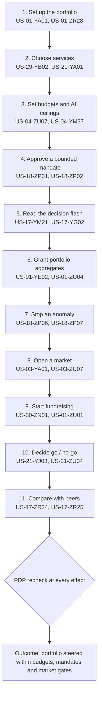

```gherkin
Feature: JN-01 Owner / founder end-to-end journey
  Background:
    Given the persona P01 holds R01 Founder / Portfolio Owner
    And Owner Portfolio tenant exists; AppNAI, MedMaarg, EduVerse and OrganicSpec are separate company tenants (US-01-YA01)

  @e2e @journey @happy @sec
  Scenario Outline: JN-01-E2E Journey permutations (pairwise, 13 rows)
    Given the journey variant has region "<region>"
    And the journey variant has jurisdiction "<jurisdiction>"
    And the journey variant has autonomy/mandate "<autonomy_mandate>"
    And the journey variant has channel "<channel>"
    When the persona completes steps 1–11 of JN-01
    Then the journey outcome is "<expected>"
    And every effect in the journey was rechecked by the PDP at dispatch and audited
    Examples: JN-01 variants (pairwise (2-way) greedy covering array, constraint-aware, seed 501; space 72; t-tuples covered 65/65)
      | ex | region | jurisdiction | autonomy_mandate | channel | expected |
      | EX-JN-01-01 | IN | IN ✓ | L1 | C1 web | PENDING_APPROVAL |
      | EX-JN-01-02 | EU→IN (misrouted) | EU ✓ | L2 | C2 mobile | 409 RESIDENCY_ZONE_MISMATCH |
      | EX-JN-01-03 | EU | UK draft | L3 revoked | C1 web | HOLD PACK_NOT_ACTIVE |
      | EX-JN-01-04 | IN | UK draft | L3 mandate | C2 mobile | HOLD PACK_NOT_ACTIVE |
      | EX-JN-01-05 | EU→IN (misrouted) | IN ✓ | L3 mandate | C1 web | 409 RESIDENCY_ZONE_MISMATCH |
      | EX-JN-01-06 | EU | IN ✓ | L2 | C2 mobile | PENDING_APPROVAL |
      | EX-JN-01-07 | EU→IN (misrouted) | UK draft | L1 | C2 mobile | 409 RESIDENCY_ZONE_MISMATCH |
      | EX-JN-01-08 | EU | EU ✓ | L3 mandate | C1 web | ALLOW: journey outcome reached |
      | EX-JN-01-09 | IN | EU ✓ | L3 revoked | C2 mobile | ROUTE MANDATE_INACTIVE |
      | EX-JN-01-10 | IN | UK draft | L2 | C1 web | HOLD PACK_NOT_ACTIVE |
      | EX-JN-01-11 | EU→IN (misrouted) | IN ✓ | L3 revoked | C1 web | 409 RESIDENCY_ZONE_MISMATCH |
      | EX-JN-01-12 | EU | EU ✓ | L1 | C2 mobile | PENDING_APPROVAL |
      | EX-JN-01-13 | IN | IN ✓ | L3 mandate | C1 web | ALLOW: journey outcome reached |
```

#### JN-02 Tenant administrator journey

| Field | Value |
|---|---|
| Journey | JN-02 |
| Persona | Tenant administrator (P11 (and P13 during application)) |
| Roles | R12 Tenant Administrator; R17 SaaS Client Applicant |
| Goal | Onboard an external tenant end to end: apply, accept, provision, connect identity and systems, and run it safely through to offboarding |
| Preconditions | A company "Kestrel Analytics Pvt Ltd" has chosen the platform; no tenant exists yet |
| Stories touched | 30 (14 new ZU) |
| Journey outcome (oracle allow text) | tenant live with SSO, SCIM, roles, connectors and audit; offboarding evidenced |

| # | Stage | Touchpoint | What the persona does | What the system does (control) | Stories | FR-V12 (sample) |
|---|---|---|---|---|---|---|
| 1 | Apply | W32, W33 | Completes the eight-stage application and continues on a phone | Server-side drafts; stale revisions rejected; cross-device handoff never activates a subscription | US-20-YE02, US-20-YA06, US-20-ZU08, US-20-ZU15 | FR-V12-A-001, FR-V12-A-002, FR-V12-A-095, FR-V12-E-032 |
| 2 | Accept the quote | W23, A187 | Accepts the exact quote revision | Acceptance bound to revision and digest; quote pending shown when no approved rate card | US-20-YE05, US-20-YA03, US-20-ZU04 | FR-V12-A-001, FR-V12-A-002, FR-V12-A-030, FR-V12-E-055 |
| 3 | Get provisioned | A184 | Waits for provisioning after payment | Provisioning only after a verified payment event; saga holds and compensates | US-20-YE06, US-20-YE03 | FR-V12-E-035, FR-V12-E-038, FR-V12-E-057, FR-V12-E-075 |
| 4 | Choose residency | W33, A197 | Selects the EU zone | Region immutable after onboarding; cross-region writes rejected | US-01-ZR28, US-01-ZU07 | FR-V12-I-013, FR-V12-R-005 |
| 5 | Connect identity | A203 | Connects the IdP, verifies the domain and enforces SSO | Break-glass account required before enforcement; MFA policy; session limits | US-01-ZR01, US-01-ZR02, US-01-ZU10, US-01-ZU11 | FR-V12-E-010, FR-V12-E-011, FR-V12-K-101, FR-V12-K-106 |
| 6 | Provision users | A203 | Turns on SCIM provisioning | De-provisioned users lose sessions and API access | US-01-ZR03, US-01-ZU10 | FR-V12-E-010, FR-V12-E-011, FR-V12-K-103 |
| 7 | Define roles | A002 | Builds custom roles | Separation of duties enforced at build and at run time | US-01-ZR04, US-01-ZU12, US-01-ZU06 | FR-V12-E-016, FR-V12-E-017, FR-V12-I-008, FR-V12-K-108 |
| 8 | Configure the business | A197 | Adds companies, brands, markets and channel accounts | Pending configuration reviewed by a second person; rollback is a new reviewed version | US-01-YE01, US-20-ZU08, US-02-ZU01 | FR-V12-A-075, FR-V12-A-093, FR-V12-E-001, FR-V12-E-002 |
| 9 | Connect systems | A008, A168 | Activates the CRM connector and issues API keys | Activation gate: security review, DPA, transfer basis, channel registration | US-18-ZR11, US-21-ZU19, US-20-ZR06, US-20-ZU31 | FR-V12-H-001, FR-V12-H-002, FR-V12-K-112, FR-V12-K-128 |
| 10 | Stream audit | A009 | Streams audit to the SIEM and exports the trail | Hash-chained audit; TLS-only sinks; 1/3/7-year retention | US-01-ZR05, US-01-ZU13, US-01-ZU06 | FR-V12-E-016, FR-V12-E-017, FR-V12-I-009, FR-V12-K-110 |
| 11 | Offboard | A184, W34 | Requests a full export and offboarding | Second approver; hashed manifest; 7-day link; retention rules | US-20-YE14, US-20-ZU34, US-20-ZU02 | FR-V12-A-013, FR-V12-E-058, FR-V12-E-127, FR-V12-K-119 |

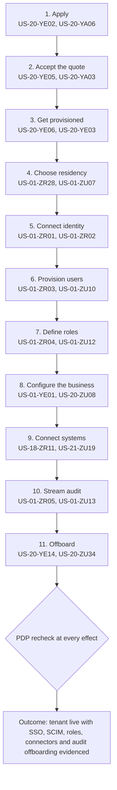

```gherkin
Feature: JN-02 Tenant administrator end-to-end journey
  Background:
    Given the persona P11 holds R12 Tenant Administrator
    And A company "Kestrel Analytics Pvt Ltd" has chosen the platform; no tenant exists yet

  @e2e @journey @happy @sec
  Scenario Outline: JN-02-E2E Journey permutations (exhaustive, 27 rows)
    Given the journey variant has region "<region>"
    And the journey variant has service/SKU "<service_sku>"
    And the journey variant has channel "<channel>"
    When the persona completes steps 1–11 of JN-02
    Then the journey outcome is "<expected>"
    And every effect in the journey was rechecked by the PDP at dispatch and audited
    Examples: JN-02 variants (exhaustive enumeration; space 27; t-tuples covered 10/10)
      | ex | region | service_sku | channel | expected |
      | EX-JN-02-01 | IN | active | C1 web | ALLOW: journey outcome reached |
      | EX-JN-02-02 | IN | active | C2 mobile | ALLOW: journey outcome reached |
      | EX-JN-02-03 | IN | active | C3 API | ALLOW: journey outcome reached |
      | EX-JN-02-04 | IN | suspended | C1 web | 409 SUBSCRIPTION_SUSPENDED |
      | EX-JN-02-05 | IN | suspended | C2 mobile | 409 SUBSCRIPTION_SUSPENDED |
      | EX-JN-02-06 | IN | suspended | C3 API | 409 SUBSCRIPTION_SUSPENDED |
      | EX-JN-02-07 | IN | not subscribed | C1 web | 403 ENTITLEMENT_REQUIRED |
      | EX-JN-02-08 | IN | not subscribed | C2 mobile | 403 ENTITLEMENT_REQUIRED |
      | EX-JN-02-09 | IN | not subscribed | C3 API | 403 ENTITLEMENT_REQUIRED |
      | EX-JN-02-10 | EU | active | C1 web | ALLOW: journey outcome reached |
      | EX-JN-02-11 | EU | active | C2 mobile | ALLOW: journey outcome reached |
      | EX-JN-02-12 | EU | active | C3 API | ALLOW: journey outcome reached |
      | EX-JN-02-13 | EU | suspended | C1 web | 409 SUBSCRIPTION_SUSPENDED |
      | EX-JN-02-14 | EU | suspended | C2 mobile | 409 SUBSCRIPTION_SUSPENDED |
      | EX-JN-02-15 | EU | suspended | C3 API | 409 SUBSCRIPTION_SUSPENDED |
      | EX-JN-02-16 | EU | not subscribed | C1 web | 403 ENTITLEMENT_REQUIRED |
      | EX-JN-02-17 | EU | not subscribed | C2 mobile | 403 ENTITLEMENT_REQUIRED |
      | EX-JN-02-18 | EU | not subscribed | C3 API | 403 ENTITLEMENT_REQUIRED |
      | EX-JN-02-19 | EU→IN (misrouted) | active | C1 web | 409 RESIDENCY_ZONE_MISMATCH |
      | EX-JN-02-20 | EU→IN (misrouted) | active | C2 mobile | 409 RESIDENCY_ZONE_MISMATCH |
      | EX-JN-02-21 | EU→IN (misrouted) | active | C3 API | 409 RESIDENCY_ZONE_MISMATCH |
      | EX-JN-02-22 | EU→IN (misrouted) | suspended | C1 web | 409 SUBSCRIPTION_SUSPENDED |
      | EX-JN-02-23 | EU→IN (misrouted) | suspended | C2 mobile | 409 SUBSCRIPTION_SUSPENDED |
      | EX-JN-02-24 | EU→IN (misrouted) | suspended | C3 API | 409 SUBSCRIPTION_SUSPENDED |
      | EX-JN-02-25 | EU→IN (misrouted) | not subscribed | C1 web | 403 ENTITLEMENT_REQUIRED |
      | EX-JN-02-26 | EU→IN (misrouted) | not subscribed | C2 mobile | 403 ENTITLEMENT_REQUIRED |
      | EX-JN-02-27 | EU→IN (misrouted) | not subscribed | C3 API | 403 ENTITLEMENT_REQUIRED |
```

#### JN-03 Sales executive journey

| Field | Value |
|---|---|
| Journey | JN-03 |
| Persona | Sales executive (P03) |
| Roles | R03 Growth Manager (R03L Sales Lead approves) |
| Goal | Turn qualified opportunities into meetings, proposals and contracts across email, SMS, WhatsApp and AI voice, within consent, mandate and pack rules |
| Preconditions | Startup AppNAI subscribed to SM-SVC-03…10, 17, 18 and 26; seller has R03 on AppNAI |
| Stories touched | 26 (3 new ZU) |
| Journey outcome (oracle allow text) | meeting booked and contract sent with every dispatch rechecked by the PDP |

| # | Stage | Touchpoint | What the persona does | What the system does (control) | Stories | FR-V12 (sample) |
|---|---|---|---|---|---|---|
| 1 | Plan the day | A106, A034 | Opens the daily worklist of eligible prospects with drafts | Only eligible contacts; contact pressure limited across services | US-08-YM03, US-05-YM32 | FR-V12-M-007, FR-V12-M-008, FR-V12-M-091, FR-V12-M-092 |
| 2 | Qualify | A022–A025 | Reviews match and score with evidence | Explainable scores; unknown inputs shown as unknown | US-06-YC04, US-06-YC03 | FR-V12-C-021, FR-V12-C-022, FR-V12-C-025, FR-V12-C-026 |
| 3 | Preflight | A034 | Runs the dispatch preflight | Nine checks in fixed order; dry-run has zero provider calls | US-18-ZU01 | FR-V12-D-007, FR-V12-D-008 |
| 4 | Check law and consent | A200, A201 | Sees a UK contact held because the UK pack is Draft | Only Approved packs enforce; withdrawn consent holds queued runs | US-03-ZU02, US-03-YG02 | FR-V12-F-042, FR-V12-F-044, FR-V12-G-070 |
| 5 | Send and follow up | A034, A035 | Sends email and an SMS follow-up | DLT and registry scrub; 09:00–21:00 local window (DEC-777) | US-08-YC06, US-23-ZR14, US-08-ZU01 | FR-V12-C-033, FR-V12-C-034, FR-V12-F-045, FR-V12-R-070 |
| 6 | Call with AI voice | A170 | Lets the AI voice agent place a consented call | AI discloses itself; recording only with notice/consent; human handoff on every call | US-22-ZQ03, US-22-ZQ01, US-22-ZQ05, US-22-ZQ02 | FR-V12-B-060, FR-V12-B-064, FR-V12-Q-001, FR-V12-Q-002 |
| 7 | Book the meeting | A040, W18 | Books a demo | Calendar and timezone aware; confirmation to the attendee | US-09-YC10 | FR-V12-C-049, FR-V12-C-050 |
| 8 | Propose and quote | A065–A068 | Prepares a proposal and quote | Approved price version only; discount over limit routes to R03L | US-13-YC17, US-13-YB03 | FR-V12-B-095, FR-V12-B-096, FR-V12-C-077, FR-V12-C-078 |
| 9 | Negotiate and contract | A069–A072 | Negotiates within approved bounds and sends the contract | Clause findings; e-signature; signed hash stored | US-13-YC18, US-13-YF18 | FR-V12-C-081, FR-V12-C-082, FR-V12-F-068 |
| 10 | Keep the CRM true | A029 | Sees the deal synced to Salesforce | Field ownership; protected consent fields never overwritten | US-07-ZR12, US-07-ZR13 | FR-V12-R-063, FR-V12-R-064, FR-V12-R-065, FR-V12-R-066 |
| 11 | Improve | A180 | Reviews coaching from permitted call recordings | Only recordings with consent; rubric calibrated | US-08-ZQ01, US-08-ZQ02 | FR-V12-Q-020, FR-V12-Q-021 |
| 12 | Submit a bid (AppNAI) | A104 | Lets the agent submit a sealed bid under a per-tender mandate | Human approved package hash, price, terms and portal before the mandate (DEC-781) | US-14-ZP01, US-14-ZP02, US-14-ZP03 | FR-V12-P-001, FR-V12-P-002, FR-V12-P-110, FR-V12-P-111 |

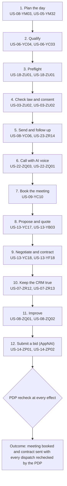

```gherkin
Feature: JN-03 Sales executive end-to-end journey
  Background:
    Given the persona P03 holds R03 Growth Manager (R03L Sales Lead approves)
    And Startup AppNAI subscribed to SM-SVC-03…10, 17, 18 and 26; seller has R03 on AppNAI

  @e2e @journey @happy @sec
  Scenario Outline: JN-03-E2E Journey permutations (pairwise, 17 rows)
    Given the journey variant has jurisdiction "<jurisdiction>"
    And the journey variant has consent "<consent>"
    And the journey variant has autonomy/mandate "<autonomy_mandate>"
    And the journey variant has channel "<channel>"
    When the persona completes steps 1–12 of JN-03
    Then the journey outcome is "<expected>"
    And every effect in the journey was rechecked by the PDP at dispatch and audited
    Examples: JN-03 variants (pairwise (2-way) greedy covering array, constraint-aware, seed 503; space 144; t-tuples covered 87/87)
      | ex | jurisdiction | consent | autonomy_mandate | channel | expected |
      | EX-JN-03-01 | UK draft | withdrawn | L3 revoked | email | HOLD PACK_NOT_ACTIVE |
      | EX-JN-03-02 | EU ✓ | unknown | L2 | SMS | HOLD CONSENT_UNKNOWN |
      | EX-JN-03-03 | IN ✓ | valid | L3 mandate | AI voice | ALLOW: journey outcome reached |
      | EX-JN-03-04 | UK draft | unknown | L1 | WhatsApp | HOLD PACK_NOT_ACTIVE |
      | EX-JN-03-05 | EU ✓ | valid | L1 | email | PENDING_APPROVAL |
      | EX-JN-03-06 | IN ✓ | withdrawn | L1 | SMS | HOLD CONSENT_WITHDRAWN |
      | EX-JN-03-07 | EU ✓ | withdrawn | L3 mandate | WhatsApp | HOLD CONSENT_WITHDRAWN |
      | EX-JN-03-08 | UK draft | valid | L3 revoked | SMS | HOLD PACK_NOT_ACTIVE |
      | EX-JN-03-09 | IN ✓ | unknown | L3 revoked | AI voice | HOLD CONSENT_UNKNOWN |
      | EX-JN-03-10 | IN ✓ | valid | L2 | WhatsApp | PENDING_APPROVAL |
      | EX-JN-03-11 | UK draft | withdrawn | L2 | AI voice | HOLD PACK_NOT_ACTIVE |
      | EX-JN-03-12 | UK draft | unknown | L3 mandate | email | HOLD PACK_NOT_ACTIVE |
      | EX-JN-03-13 | EU ✓ | unknown | L1 | AI voice | HOLD CONSENT_UNKNOWN |
      | EX-JN-03-14 | EU ✓ | withdrawn | L3 revoked | WhatsApp | HOLD CONSENT_WITHDRAWN |
      | EX-JN-03-15 | IN ✓ | valid | L2 | email | PENDING_APPROVAL |
      | EX-JN-03-16 | UK draft | unknown | L3 mandate | SMS | HOLD PACK_NOT_ACTIVE |
      | EX-JN-03-17 | IN ✓ | valid | L3 mandate | email | ALLOW: journey outcome reached |
```

#### JN-04 Marketer journey

| Field | Value |
|---|---|
| Journey | JN-04 |
| Persona | Marketer (P05) |
| Roles | R05 Marketing Specialist (R05L Marketing Lead approves) |
| Goal | Plan, create, approve and run compliant multichannel campaigns and measure them with consent-aware analytics |
| Preconditions | MedMaarg subscribed to SM-SVC-11…16, 27, 30 and 38 |
| Stories touched | 22 (5 new ZU) |
| Journey outcome (oracle allow text) | campaign live in approved markets with labelled AI content and measured results |

| # | Stage | Touchpoint | What the persona does | What the system does (control) | Stories | FR-V12 (sample) |
|---|---|---|---|---|---|---|
| 1 | Define audiences | A056 | Defines an offering-specific audience for India and the EU | Market eligibility and source rights by offering; no cross-product assumptions | US-05-ZU01, US-06-YD01 | FR-V12-A-078, FR-V12-D-129 |
| 2 | Preflight the campaign | A056 | Runs the campaign pre-flight | Pre-flight attached to the approval so approvers see risks | US-12-YM15, US-12-YM16 | FR-V12-M-048, FR-V12-M-049 |
| 3 | Create content | A050–A052, A171 | Generates copy, images and a short video | Rights, brand and claim QA before approval; metered per asset | US-11-YC11, US-11-YD01, US-28-YB01, US-28-YB02 | FR-V12-B-066, FR-V12-B-067, FR-V12-C-053, FR-V12-C-054 |
| 4 | Label AI content | A171 | Publishes with AI labels | Machine-readable marking; undisclosed AI content in the EU is held | US-03-ZU03, US-11-YM35, US-03-YM38 | FR-V12-F-047, FR-V12-M-097, FR-V12-M-100 |
| 5 | Search and social | A053–A055 | Publishes SEO pages and social posts | Approved claims only; listening drafts need approval | US-11-YC13, US-11-YC12 | FR-V12-C-057, FR-V12-C-058, FR-V12-C-061, FR-V12-C-062 |
| 6 | Email and SMS | A034, A182 | Sends an email wave and an SMS reminder | DLT templates, NCPR/DND scrub, local window | US-08-YC06, US-23-YB02, US-08-ZU01 | FR-V12-B-098, FR-V12-B-099, FR-V12-C-033, FR-V12-C-034 |
| 7 | Landing pages | A058, W10 | Publishes a landing page with intake | Consent captured with notice version; spam and minors checks | US-12-YC15, US-03-YG07 | FR-V12-C-069, FR-V12-C-070, FR-V12-G-096 |
| 8 | Experiment | A174 | Runs a pre-registered A/B test | Guardrail metrics; human decision | US-12-YD01, US-12-YI01 | FR-V12-D-130, FR-V12-I-046 |
| 9 | Measure | A088 | Reads consent-aware acquisition analytics | No tracking without consent; zero denominators shown as not applicable | US-12-ZU01, US-21-ZU03 | FR-V12-A-152, FR-V12-I-045 |

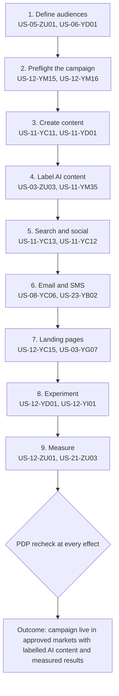

```gherkin
Feature: JN-04 Marketer end-to-end journey
  Background:
    Given the persona P05 holds R05 Marketing Specialist (R05L Marketing Lead approves)
    And MedMaarg subscribed to SM-SVC-11…16, 27, 30 and 38

  @e2e @journey @happy @sec
  Scenario Outline: JN-04-E2E Journey permutations (pairwise, 15 rows)
    Given the journey variant has jurisdiction "<jurisdiction>"
    And the journey variant has consent "<consent>"
    And the journey variant has channel "<channel>"
    And the journey variant has region "<region>"
    When the persona completes steps 1–9 of JN-04
    Then the journey outcome is "<expected>"
    And every effect in the journey was rechecked by the PDP at dispatch and audited
    Examples: JN-04 variants (pairwise (2-way) greedy covering array, constraint-aware, seed 504; space 108; t-tuples covered 76/76)
      | ex | jurisdiction | consent | channel | region | expected |
      | EX-JN-04-01 | EU ✓ | valid | SMS | EU | ALLOW: journey outcome reached |
      | EX-JN-04-02 | IN ✓ | withdrawn | social | IN | HOLD CONSENT_WITHDRAWN |
      | EX-JN-04-03 | UK draft | unknown | email | EU→IN (misrouted) | 409 RESIDENCY_ZONE_MISMATCH |
      | EX-JN-04-04 | IN ✓ | valid | landing page | EU→IN (misrouted) | 409 RESIDENCY_ZONE_MISMATCH |
      | EX-JN-04-05 | EU ✓ | unknown | landing page | IN | HOLD CONSENT_UNKNOWN |
      | EX-JN-04-06 | UK draft | withdrawn | landing page | EU | HOLD PACK_NOT_ACTIVE |
      | EX-JN-04-07 | EU ✓ | withdrawn | social | EU→IN (misrouted) | 409 RESIDENCY_ZONE_MISMATCH |
      | EX-JN-04-08 | IN ✓ | unknown | SMS | EU | HOLD CONSENT_UNKNOWN |
      | EX-JN-04-09 | UK draft | valid | SMS | IN | HOLD PACK_NOT_ACTIVE |
      | EX-JN-04-10 | EU ✓ | valid | email | IN | ALLOW: journey outcome reached |
      | EX-JN-04-11 | UK draft | valid | social | EU | HOLD PACK_NOT_ACTIVE |
      | EX-JN-04-12 | IN ✓ | withdrawn | email | EU | HOLD CONSENT_WITHDRAWN |
      | EX-JN-04-13 | IN ✓ | withdrawn | SMS | EU→IN (misrouted) | 409 RESIDENCY_ZONE_MISMATCH |
      | EX-JN-04-14 | UK draft | unknown | social | EU→IN (misrouted) | 409 RESIDENCY_ZONE_MISMATCH |
      | EX-JN-04-15 | IN ✓ | valid | email | IN | ALLOW: journey outcome reached |
```

#### JN-05 Approver journey

| Field | Value |
|---|---|
| Journey | JN-05 |
| Persona | Approver (P02) |
| Roles | R02 Startup Head; R03L Sales Lead; R05L Marketing Lead |
| Goal | Approve exactly what was reviewed, quickly and from any device, without ever approving one's own request |
| Preconditions | Pending items exist in the action inbox: a discount, a campaign, a mandate and a bid package |
| Stories touched | 14 (5 new ZU) |
| Journey outcome (oracle allow text) | exact item approved once, by an eligible person, with the evidence recorded |

| # | Stage | Touchpoint | What the persona does | What the system does (control) | Stories | FR-V12 (sample) |
|---|---|---|---|---|---|---|
| 1 | Open the inbox | A106 | Opens the scoped action inbox | Items limited to the approver's scope; operations separate | US-17-YG03 | FR-V12-G-094 |
| 2 | Review a group | A106 | Reviews similar items as one group with outliers highlighted | Neutral note with risks and diffs | US-18-YM05, US-18-YM06 | FR-V12-M-014, FR-V12-M-015 |
| 3 | Approve the exact item | A106 | Approves a payload | Approval bound to payload, amount, policy and hash | US-18-YD03, US-18-ZU04 | FR-V12-D-009, FR-V12-D-026, FR-V12-F-034 |
| 4 | Refuse a conflict | A106 | Is blocked from approving own request | SoD at build and at run time | US-01-ZR04, US-01-ZU06, US-01-ZU12 | FR-V12-E-016, FR-V12-E-017, FR-V12-I-008, FR-V12-K-108 |
| 5 | Co-approve a mandate | A109 | Gives the second approval of a bounded mandate | Two distinct people; caps and window visible | US-18-ZP02 | FR-V12-P-006, FR-V12-P-007 |
| 6 | Approve price and discount | A066 | Approves a discount within authority | Over-limit routes to a higher approver | US-13-YC17 | FR-V12-C-077, FR-V12-C-078 |
| 7 | Seal a bid | A104 | Approves the sealed bid package | Hash, price, terms and portal fixed before the mandate | US-14-ZP01 | FR-V12-P-001, FR-V12-P-002 |
| 8 | Resolve competing actions | A106 | Chooses one of two competing actions to the same account | Only the selected eligible action proceeds | US-18-ZU05 | FR-V12-F-048 |
| 9 | Approve on the phone | A106 (360 px) | Approves a low-risk item on mobile | Same checks on mobile; step-up for privileged actions | US-17-YG05, US-01-ZU11 | FR-V12-G-101, FR-V12-K-104 |

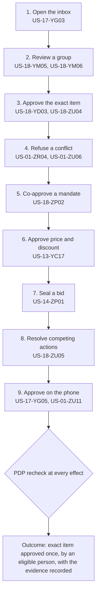

```gherkin
Feature: JN-05 Approver end-to-end journey
  Background:
    Given the persona P02 holds R02 Startup Head
    And Pending items exist in the action inbox: a discount, a campaign, a mandate and a bid package

  @e2e @journey @happy @sec
  Scenario Outline: JN-05-E2E Journey permutations (exhaustive, 48 rows)
    Given the journey variant has authority "<authority>"
    And the journey variant has channel "<channel>"
    And the journey variant has autonomy/mandate "<autonomy_mandate>"
    And the journey variant has region "<region>"
    When the persona completes steps 1–9 of JN-05
    Then the journey outcome is "<expected>"
    And every effect in the journey was rechecked by the PDP at dispatch and audited
    Examples: JN-05 variants (exhaustive enumeration; space 48; t-tuples covered 12/12)
      | ex | authority | channel | autonomy_mandate | region | expected |
      | EX-JN-05-01 | A1 | C1 web | L1 | IN | PENDING_APPROVAL |
      | EX-JN-05-02 | A1 | C1 web | L1 | EU | PENDING_APPROVAL |
      | EX-JN-05-03 | A1 | C1 web | L1 | EU→IN (misrouted) | 409 RESIDENCY_ZONE_MISMATCH |
      | EX-JN-05-04 | A1 | C1 web | L2 | IN | PENDING_APPROVAL |
      | EX-JN-05-05 | A1 | C1 web | L2 | EU | PENDING_APPROVAL |
      | EX-JN-05-06 | A1 | C1 web | L2 | EU→IN (misrouted) | 409 RESIDENCY_ZONE_MISMATCH |
      | EX-JN-05-07 | A1 | C1 web | L3 mandate | IN | ALLOW: journey outcome reached |
      | EX-JN-05-08 | A1 | C1 web | L3 mandate | EU | ALLOW: journey outcome reached |
      | EX-JN-05-09 | A1 | C1 web | L3 mandate | EU→IN (misrouted) | 409 RESIDENCY_ZONE_MISMATCH |
      | EX-JN-05-10 | A1 | C1 web | L3 revoked | IN | ROUTE MANDATE_INACTIVE |
      | EX-JN-05-11 | A1 | C1 web | L3 revoked | EU | ROUTE MANDATE_INACTIVE |
      | EX-JN-05-12 | A1 | C1 web | L3 revoked | EU→IN (misrouted) | 409 RESIDENCY_ZONE_MISMATCH |
      | EX-JN-05-13 | A1 | C2 mobile | L1 | IN | PENDING_APPROVAL |
      | EX-JN-05-14 | A1 | C2 mobile | L1 | EU | PENDING_APPROVAL |
      | EX-JN-05-15 | A1 | C2 mobile | L1 | EU→IN (misrouted) | 409 RESIDENCY_ZONE_MISMATCH |
      | EX-JN-05-16 | A1 | C2 mobile | L2 | IN | PENDING_APPROVAL |
      | EX-JN-05-17 | A1 | C2 mobile | L2 | EU | PENDING_APPROVAL |
      | EX-JN-05-18 | A1 | C2 mobile | L2 | EU→IN (misrouted) | 409 RESIDENCY_ZONE_MISMATCH |
      | EX-JN-05-19 | A1 | C2 mobile | L3 mandate | IN | ALLOW: journey outcome reached |
      | EX-JN-05-20 | A1 | C2 mobile | L3 mandate | EU | ALLOW: journey outcome reached |
      | EX-JN-05-21 | A1 | C2 mobile | L3 mandate | EU→IN (misrouted) | 409 RESIDENCY_ZONE_MISMATCH |
      | EX-JN-05-22 | A1 | C2 mobile | L3 revoked | IN | ROUTE MANDATE_INACTIVE |
      | EX-JN-05-23 | A1 | C2 mobile | L3 revoked | EU | ROUTE MANDATE_INACTIVE |
      | EX-JN-05-24 | A1 | C2 mobile | L3 revoked | EU→IN (misrouted) | 409 RESIDENCY_ZONE_MISMATCH |
      | EX-JN-05-25 | A3 SoD/limit | C1 web | L1 | IN | 403 SOD_CONFLICT |
      | EX-JN-05-26 | A3 SoD/limit | C1 web | L1 | EU | 403 SOD_CONFLICT |
      | EX-JN-05-27 | A3 SoD/limit | C1 web | L1 | EU→IN (misrouted) | 403 SOD_CONFLICT |
      | EX-JN-05-28 | A3 SoD/limit | C1 web | L2 | IN | 403 SOD_CONFLICT |
      | EX-JN-05-29 | A3 SoD/limit | C1 web | L2 | EU | 403 SOD_CONFLICT |
      | EX-JN-05-30 | A3 SoD/limit | C1 web | L2 | EU→IN (misrouted) | 403 SOD_CONFLICT |
      | EX-JN-05-31 | A3 SoD/limit | C1 web | L3 mandate | IN | 403 SOD_CONFLICT |
      | EX-JN-05-32 | A3 SoD/limit | C1 web | L3 mandate | EU | 403 SOD_CONFLICT |
      | EX-JN-05-33 | A3 SoD/limit | C1 web | L3 mandate | EU→IN (misrouted) | 403 SOD_CONFLICT |
      | EX-JN-05-34 | A3 SoD/limit | C1 web | L3 revoked | IN | 403 SOD_CONFLICT |
      | EX-JN-05-35 | A3 SoD/limit | C1 web | L3 revoked | EU | 403 SOD_CONFLICT |
      | EX-JN-05-36 | A3 SoD/limit | C1 web | L3 revoked | EU→IN (misrouted) | 403 SOD_CONFLICT |
      | EX-JN-05-37 | A3 SoD/limit | C2 mobile | L1 | IN | 403 SOD_CONFLICT |
      | EX-JN-05-38 | A3 SoD/limit | C2 mobile | L1 | EU | 403 SOD_CONFLICT |
      | EX-JN-05-39 | A3 SoD/limit | C2 mobile | L1 | EU→IN (misrouted) | 403 SOD_CONFLICT |
      | EX-JN-05-40 | A3 SoD/limit | C2 mobile | L2 | IN | 403 SOD_CONFLICT |
      | EX-JN-05-41 | A3 SoD/limit | C2 mobile | L2 | EU | 403 SOD_CONFLICT |
      | EX-JN-05-42 | A3 SoD/limit | C2 mobile | L2 | EU→IN (misrouted) | 403 SOD_CONFLICT |
      | EX-JN-05-43 | A3 SoD/limit | C2 mobile | L3 mandate | IN | 403 SOD_CONFLICT |
      | EX-JN-05-44 | A3 SoD/limit | C2 mobile | L3 mandate | EU | 403 SOD_CONFLICT |
      | EX-JN-05-45 | A3 SoD/limit | C2 mobile | L3 mandate | EU→IN (misrouted) | 403 SOD_CONFLICT |
      | EX-JN-05-46 | A3 SoD/limit | C2 mobile | L3 revoked | IN | 403 SOD_CONFLICT |
      | EX-JN-05-47 | A3 SoD/limit | C2 mobile | L3 revoked | EU | 403 SOD_CONFLICT |
      | EX-JN-05-48 | A3 SoD/limit | C2 mobile | L3 revoked | EU→IN (misrouted) | 403 SOD_CONFLICT |
```

#### JN-06 Finance journey

| Field | Value |
|---|---|
| Journey | JN-06 |
| Persona | Finance (P08) |
| Roles | R08 Finance Maker; R09 Finance Checker |
| Goal | Bill, collect, pay, reconcile and report every rupee and euro with maker-checker control and evidence |
| Preconditions | Kestrel Analytics has an active subscription and AppNAI uses payment mandates through a licensed PSP |
| Stories touched | 20 (12 new ZU) |
| Journey outcome (oracle allow text) | ledger reconciled with maker-checker evidence and correct tax |

| # | Stage | Touchpoint | What the persona does | What the system does (control) | Stories | FR-V12 (sample) |
|---|---|---|---|---|---|---|
| 1 | Price and tax | A186, A187 | Checks the quote price and tax lines | Approved rate card or "Quote pending"; tax per approved rule | US-20-ZU04, US-20-YE10, US-34-ZU03 | FR-V12-A-030, FR-V12-E-072, FR-V12-E-073, FR-V12-K-149 |
| 2 | Invoice and collect | A187 | Issues invoices and runs dunning | Integer minor units; suspension only after grace | US-20-YE11, US-20-ZU35 | FR-V12-E-063, FR-V12-E-076, FR-V12-K-153 |
| 3 | Handle a dispute | A187, W26 | Resolves a billing dispute with a credit note | Private case; refund only under policy with maker-checker | US-20-ZU04, US-20-YE12 | FR-V12-A-034, FR-V12-E-064, FR-V12-E-078 |
| 4 | Pay under mandate | A073 | Lets an approved payment mandate pay a supplier through the PSP | Per-transaction and period caps; counterparty allowlist (DEC-780) | US-15-ZP01 | FR-V12-P-001, FR-V12-P-002 |
| 5 | Reconcile | A074 | Reconciles settlements and posts journals | Unmatched items held; nothing posted twice | US-15-ZP02, US-15-ZP03 | FR-V12-P-062, FR-V12-P-063, FR-V12-P-083, FR-V12-P-084 |
| 6 | Recognise revenue | A187 | Runs daily revenue recognition and month close | Schedule reconciles to ledger | US-20-YE13, US-20-ZU22 | FR-V12-E-077, FR-V12-E-086 |
| 7 | Know unit cost | A012, A101 | Reviews per-SKU cost and TCO | Cost per accepted output; price floor formula | US-20-ZU05, US-20-ZU04, US-04-ZU07 | FR-V12-A-031, FR-V12-A-032, FR-V12-F-014 |
| 8 | Check AI spend | A012 | Reconciles AI usage with provider invoices | Every model call metered; tolerance check | US-04-ZU06, US-04-ZU12 | FR-V12-F-012, FR-V12-F-030 |
| 9 | Report in two currencies | A089 | Reports INR and EUR | Native totals; converted totals only with an approved rate | US-34-ZU03, US-01-ZU07, US-17-ZU01 | FR-V12-A-036, FR-V12-I-018, FR-V12-K-150 |
| 10 | Verify investor receipts (INV) | A229 | Verifies investor receipts and allotment clocks | No custody; receipts evidence only; day-60 allotment block (IN) | US-31-ZN12, US-32-ZU02, US-31-ZU01 | FR-V12-N-028, FR-V12-N-060, FR-V12-N-145, FR-V12-O-014 |

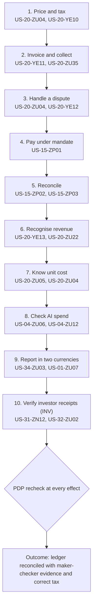

```gherkin
Feature: JN-06 Finance end-to-end journey
  Background:
    Given the persona P08 holds R08 Finance Maker
    And Kestrel Analytics has an active subscription and AppNAI uses payment mandates through a licensed PSP

  @e2e @journey @happy @sec
  Scenario Outline: JN-06-E2E Journey permutations (exhaustive, 36 rows)
    Given the journey variant has authority "<authority>"
    And the journey variant has jurisdiction "<jurisdiction>"
    And the journey variant has region "<region>"
    And the journey variant has currency "<currency>"
    When the persona completes steps 1–10 of JN-06
    Then the journey outcome is "<expected>"
    And every effect in the journey was rechecked by the PDP at dispatch and audited
    Examples: JN-06 variants (exhaustive enumeration; space 36; t-tuples covered 11/11)
      | ex | authority | jurisdiction | region | currency | expected |
      | EX-JN-06-01 | A1 | IN GST ✓ | IN | INR | ALLOW: journey outcome reached |
      | EX-JN-06-02 | A1 | IN GST ✓ | IN | EUR | ALLOW: journey outcome reached |
      | EX-JN-06-03 | A1 | IN GST ✓ | EU | INR | ALLOW: journey outcome reached |
      | EX-JN-06-04 | A1 | IN GST ✓ | EU | EUR | ALLOW: journey outcome reached |
      | EX-JN-06-05 | A1 | IN GST ✓ | EU→IN (misrouted) | INR | 409 RESIDENCY_ZONE_MISMATCH |
      | EX-JN-06-06 | A1 | IN GST ✓ | EU→IN (misrouted) | EUR | 409 RESIDENCY_ZONE_MISMATCH |
      | EX-JN-06-07 | A1 | EU VAT ✓ | IN | INR | ALLOW: journey outcome reached |
      | EX-JN-06-08 | A1 | EU VAT ✓ | IN | EUR | ALLOW: journey outcome reached |
      | EX-JN-06-09 | A1 | EU VAT ✓ | EU | INR | ALLOW: journey outcome reached |
      | EX-JN-06-10 | A1 | EU VAT ✓ | EU | EUR | ALLOW: journey outcome reached |
      | EX-JN-06-11 | A1 | EU VAT ✓ | EU→IN (misrouted) | INR | 409 RESIDENCY_ZONE_MISMATCH |
      | EX-JN-06-12 | A1 | EU VAT ✓ | EU→IN (misrouted) | EUR | 409 RESIDENCY_ZONE_MISMATCH |
      | EX-JN-06-13 | A1 | UK VAT draft | IN | INR | HOLD TAX_RULE_NOT_APPROVED |
      | EX-JN-06-14 | A1 | UK VAT draft | IN | EUR | HOLD TAX_RULE_NOT_APPROVED |
      | EX-JN-06-15 | A1 | UK VAT draft | EU | INR | HOLD TAX_RULE_NOT_APPROVED |
      | EX-JN-06-16 | A1 | UK VAT draft | EU | EUR | HOLD TAX_RULE_NOT_APPROVED |
      | EX-JN-06-17 | A1 | UK VAT draft | EU→IN (misrouted) | INR | 409 RESIDENCY_ZONE_MISMATCH |
      | EX-JN-06-18 | A1 | UK VAT draft | EU→IN (misrouted) | EUR | 409 RESIDENCY_ZONE_MISMATCH |
      | EX-JN-06-19 | A3 SoD/limit | IN GST ✓ | IN | INR | 403 SOD_CONFLICT |
      | EX-JN-06-20 | A3 SoD/limit | IN GST ✓ | IN | EUR | 403 SOD_CONFLICT |
      | EX-JN-06-21 | A3 SoD/limit | IN GST ✓ | EU | INR | 403 SOD_CONFLICT |
      | EX-JN-06-22 | A3 SoD/limit | IN GST ✓ | EU | EUR | 403 SOD_CONFLICT |
      | EX-JN-06-23 | A3 SoD/limit | IN GST ✓ | EU→IN (misrouted) | INR | 403 SOD_CONFLICT |
      | EX-JN-06-24 | A3 SoD/limit | IN GST ✓ | EU→IN (misrouted) | EUR | 403 SOD_CONFLICT |
      | EX-JN-06-25 | A3 SoD/limit | EU VAT ✓ | IN | INR | 403 SOD_CONFLICT |
      | EX-JN-06-26 | A3 SoD/limit | EU VAT ✓ | IN | EUR | 403 SOD_CONFLICT |
      | EX-JN-06-27 | A3 SoD/limit | EU VAT ✓ | EU | INR | 403 SOD_CONFLICT |
      | EX-JN-06-28 | A3 SoD/limit | EU VAT ✓ | EU | EUR | 403 SOD_CONFLICT |
      | EX-JN-06-29 | A3 SoD/limit | EU VAT ✓ | EU→IN (misrouted) | INR | 403 SOD_CONFLICT |
      | EX-JN-06-30 | A3 SoD/limit | EU VAT ✓ | EU→IN (misrouted) | EUR | 403 SOD_CONFLICT |
      | EX-JN-06-31 | A3 SoD/limit | UK VAT draft | IN | INR | 403 SOD_CONFLICT |
      | EX-JN-06-32 | A3 SoD/limit | UK VAT draft | IN | EUR | 403 SOD_CONFLICT |
      | EX-JN-06-33 | A3 SoD/limit | UK VAT draft | EU | INR | 403 SOD_CONFLICT |
      | EX-JN-06-34 | A3 SoD/limit | UK VAT draft | EU | EUR | 403 SOD_CONFLICT |
      | EX-JN-06-35 | A3 SoD/limit | UK VAT draft | EU→IN (misrouted) | INR | 403 SOD_CONFLICT |
      | EX-JN-06-36 | A3 SoD/limit | UK VAT draft | EU→IN (misrouted) | EUR | 403 SOD_CONFLICT |
```

#### JN-07 Compliance / counsel journey

| Field | Value |
|---|---|
| Journey | JN-07 |
| Persona | Compliance / counsel (P09) |
| Roles | R10 Legal / Compliance / DPO; R10C external counsel (Part 11.16a) |
| Goal | Author, sign off and enforce jurisdiction rule packs, consent, privacy rights, AI disclosure, recordings and securities rules, with evidence |
| Preconditions | Rule-pack registry holds RP-IN, RP-EU, RP-UK (Draft) and the securities packs of Part 11.16d |
| Stories touched | 17 (5 new ZU) |
| Journey outcome (oracle allow text) | only lawful actions run; every right and clock met with evidence |

| # | Stage | Touchpoint | What the persona does | What the system does (control) | Stories | FR-V12 (sample) |
|---|---|---|---|---|---|---|
| 1 | Author and sign off a pack | A200 | Signs off RP-EU after counsel review | Versioned packs; only Approved enforced; unreviewed → stricter outcome | US-03-YM09, US-03-ZU02, US-03-ZU07 | FR-V12-F-042, FR-V12-K-144, FR-V12-M-027, FR-V12-M-028 |
| 2 | Gate a market | A200 | Leaves RP-UK in Draft | Outbound blocked until counsel approves | US-03-YA01 | FR-V12-A-053, FR-V12-A-130 |
| 3 | Run the consent ledger | A201 | Investigates a withdrawal | Scoped consent; withdrawal holds queued runs | US-03-YG03, US-03-ZU02 | FR-V12-F-044, FR-V12-G-071 |
| 4 | Meet rights clocks | A163, W49 | Completes a DSAR before its clock | Clocks start at detection; identity verified before completion | US-03-YI02, US-03-ZU02 | FR-V12-F-046, FR-V12-I-006, FR-V12-I-007 |
| 5 | Handle a breach | A202 | Opens a breach with notification clocks | Per-pack deadlines; tabletop evidence | US-03-YG04, US-21-YI03 | FR-V12-G-072, FR-V12-I-057 |
| 6 | Require AI disclosure | A199 | Checks AI labels | Undisclosed AI content in the EU is held | US-03-ZU03, US-03-YM38 | FR-V12-F-047, FR-V12-M-100 |
| 7 | Govern recordings | A170 | Approves the recording-notice wording per jurisdiction | All-party consent where required; retention and redaction | US-22-ZQ05, US-22-ZQ10 | FR-V12-Q-001, FR-V12-Q-002 |
| 8 | Register an offering | A232 | Signs off the s.42 route for "Seed 2027" | Counsel sign-off per jurisdiction before activation | US-31-ZN01, US-33-ZO12 | FR-V12-N-025, FR-V12-O-085, FR-V12-O-086 |
| 9 | Review promotions | A256 | Reviews a financial promotion and legends | UK s.21 approver gateway; no public offer where prohibited | US-33-ZO14, US-30-ZU01 | FR-V12-N-021, FR-V12-O-003, FR-V12-O-004 |
| 10 | Keep the legal set | W52 | Publishes DPA, sub-processor list and legal documents | 30-day sub-processor notice; DPIA and EU AI Act assessment before EU launch | US-03-ZU06, US-03-ZU07 | FR-V12-K-140, FR-V12-K-141, FR-V12-K-143 |

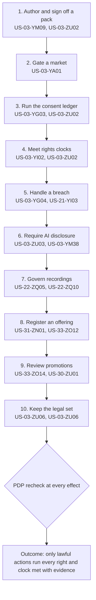

```gherkin
Feature: JN-07 Compliance / counsel end-to-end journey
  Background:
    Given the persona P09 holds R10 Legal / Compliance / DPO
    And Rule-pack registry holds RP-IN, RP-EU, RP-UK (Draft) and the securities packs of Part 11.16d

  @e2e @journey @happy @sec
  Scenario Outline: JN-07-E2E Journey permutations (exhaustive, 36 rows)
    Given the journey variant has jurisdiction "<jurisdiction>"
    And the journey variant has consent "<consent>"
    And the journey variant has channel "<channel>"
    When the persona completes steps 1–10 of JN-07
    Then the journey outcome is "<expected>"
    And every effect in the journey was rechecked by the PDP at dispatch and audited
    Examples: JN-07 variants (exhaustive enumeration; space 36; t-tuples covered 11/11)
      | ex | jurisdiction | consent | channel | expected |
      | EX-JN-07-01 | IN ✓ | valid | email | ALLOW: journey outcome reached |
      | EX-JN-07-02 | IN ✓ | valid | SMS/voice | ALLOW: journey outcome reached |
      | EX-JN-07-03 | IN ✓ | valid | portal | ALLOW: journey outcome reached |
      | EX-JN-07-04 | IN ✓ | withdrawn | email | HOLD CONSENT_WITHDRAWN |
      | EX-JN-07-05 | IN ✓ | withdrawn | SMS/voice | HOLD CONSENT_WITHDRAWN |
      | EX-JN-07-06 | IN ✓ | withdrawn | portal | HOLD CONSENT_WITHDRAWN |
      | EX-JN-07-07 | IN ✓ | unknown | email | HOLD CONSENT_UNKNOWN |
      | EX-JN-07-08 | IN ✓ | unknown | SMS/voice | HOLD CONSENT_UNKNOWN |
      | EX-JN-07-09 | IN ✓ | unknown | portal | HOLD CONSENT_UNKNOWN |
      | EX-JN-07-10 | EU ✓ | valid | email | ALLOW: journey outcome reached |
      | EX-JN-07-11 | EU ✓ | valid | SMS/voice | ALLOW: journey outcome reached |
      | EX-JN-07-12 | EU ✓ | valid | portal | ALLOW: journey outcome reached |
      | EX-JN-07-13 | EU ✓ | withdrawn | email | HOLD CONSENT_WITHDRAWN |
      | EX-JN-07-14 | EU ✓ | withdrawn | SMS/voice | HOLD CONSENT_WITHDRAWN |
      | EX-JN-07-15 | EU ✓ | withdrawn | portal | HOLD CONSENT_WITHDRAWN |
      | EX-JN-07-16 | EU ✓ | unknown | email | HOLD CONSENT_UNKNOWN |
      | EX-JN-07-17 | EU ✓ | unknown | SMS/voice | HOLD CONSENT_UNKNOWN |
      | EX-JN-07-18 | EU ✓ | unknown | portal | HOLD CONSENT_UNKNOWN |
      | EX-JN-07-19 | UK draft | valid | email | HOLD PACK_NOT_ACTIVE |
      | EX-JN-07-20 | UK draft | valid | SMS/voice | HOLD PACK_NOT_ACTIVE |
      | EX-JN-07-21 | UK draft | valid | portal | HOLD PACK_NOT_ACTIVE |
      | EX-JN-07-22 | UK draft | withdrawn | email | HOLD PACK_NOT_ACTIVE |
      | EX-JN-07-23 | UK draft | withdrawn | SMS/voice | HOLD PACK_NOT_ACTIVE |
      | EX-JN-07-24 | UK draft | withdrawn | portal | HOLD PACK_NOT_ACTIVE |
      | EX-JN-07-25 | UK draft | unknown | email | HOLD PACK_NOT_ACTIVE |
      | EX-JN-07-26 | UK draft | unknown | SMS/voice | HOLD PACK_NOT_ACTIVE |
      | EX-JN-07-27 | UK draft | unknown | portal | HOLD PACK_NOT_ACTIVE |
      | EX-JN-07-28 | US expired | valid | email | HOLD PACK_EXPIRED |
      | EX-JN-07-29 | US expired | valid | SMS/voice | HOLD PACK_EXPIRED |
      | EX-JN-07-30 | US expired | valid | portal | HOLD PACK_EXPIRED |
      | EX-JN-07-31 | US expired | withdrawn | email | HOLD PACK_EXPIRED |
      | EX-JN-07-32 | US expired | withdrawn | SMS/voice | HOLD PACK_EXPIRED |
      | EX-JN-07-33 | US expired | withdrawn | portal | HOLD PACK_EXPIRED |
      | EX-JN-07-34 | US expired | unknown | email | HOLD PACK_EXPIRED |
      | EX-JN-07-35 | US expired | unknown | SMS/voice | HOLD PACK_EXPIRED |
      | EX-JN-07-36 | US expired | unknown | portal | HOLD PACK_EXPIRED |
```

#### JN-08 Platform operator journey

| Field | Value |
|---|---|
| Journey | JN-08 |
| Persona | Platform operator (P12) |
| Roles | R13 Platform Support; R14 Platform Billing; R11 release manager |
| Goal | Operate the multi-region SaaS: catalogue, releases, recovery, incidents, security programme and support access, with 24×7 cover |
| Preconditions | Stacks live in zone IN (Mumbai) and zone EU (DEC-772) |
| Stories touched | 21 (11 new ZU) |
| Journey outcome (oracle allow text) | release promoted in both zones with recovery and security evidence |

| # | Stage | Touchpoint | What the persona does | What the system does (control) | Stories | FR-V12 (sample) |
|---|---|---|---|---|---|---|
| 1 | Acquire customers | A184 | Runs SaaS acquisition from the operator tenant | Operator cannot read customer private records by default | US-20-ZU06 | FR-V12-A-073 |
| 2 | Run the catalogue | A192, A186 | Moves a SKU from pilot to released | Readiness gate; alias map; drafts never public | US-29-YB12, US-20-ZU01, US-20-ZU17 | FR-V12-A-004, FR-V12-B-001, FR-V12-B-002, FR-V12-E-045 |
| 3 | Gate a release | A190 | Assembles GO-01…08 evidence | P0 controls block affected SKUs only | US-21-YE03, US-21-ZU04, US-21-ZU10 | FR-V12-A-191, FR-V12-E-130, FR-V12-E-132 |
| 4 | Deploy per region | A190 | Promotes the same digest to both zones | Pinned Vercel functions; header allowlist; no body logging (DEC-786) | US-21-ZR16, US-21-ZR17 | FR-V12-R-081, FR-V12-R-082 |
| 5 | Prove recovery | A156 | Runs the restore drill at the gate | RPO ≤ 15 min; growth RTO ≤ 120 min (DEC-771/787) | US-21-ZR18, US-21-ZR19, US-21-ZU02 | FR-V12-A-147, FR-V12-E-122, FR-V12-E-123 |
| 6 | Run incidents | A014, W45 | Declares a SEV1 and publishes status | 24×7 on-call (DEC-773); independent status page | US-21-YK01, US-21-ZU17, US-21-ZU02 | FR-V12-A-142, FR-V12-K-003, FR-V12-K-004 |
| 7 | Secure the SDLC | A190 | Reviews SBOM and the pen-test report | SAST/DAST/SCA per change; remediation SLA clock | US-21-ZU20, US-21-ZU21 | FR-V12-K-129, FR-V12-K-130, FR-V12-K-132 |
| 8 | Support a tenant | A099 | Requests just-in-time access to a tenant | Ticket-linked, tenant-approved, time-limited, audited | US-01-ZU13, US-01-ZR05 | FR-V12-E-016, FR-V12-E-017, FR-V12-K-111 |
| 9 | Govern models | A198 | Onboards a candidate model | Two-person approval with evidence; Claude Sonnet primary (DEC-788) | US-04-ZR20, US-04-ZR23 | FR-V12-F-002, FR-V12-F-003 |
| 10 | Manage plugins | A188 | Reviews the paid-plugin replacement register | Every candidate disabled until evidence | US-21-ZU12 | FR-V12-H-032 |

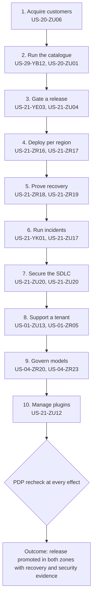

```gherkin
Feature: JN-08 Platform operator end-to-end journey
  Background:
    Given the persona P12 holds R13 Platform Support
    And Stacks live in zone IN (Mumbai) and zone EU (DEC-772)

  @e2e @journey @happy @sec
  Scenario Outline: JN-08-E2E Journey permutations (exhaustive, 36 rows)
    Given the journey variant has region "<region>"
    And the journey variant has evidence "<evidence>"
    And the journey variant has severity "<severity>"
    And the journey variant has channel "<channel>"
    When the persona completes steps 1–10 of JN-08
    Then the journey outcome is "<expected>"
    And every effect in the journey was rechecked by the PDP at dispatch and audited
    Examples: JN-08 variants (exhaustive enumeration; space 36; t-tuples covered 11/11)
      | ex | region | evidence | severity | channel | expected |
      | EX-JN-08-01 | IN | complete | SEV1 | C1 web | ALLOW: journey outcome reached |
      | EX-JN-08-02 | IN | complete | SEV1 | pager | ALLOW: journey outcome reached |
      | EX-JN-08-03 | IN | complete | SEV3 | C1 web | ALLOW: journey outcome reached |
      | EX-JN-08-04 | IN | complete | SEV3 | pager | ALLOW: journey outcome reached |
      | EX-JN-08-05 | IN | complete | none | C1 web | ALLOW: journey outcome reached |
      | EX-JN-08-06 | IN | complete | none | pager | ALLOW: journey outcome reached |
      | EX-JN-08-07 | IN | missing | SEV1 | C1 web | GATE BLOCKED EVIDENCE_MISSING |
      | EX-JN-08-08 | IN | missing | SEV1 | pager | GATE BLOCKED EVIDENCE_MISSING |
      | EX-JN-08-09 | IN | missing | SEV3 | C1 web | GATE BLOCKED EVIDENCE_MISSING |
      | EX-JN-08-10 | IN | missing | SEV3 | pager | GATE BLOCKED EVIDENCE_MISSING |
      | EX-JN-08-11 | IN | missing | none | C1 web | GATE BLOCKED EVIDENCE_MISSING |
      | EX-JN-08-12 | IN | missing | none | pager | GATE BLOCKED EVIDENCE_MISSING |
      | EX-JN-08-13 | EU | complete | SEV1 | C1 web | ALLOW: journey outcome reached |
      | EX-JN-08-14 | EU | complete | SEV1 | pager | ALLOW: journey outcome reached |
      | EX-JN-08-15 | EU | complete | SEV3 | C1 web | ALLOW: journey outcome reached |
      | EX-JN-08-16 | EU | complete | SEV3 | pager | ALLOW: journey outcome reached |
      | EX-JN-08-17 | EU | complete | none | C1 web | ALLOW: journey outcome reached |
      | EX-JN-08-18 | EU | complete | none | pager | ALLOW: journey outcome reached |
      | EX-JN-08-19 | EU | missing | SEV1 | C1 web | GATE BLOCKED EVIDENCE_MISSING |
      | EX-JN-08-20 | EU | missing | SEV1 | pager | GATE BLOCKED EVIDENCE_MISSING |
      | EX-JN-08-21 | EU | missing | SEV3 | C1 web | GATE BLOCKED EVIDENCE_MISSING |
      | EX-JN-08-22 | EU | missing | SEV3 | pager | GATE BLOCKED EVIDENCE_MISSING |
      | EX-JN-08-23 | EU | missing | none | C1 web | GATE BLOCKED EVIDENCE_MISSING |
      | EX-JN-08-24 | EU | missing | none | pager | GATE BLOCKED EVIDENCE_MISSING |
      | EX-JN-08-25 | EU→IN (misrouted) | complete | SEV1 | C1 web | 409 RESIDENCY_ZONE_MISMATCH |
      | EX-JN-08-26 | EU→IN (misrouted) | complete | SEV1 | pager | 409 RESIDENCY_ZONE_MISMATCH |
      | EX-JN-08-27 | EU→IN (misrouted) | complete | SEV3 | C1 web | 409 RESIDENCY_ZONE_MISMATCH |
      | EX-JN-08-28 | EU→IN (misrouted) | complete | SEV3 | pager | 409 RESIDENCY_ZONE_MISMATCH |
      | EX-JN-08-29 | EU→IN (misrouted) | complete | none | C1 web | 409 RESIDENCY_ZONE_MISMATCH |
      | EX-JN-08-30 | EU→IN (misrouted) | complete | none | pager | 409 RESIDENCY_ZONE_MISMATCH |
      | EX-JN-08-31 | EU→IN (misrouted) | missing | SEV1 | C1 web | GATE BLOCKED EVIDENCE_MISSING |
      | EX-JN-08-32 | EU→IN (misrouted) | missing | SEV1 | pager | GATE BLOCKED EVIDENCE_MISSING |
      | EX-JN-08-33 | EU→IN (misrouted) | missing | SEV3 | C1 web | GATE BLOCKED EVIDENCE_MISSING |
      | EX-JN-08-34 | EU→IN (misrouted) | missing | SEV3 | pager | GATE BLOCKED EVIDENCE_MISSING |
      | EX-JN-08-35 | EU→IN (misrouted) | missing | none | C1 web | GATE BLOCKED EVIDENCE_MISSING |
      | EX-JN-08-36 | EU→IN (misrouted) | missing | none | pager | GATE BLOCKED EVIDENCE_MISSING |
```

#### JN-09 Investor-relations user journey

| Field | Value |
|---|---|
| Journey | JN-09 |
| Persona | Investor-relations user (P21 (new, RECOMMENDATION-1141)) |
| Roles | R03 in the INV product; approvals by R02 + R10 |
| Goal | Run a compliant fundraising round from discovery to closing and investor updates in the Investment Automation product |
| Preconditions | AppNAI subscribed to Investment Automation (separate product code); "Seed 2027" registered under IN s.42 |
| Stories touched | 25 (7 new ZU) |
| Journey outcome (oracle allow text) | round closed lawfully with evidence for each investor and jurisdiction |

| # | Stage | Touchpoint | What the persona does | What the system does (control) | Stories | FR-V12 (sample) |
|---|---|---|---|---|---|---|
| 1 | Get access | A205 | Signs in to the INV product | Separate product entitlement; foundation capabilities included | US-30-ZN01, US-32-ZU01 | FR-V12-N-001, FR-V12-N-002, FR-V12-O-002 |
| 2 | Discover funders | A207 | Finds funding routes and investors with evidence | Evidence-backed discovery; signals monitored | US-30-ZN05, US-30-ZN06 | FR-V12-N-031, FR-V12-N-032, FR-V12-N-101 |
| 3 | Screen eligibility | A209 | Screens mandate fit and eligibility | Deterministic eligibility; explainable propensity | US-30-ZN07, US-30-ZN08 | FR-V12-N-033, FR-V12-N-034, FR-V12-N-035, FR-V12-N-105 |
| 4 | Write to investors | A217 | Drafts and sends investor emails | Securities communication guard; solicitation guard | US-30-ZN10, US-30-ZN11, US-30-ZU01 | FR-V12-N-021, FR-V12-N-038, FR-V12-N-039, FR-V12-N-101 |
| 5 | Answer questions | A219 | Lets the assistant answer factual questions | No personalised investment advice by AI | US-31-ZN16, US-30-ZU01, US-33-ZO15 | FR-V12-N-023, FR-V12-O-085, FR-V12-O-086 |
| 6 | Meet | A221 | Holds investor meetings | Recording only with consent | US-30-ZN17 | FR-V12-N-048, FR-V12-N-049 |
| 7 | Open the data room | A225, W75 | Opens gated diligence access | Gated, watermarked, fair disclosure | US-31-ZN06, US-31-ZN07 | FR-V12-N-015, FR-V12-N-022, FR-V12-N-055, FR-V12-N-139 |
| 8 | Issue offers | A227 | Issues formal offers | Caps per route; two-person approval; no mandate for securities actions | US-31-ZN09, US-31-ZU01 | FR-V12-N-026, FR-V12-N-057, FR-V12-N-142 |
| 9 | Track receipts | A229, A233 | Tracks receipts and the allotment clock | Day-60 block and refund task (IN) | US-31-ZN12, US-32-ZU02 | FR-V12-N-060, FR-V12-N-145, FR-V12-O-014 |
| 10 | Close | A233, A234 | Prepares the closing record and filings | Authorised closing; statutory deadlines | US-32-ZO01, US-32-ZO02, US-32-ZU06 | FR-V12-O-013, FR-V12-O-037 |
| 11 | Update investors | A235 | Sends an investor update | Rights-scoped personalisation; figures tie out | US-32-ZO03, US-32-ZU03 | FR-V12-O-015, FR-V12-O-016 |
| 12 | Manage the pipeline | A237 | Works the pipeline | Next actions respect solicitation mode | US-32-ZO05, US-32-ZU04 | FR-V12-O-017, FR-V12-O-018 |

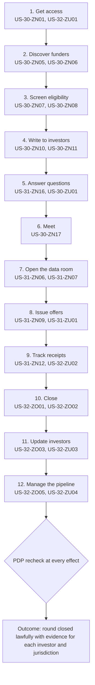

```gherkin
Feature: JN-09 Investor-relations user end-to-end journey
  Background:
    Given the persona P21 holds R03 in the INV product
    And AppNAI subscribed to Investment Automation (separate product code); "Seed 2027" registered under IN s.42

  @e2e @journey @happy @sec
  Scenario Outline: JN-09-E2E Journey permutations (exhaustive, 36 rows)
    Given the journey variant has jurisdiction "<jurisdiction>"
    And the journey variant has investor eligibility "<investor_eligibility>"
    And the journey variant has solicitation "<solicitation>"
    And the journey variant has region "<region>"
    When the persona completes steps 1–12 of JN-09
    Then the journey outcome is "<expected>"
    And every effect in the journey was rechecked by the PDP at dispatch and audited
    Examples: JN-09 variants (exhaustive enumeration; space 36; t-tuples covered 11/11)
      | ex | jurisdiction | investor_eligibility | solicitation | region | expected |
      | EX-JN-09-01 | IN s42 ✓ | eligible | relationship | IN | ALLOW: journey outcome reached |
      | EX-JN-09-02 | IN s42 ✓ | eligible | relationship | EU | ALLOW: journey outcome reached |
      | EX-JN-09-03 | IN s42 ✓ | eligible | relationship | EU→IN (misrouted) | 409 RESIDENCY_ZONE_MISMATCH |
      | EX-JN-09-04 | IN s42 ✓ | eligible | no relationship | IN | BLOCK GENERAL_SOLICITATION |
      | EX-JN-09-05 | IN s42 ✓ | eligible | no relationship | EU | BLOCK GENERAL_SOLICITATION |
      | EX-JN-09-06 | IN s42 ✓ | eligible | no relationship | EU→IN (misrouted) | 409 RESIDENCY_ZONE_MISMATCH |
      | EX-JN-09-07 | IN s42 ✓ | unverified | relationship | IN | BLOCK ELIGIBILITY_UNVERIFIED |
      | EX-JN-09-08 | IN s42 ✓ | unverified | relationship | EU | BLOCK ELIGIBILITY_UNVERIFIED |
      | EX-JN-09-09 | IN s42 ✓ | unverified | relationship | EU→IN (misrouted) | 409 RESIDENCY_ZONE_MISMATCH |
      | EX-JN-09-10 | IN s42 ✓ | unverified | no relationship | IN | BLOCK ELIGIBILITY_UNVERIFIED |
      | EX-JN-09-11 | IN s42 ✓ | unverified | no relationship | EU | BLOCK ELIGIBILITY_UNVERIFIED |
      | EX-JN-09-12 | IN s42 ✓ | unverified | no relationship | EU→IN (misrouted) | 409 RESIDENCY_ZONE_MISMATCH |
      | EX-JN-09-13 | US 506c ✓ | eligible | relationship | IN | ALLOW: journey outcome reached |
      | EX-JN-09-14 | US 506c ✓ | eligible | relationship | EU | ALLOW: journey outcome reached |
      | EX-JN-09-15 | US 506c ✓ | eligible | relationship | EU→IN (misrouted) | 409 RESIDENCY_ZONE_MISMATCH |
      | EX-JN-09-16 | US 506c ✓ | eligible | no relationship | IN | BLOCK GENERAL_SOLICITATION |
      | EX-JN-09-17 | US 506c ✓ | eligible | no relationship | EU | BLOCK GENERAL_SOLICITATION |
      | EX-JN-09-18 | US 506c ✓ | eligible | no relationship | EU→IN (misrouted) | 409 RESIDENCY_ZONE_MISMATCH |
      | EX-JN-09-19 | US 506c ✓ | unverified | relationship | IN | BLOCK ELIGIBILITY_UNVERIFIED |
      | EX-JN-09-20 | US 506c ✓ | unverified | relationship | EU | BLOCK ELIGIBILITY_UNVERIFIED |
      | EX-JN-09-21 | US 506c ✓ | unverified | relationship | EU→IN (misrouted) | 409 RESIDENCY_ZONE_MISMATCH |
      | EX-JN-09-22 | US 506c ✓ | unverified | no relationship | IN | BLOCK ELIGIBILITY_UNVERIFIED |
      | EX-JN-09-23 | US 506c ✓ | unverified | no relationship | EU | BLOCK ELIGIBILITY_UNVERIFIED |
      | EX-JN-09-24 | US 506c ✓ | unverified | no relationship | EU→IN (misrouted) | 409 RESIDENCY_ZONE_MISMATCH |
      | EX-JN-09-25 | UK FPO draft | eligible | relationship | IN | HOLD PACK_NOT_ACTIVE |
      | EX-JN-09-26 | UK FPO draft | eligible | relationship | EU | HOLD PACK_NOT_ACTIVE |
      | EX-JN-09-27 | UK FPO draft | eligible | relationship | EU→IN (misrouted) | 409 RESIDENCY_ZONE_MISMATCH |
      | EX-JN-09-28 | UK FPO draft | eligible | no relationship | IN | HOLD PACK_NOT_ACTIVE |
      | EX-JN-09-29 | UK FPO draft | eligible | no relationship | EU | HOLD PACK_NOT_ACTIVE |
      | EX-JN-09-30 | UK FPO draft | eligible | no relationship | EU→IN (misrouted) | 409 RESIDENCY_ZONE_MISMATCH |
      | EX-JN-09-31 | UK FPO draft | unverified | relationship | IN | HOLD PACK_NOT_ACTIVE |
      | EX-JN-09-32 | UK FPO draft | unverified | relationship | EU | HOLD PACK_NOT_ACTIVE |
      | EX-JN-09-33 | UK FPO draft | unverified | relationship | EU→IN (misrouted) | 409 RESIDENCY_ZONE_MISMATCH |
      | EX-JN-09-34 | UK FPO draft | unverified | no relationship | IN | HOLD PACK_NOT_ACTIVE |
      | EX-JN-09-35 | UK FPO draft | unverified | no relationship | EU | HOLD PACK_NOT_ACTIVE |
      | EX-JN-09-36 | UK FPO draft | unverified | no relationship | EU→IN (misrouted) | 409 RESIDENCY_ZONE_MISMATCH |
```

#### JN-10 Invited investor journey

| Field | Value |
|---|---|
| Journey | JN-10 |
| Persona | Invited investor (P22 (new, RECOMMENDATION-1141)) |
| Roles | R21 invited investor (Part 11.16a; see CONFLICT-1140) |
| Goal | Review an invitation, complete verification, diligence, application and payment instructions, and follow holdings and governance, privately |
| Preconditions | Priya Raman has a pre-existing relationship with AppNAI and receives a portal invitation |
| Stories touched | 15 (3 new ZU) |
| Journey outcome (oracle allow text) | application accepted and holdings visible, privately and lawfully |

| # | Stage | Touchpoint | What the persona does | What the system does (control) | Stories | FR-V12 (sample) |
|---|---|---|---|---|---|---|
| 1 | Accept the invitation | W77 | Opens the private invitation | Object grants only; MFA; region-pinned | US-31-ZN06 | FR-V12-N-015, FR-V12-N-022 |
| 2 | Ask privately | W82 | Submits a signed private enquiry | Stored as enquiry only where the pack is inactive | US-32-ZO07, US-32-ZU05 | FR-V12-O-019, FR-V12-O-020 |
| 3 | Get verified | W76 | Completes eligibility and KYC hand-off | Regulated provider; sanctions possible match held; no tip-off | US-31-ZN02, US-33-ZO11, US-33-ZU08 | FR-V12-N-016, FR-V12-N-020, FR-V12-O-035, FR-V12-O-036 |
| 4 | Do diligence | W75 | Reviews the data room and asks questions | Watermarked; fair disclosure of answers | US-31-ZN06, US-31-ZN07 | FR-V12-N-015, FR-V12-N-022, FR-V12-N-055, FR-V12-N-139 |
| 5 | Apply | W85, W86 | Reads the offer letter and applies with e-signature | Offer within caps; two approvals behind it | US-32-ZO10, US-31-ZN10 | FR-V12-N-058, FR-V12-N-143, FR-V12-O-003, FR-V12-O-004 |
| 6 | Pay | W87 | Receives payment instructions | No custody by the platform; receipt evidence only | US-31-ZU01, US-31-ZN12 | FR-V12-N-028, FR-V12-N-060, FR-V12-N-145 |
| 7 | Cross-border check | W82 | Is held for a cross-border review | Issuer IN, investor US → hold until reviewed | US-31-ZU01, US-33-ZO07 | FR-V12-N-029, FR-V12-O-031 |
| 8 | Follow holdings | W88, W90 | Sees holdings and updates | Only items within rights | US-32-ZO10, US-32-ZO03 | FR-V12-O-003, FR-V12-O-004, FR-V12-O-015 |
| 9 | Vote | W91 | Attends a shareholder meeting and votes | Notice, quorum and voting rules | US-33-ZO09 | FR-V12-O-033 |
| 10 | Exercise privacy rights | W35 | Requests a copy of personal data | DSR in the investor's residency zone | US-30-ZN04 | FR-V12-N-117, FR-V12-N-118 |

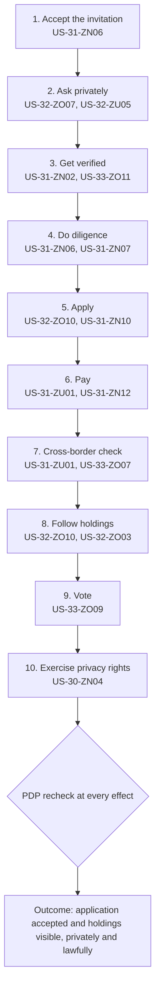

```gherkin
Feature: JN-10 Invited investor end-to-end journey
  Background:
    Given the persona P22 holds R21 invited investor (Part 11.16a
    And Priya Raman has a pre-existing relationship with AppNAI and receives a portal invitation

  @e2e @journey @happy @sec
  Scenario Outline: JN-10-E2E Journey permutations (exhaustive, 54 rows)
    Given the journey variant has investor eligibility "<investor_eligibility>"
    And the journey variant has jurisdiction "<jurisdiction>"
    And the journey variant has channel "<channel>"
    And the journey variant has region "<region>"
    When the persona completes steps 1–10 of JN-10
    Then the journey outcome is "<expected>"
    And every effect in the journey was rechecked by the PDP at dispatch and audited
    Examples: JN-10 variants (exhaustive enumeration; space 54; t-tuples covered 12/12)
      | ex | investor_eligibility | jurisdiction | channel | region | expected |
      | EX-JN-10-01 | eligible | IN s42 ✓ | C1 web | IN | ALLOW: journey outcome reached |
      | EX-JN-10-02 | eligible | IN s42 ✓ | C1 web | EU | ALLOW: journey outcome reached |
      | EX-JN-10-03 | eligible | IN s42 ✓ | C1 web | EU→IN (misrouted) | 409 RESIDENCY_ZONE_MISMATCH |
      | EX-JN-10-04 | eligible | IN s42 ✓ | C2 mobile | IN | ALLOW: journey outcome reached |
      | EX-JN-10-05 | eligible | IN s42 ✓ | C2 mobile | EU | ALLOW: journey outcome reached |
      | EX-JN-10-06 | eligible | IN s42 ✓ | C2 mobile | EU→IN (misrouted) | 409 RESIDENCY_ZONE_MISMATCH |
      | EX-JN-10-07 | eligible | US 506b ✓ | C1 web | IN | ALLOW: journey outcome reached |
      | EX-JN-10-08 | eligible | US 506b ✓ | C1 web | EU | ALLOW: journey outcome reached |
      | EX-JN-10-09 | eligible | US 506b ✓ | C1 web | EU→IN (misrouted) | 409 RESIDENCY_ZONE_MISMATCH |
      | EX-JN-10-10 | eligible | US 506b ✓ | C2 mobile | IN | ALLOW: journey outcome reached |
      | EX-JN-10-11 | eligible | US 506b ✓ | C2 mobile | EU | ALLOW: journey outcome reached |
      | EX-JN-10-12 | eligible | US 506b ✓ | C2 mobile | EU→IN (misrouted) | 409 RESIDENCY_ZONE_MISMATCH |
      | EX-JN-10-13 | eligible | UK FPO draft | C1 web | IN | HOLD PACK_NOT_ACTIVE |
      | EX-JN-10-14 | eligible | UK FPO draft | C1 web | EU | HOLD PACK_NOT_ACTIVE |
      | EX-JN-10-15 | eligible | UK FPO draft | C1 web | EU→IN (misrouted) | 409 RESIDENCY_ZONE_MISMATCH |
      | EX-JN-10-16 | eligible | UK FPO draft | C2 mobile | IN | HOLD PACK_NOT_ACTIVE |
      | EX-JN-10-17 | eligible | UK FPO draft | C2 mobile | EU | HOLD PACK_NOT_ACTIVE |
      | EX-JN-10-18 | eligible | UK FPO draft | C2 mobile | EU→IN (misrouted) | 409 RESIDENCY_ZONE_MISMATCH |
      | EX-JN-10-19 | unverified | IN s42 ✓ | C1 web | IN | BLOCK ELIGIBILITY_UNVERIFIED |
      | EX-JN-10-20 | unverified | IN s42 ✓ | C1 web | EU | BLOCK ELIGIBILITY_UNVERIFIED |
      | EX-JN-10-21 | unverified | IN s42 ✓ | C1 web | EU→IN (misrouted) | 409 RESIDENCY_ZONE_MISMATCH |
      | EX-JN-10-22 | unverified | IN s42 ✓ | C2 mobile | IN | BLOCK ELIGIBILITY_UNVERIFIED |
      | EX-JN-10-23 | unverified | IN s42 ✓ | C2 mobile | EU | BLOCK ELIGIBILITY_UNVERIFIED |
      | EX-JN-10-24 | unverified | IN s42 ✓ | C2 mobile | EU→IN (misrouted) | 409 RESIDENCY_ZONE_MISMATCH |
      | EX-JN-10-25 | unverified | US 506b ✓ | C1 web | IN | BLOCK ELIGIBILITY_UNVERIFIED |
      | EX-JN-10-26 | unverified | US 506b ✓ | C1 web | EU | BLOCK ELIGIBILITY_UNVERIFIED |
      | EX-JN-10-27 | unverified | US 506b ✓ | C1 web | EU→IN (misrouted) | 409 RESIDENCY_ZONE_MISMATCH |
      | EX-JN-10-28 | unverified | US 506b ✓ | C2 mobile | IN | BLOCK ELIGIBILITY_UNVERIFIED |
      | EX-JN-10-29 | unverified | US 506b ✓ | C2 mobile | EU | BLOCK ELIGIBILITY_UNVERIFIED |
      | EX-JN-10-30 | unverified | US 506b ✓ | C2 mobile | EU→IN (misrouted) | 409 RESIDENCY_ZONE_MISMATCH |
      | EX-JN-10-31 | unverified | UK FPO draft | C1 web | IN | BLOCK ELIGIBILITY_UNVERIFIED |
      | EX-JN-10-32 | unverified | UK FPO draft | C1 web | EU | BLOCK ELIGIBILITY_UNVERIFIED |
      | EX-JN-10-33 | unverified | UK FPO draft | C1 web | EU→IN (misrouted) | 409 RESIDENCY_ZONE_MISMATCH |
      | EX-JN-10-34 | unverified | UK FPO draft | C2 mobile | IN | BLOCK ELIGIBILITY_UNVERIFIED |
      | EX-JN-10-35 | unverified | UK FPO draft | C2 mobile | EU | BLOCK ELIGIBILITY_UNVERIFIED |
      | EX-JN-10-36 | unverified | UK FPO draft | C2 mobile | EU→IN (misrouted) | 409 RESIDENCY_ZONE_MISMATCH |
      | EX-JN-10-37 | sanctions match? | IN s42 ✓ | C1 web | IN | HOLD for R10 review |
      | EX-JN-10-38 | sanctions match? | IN s42 ✓ | C1 web | EU | HOLD for R10 review |
      | EX-JN-10-39 | sanctions match? | IN s42 ✓ | C1 web | EU→IN (misrouted) | HOLD for R10 review |
      | EX-JN-10-40 | sanctions match? | IN s42 ✓ | C2 mobile | IN | HOLD for R10 review |
      | EX-JN-10-41 | sanctions match? | IN s42 ✓ | C2 mobile | EU | HOLD for R10 review |
      | EX-JN-10-42 | sanctions match? | IN s42 ✓ | C2 mobile | EU→IN (misrouted) | HOLD for R10 review |
      | EX-JN-10-43 | sanctions match? | US 506b ✓ | C1 web | IN | HOLD for R10 review |
      | EX-JN-10-44 | sanctions match? | US 506b ✓ | C1 web | EU | HOLD for R10 review |
      | EX-JN-10-45 | sanctions match? | US 506b ✓ | C1 web | EU→IN (misrouted) | HOLD for R10 review |
      | EX-JN-10-46 | sanctions match? | US 506b ✓ | C2 mobile | IN | HOLD for R10 review |
      | EX-JN-10-47 | sanctions match? | US 506b ✓ | C2 mobile | EU | HOLD for R10 review |
      | EX-JN-10-48 | sanctions match? | US 506b ✓ | C2 mobile | EU→IN (misrouted) | HOLD for R10 review |
      | EX-JN-10-49 | sanctions match? | UK FPO draft | C1 web | IN | HOLD for R10 review |
      | EX-JN-10-50 | sanctions match? | UK FPO draft | C1 web | EU | HOLD for R10 review |
      | EX-JN-10-51 | sanctions match? | UK FPO draft | C1 web | EU→IN (misrouted) | HOLD for R10 review |
      | EX-JN-10-52 | sanctions match? | UK FPO draft | C2 mobile | IN | HOLD for R10 review |
      | EX-JN-10-53 | sanctions match? | UK FPO draft | C2 mobile | EU | HOLD for R10 review |
      | EX-JN-10-54 | sanctions match? | UK FPO draft | C2 mobile | EU→IN (misrouted) | HOLD for R10 review |
```

#### JN-11 External customer journey

| Field | Value |
|---|---|
| Journey | JN-11 |
| Persona | External customer (P14 (visitor P15 before sign-in)) |
| Roles | R18 Anonymous Visitor → R16 External Customer |
| Goal | Evaluate the service on the neutral storefront, enquire, talk to the AI assistant or voice agent, request a quote, get support and give feedback |
| Preconditions | Public snapshot published for en-IN; Sunrise Clinics is a prospect |
| Stories touched | 25 (4 new ZU) |
| Journey outcome (oracle allow text) | enquiry answered, quote requested and support resolved with consent respected |

| # | Stage | Touchpoint | What the persona does | What the system does (control) | Stories | FR-V12 (sample) |
|---|---|---|---|---|---|---|
| 1 | Browse | W01–W05 | Browses the neutral catalogue of 39 services | No customer data; published snapshot only | US-19-YA01, US-19-YG01, US-19-YG04 | FR-V12-A-050, FR-V12-A-051, FR-V12-G-001, FR-V12-G-004 |
| 2 | See examples | W05, W08 | Views fictional workflow output previews | Labelled synthetic and AI-disclosed | US-19-ZU01, US-19-YG35 | FR-V12-A-058, FR-V12-G-106 |
| 3 | Assess maturity | W11 | Takes the maturity assessment | No mandatory personal data; reproducible score | US-19-ZU01, US-19-YG37 | FR-V12-A-060, FR-V12-G-108 |
| 4 | Consent to cookies | W30 | Chooses cookie preferences | Notice version recorded; analytics only with consent | US-03-YG07, US-12-ZU01 | FR-V12-G-096, FR-V12-I-045 |
| 5 | Enquire | W12 | Sends an enquiry | Accessible validation; consent captured | US-19-YG12, US-19-YG32 | FR-V12-G-012, FR-V12-G-097 |
| 6 | Call the company | phone | Calls and is answered by the AI voice agent | AI self-identifies; human handoff on request | US-22-ZQ01, US-22-ZQ02, US-22-ZQ07 | FR-V12-B-060, FR-V12-B-064 |
| 7 | Request a quote | W14 | Requests a quotation | Quote request only; no checkout | US-20-YG17 | FR-V12-G-105 |
| 8 | Sign in | W21, W22 | Signs in to the portal | Own records only | US-19-YG21, US-19-YG22 | FR-V12-G-021, FR-V12-G-022 |
| 9 | Get support | W28 | Opens a support case | SLA clock from entitlement; grounded answers | US-27-YB01, US-27-YB03, US-20-YD01 | FR-V12-B-086, FR-V12-B-087, FR-V12-D-133 |
| 10 | Self-help | W08 | Reads help articles | Top 50 tasks per launch locale | US-19-ZU03, US-20-YK06 | FR-V12-A-144, FR-V12-K-006 |
| 11 | Manage preferences | W29 | Opts out of SMS | STOP cancels queued messages | US-03-YG01, US-23-YB03 | FR-V12-B-098, FR-V12-B-099, FR-V12-G-029 |
| 12 | Give feedback | W28 | Answers CSAT | Missing response is not counted as satisfied | US-16-ZU01, US-16-YI01 | FR-V12-A-153, FR-V12-I-047 |

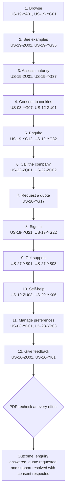

```gherkin
Feature: JN-11 External customer end-to-end journey
  Background:
    Given the persona P14 holds R18 Anonymous Visitor → R16 External Customer
    And Public snapshot published for en-IN; Sunrise Clinics is a prospect

  @e2e @journey @happy @sec
  Scenario Outline: JN-11-E2E Journey permutations (pairwise, 15 rows)
    Given the journey variant has channel "<channel>"
    And the journey variant has locale "<locale>"
    And the journey variant has consent "<consent>"
    And the journey variant has region "<region>"
    When the persona completes steps 1–12 of JN-11
    Then the journey outcome is "<expected>"
    And every effect in the journey was rechecked by the PDP at dispatch and audited
    Examples: JN-11 variants (pairwise (2-way) greedy covering array, constraint-aware, seed 511; space 108; t-tuples covered 76/76)
      | ex | channel | locale | consent | region | expected |
      | EX-JN-11-01 | C1 web | de-DE | withdrawn | EU→IN (misrouted) | 409 RESIDENCY_ZONE_MISMATCH |
      | EX-JN-11-02 | C2 360 px | en-IN | unknown | EU | HOLD CONSENT_UNKNOWN |
      | EX-JN-11-03 | AT reader | hi-IN | valid | IN | ALLOW: journey outcome reached |
      | EX-JN-11-04 | phone | en-IN | valid | EU→IN (misrouted) | 409 RESIDENCY_ZONE_MISMATCH |
      | EX-JN-11-05 | phone | de-DE | unknown | IN | HOLD CONSENT_UNKNOWN |
      | EX-JN-11-06 | phone | hi-IN | withdrawn | EU | HOLD CONSENT_WITHDRAWN |
      | EX-JN-11-07 | C2 360 px | hi-IN | unknown | EU→IN (misrouted) | 409 RESIDENCY_ZONE_MISMATCH |
      | EX-JN-11-08 | AT reader | en-IN | withdrawn | IN | HOLD CONSENT_WITHDRAWN |
      | EX-JN-11-09 | C2 360 px | de-DE | valid | EU | ALLOW: journey outcome reached |
      | EX-JN-11-10 | AT reader | de-DE | unknown | EU | HOLD CONSENT_UNKNOWN |
      | EX-JN-11-11 | C1 web | hi-IN | valid | EU | ALLOW: journey outcome reached |
      | EX-JN-11-12 | C1 web | en-IN | unknown | IN | HOLD CONSENT_UNKNOWN |
      | EX-JN-11-13 | C2 360 px | hi-IN | withdrawn | IN | HOLD CONSENT_WITHDRAWN |
      | EX-JN-11-14 | AT reader | hi-IN | unknown | EU→IN (misrouted) | 409 RESIDENCY_ZONE_MISMATCH |
      | EX-JN-11-15 | C1 web | en-IN | valid | IN | ALLOW: journey outcome reached |
```

#### JN-12 Partner journey

| Field | Value |
|---|---|
| Journey | JN-12 |
| Persona | Partner (P23 partner / reseller (new, RECOMMENDATION-1141); P17 agency operator) |
| Roles | R16 with partner grant; R21 agency operator per Part 2.6 |
| Goal | Join the partner programme, register and co-sell deals, interoperate through agents and marketplaces, and get settled, with separate consent and billing ownership |
| Preconditions | AppNAI runs SM-SVC-32 partner co-selling; partner "Bluepeak Systems LLP" applies |
| Stories touched | 14 (1 new ZU) |
| Journey outcome (oracle allow text) | deal co-sold and settled with partner data kept separate |

| # | Stage | Touchpoint | What the persona does | What the system does (control) | Stories | FR-V12 (sample) |
|---|---|---|---|---|---|---|
| 1 | Join the programme | A176 | Signs the partner agreement | Separate tenant consent and billing ownership | US-16-YB03, US-16-ZU06 | FR-V12-B-085, FR-V12-K-157 |
| 2 | Get enabled | A176 | Completes enablement | Training records; scoped assets | US-16-YD03 | FR-V12-D-132 |
| 3 | Register a deal | A176 | Registers a deal | Conflict check; owner approval | US-16-YD03, US-16-YG03 | FR-V12-D-132, FR-V12-G-046 |
| 4 | Co-sell | A176 | Shares account plans | Only data covered by the agreement | US-16-YG03 | FR-V12-G-046 |
| 5 | Connect partner agents | A172 | Connects the partner's AI agent for quotations | Verified agent identity; trust tier; untrusted content sanitised | US-24-ZP02, US-24-ZP03, US-24-YB07 | FR-V12-B-071, FR-V12-B-072, FR-V12-P-070, FR-V12-P-071 |
| 6 | List on marketplaces | A175 | Lists offerings on a marketplace | Approved price version only | US-25-YB01, US-25-YB02 | FR-V12-B-081, FR-V12-B-082 |
| 7 | Supply | A183 | Acts as a supplier in an RFQ | Qualification rules; approved PO; three-way match | US-26-YB01, US-26-YB03 | FR-V12-B-102, FR-V12-B-103 |
| 8 | Integrate | A008 | Syncs CRM records | Field ownership; protected consent | US-07-ZR12 | FR-V12-R-063, FR-V12-R-066 |
| 9 | Run managed service | A099 | Works inside a client tenant under delegation | Delegation grant; one client per session | US-20-YE16, US-16-ZU06 | FR-V12-E-085, FR-V12-E-087, FR-V12-K-157 |
| 10 | Get settled | A074 | Receives commission settlement | Reconciled settlement | US-15-ZP02 | FR-V12-P-062, FR-V12-P-063 |

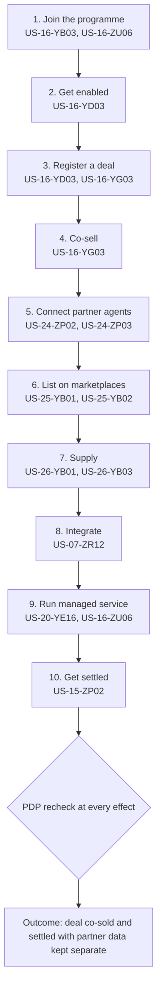

```gherkin
Feature: JN-12 Partner end-to-end journey
  Background:
    Given the persona P23 holds R16 with partner grant
    And AppNAI runs SM-SVC-32 partner co-selling; partner "Bluepeak Systems LLP" applies

  @e2e @journey @happy @sec
  Scenario Outline: JN-12-E2E Journey permutations (pairwise, 15 rows)
    Given the journey variant has region "<region>"
    And the journey variant has jurisdiction "<jurisdiction>"
    And the journey variant has autonomy/mandate "<autonomy_mandate>"
    And the journey variant has channel "<channel>"
    When the persona completes steps 1–10 of JN-12
    Then the journey outcome is "<expected>"
    And every effect in the journey was rechecked by the PDP at dispatch and audited
    Examples: JN-12 variants (pairwise (2-way) greedy covering array, constraint-aware, seed 512; space 108; t-tuples covered 76/76)
      | ex | region | jurisdiction | autonomy_mandate | channel | expected |
      | EX-JN-12-01 | IN | UK draft | L1 | C1 web | HOLD PACK_NOT_ACTIVE |
      | EX-JN-12-02 | EU→IN (misrouted) | EU ✓ | L3 revoked | C3 API | 409 RESIDENCY_ZONE_MISMATCH |
      | EX-JN-12-03 | EU | IN ✓ | L2 | agent-to-agent | PENDING_APPROVAL |
      | EX-JN-12-04 | EU→IN (misrouted) | IN ✓ | L3 mandate | C1 web | 409 RESIDENCY_ZONE_MISMATCH |
      | EX-JN-12-05 | IN | EU ✓ | L3 mandate | agent-to-agent | ALLOW: journey outcome reached |
      | EX-JN-12-06 | EU | UK draft | L3 mandate | C3 API | HOLD PACK_NOT_ACTIVE |
      | EX-JN-12-07 | EU | EU ✓ | L3 revoked | C1 web | ROUTE MANDATE_INACTIVE |
      | EX-JN-12-08 | EU→IN (misrouted) | UK draft | L1 | agent-to-agent | 409 RESIDENCY_ZONE_MISMATCH |
      | EX-JN-12-09 | IN | IN ✓ | L3 revoked | C3 API | ROUTE MANDATE_INACTIVE |
      | EX-JN-12-10 | EU | IN ✓ | L1 | C3 API | PENDING_APPROVAL |
      | EX-JN-12-11 | IN | EU ✓ | L2 | C1 web | PENDING_APPROVAL |
      | EX-JN-12-12 | EU→IN (misrouted) | UK draft | L2 | C3 API | 409 RESIDENCY_ZONE_MISMATCH |
      | EX-JN-12-13 | IN | UK draft | L3 revoked | agent-to-agent | HOLD PACK_NOT_ACTIVE |
      | EX-JN-12-14 | EU→IN (misrouted) | EU ✓ | L1 | C3 API | 409 RESIDENCY_ZONE_MISMATCH |
      | EX-JN-12-15 | IN | IN ✓ | L3 mandate | C1 web | ALLOW: journey outcome reached |
```

#### 11.22.5.5.13 Journey coverage summary

| Journey | Steps | Stories touched | FR-V12 (sample) referenced |
|---|---|---|---|
| JN-01 | 11 | 33 | 46 |
| JN-02 | 11 | 30 | 39 |
| JN-03 | 12 | 26 | 41 |
| JN-04 | 9 | 22 | 28 |
| JN-05 | 9 | 14 | 19 |
| JN-06 | 10 | 20 | 30 |
| JN-07 | 10 | 17 | 26 |
| JN-08 | 10 | 21 | 25 |
| JN-09 | 12 | 25 | 35 |
| JN-10 | 10 | 15 | 23 |
| JN-11 | 12 | 25 | 27 |
| JN-12 | 10 | 14 | 20 |
| **Total** | **126** | **262 (distinct per journey, summed)** | |


## Quality gate: Batch 11.22e

| # | Check | Result | Notes and fixes applied |
|---|---|---|---|
| 1 | Every requirement traced to a source | **Pass** | Every journey step names its stories; every story ID and every FR reference is resolved and checked by the build |
| 2 | Assumptions, gaps and conflicts tagged and logged | **Pass** | Tags from 1140–1159 only; register in §11.22.9 (last file of Batch 11.22) |
| 3 | IDs unique and consistent with earlier parts | **Pass** | US-<EP>-ZU<nn> unique per epic; AC and EX IDs derived; epics EP-01…EP-33 as defined; EP-34 new |
| 4 | No story lacks AC; no requirement lacks a test | **Pass** | Every journey has an end-to-end Scenario Outline with generated pairwise Examples; every referenced story has AC |
| 5 | Negative, edge, security and accessibility cases covered | **Pass** | Journeys include denial, hold and accessibility variants (assistive technology, 360 px) |
| 6 | No agent lacks guardrail, fallback, KPI and cost estimate | **N/A** | N/A – no new agents; AI stories reuse the registry, gateway and eval gates |
| 7 | Time-sensitive facts flagged "verify" with as-of date | **Pass** | No prices or model versions stated; regulatory items defer to counsel-approved packs (verify at implementation, as of 28 Nov 2026) |
| 8 | No restricted data routed to free-tier models | **Pass** | Restricted personal data appears only as a blocking value in MU05 (DEC-007, DEC-788) |
| 9 | Consistent with earlier parts | **Pass** | Template of Part 5.1a copied; V12-B decisions DEC-770…791 applied; inconsistencies reported, not edited |

**Status: Part 11 Batch 11.22e complete (12 journeys). Continue with Batch 11.22f.**
