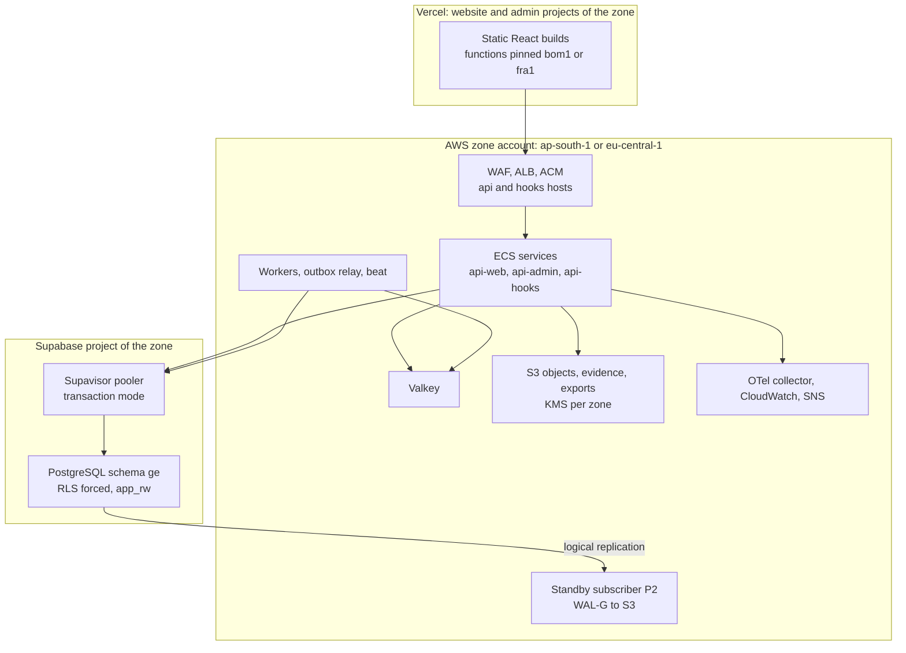

# AI Growth Engine: Employee Sales & Marketing Automation
## Application Blueprint: PART 11 (Batch 11.24b), Developer Build & Production Deployment Pack (single source of truth): Consolidated Database DDL, Configuration and Secrets Catalogue, Environments and Infrastructure as Code

| Field | Value |
|---|---|
| Document | Part 11.24b: consolidated PostgreSQL schema and ordered migration set (§11.24.4), configuration, secrets, feature flags, rule-pack gates and the per-jurisdiction activation matrix (§11.24.5), and environments, Terraform/OpenTofu modules, networking and secrets management for the IN and EU zones (§11.24.6) |
| Version | 1.0 · 28 Nov 2026 |
| Baseline | As Part 11.24a |
| Precedence | As Part 11.24a (DEC-980) |

---

## 11.24.4 Consolidated database DDL

### 11.24.4.1 Result in one table

`final/build/schema.sql` is a single ordered migration set (16 files in `final/build/migrations/`) generated by `w_02b_build_schema.py`. Each statement was applied to a scratch PostgreSQL 16.15 database during generation; the final file was then applied **from empty, in one transaction with `ON_ERROR_STOP`, to an IN-zone and an EU-zone database**, and 42 blocking database tests were run (§11.24.4.8). All 42 pass.

| Object | Count (PostgreSQL catalog after apply) |
|---|---|
| Tables (schema ge) | 470 |
| Views (compatibility, security_invoker) | 128 |
| Columns | 9289 |
| Tables with ENABLE + FORCE RLS | 430 |
| Platform tables (no tenant column; allowlisted; grants only) | 40 |
| RLS policies | 1610 |
| Indexes | 1894 |
| Foreign keys | 615 |
| CHECK constraints | 1681 |
| Triggers (non-internal) | 682 |
| Functions in ge | 31 |
| SQL statements in schema.sql | 9361 |
| Statements deferred (failed to apply) | 0 |
| Statements intentionally skipped (reasoned, listed in §11.24.4.9) | 27 |

### 11.24.4.2 Physical schema lineage (ADR-280, DEC-981)

Two executable lineages exist in the blueprint: the **typed blueprint model** (Part 3.3 199 entities, Part 3.6 four additions, column dictionaries, prefixed names such as `crm_deal`) and the **V12 executable spine** (FSD V12 Appendix C/C2 as corrected by Part 11.9b DDL-V12-I "Appendix C3", then extended by Part 11.19a/b DDL-V12-R), which uses V12 names such as `tenant`, `company`, `workflow_run`, `api_key`. DEC-660 asked for prefixed physical names everywhere, but DDL-V12-R (written later) targets the V12 names directly [CONFLICT-1209]. The consolidated schema therefore uses one rule per lineage, so that **every verified statement of both lineages runs unchanged**:

| Entity group | Physical table | Created in | How the other name resolves | Rule |
|---|---|---|---|---|
| 48 V12 core and enterprise tables (Appendix C 29 + C2 19) | V12 name (`tenant`, `company`, `workflow_run`, `outbox`, `audit_event`, `api_key`, …) | V0003 | Part 3.3 name is a `security_invoker` view (e.g. `ten_tenant`, `aut_run`, `ops_outbox`); Part 3.3 columns that the V12 table lacks are added in V0008 | DDL-V12-I/R statements and verified tests stay valid |
| 18 C3 tables and 37 DDL-V12-R tables | V12 / Part 11.19 name | V0004, V0006 | — | As written in Parts 11.9b and 11.19a/b |
| 89 generic V12 domain tables (`growth_*`, `sales_*`) | **Not created**; the typed Part 3.3 table is physical (DEC-661) with `schema_ref`, `evidence_refs`, `payload` and the registry trigger | V0007/V0008 | V12 name is a `security_invoker` view with the V12 generic shape (`company_id`, `version`, `status`, `payload`) | V12 DTO reads keep working; RLS of the typed table applies (TC-W-DB-20) |
| Remaining Part 3.3 / 3.6 entities | Prefixed blueprint name | V0007 | — | Part 3.3 conventions (STD sets, scope classes, immutability) |
| New tables of Parts 11.16a/c, 11.17b, 11.18b | Name given in the part (`inv_*`, `mandate*`, `voice_*`, …) | V0007 | — | STD-S + STD-W + `region` with residency guard |

| Domain (table prefix) | Tables |
|---|---|
| Investment Automation (11.16) | 122 |
| V12 spine and platform (Appendix C/C2/C3, DDL-V12-R) | 116 |
| Intelligence | 28 |
| Commerce | 24 |
| Marketing | 22 |
| Voice (11.18) | 19 |
| Engagement | 16 |
| CRM | 13 |
| Lifecycle | 13 |
| AI and cost | 12 |
| SaaS lifecycle | 12 |
| Catalogue and knowledge | 11 |
| Mandates (11.17) | 10 |
| Automation | 9 |
| Analytics | 8 |
| Governance | 8 |
| Platform operations | 8 |
| Tenancy (Part 3.3) | 8 |
| Reference data | 5 |
| Voice coaching (11.18) | 3 |
| Integrations | 3 |

**Tables by origin (first CREATE statement).**

| Created in / source | Tables |
|---|---|
| V0007 Part 3.3 §3.3.3.2 + §3.3.7 | 117 |
| V0007 Part 11.16a §11.16.5.10 | 71 |
| V0007 Part 3.3 §3.3.3.2 | 57 |
| V0007 Part 11.16c §11.16.15.18 | 51 |
| V0003 FSD V12 Appendix C/C2 (Part 11.9a/b) | 45 |
| V0006 Part 11.19a/b DDL-V12-R | 36 |
| V0007 Part 11.17b §11.17.9.2 | 30 |
| V0007 Part 11.18b §11.18.5.24 | 21 |
| V0004 FSD V12 Appendix C/C2 (Part 11.9a/b) | 18 |
| V0007 Part 3.3 §3.3.3.3 | 13 |
| V0007 Part 3.6b §3.6.5 | 4 |
| V0008a  | 2 |
| V0003 Part 3.3 §3.3.3.2 | 1 |
| V0005 Part 11.24 reconciliation | 1 |
| V0007 Part 11.17b §11.17.9.2 (ER) | 1 |
| V0003 Part 3.3 §3.3.3.2 + §3.3.7 | 1 |
| V0006 Part 11.18b §11.18.5.24 | 1 |

The per-table index is `final/build/table_index.csv` (table, migration, source, ENT, scope, immutability profile, column count, forced RLS, policy count, Part 3.3 alias view).

### 11.24.4.3 Migration order

| # | Migration file (final/build/migrations/) | Content | Statements | CREATE TABLE |
|---|---|---|---|---|
| 1 | `V0001__extensions_schema_roles.sql` | Extensions (schema extensions), schema ge, ten canonical roles, Data API closure, default privileges | 42 | 0 |
| 2 | `V0002__context_functions.sql` | Context functions: app_tenant(), app_company_ids(), app_write_company(), app_actor_*(), app_zone(), set_ctx(), require_ctx(), ctx_* aliases | 15 | 0 |
| 3 | `V0003__v12_core_and_enterprise_spine.sql` | FSD V12 Appendix C core (29) + C2 enterprise (19) tables; customer FOR ALL policies dropped; 89 generic growth_* tables not created (DEC-661) | 116 | 48 |
| 4 | `V0004__ddl_v12_i_appendix_c3_controls.sql` | Appendix C3 (Part 11.9b): roles grants, scope integrity, 80 CHECKs, residency guard, SoD, audit hash chain, breach clocks, crypto-shredding, registry, 18 tables, verified policies and indexes | 648 | 18 |
| 5 | `V0005__reconcile_v12_lineage_for_ddl_v12_r.sql` | Reconciliation patch: columns DDL-V12-R expects (tenant.kind, jurisdiction_pack.market/pack_code/counsel_signoff_ref, ai_model evidence columns), app_user | 15 | 1 |
| 6 | `V0006__ddl_v12_r_platform_decisions.sql` | DDL-V12-R parts 1–6 (Part 11.19a/b): identity, SCIM, roles, API keys, OAuth clients, webhooks, sandbox, connectors, CRM sync, DLT, Vercel conformance, recovery, registry, benchmarks | 110 | 37 |
| 7 | `V0007__typed_tables_blueprint_and_v12b.sql` | Typed tables: Part 3.3 (199 entities + 13 association tables), Part 3.6 ENT-ENH-E-01…04, V12-B tables of Parts 11.16a/c, 11.17b, 11.18b | 758 | 365 |
| 8 | `V0008__blueprint_columns_and_part_3_6_deltas.sql` | Part 3.3 columns on the V12-realised entities; Part 3.6b ALTER deltas; DEC-661 common columns (schema_ref, evidence_refs, payload) | 324 | 0 |
| 9 | `V0008a__activation_gates_and_rule_pack_requirements.sql` | Rule-pack requirements (capability × jurisdiction × pack), tenant_activation with two-person check and DB activation gate; 32 packs seeded as Draft | 120 | 2 |
| 10 | `V0009__constraints_and_foreign_keys.sql` | CHECK and UNIQUE constraints from the dictionaries; foreign keys (dictionary arrows, composite scope keys, Part 3.6b) | 2053 | 0 |
| 11 | `V0010__triggers.sql` | Triggers: revision/updated_at, append-only, versioned freeze, domain registry (typed), row residency guard | 669 | 0 |
| 12 | `V0011__rls_policies_and_grants.sql` | RLS ENABLE + FORCE, command-split policies (P-CO, P-CO-NULLABLE, P-TEN, P-X, portal object grants), grants per role, platform allowlist | 3724 | 1 |
| 13 | `V0012__indexes.sql` | Indexes: FK support, Part 3.3 §3.3.8.2 key indexes, Part 3.6b IX-ENH-E, list indexes (tenant, company, state, updated_at) | 486 | 0 |
| 14 | `V0013__compatibility_views.sql` | Compatibility views (security_invoker): 89 V12 logical names over typed tables; Part 3.3 names over V12 spine tables | 257 | 0 |
| 15 | `V0014__seed_reference_data.sql` | Seed: currencies, recovery paths per zone (P1/P2/P3), Vercel edge projects (bom1/fra1) | 20 | 0 |
| 16 | `V0015__ci_assertions.sql` | CI assertions: no RLS bypass, forced RLS, SELECT policy on every tenant table, no Data API grants | 4 | 0 |
|  | **Total** |  | **9361** | **472** |

**Ordering rationale** (Part 3.3 §3.3.5.11 extended): extensions and roles → context functions → V12 spine (FK parents of everything) → verified C3 controls → reconciliation patch → DDL-V12-R → typed tables (no FKs inline) → columns and deltas → activation gates → constraints and all foreign keys in one pass (cycles need no special order because all tables exist; back-pointers listed in Part 3.3 §3.3.5.11 are `DEFERRABLE INITIALLY DEFERRED`) → triggers → RLS and grants → indexes → views → seed → assertions. On a populated database, V0012 indexes must be built with `CREATE INDEX CONCURRENTLY` outside a transaction and every DDL statement runs with `lock_timeout = 5s` (Part 4.3 §4.37; MG-02).

### 11.24.4.4 Roles and the canonical application role `app_rw` (DEC-778, DEC-983)

| Role | LOGIN | BYPASSRLS | Used by | Privileges in the generated schema |
|---|---|---|---|---|
| `app_owner` | no | no | Owns schema `ge` (V0001) | DDL via `SET ROLE` from `app_migrator`; RLS is FORCEd so the owner path is filtered too |
| `app_migrator` | yes (CI runner IPs only) | no | CI migration job | Member of `app_owner`; never in runtime secrets |
| **`app_rw`** | yes | **no** | Django API (one canonical name; formerly `ge_app` = V12 `app_user`) | SELECT/INSERT/UPDATE on mutable tenant tables; SELECT/INSERT on append-only tables; SELECT on platform tables; no DELETE/TRUNCATE (TC-W-DB-09) |
| `app_worker` | yes | no | Celery workers, outbox relay, beat | As `app_rw` + INSERT on worker-only platform tables |
| `app_readonly` | yes | no | Reporting, JIT support | SELECT; RLS applies |
| `app_retention` | yes | no | Retention purge | SELECT + DELETE under `app.retention_run_id` (policy `rls_<t>__retention_delete`) |
| `app_audit_writer` | no | no | `fn_append_audit()` owner | INSERT on `audit_event` via SECURITY DEFINER only |
| `app_platform_sec` | yes | no | Security findings, incidents, packs | Write on PLATSEC tables |
| `app_bench` | yes | no | AU-299 | `benchmark_*` only; `bench_contribute()` |
| `app_registry` | yes | no | Model registry service | Registry tables |
| `service_role`, `postgres` (Supabase) | key / yes | yes | **Break-glass only** (two-person, ≤ 2 h) | No grant on `ge` (TC-W-DB-06) |
| `anon`, `authenticated` (Supabase) | Data API | no | **Nobody** | `REVOKE ALL` (TC-W-DB-35) |

### 11.24.4.5 Row-level security

Every table with a `tenant_id` column has `ENABLE` and `FORCE ROW LEVEL SECURITY` and command-split policies (no `FOR ALL` policy on PUBLIC). Policies wrap the context helpers in scalar sub-selects so PostgreSQL evaluates them once per statement.

| Template | SELECT `USING` | INSERT / UPDATE `WITH CHECK` | Applied when |
|---|---|---|---|
| P-CO | `tenant_id = (SELECT ge.app_tenant()) AND <company col> = ANY ((SELECT ge.app_company_ids()))` | tenant AND `<company col> = (SELECT ge.app_write_company())` | Company column NOT NULL |
| P-CO-NULLABLE | as P-CO, or company column NULL (tenant-wide row) | write company, or NULL by `internal`/`service` actor | Company column nullable (scope T) |
| P-TEN | `tenant_id = (SELECT ge.app_tenant())` | same | No company column |
| P-X | `tenant_id IS NULL OR tenant_id = (SELECT ge.app_tenant())` | `tenant_id = (SELECT ge.app_tenant())` (platform defaults written by `app_owner` only) | Platform defaults + tenant overrides |
| Portal object grant (additional SELECT) | tenant AND `actor_kind = 'portal'` AND an unexpired, unrevoked `ten_portal_grant` for the object and the user | — | `com_proposal`, `com_quote`, `com_contract`, `com_invoice`, `com_order`, `lcy_onboarding`, `lcy_renewal`, `saas_service_request` |
| Retention delete | tenant AND `app.retention_run_id` set | — (DELETE, role `app_retention`) | Every tenant table |
| Part 11.9b C3 (kept verbatim) | P-TEN-SELF, P-PORTFOLIO, P-JOURNEY, service insert, platform split | per Part 11.9b | 49 V12 tables |
| Benchmark | `state = 'published'` for `app_rw`; all for `app_bench` | `app_bench` only | `benchmark_cell` |

| Policy template | Tables |
|---|---|
| P-TEN | 19 |
| P-CO | 330 |
| P-CO-NULLABLE | 31 |
| Part 11.9b C3 (verified, kept) | 49 |
| platform (grants only) | 38 |
| benchmark (published-only read) | 1 |
| platform (app_bench only) | 2 |
| portal object-grant predicate (additional) | 8 |

### 11.24.4.6 Integrity controls (triggers and checks)

| Control | Implementation | Tables | Test |
|---|---|---|---|
| Optimistic concurrency | `ge.fn_touch_revision()` BEFORE UPDATE: requires `revision = OLD.revision + 1`, freezes `id`/`created_at`, sets `updated_at` | Typed M/F/V tables | TC-W-DB-28/29 |
| Append-only | `fn_forbid_mutation()` (C3) BEFORE UPDATE OR DELETE; purge only by `app_retention` with a run ID | Part 3.3 Imm. A tables, V12 ledgers, `audit_event`, `consent_record`, `ai_usage_event`, `eval_run` | TC-W-DB-27 |
| Versioned freeze | `ge.fn_freeze_versioned()`: approved/published/active/superseded rows change only to superseded/expired/retired | Part 3.3 Imm. V tables with `status` | TC-W-DB-36 |
| Audit hash chain | `fn_append_audit()` SECURITY DEFINER, per-tenant advisory lock, SHA-256 chain; `fn_verify_audit_chain()` | `audit_event` | TC-W-DB-30/31 |
| Domain registry (DEC-661) | `ge.fn_validate_typed_domain_row()`: payload requires an approved `schema_ref`; status, required keys and size validated | 82 typed domain tables | TC-W-DB-32 |
| Separation of duties | `enforce_sod()`, `enforce_sod_assignment()` (C3); DDL-V12-R conflict pairs (DEC-898) | `role_permission`, `user_role_assignment` | Part 11.9b TC-V12-I-005…007 |
| Effects forward-only | `fn_effect_transition()` (C3) | `effect` | Part 11.9b |
| Breach clocks | `fn_incident_deadline()`: CERT-In ≤ 6 h, GDPR/DPDP ≤ 72 h (verify) | `incident_notification` | Part 11.9b |
| Crypto-shredding | `fn_tenant_key_revoked()` destroys wrapped DEKs | `tenant_key_config`, `tenant_data_key` | Part 11.9b |
| SSO enforcement guard | `enforce_sso_guard()` (DDL-V12-R-01) | `idp_connection` | TC-W-DB-33 |
| Connector market gate | `connector_pack_guard()` (DDL-V12-R-09, corrected v1.2) | `connector_installation` | Part 11.19a; [CONFLICT-1215] resolved by DEC-1000 (Part 11.25) |
| Activation gate | `ge.fn_activation_gate()` + two-person CHECK (V0008a) | `tenant_activation` | TC-W-DB-39…42 |

| Trigger family (generated in V0010) | Tables |
|---|---|
| revision | 304 |
| residency | 179 |
| versioned_freeze | 36 |
| append_only | 61 |
| domain_registry | 82 |

### 11.24.4.7 EU/IN residency guards (DEC-772, CJ-TC-09)

Each residency zone has its **own** Supabase project, AWS account set and Vercel projects; no table is replicated between zones. Inside the database the guards are layered:

| # | Guard | Mechanism | Rejects | Test |
|---|---|---|---|---|
| RG-1 | Database zone pin | `ALTER DATABASE … SET app.deployment_region = 'IN'|'EU'` at provisioning (IaC), read by `ge.app_zone()` which fails closed when unset | Any context or row check in an unconfigured database | — |
| RG-2 | Tenant region at onboarding | C3-05 `fn_tenant_region_guard()`: `tenant.data_region` must equal the database zone; immutable after insert | EU tenant in IN database and vice versa; later region change | TC-W-DB-21, 22, 25, 26 |
| RG-3 | Request zone | `ge.set_ctx(…, p_zone)` raises `RESIDENCY_ZONE_MISMATCH` when the API's `ZONE` differs from the database zone | Misrouted request or misconfigured task | TC-W-DB-23 |
| RG-4 | Row zone | `ge.fn_row_region_guard()` on 179 tables with `region`/`zone` columns (V12-B tables default `region = ge.app_zone()`) | A row labelled for the other zone | TC-W-DB-24 |
| RG-5 | Scope FKs | Every company-scoped row references `company (tenant_id, company_id)` → `tenant` of this database | Rows for tenants that do not live in this zone | FK |
| RG-6 | Backups and DR | Restore targets only in the same zone (DR-R5: never restore outside the zone); WAL-G CRR to the in-zone secondary region | Cross-zone restore | DR drill (§11.24.8.8) |
| RG-7 | Edge and model calls | Vercel functions pinned bom1/fra1 (AU-296); model registry rows per zone (`ai_model_region`) | Personal data processed outside zone | AU-296, AU-298 |

### 11.24.4.8 Database verification (executed 28 Nov 2026 on PostgreSQL 16.15)

| Zone database | Exit code | Seconds | Mode |
|---|---|---|---|
| IN | 0 | 2.8 | psql -1 -v ON_ERROR_STOP=1 (single transaction) |
| EU | 0 | 3.3 | psql -1 -v ON_ERROR_STOP=1 (single transaction) |

| Test | Check | Result |
|---|---|---|
| TC-W-DB-01 | schema.sql applies in one transaction with ON_ERROR_STOP on a clean IN database | PASS |
| TC-W-DB-02 | schema.sql applies in one transaction with ON_ERROR_STOP on a clean EU database | PASS |
| TC-W-DB-03 | No application role has BYPASSRLS or SUPERUSER (DEC-778) | PASS |
| TC-W-DB-04 | Every tenant table has ENABLE + FORCE row-level security | PASS |
| TC-W-DB-05 | Every tenant table has a SELECT policy | PASS |
| TC-W-DB-06 | Data API roles (anon, authenticated) and service_role hold no grant on schema ge (SA-01, SA-02) | PASS |
| TC-W-DB-07 | No FOR ALL policy applies to PUBLIC (command-split policies only; Part 11.9b F2) | PASS |
| TC-W-DB-08 | Every foreign key has a supporting index (Part 11.9b F4) | PASS |
| TC-W-DB-09 | app_rw and app_worker hold no DELETE or TRUNCATE grant (archive, never delete; SA-08) | PASS |
| TC-W-DB-10 | Missing tenant context fails closed (42501) on a company-scoped table | PASS |
| TC-W-DB-11 | app_rw inserts and reads its own company row through set_ctx (P-CO) | PASS |
| TC-W-DB-12 | Company isolation inside one tenant: company A2 session sees 0 rows of A1 (Part 11.9b F1, MT-09) | PASS |
| TC-W-DB-13 | Tenant isolation: tenant B session sees 0 rows of tenant A | PASS |
| TC-W-DB-14 | Write into a company outside the write scope is rejected by WITH CHECK | PASS |
| TC-W-DB-15 | Write into another tenant is rejected by WITH CHECK | PASS |
| TC-W-DB-16 | set_ctx rejects a write company outside the session company list | PASS |
| TC-W-DB-17 | app_rw cannot DELETE business rows (no grant) | PASS |
| TC-W-DB-18 | Portfolio read (two companies, no write company) sees the union and cannot write | PASS |
| TC-W-DB-19 | Portfolio session (no write company) cannot insert | PASS |
| TC-W-DB-20 | V12 compatibility view growth_deal is security_invoker (RLS of crm_deal applies) | PASS |
| TC-W-DB-21 | IN database rejects an EU tenant (CJ-TC-09 IN→EU direction) | PASS |
| TC-W-DB-22 | Tenant data_region is immutable after onboarding (CJ-R09) | PASS |
| TC-W-DB-23 | set_ctx rejects a request routed to the wrong zone (RESIDENCY_ZONE_MISMATCH) | PASS |
| TC-W-DB-24 | Row-level residency guard rejects region EU on agent_credential in the IN database | PASS |
| TC-W-DB-25 | EU database rejects an IN tenant (CJ-TC-09 EU→IN direction) | PASS |
| TC-W-DB-26 | EU database accepts an EU tenant | PASS |
| TC-W-DB-27 | Append-only table cat_launch_approval rejects UPDATE (IMMUTABLE_RECORD, NFR-018) | PASS |
| TC-W-DB-28 | UPDATE without revision + 1 is rejected (STALE_REVISION, NFR-025) | PASS |
| TC-W-DB-29 | UPDATE with revision + 1 succeeds and bumps updated_at | PASS |
| TC-W-DB-30 | Audit events are appended only through fn_append_audit and the per-tenant hash chain verifies | PASS |
| TC-W-DB-31 | Direct INSERT into audit_event by app_rw is refused | PASS |
| TC-W-DB-32 | Typed domain table intel_signal_type rejects a payload without schema_ref (DEC-661) | PASS |
| TC-W-DB-33 | SSO cannot be enforced without a verified domain and a break-glass account (Part 11.19a) | PASS |
| TC-W-DB-34 | app_rw cannot read benchmark_contribution (only app_bench; DEC-789) | PASS |
| TC-W-DB-35 | Supabase anon role cannot read business tables (Data API closed, SA-01) | PASS |
| TC-W-DB-36 | Approved version of cat_offering_capability is frozen (fn_freeze_versioned, BRL-APR-02) | PASS |
| TC-W-DB-37 | Portal object-grant policy present on the eight portal-visible tables (CA-PORTAL, ABAC-09) | PASS |
| TC-W-DB-38 | Context does not leak across transactions on a pooled connection (SB-03) | PASS |
| TC-W-DB-39 | Capability cannot be activated while a required rule pack is in draft (ACTIVATION_PACK_NOT_APPROVED) | PASS |
| TC-W-DB-40 | Capability without any rule pack for the jurisdiction is not activatable (ACTIVATION_NO_RULE_PACK) | PASS |
| TC-W-DB-41 | Activation needs two different approvers, neither the requester (two-person rule) | PASS |
| TC-W-DB-42 | Activation succeeds once every required pack is approved with counsel sign-off and two approvers | PASS |

**Supabase-specific verification at Sprint 0** [ASSUMPTION-1219]: the reference run used community PostgreSQL 16.15 without pgvector, Supavisor or Supabase-managed schemas. On the first Supabase project per zone the same `db-verify` job runs against the pooler URL (transaction mode) as `app_rw`, adds the pgvector `halfvec` column (V0008 conditional block), and confirms `ge` is absent from the Data API exposed schemas (SA-01).

### 11.24.4.9 Statements intentionally not applied (soft references and dictionary gaps)

No statement failed. 27 source statements or references were **not** turned into DDL, each for a stated reason; they are tracked as GAP-1205 and closed in sprint design (DoR-07):

| # | Migration | Reason | Statement / reference (truncated) |
|---|---|---|---|
| 1 | V0006 | role rename not needed: roles are created with canonical names in V0001 (DEC-778, DEC-894) | `DO $$ BEGIN IF EXISTS (SELECT 1 FROM pg_roles WHERE rolname = 'ge_app') AND NOT EXISTS (SELECT 1 FROM pg_roles WHERE rolname = 'app_rw') T` |
| 2 | V0006 | assertion moved to V0015 (runs after all tables and policies exist) | `DO $$ BEGIN IF EXISTS (SELECT 1 FROM pg_roles WHERE rolname IN ('app_rw','app_worker','app_readonly','app_retention','app_bench','app_regi` |
| 3 | V0009 | unique key names a column the dictionary does not define (received_month) | `UNIQUE int_provider_event (provider_account, provider_event_id, received_month) ` |
| 4 | V0009 | unique key names a column the dictionary does not define (case_key) | `UNIQUE ai_eval_case (suite_code, case_key, version_no) ` |
| 5 | V0009 | unique key names a column the dictionary does not define (code) | `UNIQUE eng_message_template (tenant_id, startup_id, code, locale, version_no) ` |
| 6 | V0009 | unique key names a column the dictionary does not define (channel_account_id) | `UNIQUE eng_message (channel_account_id, idempotency_key) ` |
| 7 | V0009 | unique key names a column the dictionary does not define (channel_account_id) | `UNIQUE eng_message (channel_account_id, provider_message_id) ` |
| 8 | V0009 | unique key names a column the dictionary does not define (outbox_id) | `UNIQUE ops_domain_event (outbox_id) ` |
| 9 | V0009 | unique key names a column the dictionary does not define (startup_scope_hash) | `UNIQUE ana_admin_projection (tenant_id, panel_code, startup_scope_hash) ` |
| 10 | V0009 | unique key names a column the dictionary does not define () | `UNIQUE ten_business_template (COALESCE(tenant_id, zero-uuid), template_key, version_no) ` |
| 11 | V0009 | ref_value is keyed by (dataset_id, code): code columns are validated by fn/app against the dataset (Part 3.3 ENT-012) | `FK cat_offering_version(hsn_sac_code) -> ref_value` |
| 12 | V0009 | type mismatch ['uuid'] -> ai_budget['text']: reference kept as a soft reference (validated in the service layer) | `FK ai_cost_ledger(budget_id) -> ai_budget(period)` |
| 13 | V0009 | ref_value is keyed by (dataset_id, code): code columns are validated by fn/app against the dataset (Part 3.3 ENT-012) | `FK intel_organization(org_type) -> ref_value` |
| 14 | V0009 | ref_value is keyed by (dataset_id, code): code columns are validated by fn/app against the dataset (Part 3.3 ENT-012) | `FK intel_organization(industry_code) -> ref_value` |
| 15 | V0009 | ref_value is keyed by (dataset_id, code): code columns are validated by fn/app against the dataset (Part 3.3 ENT-012) | `FK intel_need(need_category) -> ref_value` |
| 16 | V0009 | ref_value is keyed by (dataset_id, code): code columns are validated by fn/app against the dataset (Part 3.3 ENT-012) | `FK intel_contact(role_code) -> ref_value` |
| 17 | V0009 | ref_value is keyed by (dataset_id, code): code columns are validated by fn/app against the dataset (Part 3.3 ENT-012) | `FK crm_deal(lost_reason_code) -> ref_value` |
| 18 | V0009 | type mismatch ['uuid'] -> ai_budget['text']: reference kept as a soft reference (validated in the service layer) | `FK mkt_campaign(budget_id) -> ai_budget(period)` |
| 19 | V0009 | type mismatch ['text'] -> com_sku_availability['uuid']: reference kept as a soft reference (validated in the service layer) | `FK com_order_line(sku_code) -> com_sku_availability(id)` |
| 20 | V0009 | type mismatch ['text'] -> aut_workflow_template['uuid']: reference kept as a soft reference (validated in the service layer) | `FK aut_workflow_revision(template_id) -> aut_workflow_template(id)` |
| 21 | V0009 | type mismatch ['text'] -> aut_workflow_template['uuid']: reference kept as a soft reference (validated in the service layer) | `FK aut_workflow_revision(template_version) -> aut_workflow_template(id)` |
| 22 | V0009 | ref_value is keyed by (dataset_id, code): code columns are validated by fn/app against the dataset (Part 3.3 ENT-012) | `FK ten_business_template(industry_code) -> ref_value` |
| 23 | V0009 | type mismatch ['uuid[]'] -> aut_workflow_template['uuid']: reference kept as a soft reference (validated in the service layer) | `FK ten_business_template(workflow_template_ids) -> aut_workflow_template(id)` |
| 24 | V0009 | type mismatch ['uuid'] -> tax_rule['text']: reference kept as a soft reference (validated in the service layer) | `FK company(tax_profile_id) -> tax_rule(rule_id)` |
| 25 | V0009 | type mismatch ['uuid'] -> suppression['text']: reference kept as a soft reference (validated in the service layer) | `FK suppression(lifted_by_id) -> suppression(purpose)` |
| 26 | V0009 | type mismatch ['uuid'] -> ai_usage_event['bigint']: reference kept as a soft reference (validated in the service layer) | `FK ai_cost_ledger(usage_id) -> ai_usage_event(usage_id)` |
| 27 | V0012 | index names columns not defined on ai_budget: status | `CREATE UNIQUE INDEX uq_ai_budget__scope_period ON ai_budget (COALESCE(tenant_id, '00000000-0000-0000-0000-000000000000'::uuid), scope_level,` |

### 11.24.4.10 Data migration and seeding

| Step | What | How | Evidence |
|---|---|---|---|
| DM-01 | Baseline schema | `schema.sql` = Django migration `db_baseline 0001` (RunSQL of V0001…V0015); later changes are Django migrations + RunSQL for RLS/triggers, expand/contract (ADR-282) | `migration_order.csv`, `showmigrations` |
| DM-02 | Reference data | V0014 seed + `data/seeds/` (countries, units, HSN/SAC, rule-pack metadata, recovery paths, edge projects) | Seed report |
| DM-03 | Tenant onboarding | Provisioning saga PS-01…PS-08 (Part 11.5a) creates tenant (region fixed), organization, companies, roles | Saga log |
| DM-04 | Legacy/import data | Part 3.3 §3.3.12 import templates; dry run → approval → execution; `import_unverified` contacts ineligible until lawful basis (GL-D02) | Dry-run and reconciliation reports |
| DM-05 | Capability mapping | 100 legacy capability IDs → SKU grants (`cat_legacy_capability_map`, Part 11.5b) | Mapping report |
| DM-06 | Backfill | Batches ≤ 5,000 rows, idempotent, quarantine ambiguous rows (MG-03) | `migration_quarantine` |
| DM-07 | Never copy production down | Lower environments use synthetic seeds only (THR-065) | Seed versions |

---

## 11.24.5 Configuration and secrets catalogue

### 11.24.5.1 Backend environment variables (typed settings, fail closed; ADR-288)

All settings are read once by a typed settings object at process start; any missing required value, an `APP_ENV`/account mismatch, a dispatch or paid flag true outside production, or a secret reference to another environment or zone **stops the process** (Part 4.4b FR-ENH-I-041). Secrets are never values in the environment: `*_REF` variables hold AWS Secrets Manager ARNs resolved at start. File: `final/build/config/env_catalogue.csv`; example: `final/build/config/backend.env.example`.

| id | name | type_allowed | default | store | consumers | validation_fail_closed | source |
|---|---|---|---|---|---|---|---|
| ENV-01 | APP_PRODUCT | enum commercial | commercial | Parameter | all | immutable; mismatch with image label exits | Part 4.4b ENV-01; V12 ch36 |
| ENV-02 | APP_ENV | enum local\|dev\|staging\|preprod\|prod\|recovery | none (required) | Parameter | all | must match the AWS account and Supabase project; prod image in non-prod account exits | Part 4.4b ENV-02; DEC-592; Part 11.24 |
| ENV-03 | WEBSITE_ORIGIN | HTTPS URL list | none | Parameter | api, bff-web | no wildcard; distinct from ADMIN_ORIGIN | Part 4.4b |
| ENV-04 | ADMIN_ORIGIN | HTTPS URL | none | Parameter | api, bff-admin | distinct origin per zone (admin.in.*, admin.eu.*) | Part 4.4b |
| ENV-05 | OAUTH_ISSUER | HTTPS URL | none | Parameter | bff | discovery reachable at start; iss match | Part 4.4b |
| ENV-06 | WEBSITE_AUDIENCE / PORTAL_AUDIENCE | string | none | Parameter | bff-web | must differ from ADMIN_AUDIENCE | Part 4.4b; V12 ch36 |
| ENV-07 | ADMIN_AUDIENCE | string | none | Parameter | bff-admin, api | rejects external identities (R16/R17/R22) | Part 4.4b |
| ENV-08 | DATABASE_SECRET_REF (DATABASE_URL) | Secrets Manager ARN → Supabase pooler DSN, role app_rw | none | Secret ref | api | sslmode=verify-full; role must be app_rw (never owner, postgres or service_role); transaction pooler | Part 4.4b ENV-08; Part 11.5a; DEC-778 |
| ENV-08W | WORKER_DATABASE_SECRET_REF | ARN → pooler DSN, role app_worker | none | Secret ref | workers, outbox-relay, beat | role app_worker; same rules as ENV-08 | Part 11.19b SA-02 |
| ENV-09 | BROKER_SECRET_REF (BROKER_URL) | ARN → Valkey URL (TLS, ACL user per process) | none | Secret ref | api, workers | TLS; per-process ACL user | Part 4.4b |
| ENV-10 | OBJECT_STORE_REF | bucket names by purpose | growth-{env}-{zone}-objects | Parameter | api, workers | bucket in this account and zone; public-access block verified | Part 4.4b; DEC-772 |
| ENV-11 | VECTOR_STORE_REF | schema name | vec | Parameter | ai gateway | RLS enabled check at start | Part 11.5a |
| ENV-12 | AUTOMATION_ENABLED | bool | false | Parameter + flag | automation engine | missing → false; recovery forces false | Part 4.4b |
| ENV-13 | EXTERNAL_DISPATCH_ENABLED | bool | false | Parameter + flag | adapter registry | true only in prod after A090 activation record; recovery forces false | Part 4.4b; V12 ch36 |
| ENV-14 | PAID_FALLBACK_ENABLED | bool | false | Parameter + flag | gateway, adapters | true only with an approved budget line | Part 4.4b |
| ENV-15 | PROVIDER_TIMEOUTS | map provider → connect/read s | 5 / 20 | Parameter | adapters | 1–120 each | Part 4.4b |
| ENV-16 | RETRY_POLICY | attempts, base, factor, cap | 3, 30 s, 2, 15 min | Parameter | workers | attempts ≤ 3 (BRL-AUT-06) | Part 4.4b; NFR-016 |
| ENV-17 | LOG_LEVEL | enum | INFO (prod) | Parameter | all | DEBUG in prod only by sampled flag | Part 4.4b |
| ENV-18 | OTEL_EXPORTER_OTLP_ENDPOINT | URL | collector sidecar | Parameter | all | private endpoint in the zone | Part 4.4b; ADR-025 |
| ENV-19 | LOG_REDACTION_POLICY | policy ID + version | current approved | Parameter | logger | must exist; missing → exit | Part 4.4b |
| ENV-20 | ALERT_DESTINATIONS | SNS ARNs by severity | none | Parameter | alarms | test publish at deploy | Part 4.4b |
| ENV-21 | MAX_REQUEST_BYTES / RATE_LIMIT_CLASSES | int / map | ADR-035, NFR-022 | Parameter | api, edge | public intake ≤ 64 KB | Part 4.4b |
| ENV-22 | ALLOWED_HOSTS | host list | none | Parameter | api | no wildcard in prod | Part 4.4b |
| ENV-23 | WORKER_QUEUE_PREFIX | string | commercial.{env}.{zone}. | Parameter | workers | must start with APP_PRODUCT and contain env and zone | Part 4.4b; Part 11.5a |
| ENV-24 | RECOVERY_TARGETS | RPO/RTO per class | RC-1 15 min/4 h; growth 15 min/120 min; RC-2 24 h/8 h | Parameter | ops jobs | read by AU-297 and drills | Part 4.4b; DEC-771; DEC-787 |
| ENV-W01 | ZONE | enum IN\|EU | none (required) | Parameter | all backend + edge | must equal the database app.deployment_region; every request zone checked by ge.set_ctx (RESIDENCY_ZONE_MISMATCH) | DEC-772; Part 11.5a REGION_CODE |
| ENV-W02 | AWS_REGION | ap-south-1 (IN) \| eu-central-1 (EU) | by ZONE | Parameter | all AWS clients | SCP denies other regions per zone account | DEC-772 |
| ENV-W03 | SUPABASE_PROJECT_REF | string | per env and zone | Parameter | ops, CI | project region must match ZONE (Mumbai / Frankfurt, verify names) | Part 11.5a; DEC-772 |
| ENV-W04 | SUPABASE_MIGRATOR_SECRET_REF | ARN → direct DSN, role app_migrator | none | Secret ref (CI only) | CI migrate job | never present in runtime task definitions; CI policy check | DEC-778; Part 11.19b SA-03 |
| ENV-W05 | SUPABASE_SERVICE_ROLE_REF | ARN | none | Secret ref (break-glass) | CI break-glass only | two-person approval, ≤ 2 h, audit db.break_glass.used; any runtime reference fails the deploy | DEC-778; SA-02/03 |
| ENV-W06 | VERCEL_FUNCTION_REGION | bom1 (IN) \| fra1 (EU) | by ZONE | Vercel project setting (IaC) | Vercel functions/rewrites | AU-296 conformance check; deployment blocked when different | DEC-786; Part 11.19a VD-01…12 |
| ENV-W07 | API_ORIGIN (VERCEL_API_ORIGIN) | HTTPS URL | https://api.{zone}.{domain} | Vercel env (public) | website, admin | HTTPS only; rewrite target per zone | Part 11.5a |
| ENV-W08 | KMS_KEY_ALIAS | alias/growth-{env}-{zone}-* | per purpose | Parameter | api, workers | zone key only; BYOK via tenant_key_config | DEC-776; C3-09 |
| ENV-W09 | SES_CONFIGURATION_SET | string | growth-{env}-{zone} | Parameter | email adapter | SES in the zone region | DEC-772 |
| ENV-W10 | MODEL_PROVIDER_SECRET_REFS | map provider → ARN | none | Secret ref | ai gateway | only registry-approved rows (DEC-788) are callable; zone endpoint | DEC-788; Part 11.19b C6 |
| ENV-W11 | AI_BUDGET_CEILINGS_INR | map tenant tier → INR/month | 3000 / 12000 / 40000 | Parameter + DB | ai gateway | hard stop at ceiling, degradation ladder | DEC-008 |
| ENV-W12 | MESSAGING_WINDOW_LOCAL | HH:MM–HH:MM | 09:00–21:00 | Parameter + DB policy | PDP | recipient local time; stricter rule pack wins | DEC-777 |
| ENV-W13 | BENCH_PEPPER_REF | ARN | none | Secret ref | AU-299 worker (app_bench) | set as app.bench_pepper only inside the benchmark job | DEC-789; Part 11.19b C7 |
| ENV-W14 | WEBHOOK_SIGNING_KEY_REF | ARN | none | Secret ref | webhook delivery (AU-294) | rotation with previous_secret_ref overlap | DEC-785 |
| ENV-W15 | OAUTH_TOKEN_SIGNING_KEY_REF | ARN (KMS asymmetric) | none | Secret ref | token endpoint | per zone; JWKS published | DEC-785 |
| ENV-W16 | SCIM_BASE_URL | HTTPS URL | https://api.{zone}.{domain}/scim/v2 | Parameter | api | zone host only | DEC-784 |
| ENV-W17 | PSP_SECRET_REFS | map psp → ARN | none | Secret ref | payments adapter | licensed PSP only; test keys outside prod | DEC-780; Part 11.17a |
| ENV-W18 | VOICE_CPAAS_SECRET_REFS | map provider → ARN | none | Secret ref | voice gateway | zone media region; recording storage in zone | DEC-782; Part 11.18 |
| ENV-W19 | DLT_AGGREGATOR_SECRET_REF | ARN | none | Secret ref | SMS adapter (IN) | IN zone only | RP-IN-SMS; Part 11.19a |
| ENV-W20 | SENTRY_DSN | URL (server) / public DSN (browser) | none | Secret ref / public | all | PII scrubbing on; EU events to EU ingestion where offered (verify) | ADR-025 |
| ENV-W21 | STATUS_PAGE_COMPONENT_IDS | map | none | Parameter | ops | — | DEC-773/774 |
| ENV-W22 | FEATURE_FLAG_SOURCE | enum db\|unleash | db | Parameter | flags service | server-side evaluation only | ADR-052 |
| ENV-W23 | DR_RPO_TARGET_S / DR_RTO_GROWTH_MIN | int | 900 / 120 | Parameter (fixed) | AU-297 | fixed by decision | DEC-787; DEC-771; Part 11.19b E |
| ENV-W24 | DR_LAG_WARN_S / PAGE_S / SEV1_S | int | 300 / 600 / 900 | Parameter | AU-297 | — | Part 11.19b E |
| ENV-W25 | WALG_ARCHIVE_TIMEOUT_S / WALG_RETAIN_DAYS | int | 60 / 35 | Parameter | standby subscriber | — | Part 11.19b E |
| ENV-W26 | BUILD_SHA / IMAGE_DIGEST | string | set by CI | CI | all | must match the A090 release record | Part 4.3 PL-10 |

### 11.24.5.2 Frontend (public) build variables

Vercel projects hold **public configuration only**; any variable that is not on this list fails the AU-296 conformance check.

| id | name | type | default | consumers | source |
|---|---|---|---|---|---|
| FE-01 | VITE_API_ORIGIN | HTTPS URL | https://api.{zone}.{domain} | website, admin | Part 11.5a |
| FE-02 | VITE_ZONE | IN\|EU | per Vercel project | website, admin | DEC-772 |
| FE-03 | VITE_APP_SURFACE | website\|admin | per project | website, admin | ADR-006 |
| FE-04 | VITE_SENTRY_DSN | public DSN | none | website, admin | ADR-025 |
| FE-05 | VITE_BUILD_SHA | string | CI | website, admin | Part 4.3 |
| FE-06 | VITE_DEFAULT_LOCALE | BCP-47 | en-IN (IN) / en-GB (EU) | website, admin | DEC-776 |

### 11.24.5.3 Feature-flag registry (Part 4.3 §4.36 classes)

Flags are evaluated server-side; frontends receive booleans from the BFF. A flag can only further restrict or enable a path that is still PDP-checked. File: `final/build/config/feature_flags.csv`.

| key | class | default | owner | approval | source | note |
|---|---|---|---|---|---|---|
| channel.email.dispatch | External channel enablement | OFF | R12 | R12 + R01 (paid) + activation matrix | BRD §10; Part 4.3 §4.36 | Global kill switch ENV-13 overrides |
| channel.whatsapp.dispatch | External channel enablement | OFF | R12 | R12 + R01 (paid) + activation matrix | BRD §10; Part 4.3 §4.36 | Global kill switch ENV-13 overrides |
| channel.sms.dispatch | External channel enablement | OFF | R12 | R12 + R01 (paid) + activation matrix | BRD §10; Part 4.3 §4.36 | Global kill switch ENV-13 overrides |
| channel.rcs.dispatch | External channel enablement | OFF | R12 | R12 + R01 (paid) + activation matrix | BRD §10; Part 4.3 §4.36 | Global kill switch ENV-13 overrides |
| channel.voice.dispatch | External channel enablement | OFF | R12 | R12 + R01 (paid) + activation matrix | BRD §10; Part 4.3 §4.36 | Global kill switch ENV-13 overrides |
| channel.linkedin.dispatch | External channel enablement | OFF | R12 | R12 + R01 (paid) + activation matrix | BRD §10; Part 4.3 §4.36 | Global kill switch ENV-13 overrides |
| channel.social.dispatch | External channel enablement | OFF | R12 | R12 + R01 (paid) + activation matrix | BRD §10; Part 4.3 §4.36 | Global kill switch ENV-13 overrides |
| channel.web_chat.dispatch | External channel enablement | OFF | R12 | R12 + R01 (paid) + activation matrix | BRD §10; Part 4.3 §4.36 | Global kill switch ENV-13 overrides |
| adapter.payment.psp | Paid adapter / connector | OFF | R11/R12 | Connector gate (AU-295, C2-T6) + R01 for paid | DEC-785; Part 11.19a |  |
| adapter.esign | Paid adapter / connector | OFF | R11/R12 | Connector gate (AU-295, C2-T6) + R01 for paid | DEC-785; Part 11.19a |  |
| adapter.calendar.google | Paid adapter / connector | OFF | R11/R12 | Connector gate (AU-295, C2-T6) + R01 for paid | DEC-785; Part 11.19a |  |
| adapter.calendar.m365 | Paid adapter / connector | OFF | R11/R12 | Connector gate (AU-295, C2-T6) + R01 for paid | DEC-785; Part 11.19a |  |
| adapter.crm.salesforce | Paid adapter / connector | OFF | R11/R12 | Connector gate (AU-295, C2-T6) + R01 for paid | DEC-785; Part 11.19a |  |
| adapter.crm.hubspot | Paid adapter / connector | OFF | R11/R12 | Connector gate (AU-295, C2-T6) + R01 for paid | DEC-785; Part 11.19a |  |
| adapter.crm.zoho | Paid adapter / connector | OFF | R11/R12 | Connector gate (AU-295, C2-T6) + R01 for paid | DEC-785; Part 11.19a |  |
| adapter.sms.dlt_aggregator | Paid adapter / connector | OFF | R11/R12 | Connector gate (AU-295, C2-T6) + R01 for paid | DEC-785; Part 11.19a |  |
| adapter.voice.cpaas | Paid adapter / connector | OFF | R11/R12 | Connector gate (AU-295, C2-T6) + R01 for paid | DEC-785; Part 11.19a |  |
| adapter.whatsapp.bsp | Paid adapter / connector | OFF | R11/R12 | Connector gate (AU-295, C2-T6) + R01 for paid | DEC-785; Part 11.19a |  |
| adapter.search.tavily | Paid adapter / connector | OFF | R11/R12 | Connector gate (AU-295, C2-T6) + R01 for paid | DEC-785; Part 11.19a |  |
| adapter.search.exa | Paid adapter / connector | OFF | R11/R12 | Connector gate (AU-295, C2-T6) + R01 for paid | DEC-785; Part 11.19a |  |
| adapter.extract.firecrawl | Paid adapter / connector | OFF | R11/R12 | Connector gate (AU-295, C2-T6) + R01 for paid | DEC-785; Part 11.19a |  |
| ai.tier2.free_fallback | AI routing | OFF | R11 | R01 + R10; registry row approved (DEC-788) | DEC-007; DEC-788 |  |
| ai.advanced_tier | AI routing | OFF | R11 | R01 + R10; registry row approved (DEC-788) | DEC-007; DEC-788 |  |
| ai.multimodal.image | AI routing | OFF | R11 | R01 + R10; registry row approved (DEC-788) | DEC-007; DEC-788 |  |
| ai.multimodal.video | AI routing | OFF | R11 | R01 + R10; registry row approved (DEC-788) | DEC-007; DEC-788 |  |
| ai.multimodal.voice | AI routing | OFF | R11 | R01 + R10; registry row approved (DEC-788) | DEC-007; DEC-788 |  |
| ai.agent.<AG-id>.enabled | Ops / kill switch | ON once launched | On-call, R11 | Change record | ADR-085 | One per AG-001…219 |
| ai.kill_switch.global | Ops / kill switch | OFF (not engaged) | On-call, R01 | Any one of R01/IC; release needs two people | Part 11.19b API-V12-R-048 |  |
| autonomy.<workflow>.L2 | Autonomy | OFF | R02 (L2) / R01 (L3, L4) | L3/L4 only under an active bounded mandate (DEC-779) | DEC-064; DEC-779 |  |
| autonomy.<workflow>.L3 | Autonomy | OFF | R02 (L2) / R01 (L3, L4) | L3/L4 only under an active bounded mandate (DEC-779) | DEC-064; DEC-779 |  |
| autonomy.<workflow>.L4 | Autonomy | OFF | R02 (L2) / R01 (L3, L4) | L3/L4 only under an active bounded mandate (DEC-779) | DEC-064; DEC-779 |  |
| capability.mandates.bounded | Regulated capability (tenant × jurisdiction) | OFF | R01 | Two-person (R01 + R10) and activation matrix: every required rule pack approved by counsel | DEC-779 |  |
| capability.commerce.agentic_a2a | Regulated capability (tenant × jurisdiction) | OFF | R01 | Two-person (R01 + R10) and activation matrix: every required rule pack approved by counsel | DEC-780 |  |
| capability.payments.mandated | Regulated capability (tenant × jurisdiction) | OFF | R01 | Two-person (R01 + R10) and activation matrix: every required rule pack approved by counsel | DEC-780 |  |
| capability.bids.auto_submission | Regulated capability (tenant × jurisdiction) | OFF | R01 | Two-person (R01 + R10) and activation matrix: every required rule pack approved by counsel | DEC-781 |  |
| capability.voice.ai_calls.outbound | Regulated capability (tenant × jurisdiction) | OFF | R01 | Two-person (R01 + R10) and activation matrix: every required rule pack approved by counsel | DEC-782 |  |
| capability.voice.ai_calls.inbound | Regulated capability (tenant × jurisdiction) | OFF | R01 | Two-person (R01 + R10) and activation matrix: every required rule pack approved by counsel | DEC-782 |  |
| capability.voice.recording | Regulated capability (tenant × jurisdiction) | OFF | R01 | Two-person (R01 + R10) and activation matrix: every required rule pack approved by counsel | DEC-782 |  |
| capability.voice.coaching_from_recordings | Regulated capability (tenant × jurisdiction) | OFF | R01 | Two-person (R01 + R10) and activation matrix: every required rule pack approved by counsel | DEC-782 |  |
| capability.investor.mode | Regulated capability (tenant × jurisdiction) | OFF | R01 | Two-person (R01 + R10) and activation matrix: every required rule pack approved by counsel | DEC-783 |  |
| capability.investor.public_offer_surfaces | Regulated capability (tenant × jurisdiction) | OFF | R01 | Two-person (R01 + R10) and activation matrix: every required rule pack approved by counsel | DEC-783 |  |
| capability.pricing.experiments | Regulated capability (tenant × jurisdiction) | OFF | R01 | Two-person (R01 + R10) and activation matrix: every required rule pack approved by counsel | DEC-791 |  |
| capability.media.generative | Regulated capability (tenant × jurisdiction) | OFF | R01 | Two-person (R01 + R10) and activation matrix: every required rule pack approved by counsel | DEC-791 |  |
| sso.enforcement | Platform capability | OFF | R12 / platform | Tenant admin with step-up; platform prerequisites green | DEC-784 |  |
| scim.provisioning | Platform capability | OFF | R12 / platform | Tenant admin with step-up; platform prerequisites green | DEC-784 |  |
| developer.api_keys | Platform capability | OFF | R12 / platform | Tenant admin with step-up; platform prerequisites green | DEC-785 |  |
| developer.oauth_clients | Platform capability | OFF | R12 / platform | Tenant admin with step-up; platform prerequisites green | DEC-785 |  |
| developer.webhooks | Platform capability | OFF | R12 / platform | Tenant admin with step-up; platform prerequisites green | DEC-785 |  |
| developer.sandbox | Platform capability | OFF | R12 / platform | Tenant admin with step-up; platform prerequisites green | DEC-785 |  |
| benchmarks.participation | Platform capability | OFF | R12 / platform | Tenant admin with step-up; platform prerequisites green | DEC-789 |  |
| edge.personal_data_path | Platform capability | OFF | R12 / platform | Tenant admin with step-up; platform prerequisites green | DEC-786 |  |
| residency.eu_zone | Platform capability | OFF | R12 / platform | Tenant admin with step-up; platform prerequisites green | DEC-772 |  |
| sla.enterprise_tier | Platform capability | OFF | R12 / platform | Tenant admin with step-up; platform prerequisites green | DEC-774 |  |
| release.<feature> | Release | OFF in prod | Engineering | Change record; removed ≤ 90 days after rollout | Part 4.3 §4.36 |  |
| experiment.<ui_test> | Experiment | OFF | Product owner | Never eligibility, pricing or consent | Part 4.3 §4.36 |  |

### 11.24.5.4 Rule-pack gates and the per-jurisdiction activation matrix (DEC-776, DEC-779…783)

"Where lawful" means **built, but activated per jurisdiction only when that jurisdiction's rule packs are approved by counsel**. The gate is enforced twice: by the PDP at plan and dispatch time, and by the database (`ge.tenant_activation` + `ge.fn_activation_gate()`, V0008a), which refuses `enabled = true` unless every pack in `ge.rulepack_requirement` for the capability and jurisdiction is `Approved`, carries `counsel_signoff_ref`, is inside its effective window, and two different approvers (R01 and R10), neither the requester, have signed (TC-W-DB-39…42). A jurisdiction without any pack cannot be activated at all (TC-W-DB-40).

**Rule packs known to the build (harvested from Parts 11.15a–e and 11.16d; seeded as `Draft`).**

| Pack | Title | Jurisdiction | Channels | State today | Source |
|---|---|---|---|---|---|
| RP-IN-ADV | India advertising standards: truthful, substantiated, fair and identifiable advertising; d | IN (recipient or targeted market in India, or sender establi | EM, WA, SMS, VO, SO, AD, LP, FM, MD, DOC | v0.1-draft · draft | Part 11.15a |
| RP-IN-SMS | India commercial communications over telecom networks: SMS, RCS fallback and voice (DLT re | IN (any +91 number, J3) | SMS, VO (RCS: apply this pack until counsel confir | v0.1-draft · draft | Part 11.15a |
| RP-IN-DPDP | India DPDP Act 2023 and DPDP Rules 2025: notice, consent, withdrawal, purpose, children, r | IN (data principals in India; processing in India; or offeri | FM, LP, EM, WA, SMS, VO, CH, AD (audiences), DOC | v0.1-draft · draft | Part 11.15a |
| RP-IN-WA | WhatsApp Business Messaging Policy, Commerce Policy and template rules, with Indian consen | Platform policy: **all** jurisdictions where WA is enabled ( | WA (including WA conversational/automated replies: | v0.1-draft · draft | Part 11.15a |
| RP-EU-AI | EU AI Act transparency for AI interaction and AI-generated content, prohibited manipulativ | EU/EEA (recipients, website visitors or targeted markets in  | CH, EM, WA, VO, SO, AD, LP, MD, DOC | v0.1-draft · draft | Part 11.15b |
| RP-EU-MKT | EU/EEA direct electronic marketing: lawful basis, consent and soft opt-in, B2B rules per m | EU/EEA, with a member-state profile table (§11.15.9.4 rule 0 | EM, LP, FM, SO, AD, DOC; WA/SMS/VO only with prior | v0.1-draft · draft | Part 11.15b |
| RP-US-EMAIL | US commercial electronic mail (CAN-SPAM and 16 CFR Part 316), FTC endorsement and review r | US (recipient in the US, US phone number, or targeted US mar | EM (primary); SMS and VO only as blocks (rule 016) | v0.1-draft · draft (US pack disabled unt | Part 11.15b |
| RP-PLAT-ADS | Paid advertising platform policies: restricted categories, personal attributes, sensitive  | All markets where ads run (platform policy), plus the target | AD (search, display, video, social), boosted SO, L | v0.1-draft · draft | Part 11.15b |
| RP-HEALTH | Health and wellness communications: prohibition of therapeutic, cure and medical-outcome c | All (cross-cutting); Indian law sources apply to IN; recipie | ALL (EM, WA, SMS, VO, SO, AD, LP, FM, MD, DOC, CH) | v0.1-draft · draft | Part 11.15c |
| RP-EDU-MINORS | No direct outreach, profiling or targeted advertising to anyone under 18; guardian and ins | All (cross-cutting); Indian sources for IN; any non-India ch | ALL | v0.1-draft · draft | Part 11.15c |
| RP-COMMIT | Commitments, prices, discounts, delivery dates, SLAs, guarantees, refunds and offer langua | All (cross-cutting); Indian Contract Act and CPA for IN; FTC | ALL, including DOC (proposals, quotes) and bid dra | v0.1-draft · draft | Part 11.15c |
| RP-IN-PAY | India payments under bounded mandates: licensed PSP only, RBI e-mandate framework, additio | IN (payer or payee account in India, INR, or Indian PSP: J8  | PAY (payment effect), MND (mandate registration),  | v0.1-draft · draft | Part 11.15d |
| RP-EU-PAY | EU/EEA payments under bounded mandates: authorised PSPs, strong customer authentication an | EU/EEA (payer or payee account in the EEA, EUR or other EEA  | PAY, MND, EM (payment notices) | v0.1-draft · draft | Part 11.15d |
| RP-GL-AGENTCOM | Contract formation, attribution, error correction, records and conduct for B2B commerce co | ALL (applies with the national pack of every jurisdiction to | COM (agent protocol messages: catalog, rfq, quote, | v0.1-draft · draft | Part 11.15d |
| RP-IN-AGENTCOM | India national layer for agentic B2B contracting: validity of electronic contracts, attrib | IN (tenant company or counterparty in India, or contract gov | COM, CTR | v0.1-draft · draft | Part 11.15d |
| RP-EU-AGENTCOM | EU national layer for agentic B2B contracting: validity, information and order-acknowledge | EU/EEA (tenant or counterparty established in the EEA, or co | COM, CTR | v0.1-draft · draft | Part 11.15d |
| RP-GL-A2A-CONTRACT | Agent-to-agent contracting framework: executed Agent Commerce Framework Agreement as preco | ALL (with the national AGENTCOM pack of each party's jurisdi | COM, CTR, MND | v0.1-draft · draft | Part 11.15d |
| RP-IN-PROC | Bids to Indian public buyers: eligibility and registration, portal capability, digital sig | IN (procuring entity of the Government of India, a state gov | BID (bid package, portal submission, receipt), DOC | v0.1-draft · draft | Part 11.15e |
| RP-EU-PROC | Bids to EU/EEA contracting authorities: designated electronic tools, signature level, ESPD | EU/EEA (contracting authority in an EEA state); national pla | BID, DOC | v0.1-draft · draft | Part 11.15e |
| RP-US-PROC | Offers to US federal agencies: SAM.gov registration and terms of use, submission per solic | US-FED (federal executive agencies); state and local procure | BID, DOC | v0.1-draft · draft | Part 11.15e |
| RP-IN-VOICE | India voice-specific rules for AI inbound and outbound calls, supplementing RP-IN-SMS (DLT | IN (any +91 number, J3; caller or callee in India) | VO (outbound and inbound telecom voice), CH (voice | v0.1-draft · draft | Part 11.15e |
| RP-US-VOICE | US federal and state rules for outbound and inbound AI voice calls: consent standards, DNC | US (called number with +1 US area code, or US address); stat | VO, CH, REC (via RP-GL-RECORDING) | v0.1-draft · draft | Part 11.15e |
| RP-EU-VOICE | EU/EEA rules for AI voice calls (automated calling systems), national telemarketing regime | EU/EEA (member-state profile required, §11.15.34.12); UK pro | VO, CH, REC (via RP-GL-RECORDING) | v0.1-draft · draft | Part 11.15e |
| RP-AE-VOICE | UAE rules for AI inbound and outbound calls: licensed company and registered local numbers | AE (+971 numbers or UAE residents) | VO, CH, REC | v0.1-draft · draft | Part 11.15e |
| RP-GL-RECORDING | Recording, persisted transcription and coaching use of calls: mode resolution, consent and | ALL (jurisdiction rows in §11.15.36.12; a row must be signed | REC (audio recording, persisted transcript, coachi | v0.1-draft · draft | Part 11.15e |
| RP-IN-SEC | India securities: private placement by unlisted companies (Companies Act 2013 s.42, s.62), | IN (issuer incorporated in India) — and any offer by an Indi | EM, DOC, LP (private, access-controlled), FM, CH,  | v0.1-draft · draft | Part 11.16d |
| RP-US-REGD | US Regulation D Rule 506(b) and 506(c): solicitation, accredited status and verification,  | US (any purchaser or offeree resident in the US, or any US i | EM, DOC, LP, FM, SO/AD (506(c) only), W78/W79/W80- | v0.1-draft · draft | Part 11.16d |
| RP-US-REGCF | US Regulation Crowdfunding: intermediary-only offers, issuer advertising notices and inves | US | SO, AD, LP, EM (notices only), hand-off links | v0.1-draft · draft | Part 11.16d |
| RP-EU-PROSP | EU public-offer rules: Prospectus Regulation exemptions and advertisements, ECSP hand-off, | EU/EEA member state of each offeree (finest level); member-s | EM, DOC, LP, SO, AD, FM, CH | v0.1-draft · draft | Part 11.16d |
| RP-UK-FINPROM | UK financial promotion: FSMA s.21, Financial Promotion Order exemptions, s.21 approver gat | UK (any recipient in the UK; communications capable of havin | EM, DOC, LP, SO, AD, FM, CH, WA | v0.1-draft · draft | Part 11.16d |
| RP-AML-KYC | AML, KYC and sanctions hand-off to regulated providers (investor verification; INV-SVC-24) | ALL (IN, EU, UK, US and any other investor jurisdiction) | W82, W79, INV-SVC-24 provider API | v0.1-draft · draft | Part 11.16d |
| RP-INV-ADVICE | No personalised investment advice by AI (all INV product surfaces) | ALL | CH, EM, DOC, W77–W99, all INV agent outputs | v0.1-draft · draft | Part 11.16d |

**Activation matrix** (`activation.<capability>.<jurisdiction>`; required packs; "—" = no pack exists, hard OFF). File: `final/build/config/activation_matrix.csv`.

| Capability (flag activation.capability.J) | IN | EU | UK | US | AE |
|---|---|---|---|---|---|
| ads.campaigns | RP-PLAT-ADS + RP-IN-ADV | RP-PLAT-ADS + RP-EU-MKT + RP-EU-AI | — | RP-PLAT-ADS + RP-US-EMAIL | — |
| bids.auto_submission | RP-IN-PROC + RP-COMMIT | RP-EU-PROC + RP-COMMIT | — | RP-US-PROC + RP-COMMIT | — |
| commerce.agentic_a2a | RP-GL-AGENTCOM + RP-GL-A2A-CONTRACT + RP-IN-AGENTCOM | RP-GL-AGENTCOM + RP-GL-A2A-CONTRACT + RP-EU-AGENTCOM | — | — | — |
| education.minors_outreach | RP-EDU-MINORS + RP-IN-DPDP | RP-EDU-MINORS + RP-EU-MKT | — | — | — |
| health.wellness_outreach | RP-HEALTH + RP-IN-ADV | RP-HEALTH + RP-EU-MKT | — | — | — |
| investor.mode | RP-IN-SEC + RP-AML-KYC + RP-INV-ADVICE | RP-EU-PROSP + RP-AML-KYC + RP-INV-ADVICE | RP-UK-FINPROM + RP-AML-KYC + RP-INV-ADVICE | RP-US-REGD + RP-AML-KYC + RP-INV-ADVICE | — |
| investor.reg_cf_portal_handoff | — | — | — | RP-US-REGCF + RP-INV-ADVICE | — |
| mandates.bounded | RP-COMMIT | RP-COMMIT + RP-EU-AI | — | — | — |
| outreach.email | RP-IN-DPDP + RP-IN-ADV + RP-COMMIT | RP-EU-MKT + RP-EU-AI + RP-COMMIT | — | RP-US-EMAIL + RP-COMMIT | — |
| outreach.sms | RP-IN-SMS + RP-IN-DPDP + RP-IN-ADV | — | — | — | — |
| outreach.whatsapp | RP-IN-WA + RP-IN-DPDP + RP-IN-ADV | RP-IN-WA + RP-EU-MKT + RP-EU-AI | — | — | — |
| payments.mandated | RP-IN-PAY + RP-AML-KYC | RP-EU-PAY + RP-AML-KYC | — | — | — |
| voice.ai_calls | RP-IN-VOICE + RP-IN-DPDP | RP-EU-VOICE + RP-EU-AI | — | RP-US-VOICE | RP-AE-VOICE |
| voice.recording | RP-GL-RECORDING + RP-IN-VOICE | RP-GL-RECORDING + RP-EU-VOICE | — | RP-GL-RECORDING + RP-US-VOICE | RP-GL-RECORDING + RP-AE-VOICE |

Today every cell is OFF: all 32 packs are `v0.1-draft` awaiting counsel sign-off, and 35 of 70 cells have no pack at all [GAP-1208]. The UK column has only the financial-promotion pack (investor mode); UK outreach, SMS and voice stay blocked until UK packs are drafted (DEC-776 region roadmap).

### 11.24.5.5 Secrets inventory and rotation

| Secret | Store (per zone) | Consumer | Rotation | Break-glass |
|---|---|---|---|---|
| `app_rw` / `app_worker` passwords (dual logins `_a`/`_b`, SA-07) | Secrets Manager `/growth/{env}/{zone}/db/*` | API, workers | 90 days, overlap | DBRE + Security |
| `app_migrator` password | Secrets Manager (CI role only) | Migration job | 90 days | — |
| Supabase `service_role` key, `postgres` password | Secrets Manager, separate path, no runtime role access | Nobody at runtime | 90 days and after each use | Two-person, ≤ 2 h, audited |
| Valkey ACL users | Secrets Manager | API, workers | 90 days | — |
| Model provider keys (registry rows) | Secrets Manager per provider per zone | Gateway | 90 days or provider policy | — |
| PSP, CPaaS, DLT, CRM, e-sign, WhatsApp BSP credentials | Secrets Manager per tenant connector (PROVIDER_SECRET_REF) | Adapters | Provider policy; on staff change | — |
| OAuth token signing keys, webhook signing secrets | KMS asymmetric keys / Secrets Manager | Token endpoint, AU-294 | 180 days; overlap window | — |
| SCIM tokens, API keys | Hash only in DB; plaintext shown once | Tenants | ≤ 397 days (DB check) | Leak → revoke ≤ 60 s (AU-293) |
| Benchmark pepper | Secrets Manager per zone | AU-299 | Yearly, re-key | — |
| Vercel, GitHub tokens | GitHub environment secrets (OIDC preferred) | CI | 90 days | — |

---

## 11.24.6 Environments, infrastructure as code, networking and secrets management

### 11.24.6.1 Environment matrix (DEC-987)

| Environment | Zones | Purpose | Data | Providers | Supabase | AWS | Vercel | Mapping to Part 11.5a |
|---|---|---|---|---|---|---|---|---|
| local | — | Development | `seed-small` synthetic | Mocks; MinIO, Valkey, PostgreSQL 16 + pgvector in Docker Compose; Supabase CLI stack optional | — | — | `vite dev` | dev (local) |
| dev | IN (EU optional) | Integration on merge, previews | Synthetic | Sandboxes | `growth-dev-in` | `growth-nonprod` account, zone VPC | Preview deployments | dev / sit |
| staging | IN, EU | Release verification, E2E, DAST, load, UAT | `seed-y1`, `seed-y2` synthetic | Sandboxes only (ABAC-12) | `growth-staging-in`, `growth-staging-eu` | `growth-nonprod` | `*-staging` domains | uat |
| preprod ★ | IN, EU | Production-shaped rehearsal: cut-over, migration on a masked/synthetic copy of prod volume, DR drill target, canary dry run | Synthetic at production volume; never production copies | Sandbox + production-equivalent configuration | `growth-preprod-in`, `-eu` (PITR on) | `growth-preprod` account | `*-preprod` | new [ASSUMPTION-1203] |
| prod | IN; EU when the first EU tenant is contracted | Live | Real, zone-resident | Live (after activation) | `growth-prod-in`, `growth-prod-eu` (Team/Enterprise plan for SLA tiers, verify) | `growth-prod-in`, `growth-prod-eu` accounts | `website-in/eu`, `admin-in/eu` production | prod-in / prod-eu |
| recovery | per zone | Isolated restore drills | Restored backups (same controls as prod), destroyed after drill | None (dispatch hard off) | New project or WAL-G instance | `growth-backup-{zone}` | — | DR |

### 11.24.6.2 Zone topology (cell per residency zone)

The IN and EU cells are identical modules with different variables; no network path, replication slot or IAM trust exists between them. Global services (DNS, GitHub, the developer portal static site) carry no personal data.

### 11.24.6.3 Terraform / OpenTofu module outline

HCL is written to the common subset of Terraform ≥ 1.9 and OpenTofu ≥ 1.9; the pipeline runs OpenTofu (ADR-012, DEC-989) [ASSUMPTION-1201]. Provider versions are pinned in `zone_stack` (aws ~> 5.80, supabase ~> 1.5, vercel ~> 2.0; verify at implementation, as of 27 Nov 2026). The outline in `final/build/terraform/` has 11 modules and 8 live roots; all 30 `.tf` files parse with python-hcl2.

| Module | Resources (main) | Key inputs | Outputs | Controls |
|---|---|---|---|---|
| `zone_stack` | Composition of all modules below | `env`, `zone` (IN/EU validated) | API host, project refs | Tags `data_residency = zone` |
| `aws_network` | VPC, private subnets in 2–3 AZs, NAT with static EIPs, VPC endpoints (S3, Secrets Manager, KMS, ECR, Logs, STS) | CIDR per zone/env | NAT EIPs (→ Supabase allowlist) | No public subnets for compute |
| `aws_security_baseline` | SCP attachment (deny regions outside the zone and its DR region), CloudTrail, GuardDuty, Config, Security Hub, GitHub OIDC roles | Org IDs | Role ARNs | Deny snapshot sharing, public S3 |
| `aws_data` | ElastiCache Valkey (TLS, ACL), S3 buckets (objects, evidence, exports, logs) SSE-KMS + versioning + public-access block, KMS keys per purpose, SES identity and configuration set | Zone | Bucket names, key ARNs | Object Lock on anchors |
| `aws_compute` | ECS cluster, 9 services (api-web, api-admin, api-hooks, outbox-relay, worker-tx, worker-batch, beat, renderer, extractor), task roles, autoscaling, circuit breaker | Image digest | Service ARNs | Signed digest only (cosign verify) |
| `aws_edge_api` | ALB, ACM, WAF managed + rate rules, Route 53 for `api.{zone}`, `hooks.{zone}` | Domain | DNS names | TLS 1.2+, HSTS |
| `aws_dr_standby` | PostgreSQL 16 subscriber (logical replication from Supabase), WAL-G archive/base-backup buckets with Object Lock, CRR to in-zone secondary region (IN: ap-south-2; EU: second EU region, verify), restore-drill role | Retention 35 d | Subscriber endpoint (private) | Two-person restore credentials |
| `aws_observability` | OTel collector, log groups (IN 180 days CERT-In; EU per DPA), metric filters, alarms AL-##, dashboards, SNS topics per severity | Thresholds | Topic ARNs | Logs stay in zone |
| `supabase_project` | Project in zone region, PITR add-on, network restrictions (NAT EIPs + CI), SSL enforcement, Data API settings (`ge` not exposed), log drain | Plan tier | Project ref, pooler host | `prevent_destroy` |
| `vercel_projects` | `website-{zone}`, `admin-{zone}`: function region, rewrites to `api.{zone}`, headers (CSP, HSTS), firewall rules, public env only, log drain without bodies | Domains | Project IDs | AU-296 conformance |
| `github_oidc` | OIDC provider and per-environment deploy roles mirroring GitHub environment protections | Repo | Role ARNs | No static keys |

### 11.24.6.4 Networking

| Flow | From → to | Path and protocol | Control |
|---|---|---|---|
| N-01 | Browser → website/admin | HTTPS to Vercel CDN | Firewall rules, CSP, HSTS; no tenant data cached |
| N-02 | Browser → API | HTTPS via Vercel rewrite or direct to `api.{zone}` (one pattern per environment) | WAF, rate classes (ADR-035), BFF cookies, CSRF |
| N-03 | API/workers → Supabase | TLS `verify-full` to Supavisor (transaction mode) from NAT EIPs | Supabase network restriction allowlist (SA-06); `app_rw`/`app_worker` |
| N-04 | CI → Supabase (migrations) | Direct connection from CI runner IPs | `app_migrator` only; break-glass for `service_role` |
| N-05 | Providers → hooks | HTTPS `hooks.{zone}` | Signature + timestamp/nonce (5 min), inbox dedup |
| N-06 | API/workers → providers | NAT egress, allowlisted domains (egress proxy or security-group + DNS firewall) | Adapter registry, circuit breakers |
| N-07 | Supabase → standby | Logical replication over TLS to private subscriber (via SSH/private link where available, verify) | Replication user secret; no public IP on subscriber |
| N-08 | Workers → model providers | HTTPS to zone endpoints of approved registry rows | DEC-788 eligibility; no personal data to unapproved rows |
| N-09 | Zone ↔ zone | **None** | SCPs, no peering, separate accounts and projects |

### 11.24.6.5 Secrets management

| Rule | Implementation |
|---|---|
| One store per zone | AWS Secrets Manager + KMS in the zone account; paths `/growth/{env}/{zone}/…` |
| No secrets in Vercel or Git | Vercel holds public config only (AU-296); gitleaks in PL-01/PL-09 |
| Workload identity | ECS task roles read only their paths; GitHub OIDC roles per environment; no static AWS keys |
| `service_role` isolation | Separate path, no runtime role access; CI policy check fails on any reference (SA-02); AU-292 detects sessions |
| Rotation | Secrets Manager rotation lambdas (DB dual logins, Valkey ACL); provider credentials by runbook; expiry reminders AU-293 |
| Customer-managed keys | `tenant_key_config` (aws-kms, azure-key-vault, gcp-kms) with crypto-shredding on revocation (DEC-776, C3-09) |
| Audit | Every secret read in CloudTrail; break-glass emits `db.break_glass.used` |

*Continued in Part 11.24c (§11.24.7 onwards).*
