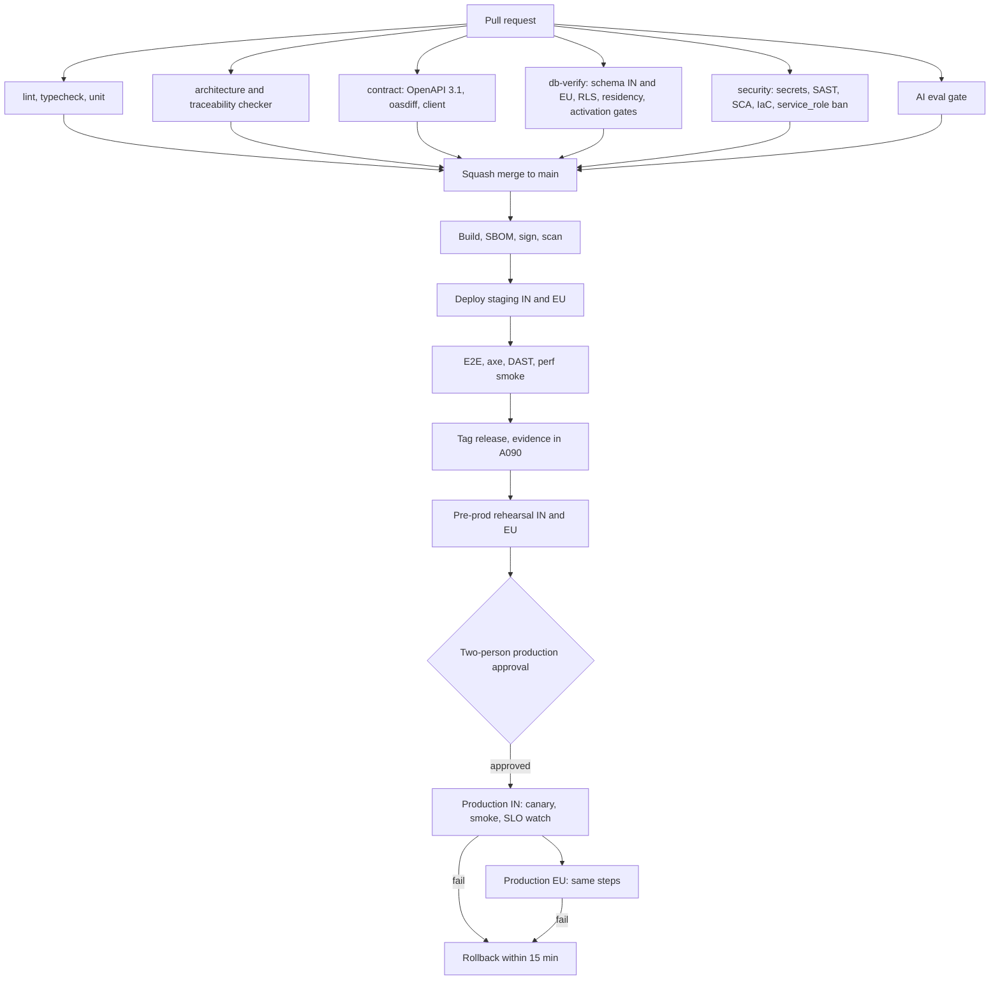

# AI Growth Engine: Employee Sales & Marketing Automation
## Application Blueprint: PART 11 (Batch 11.24c), Developer Build & Production Deployment Pack (single source of truth): CI/CD, Production Deployment Runbook, Definition of Ready and Done, Observability, Onboarding, Decisions and Quality Gate

| Field | Value |
|---|---|
| Document | Part 11.24c: CI/CD stages and gates with GitHub Actions skeletons (§11.24.7), the production deployment runbook (§11.24.8: cut-over, data migration, smoke tests, rollback, go/no-go, hypercare, DR restore drill), Definition of Ready and Done (§11.24.9), observability (§11.24.10), onboarding (§11.24.11), decisions DEC-980…999 (§11.24.12), ADR-280…289 (§11.24.13), conflicts (§11.24.14), expert review (§11.24.15), tags register and inconsistencies (§11.24.16), quality gate (§11.24.17) |
| Version | 1.0 · 28 Nov 2026 |
| Baseline | As Part 11.24a |
| Precedence | As Part 11.24a (DEC-980) |

---

## 11.24.7 CI/CD pipeline

### 11.24.7.1 Stages and blocking gates

The PL-01…PL-20 stages of Part 4.3 §4.33.2 stay; this table adds the V12 and Part 11.24 gates and states where each runs. Every gate is **blocking** unless marked advisory.

| PL | Stage | Workflow / job | Gate (blocks on failure) | Source |
|---|---|---|---|---|
| PL-01 | Pre-commit | local hooks | Advisory (re-run in CI) | Part 4.3 |
| PL-02 | Lint and format | `pr.yml / lint` | Any error (Ruff, ESLint, Prettier, `tofu fmt`, actionlint) | Part 4.3 |
| PL-03 | Type check | `pr.yml / typecheck` | Any error (mypy strict paths, `tsc`) | Part 4.3 |
| PL-04 | Unit tests | `pr.yml / unit` | Failure; coverage < 80% (≥ 90% PDP, approvals, finance, tenancy, gateway, mandates, payments) | NFR-082 |
| PL-05 | Architecture and traceability | `pr.yml / architecture` | import contracts; unscoped-query rule; route permissions; **traceability checker**: orphan FR/US/TC/API/table IDs, FR without test, story without AC | Part 4.3; Part 11.11 |
| PL-06 | Contract | `pr.yml / contract` | `openapi.yaml` invalid; breaking diff vs drf-spectacular; client diff; Schemathesis failure (TC-W-API-01…12) | DEC-986 |
| PL-07 | Migrations | `pr.yml / db-verify` | `makemigrations --check`; squawk lint; **schema applies clean in IN and EU** (TC-W-DB-01/02) | DEC-981 |
| PL-08 | RLS, authz, residency | `pr.yml / db-verify` | Any of TC-W-DB-03…42; BOLA/BFLA suites; Part 11.9b TC-V12-I suites | DEC-778; DEC-772 |
| PL-09 | Security | `pr.yml / security` | Secrets > 0; SAST High/Critical; SCA Critical; Checkov High; any `service_role`/`postgres` DSN in runtime config | NFR-067/068; SA-02 |
| PL-12 | AI evals | `pr.yml / ai-evals`; `nightly.yml` | Per-suite thresholds of the 111 suites; injection/leakage 0 violations; registry row approved for every route | DEC-788 |
| PL-13 | Frontend quality | `pr.yml / frontend-quality` | Bundle and Lighthouse budgets; visual regression | NFR-042…044 |
| PL-10/11 | Build, SBOM, sign, scan | `main.yml / build` | Build failure; Trivy Critical; signing failure | Part 4.3 |
| PL-14 | Deploy staging (IN, EU) | `main.yml / deploy-staging` | Health checks; migrations as `app_migrator` | DEC-778 |
| PL-15 | E2E and accessibility | `main.yml / e2e` | Critical journey failure; axe critical/serious | NFR-088 |
| PL-16 | DAST and performance | `main.yml / dast-perf` | High DAST; p95 regression > 20% | Part 4.3 |
| PL-17 | Release evidence | `release.yml / evidence` | Incomplete A090 record; restore drill > 31 days old or failed; RPO > 900 s; growth RTO > 120 min | DEC-771/787 |
| PL-17a ★ | Pre-prod rehearsal | `release.yml / preprod` | Cut-over rehearsal failure per zone (§11.24.8.2) | ADR-285 |
| PL-18 | Production deploy | `release.yml / production` | Environment approval (two reviewers, approver ≠ author); canary burn rate > 14.4 over 5 min | Part 11.5b |
| PL-19 | Smoke and SLO watch | `release.yml / production` | Any SMK failure; SLO burn in 30 min | §11.24.8.3 |
| PL-20 | Rollback | `release.yml / rollback` | Must complete ≤ 15 min | BLK-8 |
| PL-N | Nightly | `nightly.yml` | Full RLS/residency/E2E/evals; drift (`tofu plan` exit 0); privilege drift (AU-292); restore smoke | Part 4.3 |
| PL-DR ★ | DR drill | `dr-drill.yml` | RPO ≤ 900 s and growth RTO ≤ 120 min per zone, PRV-01…08 pass | DEC-771/787 |
| PL-P ★ | Pack regeneration | `pr.yml / architecture` (on changes to `blueprint/**`) | Re-running `w_01…w_07` must reproduce `openapi.yaml`, `schema.sql` and config catalogues with no diff | DEC-997 |

### 11.24.7.2 GitHub Actions skeletons

The five workflows are in `final/build/ci/.github/workflows/` (YAML parsed with PyYAML; jobs below). They are skeletons: tool invocations, job graph, environments, OIDC permissions and gates are fixed; script paths under `tools/` are implemented in B0.

| Workflow file | Jobs |
|---|---|
| pr.yml | 9 |
| main.yml | 4 |
| release.yml | 4 |
| nightly.yml | 1 |
| dr-drill.yml | 1 |
| **Total** | 19 |

| Workflow | Jobs | Notes |
|---|---|---|
| `pr.yml` | lint, typecheck, unit, architecture, contract, db-verify, security, ai-evals, frontend-quality | `db-verify` starts a PostgreSQL 16 service, applies `db/schema.sql` for IN and EU and runs `db/tests` (= TC-W-DB-01…42) |
| `main.yml` | build, deploy-staging (matrix in, eu), e2e, dast-perf | Images signed with cosign; Vercel prebuilt outputs |
| `release.yml` | evidence, preprod (matrix), production (matrix, `max-parallel: 1`: IN first, then EU), rollback | Dispatch freeze during schema step; canary 10 → 50 → 100%, 15 min each |
| `nightly.yml` | full-suites (matrix) | Drift, privilege drift, restore smoke |
| `dr-drill.yml` | drill | Manual or quarterly; records `restore_drill` rows |

**Branch protection and environments.** `main` requires all PR jobs; GitHub environments `staging-{in,eu}`, `preprod-{in,eu}`, `prod-{in,eu}`, `dr-{in,eu}` carry their own OIDC role and required reviewers (prod: two, one of Founder/CTO or delegate; DR: DBRE + SRE lead).

---

## 11.24.8 Production deployment runbook

### 11.24.8.1 Roles during a production release

| Role | Responsibility | Named in |
|---|---|---|
| Release manager (RM) | Owns the release record in A090, runs the checklist, calls go/no-go | Part 8.2 |
| Incident commander (IC) on standby | Takes over on any SEV1/SEV2 during the window | Part 11.11; DEC-773 |
| DBRE | Restore point, migrations, standby, drill | Part 11.19b |
| Platform/DevOps lead | IaC, ECS canary, Vercel promote, rollback | Part 4.3 |
| QA lead | Smoke and synthetic journeys, evidence | Part 6.1 |
| Legal/DPO (R10) | Activation of regulated capabilities and packs | Part 11.15 |
| Founder/CTO (R01) | Production approval (≠ author), activation co-approval | DEC-779…783 |

### 11.24.8.2 Cut-over sequence (per zone; IN first, EU after IN is stable for 24 h)

| CUT | Step | Command / action | Owner | Duration (target) | Exit / evidence |
|---|---|---|---|---|---|
| CUT-01 | Freeze scope | Release tag cut from green `main`; A090 record opened | RM | — | Tag, digest list |
| CUT-02 | Confirm evidence | PL-17 green: tests, evals, SBOM, scans, migration plan, flags, rollback plan | RM | 15 min | A090 evidence complete |
| CUT-03 | Confirm drill currency | Last DR drill for the zone ≤ 31 days, passed, RPO ≤ 900 s, growth RTO ≤ 120 min | DBRE | 5 min | `restore_drill` row |
| CUT-04 | Pre-prod rehearsal | Same tag through CUT-07…CUT-24 on `preprod-{zone}` | DevOps | 60–90 min | Rehearsal log |
| CUT-05 | Change notice | Status page and tenant banner for the window (Enterprise tier per contract notice period) | RM | — | Notice IDs |
| CUT-06 | Go/no-go call | GNG-01…40 (§11.24.8.6) all green | RM + R01 | 15 min | Signed decision |
| CUT-07 | Restore point | Capture Supabase PITR timestamp, standby LSN and commit time, latest logical-dump checksum | DBRE | 5 min | Restore point record |
| CUT-08 | Dispatch freeze | `EXTERNAL_DISPATCH_ENABLED=false` for the zone; pause `dispatch`/`reconcile` queues; effects in flight finish or move to `Reconciling` | DevOps | 5 min | Flag audit event |
| CUT-09 | Infra apply | `tofu apply` for `live/prod/{zone}` (plan reviewed in PR) | DevOps | 10 min | Plan = apply |
| CUT-10 | Expand migrations | `tools/db/migrate.py --expand-only` as `app_migrator`, `lock_timeout 5s`, `statement_timeout 60s` | DBRE | ≤ 15 min | Migration log; lock budget ≤ 60 s |
| CUT-11 | Schema smoke | `db/tests` structural set (TC-W-DB-03…09) against prod as `app_readonly` | DBRE | 5 min | Pass |
| CUT-12 | Backend canary 10% | ECS deploy by signed digest; 15 min watch | DevOps | 15 min | Burn rate < 14.4 |
| CUT-13 | Backend 50% | Same | DevOps | 15 min | Same |
| CUT-14 | Backend 100% | Same; outbox relay and beat leader switched last | DevOps | 15 min | Same |
| CUT-15 | Frontends | `vercel promote` website-{zone}, admin-{zone}; AU-296 conformance check | DevOps | 5 min | Conformance pass |
| CUT-16 | Smoke | SMK-01…24 (§11.24.8.3) | QA | 15 min | All pass |
| CUT-17 | Business verification | GO-05 financial sandbox chain (rating → invoice → tax → payment test mode → reconciliation) where billing changed | QA + Finance | 20 min | EVR |
| CUT-18 | Reconcile in-flight effects | Uncertain effects reviewed (RB-003); none older than window | DevOps | 10 min | 0 unexplained |
| CUT-19 | Resume dispatch | Restore flags from the A090 activation record only | RM | 5 min | Flag audit event |
| CUT-20 | 30-minute SLO watch | AL-01…06, burn rate, error rate, outbox lag | DevOps | 30 min | Green |
| CUT-21 | Close window | Status page update; release notes; A090 closed | RM | — | Record |
| CUT-22 | Contract step | Scheduled for the next release after compatibility sign-off (MG-04) | DBRE | next release | Ticket |
| CUT-23 | Hypercare start | §11.24.8.7 | RM | 4 weeks | Daily sheet |
| CUT-24 | EU zone | Repeat CUT-07…CUT-21 for EU after 24 h stable in IN (DEC-991) | RM | — | Record |

**First production cut-over per zone (greenfield)** adds CUT-25…CUT-34: create Supabase project with PITR (RPO-C1), set `app.deployment_region` (RG-1), apply `schema.sql` as `app_migrator` (single transaction), run full `db-verify` against prod, create standby subscriber and verify lag < 60 s (RPO-C2), enable AU-297 alerts (RPO-C3), first DR drill (RPO-C4), provision tenants through the saga (DM-03), load reference data (DM-02), import dry run and approval (DM-04), then CUT-12 onwards with all regulated capability flags OFF.

### 11.24.8.3 Smoke tests (SMK)

| SMK | Check | Pass criterion |
|---|---|---|
| SMK-01 | `/health`, `/ready` per service | 200; readiness checks DB, Valkey, S3, KMS |
| SMK-02 | Admin login through BFF (OIDC + PKCE), MFA step-up | Session; CSRF token |
| SMK-03 | SSO test tenant login (SAML and OIDC) | Assertion accepted; enforced tenant rejects password login |
| SMK-04 | Scoped list for company A; same call for company B | Disjoint results; uniform 404 on cross-company ID |
| SMK-05 | Wrong-zone request (EU tenant token on IN API) | Rejected (`RESIDENCY_ZONE_MISMATCH`) |
| SMK-06 | Token with wrong audience (website token on admin API) | Rejected before DB access |
| SMK-07 | Draft creation (AI Tier 1a via registry row) | Draft stored; cost ledger row; model is an approved registry row |
| SMK-08 | Simulated dispatch (`is_simulated = true`) | PDP decision recorded; no external effect |
| SMK-09 | Public page fetch per startup domain | 200 from current snapshot; security headers |
| SMK-10 | Public intake form | Lead created once (idempotent replay) |
| SMK-11 | Webhook echo in sandbox mode | Signature verified; inbox row; replay rejected |
| SMK-12 | Outbox relay | Event relayed ≤ 60 s |
| SMK-13 | Audit chain | `fn_verify_audit_chain` true for the smoke tenant |
| SMK-14 | API key (developer platform) | Scoped read works; consequential scope refused |
| SMK-15 | SCIM create/deactivate test user | De-provisioning ≤ 60 s product side |
| SMK-16 | Emergency stop | Dispatch halted ≤ 60 s (BLK-5) |
| SMK-17 | Mandate engine dry run (shadow mandate) | PDP verdict with rule number; no effect |
| SMK-18 | Voice gateway (sandbox number) | AI identification played first; handoff available |
| SMK-19 | Activation gate | Enabling a capability with a draft pack is refused |
| SMK-20 | RPO monitor | Standby lag sample ≤ 60 s; WAL archive age ≤ 120 s |
| SMK-21 | Vercel data path | Function region bom1/fra1; no body logging |
| SMK-22 | Rate limiting | 429 with Retry-After on public intake burst |
| SMK-23 | Billing sandbox (when billing changed) | Invoice total = net + tax; reconciliation clean |
| SMK-24 | Observability | Trace spans API → worker → DB visible; alert test fires |

### 11.24.8.4 Rollback

| RB-W | Trigger | Action | Time target | Data rule |
|---|---|---|---|---|
| RB-W-01 | Canary burn rate > 14.4 over 5 min, or smoke failure | Automatic: previous ECS task definition; stop canary | ≤ 10 min | DB not rolled back |
| RB-W-02 | Frontend defect | Vercel instant rollback to previous deployment | ≤ 5 min | — |
| RB-W-03 | Flag-caused defect | Revert flags to the previous A090 snapshot | ≤ 2 min | — |
| RB-W-04 | Migration defect (expand step) | Roll forward with a fix migration; old code still compatible by expand/contract | ≤ 60 min | Never `DROP` in the same release |
| RB-W-05 | Data corruption by release | DR-R1: PITR or WAL-G to T−1 min on a new target; PRV pack; repoint; erasure replay | ≤ 120 min growth | RPO ≤ 15 min |
| RB-W-06 | Worker poison messages | Pause queue; DLQ; RB-011 | ≤ 15 min | Outbox intact |
| RB-W-07 | Uncertain external effects | Hold; reconcile per provider (RB-003) before any retry | per provider | No blind retry |
| RB-W-08 | Residency violation detected | SEV1; stop zone dispatch; incident and notification clocks | immediate | Evidence preserved |
| RB-W-09 | Regulated capability misbehaves | Kill switch (`ai.kill_switch.global` or capability flag); revoke mandates | ≤ 60 s | Ledger reconciled |
| RB-W-10 | IaC change failure | `tofu apply` of the previous plan state; drift check | ≤ 30 min | — |
| RB-W-11 | EU rollout issue after IN success | Stop EU at current step; IN unaffected (separate cells) | ≤ 10 min | — |
| RB-W-12 | Rollback rehearsal | Monthly in pre-prod; ≤ 15 min verified | monthly | BLK-8 |

### 11.24.8.5 Data migration during a release

Expand → backfill → validate → contract (MG-01…MG-06, Part 11.5b). A release may contain only expand steps and batched, idempotent backfills; contract steps ship in the next release after sign-off. Backfills run as `app_worker` under the tenant's RLS context (one tenant at a time), never as the owner. Finance totals by currency are compared before and after every backfill that touches money tables.

### 11.24.8.6 Go/no-go checklist

All rows must be **Go**; BLK-1…BLK-11 (Part 8.2 §8.2.4.1) remain hard stops with their veto holders.

| GNG | Area | Item | Evidence | Owner |
|---|---|---|---|---|
| GNG-01 | Build | Release built once; digests and Vercel deployment IDs recorded | A090 | RM |
| GNG-02 | Build | PR, main and pre-prod pipelines green for the tag | CI | DevOps |
| GNG-03 | Contract | `openapi.yaml` valid; no breaking diff; client regenerated | PL-06 | API lead |
| GNG-04 | Database | `schema.sql`/migrations apply clean in IN and EU; TC-W-DB-01…42 pass | `db_test_report.txt` | DB lead |
| GNG-05 | Database | Migration plan expand-only; lock budget estimate ≤ 60 s | Plan | DB lead |
| GNG-06 | Tenancy | Two-tenant/26-company RLS suite 100% | EVR | QA |
| GNG-07 | Residency | CJ-TC-09 both directions; SMK-05 pass | EVR | QA |
| GNG-08 | Access | No `service_role`/`postgres` in runtime; AU-292 clean | Report | Security |
| GNG-09 | Security | SAST/SCA/container 0 Critical/High; DAST 0 High; pen test (release gate) 0 Critical/High open | Reports | Security |
| GNG-10 | Security | Secrets inventory current; rotation dates set | Inventory | DevOps |
| GNG-11 | AI | 111 eval suites at threshold for active routes; registry rows approved with DPA and zone processing | Eval report | AI lead |
| GNG-12 | AI | Tier 2/free fallbacks OFF unless approved; kill switches tested | Drill log | AI lead |
| GNG-13 | Regulated | Every regulated capability flag OFF unless its activation row passed the DB gate (two approvers, packs approved) | `tenant_activation` export | R10 |
| GNG-14 | Regulated | Counsel sign-off on file for every active pack; pack expiry > 30 days | Pack register | R10 |
| GNG-15 | Mandates | Mandate engine shadow period rules configured; revocation ≤ 60 s tested | EVR | Mandates lead |
| GNG-16 | Payments | PSP in live mode only where activated; maker ≠ checker; reconciliation job green | EVR | Finance |
| GNG-17 | Voice | AI disclosure, consent, calling windows, recording notice per pack tested | EVR | R10 |
| GNG-18 | Investor | Eligibility checks, no public offer where prohibited, no-advice guard tested | EVR | R10 |
| GNG-19 | DR | Drill ≤ 31 days: RPO ≤ 900 s; growth RTO ≤ 120 min; PRV-01…08 pass | `restore_drill` | DBRE |
| GNG-20 | DR | Standby lag < 60 s; WAL archive age < 120 s; PITR enabled | AU-297 | DBRE |
| GNG-21 | Rollback | Rehearsal ≤ 15 min this month | PL-20 log | DevOps |
| GNG-22 | Observability | Dashboards OB-01…26 live; alert tests fired; runbooks linked | Alert log | SRE |
| GNG-23 | On-call | 24×7 rota and SOC first line confirmed for the window; paging test this month | Paging log | SRE |
| GNG-24 | SLA | SLA tier composition valid for each tenant's tier (DEC-774) | Composition check | RM |
| GNG-25 | Performance | Load/soak within thresholds (24 h R1, 72 h R2) | LT reports | QA |
| GNG-26 | Accessibility | 0 critical/serious axe; manual WCAG 2.2 AA audit for R2 | Reports | QA |
| GNG-27 | Data | Seeds/imports dry-run accepted; `import_unverified` ineligible | Reports | Growth/compliance |
| GNG-28 | Data | Retention purge dry run approved; erasure replay tested | Reports | R10 |
| GNG-29 | Privacy | DPIAs (IN; EU before EU data) approved; ROPA updated | Records | R10 |
| GNG-30 | Legal | DPAs on file (Vercel, Supabase, AWS, model providers, PSP, CPaaS) incl. EU processing | Contract register | R10 |
| GNG-31 | Messaging | Window 09:00–21:00 recipient local time unless a pack is stricter (DEC-777) | Config export | R10 |
| GNG-32 | Billing | Tax configuration approved by tax adviser per market (DEC-776) | Approval | Finance |
| GNG-33 | Support | Help articles, ticket categories, status page components | Diff | Support |
| GNG-34 | Comms | Tenant notices sent per contract | Notice IDs | RM |
| GNG-35 | Edge | Vercel conformance (VD-01…12) passed for every project of the zone | AU-296 | DevOps |
| GNG-36 | Cost | Budgets and alerts per zone and tenant tier; AI ceilings (DEC-008) | FinOps report | Finance |
| GNG-37 | Training | Users with send/approve/publish/activate rights trained | Records | Tenant admin |
| GNG-38 | Traceability | Every in-scope FR has a passing test; every story has AC (traceability checker) | RTM extract | QA |
| GNG-39 | Certification | SOC 2 evidence collection running for the release (DEC-775) | Evidence pipeline | Security |
| GNG-40 | Decision | Founder/PO sign-off with independent reviewer (BRD §12.2 fields) | A090 decision | R01 |

### 11.24.8.7 Hypercare

Part 8.2 §8.2.5 applies with these changes: **four weeks per release per zone**, 24×7 human on-call (DEC-773: contracted SOC/NOC first line, engineer rota second line), daily review at 10:30 zone time, and additional daily metrics for the V12 capabilities.

| Added daily metric | Green | Action if not green |
|---|---|---|
| Residency violations (RG-1…7 alerts) | 0 | SEV1; RB-W-08 |
| RPO samples > 600 s | 0 | DR-R6 |
| Mandate decisions DENY by anomaly rule; revocations | Within baseline; revocation ≤ 60 s | Kill switch; AG-201 review |
| Payment reconciliation breaks | 0 older than 24 h | Finance review |
| Voice: calls without disclosure, recordings without consent evidence | 0 | Capability flag OFF |
| Investor: outputs withheld by advice guard; eligibility overrides | Logged; 0 overrides without R10 | R10 review |
| SCIM de-provisioning p95 | ≤ 60 s | AU-291 runbook |
| Activation gate refusals | Explained | R10 |

Exit criteria: Part 8.2 §8.2.5.4 items 1–8, plus 0 residency violations and all drills current.

### 11.24.8.8 DR restore drill (RPO 15 min, RTO 120 min)

Run per zone at every release gate and quarterly, in an isolated recovery target inside the zone (never outside it). The drill measures from the declared incident time T0.

| Step | Action | Path | Timer | Evidence |
|---|---|---|---|---|
| DR-D01 | Declare drill; IC named; T0 recorded | — | T0 | Drill record |
| DR-D02 | Freeze dispatch on the drill target (recovery env forces `EXTERNAL_DISPATCH_ENABLED=false`) | — | +2 min | Flag event |
| DR-D03 | Choose recovery point T0 − 1 min from audit timeline | — | +5 min | Target time |
| DR-D04a | Path P2: stop subscription, record last LSN/commit time; WAL-G point-in-time restore to target on a new instance | P2 | +15…45 min | WAL-G log |
| DR-D04b | Path P1 (alternate): Supabase PITR to a new project | P1 | per provider | Provider log |
| DR-D05 | Set `app.deployment_region` on the restored database; verify roles (no bypass) | — | +50 min | Query output |
| DR-D06 | PRV-01 RLS negative sample (30 policies) | — | +60 min | Report |
| DR-D07 | PRV-02 audit chain against last anchor | — | +65 min | Report |
| DR-D08 | PRV-03 money ledgers reconciled by currency; PRV-04 outbox/effect reconciliation | — | +80 min | Report |
| DR-D09 | PRV-05 erasure replay; PRV-06 row counts; PRV-07/08 per Part 11.19b | — | +90 min | Report |
| DR-D10 | Repoint drill API stack (`DATABASE_SECRET_REF`) and run SMK-01, 02, 04, 05, 13 | — | +105 min | Smoke log |
| DR-D11 | Compute achieved RPO = T0 − restored_to; RTO = service_restored − T0 (generated columns of `restore_drill`) | — | ≤ 120 min | `restore_drill` row |
| DR-D12 | Pass if RPO ≤ 900 s and growth RTO ≤ 120 min and all PRV pass; else release no-go and SEV2 problem record | — | — | Decision |
| DR-D13 | Destroy the isolated target; keep evidence | — | — | Teardown log |

---

## 11.24.9 Definition of Ready and Definition of Done

### 11.24.9.1 Definition of Ready (story or task enters a sprint)

| DOR | Criterion |
|---|---|
| DOR-01 | Story in the Part 5/11.22 template with Gherkin AC (Scenario Outline + Examples where combinatorial) |
| DOR-02 | Linked FR, BR, BRL and screen IDs; owning part and section named |
| DOR-03 | API operations exist in `openapi.yaml` (or the catalogue change is merged in the owning part and the pack regenerated) |
| DOR-04 | Tables and columns exist in `table_index.csv` / `schema.sql` (or a migration design is attached) |
| DOR-05 | RLS template and scope class decided for any new table |
| DOR-06 | Data classification and retention class for new personal-data fields |
| DOR-07 | Any GAP-1204/1205 item touching the story resolved (columns of generic V12-B tables; soft references) |
| DOR-08 | PDP rules, rule packs and activation cell identified for any external or regulated effect |
| DOR-09 | AI usage names the registry row, prompt, eval suite and cost estimate |
| DOR-10 | Test cases identified (TC IDs; combinatorial model for safety-, money- or law-critical stories) |
| DOR-11 | Feature flag named with class and owner |
| DOR-12 | Zone impact stated (IN, EU, both) |
| DOR-13 | Observability: metrics, logs, alerts named |
| DOR-14 | Dependencies (stories, providers, legal sign-offs) available or mocked |
| DOR-15 | UX designs approved (screen IDs) and accessibility notes |
| DOR-16 | Estimate in points; fits a sprint |
| DOR-17 | Security review need flagged (new trust boundary, secrets, adapters) |
| DOR-18 | Rollback / flag-off behaviour described |

### 11.24.9.2 Definition of Done (story, then release)

| DOD | Criterion | Verified by |
|---|---|---|
| DOD-01 | Code merged to `main` via PR with required reviews (2 for CODEOWNERS paths) | GitHub |
| DOD-02 | All PR jobs green (§11.24.7.1) | CI |
| DOD-03 | Unit coverage thresholds met | PL-04 |
| DOD-04 | AC automated (API/integration/E2E as appropriate) and passing | Test report |
| DOD-05 | `openapi.yaml` and generated client updated; no breaking diff | PL-06 |
| DOD-06 | Migrations expand/contract compliant; RLS policies for new tables; TC-W-DB suites pass | PL-07/08 |
| DOD-07 | No unscoped queries; route permissions present | PL-05 |
| DOD-08 | Audit events emitted for state changes and approvals | Test |
| DOD-09 | Idempotency and `If-Match` handled | Contract test |
| DOD-10 | PDP checks at plan and dispatch for external effects | PDP suite |
| DOD-11 | Activation flag OFF by default; activation path gated | Flag registry |
| DOD-12 | AI changes: eval suites pass; registry row approved | PL-12 |
| DOD-13 | Security scans clean; threat model updated if a boundary changed | PL-09 |
| DOD-14 | Accessibility: axe 0 critical/serious; keyboard path | PL-15 |
| DOD-15 | i18n keys present for active locales; RTL checked when UI changes | Visual test |
| DOD-16 | Observability: metrics, logs (redacted), traces, alert rules and runbook link | Review |
| DOD-17 | Documentation: owning part's catalogue updated; ADR if architecture changed | Review |
| DOD-18 | Traceability: RTM rows updated; traceability checker green | PL-05 |
| DOD-19 | Deployed to staging IN and EU; E2E smoke green | PL-14/15 |
| DOD-20 | Performance budget respected | PL-16 |
| DOD-21 | Feature demoed to PO; acceptance recorded | Sprint review |
| DOD-22 | (Release) Go/no-go GNG-01…40 all Go | A090 |
| DOD-23 | (Release) DR drill current and passed for each zone | `restore_drill` |
| DOD-24 | (Release) Hypercare plan and on-call rota published | A090 |

---

## 11.24.10 Observability setup

### 11.24.10.1 Telemetry pipeline (per zone; ADR-025, ADR-289)

| Signal | Source | Collector / store | Retention | Redaction |
|---|---|---|---|---|
| Traces | OTel SDK (Django, Celery, psycopg, httpx), Vercel functions (where supported, verify) | OTel collector in zone → CloudWatch/X-Ray-compatible backend or Sentry performance | 30 days | No bodies; IDs only |
| Errors | Sentry SDK (backend, frontend) | Sentry project per zone (EU data region where offered, verify) | 90 days | PII scrubbing; `send_default_pii=False` |
| Logs | Structured JSON (request ID, correlation ID, tenant hash, company hash, actor kind, zone) | CloudWatch Logs in zone; Supabase and Vercel log drains to S3 in zone | IN 180 days (CERT-In); EU per DPA (default 90 days) | `LOG_REDACTION_POLICY`; no statement parameters |
| Metrics | OTel metrics + CloudWatch EMF; business metrics from DB projections | CloudWatch | 15 months | Aggregates only |
| Audit | `audit_event` hash chain + daily anchor to S3 Object Lock | DB + S3 | 7 years | Redacted payloads |
| DB health | `pg_stat_statements`, Supabase metrics, AU-297 RPO samples | CloudWatch + `rpo_sample` | 90 days | — |

### 11.24.10.2 Dashboards and alerts (OB)

| OB | Dashboard / alert | Key measures | Threshold → action |
|---|---|---|---|
| OB-01 | Service SLO (per zone, per tier) | Availability, p95 latency reads/writes | Burn rate 14.4 (5 min) page; 6 (30 min) ticket |
| OB-02 | Error rate | 5xx by route group | > 0.5% → rollback candidate |
| OB-03 | Outbox and queues | Outbox lag p95, queue delay per class, DLQ depth | Lag > 60 s → RB-002 |
| OB-04 | Effects | Reconciling effects by provider window | ≥ 99% in window (SLI) |
| OB-05 | RLS and scope | Cross-scope alerts (KPI-30), `CONTEXT_MISSING` errors | Any → SEV1 RB-008 |
| OB-06 | Residency | `RESIDENCY_*` errors, wrong-zone requests | Any → SEV1 RB-W-08 |
| OB-07 | RPO | Standby lag, WAL archive age, base-backup age, PITR status | 300/600/900 s → warn/page/SEV1 |
| OB-08 | DR drills | Last drill age, achieved RPO/RTO | > 31 days → release blocked |
| OB-09 | Database | Connections per role, pooler saturation, slow queries, locks | Saturation > 80% → scale |
| OB-10 | Access | `service_role`/`postgres` sessions, privilege drift | Any session from app subnet → SEV2 |
| OB-11 | Identity | SSO failures, SCIM de-provisioning p95, certificate expiry | p95 > 60 s → AU-291 |
| OB-12 | Developer platform | API key use, OAuth tokens, webhook delivery success | < 99%/24 h → AU-294 |
| OB-13 | Connectors | Health, lag, breaker state, DLT template status | Degraded → AU-295 |
| OB-14 | AI cost | Spend vs ceilings (DEC-008), cost per task | 80% / 100% → degradation ladder |
| OB-15 | AI quality | Schema failures, abstentions, injection detections, eval drift | Threshold → agent kill switch |
| OB-16 | Model registry | Calls to non-eligible rows (must be 0), recert due | Any → SEV2 |
| OB-17 | Mandates | Decisions by verdict, anomalies, consumption vs limits | Anomaly → AG-201 |
| OB-18 | Payments | Captures, failures, disputes, reconciliation breaks | Break > 24 h → Finance |
| OB-19 | Bids | Submissions, deadline guards, receipt reconciliation | Missing receipt → RB |
| OB-20 | Voice | Connected minutes, disclosure compliance, handoffs, recording consent | Non-compliance → flag OFF |
| OB-21 | Investor | Offer counters vs caps, eligibility checks, advice-guard events | Cap reached → 409 LIMIT_REACHED |
| OB-22 | Messaging compliance | Suppression breaches (KPI-17), complaint/bounce, window violations | Any breach → emergency stop |
| OB-23 | Edge | Vercel function regions, cache, firewall hits | Non-zone region → block deploy |
| OB-24 | FinOps | Cost per zone, per tenant tier, Enterprise uplift | Budget alerts |
| OB-25 | Business KPIs | KPI-01…34 projections | Weekly review |
| OB-26 | Release | Deploys, rollbacks, change failure rate, lead time | DORA trend |

---

## 11.24.11 Onboarding guide for engineers

### 11.24.11.1 Day 1 to week 2

| ONB | When | Activity | Outcome |
|---|---|---|---|
| ONB-01 | Day 1 | Accounts: GitHub (SSO), Vercel team (read), AWS SSO (dev only), Supabase org (dev project only), Sentry, on-call tool | Least privilege; no production access |
| ONB-02 | Day 1 | Read Part 11.24a §11.24.1 and §11.24.2; Part 11.14 decisions table | Know precedence and build order |
| ONB-03 | Day 1 | Clone; `uv sync`, `pnpm install`; `docker compose up` (PostgreSQL 16 + pgvector, Valkey, MinIO, mocks) | Local stack running |
| ONB-04 | Day 1 | `make db-baseline` (applies `db/schema.sql` with `app.deployment_region=IN`), `make db-verify` (TC-W-DB-01…42) | 42/42 pass locally |
| ONB-05 | Day 1 | `make seed-small`; log in to local Admin and Website with seeded users | Two tenants, six companies |
| ONB-06 | Day 2 | Walk through one request end to end: BFF → view → service → `set_ctx` → RLS → outbox → worker → adapter mock | Can explain scope and effect path |
| ONB-07 | Day 2 | Read Part 3.2 §3.2.1 standards; find an operation in `api_index.csv`; run Schemathesis locally | Contract-first habit |
| ONB-08 | Day 2 | Read Part 3.3 §3.3.5 conventions and §11.24.4.2 lineage; inspect `table_index.csv` | Know which name is physical |
| ONB-09 | Day 3 | Pair on a "good first issue" with a story that has Gherkin AC | First PR |
| ONB-10 | Day 3 | Run the PR pipeline locally (`make ci-local`) | Fast feedback |
| ONB-11 | Day 4 | Security basics: secrets handling, no `service_role`, BOLA tests, threat model of your area | Signed security briefing |
| ONB-12 | Day 4 | Data protection basics: classification, residency zones, DSAR, retention | Signed privacy briefing |
| ONB-13 | Day 5 | AI basics: model registry, eval suites, prompt versioning, cost ceilings | Can add an eval case |
| ONB-14 | Week 2 | Shadow a staging release and a pre-prod rehearsal | Knows runbook |
| ONB-15 | Week 2 | Shadow on-call (no pager) for 3 days | Knows alerts and runbooks |
| ONB-16 | Week 2 | Read the runbook RB-W-01…12 and DR-R1…R6; take part in a pre-prod DR drill | DR literacy |

### 11.24.11.2 Working agreements and where to find things

| ONB | Topic | Agreement |
|---|---|---|
| ONB-17 | Branches | Trunk-based; branches ≤ 2 days; Conventional Commits with requirement IDs |
| ONB-18 | Contracts | Change the owning part's catalogue first, regenerate the pack (DEC-997), then code |
| ONB-19 | Schema | New tables: scope class, RLS template, immutability profile, retention class, indexes for FKs |
| ONB-20 | Flags | Every new external or regulated path behind a flag, default OFF |
| ONB-21 | Zones | Never hard-code a region; read `ZONE`; never copy data between zones |
| ONB-22 | Secrets | Only `*_REF` in config; nothing in Vercel; report any leak immediately (AU-293 revokes) |
| ONB-23 | AI | Only registry-approved rows; prompts versioned; evals with the change |
| ONB-24 | Tests | Combinatorial models for safety-, money- and law-critical code (V12-B brief) |
| ONB-25 | Reviews | Use the PR checklist (Part 4.3 §4.32.2) |
| ONB-26 | Incidents | Follow the IC; write postmortems for SEV1/SEV2 |
| ONB-27 | Docs | ADRs in `docs/adr`; runbooks in `ops/runbooks` |
| ONB-28 | Where is… | API: `openapi/openapi.yaml`, `api_index.csv`; DB: `db/schema.sql`, `table_index.csv`; config: `final/build/config/*`; IaC: `infra/` |
| ONB-29 | Access requests | JIT, time-boxed, audited; production DB read only through `app_readonly` with JIT grant |
| ONB-30 | Help | `#eng-help`; owners per CODEOWNERS; Part 11.24 is the first stop |

---

## 11.24.12 Decisions

| DEC | Decision | Authority | Effect |
|---|---|---|---|
| DEC-980 | Part 11.24 is the single source of truth for build and deployment artefacts; precedence V12-B brief > Part 11.14 > Part 11.24 (artefacts) > Parts 11.15–11.23 > 11.1–11.13 > earlier; a functional or legal decision always wins and the pack is regenerated | Customer revision V12 (28 Nov 2026), Founder decisions DEC-770…791 implemented | Teams build from `final/build/*` |
| DEC-981 | Physical schema lineage per ADR-280: V12 executable spine names for the 48 Appendix C/C2 tables, C3 and DDL-V12-R tables; typed Part 3.3/3.6 tables for all domain entities; the 89 V12 generic tables are `security_invoker` views over typed tables; Part 3.3 names of V12-realised entities are views | Customer revision V12 (28 Nov 2026) | Amends DEC-660 (physical naming); resolves CONFLICT-1209 |
| DEC-982 | Company scope column: `startup_id` in typed tables, `company_id` in V12 spine tables; APIs and DTOs use `company_id` | Customer revision V12 (28 Nov 2026) | Serializer alias; RLS templates use the existing column |
| DEC-983 | Canonical database roles created in V0001 (`app_owner`, `app_migrator`, `app_rw`, `app_worker`, `app_readonly`, `app_retention`, `app_audit_writer`, `app_platform_sec`, `app_bench`, `app_registry`); the DDL-V12-R-16 rename is a no-op for new environments | Customer revision V12 (28 Nov 2026); DEC-778 | One canonical `app_rw` |
| DEC-984 | `ai_model.model_id` stays `text` (registry key); Part 11.19b `uuid` references become `text` | Customer revision V12 (28 Nov 2026) | Resolves CONFLICT-1210 |
| DEC-985 | `jurisdiction_pack` gains `pack_code` with UNIQUE (pack_code, version); activation per tenant × capability × jurisdiction is a database-gated row (`tenant_activation`, two approvers, packs approved with counsel sign-off) | Customer revision V12 (28 Nov 2026); DEC-776, DEC-779…783 | Resolves CONFLICT-1212; "where lawful" enforced in DB and PDP |
| DEC-986 | `final/build/openapi.yaml` (OpenAPI 3.1) is the contract of record; per-namespace documents and the TypeScript client are derived; drf-spectacular output must have no breaking diff | Customer revision V12 (28 Nov 2026) | PL-06 gate |
| DEC-987 | Environments: local, dev, staging, preprod, prod in zones IN and EU (+ recovery); mapping to Part 11.5a names in §11.24.6.1 | Customer revision V12 (28 Nov 2026); DEC-772 | Resolves CONFLICT-1214 |
| DEC-988 | Hosting of record is DEC-421 as amended by DEC-772/786 (Vercel + Supabase + AWS per zone); Part 3.1 §3.1.6 RDS and CloudFront-for-SPA items are superseded; S3, WAF, ALB, ECS stay | Customer revision V12 (28 Nov 2026); Founder DEC-772 | Resolves CONFLICT-1213 |
| DEC-989 | IaC in HCL compatible with Terraform ≥ 1.9 and OpenTofu ≥ 1.9; pipeline runs OpenTofu (ADR-012) | Customer revision V12 (28 Nov 2026) | Module outline §11.24.6.3 |
| DEC-990 | The CI gate set of §11.24.7.1 is blocking, including the traceability checker, `db-verify` in both zones and pack regeneration | Customer revision V12 (28 Nov 2026) | No merge or release on failure |
| DEC-991 | Production releases are zone-sequential (IN, then EU after 24 h stable), with dispatch freeze during the schema step and canary 10/50/100% with burn-rate abort 14.4 | Customer revision V12 (28 Nov 2026) | Runbook §11.24.8.2 |
| DEC-992 | A DR drill per zone at every release gate and quarterly; a release is no-go when the last drill is older than 31 days or exceeded RPO 900 s or growth RTO 120 min | Founder DEC-771, DEC-787 implemented | GNG-19 |
| DEC-993 | Definition of Ready DOR-01…18 and Definition of Done DOD-01…24 adopted | Customer revision V12 (28 Nov 2026) | Sprint and release gates |
| DEC-994 | Observability per zone: logs, traces and metrics stay in the zone; dashboards OB-01…26 | Customer revision V12 (28 Nov 2026); DEC-772 | §11.24.10 |
| DEC-995 | Hypercare: four weeks per release per zone with 24×7 human on-call | Founder DEC-773 implemented | §11.24.8.7 |
| DEC-996 | The 27 soft references and dictionary gaps of §11.24.4.9 are validated in the service layer until their owning parts are amended | Customer revision V12 (28 Nov 2026) | GAP-1205 tracked by DOR-07 |
| DEC-997 | Pack regeneration: any change to a source part reruns `w_01…w_08`; CI checks that the committed artefacts equal the regenerated ones | Customer revision V12 (28 Nov 2026) | PL-P gate |
| DEC-998 | Baseline schema delivered as Django app `db_baseline` migration 0001 (RunSQL V0001…V0015); later changes as Django migrations with RunSQL for RLS and triggers (ADR-282) | Customer revision V12 (28 Nov 2026) | Single migration path (ADR-154 choice made) |
| DEC-999 | Engineer onboarding ONB-01…30 with no production access in the first two weeks and local `db-verify` on day 1 | Customer revision V12 (28 Nov 2026) | §11.24.11 |

## 11.24.13 Architecture decision records (ADR-280…289)

| ADR | Title | Context | Decision | Consequences |
|---|---|---|---|---|
| ADR-280 | Hybrid physical schema lineage | Two verified lineages (Part 3.3 typed, V12 spine + DDL-V12-I/R) with different names | V12 names for spine tables; typed tables for domain entities; compatibility views both ways (security_invoker) | All verified statements run unchanged; one table per entity; views carry RLS |
| ADR-281 | Contract-first merged OpenAPI 3.1 | 12 catalogue sources with different formats | Script-generated single document with provenance extensions; serializer schemas must diff clean | One index; drift detected in CI |
| ADR-282 | Migration delivery | Django migrations vs SQL baseline | SQL baseline as `db_baseline 0001`; then Django migrations + RunSQL | Django state matches the DB; RLS/triggers versioned |
| ADR-283 | Residency cells | DEC-772 IN and EU | One identical zone stack per zone; no cross-zone network or replication | Simple audit of residency; double run cost (DEC-772 estimate) |
| ADR-284 | Activation gates in the database | "Where lawful" must never be optional | `tenant_activation` + trigger + two-person check, plus PDP | Fail closed even if application code errs |
| ADR-285 | Pre-production per zone | Cut-over and DR need a production-shaped rehearsal | `preprod-{zone}` with PITR and production config shape, synthetic data | Extra cost; fewer release surprises [ASSUMPTION-1203] |
| ADR-286 | Zone-sequential canary releases | Blast radius across zones | IN first, EU after 24 h; ECS canary 10/50/100 | Longer release window; isolated failures |
| ADR-287 | Standby promotion as primary growth-RTO path | RTO ≤ 120 min | P2 logical-replication standby with WAL-G, P1 PITR as alternate | Drill-proven RTO; replication monitoring |
| ADR-288 | Typed fail-closed configuration | Many environments and zones | One typed settings object; `*_REF` secrets; start-up validation | Misconfiguration stops the process |
| ADR-289 | Observability per zone | Residency of logs and traces | Collectors, stores and drains per zone; IDs not bodies | No cross-zone telemetry |

## 11.24.14 Conflicts and proposed resolutions

| Tag | Conflict | Resolution | Status |
|---|---|---|---|
| CONFLICT-1209 | DEC-660 (prefixed physical names) vs DDL-V12-R written on V12 names | DEC-981 / ADR-280 hybrid lineage with views | Resolved |
| CONFLICT-1210 | `ai_model.model_id` text (Appendix C) vs uuid (Part 11.19b DDL-V12-R-14) | DEC-984: text | Resolved (reported to Part 11.19b owner) |
| CONFLICT-1211 | `config_promotion` status `Rolled back` (C3) vs `RolledBack` (Part 11.19a) | Later part wins (`RolledBack`); generator drops the earlier constraint | Resolved |
| CONFLICT-1212 | `jurisdiction_pack` UNIQUE (jurisdiction, version) (Appendix C) vs many packs per jurisdiction (Parts 11.15, 11.16d) | DEC-985: `pack_code` key | Resolved |
| CONFLICT-1213 | Part 3.1/4.3 RDS, CloudFront and single-region topology vs DEC-421/772 | DEC-988 | Resolved |
| CONFLICT-1214 | Environment names (Part 11.5a dev/sit/uat/prod-in vs this pack's local/dev/staging/preprod/prod) | DEC-987 mapping | Resolved |
| CONFLICT-1215 | `connector_pack_guard()` (Part 11.19a DDL-V12-R-09) compares `jurisdiction_pack.status = 'approved'` and `p.market`, while Appendix C uses `Approved` and packs are keyed by `pack_code`; the guard therefore refuses every production connector activation (fail closed but wrong) | Replace the predicate by the `rulepack_requirement` join used in `fn_activation_gate()` (status `Approved`, counsel sign-off) in the Part 11.19 owner's next revision | **Resolved in v1.2** (DEC-1000, Part 11.25): predicate replaced in Part 11.19a, `schema.sql` and V0006 |

## 11.24.15 Expert persona review

| Persona | Finding | Change made in this pack |
|---|---|---|
| Principal Engineer | Two schema lineages would have produced duplicate tables for 120 entities | ADR-280 hybrid with views; one physical table per entity |
| Principal Engineer | Generic V12-B tables lack typed columns | Generic `state`/`payload` with registry trigger; GAP-1204 in DoR |
| Platform/DevOps lead | Part 4.3 topology predates DEC-421/772 | Zone stack modules for Vercel, Supabase, AWS; DEC-988 |
| Platform/DevOps lead | No production-shaped rehearsal environment | `preprod-{zone}` (ADR-285) and PL-17a |
| API governance lead | 132 operations had no IDs; 30 duplicates across parts | `API-V12-W-####` IDs; `x-also-defined-as`; 0 validator errors |
| API governance lead | Field schemas absent for most operations | Serializer-generated schemas must diff clean (GAP-1206, RECOMMENDATION-1216) |
| Database lead | Generated schema must prove isolation, not only compile | 42 executable tests incl. both residency directions and activation gates |
| Database lead | Later-part constraints redefine earlier ones | Generator drops and re-adds (later part wins) and lists conflicts 1210–1212 |
| Release manager | Go-live list scattered across Parts 8.2, 11.5a, 11.19b | GNG-01…40 consolidated with BLK hard stops retained |
| Release manager | DR objectives need a measurable gate | `restore_drill` generated RPO/RTO columns; DEC-992 |

## 11.24.16 Tags register and inconsistencies

### 11.24.16.1 Tags issued (range 1200…1219)

| Tag | Statement | Where |
|---|---|---|
| ASSUMPTION-1200 | Region identifiers (Supabase Mumbai/Frankfurt, AWS ap-south-1/eu-central-1, Vercel bom1/fra1, in-zone secondary regions) are as stated; verify at implementation (as of 27 Nov 2026) | §11.24.6 |
| ASSUMPTION-1201 | The team runs OpenTofu; modules stay within the Terraform-compatible subset; provider resource names (supabase, vercel) verified at implementation | §11.24.6.3 |
| ASSUMPTION-1202 | pgvector `halfvec` is available on Supabase; the reference run had no pgvector, so vector columns are added conditionally | §11.24.4 |
| ASSUMPTION-1203 | A `preprod` Supabase project and AWS account per zone are funded under DEC-790 (≈ one further copy of non-prod hosting lines; estimate, verify) | §11.24.6.1 |
| GAP-1204 | 33 V12-B tables (Parts 11.16c, 11.17b normalised projections) have purposes but no column lists; generated with standard sets plus `state`, `payload`, `region` | §11.24.4.2 |
| GAP-1205 | 27 references not turned into DDL (soft references, dictionary column names missing) | §11.24.4.9 |
| GAP-1206 | Request/response field schemas exist only for Part 3.5b and 11.8b operations; others use shared schemas until serializers exist; one POST (`/api/v2/mandates/{id}/simulate`) has no idempotency rule in its source | §11.24.3.4–5 |
| GAP-1207 | No catalogue defined EU-zone provider settings (SES EU, Sentry EU region, Vercel fra1 drains); added as ENV-W rows and to be confirmed by vendors | §11.24.5.1 |
| GAP-1208 | 35 of 70 capability × jurisdiction cells have no rule pack; they are hard OFF | §11.24.5.4 |
| CONFLICT-1209…1215 | See §11.24.14 | §11.24.14 |
| RECOMMENDATION-1216 | Embed serializer schemas into the merged contract each sprint and publish the developer-portal subset | §11.24.3.4 |
| RECOMMENDATION-1217 | Weekly restore smoke (P3) in addition to the quarterly drill per zone | §11.24.7 |
| RECOMMENDATION-1218 | Make `preprod` ephemeral (created for each release rehearsal from IaC) once the rehearsal is stable, to reduce cost | §11.24.6.1 |
| ASSUMPTION-1219 | Database verification used community PostgreSQL 16.15; Supabase-specific behaviour (Supavisor, Data API, extensions) is verified at Sprint 0 by the same `db-verify` job | §11.24.4.8 |

### 11.24.16.2 Inconsistencies found in earlier parts (reported, not changed)

| # | Part | Inconsistency | Effect here |
|---|---|---|---|
| 1 | Part 11.19b DDL-V12-R-14 | `model_id uuid` referencing `ai_model(model_id)` which is `text` in Appendix C | Converted to text (DEC-984) |
| 2 | Part 11.19a DDL-V12-R-01 | View `identity_provider` replaces the C2 table but no DROP is given; references `ge.app_user`, which no earlier DDL defines | Generator drops the table first; V0005 creates `app_user` |
| 3 | Part 11.19a DDL-V12-R-08/09 | References `tenant.kind`, `jurisdiction_pack.market`, `counsel_signoff_ref`, `ai_model` evidence columns not in Appendix C/C3 | V0005 reconciliation patch |
| 4 | Part 11.19a DDL-V12-R-09 | `connector_pack_guard()` status and key mismatch (CONFLICT-1215) | Resolved v1.2 (DEC-1000) |
| 5 | Part 3.3 §3.3.7 / 3.6b | 7 unique keys name columns that no dictionary defines (`case_key`, `code`, `channel_account_id` on `eng_message`, `outbox_id`, `startup_scope_hash`, `received_month`, zero-uuid expression) | Skipped, GAP-1205 |
| 6 | Part 3.3 dictionaries | Several references by code to `ref_value`, and `budget_id` → `ai_budget` whose V12 key is composite text | Soft references (DEC-996) |
| 7 | Part 11.9b | Policy register lists 139 tables including 89 generic ones that the typed model replaces (DEC-661) | Generic tables become views |
| 8 | Part 3.2 §3.2.2.5 vs Part 9.3 | 579 baseline confirmed (555 + 24); Part 9.7b's 40 ADV-X1 rows expand to 43 operations (three `GET / POST` cells) | Counted as 43 operations from 40 IDs |
| 9 | Part 11.5b §11.5.5.12 | 18 routes duplicate Part 11.19a routes with different parameter names | Merged; alias IDs kept |

## 11.24.17 Quality gate (Part 11.24, files a, b and c)

| # | Item | Result | Notes and fixes applied |
|---|---|---|---|
| 1 | Every requirement traced to a source | Pass | Every operation carries `x-source-part`; every table carries its source in `table_index.csv`; every ENV, flag and pack row names its part |
| 2 | Assumptions/gaps/conflicts tagged and logged | Pass | ASSUMPTION-1200…1203, 1219; GAP-1204…1208; CONFLICT-1209…1215; RECOMMENDATION-1216…1218 (§11.24.16) |
| 3 | IDs unique and consistent with earlier parts | Pass | DEC-980…999, ADR-280…289 within range; 579 baseline IDs unchanged; 0 duplicate operationIds; new IDs only `API-V12-W-####`, TC-W-*, DOR/DOD/GNG/SMK/CUT/RB-W/OB/ONB |
| 4 | No story lacks AC and no requirement lacks a test | N/A | No new stories; DoR/DoD enforce AC and tests; TC-W-DB-01…42 and TC-W-API-01…12 defined, DB tests executed 42/42 |
| 5 | Negative, edge, security and accessibility cases covered | Pass | Isolation (tenant, company, portfolio), residency both directions, append-only, stale revision, audit forgery, Data API, benchmark privacy, activation gate negatives; accessibility gates PL-13/PL-15 |
| 6 | No agent lacks guardrail, fallback, KPI and cost estimate | N/A | No agent added; registry and kill-switch flags listed |
| 7 | Time-sensitive facts flagged "verify" with an as-of date | Pass | Provider versions, regions, plan features and prices flagged "verify at implementation (as of 27 Nov 2026)" |
| 8 | No restricted data routed to free-tier models | Pass | `ai.tier2.free_fallback` OFF; registry check constraint `ai_model_free_tier_data_ck` retained |
| 9 | Consistent with earlier parts | Pass with reported items | Nine inconsistencies reported in §11.24.16.2; none edited in other files |
| 10 | Generated artefacts validated | Pass | OpenAPI 3.1: 0 validator errors (1,122 operations); schema: 0 deferred statements, applied in IN and EU, 42/42 DB tests; 5 workflows parsed; 30 HCL files parsed |

**Status: Part 11 Batch 11.24 (files a, b, c) complete. Developer Build & Production Deployment Pack published with generated artefacts: one OpenAPI 3.1 contract (1,122 operations, 1,002 paths, 579 baseline IDs intact, 0 validator errors), one ordered schema (16 migration files, 470 tables, 128 views, 1,610 RLS policies, 615 foreign keys, 0 deferred statements, 42/42 database tests in IN and EU), configuration catalogues (51 backend and 6 frontend variables, 55 flags, 32 rule packs, 70-cell activation matrix), 5 CI workflows (19 jobs) and 11 IaC modules (8 live roots); 20 decisions, 10 ADRs; one conflict (CONFLICT-1215), resolved in v1.2 by DEC-1000 (Part 11.25).**
