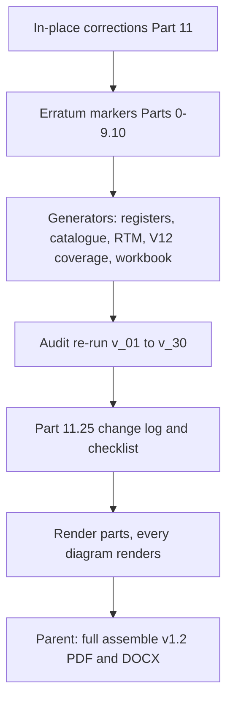

# AI Growth Engine: Employee Sales & Marketing Automation
## Application Blueprint: PART 11 (Batch 11.25), Release v1.2 Consolidation: Change Log and Release Readiness

| Field | Value |
|---|---|
| Document | Part 11.25: consolidation of release **v1.2** — every in-place correction made to the Part 11 files, the erratum markers inserted in Parts 0–9.10, the regenerated registers and generators, the re-measured independent audit (DEC-970) and the release-readiness checklist for development handoff. Generated by `assembly/build_consolidation_log.py` from the consolidation outputs; the companion Part 11.25b is the generated v1.2 catalogue of agents, automations and workflows |
| Version | 1.2 · 28 Nov 2026 |
| Baseline | Parts 0–9.10 and 0B (v1.1), Parts 11.0–11.24 (customer revision V12 and Founder adoption), Founder decisions DEC-770…791 (Part 11.14), errata E-V-01…50 (Part 11.23c) |
| Precedence | Part 11.14 decisions > Part 11.23c errata > Part 11 parts > Parts 0–9.10 (DEC-961 restated by DEC-1005) |
| ID ranges used | DEC-1000…1012 (of 1000…1019) · tags 1220…1229 (of 1220…1239) · no new FR, story, test, screen, agent or automation IDs |
| Roles applied | Chief editor · Configuration manager · Build engineer · Principal Business Systems Analyst · Security, data and AI-governance reviewers · QA lead |

**How to use this part.** A developer reads Part 11.24 first (build and deploy), then the errata of Part 11.23c, the Founder decisions of Part 11.14 and the checklist of §11.25.5.4 here. A reviewer who needs to know *what changed in v1.2* reads §11.25.3 (every edit) and §11.25.5.1 (every erratum marker). Acronyms: AC acceptance criteria · DDL data definition language · PDP Policy Decision Point · RLS row-level security · RTM requirements traceability matrix · SoD separation of duties.

---

## 11.25.1 Material reviewed

| Item | What was read | Purpose |
|---|---|---|
| Briefs | `.brief/SHARED_BRIEF.md`, `V12_BRIEF.md`, `V12B_BRIEF.md` | Writing, ID and template rules; V12 and Founder-adoption rules |
| Founder decisions | Part 11.14 DEC-770…791 | What is decided; the conflict → decision map used in §11.25.3.3 |
| Errata | Part 11.23c E-V-01…50 (47 entries) and `assembly/v12b/v_out/errata_occurrences.csv` | Stale statements, binding rules, locations of every stale line |
| Inconsistency lists | Part 11.24c §11.24.16.2; Parts 11.15d/e (GAP-1172…1174, quality-gate observations), 11.20b §11.20.16.2, 11.21e §11.21.12.2, 11.22a §11.22.4.3 and 11.22f §11.22.6 | The defects corrected in place (§11.25.3) or routed to errata (§11.25.5.1) |
| Canonical schema | `final/build/schema.sql` (Appendix C / C3 names) and the migrations in `final/build/migrations/` | Column, status and key names for the connector activation check |
| Part set | 144 Markdown parts (Parts 0–9.10, 0B, 11.0–11.25b) | Inputs to every generator and to the audit |

## 11.25.2 Coverage summary (before → after this consolidation)

| Measure | Before v1.2 consolidation | After (release v1.2) | Source |
|---|---|---|---|
| Open conflicts in Part 11 | 1 (CONFLICT-1215) + 2 proposed (CONFLICT-1140, 1149 wording) | **0** | §11.25.6 |
| "Pending Founder decision" status cells in Part 11 requirement, aspect, conflict and decision rows | 433 | **0** (replaced by "Adopted (DEC-7xx)" per DEC-770…791; 13 coverage registers, 1,532 rows updated) | §11.25.3.3 |
| Part 11 stories without Gherkin AC | 49 | **0** (721 / 721 stories in Parts 11.1–11.22 with AC; 730 V12 stories incl. Part 11.23) | §11.25.3.6 |
| Untitled agent stories (Part 11.6b) | 6 | **0** | §11.25.3.6 |
| Workflow FRs FR-V12-O-037…084 traced from EP-32/33 story rows | 0 / 48 | **48 / 48** | §11.25.3.6 |
| Stale lines measured by the errata scan (`v_20_errata.py`) | 1,681 (Part 11.23 run) | **1,214** (1,579 matching lines; markers excluded) | §11.25.5.3 |
| Baseline sections of Parts 0–9.10 carrying a stale statement without a pointer | 187 sections | **0** (187 erratum markers in 58 files) | §11.25.5.1 |
| Registers covering Part 11 (decisions, tags, ADRs, RTM, catalogue) | v1.1 only (346 decisions) | **789 decisions, all Part 11 logs, V12 RTM, v1.2 catalogue** | §11.25.4 |

## 11.25.3 Detailed register of in-place corrections

Every edit is surgical: the sentence, row or code block that was wrong is replaced; nothing else in the file moves. The full row-level list (file, occurrences, change) is `final/consolidation_v1.2_changes.csv` and the workbook sheet *Change Log v1.2*.

### 11.25.3.1 (a) Connector activation check (CONFLICT-1215)

| Item | Before | After (binding) |
|---|---|---|
| Predicate of `ge.connector_pack_guard()` (Part 11.19a DDL-V12-R-09) | `jurisdiction_pack p WHERE p.market = m AND p.status = 'approved'` — `market` is a V0005 patch column and the Appendix C status vocabulary is `Draft / Pending legal review / Approved / Retired`, so every production activation failed (fail closed but wrong) | For every market `m` in `NEW.markets`: at least one pack with `jurisdiction = m`, `status = 'Approved'`, counsel sign-off and in force on `current_date`; **and** every pack that `ge.rulepack_requirement` lists for the connector's capability in `m` (the same join as `ge.fn_activation_gate()`; provider → capability: `sms_dlt_aggregator` → `outreach.sms`, `whatsapp_bsp` → `outreach.whatsapp`, `ses` → `outreach.email`, `voice_cpaas` → `voice.ai_calls`, `payments` → `payments.mandated`) is Approved, signed and in force |
| Files changed | — | Part 11.19a; `final/build/schema.sql`; `final/build/migrations/V0006__ddl_v12_r_platform_decisions.sql`; source fragment `assembly/v12b/R_frag/a_c3.md`; status rows in Parts 11.24b/c |
| Verification | — | PostgreSQL 16.15 scratch cluster: `db-verify` gate 42/42 PASS (TC-W-DB-01…42) on clean IN and EU databases; four guard cases: no approved IN pack → `CONNECTOR_MARKET_PACK_NOT_APPROVED`; RP-IN-SMS, RP-IN-DPDP and RP-IN-ADV Approved with sign-off → insert accepted (was rejected before the fix); market EU without a pack → rejected; one required pack back to Draft → rejected |

### 11.25.3.2 (b) Role R21 clash (CONFLICT-1140)

R21 stays the **agency / managed-service operator** of Part 2.6 §2.6.5.3.2 (baseline). The invited-investor portal role of Part 11.16a takes the next free role ID, **R22** (R22 was unused as a role; `DM-R22` of Part 6.5 is a story-dimension row, not a role). DEC-1001 adopts the proposal DEC-946.

| File | Occurrences | Rule applied |
|---|---|---|
| Part 11.16a | 34 | invited-investor role R21 renamed R22 (all occurrences are the investor role) |
| Part 11.16a | 1 | role definition row note |
| Part 11.16e | 9 | invited-investor role R21 renamed R22 (all occurrences are the investor role) |
| Part 11.20a | 2 | invited-investor role R21 renamed R22 (all occurrences are the investor role) |
| Part 11.20b | 2 | invited-investor role R21 renamed R22 (all occurrences are the investor role) |
| Part 11.22a | 1 | investor-context R21 -> R22 (agency-operator R21 lines kept) |
| Part 11.22a | 1 | trace anomaly #4 status |
| Part 11.22c | 36 | invited-investor role R21 renamed R22 (all occurrences are the investor role) |
| Part 11.22d | 216 | invited-investor role R21 renamed R22 (all occurrences are the investor role) |
| Part 11.22e | 2 | investor-context R21 -> R22 (agency-operator R21 lines kept) |
| Part 11.22e | 1 | journey roles row |
| Part 11.22e | 1 | reading note |
| Part 11.22f | 1 | CONFLICT-1140 status |
| Part 11.22f | 1 | DEC-946 authority |
| Part 11.22f | 1 | tag register status |
| Part 11.24a | 1 | invited-investor role R21 renamed R22 (all occurrences are the investor role) |
| Part 11.24b | 1 | invited-investor role R21 renamed R22 (all occurrences are the investor role) |
| `U_coverage.csv` | 1 | FR-V12-N-015 text |
| `api_index.csv` | 5 | investor-context R21 -> R22 in generated artefact |
| `env_catalogue.csv` | 1 | ENV-07 external identities R22 |
| `openapi.yaml` | 10 | investor-context R21 -> R22 in generated artefact |
| `openapi.yaml` | 1 | BFF-web cookie roles |
| Parts 11.21a/b/c/e | kept | Every R21 there is the agency operator (EXT-MSP delegation grant) — unchanged |

### 11.25.3.3 (c) Founder decisions still marked open

**Investor mode.** FR-V12-A-006 (Part 11.1b), FR-V12-G-117, US-19-YG38 and AC-V12-G-02 (Part 11.7c) forbade any investor entity, route or mode. They are amended to **product separation** under DEC-783/DEC-947: investor entities, routes and terms exist only in the separate Investment Automation product code (Parts 11.16a–e, `inv` schema, investor website W55–W99); the Sales & Marketing build still carries none, and an SM-only tenant gets 404 on `/api/v1/investor/*`. TC-V12-A-006, TC-V12-G-233/234 are amended accordingly and AC-V12-G-02b is added (investor storefront gated by the INV entitlement and an Approved securities pack).

**Status cells.** 434 "Pending Founder decision" status cells in Part 11 FR, aspect, step, conflict and decision rows now read **"Adopted (DEC-7xx)"** with the deciding decision. Mapping order: (1) the conflict ID in the row, via the Part 11.14 conflict → decision map (§11.14.2); for multi-decision conflicts (CONFLICT-760, 761, 834, 854, 946) the subject keywords choose between the candidate decisions; (2) an earlier pending decision in the row (DEC-548/549/562 → DEC-779, DEC-572 → DEC-782, DEC-686 → DEC-770, DEC-715 → DEC-773 …); (3) subject keywords; (4) DEC-791 ("every other pending item"). **Not touched:** "status before" columns and the before-side of "before → after" cells; count-table label rows (they record the count at the time of writing); quoted meta text in Parts 11.14, 11.17b, 11.20b, 11.22a/f and 11.23 that describes the stale wording. Per-part status and reading lines that still count "Pending Founder decision" carry a one-line v1.2 annotation. The coverage registers `A…M_coverage.csv` were updated the same way in the `status_after` column only (1,532 rows; `status_before` untouched). Part 11.14 §11.14.2 is completed (no pending item remains).

| Deciding decision | Cells | Deciding decision | Cells | Deciding decision | Cells |
|---|---|---|---|---|---|
| DEC-770 | 3 | DEC-771 | 6 | DEC-772 | 42 |
| DEC-773 | 13 | DEC-774 | 12 | DEC-775 | 30 |
| DEC-776 | 28 | DEC-777 | 4 | DEC-779 | 77 |
| DEC-780 | 23 | DEC-781 | 9 | DEC-782 | 47 |
| DEC-783 | 24 | DEC-784 | 9 | DEC-785 | 18 |
| DEC-786 | 2 | DEC-787 | 4 | DEC-788 | 19 |
| DEC-789 | 6 | DEC-790 | 32 | DEC-791 | 25 |

| Part | Cells replaced | Part | Cells replaced | Part | Cells replaced |
|---|---|---|---|---|---|
| Part 11.10a | 1 | Part 11.10c | 9 | Part 11.11a | 22 |
| Part 11.11b | 29 | Part 11.12 | 3 | Part 11.13a | 3 |
| Part 11.13b | 13 | Part 11.18d | 8 | Part 11.1a | 60 |
| Part 11.1b | 16 | Part 11.2a | 24 | Part 11.2b | 1 |
| Part 11.2c | 10 | Part 11.3a | 1 | Part 11.3b | 14 |
| Part 11.3c | 35 | Part 11.4a | 2 | Part 11.4c | 33 |
| Part 11.4d | 35 | Part 11.5a | 16 | Part 11.5b | 12 |
| Part 11.6a | 22 | Part 11.6b | 12 | Part 11.7a | 19 |
| Part 11.7c | 10 | Part 11.8a | 7 | Part 11.8b | 9 |
| Part 11.9a | 2 | Part 11.9c | 6 |  |  |

### 11.25.3.4 (d) Part 11.18a voice rules (Parts 11.15d/e as the source)

| Rule | Before (Part 11.18a) | After (binding) | Source |
|---|---|---|---|
| France | "Reported move to opt-in from Aug 2026 [GAP-1068]"; **Bloctel** scrub (≤ 30 days) with result `REGISTRY_BLOCKED_BLOCTEL` | **Opt-in from 11 Aug 2026**: prior consumer consent kept per décret n° 2026-662, valid ≤ 1 year; existing-contract exception; **Bloctel discontinued 11 Aug 2026** — the scrub row is replaced by a consent-ledger check (`NO_CALL_CONSENT`, `FR_CONSENT_EXPIRED`); contracts after an unlawful call are blocked | VR-69 (Part 11.15d); RP-EU-VOICE-003 (Part 11.15e); GAP-1172 closed |
| US revocation | "Revocation … honoured within 10 business days (parts delayed to 31 Jan 2027, VR-30)" | The FCC **Sept 2026 Report and Order** revises the "revoke all" provision of 47 CFR 64.1200(a)(10) (effective 30 days after Federal Register publication, verify); the platform keeps **immediate, seller-wide** revocation for all marketing calls and texts | VR-67 (Part 11.15d); RP-US-VOICE-009 (Part 11.15e); DEC-769(d); GAP-1173 closed. Also corrected: **VR-30** in Part 11.15a and the effective-dates line of the US e-mail pack (Part 11.15b, table and YAML) |
| India window | Effective window 09:00–21:00 for all IN calls | **Promotional 09:00–19:00 Mon–Sat; service 09:00–21:00** (Sunday promotional calls held); the stricter pack window wins over the DEC-777 default | DEC-769(b); RP-IN-SMS-009, RP-IN-VOICE-008 (Part 11.15e); GAP-1174 closed for the blueprint text (TRAI legal window still with counsel C-22) |
| Test oracle | `q_voice_combinatorial.py` modelled Bloctel and an IN 09:00–21:00 window | Oracle patched (EU-FR: no registry; IN: Mon–Sat promotional window) and regenerated; 46 changed rows replaced in place in Parts 11.18c (8) and 11.18d (38); outcome mix ALLOW 14 → 16, HOLD 49 → 47, BLOCK 72 unchanged; row counts and IDs unchanged | `assembly/v12b/q_voice_combinatorial.py`, `q_out/` |

### 11.25.3.5 (e) Part 11.10c rule R-8

R-8 said every consequential effect in a test stays L1 and that no test may assert an AI-executed payment or bid submission. It now reads (DEC-779, DEC-921): a consequential effect needs **either** a human approval bound to the payload hash (L1/L2) **or** an Active, eligible two-person bounded mandate with every PDP dispatch rule passing (L3/L4); tests **must** assert system-executed payments, agentic-commerce orders and bid submissions under such mandates, and that the same effect without a mandate stays L1; no test may assert an AI-executed contract signature, an autonomous price outside an approved price-book revision, or a mandated securities-governed INV action (DEC-822, DEC-963).

### 11.25.3.6 (f) Missing story details

| Item | Correction | Where |
|---|---|---|
| 6 untitled agent stories | Titles added to the heading and the Gherkin feature: US-04-YF24 *Cheapest passing Claude tier with at most one escalation (AU-152)*; US-04-YF25 *Locale-specific EVAL gate blocks unevidenced AI steps (AU-154)*; US-04-YF26 *Cost per accepted result with rejected outputs in the denominator (AU-158)*; US-03-YF27 *Send preflight decision table with fixed precedence (AU-171)*; US-18-YF28 *Approval bound to the exact payload digest; stale approvals rejected (AU-175)*; US-04-YF29 *Tenant fair-share scheduling protects interactive AI latency (AU-160)*. US-03-YF27's window aligned to RP-IN-SMS-009 | Part 11.6b; catalogue rows in Part 11.22f (GAP-1147 closed) |
| 49 stories without AC | One Gherkin feature per story, a happy-path and a negative or edge scenario, IDs `AC-<epic><story>-nn`, inserted under each source story table (list below). Re-inventory (`u_01_inventory.py`, U_MAXPART=22): **721 of 721 stories with AC; 0 FRs whose stories lack AC** | Parts 11.1b (19), 11.5b (15), 11.8b (5), 11.12 (5), 11.13b (5); AC column of Part 11.22f |
| Story → FR links (GAP-1146) | 19 `Traces` rows of the EP-32/EP-33 stories now name the workflow FRs: INV-SVC-*nn* WF0*k* → FR-V12-O-(037 + 4·(*nn* − 13) + *k* − 1), all **48** of FR-V12-O-037…084 | Part 11.16d; GAP-1146 and RECOMMENDATION-1146 updated in Part 11.22f |

| Source part | Stories that received AC |
|---|---|
| Part 11.12 | US-18-YL01, US-19-YL02, US-20-YL03, US-18-YL04, US-21-YL05 |
| Part 11.13b | US-21-YM08, US-18-YM26, US-17-YM36, US-04-YM37, US-03-YM38 |
| Part 11.1b | US-20-YA02, US-20-YA03, US-20-YA04, US-20-YA05, US-20-YA06, US-20-YA07, US-20-YA08, US-19-YA02, US-19-YA03, US-02-YA01, US-17-YA01, US-17-YA02, US-03-YA02, US-04-YA01, US-16-YA01, US-16-YA02, US-21-YA01, US-21-YA02, US-21-YA03 |
| Part 11.5b | US-01-YE09, US-01-YE10, US-03-YE01, US-15-YE01, US-18-YE02, US-20-YE02, US-20-YE04, US-20-YE08, US-20-YE12, US-20-YE13, US-20-YE14, US-20-YE15, US-20-YE16, US-21-YE03, US-21-YE04 |
| Part 11.8b | US-01-YH02, US-01-YH04, US-03-YH01, US-20-YH01, US-21-YH01 |

### 11.25.3.7 (g) Part 11.17a SMS outreach-mandate table

The MT-OUT row of the mandate-type table (§11.17.5.3) listed SM-SVC-38 (SMS/RCS) as a typical mandated workflow, while the binding eligibility register (§11.17.5.14) gives SM-SVC-38 no mandate path. The table now lists exactly the 12 register workflows and states that SM-SVC-38 dispatches per message at ≤ L2 (DEC-1003; Part 11.21e inconsistency #4 closed). The stale note "Part 11.15 does not yet contain these packs" (§11.17.5.15) now points to the binding gating table of Part 11.15d §11.15.22.5.

### 11.25.3.8 Other files touched

| File | Change |
|---|---|
| Part 11.19a | connector_pack_guard(): predicate now uses jurisdiction_pack.jurisdiction / pack_code, status 'Approved', counsel sign-off, effective dates and the rulepack_requirement join of fn_activation_gate(); same patch applied to final/build/schema.sql, migrations/V0006 and assembly/v12b/R_frag/a_c3.md; verified on PostgreSQL 16.15 (4 cases) and 42/42 DB tests |
| Part 11.24b | 11.24b gate row points to the corrected guard |
| Part 11.24c | CONFLICT-1215 status |
| Part 11.24c | inconsistency #4 status |
| Part 11.24c | status line |
| Part 11.11b | present-tense pending statement |
| Part 11.14 | 11.14 closing sentence aligned with DEC-791 |
| Part 11.14 | 11.14.2 completed: no pending items; mapping table |
| Part 11.14 | 11.14 version row |
| Part 11.1b | FR-V12-A-006 amended from 'no investor entity' to product separation per DEC-783 |
| Part 11.1b | TC-V12-A-006 amended |
| Part 11.22f | GAP-1148 status |
| Part 11.3a | present-tense pending statement |
| Part 11.4a | heading |
| Part 11.7c | FR-V12-G-117 amended per DEC-783 |
| Part 11.7c | US-19-YG38 amended per DEC-783 |
| Part 11.7c | AC-V12-G-02 amended; AC-V12-G-02b added |
| Part 11.7c | TC-V12-G-233 amended |
| Part 11.7c | TC-V12-G-234 amended |
| Part 11.10c | R-8 reworded per DEC-779/DEC-921 |
| Part 11.10c | R-8 follow-on sentence |
| Part 11.21e | inconsistency #1 status |
| Part 11.17a | MT-OUT typical workflows aligned with eligibility register (SM-SVC-38 removed) |
| Part 11.17a | stale 'packs not yet in Part 11.15' note replaced by pointer to §11.15.22.5 (reported in 11.15e quality gate) |
| Part 11.21e | inconsistency #4 status |
| 20 Part 11 files | Per-part status or reading line annotated: "every item counted here as Pending Founder decision was adopted by DEC-770…791" |

## 11.25.4 Register reconciliation (regenerated)

### 11.25.4.1 Release v1.2 totals

| Register | v1.1 | v1.2 | How counted |
|---|---|---|---|
| Decisions | 346 | **789** | distinct DEC rows in 38 decision logs (`final/dec_index.csv`; Parts 0A, 8.4, 9.1, 9.5–9.10 and every Part 11 file except the generated 11.0); per log in `dec_counts_by_log.csv` |
| Tags (assumption / gap / conflict / recommendation) | — | **358 / 335 / 278 / 369** | `final/register_*.csv` (3- and 4-digit IDs); every conflict resolved, every recommendation accepted (no rejecting DEC) |
| ADRs | — | **228** | `final/adr_index.csv` |
| AI agents | 80 | **179** | Part 9.4 (80) + Part 11.25b (AG-081…219, 99 defined) |
| Automations | 119 | **273** | Part 9.4 (119) + Part 11.25b (AU-120…299, 154 defined) |
| Workflows | 38 | **58** blueprint WF + **156** SM-SVC + **96** INV = **310** | WF-01…60 (WF-24, WF-40 unused); 39 × 4 and 24 × 4 service workflows |
| User stories | 461 | **1,191** (461 + 730 V12) | count of record + every US-<EP>-Y*/Z* defined in Part 11 (RTM V12) |
| Test cases | 4,156 | **13,710** (4,156 + 9,554 V12) | count of record (E-V-42) + every TC-V12-* and TC-W-* defined as a table row in Part 11 |
| FR-V12 requirements | — | **1,448** | defined rows and requirement blocks |
| API operations | 579 | **1,122** (API (baseline) 555, API-ADV 43, API-ENH 24, API-V12 500) | `final/build/api_index.csv` = OpenAPI 3.1 contract of Part 11.24 |
| Screens | 147 + 71 | **368** (269 Admin A001–A269, 99 Website W01–W99) | screen-ID registry (DEC-962); colliding V12 IDs are aliases `V12-A1xx`/`V12-W3x`; next free A270, W100 |

### 11.25.4.2 Traceability V12 (`final/RTM_v12.csv`)

| Item | Traced | Total | Share | Rule |
|---|---|---|---|---|
| FR-V12 | 1,448 | 1,448 | 100.0% | test linked directly, through the story, or a story with Gherkin AC |
| Story V12 | 730 | 730 | 100.0% | Gherkin AC and an FR or test |
| Test V12 | 9,365 | 9,554 | 98.0% | linked to an FR, story, agent, automation, workflow, service, API or DDL ID (row or section) |
| Agent V12 | 103 | 103 | 100.0% | FR, story or test |
| Automation V12 | 157 | 158 | 99.4% | FR, story or test |
| Workflow V12 | 18 | 20 | 90.0% | FR, story or test |

The open test rows are database, API-contract and coding-standard checks that trace to a decision or rule pack rather than to an FR (for example TC-W-DB-*, TC-V12-J coding rules); the three open catalogue items (AU-234, WF-43, WF-58) trace to rule packs and approval records [GAP-1223].

### 11.25.4.3 Generators extended and run

| Generator | v1.2 change | Result |
|---|---|---|
| `build_registers.py` | Every Part 11 file is a decision log; tag and DEC numbers of 3 or 4 digits (ranges and short lists too); per-log counts; Part 9.2 generated blocks rewritten only with `--write-part92` (baseline frozen, DEC-1004) | 789 decisions, 1340 tags, 228 ADRs |
| `build_ai_catalogue.py` | Parses Part 11 agent cards, standard automation tables, WF-41…60 cards and the 156 SM-SVC + 96 INV service workflows into Part 11.25b; Part 9.4 rewritten only with `--write-part94` (it regenerates byte-identical apart from its erratum markers) | 179 agents, 273 automations, 58 WF, 156 + 96 service workflows |
| `build_rtm_adv.py` | V12 RTM: FR-V12-*, US-*-Y*/Z*, TC-V12-*, TC-W-*, AG/AU/WF of Part 11; links from table rows, card blocks, section context, compressed FR numbers and the story inventory | 12,013 rows in `RTM_v12.csv` |
| `build_v12_coverage.py` | Groups N, O, P, Q, R and U added (S and T have no register CSV); "Adopted (DEC-7xx)" read as a Founder-decision match; the independent audit (group V) reported separately | Part 11.0 regenerated: 100.00% (39,404 / 39,404) matched, 0 pending |
| `build_coverage_report.py` | Re-run unchanged | Part 0B regenerated byte-identical |
| `build_xlsx.py` | Workbook v1.2; new sheets FR-V12, Traceability V12, V12 Coverage, V12 Audit, Supersession Index, API Index, Errata, Erratum Markers v1.2, Change Log v1.2; decisions from `dec_index.csv`; 4-digit tags | `final/AI_Growth_Engine_Blueprint_Workbook_v1.2.xlsx` |
| `assemble.py`, `render_pdf.js` | Version 1.2, header "Confidential · v1.2 · 28 Nov 2026", default output `AI_Growth_Engine_Application_Blueprint_v1.2`; `PART_RE` numeric sort verified (11.2a < 11.10a < 11.15d < 11.15e < 11.20a … 11.25 < 11.25b) | Not run here (the parent runs the full assemble) |

## 11.25.5 Enhancements

### 11.25.5.1 Erratum markers inserted in Parts 0–9.10

For every stale line that the Part 11.23 scan located in Parts 0–9.10 (298 lines, 20 errata), one short blockquote now sits at the top of the affected section (the nearest level-2 to level-4 heading above the line; one marker per section, naming every erratum that applies there): `> **Erratum v1.2 (E-V-##):** superseded by <current rule> (DEC). See Part 11.23c.` No other baseline text was changed, so the retention audit still sees the v1.1 text (DEC-1004). **187 markers in 58 files.**

| Erratum | Sections marked | Erratum | Sections marked | Erratum | Sections marked | Erratum | Sections marked |
|---|---|---|---|---|---|---|---|
| E-V-01 | 16 | E-V-02 | 15 | E-V-04 | 3 | E-V-05 | 24 |
| E-V-06 | 4 | E-V-09 | 45 | E-V-10 | 8 | E-V-16 | 6 |
| E-V-17 | 8 | E-V-18 | 3 | E-V-19 | 17 | E-V-21 | 12 |
| E-V-25 | 6 | E-V-26 | 4 | E-V-27 | 7 | E-V-28 | 4 |
| E-V-33 | 8 | E-V-35 | 3 | E-V-37 | 1 | E-V-39 | 42 |

| File | Markers | Errata |
|---|---|---|
| Part 0 | 5 | E-V-01, E-V-02, E-V-09, E-V-18, E-V-19, E-V-39 |
| Part 0A | 2 | E-V-02, E-V-09, E-V-27, E-V-39 |
| Part 1 | 2 | E-V-19, E-V-39 |
| Part 2.2 | 1 | E-V-01 |
| Part 2.3 | 2 | E-V-02, E-V-17 |
| Part 2.6 | 2 | E-V-19, E-V-39 |
| Part 2.7a | 3 | E-V-27, E-V-39 |
| Part 3.1 | 15 | E-V-05, E-V-06, E-V-09, E-V-10 |
| Part 3.2 | 5 | E-V-05, E-V-09, E-V-16 |
| Part 3.3 | 14 | E-V-04, E-V-05, E-V-06, E-V-09, E-V-16, E-V-33 |
| Part 3.4 | 9 | E-V-09, E-V-19, E-V-39 |
| Part 3.5b | 1 | E-V-21 |
| Part 3.6a | 2 | E-V-09, E-V-33 |
| Part 3.6b | 3 | E-V-09, E-V-33 |
| Part 4.2 | 2 | E-V-09, E-V-10 |
| Part 4.3 | 2 | E-V-09, E-V-37 |
| Part 4.4a | 4 | E-V-09, E-V-19 |
| Part 4.4b | 2 | E-V-09, E-V-19, E-V-39 |
| Part 5.1a | 2 | E-V-17, E-V-39 |
| Part 5.1b | 2 | E-V-05, E-V-17 |
| Part 5.1c | 1 | E-V-39 |
| Part 5.2 | 4 | E-V-02, E-V-17, E-V-39 |
| Part 5.3 | 5 | E-V-01, E-V-09, E-V-27, E-V-39 |
| Part 6.1 | 6 | E-V-02, E-V-09, E-V-17, E-V-27, E-V-39 |
| Part 6.2a | 1 | E-V-17 |
| Part 6.2b | 1 | E-V-39 |
| Part 6.3a | 1 | E-V-01 |
| Part 6.3b | 3 | E-V-09 |
| Part 6.4 | 3 | E-V-01, E-V-26 |
| Part 6.5 | 2 | E-V-05, E-V-17 |
| Part 6.6 | 1 | E-V-09 |
| Part 6.7 | 2 | E-V-09, E-V-39 |
| Part 6.8c | 1 | E-V-09 |
| Part 6.9a | 3 | E-V-39 |
| Part 6.9b | 2 | E-V-39 |
| Part 7.1 | 1 | E-V-01, E-V-02 |
| Part 7.2 | 3 | E-V-02, E-V-26, E-V-39 |
| Part 7.3 | 1 | E-V-01 |
| Part 7.4a | 2 | E-V-19, E-V-39 |
| Part 7.4b | 3 | E-V-19, E-V-39 |
| Part 8.1 | 3 | E-V-39 |
| Part 8.2 | 2 | E-V-01, E-V-10, E-V-39 |
| Part 8.3a | 1 | E-V-21 |
| Part 8.3c | 5 | E-V-09, E-V-19 |
| Part 8.4 | 1 | E-V-05 |
| Part 9.1 | 1 | E-V-09, E-V-18, E-V-39 |
| Part 9.2 | 10 | E-V-01, E-V-02, E-V-05, E-V-06, E-V-09, E-V-10, E-V-16, E-V-18, E-V-19, E-V-21, E-V-25, E-V-27, E-V-28, E-V-35, E-V-39 |
| Part 9.4 | 3 | E-V-01, E-V-35 |
| Part 9.5 | 6 | E-V-21, E-V-25, E-V-39 |
| Part 9.6a | 9 | E-V-01, E-V-02, E-V-05, E-V-09, E-V-19, E-V-21, E-V-39 |
| Part 9.6b | 7 | E-V-02, E-V-05, E-V-09, E-V-19, E-V-21 |
| Part 9.7a | 2 | E-V-01, E-V-02, E-V-21 |
| Part 9.7b | 1 | E-V-26 |
| Part 9.8a | 1 | E-V-02, E-V-21 |
| Part 9.8b | 1 | E-V-02, E-V-21 |
| Part 9.9a | 4 | E-V-02, E-V-05, E-V-21, E-V-28 |
| Part 9.9b | 2 | E-V-01, E-V-28 |
| Part 9.10 | 2 | E-V-05, E-V-25 |

### 11.25.5.2 Front matter and precedence

`assembly/front_matter.md` now carries the v1.2 document-control row, the v1.2 precedence statement (**Part 11.14 decisions > Part 11.23c errata > Part 11 parts > Parts 0–9.10**, DEC-1005), the recomputed decision count, a "How to read this for developers" pointer to Part 11.24, a Part 11 row in the reading guide, and executive-summary sentences aligned with DEC-421/772 (hosting), DEC-779…781 (mandated payments and bids) and DEC-783 (investor product).

### 11.25.5.3 Audit re-run (DEC-970) against the full final part set

The Part 11.23 scripts were re-run on the final part set (141 files without Part 11.23 for "before", 144 files for "after"). Erratum markers are skipped by every scan (they are pointers, not content), and the register-presence check now counts IDs defined in Part 11.23 (the registers are regenerated over every part).

| Measure | Part 11.23 run | v1.2 re-run | Script |
|---|---|---|---|
| V12 statements extracted | 19,274 | 19,274 | `v_01_extract.py` |
| Measured lexical match, before Part 11.23 | 94.58% | 94.63% | `v_02_match.py before` |
| **Measured lexical match, after** | **96.04%** | **96.06%** | `v_02_match.py after` |
| Levels exact / strong / moderate / weak / none (after) | 5,328 / 10,828 / 2,355 / 755 / 8 | 5,327 / 10,827 / 2,360 / 752 / 8 | `v_02_match.py after` |
| ID presence, literal + range (after) | 100.00% | 100.0% | `v_02_match.py after` |
| Threshold presence (after) | 98.29% | 98.43% | `v_02_match.py after` |
| End state: matched / covered in different words / restored / superseded | 18,194 / 910 / 164 / 6 | 18,206 / 898 / 164 / 6 | `v_03`, `v_04` (+1 manual classification, VS-010371), `v_30` |
| Unclassified statements | 0 | 0 | `v_04_classify.py` |
| Baseline IDs checked / missing | 10,569 / 0 | 10,569 / 0 | `v_10_baseline.py` |
| Retained unchanged / amended / superseded | 10,349 / 209 / 11 | 10,345 / 212 / 12 | `v_11_supersession.py` |
| Errata / stale lines | 47 / 1,681 | 47 / 1,214 | `v_20_errata.py` |
| Screen-ID definition clashes | 0 | 0 | `v_21_screen_clash.py` |

**Reading.** The match rose slightly because Parts 11.20–11.25 add text; amended and superseded baseline IDs rose (209 → 212, 11 → 12) because the v1.2 corrections state more supersessions explicitly. Stale lines fell by about a third: the status cells of §11.25.3.3 and the voice, R-8, investor and mandate corrections removed most E-V-46 occurrences (773 → 310), while the scan now also covers Parts 11.20–11.22 and 11.24, which were not present at the Part 11.23 run (ASSUMPTION-1182). Every remaining stale line is governed by its erratum (DEC-961); Part 11.23's headline tables carry the v1.2 figures in an added column.

### 11.25.5.4 Release-readiness checklist for development handoff

| # | Check | Evidence | Status |
|---|---|---|---|
| RR-01 | Every V12 aspect has an end state; no Founder decision pending | Part 11.0: 100.00% (39,404 / 39,404); Part 11.14 §11.14.2 empty | Pass |
| RR-02 | Independent audit re-run on the final part set (DEC-960/970) | 96.06% measured; 100% classified; 0 baseline IDs missing | Pass |
| RR-03 | Precedence and errata visible where old text is read | Front matter; 187 erratum markers in Parts 0–9.10; Part 11.23c | Pass |
| RR-04 | No open conflict | CONFLICT-1215, 1140, 1149 resolved (§11.25.6); register_conflicts: all resolved | Pass |
| RR-05 | One OpenAPI contract and one ordered schema | 1,122 operations (Part 11.24, 0 validator errors); schema.sql applies on clean IN and EU | Pass |
| RR-06 | Database gate (db-verify) after the v1.2 DDL change | TC-W-DB-01…42: 42/42 PASS on PostgreSQL 16.15 (verify the Supabase major version at provisioning) | Pass |
| RR-07 | Connector activation reads canonical names | §11.25.3.1; four guard cases verified | Pass |
| RR-08 | RBAC role IDs unique | R21 agency operator, R22 invited investor; OpenAPI x-roles and ENV-07 updated | Pass |
| RR-09 | Every story has AC; every FR has a story with AC | 721/721 (Parts 11.1–11.22) + 9 (Part 11.23); 0 FRs without | Pass |
| RR-10 | Every FR-V12 traced to a test or AC; tests traced | RTM V12: FR 1448/1448; tests 9365/9554 | Pass with note (GAP-1223) |
| RR-11 | Agents and automations carry guardrail, fallback, KPI and cost | Agent cards and AU tables of the source parts; catalogue Part 11.25b | Pass |
| RR-12 | Voice, SMS and window rules current | France opt-in, US revocation, India Mon–Sat window (§11.25.3.4); oracle regenerated | Pass (counsel C-22/C-23/C-24 confirmation open) |
| RR-13 | Mandate tests assert the mandated path | R-8 reworded (§11.25.3.5); MP-07 of Part 11.21a | Pass |
| RR-14 | Workbook and registers regenerated | `AI_Growth_Engine_Blueprint_Workbook_v1.2.xlsx`; `final/*.csv`; Part 11.0; Part 11.25b | Pass |
| RR-15 | Rendered parts: every Mermaid diagram renders | `make_pdf.sh` on every edited Part 11 file, 11.25 and 11.25b | Pass |
| RR-16 | Full assemble (PDF + DOCX v1.2) | `python3 assembly/assemble.py` — long run, executed by the release owner | Pending (parent run) |
| RR-17 | Jurisdiction rule packs signed by counsel before activation | Part 11.15 sign-off blocks; activation matrix Part 11.24b | Gate per market (not a documentation item) |

## 11.25.6 Conflicts and resolutions

| Tag | Conflict | Resolution | Status |
|---|---|---|---|
| CONFLICT-1215 | Connector activation check used lowercase `approved` and a `market` key (Part 11.19a) against Appendix C `Approved` and `pack_code`/`jurisdiction` | Predicate replaced (§11.25.3.1) | Resolved (DEC-1000) |
| CONFLICT-1140 | R21 = agency operator (Part 2.6) and invited investor (Part 11.16a) | Investor = R22 everywhere in Part 11 and the build artefacts | Resolved (DEC-1001, adopting DEC-946) |
| CONFLICT-1149 | FR-V12-A-006 / US-19-YG38 forbade investor mode against DEC-783 | Amended to product separation (§11.25.3.3) | Resolved (DEC-1008, implementing DEC-947) |
| CONFLICT-1129 | Part 11.10c R-8 L1 cap against DEC-779…781 | R-8 reworded (§11.25.3.5) | Resolved (DEC-1007, implementing DEC-921) |

No new conflict was raised by the consolidation.

## 11.25.7 Decisions

| DEC | Decision | Authority | Effect |
|---|---|---|---|
| DEC-1000 | The connector activation check uses the Appendix C names: `jurisdiction_pack.jurisdiction`/`pack_code`, status `Approved`, counsel sign-off and effective dates, and the `rulepack_requirement` join of `fn_activation_gate()` per connector capability | Consolidation lead (release v1.2); schema owner Part 11.24 | Resolves CONFLICT-1215; Part 11.19a, schema.sql, V0006 corrected; db-verify 42/42 |
| DEC-1001 | Invited investor = **R22**; R21 stays the Part 2.6 agency / managed-service operator | Consolidation lead; adopts proposal DEC-946 | Resolves CONFLICT-1140; Parts 11.16, 11.20, 11.22, 11.24, OpenAPI, api_index, env catalogue |
| DEC-1002 | "Pending Founder decision" status cells in Part 11 rows are replaced by "Adopted (DEC-7xx)" naming the deciding decision; before-status columns, count labels and quoted meta text keep their historical wording, annotated | Founder decisions DEC-770…791 (DEC-791 closes the remainder) | Closes GAP-1148; erratum E-V-46 occurrences 773 → 310 |
| DEC-1003 | SM-SVC-38 (SMS/RCS) has no mandate path; the MT-OUT row lists exactly the 12 workflows of the eligibility register | Eligibility register Part 11.17a §11.17.5.14 (binding) | Part 11.21e inconsistency #4 closed |
| DEC-1004 | **Baseline freeze.** Parts 0–9.10 change only by erratum markers (and clearly wrong factual pointers); the generated baseline appendices (Parts 9.2, 9.4) are not rewritten by default; v1.2 registers live in `final/*.csv`, the workbook and Part 11.25b | Consolidation lead; protects the retention audit (DEC-960) | `--write-part92` / `--write-part94` flags; 0 baseline IDs missing |
| DEC-1005 | **Precedence v1.2:** Part 11.14 decisions > Part 11.23c errata > Part 11 parts > Parts 0–9.10; an erratum marker supersedes its section as stated | Restates DEC-961 for the whole document | Front matter; workbook README |
| DEC-1006 | Voice rules follow Parts 11.15d/e: France opt-in from 11 Aug 2026 without Bloctel; FCC Sept 2026 revocation revision with seller-wide immediate revocation on the platform; India promotional voice 09:00–19:00 Mon–Sat (a rule-pack window stricter than the DEC-777 default) | DEC-769(b)(d); VR-67, VR-69; RP-EU-VOICE-003, RP-US-VOICE-009, RP-IN-VOICE-008 | Closes GAP-1172, 1173, 1174 (blueprint text); counsel confirmation remains |
| DEC-1007 | Part 11.10c R-8 reworded: L1/L2 hash-bound approval or Active two-person mandate (L3/L4); mandated effects must be asserted | DEC-779…781; DEC-921 | Resolves CONFLICT-1129 in the source part |
| DEC-1008 | FR-V12-A-006, FR-V12-G-117, US-19-YG38, AC-V12-G-02 and TC-V12-A-006/G-233/G-234 amended to product separation | DEC-783; DEC-947 | Resolves CONFLICT-1149 in the source parts |
| DEC-1009 | Gherkin AC added to the 49 statement-only Part 11 stories; titles to 6 agent stories; FR-V12-O-037…084 named in the Part 11.16d story traces | V12-B brief template rule; quality-gate item 4 | Closes GAP-1146, GAP-1147; 721/721 stories with AC |
| DEC-1010 | Audit scripts skip erratum-marker lines; the register-presence check counts IDs defined in Part 11.23; VS-010371 classified C (Part 2.5 A080) | Independent assurance method DEC-960/970 | Re-run reproducible; 0 unclassified |
| DEC-1011 | Release identifiers: version 1.2 · 28 Nov 2026; outputs `AI_Growth_Engine_Application_Blueprint_v1.2` and `AI_Growth_Engine_Blueprint_Workbook_v1.2.xlsx`; the checklist of §11.25.5.4 is the documentation release gate | Consolidation lead under DEC-970 | assemble.py, render_pdf.js, build_xlsx.py |
| DEC-1012 | The v1.2 catalogue of agents, automations and workflows is generated into Part 11.25b; Part 9.4 stays the v1.1 catalogue | DEC-1004 | 179 agents, 273 automations, 58 + 156 + 96 workflows |

DEC-1013…1019 are not used.

## 11.25.8 Expert persona review

| Persona | Finding | Disposition |
|---|---|---|
| Configuration manager | The baseline must stay byte-comparable for the retention audit, but a developer must not follow a superseded section | Markers only (DEC-1004); generated appendices frozen; 0 baseline IDs missing |
| Security reviewer | The connector guard was fail-closed but wrong; a "fix" that loosened it would be worse | Predicate tightened to the activation-gate join and verified with negative cases |
| Principal BSA | A status cell that says "Pending" after the Founder decided is a requirement defect, not a wording issue | Cells replaced with the deciding DEC; history kept in before-columns |
| Compliance reviewer | Bloctel and the 10-business-day US wording would have produced non-compliant FR consumer calls and a too-weak US revocation | §11.25.3.4; oracle regenerated so tests catch it |
| QA lead | 49 stories had statements only; the re-inventory proves the fix, not the author | `u_01_inventory.py` re-run: 721/721 |
| Build engineer | Generators that write baseline files must not undo erratum markers | `--write-part92`/`--write-part94`; Part 9.4 and 0B verified byte-identical |

## 11.25.9 Tags register

| Tag | Type | Statement | Location | Status |
|---|---|---|---|---|
| [ASSUMPTION-1220] | Assumption | Baseline files were unchanged between the Part 11.23 scan and the marker insertion, so the scan's line numbers locate the stale lines (each verified against its text before insertion) | §11.25.5.1 | Verified |
| [ASSUMPTION-1221] | Assumption | Where a pending row names no conflict or earlier decision, subject keywords choose the deciding DEC, else DEC-791 | §11.25.3.3 | Accepted |
| [GAP-1222] | Gap | 1,214 stale lines remain in the parts (most in Part 11 registers and in the combinatorial rows of Part 11.21b); errata govern them | §11.25.5.3 | Open — apply in place at the next revision of each part (RECOMMENDATION-1188) |
| [GAP-1223] | Gap | A small share of V12 test rows and three catalogue items trace to decisions, rule packs or approval records but not to an FR or story ID | §11.25.4.2 | Open — owner QA lead |
| [RECOMMENDATION-1224] | Recommendation | After the full assemble, re-run `build_registers.py --write-part92` only if the Part 9.2 document map must show v1.2 page counts; otherwise use `final/document_map.csv` | §11.25.4.3 | Open — release owner |
| [RECOMMENDATION-1225] | Recommendation | Obtain counsel confirmation C-22 (TRAI window), C-23 (FCC revocation publication date) and C-24 (France consent record form) before activating voice in those markets | §11.25.3.4 | Open — Legal |
| [ASSUMPTION-1226] | Assumption | The scratch PostgreSQL 16.15 used for db-verify behaves as Supabase-managed PostgreSQL for the DDL used (verify the Supabase major version at provisioning) | §11.25.3.1 | Accepted |
| [GAP-1227] | Gap | The E-V-11 scan pattern also matches Part 11.21b combinatorial rows where the voice service ID and an unrelated epic token share a cell | §11.25.5.3 | Open — scanner refinement |
| [RECOMMENDATION-1228] | Recommendation | Keep `consolidation_v1.2_changes.csv` and `erratum_markers_v1.2.csv` as configuration items with the release | §11.25.3, §11.25.5.1 | Open — configuration manager |
| [RECOMMENDATION-1229] | Recommendation | At the next customer revision run, in order: v_01…v_30, the generators of §11.25.4.3, then this script | §11.25.4.3 | Open — consolidation owner |

Tags 1230–1239 are not used.

## 11.25.10 Quality gate

| # | Item | Result | Notes and fixes applied |
|---|---|---|---|
| 1 | Every requirement traced to a source | Pass | Each edit cites its decision, erratum or rule pack; row-level log in `consolidation_v1.2_changes.csv` |
| 2 | Assumptions/gaps/conflicts tagged and logged | Pass | Tags 1220–1229 (§11.25.9); conflicts in §11.25.6 |
| 3 | IDs unique and consistent with earlier parts | Pass | DEC-1000…1012; R22 new and unique; no new FR/US/TC/screen/agent IDs; screen clashes 0 |
| 4 | No story lacks AC and no requirement lacks a test | Pass | 49 AC added; 721/721; FR-V12 traced 100% (RTM V12) |
| 5 | Negative, edge, security and accessibility cases covered | Pass | Every added feature has a negative or edge scenario; guard verified with negative cases |
| 6 | No agent lacks guardrail, fallback, KPI and cost estimate | N/A | No agent added; catalogue regenerated from cards that carry them |
| 7 | Time-sensitive facts flagged "verify" with an as-of date | Pass | FCC publication date, TRAI window and Supabase version marked verify (as of 28 Nov 2026) |
| 8 | No restricted data routed to free-tier models | Pass | No routing changed |
| 9 | Consistent with earlier parts | Pass with reported items | Remaining stale lines governed by errata (GAP-1222) |

**Status: Part 11 Batch 11.25 complete. Release v1.2 consolidated: 153 logged in-place changes across Part 11 and the build artefacts; 187 erratum markers in 58 baseline files; 789 decisions, 179 agents, 273 automations, 310 workflows, 1,191 stories, 13,710 tests, 1,122 API operations, 368 screens; audit re-run 96.06% measured, 100% classified, 0 baseline IDs missing, 1,214 stale lines governed by errata; DEC-1000…1012.**
