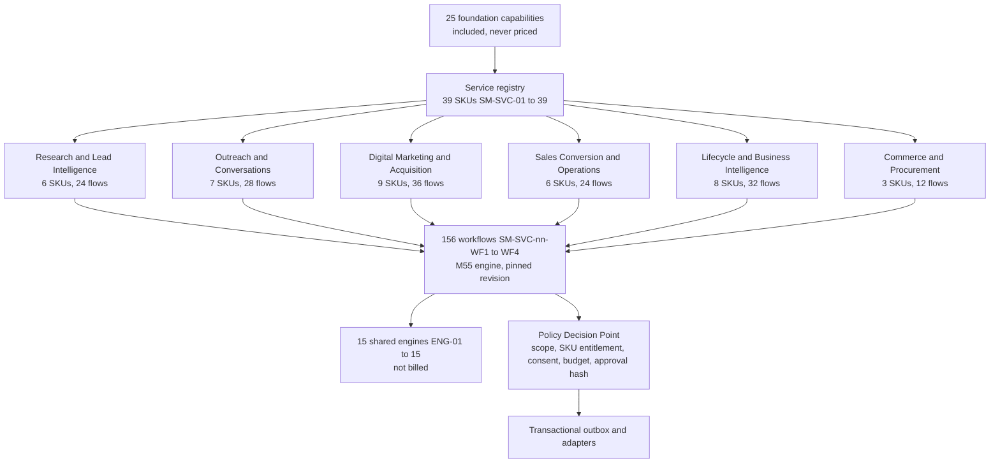
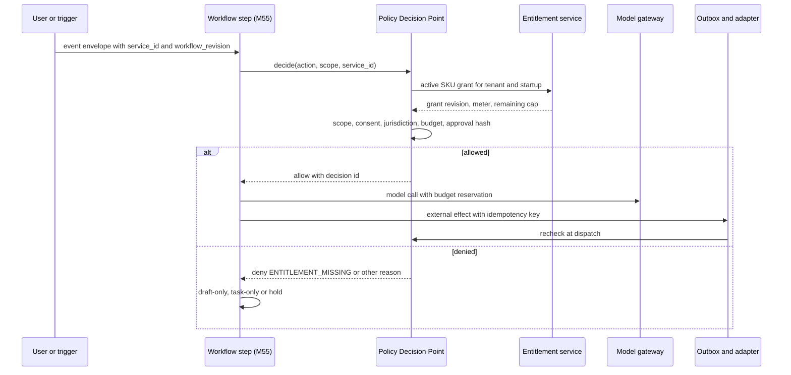
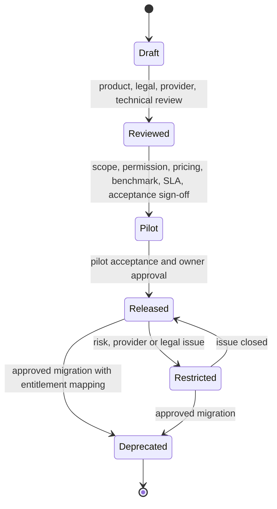
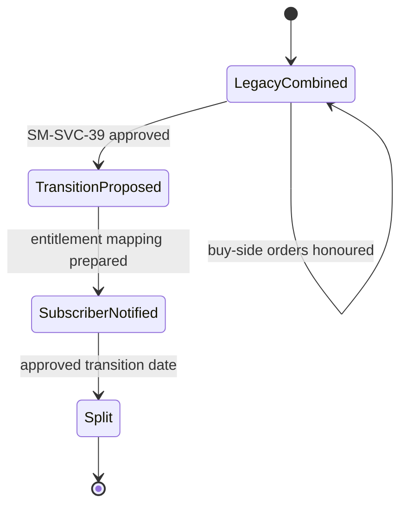

# AI Growth Engine: Employee Sales & Marketing Automation
## Application Blueprint: PART 11 (Batch 11.2a), V12 Master Automation Service Catalogue: 39 Services (a: framework, reconciliation, epics, stories, tests)

| Item | Detail |
|---|---|
| Document | Part 11.2%s, V12 Master Automation Service Catalogue: 39 Services%s |
| Version | 1.0 · 28 Nov 2026 |
| Baseline | Parts 0–9.10 (DEC-001…422; AG-001…080; AU-001…119; WF-01…40; EP-01…21); BRD V12 ch. 08; FSD V12 ch. 08 and ch. 11; source workbook "Master Automation Service Catalog 2031: 39 Services 156 Workflows" (12 sheets) |
| Roles applied | Chief Revenue Officer, Head of Marketing Automation, Principal Solutions Architect, Principal Business Systems Analyst, AI Product Lead; Product Owner, QA Lead, Security/AI Governance Lead and FinOps Lead as reviewers |
| Group and ID ranges | R2, letter B: tags 778–795; DEC-520…539; ADR-185…189; FR-V12-B-###; BRL-V12-B-##; US-<EP>-YB<nn>; TC-V12-B-###; new epics EP-22…EP-29 |
| Part map | **11.2a** material, coverage, register, catalogue reconciliation, framework, new epics, handoffs, costs, stories and tests · **11.2b** service specifications SM-SVC-01…20 · **11.2c** service specifications SM-SVC-21…39, conflicts, decisions, ADRs, persona review, tags, quality gate |

**Acronyms.** SKU stock-keeping unit (one purchasable service) · PDP Policy Decision Point · WF workflow · AT acceptance test · ENT entitlement · ENG shared engine · DLT Distributed Ledger Technology registration platform for Indian commercial SMS/voice (TRAI) · NCPR National Customer Preference Register (DND, Do Not Disturb) · RCS Rich Communication Services · CPaaS communications platform as a service · ASR/TTS speech recognition/synthesis · MCP Model Context Protocol · A2A agent-to-agent protocol · RFQ request for quotation · PO purchase order · SLA service level agreement · SoD separation of duties · SWR screen workspace requirement · ACR/AUR agent / automation capability requirement.

## 11.2.1 Material reviewed

| File | Size | Sections / rows | Purpose | Pattern | Aspects |
|---|---|---|---|---|---|
| BRD V12 `08_Master_Automation_Service_Catalogue_39.txt` | 2,228 lines · 115,756 bytes | V8 foundation register (25), V5 first-value register (39), packaging table (6 bundles + 6 rules), 39 service field tables (14 fields each) | Business definition of the 39 SKUs | `[TABLE]` per service, layered V4/V5/V8 sections | 740 |
| FSD V12 `08_SaaS_Catalogue_Service_Registry.txt` | 192 lines · 3,346 bytes | Foundation register (25), engine register (15), lifecycle register (4), public projection rule | Registry and lifecycle | Three tables + one rule | 45 |
| FSD V12 `11_Master_Functional_Specification_39_Serv.txt` | 1,638 lines · 99,442 bytes | 39 service tables × 12 fields (business source, objective, I/O, mode, agents/engines, provider/approval, dependency/permission, UI/API/entities, domain artifact, meter/cost, quality/provenance, migration/readiness) | Functional specification per SKU | One table per SKU | 468 |
| Workbook `…39_Services_156_Workflows(1)_csv/` (12 sheets) | 1,294,470 bytes | Service_Catalog 39 × 50 fields; Workflow_Catalog 156 × 50; Service_Index 39; Entitlement_Rules 39 × 15; Migration 39; Shared_Engines 15; Capability_Crosswalk 100; Technical_Map 178; Cost_Model 156 + 4 rates; Acceptance_Tests 195; Start_Here 13; Sources_Decisions 19 | Authoritative source of the catalogue | CSV export, multi-line cells | 2204 |

**Method.** Every line of the three chapters was read. Every row of the 12 workbook sheets was parsed by `assembly/v12/r2b_parse_services.py`; BRD 08 and FSD 11 tables by `r2b_parse_brd08.py`. A programmatic cross-check found **0 differences** between BRD 08, FSD 11 and the workbook for objective, KPIs, UI, API and entity fields (FSD 11 adds the domain artifact name; BRD 08 adds enhancement metrics and readiness). All **167 API operations** and **89 database tables** named in the workbook already exist in Part 3.2/3.3/3.5/3.6. The service catalogue spec and coverage register are generated by `r2b_build.py` from the parsed rows plus the curated mapping `r2b_data.py`, so no service, field or ID was skipped. Repeated boilerplate (12 constant Service_Catalog fields, the readiness sentence) is listed once.

**Out of scope for Group B (referenced only).** Workflow detail (Workflow_Catalog 156 × 50) belongs to Groups C/D (Part 11.3/11.4); FSD ch. 12 DTOs and ch. 26 field schemas belong to their groups (GAP-785); screen IDs A170–A259 belong to Group G (GAP-786); agent and automation IDs belong to Groups F and M (GAP-787).

## 11.2.2 Coverage summary

| Source | Aspects | Covered | Partially covered | Not covered | Conflict | Not applicable | Matched after | Pending Founder | N/A after |
|---|---|---|---|---|---|---|---|---|---|
| BRD V12 08 | 740 | 174 | 225 | 338 | 3 | 0 | 737 | 3 | 0 |
| FSD V12 08 | 45 | 0 | 42 | 3 | 0 | 0 | 45 | 0 | 0 |
| FSD V12 11 | 468 | 163 | 210 | 90 | 5 | 0 | 463 | 5 | 0 |
| Workbook Acceptance_Tests | 195 | 0 | 0 | 195 | 0 | 0 | 195 | 0 | 0 |
| Workbook Capability_Crosswalk | 100 | 0 | 100 | 0 | 0 | 0 | 100 | 0 | 0 |
| Workbook Cost_Model | 160 | 0 | 0 | 156 | 4 | 0 | 160 | 0 | 0 |
| Workbook Entitlement_Rules | 39 | 0 | 39 | 0 | 0 | 0 | 38 | 1 | 0 |
| Workbook Migration | 39 | 0 | 0 | 39 | 0 | 0 | 39 | 0 | 0 |
| Workbook Service_Catalog | 1421 | 566 | 528 | 315 | 12 | 0 | 1409 | 12 | 0 |
| Workbook Service_Index | 39 | 0 | 0 | 39 | 0 | 0 | 39 | 0 | 0 |
| Workbook Sources_Decisions | 19 | 0 | 19 | 0 | 0 | 0 | 19 | 0 | 0 |
| Workbook Start_Here | 13 | 0 | 2 | 11 | 0 | 0 | 12 | 1 | 0 |
| Workbook Technical_Map | 178 | 162 | 0 | 14 | 2 | 0 | 178 | 0 | 0 |
| Workbook Workflow_Catalog | 1 | 0 | 0 | 0 | 0 | 1 | 0 | 0 | 1 |
| **Total** | **3457** | **1065** | **1165** | **1200** | **26** | **1** | **3434** | **22** | **1** |

**Reading.** Before this part the blueprint covered the *capabilities* of SM-SVC-01…25 (modules M01–M66, screens A001–A113, X1/X2 agents) but had **no service-SKU construct**: no per-SKU entitlement, meter, bundle, first-value milestone, enhancement metric or migration rule (DEC-047 plans only). Of the 14 services new in V12, four were capability-covered by the advanced parts (SM-SVC-29, 30, 32, 36), five partly (27, 33, 34, 35, 37, 39), two not at all (31, 38) and two conflicted with decisions or invariants (26 voice, 28 agentic commerce); SM-SVC-19 conflicts on bid submission. After this part **3434 of 3457 aspects (99.3%) are Matched**, **22 are Pending Founder decision** (CONFLICT-778, 779, 780, 781) and 1 is Not applicable (workflow detail owned by Groups C/D). *(v1.2: every item counted here as "Pending Founder decision" was adopted by DEC-770…791 — Part 11.14; read as Adopted. Part 11.25.)*

## 11.2.3 Detailed register

The CSV `final/coverage_v12/B_coverage.csv` lists **all 3457 atomic aspects individually** (doc, chapter, section, aspect_id, summary, status before, blueprint location, action, new IDs, status after). The tables below give the per-service register at dimension level and list every conflict aspect individually.

### 11.2.3.1 Per-service register

| SKU | Service | Status before | SKU commercial aspects (bundle, meter, cap, pricing, version, first value, metrics) | Functional aspects (objective, I/O, approvals, agents, KPIs) | UI / API / data | WF04 | Action and new IDs | Status after |
|---|---|---|---|---|---|---|---|---|
| SM-SVC-01 | Market & Competitive Intelligence Automation | Partially covered | Not covered / partially (DEC-047 plan entitlements only) | Covered (modules M07, M10, M11, M12, M59) | Covered (all screens, APIs, tables exist) | Scenario monitoring is new: named scenarios with explicit assumptions are compared when material signals change | Spec §11.2.5.11; FR-V12-B-031, FR-V12-B-032; US-05-YB01 | Matched |
| SM-SVC-02 | Global Business Opportunity Discovery Automation | Partially covered | Not covered / partially (DEC-047 plan entitlements only) | Covered (modules M10–M16, M42) | Covered (all screens, APIs, tables exist) | Continuous buying-signal detection is covered by AU-084 and AG-062; this SKU adds opportunity update and duplicate-alert suppression | Spec §11.2.5.12; FR-V12-B-033, FR-V12-B-034; US-05-YB02 | Matched |
| SM-SVC-03 | B2B Contact & Decision-Maker Intelligence Automation | Partially covered | Not covered / partially (DEC-047 plan entitlements only) | Covered (modules M18, M19, M04) | Covered (all screens, APIs, tables exist) | Change monitoring extends AU-018 freshness expiry with organization and role change detection | Spec §11.2.5.13; FR-V12-B-035; US-06-YB01 | Matched |
| SM-SVC-04 | Lead Qualification & Intelligent Matching Automation | Partially covered | Not covered / partially (DEC-047 plan entitlements only) | Covered (modules M15, M16, M17, M20) | Covered (all screens, APIs, tables exist) | Covered by AU-056 and AG-042 (advisory propensity with calibration); SKU adds drift routing | Spec §11.2.5.14; FR-V12-B-036; US-06-YB02 | Matched |
| SM-SVC-05 | CRM & Sales Pipeline Automation | Partially covered | Not covered / partially (DEC-047 plan entitlements only) | Covered (modules M21, M23, M30) | Covered (all screens, APIs, tables exist) | Covered by AU-058 deal-risk rules and AU-088 pipeline hygiene | Spec §11.2.5.15; FR-V12-B-037; US-07-YB01 | Matched |
| SM-SVC-06 | Email Marketing & Outreach Automation | Partially covered | Not covered / partially (DEC-047 plan entitlements only) | Covered (modules M04, M24, M25, M26, M27) | Covered (all screens, APIs, tables exist) | Sender reputation optimization is partly covered (AU-024 bounce/complaint suppression, AU-031 complaint auto-pause); adds sender-authentication validation and risky-send pause | Spec §11.2.5.16; FR-V12-B-038; US-08-YB01 | Matched |
| SM-SVC-07 | WhatsApp Business Marketing Automation | Partially covered | Not covered / partially (DEC-047 plan entitlements only) | Covered (modules M31, M04, M24) | Covered (all screens, APIs, tables exist) | Interactive commerce conversation is new: buying intent is classified and an approved offer prepared; any order or payment is routed to a human (SM-SVC-17/20) | Spec §11.2.5.17; FR-V12-B-039; US-10-YB01 | Matched |
| SM-SVC-08 | Omnichannel Follow-up & Lead Nurturing Automation | Partially covered | Not covered / partially (DEC-047 plan entitlements only) | Covered (modules M28, M41, M55) | Covered (all screens, APIs, tables exist) | Real-time cross-channel adaptation is covered by AU-086 with deduplication across channels | Spec §11.2.5.18; FR-V12-B-040; US-08-YB02 | Matched |
| SM-SVC-09 | AI Chat, Unified Inbox & Objection Automation | Partially covered | Not covered / partially (DEC-047 plan entitlements only) | Covered (modules M27, M32, M41, M45) | Covered (all screens, APIs, tables exist) | Multilingual multimodal enquiry resolution is new: attachments (image, PDF) are scanned, text extracted and grounded | Spec §11.2.5.19; FR-V12-B-041; US-08-YB03 | Matched |
| SM-SVC-10 | Meeting, Demo & Appointment Automation | Partially covered | Not covered / partially (DEC-047 plan entitlements only) | Covered (modules M29, M40) | Covered (all screens, APIs, tables exist) | Demo preparation is covered by AG-059; action extraction from authorized recordings changes DEC-218 (adopted with consent, DEC-529) | Spec §11.2.5.20; FR-V12-B-042; US-09-YB01 | Matched |
| SM-SVC-11 | Content Marketing Automation | Partially covered | Not covered / partially (DEC-047 plan entitlements only) | Covered (modules M34, M02) | Covered (all screens, APIs, tables exist) | Content gap and freshness monitoring extends AU-069 to published content | Spec §11.2.5.21; FR-V12-B-043; US-11-YB01 | Matched |
| SM-SVC-12 | Social Media Publishing & Listening Automation | Partially covered | Not covered / partially (DEC-047 plan entitlements only) | Covered (modules M33, M35) | Covered (all screens, APIs, tables exist) | Community response and trend coordination is new: response drafts for public comments, never automated DMs | Spec §11.2.5.22; FR-V12-B-044; US-11-YB02 | Matched |
| SM-SVC-13 | SEO & Search Visibility Automation | Partially covered | Not covered / partially (DEC-047 plan entitlements only) | Covered (modules M36, M37) | Covered (all screens, APIs, tables exist) | AI search and answer-engine visibility monitoring is not covered | Spec §11.2.5.23; FR-V12-B-045; US-11-YB03 | Matched |
| SM-SVC-14 | Paid Digital Advertising Automation | Partially covered | Not covered / partially (DEC-047 plan entitlements only) | Covered (modules M38, M39, M52) | Covered (all screens, APIs, tables exist) | Controlled experimentation and incrementality is covered by AU-065 and AG-052 | Spec §11.2.5.24; FR-V12-B-046; US-12-YB01 | Matched |
| SM-SVC-15 | Landing Page & Website Lead Intake Automation | Partially covered | Not covered / partially (DEC-047 plan entitlements only) | Covered (modules M22, M37) | Covered (all screens, APIs, tables exist) | Machine-readable offering and intake readiness validation is new | Spec §11.2.5.25; FR-V12-B-047, FR-V12-B-048; US-12-YB02 | Matched |
| SM-SVC-16 | Webinar, Event & Referral Acquisition Automation | Partially covered | Not covered / partially (DEC-047 plan entitlements only) | Covered (modules M40, M42, M22) | Covered (all screens, APIs, tables exist) | Event conversion and attendee-journey optimization is new | Spec §11.2.5.26; FR-V12-B-049; US-09-YB02 | Matched |
| SM-SVC-17 | Proposal & Quotation Automation | Partially covered | Not covered / partially (DEC-047 plan entitlements only) | Covered (modules M43, M44) | Covered (all screens, APIs, tables exist) | Configurable product/service/bundle quotation is covered by A139 and AU-089 | Spec §11.2.5.27; FR-V12-B-050; US-13-YB01 | Matched |
| SM-SVC-18 | Negotiation, Contract & MoU Automation | Partially covered | Not covered / partially (DEC-047 plan entitlements only) | Covered (modules M45, M46, M64) | Covered (all screens, APIs, tables exist) | Obligation extraction and negotiation scenario analysis extends AG-022 | Spec §11.2.5.28; FR-V12-B-051; US-13-YB02 | Matched |
| SM-SVC-19 | Tender & Project Bid Automation | Conflict | Not covered / partially (DEC-047 plan entitlements only) | Conflict: bid submission | Covered (all screens, APIs, tables exist) | Continuous bid compliance is covered by AU-034 and AU-052 | Spec §11.2.5.29; FR-V12-B-052; US-14-YB01 | Matched; conflict items Adopted (DEC-781) |
| SM-SVC-20 | Sales Order & Fulfillment Automation | Partially covered | Not covered / partially (DEC-047 plan entitlements only) | Covered (modules WF-10; M47) | Covered (all screens, APIs, tables exist) | Fulfilment prediction and exception monitoring is new | Spec §11.2.5.30; FR-V12-B-053, FR-V12-B-054; US-14-YB02 | Matched |
| SM-SVC-21 | Payment, Invoice & Reconciliation Automation | Partially covered | Not covered / partially (DEC-047 plan entitlements only) | Covered (modules M47, M52) | Covered (all screens, APIs, tables exist) | Receivable anomaly and overdue-risk monitoring uses AU-116 and AG-079 | Spec §11.2.5.31; FR-V12-B-055; US-15-YB01 | Matched |
| SM-SVC-22 | Customer, Partner & Institutional Onboarding Automation | Partially covered | Not covered / partially (DEC-047 plan entitlements only) | Covered (modules M48, M49, M63, M65) | Covered (all screens, APIs, tables exist) | Adaptive onboarding is new: due dates adapt to blockers with audit | Spec §11.2.5.32; FR-V12-B-056; US-16-YB01 | Matched |
| SM-SVC-23 | Customer Retention, Renewal & Feedback Automation | Partially covered | Not covered / partially (DEC-047 plan entitlements only) | Covered (modules M50, M51) | Covered (all screens, APIs, tables exist) | Churn and expansion prediction is covered by AU-059 and AU-093 | Spec §11.2.5.33; FR-V12-B-057; US-16-YB02 | Matched |
| SM-SVC-24 | Revenue, Attribution & Sales Forecast Automation | Partially covered | Not covered / partially (DEC-047 plan entitlements only) | Covered (modules M30, M52, M60) | Covered (all screens, APIs, tables exist) | Scenario simulation extends AU-041 backtests | Spec §11.2.5.34; FR-V12-B-058; US-15-YB02 | Matched |
| SM-SVC-25 | Business Document & Knowledge Intelligence Automation | Partially covered | Not covered / partially (DEC-047 plan entitlements only) | Covered (modules M02, M03) | Covered (all screens, APIs, tables exist) | Contradiction detection is new beyond AU-069 freshness | Spec §11.2.5.35; FR-V12-B-059; US-02-YB01 | Matched |
| SM-SVC-26 | AI Voice & Intelligent Telephony Automation | Conflict | Not covered / partially (DEC-047 plan entitlements only) | Conflict: AI voice outreach | Partially: reuse candidates; SWR-B-01 | All four workflows are new | Spec §11.2.5.36; FR-V12-B-060, FR-V12-B-061, FR-V12-B-062, FR-V12-B-063, FR-V12-B-064, FR-V12-B-065; US-22-YB01, US-22-YB02, US-22-YB03, US-22-YB04, US-22-YB05, US-22-YB06 | Matched; conflict items Adopted (DEC-782) |
| SM-SVC-27 | Multimodal Creative & Localization Automation | Partially covered | Not covered / partially (DEC-047 plan entitlements only) | Partially covered | Partially: reuse candidates; SWR-B-02 | All four workflows new except text localization (covered by AG-050) | Spec §11.2.5.37; FR-V12-B-066, FR-V12-B-067, FR-V12-B-068, FR-V12-B-069, FR-V12-B-070; US-28-YB01, US-28-YB02, US-28-YB03, US-28-YB04, US-28-YB05 | Matched |
| SM-SVC-28 | Agentic Commerce & AI-to-AI Business Transaction Automation | Conflict | Not covered / partially (DEC-047 plan entitlements only) | Conflict: autonomous transaction | Partially: reuse candidates; SWR-B-03 | All four workflows new | Spec §11.2.5.38; FR-V12-B-071, FR-V12-B-072, FR-V12-B-073, FR-V12-B-074, FR-V12-B-075, FR-V12-B-076, FR-V12-B-077; US-24-YB01, US-24-YB02, US-24-YB03, US-24-YB04, US-24-YB05, US-24-YB06, US-24-YB07 | Matched; conflict items Adopted (DEC-780) |
| SM-SVC-29 | Account-Based Marketing & Enterprise Buying Group Automation | Partially covered | Not covered / partially (DEC-047 plan entitlements only) | Partially covered | Partially: reuse candidates; X1/X2 screens A130, A131, A136 | Covered by AU-085 and AG-061 (engagement and progression) | Spec §11.2.5.39; FR-V12-B-078; US-06-YB03 | Matched |
| SM-SVC-30 | Conversion Rate Optimization & Intelligent Experimentation Automation | Partially covered | Not covered / partially (DEC-047 plan entitlements only) | Partially covered | Partially: reuse candidates; X1/X2 screens A125, A147 | Covered by AU-065/AU-098 and AG-052 | Spec §11.2.5.40; FR-V12-B-079, FR-V12-B-080; US-12-YB03 | Matched |
| SM-SVC-31 | Marketplace & E-commerce Channel Operations Automation | Not covered | Not covered / partially (DEC-047 plan entitlements only) | Not covered | Partially: reuse candidates; SWR-B-04 | All four workflows new | Spec §11.2.5.41; FR-V12-B-081, FR-V12-B-082, FR-V12-B-083, FR-V12-B-084; US-25-YB01, US-25-YB02, US-25-YB03, US-25-YB04 | Matched |
| SM-SVC-32 | Partner, Distributor & Co-Selling Automation | Partially covered | Not covered / partially (DEC-047 plan entitlements only) | Partially covered | Partially: reuse candidates; X1/X2 screens A141 | Covered by AU-091 (conflict) and AU-092 (commission record) | Spec §11.2.5.42; FR-V12-B-085; US-16-YB03 | Matched |
| SM-SVC-33 | Customer Service & Support Operations Automation | Partially covered | Not covered / partially (DEC-047 plan entitlements only) | Partially covered | Partially: reuse candidates; SWR-B-05 | All four workflows new for tenant customer support (AG-031 covers platform portal tickets only) | Spec §11.2.5.43; FR-V12-B-086, FR-V12-B-087, FR-V12-B-088, FR-V12-B-089; US-27-YB01, US-27-YB02, US-27-YB03, US-27-YB04 | Matched |
| SM-SVC-34 | Product-Led Growth & Usage Intelligence Automation | Partially covered | Not covered / partially (DEC-047 plan entitlements only) | Partially covered | Partially: reuse candidates; SWR-B-06 | Usage-based upgrade recommendation is new | Spec §11.2.5.44; FR-V12-B-090, FR-V12-B-091; US-16-YB04 | Matched |
| SM-SVC-35 | Brand Reputation & Review Intelligence Automation | Partially covered | Not covered / partially (DEC-047 plan entitlements only) | Partially covered | Partially: reuse candidates; SWR-B-07 | All four new beyond social listening | Spec §11.2.5.45; FR-V12-B-092, FR-V12-B-093; US-11-YB04 | Matched |
| SM-SVC-36 | AI Sales Enablement & Coaching Automation | Partially covered | Not covered / partially (DEC-047 plan entitlements only) | Partially covered | Partially: reuse candidates; X1/X2 screens A122, A148 | Covered by AG-046/AG-070 (playbooks, simulation, coaching); recordings need consent (DEC-529) | Spec §11.2.5.46; FR-V12-B-094; US-08-YB04 | Matched |
| SM-SVC-37 | Pricing, Offer & Revenue Optimization Automation | Partially covered | Not covered / partially (DEC-047 plan entitlements only) | Partially covered | Partially: reuse candidates; SWR-B-08 | Scenario modelling and margin anomaly monitoring are new | Spec §11.2.5.47; FR-V12-B-095, FR-V12-B-096, FR-V12-B-097; US-13-YB03 | Matched |
| SM-SVC-38 | SMS, RCS & Business Messaging Automation | Not covered | Not covered / partially (DEC-047 plan entitlements only) | Not covered | Partially: reuse candidates; SWR-B-09 | All four workflows new | Spec §11.2.5.48; FR-V12-B-098, FR-V12-B-099, FR-V12-B-100, FR-V12-B-101; US-23-YB01, US-23-YB02, US-23-YB03, US-23-YB04 | Matched |
| SM-SVC-39 | Procurement & Supplier Management Automation | Partially covered | Not covered / partially (DEC-047 plan entitlements only) | Partially covered | Partially: reuse candidates; SWR-B-10 | All four workflows new as a separate SKU (split from SM-SVC-20) | Spec §11.2.5.49; FR-V12-B-102, FR-V12-B-103, FR-V12-B-104, FR-V12-B-105; US-26-YB01, US-26-YB02, US-26-YB03, US-26-YB04 | Matched |

### 11.2.3.2 Framework and catalogue-level aspects

| Aspect group | Count | Status before | Blueprint location before | Action | New IDs | Status after |
|---|---|---|---|---|---|---|
| Foundation capabilities SM-01-01…SM-14-05 (BRD 08, FSD 08) | 25 + 25 | Partially covered | Capabilities exist (AU-001, AU-042, M08, M58 …) without SM IDs | ID mapping table §11.2.4.2; non-removable, never priced | FR-V12-B-004; DEC-522 | Matched |
| First-value milestones | 39 | Not covered | — | Milestone per SKU | FR-V12-B-021 | Matched |
| Bundles and packaging rules | 6 + 6 | Not covered (2 partially) | DEC-047 archetypes | Bundle registry; selection modes; quote-only | FR-V12-B-003/005/010; DEC-521 | Matched |
| Enhancement metrics | 156 | Not covered | — | Metric emitters per workflow | FR-V12-B-022 | Matched |
| Shared engines ENG-01…15 | 15 | Partially covered | Modules | Engine-to-module map §11.2.4.4 | FR-V12-B-023; DEC-526 | Matched |
| Lifecycle register and public projection | 4 + 1 | Not covered / partially | BRL-AUT-03; BRL-PUB-05 | State machines; projection rule | FR-V12-B-001/002/024 | Matched |
| Capability crosswalk | 100 | Partially covered | Capabilities in modules | Crosswalk table §11.2.4.3 | FR-V12-B-011 | Matched |
| Technical map rows | 178 | 162 covered, 14 not covered (TBD workspaces), 2 conflict (legacy publication) | Part 2.5 screens | Reuse confirmed; SWR-B-01…10; DEC-536 | SWR-B-xx; DEC-536 | Matched |
| Cost model rows and rates | 156 + 4 | Not covered; rates conflict with gateway pricing | Part 7.3 | Illustrative roll-up; gateway actuals govern | FR-V12-B-029; ASSUMPTION-789 | Matched |
| Acceptance scenarios | 195 | Not covered | — | 39 ENT → TC; 156 WF ATs referenced (Groups C/D/J) | TC-V12-B-211…249 | Matched |
| Migration rows | 39 | Not covered | — | Migration rules; SVC-20 split | FR-V12-B-012; BRL-V12-B-05; DEC-524 | Matched |
| Start_Here scope metrics | 13 | Not covered (2 partially) | Part 2.5 | Reconciled §11.2.4.1; funding of the 14 new SKUs pending | DEC-520; DEC-535; CONFLICT-780 | Adopted (DEC-790) (funding only) |
| Sources and decisions | 19 | Partially covered | Part 0B | Recorded §11.2.4.6 | DEC-520…538 | Matched |

### 11.2.3.3 Conflict aspects (listed individually)

| Aspect ID | Summary | Resolution | Status after |
|---|---|---|---|
| B-BRD08-19-Risklimits | Risk / limits: Capability grant and explicit bid approval; no automatic submission to restricted portal; Tenant + startup scope; capability and entitlement chec | Part 11.2b §11.2.5.29; CONFLICT-781 | Adopted (DEC-781) |
| B-BRD08-26-Risklimits | Risk / limits: Approve source/data rights and applicable external actions; verify recipient permission, sender identity, disclosure, quiet hours and provider ru | Part 11.2c §11.2.5.36; CONFLICT-779 | Adopted (DEC-782) |
| B-BRD08-28-Risklimits | Risk / limits: Approve source/data rights and applicable external actions; verify agent identity, mandate, spending limits and approval before any transaction;  | Part 11.2c §11.2.5.38; CONFLICT-778 | Adopted (DEC-780) |
| B-FSD11-19-Requiredprov | Required provider / approval: Authorized tender feeds/portal and account; manual submission unless permitted API; Capability grant and explicit bid approval; no | Part 11.2b §11.2.5.29; CONFLICT-781 | Adopted (DEC-781) |
| B-FSD11-26-Channelsoper | Channels, operating mode: Private Admin; approved client data and connectors; voice/telephony; AI-assisted / supervised; controlled autonomous for preapproved r | Part 11.2c §11.2.5.36; CONFLICT-779 | Adopted (DEC-782) |
| B-FSD11-26-Requiredprov | Required provider / approval: Authorized telephony, speech recognition and synthesis; calling/recording permission; Approve source/data rights and applicable ex | Part 11.2c §11.2.5.36; CONFLICT-779 | Adopted (DEC-782) |
| B-FSD11-28-Channelsoper | Channels, operating mode: Private Admin; approved client data and connectors; authorized agent-to-agent exchange; AI-assisted / supervised; controlled autonomou | Part 11.2c §11.2.5.38; CONFLICT-778 | Adopted (DEC-780) |
| B-FSD11-28-Requiredprov | Required provider / approval: Supported agent protocols and authorized payment/commerce providers; verified mandates; Approve source/data rights and applicable  | Part 11.2c §11.2.5.38; CONFLICT-778 | Adopted (DEC-780) |
| B-WB-SC-19-Workflowsteps | Workflow steps: 1. Retrieve allowed tenders; extract requirements and deadlines; deduplicate; create bid candidates<br/>2. Check mandatory criteria; flag gaps and c | Part 11.2b §11.2.5.29; CONFLICT-781 | Adopted (DEC-781) |
| B-WB-SC-19-Humanapprovalr | Human approval requirements: Capability grant and explicit bid approval; no automatic submission to restricted portal | Part 11.2b §11.2.5.29; CONFLICT-781 | Adopted (DEC-781) |
| B-WB-SC-26-Subautomationn | Sub-automation name: SM-SVC-26-WF01 Inbound AI voice enquiry and call routing<br/>SM-SVC-26-WF02 Authorized outbound voice engagement<br/>SM-SVC-26-WF03 Multilingual vo | Part 11.2c §11.2.5.36; CONFLICT-779 | Adopted (DEC-782) |
| B-WB-SC-26-Workflowsteps | Workflow steps: 1. Disclose AI as required; classify intent; route or answer with evidence<br/>2. Check consent, quiet hours and caps; initiate authorized call; rec | Part 11.2c §11.2.5.36; CONFLICT-779 | Adopted (DEC-782) |
| B-WB-SC-26-Automationoper | Automation operating mode: AI-assisted / supervised; controlled autonomous for preapproved routine actions only; simulation has no external effects | Part 11.2c §11.2.5.36; CONFLICT-779 | Adopted (DEC-782) |
| B-WB-SC-26-Humanapprovalr | Human approval requirements: Approve source/data rights and applicable external actions; verify recipient permission, sender identity, disclosure, quiet hours a | Part 11.2c §11.2.5.36; CONFLICT-779 | Adopted (DEC-782) |
| B-WB-SC-28-Subautomationn | Sub-automation name: SM-SVC-28-WF01 Machine-readable product and service catalog publication<br/>SM-SVC-28-WF02 Authorized AI-agent requirement discovery and quotat | Part 11.2c §11.2.5.38; CONFLICT-778 | Adopted (DEC-780) |
| B-WB-SC-28-Workflowsteps | Workflow steps: 1. Validate fields; publish to authorized client endpoint; record version<br/>2. Validate identity and schema; match approved offerings; return scop | Part 11.2c §11.2.5.38; CONFLICT-778 | Adopted (DEC-780) |
| B-WB-SC-28-Automationoper | Automation operating mode: AI-assisted / supervised; controlled autonomous for preapproved routine actions only; simulation has no external effects | Part 11.2c §11.2.5.38; CONFLICT-778 | Adopted (DEC-780) |
| B-WB-SC-28-Humanapprovalr | Human approval requirements: Approve source/data rights and applicable external actions; verify agent identity, mandate, spending limits and approval before any | Part 11.2c §11.2.5.38; CONFLICT-778 | Adopted (DEC-780) |
| B-WB-SC-28-Externalsideef | External side-effect classification: Consequential financial/legal or authority-bearing action; prepare only until authorized | Part 11.2c §11.2.5.38; CONFLICT-778 | Adopted (DEC-780) |
| B-WB-SC-28-Technologyandr | Technology and regulatory readiness: Design now; provider/protocol interoperability, security and mandate validation required before activation | Part 11.2c §11.2.5.38; CONFLICT-778 | Adopted (DEC-780) |
| B-WB-TM-069 | A107 Website configuration and content management: Legacy publication route: replace or isolate to separate client property; no public SaaS use | DEC-536 | Matched |
| B-WB-TM-070 | A108 Website preview, approval, publishing and analytics: Legacy publication route: replace or isolate to separate client property; no public SaaS use | DEC-536 | Matched |
| B-WB-COST-RATE-Inputtokensp | Input tokens per 1,000 = ₹0.2 (illustrative, not vendor quote) | ASSUMPTION-789; FR-V12-B-029 | Matched |
| B-WB-COST-RATE-Outputtokens | Output tokens per 1,000 = ₹0.8 (illustrative, not vendor quote) | ASSUMPTION-789; FR-V12-B-029 | Matched |
| B-WB-COST-RATE-Computeorche | Compute / orchestration per invocation = ₹0.15 (illustrative, not vendor quote) | ASSUMPTION-789; FR-V12-B-029 | Matched |
| B-WB-COST-RATE-Tokensperpri | Tokens per pricing unit = ₹1000 (illustrative, not vendor quote) | ASSUMPTION-789; FR-V12-B-029 | Matched |

**Founder-pending aspects that were not conflicts before** (funding/scope): B-WB-ENT-28, B-WB-START-01.

## 11.2.4 Catalogue reconciliation

### 11.2.4.1 Counts

| Item | V12 source | Blueprint before | Blueprint after (this part) | Check |
|---|---|---|---|---|
| Purchasable services (SKUs) | 39 (25 retained + 14 new; Start_Here) | 0 SKUs; 66 modules; DEC-047 plans | 39 SKUs in the service registry (FR-V12-B-001) | 39 rows in every sheet ✔ |
| Workflows | 156 (4 per SKU; WF01–03 retained, WF04 new for 01–25) | WF-01…40 (process flows) | 156 workflow IDs referenced per SKU; detail Groups C/D | 156 ✔ |
| Bundles | 6 (6 + 7 + 9 + 6 + 8 + 3 = 39 SKUs; 24 + 28 + 36 + 24 + 32 + 12 = 156 flows) | none | Bundle registry (FR-V12-B-003) | sums ✔ |
| Foundations | 25 included, never priced | capabilities without SM IDs | Mapped §11.2.4.2 | 25 ✔ |
| Legacy capabilities | 100 (25 foundation + 75 selectable) | — | Crosswalk §11.2.4.3 | 100 ✔ |
| Shared engines | 15 | — | Engine map §11.2.4.4 | 15 ✔ |
| Catalogue fields | 50 (30 original + 20 new) | — | All 50 fields carried into each service spec (11.2b/c) | 50 ✔ |
| Acceptance scenarios | 195 (156 workflow + 39 entitlement), all Not run | — | 39 ENT → TC-V12-B-211…249; WF ATs referenced | 195 ✔ |
| Admin screens | 34 Website / 113 Admin (existing route counts) | 147 + 71 screens | 0 new IDs here; 12 workspace requirements to Group G | ✔ |
| API operations referenced | 167 distinct | 579 operations | 0 new endpoints; specialized contracts TBD for SVC-26…39 (Group H) | 167/167 present ✔ |
| Database tables referenced | 89 distinct | catalogue in Part 3.3/3.6 | domain artifacts named; new entities to Group I | 89/89 present ✔ |
| Illustrative AI cost at pilot caps (all 39 SKUs) | Cost_Model × Entitlement caps | — | ≈ ₹6,748 per tenant-month (₹4,964 for SVC-01…25, ₹1,784 for SVC-26…39), illustrative only | formula Σ cap × mean(WF ₹) |

### 11.2.4.2 Service index and blueprint home

| SKU | Service | Family | Bundle | Meter | Pilot cap (not approved) | Version | V12 decision | Epic | Status before → after |
|---|---|---|---|---|---|---|---|---|---|
| SM-SVC-01 | Market & Competitive Intelligence Automation | Market intelligence | Research & Lead Intelligence | market research batch | 100 | 2.0-target | Retain + expand | EP-05 | Partially covered → Matched |
| SM-SVC-02 | Global Business Opportunity Discovery Automation | Research & acquisition | Research & Lead Intelligence | discovery batch | 100 | 2.0-target | Retain + expand | EP-05, EP-06 | Partially covered → Matched |
| SM-SVC-03 | B2B Contact & Decision-Maker Intelligence Automation | Contact intelligence | Research & Lead Intelligence | contact assessed | 500 | 2.0-target | Retain + expand | EP-06 | Partially covered → Matched |
| SM-SVC-04 | Lead Qualification & Intelligent Matching Automation | Qualification | Research & Lead Intelligence | lead assessed | 500 | 2.0-target | Retain + expand | EP-06 | Partially covered → Matched |
| SM-SVC-05 | CRM & Sales Pipeline Automation | Relationship management | Research & Lead Intelligence | relationship update | 500 | 2.0-target | Retain + expand | EP-07 | Partially covered → Matched |
| SM-SVC-06 | Email Marketing & Outreach Automation | Outreach | Outreach & Conversations | email attempt | 1000 | 2.0-target | Retain + expand | EP-08 | Partially covered → Matched |
| SM-SVC-07 | WhatsApp Business Marketing Automation | Outreach | Outreach & Conversations | message attempt | 500 | 2.0-target | Retain + expand | EP-10 | Partially covered → Matched |
| SM-SVC-08 | Omnichannel Follow-up & Lead Nurturing Automation | Relationship engagement | Outreach & Conversations | follow-up decision | 1000 | 2.0-target | Retain + expand | EP-08 | Partially covered → Matched |
| SM-SVC-09 | AI Chat, Unified Inbox & Objection Automation | Conversation intelligence | Outreach & Conversations | conversation item | 1000 | 2.0-target | Retain + expand | EP-08, EP-10 | Partially covered → Matched |
| SM-SVC-10 | Meeting, Demo & Appointment Automation | Meetings | Outreach & Conversations | meeting cycle | 100 | 2.0-target | Retain + expand | EP-09 | Partially covered → Matched |
| SM-SVC-11 | Content Marketing Automation | Content marketing | Digital Marketing & Acquisition | content draft | 100 | 2.0-target | Retain + expand | EP-11 | Partially covered → Matched |
| SM-SVC-12 | Social Media Publishing & Listening Automation | Digital marketing | Digital Marketing & Acquisition | social action or listening batch | 300 | 2.0-target | Retain + expand | EP-11 | Partially covered → Matched |
| SM-SVC-13 | SEO & Search Visibility Automation | Digital marketing | Digital Marketing & Acquisition | page or keyword review | 200 | 2.0-target | Retain + expand | EP-11 | Partially covered → Matched |
| SM-SVC-14 | Paid Digital Advertising Automation | Digital marketing | Digital Marketing & Acquisition | campaign review or action | 100 | 2.0-target | Retain + expand | EP-12 | Partially covered → Matched |
| SM-SVC-15 | Landing Page & Website Lead Intake Automation | Intake & integration | Digital Marketing & Acquisition | page draft or enquiry event | 500 | 2.0-target | Retain + expand | EP-12, EP-19 | Partially covered → Matched |
| SM-SVC-16 | Webinar, Event & Referral Acquisition Automation | Event acquisition | Digital Marketing & Acquisition | attendee or referral event | 500 | 2.0-target | Retain + expand | EP-09, EP-12 | Partially covered → Matched |
| SM-SVC-17 | Proposal & Quotation Automation | Commercial conversion | Sales Conversion & Operations | proposal or quotation case | 100 | 2.0-target | Retain + expand | EP-13 | Partially covered → Matched |
| SM-SVC-18 | Negotiation, Contract & MoU Automation | Commercial conversion | Sales Conversion & Operations | agreement case | 50 | 2.0-target | Retain + expand | EP-13, EP-16 | Partially covered → Matched |
| SM-SVC-19 | Tender & Project Bid Automation | Commercial acquisition | Sales Conversion & Operations | tender case | 50 | 2.0-target | Retain + expand | EP-14 | Conflict → Matched / Pending Founder |
| SM-SVC-20 | Sales Order & Fulfillment Automation | Commercial operations | Sales Conversion & Operations | order case | 200 | 2.0-target | Split procurement | EP-14 | Partially covered → Matched |
| SM-SVC-21 | Payment, Invoice & Reconciliation Automation | Financial controls | Sales Conversion & Operations | invoice or receipt record | 500 | 2.0-target | Retain + expand | EP-15 | Partially covered → Matched |
| SM-SVC-22 | Customer, Partner & Institutional Onboarding Automation | Customer lifecycle | Lifecycle & Business Intelligence | onboarding case | 100 | 2.0-target | Retain + expand | EP-16 | Partially covered → Matched |
| SM-SVC-23 | Customer Retention, Renewal & Feedback Automation | Customer lifecycle | Lifecycle & Business Intelligence | customer review | 500 | 2.0-target | Retain + expand | EP-16 | Partially covered → Matched |
| SM-SVC-24 | Revenue, Attribution & Sales Forecast Automation | Analytics | Lifecycle & Business Intelligence | analytics review | 100 | 2.0-target | Retain + expand | EP-15, EP-17 | Partially covered → Matched |
| SM-SVC-25 | Business Document & Knowledge Intelligence Automation | Document intelligence | Lifecycle & Business Intelligence | document processed | 200 | 2.0-target | Retain + expand | EP-02 | Partially covered → Matched |
| SM-SVC-26 | AI Voice & Intelligent Telephony Automation | Voice engagement | Outreach & Conversations | Call minute | 100 | 1.0-target | New service | EP-22 | Conflict → Matched / Pending Founder |
| SM-SVC-27 | Multimodal Creative & Localization Automation | Creative production | Digital Marketing & Acquisition | Creative asset | 50 | 1.0-target | New service | EP-28, EP-11 | Partially covered → Matched |
| SM-SVC-28 | Agentic Commerce & AI-to-AI Business Transaction Automation | Agentic commerce | Commerce & Procurement | Agent transaction case | 50 | 1.0-target | New service | EP-24 | Conflict → Matched / Pending Founder |
| SM-SVC-29 | Account-Based Marketing & Enterprise Buying Group Automation | Account intelligence | Research & Lead Intelligence | Account review | 100 | 1.0-target | New service | EP-06, EP-07 | Partially covered → Matched |
| SM-SVC-30 | Conversion Rate Optimization & Intelligent Experimentation Automation | Experimentation | Digital Marketing & Acquisition | Experiment | 30 | 1.0-target | New service | EP-12 | Partially covered → Matched |
| SM-SVC-31 | Marketplace & E-commerce Channel Operations Automation | Marketplace operations | Commerce & Procurement | Marketplace order/event | 500 | 1.0-target | New service | EP-25 | Not covered → Matched |
| SM-SVC-32 | Partner, Distributor & Co-Selling Automation | Partner growth | Lifecycle & Business Intelligence | Partner opportunity | 100 | 1.0-target | New service | EP-16 | Partially covered → Matched |
| SM-SVC-33 | Customer Service & Support Operations Automation | Support operations | Lifecycle & Business Intelligence | Support case | 500 | 1.0-target | New service | EP-27 | Partially covered → Matched |
| SM-SVC-34 | Product-Led Growth & Usage Intelligence Automation | Usage intelligence | Lifecycle & Business Intelligence | Account usage review | 200 | 1.0-target | New service | EP-16 | Partially covered → Matched |
| SM-SVC-35 | Brand Reputation & Review Intelligence Automation | Reputation | Digital Marketing & Acquisition | Review item | 200 | 1.0-target | New service | EP-11 | Partially covered → Matched |
| SM-SVC-36 | AI Sales Enablement & Coaching Automation | Sales enablement | Lifecycle & Business Intelligence | Coaching session | 100 | 1.0-target | New service | EP-08, EP-11 | Partially covered → Matched |
| SM-SVC-37 | Pricing, Offer & Revenue Optimization Automation | Pricing intelligence | Sales Conversion & Operations | Pricing scenario | 50 | 1.0-target | New service | EP-13 | Partially covered → Matched |
| SM-SVC-38 | SMS, RCS & Business Messaging Automation | Mobile messaging | Outreach & Conversations | Message attempt | 500 | 1.0-target | New service | EP-23 | Not covered → Matched |
| SM-SVC-39 | Procurement & Supplier Management Automation | Procurement | Commerce & Procurement | Procurement case | 200 | 1.0-target | Split from SM-SVC-20 | EP-26 | Partially covered → Matched |

**Foundation mapping (SM-xx-yy → blueprint).** SM-01-01 Business analysis → AG-030, EP-20 · SM-01-02 Template recommendation → FR-A100 · SM-01-03 Configuration generation → AG-030, FR-A100 · SM-01-04 Workspace readiness → FR-A099 · SM-01-05 Activation review → FR-A099/A101 · SM-11-01 Trial provisioning → EP-20 trial (DEC-047) · SM-11-02 Subscription monitoring → FR-A101 · SM-11-03 Usage metering → AU-042, API-529 · SM-11-04 Entitlement enforcement → AU-042, BRL-SVC-03, ENT-181 · SM-11-05 Offboarding → WF-14, FR-A103 · SM-12-01 Model routing → AU-001, M08 · SM-12-02 Token optimization → AU-068 · SM-12-03 Knowledge refresh → AU-069, AG-055 · SM-12-04 Output validation → AU-003 · SM-12-05 Quality evaluation → AG-002, AU-006, M54 · SM-13-01 Failure detection → M58, AU-010 · SM-13-02 Eligible retry → BRL-AUT-07 · SM-13-03 Approved fallback → AU-010, gateway Tier 3 · SM-13-04 Reconciliation → AU-026 · SM-13-05 Incident escalation → AG-028, M58 · SM-14-01 KPI measurement → M30, M52, KPI-01…31 · SM-14-02 Bottleneck identification → AU-088, AG-054 · SM-14-03 Recommendations → AG-043, Part 8.3 · SM-14-04 Controlled simulation → BRL-AUT-04, FR-A102 · SM-14-05 Improvement verification → OKPI-01…35.

### 11.2.4.3 Capability crosswalk (100 legacy IDs)

| Family | Capability IDs | Primary service | Related services / foundation role | Classification |
|---|---|---|---|---|
| Business onboarding | SM-01-01 Business analysis, SM-01-02 Template recommendation, SM-01-03 Configuration generation, SM-01-04 Workspace readiness, SM-01-05 Activation review | ALL (×5) | Included onboarding, readiness and activation controls | Foundation — included, not sold separately |
| Research | SM-02-01 Scheduled discovery, SM-02-02 Evidence refresh, SM-02-03 Evidence extraction, SM-02-04 Change detection, SM-02-05 Opportunity alerts | SM-SVC-02 (×5) | SM-SVC-01; SM-SVC-16; SM-SVC-19 | Selectable capability — regrouped |
| Contact intelligence | SM-03-01 Permitted contact discovery, SM-03-02 Contact verification, SM-03-03 Deduplication, SM-03-04 Role classification, SM-03-05 Eligibility assessment | SM-SVC-03 (×5) | None at family level | Selectable capability — regrouped |
| Qualification | SM-04-01 Relevance scoring, SM-04-02 Opportunity matching, SM-04-03 Confidence evaluation, SM-04-04 Prioritization, SM-04-05 Assignment | SM-SVC-04 (×4), SM-SVC-05 (×1) | SM-SVC-05; SM-SVC-19; SM-SVC-24 | Selectable capability — regrouped |
| Outreach | SM-05-01 Message drafting, SM-05-02 Personalization, SM-05-03 Localization, SM-05-04 Eligible channel selection, SM-05-05 Controlled dispatch | SM-SVC-06 (×5) | SM-SVC-07; SM-SVC-08 | Selectable capability — regrouped |
| Follow-up | SM-06-01 Follow-up scheduling, SM-06-02 Reply detection, SM-06-03 Interval adjustment, SM-06-04 Stop-condition enforcement, SM-06-05 Overdue escalation | SM-SVC-08 (×5) | SM-SVC-05; SM-SVC-23 | Selectable capability — regrouped |
| Conversation | SM-07-01 Intent detection, SM-07-02 Sentiment classification, SM-07-03 Objection classification, SM-07-04 Evidence retrieval, SM-07-05 Human handover | SM-SVC-09 (×5) | SM-SVC-05; SM-SVC-07; SM-SVC-23 | Selectable capability — regrouped |
| Meetings | SM-08-01 Availability checks, SM-08-02 Meeting scheduling, SM-08-03 Reminders, SM-08-04 Meeting preparation, SM-08-05 Action-item extraction | SM-SVC-10 (×5) | SM-SVC-16 | Selectable capability — regrouped |
| Documents | SM-09-01 Document drafting, SM-09-02 Document extraction, SM-09-03 Classification, SM-09-04 Version tracking, SM-09-05 Expiry reminders | SM-SVC-25 (×5) | SM-SVC-17; SM-SVC-18; SM-SVC-19; SM-SVC-20 | Selectable capability — regrouped |
| Financial controls | SM-10-01 Amount validation, SM-10-02 Receipt matching, SM-10-03 Duplicate prevention, SM-10-04 Discrepancy detection, SM-10-05 Financial reporting | SM-SVC-21 (×5) | SM-SVC-24 | Selectable capability — regrouped |
| SaaS operations | SM-11-01 Trial provisioning, SM-11-02 Subscription monitoring, SM-11-03 Usage metering, SM-11-04 Entitlement enforcement, SM-11-05 Offboarding | ALL (×5) | Included entitlement, subscription and lifecycle controls | Foundation — included, not sold separately |
| AI operations | SM-12-01 Model routing, SM-12-02 Token optimization, SM-12-03 Knowledge refresh, SM-12-04 Output validation, SM-12-05 Quality evaluation | ALL (×5) | Included model routing, validation and knowledge controls | Foundation — included, not sold separately |
| Reliability | SM-13-01 Failure detection, SM-13-02 Eligible retry, SM-13-03 Approved fallback, SM-13-04 Reconciliation, SM-13-05 Incident escalation | ALL (×5) | Included retry, reconciliation and incident controls | Foundation — included, not sold separately |
| Optimization | SM-14-01 KPI measurement, SM-14-02 Bottleneck identification, SM-14-03 Recommendations, SM-14-04 Controlled simulation, SM-14-05 Improvement verification | ALL (×5) | Included platform quality and optimization controls | Foundation — included, not sold separately |
| Website intake & integration | SM-15-01 Enquiry form integration, SM-15-02 Form schema configuration, SM-15-03 Language routing, SM-15-04 Approved connector review, SM-15-05 Intake monitoring | SM-SVC-15 (×5) | SM-SVC-09; SM-SVC-16; SM-SVC-25 | Selectable capability — regrouped |
| Market intelligence | SM-16-01 Industry monitoring, SM-16-02 Demand detection, SM-16-03 Geographic analysis, SM-16-04 Competitor monitoring, SM-16-05 Trend reporting | SM-SVC-01 (×5) | SM-SVC-02; SM-SVC-12; SM-SVC-13 | Selectable capability — regrouped |
| Content marketing | SM-17-01 Content planning, SM-17-02 Content drafting, SM-17-03 Claim checking, SM-17-04 Approved content scheduling, SM-17-05 Performance analysis | SM-SVC-11 (×4), SM-SVC-12 (×1) | SM-SVC-12; SM-SVC-13; SM-SVC-15 | Selectable capability — regrouped |
| Digital marketing | SM-18-01 Audience preparation, SM-18-02 Campaign configuration, SM-18-03 Spend monitoring, SM-18-04 Conversion attribution, SM-18-05 Optimization recommendations | SM-SVC-14 (×5) | SM-SVC-12; SM-SVC-13; SM-SVC-15; SM-SVC-24 | Selectable capability — regrouped |
| Commercial conversion | SM-19-01 Readiness assessment, SM-19-02 Quotation drafting, SM-19-03 Objection resolution, SM-19-04 Negotiation assistance, SM-19-05 Approval routing | SM-SVC-17 (×2), SM-SVC-18 (×3) | SM-SVC-09; SM-SVC-18; SM-SVC-19; SM-SVC-20; SM-SVC-21 | Selectable capability — regrouped |
| Customer lifecycle | SM-20-01 Customer onboarding, SM-20-02 Milestone reminders, SM-20-03 Obligation tracking, SM-20-04 Renewal preparation, SM-20-05 Feedback collection | SM-SVC-22 (×3), SM-SVC-23 (×2) | SM-SVC-20; SM-SVC-23 | Selectable capability — regrouped |

Rule: original IDs and names are preserved; selectable families may share internals without a duplicate purchase charge; foundation entries are never sold (FR-V12-B-011, FR-V12-B-004).

### 11.2.4.4 Shared engines to blueprint modules

| Engine | Logical engine | Services | Blueprint modules / automations | Commercial treatment |
|---|---|---|---|---|
| ENG-01 | Research and evidence | SM-SVC-01; SM-SVC-02; SM-SVC-13; SM-SVC-19; SM-SVC-35 | M10–M12, M59 | Not billed; tenant/startup data private |
| ENG-02 | Contact intelligence | SM-SVC-03; SM-SVC-29 | M18, M19; AU-018 | Not billed; tenant/startup data private |
| ENG-03 | AI knowledge and RAG | SM-SVC-09; SM-SVC-15; SM-SVC-25; SM-SVC-33 | M03, M08 (RAG); AG-055 | Not billed; tenant/startup data private |
| ENG-04 | Multimodal AI | SM-SVC-26; SM-SVC-27; SM-SVC-36 | New in EP-22/EP-28 behind M08 gateway | Not billed; tenant/startup data private |
| ENG-05 | Communication | SM-SVC-06; SM-SVC-07; SM-SVC-08; SM-SVC-12; SM-SVC-38 | M25–M28, M31, M35, M41; new SMS/RCS adapter (EP-23) | Not billed; tenant/startup data private |
| ENG-06 | Calendar | SM-SVC-10; SM-SVC-16 | M29, M40 | Not billed; tenant/startup data private |
| ENG-07 | Identity and permission | SM-SVC-28 | M01 identity + mandate register (EP-24) | Not billed; tenant/startup data private |
| ENG-08 | Document generation | SM-SVC-11; SM-SVC-17; SM-SVC-18 | M34, M43, M46; WeasyPrint (ADR-032) | Not billed; tenant/startup data private |
| ENG-09 | Financial calculation | SM-SVC-24; SM-SVC-37 | M44, M52, M60 | Not billed; tenant/startup data private |
| ENG-10 | Transaction reconciliation | SM-SVC-21; SM-SVC-31 | M47; AU-037, AU-040 | Not billed; tenant/startup data private |
| ENG-11 | Prediction | SM-SVC-04; SM-SVC-23; SM-SVC-34 | M17; AU-056, AU-059 | Not billed; tenant/startup data private |
| ENG-12 | Experimentation | SM-SVC-14; SM-SVC-30 | AU-065, AU-098; A125 | Not billed; tenant/startup data private |
| ENG-13 | Workflow orchestration | SM-SVC-05; SM-SVC-20; SM-SVC-22; SM-SVC-32; SM-SVC-39 | M55; Celery/Beat | Not billed; tenant/startup data private |
| ENG-14 | Governance | Shared infrastructure; no exclusive service assignment | M24 PDP, M06 audit, M57 compliance | Not billed; tenant/startup data private |
| ENG-15 | Optimization | Shared infrastructure; no exclusive service assignment | Part 8.3 optimization; AU-068 | Not billed; tenant/startup data private |

### 11.2.4.5 Technical map reconciliation

178 rows: **117** "existing catalog mapping — candidate reuse" (services 01–25; reuse confirmed, every screen exists in Part 2.5), **45** "candidate reuse only" (services 26–39; existing screens reused as tabs or references), **14** "TBD — design gap" specialized workspaces (one per new service; resolved as SWR-B-01…10 handoffs or mapped to existing X1/X2 screens for SM-SVC-29, 30, 32, 36), **2** "legacy publication route" rows (SM-SVC-15 A107/A108) resolved by DEC-536: client content is published only to a separate verified client-controlled property, never the SaaS storefront. Existing UI UAT references are related references only, not proof (all Not run).

### 11.2.4.6 Source decisions carried from the workbook

| Source / decision | Constraint carried into the blueprint | Where |
|---|---|---|
| Neutral storefront catalog | Exact items IDs, core flag and revised Website route names. No client directory. | DEC-520…538; §11.2.5 |
| Expanded engineering catalog | Admin IDs, routes, tables, UAT reference. Earlier Website semantics obsolete. | DEC-520…538; §11.2.5 |
| Workflow source | Operating boundary, existing workflow intent, technology, autonomy. | DEC-520…538; §11.2.5 |
| Latest public route conflict | Retain neutral Website IDs; review legacy API mappings for subscription storefront. Do not republish issuer or customer records. | DEC-520…538; §11.2.5 |
| Proposed service IDs | New SKU IDs stable once approved; do not reuse original capability IDs for SKU billing. | DEC-520…538; §11.2.5 |
| Legacy selection mapping | All 75 optional capabilities mapped; related service families may share internals, no duplicate purchase charge. | DEC-520…538; §11.2.5 |
| Cost and pricing | Illustrative scenario only; live vendor fees, plan prices and caps unapproved. | DEC-520…538; §11.2.5 |
| Approval & test status | All new tests Not run; source UAT is only a related reference, not proof of successful service implementation. | DEC-520…538; §11.2.5 |
| Public procurement scope | Selective one or more, partial predefined or client selected, full all approved SKUs; foundation non-removable. | DEC-520…538; §11.2.5 |
| Remaining engineering gaps | Implement/review service-ID entitlement grants, per-SKU meters and quote/order/payment provisioning, neutral website API contracts, migrations and acceptance tests. | DEC-520…538; §11.2.5 |
| Source package SHA-256 | Read-only inspection; package unchanged. | DEC-520…538; §11.2.5 |
| Source storefront SHA-256 | Read-only inspection; package unchanged. | DEC-520…538; §11.2.5 |
| 2031 target architecture | Proposed specification, not production availability or prices. Four named workflows per SKU. | DEC-520…538; §11.2.5 |
| Source catalog workbook | Reopened actual workbook; preserve IDs and original 100 capability entries; update affected scopes. | DEC-520…538; §11.2.5 |
| Neutral storefront and privacy | No subscriber identities, offerings or operational data in public source. Private client-controlled integrations may be separately authorized. | DEC-520…538; §11.2.5 |
| Procurement separation | Keep legacy IDs; migration must honor existing entitlements and preserve history. | DEC-520…538; §11.2.5 |
| Technical limitations | New routes, data models and screen requirements unresolved. No changes to engineering packages, HTML, API specs or DB schema. | DEC-520…538; §11.2.5 |
| Cost assumptions | Not vendor prices. New token assumptions illustrative; external fees, media, calls, human review and retries excluded. | DEC-520…538; §11.2.5 |
| 2031 interoperability | Standards/provider support and adoption may change. Validate at integration time. | DEC-520…538; §11.2.5 |
## 11.2.5 Enhancements

### 11.2.5.1 Service catalogue framework (applies to all 39 SKUs)

The catalogue turns the blueprint's capability modules into **39 independently purchasable services**. A service is a commercial wrapper (entitlement, meter, bundle, KPI, readiness, migration) over existing modules, agents and automations, plus new capability where V12 adds it. It does not create a second execution engine: every workflow still runs on the M55 workflow engine, through the model gateway and the transactional outbox, and every external effect is rechecked by the PDP.



**Per-action entitlement check (FR-V12-B-006).** The PDP gains one input, the SKU entitlement, evaluated before the existing scope, consent, jurisdiction, budget and approval-hash checks. It fails closed.



**SKU lifecycle (FR-V12-B-001).**



**Procurement split (SM-SVC-20 → SM-SVC-39, FR-V12-B-012, BRL-V12-B-05).**



**Side-effect class to autonomy cap (FR-V12-B-020; DEC-064 unchanged).**

| V12 side-effect class | Services (workbook, service level) | Autonomy cap | PDP behaviour |
|---|---|---|---|
| Internal analysis/draft; no external action without separate authorization | 35 services | Up to L3 for internal analysis; any external use follows the class of that use | No external adapter call |
| Potential external write/communication; controlled only after permission and policy approval | SM-SVC-06, 10, 12 (and WF01–02 of SM-SVC-28) | L1 approval of content/campaign (hash), then L2 dispatch; approved FAQ replies and reminders up to L3 | Recheck consent, suppression, quiet hours, caps, approval hash at dispatch |
| Consequential financial/legal or authority-bearing action; prepare only until authorized | SM-SVC-28 (WF04) | **L1 maximum**: human approval per transaction on the exact payload | Mandate check + approval hash + provider reconciliation; money movement never initiated by AI |

### 11.2.5.2 Framework functional requirements (FR-V12-B-001…030)

| FR | Requirement | Acceptance (positive) | Negative / boundary | Epic | Tests |
|---|---|---|---|---|---|
| FR-V12-B-001 | Service registry holds the 39 service SKUs SM-SVC-01…39 with stable IDs, name, family, bundle, service version (2.0-target for SM-SVC-01…25, 1.0-target for SM-SVC-26…39), readiness and lifecycle draft → reviewed → pilot/released → restricted/deprecated; drafts are never public | a reviewed SKU moves to pilot only with scope, permission, pricing, benchmark, SLA and acceptance sign-off recorded | a draft SKU is requested by the public projection API and is not returned | EP-29 | TC-V12-B-001, TC-V12-B-002 |
| FR-V12-B-002 | Workflow versions follow draft → validated → approved → released; a running execution pins an immutable snapshot of the released revision | a new revision released mid-run leaves the running execution on its pinned revision | an attempt to edit a released revision creates a new draft revision instead | EP-29 | TC-V12-B-003, TC-V12-B-004 |
| FR-V12-B-003 | Bundle registry holds six partial bundles (Research & Lead Intelligence 6, Outreach & Conversations 7, Digital Marketing & Acquisition 9, Sales Conversion & Operations 6, Lifecycle & Business Intelligence 8, Commerce & Procurement 3) as versioned lists of eligible SKU IDs; the foundation is added automatically | bundle membership totals 39 SKUs and 156 included workflows | a bundle revision that lists an unknown or deprecated SKU is rejected | EP-29 | TC-V12-B-005, TC-V12-B-006 |
| FR-V12-B-004 | The 25 foundation capabilities (SM-01-01…05, SM-11-01…05, SM-12-01…05, SM-13-01…05, SM-14-01…05) are included in every subscription, are never priced separately and cannot be disabled | every subscription shows the 25 foundation entries as included at ₹0 | an attempt to remove a foundation entry or add a price to it is refused | EP-29 | TC-V12-B-007, TC-V12-B-008 |
| FR-V12-B-005 | Selection modes are full suite (all approved SKUs), partial bundle (predefined or client-selected) and selective (one or more SKUs); no upstream SKU is compulsory when the client supplies an authorized equivalent input; 156 workflows are never sold as separate SKUs | a client buys SM-SVC-17 alone and runs it with a client-supplied approved offering catalogue | a quote line for a single workflow ID is rejected | EP-29 | TC-V12-B-009, TC-V12-B-010 |
| FR-V12-B-006 | Every action checks tenant/startup scope, SKU entitlement, capability, role, channel/provider grant and budget reservation in the Policy Decision Point; the check fails closed | an entitled action proceeds and the decision record names the SKU and entitlement revision | an action of an unpurchased SKU is blocked with reason ENTITLEMENT_MISSING and no side effect | EP-29 | TC-V12-B-011, TC-V12-B-012, TC-V12-B-262 |
| FR-V12-B-007 | When a required authorization, input or provider is missing the workflow runs in draft-only or task-only mode or holds, and says why | a missing email transport turns SM-SVC-08 dispatch steps into human tasks | no external call is attempted while the prerequisite is missing | EP-29 | TC-V12-B-013, TC-V12-B-014 |
| FR-V12-B-008 | Revocation of a SKU blocks new executions, pauses or safely resolves active runs, and retains audit and lawful export | after revocation the active run reaches a safe paused state within one step and an audit event is written | a new run started after revocation is refused | EP-29 | TC-V12-B-015, TC-V12-B-016 |
| FR-V12-B-009 | Each SKU has its own meter unit and an illustrative pilot cap (not approved), one concurrent run by default, a configurable hard budget, provider quota and frequency limit | usage of SM-SVC-06 is metered per email attempt and alerts at 80% and 100% of the approved cap | the 101st market research batch over a cap of 100 is refused unless an approved overage exists | EP-29 | TC-V12-B-017, TC-V12-B-018 |
| FR-V12-B-010 | Commercial model: proposed monthly base entitlement plus metered excess per meter unit, annual option, provider charges and managed service quoted separately; all prices 'Quotation pending'; public pages offer quote requests only | the storefront shows 'Request a quote' for every SKU | a SKU without an approved rate card cannot be invoiced | EP-29 | TC-V12-B-019, TC-V12-B-020 |
| FR-V12-B-011 | Capability crosswalk keeps the 100 legacy capability IDs SM-01-01…SM-20-05: 25 foundation and 75 selectable entries mapped to a primary service; related families may share internals without a duplicate purchase charge | SM-04-05 Assignment resolves to primary service SM-SVC-05 | a client holding SM-SVC-04 and SM-SVC-05 is not charged twice for shared internals | EP-29 | TC-V12-B-021, TC-V12-B-022 |
| FR-V12-B-012 | Migration: retained service IDs keep WF01–03 and add WF04; SM-SVC-20 procurement moves to SM-SVC-39-WF03; purchased scope is honoured until an approved transition; new services are not activated or billed until the owner approves | a legacy SM-SVC-20 subscriber keeps buy-side order rights until the transition is approved | SM-SVC-26 cannot be activated while its approval status is pending | EP-29 | TC-V12-B-023, TC-V12-B-024 |
| FR-V12-B-013 | Event envelope for every service trigger: event_id, tenant_id, startup_id, service_id, workflow_revision, input_ref, occurred_at, correlation_id; the schema is validated and mismatched scope is rejected | a valid event starts the pinned workflow revision | an event whose startup_id is outside the token scope is rejected and audited | EP-29 | TC-V12-B-025, TC-V12-B-026 |
| FR-V12-B-014 | Idempotency key = scoped event + workflow revision + action target; duplicate side effects, conflicts, active reply/suppression and budget reservation are checked before any action | a replayed provider webhook creates no second action | two workflows targeting the same relationship raise a conflict for A111 | EP-29 | TC-V12-B-027, TC-V12-B-028 |
| FR-V12-B-015 | Escalation and recovery: bounded retry for safe failures; an uncertain external outcome is reconciled before retry; otherwise pause, route to a reviewer and log; emergency stop is available per tenant, startup, service and channel | a timeout after submission is reconciled with the provider before any retry | a fourth retry of the same step is refused | EP-29 | TC-V12-B-029, TC-V12-B-030 |
| FR-V12-B-016 | Data provenance on every evidence-bearing record: authorized source ID, owner, scope, observed_at, evidence hash/version, permitted use and freshness; stale or conflicting evidence is held | a finding without source ID cannot be accepted | evidence past its freshness window is flagged stale and held | EP-29 | TC-V12-B-031, TC-V12-B-032 |
| FR-V12-B-017 | Agent identity: each service runs as a scoped service principal or an authorized delegated user with short-lived grants; privilege escalation is denied; credentials are never shared | a service principal token expires and is refreshed within scope | a grant request for a wider scope than the SKU allows is denied | EP-29 | TC-V12-B-033, TC-V12-B-034 |
| FR-V12-B-018 | External agent interoperability is disabled unless explicitly granted per tenant and SKU (only SM-SVC-28 defines a protocol adapter) | an external agent call without a grant is refused | a grant for one SKU does not open another SKU | EP-29 | TC-V12-B-035, TC-V12-B-036 |
| FR-V12-B-019 | Model portability: every model call goes through the model gateway (Tier 0 rules/cache → Tier 1a → Tier 1b Claude Sonnet → Tier 2 opt-in free fallback for Public/Internal non-personal data only → Tier 3 degrade) with a quality and cost gate | a Tier 1b call is reserved against the tenant budget before execution | personal data is never routed to Tier 2 | EP-29 | TC-V12-B-037, TC-V12-B-038, TC-V12-B-264 |
| FR-V12-B-020 | External side-effect class per workflow (internal analysis/draft; potential external write/communication; consequential financial/legal or authority-bearing action) drives the autonomy cap: internal ≤ L3, communication L1 approval then L2 dispatch, consequential L1 maximum (DEC-064) | SM-SVC-28-WF04 is classed consequential and capped at L1 | a configuration that raises a consequential workflow to L2 is refused | EP-29 | TC-V12-B-039, TC-V12-B-040 |
| FR-V12-B-021 | First-value milestone per SKU: record activation and first acceptance timestamps; the owner validates evidence and agreed quality | time-to-first-value is reported per tenant and SKU | a first value without owner acceptance is not counted | EP-29 | TC-V12-B-041, TC-V12-B-042 |
| FR-V12-B-022 | Enhancement metrics: each of the 156 workflows records its two named enhancement metrics (BRD 08) per run and per period | SM-SVC-06-WF02 reports duplicate send rate and accepted delivery reconciliation | a workflow without metric emitters fails the release gate | EP-29 | TC-V12-B-043, TC-V12-B-044 |
| FR-V12-B-023 | Shared engines ENG-01…15 are logical reusable capabilities mapped to blueprint modules; they are never billed and keep tenant/startup data private | ENG-05 Communication is used by SM-SVC-06, 07, 08, 12 and 38 | an engine invocation carries the calling SKU and is metered to it | EP-29 | TC-V12-B-045, TC-V12-B-046 |
| FR-V12-B-024 | Public projection of a service: description, deliverables, readiness, prerequisites, approved pricing or quote CTA and locale only; internal records, subscriber identities and owned-startup data are never exposed | the storefront lists 39 services with readiness 'Planned / proposed' | no client or owned-startup name appears in any public payload | EP-29 | TC-V12-B-047, TC-V12-B-048, TC-V12-B-263 |
| FR-V12-B-025 | Readiness gate: a SKU is released individually only after scope, permission, pricing, benchmark, SLA and acceptance sign-off; all 195 workbook acceptance scenarios start 'Not run' | release evidence links ENT and WF01–04 acceptance results | a SKU with any 'Not run' acceptance scenario cannot be released | EP-29 | TC-V12-B-049, TC-V12-B-050 |
| FR-V12-B-026 | Entitlement acceptance per SKU (SM-SVC-xx-ENT-AT01): single-SKU purchase, scope assignment, run, attempt of an unpurchased service, revocation | purchased service eligible; unpurchased blocked; revocation prevents new runs | wrong tenant, stale entitlement, duplicate charge, unapproved provider and budget overrun are all refused | EP-29 | TC-V12-B-051, TC-V12-B-052, TC-V12-B-211, TC-V12-B-212 … |
| FR-V12-B-027 | Service catalogue administration: the Service Owner maintains SKUs, bundles, meters, caps, rate cards, readiness and migration mappings with approval and audit (extends A101) | a rate-card revision needs Service Owner approval before use | an author cannot approve their own rate-card revision | EP-29 | TC-V12-B-053, TC-V12-B-054, TC-V12-B-260, TC-V12-B-261 |
| FR-V12-B-028 | Simulation: every workflow supports a synthetic dry run with zero external effects; simulated records are flagged and excluded from metrics | a dry run of SM-SVC-14-WF02 produces a simulated spend record only | a simulated record never reaches a provider adapter | EP-29 | TC-V12-B-055, TC-V12-B-056 |
| FR-V12-B-029 | Cost model: per-invocation internal cost is estimated from the workbook scenario (₹0.20 per 1,000 input tokens, ₹0.80 per 1,000 output tokens, ₹0.15 compute) and reconciled with actual gateway cost; external fees, retries and human review are excluded and quoted separately | the FinOps view shows estimated and actual cost per SKU | an estimate is never shown as a price | EP-29 | TC-V12-B-057, TC-V12-B-058 |
| FR-V12-B-030 | Measurable customer outcome is accepted against the SKU KPI and evidence and is never presented as a guaranteed business result | acceptance shows KPI value and evidence links | marketing copy that guarantees sales or rankings is blocked by the claims guard | EP-29 | TC-V12-B-059, TC-V12-B-060 |

### 11.2.5.3 Business rules introduced (BRL-V12-B-01…24)

| Rule | Statement | Services | Enforcement |
|---|---|---|---|
| BRL-V12-B-01 | No contact resale: contact intelligence results are usable only by the owning tenant and startup and are never sold, shared or exported to third parties | SM-SVC-03 | PDP / service validation; audited; tested by the service FR tests |
| BRL-V12-B-02 | Chat channels prepare offers only; order acceptance, checkout and payment are always human-approved through SM-SVC-17/20 | SM-SVC-07, SM-SVC-09 | PDP / service validation; audited; tested by the service FR tests |
| BRL-V12-B-03 | No ranking, inclusion or traffic guarantee; search and AI-answer visibility is measured only from authorized observations | SM-SVC-13 | PDP / service validation; audited; tested by the service FR tests |
| BRL-V12-B-04 | Bids are submitted by a human outside the system even where a portal API exists (reaffirms BRL-BID-04; CONFLICT-781) | SM-SVC-19 | PDP / service validation; audited; tested by the service FR tests |
| BRL-V12-B-05 | Sell-direction orders need SM-SVC-20; Buy-direction orders need SM-SVC-39; legacy SM-SVC-20 buy rights are honoured until the approved transition | SM-SVC-20, SM-SVC-39 | PDP / service validation; audited; tested by the service FR tests |
| BRL-V12-B-06 | Every AI voice call starts with an AI disclosure; the caller can reach a human at any time; no calls to minors or about patient matters | SM-SVC-26 | PDP / service validation; audited; tested by the service FR tests |
| BRL-V12-B-07 | Outbound voice calls only to contacts with recorded call permission or a callback request, after DLT/NCPR scrub, quiet hours and frequency checks and an approved script hash (pending CONFLICT-779) | SM-SVC-26 | PDP / service validation; audited; tested by the service FR tests |
| BRL-V12-B-08 | Creative assets need rights and licence evidence and claim validation before publication; no synthetic likeness or voice of a real person without written consent; AI-generated label where required | SM-SVC-27 | PDP / service validation; audited; tested by the service FR tests |
| BRL-V12-B-09 | A mandate bounds an agentic negotiation but never replaces a human approval: every transaction, order acceptance and payment needs a human approval hash on the exact payload; the system never initiates payment | SM-SVC-28 | PDP / service validation; audited; tested by the service FR tests |
| BRL-V12-B-10 | External agents must present verified identity and a scoped grant; their content is untrusted data, never instructions | SM-SVC-28 | PDP / service validation; audited; tested by the service FR tests |
| BRL-V12-B-11 | Price and offer experiments use only human-approved variants within approved bounds, deterministic allocation, fairness review and stop rules; no protected-attribute or sensitive targeting | SM-SVC-30, SM-SVC-37 | PDP / service validation; audited; tested by the service FR tests |
| BRL-V12-B-12 | Marketplace prices and stock come only from the approved price version and verified inventory; listing and price changes need approval | SM-SVC-31 | PDP / service validation; audited; tested by the service FR tests |
| BRL-V12-B-13 | Support self-service runs only actions on the approved grant list; refunds, credits and commitments are human decisions | SM-SVC-33 | PDP / service validation; audited; tested by the service FR tests |
| BRL-V12-B-14 | Usage intelligence never changes plans or charges customers automatically | SM-SVC-34 | PDP / service validation; audited; tested by the service FR tests |
| BRL-V12-B-15 | No fake, generated or policy-breaching solicited reviews; review responses are human-approved and disclose no personal data | SM-SVC-35 | PDP / service validation; audited; tested by the service FR tests |
| BRL-V12-B-16 | No automated employment decisions; coaching data is private to learner and coach | SM-SVC-36 | PDP / service validation; audited; tested by the service FR tests |
| BRL-V12-B-17 | SMS and RCS only via registered DLT entity/header/templates or verified RCS agent, with consent and preference scrub; fallback only to permitted channels | SM-SVC-38 | PDP / service validation; audited; tested by the service FR tests |
| BRL-V12-B-18 | Purchase orders need approval within budget authority; buy-side separation of duties when enabled; payables never netted with receivables | SM-SVC-39 | PDP / service validation; audited; tested by the service FR tests |
| BRL-V12-B-19 | Entitlement check at every action fails closed; no upstream SKU is compulsory; the 25 foundations are non-removable | All | PDP / service validation; audited; tested by the service FR tests |
| BRL-V12-B-20 | New services SM-SVC-26…39 are not activated or billed until the owner approves the service and its prerequisites | SM-SVC-26…39 | PDP / service validation; audited; tested by the service FR tests |
| BRL-V12-B-21 | Purchased scope is honoured until an approved transition; no silent downgrade; subscribers are notified and entitlements mapped before migration | All | PDP / service validation; audited; tested by the service FR tests |
| BRL-V12-B-22 | Measurable outcomes are accepted against KPI and evidence and never presented as guaranteed business results | All | PDP / service validation; audited; tested by the service FR tests |
| BRL-V12-B-23 | Recordings and transcripts only with consent of all participants; consent evidence stored; restricted data redacted; never routed to Tier 2 | SM-SVC-10, SM-SVC-26, SM-SVC-36 | PDP / service validation; audited; tested by the service FR tests |
| BRL-V12-B-24 | Public replies (social, reviews) are drafts until approved; no automated direct messages | SM-SVC-12, SM-SVC-35 | PDP / service validation; audited; tested by the service FR tests |

### 11.2.5.4 New epics EP-22…EP-29

These epics give a home to the V12 services that no existing epic (EP-01…21) can hold. Retained services stay in their existing epics and add stories (US-<EP>-YBnn).

| Epic | Title | Services | Scope | FRs | Stories | Release | Dependencies | Definition of done |
|---|---|---|---|---|---|---|---|---|
| EP-22 | Voice and intelligent telephony | SM-SVC-26 | Inbound AI voice enquiries with disclosure and handoff; consented outbound calls; multilingual booking; consented call intelligence | FR-V12-B-060…FR-V12-B-065 | US-22-YB01, US-22-YB02, US-22-YB03, US-22-YB04, US-22-YB05, US-22-YB06 | Future (W6+), behind DEC-387 gates and CONFLICT-779 | EP-29 registry and entitlement; EP-03 consent/PDP; EP-04 gateway; EP-18 workflow engine | All FRs tested; ENT test passed; WCAG 2.2 AA for its workspace; provider procurement gate PG-01…10 passed; activation approval recorded |
| EP-23 | SMS, RCS and business messaging | SM-SVC-38 | DLT-registered SMS and verified RCS with consent, preference scrub, fallback and suppression | FR-V12-B-098…FR-V12-B-101 | US-23-YB01, US-23-YB02, US-23-YB03, US-23-YB04 | Future (W6+) | EP-29 registry and entitlement; EP-03 consent/PDP; EP-04 gateway; EP-18 workflow engine | All FRs tested; ENT test passed; WCAG 2.2 AA for its workspace; provider procurement gate PG-01…10 passed; activation approval recorded |
| EP-24 | Agentic commerce and AI-to-AI transactions | SM-SVC-28 | Machine-readable catalogue, verified agent quotation exchange, mandate register, human-approved transactions | FR-V12-B-071…FR-V12-B-077 | US-24-YB01, US-24-YB02, US-24-YB03, US-24-YB04, US-24-YB05, US-24-YB06, US-24-YB07 | Future (W6+), design now; activation pending CONFLICT-778 | EP-29 registry and entitlement; EP-03 consent/PDP; EP-04 gateway; EP-18 workflow engine | All FRs tested; ENT test passed; WCAG 2.2 AA for its workspace; provider procurement gate PG-01…10 passed; activation approval recorded |
| EP-25 | Marketplace and e-commerce channel operations | SM-SVC-31 | Listing, price and availability sync, order-event ledger, settlement reconciliation | FR-V12-B-081…FR-V12-B-084 | US-25-YB01, US-25-YB02, US-25-YB03, US-25-YB04 | Future (W6+) | EP-29 registry and entitlement; EP-03 consent/PDP; EP-04 gateway; EP-18 workflow engine | All FRs tested; ENT test passed; WCAG 2.2 AA for its workspace; provider procurement gate PG-01…10 passed; activation approval recorded |
| EP-26 | Procurement and supplier management | SM-SVC-39 | Supplier qualification, RFQ comparison, approved purchase orders, three-way match | FR-V12-B-102…FR-V12-B-105 | US-26-YB01, US-26-YB02, US-26-YB03, US-26-YB04 | Future (W6+) | EP-29 registry and entitlement; EP-03 consent/PDP; EP-04 gateway; EP-18 workflow engine | All FRs tested; ENT test passed; WCAG 2.2 AA for its workspace; provider procurement gate PG-01…10 passed; activation approval recorded |
| EP-27 | Customer service and support operations | SM-SVC-33 | Cases across channels, grounded resolution, approved self-service, SLA clock, recurring-issue intelligence | FR-V12-B-086…FR-V12-B-089 | US-27-YB01, US-27-YB02, US-27-YB03, US-27-YB04 | Future (W6+) | EP-29 registry and entitlement; EP-03 consent/PDP; EP-04 gateway; EP-18 workflow engine | All FRs tested; ENT test passed; WCAG 2.2 AA for its workspace; provider procurement gate PG-01…10 passed; activation approval recorded |
| EP-28 | Multimodal creative production | SM-SVC-27 | Image, video and audio generation and localization with rights and claim QA | FR-V12-B-066…FR-V12-B-070 | US-28-YB01, US-28-YB02, US-28-YB03, US-28-YB04, US-28-YB05 | Future (W6+) | EP-29 registry and entitlement; EP-03 consent/PDP; EP-04 gateway; EP-18 workflow engine | All FRs tested; ENT test passed; WCAG 2.2 AA for its workspace; provider procurement gate PG-01…10 passed; activation approval recorded |
| EP-29 | Automation service catalogue, SKU entitlement and metering | All 39 SKUs | Service and bundle registry, per-SKU entitlement in the PDP, meters and caps, migration, public projection, first-value and enhancement metrics | FR-V12-B-001…FR-V12-B-030 | US-29-YB01, US-29-YB02, US-29-YB03, US-29-YB04, US-29-YB05, US-29-YB06, US-29-YB07, US-29-YB08, US-29-YB09, US-29-YB10, US-29-YB11, US-29-YB12 | Registry and entitlement in Release 2 hardening if approved; otherwise W6 | EP-29 registry and entitlement; EP-03 consent/PDP; EP-04 gateway; EP-18 workflow engine | All FRs tested; ENT test passed; WCAG 2.2 AA for its workspace; provider procurement gate PG-01…10 passed; activation approval recorded |

**Unused range.** EP-30 is not needed and stays reserved.

### 11.2.5.5 Screen workspace requirements (handoff to Group G)

Screen IDs A170–A259 belong to Group G. This part states *what* each workspace must do; Group G assigns IDs, layouts and field lists (GAP-786).

| SWR | Workspace | Service | Required content | Reuse / extend | Accessibility |
|---|---|---|---|---|---|
| SWR-B-01 | Voice engagement workspace | SM-SVC-26 | Call queue, live call status, disclosure log, consent and DND status, call dispositions, transcripts (consented only), script approval, minute meter | new route | WCAG 2.2 AA; keyboard; status messages; test TC-V12-B-250 |
| SWR-B-02 | Creative production workspace | SM-SVC-27 | Brief, variant gallery, storyboard, localization tracks, rights and licence evidence, creative QA record, approval | new route | WCAG 2.2 AA; keyboard; status messages; test TC-V12-B-251 |
| SWR-B-03 | Agentic commerce and mandate workspace | SM-SVC-28 | Catalogue endpoint versions, verified counterpart agents and grants, mandate register (scope, caps, expiry, approval hash), quotation exchange log, transaction approvals, reconciliation | new route | WCAG 2.2 AA; keyboard; status messages; test TC-V12-B-252 |
| SWR-B-04 | Marketplace operations workspace | SM-SVC-31 | Channel connections, listing state per marketplace, price/stock sync status, order-event ledger, returns queue, settlement reconciliation | new route | WCAG 2.2 AA; keyboard; status messages; test TC-V12-B-253 |
| SWR-B-05 | Support operations workspace | SM-SVC-33 | Case queue by severity and SLA, case detail with timeline, grounded resolution drafts, self-service action grants, SLA breach board, recurring-issue report | new route | WCAG 2.2 AA; keyboard; status messages; test TC-V12-B-254 |
| SWR-B-06 | Usage intelligence tab (extends A142) | SM-SVC-34 | Event stream health, activation state, adoption gaps, upgrade recommendations | extends existing screen | WCAG 2.2 AA; keyboard; status messages; test TC-V12-B-255 |
| SWR-B-07 | Reputation tab (extends A145/A048) | SM-SVC-35 | Review queue with provenance, response drafts, incident alerts, improvement plan | extends existing screen | WCAG 2.2 AA; keyboard; status messages; test TC-V12-B-256 |
| SWR-B-08 | Pricing intelligence tab (extends A139) | SM-SVC-37 | Margin and bundle profitability, sensitivity scenarios, approved price experiments, deviation queue | extends existing screen | WCAG 2.2 AA; keyboard; status messages; test TC-V12-B-257 |
| SWR-B-09 | SMS/RCS channel, sender and templates workspace | SM-SVC-38 | DLT entity/headers/templates, RCS agent, consent and preference status, delivery and STOP log, budget | new route | WCAG 2.2 AA; keyboard; status messages; test TC-V12-B-258 |
| SWR-B-10 | Procurement and supplier workspace | SM-SVC-39 | Requisitions, supplier register and qualification, RFQ and quote comparison, purchase orders, receipts and three-way match, supplier performance | new route | WCAG 2.2 AA; keyboard; status messages; test TC-V12-B-259 |
| SWR-B-11 | Service catalogue and SKU registry (extends A101) | All | SKUs, bundles, foundations, meters, caps, rate cards, readiness, migration mappings, entitlement grants per tenant | extends existing screen | WCAG 2.2 AA; keyboard; status messages; test TC-V12-B-260 |
| SWR-B-12 | Public service catalogue and quote request (Website) | All | 39 services by bundle with description, deliverables, readiness, prerequisites and quote CTA; no client or owned-startup data | new route | WCAG 2.2 AA; keyboard; status messages; test TC-V12-B-261 |

### 11.2.5.6 Agent and automation capability requirements (handoff to Groups F and M)

No AG or AU ID is issued here (ranges belong to Groups F and M, GAP-787). Each requirement states the guardrail, fallback, KPI and cost basis the receiving group must carry into its card.

| Requirement | Service | Capability | Autonomy / tier / data class | Guardrails | Fallback | KPI | Cost basis |
|---|---|---|---|---|---|---|---|
| ACR-B-01 Voice conversation agent | SM-SVC-26 | Speech intent, grounded answer from approved knowledge, disclosure, human handoff, verbal slot confirmation | L3 inbound answers only; outbound L1 per campaign; Tier 1a/1b; Personal, no Tier 2 | Disclosure first; no prices, commitments or payment capture; minors and patient topics blocked | Transfer to human; voicemail task | Disclosure 100%; unauthorized calls 0; routing accuracy | Gateway tokens + ASR/TTS per minute (quote) |
| ACR-B-02 Multimodal creative generator and checker | SM-SVC-27 | Image/video/audio variants from approved brief; claim, rights and brand checks | L3 drafts; publication L1; Internal; personal likeness Personal | Approved claims only; rights evidence; no real-person likeness without consent | Text-only draft; human designer task | Rights review 100% before publication | Provider per-asset fee (quote) + gateway review tokens |
| ACR-B-03 Agent-protocol counterpart verifier and quotation responder | SM-SVC-28 | Verify counterpart identity and grant; map requirement to approved offerings; ask deterministic quote engine | L1 for every quotation release; Confidential, no Tier 2 | No transaction authority; untrusted counterpart content; mandate cap enforced by AUR-B-03 | Human quote task | Unauthorized transactions 0; mandate validation 100% | Gateway tokens; protocol hosting |
| ACR-B-04 Marketplace listing mapper | SM-SVC-31 | Map approved catalogue fields to marketplace schemas; content validation | L1 publication; Confidential | Approved price version and claims only | Manual listing task | Listing field accuracy; duplicate publish 0 | Gateway tokens (Tier 1a) |
| ACR-B-05 Supplier quotation normalizer and comparator | SM-SVC-39 | Extract and normalize supplier quotes (unit, currency, terms, lead time) | L3 normalization; selection L1; Confidential | Unknown units held; no supplier selection by AI | Manual comparison sheet | Normalized quote accuracy; comparison completeness | Gateway tokens (extends AG-023 pattern) |
| ACR-B-06 Support case classifier and resolution drafter | SM-SVC-33 | Case classification, grounded resolution drafts, self-service suggestion | L2 within approved grants; refunds/credits L1; Personal | Grant list only; abstain when ungrounded | Human agent queue | Grounded response ≥95%; routing accuracy | Gateway tokens (extends AG-031) |
| ACR-B-07 Review classifier and response drafter | SM-SVC-35 | Classify review issues; draft respectful evidence-based responses | L1 responses; Personal | No fake reviews; no personal data disclosure | Human response task | Review provenance 100%; fake review generation 0 | Gateway tokens |
| ACR-B-08 Answer-engine visibility monitor | SM-SVC-13 | Summarize authorized AI-answer observations; recommend improvements | L3 internal; Public, Tier 2 eligible (opt-in) | Measured vs estimated labelled; no guarantees | Manual observation import | Query observation coverage; citation accuracy | Gateway tokens; observation source (quote) |
| AUR-B-01 SKU entitlement evaluator | All | Deterministic grant lookup per action (extends AU-042 and AU-009) | L3 deterministic | Fail closed; cached ≤60 s with revocation invalidation | Deny | Entitlement enforcement 100% | ₹0 incremental (PostgreSQL/Valkey) |
| AUR-B-02 Telecom eligibility gate | SM-SVC-26, 38 | DLT entity/header/template match, NCPR/DND scrub, quiet hours, frequency | L3 deterministic | Fail closed when registry evidence missing | Hold | Unauthorized calls/messages 0 | Scrub provider fee (quote) |
| AUR-B-03 Mandate verifier | SM-SVC-28 | Identity, scope, item and price limits, cap, expiry, approval hash on exact payload | L3 deterministic | Changed payload, expired or revoked mandate blocks effect | Deny and route to human | Verified mandate 100% | ₹0 incremental |
| AUR-B-04 Marketplace event dedupe and order-event ledger | SM-SVC-31 | Idempotent event ingestion; valid state transitions | L3 deterministic | Signature verification; replay protection | DLQ and reconciliation | Order-event dedup 100% | ₹0 incremental |
| AUR-B-05 Case SLA clock and breach escalation | SM-SVC-33 | SLA deadline, risk alert at 80%, breach escalation (extends AU-081 pattern) | L3 deterministic | Business calendar and timezone aware | Manual escalation | SLA coverage 100% | ₹0 incremental |
| AUR-B-06 Three-way match | SM-SVC-39 | PO vs goods receipt vs supplier invoice; tolerance rules (extends AU-037/AU-038) | L3 proposal; acceptance L1 | Buy-side SoD; no netting | Finance queue | Unmatched receipt escalated 100% | ₹0 incremental |
| AUR-B-07 Call-minute meter and recording-consent gate | SM-SVC-26 | Reserve minutes; block recording without consent evidence | L3 deterministic | Hard budget; consent required | Metadata-only log | Recording without consent 0 | ₹0 incremental |

### 11.2.5.7 Cost of the enhancements (outside the approved budgets)

Nothing here changes DEC-230 (Ledger A), DEC-231/DEC-422 (Ledger B) or DEC-228 (staffing). The work is a **separately approvable proposal**: change request **CR-V12-B-01** (development, one-time) and **CR-V12-B-02** (running, recurring), placed in W6 / Phase 2 unless the Founder decides otherwise (DEC-535, CONFLICT-780). Rates: ₹4,545–6,818 per person-day (Part 8.4). Estimates are ranges with the basis shown [ASSUMPTION-791].

**Development (one-time), CR-V12-B-01**

| Item | Scope | Low pd | Likely pd | High pd | Basis |
|---|---|---|---|---|---|
| EP-29 catalogue framework | Registry, bundles, foundations, per-SKU entitlement in PDP, meters/caps, migration, public projection, first-value and 156 metric emitters | 20 | 30 | 42 | Extends ENT-181, AU-042, A101; 30 FRs |
| WF04 and SKU deltas, SM-SVC-01…25 | 25 services × 1.5 / 2.5 / 4 pd | 37.5 | 62.5 | 100 | 31 FRs; many reuse X1/X2 items |
| SKU wrappers over X1/X2 (SM-SVC-29, 30, 32, 36) | 4 × 2 / 3 / 5 pd | 8 | 12 | 20 | Assumes the X1/X2 capabilities are built under their own approvals |
| Tabs SM-SVC-34, 35, 37 | 3 × 6 / 9 / 13 pd | 18 | 27 | 39 | Extend A142, A145, A139 |
| EP-27 support operations (SM-SVC-33) | Cases, SLA, self-service grants, intelligence | 18 | 25 | 35 | 4 FRs, new workspace |
| EP-26 procurement (SM-SVC-39) | Supplier register, RFQ, PO, three-way match | 14 | 20 | 28 | Reuses Buy orders in A105 |
| EP-25 marketplace (SM-SVC-31) | One marketplace adapter, ledger, reconciliation | 20 | 28 | 40 | +8–12 pd per further marketplace |
| EP-23 SMS/RCS (SM-SVC-38) | Adapter, DLT gate, templates, fallback | 10 | 15 | 22 | Reuses M04/M24/M26 patterns |
| EP-28 creative production (SM-SVC-27) | Provider adapter, QA record, localization tracks | 18 | 26 | 38 | Reuses AU-076, AG-050 |
| EP-22 voice (SM-SVC-26) | Telephony adapter, ASR/TTS, disclosure, consent, meter | 30 | 42 | 60 | New real-time channel |
| EP-24 agentic commerce (SM-SVC-28) | Catalogue endpoint, counterpart verification, mandate register, approvals, logs | 28 | 40 | 58 | Protocol maturity risk |
| Acceptance (195 scenarios + 264 TC) | QA execution and evidence | 15 | 22 | 30 | QA 1.0 FTE rate |
| **Total** | | **236.5** | **349.5** | **512** | |
| **₹ (one-time)** | | **≈ ₹10.7 lakh** (236.5 × ₹4,545) | **≈ ₹19.9 lakh** (349.5 × ₹5,682 mid) | **≈ ₹34.9 lakh** (512 × ₹6,818) | Estimates; exclude legal counsel (GAP-174) |

**Running (recurring), CR-V12-B-02**

| Line | Driver | Estimate per month | Basis / status |
|---|---|---|---|
| Model gateway usage for SKU workflows (owner portfolio) | Σ pilot cap × mean workflow cost, all 39 SKUs | ≈ ₹6,748 per tenant at full pilot caps (₹4,964 for 01–25; ₹1,784 for 26–39) | Workbook illustrative rates (ASSUMPTION-789); for the owner portfolio it sits inside the DEC-008 AI ceilings (₹3,000 / ₹12,000 / ₹40,000) and the gateway hard caps; reconcile with actual Tier 1a/1b prices (verify, as of 27 Nov 2026) |
| SaaS tenant usage | Same formula per tenant | Customer-funded | Excluded from Ledger B (Part 8.4 convention); recovered through per-SKU metering |
| Telephony and ASR/TTS (SM-SVC-26) | Minutes × per-minute rate + number rental + DLT | Quote required | GAP-784; activation pending CONFLICT-779 |
| SMS/RCS (SM-SVC-38) | Messages × rate + DLT fees | Quote required | GAP-784 |
| Image/video/audio generation (SM-SVC-27) | Assets × per-asset rate | Quote required | GAP-784; paid by exception (PG-01…10) |
| Marketplace and agent-protocol connectors (SM-SVC-28, 31) | API fees, hosting | Quote required | GAP-784 |
| Storage for recordings and creative assets | GB-month on Supabase/S3 | Small; size after pilot | Retention per DEC-028 and BRL-V12-B-23 |

### 11.2.5.8 User stories (US-<EP>-YBnn) with acceptance criteria

Every story has a positive and a negative Gherkin scenario taken from the acceptance statements of its FRs. Priority: Must for framework and safety rules; Should for WF04 deltas and new services (W6).

#### US-29-YB01 Service, workflow and bundle registry

| Field | Value |
|---|---|
| Epic | EP-29 |
| Story | As a Service Owner, I want the V12 deltas service registry holds the 39 service SKUs SM-SVC-01…39 with stable IDs, name, family…; workflow versions follow draft → validated → approved → released; bundle registry holds six partial bundles (Research & Lead Intelligence 6, Outreach &…; simulation: every workflow supports a synthetic dry run with zero external effects, so that the V12 service works within entitlement, approval and safety rules |
| FRs | FR-V12-B-001, FR-V12-B-002, FR-V12-B-003, FR-V12-B-028 |
| Priority / release | Must · EP-29 registry first |
| Tests | TC-V12-B-001, TC-V12-B-002, TC-V12-B-003, TC-V12-B-004, TC-V12-B-005, TC-V12-B-006, TC-V12-B-055, TC-V12-B-056 |

```gherkin
Feature: US-29-YB01 Service, workflow and bundle registry
  Scenario: FR-V12-B-001 positive
    Given the tenant holds an active entitlement for the SKU under test in the selected startup scope
    And the required approvals, consent and budget reservation exist
    When service registry holds the 39 service SKUs SM-SVC-01…39 with stable IDs, name, family… runs (FR-V12-B-001)
    Then a reviewed SKU moves to pilot only with scope, permission, pricing, benchmark, SLA and acceptance sign-off recorded
  Scenario: FR-V12-B-001 negative or boundary
    Given the same tenant and scope
    When the prohibited or boundary case of FR-V12-B-001 is attempted
    Then a draft SKU is requested by the public projection API and is not returned
  Scenario: FR-V12-B-002 positive
    Given the tenant holds an active entitlement for the SKU under test in the selected startup scope
    And the required approvals, consent and budget reservation exist
    When workflow versions follow draft → validated → approved → released runs (FR-V12-B-002)
    Then a new revision released mid-run leaves the running execution on its pinned revision
  Scenario: FR-V12-B-002 negative or boundary
    Given the same tenant and scope
    When the prohibited or boundary case of FR-V12-B-002 is attempted
    Then an attempt to edit a released revision creates a new draft revision instead
  Scenario: FR-V12-B-003 positive
    Given the tenant holds an active entitlement for the SKU under test in the selected startup scope
    And the required approvals, consent and budget reservation exist
    When bundle registry holds six partial bundles (Research & Lead Intelligence 6, Outreach &… runs (FR-V12-B-003)
    Then bundle membership totals 39 SKUs and 156 included workflows
  Scenario: FR-V12-B-003 negative or boundary
    Given the same tenant and scope
    When the prohibited or boundary case of FR-V12-B-003 is attempted
    Then a bundle revision that lists an unknown or deprecated SKU is rejected
  Scenario: FR-V12-B-028 positive
    Given the tenant holds an active entitlement for the SKU under test in the selected startup scope
    And the required approvals, consent and budget reservation exist
    When simulation: every workflow supports a synthetic dry run with zero external effects runs (FR-V12-B-028)
    Then a dry run of SM-SVC-14-WF02 produces a simulated spend record only
  Scenario: FR-V12-B-028 negative or boundary
    Given the same tenant and scope
    When the prohibited or boundary case of FR-V12-B-028 is attempted
    Then a simulated record never reaches a provider adapter
```

#### US-29-YB02 Foundation inclusion and selection modes

| Field | Value |
|---|---|
| Epic | EP-29 |
| Story | As a Service Owner, I want the V12 deltas the 25 foundation capabilities (SM-01-01…05, SM-11-01…05, SM-12-01…05, SM-13-01…05…; selection modes are full suite (all approved SKUs), partial bundle (predefined or…; capability crosswalk keeps the 100 legacy capability IDs SM-01-01…SM-20-05: 25 foundation…, so that the V12 service works within entitlement, approval and safety rules |
| FRs | FR-V12-B-004, FR-V12-B-005, FR-V12-B-011 |
| Priority / release | Must · EP-29 registry first |
| Tests | TC-V12-B-007, TC-V12-B-008, TC-V12-B-009, TC-V12-B-010, TC-V12-B-021, TC-V12-B-022 |

```gherkin
Feature: US-29-YB02 Foundation inclusion and selection modes
  Scenario: FR-V12-B-004 positive
    Given the tenant holds an active entitlement for the SKU under test in the selected startup scope
    And the required approvals, consent and budget reservation exist
    When the 25 foundation capabilities (SM-01-01…05, SM-11-01…05, SM-12-01…05, SM-13-01…05… runs (FR-V12-B-004)
    Then every subscription shows the 25 foundation entries as included at ₹0
  Scenario: FR-V12-B-004 negative or boundary
    Given the same tenant and scope
    When the prohibited or boundary case of FR-V12-B-004 is attempted
    Then an attempt to remove a foundation entry or add a price to it is refused
  Scenario: FR-V12-B-005 positive
    Given the tenant holds an active entitlement for the SKU under test in the selected startup scope
    And the required approvals, consent and budget reservation exist
    When selection modes are full suite (all approved SKUs), partial bundle (predefined or… runs (FR-V12-B-005)
    Then a client buys SM-SVC-17 alone and runs it with a client-supplied approved offering catalogue
  Scenario: FR-V12-B-005 negative or boundary
    Given the same tenant and scope
    When the prohibited or boundary case of FR-V12-B-005 is attempted
    Then a quote line for a single workflow ID is rejected
  Scenario: FR-V12-B-011 positive
    Given the tenant holds an active entitlement for the SKU under test in the selected startup scope
    And the required approvals, consent and budget reservation exist
    When capability crosswalk keeps the 100 legacy capability IDs SM-01-01…SM-20-05: 25 foundation… runs (FR-V12-B-011)
    Then SM-04-05 Assignment resolves to primary service SM-SVC-05
  Scenario: FR-V12-B-011 negative or boundary
    Given the same tenant and scope
    When the prohibited or boundary case of FR-V12-B-011 is attempted
    Then a client holding SM-SVC-04 and SM-SVC-05 is not charged twice for shared internals
```

#### US-29-YB03 Per-action SKU entitlement in the PDP

| Field | Value |
|---|---|
| Epic | EP-29 |
| Story | As a Service Owner, I want the V12 deltas every action checks tenant/startup scope, SKU entitlement, capability, role…; when a required authorization, input or provider is missing the workflow runs in…; revocation of a SKU blocks new executions, pauses or safely resolves active runs, and…; entitlement acceptance per SKU (SM-SVC-xx-ENT-AT01): single-SKU purchase, scope…, so that the V12 service works within entitlement, approval and safety rules |
| FRs | FR-V12-B-006, FR-V12-B-007, FR-V12-B-008, FR-V12-B-026 |
| Priority / release | Must · EP-29 registry first |
| Tests | TC-V12-B-011, TC-V12-B-012, TC-V12-B-262, TC-V12-B-013, TC-V12-B-014, TC-V12-B-015, TC-V12-B-016, TC-V12-B-051, TC-V12-B-052, TC-V12-B-211, TC-V12-B-212, TC-V12-B-213, TC-V12-B-214, TC-V12-B-215, TC-V12-B-216, TC-V12-B-217, TC-V12-B-218, TC-V12-B-219, TC-V12-B-220, TC-V12-B-221, TC-V12-B-222, TC-V12-B-223, TC-V12-B-224, TC-V12-B-225, TC-V12-B-226, TC-V12-B-227, TC-V12-B-228, TC-V12-B-229, TC-V12-B-230, TC-V12-B-231, TC-V12-B-232, TC-V12-B-233, TC-V12-B-234, TC-V12-B-235, TC-V12-B-236, TC-V12-B-237, TC-V12-B-238, TC-V12-B-239, TC-V12-B-240, TC-V12-B-241, TC-V12-B-242, TC-V12-B-243, TC-V12-B-244, TC-V12-B-245, TC-V12-B-246, TC-V12-B-247, TC-V12-B-248, TC-V12-B-249 |

```gherkin
Feature: US-29-YB03 Per-action SKU entitlement in the PDP
  Scenario: FR-V12-B-006 positive
    Given the tenant holds an active entitlement for the SKU under test in the selected startup scope
    And the required approvals, consent and budget reservation exist
    When every action checks tenant/startup scope, SKU entitlement, capability, role… runs (FR-V12-B-006)
    Then an entitled action proceeds and the decision record names the SKU and entitlement revision
  Scenario: FR-V12-B-006 negative or boundary
    Given the same tenant and scope
    When the prohibited or boundary case of FR-V12-B-006 is attempted
    Then an action of an unpurchased SKU is blocked with reason ENTITLEMENT_MISSING and no side effect
  Scenario: FR-V12-B-007 positive
    Given the tenant holds an active entitlement for the SKU under test in the selected startup scope
    And the required approvals, consent and budget reservation exist
    When when a required authorization, input or provider is missing the workflow runs in… runs (FR-V12-B-007)
    Then a missing email transport turns SM-SVC-08 dispatch steps into human tasks
  Scenario: FR-V12-B-007 negative or boundary
    Given the same tenant and scope
    When the prohibited or boundary case of FR-V12-B-007 is attempted
    Then no external call is attempted while the prerequisite is missing
  Scenario: FR-V12-B-008 positive
    Given the tenant holds an active entitlement for the SKU under test in the selected startup scope
    And the required approvals, consent and budget reservation exist
    When revocation of a SKU blocks new executions, pauses or safely resolves active runs, and… runs (FR-V12-B-008)
    Then after revocation the active run reaches a safe paused state within one step and an audit event is written
  Scenario: FR-V12-B-008 negative or boundary
    Given the same tenant and scope
    When the prohibited or boundary case of FR-V12-B-008 is attempted
    Then a new run started after revocation is refused
  Scenario: FR-V12-B-026 positive
    Given the tenant holds an active entitlement for the SKU under test in the selected startup scope
    And the required approvals, consent and budget reservation exist
    When entitlement acceptance per SKU (SM-SVC-xx-ENT-AT01): single-SKU purchase, scope… runs (FR-V12-B-026)
    Then purchased service eligible; unpurchased blocked; revocation prevents new runs
  Scenario: FR-V12-B-026 negative or boundary
    Given the same tenant and scope
    When the prohibited or boundary case of FR-V12-B-026 is attempted
    Then wrong tenant, stale entitlement, duplicate charge, unapproved provider and budget overrun are all refused
```

#### US-29-YB04 Meters, caps and commercial model

| Field | Value |
|---|---|
| Epic | EP-29 |
| Story | As a Service Owner, I want the V12 deltas each SKU has its own meter unit and an illustrative pilot cap (not approved), one…; commercial model: proposed monthly base entitlement plus metered excess per meter unit…; cost model: per-invocation internal cost is estimated from the workbook scenario (₹0.20…, so that the V12 service works within entitlement, approval and safety rules |
| FRs | FR-V12-B-009, FR-V12-B-010, FR-V12-B-029 |
| Priority / release | Must · EP-29 registry first |
| Tests | TC-V12-B-017, TC-V12-B-018, TC-V12-B-019, TC-V12-B-020, TC-V12-B-057, TC-V12-B-058 |

```gherkin
Feature: US-29-YB04 Meters, caps and commercial model
  Scenario: FR-V12-B-009 positive
    Given the tenant holds an active entitlement for the SKU under test in the selected startup scope
    And the required approvals, consent and budget reservation exist
    When each SKU has its own meter unit and an illustrative pilot cap (not approved), one… runs (FR-V12-B-009)
    Then usage of SM-SVC-06 is metered per email attempt and alerts at 80% and 100% of the approved cap
  Scenario: FR-V12-B-009 negative or boundary
    Given the same tenant and scope
    When the prohibited or boundary case of FR-V12-B-009 is attempted
    Then the 101st market research batch over a cap of 100 is refused unless an approved overage exists
  Scenario: FR-V12-B-010 positive
    Given the tenant holds an active entitlement for the SKU under test in the selected startup scope
    And the required approvals, consent and budget reservation exist
    When commercial model: proposed monthly base entitlement plus metered excess per meter unit… runs (FR-V12-B-010)
    Then the storefront shows 'Request a quote' for every SKU
  Scenario: FR-V12-B-010 negative or boundary
    Given the same tenant and scope
    When the prohibited or boundary case of FR-V12-B-010 is attempted
    Then a SKU without an approved rate card cannot be invoiced
  Scenario: FR-V12-B-029 positive
    Given the tenant holds an active entitlement for the SKU under test in the selected startup scope
    And the required approvals, consent and budget reservation exist
    When cost model: per-invocation internal cost is estimated from the workbook scenario (₹0.20… runs (FR-V12-B-029)
    Then the FinOps view shows estimated and actual cost per SKU
  Scenario: FR-V12-B-029 negative or boundary
    Given the same tenant and scope
    When the prohibited or boundary case of FR-V12-B-029 is attempted
    Then an estimate is never shown as a price
```

#### US-29-YB05 Migration and legacy entitlements

| Field | Value |
|---|---|
| Epic | EP-29 |
| Story | As a Service Owner, I want migration: retained service IDs keep WF01–03 and add WF04; SM-SVC-20 procurement moves to SM-SVC-39-WF03; purchased scope is honoured until an approved transition; new services are not activated or billed until the owner approves, so that the V12 service works within entitlement, approval and safety rules |
| FRs | FR-V12-B-012 |
| Priority / release | Must · EP-29 registry first |
| Tests | TC-V12-B-023, TC-V12-B-024 |

```gherkin
Feature: US-29-YB05 Migration and legacy entitlements
  Scenario: FR-V12-B-012 positive
    Given the tenant holds an active entitlement for the SKU under test in the selected startup scope
    And the required approvals, consent and budget reservation exist
    When migration: retained service IDs keep WF01–03 and add WF04 runs (FR-V12-B-012)
    Then a legacy SM-SVC-20 subscriber keeps buy-side order rights until the transition is approved
  Scenario: FR-V12-B-012 negative or boundary
    Given the same tenant and scope
    When the prohibited or boundary case of FR-V12-B-012 is attempted
    Then SM-SVC-26 cannot be activated while its approval status is pending
```

#### US-29-YB06 Event envelope, idempotency and recovery

| Field | Value |
|---|---|
| Epic | EP-29 |
| Story | As a Service Owner, I want the V12 deltas event envelope for every service trigger: event_id, tenant_id, startup_id, service_id…; idempotency key = scoped event + workflow revision + action target; escalation and recovery: bounded retry for safe failures; data provenance on every evidence-bearing record: authorized source ID, owner, scope…, so that the V12 service works within entitlement, approval and safety rules |
| FRs | FR-V12-B-013, FR-V12-B-014, FR-V12-B-015, FR-V12-B-016 |
| Priority / release | Must · EP-29 registry first |
| Tests | TC-V12-B-025, TC-V12-B-026, TC-V12-B-027, TC-V12-B-028, TC-V12-B-029, TC-V12-B-030, TC-V12-B-031, TC-V12-B-032 |

```gherkin
Feature: US-29-YB06 Event envelope, idempotency and recovery
  Scenario: FR-V12-B-013 positive
    Given the tenant holds an active entitlement for the SKU under test in the selected startup scope
    And the required approvals, consent and budget reservation exist
    When event envelope for every service trigger: event_id, tenant_id, startup_id, service_id… runs (FR-V12-B-013)
    Then a valid event starts the pinned workflow revision
  Scenario: FR-V12-B-013 negative or boundary
    Given the same tenant and scope
    When the prohibited or boundary case of FR-V12-B-013 is attempted
    Then an event whose startup_id is outside the token scope is rejected and audited
  Scenario: FR-V12-B-014 positive
    Given the tenant holds an active entitlement for the SKU under test in the selected startup scope
    And the required approvals, consent and budget reservation exist
    When idempotency key = scoped event + workflow revision + action target runs (FR-V12-B-014)
    Then a replayed provider webhook creates no second action
  Scenario: FR-V12-B-014 negative or boundary
    Given the same tenant and scope
    When the prohibited or boundary case of FR-V12-B-014 is attempted
    Then two workflows targeting the same relationship raise a conflict for A111
  Scenario: FR-V12-B-015 positive
    Given the tenant holds an active entitlement for the SKU under test in the selected startup scope
    And the required approvals, consent and budget reservation exist
    When escalation and recovery: bounded retry for safe failures runs (FR-V12-B-015)
    Then a timeout after submission is reconciled with the provider before any retry
  Scenario: FR-V12-B-015 negative or boundary
    Given the same tenant and scope
    When the prohibited or boundary case of FR-V12-B-015 is attempted
    Then a fourth retry of the same step is refused
  Scenario: FR-V12-B-016 positive
    Given the tenant holds an active entitlement for the SKU under test in the selected startup scope
    And the required approvals, consent and budget reservation exist
    When data provenance on every evidence-bearing record: authorized source ID, owner, scope… runs (FR-V12-B-016)
    Then a finding without source ID cannot be accepted
  Scenario: FR-V12-B-016 negative or boundary
    Given the same tenant and scope
    When the prohibited or boundary case of FR-V12-B-016 is attempted
    Then evidence past its freshness window is flagged stale and held
```

#### US-29-YB07 Agent identity, interoperability and model portability

| Field | Value |
|---|---|
| Epic | EP-29 |
| Story | As a Service Owner, I want the V12 deltas agent identity: each service runs as a scoped service principal or an authorized…; external agent interoperability is disabled unless explicitly granted per tenant and SKU…; model portability: every model call goes through the model gateway (Tier 0 rules/cache →…, so that the V12 service works within entitlement, approval and safety rules |
| FRs | FR-V12-B-017, FR-V12-B-018, FR-V12-B-019 |
| Priority / release | Must · EP-29 registry first |
| Tests | TC-V12-B-033, TC-V12-B-034, TC-V12-B-035, TC-V12-B-036, TC-V12-B-037, TC-V12-B-038, TC-V12-B-264 |

```gherkin
Feature: US-29-YB07 Agent identity, interoperability and model portability
  Scenario: FR-V12-B-017 positive
    Given the tenant holds an active entitlement for the SKU under test in the selected startup scope
    And the required approvals, consent and budget reservation exist
    When agent identity: each service runs as a scoped service principal or an authorized… runs (FR-V12-B-017)
    Then a service principal token expires and is refreshed within scope
  Scenario: FR-V12-B-017 negative or boundary
    Given the same tenant and scope
    When the prohibited or boundary case of FR-V12-B-017 is attempted
    Then a grant request for a wider scope than the SKU allows is denied
  Scenario: FR-V12-B-018 positive
    Given the tenant holds an active entitlement for the SKU under test in the selected startup scope
    And the required approvals, consent and budget reservation exist
    When external agent interoperability is disabled unless explicitly granted per tenant and SKU… runs (FR-V12-B-018)
    Then an external agent call without a grant is refused
  Scenario: FR-V12-B-018 negative or boundary
    Given the same tenant and scope
    When the prohibited or boundary case of FR-V12-B-018 is attempted
    Then a grant for one SKU does not open another SKU
  Scenario: FR-V12-B-019 positive
    Given the tenant holds an active entitlement for the SKU under test in the selected startup scope
    And the required approvals, consent and budget reservation exist
    When model portability: every model call goes through the model gateway (Tier 0 rules/cache →… runs (FR-V12-B-019)
    Then a Tier 1b call is reserved against the tenant budget before execution
  Scenario: FR-V12-B-019 negative or boundary
    Given the same tenant and scope
    When the prohibited or boundary case of FR-V12-B-019 is attempted
    Then personal data is never routed to Tier 2
```

#### US-29-YB08 Side-effect class and autonomy cap

| Field | Value |
|---|---|
| Epic | EP-29 |
| Story | As a Service Owner, I want external side-effect class per workflow (internal analysis/draft; potential external write/communication; consequential financial/legal or authority-bearing action) drives the autonomy cap: internal ≤ L3, communication L1 approval then L2 dispatch, consequential L1 maximum (DEC-064), so that the V12 service works within entitlement, approval and safety rules |
| FRs | FR-V12-B-020 |
| Priority / release | Must · EP-29 registry first |
| Tests | TC-V12-B-039, TC-V12-B-040 |

```gherkin
Feature: US-29-YB08 Side-effect class and autonomy cap
  Scenario: FR-V12-B-020 positive
    Given the tenant holds an active entitlement for the SKU under test in the selected startup scope
    And the required approvals, consent and budget reservation exist
    When external side-effect class per workflow (internal analysis/draft runs (FR-V12-B-020)
    Then SM-SVC-28-WF04 is classed consequential and capped at L1
  Scenario: FR-V12-B-020 negative or boundary
    Given the same tenant and scope
    When the prohibited or boundary case of FR-V12-B-020 is attempted
    Then a configuration that raises a consequential workflow to L2 is refused
```

#### US-29-YB09 First value, enhancement metrics and outcome acceptance

| Field | Value |
|---|---|
| Epic | EP-29 |
| Story | As a Service Owner, I want the V12 deltas first-value milestone per SKU: record activation and first acceptance timestamps; enhancement metrics: each of the 156 workflows records its two named enhancement metrics…; measurable customer outcome is accepted against the SKU KPI and evidence and is never…, so that the V12 service works within entitlement, approval and safety rules |
| FRs | FR-V12-B-021, FR-V12-B-022, FR-V12-B-030 |
| Priority / release | Must · EP-29 registry first |
| Tests | TC-V12-B-041, TC-V12-B-042, TC-V12-B-043, TC-V12-B-044, TC-V12-B-059, TC-V12-B-060 |

```gherkin
Feature: US-29-YB09 First value, enhancement metrics and outcome acceptance
  Scenario: FR-V12-B-021 positive
    Given the tenant holds an active entitlement for the SKU under test in the selected startup scope
    And the required approvals, consent and budget reservation exist
    When first-value milestone per SKU: record activation and first acceptance timestamps runs (FR-V12-B-021)
    Then time-to-first-value is reported per tenant and SKU
  Scenario: FR-V12-B-021 negative or boundary
    Given the same tenant and scope
    When the prohibited or boundary case of FR-V12-B-021 is attempted
    Then a first value without owner acceptance is not counted
  Scenario: FR-V12-B-022 positive
    Given the tenant holds an active entitlement for the SKU under test in the selected startup scope
    And the required approvals, consent and budget reservation exist
    When enhancement metrics: each of the 156 workflows records its two named enhancement metrics… runs (FR-V12-B-022)
    Then SM-SVC-06-WF02 reports duplicate send rate and accepted delivery reconciliation
  Scenario: FR-V12-B-022 negative or boundary
    Given the same tenant and scope
    When the prohibited or boundary case of FR-V12-B-022 is attempted
    Then a workflow without metric emitters fails the release gate
  Scenario: FR-V12-B-030 positive
    Given the tenant holds an active entitlement for the SKU under test in the selected startup scope
    And the required approvals, consent and budget reservation exist
    When measurable customer outcome is accepted against the SKU KPI and evidence and is never… runs (FR-V12-B-030)
    Then acceptance shows KPI value and evidence links
  Scenario: FR-V12-B-030 negative or boundary
    Given the same tenant and scope
    When the prohibited or boundary case of FR-V12-B-030 is attempted
    Then marketing copy that guarantees sales or rankings is blocked by the claims guard
```

#### US-29-YB10 Shared engines

| Field | Value |
|---|---|
| Epic | EP-29 |
| Story | As a Service Owner, I want shared engines ENG-01…15 are logical reusable capabilities mapped to blueprint modules; they are never billed and keep tenant/startup data private, so that the V12 service works within entitlement, approval and safety rules |
| FRs | FR-V12-B-023 |
| Priority / release | Must · EP-29 registry first |
| Tests | TC-V12-B-045, TC-V12-B-046 |

```gherkin
Feature: US-29-YB10 Shared engines
  Scenario: FR-V12-B-023 positive
    Given the tenant holds an active entitlement for the SKU under test in the selected startup scope
    And the required approvals, consent and budget reservation exist
    When shared engines ENG-01…15 are logical reusable capabilities mapped to blueprint modules runs (FR-V12-B-023)
    Then ENG-05 Communication is used by SM-SVC-06, 07, 08, 12 and 38
  Scenario: FR-V12-B-023 negative or boundary
    Given the same tenant and scope
    When the prohibited or boundary case of FR-V12-B-023 is attempted
    Then an engine invocation carries the calling SKU and is metered to it
```

#### US-29-YB11 Public service catalogue projection

| Field | Value |
|---|---|
| Epic | EP-29 |
| Story | As a Service Owner, I want public projection of a service: description, deliverables, readiness, prerequisites, approved pricing or quote CTA and locale only; internal records, subscriber identities and owned-startup data are never exposed, so that the V12 service works within entitlement, approval and safety rules |
| FRs | FR-V12-B-024 |
| Priority / release | Must · EP-29 registry first |
| Tests | TC-V12-B-047, TC-V12-B-048, TC-V12-B-263 |

```gherkin
Feature: US-29-YB11 Public service catalogue projection
  Scenario: FR-V12-B-024 positive
    Given the tenant holds an active entitlement for the SKU under test in the selected startup scope
    And the required approvals, consent and budget reservation exist
    When public projection of a service: description, deliverables, readiness, prerequisites… runs (FR-V12-B-024)
    Then the storefront lists 39 services with readiness 'Planned / proposed'
  Scenario: FR-V12-B-024 negative or boundary
    Given the same tenant and scope
    When the prohibited or boundary case of FR-V12-B-024 is attempted
    Then no client or owned-startup name appears in any public payload
```

#### US-29-YB12 Readiness gate and catalogue administration

| Field | Value |
|---|---|
| Epic | EP-29 |
| Story | As a Service Owner, I want the V12 deltas readiness gate: a SKU is released individually only after scope, permission, pricing…; service catalogue administration: the Service Owner maintains SKUs, bundles, meters…, so that the V12 service works within entitlement, approval and safety rules |
| FRs | FR-V12-B-025, FR-V12-B-027 |
| Priority / release | Must · EP-29 registry first |
| Tests | TC-V12-B-049, TC-V12-B-050, TC-V12-B-053, TC-V12-B-054, TC-V12-B-260, TC-V12-B-261 |

```gherkin
Feature: US-29-YB12 Readiness gate and catalogue administration
  Scenario: FR-V12-B-025 positive
    Given the tenant holds an active entitlement for the SKU under test in the selected startup scope
    And the required approvals, consent and budget reservation exist
    When readiness gate: a SKU is released individually only after scope, permission, pricing… runs (FR-V12-B-025)
    Then release evidence links ENT and WF01–04 acceptance results
  Scenario: FR-V12-B-025 negative or boundary
    Given the same tenant and scope
    When the prohibited or boundary case of FR-V12-B-025 is attempted
    Then a SKU with any 'Not run' acceptance scenario cannot be released
  Scenario: FR-V12-B-027 positive
    Given the tenant holds an active entitlement for the SKU under test in the selected startup scope
    And the required approvals, consent and budget reservation exist
    When service catalogue administration: the Service Owner maintains SKUs, bundles, meters… runs (FR-V12-B-027)
    Then a rate-card revision needs Service Owner approval before use
  Scenario: FR-V12-B-027 negative or boundary
    Given the same tenant and scope
    When the prohibited or boundary case of FR-V12-B-027 is attempted
    Then an author cannot approve their own rate-card revision
```

#### US-05-YB01 SM-SVC-01 Market & Competitive Intelligence Automation: V12 SKU deltas

| Field | Value |
|---|---|
| Epic | EP-05 |
| Story | As a tenant growth user of SM-SVC-01, I want the V12 deltas WF04: maintain named market scenarios with explicit, dated assumptions; every finding past its source freshness window carries a stale-source flag (target 100%)…, so that the V12 service works within entitlement, approval and safety rules |
| FRs | FR-V12-B-031, FR-V12-B-032 |
| Priority / release | Should · WF04: W6 |
| Tests | TC-V12-B-061, TC-V12-B-062, TC-V12-B-063, TC-V12-B-064 |

```gherkin
Feature: US-05-YB01 SM-SVC-01 Market & Competitive Intelligence Automation - V12 SKU deltas
  Scenario: FR-V12-B-031 positive
    Given the tenant holds an active entitlement for SM-SVC-01 in the selected startup scope
    And the required approvals, consent and budget reservation exist
    When WF04: maintain named market scenarios with explicit, dated assumptions runs (FR-V12-B-031)
    Then a material competitor price event triggers a scenario comparison with cited evidence and an owner alert
  Scenario: FR-V12-B-031 negative or boundary
    Given the same tenant and scope
    When the prohibited or boundary case of FR-V12-B-031 is attempted
    Then a scenario conclusion without cited evidence is held for review
  Scenario: FR-V12-B-032 positive
    Given the tenant holds an active entitlement for SM-SVC-01 in the selected startup scope
    And the required approvals, consent and budget reservation exist
    When every finding past its source freshness window carries a stale-source flag (target 100%)… runs (FR-V12-B-032)
    Then a 90-day-old observation in a 30-day window is flagged stale
  Scenario: FR-V12-B-032 negative or boundary
    Given the same tenant and scope
    When the prohibited or boundary case of FR-V12-B-032 is attempted
    Then a stale finding cannot be added to an approved trend report
```

#### US-05-YB02 SM-SVC-02 Global Business Opportunity Discovery Automation: V12 SKU deltas

| Field | Value |
|---|---|
| Epic | EP-05 |
| Story | As a tenant growth user of SM-SVC-02, I want the V12 deltas WF02 classifies each discovered organization's role (customer, supplier, distributor…; WF04 deduplicates new signals against open opportunities and updates the existing…, so that the V12 service works within entitlement, approval and safety rules |
| FRs | FR-V12-B-033, FR-V12-B-034 |
| Priority / release | Should · WF04: follows X1/X2 signal fusion (AU-084), W6 |
| Tests | TC-V12-B-065, TC-V12-B-066, TC-V12-B-067, TC-V12-B-068 |

```gherkin
Feature: US-05-YB02 SM-SVC-02 Global Business Opportunity Discovery Automation - V12 SKU deltas
  Scenario: FR-V12-B-033 positive
    Given the tenant holds an active entitlement for SM-SVC-02 in the selected startup scope
    And the required approvals, consent and budget reservation exist
    When WF02 classifies each discovered organization's role (customer, supplier, distributor… runs (FR-V12-B-033)
    Then an organization found as both supplier and customer is upserted once with two role tags and a conflict flag
  Scenario: FR-V12-B-033 negative or boundary
    Given the same tenant and scope
    When the prohibited or boundary case of FR-V12-B-033 is attempted
    Then an investor or fund role is never created (DEC-002)
  Scenario: FR-V12-B-034 positive
    Given the tenant holds an active entitlement for SM-SVC-02 in the selected startup scope
    And the required approvals, consent and budget reservation exist
    When WF04 deduplicates new signals against open opportunities and updates the existing… runs (FR-V12-B-034)
    Then a repeated tender notice updates the open opportunity and raises no new alert
  Scenario: FR-V12-B-034 negative or boundary
    Given the same tenant and scope
    When the prohibited or boundary case of FR-V12-B-034 is attempted
    Then a duplicate alert rate above 5% raises a quality incident
```

#### US-06-YB01 SM-SVC-03 B2B Contact & Decision-Maker Intelligence Automation: V12 SKU deltas

| Field | Value |
|---|---|
| Epic | EP-06 |
| Story | As a tenant growth user of SM-SVC-03, I want WF04 compares permitted source updates with stored roles; a departed or changed decision-maker invalidates the stale relationship link and routes re-verification, so that the V12 service works within entitlement, approval and safety rules |
| FRs | FR-V12-B-035 |
| Priority / release | Should · WF04: W6 |
| Tests | TC-V12-B-069, TC-V12-B-070 |

```gherkin
Feature: US-06-YB01 SM-SVC-03 B2B Contact & Decision-Maker Intelligence Automation - V12 SKU deltas
  Scenario: FR-V12-B-035 positive
    Given the tenant holds an active entitlement for SM-SVC-03 in the selected startup scope
    And the required approvals, consent and budget reservation exist
    When WF04 compares permitted source updates with stored roles runs (FR-V12-B-035)
    Then a role change observed on the official site invalidates the old link and opens a verification task
  Scenario: FR-V12-B-035 negative or boundary
    Given the same tenant and scope
    When the prohibited or boundary case of FR-V12-B-035 is attempted
    Then an unverified change never overwrites a verified role
```

#### US-06-YB02 SM-SVC-04 Lead Qualification & Intelligent Matching Automation: V12 SKU deltas

| Field | Value |
|---|---|
| Epic | EP-06 |
| Story | As a tenant growth user of SM-SVC-04, I want WF04 reports calibration error and drift detection recall per model version and routes drifted scores to review, so that the V12 service works within entitlement, approval and safety rules |
| FRs | FR-V12-B-036 |
| Priority / release | Should · WF04: X1 propensity (AU-056), W6 |
| Tests | TC-V12-B-071, TC-V12-B-072 |

```gherkin
Feature: US-06-YB02 SM-SVC-04 Lead Qualification & Intelligent Matching Automation - V12 SKU deltas
  Scenario: FR-V12-B-036 positive
    Given the tenant holds an active entitlement for SM-SVC-04 in the selected startup scope
    And the required approvals, consent and budget reservation exist
    When WF04 reports calibration error and drift detection recall per model version and routes… runs (FR-V12-B-036)
    Then a drift alert moves affected scores to 'review' and notifies the owner
  Scenario: FR-V12-B-036 negative or boundary
    Given the same tenant and scope
    When the prohibited or boundary case of FR-V12-B-036 is attempted
    Then an uncalibrated model version cannot be activated
```

#### US-07-YB01 SM-SVC-05 CRM & Sales Pipeline Automation: V12 SKU deltas

| Field | Value |
|---|---|
| Epic | EP-07 |
| Story | As a tenant growth user of SM-SVC-05, I want WF01 import consolidates relationships with identity resolution, owner assignment and interaction history; rejected rows are reported with reasons, so that the V12 service works within entitlement, approval and safety rules |
| FRs | FR-V12-B-037 |
| Priority / release | Should · WF04: X1/X2 (AU-058, AU-088), W6 |
| Tests | TC-V12-B-073, TC-V12-B-074 |

```gherkin
Feature: US-07-YB01 SM-SVC-05 CRM & Sales Pipeline Automation - V12 SKU deltas
  Scenario: FR-V12-B-037 positive
    Given the tenant holds an active entitlement for SM-SVC-05 in the selected startup scope
    And the required approvals, consent and budget reservation exist
    When WF01 import consolidates relationships with identity resolution, owner assignment and… runs (FR-V12-B-037)
    Then an import of 1,000 rows reports matched, created and rejected counts
  Scenario: FR-V12-B-037 negative or boundary
    Given the same tenant and scope
    When the prohibited or boundary case of FR-V12-B-037 is attempted
    Then a row without tenant scope is rejected
```

#### US-08-YB01 SM-SVC-06 Email Marketing & Outreach Automation: V12 SKU deltas

| Field | Value |
|---|---|
| Epic | EP-08 |
| Story | As a tenant growth user of SM-SVC-06, I want WF04 validates sender authentication (SPF, DKIM, DMARC alignment) before activation and monitors bounce and complaint rates per sender; risky sends pause automatically and a remediation proposal is drafted, so that the V12 service works within entitlement, approval and safety rules |
| FRs | FR-V12-B-038 |
| Priority / release | Should · WF04: W5–W6 |
| Tests | TC-V12-B-075, TC-V12-B-076 |

```gherkin
Feature: US-08-YB01 SM-SVC-06 Email Marketing & Outreach Automation - V12 SKU deltas
  Scenario: FR-V12-B-038 positive
    Given the tenant holds an active entitlement for SM-SVC-06 in the selected startup scope
    And the required approvals, consent and budget reservation exist
    When WF04 validates sender authentication (SPF, DKIM, DMARC alignment) before activation and… runs (FR-V12-B-038)
    Then a complaint rate above the configured threshold pauses the sender and opens a remediation task
  Scenario: FR-V12-B-038 negative or boundary
    Given the same tenant and scope
    When the prohibited or boundary case of FR-V12-B-038 is attempted
    Then a sender without DKIM alignment cannot be activated
```

#### US-10-YB01 SM-SVC-07 WhatsApp Business Marketing Automation: V12 SKU deltas

| Field | Value |
|---|---|
| Epic | EP-10 |
| Story | As a tenant growth user of SM-SVC-07, I want WF04 classifies buying intent in an open service window and attaches an approved offer (catalogue item, approved price version) to a draft reply for human approval; checkout, order acceptance and payment are never completed in chat, so that the V12 service works within entitlement, approval and safety rules |
| FRs | FR-V12-B-039 |
| Priority / release | Should · WF04: W6 |
| Tests | TC-V12-B-077, TC-V12-B-078 |

```gherkin
Feature: US-10-YB01 SM-SVC-07 WhatsApp Business Marketing Automation - V12 SKU deltas
  Scenario: FR-V12-B-039 positive
    Given the tenant holds an active entitlement for SM-SVC-07 in the selected startup scope
    And the required approvals, consent and budget reservation exist
    When WF04 classifies buying intent in an open service window and attaches an approved offer… runs (FR-V12-B-039)
    Then a 'price for 50 kg?' message produces a draft with the approved price version and a 'create quote' task
  Scenario: FR-V12-B-039 negative or boundary
    Given the same tenant and scope
    When the prohibited or boundary case of FR-V12-B-039 is attempted
    Then the assistant never confirms an order or sends a payment link without a human approval
```

#### US-08-YB02 SM-SVC-08 Omnichannel Follow-up & Lead Nurturing Automation: V12 SKU deltas

| Field | Value |
|---|---|
| Epic | EP-08 |
| Story | As a tenant growth user of SM-SVC-08, I want without an eligible transport the sequence runs in task-only mode: due steps become human tasks; SMS steps are skipped unless SM-SVC-38 is entitled and active, so that the V12 service works within entitlement, approval and safety rules |
| FRs | FR-V12-B-040 |
| Priority / release | Should · WF04: X2 cadence (AU-086), W6 |
| Tests | TC-V12-B-079, TC-V12-B-080 |

```gherkin
Feature: US-08-YB02 SM-SVC-08 Omnichannel Follow-up & Lead Nurturing Automation - V12 SKU deltas
  Scenario: FR-V12-B-040 positive
    Given the tenant holds an active entitlement for SM-SVC-08 in the selected startup scope
    And the required approvals, consent and budget reservation exist
    When without an eligible transport the sequence runs in task-only mode: due steps become human… runs (FR-V12-B-040)
    Then a tenant without email transport sees follow-up tasks in A137
  Scenario: FR-V12-B-040 negative or boundary
    Given the same tenant and scope
    When the prohibited or boundary case of FR-V12-B-040 is attempted
    Then no SMS is dispatched for a tenant without SM-SVC-38
```

#### US-08-YB03 SM-SVC-09 AI Chat, Unified Inbox & Objection Automation: V12 SKU deltas

| Field | Value |
|---|---|
| Epic | EP-08 |
| Story | As a tenant growth user of SM-SVC-09, I want WF04 accepts image and document attachments on inbound enquiries: malware scan, text extraction, language detection, grounded answer; uncertain or sensitive content escalates to a human, so that the V12 service works within entitlement, approval and safety rules |
| FRs | FR-V12-B-041 |
| Priority / release | Should · WF04: W6 |
| Tests | TC-V12-B-081, TC-V12-B-082 |

```gherkin
Feature: US-08-YB03 SM-SVC-09 AI Chat, Unified Inbox & Objection Automation - V12 SKU deltas
  Scenario: FR-V12-B-041 positive
    Given the tenant holds an active entitlement for SM-SVC-09 in the selected startup scope
    And the required approvals, consent and budget reservation exist
    When WF04 accepts image and document attachments on inbound enquiries: malware scan, text… runs (FR-V12-B-041)
    Then a photo of a product label is extracted and answered from approved knowledge with citation
  Scenario: FR-V12-B-041 negative or boundary
    Given the same tenant and scope
    When the prohibited or boundary case of FR-V12-B-041 is attempted
    Then an attachment that fails the scan is quarantined and never sent to a model
```

#### US-09-YB01 SM-SVC-10 Meeting, Demo & Appointment Automation: V12 SKU deltas

| Field | Value |
|---|---|
| Epic | EP-09 |
| Story | As a tenant growth user of SM-SVC-10, I want WF04 extracts action items from staff notes and, where all participants consented, from an authorized recording or transcript; consent evidence is stored with the meeting, so that the V12 service works within entitlement, approval and safety rules |
| FRs | FR-V12-B-042 |
| Priority / release | Should · WF04: W6 |
| Tests | TC-V12-B-083, TC-V12-B-084 |

```gherkin
Feature: US-09-YB01 SM-SVC-10 Meeting, Demo & Appointment Automation - V12 SKU deltas
  Scenario: FR-V12-B-042 positive
    Given the tenant holds an active entitlement for SM-SVC-10 in the selected startup scope
    And the required approvals, consent and budget reservation exist
    When WF04 extracts action items from staff notes and, where all participants consented, from… runs (FR-V12-B-042)
    Then a transcript with consent from all participants yields reviewed action items
  Scenario: FR-V12-B-042 negative or boundary
    Given the same tenant and scope
    When the prohibited or boundary case of FR-V12-B-042 is attempted
    Then a recording without consent evidence is rejected and not processed
```

#### US-11-YB01 SM-SVC-11 Content Marketing Automation: V12 SKU deltas

| Field | Value |
|---|---|
| Epic | EP-11 |
| Story | As a tenant growth user of SM-SVC-11, I want WF04 identifies missing or stale content coverage against approved offerings and claims, re-verifies claims and prioritizes revisions in the content backlog, so that the V12 service works within entitlement, approval and safety rules |
| FRs | FR-V12-B-043 |
| Priority / release | Should · WF04: W6 |
| Tests | TC-V12-B-085, TC-V12-B-086 |

```gherkin
Feature: US-11-YB01 SM-SVC-11 Content Marketing Automation - V12 SKU deltas
  Scenario: FR-V12-B-043 positive
    Given the tenant holds an active entitlement for SM-SVC-11 in the selected startup scope
    And the required approvals, consent and budget reservation exist
    When WF04 identifies missing or stale content coverage against approved offerings and claims… runs (FR-V12-B-043)
    Then a claim that expires flags every content version that uses it
  Scenario: FR-V12-B-043 negative or boundary
    Given the same tenant and scope
    When the prohibited or boundary case of FR-V12-B-043 is attempted
    Then stale content is never republished without a new approval
```

#### US-11-YB02 SM-SVC-12 Social Media Publishing & Listening Automation: V12 SKU deltas

| Field | Value |
|---|---|
| Epic | EP-11 |
| Story | As a tenant growth user of SM-SVC-12, I want WF04 classifies public comments and trends, deduplicates, drafts responses for approval and escalates sensitive issues; no automated direct messages, so that the V12 service works within entitlement, approval and safety rules |
| FRs | FR-V12-B-044 |
| Priority / release | Should · WF04: W6 |
| Tests | TC-V12-B-087, TC-V12-B-088 |

```gherkin
Feature: US-11-YB02 SM-SVC-12 Social Media Publishing & Listening Automation - V12 SKU deltas
  Scenario: FR-V12-B-044 positive
    Given the tenant holds an active entitlement for SM-SVC-12 in the selected startup scope
    And the required approvals, consent and budget reservation exist
    When WF04 classifies public comments and trends, deduplicates, drafts responses for approval… runs (FR-V12-B-044)
    Then a product question on a post produces a draft reply in the approval queue
  Scenario: FR-V12-B-044 negative or boundary
    Given the same tenant and scope
    When the prohibited or boundary case of FR-V12-B-044 is attempted
    Then a direct message is never sent automatically (BRL-MKT-07)
```

#### US-11-YB03 SM-SVC-13 SEO & Search Visibility Automation: V12 SKU deltas

| Field | Value |
|---|---|
| Epic | EP-11 |
| Story | As a tenant growth user of SM-SVC-13, I want WF04 measures observed visibility of the client's pages in AI answer engines from authorized query observations, checks indexability and structured data, and recommends improvements with evidence; no ranking or inclusion guarantee, so that the V12 service works within entitlement, approval and safety rules |
| FRs | FR-V12-B-045 |
| Priority / release | Should · WF04: W6 |
| Tests | TC-V12-B-089, TC-V12-B-090 |

```gherkin
Feature: US-11-YB03 SM-SVC-13 SEO & Search Visibility Automation - V12 SKU deltas
  Scenario: FR-V12-B-045 positive
    Given the tenant holds an active entitlement for SM-SVC-13 in the selected startup scope
    And the required approvals, consent and budget reservation exist
    When WF04 measures observed visibility of the client's pages in AI answer engines from… runs (FR-V12-B-045)
    Then a weekly observation set reports query coverage and citation accuracy
  Scenario: FR-V12-B-045 negative or boundary
    Given the same tenant and scope
    When the prohibited or boundary case of FR-V12-B-045 is attempted
    Then a fabricated or estimated observation cannot be stored as measured (BRL-MKT-08)
```

#### US-12-YB01 SM-SVC-14 Paid Digital Advertising Automation: V12 SKU deltas

| Field | Value |
|---|---|
| Epic | EP-12 |
| Story | As a tenant growth user of SM-SVC-14, I want WF02 re-checks the provider grant and reserves spend against the approved cap before any authorized change, then reconciles provider status, so that the V12 service works within entitlement, approval and safety rules |
| FRs | FR-V12-B-046 |
| Priority / release | Should · WF04: X1 experiments (AU-065), W6 |
| Tests | TC-V12-B-091, TC-V12-B-092 |

```gherkin
Feature: US-12-YB01 SM-SVC-14 Paid Digital Advertising Automation - V12 SKU deltas
  Scenario: FR-V12-B-046 positive
    Given the tenant holds an active entitlement for SM-SVC-14 in the selected startup scope
    And the required approvals, consent and budget reservation exist
    When WF02 re-checks the provider grant and reserves spend against the approved cap before any… runs (FR-V12-B-046)
    Then a launch reserves the daily cap and records provider status
  Scenario: FR-V12-B-046 negative or boundary
    Given the same tenant and scope
    When the prohibited or boundary case of FR-V12-B-046 is attempted
    Then a change without a reservation or above cap is refused (no autonomous uncapped spend)
```

#### US-12-YB02 SM-SVC-15 Landing Page & Website Lead Intake Automation: V12 SKU deltas

| Field | Value |
|---|---|
| Epic | EP-12 |
| Story | As a tenant growth user of SM-SVC-15, I want the V12 deltas client lead-intake pages and forms are published only to a separate verified…; WF04 validates the structured offering data and form schema (machine-readable offering)…, so that the V12 service works within entitlement, approval and safety rules |
| FRs | FR-V12-B-047, FR-V12-B-048 |
| Priority / release | Should · WF04: W6 |
| Tests | TC-V12-B-093, TC-V12-B-094, TC-V12-B-095, TC-V12-B-096 |

```gherkin
Feature: US-12-YB02 SM-SVC-15 Landing Page & Website Lead Intake Automation - V12 SKU deltas
  Scenario: FR-V12-B-047 positive
    Given the tenant holds an active entitlement for SM-SVC-15 in the selected startup scope
    And the required approvals, consent and budget reservation exist
    When client lead-intake pages and forms are published only to a separate verified… runs (FR-V12-B-047)
    Then a client page is previewed on its own verified domain
  Scenario: FR-V12-B-047 negative or boundary
    Given the same tenant and scope
    When the prohibited or boundary case of FR-V12-B-047 is attempted
    Then an attempt to publish client content on the SaaS storefront domain is refused
  Scenario: FR-V12-B-048 positive
    Given the tenant holds an active entitlement for SM-SVC-15 in the selected startup scope
    And the required approvals, consent and budget reservation exist
    When WF04 validates the structured offering data and form schema (machine-readable offering)… runs (FR-V12-B-048)
    Then a missing consent field fails validation
  Scenario: FR-V12-B-048 negative or boundary
    Given the same tenant and scope
    When the prohibited or boundary case of FR-V12-B-048 is attempted
    Then a page with a data leak (personal data in public JSON) is blocked
```

#### US-09-YB02 SM-SVC-16 Webinar, Event & Referral Acquisition Automation: V12 SKU deltas

| Field | Value |
|---|---|
| Epic | EP-09 |
| Story | As a tenant growth user of SM-SVC-16, I want WF04 segments eligible attendees by attendance and interest, measures journey progression to qualified opportunity and proposes follow-up; opt-outs are suppressed, so that the V12 service works within entitlement, approval and safety rules |
| FRs | FR-V12-B-049 |
| Priority / release | Should · WF04: W6 |
| Tests | TC-V12-B-097, TC-V12-B-098 |

```gherkin
Feature: US-09-YB02 SM-SVC-16 Webinar, Event & Referral Acquisition Automation - V12 SKU deltas
  Scenario: FR-V12-B-049 positive
    Given the tenant holds an active entitlement for SM-SVC-16 in the selected startup scope
    And the required approvals, consent and budget reservation exist
    When WF04 segments eligible attendees by attendance and interest, measures journey progression… runs (FR-V12-B-049)
    Then the event funnel shows registered → attended → qualified with counts
  Scenario: FR-V12-B-049 negative or boundary
    Given the same tenant and scope
    When the prohibited or boundary case of FR-V12-B-049 is attempted
    Then an opted-out attendee is never enrolled in follow-up
```

#### US-13-YB01 SM-SVC-17 Proposal & Quotation Automation: V12 SKU deltas

| Field | Value |
|---|---|
| Epic | EP-13 |
| Story | As a tenant growth user of SM-SVC-17, I want quote totals are deterministic (Decimal, ROUND_HALF_UP) from the approved price version; AI never sets a price or discount, so that the V12 service works within entitlement, approval and safety rules |
| FRs | FR-V12-B-050 |
| Priority / release | Should · WF04: X2 CPQ, W6 |
| Tests | TC-V12-B-099, TC-V12-B-100 |

```gherkin
Feature: US-13-YB01 SM-SVC-17 Proposal & Quotation Automation - V12 SKU deltas
  Scenario: FR-V12-B-050 positive
    Given the tenant holds an active entitlement for SM-SVC-17 in the selected startup scope
    And the required approvals, consent and budget reservation exist
    When quote totals are deterministic (Decimal, ROUND_HALF_UP) from the approved price version runs (FR-V12-B-050)
    Then a 3-line quote reproduces the arithmetic test to the paisa
  Scenario: FR-V12-B-050 negative or boundary
    Given the same tenant and scope
    When the prohibited or boundary case of FR-V12-B-050 is attempted
    Then a manual price outside the price version is held for approval
```

#### US-13-YB02 SM-SVC-18 Negotiation, Contract & MoU Automation: V12 SKU deltas

| Field | Value |
|---|---|
| Epic | EP-13 |
| Story | As a tenant growth user of SM-SVC-18, I want WF04 extracts obligations (party, duty, due date, evidence) from the signed version into an obligation register linked to onboarding and renewal tasks, and compares negotiation scenarios against the playbook, so that the V12 service works within entitlement, approval and safety rules |
| FRs | FR-V12-B-051 |
| Priority / release | Should · WF04: W6 |
| Tests | TC-V12-B-101, TC-V12-B-102 |

```gherkin
Feature: US-13-YB02 SM-SVC-18 Negotiation, Contract & MoU Automation - V12 SKU deltas
  Scenario: FR-V12-B-051 positive
    Given the tenant holds an active entitlement for SM-SVC-18 in the selected startup scope
    And the required approvals, consent and budget reservation exist
    When WF04 extracts obligations (party, duty, due date, evidence) from the signed version into… runs (FR-V12-B-051)
    Then a signed MoU yields reviewed obligations with due dates
  Scenario: FR-V12-B-051 negative or boundary
    Given the same tenant and scope
    When the prohibited or boundary case of FR-V12-B-051 is attempted
    Then an extracted obligation is not active until a human confirms it
```

#### US-14-YB01 SM-SVC-19 Tender & Project Bid Automation: V12 SKU deltas

| Field | Value |
|---|---|
| Epic | EP-14 |
| Story | As a tenant growth user of SM-SVC-19, I want WF03 prepares the submission package and checklist and records the human submission receipt; the system never submits a bid, including where a portal API exists (CONFLICT-781), so that the V12 service works within entitlement, approval and safety rules |
| FRs | FR-V12-B-052 |
| Priority / release | Should · WF04: W5–W6 |
| Tests | TC-V12-B-103, TC-V12-B-104 |

```gherkin
Feature: US-14-YB01 SM-SVC-19 Tender & Project Bid Automation - V12 SKU deltas
  Scenario: FR-V12-B-052 positive
    Given the tenant holds an active entitlement for SM-SVC-19 in the selected startup scope
    And the required approvals, consent and budget reservation exist
    When WF03 prepares the submission package and checklist and records the human submission… runs (FR-V12-B-052)
    Then a submitted bid has receipt evidence uploaded by the submitter
  Scenario: FR-V12-B-052 negative or boundary
    Given the same tenant and scope
    When the prohibited or boundary case of FR-V12-B-052 is attempted
    Then no adapter call to a tender portal submission endpoint exists
```

#### US-14-YB02 SM-SVC-20 Sales Order & Fulfillment Automation: V12 SKU deltas

| Field | Value |
|---|---|
| Epic | EP-14 |
| Story | As a tenant growth user of SM-SVC-20, I want the V12 deltas sell-direction orders belong to SM-SVC-20; WF04 estimates delay risk per milestone from history, compares actual milestones and…, so that the V12 service works within entitlement, approval and safety rules |
| FRs | FR-V12-B-053, FR-V12-B-054 |
| Priority / release | Should · WF04: W6 |
| Tests | TC-V12-B-105, TC-V12-B-106, TC-V12-B-107, TC-V12-B-108 |

```gherkin
Feature: US-14-YB02 SM-SVC-20 Sales Order & Fulfillment Automation - V12 SKU deltas
  Scenario: FR-V12-B-053 positive
    Given the tenant holds an active entitlement for SM-SVC-20 in the selected startup scope
    And the required approvals, consent and budget reservation exist
    When sell-direction orders belong to SM-SVC-20 runs (FR-V12-B-053)
    Then a tenant with SM-SVC-20 only sees Sell orders after transition
  Scenario: FR-V12-B-053 negative or boundary
    Given the same tenant and scope
    When the prohibited or boundary case of FR-V12-B-053 is attempted
    Then creating a Buy order without SM-SVC-39 (and without a legacy right) is refused
  Scenario: FR-V12-B-054 positive
    Given the tenant holds an active entitlement for SM-SVC-20 in the selected startup scope
    And the required approvals, consent and budget reservation exist
    When WF04 estimates delay risk per milestone from history, compares actual milestones and… runs (FR-V12-B-054)
    Then a milestone predicted late raises an owner alert
  Scenario: FR-V12-B-054 negative or boundary
    Given the same tenant and scope
    When the prohibited or boundary case of FR-V12-B-054 is attempted
    Then a prediction never changes a milestone date automatically
```

#### US-15-YB01 SM-SVC-21 Payment, Invoice & Reconciliation Automation: V12 SKU deltas

| Field | Value |
|---|---|
| Epic | EP-15 |
| Story | As a tenant growth user of SM-SVC-21, I want WF04 calculates overdue exposure by ageing bucket and flags anomalies (duplicate references, unusual amounts) for finance review; it never initiates refunds or transfers, so that the V12 service works within entitlement, approval and safety rules |
| FRs | FR-V12-B-055 |
| Priority / release | Should · WF04: X3 anomaly (AU-116), W6 |
| Tests | TC-V12-B-109, TC-V12-B-110 |

```gherkin
Feature: US-15-YB01 SM-SVC-21 Payment, Invoice & Reconciliation Automation - V12 SKU deltas
  Scenario: FR-V12-B-055 positive
    Given the tenant holds an active entitlement for SM-SVC-21 in the selected startup scope
    And the required approvals, consent and budget reservation exist
    When WF04 calculates overdue exposure by ageing bucket and flags anomalies (duplicate… runs (FR-V12-B-055)
    Then an overdue invoice appears in the 61–90 day bucket with exposure
  Scenario: FR-V12-B-055 negative or boundary
    Given the same tenant and scope
    When the prohibited or boundary case of FR-V12-B-055 is attempted
    Then no payment instruction is generated
```

#### US-16-YB01 SM-SVC-22 Customer, Partner & Institutional Onboarding Automation: V12 SKU deltas

| Field | Value |
|---|---|
| Epic | EP-16 |
| Story | As a tenant growth user of SM-SVC-22, I want WF04 regenerates scoped onboarding tasks when scope changes, evaluates readiness, proposes due-date changes and escalates blockers; every due-date change is audited, so that the V12 service works within entitlement, approval and safety rules |
| FRs | FR-V12-B-056 |
| Priority / release | Should · WF04: W6 |
| Tests | TC-V12-B-111, TC-V12-B-112 |

```gherkin
Feature: US-16-YB01 SM-SVC-22 Customer, Partner & Institutional Onboarding Automation - V12 SKU deltas
  Scenario: FR-V12-B-056 positive
    Given the tenant holds an active entitlement for SM-SVC-22 in the selected startup scope
    And the required approvals, consent and budget reservation exist
    When WF04 regenerates scoped onboarding tasks when scope changes, evaluates readiness… runs (FR-V12-B-056)
    Then a blocked dependency proposes a new due date for owner approval
  Scenario: FR-V12-B-056 negative or boundary
    Given the same tenant and scope
    When the prohibited or boundary case of FR-V12-B-056 is attempted
    Then a due date is never moved without an audit entry
```

#### US-16-YB02 SM-SVC-23 Customer Retention, Renewal & Feedback Automation: V12 SKU deltas

| Field | Value |
|---|---|
| Epic | EP-16 |
| Story | As a tenant growth user of SM-SVC-23, I want WF04 reports churn calibration and expansion precision and routes only approved actions; renewal offers stay L1, so that the V12 service works within entitlement, approval and safety rules |
| FRs | FR-V12-B-057 |
| Priority / release | Should · WF04: X1/X2 (AU-059, AU-093), W6 |
| Tests | TC-V12-B-113, TC-V12-B-114 |

```gherkin
Feature: US-16-YB02 SM-SVC-23 Customer Retention, Renewal & Feedback Automation - V12 SKU deltas
  Scenario: FR-V12-B-057 positive
    Given the tenant holds an active entitlement for SM-SVC-23 in the selected startup scope
    And the required approvals, consent and budget reservation exist
    When WF04 reports churn calibration and expansion precision and routes only approved actions runs (FR-V12-B-057)
    Then a high-risk account shows explained drivers and a proposed action
  Scenario: FR-V12-B-057 negative or boundary
    Given the same tenant and scope
    When the prohibited or boundary case of FR-V12-B-057 is attempted
    Then no renewal offer is sent without approval
```

#### US-15-YB02 SM-SVC-24 Revenue, Attribution & Sales Forecast Automation: V12 SKU deltas

| Field | Value |
|---|---|
| Epic | EP-15 |
| Story | As a tenant growth user of SM-SVC-24, I want WF04 runs revenue scenarios from approved assumptions, backtests forecasts and reports error and interval coverage; forecasts are never mixed with verified revenue, so that the V12 service works within entitlement, approval and safety rules |
| FRs | FR-V12-B-058 |
| Priority / release | Should · WF04: W6 |
| Tests | TC-V12-B-115, TC-V12-B-116 |

```gherkin
Feature: US-15-YB02 SM-SVC-24 Revenue, Attribution & Sales Forecast Automation - V12 SKU deltas
  Scenario: FR-V12-B-058 positive
    Given the tenant holds an active entitlement for SM-SVC-24 in the selected startup scope
    And the required approvals, consent and budget reservation exist
    When WF04 runs revenue scenarios from approved assumptions, backtests forecasts and reports… runs (FR-V12-B-058)
    Then a scenario report shows assumptions, interval and backtest error
  Scenario: FR-V12-B-058 negative or boundary
    Given the same tenant and scope
    When the prohibited or boundary case of FR-V12-B-058 is attempted
    Then a forecast value never appears in a verified-revenue total (BRL-FIN-06)
```

#### US-02-YB01 SM-SVC-25 Business Document & Knowledge Intelligence Automation: V12 SKU deltas

| Field | Value |
|---|---|
| Epic | EP-02 |
| Story | As a tenant growth user of SM-SVC-25, I want WF04 detects contradictory or stale claims across approved knowledge, traces the sources, holds affected outputs (drafts, FAQ answers) and requests review, so that the V12 service works within entitlement, approval and safety rules |
| FRs | FR-V12-B-059 |
| Priority / release | Should · WF04: W6 |
| Tests | TC-V12-B-117, TC-V12-B-118 |

```gherkin
Feature: US-02-YB01 SM-SVC-25 Business Document & Knowledge Intelligence Automation - V12 SKU deltas
  Scenario: FR-V12-B-059 positive
    Given the tenant holds an active entitlement for SM-SVC-25 in the selected startup scope
    And the required approvals, consent and budget reservation exist
    When WF04 detects contradictory or stale claims across approved knowledge, traces the sources… runs (FR-V12-B-059)
    Then two documents stating different warranty periods hold the dependent FAQ answer
  Scenario: FR-V12-B-059 negative or boundary
    Given the same tenant and scope
    When the prohibited or boundary case of FR-V12-B-059 is attempted
    Then a held claim is never used in a new draft
```

#### US-22-YB01 WF01 inbound: disclose that the caller is speaking with an AI assistant at the…

| Field | Value |
|---|---|
| Epic | EP-22 |
| Story | As a tenant growth user of SM-SVC-26, I want WF01 inbound: disclose that the caller is speaking with an AI assistant at the start of every call, classify intent, answer only from approved knowledge, and transfer to a human on request or uncertainty, so that the V12 service works within entitlement, approval and safety rules |
| FRs | FR-V12-B-060 |
| Priority / release | Should · Future (W6+), activation behind DEC-387 re-evaluation gates PG-01…PG-10 |
| Tests | TC-V12-B-119, TC-V12-B-120, TC-V12-B-250 |

```gherkin
Feature: US-22-YB01 WF01 inbound - disclose that the caller is speaking with an AI assistant at the…
  Scenario: FR-V12-B-060 positive
    Given the tenant holds an active entitlement for SM-SVC-26 in the selected startup scope
    And the required approvals, consent and budget reservation exist
    When WF01 inbound: disclose that the caller is speaking with an AI assistant at the start of… runs (FR-V12-B-060)
    Then the first utterance contains the approved disclosure and the call log records it
  Scenario: FR-V12-B-060 negative or boundary
    Given the same tenant and scope
    When the prohibited or boundary case of FR-V12-B-060 is attempted
    Then a call where the disclosure fails to play is transferred to a human or ended
```

#### US-22-YB02 WF02 outbound: a call is placed only to a contact with recorded call permission…

| Field | Value |
|---|---|
| Epic | EP-22 |
| Story | As a tenant growth user of SM-SVC-26, I want WF02 outbound: a call is placed only to a contact with recorded call permission (or callback request), after DLT/NCPR scrub, quiet-hours and frequency checks and an approved script hash; never to minors (EduVerse) and never for patient topics (MedMaarg), so that the V12 service works within entitlement, approval and safety rules |
| FRs | FR-V12-B-061 |
| Priority / release | Should · Future (W6+), activation behind DEC-387 re-evaluation gates PG-01…PG-10 |
| Tests | TC-V12-B-121, TC-V12-B-122 |

```gherkin
Feature: US-22-YB02 WF02 outbound - a call is placed only to a contact with recorded call permission…
  Scenario: FR-V12-B-061 positive
    Given the tenant holds an active entitlement for SM-SVC-26 in the selected startup scope
    And the required approvals, consent and budget reservation exist
    When WF02 outbound: a call is placed only to a contact with recorded call permission (or… runs (FR-V12-B-061)
    Then an eligible callback request produces one call within the approved window
  Scenario: FR-V12-B-061 negative or boundary
    Given the same tenant and scope
    When the prohibited or boundary case of FR-V12-B-061 is attempted
    Then a contact on the DND register or under 18 is never dialled
```

#### US-22-YB03 WF03 multilingual: recognize language, answer from grounded knowledge and…

| Field | Value |
|---|---|
| Epic | EP-22 |
| Story | As a tenant growth user of SM-SVC-26, I want WF03 multilingual: recognize language, answer from grounded knowledge and confirm an appointment slot verbally with the caller before booking through the calendar adapter, so that the V12 service works within entitlement, approval and safety rules |
| FRs | FR-V12-B-062 |
| Priority / release | Should · Future (W6+), activation behind DEC-387 re-evaluation gates PG-01…PG-10 |
| Tests | TC-V12-B-123, TC-V12-B-124 |

```gherkin
Feature: US-22-YB03 WF03 multilingual - recognize language, answer from grounded knowledge and…
  Scenario: FR-V12-B-062 positive
    Given the tenant holds an active entitlement for SM-SVC-26 in the selected startup scope
    And the required approvals, consent and budget reservation exist
    When WF03 multilingual: recognize language, answer from grounded knowledge and confirm an… runs (FR-V12-B-062)
    Then a Hindi caller books a slot and receives a confirmation
  Scenario: FR-V12-B-062 negative or boundary
    Given the same tenant and scope
    When the prohibited or boundary case of FR-V12-B-062 is attempted
    Then a slot not confirmed verbally is not booked
```

#### US-22-YB04 WF04 call intelligence: transcribe only calls with recorded consent, redact…

| Field | Value |
|---|---|
| Epic | EP-22 |
| Story | As a tenant growth user of SM-SVC-26, I want WF04 call intelligence: transcribe only calls with recorded consent, redact restricted data, extract actions and synchronize approved notes to the relationship timeline, so that the V12 service works within entitlement, approval and safety rules |
| FRs | FR-V12-B-063 |
| Priority / release | Should · Future (W6+), activation behind DEC-387 re-evaluation gates PG-01…PG-10 |
| Tests | TC-V12-B-125, TC-V12-B-126 |

```gherkin
Feature: US-22-YB04 WF04 call intelligence - transcribe only calls with recorded consent, redact…
  Scenario: FR-V12-B-063 positive
    Given the tenant holds an active entitlement for SM-SVC-26 in the selected startup scope
    And the required approvals, consent and budget reservation exist
    When WF04 call intelligence: transcribe only calls with recorded consent, redact restricted… runs (FR-V12-B-063)
    Then a consented call yields a redacted summary in Customer 360
  Scenario: FR-V12-B-063 negative or boundary
    Given the same tenant and scope
    When the prohibited or boundary case of FR-V12-B-063 is attempted
    Then a call without recording consent produces only metadata (time, duration, disposition)
```

#### US-22-YB05 The AI voice agent never quotes a non-approved price, accepts an order, agrees…

| Field | Value |
|---|---|
| Epic | EP-22 |
| Story | As a tenant growth user of SM-SVC-26, I want the AI voice agent never quotes a non-approved price, accepts an order, agrees terms or takes payment details during a call; such requests become human tasks, so that the V12 service works within entitlement, approval and safety rules |
| FRs | FR-V12-B-064 |
| Priority / release | Should · Future (W6+), activation behind DEC-387 re-evaluation gates PG-01…PG-10 |
| Tests | TC-V12-B-127, TC-V12-B-128 |

```gherkin
Feature: US-22-YB05 The AI voice agent never quotes a non-approved price, accepts an order, agrees…
  Scenario: FR-V12-B-064 positive
    Given the tenant holds an active entitlement for SM-SVC-26 in the selected startup scope
    And the required approvals, consent and budget reservation exist
    When the AI voice agent never quotes a non-approved price, accepts an order, agrees terms or… runs (FR-V12-B-064)
    Then a caller asking for a discount gets a callback task for a human
  Scenario: FR-V12-B-064 negative or boundary
    Given the same tenant and scope
    When the prohibited or boundary case of FR-V12-B-064 is attempted
    Then no payment card or bank details are captured or stored
```

#### US-22-YB06 Call minutes are metered per SKU with a hard budget

| Field | Value |
|---|---|
| Epic | EP-22 |
| Story | As a tenant growth user of SM-SVC-26, I want call minutes are metered per SKU with a hard budget; a call is not placed when the reservation fails, so that the V12 service works within entitlement, approval and safety rules |
| FRs | FR-V12-B-065 |
| Priority / release | Should · Future (W6+), activation behind DEC-387 re-evaluation gates PG-01…PG-10 |
| Tests | TC-V12-B-129, TC-V12-B-130 |

```gherkin
Feature: US-22-YB06 Call minutes are metered per SKU with a hard budget
  Scenario: FR-V12-B-065 positive
    Given the tenant holds an active entitlement for SM-SVC-26 in the selected startup scope
    And the required approvals, consent and budget reservation exist
    When call minutes are metered per SKU with a hard budget runs (FR-V12-B-065)
    Then minute usage appears in the SKU meter
  Scenario: FR-V12-B-065 negative or boundary
    Given the same tenant and scope
    When the prohibited or boundary case of FR-V12-B-065 is attempted
    Then a call is refused when the monthly cap is reached
```

#### US-28-YB01 WF01 generates marketing image variants from an approved brand brief, checks…

| Field | Value |
|---|---|
| Epic | EP-28 |
| Story | As a tenant growth user of SM-SVC-27, I want WF01 generates marketing image variants from an approved brand brief, checks layout, brand rules and claims, and routes them for review, so that the V12 service works within entitlement, approval and safety rules |
| FRs | FR-V12-B-066 |
| Priority / release | Should · Future (W6+) |
| Tests | TC-V12-B-131, TC-V12-B-132, TC-V12-B-251 |

```gherkin
Feature: US-28-YB01 WF01 generates marketing image variants from an approved brand brief, checks…
  Scenario: FR-V12-B-066 positive
    Given the tenant holds an active entitlement for SM-SVC-27 in the selected startup scope
    And the required approvals, consent and budget reservation exist
    When WF01 generates marketing image variants from an approved brand brief, checks layout… runs (FR-V12-B-066)
    Then three variants with claim checks reach the approval queue
  Scenario: FR-V12-B-066 negative or boundary
    Given the same tenant and scope
    When the prohibited or boundary case of FR-V12-B-066 is attempted
    Then a variant containing an unapproved claim is blocked
```

#### US-28-YB02 WF02 builds a storyboard and video draft from approved product facts

| Field | Value |
|---|---|
| Epic | EP-28 |
| Story | As a tenant growth user of SM-SVC-27, I want WF02 builds a storyboard and video draft from approved product facts; every depicted capability must match an approved claim, so that the V12 service works within entitlement, approval and safety rules |
| FRs | FR-V12-B-067 |
| Priority / release | Should · Future (W6+) |
| Tests | TC-V12-B-133, TC-V12-B-134 |

```gherkin
Feature: US-28-YB02 WF02 builds a storyboard and video draft from approved product facts
  Scenario: FR-V12-B-067 positive
    Given the tenant holds an active entitlement for SM-SVC-27 in the selected startup scope
    And the required approvals, consent and budget reservation exist
    When WF02 builds a storyboard and video draft from approved product facts runs (FR-V12-B-067)
    Then a demo video draft lists the claims it depicts with evidence
  Scenario: FR-V12-B-067 negative or boundary
    Given the same tenant and scope
    When the prohibited or boundary case of FR-V12-B-067 is attempted
    Then a depiction of a planned (unavailable) capability is blocked (BRL-MKT-02)
```

#### US-28-YB03 WF03 localizes approved assets: translation with glossary (AU-076), captions…

| Field | Value |
|---|---|
| Epic | EP-28 |
| Story | As a tenant growth user of SM-SVC-27, I want WF03 localizes approved assets: translation with glossary (AU-076), captions and audio; synthetic voice only with voice rights evidence, so that the V12 service works within entitlement, approval and safety rules |
| FRs | FR-V12-B-068 |
| Priority / release | Should · Future (W6+) |
| Tests | TC-V12-B-135, TC-V12-B-136 |

```gherkin
Feature: US-28-YB03 WF03 localizes approved assets - translation with glossary (AU-076), captions…
  Scenario: FR-V12-B-068 positive
    Given the tenant holds an active entitlement for SM-SVC-27 in the selected startup scope
    And the required approvals, consent and budget reservation exist
    When WF03 localizes approved assets: translation with glossary (AU-076), captions and audio runs (FR-V12-B-068)
    Then a Tamil caption file passes caption-sync quality checks
  Scenario: FR-V12-B-068 negative or boundary
    Given the same tenant and scope
    When the prohibited or boundary case of FR-V12-B-068 is attempted
    Then a synthetic voice without rights evidence is refused
```

#### US-28-YB04 WF04 records a creative QA record (rights evidence, licence, claim validation…

| Field | Value |
|---|---|
| Epic | EP-28 |
| Story | As a tenant growth user of SM-SVC-27, I want WF04 records a creative QA record (rights evidence, licence, claim validation, brand compliance, AI-generated label where required) before publication; 100% review before publication, so that the V12 service works within entitlement, approval and safety rules |
| FRs | FR-V12-B-069 |
| Priority / release | Should · Future (W6+) |
| Tests | TC-V12-B-137, TC-V12-B-138 |

```gherkin
Feature: US-28-YB04 WF04 records a creative QA record (rights evidence, licence, claim validation…
  Scenario: FR-V12-B-069 positive
    Given the tenant holds an active entitlement for SM-SVC-27 in the selected startup scope
    And the required approvals, consent and budget reservation exist
    When WF04 records a creative QA record (rights evidence, licence, claim validation, brand… runs (FR-V12-B-069)
    Then every published asset links to a QA record
  Scenario: FR-V12-B-069 negative or boundary
    Given the same tenant and scope
    When the prohibited or boundary case of FR-V12-B-069 is attempted
    Then an asset without licence evidence cannot be scheduled
```

#### US-28-YB05 Creative assets are metered per creative asset with a hard budget per provider

| Field | Value |
|---|---|
| Epic | EP-28 |
| Story | As a tenant growth user of SM-SVC-27, I want creative assets are metered per creative asset with a hard budget per provider, so that the V12 service works within entitlement, approval and safety rules |
| FRs | FR-V12-B-070 |
| Priority / release | Should · Future (W6+) |
| Tests | TC-V12-B-139, TC-V12-B-140 |

```gherkin
Feature: US-28-YB05 Creative assets are metered per creative asset with a hard budget per provider
  Scenario: FR-V12-B-070 positive
    Given the tenant holds an active entitlement for SM-SVC-27 in the selected startup scope
    And the required approvals, consent and budget reservation exist
    When creative assets are metered per creative asset with a hard budget per provider runs (FR-V12-B-070)
    Then asset generation cost is reserved before the provider call
  Scenario: FR-V12-B-070 negative or boundary
    Given the same tenant and scope
    When the prohibited or boundary case of FR-V12-B-070 is attempted
    Then a generation request over the cap is refused
```

#### US-24-YB01 WF01 publishes a machine-readable catalogue of approved offerings (approved…

| Field | Value |
|---|---|
| Epic | EP-24 |
| Story | As a tenant growth user of SM-SVC-28, I want WF01 publishes a machine-readable catalogue of approved offerings (approved claims and price versions only) to an authorized client endpoint with versioning, so that the V12 service works within entitlement, approval and safety rules |
| FRs | FR-V12-B-071 |
| Priority / release | Should · Future (W6+); design now, activation only after interoperability, security and mandate validation |
| Tests | TC-V12-B-141, TC-V12-B-142, TC-V12-B-252 |

```gherkin
Feature: US-24-YB01 WF01 publishes a machine-readable catalogue of approved offerings (approved…
  Scenario: FR-V12-B-071 positive
    Given the tenant holds an active entitlement for SM-SVC-28 in the selected startup scope
    And the required approvals, consent and budget reservation exist
    When WF01 publishes a machine-readable catalogue of approved offerings (approved claims and… runs (FR-V12-B-071)
    Then a catalogue version lists only Released offerings with price version IDs
  Scenario: FR-V12-B-071 negative or boundary
    Given the same tenant and scope
    When the prohibited or boundary case of FR-V12-B-071 is attempted
    Then a Planned offering or unapproved price is never published
```

#### US-24-YB02 WF02 accepts requirement and quotation requests only from external agents with…

| Field | Value |
|---|---|
| Epic | EP-24 |
| Story | As a tenant growth user of SM-SVC-28, I want WF02 accepts requirement and quotation requests only from external agents with verified identity and a scoped grant; it returns a scoped quotation draft built by the deterministic quote engine, so that the V12 service works within entitlement, approval and safety rules |
| FRs | FR-V12-B-072 |
| Priority / release | Should · Future (W6+); design now, activation only after interoperability, security and mandate validation |
| Tests | TC-V12-B-143, TC-V12-B-144 |

```gherkin
Feature: US-24-YB02 WF02 accepts requirement and quotation requests only from external agents with…
  Scenario: FR-V12-B-072 positive
    Given the tenant holds an active entitlement for SM-SVC-28 in the selected startup scope
    And the required approvals, consent and budget reservation exist
    When WF02 accepts requirement and quotation requests only from external agents with verified… runs (FR-V12-B-072)
    Then a verified agent receives a quotation draft ID pending human approval
  Scenario: FR-V12-B-072 negative or boundary
    Given the same tenant and scope
    When the prohibited or boundary case of FR-V12-B-072 is attempted
    Then an unverified agent, or a request outside scope, is refused and audited
```

#### US-24-YB03 A mandate record holds principal, counterpart agent identity, scope, item and…

| Field | Value |
|---|---|
| Epic | EP-24 |
| Story | As a tenant growth user of SM-SVC-28, I want a mandate record holds principal, counterpart agent identity, scope, item and price limits, total cap, expiry and the human approval hash; the mandate bounds the negotiation but never substitutes for approval of a transaction, so that the V12 service works within entitlement, approval and safety rules |
| FRs | FR-V12-B-073 |
| Priority / release | Should · Future (W6+); design now, activation only after interoperability, security and mandate validation |
| Tests | TC-V12-B-145, TC-V12-B-146 |

```gherkin
Feature: US-24-YB03 A mandate record holds principal, counterpart agent identity, scope, item and…
  Scenario: FR-V12-B-073 positive
    Given the tenant holds an active entitlement for SM-SVC-28 in the selected startup scope
    And the required approvals, consent and budget reservation exist
    When a mandate record holds principal, counterpart agent identity, scope, item and price… runs (FR-V12-B-073)
    Then a mandate with cap ₹50,000 rejects an offer of ₹60,000
  Scenario: FR-V12-B-073 negative or boundary
    Given the same tenant and scope
    When the prohibited or boundary case of FR-V12-B-073 is attempted
    Then an expired or revoked mandate blocks any effect (OPT-TC-FL-09)
```

#### US-24-YB04 WF03 compares offers within the mandate and routes every consequential decision…

| Field | Value |
|---|---|
| Epic | EP-24 |
| Story | As a tenant growth user of SM-SVC-28, I want WF03 compares offers within the mandate and routes every consequential decision (accept, commit, order) to a human approver; the AI never accepts or commits, so that the V12 service works within entitlement, approval and safety rules |
| FRs | FR-V12-B-074 |
| Priority / release | Should · Future (W6+); design now, activation only after interoperability, security and mandate validation |
| Tests | TC-V12-B-147, TC-V12-B-148 |

```gherkin
Feature: US-24-YB04 WF03 compares offers within the mandate and routes every consequential decision…
  Scenario: FR-V12-B-074 positive
    Given the tenant holds an active entitlement for SM-SVC-28 in the selected startup scope
    And the required approvals, consent and budget reservation exist
    When WF03 compares offers within the mandate and routes every consequential decision (accept… runs (FR-V12-B-074)
    Then an in-mandate best offer appears in the approval queue with comparison
  Scenario: FR-V12-B-074 negative or boundary
    Given the same tenant and scope
    When the prohibited or boundary case of FR-V12-B-074 is attempted
    Then no order is created without a human approval hash
```

#### US-24-YB05 WF04 executes an approved transaction only through the approved provider after…

| Field | Value |
|---|---|
| Epic | EP-24 |
| Story | As a tenant growth user of SM-SVC-28, I want WF04 executes an approved transaction only through the approved provider after a human approval hash matching the exact payload; payment is never initiated autonomously; uncertain outcomes are reconciled before any retry, so that the V12 service works within entitlement, approval and safety rules |
| FRs | FR-V12-B-075 |
| Priority / release | Should · Future (W6+); design now, activation only after interoperability, security and mandate validation |
| Tests | TC-V12-B-149, TC-V12-B-150 |

```gherkin
Feature: US-24-YB05 WF04 executes an approved transaction only through the approved provider after…
  Scenario: FR-V12-B-075 positive
    Given the tenant holds an active entitlement for SM-SVC-28 in the selected startup scope
    And the required approvals, consent and budget reservation exist
    When WF04 executes an approved transaction only through the approved provider after a human… runs (FR-V12-B-075)
    Then an approved order is executed once and reconciled
  Scenario: FR-V12-B-075 negative or boundary
    Given the same tenant and scope
    When the prohibited or boundary case of FR-V12-B-075 is attempted
    Then a changed payload after approval blocks execution
```

#### US-24-YB06 Interaction logs with external agents are append-only, signed and linked to the…

| Field | Value |
|---|---|
| Epic | EP-24 |
| Story | As a tenant growth user of SM-SVC-28, I want interaction logs with external agents are append-only, signed and linked to the mandate, quote and order, so that the V12 service works within entitlement, approval and safety rules |
| FRs | FR-V12-B-076 |
| Priority / release | Should · Future (W6+); design now, activation only after interoperability, security and mandate validation |
| Tests | TC-V12-B-151, TC-V12-B-152 |

```gherkin
Feature: US-24-YB06 Interaction logs with external agents are append-only, signed and linked to the…
  Scenario: FR-V12-B-076 positive
    Given the tenant holds an active entitlement for SM-SVC-28 in the selected startup scope
    And the required approvals, consent and budget reservation exist
    When interaction logs with external agents are append-only, signed and linked to the mandate… runs (FR-V12-B-076)
    Then a dispute review can replay the exchange
  Scenario: FR-V12-B-076 negative or boundary
    Given the same tenant and scope
    When the prohibited or boundary case of FR-V12-B-076 is attempted
    Then a log edit is impossible
```

#### US-24-YB07 Untrusted content from external agents is sanitized and never treated as…

| Field | Value |
|---|---|
| Epic | EP-24 |
| Story | As a tenant growth user of SM-SVC-28, I want untrusted content from external agents is sanitized and never treated as instructions (AU-005), so that the V12 service works within entitlement, approval and safety rules |
| FRs | FR-V12-B-077 |
| Priority / release | Should · Future (W6+); design now, activation only after interoperability, security and mandate validation |
| Tests | TC-V12-B-153, TC-V12-B-154 |

```gherkin
Feature: US-24-YB07 Untrusted content from external agents is sanitized and never treated as…
  Scenario: FR-V12-B-077 positive
    Given the tenant holds an active entitlement for SM-SVC-28 in the selected startup scope
    And the required approvals, consent and budget reservation exist
    When untrusted content from external agents is sanitized and never treated as instructions… runs (FR-V12-B-077)
    Then an injected instruction in an agent message is ignored and flagged
  Scenario: FR-V12-B-077 negative or boundary
    Given the same tenant and scope
    When the prohibited or boundary case of FR-V12-B-077 is attempted
    Then no tool call is triggered by counterpart text
```

#### US-06-YB03 SM-SVC-29 Account-Based Marketing & Enterprise Buying Group Automation: V12 SKU deltas

| Field | Value |
|---|---|
| Epic | EP-06 |
| Story | As a tenant growth user of SM-SVC-29, I want SM-SVC-29 is the SKU wrapper of the X2 ABM capability (A130/A131, AG-061, AU-085): entitlement, meter 'Account review' and KPIs apply to those screens and agents, so that the V12 service works within entitlement, approval and safety rules |
| FRs | FR-V12-B-078 |
| Priority / release | Should · X2 Release A2 (W6) |
| Tests | TC-V12-B-155, TC-V12-B-156 |

```gherkin
Feature: US-06-YB03 SM-SVC-29 Account-Based Marketing & Enterprise Buying Group Automation - V12 SKU deltas
  Scenario: FR-V12-B-078 positive
    Given the tenant holds an active entitlement for SM-SVC-29 in the selected startup scope
    And the required approvals, consent and budget reservation exist
    When SM-SVC-29 is the SKU wrapper of the X2 ABM capability (A130/A131, AG-061, AU-085):… runs (FR-V12-B-078)
    Then a tenant without SM-SVC-29 cannot open A131
  Scenario: FR-V12-B-078 negative or boundary
    Given the same tenant and scope
    When the prohibited or boundary case of FR-V12-B-078 is attempted
    Then account evidence coverage below 95% is reported
```

#### US-12-YB03 SM-SVC-30 Conversion Rate Optimization & Intelligent Experimentation Automation: V12 SKU deltas

| Field | Value |
|---|---|
| Epic | EP-12 |
| Story | As a tenant growth user of SM-SVC-30, I want the V12 deltas WF03 personalization uses only approved segments and consented context; experiments on price or offer use only human-approved variants and stop on guardrail…, so that the V12 service works within entitlement, approval and safety rules |
| FRs | FR-V12-B-079, FR-V12-B-080 |
| Priority / release | Should · X1/X2 (W6) |
| Tests | TC-V12-B-157, TC-V12-B-158, TC-V12-B-159, TC-V12-B-160 |

```gherkin
Feature: US-12-YB03 SM-SVC-30 Conversion Rate Optimization & Intelligent Experimentation Automation - V12 SKU deltas
  Scenario: FR-V12-B-079 positive
    Given the tenant holds an active entitlement for SM-SVC-30 in the selected startup scope
    And the required approvals, consent and budget reservation exist
    When WF03 personalization uses only approved segments and consented context runs (FR-V12-B-079)
    Then an approved segment rule personalizes the hero block
  Scenario: FR-V12-B-079 negative or boundary
    Given the same tenant and scope
    When the prohibited or boundary case of FR-V12-B-079 is attempted
    Then a rule referencing a sensitive attribute is rejected at validation
  Scenario: FR-V12-B-080 positive
    Given the tenant holds an active entitlement for SM-SVC-30 in the selected startup scope
    And the required approvals, consent and budget reservation exist
    When experiments on price or offer use only human-approved variants and stop on guardrail… runs (FR-V12-B-080)
    Then an experiment pauses when complaint rate exceeds the guardrail
  Scenario: FR-V12-B-080 negative or boundary
    Given the same tenant and scope
    When the prohibited or boundary case of FR-V12-B-080 is attempted
    Then a variant not approved cannot be allocated
```

#### US-25-YB01 WF01 maps approved SKU catalogue fields to each marketplace schema, validates…

| Field | Value |
|---|---|
| Epic | EP-25 |
| Story | As a tenant growth user of SM-SVC-31, I want WF01 maps approved SKU catalogue fields to each marketplace schema, validates content and publishes only eligible, approved listings, so that the V12 service works within entitlement, approval and safety rules |
| FRs | FR-V12-B-081 |
| Priority / release | Should · Future (W6+) |
| Tests | TC-V12-B-161, TC-V12-B-162, TC-V12-B-253 |

```gherkin
Feature: US-25-YB01 WF01 maps approved SKU catalogue fields to each marketplace schema, validates…
  Scenario: FR-V12-B-081 positive
    Given the tenant holds an active entitlement for SM-SVC-31 in the selected startup scope
    And the required approvals, consent and budget reservation exist
    When WF01 maps approved SKU catalogue fields to each marketplace schema, validates content and… runs (FR-V12-B-081)
    Then a listing publishes with approved claims and images
  Scenario: FR-V12-B-081 negative or boundary
    Given the same tenant and scope
    When the prohibited or boundary case of FR-V12-B-081 is attempted
    Then a listing with an unapproved claim is held
```

#### US-25-YB02 WF02 synchronizes price and availability only from the approved price version…

| Field | Value |
|---|---|
| Epic | EP-25 |
| Story | As a tenant growth user of SM-SVC-31, I want WF02 synchronizes price and availability only from the approved price version and verified stock; stale prices are rejected, so that the V12 service works within entitlement, approval and safety rules |
| FRs | FR-V12-B-082 |
| Priority / release | Should · Future (W6+) |
| Tests | TC-V12-B-163, TC-V12-B-164 |

```gherkin
Feature: US-25-YB02 WF02 synchronizes price and availability only from the approved price version…
  Scenario: FR-V12-B-082 positive
    Given the tenant holds an active entitlement for SM-SVC-31 in the selected startup scope
    And the required approvals, consent and budget reservation exist
    When WF02 synchronizes price and availability only from the approved price version and… runs (FR-V12-B-082)
    Then a stock change propagates within the configured interval
  Scenario: FR-V12-B-082 negative or boundary
    Given the same tenant and scope
    When the prohibited or boundary case of FR-V12-B-082 is attempted
    Then a price that differs from the approved version is never pushed
```

#### US-25-YB03 WF03 deduplicates order, cancellation and return events into an order-event…

| Field | Value |
|---|---|
| Epic | EP-25 |
| Story | As a tenant growth user of SM-SVC-31, I want WF03 deduplicates order, cancellation and return events into an order-event ledger and routes returns and exceptions to a human, so that the V12 service works within entitlement, approval and safety rules |
| FRs | FR-V12-B-083 |
| Priority / release | Should · Future (W6+) |
| Tests | TC-V12-B-165, TC-V12-B-166 |

```gherkin
Feature: US-25-YB03 WF03 deduplicates order, cancellation and return events into an order-event…
  Scenario: FR-V12-B-083 positive
    Given the tenant holds an active entitlement for SM-SVC-31 in the selected startup scope
    And the required approvals, consent and budget reservation exist
    When WF03 deduplicates order, cancellation and return events into an order-event ledger and… runs (FR-V12-B-083)
    Then a replayed order webhook creates no duplicate
  Scenario: FR-V12-B-083 negative or boundary
    Given the same tenant and scope
    When the prohibited or boundary case of FR-V12-B-083 is attempted
    Then an invalid return transition is rejected
```

#### US-25-YB04 WF04 matches marketplace sales, fees and verified receipts and reports…

| Field | Value |
|---|---|
| Epic | EP-25 |
| Story | As a tenant growth user of SM-SVC-31, I want WF04 matches marketplace sales, fees and verified receipts and reports anomalies and net performance; marketplace payouts are receivables, never netted with payables, so that the V12 service works within entitlement, approval and safety rules |
| FRs | FR-V12-B-084 |
| Priority / release | Should · Future (W6+) |
| Tests | TC-V12-B-167, TC-V12-B-168 |

```gherkin
Feature: US-25-YB04 WF04 matches marketplace sales, fees and verified receipts and reports…
  Scenario: FR-V12-B-084 positive
    Given the tenant holds an active entitlement for SM-SVC-31 in the selected startup scope
    And the required approvals, consent and budget reservation exist
    When WF04 matches marketplace sales, fees and verified receipts and reports anomalies and net… runs (FR-V12-B-084)
    Then a settlement report reconciles to ≥99% with exceptions listed
  Scenario: FR-V12-B-084 negative or boundary
    Given the same tenant and scope
    When the prohibited or boundary case of FR-V12-B-084 is attempted
    Then fees are never netted against supplier payables (BRL-ORD-06)
```

#### US-16-YB03 SM-SVC-32 Partner, Distributor & Co-Selling Automation: V12 SKU deltas

| Field | Value |
|---|---|
| Epic | EP-16 |
| Story | As a tenant growth user of SM-SVC-32, I want SM-SVC-32 is the SKU wrapper of the X2 partner capability (A141, AG-069, AU-091/092); commission is a calculated record from verified outcomes and is never paid by the system, so that the V12 service works within entitlement, approval and safety rules |
| FRs | FR-V12-B-085 |
| Priority / release | Should · X2 Release A2 (W6) |
| Tests | TC-V12-B-169, TC-V12-B-170 |

```gherkin
Feature: US-16-YB03 SM-SVC-32 Partner, Distributor & Co-Selling Automation - V12 SKU deltas
  Scenario: FR-V12-B-085 positive
    Given the tenant holds an active entitlement for SM-SVC-32 in the selected startup scope
    And the required approvals, consent and budget reservation exist
    When SM-SVC-32 is the SKU wrapper of the X2 partner capability (A141, AG-069, AU-091/092) runs (FR-V12-B-085)
    Then a disputed commission is flagged for review
  Scenario: FR-V12-B-085 negative or boundary
    Given the same tenant and scope
    When the prohibited or boundary case of FR-V12-B-085 is attempted
    Then no payout instruction is generated
```

#### US-27-YB01 WF01 creates or matches a case from any channel, classifies severity and…

| Field | Value |
|---|---|
| Epic | EP-27 |
| Story | As a tenant growth user of SM-SVC-33, I want WF01 creates or matches a case from any channel, classifies severity and category and assigns a queue, so that the V12 service works within entitlement, approval and safety rules |
| FRs | FR-V12-B-086 |
| Priority / release | Should · Future (W6+) |
| Tests | TC-V12-B-171, TC-V12-B-172, TC-V12-B-254 |

```gherkin
Feature: US-27-YB01 WF01 creates or matches a case from any channel, classifies severity and…
  Scenario: FR-V12-B-086 positive
    Given the tenant holds an active entitlement for SM-SVC-33 in the selected startup scope
    And the required approvals, consent and budget reservation exist
    When WF01 creates or matches a case from any channel, classifies severity and category and… runs (FR-V12-B-086)
    Then an email and a chat about the same issue link to one case
  Scenario: FR-V12-B-086 negative or boundary
    Given the same tenant and scope
    When the prohibited or boundary case of FR-V12-B-086 is attempted
    Then a case without tenant scope is rejected
```

#### US-27-YB02 WF02 proposes a grounded fix and executes only actions on the approved…

| Field | Value |
|---|---|
| Epic | EP-27 |
| Story | As a tenant growth user of SM-SVC-33, I want WF02 proposes a grounded fix and executes only actions on the approved self-service grant list; refunds, credits and commitments go to a human, so that the V12 service works within entitlement, approval and safety rules |
| FRs | FR-V12-B-087 |
| Priority / release | Should · Future (W6+) |
| Tests | TC-V12-B-173, TC-V12-B-174 |

```gherkin
Feature: US-27-YB02 WF02 proposes a grounded fix and executes only actions on the approved…
  Scenario: FR-V12-B-087 positive
    Given the tenant holds an active entitlement for SM-SVC-33 in the selected startup scope
    And the required approvals, consent and budget reservation exist
    When WF02 proposes a grounded fix and executes only actions on the approved self-service grant… runs (FR-V12-B-087)
    Then a password-reset style approved action runs with audit
  Scenario: FR-V12-B-087 negative or boundary
    Given the same tenant and scope
    When the prohibited or boundary case of FR-V12-B-087 is attempted
    Then a refund request becomes a human task
```

#### US-27-YB03 WF03 calculates SLA deadlines from the entitlement and policy, alerts risk and…

| Field | Value |
|---|---|
| Epic | EP-27 |
| Story | As a tenant growth user of SM-SVC-33, I want WF03 calculates SLA deadlines from the entitlement and policy, alerts risk and escalates overdue cases (SLA measurement coverage 100%), so that the V12 service works within entitlement, approval and safety rules |
| FRs | FR-V12-B-088 |
| Priority / release | Should · Future (W6+) |
| Tests | TC-V12-B-175, TC-V12-B-176 |

```gherkin
Feature: US-27-YB03 WF03 calculates SLA deadlines from the entitlement and policy, alerts risk and…
  Scenario: FR-V12-B-088 positive
    Given the tenant holds an active entitlement for SM-SVC-33 in the selected startup scope
    And the required approvals, consent and budget reservation exist
    When WF03 calculates SLA deadlines from the entitlement and policy, alerts risk and escalates… runs (FR-V12-B-088)
    Then a case at 80% of SLA alerts the owner
  Scenario: FR-V12-B-088 negative or boundary
    Given the same tenant and scope
    When the prohibited or boundary case of FR-V12-B-088 is attempted
    Then a breached case escalates to the next level
```

#### US-27-YB04 WF04 analyzes resolved cases for recurring causes and recommends corrective…

| Field | Value |
|---|---|
| Epic | EP-27 |
| Story | As a tenant growth user of SM-SVC-33, I want WF04 analyzes resolved cases for recurring causes and recommends corrective work with evidence, so that the V12 service works within entitlement, approval and safety rules |
| FRs | FR-V12-B-089 |
| Priority / release | Should · Future (W6+) |
| Tests | TC-V12-B-177, TC-V12-B-178 |

```gherkin
Feature: US-27-YB04 WF04 analyzes resolved cases for recurring causes and recommends corrective…
  Scenario: FR-V12-B-089 positive
    Given the tenant holds an active entitlement for SM-SVC-33 in the selected startup scope
    And the required approvals, consent and budget reservation exist
    When WF04 analyzes resolved cases for recurring causes and recommends corrective work with… runs (FR-V12-B-089)
    Then the monthly report lists top recurring issues with case links
  Scenario: FR-V12-B-089 negative or boundary
    Given the same tenant and scope
    When the prohibited or boundary case of FR-V12-B-089 is attempted
    Then personal data does not appear in the aggregated report
```

#### US-16-YB04 SM-SVC-34 Product-Led Growth & Usage Intelligence Automation: V12 SKU deltas

| Field | Value |
|---|---|
| Epic | EP-16 |
| Story | As a tenant growth user of SM-SVC-34, I want the V12 deltas WF01 ingests a consented product-usage event stream with schema validation and aggregates…; WF04 compares plan fit and prepares an upgrade recommendation for human review, so that the V12 service works within entitlement, approval and safety rules |
| FRs | FR-V12-B-090, FR-V12-B-091 |
| Priority / release | Should · Future (W6+) |
| Tests | TC-V12-B-179, TC-V12-B-180, TC-V12-B-255, TC-V12-B-181, TC-V12-B-182 |

```gherkin
Feature: US-16-YB04 SM-SVC-34 Product-Led Growth & Usage Intelligence Automation - V12 SKU deltas
  Scenario: FR-V12-B-090 positive
    Given the tenant holds an active entitlement for SM-SVC-34 in the selected startup scope
    And the required approvals, consent and budget reservation exist
    When WF01 ingests a consented product-usage event stream with schema validation and aggregates… runs (FR-V12-B-090)
    Then valid events update the usage scorecard
  Scenario: FR-V12-B-090 negative or boundary
    Given the same tenant and scope
    When the prohibited or boundary case of FR-V12-B-090 is attempted
    Then events without consent flag or account ID are rejected
  Scenario: FR-V12-B-091 positive
    Given the tenant holds an active entitlement for SM-SVC-34 in the selected startup scope
    And the required approvals, consent and budget reservation exist
    When WF04 compares plan fit and prepares an upgrade recommendation for human review runs (FR-V12-B-091)
    Then an over-limit account gets a recommendation in A144
  Scenario: FR-V12-B-091 negative or boundary
    Given the same tenant and scope
    When the prohibited or boundary case of FR-V12-B-091 is attempted
    Then no plan change or charge is executed (unapproved upgrades = 0)
```

#### US-11-YB04 SM-SVC-35 Brand Reputation & Review Intelligence Automation: V12 SKU deltas

| Field | Value |
|---|---|
| Epic | EP-11 |
| Story | As a tenant growth user of SM-SVC-35, I want the V12 deltas WF01–02 collect allowed reviews with provenance (100%), deduplicate, classify issues and…; the service never generates, solicits in breach of platform policy, or posts fake reviews…, so that the V12 service works within entitlement, approval and safety rules |
| FRs | FR-V12-B-092, FR-V12-B-093 |
| Priority / release | Should · Future (W6+) |
| Tests | TC-V12-B-183, TC-V12-B-184, TC-V12-B-256, TC-V12-B-185, TC-V12-B-186 |

```gherkin
Feature: US-11-YB04 SM-SVC-35 Brand Reputation & Review Intelligence Automation - V12 SKU deltas
  Scenario: FR-V12-B-092 positive
    Given the tenant holds an active entitlement for SM-SVC-35 in the selected startup scope
    And the required approvals, consent and budget reservation exist
    When WF01–02 collect allowed reviews with provenance (100%), deduplicate, classify issues and… runs (FR-V12-B-092)
    Then a negative review gets a draft response citing verified facts
  Scenario: FR-V12-B-092 negative or boundary
    Given the same tenant and scope
    When the prohibited or boundary case of FR-V12-B-092 is attempted
    Then a response that discloses personal data is blocked
  Scenario: FR-V12-B-093 positive
    Given the tenant holds an active entitlement for SM-SVC-35 in the selected startup scope
    And the required approvals, consent and budget reservation exist
    When the service never generates, solicits in breach of platform policy, or posts fake reviews… runs (FR-V12-B-093)
    Then a prompt asking for review text is refused by the claims guard
  Scenario: FR-V12-B-093 negative or boundary
    Given the same tenant and scope
    When the prohibited or boundary case of FR-V12-B-093 is attempted
    Then no review is posted under any identity
```

#### US-08-YB04 SM-SVC-36 AI Sales Enablement & Coaching Automation: V12 SKU deltas

| Field | Value |
|---|---|
| Epic | EP-08 |
| Story | As a tenant growth user of SM-SVC-36, I want coaching outputs are private to the learner and their coach, are never used as an automated employment decision, and recordings are used only with consent of all parties, so that the V12 service works within entitlement, approval and safety rules |
| FRs | FR-V12-B-094 |
| Priority / release | Should · X1/X2 (W6) |
| Tests | TC-V12-B-187, TC-V12-B-188 |

```gherkin
Feature: US-08-YB04 SM-SVC-36 AI Sales Enablement & Coaching Automation - V12 SKU deltas
  Scenario: FR-V12-B-094 positive
    Given the tenant holds an active entitlement for SM-SVC-36 in the selected startup scope
    And the required approvals, consent and budget reservation exist
    When coaching outputs are private to the learner and their coach, are never used as an… runs (FR-V12-B-094)
    Then a learner sees rubric feedback with cited moments
  Scenario: FR-V12-B-094 negative or boundary
    Given the same tenant and scope
    When the prohibited or boundary case of FR-V12-B-094 is attempted
    Then a manager report shows no individual ranking without human review
```

#### US-13-YB03 SM-SVC-37 Pricing, Offer & Revenue Optimization Automation: V12 SKU deltas

| Field | Value |
|---|---|
| Epic | EP-13 |
| Story | As a tenant growth user of SM-SVC-37, I want the V12 deltas WF01–02 calculate bundle margin and price sensitivity scenarios with explicit assumptions…; WF03 price experiments use only human-approved price points within approved bounds…; WF04 detects price or margin deviations from approved rules and routes them for approval, so that the V12 service works within entitlement, approval and safety rules |
| FRs | FR-V12-B-095, FR-V12-B-096, FR-V12-B-097 |
| Priority / release | Should · Future (W6+) |
| Tests | TC-V12-B-189, TC-V12-B-190, TC-V12-B-257, TC-V12-B-191, TC-V12-B-192, TC-V12-B-193, TC-V12-B-194 |

```gherkin
Feature: US-13-YB03 SM-SVC-37 Pricing, Offer & Revenue Optimization Automation - V12 SKU deltas
  Scenario: FR-V12-B-095 positive
    Given the tenant holds an active entitlement for SM-SVC-37 in the selected startup scope
    And the required approvals, consent and budget reservation exist
    When WF01–02 calculate bundle margin and price sensitivity scenarios with explicit assumptions… runs (FR-V12-B-095)
    Then a scenario report reconciles margins to cost inputs 100%
  Scenario: FR-V12-B-095 negative or boundary
    Given the same tenant and scope
    When the prohibited or boundary case of FR-V12-B-095 is attempted
    Then a recommendation never updates a price version
  Scenario: FR-V12-B-096 positive
    Given the tenant holds an active entitlement for SM-SVC-37 in the selected startup scope
    And the required approvals, consent and budget reservation exist
    When WF03 price experiments use only human-approved price points within approved bounds… runs (FR-V12-B-096)
    Then an approved two-price test allocates deterministically
  Scenario: FR-V12-B-096 negative or boundary
    Given the same tenant and scope
    When the prohibited or boundary case of FR-V12-B-096 is attempted
    Then an AI-proposed price that is not approved can never be allocated
  Scenario: FR-V12-B-097 positive
    Given the tenant holds an active entitlement for SM-SVC-37 in the selected startup scope
    And the required approvals, consent and budget reservation exist
    When WF04 detects price or margin deviations from approved rules and routes them for approval runs (FR-V12-B-097)
    Then a quote below margin floor is flagged
  Scenario: FR-V12-B-097 negative or boundary
    Given the same tenant and scope
    When the prohibited or boundary case of FR-V12-B-097 is attempted
    Then the deviation is never auto-corrected
```

#### US-23-YB01 WF01 verifies the sender (DLT entity, header, template IDs, RCS agent) and…

| Field | Value |
|---|---|
| Epic | EP-23 |
| Story | As a tenant growth user of SM-SVC-38, I want WF01 verifies the sender (DLT entity, header, template IDs, RCS agent) and holds any message whose template or registration evidence is missing, so that the V12 service works within entitlement, approval and safety rules |
| FRs | FR-V12-B-098 |
| Priority / release | Should · Future (W6+); outside W0–W5 (TR-R1) |
| Tests | TC-V12-B-195, TC-V12-B-196, TC-V12-B-258 |

```gherkin
Feature: US-23-YB01 WF01 verifies the sender (DLT entity, header, template IDs, RCS agent) and…
  Scenario: FR-V12-B-098 positive
    Given the tenant holds an active entitlement for SM-SVC-38 in the selected startup scope
    And the required approvals, consent and budget reservation exist
    When WF01 verifies the sender (DLT entity, header, template IDs, RCS agent) and holds any… runs (FR-V12-B-098)
    Then a registered template passes eligibility
  Scenario: FR-V12-B-098 negative or boundary
    Given the same tenant and scope
    When the prohibited or boundary case of FR-V12-B-098 is attempted
    Then a message without a matching DLT template ID is held
```

#### US-23-YB02 WF02 checks consent, preference (NCPR/DND), quiet hours and frequency, then…

| Field | Value |
|---|---|
| Epic | EP-23 |
| Story | As a tenant growth user of SM-SVC-38, I want WF02 checks consent, preference (NCPR/DND), quiet hours and frequency, then dispatches approved messages with an idempotency key and logs the outcome, so that the V12 service works within entitlement, approval and safety rules |
| FRs | FR-V12-B-099 |
| Priority / release | Should · Future (W6+); outside W0–W5 (TR-R1) |
| Tests | TC-V12-B-197, TC-V12-B-198 |

```gherkin
Feature: US-23-YB02 WF02 checks consent, preference (NCPR/DND), quiet hours and frequency, then…
  Scenario: FR-V12-B-099 positive
    Given the tenant holds an active entitlement for SM-SVC-38 in the selected startup scope
    And the required approvals, consent and budget reservation exist
    When WF02 checks consent, preference (NCPR/DND), quiet hours and frequency, then dispatches… runs (FR-V12-B-099)
    Then an eligible recipient receives one message
  Scenario: FR-V12-B-099 negative or boundary
    Given the same tenant and scope
    When the prohibited or boundary case of FR-V12-B-099 is attempted
    Then a DND-registered number without an exemption is never messaged
```

#### US-23-YB03 WF03 reconciles delivery reports, classifies replies (STOP cancels queued…

| Field | Value |
|---|---|
| Epic | EP-23 |
| Story | As a tenant growth user of SM-SVC-38, I want WF03 reconciles delivery reports, classifies replies (STOP cancels queued messages immediately, AU-008) and falls back only to channels the recipient permitted, so that the V12 service works within entitlement, approval and safety rules |
| FRs | FR-V12-B-100 |
| Priority / release | Should · Future (W6+); outside W0–W5 (TR-R1) |
| Tests | TC-V12-B-199, TC-V12-B-200 |

```gherkin
Feature: US-23-YB03 WF03 reconciles delivery reports, classifies replies (STOP cancels queued…
  Scenario: FR-V12-B-100 positive
    Given the tenant holds an active entitlement for SM-SVC-38 in the selected startup scope
    And the required approvals, consent and budget reservation exist
    When WF03 reconciles delivery reports, classifies replies (STOP cancels queued messages… runs (FR-V12-B-100)
    Then an RCS failure falls back to SMS only when SMS consent exists
  Scenario: FR-V12-B-100 negative or boundary
    Given the same tenant and scope
    When the prohibited or boundary case of FR-V12-B-100 is attempted
    Then a fallback to a non-consented channel is refused
```

#### US-23-YB04 WF04 reports performance, usage, complaints and opt-outs and enforces…

| Field | Value |
|---|---|
| Epic | EP-23 |
| Story | As a tenant growth user of SM-SVC-38, I want WF04 reports performance, usage, complaints and opt-outs and enforces suppression and budget, so that the V12 service works within entitlement, approval and safety rules |
| FRs | FR-V12-B-101 |
| Priority / release | Should · Future (W6+); outside W0–W5 (TR-R1) |
| Tests | TC-V12-B-201, TC-V12-B-202 |

```gherkin
Feature: US-23-YB04 WF04 reports performance, usage, complaints and opt-outs and enforces…
  Scenario: FR-V12-B-101 positive
    Given the tenant holds an active entitlement for SM-SVC-38 in the selected startup scope
    And the required approvals, consent and budget reservation exist
    When WF04 reports performance, usage, complaints and opt-outs and enforces suppression and… runs (FR-V12-B-101)
    Then suppression propagation latency is measured
  Scenario: FR-V12-B-101 negative or boundary
    Given the same tenant and scope
    When the prohibited or boundary case of FR-V12-B-101 is attempted
    Then a complaint spike auto-pauses the sender (AU-031)
```

#### US-26-YB01 WF01 validates the need, scores suppliers against qualification rules and…

| Field | Value |
|---|---|
| Epic | EP-26 |
| Story | As a tenant growth user of SM-SVC-39, I want WF01 validates the need, scores suppliers against qualification rules and evidence, flags gaps and routes the shortlist for review, so that the V12 service works within entitlement, approval and safety rules |
| FRs | FR-V12-B-102 |
| Priority / release | Should · Future (W6+); legacy buy-side orders stay in EP-14 until transition |
| Tests | TC-V12-B-203, TC-V12-B-204, TC-V12-B-259 |

```gherkin
Feature: US-26-YB01 WF01 validates the need, scores suppliers against qualification rules and…
  Scenario: FR-V12-B-102 positive
    Given the tenant holds an active entitlement for SM-SVC-39 in the selected startup scope
    And the required approvals, consent and budget reservation exist
    When WF01 validates the need, scores suppliers against qualification rules and evidence, flags… runs (FR-V12-B-102)
    Then a shortlist shows criteria coverage per supplier
  Scenario: FR-V12-B-102 negative or boundary
    Given the same tenant and scope
    When the prohibited or boundary case of FR-V12-B-102 is attempted
    Then a supplier without required certification is flagged, not excluded silently
```

#### US-26-YB02 WF02 drafts the RFQ and normalizes supplier quotes (unit, currency, terms, lead…

| Field | Value |
|---|---|
| Epic | EP-26 |
| Story | As a tenant growth user of SM-SVC-39, I want WF02 drafts the RFQ and normalizes supplier quotes (unit, currency, terms, lead time) for comparison of price and quality, so that the V12 service works within entitlement, approval and safety rules |
| FRs | FR-V12-B-103 |
| Priority / release | Should · Future (W6+); legacy buy-side orders stay in EP-14 until transition |
| Tests | TC-V12-B-205, TC-V12-B-206 |

```gherkin
Feature: US-26-YB02 WF02 drafts the RFQ and normalizes supplier quotes (unit, currency, terms, lead…
  Scenario: FR-V12-B-103 positive
    Given the tenant holds an active entitlement for SM-SVC-39 in the selected startup scope
    And the required approvals, consent and budget reservation exist
    When WF02 drafts the RFQ and normalizes supplier quotes (unit, currency, terms, lead time) for… runs (FR-V12-B-103)
    Then three quotes in different units compare on one normalized basis
  Scenario: FR-V12-B-103 negative or boundary
    Given the same tenant and scope
    When the prohibited or boundary case of FR-V12-B-103 is attempted
    Then a quote with an unknown unit is held
```

#### US-26-YB03 WF03 calculates the purchase order, requires purchasing approval within budget…

| Field | Value |
|---|---|
| Epic | EP-26 |
| Story | As a tenant growth user of SM-SVC-39, I want WF03 calculates the purchase order, requires purchasing approval within budget authority (buy-side separation of duties when enabled) and records the supplier commitment, so that the V12 service works within entitlement, approval and safety rules |
| FRs | FR-V12-B-104 |
| Priority / release | Should · Future (W6+); legacy buy-side orders stay in EP-14 until transition |
| Tests | TC-V12-B-207, TC-V12-B-208 |

```gherkin
Feature: US-26-YB03 WF03 calculates the purchase order, requires purchasing approval within budget…
  Scenario: FR-V12-B-104 positive
    Given the tenant holds an active entitlement for SM-SVC-39 in the selected startup scope
    And the required approvals, consent and budget reservation exist
    When WF03 calculates the purchase order, requires purchasing approval within budget authority… runs (FR-V12-B-104)
    Then an approved PO records approver and budget authority
  Scenario: FR-V12-B-104 negative or boundary
    Given the same tenant and scope
    When the prohibited or boundary case of FR-V12-B-104 is attempted
    Then the PO approver cannot verify the goods receipt when buy_side_sod is on
```

#### US-26-YB04 WF04 tracks milestones, reconciles receipts against the PO (three-way match)…

| Field | Value |
|---|---|
| Epic | EP-26 |
| Story | As a tenant growth user of SM-SVC-39, I want WF04 tracks milestones, reconciles receipts against the PO (three-way match) and escalates discrepancies; payables stay separate from receivables, so that the V12 service works within entitlement, approval and safety rules |
| FRs | FR-V12-B-105 |
| Priority / release | Should · Future (W6+); legacy buy-side orders stay in EP-14 until transition |
| Tests | TC-V12-B-209, TC-V12-B-210 |

```gherkin
Feature: US-26-YB04 WF04 tracks milestones, reconciles receipts against the PO (three-way match)…
  Scenario: FR-V12-B-105 positive
    Given the tenant holds an active entitlement for SM-SVC-39 in the selected startup scope
    And the required approvals, consent and budget reservation exist
    When WF04 tracks milestones, reconciles receipts against the PO (three-way match) and… runs (FR-V12-B-105)
    Then an unmatched receipt is escalated
  Scenario: FR-V12-B-105 negative or boundary
    Given the same tenant and scope
    When the prohibited or boundary case of FR-V12-B-105 is attempted
    Then a payable is never netted against a receivable
```

### 11.2.5.9 Test cases (TC-V12-B-001…264)

| TC | Title | FR | Preconditions | Steps | Expected | Type | Level | Priority |
|---|---|---|---|---|---|---|---|---|
| TC-V12-B-001 | Positive: Service registry holds the 39 service SKUs SM-SVC-01…39 with stable ID | FR-V12-B-001 | Tenant T, startup S; active entitlement for the SKU under test; synthetic fixtures; provider stub | Execute the behaviour in FR-V12-B-001 | a reviewed SKU moves to pilot only with scope, permission, pricing, benchmark, SLA and acceptance sign-off recorded | Positive | SIT | P1 |
| TC-V12-B-002 | Negative/boundary: Service registry holds the 39 service SKUs SM-SVC-01…39 with s | FR-V12-B-001 | Tenant T, startup S; active entitlement for the SKU under test; synthetic fixtures; provider stub | Attempt the prohibited or boundary case | a draft SKU is requested by the public projection API and is not returned | Negative | SIT | P1 |
| TC-V12-B-003 | Positive: Workflow versions follow draft → validated → approved → released; a ru | FR-V12-B-002 | Tenant T, startup S; active entitlement for the SKU under test; synthetic fixtures; provider stub | Execute the behaviour in FR-V12-B-002 | a new revision released mid-run leaves the running execution on its pinned revision | Positive | SIT | P1 |
| TC-V12-B-004 | Negative/boundary: Workflow versions follow draft → validated → approved → releas | FR-V12-B-002 | Tenant T, startup S; active entitlement for the SKU under test; synthetic fixtures; provider stub | Attempt the prohibited or boundary case | an attempt to edit a released revision creates a new draft revision instead | Negative | SIT | P1 |
| TC-V12-B-005 | Positive: Bundle registry holds six partial bundles (Research & Lead Intelligenc | FR-V12-B-003 | Tenant T, startup S; active entitlement for the SKU under test; synthetic fixtures; provider stub | Execute the behaviour in FR-V12-B-003 | bundle membership totals 39 SKUs and 156 included workflows | Positive | SIT | P1 |
| TC-V12-B-006 | Negative/boundary: Bundle registry holds six partial bundles (Research & Lead Int | FR-V12-B-003 | Tenant T, startup S; active entitlement for the SKU under test; synthetic fixtures; provider stub | Attempt the prohibited or boundary case | a bundle revision that lists an unknown or deprecated SKU is rejected | Negative | SIT | P0 |
| TC-V12-B-007 | Positive: The 25 foundation capabilities (SM-01-01…05, SM-11-01…05, SM-12-01…05, | FR-V12-B-004 | Tenant T, startup S; active entitlement for the SKU under test; synthetic fixtures; provider stub | Execute the behaviour in FR-V12-B-004 | every subscription shows the 25 foundation entries as included at ₹0 | Positive | SIT | P1 |
| TC-V12-B-008 | Negative/boundary: The 25 foundation capabilities (SM-01-01…05, SM-11-01…05, SM-1 | FR-V12-B-004 | Tenant T, startup S; active entitlement for the SKU under test; synthetic fixtures; provider stub | Attempt the prohibited or boundary case | an attempt to remove a foundation entry or add a price to it is refused | Negative | SIT | P0 |
| TC-V12-B-009 | Positive: Selection modes are full suite (all approved SKUs), partial bundle (pr | FR-V12-B-005 | Tenant T, startup S; active entitlement for the SKU under test; synthetic fixtures; provider stub | Execute the behaviour in FR-V12-B-005 | a client buys SM-SVC-17 alone and runs it with a client-supplied approved offering catalogue | Positive | SIT | P1 |
| TC-V12-B-010 | Negative/boundary: Selection modes are full suite (all approved SKUs), partial bu | FR-V12-B-005 | Tenant T, startup S; active entitlement for the SKU under test; synthetic fixtures; provider stub | Attempt the prohibited or boundary case | a quote line for a single workflow ID is rejected | Negative | SIT | P0 |
| TC-V12-B-011 | Positive: Every action checks tenant/startup scope, SKU entitlement, capability, | FR-V12-B-006 | Tenant T, startup S; active entitlement for the SKU under test; synthetic fixtures; provider stub | Execute the behaviour in FR-V12-B-006 | an entitled action proceeds and the decision record names the SKU and entitlement revision | Positive | SIT | P1 |
| TC-V12-B-012 | Negative/boundary: Every action checks tenant/startup scope, SKU entitlement, cap | FR-V12-B-006 | Tenant T, startup S; active entitlement for the SKU under test; synthetic fixtures; provider stub | Attempt the prohibited or boundary case | an action of an unpurchased SKU is blocked with reason ENTITLEMENT_MISSING and no side effect | Negative | SIT | P0 |
| TC-V12-B-013 | Positive: When a required authorization, input or provider is missing the workfl | FR-V12-B-007 | Tenant T, startup S; active entitlement for the SKU under test; synthetic fixtures; provider stub | Execute the behaviour in FR-V12-B-007 | a missing email transport turns SM-SVC-08 dispatch steps into human tasks | Positive | SIT | P1 |
| TC-V12-B-014 | Negative/boundary: When a required authorization, input or provider is missing th | FR-V12-B-007 | Tenant T, startup S; active entitlement for the SKU under test; synthetic fixtures; provider stub | Attempt the prohibited or boundary case | no external call is attempted while the prerequisite is missing | Negative | SIT | P1 |
| TC-V12-B-015 | Positive: Revocation of a SKU blocks new executions, pauses or safely resolves a | FR-V12-B-008 | Tenant T, startup S; active entitlement for the SKU under test; synthetic fixtures; provider stub | Execute the behaviour in FR-V12-B-008 | after revocation the active run reaches a safe paused state within one step and an audit event is written | Positive | SIT | P1 |
| TC-V12-B-016 | Negative/boundary: Revocation of a SKU blocks new executions, pauses or safely re | FR-V12-B-008 | Tenant T, startup S; active entitlement for the SKU under test; synthetic fixtures; provider stub | Attempt the prohibited or boundary case | a new run started after revocation is refused | Negative | SIT | P0 |
| TC-V12-B-017 | Positive: Each SKU has its own meter unit and an illustrative pilot cap (not app | FR-V12-B-009 | Tenant T, startup S; active entitlement for the SKU under test; synthetic fixtures; provider stub | Execute the behaviour in FR-V12-B-009 | usage of SM-SVC-06 is metered per email attempt and alerts at 80% and 100% of the approved cap | Positive | SIT | P1 |
| TC-V12-B-018 | Negative/boundary: Each SKU has its own meter unit and an illustrative pilot cap  | FR-V12-B-009 | Tenant T, startup S; active entitlement for the SKU under test; synthetic fixtures; provider stub | Attempt the prohibited or boundary case | the 101st market research batch over a cap of 100 is refused unless an approved overage exists | Negative | SIT | P0 |
| TC-V12-B-019 | Positive: Commercial model: proposed monthly base entitlement plus metered exces | FR-V12-B-010 | Tenant T, startup S; active entitlement for the SKU under test; synthetic fixtures; provider stub | Execute the behaviour in FR-V12-B-010 | the storefront shows 'Request a quote' for every SKU | Positive | SIT | P1 |
| TC-V12-B-020 | Negative/boundary: Commercial model: proposed monthly base entitlement plus meter | FR-V12-B-010 | Tenant T, startup S; active entitlement for the SKU under test; synthetic fixtures; provider stub | Attempt the prohibited or boundary case | a SKU without an approved rate card cannot be invoiced | Negative | SIT | P1 |
| TC-V12-B-021 | Positive: Capability crosswalk keeps the 100 legacy capability IDs SM-01-01…SM-2 | FR-V12-B-011 | Tenant T, startup S; active entitlement for the SKU under test; synthetic fixtures; provider stub | Execute the behaviour in FR-V12-B-011 | SM-04-05 Assignment resolves to primary service SM-SVC-05 | Positive | SIT | P1 |
| TC-V12-B-022 | Negative/boundary: Capability crosswalk keeps the 100 legacy capability IDs SM-01 | FR-V12-B-011 | Tenant T, startup S; active entitlement for the SKU under test; synthetic fixtures; provider stub | Attempt the prohibited or boundary case | a client holding SM-SVC-04 and SM-SVC-05 is not charged twice for shared internals | Negative | SIT | P1 |
| TC-V12-B-023 | Positive: Migration: retained service IDs keep WF01–03 and add WF04; SM-SVC-20 p | FR-V12-B-012 | Tenant T, startup S; active entitlement for the SKU under test; synthetic fixtures; provider stub | Execute the behaviour in FR-V12-B-012 | a legacy SM-SVC-20 subscriber keeps buy-side order rights until the transition is approved | Positive | SIT | P1 |
| TC-V12-B-024 | Negative/boundary: Migration: retained service IDs keep WF01–03 and add WF04; SM- | FR-V12-B-012 | Tenant T, startup S; active entitlement for the SKU under test; synthetic fixtures; provider stub | Attempt the prohibited or boundary case | SM-SVC-26 cannot be activated while its approval status is pending | Negative | SIT | P1 |
| TC-V12-B-025 | Positive: Event envelope for every service trigger: event_id, tenant_id, startup | FR-V12-B-013 | Tenant T, startup S; active entitlement for the SKU under test; synthetic fixtures; provider stub | Execute the behaviour in FR-V12-B-013 | a valid event starts the pinned workflow revision | Positive | SIT | P1 |
| TC-V12-B-026 | Negative/boundary: Event envelope for every service trigger: event_id, tenant_id, | FR-V12-B-013 | Tenant T, startup S; active entitlement for the SKU under test; synthetic fixtures; provider stub | Attempt the prohibited or boundary case | an event whose startup_id is outside the token scope is rejected and audited | Negative | SIT | P0 |
| TC-V12-B-027 | Positive: Idempotency key = scoped event + workflow revision + action target; du | FR-V12-B-014 | Tenant T, startup S; active entitlement for the SKU under test; synthetic fixtures; provider stub | Execute the behaviour in FR-V12-B-014 | a replayed provider webhook creates no second action | Positive | SIT | P1 |
| TC-V12-B-028 | Negative/boundary: Idempotency key = scoped event + workflow revision + action ta | FR-V12-B-014 | Tenant T, startup S; active entitlement for the SKU under test; synthetic fixtures; provider stub | Attempt the prohibited or boundary case | two workflows targeting the same relationship raise a conflict for A111 | Negative | SIT | P1 |
| TC-V12-B-029 | Positive: Escalation and recovery: bounded retry for safe failures; an uncertain | FR-V12-B-015 | Tenant T, startup S; active entitlement for the SKU under test; synthetic fixtures; provider stub | Execute the behaviour in FR-V12-B-015 | a timeout after submission is reconciled with the provider before any retry | Positive | SIT | P1 |
| TC-V12-B-030 | Negative/boundary: Escalation and recovery: bounded retry for safe failures; an u | FR-V12-B-015 | Tenant T, startup S; active entitlement for the SKU under test; synthetic fixtures; provider stub | Attempt the prohibited or boundary case | a fourth retry of the same step is refused | Negative | SIT | P0 |
| TC-V12-B-031 | Positive: Data provenance on every evidence-bearing record: authorized source ID | FR-V12-B-016 | Tenant T, startup S; active entitlement for the SKU under test; synthetic fixtures; provider stub | Execute the behaviour in FR-V12-B-016 | a finding without source ID cannot be accepted | Positive | SIT | P1 |
| TC-V12-B-032 | Negative/boundary: Data provenance on every evidence-bearing record: authorized s | FR-V12-B-016 | Tenant T, startup S; active entitlement for the SKU under test; synthetic fixtures; provider stub | Attempt the prohibited or boundary case | evidence past its freshness window is flagged stale and held | Negative | SIT | P1 |
| TC-V12-B-033 | Positive: Agent identity: each service runs as a scoped service principal or an  | FR-V12-B-017 | Tenant T, startup S; active entitlement for the SKU under test; synthetic fixtures; provider stub | Execute the behaviour in FR-V12-B-017 | a service principal token expires and is refreshed within scope | Positive | SIT | P1 |
| TC-V12-B-034 | Negative/boundary: Agent identity: each service runs as a scoped service principa | FR-V12-B-017 | Tenant T, startup S; active entitlement for the SKU under test; synthetic fixtures; provider stub | Attempt the prohibited or boundary case | a grant request for a wider scope than the SKU allows is denied | Negative | SIT | P1 |
| TC-V12-B-035 | Positive: External agent interoperability is disabled unless explicitly granted  | FR-V12-B-018 | Tenant T, startup S; active entitlement for the SKU under test; synthetic fixtures; provider stub | Execute the behaviour in FR-V12-B-018 | an external agent call without a grant is refused | Positive | SIT | P1 |
| TC-V12-B-036 | Negative/boundary: External agent interoperability is disabled unless explicitly  | FR-V12-B-018 | Tenant T, startup S; active entitlement for the SKU under test; synthetic fixtures; provider stub | Attempt the prohibited or boundary case | a grant for one SKU does not open another SKU | Negative | SIT | P1 |
| TC-V12-B-037 | Positive: Model portability: every model call goes through the model gateway (Ti | FR-V12-B-019 | Tenant T, startup S; active entitlement for the SKU under test; synthetic fixtures; provider stub | Execute the behaviour in FR-V12-B-019 | a Tier 1b call is reserved against the tenant budget before execution | Positive | SIT | P1 |
| TC-V12-B-038 | Negative/boundary: Model portability: every model call goes through the model gat | FR-V12-B-019 | Tenant T, startup S; active entitlement for the SKU under test; synthetic fixtures; provider stub | Attempt the prohibited or boundary case | personal data is never routed to Tier 2 | Negative | SIT | P0 |
| TC-V12-B-039 | Positive: External side-effect class per workflow (internal analysis/draft; pote | FR-V12-B-020 | Tenant T, startup S; active entitlement for the SKU under test; synthetic fixtures; provider stub | Execute the behaviour in FR-V12-B-020 | SM-SVC-28-WF04 is classed consequential and capped at L1 | Positive | SIT | P1 |
| TC-V12-B-040 | Negative/boundary: External side-effect class per workflow (internal analysis/dra | FR-V12-B-020 | Tenant T, startup S; active entitlement for the SKU under test; synthetic fixtures; provider stub | Attempt the prohibited or boundary case | a configuration that raises a consequential workflow to L2 is refused | Negative | SIT | P0 |
| TC-V12-B-041 | Positive: First-value milestone per SKU: record activation and first acceptance  | FR-V12-B-021 | Tenant T, startup S; active entitlement for the SKU under test; synthetic fixtures; provider stub | Execute the behaviour in FR-V12-B-021 | time-to-first-value is reported per tenant and SKU | Positive | SIT | P1 |
| TC-V12-B-042 | Negative/boundary: First-value milestone per SKU: record activation and first acc | FR-V12-B-021 | Tenant T, startup S; active entitlement for the SKU under test; synthetic fixtures; provider stub | Attempt the prohibited or boundary case | a first value without owner acceptance is not counted | Negative | SIT | P1 |
| TC-V12-B-043 | Positive: Enhancement metrics: each of the 156 workflows records its two named e | FR-V12-B-022 | Tenant T, startup S; active entitlement for the SKU under test; synthetic fixtures; provider stub | Execute the behaviour in FR-V12-B-022 | SM-SVC-06-WF02 reports duplicate send rate and accepted delivery reconciliation | Positive | SIT | P1 |
| TC-V12-B-044 | Negative/boundary: Enhancement metrics: each of the 156 workflows records its two | FR-V12-B-022 | Tenant T, startup S; active entitlement for the SKU under test; synthetic fixtures; provider stub | Attempt the prohibited or boundary case | a workflow without metric emitters fails the release gate | Negative | SIT | P1 |
| TC-V12-B-045 | Positive: Shared engines ENG-01…15 are logical reusable capabilities mapped to b | FR-V12-B-023 | Tenant T, startup S; active entitlement for the SKU under test; synthetic fixtures; provider stub | Execute the behaviour in FR-V12-B-023 | ENG-05 Communication is used by SM-SVC-06, 07, 08, 12 and 38 | Positive | SIT | P1 |
| TC-V12-B-046 | Negative/boundary: Shared engines ENG-01…15 are logical reusable capabilities map | FR-V12-B-023 | Tenant T, startup S; active entitlement for the SKU under test; synthetic fixtures; provider stub | Attempt the prohibited or boundary case | an engine invocation carries the calling SKU and is metered to it | Negative | SIT | P1 |
| TC-V12-B-047 | Positive: Public projection of a service: description, deliverables, readiness,  | FR-V12-B-024 | Tenant T, startup S; active entitlement for the SKU under test; synthetic fixtures; provider stub | Execute the behaviour in FR-V12-B-024 | the storefront lists 39 services with readiness 'Planned / proposed' | Positive | SIT | P1 |
| TC-V12-B-048 | Negative/boundary: Public projection of a service: description, deliverables, rea | FR-V12-B-024 | Tenant T, startup S; active entitlement for the SKU under test; synthetic fixtures; provider stub | Attempt the prohibited or boundary case | no client or owned-startup name appears in any public payload | Negative | SIT | P1 |
| TC-V12-B-049 | Positive: Readiness gate: a SKU is released individually only after scope, permi | FR-V12-B-025 | Tenant T, startup S; active entitlement for the SKU under test; synthetic fixtures; provider stub | Execute the behaviour in FR-V12-B-025 | release evidence links ENT and WF01–04 acceptance results | Positive | SIT | P1 |
| TC-V12-B-050 | Negative/boundary: Readiness gate: a SKU is released individually only after scop | FR-V12-B-025 | Tenant T, startup S; active entitlement for the SKU under test; synthetic fixtures; provider stub | Attempt the prohibited or boundary case | a SKU with any 'Not run' acceptance scenario cannot be released | Negative | SIT | P1 |
| TC-V12-B-051 | Positive: Entitlement acceptance per SKU (SM-SVC-xx-ENT-AT01): single-SKU purcha | FR-V12-B-026 | Tenant T, startup S; active entitlement for the SKU under test; synthetic fixtures; provider stub | Execute the behaviour in FR-V12-B-026 | purchased service eligible; unpurchased blocked; revocation prevents new runs | Positive | SIT | P1 |
| TC-V12-B-052 | Negative/boundary: Entitlement acceptance per SKU (SM-SVC-xx-ENT-AT01): single-SK | FR-V12-B-026 | Tenant T, startup S; active entitlement for the SKU under test; synthetic fixtures; provider stub | Attempt the prohibited or boundary case | wrong tenant, stale entitlement, duplicate charge, unapproved provider and budget overrun are all refused | Negative | SIT | P0 |
| TC-V12-B-053 | Positive: Service catalogue administration: the Service Owner maintains SKUs, bu | FR-V12-B-027 | Tenant T, startup S; active entitlement for the SKU under test; synthetic fixtures; provider stub | Execute the behaviour in FR-V12-B-027 | a rate-card revision needs Service Owner approval before use | Positive | SIT | P1 |
| TC-V12-B-054 | Negative/boundary: Service catalogue administration: the Service Owner maintains  | FR-V12-B-027 | Tenant T, startup S; active entitlement for the SKU under test; synthetic fixtures; provider stub | Attempt the prohibited or boundary case | an author cannot approve their own rate-card revision | Negative | SIT | P1 |
| TC-V12-B-055 | Positive: Simulation: every workflow supports a synthetic dry run with zero exte | FR-V12-B-028 | Tenant T, startup S; active entitlement for the SKU under test; synthetic fixtures; provider stub | Execute the behaviour in FR-V12-B-028 | a dry run of SM-SVC-14-WF02 produces a simulated spend record only | Positive | SIT | P1 |
| TC-V12-B-056 | Negative/boundary: Simulation: every workflow supports a synthetic dry run with z | FR-V12-B-028 | Tenant T, startup S; active entitlement for the SKU under test; synthetic fixtures; provider stub | Attempt the prohibited or boundary case | a simulated record never reaches a provider adapter | Negative | SIT | P0 |
| TC-V12-B-057 | Positive: Cost model: per-invocation internal cost is estimated from the workboo | FR-V12-B-029 | Tenant T, startup S; active entitlement for the SKU under test; synthetic fixtures; provider stub | Execute the behaviour in FR-V12-B-029 | the FinOps view shows estimated and actual cost per SKU | Positive | SIT | P1 |
| TC-V12-B-058 | Negative/boundary: Cost model: per-invocation internal cost is estimated from the | FR-V12-B-029 | Tenant T, startup S; active entitlement for the SKU under test; synthetic fixtures; provider stub | Attempt the prohibited or boundary case | an estimate is never shown as a price | Negative | SIT | P0 |
| TC-V12-B-059 | Positive: Measurable customer outcome is accepted against the SKU KPI and eviden | FR-V12-B-030 | Tenant T, startup S; active entitlement for the SKU under test; synthetic fixtures; provider stub | Execute the behaviour in FR-V12-B-030 | acceptance shows KPI value and evidence links | Positive | SIT | P1 |
| TC-V12-B-060 | Negative/boundary: Measurable customer outcome is accepted against the SKU KPI an | FR-V12-B-030 | Tenant T, startup S; active entitlement for the SKU under test; synthetic fixtures; provider stub | Attempt the prohibited or boundary case | marketing copy that guarantees sales or rankings is blocked by the claims guard | Negative | SIT | P0 |
| TC-V12-B-061 | Positive: WF04: maintain named market scenarios with explicit, dated assumptions | FR-V12-B-031 | Tenant T, startup S; active entitlement for SM-SVC-01; synthetic fixtures; provider stub | Execute the behaviour in FR-V12-B-031 | a material competitor price event triggers a scenario comparison with cited evidence and an owner alert | Positive | SIT | P1 |
| TC-V12-B-062 | Negative/boundary: WF04: maintain named market scenarios with explicit, dated ass | FR-V12-B-031 | Tenant T, startup S; active entitlement for SM-SVC-01; synthetic fixtures; provider stub | Attempt the prohibited or boundary case | a scenario conclusion without cited evidence is held for review | Negative | SIT | P1 |
| TC-V12-B-063 | Positive: Every finding past its source freshness window carries a stale-source  | FR-V12-B-032 | Tenant T, startup S; active entitlement for SM-SVC-01; synthetic fixtures; provider stub | Execute the behaviour in FR-V12-B-032 | a 90-day-old observation in a 30-day window is flagged stale | Positive | SIT | P1 |
| TC-V12-B-064 | Negative/boundary: Every finding past its source freshness window carries a stale | FR-V12-B-032 | Tenant T, startup S; active entitlement for SM-SVC-01; synthetic fixtures; provider stub | Attempt the prohibited or boundary case | a stale finding cannot be added to an approved trend report | Negative | SIT | P1 |
| TC-V12-B-065 | Positive: WF02 classifies each discovered organization's role (customer, supplie | FR-V12-B-033 | Tenant T, startup S; active entitlement for SM-SVC-02; synthetic fixtures; provider stub | Execute the behaviour in FR-V12-B-033 | an organization found as both supplier and customer is upserted once with two role tags and a conflict flag | Positive | SIT | P1 |
| TC-V12-B-066 | Negative/boundary: WF02 classifies each discovered organization's role (customer, | FR-V12-B-033 | Tenant T, startup S; active entitlement for SM-SVC-02; synthetic fixtures; provider stub | Attempt the prohibited or boundary case | an investor or fund role is never created (DEC-002) | Negative | SIT | P0 |
| TC-V12-B-067 | Positive: WF04 deduplicates new signals against open opportunities and updates t | FR-V12-B-034 | Tenant T, startup S; active entitlement for SM-SVC-02; synthetic fixtures; provider stub | Execute the behaviour in FR-V12-B-034 | a repeated tender notice updates the open opportunity and raises no new alert | Positive | SIT | P1 |
| TC-V12-B-068 | Negative/boundary: WF04 deduplicates new signals against open opportunities and u | FR-V12-B-034 | Tenant T, startup S; active entitlement for SM-SVC-02; synthetic fixtures; provider stub | Attempt the prohibited or boundary case | a duplicate alert rate above 5% raises a quality incident | Negative | SIT | P1 |
| TC-V12-B-069 | Positive: WF04 compares permitted source updates with stored roles; a departed o | FR-V12-B-035 | Tenant T, startup S; active entitlement for SM-SVC-03; synthetic fixtures; provider stub | Execute the behaviour in FR-V12-B-035 | a role change observed on the official site invalidates the old link and opens a verification task | Positive | SIT | P1 |
| TC-V12-B-070 | Negative/boundary: WF04 compares permitted source updates with stored roles; a de | FR-V12-B-035 | Tenant T, startup S; active entitlement for SM-SVC-03; synthetic fixtures; provider stub | Attempt the prohibited or boundary case | an unverified change never overwrites a verified role | Negative | SIT | P0 |
| TC-V12-B-071 | Positive: WF04 reports calibration error and drift detection recall per model ve | FR-V12-B-036 | Tenant T, startup S; active entitlement for SM-SVC-04; synthetic fixtures; provider stub | Execute the behaviour in FR-V12-B-036 | a drift alert moves affected scores to 'review' and notifies the owner | Positive | SIT | P1 |
| TC-V12-B-072 | Negative/boundary: WF04 reports calibration error and drift detection recall per  | FR-V12-B-036 | Tenant T, startup S; active entitlement for SM-SVC-04; synthetic fixtures; provider stub | Attempt the prohibited or boundary case | an uncalibrated model version cannot be activated | Negative | SIT | P1 |
| TC-V12-B-073 | Positive: WF01 import consolidates relationships with identity resolution, owner | FR-V12-B-037 | Tenant T, startup S; active entitlement for SM-SVC-05; synthetic fixtures; provider stub | Execute the behaviour in FR-V12-B-037 | an import of 1,000 rows reports matched, created and rejected counts | Positive | SIT | P1 |
| TC-V12-B-074 | Negative/boundary: WF01 import consolidates relationships with identity resolutio | FR-V12-B-037 | Tenant T, startup S; active entitlement for SM-SVC-05; synthetic fixtures; provider stub | Attempt the prohibited or boundary case | a row without tenant scope is rejected | Negative | SIT | P0 |
| TC-V12-B-075 | Positive: WF04 validates sender authentication (SPF, DKIM, DMARC alignment) befo | FR-V12-B-038 | Tenant T, startup S; active entitlement for SM-SVC-06; synthetic fixtures; provider stub | Execute the behaviour in FR-V12-B-038 | a complaint rate above the configured threshold pauses the sender and opens a remediation task | Positive | SIT | P1 |
| TC-V12-B-076 | Negative/boundary: WF04 validates sender authentication (SPF, DKIM, DMARC alignme | FR-V12-B-038 | Tenant T, startup S; active entitlement for SM-SVC-06; synthetic fixtures; provider stub | Attempt the prohibited or boundary case | a sender without DKIM alignment cannot be activated | Negative | SIT | P1 |
| TC-V12-B-077 | Positive: WF04 classifies buying intent in an open service window and attaches a | FR-V12-B-039 | Tenant T, startup S; active entitlement for SM-SVC-07; synthetic fixtures; provider stub | Execute the behaviour in FR-V12-B-039 | a 'price for 50 kg?' message produces a draft with the approved price version and a 'create quote' task | Positive | SIT | P1 |
| TC-V12-B-078 | Negative/boundary: WF04 classifies buying intent in an open service window and at | FR-V12-B-039 | Tenant T, startup S; active entitlement for SM-SVC-07; synthetic fixtures; provider stub | Attempt the prohibited or boundary case | the assistant never confirms an order or sends a payment link without a human approval | Negative | SIT | P0 |
| TC-V12-B-079 | Positive: Without an eligible transport the sequence runs in task-only mode: due | FR-V12-B-040 | Tenant T, startup S; active entitlement for SM-SVC-08; synthetic fixtures; provider stub | Execute the behaviour in FR-V12-B-040 | a tenant without email transport sees follow-up tasks in A137 | Positive | SIT | P1 |
| TC-V12-B-080 | Negative/boundary: Without an eligible transport the sequence runs in task-only m | FR-V12-B-040 | Tenant T, startup S; active entitlement for SM-SVC-08; synthetic fixtures; provider stub | Attempt the prohibited or boundary case | no SMS is dispatched for a tenant without SM-SVC-38 | Negative | SIT | P1 |
| TC-V12-B-081 | Positive: WF04 accepts image and document attachments on inbound enquiries: malw | FR-V12-B-041 | Tenant T, startup S; active entitlement for SM-SVC-09; synthetic fixtures; provider stub | Execute the behaviour in FR-V12-B-041 | a photo of a product label is extracted and answered from approved knowledge with citation | Positive | SIT | P1 |
| TC-V12-B-082 | Negative/boundary: WF04 accepts image and document attachments on inbound enquiri | FR-V12-B-041 | Tenant T, startup S; active entitlement for SM-SVC-09; synthetic fixtures; provider stub | Attempt the prohibited or boundary case | an attachment that fails the scan is quarantined and never sent to a model | Negative | SIT | P0 |
| TC-V12-B-083 | Positive: WF04 extracts action items from staff notes and, where all participant | FR-V12-B-042 | Tenant T, startup S; active entitlement for SM-SVC-10; synthetic fixtures; provider stub | Execute the behaviour in FR-V12-B-042 | a transcript with consent from all participants yields reviewed action items | Positive | SIT | P1 |
| TC-V12-B-084 | Negative/boundary: WF04 extracts action items from staff notes and, where all par | FR-V12-B-042 | Tenant T, startup S; active entitlement for SM-SVC-10; synthetic fixtures; provider stub | Attempt the prohibited or boundary case | a recording without consent evidence is rejected and not processed | Negative | SIT | P0 |
| TC-V12-B-085 | Positive: WF04 identifies missing or stale content coverage against approved off | FR-V12-B-043 | Tenant T, startup S; active entitlement for SM-SVC-11; synthetic fixtures; provider stub | Execute the behaviour in FR-V12-B-043 | a claim that expires flags every content version that uses it | Positive | SIT | P1 |
| TC-V12-B-086 | Negative/boundary: WF04 identifies missing or stale content coverage against appr | FR-V12-B-043 | Tenant T, startup S; active entitlement for SM-SVC-11; synthetic fixtures; provider stub | Attempt the prohibited or boundary case | stale content is never republished without a new approval | Negative | SIT | P0 |
| TC-V12-B-087 | Positive: WF04 classifies public comments and trends, deduplicates, drafts respo | FR-V12-B-044 | Tenant T, startup S; active entitlement for SM-SVC-12; synthetic fixtures; provider stub | Execute the behaviour in FR-V12-B-044 | a product question on a post produces a draft reply in the approval queue | Positive | SIT | P1 |
| TC-V12-B-088 | Negative/boundary: WF04 classifies public comments and trends, deduplicates, draf | FR-V12-B-044 | Tenant T, startup S; active entitlement for SM-SVC-12; synthetic fixtures; provider stub | Attempt the prohibited or boundary case | a direct message is never sent automatically (BRL-MKT-07) | Negative | SIT | P0 |
| TC-V12-B-089 | Positive: WF04 measures observed visibility of the client's pages in AI answer e | FR-V12-B-045 | Tenant T, startup S; active entitlement for SM-SVC-13; synthetic fixtures; provider stub | Execute the behaviour in FR-V12-B-045 | a weekly observation set reports query coverage and citation accuracy | Positive | SIT | P1 |
| TC-V12-B-090 | Negative/boundary: WF04 measures observed visibility of the client's pages in AI  | FR-V12-B-045 | Tenant T, startup S; active entitlement for SM-SVC-13; synthetic fixtures; provider stub | Attempt the prohibited or boundary case | a fabricated or estimated observation cannot be stored as measured (BRL-MKT-08) | Negative | SIT | P1 |
| TC-V12-B-091 | Positive: WF02 re-checks the provider grant and reserves spend against the appro | FR-V12-B-046 | Tenant T, startup S; active entitlement for SM-SVC-14; synthetic fixtures; provider stub | Execute the behaviour in FR-V12-B-046 | a launch reserves the daily cap and records provider status | Positive | SIT | P1 |
| TC-V12-B-092 | Negative/boundary: WF02 re-checks the provider grant and reserves spend against t | FR-V12-B-046 | Tenant T, startup S; active entitlement for SM-SVC-14; synthetic fixtures; provider stub | Attempt the prohibited or boundary case | a change without a reservation or above cap is refused (no autonomous uncapped spend) | Negative | SIT | P0 |
| TC-V12-B-093 | Positive: Client lead-intake pages and forms are published only to a separate ve | FR-V12-B-047 | Tenant T, startup S; active entitlement for SM-SVC-15; synthetic fixtures; provider stub | Execute the behaviour in FR-V12-B-047 | a client page is previewed on its own verified domain | Positive | SIT | P1 |
| TC-V12-B-094 | Negative/boundary: Client lead-intake pages and forms are published only to a sep | FR-V12-B-047 | Tenant T, startup S; active entitlement for SM-SVC-15; synthetic fixtures; provider stub | Attempt the prohibited or boundary case | an attempt to publish client content on the SaaS storefront domain is refused | Negative | SIT | P0 |
| TC-V12-B-095 | Positive: WF04 validates the structured offering data and form schema (machine-r | FR-V12-B-048 | Tenant T, startup S; active entitlement for SM-SVC-15; synthetic fixtures; provider stub | Execute the behaviour in FR-V12-B-048 | a missing consent field fails validation | Positive | SIT | P1 |
| TC-V12-B-096 | Negative/boundary: WF04 validates the structured offering data and form schema (m | FR-V12-B-048 | Tenant T, startup S; active entitlement for SM-SVC-15; synthetic fixtures; provider stub | Attempt the prohibited or boundary case | a page with a data leak (personal data in public JSON) is blocked | Negative | SIT | P0 |
| TC-V12-B-097 | Positive: WF04 segments eligible attendees by attendance and interest, measures  | FR-V12-B-049 | Tenant T, startup S; active entitlement for SM-SVC-16; synthetic fixtures; provider stub | Execute the behaviour in FR-V12-B-049 | the event funnel shows registered → attended → qualified with counts | Positive | SIT | P1 |
| TC-V12-B-098 | Negative/boundary: WF04 segments eligible attendees by attendance and interest, m | FR-V12-B-049 | Tenant T, startup S; active entitlement for SM-SVC-16; synthetic fixtures; provider stub | Attempt the prohibited or boundary case | an opted-out attendee is never enrolled in follow-up | Negative | SIT | P0 |
| TC-V12-B-099 | Positive: Quote totals are deterministic (Decimal, ROUND_HALF_UP) from the appro | FR-V12-B-050 | Tenant T, startup S; active entitlement for SM-SVC-17; synthetic fixtures; provider stub | Execute the behaviour in FR-V12-B-050 | a 3-line quote reproduces the arithmetic test to the paisa | Positive | SIT | P1 |
| TC-V12-B-100 | Negative/boundary: Quote totals are deterministic (Decimal, ROUND_HALF_UP) from t | FR-V12-B-050 | Tenant T, startup S; active entitlement for SM-SVC-17; synthetic fixtures; provider stub | Attempt the prohibited or boundary case | a manual price outside the price version is held for approval | Negative | SIT | P1 |
| TC-V12-B-101 | Positive: WF04 extracts obligations (party, duty, due date, evidence) from the s | FR-V12-B-051 | Tenant T, startup S; active entitlement for SM-SVC-18; synthetic fixtures; provider stub | Execute the behaviour in FR-V12-B-051 | a signed MoU yields reviewed obligations with due dates | Positive | SIT | P1 |
| TC-V12-B-102 | Negative/boundary: WF04 extracts obligations (party, duty, due date, evidence) fr | FR-V12-B-051 | Tenant T, startup S; active entitlement for SM-SVC-18; synthetic fixtures; provider stub | Attempt the prohibited or boundary case | an extracted obligation is not active until a human confirms it | Negative | SIT | P1 |
| TC-V12-B-103 | Positive: WF03 prepares the submission package and checklist and records the hum | FR-V12-B-052 | Tenant T, startup S; active entitlement for SM-SVC-19; synthetic fixtures; provider stub | Execute the behaviour in FR-V12-B-052 | a submitted bid has receipt evidence uploaded by the submitter | Positive | SIT | P1 |
| TC-V12-B-104 | Negative/boundary: WF03 prepares the submission package and checklist and records | FR-V12-B-052 | Tenant T, startup S; active entitlement for SM-SVC-19; synthetic fixtures; provider stub | Attempt the prohibited or boundary case | no adapter call to a tender portal submission endpoint exists | Negative | SIT | P1 |
| TC-V12-B-105 | Positive: Sell-direction orders belong to SM-SVC-20; buy-direction orders requir | FR-V12-B-053 | Tenant T, startup S; active entitlement for SM-SVC-20; synthetic fixtures; provider stub | Execute the behaviour in FR-V12-B-053 | a tenant with SM-SVC-20 only sees Sell orders after transition | Positive | SIT | P1 |
| TC-V12-B-106 | Negative/boundary: Sell-direction orders belong to SM-SVC-20; buy-direction order | FR-V12-B-053 | Tenant T, startup S; active entitlement for SM-SVC-20; synthetic fixtures; provider stub | Attempt the prohibited or boundary case | creating a Buy order without SM-SVC-39 (and without a legacy right) is refused | Negative | SIT | P0 |
| TC-V12-B-107 | Positive: WF04 estimates delay risk per milestone from history, compares actual  | FR-V12-B-054 | Tenant T, startup S; active entitlement for SM-SVC-20; synthetic fixtures; provider stub | Execute the behaviour in FR-V12-B-054 | a milestone predicted late raises an owner alert | Positive | SIT | P1 |
| TC-V12-B-108 | Negative/boundary: WF04 estimates delay risk per milestone from history, compares | FR-V12-B-054 | Tenant T, startup S; active entitlement for SM-SVC-20; synthetic fixtures; provider stub | Attempt the prohibited or boundary case | a prediction never changes a milestone date automatically | Negative | SIT | P0 |
| TC-V12-B-109 | Positive: WF04 calculates overdue exposure by ageing bucket and flags anomalies  | FR-V12-B-055 | Tenant T, startup S; active entitlement for SM-SVC-21; synthetic fixtures; provider stub | Execute the behaviour in FR-V12-B-055 | an overdue invoice appears in the 61–90 day bucket with exposure | Positive | SIT | P1 |
| TC-V12-B-110 | Negative/boundary: WF04 calculates overdue exposure by ageing bucket and flags an | FR-V12-B-055 | Tenant T, startup S; active entitlement for SM-SVC-21; synthetic fixtures; provider stub | Attempt the prohibited or boundary case | no payment instruction is generated | Negative | SIT | P1 |
| TC-V12-B-111 | Positive: WF04 regenerates scoped onboarding tasks when scope changes, evaluates | FR-V12-B-056 | Tenant T, startup S; active entitlement for SM-SVC-22; synthetic fixtures; provider stub | Execute the behaviour in FR-V12-B-056 | a blocked dependency proposes a new due date for owner approval | Positive | SIT | P1 |
| TC-V12-B-112 | Negative/boundary: WF04 regenerates scoped onboarding tasks when scope changes, e | FR-V12-B-056 | Tenant T, startup S; active entitlement for SM-SVC-22; synthetic fixtures; provider stub | Attempt the prohibited or boundary case | a due date is never moved without an audit entry | Negative | SIT | P0 |
| TC-V12-B-113 | Positive: WF04 reports churn calibration and expansion precision and routes only | FR-V12-B-057 | Tenant T, startup S; active entitlement for SM-SVC-23; synthetic fixtures; provider stub | Execute the behaviour in FR-V12-B-057 | a high-risk account shows explained drivers and a proposed action | Positive | SIT | P1 |
| TC-V12-B-114 | Negative/boundary: WF04 reports churn calibration and expansion precision and rou | FR-V12-B-057 | Tenant T, startup S; active entitlement for SM-SVC-23; synthetic fixtures; provider stub | Attempt the prohibited or boundary case | no renewal offer is sent without approval | Negative | SIT | P1 |
| TC-V12-B-115 | Positive: WF04 runs revenue scenarios from approved assumptions, backtests forec | FR-V12-B-058 | Tenant T, startup S; active entitlement for SM-SVC-24; synthetic fixtures; provider stub | Execute the behaviour in FR-V12-B-058 | a scenario report shows assumptions, interval and backtest error | Positive | SIT | P1 |
| TC-V12-B-116 | Negative/boundary: WF04 runs revenue scenarios from approved assumptions, backtes | FR-V12-B-058 | Tenant T, startup S; active entitlement for SM-SVC-24; synthetic fixtures; provider stub | Attempt the prohibited or boundary case | a forecast value never appears in a verified-revenue total (BRL-FIN-06) | Negative | SIT | P0 |
| TC-V12-B-117 | Positive: WF04 detects contradictory or stale claims across approved knowledge,  | FR-V12-B-059 | Tenant T, startup S; active entitlement for SM-SVC-25; synthetic fixtures; provider stub | Execute the behaviour in FR-V12-B-059 | two documents stating different warranty periods hold the dependent FAQ answer | Positive | SIT | P1 |
| TC-V12-B-118 | Negative/boundary: WF04 detects contradictory or stale claims across approved kno | FR-V12-B-059 | Tenant T, startup S; active entitlement for SM-SVC-25; synthetic fixtures; provider stub | Attempt the prohibited or boundary case | a held claim is never used in a new draft | Negative | SIT | P0 |
| TC-V12-B-119 | Positive: WF01 inbound: disclose that the caller is speaking with an AI assistan | FR-V12-B-060 | Tenant T, startup S; active entitlement for SM-SVC-26; synthetic fixtures; provider stub | Execute the behaviour in FR-V12-B-060 | the first utterance contains the approved disclosure and the call log records it | Positive | SIT | P1 |
| TC-V12-B-120 | Negative/boundary: WF01 inbound: disclose that the caller is speaking with an AI  | FR-V12-B-060 | Tenant T, startup S; active entitlement for SM-SVC-26; synthetic fixtures; provider stub | Attempt the prohibited or boundary case | a call where the disclosure fails to play is transferred to a human or ended | Negative | SIT | P1 |
| TC-V12-B-121 | Positive: WF02 outbound: a call is placed only to a contact with recorded call p | FR-V12-B-061 | Tenant T, startup S; active entitlement for SM-SVC-26; synthetic fixtures; provider stub | Execute the behaviour in FR-V12-B-061 | an eligible callback request produces one call within the approved window | Positive | SIT | P1 |
| TC-V12-B-122 | Negative/boundary: WF02 outbound: a call is placed only to a contact with recorde | FR-V12-B-061 | Tenant T, startup S; active entitlement for SM-SVC-26; synthetic fixtures; provider stub | Attempt the prohibited or boundary case | a contact on the DND register or under 18 is never dialled | Negative | SIT | P0 |
| TC-V12-B-123 | Positive: WF03 multilingual: recognize language, answer from grounded knowledge  | FR-V12-B-062 | Tenant T, startup S; active entitlement for SM-SVC-26; synthetic fixtures; provider stub | Execute the behaviour in FR-V12-B-062 | a Hindi caller books a slot and receives a confirmation | Positive | SIT | P1 |
| TC-V12-B-124 | Negative/boundary: WF03 multilingual: recognize language, answer from grounded kn | FR-V12-B-062 | Tenant T, startup S; active entitlement for SM-SVC-26; synthetic fixtures; provider stub | Attempt the prohibited or boundary case | a slot not confirmed verbally is not booked | Negative | SIT | P1 |
| TC-V12-B-125 | Positive: WF04 call intelligence: transcribe only calls with recorded consent, r | FR-V12-B-063 | Tenant T, startup S; active entitlement for SM-SVC-26; synthetic fixtures; provider stub | Execute the behaviour in FR-V12-B-063 | a consented call yields a redacted summary in Customer 360 | Positive | SIT | P1 |
| TC-V12-B-126 | Negative/boundary: WF04 call intelligence: transcribe only calls with recorded co | FR-V12-B-063 | Tenant T, startup S; active entitlement for SM-SVC-26; synthetic fixtures; provider stub | Attempt the prohibited or boundary case | a call without recording consent produces only metadata (time, duration, disposition) | Negative | SIT | P1 |
| TC-V12-B-127 | Positive: The AI voice agent never quotes a non-approved price, accepts an order | FR-V12-B-064 | Tenant T, startup S; active entitlement for SM-SVC-26; synthetic fixtures; provider stub | Execute the behaviour in FR-V12-B-064 | a caller asking for a discount gets a callback task for a human | Positive | SIT | P1 |
| TC-V12-B-128 | Negative/boundary: The AI voice agent never quotes a non-approved price, accepts  | FR-V12-B-064 | Tenant T, startup S; active entitlement for SM-SVC-26; synthetic fixtures; provider stub | Attempt the prohibited or boundary case | no payment card or bank details are captured or stored | Negative | SIT | P1 |
| TC-V12-B-129 | Positive: Call minutes are metered per SKU with a hard budget; a call is not pla | FR-V12-B-065 | Tenant T, startup S; active entitlement for SM-SVC-26; synthetic fixtures; provider stub | Execute the behaviour in FR-V12-B-065 | minute usage appears in the SKU meter | Positive | SIT | P1 |
| TC-V12-B-130 | Negative/boundary: Call minutes are metered per SKU with a hard budget; a call is | FR-V12-B-065 | Tenant T, startup S; active entitlement for SM-SVC-26; synthetic fixtures; provider stub | Attempt the prohibited or boundary case | a call is refused when the monthly cap is reached | Negative | SIT | P0 |
| TC-V12-B-131 | Positive: WF01 generates marketing image variants from an approved brand brief,  | FR-V12-B-066 | Tenant T, startup S; active entitlement for SM-SVC-27; synthetic fixtures; provider stub | Execute the behaviour in FR-V12-B-066 | three variants with claim checks reach the approval queue | Positive | SIT | P1 |
| TC-V12-B-132 | Negative/boundary: WF01 generates marketing image variants from an approved brand | FR-V12-B-066 | Tenant T, startup S; active entitlement for SM-SVC-27; synthetic fixtures; provider stub | Attempt the prohibited or boundary case | a variant containing an unapproved claim is blocked | Negative | SIT | P0 |
| TC-V12-B-133 | Positive: WF02 builds a storyboard and video draft from approved product facts;  | FR-V12-B-067 | Tenant T, startup S; active entitlement for SM-SVC-27; synthetic fixtures; provider stub | Execute the behaviour in FR-V12-B-067 | a demo video draft lists the claims it depicts with evidence | Positive | SIT | P1 |
| TC-V12-B-134 | Negative/boundary: WF02 builds a storyboard and video draft from approved product | FR-V12-B-067 | Tenant T, startup S; active entitlement for SM-SVC-27; synthetic fixtures; provider stub | Attempt the prohibited or boundary case | a depiction of a planned (unavailable) capability is blocked (BRL-MKT-02) | Negative | SIT | P0 |
| TC-V12-B-135 | Positive: WF03 localizes approved assets: translation with glossary (AU-076), ca | FR-V12-B-068 | Tenant T, startup S; active entitlement for SM-SVC-27; synthetic fixtures; provider stub | Execute the behaviour in FR-V12-B-068 | a Tamil caption file passes caption-sync quality checks | Positive | SIT | P1 |
| TC-V12-B-136 | Negative/boundary: WF03 localizes approved assets: translation with glossary (AU- | FR-V12-B-068 | Tenant T, startup S; active entitlement for SM-SVC-27; synthetic fixtures; provider stub | Attempt the prohibited or boundary case | a synthetic voice without rights evidence is refused | Negative | SIT | P0 |
| TC-V12-B-137 | Positive: WF04 records a creative QA record (rights evidence, licence, claim val | FR-V12-B-069 | Tenant T, startup S; active entitlement for SM-SVC-27; synthetic fixtures; provider stub | Execute the behaviour in FR-V12-B-069 | every published asset links to a QA record | Positive | SIT | P1 |
| TC-V12-B-138 | Negative/boundary: WF04 records a creative QA record (rights evidence, licence, c | FR-V12-B-069 | Tenant T, startup S; active entitlement for SM-SVC-27; synthetic fixtures; provider stub | Attempt the prohibited or boundary case | an asset without licence evidence cannot be scheduled | Negative | SIT | P1 |
| TC-V12-B-139 | Positive: Creative assets are metered per creative asset with a hard budget per  | FR-V12-B-070 | Tenant T, startup S; active entitlement for SM-SVC-27; synthetic fixtures; provider stub | Execute the behaviour in FR-V12-B-070 | asset generation cost is reserved before the provider call | Positive | SIT | P1 |
| TC-V12-B-140 | Negative/boundary: Creative assets are metered per creative asset with a hard bud | FR-V12-B-070 | Tenant T, startup S; active entitlement for SM-SVC-27; synthetic fixtures; provider stub | Attempt the prohibited or boundary case | a generation request over the cap is refused | Negative | SIT | P0 |
| TC-V12-B-141 | Positive: WF01 publishes a machine-readable catalogue of approved offerings (app | FR-V12-B-071 | Tenant T, startup S; active entitlement for SM-SVC-28; synthetic fixtures; provider stub | Execute the behaviour in FR-V12-B-071 | a catalogue version lists only Released offerings with price version IDs | Positive | SIT | P1 |
| TC-V12-B-142 | Negative/boundary: WF01 publishes a machine-readable catalogue of approved offeri | FR-V12-B-071 | Tenant T, startup S; active entitlement for SM-SVC-28; synthetic fixtures; provider stub | Attempt the prohibited or boundary case | a Planned offering or unapproved price is never published | Negative | SIT | P0 |
| TC-V12-B-143 | Positive: WF02 accepts requirement and quotation requests only from external age | FR-V12-B-072 | Tenant T, startup S; active entitlement for SM-SVC-28; synthetic fixtures; provider stub | Execute the behaviour in FR-V12-B-072 | a verified agent receives a quotation draft ID pending human approval | Positive | SIT | P1 |
| TC-V12-B-144 | Negative/boundary: WF02 accepts requirement and quotation requests only from exte | FR-V12-B-072 | Tenant T, startup S; active entitlement for SM-SVC-28; synthetic fixtures; provider stub | Attempt the prohibited or boundary case | an unverified agent, or a request outside scope, is refused and audited | Negative | SIT | P0 |
| TC-V12-B-145 | Positive: A mandate record holds principal, counterpart agent identity, scope, i | FR-V12-B-073 | Tenant T, startup S; active entitlement for SM-SVC-28; synthetic fixtures; provider stub | Execute the behaviour in FR-V12-B-073 | a mandate with cap ₹50,000 rejects an offer of ₹60,000 | Positive | SIT | P1 |
| TC-V12-B-146 | Negative/boundary: A mandate record holds principal, counterpart agent identity,  | FR-V12-B-073 | Tenant T, startup S; active entitlement for SM-SVC-28; synthetic fixtures; provider stub | Attempt the prohibited or boundary case | an expired or revoked mandate blocks any effect (OPT-TC-FL-09) | Negative | SIT | P1 |
| TC-V12-B-147 | Positive: WF03 compares offers within the mandate and routes every consequential | FR-V12-B-074 | Tenant T, startup S; active entitlement for SM-SVC-28; synthetic fixtures; provider stub | Execute the behaviour in FR-V12-B-074 | an in-mandate best offer appears in the approval queue with comparison | Positive | SIT | P1 |
| TC-V12-B-148 | Negative/boundary: WF03 compares offers within the mandate and routes every conse | FR-V12-B-074 | Tenant T, startup S; active entitlement for SM-SVC-28; synthetic fixtures; provider stub | Attempt the prohibited or boundary case | no order is created without a human approval hash | Negative | SIT | P1 |
| TC-V12-B-149 | Positive: WF04 executes an approved transaction only through the approved provid | FR-V12-B-075 | Tenant T, startup S; active entitlement for SM-SVC-28; synthetic fixtures; provider stub | Execute the behaviour in FR-V12-B-075 | an approved order is executed once and reconciled | Positive | SIT | P1 |
| TC-V12-B-150 | Negative/boundary: WF04 executes an approved transaction only through the approve | FR-V12-B-075 | Tenant T, startup S; active entitlement for SM-SVC-28; synthetic fixtures; provider stub | Attempt the prohibited or boundary case | a changed payload after approval blocks execution | Negative | SIT | P1 |
| TC-V12-B-151 | Positive: Interaction logs with external agents are append-only, signed and link | FR-V12-B-076 | Tenant T, startup S; active entitlement for SM-SVC-28; synthetic fixtures; provider stub | Execute the behaviour in FR-V12-B-076 | a dispute review can replay the exchange | Positive | SIT | P1 |
| TC-V12-B-152 | Negative/boundary: Interaction logs with external agents are append-only, signed  | FR-V12-B-076 | Tenant T, startup S; active entitlement for SM-SVC-28; synthetic fixtures; provider stub | Attempt the prohibited or boundary case | a log edit is impossible | Negative | SIT | P1 |
| TC-V12-B-153 | Positive: Untrusted content from external agents is sanitized and never treated  | FR-V12-B-077 | Tenant T, startup S; active entitlement for SM-SVC-28; synthetic fixtures; provider stub | Execute the behaviour in FR-V12-B-077 | an injected instruction in an agent message is ignored and flagged | Positive | SIT | P1 |
| TC-V12-B-154 | Negative/boundary: Untrusted content from external agents is sanitized and never  | FR-V12-B-077 | Tenant T, startup S; active entitlement for SM-SVC-28; synthetic fixtures; provider stub | Attempt the prohibited or boundary case | no tool call is triggered by counterpart text | Negative | SIT | P1 |
| TC-V12-B-155 | Positive: SM-SVC-29 is the SKU wrapper of the X2 ABM capability (A130/A131, AG-0 | FR-V12-B-078 | Tenant T, startup S; active entitlement for SM-SVC-29; synthetic fixtures; provider stub | Execute the behaviour in FR-V12-B-078 | a tenant without SM-SVC-29 cannot open A131 | Positive | SIT | P1 |
| TC-V12-B-156 | Negative/boundary: SM-SVC-29 is the SKU wrapper of the X2 ABM capability (A130/A1 | FR-V12-B-078 | Tenant T, startup S; active entitlement for SM-SVC-29; synthetic fixtures; provider stub | Attempt the prohibited or boundary case | account evidence coverage below 95% is reported | Negative | SIT | P1 |
| TC-V12-B-157 | Positive: WF03 personalization uses only approved segments and consented context | FR-V12-B-079 | Tenant T, startup S; active entitlement for SM-SVC-30; synthetic fixtures; provider stub | Execute the behaviour in FR-V12-B-079 | an approved segment rule personalizes the hero block | Positive | SIT | P1 |
| TC-V12-B-158 | Negative/boundary: WF03 personalization uses only approved segments and consented | FR-V12-B-079 | Tenant T, startup S; active entitlement for SM-SVC-30; synthetic fixtures; provider stub | Attempt the prohibited or boundary case | a rule referencing a sensitive attribute is rejected at validation | Negative | SIT | P0 |
| TC-V12-B-159 | Positive: Experiments on price or offer use only human-approved variants and sto | FR-V12-B-080 | Tenant T, startup S; active entitlement for SM-SVC-30; synthetic fixtures; provider stub | Execute the behaviour in FR-V12-B-080 | an experiment pauses when complaint rate exceeds the guardrail | Positive | SIT | P1 |
| TC-V12-B-160 | Negative/boundary: Experiments on price or offer use only human-approved variants | FR-V12-B-080 | Tenant T, startup S; active entitlement for SM-SVC-30; synthetic fixtures; provider stub | Attempt the prohibited or boundary case | a variant not approved cannot be allocated | Negative | SIT | P1 |
| TC-V12-B-161 | Positive: WF01 maps approved SKU catalogue fields to each marketplace schema, va | FR-V12-B-081 | Tenant T, startup S; active entitlement for SM-SVC-31; synthetic fixtures; provider stub | Execute the behaviour in FR-V12-B-081 | a listing publishes with approved claims and images | Positive | SIT | P1 |
| TC-V12-B-162 | Negative/boundary: WF01 maps approved SKU catalogue fields to each marketplace sc | FR-V12-B-081 | Tenant T, startup S; active entitlement for SM-SVC-31; synthetic fixtures; provider stub | Attempt the prohibited or boundary case | a listing with an unapproved claim is held | Negative | SIT | P1 |
| TC-V12-B-163 | Positive: WF02 synchronizes price and availability only from the approved price  | FR-V12-B-082 | Tenant T, startup S; active entitlement for SM-SVC-31; synthetic fixtures; provider stub | Execute the behaviour in FR-V12-B-082 | a stock change propagates within the configured interval | Positive | SIT | P1 |
| TC-V12-B-164 | Negative/boundary: WF02 synchronizes price and availability only from the approve | FR-V12-B-082 | Tenant T, startup S; active entitlement for SM-SVC-31; synthetic fixtures; provider stub | Attempt the prohibited or boundary case | a price that differs from the approved version is never pushed | Negative | SIT | P0 |
| TC-V12-B-165 | Positive: WF03 deduplicates order, cancellation and return events into an order- | FR-V12-B-083 | Tenant T, startup S; active entitlement for SM-SVC-31; synthetic fixtures; provider stub | Execute the behaviour in FR-V12-B-083 | a replayed order webhook creates no duplicate | Positive | SIT | P1 |
| TC-V12-B-166 | Negative/boundary: WF03 deduplicates order, cancellation and return events into a | FR-V12-B-083 | Tenant T, startup S; active entitlement for SM-SVC-31; synthetic fixtures; provider stub | Attempt the prohibited or boundary case | an invalid return transition is rejected | Negative | SIT | P0 |
| TC-V12-B-167 | Positive: WF04 matches marketplace sales, fees and verified receipts and reports | FR-V12-B-084 | Tenant T, startup S; active entitlement for SM-SVC-31; synthetic fixtures; provider stub | Execute the behaviour in FR-V12-B-084 | a settlement report reconciles to ≥99% with exceptions listed | Positive | SIT | P1 |
| TC-V12-B-168 | Negative/boundary: WF04 matches marketplace sales, fees and verified receipts and | FR-V12-B-084 | Tenant T, startup S; active entitlement for SM-SVC-31; synthetic fixtures; provider stub | Attempt the prohibited or boundary case | fees are never netted against supplier payables (BRL-ORD-06) | Negative | SIT | P0 |
| TC-V12-B-169 | Positive: SM-SVC-32 is the SKU wrapper of the X2 partner capability (A141, AG-06 | FR-V12-B-085 | Tenant T, startup S; active entitlement for SM-SVC-32; synthetic fixtures; provider stub | Execute the behaviour in FR-V12-B-085 | a disputed commission is flagged for review | Positive | SIT | P1 |
| TC-V12-B-170 | Negative/boundary: SM-SVC-32 is the SKU wrapper of the X2 partner capability (A14 | FR-V12-B-085 | Tenant T, startup S; active entitlement for SM-SVC-32; synthetic fixtures; provider stub | Attempt the prohibited or boundary case | no payout instruction is generated | Negative | SIT | P1 |
| TC-V12-B-171 | Positive: WF01 creates or matches a case from any channel, classifies severity a | FR-V12-B-086 | Tenant T, startup S; active entitlement for SM-SVC-33; synthetic fixtures; provider stub | Execute the behaviour in FR-V12-B-086 | an email and a chat about the same issue link to one case | Positive | SIT | P1 |
| TC-V12-B-172 | Negative/boundary: WF01 creates or matches a case from any channel, classifies se | FR-V12-B-086 | Tenant T, startup S; active entitlement for SM-SVC-33; synthetic fixtures; provider stub | Attempt the prohibited or boundary case | a case without tenant scope is rejected | Negative | SIT | P0 |
| TC-V12-B-173 | Positive: WF02 proposes a grounded fix and executes only actions on the approved | FR-V12-B-087 | Tenant T, startup S; active entitlement for SM-SVC-33; synthetic fixtures; provider stub | Execute the behaviour in FR-V12-B-087 | a password-reset style approved action runs with audit | Positive | SIT | P1 |
| TC-V12-B-174 | Negative/boundary: WF02 proposes a grounded fix and executes only actions on the  | FR-V12-B-087 | Tenant T, startup S; active entitlement for SM-SVC-33; synthetic fixtures; provider stub | Attempt the prohibited or boundary case | a refund request becomes a human task | Negative | SIT | P1 |
| TC-V12-B-175 | Positive: WF03 calculates SLA deadlines from the entitlement and policy, alerts  | FR-V12-B-088 | Tenant T, startup S; active entitlement for SM-SVC-33; synthetic fixtures; provider stub | Execute the behaviour in FR-V12-B-088 | a case at 80% of SLA alerts the owner | Positive | SIT | P1 |
| TC-V12-B-176 | Negative/boundary: WF03 calculates SLA deadlines from the entitlement and policy, | FR-V12-B-088 | Tenant T, startup S; active entitlement for SM-SVC-33; synthetic fixtures; provider stub | Attempt the prohibited or boundary case | a breached case escalates to the next level | Negative | SIT | P1 |
| TC-V12-B-177 | Positive: WF04 analyzes resolved cases for recurring causes and recommends corre | FR-V12-B-089 | Tenant T, startup S; active entitlement for SM-SVC-33; synthetic fixtures; provider stub | Execute the behaviour in FR-V12-B-089 | the monthly report lists top recurring issues with case links | Positive | SIT | P1 |
| TC-V12-B-178 | Negative/boundary: WF04 analyzes resolved cases for recurring causes and recommen | FR-V12-B-089 | Tenant T, startup S; active entitlement for SM-SVC-33; synthetic fixtures; provider stub | Attempt the prohibited or boundary case | personal data does not appear in the aggregated report | Negative | SIT | P1 |
| TC-V12-B-179 | Positive: WF01 ingests a consented product-usage event stream with schema valida | FR-V12-B-090 | Tenant T, startup S; active entitlement for SM-SVC-34; synthetic fixtures; provider stub | Execute the behaviour in FR-V12-B-090 | valid events update the usage scorecard | Positive | SIT | P1 |
| TC-V12-B-180 | Negative/boundary: WF01 ingests a consented product-usage event stream with schem | FR-V12-B-090 | Tenant T, startup S; active entitlement for SM-SVC-34; synthetic fixtures; provider stub | Attempt the prohibited or boundary case | events without consent flag or account ID are rejected | Negative | SIT | P0 |
| TC-V12-B-181 | Positive: WF04 compares plan fit and prepares an upgrade recommendation for huma | FR-V12-B-091 | Tenant T, startup S; active entitlement for SM-SVC-34; synthetic fixtures; provider stub | Execute the behaviour in FR-V12-B-091 | an over-limit account gets a recommendation in A144 | Positive | SIT | P1 |
| TC-V12-B-182 | Negative/boundary: WF04 compares plan fit and prepares an upgrade recommendation  | FR-V12-B-091 | Tenant T, startup S; active entitlement for SM-SVC-34; synthetic fixtures; provider stub | Attempt the prohibited or boundary case | no plan change or charge is executed (unapproved upgrades = 0) | Negative | SIT | P1 |
| TC-V12-B-183 | Positive: WF01–02 collect allowed reviews with provenance (100%), deduplicate, c | FR-V12-B-092 | Tenant T, startup S; active entitlement for SM-SVC-35; synthetic fixtures; provider stub | Execute the behaviour in FR-V12-B-092 | a negative review gets a draft response citing verified facts | Positive | SIT | P1 |
| TC-V12-B-184 | Negative/boundary: WF01–02 collect allowed reviews with provenance (100%), dedupl | FR-V12-B-092 | Tenant T, startup S; active entitlement for SM-SVC-35; synthetic fixtures; provider stub | Attempt the prohibited or boundary case | a response that discloses personal data is blocked | Negative | SIT | P0 |
| TC-V12-B-185 | Positive: The service never generates, solicits in breach of platform policy, or | FR-V12-B-093 | Tenant T, startup S; active entitlement for SM-SVC-35; synthetic fixtures; provider stub | Execute the behaviour in FR-V12-B-093 | a prompt asking for review text is refused by the claims guard | Positive | SIT | P1 |
| TC-V12-B-186 | Negative/boundary: The service never generates, solicits in breach of platform po | FR-V12-B-093 | Tenant T, startup S; active entitlement for SM-SVC-35; synthetic fixtures; provider stub | Attempt the prohibited or boundary case | no review is posted under any identity | Negative | SIT | P1 |
| TC-V12-B-187 | Positive: Coaching outputs are private to the learner and their coach, are never | FR-V12-B-094 | Tenant T, startup S; active entitlement for SM-SVC-36; synthetic fixtures; provider stub | Execute the behaviour in FR-V12-B-094 | a learner sees rubric feedback with cited moments | Positive | SIT | P1 |
| TC-V12-B-188 | Negative/boundary: Coaching outputs are private to the learner and their coach, a | FR-V12-B-094 | Tenant T, startup S; active entitlement for SM-SVC-36; synthetic fixtures; provider stub | Attempt the prohibited or boundary case | a manager report shows no individual ranking without human review | Negative | SIT | P1 |
| TC-V12-B-189 | Positive: WF01–02 calculate bundle margin and price sensitivity scenarios with e | FR-V12-B-095 | Tenant T, startup S; active entitlement for SM-SVC-37; synthetic fixtures; provider stub | Execute the behaviour in FR-V12-B-095 | a scenario report reconciles margins to cost inputs 100% | Positive | SIT | P1 |
| TC-V12-B-190 | Negative/boundary: WF01–02 calculate bundle margin and price sensitivity scenario | FR-V12-B-095 | Tenant T, startup S; active entitlement for SM-SVC-37; synthetic fixtures; provider stub | Attempt the prohibited or boundary case | a recommendation never updates a price version | Negative | SIT | P0 |
| TC-V12-B-191 | Positive: WF03 price experiments use only human-approved price points within app | FR-V12-B-096 | Tenant T, startup S; active entitlement for SM-SVC-37; synthetic fixtures; provider stub | Execute the behaviour in FR-V12-B-096 | an approved two-price test allocates deterministically | Positive | SIT | P1 |
| TC-V12-B-192 | Negative/boundary: WF03 price experiments use only human-approved price points wi | FR-V12-B-096 | Tenant T, startup S; active entitlement for SM-SVC-37; synthetic fixtures; provider stub | Attempt the prohibited or boundary case | an AI-proposed price that is not approved can never be allocated | Negative | SIT | P0 |
| TC-V12-B-193 | Positive: WF04 detects price or margin deviations from approved rules and routes | FR-V12-B-097 | Tenant T, startup S; active entitlement for SM-SVC-37; synthetic fixtures; provider stub | Execute the behaviour in FR-V12-B-097 | a quote below margin floor is flagged | Positive | SIT | P1 |
| TC-V12-B-194 | Negative/boundary: WF04 detects price or margin deviations from approved rules an | FR-V12-B-097 | Tenant T, startup S; active entitlement for SM-SVC-37; synthetic fixtures; provider stub | Attempt the prohibited or boundary case | the deviation is never auto-corrected | Negative | SIT | P0 |
| TC-V12-B-195 | Positive: WF01 verifies the sender (DLT entity, header, template IDs, RCS agent) | FR-V12-B-098 | Tenant T, startup S; active entitlement for SM-SVC-38; synthetic fixtures; provider stub | Execute the behaviour in FR-V12-B-098 | a registered template passes eligibility | Positive | SIT | P1 |
| TC-V12-B-196 | Negative/boundary: WF01 verifies the sender (DLT entity, header, template IDs, RC | FR-V12-B-098 | Tenant T, startup S; active entitlement for SM-SVC-38; synthetic fixtures; provider stub | Attempt the prohibited or boundary case | a message without a matching DLT template ID is held | Negative | SIT | P1 |
| TC-V12-B-197 | Positive: WF02 checks consent, preference (NCPR/DND), quiet hours and frequency, | FR-V12-B-099 | Tenant T, startup S; active entitlement for SM-SVC-38; synthetic fixtures; provider stub | Execute the behaviour in FR-V12-B-099 | an eligible recipient receives one message | Positive | SIT | P1 |
| TC-V12-B-198 | Negative/boundary: WF02 checks consent, preference (NCPR/DND), quiet hours and fr | FR-V12-B-099 | Tenant T, startup S; active entitlement for SM-SVC-38; synthetic fixtures; provider stub | Attempt the prohibited or boundary case | a DND-registered number without an exemption is never messaged | Negative | SIT | P0 |
| TC-V12-B-199 | Positive: WF03 reconciles delivery reports, classifies replies (STOP cancels que | FR-V12-B-100 | Tenant T, startup S; active entitlement for SM-SVC-38; synthetic fixtures; provider stub | Execute the behaviour in FR-V12-B-100 | an RCS failure falls back to SMS only when SMS consent exists | Positive | SIT | P1 |
| TC-V12-B-200 | Negative/boundary: WF03 reconciles delivery reports, classifies replies (STOP can | FR-V12-B-100 | Tenant T, startup S; active entitlement for SM-SVC-38; synthetic fixtures; provider stub | Attempt the prohibited or boundary case | a fallback to a non-consented channel is refused | Negative | SIT | P0 |
| TC-V12-B-201 | Positive: WF04 reports performance, usage, complaints and opt-outs and enforces  | FR-V12-B-101 | Tenant T, startup S; active entitlement for SM-SVC-38; synthetic fixtures; provider stub | Execute the behaviour in FR-V12-B-101 | suppression propagation latency is measured | Positive | SIT | P1 |
| TC-V12-B-202 | Negative/boundary: WF04 reports performance, usage, complaints and opt-outs and e | FR-V12-B-101 | Tenant T, startup S; active entitlement for SM-SVC-38; synthetic fixtures; provider stub | Attempt the prohibited or boundary case | a complaint spike auto-pauses the sender (AU-031) | Negative | SIT | P1 |
| TC-V12-B-203 | Positive: WF01 validates the need, scores suppliers against qualification rules  | FR-V12-B-102 | Tenant T, startup S; active entitlement for SM-SVC-39; synthetic fixtures; provider stub | Execute the behaviour in FR-V12-B-102 | a shortlist shows criteria coverage per supplier | Positive | SIT | P1 |
| TC-V12-B-204 | Negative/boundary: WF01 validates the need, scores suppliers against qualificatio | FR-V12-B-102 | Tenant T, startup S; active entitlement for SM-SVC-39; synthetic fixtures; provider stub | Attempt the prohibited or boundary case | a supplier without required certification is flagged, not excluded silently | Negative | SIT | P1 |
| TC-V12-B-205 | Positive: WF02 drafts the RFQ and normalizes supplier quotes (unit, currency, te | FR-V12-B-103 | Tenant T, startup S; active entitlement for SM-SVC-39; synthetic fixtures; provider stub | Execute the behaviour in FR-V12-B-103 | three quotes in different units compare on one normalized basis | Positive | SIT | P1 |
| TC-V12-B-206 | Negative/boundary: WF02 drafts the RFQ and normalizes supplier quotes (unit, curr | FR-V12-B-103 | Tenant T, startup S; active entitlement for SM-SVC-39; synthetic fixtures; provider stub | Attempt the prohibited or boundary case | a quote with an unknown unit is held | Negative | SIT | P1 |
| TC-V12-B-207 | Positive: WF03 calculates the purchase order, requires purchasing approval withi | FR-V12-B-104 | Tenant T, startup S; active entitlement for SM-SVC-39; synthetic fixtures; provider stub | Execute the behaviour in FR-V12-B-104 | an approved PO records approver and budget authority | Positive | SIT | P1 |
| TC-V12-B-208 | Negative/boundary: WF03 calculates the purchase order, requires purchasing approv | FR-V12-B-104 | Tenant T, startup S; active entitlement for SM-SVC-39; synthetic fixtures; provider stub | Attempt the prohibited or boundary case | the PO approver cannot verify the goods receipt when buy_side_sod is on | Negative | SIT | P1 |
| TC-V12-B-209 | Positive: WF04 tracks milestones, reconciles receipts against the PO (three-way  | FR-V12-B-105 | Tenant T, startup S; active entitlement for SM-SVC-39; synthetic fixtures; provider stub | Execute the behaviour in FR-V12-B-105 | an unmatched receipt is escalated | Positive | SIT | P1 |
| TC-V12-B-210 | Negative/boundary: WF04 tracks milestones, reconciles receipts against the PO (th | FR-V12-B-105 | Tenant T, startup S; active entitlement for SM-SVC-39; synthetic fixtures; provider stub | Attempt the prohibited or boundary case | a payable is never netted against a receivable | Negative | SIT | P0 |
| TC-V12-B-211 | Entitlement isolation SM-SVC-01 (SM-SVC-01-ENT-AT01) | FR-V12-B-026 | Client selects this SKU only; foundation enabled; no upstream subscription | Create quote; approve subscription; assign scope; run selected workflow; attempt unpurchased workflow; revoke entitlement | Selected service eligible; unpurchased service blocked; no compulsory paid upstream SKU; revoke prevents new execution; Wrong tenant, stale entitlement, duplicate charge, unapproved provider and budget overrun; no unauthorized action. | Security | SIT/UAT | P0 |
| TC-V12-B-212 | Entitlement isolation SM-SVC-02 (SM-SVC-02-ENT-AT01) | FR-V12-B-026 | Client selects this SKU only; foundation enabled; no upstream subscription | Create quote; approve subscription; assign scope; run selected workflow; attempt unpurchased workflow; revoke entitlement | Selected service eligible; unpurchased service blocked; no compulsory paid upstream SKU; revoke prevents new execution; Wrong tenant, stale entitlement, duplicate charge, unapproved provider and budget overrun; no unauthorized action. | Security | SIT/UAT | P0 |
| TC-V12-B-213 | Entitlement isolation SM-SVC-03 (SM-SVC-03-ENT-AT01) | FR-V12-B-026 | Client selects this SKU only; foundation enabled; no upstream subscription | Create quote; approve subscription; assign scope; run selected workflow; attempt unpurchased workflow; revoke entitlement | Selected service eligible; unpurchased service blocked; no compulsory paid upstream SKU; revoke prevents new execution; Wrong tenant, stale entitlement, duplicate charge, unapproved provider and budget overrun; no unauthorized action. | Security | SIT/UAT | P0 |
| TC-V12-B-214 | Entitlement isolation SM-SVC-04 (SM-SVC-04-ENT-AT01) | FR-V12-B-026 | Client selects this SKU only; foundation enabled; no upstream subscription | Create quote; approve subscription; assign scope; run selected workflow; attempt unpurchased workflow; revoke entitlement | Selected service eligible; unpurchased service blocked; no compulsory paid upstream SKU; revoke prevents new execution; Wrong tenant, stale entitlement, duplicate charge, unapproved provider and budget overrun; no unauthorized action. | Security | SIT/UAT | P0 |
| TC-V12-B-215 | Entitlement isolation SM-SVC-05 (SM-SVC-05-ENT-AT01) | FR-V12-B-026 | Client selects this SKU only; foundation enabled; no upstream subscription | Create quote; approve subscription; assign scope; run selected workflow; attempt unpurchased workflow; revoke entitlement | Selected service eligible; unpurchased service blocked; no compulsory paid upstream SKU; revoke prevents new execution; Wrong tenant, stale entitlement, duplicate charge, unapproved provider and budget overrun; no unauthorized action. | Security | SIT/UAT | P0 |
| TC-V12-B-216 | Entitlement isolation SM-SVC-06 (SM-SVC-06-ENT-AT01) | FR-V12-B-026 | Client selects this SKU only; foundation enabled; no upstream subscription | Create quote; approve subscription; assign scope; run selected workflow; attempt unpurchased workflow; revoke entitlement | Selected service eligible; unpurchased service blocked; no compulsory paid upstream SKU; revoke prevents new execution; Wrong tenant, stale entitlement, duplicate charge, unapproved provider and budget overrun; no unauthorized action. | Security | SIT/UAT | P0 |
| TC-V12-B-217 | Entitlement isolation SM-SVC-07 (SM-SVC-07-ENT-AT01) | FR-V12-B-026 | Client selects this SKU only; foundation enabled; no upstream subscription | Create quote; approve subscription; assign scope; run selected workflow; attempt unpurchased workflow; revoke entitlement | Selected service eligible; unpurchased service blocked; no compulsory paid upstream SKU; revoke prevents new execution; Wrong tenant, stale entitlement, duplicate charge, unapproved provider and budget overrun; no unauthorized action. | Security | SIT/UAT | P0 |
| TC-V12-B-218 | Entitlement isolation SM-SVC-08 (SM-SVC-08-ENT-AT01) | FR-V12-B-026 | Client selects this SKU only; foundation enabled; no upstream subscription | Create quote; approve subscription; assign scope; run selected workflow; attempt unpurchased workflow; revoke entitlement | Selected service eligible; unpurchased service blocked; no compulsory paid upstream SKU; revoke prevents new execution; Wrong tenant, stale entitlement, duplicate charge, unapproved provider and budget overrun; no unauthorized action. | Security | SIT/UAT | P0 |
| TC-V12-B-219 | Entitlement isolation SM-SVC-09 (SM-SVC-09-ENT-AT01) | FR-V12-B-026 | Client selects this SKU only; foundation enabled; no upstream subscription | Create quote; approve subscription; assign scope; run selected workflow; attempt unpurchased workflow; revoke entitlement | Selected service eligible; unpurchased service blocked; no compulsory paid upstream SKU; revoke prevents new execution; Wrong tenant, stale entitlement, duplicate charge, unapproved provider and budget overrun; no unauthorized action. | Security | SIT/UAT | P0 |
| TC-V12-B-220 | Entitlement isolation SM-SVC-10 (SM-SVC-10-ENT-AT01) | FR-V12-B-026 | Client selects this SKU only; foundation enabled; no upstream subscription | Create quote; approve subscription; assign scope; run selected workflow; attempt unpurchased workflow; revoke entitlement | Selected service eligible; unpurchased service blocked; no compulsory paid upstream SKU; revoke prevents new execution; Wrong tenant, stale entitlement, duplicate charge, unapproved provider and budget overrun; no unauthorized action. | Security | SIT/UAT | P0 |
| TC-V12-B-221 | Entitlement isolation SM-SVC-11 (SM-SVC-11-ENT-AT01) | FR-V12-B-026 | Client selects this SKU only; foundation enabled; no upstream subscription | Create quote; approve subscription; assign scope; run selected workflow; attempt unpurchased workflow; revoke entitlement | Selected service eligible; unpurchased service blocked; no compulsory paid upstream SKU; revoke prevents new execution; Wrong tenant, stale entitlement, duplicate charge, unapproved provider and budget overrun; no unauthorized action. | Security | SIT/UAT | P0 |
| TC-V12-B-222 | Entitlement isolation SM-SVC-12 (SM-SVC-12-ENT-AT01) | FR-V12-B-026 | Client selects this SKU only; foundation enabled; no upstream subscription | Create quote; approve subscription; assign scope; run selected workflow; attempt unpurchased workflow; revoke entitlement | Selected service eligible; unpurchased service blocked; no compulsory paid upstream SKU; revoke prevents new execution; Wrong tenant, stale entitlement, duplicate charge, unapproved provider and budget overrun; no unauthorized action. | Security | SIT/UAT | P0 |
| TC-V12-B-223 | Entitlement isolation SM-SVC-13 (SM-SVC-13-ENT-AT01) | FR-V12-B-026 | Client selects this SKU only; foundation enabled; no upstream subscription | Create quote; approve subscription; assign scope; run selected workflow; attempt unpurchased workflow; revoke entitlement | Selected service eligible; unpurchased service blocked; no compulsory paid upstream SKU; revoke prevents new execution; Wrong tenant, stale entitlement, duplicate charge, unapproved provider and budget overrun; no unauthorized action. | Security | SIT/UAT | P0 |
| TC-V12-B-224 | Entitlement isolation SM-SVC-14 (SM-SVC-14-ENT-AT01) | FR-V12-B-026 | Client selects this SKU only; foundation enabled; no upstream subscription | Create quote; approve subscription; assign scope; run selected workflow; attempt unpurchased workflow; revoke entitlement | Selected service eligible; unpurchased service blocked; no compulsory paid upstream SKU; revoke prevents new execution; Wrong tenant, stale entitlement, duplicate charge, unapproved provider and budget overrun; no unauthorized action. | Security | SIT/UAT | P0 |
| TC-V12-B-225 | Entitlement isolation SM-SVC-15 (SM-SVC-15-ENT-AT01) | FR-V12-B-026 | Client selects this SKU only; foundation enabled; no upstream subscription | Create quote; approve subscription; assign scope; run selected workflow; attempt unpurchased workflow; revoke entitlement | Selected service eligible; unpurchased service blocked; no compulsory paid upstream SKU; revoke prevents new execution; Wrong tenant, stale entitlement, duplicate charge, unapproved provider and budget overrun; no unauthorized action. | Security | SIT/UAT | P0 |
| TC-V12-B-226 | Entitlement isolation SM-SVC-16 (SM-SVC-16-ENT-AT01) | FR-V12-B-026 | Client selects this SKU only; foundation enabled; no upstream subscription | Create quote; approve subscription; assign scope; run selected workflow; attempt unpurchased workflow; revoke entitlement | Selected service eligible; unpurchased service blocked; no compulsory paid upstream SKU; revoke prevents new execution; Wrong tenant, stale entitlement, duplicate charge, unapproved provider and budget overrun; no unauthorized action. | Security | SIT/UAT | P0 |
| TC-V12-B-227 | Entitlement isolation SM-SVC-17 (SM-SVC-17-ENT-AT01) | FR-V12-B-026 | Client selects this SKU only; foundation enabled; no upstream subscription | Create quote; approve subscription; assign scope; run selected workflow; attempt unpurchased workflow; revoke entitlement | Selected service eligible; unpurchased service blocked; no compulsory paid upstream SKU; revoke prevents new execution; Wrong tenant, stale entitlement, duplicate charge, unapproved provider and budget overrun; no unauthorized action. | Security | SIT/UAT | P0 |
| TC-V12-B-228 | Entitlement isolation SM-SVC-18 (SM-SVC-18-ENT-AT01) | FR-V12-B-026 | Client selects this SKU only; foundation enabled; no upstream subscription | Create quote; approve subscription; assign scope; run selected workflow; attempt unpurchased workflow; revoke entitlement | Selected service eligible; unpurchased service blocked; no compulsory paid upstream SKU; revoke prevents new execution; Wrong tenant, stale entitlement, duplicate charge, unapproved provider and budget overrun; no unauthorized action. | Security | SIT/UAT | P0 |
| TC-V12-B-229 | Entitlement isolation SM-SVC-19 (SM-SVC-19-ENT-AT01) | FR-V12-B-026 | Client selects this SKU only; foundation enabled; no upstream subscription | Create quote; approve subscription; assign scope; run selected workflow; attempt unpurchased workflow; revoke entitlement | Selected service eligible; unpurchased service blocked; no compulsory paid upstream SKU; revoke prevents new execution; Wrong tenant, stale entitlement, duplicate charge, unapproved provider and budget overrun; no unauthorized action. | Security | SIT/UAT | P0 |
| TC-V12-B-230 | Entitlement isolation SM-SVC-20 (SM-SVC-20-ENT-AT01) | FR-V12-B-026 | Client selects this SKU only; foundation enabled; no upstream subscription | Create quote; approve subscription; assign scope; run selected workflow; attempt unpurchased workflow; revoke entitlement | Selected service eligible; unpurchased service blocked; no compulsory paid upstream SKU; revoke prevents new execution; Wrong tenant, stale entitlement, duplicate charge, unapproved provider and budget overrun; no unauthorized action. | Security | SIT/UAT | P0 |
| TC-V12-B-231 | Entitlement isolation SM-SVC-21 (SM-SVC-21-ENT-AT01) | FR-V12-B-026 | Client selects this SKU only; foundation enabled; no upstream subscription | Create quote; approve subscription; assign scope; run selected workflow; attempt unpurchased workflow; revoke entitlement | Selected service eligible; unpurchased service blocked; no compulsory paid upstream SKU; revoke prevents new execution; Wrong tenant, stale entitlement, duplicate charge, unapproved provider and budget overrun; no unauthorized action. | Security | SIT/UAT | P0 |
| TC-V12-B-232 | Entitlement isolation SM-SVC-22 (SM-SVC-22-ENT-AT01) | FR-V12-B-026 | Client selects this SKU only; foundation enabled; no upstream subscription | Create quote; approve subscription; assign scope; run selected workflow; attempt unpurchased workflow; revoke entitlement | Selected service eligible; unpurchased service blocked; no compulsory paid upstream SKU; revoke prevents new execution; Wrong tenant, stale entitlement, duplicate charge, unapproved provider and budget overrun; no unauthorized action. | Security | SIT/UAT | P0 |
| TC-V12-B-233 | Entitlement isolation SM-SVC-23 (SM-SVC-23-ENT-AT01) | FR-V12-B-026 | Client selects this SKU only; foundation enabled; no upstream subscription | Create quote; approve subscription; assign scope; run selected workflow; attempt unpurchased workflow; revoke entitlement | Selected service eligible; unpurchased service blocked; no compulsory paid upstream SKU; revoke prevents new execution; Wrong tenant, stale entitlement, duplicate charge, unapproved provider and budget overrun; no unauthorized action. | Security | SIT/UAT | P0 |
| TC-V12-B-234 | Entitlement isolation SM-SVC-24 (SM-SVC-24-ENT-AT01) | FR-V12-B-026 | Client selects this SKU only; foundation enabled; no upstream subscription | Create quote; approve subscription; assign scope; run selected workflow; attempt unpurchased workflow; revoke entitlement | Selected service eligible; unpurchased service blocked; no compulsory paid upstream SKU; revoke prevents new execution; Wrong tenant, stale entitlement, duplicate charge, unapproved provider and budget overrun; no unauthorized action. | Security | SIT/UAT | P0 |
| TC-V12-B-235 | Entitlement isolation SM-SVC-25 (SM-SVC-25-ENT-AT01) | FR-V12-B-026 | Client selects this SKU only; foundation enabled; no upstream subscription | Create quote; approve subscription; assign scope; run selected workflow; attempt unpurchased workflow; revoke entitlement | Selected service eligible; unpurchased service blocked; no compulsory paid upstream SKU; revoke prevents new execution; Wrong tenant, stale entitlement, duplicate charge, unapproved provider and budget overrun; no unauthorized action. | Security | SIT/UAT | P0 |
| TC-V12-B-236 | Entitlement isolation SM-SVC-26 (SM-SVC-26-ENT-AT01) | FR-V12-B-026 | Client selects SKU only; foundation enabled; no compulsory upstream purchase | Create quote; approve; assign tenant/startup; run eligible workflow; attempt unpurchased service; revoke | Purchased service eligible; unpurchased service blocked; no automatic upstream purchase; new runs revoked; Wrong tenant, stale entitlement, duplicate billing, budget and provider denial; block unauthorized action | Security | SIT/UAT | P0 |
| TC-V12-B-237 | Entitlement isolation SM-SVC-27 (SM-SVC-27-ENT-AT01) | FR-V12-B-026 | Client selects SKU only; foundation enabled; no compulsory upstream purchase | Create quote; approve; assign tenant/startup; run eligible workflow; attempt unpurchased service; revoke | Purchased service eligible; unpurchased service blocked; no automatic upstream purchase; new runs revoked; Wrong tenant, stale entitlement, duplicate billing, budget and provider denial; block unauthorized action | Security | SIT/UAT | P0 |
| TC-V12-B-238 | Entitlement isolation SM-SVC-28 (SM-SVC-28-ENT-AT01) | FR-V12-B-026 | Client selects SKU only; foundation enabled; no compulsory upstream purchase | Create quote; approve; assign tenant/startup; run eligible workflow; attempt unpurchased service; revoke | Purchased service eligible; unpurchased service blocked; no automatic upstream purchase; new runs revoked; Wrong tenant, stale entitlement, duplicate billing, budget and provider denial; block unauthorized action | Security | SIT/UAT | P0 |
| TC-V12-B-239 | Entitlement isolation SM-SVC-29 (SM-SVC-29-ENT-AT01) | FR-V12-B-026 | Client selects SKU only; foundation enabled; no compulsory upstream purchase | Create quote; approve; assign tenant/startup; run eligible workflow; attempt unpurchased service; revoke | Purchased service eligible; unpurchased service blocked; no automatic upstream purchase; new runs revoked; Wrong tenant, stale entitlement, duplicate billing, budget and provider denial; block unauthorized action | Security | SIT/UAT | P0 |
| TC-V12-B-240 | Entitlement isolation SM-SVC-30 (SM-SVC-30-ENT-AT01) | FR-V12-B-026 | Client selects SKU only; foundation enabled; no compulsory upstream purchase | Create quote; approve; assign tenant/startup; run eligible workflow; attempt unpurchased service; revoke | Purchased service eligible; unpurchased service blocked; no automatic upstream purchase; new runs revoked; Wrong tenant, stale entitlement, duplicate billing, budget and provider denial; block unauthorized action | Security | SIT/UAT | P0 |
| TC-V12-B-241 | Entitlement isolation SM-SVC-31 (SM-SVC-31-ENT-AT01) | FR-V12-B-026 | Client selects SKU only; foundation enabled; no compulsory upstream purchase | Create quote; approve; assign tenant/startup; run eligible workflow; attempt unpurchased service; revoke | Purchased service eligible; unpurchased service blocked; no automatic upstream purchase; new runs revoked; Wrong tenant, stale entitlement, duplicate billing, budget and provider denial; block unauthorized action | Security | SIT/UAT | P0 |
| TC-V12-B-242 | Entitlement isolation SM-SVC-32 (SM-SVC-32-ENT-AT01) | FR-V12-B-026 | Client selects SKU only; foundation enabled; no compulsory upstream purchase | Create quote; approve; assign tenant/startup; run eligible workflow; attempt unpurchased service; revoke | Purchased service eligible; unpurchased service blocked; no automatic upstream purchase; new runs revoked; Wrong tenant, stale entitlement, duplicate billing, budget and provider denial; block unauthorized action | Security | SIT/UAT | P0 |
| TC-V12-B-243 | Entitlement isolation SM-SVC-33 (SM-SVC-33-ENT-AT01) | FR-V12-B-026 | Client selects SKU only; foundation enabled; no compulsory upstream purchase | Create quote; approve; assign tenant/startup; run eligible workflow; attempt unpurchased service; revoke | Purchased service eligible; unpurchased service blocked; no automatic upstream purchase; new runs revoked; Wrong tenant, stale entitlement, duplicate billing, budget and provider denial; block unauthorized action | Security | SIT/UAT | P0 |
| TC-V12-B-244 | Entitlement isolation SM-SVC-34 (SM-SVC-34-ENT-AT01) | FR-V12-B-026 | Client selects SKU only; foundation enabled; no compulsory upstream purchase | Create quote; approve; assign tenant/startup; run eligible workflow; attempt unpurchased service; revoke | Purchased service eligible; unpurchased service blocked; no automatic upstream purchase; new runs revoked; Wrong tenant, stale entitlement, duplicate billing, budget and provider denial; block unauthorized action | Security | SIT/UAT | P0 |
| TC-V12-B-245 | Entitlement isolation SM-SVC-35 (SM-SVC-35-ENT-AT01) | FR-V12-B-026 | Client selects SKU only; foundation enabled; no compulsory upstream purchase | Create quote; approve; assign tenant/startup; run eligible workflow; attempt unpurchased service; revoke | Purchased service eligible; unpurchased service blocked; no automatic upstream purchase; new runs revoked; Wrong tenant, stale entitlement, duplicate billing, budget and provider denial; block unauthorized action | Security | SIT/UAT | P0 |
| TC-V12-B-246 | Entitlement isolation SM-SVC-36 (SM-SVC-36-ENT-AT01) | FR-V12-B-026 | Client selects SKU only; foundation enabled; no compulsory upstream purchase | Create quote; approve; assign tenant/startup; run eligible workflow; attempt unpurchased service; revoke | Purchased service eligible; unpurchased service blocked; no automatic upstream purchase; new runs revoked; Wrong tenant, stale entitlement, duplicate billing, budget and provider denial; block unauthorized action | Security | SIT/UAT | P0 |
| TC-V12-B-247 | Entitlement isolation SM-SVC-37 (SM-SVC-37-ENT-AT01) | FR-V12-B-026 | Client selects SKU only; foundation enabled; no compulsory upstream purchase | Create quote; approve; assign tenant/startup; run eligible workflow; attempt unpurchased service; revoke | Purchased service eligible; unpurchased service blocked; no automatic upstream purchase; new runs revoked; Wrong tenant, stale entitlement, duplicate billing, budget and provider denial; block unauthorized action | Security | SIT/UAT | P0 |
| TC-V12-B-248 | Entitlement isolation SM-SVC-38 (SM-SVC-38-ENT-AT01) | FR-V12-B-026 | Client selects SKU only; foundation enabled; no compulsory upstream purchase | Create quote; approve; assign tenant/startup; run eligible workflow; attempt unpurchased service; revoke | Purchased service eligible; unpurchased service blocked; no automatic upstream purchase; new runs revoked; Wrong tenant, stale entitlement, duplicate billing, budget and provider denial; block unauthorized action | Security | SIT/UAT | P0 |
| TC-V12-B-249 | Entitlement isolation SM-SVC-39 (SM-SVC-39-ENT-AT01) | FR-V12-B-026 | Client selects SKU only; foundation enabled; no compulsory upstream purchase | Create quote; approve; assign tenant/startup; run eligible workflow; attempt unpurchased service; revoke | Purchased service eligible; unpurchased service blocked; no automatic upstream purchase; new runs revoked; Wrong tenant, stale entitlement, duplicate billing, budget and provider denial; block unauthorized action | Security | SIT/UAT | P0 |
| TC-V12-B-250 | Accessibility WCAG 2.2 AA: Voice engagement workspace | FR-V12-B-060 | Screen built for SWR-B-01 | Keyboard-only run; screen reader; contrast; status messages | No WCAG 2.2 AA failure; focus order logical; errors announced | Accessibility | UAT | P1 |
| TC-V12-B-251 | Accessibility WCAG 2.2 AA: Creative production workspace | FR-V12-B-066 | Screen built for SWR-B-02 | Keyboard-only run; screen reader; contrast; status messages | No WCAG 2.2 AA failure; focus order logical; errors announced | Accessibility | UAT | P1 |
| TC-V12-B-252 | Accessibility WCAG 2.2 AA: Agentic commerce and mandate workspace | FR-V12-B-071 | Screen built for SWR-B-03 | Keyboard-only run; screen reader; contrast; status messages | No WCAG 2.2 AA failure; focus order logical; errors announced | Accessibility | UAT | P1 |
| TC-V12-B-253 | Accessibility WCAG 2.2 AA: Marketplace operations workspace | FR-V12-B-081 | Screen built for SWR-B-04 | Keyboard-only run; screen reader; contrast; status messages | No WCAG 2.2 AA failure; focus order logical; errors announced | Accessibility | UAT | P1 |
| TC-V12-B-254 | Accessibility WCAG 2.2 AA: Support operations workspace | FR-V12-B-086 | Screen built for SWR-B-05 | Keyboard-only run; screen reader; contrast; status messages | No WCAG 2.2 AA failure; focus order logical; errors announced | Accessibility | UAT | P1 |
| TC-V12-B-255 | Accessibility WCAG 2.2 AA: Usage intelligence tab (extends A142) | FR-V12-B-090 | Screen built for SWR-B-06 | Keyboard-only run; screen reader; contrast; status messages | No WCAG 2.2 AA failure; focus order logical; errors announced | Accessibility | UAT | P1 |
| TC-V12-B-256 | Accessibility WCAG 2.2 AA: Reputation tab (extends A145/A048) | FR-V12-B-092 | Screen built for SWR-B-07 | Keyboard-only run; screen reader; contrast; status messages | No WCAG 2.2 AA failure; focus order logical; errors announced | Accessibility | UAT | P1 |
| TC-V12-B-257 | Accessibility WCAG 2.2 AA: Pricing intelligence tab (extends A139) | FR-V12-B-095 | Screen built for SWR-B-08 | Keyboard-only run; screen reader; contrast; status messages | No WCAG 2.2 AA failure; focus order logical; errors announced | Accessibility | UAT | P1 |
| TC-V12-B-258 | Accessibility WCAG 2.2 AA: SMS/RCS channel, sender and templates workspace | FR-V12-B-098 | Screen built for SWR-B-09 | Keyboard-only run; screen reader; contrast; status messages | No WCAG 2.2 AA failure; focus order logical; errors announced | Accessibility | UAT | P1 |
| TC-V12-B-259 | Accessibility WCAG 2.2 AA: Procurement and supplier workspace | FR-V12-B-102 | Screen built for SWR-B-10 | Keyboard-only run; screen reader; contrast; status messages | No WCAG 2.2 AA failure; focus order logical; errors announced | Accessibility | UAT | P1 |
| TC-V12-B-260 | Accessibility WCAG 2.2 AA: Service catalogue and SKU registry (extends A101) | FR-V12-B-027 | Screen built for SWR-B-11 | Keyboard-only run; screen reader; contrast; status messages | No WCAG 2.2 AA failure; focus order logical; errors announced | Accessibility | UAT | P1 |
| TC-V12-B-261 | Accessibility WCAG 2.2 AA: Public service catalogue and quote request (Website) | FR-V12-B-027 | Screen built for SWR-B-12 | Keyboard-only run; screen reader; contrast; status messages | No WCAG 2.2 AA failure; focus order logical; errors announced | Accessibility | UAT | P1 |
| TC-V12-B-262 | Cross-tenant isolation across all 39 SKUs | FR-V12-B-006 | Tenants T1 and T2 with different SKUs | T1 user calls every SKU endpoint with T2 object IDs | 0 records disclosed; 403/404 only; audit events written | Security | SIT | P0 |
| TC-V12-B-263 | Fundraising capability absent from catalogue | FR-V12-B-024 | Catalogue loaded | Search public and admin catalogue for investor/fundraising capability | No SKU, workflow or route offers investor discovery or fundraising (DEC-002) | Negative | SIT | P0 |
| TC-V12-B-264 | Free-tier routing refused for personal data in new SKUs | FR-V12-B-019 | Tier 2 opt-in on | Run SM-SVC-26, 33, 38 with personal data | Gateway never selects Tier 2; decision log shows data class | Security | SIT | P0 |

**Traceability.** Each SM-SVC-xx-ENT-AT01 maps to one TC (Security type); each workflow acceptance scenario SM-SVC-xx-WF0n-AT01 is referenced in its service specification and detailed by Groups C/D/J. All start "Not run" (FR-V12-B-025).

### Quality gate (Part 11.2a)

| # | Quality gate item | Result | Notes and fixes applied |
|---|---|---|---|
| 1 | Every requirement traced to a source | Pass | Every service row cites BRD 08 §SM-SVC-xx, FSD 11 §SM-SVC-xx and the workbook sheets; every new FR cites its service and V12 field; baseline links cite FR-, BRL-, DEC-, KPI-, AG-, AU- IDs verified by grep against Parts 0–9.10 |
| 2 | Assumptions, gaps, conflicts tagged and logged | Pass | Tags 778–795 only; register in §11.2.9 (Part 11.2c) |
| 3 | IDs unique and consistent with earlier parts | Pass | Generator asserts unique aspect IDs; FR-V12-B-001…105, TC-V12-B-001…264, US-xx-YBnn, BRL-V12-B-01…24, EP-22…29 are new; all 167 workbook API operations and 89 tables were found in Part 3 before reuse |
| 4 | No story lacks AC and no requirement lacks a test | Pass | Each of the 78 stories has Gherkin with a positive and a negative scenario; each of the 105 FRs has a positive and a negative test; each SKU has an entitlement test |
| 5 | Negative, edge, security and accessibility cases covered | Pass | 105 negative/boundary tests, 39 entitlement-isolation tests, cross-tenant, Tier 2 refusal and DEC-002 negative tests, 12 WCAG 2.2 AA tests for new workspaces |
| 6 | No agent lacks guardrail, fallback, KPI and cost estimate | N/A (handoff) | No new AG card is issued here (IDs belong to Groups F and M); ACR-B-01…08 and AUR-B-01…07 state guardrail, fallback, KPI and cost basis for the receiving group |
| 7 | Time-sensitive facts flagged verify with as-of date | Pass | Provider APIs, telecom rules (TRAI TCCCPR/DLT), marketplace APIs, agent protocols and model prices carry "verify at time of implementation (as of 27 Nov 2026)"; workbook rates labelled illustrative |
| 8 | No restricted data routed to free-tier models | Pass | Every service states its data class; Tier 2 only for Public/Internal non-personal research and content (opt-in, default off); voice, SMS, support, procurement, payments, commerce: no Tier 2; TC for refusal |
| 9 | Consistent with earlier parts | Pass with conflicts raised | Safety invariants unchanged; deviations raised as CONFLICT-778…783 with DEC-520…538; Founder-pending items listed; no earlier file edited |

**Status: Part 11 Batch 11.2a complete. Framework, reconciliation, eight new epics, 78 stories and 264 tests written; service specifications follow in 11.2b and 11.2c.**
