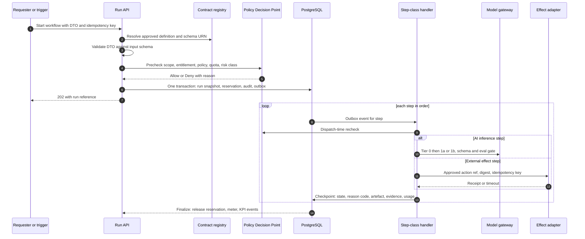
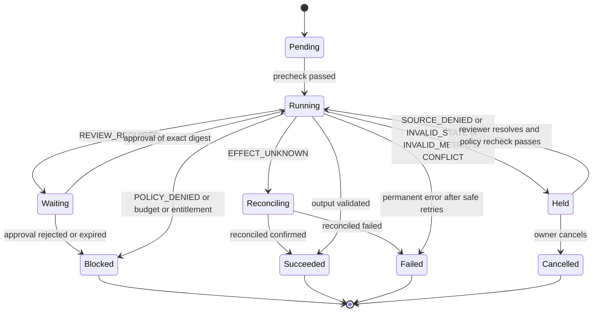

# AI Growth Engine: Employee Sales & Marketing Automation
## Application Blueprint: PART 11 (Batch 11.3), V12 Executable Workflows: SM-SVC-01…20 (80 workflows)

| Field | Value |
|---|---|
| Document | Part 11, Batch 3, file **a of c** (§11.3.1–§11.3.5.9). Files: `Part-11-3a_V12_Executable_Workflows_SVC01-20.md` (§11.3.1–§11.3.5.9 common engine contract), `Part-11-3b_…` (§11.3.5.10 workflow specifications SM-SVC-01…10), `Part-11-3c_…` (§11.3.5.10 SM-SVC-11…20 and §11.3.6–§11.3.10) |
| Version | 1.0 · 28 Nov 2026 |
| Baseline | Parts 0–9.10 and 0B (DEC-001…422); Part 2.2 §2.6 universal execution engine and WF-01…14; Parts 9.7–9.9 WF-15…39, AG-039…080, AU-053…119; Part 9.4 catalogue; Part 2.3 BRL and state machines; Part 3.2/3.3/3.4 contracts; customer revision V12 (BRD V12 ch09, FSD V12 ch12/13/33/40, Appendix B, workbook “39 Services 156 Workflows”) |
| Roles applied | Expert panel: Principal Workflow/BPM Architect (BPMN, saga, outbox), Revenue Operations leader, QA architect, Principal Engineer; plus Product Owner, Business Systems Analyst, Security/Compliance/AI Governance Lead, FinOps Lead |
| Status | Customer revision V12 alignment for group R3a (letter C). Development and running estimates in §11.3.5.9 are **outside** Ledger A (DEC-230) and Ledger B (DEC-231) and are separately approvable |

**Counts in this part (files a–c).** 80 V12 workflows (SM-SVC-01-WF01…SM-SVC-20-WF04) · 286 step contracts · 676 DTO field rows (169 distinct per service) · 682 workflow acceptance tests + 286 step tests from FSD ch33 mapped to TC-V12-C-031…998 · 30 engine tests TC-V12-C-001…030 · 92 requirements FR-V12-C-001…092 · 22 stories US-<EP>-YC01…YC22 · 13 workflow flowcharts + 4 engine diagrams · 15 decisions DEC-540…554 · 3 ADRs ADR-190…192 · tags 796–813 · 3,411 coverage aspects in `final/coverage_v12/C_coverage.csv`.

---
## 11.3.1 Material reviewed

| File (V12, 28 Nov 2026) | Size | Sections used | Purpose | Pattern | Aspects |
|---|---|---|---|---|---|
| `BRD/09_Business_Workflow_Catalogue_156_Workflo.txt` | 41.7 KB, 1,307 lines | V10 REC-05/REC-08, V6 MT-34, SM-SVC-01…20 tables (80 rows) | Business outcome, input → output, workflow KPI pair, risk class per workflow | `[TABLE]` 5 columns × 4 rows per service | 80 × 5 + 3 |
| `FSD/12_Executable_Workflow_Specification_156_W.txt` | 834 KB, 17,495 lines (lines 787–9,110 for SVC-01…20) | V10 controls, historical group index, V6 MT-29, V5 FL-02/03/07/08/11/12/13/14, V4 guard contract (8 controls), workflow-to-channel reconciliation, 80 workflow entries, candidate UI input contracts | Executable contract: 11-field specification, DTO table, step table, common contract, acceptance IDs | 3 tables per workflow (spec 11 rows; DTO 8–10 rows; steps 2–4 rows) | 80 × (11 + 2–4 steps + 8–10 tests) + 676 DTO rows |
| `FSD/AP_Appendix_B_Workflow_DTO_JSON_Schemas_156.txt` | 152 KB | 80 of 156 one-line JSON Schemas | `$id urn:sm:dto:<workflow>:v2`, `$defs.input` / `$defs.output` | JSON Schema 2020-12 | 80 schemas, 20 distinct |
| `FSD/13_Workflow_Step_Trigger_Event_Registry.txt` | 30 KB | V5 ST-04, FL-01, FL-05, FL-10; optimization mapping rows (80) | Step classes, control links | Table | 80 + 4 |
| `FSD/33_Unit_SIT_UAT_AI_Test_Specifications.txt` | (chapter) | §33.3 step tests (286 of 517) and workflow scenarios (682 of 1,342) | Test IDs and assertions | Table | 968 |
| `FSD/40_Master_Traceability…txt` | (chapter) | Workflow trace rows (80); FSD-POL-V6-PRECHECK and -ARTIFACT | Engine, AGT agent, policy, tests | Table + canonical text | 80 + 2 |
| `FSD/15_AI_Agent_Registry_Orchestration.txt` | 6.4 KB | AGT-01…15 | Agent roles, allowed and never-allowed tools | Table | 15 |
| `BRD/18_AI_Automation_Authority_Business_Govern.txt` | 11.7 KB | Authority table L0–L4, R3 default L2 | Authority model | Table | 6 |
| Workbook `…39_Services_156_Workflows(1)_csv/` | 1.3 MB (12 sheets) | `Workflow_Catalog.csv` (80 × 50 fields), `Acceptance_Tests.csv` (80 AT01), `Cost_Model.csv` (80), `Service_Index.csv` and `Entitlement_Rules.csv` (20) | Source workbook | CSV | 80 × 50 + 240 |

**Method.** Every row was parsed programmatically by `assembly/v12/c_parse_workflows.py` (output `assembly/v12/c_workflows.json`) and cross-checked: step counts agree across FSD ch12 step tables, the channel reconciliation table, FSD ch13 and the workbook (286 steps); DTO field sets equal the Appendix B schema properties for all 80 workflows; acceptance IDs in ch12 equal the ch33 scenario rows (682); titles agree between BRD ch09 and FSD ch12. Zero parsing mismatches. The document is generated by `assembly/v12/c_build_part.py` from the parsed data plus the hand-authored mapping `assembly/v12/c_mapping.py` and narrative `assembly/v12/c_text.py`, so every V12 value is carried literally.

**Shape of the material.** Risk classes: R0 internal analysis/draft 48, R1 scoped state write or safety control 11, R2 external communication/provider/access write 12, R3 financial/legal/commitment 9. Step classes (FSD ch33): AI inference 91, Deterministic domain logic 65, Policy gate / human review 58, Deterministic identity / reconciliation 26, Deterministic calculation 24, Evidence retrieval 16, External effect 6. Failure routes: REVIEW_REQUIRED 91, INVALID_STATE 65, POLICY_DENIED 58, CONFLICT 26, INVALID_METRIC 24, SOURCE_DENIED 16, EFFECT_UNKNOWN 6.

## 11.3.2 Coverage summary

The blueprint already has the **behaviour** of most of these workflows (universal engine Part 2.2 §2.6, WF-01…39, AG-001…080, AU-001…119, BRL catalogue), but it has none of the V12 **executable contract layer**: SKU-level workflow IDs, typed DTOs, step IDs and classes, failure codes, risk classes R0–R3, per-workflow KPIs, per-invocation cost and the TC-POS…EFFECT acceptance taxonomy. Capability status per workflow before this part: **Covered 57**, **Partially covered 18**, **Not covered 5** (the not-covered ones are all new WF04 capabilities or community response).

| Status | Before (aspects) | After (aspects) |
|---|---|---|
| Covered | 296 | 0 |
| Partially covered | 1,334 | 0 |
| Not covered | 1,738 | 0 |
| Conflict | 43 | 0 |
| Matched | 0 | 3,368 |
| Pending Founder decision | 0 | 43 |
| **Total** | **3,411** | **3,411** |

Pending Founder decision: the authority aspects of the 12 R2 and 9 R3 workflows (V12 allows an L3 “separately approved bounded mandate” path that DEC-064 and the safety invariants do not), and SM-SVC-19-WF03 step 04 (bid submission, DEC-053). Every other aspect is Matched.

| Workflow capability status | Count | Workflows |
|---|---|---|
| Covered (contract layer added) | 57 | all others |
| Partially covered (enhanced here) | 18 | 01-WF03, 01-WF04, 02-WF02, 02-WF04, 03-WF04, 04-WF04, 06-WF04, 07-WF04, 08-WF04, 09-WF04, 10-WF04, 11-WF04, 12-WF03, 14-WF04, 15-WF03, 16-WF04, 17-WF04, 19-WF04 |
| Not covered (specified here) | 5 | 12-WF04, 13-WF04, 15-WF04, 18-WF04, 20-WF04 |

## 11.3.3 Detailed register

Every aspect is listed individually in `final/coverage_v12/C_coverage.csv` (columns doc, chapter, section, aspect_id, aspect_summary, status_before, blueprint_location, action, new_ids, status_after). In this document each workflow's aspects are enumerated individually in its block in §11.3.5.10 (header fields, every step, every test); the table below is the per-workflow register.

| Workflow | Title | Risk | Capability before | Aspects | Not covered / conflict before | Blueprint location | Action | New IDs | After |
|---|---|---|---|---|---|---|---|---|---|
| SM-SVC-01-WF01 | Market and demand monitoring | R0 | Covered | 36 | 20 | WF-02 steps 1–3 (source plan → evidence → signals), A015/A016/A085/A086, AU-007, AG-005 | Contract layer | FR-V12-C-013 | Matched |
| SM-SVC-01-WF02 | Competitor and geographic intelligence | R0 | Covered | 34 | 19 | WF-02 (competitor watch A085/A086), AG-027 | Contract layer | FR-V12-C-014 | Matched |
| SM-SVC-01-WF03 | Trend report and evidence refresh | R0 | Partially | 34 | 21 | WF-02 evidence refresh; AG-027 summaries; AU-069 freshness (knowledge only) | Trend report artefact that separates facts from estimates is not specified | FR-V12-C-015 | Matched |
| SM-SVC-01-WF04 | Emerging market signal and scenario monitoring | R0 | Partially | 36 | 22 | AG-041 signal fusion and AU-084 decay give change detection; no scenario brief | Scenario comparison with explicit assumptions, and alerting on material change, are new (V12 WF04) | FR-V12-C-016 | Matched |
| SM-SVC-02-WF01 | Customer and enterprise discovery | R0 | Covered | 34 | 19 | WF-02 (need discovery → match), AG-006, AU-015, AU-017 | Contract layer | FR-V12-C-017 | Matched |
| SM-SVC-02-WF02 | Supplier, distributor and partner discovery | R0 | Partially | 34 | 21 | WF-02 + WF-30 partner onboarding; AG-032 due-diligence brief | Supplier/distributor discovery for procurement purposes not explicit; procurement is SM-SVC-39 (group D) | FR-V12-C-018 | Matched |
| SM-SVC-02-WF03 | Opportunity monitoring and alerts | R0 | Covered | 34 | 19 | AU-019 research alerts, AU-052 amendment detector, AU-034 deadline tracker | Contract layer | FR-V12-C-019 | Matched |
| SM-SVC-02-WF04 | Continuous buying-signal and opportunity-change detection | R0 | Partially | 36 | 22 | AU-084 signal fusion and intent decay; AG-062 why-now brief | Opportunity update with dedupe across continuous signals is partially specified | FR-V12-C-020 | Matched |
| SM-SVC-03-WF01 | Decision-maker discovery | R0 | Covered | 34 | 19 | WF-03 step 1–2, AG-008, AU-018 | Contract layer | FR-V12-C-021 | Matched |
| SM-SVC-03-WF02 | Contact verification and deduplication | R0 | Covered | 34 | 19 | WF-03 verification and dedupe; AU-018, AU-015, AU-074, AG-060 | Contract layer | FR-V12-C-022 | Matched |
| SM-SVC-03-WF03 | Channel eligibility assessment | R0 | Covered | 32 | 18 | WF-03 eligibility; PDP AU-009; gov_eligibility_decision | Contract layer | FR-V12-C-023 | Matched |
| SM-SVC-03-WF04 | Organization and decision-maker change monitoring | R0 | Partially | 34 | 21 | AU-018 freshness expiry; AG-060 steward | Active monitoring of organization and role changes with link invalidation not specified | FR-V12-C-024 | Matched |
| SM-SVC-04-WF01 | Business need and offering matching | R0 | Covered | 34 | 19 | WF-02 match; AU-016, AG-007 | Contract layer | FR-V12-C-025 | Matched |
| SM-SVC-04-WF02 | Lead scoring and prioritization | R0 | Covered | 34 | 19 | AU-017 opportunity scoring (DEC-011), BRL-SCR-01…09 | Contract layer | FR-V12-C-026 | Matched |
| SM-SVC-04-WF03 | Lead routing and assignment | R0 | Covered | 34 | 19 | WF-26 routing (AU-080, AU-081) | Contract layer | FR-V12-C-027 | Matched |
| SM-SVC-04-WF04 | Explainable conversion propensity and dynamic lead scoring | R0 | Partially | 36 | 22 | WF-16 predictive model lifecycle, AU-056 (advisory), AG-042, AU-057 drift | Dynamic propensity scoring must stay advisory and never replace DEC-011 (DEC-383) | FR-V12-C-028 | Matched |
| SM-SVC-05-WF01 | CRM import and relationship consolidation | R0 | Covered | 36 | 20 | M21–M23 import (AG-010), AU-015, AU-021, AU-100 | Contract layer | FR-V12-C-029 | Matched |
| SM-SVC-05-WF02 | Pipeline progression and task generation | R0 | Covered | 36 | 20 | Stage transitions (crm_stage_transition), WF-11 closure evidence, BRL-FIN-01 | Contract layer | FR-V12-C-030 | Matched |
| SM-SVC-05-WF03 | Next-best action and queue prioritization | R0 | Covered | 36 | 20 | AG-043 NBA, AU-060 action eligibility, AU-030 conflicts | Contract layer | FR-V12-C-031 | Matched |
| SM-SVC-05-WF04 | Stalled-deal detection and next-best-action automation | R0 | Covered | 36 | 20 | WF-17 deal-risk early warning (AU-058, AG-044), AU-088 | Contract layer | FR-V12-C-032 | Matched |
| SM-SVC-06-WF01 | Personalized email drafting | R0 | Covered | 36 | 20 | WF-06 draft (AG-011, AG-012), A034/A035 | Contract layer | FR-V12-C-033 | Matched |
| SM-SVC-06-WF02 | Controlled email delivery | R2 | Covered | 38 | 24 | WF-06 dispatch with PDP recheck, outbox, AU-024 | Contract layer | FR-V12-C-034 | Pending Founder (authority) |
| SM-SVC-06-WF03 | Bounce and reply synchronization | R1 | Covered | 36 | 20 | WF-06 callbacks; AU-024 bounce suppression; AU-008 STOP; BRL-AUT-08 | Contract layer | FR-V12-C-035 | Matched |
| SM-SVC-06-WF04 | Sender reputation and deliverability optimization | R1 | Partially | 36 | 22 | AU-031 complaint auto-pause, AU-024; Part 2.2 deliverability check | Sender authentication (SPF/DKIM/DMARC) validation and remediation proposals not specified | FR-V12-C-036 | Matched |
| SM-SVC-07-WF01 | Opt-in and template validation | R0 | Covered | 34 | 19 | WF-06/WF-23 eligibility; BRL-ELG-07; template approval | Contract layer | FR-V12-C-037 | Matched |
| SM-SVC-07-WF02 | Controlled WhatsApp outreach | R2 | Covered | 36 | 23 | WF-06 WhatsApp dispatch; AU-073; AU-009 | Contract layer | FR-V12-C-038 | Pending Founder (authority) |
| SM-SVC-07-WF03 | Inbound and status synchronization | R1 | Covered | 34 | 19 | WF-23 inbound; BRL-AUT-08 signature and dedupe; AU-008 | Contract layer | FR-V12-C-039 | Matched |
| SM-SVC-07-WF04 | Interactive commerce conversation and journey management | R2 | Partially | 38 | 26 | WF-23 concierge (AG-058) + WF-10 orders | Interactive commerce offers inside chat (catalogue offers, order hand-off) are new; prices never set by AI | FR-V12-C-040 | Pending Founder (authority) |
| SM-SVC-08-WF01 | Sequence scheduling and nurturing | R1 | Covered | 34 | 19 | WF-07/WF-27 sequence scheduling; AU-022, AU-086, AU-077 | Contract layer | FR-V12-C-041 | Matched |
| SM-SVC-08-WF02 | Adaptive channel and response planning | R0 | Covered | 36 | 20 | AG-063 cadence composer; AU-060; AU-030 | Contract layer | FR-V12-C-042 | Matched |
| SM-SVC-08-WF03 | Stop and escalation handling | R1 | Covered | 36 | 20 | §2.22.1 opt-out flow; AU-008; AU-025 | Contract layer | FR-V12-C-043 | Matched |
| SM-SVC-08-WF04 | Real-time cross-channel journey adaptation | R1 | Partially | 36 | 22 | AU-086 orchestrator; AU-077; WF-27 | Real-time cross-channel rescheduling with one frequency budget partly specified | FR-V12-C-044 | Matched |
| SM-SVC-09-WF01 | Unified conversation capture | R1 | Covered | 36 | 20 | WF-04 inbound capture; AG-013; AU-100 | Contract layer | FR-V12-C-045 | Matched |
| SM-SVC-09-WF02 | Grounded enquiry and objection response | R2 | Covered | 38 | 24 | AG-014 reply assistant; Tier 0 FAQ (AU-001); BRL-AI-03 grounding | Contract layer | FR-V12-C-046 | Pending Founder (authority) |
| SM-SVC-09-WF03 | Handover and continuity | R1 | Covered | 36 | 20 | WF-23 handoff; AU-073 | Contract layer | FR-V12-C-047 | Matched |
| SM-SVC-09-WF04 | Multilingual multimodal enquiry resolution | R2 | Partially | 38 | 26 | AG-050 Indic localization; WF-23 | Audio/image enquiry extraction is not in the blueprint; multimodal data class rules needed | FR-V12-C-048 | Pending Founder (authority) |
| SM-SVC-10-WF01 | Slot and booking coordination | R2 | Covered | 38 | 24 | WF-07 booking; AU-023; BRL-MTG-01…04 | Contract layer | FR-V12-C-049 | Pending Founder (authority) |
| SM-SVC-10-WF02 | Meeting preparation and reminders | R2 | Covered | 36 | 23 | AU-075 meeting-prep scheduler; AG-059; BRL-MTG-06 | Contract layer | FR-V12-C-050 | Pending Founder (authority) |
| SM-SVC-10-WF03 | Action-item extraction | R0 | Covered | 34 | 19 | AG-037 notes summarizer; FR-ENH-B-015 notes-only | Contract layer | FR-V12-C-051 | Matched |
| SM-SVC-10-WF04 | Intelligent demonstration preparation and meeting intelligence | R0 | Partially | 34 | 21 | AG-059 prep brief; AG-045 conversation intelligence | Demo plan tailored to requirements and gap identification is new | FR-V12-C-052 | Matched |
| SM-SVC-11-WF01 | Content strategy and calendar | R0 | Covered | 36 | 20 | WF-05 content plan; AG-018 | Contract layer | FR-V12-C-053 | Matched |
| SM-SVC-11-WF02 | Article and campaign content drafting | R0 | Covered | 34 | 19 | WF-05 drafting; AG-018; AG-012 | Contract layer | FR-V12-C-054 | Matched |
| SM-SVC-11-WF03 | Content review and optimization | R0 | Covered | 34 | 19 | WF-05 review; AU-036 diff | Contract layer | FR-V12-C-055 | Matched |
| SM-SVC-11-WF04 | Content gap, freshness and evidence monitoring | R0 | Partially | 34 | 21 | AU-069 RAG freshness (knowledge base only); AU-029 expiry monitor | Content-inventory gap and freshness backlog is new | FR-V12-C-056 | Matched |
| SM-SVC-12-WF01 | Social account and publication scheduling | R2 | Covered | 36 | 23 | WF-05 social scheduling; AU-029; BRL-MKT-07 | Contract layer | FR-V12-C-057 | Pending Founder (authority) |
| SM-SVC-12-WF02 | Publication status and engagement capture | R1 | Covered | 36 | 20 | AU-029; AU-026 reconciliation; BRL-AUT-08 | Contract layer | FR-V12-C-058 | Matched |
| SM-SVC-12-WF03 | Permitted social listening | R0 | Partially | 34 | 21 | AG-027 watch summaries; intel_social_post; BRL-SRC-01 | Permitted social listening topics, collection and escalation partly specified | FR-V12-C-059 | Matched |
| SM-SVC-12-WF04 | Community response and social trend coordination | R2 | Not covered | 38 | 35 | — | Community response queue and social trend coordination are not in the blueprint | FR-V12-C-060 | Pending Founder (authority) |
| SM-SVC-13-WF01 | Search visibility and keyword review | R0 | Covered | 36 | 20 | WF-05 SEO; mkt_keyword; mkt_page_metric; BRL-MKT-08 | Contract layer | FR-V12-C-061 | Matched |
| SM-SVC-13-WF02 | Technical and content issue detection | R0 | Covered | 34 | 19 | AU-033 SEO technical audit; mkt_seo_issue | Contract layer | FR-V12-C-062 | Matched |
| SM-SVC-13-WF03 | Optimization recommendations and validation | R0 | Covered | 36 | 20 | WF-05 SEO tasks; site approval (BRL-PUB-01) | Contract layer | FR-V12-C-063 | Matched |
| SM-SVC-13-WF04 | AI search and answer-engine visibility monitoring | R0 | Not covered | 34 | 29 | — | AI search / answer-engine visibility monitoring is not in the blueprint (only AU-033 and doc 21 AI search in replacement register) | FR-V12-C-064 | Matched |
| SM-SVC-14-WF01 | Campaign and audience preparation | R0 | Covered | 34 | 19 | WF-05 campaign draft; AG-051; BRL-MKT-04/06 | Contract layer | FR-V12-C-065 | Matched |
| SM-SVC-14-WF02 | Budget-controlled campaign activation | R3 | Covered | 38 | 24 | WF-05 activation (AU-032 caps, AU-009 recheck, AU-026) | Contract layer | FR-V12-C-066 | Pending Founder (authority) |
| SM-SVC-14-WF03 | Performance and spend optimization | R0 | Covered | 36 | 20 | AU-064 pacing; AU-097 ROI; AG-051 | Contract layer | FR-V12-C-067 | Matched |
| SM-SVC-14-WF04 | Controlled experimentation and incremental campaign performance analysis | R3 | Partially | 38 | 26 | WF-20 experiment lifecycle; AU-065; AU-098; AG-052 | Incrementality measurement with spend cap per variant partially specified | FR-V12-C-068 | Pending Founder (authority) |
| SM-SVC-15-WF01 | Landing page and form design | R0 | Covered | 36 | 20 | WF-04/§2.22.3 landing pages; A107/A108; BRL-PUB | Contract layer | FR-V12-C-069 | Matched |
| SM-SVC-15-WF02 | Lead capture and routing | R1 | Covered | 36 | 20 | AU-020 lead dedupe, consent and routing; W12–W17 | Contract layer | FR-V12-C-070 | Matched |
| SM-SVC-15-WF03 | Intake health and conversion monitoring | R0 | Partially | 36 | 22 | KPI funnel (RP-), AU-020 | Intake health (failures, retries, denominators) not specified | FR-V12-C-071 | Matched |
| SM-SVC-15-WF04 | Machine-readable offering and intake readiness validation | R0 | Not covered | 34 | 29 | — | Machine-readable offering (structured data) and intake readiness validation not in the blueprint | FR-V12-C-072 | Matched |
| SM-SVC-16-WF01 | Event setup and registration intake | R2 | Covered | 38 | 24 | AU-051 event registration; A062/A063 | Contract layer | FR-V12-C-073 | Pending Founder (authority) |
| SM-SVC-16-WF02 | Attendee reminders and follow-up | R2 | Covered | 38 | 24 | AU-051 reminders; BRL-MTG-06; AU-022 | Contract layer | FR-V12-C-074 | Pending Founder (authority) |
| SM-SVC-16-WF03 | Partner and referral lead routing | R1 | Covered | 34 | 19 | WF-30 partner referral; AU-091; BRL-ELG-17 | Contract layer | FR-V12-C-075 | Matched |
| SM-SVC-16-WF04 | Event conversion and attendee journey optimization | R2 | Partially | 38 | 26 | AU-096 attribution; WF-20 | Event conversion journey report partly specified | FR-V12-C-076 | Pending Founder (authority) |
| SM-SVC-17-WF01 | Proposal scope and draft | R0 | Covered | 34 | 19 | WF-09 proposal draft; AG-020 | Contract layer | FR-V12-C-077 | Matched |
| SM-SVC-17-WF02 | Quotation calculation | R3 | Covered | 36 | 23 | AU-035 quote calculator; BRL-QTE-01…07; DEC-027 | Contract layer | FR-V12-C-078 | Pending Founder (authority) |
| SM-SVC-17-WF03 | Revision and approval workflow | R3 | Covered | 38 | 24 | WF-09 approval; BRL-QTE-06; BRL-APR-02 | Contract layer | FR-V12-C-079 | Pending Founder (authority) |
| SM-SVC-17-WF04 | Configurable product, service and bundle quotation generation | R3 | Partially | 38 | 26 | WF-28 guarded quote; AU-089 CPQ; AG-066 | Configurable bundle quotation with versioned configuration partly specified | FR-V12-C-080 | Pending Founder (authority) |
| SM-SVC-18-WF01 | Negotiation assistance and objection handling | R0 | Covered | 36 | 20 | WF-09 objections; AG-021; AG-046 | Contract layer | FR-V12-C-081 | Matched |
| SM-SVC-18-WF02 | Contract or MoU drafting | R0 | Covered | 36 | 20 | WF-09/WF-11 contract draft; BRL-CTR-01; AG-022 | Contract layer | FR-V12-C-082 | Matched |
| SM-SVC-18-WF03 | Signature and commitment coordination | R3 | Covered | 38 | 24 | WF-11; DEC-023 e-sign adapter; BRL-CTR-03/04 | Contract layer | FR-V12-C-083 | Pending Founder (authority) |
| SM-SVC-18-WF04 | Contract obligation extraction and negotiation scenario analysis | R0 | Not covered | 36 | 31 | — | Obligation register and negotiation scenario analysis are not in the blueprint | FR-V12-C-084 | Matched |
| SM-SVC-19-WF01 | Tender discovery and deadline monitoring | R0 | Covered | 36 | 20 | WF-08 discovery; AU-034; AU-052 | Contract layer | FR-V12-C-085 | Matched |
| SM-SVC-19-WF02 | Bid/no-bid assessment | R0 | Covered | 34 | 19 | WF-08 bid/no-bid; BRL-BID-02/03 | Contract layer | FR-V12-C-086 | Matched |
| SM-SVC-19-WF03 | Bid preparation and submission coordination | R3 | Covered | 38 | 24 | WF-08 package + human submission (DEC-053); WF-18 | Contract layer | FR-V12-C-087 | Pending Founder (authority) |
| SM-SVC-19-WF04 | Continuous bid compliance and submission-readiness evaluation | R0 | Partially | 36 | 22 | AU-034 checklist; AU-063 | Continuous compliance matrix partly specified | FR-V12-C-088 | Matched |
| SM-SVC-20-WF01 | Sales order preparation | R0 | Covered | 34 | 19 | WF-10 order draft; BRL-ORD-01; AU-038 | Contract layer | FR-V12-C-089 | Matched |
| SM-SVC-20-WF02 | Order and milestone coordination | R3 | Covered | 38 | 24 | WF-10 fulfilment; BRL-ORD-02…04 | Contract layer | FR-V12-C-090 | Pending Founder (authority) |
| SM-SVC-20-WF03 | Acceptance and delivery exception handling | R3 | Covered | 38 | 24 | WF-10 acceptance; BRL-ORD-05; AU-038 | Contract layer | FR-V12-C-091 | Pending Founder (authority) |
| SM-SVC-20-WF04 | Order fulfillment prediction and exception monitoring | R0 | Not covered | 36 | 31 | — | Fulfilment delay prediction and exception monitoring are not in the blueprint | FR-V12-C-092 | Matched |

## 11.3.4 Catalogue reconciliation

### 11.3.4.1 Counts

| Item | V12 source count (SVC-01…20) | Check | Blueprint after this part |
|---|---|---|---|
| Services (SKUs) | 20 of 39 | Service_Index = Entitlement_Rules = ch09 headings | 20 service blocks; SKU commercial model is group B (Part 11.2) |
| Workflows | 80 of 156 | BRD ch09 = FSD ch12 = workbook = Appendix B = ch13 = ch40 | 80 workflow blocks, FR-V12-C-013…092 |
| Steps | 286 of 517 | ch12 step tables = ch12 reconciliation = ch13 = workbook “Workflow steps” | 286 step rows with blueprint component and state |
| DTO fields | 676 rows (169 per service) | ch12 DTO tables = Appendix B properties | 20 DTO tables |
| Workflow acceptance tests | 682 (80 × 8 + 21 × 2) | ch12 acceptance IDs = ch33 rows | TC-V12-C mapped |
| Step tests | 286 | ch33 §33.3 = step tables | TC-V12-C mapped |
| Original acceptance (AT01) | 80 | workbook Acceptance_Tests | superseded by TC-POS mapping; still “not run” |
| Cost rows | 80 | workbook Cost_Model | illustrative cost per workflow |
| Agents (AGT) | 15 (AGT-01…15) | ch15 = ch40 trace | mapped to AG-003…AG-066 (no new agent) |
| Engines (V12 shared) | 9 of 15 used | Shared_Engines | mapped to blueprint modules |

### 11.3.4.2 V12 agent (AGT) → blueprint agent crosswalk

V12 FSD ch15 gives each AGT role “scoped read, retrieval (own tenant), draft/score output” and never “send, publish, spend, change live state, read other tenants”. This equals the blueprint rule that agents draft, classify, extract and match and never act (BRL-AI-07; Part 7.2 tool registry). No new agent card is needed; the AGT ID becomes an alias on the mapped AgentDefinition (`ai_agent_definition.external_alias`) so traces show both IDs (DEC-540).

| AGT | V12 role | Workflows | Blueprint agents |
|---|---|---|---|
| AGT-01 | Research intelligence; market analysis | 01-WF01, 01-WF02, 01-WF03, 01-WF04 | AG-027 (primary), AG-003, AG-004, AG-041 |
| AGT-02 | Research planning; evidence extraction | 02-WF01, 02-WF02, 02-WF03, 02-WF04 | AG-003 (primary), AG-006, AG-062, AG-032 |
| AGT-03 | Contact intelligence; entity matching | 03-WF01, 03-WF02, 03-WF03, 03-WF04 | AG-008 (primary), AG-060 |
| AGT-04 | Qualification; matching | 04-WF01, 04-WF02, 04-WF03, 04-WF04, 16-WF01, 16-WF02, 16-WF03, 16-WF04 | AG-009 (primary), AG-007, AG-042; AG-013 and AG-069 for SM-SVC-16 |
| AGT-05 | Orchestration; next-best action | 05-WF01, 05-WF02, 05-WF03, 05-WF04 | AG-043 (primary), AG-044, AG-010 |
| AGT-06 | Outreach; localization | 06-WF01, 06-WF02, 06-WF03, 06-WF04, 07-WF01, 07-WF02, 07-WF03, 07-WF04 | AG-011 (primary), AG-012, AG-058 (WhatsApp), AG-049, AG-050 |
| AGT-07 | Follow-up; omnichannel strategy; orchestration | 08-WF01, 08-WF02, 08-WF03, 08-WF04 | AG-063 (primary), AG-011 |
| AGT-08 | Conversation; objection resolution; evidence retrieval | 09-WF01, 09-WF02, 09-WF03, 09-WF04 | AG-014 (primary), AG-013, AG-017, AG-021 |
| AGT-09 | Meeting intelligence; summarization | 10-WF01, 10-WF02, 10-WF03, 10-WF04 | AG-059 (primary), AG-037, AG-045 |
| AGT-10 | Content drafting; evidence retrieval; quality review | 11-WF01, 11-WF02, 11-WF03, 11-WF04, 15-WF01, 15-WF02, 15-WF03, 15-WF04 | AG-018 (primary), AG-012, AG-017 (SM-SVC-15) |
| AGT-11 | Market intelligence; content adaptation | 12-WF01, 12-WF02, 12-WF03, 12-WF04, 13-WF01, 13-WF02, 13-WF03, 13-WF04 | AG-018 (social/SEO drafting), AG-027 (listening, visibility) |
| AGT-12 | Campaign optimization; attribution analysis | 14-WF01, 14-WF02, 14-WF03, 14-WF04 | AG-051 (primary), AG-052, AG-053 |
| AGT-13 | Document intelligence; conversion; financial review | 17-WF01, 17-WF02, 17-WF03, 17-WF04, 20-WF01, 20-WF02, 20-WF03, 20-WF04 | AG-020 (SM-SVC-17), AG-048, AG-066; AG-023 (SM-SVC-20) |
| AGT-14 | Objection resolution; conversion; document intelligence | 18-WF01, 18-WF02, 18-WF03, 18-WF04 | AG-021 (primary), AG-022, AG-046 |
| AGT-15 | Research; qualification; document intelligence | 19-WF01, 19-WF02, 19-WF03, 19-WF04 | AG-019 (primary), AG-020, AG-047 |

### 11.3.4.3 Service → blueprint workflow crosswalk

The V12 SM-SVC workflows are **SKU-level executable contracts**; the blueprint WF-01…39 are **end-to-end business flows** that chain several contracts. Both are kept: a WF-xx step that performs the work of an SM-SVC workflow invokes that contract through the engine (DEC-540). The historical use-case groups of FSD ch12 V10 (20 groups × 5 entries) map as: Onboarding → WF-01/§2.22.4; Research, Market intelligence → SM-SVC-01/02 (WF-02); Contact intelligence → SM-SVC-03 (WF-03); Qualification → SM-SVC-04; Outreach, Follow-up → SM-SVC-06/07/08 (WF-06/07/27); Conversation → SM-SVC-09; Meetings → SM-SVC-10; Content marketing, Digital marketing → SM-SVC-11…14 (WF-05); Website, Conversion → SM-SVC-15/16 (WF-04); Documents → SM-SVC-17/18 (WF-09); Financial → SM-SVC-20 (WF-10/11) and SM-SVC-21 (group D); Customer lifecycle → SM-SVC-22/23 (group D); SaaS, AI operations, Reliability, Optimization → engine (this §11.3.5) and group E. The Part 9.4 catalogue should list, per WF-xx, the SM-SVC contracts it invokes [RECOMMENDATION-808].

```mermaid
flowchart TD
  WF04["WF-04 Inbound acquisition"]
  WF07["WF-07 Follow-up and meetings"]
  WF23["WF-23 WhatsApp concierge"]
  WF27["WF-27 Multichannel cadence"]
  WF06["WF-06 Outreach and replies"]
  WF29["WF-29 Pipeline inspection"]
  WF17["WF-17 Deal-risk early warning"]
  WF11["WF-11 Commercial closure"]
  WF16["WF-16 Predictive model lifecycle"]
  WF26["WF-26 Lead route and SLA"]
  WF03["WF-03 Professional contacts"]
  WF30["WF-30 Partner referral and co-sell"]
  WF02["WF-02 Market discovery"]
  S01["SM-SVC-01<br/>Market and Competitive Intelligence Au"]
  S01 --> WF02
  S02["SM-SVC-02<br/>Global Business Opportunity Discovery "]
  S02 --> WF02
  S02 --> WF30
  S03["SM-SVC-03<br/>B2B Contact and Decision-Maker Intelli"]
  S03 --> WF03
  S04["SM-SVC-04<br/>Lead Qualification and Intelligent Mat"]
  S04 --> WF02
  S04 --> WF26
  S04 --> WF16
  S05["SM-SVC-05<br/>CRM and Sales Pipeline Automation"]
  S05 --> WF11
  S05 --> WF17
  S05 --> WF29
  S06["SM-SVC-06<br/>Email Marketing and Outreach Automatio"]
  S06 --> WF06
  S06 --> WF27
  S07["SM-SVC-07<br/>WhatsApp Business Marketing Automation"]
  S07 --> WF06
  S07 --> WF23
  S08["SM-SVC-08<br/>Omnichannel Follow-up and Lead Nurturi"]
  S08 --> WF07
  S08 --> WF27
  S09["SM-SVC-09<br/>AI Chat, Unified Inbox and Objection A"]
  S09 --> WF04
  S09 --> WF06
  S09 --> WF23
  S10["SM-SVC-10<br/>Meeting, Demo and Appointment Automati"]
  S10 --> WF07
```

```mermaid
flowchart TD
  WF10["WF-10 Order and fulfilment"]
  WF18["WF-18 RFP co-pilot"]
  WF08["WF-08 Project bid"]
  WF11["WF-11 Commercial closure"]
  WF28["WF-28 Deal room and guarded quote"]
  WF09["WF-09 Proposal, quote, negotiation"]
  WF30["WF-30 Partner referral and co-sell"]
  WF04["WF-04 Inbound acquisition"]
  WF20["WF-20 Experiment lifecycle"]
  WF05["WF-05 Content and campaign"]
  S11["SM-SVC-11<br/>Content Marketing Automation"]
  S11 --> WF05
  S12["SM-SVC-12<br/>Social Media Publishing and Listening "]
  S12 --> WF05
  S13["SM-SVC-13<br/>SEO and Search Visibility Automation"]
  S13 --> WF05
  S14["SM-SVC-14<br/>Paid Digital Advertising Automation"]
  S14 --> WF05
  S14 --> WF20
  S15["SM-SVC-15<br/>Landing Page and Website Lead Intake A"]
  S15 --> WF04
  S16["SM-SVC-16<br/>Webinar, Event and Referral Acquisitio"]
  S16 --> WF04
  S16 --> WF30
  S17["SM-SVC-17<br/>Proposal and Quotation Automation"]
  S17 --> WF09
  S17 --> WF28
  S18["SM-SVC-18<br/>Negotiation, Contract and MoU Automati"]
  S18 --> WF09
  S18 --> WF11
  S19["SM-SVC-19<br/>Tender and Project Bid Automation"]
  S19 --> WF08
  S19 --> WF18
  S20["SM-SVC-20<br/>Sales Order and Fulfillment Automation"]
  S20 --> WF10
  S20 --> WF11
```






## 11.3.5 Enhancements

### 11.3.5.1 Engine-level requirements (FR-V12-C-001…012)

| FR | Requirement | Source (V12) | Blueprint basis | Rules | Tests |
|---|---|---|---|---|---|
| FR-V12-C-001 | **Workflow contract registry.** Register the 80 workflows SM-SVC-01-WF01…SM-SVC-20-WF04 (group D registers the other 76) in `aut_workflow` with the V12 ID as the stable key, title, service (SKU) ID, workflow version (2.0-target for WF01–03, 1.0-target for WF04), schema URN, ordered step IDs with class, risk class R0–R3, approval gate text, meter unit, KPI definitions and acceptance IDs. Run creation snapshots the definition (immutable); an unapproved version is rejected. | FSD ch13 FL-01; ch12 V6; BRD ch09 MT-34 | ENT-159/160 Workflow/Revision; BRL-AUT-03; WQG-01…12 | Definition count for these services stays 80 whatever the number of tenants or templates | TC-V12-C-001, -002, -011 |
| FR-V12-C-002 | **BusinessContext and event envelope.** Every run carries `BusinessContext` {tenant, organization, company/startup, division, brand, offering, target market, account, campaign/configuration, SKU, workflow ID and revision, actor, policy snapshot}. Trigger events use the V12 envelope `event_id, tenant_id, startup_id, service_id, workflow_revision, input_ref, occurred_at, correlation_id`; scope fields are taken from membership, never from the payload (E-1). | FSD ch12 V6; workbook “Event and trigger schema” | Part 3.4 §3.4.5.2 D canonical inbound event; E-1 | Mismatched scope → reject (403/404) | TC-V12-C-003, -004 |
| FR-V12-C-003 | **Run, result and approval contract.** V12 API-V2-RUN → trigger/start (API-460/462 for events; proposed `POST ~/admin/workflows/{workflow_id}/runs` with DTO body, 202 + run reference) [GAP-804]; API-V2-RESULT → `GET ~/admin/runs/{id}` (API-467) step timeline with artefact and evidence references, API-472 evidence export; API-V2-APPROVAL → API-541/542 submit/detail and API-539 decide. Existing `/api/v1/…` operations listed per service are retained or mapped by a reviewed adapter (not deployed endpoints). | FSD ch12 “Proposed contract mapping” | API-449, 460–472, 539–545 | Approval decision binds the payload digest | TC-V12-C-005, -006 |
| FR-V12-C-004 | **Precheck and finalize policy (FSD-POL-V6-PRECHECK).** Precheck: validate schema, scope, source, version, policy and quota; reserve units. Finalize: persist accepted output reference, provenance, step states, effect receipt, usage actuals, release reservation, audit. Step idempotency key = digest(tenant, company/startup, run, version, step, target). Timeouts: read 30 s, AI 90 s, provider per verified adapter. Max 3 safe retries with full jitter (NFR-016 base 30 s, factor 2, max 15 min); never replay an uncertain write. Long-running media/calls use asynchronous poll/callback. V4 guard controls adopted for production: role separation (requester ≠ reviewer; auditor read-only), period allowance ledger (remaining = allowance − active or completed units in the month; approval excludes its own reservation), portfolio aggregates only (DEC-055), per-service channel allowlist (e.g. SM-SVC-14 paid ads only), duplicate reference+workflow+channel → Held, approval expiry (15 min in the simulator; production per BRL-APR-03), pause → Held, cancel/retry/reconcile with policy recheck. | FSD ch40 V6 canonical policy; FSD ch12 V4 guard contract | E-1…E-9; BRL-AUT-06/07; NFR-014/016 | DEC-545 | TC-V12-C-007, -009, -010 |
| FR-V12-C-005 | **Step state and reason model.** StepRun states: Pending, Running, Waiting (AWAITING_APPROVAL), Held, **Blocked** (new), Reconciling, Succeeded, Failed, Cancelled. V12 failure codes become reason codes on StepRun: SOURCE_DENIED, REVIEW_REQUIRED, INVALID_METRIC, INVALID_STATE, POLICY_DENIED, CONFLICT, EFFECT_UNKNOWN (plus engine codes ENTITLEMENT_REVOKED, BUDGET_EXHAUSTED, CONSENT_REVOKED, DUPLICATE). Durable checkpoint before acknowledgement (ST-04) with the lease fencing token of Part 3.4 §3.4.5.4 A. | FSD ch12 step tables; ch13 ST-04 | Part 2.3 §2.27.14; DEC-050 | DEC-541, ADR-192 | TC-V12-C-008, -012, -013 |
| FR-V12-C-006 | **Typed artefact, evidence and effect receipt.** Each step persists a typed artefact reference (schema-validated candidate per FSD-POL-V6-ARTIFACT), evidence set `{items, source_ref, observed_at, hash, rights}`, candidate `{artifact_ref, confidence, reason_codes, review_state}`, calculation `{value, unit, assumptions, evidence_refs}`, domain_result `{artifact_ref, status, evidence_refs}`, match_result `{matched_refs, unmatched_refs, conflict_refs}`, effect_receipt `{provider_ref, status, observed_at}`. Financial, identity and uniqueness fields are normalized into domain tables, never kept only as JSON. Physical DDL (V12 DB-V2-RUN/STEP/ARTIFACT/EVIDENCE/EFFECT) is owned by Part 11 data group I/E [GAP-803]. | FSD ch12 step outputs; ch40 ARTIFACT | ENT-059 Evidence; ENT-162/163 | — | TC-V12-C-015, -016 |
| FR-V12-C-007 | **Step-class handler library.** Seven reusable handlers implement all 286 steps by configuration: Evidence retrieval, AI inference, Deterministic calculation, Deterministic domain logic, Policy gate / human review, Deterministic identity / reconciliation, External effect. Only AI-inference steps may call the model gateway; External-effect steps hold the only effect tools and never read untrusted content in the same step (AIX-09). An incomplete handler mapping blocks release of the workflow (FL-03). | FSD ch12 V5 FL-03; ch13; ch15 | AU-001/003/006/009/026; WQG | ADR-190 | TC-V12-C-017, -018, -019 |
| FR-V12-C-008 | **DTO validation.** Appendix B JSON Schema 2020-12 documents are the canonical validators at run creation and at each step boundary (`additionalProperties: false`; uuid, date-time, ISO 4217 `^[A-Z]{3}$`, decimal string `^-?\d{1,14}(\.\d{1,4})?$`, reason codes `^[A-Z][A-Z0-9_]{2,63}$`, arrays ≤ 500 items, free text 1–4,000 characters NFC). Money in DTOs is int64 minor units; storage stays Decimal (DEC-027) with exact conversion by `ref_currency.minor_units`. The V4 simulator’s heuristic text inputs never become schemas (FL-02). | Appendix B; FSD ch12 DTO tables; V5 FL-02 | NFR-015/017; Part 3.5b Money | DEC-543, DEC-544, ADR-191 | TC-V12-C-020, -021, -022 |
| FR-V12-C-009 | **Optional producers and equivalent input.** A workflow never requires another paid SKU: a client may supply equivalent authorized input (workbook “Prerequisite automations”). A cross-workflow event starts a child only when the child SKU is entitled or the input is supplied; otherwise the child is Held with ENTITLEMENT_MISSING and no data crosses scope (FL-10). | Workbook; FSD ch13 FL-10; Entitlement_Rules | BRL-SVC-03; E-1 | — | TC-V12-C-014 |
| FR-V12-C-010 | **Risk class enforcement.** The PDP reads the workflow’s risk class and enforces the autonomy crosswalk (§11.3.5.4): R0 no external effect; R1 deterministic safety controls at L3, other writes reviewed; R2 L1 approval of exact hash then L2 dispatch, L3 only for DEC-064 L3 categories; R3 ≤ L1. Where V12 sources disagree, the stricter class applies (DEC-546). | BRD ch09 risk; ch12 authority; BRD ch18 | DEC-064; BRL-AUT-01; AU-009 | DEC-542, 546, 548, 549 | TC-V12-C-023, -024, -025 |
| FR-V12-C-011 | **Templates as parameter sets.** Industry/business templates (MT-29, FL-12) are versioned parameter sets referencing a canonical workflow; applying one needs explicit review and never grants entitlement or overrides policy; 25 customer configurations create no definition clone (MT-34). | FSD ch12 MT-29; BRD ch09 MT-34 | A113; DEC-051 | — | TC-V12-C-011 |
| FR-V12-C-012 | **Workflow KPI and metering events.** Each completed step emits KPI numerator/denominator events for the workflow’s two KPIs (formulas in each block) and a meter event in the service’s meter unit; simulated runs are flagged and excluded (BRL-AUT-04); meter events reconcile to invoices (BRL-SVC-04, NFR-035). Thresholds are set from the pilot baseline (DEC-554). | BRD ch09 KPI column; workbook usage limits | KPI-19/20; AU-042 | DEC-554 | TC-V12-C-028, -029, -030 |

### 11.3.5.2 Execution sequence for every SM-SVC workflow



### 11.3.5.3 Step state model (DEC-541, ADR-192)



| V12 failure route | Steps | Blueprint state | Behaviour |
|---|---|---|---|
| SOURCE_DENIED | 16 | Held | Step Held with reason SOURCE_DENIED; transient read errors retried ≤ 3 with jitter (BRL-AUT-06, NFR-016) |
| REVIEW_REQUIRED | 91 | Waiting (AWAITING_APPROVAL) | Run Waiting on review/approval (gov_approval or intel_review); approval hash-bound (BRL-APR-02) |
| INVALID_METRIC | 24 | Held | Step Held with reason INVALID_METRIC; never impute missing values (BRL-AI-04) |
| INVALID_STATE | 65 | Held | Step Held with reason INVALID_STATE; stale revision → 409 (NFR-025) |
| POLICY_DENIED | 58 | Blocked | Step Blocked (new terminal step state, DEC-541); PDP Deny recorded; zero external effect |
| CONFLICT | 26 | Held / Reconciling | Held with aut_conflict_case (AU-030); uncertain provider outcome → Reconciling (AU-026) |
| EFFECT_UNKNOWN | 6 | Reconciling | Run Reconciling (DEC-050 uncertain); no retry before reconciliation (E-5); missing grant → Blocked |

**Run-level roll-up.** A run is Waiting when any step is Waiting; Held when any step is Held; Reconciling when any step is Reconciling; Blocked (terminal, reason recorded) when a Blocked step has no alternative path; Succeeded only when every step is Succeeded. Part 3.2 run states (`queued → running → waiting → succeeded | failed | cancelled | uncertain → reconciled_*`) map as queued = Pending, uncertain = Reconciling, blocked = new value `blocked` [RECOMMENDATION-813].

### 11.3.5.4 Authority crosswalk V12 L0–L4 / R0–R3 → blueprint (DEC-542)

| V12 authority | V12 meaning (BRD ch18) | Blueprint equivalent | Notes |
|---|---|---|---|
| L0 | Manual action recorded | L0 (human task, no send) | Same |
| L1 | AI proposes or drafts; human decides | L1 (draft awaits human approval) | Same |
| L2 | Exact approved action with reviewer, expiry and limits | L1 approval of exact hash **then** L2 dispatch of that item (DEC-064 publishing pattern) | Equivalent control; no consequential action without the exact-digest approval |
| L3 | Bounded routine actions under approved mandate, scope, expiry and caps | L3 within caps, **only** for DEC-064 L3 categories (approved-FAQ replies, eligible follow-ups, reminders) and deterministic internal safety controls | V12 extends L3 to R2/R3 “where lawful” → CONFLICT-798/799 |
| L4 | Adaptive orchestration inside L3 constraints; never expands authority | Supervisor orchestration (WF-13, WF-15, AU-053) with L3 as the ceiling | Label adopted; no new authority |

| Risk class | Count | V12 rule | Blueprint enforcement | Status |
|---|---|---|---|---|
| R0 internal analysis/draft | 48 | L1 assisted; L3 approved read/draft | Unattended internal drafting and analysis; no external effect; reuse outside workspace needs approval | Matched |
| R1 scoped state write or safety control | 11 | L1/L2 review; L3 only for approved deterministic internal actions | Suppression, stop, dedupe, pause at L3 (AU-008/024/025); other writes reviewed | Matched |
| R2 external communication/provider/access write | 12 | L2 mandatory approved effect; L3 with bounded mandate where lawful | L1 + L2 dispatch; L3 only DEC-064 categories | Pending Founder (CONFLICT-799, DEC-549) |
| R3 financial/legal/commitment | 9 | Default L2; L3 with bounded mandate where lawful | ≤ L1 (DEC-064); AI never signs, pays, submits bids or sets prices | Pending Founder (CONFLICT-798, DEC-548) |

### 11.3.5.5 Step-class handler library (ADR-190)

| Class (FSD ch33) | Steps | V12 executor | Input → output | Handler obligations | Test technique |
|---|---|---|---|---|---|
| Evidence retrieval | 16 | Evidence/ingestion engine | permitted source or artefact refs + scope + source policy → evidence_set | Reject stale or unauthorized source; preserve original and confidence; hash and rights stored; transient read retry ≤ 3 | IT (adapter stub) + SEC |
| AI inference | 91 | Domain agent / task router | scoped evidence + approved configuration + prior results → candidate | Gateway only (BRL-AI-01); typed schema; claims check; draft cannot change live state; untrusted input cannot invoke tools; EVAL-SM-SVC-<wf> gate | AIE (eval suite) + CT schema |
| Deterministic calculation | 24 | Rules/analytics engine | versioned inputs + policy/metric_version → calculation | Zero model calls; validate denominator, units, calibration and bounds; never invent missing values | UT golden fixture |
| Deterministic domain logic | 65 | Domain service | validated payload + prior result → domain_result | Version check; explicit authorization before state change; one transaction with audit and outbox | UT golden fixture |
| Policy gate / human review | 58 | Policy/validation engine | payload + subject + policy version → decision | PDP decision record; approval routing with SLA (BRL-APR-10); no external effect on deny | UT decision table + IT PDP |
| Deterministic identity / reconciliation | 26 | Identity/reconciliation engine | scoped object refs + version + evidence_set → match_result | Unique source event; no cross-company merge; financial allocations atomic; uncertain provider outcome reconciled | UT + IT replay |
| External effect | 6 | Effect adapter | approved_action_ref + target/version + idempotency_key → effect_receipt | Approval payload digest and scope exact; dispatch recheck; reconcile ambiguous response before repeat; simulation adapter returns synthetic receipt only | IT sandbox adapter + CHAOS timeout |

### 11.3.5.6 ADRs

| ADR | Title | Context | Decision | Consequences |
|---|---|---|---|---|
| ADR-190 | Step-class handler library for SKU workflows | 286 steps in 80 workflows (517 in 156) share seven behaviour classes; writing one handler per step would duplicate logic (MT-34) | Implement seven parameterized handlers; bind steps by configuration in the contract registry; FL-03 release gate requires a complete binding | Fewer code paths, uniform tests generated from the registry [RECOMMENDATION-807]; new step behaviour needs a new class through ADR review |
| ADR-191 | JSON Schema 2020-12 validation at the run boundary | Appendix B provides validated schemas; Part 3.5b uses decimal-string money | Validate DTOs with Appendix B schemas at run creation and each step boundary; money as int64 minor units in DTOs, Decimal in storage | Exact, testable contracts; converter must be total and reversible for every ISO 4217 minor-unit value |
| ADR-192 | Explicit Blocked state and V12 reason codes | V12 distinguishes BLOCKED (policy, no effect) from HELD (resolvable) | Add Blocked step state; store V12 failure code as reason code; roll-up rules in §11.3.5.3 | Clear operator queues (Held = work, Blocked = stop); Part 2.3 diagram owner to update |

### 11.3.5.7 Engine tests (TC-V12-C-001…030)

| Test | Requirement | Scenario | Expected | Level |
|---|---|---|---|---|
| TC-V12-C-001 | FR-V12-C-001 | Load registry; list SM-SVC-01…20 | Exactly 80 workflow IDs, 286 step IDs; each with schema URN, risk class and KPI pair | CT |
| TC-V12-C-002 | FR-V12-C-001 | Start a run on an unapproved definition version | 409; no run | IT |
| TC-V12-C-003 | FR-V12-C-002 | Event envelope with startup_id of another tenant | Rejected; no run; audit | SEC |
| TC-V12-C-004 | FR-V12-C-002 | BusinessContext missing policy snapshot | Run creation fails closed | UT |
| TC-V12-C-005 | FR-V12-C-003 | Start run via DTO endpoint | 202 with run reference; `GET ~/admin/runs/{id}` shows steps | IT |
| TC-V12-C-006 | FR-V12-C-003 | Approve, then alter payload before dispatch | Digest mismatch → Blocked | SEC |
| TC-V12-C-007 | FR-V12-C-004 | AI step exceeds 90 s | Timeout; safe retry ≤ 3 with jitter; then Failed with reason | CHAOS |
| TC-V12-C-008 | FR-V12-C-005 | Kill worker after checkpoint of an effect step | Resume without second effect (ST-04) | CHAOS |
| TC-V12-C-009 | FR-V12-C-004 | Allowance exhausted by active same-month runs | Reservation denied → Blocked BUDGET_EXHAUSTED | IT |
| TC-V12-C-010 | FR-V12-C-004 | Requester tries to approve own run | Refused (BRL-APR-01) | SEC |
| TC-V12-C-011 | FR-V12-C-011 | Apply a template to 25 configurations | Definition count unchanged; regression IDs stable (MT-34, MT-29) | IT |
| TC-V12-C-012 | FR-V12-C-005 | Each V12 failure code fixture | State per §11.3.5.3 table; reason code stored | UT |
| TC-V12-C-013 | FR-V12-C-005 | Lease expired worker commits late | Write rejected by fencing token | IT |
| TC-V12-C-014 | FR-V12-C-009 | Event targets an unentitled child SKU | Child Held ENTITLEMENT_MISSING; no data crosses scope (FL-10) | IT |
| TC-V12-C-015 | FR-V12-C-006 | Effect step completes | effect_receipt {provider_ref,status,observed_at} stored and linked to approval digest | IT |
| TC-V12-C-016 | FR-V12-C-006 | Financial calculation output | Normalized into domain table; JSON artefact alone rejected | CT |
| TC-V12-C-017 | FR-V12-C-007 | Workflow with an unmapped step | Release blocked (FL-03) | CT |
| TC-V12-C-018 | FR-V12-C-007 | Prompt-injection text in evidence for an AI step | No tool call; output schema-valid; flagged (AIX-08/09) | AIE |
| TC-V12-C-019 | FR-V12-C-007 | Deterministic step golden fixture | Exact output; zero model calls (gateway counter = 0) | UT |
| TC-V12-C-020 | FR-V12-C-008 | DTO with extra property | 422 field error | CT |
| TC-V12-C-021 | FR-V12-C-008 | `budget_minor` = 123456 INR minor units | Stored Decimal 1234.56 INR; round-trip exact | UT |
| TC-V12-C-022 | FR-V12-C-008 | Currency `inr` (lower case) | 422 pattern violation | CT |
| TC-V12-C-023 | FR-V12-C-010 | R3 workflow configured with an L3 mandate | PDP denies; mandate path disabled pending DEC-548 | SEC |
| TC-V12-C-024 | FR-V12-C-010 | R2 first-touch send configured at L3 | Denied; L1 approval required (DEC-549 pending) | SEC |
| TC-V12-C-025 | FR-V12-C-010 | Sources disagree on class (workbook internal vs FSD R3) | Stricter class applied (DEC-546) | UT |
| TC-V12-C-026 | FR-V12-C-003 | Run inspection screen A110 with keyboard and screen reader | Step table, states and reason codes announced; WCAG 2.2 AA (NFR-023) | A11Y |
| TC-V12-C-027 | FR-V12-C-005 | Held and Blocked badges | Text label plus icon; contrast ≥ 4.5:1; not colour only | A11Y |
| TC-V12-C-028 | FR-V12-C-012 | Simulated run completes | KPI and meter events flagged simulated and excluded (BRL-AUT-04) | IT |
| TC-V12-C-029 | FR-V12-C-012 | Month-end meter reconciliation | 100% meter events match invoice lines (NFR-035) | IT |
| TC-V12-C-030 | FR-V12-C-012 | EduVerse lead under 18 enters SM-SVC-06/07/14 | Blocked POLICY_DENIED; no outreach or ad audience (DEC-030, BRL-ELG-13); MedMaarg health data rejected (BRL-ELG-14) | SEC |

**Engine stories.**

**US-18-YC21 — Contract registry and typed runs.** As R11 Automation Lead, I want every SM-SVC workflow registered with its DTO schema, step classes, risk class and KPIs, so that runs are reproducible, validated and comparable across tenants. Requirements FR-V12-C-001…009, 011, 012.

```gherkin
Feature: Typed SKU workflow runs
  Scenario: Run snapshot is immutable
    Given SM-SVC-04-WF02 revision 3 is approved
    When a run starts and revision 4 is approved during the run
    Then the run keeps revision 3 and its schema URN
  Scenario: Uncertain effect is never replayed
    Given SM-SVC-06-WF02 step 03 timed out after submission
    When an operator requests a retry
    Then the request is refused until reconciliation completes
```

**US-18-YC22 — Authority crosswalk and risk classes.** As R10 Legal/Compliance, I want V12 risk classes enforced by the PDP with blueprint autonomy caps, so that no R2/R3 workflow acts without the exact approval the blueprint requires. Requirement FR-V12-C-010.

```gherkin
Feature: Risk class enforcement
  Scenario: R3 effect requires exact approval
    Given SM-SVC-17-WF03 has an approved quote revision with digest D1
    When the dispatch payload digest is D2
    Then the step is Blocked with reason POLICY_DENIED and no external effect occurs
  Scenario: V12 bounded mandate is not honoured for R3
    Given a bounded mandate is configured for SM-SVC-14-WF02
    When the activation step runs
    Then the PDP requires a per-action approval until the Founder decides DEC-548
```

### 11.3.5.8 Release placement

| Scope | Release / wave | Basis |
|---|---|---|
| Engine contract (FR-V12-C-001…012), WF01–03 contract conformance for SVC-01…05 | Release 1 (W1–W3), inside existing EP-05/06/07/18 work | Behaviour already planned; adds contracts and tests |
| WF01–03 conformance for SVC-06…16 | Release 1 W2–W3 (messaging, content) and Release 2 W4 (ads, events) per epic wave | Part 0 epic waves |
| WF01–03 conformance for SVC-17…20 | Release 2 (W4–W5) | EP-13/14 waves |
| WF04 capabilities (20) | Phase 2 (W6) unless the Founder funds earlier (DEC-552 Pending Founder decision) | V12 marks WF04 1.0-target; outside approved budgets |

### 11.3.5.9 Effort and cost (separately approvable; outside DEC-230/231)

**Development (one-time).** Rates ₹4,545–6,818 per person-day (Part 8.4, BRD §6). Basis: component estimates below; base = midpoint [ASSUMPTION-806].

| Component | Low pd | High pd |
|---|---|---|
| Contract registry, 80 definitions, schema URN registry | 6 | 10 |
| DTO validators (20 schemas), minor-unit converter, enum registries | 6 | 10 |
| Step-class handler library (7 classes) | 14 | 24 |
| Binding 286 steps (80 workflows × 0.3–0.6 pd) | 24 | 48 |
| Run/result/approval API and DTO start-run endpoint | 4 | 8 |
| Step state/reason model, Blocked state, effect receipts | 5 | 9 |
| KPI and meter events for 160 workflow KPIs | 8 | 16 |
| Test automation: 968 mapped tests (80 fixture sets × 0.4–0.8 pd) + 30 engine tests | 38 | 74 |
| Partially covered enhancements (18 × 1.5–3 pd) | 27 | 54 |
| Not covered capabilities (5 × 4–8 pd) | 20 | 40 |
| Runbooks, operator guides, documentation | 3 | 6 |
| **Total** | **155** | **299** |

Development cost: low 155 pd × ₹4,545 = **₹7.04 lakh**; base 227 pd × ₹5,682 = **₹12.90 lakh**; high 299 pd × ₹6,818 = **₹20.39 lakh**. Of this, the WF04 and not-covered share (47–94 pd) belongs to Phase 2 (DEC-552).

**Running (recurring, monthly) at the illustrative pilot allowance.** Formula: monthly base = allowance × mean V12 INR/invocation of the service’s four workflows (text/compute only; provider, media, ad spend, human review and retries excluded, as V12 states); low = 0.3 × base; high = 3 × base [ASSUMPTION-806]. These are estimates from V12 illustrative rates, not vendor quotes; verify at time of implementation (as of 27 Nov 2026). AI inference within these figures is billed against the DEC-008 ceilings through the model gateway budget lines.

| Service | Meter unit | Allowance / month | Mean INR / invocation | Low ₹ | Base ₹ | High ₹ |
|---|---|---|---|---|---|---|
| SM-SVC-01 | market research batch | 100 | 1.39 | 42 | 138 | 416 |
| SM-SVC-02 | discovery batch | 100 | 0.97 | 29 | 98 | 292 |
| SM-SVC-03 | contact assessed | 500 | 0.48 | 72 | 240 | 720 |
| SM-SVC-04 | lead assessed | 500 | 0.56 | 83 | 278 | 832 |
| SM-SVC-05 | relationship update | 500 | 0.48 | 72 | 240 | 720 |
| SM-SVC-06 | email attempt | 1,000 | 0.39 | 116 | 385 | 1,155 |
| SM-SVC-07 | message attempt | 500 | 0.35 | 53 | 175 | 525 |
| SM-SVC-08 | follow-up decision | 1,000 | 0.38 | 114 | 380 | 1,140 |
| SM-SVC-09 | conversation item | 1,000 | 0.64 | 192 | 640 | 1,920 |
| SM-SVC-10 | meeting cycle | 100 | 0.94 | 28 | 94 | 282 |
| SM-SVC-11 | content draft | 100 | 1.33 | 40 | 134 | 400 |
| SM-SVC-12 | social action or listening batch | 300 | 0.61 | 55 | 184 | 554 |
| SM-SVC-13 | page or keyword review | 200 | 0.81 | 49 | 162 | 486 |
| SM-SVC-14 | campaign review or action | 100 | 0.79 | 24 | 78 | 236 |
| SM-SVC-15 | page draft or enquiry event | 500 | 0.73 | 110 | 368 | 1,102 |
| SM-SVC-16 | attendee or referral event | 500 | 0.52 | 78 | 260 | 780 |
| SM-SVC-17 | proposal or quotation case | 100 | 0.95 | 28 | 95 | 285 |
| SM-SVC-18 | agreement case | 50 | 1.04 | 16 | 52 | 156 |
| SM-SVC-19 | tender case | 50 | 1.39 | 21 | 69 | 208 |
| SM-SVC-20 | order case | 200 | 0.43 | 26 | 86 | 258 |
| **Total** | | | | **1,247** | **4,156** | **12,467** |

Running cost is per tenant at the full illustrative allowance of all 20 services; actual cost scales with entitled services and usage. No new subscription is introduced by this part.


### Quality gate: file a

| # | Check | Result | Notes |
|---|---|---|---|
| 1 | Every requirement traced to a source | Pass | Every engine FR cites FSD V12 ch12/13/40, BRD ch18 or a blueprint ID |
| 2 | Assumptions/gaps/conflicts tagged and logged | Pass | Tags 796–813 only; register in file c §11.3.9 |
| 3 | IDs unique and consistent with earlier parts | Pass | FR-V12-C, TC-V12-C, US-<EP>-YC, DEC-540…554, ADR-190…192 are new; V12 IDs kept literally |
| 4 | No story lacks AC and no requirement lacks a test | Pass | FR-V12-C-001…012 each have TC-V12-C-001…030 tests; stories US-18-YC21/22 carry Gherkin AC |
| 5 | Negative, edge, security and accessibility cases covered | Pass | INPUT/SCOPE/ENT/DUP/BUDGET/RECOVERY per workflow; A11Y via engine tests TC-V12-C-026/027 |
| 6 | No agent lacks guardrail, fallback, KPI and cost estimate | N/A | No new agent cards (agents are owned by group F); existing AG mapped |
| 7 | Time-sensitive facts flagged "verify" with an as-of date | Pass | Provider rules (WhatsApp windows, ad, e-sign, answer-engine terms) flagged verify (as of 27 Nov 2026) |
| 8 | No restricted data routed to free-tier models | Pass | Tier 2 eligibility per service stated; personal/confidential classes never Tier 2 |
| 9 | Consistent with earlier parts | Pass | Safety invariants unchanged; conflicts raised in file c §11.3.6 |
