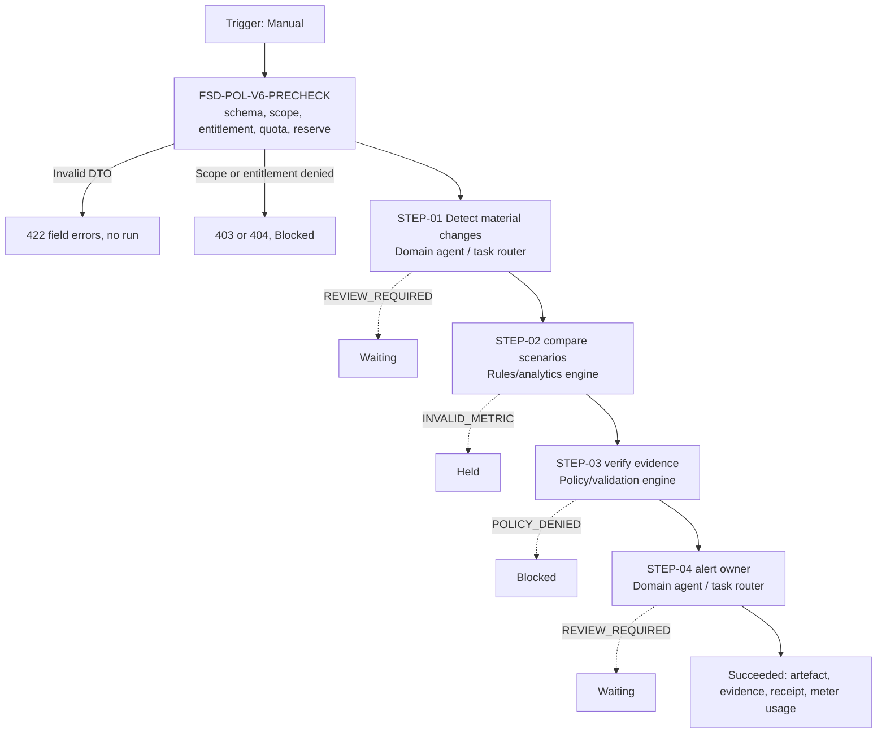
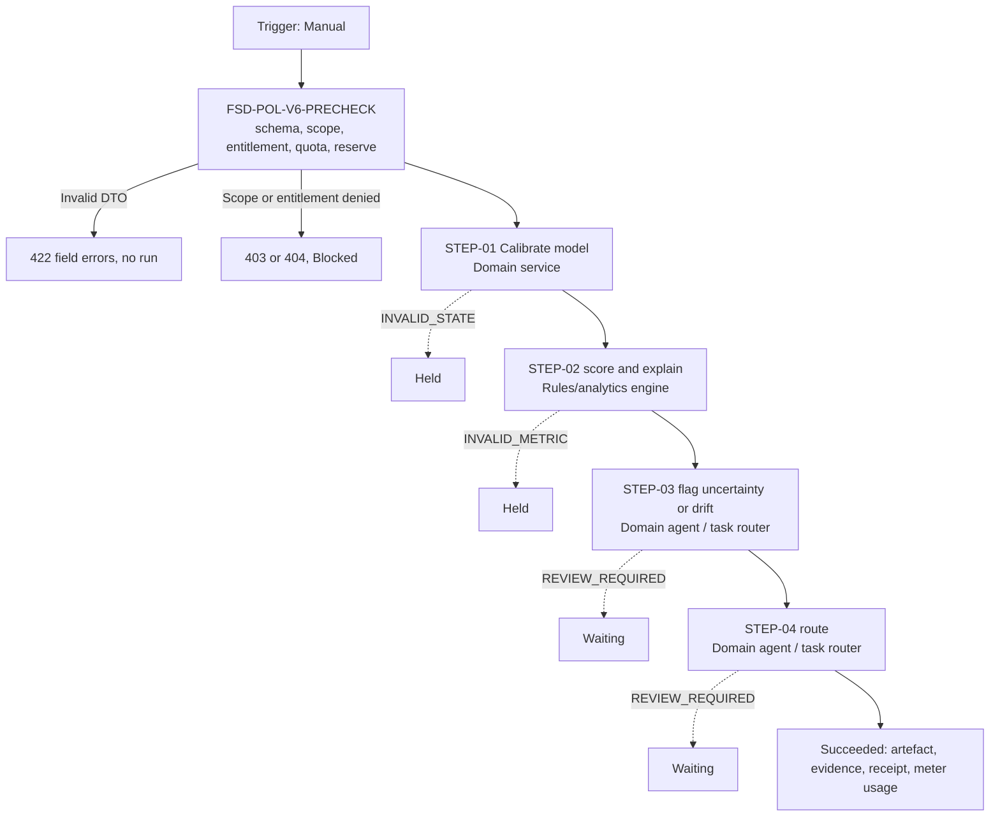
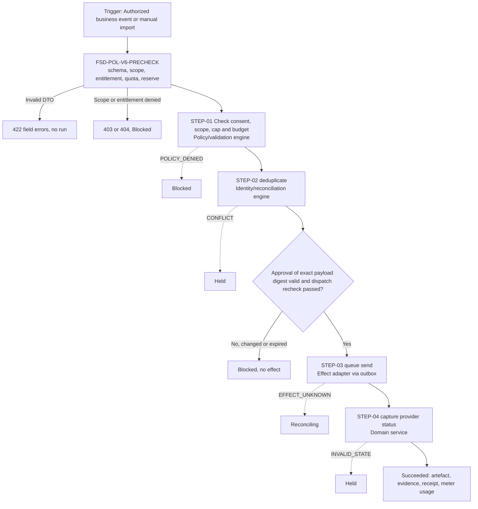
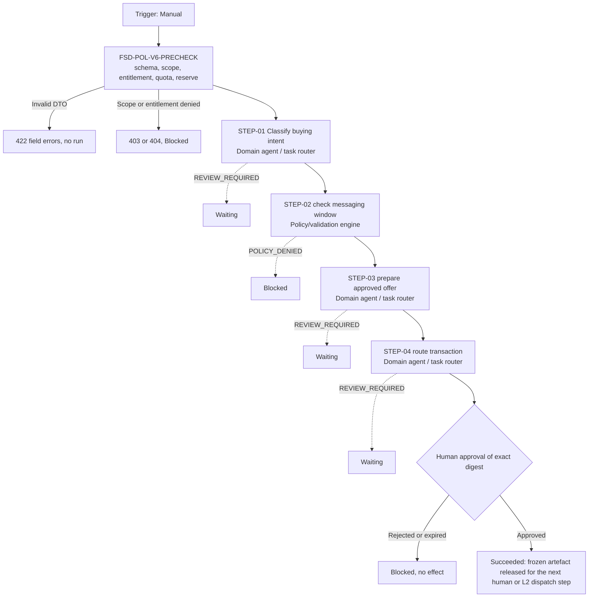
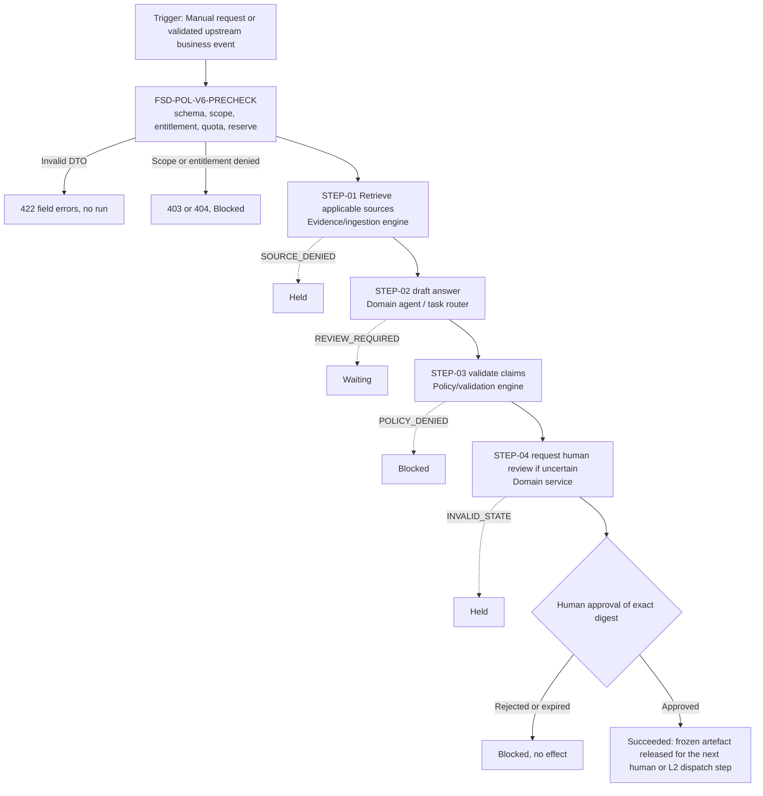
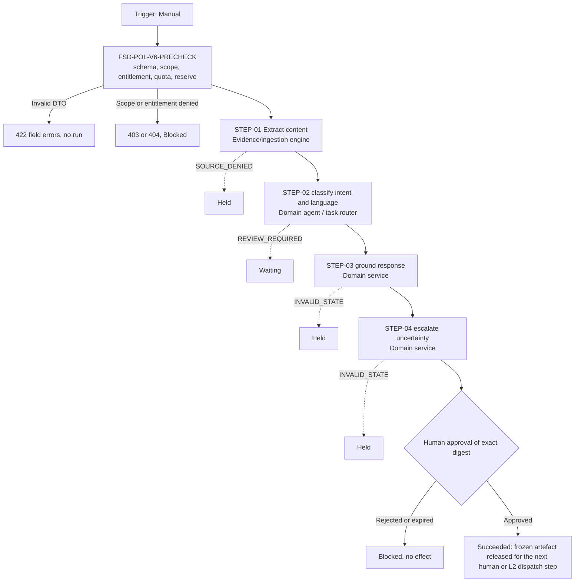

# AI Growth Engine: Employee Sales & Marketing Automation
## Application Blueprint: PART 11 (Batch 11.3), V12 Executable Workflows: SM-SVC-01…20 (80 workflows)

| Field | Value |
|---|---|
| Document | Part 11, Batch 3, file **b of c** (§11.3.5.10 SM-SVC-01…10). Files: `Part-11-3a_V12_Executable_Workflows_SVC01-20.md` (§11.3.1–§11.3.5.9 common engine contract), `Part-11-3b_…` (§11.3.5.10 workflow specifications SM-SVC-01…10), `Part-11-3c_…` (§11.3.5.10 SM-SVC-11…20 and §11.3.6–§11.3.10) |
| Version | 1.0 · 28 Nov 2026 |
| Baseline | Parts 0–9.10 and 0B (DEC-001…422); Part 2.2 §2.6 universal execution engine and WF-01…14; Parts 9.7–9.9 WF-15…39, AG-039…080, AU-053…119; Part 9.4 catalogue; Part 2.3 BRL and state machines; Part 3.2/3.3/3.4 contracts; customer revision V12 (BRD V12 ch09, FSD V12 ch12/13/33/40, Appendix B, workbook “39 Services 156 Workflows”) |
| Roles applied | Expert panel: Principal Workflow/BPM Architect (BPMN, saga, outbox), Revenue Operations leader, QA architect, Principal Engineer; plus Product Owner, Business Systems Analyst, Security/Compliance/AI Governance Lead, FinOps Lead |
| Status | Customer revision V12 alignment for group R3a (letter C). Development and running estimates in §11.3.5.9 are **outside** Ledger A (DEC-230) and Ledger B (DEC-231) and are separately approvable |

**Counts in this part (files a–c).** 80 V12 workflows (SM-SVC-01-WF01…SM-SVC-20-WF04) · 286 step contracts · 676 DTO field rows (169 distinct per service) · 682 workflow acceptance tests + 286 step tests from FSD ch33 mapped to TC-V12-C-031…998 · 30 engine tests TC-V12-C-001…030 · 92 requirements FR-V12-C-001…092 · 22 stories US-<EP>-YC01…YC22 · 13 workflow flowcharts + 4 engine diagrams · 15 decisions DEC-540…554 · 3 ADRs ADR-190…192 · tags 796–813 · 3,411 coverage aspects in `final/coverage_v12/C_coverage.csv`.

---
### 11.3.5.10 Workflow specifications (SM-SVC-01…10)

**How to read each workflow block.** (1) A header table restates every V12 field literally (BRD ch09 row, FSD ch12 specification table, workbook 50-field row, FSD ch13 step classes, FSD ch40 trace, cost model) and adds the blueprint mapping, autonomy, KPI formulas, SLA and rules. (2) The step table lists every V12 step ID with its executor, output/validation and failure route, the blueprint state the failure maps to (DEC-541), the blueprint component that executes it, and the step test (V12 `…-STEP-nn-TC` → TC-V12-C-###). (3) Representative or complex workflows (all R3 with an external effect, the R2 dispatch workflows and the net-new WF04s) carry a Mermaid flowchart. (4) The test table maps every V12 acceptance ID (TC-POS, INPUT, SCOPE, ENT, DUP, QUALITY, BUDGET, RECOVERY and, for R2/R3, APPROVAL and EFFECT) to a TC-V12-C ID with the blueprint assertion that makes it executable. Each service opens with its SKU block, the DTO table (Appendix B schema constraint and blueprint column) and its user story with Gherkin.


#### SM-SVC-01 Market & Competitive Intelligence Automation

**Purpose:** Track markets, demand, competitors, industry signals and geographic expansion opportunities (BRD V12 ch09; FSD V12 ch12). **Blueprint flow:** WF-02. **Epic:** EP-05. **Story:** US-05-YC01.

| Field | Specification |
|---|---------|
| Family / bundle / meter | Market intelligence · Full suite / Research & Lead Intelligence bundle / selective (1 SKU); entitlement and usage approval required. · meter: Illustrative pilot: 100 market research batch(s)/month; 1 concurrent run; configurable hard budget, provider quota and frequency limits. Not approved. |
| Supported channels | Permitted research sources, private alerts |
| Applicable industries / capability | All authorized sectors; B2B, D2C and institutional market research · Market intelligence |
| Required supplied input (entitlement rules) | SM-SVC-01 + foundation; tenant/startup, capability, role, channel/provider and budget checks at every action |
| Optional input producers | Included foundation; no mandatory upstream paid service; optional input producers: None; authorized equivalent input accepted. |
| External providers | Authorized market data/search APIs or client documents (verify terms and prices at time of implementation, as of 27 Nov 2026) |
| Pricing model | Proposed monthly base entitlement + metered excess per market research batch; annual option; provider charges/managed service separately quoted. Price TBD. — illustrative; Quotation pending (DEC-553) |
| Service KPI (V12) | Evidence-linked findings ≥95%; stale-source flags 100% |
| Actors (blueprint roles) | R04 Research Analyst (requester), R02 Startup Head (source/claim approver), R10 Legal (source rights), R19 service identity, R20 AI agent identity |
| Agents: V12 → blueprint | AGT-01 (Research intelligence; market analysis) → AG-027 (primary), AG-003, AG-004, AG-041; agent pool: AG-003 Research Query Planner, AG-004 Evidence Extractor, AG-005 Buying Signal Classifier, AG-027 Market & Competitor Watch Summarizer, AG-041 Signal and Intent Fusion Analyst |
| Automations (blueprint) | AU-007 source permission, AU-014 URL/blocked-host filter, AU-005 untrusted-content sanitizer, AU-019 research review assignment, AU-001 gateway router, AU-002 budget reservation |
| Shared engines (V12) | Research and evidence; Workflow orchestration; Governance |
| Business rules | BRL-SRC-01…07, BRL-SRC-09, BRL-SRC-10, BRL-AI-03/04 |
| Data class and gateway tier | Public / Internal (Tier 2 eligible only for public-source, non-personal text with opt-in, DEC-020 flag OFF by default); Tier 0 rules/cache first, Tier 1a then 1b, Tier 3 degrade (Part 7.3) |
| Screens (V12 = blueprint IDs) | A015; A016; A085; A086 |
| V12 API candidates | GET /api/v1/sources; GET /api/v1/research/plans; POST /api/v1/research/plans; GET /api/v1/research/results; GET /api/v1/research/runs/{id}; ADAPTER Public web search; GET /api/v1/market/competitors; POST /api/v1/admin/competitor-sources — retained or mapped by reviewed adapter; API catalogue reconciliation is group H (Part 11 R7) |
| V12 DB candidates → blueprint tables | growth_source→intel_source; growth_source_policy→intel_source_policy; growth_source_record→intel_source_record; growth_evidence→intel_evidence; growth_competitor→intel_competitor; growth_market_event→intel_market_event |

**DTO `urn:sm:dto:SM-SVC-01-WF0n:v2`** (one schema per workflow, identical for the four workflows of this service; JSON Schema 2020-12, `additionalProperties: false`, Appendix B; DEC-544).

| Field | Dir | Req | V12 type / validation | Schema constraint | Blueprint mapping |
|------|--|--|--------|--------|-------|
| `industry` | in | Y | string / configured enum; length and allowed values in versioned schema; input, validate authorized scope | `{"type": "string", "maxLength": 64, "$comment": "configured enum; values from versioned registry industry"}` | ref_value (industry taxonomy) |
| `region` | in | Y | string / configured enum; length and allowed values in versioned schema; input, validate authorized scope | `{"type": "string", "maxLength": 64, "$comment": "configured enum; values from versioned registry region"}` | ref_country / region code |
| `source_ids` | in | Y | array (typed references or structured items); input, validate authorized scope | `{"type": "array", "items": {"type": ["string", "object"]}, "maxItems": 500}` | intel_source.id[] |
| `question` | in | Y | string / free text, 1–4,000 characters, Unicode-normalised; untrusted input (AIX-08); input, validate authorized scope | `{"type": "string", "minLength": 1, "maxLength": 4000}` | intel_search_plan.objective |
| `signal_type` | out | Y | string / configured enum; length and allowed values in versioned schema; output, validate schema and evidence | `{"type": "string", "maxLength": 64, "$comment": "configured enum; values from versioned registry signal_type"}` | intel_signal_type.code |
| `observation` | out | Y | string / free text, 1–4,000 characters, Unicode-normalised; untrusted input (AIX-08); output, validate schema and evidence | `{"type": "string", "minLength": 1, "maxLength": 4000}` | intel_signal.summary |
| `evidence_ids` | out | Y | array (typed references or structured items); output, validate schema and evidence | `{"type": "array", "items": {"type": ["string", "object"]}, "maxItems": 500}` | intel_evidence.id[] |
| `observed_at` | out | Y | RFC 3339 timestamp; output, validate schema and evidence | `{"type": "string", "format": "date-time"}` | intel_evidence.observed_at |

**DTO rules.** (1) Unknown fields rejected (422). (2) `*_ref`/`*_id` resolve inside the caller's tenant and startup only; a foreign reference is reported as not found (BRL-TEN-04). (3) Free text is Unicode NFC-normalised, 1–4,000 characters, and treated as untrusted (AIX-08 → AU-005 sanitizer; no tool invocation from content). (4) Enum fields take values from the versioned registry named in `$comment`; the registry version is pinned on the run. (5) Money fields are int64 minor units with an ISO 4217 code at the DTO boundary and Decimal in storage (DEC-543). (6) The schema version is pinned on the run (BRL-AUT-03).

**US-05-YC01 — Market & Competitive Intelligence Automation.** As R04 Research Analyst, I want the four SM-SVC-01 workflows to run as typed, policy-checked contracts on the universal engine, so that track markets, demand, competitors, industry signals and geographic expansion opportunities without any unauthorized effect. Requirements: FR-V12-C-013, FR-V12-C-014, FR-V12-C-015, FR-V12-C-016. Epic EP-05.

```gherkin
Feature: SM-SVC-01 Market & Competitive Intelligence Automation contract conformance
  Background:
    Given tenant T1 startup S1 holds an active SM-SVC-01 entitlement with a monthly allowance
    And the workflow schema version is pinned on each run
  Scenario: Valid input produces the expected artefact
    When a requester starts SM-SVC-01-WF01 with a DTO valid against urn:sm:dto:SM-SVC-01-WF01:v2
    Then every step records class, input reference, output reference, state and evidence
    And the result validates against the output schema
  Scenario: Invalid or foreign input is rejected before any step
    When the DTO has an unknown field or a reference from tenant T2
    Then the API returns 422 or an indistinguishable 404 and no StepRun exists
  Scenario: Entitlement revoked after enqueue
    Given a run is queued
    When the entitlement is revoked
    Then the dispatch-time recheck blocks the next step and releases the reservation
```

##### SM-SVC-01-WF01 Market and demand monitoring

**Requirement FR-V12-C-013** (status before: Covered; after: Matched). **Blueprint:** WF-02 steps 1–3 (source plan → evidence → signals), A015/A016/A085/A086, AU-007, AG-005.

| Field | Specification |
|---|---------|
| Business outcome / input → output | Market and demand monitoring: Industry and approved sources → Market signals and alerts |
| Trigger | Scheduled or manual; scoped event on change (FSD: Scheduled or manual; scoped event on change; Industry and approved sources) |
| Result / acceptance | Market signals and alerts; acceptance: SM-SVC-01-WF01-TC-POS and step tests (ch33) |
| Domain contract | market_signal payload schema SM-SVC-01-WF01@2; fields below; source-specific mandatory fields validated against required input; nullable non-applicable fields only. Validator `urn:sm:dto:SM-SVC-01-WF01:v2`. |
| Risk and authority (V12) | R0 internal analysis/draft; L1 assisted; L3 approved read/draft; Approve source rights and material claims; no restricted scraping |
| Autonomy in blueprint | V12 L1 assisted / L3 approved read-draft → blueprint: internal analysis and drafts run unattended (no external effect); any reuse outside the workspace L1 (DEC-064, BRL-AI-07) |
| Approval gate (V12) | Approve source rights and material claims; no restricted scraping · approval check: Approve source rights and material claims; no restricted scraping |
| Operating mode / side effect / modalities | AI-assisted / supervised; controlled autonomous only for preapproved eligible routine steps; simulation has zero external effects. · Internal analysis/draft; no external action without separate authorization · Text; structured records (stricter classification applies, DEC-546) |
| Engine / agent | Research and evidence; Workflow orchestration; Governance; Research intelligence; market analysis → AG-027 (primary), AG-003, AG-004, AG-041 |
| Channels / UI input controls | Research · Industry [text]; approved sources [text] (4 source steps; preview and trace) |
| Step classes (FSD ch13) | 1 rules-labeled; 1 agent-labeled. Validate step taxonomy at contract review. Controls: AI-01/02/06/12/15; FL-01/02/03/07/09/13; ST-04/05/06 |
| Workflow KPI (V12) | source-linked signal rate; signal freshness; baseline and threshold approved in pilot; source service KPI Evidence-linked findings ≥95%; stale-source flags 100% |
| KPI formulas (this part) | source-linked signal rate = signals with ≥ 1 valid evidence_id ÷ signals emitted; signal freshness = median(now − observed_at) per source class; service KPI evidence-linked findings ≥ 95%, stale-source flags 100% — thresholds set after the pilot baseline (DEC-554) [GAP-810] |
| SLA | Batch: completes ≤ 24 h of schedule; alert to owner ≤ 15 min after signal accepted |
| Illustrative cost (V12) | 1 workflow invocation; not a full service cycle; tokens 4000 in / 700 out; INR 1.51 per invocation; Excluded; quote live API/channel/storage/ad/verification charges (estimate; verify at implementation, as of 27 Nov 2026) |
| Versions / acceptance origin | workflow 2.0-target; SM-SVC-01-WF01-AT01; synthetic dry run and measured benchmark pending; original SM-SVC-01-WF01-AT01 not run |
| Rules | R1. Only sources with an active intel_source_policy for the purpose are read (BRL-SRC-01/02) · R2. Each signal carries ≥ 1 evidence_id with hash, rights and observed_at (BRL-SRC-03) · R3. Freshness = now − observed_at compared with the source class freshness window; stale → flag, not delete (BRL-SRC-06) · R4. Material claims in alerts require R02 approval before external reuse (BRL-SRC-10) |

| Step ID | Action | Class · V12 executor / input | Output / validation | Failure → blueprint state | Blueprint component | Step test |
|----|----|------|-------|-----|------|-------|
| SM-SVC-01-WF01-STEP-01 | Retrieve allowed signals | Evidence retrieval · Evidence/ingestion engine / permitted source or artifact refs + scope + source policy | evidence_set {items,source_ref,observed_at,hash,rights} / Reject stale or unauthorized source; preserve original and confidence | SOURCE_DENIED → HELD; transient read retry → **Held** | Research ingestion (M10–M12) via AU-007 source permission, AU-014 URL filter, AU-005 sanitizer; writes intel_source_record / intel_evidence | TC-V12-C-039 (IT (adapter stub) + SEC): Unauthorised or stale source rejected; provenance hash and rights stored |
| SM-SVC-01-WF01-STEP-02 | classify demand | AI inference · Domain agent / task router / scoped evidence + approved configuration + prior results | candidate {artifact_ref,confidence,reason_codes,review_state} / Schema/claims check; draft cannot change live state; route owner and apply policy to notification | REVIEW_REQUIRED → AWAITING_APPROVAL → **Waiting (AWAITING_APPROVAL)** | Model gateway AU-001 (Tier 0 → 1a → 1b; Tier 3 degrade), AU-003 schema validation, AU-006 eval gate; agent = AGT mapping below; output is a draft only (BRL-AI-07) | TC-V12-C-040 (AIE (eval suite) + CT schema): Output validates against typed schema; claims match registry; factual statements cited; EVAL suite gate passed; untrusted input cannot invoke tools |
| SM-SVC-01-WF01-STEP-03 | compare freshness | Deterministic calculation · Rules/analytics engine / versioned inputs + policy/metric_version | calculation {value,unit,assumptions,evidence_refs} / Deterministic arithmetic or evaluated model; validate denominator, units, calibration and bounds | INVALID_METRIC → HELD; do not invent missing values → **Held** | Deterministic calculator in the domain module (zero model calls); Decimal arithmetic (DEC-027); BRL-AI-04 abstain on missing inputs | TC-V12-C-041 (UT golden fixture): Golden fixture exact; units/denominator validated; missing value never invented |
| SM-SVC-01-WF01-STEP-04 | cite evidence | Deterministic domain logic · Domain service / validated domain payload + prior result | domain_result {artifact_ref,status,evidence_refs} / Domain validation and version check; explicit authorization before state change | INVALID_STATE → HELD → **Held** | Domain module service: revision check (NFR-025), single transaction with audit and outbox (E-2) | TC-V12-C-042 (UT golden fixture): Golden fixture yields exact output with zero model calls; invalid state → HELD with reason |

| Test ID | V12 ID | Level | Fixture / action (V12) | Expected (V12) | Blueprint assertion |
|---|-----|--|-----|-----|--------|
| TC-V12-C-031 | SM-SVC-01-WF01-TC-POS | IT | Industry and approved sources | Market signals and alerts | Output validates against `$defs.output` of the workflow schema; evidence/provenance persisted; run reaches Succeeded; workflow KPI event emitted |
| TC-V12-C-032 | SM-SVC-01-WF01-TC-INPUT | UT/CT | Missing or malformed Industry and approved sources | Reject/hold before effect; reason and audit | HTTP 422 with field-level errors from the Appendix B schema; no StepRun created; audit event `dto.rejected` |
| TC-V12-C-033 | SM-SVC-01-WF01-TC-SCOPE | SEC | Same reference from different tenant/company | 403 or indistinguishable 404; no leaked object | HTTP 403 or indistinguishable 404 (BRL-TEN-04); zero rows, events, notifications or provider calls in the other scope (NFR-032) |
| TC-V12-C-034 | SM-SVC-01-WF01-TC-ENT | IT | Revoke SKU or policy after enqueue | No new effect; safely pause/reconcile | Dispatch-time recheck denies (E-3, BRL-SVC-03); run Paused or Held; reservation released; no new effect |
| TC-V12-C-035 | SM-SVC-01-WF01-TC-DUP | IT replay | Replay identical event / step key | Single accepted outcome; no duplicate effect or charge | Exactly one accepted outcome, effect and meter charge (E-4, NFR-005); duplicate returns the original run reference |
| TC-V12-C-036 | SM-SVC-01-WF01-TC-QUALITY | AIE | Stale, conflicting or incomplete evidence | Flag or hold; no unsupported claims; metric evidence | Step Held or flagged; no unsupported claim reaches output (BRL-AI-03/04); eval record stored (FL-13) |
| TC-V12-C-037 | SM-SVC-01-WF01-TC-BUDGET | IT | Quota exhausted at reservation | Reject or hold; no provider effect | Reservation fails → step Blocked; zero provider calls (NFR-014); owner notified |
| TC-V12-C-038 | SM-SVC-01-WF01-TC-RECOVERY | CHAOS | Provider timeout or worker crash | Reconcile uncertain effect, safe retry only, audit | Timeout after submission → Reconciling (DEC-050, E-5); crash after checkpoint resumes without re-running a completed effect (OPT-TC-ST-04) |

##### SM-SVC-01-WF02 Competitor and geographic intelligence

**Requirement FR-V12-C-014** (status before: Covered; after: Matched). **Blueprint:** WF-02 (competitor watch A085/A086), AG-027.

| Field | Specification |
|---|---------|
| Business outcome / input → output | Competitor and geographic intelligence: Competitor list and target regions → Competitive or geographic brief |
| Trigger | Manual request or validated upstream business event (FSD: Manual request or validated upstream business event; Competitor list and target regions) |
| Result / acceptance | Competitive or geographic brief; acceptance: SM-SVC-01-WF02-TC-POS and step tests (ch33) |
| Domain contract | market_signal payload schema SM-SVC-01-WF02@2; fields below; source-specific mandatory fields validated against required input; nullable non-applicable fields only. Validator `urn:sm:dto:SM-SVC-01-WF02:v2`. |
| Risk and authority (V12) | R0 internal analysis/draft; L1 assisted; L3 approved read/draft; Approve source rights and material claims; no restricted scraping |
| Autonomy in blueprint | V12 L1 assisted / L3 approved read-draft → blueprint: internal analysis and drafts run unattended (no external effect); any reuse outside the workspace L1 (DEC-064, BRL-AI-07) |
| Approval gate (V12) | Approve source rights and material claims; no restricted scraping · approval check: Approve source rights and material claims; no restricted scraping |
| Operating mode / side effect / modalities | AI-assisted / supervised; controlled autonomous only for preapproved eligible routine steps; simulation has zero external effects. · Internal analysis/draft; no external action without separate authorization · Text; structured records (stricter classification applies, DEC-546) |
| Engine / agent | Research and evidence; Workflow orchestration; Governance; Research intelligence; market analysis → AG-027 (primary), AG-003, AG-004, AG-041 |
| Channels / UI input controls | Research · Competitor list [text]; target regions [text] (3 source steps; preview and trace) |
| Step classes (FSD ch13) | 1 rules-labeled; 1 agent-labeled. Validate step taxonomy at contract review. Controls: AI-01/02/06/12/15; FL-01/02/03/07/09/13; ST-04/05/06 |
| Workflow KPI (V12) | competitor comparison completeness; verified change rate; baseline and threshold approved in pilot; source service KPI Evidence-linked findings ≥95%; stale-source flags 100% |
| KPI formulas (this part) | competitor comparison completeness = attributes with evidence ÷ attributes in approved comparison template; verified change rate = changes confirmed by reviewer ÷ changes flagged — thresholds set after the pilot baseline (DEC-554) [GAP-810] |
| SLA | Run start ≤ 15 min (transactional) / ≤ 24 h (batch) per NFR-009, DEC-032 |
| Illustrative cost (V12) | 1 workflow invocation; not a full service cycle; tokens 4500 in / 700 out; INR 1.61 per invocation; Excluded; quote live API/channel/storage/ad/verification charges (estimate; verify at implementation, as of 27 Nov 2026) |
| Versions / acceptance origin | workflow 2.0-target; SM-SVC-01-WF02-AT01; synthetic dry run and measured benchmark pending; original SM-SVC-01-WF02-AT01 not run |
| Rules | R1. Comparison only on approved public evidence; comparative claims need evidence pair (BRL-SRC-10) · R2. A change is “verified” only when two dated observations differ and both cite evidence · R3. Regional analysis states coverage gaps explicitly; no imputed market size |

| Step ID | Action | Class · V12 executor / input | Output / validation | Failure → blueprint state | Blueprint component | Step test |
|----|----|------|-------|-----|------|-------|
| SM-SVC-01-WF02-STEP-01 | Compare approved public evidence | Deterministic calculation · Rules/analytics engine / versioned inputs + policy/metric_version | calculation {value,unit,assumptions,evidence_refs} / Deterministic arithmetic or evaluated model; validate denominator, units, calibration and bounds | INVALID_METRIC → HELD; do not invent missing values → **Held** | Deterministic calculator in the domain module (zero model calls); Decimal arithmetic (DEC-027); BRL-AI-04 abstain on missing inputs | TC-V12-C-051 (UT golden fixture): Golden fixture exact; units/denominator validated; missing value never invented |
| SM-SVC-01-WF02-STEP-02 | flag changes | AI inference · Domain agent / task router / scoped evidence + approved configuration + prior results | candidate {artifact_ref,confidence,reason_codes,review_state} / Schema/claims check; draft cannot change live state; route owner and apply policy to notification | REVIEW_REQUIRED → AWAITING_APPROVAL → **Waiting (AWAITING_APPROVAL)** | Model gateway AU-001 (Tier 0 → 1a → 1b; Tier 3 degrade), AU-003 schema validation, AU-006 eval gate; agent = AGT mapping below; output is a draft only (BRL-AI-07) | TC-V12-C-052 (AIE (eval suite) + CT schema): Output validates against typed schema; claims match registry; factual statements cited; EVAL suite gate passed; untrusted input cannot invoke tools |
| SM-SVC-01-WF02-STEP-03 | produce regional analysis | Deterministic domain logic · Domain service / validated domain payload + prior result | domain_result {artifact_ref,status,evidence_refs} / Domain validation and version check; explicit authorization before state change | INVALID_STATE → HELD → **Held** | Domain module service: revision check (NFR-025), single transaction with audit and outbox (E-2) | TC-V12-C-053 (UT golden fixture): Golden fixture yields exact output with zero model calls; invalid state → HELD with reason |

| Test ID | V12 ID | Level | Fixture / action (V12) | Expected (V12) | Blueprint assertion |
|---|-----|--|-----|-----|--------|
| TC-V12-C-043 | SM-SVC-01-WF02-TC-POS | IT | Competitor list and target regions | Competitive or geographic brief | Output validates against `$defs.output` of the workflow schema; evidence/provenance persisted; run reaches Succeeded; workflow KPI event emitted |
| TC-V12-C-044 | SM-SVC-01-WF02-TC-INPUT | UT/CT | Missing or malformed Competitor list and target regions | Reject/hold before effect; reason and audit | HTTP 422 with field-level errors from the Appendix B schema; no StepRun created; audit event `dto.rejected` |
| TC-V12-C-045 | SM-SVC-01-WF02-TC-SCOPE | SEC | Same reference from different tenant/company | 403 or indistinguishable 404; no leaked object | HTTP 403 or indistinguishable 404 (BRL-TEN-04); zero rows, events, notifications or provider calls in the other scope (NFR-032) |
| TC-V12-C-046 | SM-SVC-01-WF02-TC-ENT | IT | Revoke SKU or policy after enqueue | No new effect; safely pause/reconcile | Dispatch-time recheck denies (E-3, BRL-SVC-03); run Paused or Held; reservation released; no new effect |
| TC-V12-C-047 | SM-SVC-01-WF02-TC-DUP | IT replay | Replay identical event / step key | Single accepted outcome; no duplicate effect or charge | Exactly one accepted outcome, effect and meter charge (E-4, NFR-005); duplicate returns the original run reference |
| TC-V12-C-048 | SM-SVC-01-WF02-TC-QUALITY | AIE | Stale, conflicting or incomplete evidence | Flag or hold; no unsupported claims; metric evidence | Step Held or flagged; no unsupported claim reaches output (BRL-AI-03/04); eval record stored (FL-13) |
| TC-V12-C-049 | SM-SVC-01-WF02-TC-BUDGET | IT | Quota exhausted at reservation | Reject or hold; no provider effect | Reservation fails → step Blocked; zero provider calls (NFR-014); owner notified |
| TC-V12-C-050 | SM-SVC-01-WF02-TC-RECOVERY | CHAOS | Provider timeout or worker crash | Reconcile uncertain effect, safe retry only, audit | Timeout after submission → Reconciling (DEC-050, E-5); crash after checkpoint resumes without re-running a completed effect (OPT-TC-ST-04) |

##### SM-SVC-01-WF03 Trend report and evidence refresh

**Requirement FR-V12-C-015** (status before: Partially covered; after: Matched). **Blueprint:** WF-02 evidence refresh; AG-027 summaries; AU-069 freshness (knowledge only). **Enhancement:** Trend report artefact that separates facts from estimates is not specified.

| Field | Specification |
|---|---------|
| Business outcome / input → output | Trend report and evidence refresh: Historical signals and latest evidence → Trend report |
| Trigger | Scheduled or manual; scoped event on change (FSD: Scheduled or manual; scoped event on change; Historical signals and latest evidence) |
| Result / acceptance | Trend report; acceptance: SM-SVC-01-WF03-TC-POS and step tests (ch33) |
| Domain contract | market_signal payload schema SM-SVC-01-WF03@2; fields below; source-specific mandatory fields validated against required input; nullable non-applicable fields only. Validator `urn:sm:dto:SM-SVC-01-WF03:v2`. |
| Risk and authority (V12) | R0 internal analysis/draft; L1 assisted; L3 approved read/draft; Approve source rights and material claims; no restricted scraping |
| Autonomy in blueprint | V12 L1 assisted / L3 approved read-draft → blueprint: internal analysis and drafts run unattended (no external effect); any reuse outside the workspace L1 (DEC-064, BRL-AI-07) |
| Approval gate (V12) | Approve source rights and material claims; no restricted scraping · approval check: Approve source rights and material claims; no restricted scraping |
| Operating mode / side effect / modalities | AI-assisted / supervised; controlled autonomous only for preapproved eligible routine steps; simulation has zero external effects. · Internal analysis/draft; no external action without separate authorization · Text; structured records; documents (stricter classification applies, DEC-546) |
| Engine / agent | Research and evidence; Workflow orchestration; Governance; Research intelligence; market analysis → AG-027 (primary), AG-003, AG-004, AG-041 |
| Channels / UI input controls | Research · Historical signals [text]; latest evidence [text] (3 source steps; preview and trace) |
| Step classes (FSD ch13) | 1 rules-labeled; 1 agent-labeled. Validate step taxonomy at contract review. Controls: AI-01/02/06/12/15; FL-01/02/03/07/09/13; ST-04/05/06 |
| Workflow KPI (V12) | report claim evidence rate; stale flag recall; baseline and threshold approved in pilot; source service KPI Evidence-linked findings ≥95%; stale-source flags 100% |
| KPI formulas (this part) | report claim evidence rate = cited factual statements ÷ factual statements; stale flag recall = stale sources flagged ÷ stale sources in fixture set — thresholds set after the pilot baseline (DEC-554) [GAP-810] |
| SLA | Batch ≤ 24 h; report draft available ≤ 2 h after run start [ASSUMPTION-796] |
| Illustrative cost (V12) | 1 workflow invocation; not a full service cycle; tokens 3500 in / 650 out; INR 1.37 per invocation; Excluded; quote live API/channel/storage/ad/verification charges (estimate; verify at implementation, as of 27 Nov 2026) |
| Versions / acceptance origin | workflow 2.0-target; SM-SVC-01-WF03-AT01; synthetic dry run and measured benchmark pending; original SM-SVC-01-WF03-AT01 not run |
| Rules | R1. Report sections labelled Fact (cited) or Estimate (assumptions listed) (BRL-SCR-05 labelling) · R2. Aggregation windows and denominators are versioned (metric_version) · R3. Report is a draft until R02 approves; approved report hash stored |

| Step ID | Action | Class · V12 executor / input | Output / validation | Failure → blueprint state | Blueprint component | Step test |
|----|----|------|-------|-----|------|-------|
| SM-SVC-01-WF03-STEP-01 | Aggregate dated observations | Deterministic calculation · Rules/analytics engine / versioned inputs + policy/metric_version | calculation {value,unit,assumptions,evidence_refs} / Deterministic arithmetic or evaluated model; validate denominator, units, calibration and bounds | INVALID_METRIC → HELD; do not invent missing values → **Held** | Deterministic calculator in the domain module (zero model calls); Decimal arithmetic (DEC-027); BRL-AI-04 abstain on missing inputs | TC-V12-C-062 (UT golden fixture): Golden fixture exact; units/denominator validated; missing value never invented |
| SM-SVC-01-WF03-STEP-02 | distinguish facts and estimates | Deterministic domain logic · Domain service / validated domain payload + prior result | domain_result {artifact_ref,status,evidence_refs} / Domain validation and version check; explicit authorization before state change | INVALID_STATE → HELD → **Held** | Domain module service: revision check (NFR-025), single transaction with audit and outbox (E-2) | TC-V12-C-063 (UT golden fixture): Golden fixture yields exact output with zero model calls; invalid state → HELD with reason |
| SM-SVC-01-WF03-STEP-03 | draft report for review | AI inference · Domain agent / task router / scoped evidence + approved configuration + prior results | candidate {artifact_ref,confidence,reason_codes,review_state} / Schema/claims check; draft cannot change live state; route owner and apply policy to notification | REVIEW_REQUIRED → AWAITING_APPROVAL → **Waiting (AWAITING_APPROVAL)** | Model gateway AU-001 (Tier 0 → 1a → 1b; Tier 3 degrade), AU-003 schema validation, AU-006 eval gate; agent = AGT mapping below; output is a draft only (BRL-AI-07) | TC-V12-C-064 (AIE (eval suite) + CT schema): Output validates against typed schema; claims match registry; factual statements cited; EVAL suite gate passed; untrusted input cannot invoke tools |

| Test ID | V12 ID | Level | Fixture / action (V12) | Expected (V12) | Blueprint assertion |
|---|-----|--|-----|-----|--------|
| TC-V12-C-054 | SM-SVC-01-WF03-TC-POS | IT | Historical signals and latest evidence | Trend report | Output validates against `$defs.output` of the workflow schema; evidence/provenance persisted; run reaches Succeeded; workflow KPI event emitted |
| TC-V12-C-055 | SM-SVC-01-WF03-TC-INPUT | UT/CT | Missing or malformed Historical signals and latest evidence | Reject/hold before effect; reason and audit | HTTP 422 with field-level errors from the Appendix B schema; no StepRun created; audit event `dto.rejected` |
| TC-V12-C-056 | SM-SVC-01-WF03-TC-SCOPE | SEC | Same reference from different tenant/company | 403 or indistinguishable 404; no leaked object | HTTP 403 or indistinguishable 404 (BRL-TEN-04); zero rows, events, notifications or provider calls in the other scope (NFR-032) |
| TC-V12-C-057 | SM-SVC-01-WF03-TC-ENT | IT | Revoke SKU or policy after enqueue | No new effect; safely pause/reconcile | Dispatch-time recheck denies (E-3, BRL-SVC-03); run Paused or Held; reservation released; no new effect |
| TC-V12-C-058 | SM-SVC-01-WF03-TC-DUP | IT replay | Replay identical event / step key | Single accepted outcome; no duplicate effect or charge | Exactly one accepted outcome, effect and meter charge (E-4, NFR-005); duplicate returns the original run reference |
| TC-V12-C-059 | SM-SVC-01-WF03-TC-QUALITY | AIE | Stale, conflicting or incomplete evidence | Flag or hold; no unsupported claims; metric evidence | Step Held or flagged; no unsupported claim reaches output (BRL-AI-03/04); eval record stored (FL-13) |
| TC-V12-C-060 | SM-SVC-01-WF03-TC-BUDGET | IT | Quota exhausted at reservation | Reject or hold; no provider effect | Reservation fails → step Blocked; zero provider calls (NFR-014); owner notified |
| TC-V12-C-061 | SM-SVC-01-WF03-TC-RECOVERY | CHAOS | Provider timeout or worker crash | Reconcile uncertain effect, safe retry only, audit | Timeout after submission → Reconciling (DEC-050, E-5); crash after checkpoint resumes without re-running a completed effect (OPT-TC-ST-04) |

##### SM-SVC-01-WF04 Emerging market signal and scenario monitoring

**Requirement FR-V12-C-016** (status before: Partially covered; after: Matched). **Blueprint:** AG-041 signal fusion and AU-084 decay give change detection; no scenario brief. **Enhancement:** Scenario comparison with explicit assumptions, and alerting on material change, are new (V12 WF04).

| Field | Specification |
|---|---------|
| Business outcome / input → output | Emerging market signal and scenario monitoring: Permitted market sources, industry taxonomy, prior snapshot → Market signal and scenario brief |
| Trigger | Manual; scheduled or relevant validated business event; provider webhook only where authorized (FSD: Manual; scheduled or relevant validated business event; provider webhook only where authorized; Permitted market sources, industry taxonomy, prior snapshot) |
| Result / acceptance | Market signal and scenario brief; Market signal and scenario brief; no unapproved external side effects |
| Domain contract | market_signal payload schema SM-SVC-01-WF04@2; fields below; source-specific mandatory fields validated against required input; nullable non-applicable fields only. Validator `urn:sm:dto:SM-SVC-01-WF04:v2`. |
| Risk and authority (V12) | R0 internal analysis/draft; L1 assisted; L3 approved read/draft; Approve source/data rights and applicable external actions; approve consequential communications, commitments and changes; routine steps only within preapproved policies. |
| Autonomy in blueprint | V12 L1 assisted / L3 approved read-draft → blueprint: internal analysis and drafts run unattended (no external effect); any reuse outside the workspace L1 (DEC-064, BRL-AI-07) |
| Approval gate (V12) | Approve source/data rights and applicable external actions; approve consequential communications, commitments and changes; routine steps only within preapproved policies. · approval check: Approve source/data rights and applicable external actions; approve consequential communications, commitments and changes; routine steps only within preapproved policies. |
| Operating mode / side effect / modalities | AI-assisted / supervised; controlled autonomous only for preapproved eligible routine steps; simulation has zero external effects. · Internal analysis/draft; no external action without separate authorization · Text; structured records (stricter classification applies, DEC-546) |
| Engine / agent | Research and evidence; Workflow orchestration; Governance; Research intelligence; market analysis → AG-027 (primary), AG-003, AG-004, AG-041 |
| Channels / UI input controls | Research · Permitted market sources [text]; industry taxonomy [text]; prior snapshot [text] (4 source steps; preview and trace) |
| Step classes (FSD ch13) | 1 rules-labeled; 2 agent-labeled. Validate step taxonomy at contract review. Controls: AI-01/02/06/12/15; FL-01/02/03/07/09/13; ST-04/05/06 |
| Workflow KPI (V12) | change alert precision; scenario assumption coverage; baseline and threshold approved in pilot; source service KPI Evidence-linked findings ≥95%; stale-source flags 100% |
| KPI formulas (this part) | change alert precision = alerts confirmed material by reviewer ÷ alerts; scenario assumption coverage = scenarios with every assumption sourced or labelled ÷ scenarios — thresholds set after the pilot baseline (DEC-554) [GAP-810] |
| SLA | Run start ≤ 15 min (transactional) / ≤ 24 h (batch) per NFR-009, DEC-032 |
| Illustrative cost (V12) | 1 invocation; text component only; tokens 2500 in / 500 out; INR 1.05 per invocation; Excluded; provider quotation and media/voice/ad fees TBD (estimate; verify at implementation, as of 27 Nov 2026) |
| Versions / acceptance origin | workflow 1.0-target; SM-SVC-01-WF04-AT01; synthetic dry run and measured benchmark pending; original SM-SVC-01-WF04-AT01 not run |
| Rules | R1. Material change = signal delta above approved threshold per signal_type (threshold set in pilot, KPI baseline) · R2. Scenarios are deterministic comparisons of approved assumption sets; AI drafts narrative only · R3. Unverified evidence (POLICY_DENIED at verify) blocks the alert; owner notified via NT digest |

| Step ID | Action | Class · V12 executor / input | Output / validation | Failure → blueprint state | Blueprint component | Step test |
|----|----|------|-------|-----|------|-------|
| SM-SVC-01-WF04-STEP-01 | Detect material changes | AI inference · Domain agent / task router / scoped evidence + approved configuration + prior results | candidate {artifact_ref,confidence,reason_codes,review_state} / Schema/claims check; draft cannot change live state; route owner and apply policy to notification | REVIEW_REQUIRED → AWAITING_APPROVAL → **Waiting (AWAITING_APPROVAL)** | Model gateway AU-001 (Tier 0 → 1a → 1b; Tier 3 degrade), AU-003 schema validation, AU-006 eval gate; agent = AGT mapping below; output is a draft only (BRL-AI-07) | TC-V12-C-073 (AIE (eval suite) + CT schema): Output validates against typed schema; claims match registry; factual statements cited; EVAL suite gate passed; untrusted input cannot invoke tools |
| SM-SVC-01-WF04-STEP-02 | compare scenarios | Deterministic calculation · Rules/analytics engine / versioned inputs + policy/metric_version | calculation {value,unit,assumptions,evidence_refs} / Deterministic arithmetic or evaluated model; validate denominator, units, calibration and bounds | INVALID_METRIC → HELD; do not invent missing values → **Held** | Deterministic calculator in the domain module (zero model calls); Decimal arithmetic (DEC-027); BRL-AI-04 abstain on missing inputs | TC-V12-C-074 (UT golden fixture): Golden fixture exact; units/denominator validated; missing value never invented |
| SM-SVC-01-WF04-STEP-03 | verify evidence | Policy gate / human review · Policy/validation engine / typed payload + effective policy + consent/budget/entitlement snapshot | validation {passed,reason_codes,policy_version} / Re-read effective authorization; reject or hold on missing evidence; never override suppression | POLICY_DENIED → BLOCKED; no external effect → **Blocked** | Policy Decision Point AU-009 (plan-time and dispatch-time, E-3) with gov_policy_decision record; approval routing API-541 | TC-V12-C-075 (UT decision table + IT PDP): Missing consent, entitlement, budget or jurisdiction rule → HOLD with reason code; requester ≠ reviewer |
| SM-SVC-01-WF04-STEP-04 | alert owner | AI inference · Domain agent / task router / scoped evidence + approved configuration + prior results | candidate {artifact_ref,confidence,reason_codes,review_state} / Schema/claims check; draft cannot change live state; route owner and apply policy to notification | REVIEW_REQUIRED → AWAITING_APPROVAL → **Waiting (AWAITING_APPROVAL)** | Model gateway AU-001 (Tier 0 → 1a → 1b; Tier 3 degrade), AU-003 schema validation, AU-006 eval gate; agent = AGT mapping below; output is a draft only (BRL-AI-07) | TC-V12-C-076 (AIE (eval suite) + CT schema): Output validates against typed schema; claims match registry; factual statements cited; EVAL suite gate passed; untrusted input cannot invoke tools |



| Test ID | V12 ID | Level | Fixture / action (V12) | Expected (V12) | Blueprint assertion |
|---|-----|--|-----|-----|--------|
| TC-V12-C-065 | SM-SVC-01-WF04-TC-POS | IT | Permitted market sources, industry taxonomy, prior snapshot | Market signal and scenario brief; no unapproved external side effects | Output validates against `$defs.output` of the workflow schema; evidence/provenance persisted; run reaches Succeeded; workflow KPI event emitted |
| TC-V12-C-066 | SM-SVC-01-WF04-TC-INPUT | UT/CT | Missing or malformed Permitted market sources, industry taxonomy, prior snapshot | Reject/hold before effect; reason and audit | HTTP 422 with field-level errors from the Appendix B schema; no StepRun created; audit event `dto.rejected` |
| TC-V12-C-067 | SM-SVC-01-WF04-TC-SCOPE | SEC | Same reference from different tenant/company | 403 or indistinguishable 404; no leaked object | HTTP 403 or indistinguishable 404 (BRL-TEN-04); zero rows, events, notifications or provider calls in the other scope (NFR-032) |
| TC-V12-C-068 | SM-SVC-01-WF04-TC-ENT | IT | Revoke SKU or policy after enqueue | No new effect; safely pause/reconcile | Dispatch-time recheck denies (E-3, BRL-SVC-03); run Paused or Held; reservation released; no new effect |
| TC-V12-C-069 | SM-SVC-01-WF04-TC-DUP | IT replay | Replay identical event / step key | Single accepted outcome; no duplicate effect or charge | Exactly one accepted outcome, effect and meter charge (E-4, NFR-005); duplicate returns the original run reference |
| TC-V12-C-070 | SM-SVC-01-WF04-TC-QUALITY | AIE | Stale, conflicting or incomplete evidence | Flag or hold; no unsupported claims; metric evidence | Step Held or flagged; no unsupported claim reaches output (BRL-AI-03/04); eval record stored (FL-13) |
| TC-V12-C-071 | SM-SVC-01-WF04-TC-BUDGET | IT | Quota exhausted at reservation | Reject or hold; no provider effect | Reservation fails → step Blocked; zero provider calls (NFR-014); owner notified |
| TC-V12-C-072 | SM-SVC-01-WF04-TC-RECOVERY | CHAOS | Provider timeout or worker crash | Reconcile uncertain effect, safe retry only, audit | Timeout after submission → Reconciling (DEC-050, E-5); crash after checkpoint resumes without re-running a completed effect (OPT-TC-ST-04) |

#### SM-SVC-02 Global Business Opportunity Discovery Automation

**Purpose:** Discover customers, buyers, suppliers, distributors, partners, institutions and projects (BRD V12 ch09; FSD V12 ch12). **Blueprint flow:** WF-02 (+ WF-30 partner discovery for WF02). **Epic:** EP-05. **Story:** US-05-YC02.

| Field | Specification |
|---|---------|
| Family / bundle / meter | Research & acquisition · Full suite / Research & Lead Intelligence bundle / selective (1 SKU); entitlement and usage approval required. · meter: Illustrative pilot: 100 discovery batch(s)/month; 1 concurrent run; configurable hard budget, provider quota and frequency limits. Not approved. |
| Supported channels | Authorized sources, partner referrals, internal alerts |
| Applicable industries / capability | B2B, B2C, SaaS, healthcare, education, agriculture, manufacturing, retail, logistics and service providers · Customer / supplier / partner / project discovery |
| Required supplied input (entitlement rules) | SM-SVC-02 + foundation; tenant/startup, capability, role, channel/provider and budget checks at every action |
| Optional input producers | Included foundation; no mandatory upstream paid service; optional input producers: SM-SVC-01; authorized equivalent input accepted. |
| External providers | Licensed or permitted discovery sources; user imports accepted (verify terms and prices at time of implementation, as of 27 Nov 2026) |
| Pricing model | Proposed monthly base entitlement + metered excess per discovery batch; annual option; provider charges/managed service separately quoted. Price TBD. — illustrative; Quotation pending (DEC-553) |
| Service KPI (V12) | Accepted opportunities with evidence ≥95%; reviewed relevance ≥90% |
| Actors (blueprint roles) | R04 Research Analyst, R02 Startup Head, R03 Growth Manager (opportunity owner), R19, R20 |
| Agents: V12 → blueprint | AGT-02 (Research planning; evidence extraction) → AG-003 (primary), AG-006, AG-062, AG-032; agent pool: AG-003, AG-004, AG-005 Buying Signal Classifier, AG-006 Need Discovery Agent, AG-032 Partner Due-Diligence Brief, AG-062 Signal Fusion "Why-Now" Brief Writer |
| Automations (blueprint) | AU-007, AU-014, AU-015 organization safe merge, AU-017 opportunity scoring, AU-019, AU-052 tender amendment/evidence refresh, AU-084 signal fusion and intent decay |
| Shared engines (V12) | Research and evidence; Workflow orchestration; Governance |
| Business rules | BRL-SRC-01…09, BRL-SCR-01…05, BRL-TEN-12 (no fundraising capability) |
| Data class and gateway tier | Public / Internal; organization records Confidential (Tier 2 ineligible once linked to a tenant opportunity); Tier 0 rules/cache first, Tier 1a then 1b, Tier 3 degrade (Part 7.3) |
| Screens (V12 = blueprint IDs) | A015; A016; A018; A019; A020; A028; A064 |
| V12 API candidates | GET /api/v1/sources; GET /api/v1/research/plans; POST /api/v1/research/plans; GET /api/v1/research/results; GET /api/v1/research/runs/{id}; ADAPTER Public web search; GET /api/v1/organizations; POST /api/v1/organizations; GET /api/v1/organizations/{id} — retained or mapped by reviewed adapter; API catalogue reconciliation is group H (Part 11 R7) |
| V12 DB candidates → blueprint tables | growth_search_plan→intel_search_plan; growth_organization→intel_organization; growth_signal→intel_signal; growth_signal_type→intel_signal_type; growth_need→intel_need; growth_need_evidence→intel_need_evidence; growth_opportunity→intel_opportunity; growth_referral→mkt_referral |

**DTO `urn:sm:dto:SM-SVC-02-WF0n:v2`** (one schema per workflow, identical for the four workflows of this service; JSON Schema 2020-12, `additionalProperties: false`, Appendix B; DEC-544).

| Field | Dir | Req | V12 type / validation | Schema constraint | Blueprint mapping |
|------|--|--|--------|--------|-------|
| `offering_id` | in | Y | UUID / scoped external reference; input, validate authorized scope | `{"type": "string", "format": "uuid"}` | cat_offering.id |
| `target_profile` | in | Y | string / free text, 1–4,000 characters, Unicode-normalised; untrusted input (AIX-08); input, validate authorized scope | `{"type": "string", "minLength": 1, "maxLength": 4000}` | intel_search_plan.target_profile |
| `region` | in | Y | string / configured enum; length and allowed values in versioned schema; input, validate authorized scope | `{"type": "string", "maxLength": 64, "$comment": "configured enum; values from versioned registry region"}` | ref_country / region code |
| `source_ids` | in | Y | array (typed references or structured items); input, validate authorized scope | `{"type": "array", "items": {"type": ["string", "object"]}, "maxItems": 500}` | intel_source.id[] |
| `organization_ref` | out | Y | UUID / scoped external reference; output, validate schema and evidence | `{"type": "string", "format": "uuid"}` | intel_organization.id |
| `need` | out | Y | string / free text, 1–4,000 characters, Unicode-normalised; untrusted input (AIX-08); output, validate schema and evidence | `{"type": "string", "minLength": 1, "maxLength": 4000}` | intel_need.statement |
| `deadline` | out | Y | RFC 3339 timestamp; output, validate schema and evidence | `{"type": "string", "format": "date-time"}` | intel_opportunity.deadline_utc |
| `evidence_ids` | out | Y | array (typed references or structured items); output, validate schema and evidence | `{"type": "array", "items": {"type": ["string", "object"]}, "maxItems": 500}` | intel_evidence.id[] |
| `fit_score` | out | Y | decimal; unit and bounds defined by metric policy; output, validate schema and evidence | `{"type": "string", "pattern": "^-?\\d{1,14}(\\.\\d{1,4})?$", "$comment": "decimal as string"}` | intel_score_version.score (Decimal) |

**DTO rules.** (1) Unknown fields rejected (422). (2) `*_ref`/`*_id` resolve inside the caller's tenant and startup only; a foreign reference is reported as not found (BRL-TEN-04). (3) Free text is Unicode NFC-normalised, 1–4,000 characters, and treated as untrusted (AIX-08 → AU-005 sanitizer; no tool invocation from content). (4) Enum fields take values from the versioned registry named in `$comment`; the registry version is pinned on the run. (5) Money fields are int64 minor units with an ISO 4217 code at the DTO boundary and Decimal in storage (DEC-543). (6) The schema version is pinned on the run (BRL-AUT-03).

**US-05-YC02 — Global Business Opportunity Discovery Automation.** As R04 Research Analyst, I want the four SM-SVC-02 workflows to run as typed, policy-checked contracts on the universal engine, so that discover customers, buyers, suppliers, distributors, partners, institutions and projects without any unauthorized effect. Requirements: FR-V12-C-017, FR-V12-C-018, FR-V12-C-019, FR-V12-C-020. Epic EP-05.

```gherkin
Feature: SM-SVC-02 Global Business Opportunity Discovery Automation contract conformance
  Background:
    Given tenant T1 startup S1 holds an active SM-SVC-02 entitlement with a monthly allowance
    And the workflow schema version is pinned on each run
  Scenario: Valid input produces the expected artefact
    When a requester starts SM-SVC-02-WF01 with a DTO valid against urn:sm:dto:SM-SVC-02-WF01:v2
    Then every step records class, input reference, output reference, state and evidence
    And the result validates against the output schema
  Scenario: Invalid or foreign input is rejected before any step
    When the DTO has an unknown field or a reference from tenant T2
    Then the API returns 422 or an indistinguishable 404 and no StepRun exists
  Scenario: Entitlement revoked after enqueue
    Given a run is queued
    When the entitlement is revoked
    Then the dispatch-time recheck blocks the next step and releases the reservation
```

##### SM-SVC-02-WF01 Customer and enterprise discovery

**Requirement FR-V12-C-017** (status before: Covered; after: Matched). **Blueprint:** WF-02 (need discovery → match), AG-006, AU-015, AU-017.

| Field | Specification |
|---|---------|
| Business outcome / input → output | Customer and enterprise discovery: Target organization and offering profile → Candidate accounts |
| Trigger | Manual request or validated upstream business event (FSD: Manual request or validated upstream business event; Target organization and offering profile) |
| Result / acceptance | Candidate accounts; acceptance: SM-SVC-02-WF01-TC-POS and step tests (ch33) |
| Domain contract | opportunity payload schema SM-SVC-02-WF01@2; fields below; source-specific mandatory fields validated against required input; nullable non-applicable fields only. Validator `urn:sm:dto:SM-SVC-02-WF01:v2`. |
| Risk and authority (V12) | R0 internal analysis/draft; L1 assisted; L3 approved read/draft; Approve sources and commercial capability; no irrelevant acquisition |
| Autonomy in blueprint | V12 L1 assisted / L3 approved read-draft → blueprint: internal analysis and drafts run unattended (no external effect); any reuse outside the workspace L1 (DEC-064, BRL-AI-07) |
| Approval gate (V12) | Approve sources and commercial capability; no irrelevant acquisition · approval check: Approve sources and commercial capability; no irrelevant acquisition |
| Operating mode / side effect / modalities | AI-assisted / supervised; controlled autonomous only for preapproved eligible routine steps; simulation has zero external effects. · Internal analysis/draft; no external action without separate authorization · Text; structured records (stricter classification applies, DEC-546) |
| Engine / agent | Research and evidence; Workflow orchestration; Governance; Research planning; evidence extraction → AG-003 (primary), AG-006, AG-062, AG-032 |
| Channels / UI input controls | Research, Partner · Target organization [text]; offering profile [text] (3 source steps; preview and trace) |
| Step classes (FSD ch13) | 0 rules-labeled; 1 agent-labeled. Validate step taxonomy at contract review. Controls: AI-01/02/06/12/15; FL-01/02/03/07/09/13; ST-04/05/06 |
| Workflow KPI (V12) | qualified account precision; duplicate rate; baseline and threshold approved in pilot; source service KPI Accepted opportunities with evidence ≥95%; reviewed relevance ≥90% |
| KPI formulas (this part) | qualified account precision = accounts accepted by R04 ÷ accounts proposed; duplicate rate = candidate accounts merged as duplicates ÷ candidates — thresholds set after the pilot baseline (DEC-554) [GAP-810] |
| SLA | Run start ≤ 15 min (transactional) / ≤ 24 h (batch) per NFR-009, DEC-032 |
| Illustrative cost (V12) | 1 workflow invocation; not a full service cycle; tokens 4000 in / 600 out; INR 1.43 per invocation; Excluded; quote live API/channel/storage/ad/verification charges (estimate; verify at implementation, as of 27 Nov 2026) |
| Versions / acceptance origin | workflow 2.0-target; SM-SVC-02-WF01-AT01; synthetic dry run and measured benchmark pending; original SM-SVC-02-WF01-AT01 not run |
| Rules | R1. Search only allowed sources within BRL-SRC-09 budget bounds · R2. Entities normalized through AU-015 safe merge; ambiguous merges Held · R3. fit_score is Decimal string; DEC-011 formula; score ≠ permission (BRL-ELG-04) · R4. No investor or fundraising targets (BRL-TEN-12, DEC-002) |

| Step ID | Action | Class · V12 executor / input | Output / validation | Failure → blueprint state | Blueprint component | Step test |
|----|----|------|-------|-----|------|-------|
| SM-SVC-02-WF01-STEP-01 | Search allowed sources | Evidence retrieval · Evidence/ingestion engine / permitted source or artifact refs + scope + source policy | evidence_set {items,source_ref,observed_at,hash,rights} / Reject stale or unauthorized source; preserve original and confidence | SOURCE_DENIED → HELD; transient read retry → **Held** | Research ingestion (M10–M12) via AU-007 source permission, AU-014 URL filter, AU-005 sanitizer; writes intel_source_record / intel_evidence | TC-V12-C-085 (IT (adapter stub) + SEC): Unauthorised or stale source rejected; provenance hash and rights stored |
| SM-SVC-02-WF01-STEP-02 | identify relevant entities and needs | AI inference · Domain agent / task router / scoped evidence + approved configuration + prior results | candidate {artifact_ref,confidence,reason_codes,review_state} / Schema/claims check; draft cannot change live state; route owner and apply policy to notification | REVIEW_REQUIRED → AWAITING_APPROVAL → **Waiting (AWAITING_APPROVAL)** | Model gateway AU-001 (Tier 0 → 1a → 1b; Tier 3 degrade), AU-003 schema validation, AU-006 eval gate; agent = AGT mapping below; output is a draft only (BRL-AI-07) | TC-V12-C-086 (AIE (eval suite) + CT schema): Output validates against typed schema; claims match registry; factual statements cited; EVAL suite gate passed; untrusted input cannot invoke tools |
| SM-SVC-02-WF01-STEP-03 | normalize and record evidence | Deterministic domain logic · Domain service / validated domain payload + prior result | domain_result {artifact_ref,status,evidence_refs} / Domain validation and version check; explicit authorization before state change | INVALID_STATE → HELD → **Held** | Domain module service: revision check (NFR-025), single transaction with audit and outbox (E-2) | TC-V12-C-087 (UT golden fixture): Golden fixture yields exact output with zero model calls; invalid state → HELD with reason |

| Test ID | V12 ID | Level | Fixture / action (V12) | Expected (V12) | Blueprint assertion |
|---|-----|--|-----|-----|--------|
| TC-V12-C-077 | SM-SVC-02-WF01-TC-POS | IT | Target organization and offering profile | Candidate accounts | Output validates against `$defs.output` of the workflow schema; evidence/provenance persisted; run reaches Succeeded; workflow KPI event emitted |
| TC-V12-C-078 | SM-SVC-02-WF01-TC-INPUT | UT/CT | Missing or malformed Target organization and offering profile | Reject/hold before effect; reason and audit | HTTP 422 with field-level errors from the Appendix B schema; no StepRun created; audit event `dto.rejected` |
| TC-V12-C-079 | SM-SVC-02-WF01-TC-SCOPE | SEC | Same reference from different tenant/company | 403 or indistinguishable 404; no leaked object | HTTP 403 or indistinguishable 404 (BRL-TEN-04); zero rows, events, notifications or provider calls in the other scope (NFR-032) |
| TC-V12-C-080 | SM-SVC-02-WF01-TC-ENT | IT | Revoke SKU or policy after enqueue | No new effect; safely pause/reconcile | Dispatch-time recheck denies (E-3, BRL-SVC-03); run Paused or Held; reservation released; no new effect |
| TC-V12-C-081 | SM-SVC-02-WF01-TC-DUP | IT replay | Replay identical event / step key | Single accepted outcome; no duplicate effect or charge | Exactly one accepted outcome, effect and meter charge (E-4, NFR-005); duplicate returns the original run reference |
| TC-V12-C-082 | SM-SVC-02-WF01-TC-QUALITY | AIE | Stale, conflicting or incomplete evidence | Flag or hold; no unsupported claims; metric evidence | Step Held or flagged; no unsupported claim reaches output (BRL-AI-03/04); eval record stored (FL-13) |
| TC-V12-C-083 | SM-SVC-02-WF01-TC-BUDGET | IT | Quota exhausted at reservation | Reject or hold; no provider effect | Reservation fails → step Blocked; zero provider calls (NFR-014); owner notified |
| TC-V12-C-084 | SM-SVC-02-WF01-TC-RECOVERY | CHAOS | Provider timeout or worker crash | Reconcile uncertain effect, safe retry only, audit | Timeout after submission → Reconciling (DEC-050, E-5); crash after checkpoint resumes without re-running a completed effect (OPT-TC-ST-04) |

##### SM-SVC-02-WF02 Supplier, distributor and partner discovery

**Requirement FR-V12-C-018** (status before: Partially covered; after: Matched). **Blueprint:** WF-02 + WF-30 partner onboarding; AG-032 due-diligence brief. **Enhancement:** Supplier/distributor discovery for procurement purposes not explicit; procurement is SM-SVC-39 (group D).

| Field | Specification |
|---|---------|
| Business outcome / input → output | Supplier, distributor and partner discovery: Procurement or channel partner criteria → Partner and supplier candidates |
| Trigger | Manual request or validated upstream business event (FSD: Manual request or validated upstream business event; Procurement or channel partner criteria) |
| Result / acceptance | Partner and supplier candidates; acceptance: SM-SVC-02-WF02-TC-POS and step tests (ch33) |
| Domain contract | opportunity payload schema SM-SVC-02-WF02@2; fields below; source-specific mandatory fields validated against required input; nullable non-applicable fields only. Validator `urn:sm:dto:SM-SVC-02-WF02:v2`. |
| Risk and authority (V12) | R0 internal analysis/draft; L1 assisted; L3 approved read/draft; Approve sources and commercial capability; no irrelevant acquisition |
| Autonomy in blueprint | V12 L1 assisted / L3 approved read-draft → blueprint: internal analysis and drafts run unattended (no external effect); any reuse outside the workspace L1 (DEC-064, BRL-AI-07) |
| Approval gate (V12) | Approve sources and commercial capability; no irrelevant acquisition · approval check: Approve sources and commercial capability; no irrelevant acquisition |
| Operating mode / side effect / modalities | AI-assisted / supervised; controlled autonomous only for preapproved eligible routine steps; simulation has zero external effects. · Internal analysis/draft; no external action without separate authorization · Text; structured records (stricter classification applies, DEC-546) |
| Engine / agent | Research and evidence; Workflow orchestration; Governance; Research planning; evidence extraction → AG-003 (primary), AG-006, AG-062, AG-032 |
| Channels / UI input controls | Research, Partner · Procurement or channel partner criteria [text] (3 source steps; preview and trace) |
| Step classes (FSD ch13) | 0 rules-labeled; 2 agent-labeled. Validate step taxonomy at contract review. Controls: AI-01/02/06/12/15; FL-01/02/03/07/09/13; ST-04/05/06 |
| Workflow KPI (V12) | partner role accuracy; conflict recall; baseline and threshold approved in pilot; source service KPI Accepted opportunities with evidence ≥95%; reviewed relevance ≥90% |
| KPI formulas (this part) | partner role accuracy = roles confirmed ÷ roles proposed; conflict recall = conflicts flagged ÷ conflicts in labelled fixture — thresholds set after the pilot baseline (DEC-554) [GAP-810] |
| SLA | Run start ≤ 15 min (transactional) / ≤ 24 h (batch) per NFR-009, DEC-032 |
| Illustrative cost (V12) | 1 workflow invocation; not a full service cycle; tokens 3500 in / 500 out; INR 1.25 per invocation; Excluded; quote live API/channel/storage/ad/verification charges (estimate; verify at implementation, as of 27 Nov 2026) |
| Versions / acceptance origin | workflow 2.0-target; SM-SVC-02-WF02-AT01; synthetic dry run and measured benchmark pending; original SM-SVC-02-WF02-AT01 not run |
| Rules | R1. Role classes: customer, supplier, distributor, partner (versioned enum); one organization may hold several roles · R2. Conflicts = existing partner/channel conflict per AU-091 or same organization under another startup (portfolio isolation, BRL-TEN-06) · R3. Supplier candidates never create payables or POs (procurement separate, SM-SVC-39) |

| Step ID | Action | Class · V12 executor / input | Output / validation | Failure → blueprint state | Blueprint component | Step test |
|----|----|------|-------|-----|------|-------|
| SM-SVC-02-WF02-STEP-01 | Retrieve allowed business records | Evidence retrieval · Evidence/ingestion engine / permitted source or artifact refs + scope + source policy | evidence_set {items,source_ref,observed_at,hash,rights} / Reject stale or unauthorized source; preserve original and confidence | SOURCE_DENIED → HELD; transient read retry → **Held** | Research ingestion (M10–M12) via AU-007 source permission, AU-014 URL filter, AU-005 sanitizer; writes intel_source_record / intel_evidence | TC-V12-C-096 (IT (adapter stub) + SEC): Unauthorised or stale source rejected; provenance hash and rights stored |
| SM-SVC-02-WF02-STEP-02 | classify role | AI inference · Domain agent / task router / scoped evidence + approved configuration + prior results | candidate {artifact_ref,confidence,reason_codes,review_state} / Schema/claims check; draft cannot change live state; route owner and apply policy to notification | REVIEW_REQUIRED → AWAITING_APPROVAL → **Waiting (AWAITING_APPROVAL)** | Model gateway AU-001 (Tier 0 → 1a → 1b; Tier 3 degrade), AU-003 schema validation, AU-006 eval gate; agent = AGT mapping below; output is a draft only (BRL-AI-07) | TC-V12-C-097 (AIE (eval suite) + CT schema): Output validates against typed schema; claims match registry; factual statements cited; EVAL suite gate passed; untrusted input cannot invoke tools |
| SM-SVC-02-WF02-STEP-03 | flag conflicts and duplicates | AI inference · Domain agent / task router / scoped evidence + approved configuration + prior results | candidate {artifact_ref,confidence,reason_codes,review_state} / Schema/claims check; draft cannot change live state; route owner and apply policy to notification | REVIEW_REQUIRED → AWAITING_APPROVAL → **Waiting (AWAITING_APPROVAL)** | Model gateway AU-001 (Tier 0 → 1a → 1b; Tier 3 degrade), AU-003 schema validation, AU-006 eval gate; agent = AGT mapping below; output is a draft only (BRL-AI-07) | TC-V12-C-098 (AIE (eval suite) + CT schema): Output validates against typed schema; claims match registry; factual statements cited; EVAL suite gate passed; untrusted input cannot invoke tools |

| Test ID | V12 ID | Level | Fixture / action (V12) | Expected (V12) | Blueprint assertion |
|---|-----|--|-----|-----|--------|
| TC-V12-C-088 | SM-SVC-02-WF02-TC-POS | IT | Procurement or channel partner criteria | Partner and supplier candidates | Output validates against `$defs.output` of the workflow schema; evidence/provenance persisted; run reaches Succeeded; workflow KPI event emitted |
| TC-V12-C-089 | SM-SVC-02-WF02-TC-INPUT | UT/CT | Missing or malformed Procurement or channel partner criteria | Reject/hold before effect; reason and audit | HTTP 422 with field-level errors from the Appendix B schema; no StepRun created; audit event `dto.rejected` |
| TC-V12-C-090 | SM-SVC-02-WF02-TC-SCOPE | SEC | Same reference from different tenant/company | 403 or indistinguishable 404; no leaked object | HTTP 403 or indistinguishable 404 (BRL-TEN-04); zero rows, events, notifications or provider calls in the other scope (NFR-032) |
| TC-V12-C-091 | SM-SVC-02-WF02-TC-ENT | IT | Revoke SKU or policy after enqueue | No new effect; safely pause/reconcile | Dispatch-time recheck denies (E-3, BRL-SVC-03); run Paused or Held; reservation released; no new effect |
| TC-V12-C-092 | SM-SVC-02-WF02-TC-DUP | IT replay | Replay identical event / step key | Single accepted outcome; no duplicate effect or charge | Exactly one accepted outcome, effect and meter charge (E-4, NFR-005); duplicate returns the original run reference |
| TC-V12-C-093 | SM-SVC-02-WF02-TC-QUALITY | AIE | Stale, conflicting or incomplete evidence | Flag or hold; no unsupported claims; metric evidence | Step Held or flagged; no unsupported claim reaches output (BRL-AI-03/04); eval record stored (FL-13) |
| TC-V12-C-094 | SM-SVC-02-WF02-TC-BUDGET | IT | Quota exhausted at reservation | Reject or hold; no provider effect | Reservation fails → step Blocked; zero provider calls (NFR-014); owner notified |
| TC-V12-C-095 | SM-SVC-02-WF02-TC-RECOVERY | CHAOS | Provider timeout or worker crash | Reconcile uncertain effect, safe retry only, audit | Timeout after submission → Reconciling (DEC-050, E-5); crash after checkpoint resumes without re-running a completed effect (OPT-TC-ST-04) |

##### SM-SVC-02-WF03 Opportunity monitoring and alerts

**Requirement FR-V12-C-019** (status before: Covered; after: Matched). **Blueprint:** AU-019 research alerts, AU-052 amendment detector, AU-034 deadline tracker.

| Field | Specification |
|---|---------|
| Business outcome / input → output | Opportunity monitoring and alerts: Existing opportunity and verified deadline → Opportunity changes and deadline alerts |
| Trigger | Scheduled or manual; scoped event on change (FSD: Scheduled or manual; scoped event on change; Existing opportunity and verified deadline) |
| Result / acceptance | Opportunity changes and deadline alerts; acceptance: SM-SVC-02-WF03-TC-POS and step tests (ch33) |
| Domain contract | opportunity payload schema SM-SVC-02-WF03@2; fields below; source-specific mandatory fields validated against required input; nullable non-applicable fields only. Validator `urn:sm:dto:SM-SVC-02-WF03:v2`. |
| Risk and authority (V12) | R0 internal analysis/draft; L1 assisted; L3 approved read/draft; Approve sources and commercial capability; no irrelevant acquisition |
| Autonomy in blueprint | V12 L1 assisted / L3 approved read-draft → blueprint: internal analysis and drafts run unattended (no external effect); any reuse outside the workspace L1 (DEC-064, BRL-AI-07) |
| Approval gate (V12) | Approve sources and commercial capability; no irrelevant acquisition · approval check: Approve sources and commercial capability; no irrelevant acquisition |
| Operating mode / side effect / modalities | AI-assisted / supervised; controlled autonomous only for preapproved eligible routine steps; simulation has zero external effects. · Internal analysis/draft; no external action without separate authorization · Text; structured records (stricter classification applies, DEC-546) |
| Engine / agent | Research and evidence; Workflow orchestration; Governance; Research planning; evidence extraction → AG-003 (primary), AG-006, AG-062, AG-032 |
| Channels / UI input controls | Research, Partner · Existing opportunity [text]; verified deadline [date] (3 source steps; preview and trace) |
| Step classes (FSD ch13) | 0 rules-labeled; 2 agent-labeled. Validate step taxonomy at contract review. Controls: AI-01/02/06/12/15; FL-01/02/03/07/09/13; ST-04/05/06 |
| Workflow KPI (V12) | deadline accuracy; alert latency; baseline and threshold approved in pilot; source service KPI Accepted opportunities with evidence ≥95%; reviewed relevance ≥90% |
| KPI formulas (this part) | deadline accuracy = deadlines matching source of record ÷ deadlines stored; alert latency = p95(alert sent − change observed) — thresholds set after the pilot baseline (DEC-554) [GAP-810] |
| SLA | Deadline alert ≤ 15 min after change detected; daily refresh |
| Illustrative cost (V12) | 1 workflow invocation; not a full service cycle; tokens 1600 in / 250 out; INR 0.67 per invocation; Excluded; quote live API/channel/storage/ad/verification charges (estimate; verify at implementation, as of 27 Nov 2026) |
| Versions / acceptance origin | workflow 2.0-target; SM-SVC-02-WF03-AT01; synthetic dry run and measured benchmark pending; original SM-SVC-02-WF03-AT01 not run |
| Rules | R1. Deadline stored UTC with source timezone (BRL-BID-01 pattern); verified deadline required · R2. Alert only to assigned owner; digest rules NT apply · R3. Refresh respects source expiry (BRL-SRC-02) |

| Step ID | Action | Class · V12 executor / input | Output / validation | Failure → blueprint state | Blueprint component | Step test |
|----|----|------|-------|-----|------|-------|
| SM-SVC-02-WF03-STEP-01 | Refresh evidence | Evidence retrieval · Evidence/ingestion engine / permitted source or artifact refs + scope + source policy | evidence_set {items,source_ref,observed_at,hash,rights} / Reject stale or unauthorized source; preserve original and confidence | SOURCE_DENIED → HELD; transient read retry → **Held** | Research ingestion (M10–M12) via AU-007 source permission, AU-014 URL filter, AU-005 sanitizer; writes intel_source_record / intel_evidence | TC-V12-C-107 (IT (adapter stub) + SEC): Unauthorised or stale source rejected; provenance hash and rights stored |
| SM-SVC-02-WF03-STEP-02 | detect buying signals or changes | AI inference · Domain agent / task router / scoped evidence + approved configuration + prior results | candidate {artifact_ref,confidence,reason_codes,review_state} / Schema/claims check; draft cannot change live state; route owner and apply policy to notification | REVIEW_REQUIRED → AWAITING_APPROVAL → **Waiting (AWAITING_APPROVAL)** | Model gateway AU-001 (Tier 0 → 1a → 1b; Tier 3 degrade), AU-003 schema validation, AU-006 eval gate; agent = AGT mapping below; output is a draft only (BRL-AI-07) | TC-V12-C-108 (AIE (eval suite) + CT schema): Output validates against typed schema; claims match registry; factual statements cited; EVAL suite gate passed; untrusted input cannot invoke tools |
| SM-SVC-02-WF03-STEP-03 | notify assigned owner | AI inference · Domain agent / task router / scoped evidence + approved configuration + prior results | candidate {artifact_ref,confidence,reason_codes,review_state} / Schema/claims check; draft cannot change live state; route owner and apply policy to notification | REVIEW_REQUIRED → AWAITING_APPROVAL → **Waiting (AWAITING_APPROVAL)** | Model gateway AU-001 (Tier 0 → 1a → 1b; Tier 3 degrade), AU-003 schema validation, AU-006 eval gate; agent = AGT mapping below; output is a draft only (BRL-AI-07) | TC-V12-C-109 (AIE (eval suite) + CT schema): Output validates against typed schema; claims match registry; factual statements cited; EVAL suite gate passed; untrusted input cannot invoke tools |

| Test ID | V12 ID | Level | Fixture / action (V12) | Expected (V12) | Blueprint assertion |
|---|-----|--|-----|-----|--------|
| TC-V12-C-099 | SM-SVC-02-WF03-TC-POS | IT | Existing opportunity and verified deadline | Opportunity changes and deadline alerts | Output validates against `$defs.output` of the workflow schema; evidence/provenance persisted; run reaches Succeeded; workflow KPI event emitted |
| TC-V12-C-100 | SM-SVC-02-WF03-TC-INPUT | UT/CT | Missing or malformed Existing opportunity and verified deadline | Reject/hold before effect; reason and audit | HTTP 422 with field-level errors from the Appendix B schema; no StepRun created; audit event `dto.rejected` |
| TC-V12-C-101 | SM-SVC-02-WF03-TC-SCOPE | SEC | Same reference from different tenant/company | 403 or indistinguishable 404; no leaked object | HTTP 403 or indistinguishable 404 (BRL-TEN-04); zero rows, events, notifications or provider calls in the other scope (NFR-032) |
| TC-V12-C-102 | SM-SVC-02-WF03-TC-ENT | IT | Revoke SKU or policy after enqueue | No new effect; safely pause/reconcile | Dispatch-time recheck denies (E-3, BRL-SVC-03); run Paused or Held; reservation released; no new effect |
| TC-V12-C-103 | SM-SVC-02-WF03-TC-DUP | IT replay | Replay identical event / step key | Single accepted outcome; no duplicate effect or charge | Exactly one accepted outcome, effect and meter charge (E-4, NFR-005); duplicate returns the original run reference |
| TC-V12-C-104 | SM-SVC-02-WF03-TC-QUALITY | AIE | Stale, conflicting or incomplete evidence | Flag or hold; no unsupported claims; metric evidence | Step Held or flagged; no unsupported claim reaches output (BRL-AI-03/04); eval record stored (FL-13) |
| TC-V12-C-105 | SM-SVC-02-WF03-TC-BUDGET | IT | Quota exhausted at reservation | Reject or hold; no provider effect | Reservation fails → step Blocked; zero provider calls (NFR-014); owner notified |
| TC-V12-C-106 | SM-SVC-02-WF03-TC-RECOVERY | CHAOS | Provider timeout or worker crash | Reconcile uncertain effect, safe retry only, audit | Timeout after submission → Reconciling (DEC-050, E-5); crash after checkpoint resumes without re-running a completed effect (OPT-TC-ST-04) |

##### SM-SVC-02-WF04 Continuous buying-signal and opportunity-change detection

**Requirement FR-V12-C-020** (status before: Partially covered; after: Matched). **Blueprint:** AU-084 signal fusion and intent decay; AG-062 why-now brief. **Enhancement:** Opportunity update with dedupe across continuous signals is partially specified.

| Field | Specification |
|---|---------|
| Business outcome / input → output | Continuous buying-signal and opportunity-change detection: Approved sources, customer profile, opportunity history → Evidence-linked opportunity alert |
| Trigger | Manual; scheduled or relevant validated business event; provider webhook only where authorized (FSD: Manual; scheduled or relevant validated business event; provider webhook only where authorized; Approved sources, customer profile, opportunity history) |
| Result / acceptance | Evidence-linked opportunity alert; Evidence-linked opportunity alert; no unapproved external side effects |
| Domain contract | opportunity payload schema SM-SVC-02-WF04@2; fields below; source-specific mandatory fields validated against required input; nullable non-applicable fields only. Validator `urn:sm:dto:SM-SVC-02-WF04:v2`. |
| Risk and authority (V12) | R0 internal analysis/draft; L1 assisted; L3 approved read/draft; Approve source/data rights and applicable external actions; approve consequential communications, commitments and changes; routine steps only within preapproved policies. |
| Autonomy in blueprint | V12 L1 assisted / L3 approved read-draft → blueprint: internal analysis and drafts run unattended (no external effect); any reuse outside the workspace L1 (DEC-064, BRL-AI-07) |
| Approval gate (V12) | Approve source/data rights and applicable external actions; approve consequential communications, commitments and changes; routine steps only within preapproved policies. · approval check: Approve source/data rights and applicable external actions; approve consequential communications, commitments and changes; routine steps only within preapproved policies. |
| Operating mode / side effect / modalities | AI-assisted / supervised; controlled autonomous only for preapproved eligible routine steps; simulation has zero external effects. · Internal analysis/draft; no external action without separate authorization · Text; structured records (stricter classification applies, DEC-546) |
| Engine / agent | Research and evidence; Workflow orchestration; Governance; Research planning; evidence extraction → AG-003 (primary), AG-006, AG-062, AG-032 |
| Channels / UI input controls | Research, Partner · Approved sources [text]; customer profile [text]; opportunity history [text] (4 source steps; preview and trace) |
| Step classes (FSD ch13) | 0 rules-labeled; 1 agent-labeled. Validate step taxonomy at contract review. Controls: AI-01/02/06/12/15; FL-01/02/03/07/09/13; ST-04/05/06 |
| Workflow KPI (V12) | new signal precision; duplicate alert rate; baseline and threshold approved in pilot; source service KPI Accepted opportunities with evidence ≥95%; reviewed relevance ≥90% |
| KPI formulas (this part) | new signal precision = signals accepted ÷ new signals; duplicate alert rate = duplicate alerts ÷ alerts — thresholds set after the pilot baseline (DEC-554) [GAP-810] |
| SLA | Run start ≤ 15 min (transactional) / ≤ 24 h (batch) per NFR-009, DEC-032 |
| Illustrative cost (V12) | 1 invocation; text component only; tokens 1200 in / 200 out; INR 0.55 per invocation; Excluded; provider quotation and media/voice/ad fees TBD (estimate; verify at implementation, as of 27 Nov 2026) |
| Versions / acceptance origin | workflow 1.0-target; SM-SVC-02-WF04-AT01; synthetic dry run and measured benchmark pending; original SM-SVC-02-WF04-AT01 not run |
| Rules | R1. New signal deduplicated by (organization, signal_type, evidence hash) within the dedup window · R2. Opportunity update is a revisioned write; owner reviews material changes · R3. Decay per AU-084; alerts suppressed for closed or rejected opportunities (BRL-ELG-15) |

| Step ID | Action | Class · V12 executor / input | Output / validation | Failure → blueprint state | Blueprint component | Step test |
|----|----|------|-------|-----|------|-------|
| SM-SVC-02-WF04-STEP-01 | Detect new signals | AI inference · Domain agent / task router / scoped evidence + approved configuration + prior results | candidate {artifact_ref,confidence,reason_codes,review_state} / Schema/claims check; draft cannot change live state; route owner and apply policy to notification | REVIEW_REQUIRED → AWAITING_APPROVAL → **Waiting (AWAITING_APPROVAL)** | Model gateway AU-001 (Tier 0 → 1a → 1b; Tier 3 degrade), AU-003 schema validation, AU-006 eval gate; agent = AGT mapping below; output is a draft only (BRL-AI-07) | TC-V12-C-118 (AIE (eval suite) + CT schema): Output validates against typed schema; claims match registry; factual statements cited; EVAL suite gate passed; untrusted input cannot invoke tools |
| SM-SVC-02-WF04-STEP-02 | qualify changes | Deterministic domain logic · Domain service / validated domain payload + prior result | domain_result {artifact_ref,status,evidence_refs} / Domain validation and version check; explicit authorization before state change | INVALID_STATE → HELD → **Held** | Domain module service: revision check (NFR-025), single transaction with audit and outbox (E-2) | TC-V12-C-119 (UT golden fixture): Golden fixture yields exact output with zero model calls; invalid state → HELD with reason |
| SM-SVC-02-WF04-STEP-03 | deduplicate | Deterministic identity / reconciliation · Identity/reconciliation engine / scoped object refs + version + evidence_set | match_result {matched_refs,unmatched_refs,conflict_refs} / Unique source event; no cross-company merge; financial allocations atomic | CONFLICT → HELD; uncertain provider outcome reconcile → **Held / Reconciling** | AU-100 identity resolution / AU-015 safe merge / AU-030 conflict case / AU-026 uncertain-outcome reconciliation | TC-V12-C-120 (UT + IT replay): Duplicate and conflicting identities resolved per rule; uncertain match → REVIEW |
| SM-SVC-02-WF04-STEP-04 | update opportunity | Deterministic domain logic · Domain service / validated domain payload + prior result | domain_result {artifact_ref,status,evidence_refs} / Domain validation and version check; explicit authorization before state change | INVALID_STATE → HELD → **Held** | Domain module service: revision check (NFR-025), single transaction with audit and outbox (E-2) | TC-V12-C-121 (UT golden fixture): Golden fixture yields exact output with zero model calls; invalid state → HELD with reason |

| Test ID | V12 ID | Level | Fixture / action (V12) | Expected (V12) | Blueprint assertion |
|---|-----|--|-----|-----|--------|
| TC-V12-C-110 | SM-SVC-02-WF04-TC-POS | IT | Approved sources, customer profile, opportunity history | Evidence-linked opportunity alert; no unapproved external side effects | Output validates against `$defs.output` of the workflow schema; evidence/provenance persisted; run reaches Succeeded; workflow KPI event emitted |
| TC-V12-C-111 | SM-SVC-02-WF04-TC-INPUT | UT/CT | Missing or malformed Approved sources, customer profile, opportunity history | Reject/hold before effect; reason and audit | HTTP 422 with field-level errors from the Appendix B schema; no StepRun created; audit event `dto.rejected` |
| TC-V12-C-112 | SM-SVC-02-WF04-TC-SCOPE | SEC | Same reference from different tenant/company | 403 or indistinguishable 404; no leaked object | HTTP 403 or indistinguishable 404 (BRL-TEN-04); zero rows, events, notifications or provider calls in the other scope (NFR-032) |
| TC-V12-C-113 | SM-SVC-02-WF04-TC-ENT | IT | Revoke SKU or policy after enqueue | No new effect; safely pause/reconcile | Dispatch-time recheck denies (E-3, BRL-SVC-03); run Paused or Held; reservation released; no new effect |
| TC-V12-C-114 | SM-SVC-02-WF04-TC-DUP | IT replay | Replay identical event / step key | Single accepted outcome; no duplicate effect or charge | Exactly one accepted outcome, effect and meter charge (E-4, NFR-005); duplicate returns the original run reference |
| TC-V12-C-115 | SM-SVC-02-WF04-TC-QUALITY | AIE | Stale, conflicting or incomplete evidence | Flag or hold; no unsupported claims; metric evidence | Step Held or flagged; no unsupported claim reaches output (BRL-AI-03/04); eval record stored (FL-13) |
| TC-V12-C-116 | SM-SVC-02-WF04-TC-BUDGET | IT | Quota exhausted at reservation | Reject or hold; no provider effect | Reservation fails → step Blocked; zero provider calls (NFR-014); owner notified |
| TC-V12-C-117 | SM-SVC-02-WF04-TC-RECOVERY | CHAOS | Provider timeout or worker crash | Reconcile uncertain effect, safe retry only, audit | Timeout after submission → Reconciling (DEC-050, E-5); crash after checkpoint resumes without re-running a completed effect (OPT-TC-ST-04) |

#### SM-SVC-03 B2B Contact & Decision-Maker Intelligence Automation

**Purpose:** Identify and verify permitted business contacts and decision-makers (BRD V12 ch09; FSD V12 ch12). **Blueprint flow:** WF-03. **Epic:** EP-06. **Story:** US-06-YC03.

| Field | Specification |
|---|---------|
| Family / bundle / meter | Contact intelligence · Full suite / Research & Lead Intelligence bundle / selective (1 SKU); entitlement and usage approval required. · meter: Illustrative pilot: 500 contact assessed(s)/month; 1 concurrent run; configurable hard budget, provider quota and frequency limits. Not approved. |
| Supported channels | Approved data sources, private workspace |
| Applicable industries / capability | B2B, institutions, supplier/partner networks · Professional contact intelligence |
| Required supplied input (entitlement rules) | SM-SVC-03 + foundation; tenant/startup, capability, role, channel/provider and budget checks at every action |
| Optional input producers | Included foundation; no mandatory upstream paid service; optional input producers: SM-SVC-02; authorized equivalent input accepted. |
| External providers | Authorized business directory or verification API; no restricted scraping (verify terms and prices at time of implementation, as of 27 Nov 2026) |
| Pricing model | Proposed monthly base entitlement + metered excess per contact assessed; annual option; provider charges/managed service separately quoted. Price TBD. — illustrative; Quotation pending (DEC-553) |
| Service KPI (V12) | Reviewed contact accuracy ≥90%; unsupported merges = 0 |
| Actors (blueprint roles) | R04 Research Analyst, R10 Legal/DPO (eligibility rules), R03 Growth Manager, R19, R20 |
| Agents: V12 → blueprint | AGT-03 (Contact intelligence; entity matching) → AG-008 (primary), AG-060; agent pool: AG-008 Decision-Maker Role Extractor, AG-060 Data-Quality and Dedupe Steward |
| Automations (blueprint) | AU-018 contact verification and freshness expiry, AU-015 safe merge, AU-074 data-quality rules and dedupe blocking, AU-100 identity resolution matcher, AU-009 PDP dispatch guard |
| Shared engines (V12) | Contact intelligence; Workflow orchestration; Governance |
| Business rules | BRL-SRC-04/05, BRL-ELG-01…06, BRL-ELG-13/14, BRL-PRV-06 |
| Data class and gateway tier | Confidential / personal (business contact data) — Tier 2 never; Tier 0 rules/cache first, Tier 1a then 1b, Tier 3 degrade (Part 7.3) |
| Screens (V12 = blueprint IDs) | A024; A025; A026; A007 |
| V12 API candidates | GET /api/v1/organizations/{id}/contacts; POST /api/v1/organizations/{id}/contacts/discover; ADAPTER Apollo.io account / person enrichment; GET /api/v1/contacts/verification-queue; POST /api/v1/contacts/{id}/verify; PATCH /api/v1/contacts/{id}; POST /api/v1/organizations/{id}/merge; POST /api/v1/admin/role-mappings; POST /api/v1/consents — retained or mapped by reviewed adapter; API catalogue reconciliation is group H (Part 11 R7) |
| V12 DB candidates → blueprint tables | growth_contact→intel_contact; growth_contact_source→intel_contact_source; growth_contact_verification→intel_contact_verification; growth_consent→gov_consent; growth_suppression→gov_suppression |

**DTO `urn:sm:dto:SM-SVC-03-WF0n:v2`** (one schema per workflow, identical for the four workflows of this service; JSON Schema 2020-12, `additionalProperties: false`, Appendix B; DEC-544).

| Field | Dir | Req | V12 type / validation | Schema constraint | Blueprint mapping |
|------|--|--|--------|--------|-------|
| `organization_ref` | in | Y | UUID / scoped external reference; input, validate authorized scope | `{"type": "string", "format": "uuid"}` | intel_organization.id |
| `role_criteria` | in | Y | string / free text, 1–4,000 characters, Unicode-normalised; untrusted input (AIX-08); input, validate authorized scope | `{"type": "string", "minLength": 1, "maxLength": 4000}` | intel_role_hypothesis.criteria |
| `contact_refs` | in | Y | array (typed references or structured items); input, validate authorized scope | `{"type": "array", "items": {"type": ["string", "object"]}, "maxItems": 500}` | intel_contact.id[] |
| `purpose` | in | Y | string / configured enum; length and allowed values in versioned schema; input, validate authorized scope | `{"type": "string", "maxLength": 64, "$comment": "configured enum; values from versioned registry purpose"}` | gov_consent.purpose |
| `contact_ref` | out | Y | UUID / scoped external reference; output, validate schema and evidence | `{"type": "string", "format": "uuid"}` | intel_contact.id |
| `role` | out | Y | string / configured enum; length and allowed values in versioned schema; output, validate schema and evidence | `{"type": "string", "maxLength": 64, "$comment": "configured enum; values from versioned registry role"}` | intel_role_hypothesis.role_code |
| `verification_state` | out | Y | string / configured enum; length and allowed values in versioned schema; output, validate schema and evidence | `{"type": "string", "maxLength": 64, "$comment": "configured enum; values from versioned registry verification_state"}` | intel_contact_verification.state |
| `eligibility_expiry` | out | Y | RFC 3339 timestamp; output, validate schema and evidence | `{"type": "string", "format": "date-time"}` | gov_eligibility_decision.expires_at |
| `evidence_ids` | out | Y | array (typed references or structured items); output, validate schema and evidence | `{"type": "array", "items": {"type": ["string", "object"]}, "maxItems": 500}` | intel_evidence.id[] |

**DTO rules.** (1) Unknown fields rejected (422). (2) `*_ref`/`*_id` resolve inside the caller's tenant and startup only; a foreign reference is reported as not found (BRL-TEN-04). (3) Free text is Unicode NFC-normalised, 1–4,000 characters, and treated as untrusted (AIX-08 → AU-005 sanitizer; no tool invocation from content). (4) Enum fields take values from the versioned registry named in `$comment`; the registry version is pinned on the run. (5) Money fields are int64 minor units with an ISO 4217 code at the DTO boundary and Decimal in storage (DEC-543). (6) The schema version is pinned on the run (BRL-AUT-03).

**US-06-YC03 — B2B Contact & Decision-Maker Intelligence Automation.** As R04 Research Analyst, I want the four SM-SVC-03 workflows to run as typed, policy-checked contracts on the universal engine, so that identify and verify permitted business contacts and decision-makers without any unauthorized effect. Requirements: FR-V12-C-021, FR-V12-C-022, FR-V12-C-023, FR-V12-C-024. Epic EP-06.

```gherkin
Feature: SM-SVC-03 B2B Contact & Decision-Maker Intelligence Automation contract conformance
  Background:
    Given tenant T1 startup S1 holds an active SM-SVC-03 entitlement with a monthly allowance
    And the workflow schema version is pinned on each run
  Scenario: Valid input produces the expected artefact
    When a requester starts SM-SVC-03-WF01 with a DTO valid against urn:sm:dto:SM-SVC-03-WF01:v2
    Then every step records class, input reference, output reference, state and evidence
    And the result validates against the output schema
  Scenario: Invalid or foreign input is rejected before any step
    When the DTO has an unknown field or a reference from tenant T2
    Then the API returns 422 or an indistinguishable 404 and no StepRun exists
  Scenario: Entitlement revoked after enqueue
    Given a run is queued
    When the entitlement is revoked
    Then the dispatch-time recheck blocks the next step and releases the reservation
```

##### SM-SVC-03-WF01 Decision-maker discovery

**Requirement FR-V12-C-021** (status before: Covered; after: Matched). **Blueprint:** WF-03 step 1–2, AG-008, AU-018.

| Field | Specification |
|---|---------|
| Business outcome / input → output | Decision-maker discovery: Organization and eligible role criteria → Contact candidates |
| Trigger | Manual request or validated upstream business event (FSD: Manual request or validated upstream business event; Organization and eligible role criteria) |
| Result / acceptance | Contact candidates; acceptance: SM-SVC-03-WF01-TC-POS and step tests (ch33) |
| Domain contract | contact payload schema SM-SVC-03-WF01@2; fields below; source-specific mandatory fields validated against required input; nullable non-applicable fields only. Validator `urn:sm:dto:SM-SVC-03-WF01:v2`. |
| Risk and authority (V12) | R0 internal analysis/draft; L1 assisted; L3 approved read/draft; Review uncertain identities and eligibility; no contact resale |
| Autonomy in blueprint | V12 L1 assisted / L3 approved read-draft → blueprint: internal analysis and drafts run unattended (no external effect); any reuse outside the workspace L1 (DEC-064, BRL-AI-07) |
| Approval gate (V12) | Review uncertain identities and eligibility; no contact resale · approval check: Review uncertain identities and eligibility; no contact resale |
| Operating mode / side effect / modalities | AI-assisted / supervised; controlled autonomous only for preapproved eligible routine steps; simulation has zero external effects. · Internal analysis/draft; no external action without separate authorization · Text; structured records (stricter classification applies, DEC-546) |
| Engine / agent | Contact intelligence; Workflow orchestration; Governance; Contact intelligence; entity matching → AG-008 (primary), AG-060 |
| Channels / UI input controls | Research · Organization [text]; eligible role criteria [text] (3 source steps; preview and trace) |
| Step classes (FSD ch13) | 0 rules-labeled; 1 agent-labeled. Validate step taxonomy at contract review. Controls: AI-01/02/06/12/15; FL-01/02/03/07/09/13; ST-04/05/06 |
| Workflow KPI (V12) | role match precision; provenance rate; baseline and threshold approved in pilot; source service KPI Reviewed contact accuracy ≥90%; unsupported merges = 0 |
| KPI formulas (this part) | role match precision = roles confirmed ÷ roles proposed; provenance rate = contact fields with provenance ÷ contact fields stored — thresholds set after the pilot baseline (DEC-554) [GAP-810] |
| SLA | Run start ≤ 15 min (transactional) / ≤ 24 h (batch) per NFR-009, DEC-032 |
| Illustrative cost (V12) | 1 workflow invocation; not a full service cycle; tokens 1800 in / 300 out; INR 0.75 per invocation; Excluded; quote live API/channel/storage/ad/verification charges (estimate; verify at implementation, as of 27 Nov 2026) |
| Versions / acceptance origin | workflow 2.0-target; SM-SVC-03-WF01-AT01; synthetic dry run and measured benchmark pending; original SM-SVC-03-WF01-AT01 not run |
| Rules | R1. Only permitted professional records; no private scraping and no guessed emails (BRL-SRC-04/05) · R2. Role is a hypothesis with confidence until verified (intel_role_hypothesis) · R3. Provenance (source, observed_at, rights) saved for every field |

| Step ID | Action | Class · V12 executor / input | Output / validation | Failure → blueprint state | Blueprint component | Step test |
|----|----|------|-------|-----|------|-------|
| SM-SVC-03-WF01-STEP-01 | Find permitted professional records | Evidence retrieval · Evidence/ingestion engine / permitted source or artifact refs + scope + source policy | evidence_set {items,source_ref,observed_at,hash,rights} / Reject stale or unauthorized source; preserve original and confidence | SOURCE_DENIED → HELD; transient read retry → **Held** | Research ingestion (M10–M12) via AU-007 source permission, AU-014 URL filter, AU-005 sanitizer; writes intel_source_record / intel_evidence | TC-V12-C-130 (IT (adapter stub) + SEC): Unauthorised or stale source rejected; provenance hash and rights stored |
| SM-SVC-03-WF01-STEP-02 | classify function | AI inference · Domain agent / task router / scoped evidence + approved configuration + prior results | candidate {artifact_ref,confidence,reason_codes,review_state} / Schema/claims check; draft cannot change live state; route owner and apply policy to notification | REVIEW_REQUIRED → AWAITING_APPROVAL → **Waiting (AWAITING_APPROVAL)** | Model gateway AU-001 (Tier 0 → 1a → 1b; Tier 3 degrade), AU-003 schema validation, AU-006 eval gate; agent = AGT mapping below; output is a draft only (BRL-AI-07) | TC-V12-C-131 (AIE (eval suite) + CT schema): Output validates against typed schema; claims match registry; factual statements cited; EVAL suite gate passed; untrusted input cannot invoke tools |
| SM-SVC-03-WF01-STEP-03 | save provenance | Deterministic domain logic · Domain service / validated domain payload + prior result | domain_result {artifact_ref,status,evidence_refs} / Domain validation and version check; explicit authorization before state change | INVALID_STATE → HELD → **Held** | Domain module service: revision check (NFR-025), single transaction with audit and outbox (E-2) | TC-V12-C-132 (UT golden fixture): Golden fixture yields exact output with zero model calls; invalid state → HELD with reason |

| Test ID | V12 ID | Level | Fixture / action (V12) | Expected (V12) | Blueprint assertion |
|---|-----|--|-----|-----|--------|
| TC-V12-C-122 | SM-SVC-03-WF01-TC-POS | IT | Organization and eligible role criteria | Contact candidates | Output validates against `$defs.output` of the workflow schema; evidence/provenance persisted; run reaches Succeeded; workflow KPI event emitted |
| TC-V12-C-123 | SM-SVC-03-WF01-TC-INPUT | UT/CT | Missing or malformed Organization and eligible role criteria | Reject/hold before effect; reason and audit | HTTP 422 with field-level errors from the Appendix B schema; no StepRun created; audit event `dto.rejected` |
| TC-V12-C-124 | SM-SVC-03-WF01-TC-SCOPE | SEC | Same reference from different tenant/company | 403 or indistinguishable 404; no leaked object | HTTP 403 or indistinguishable 404 (BRL-TEN-04); zero rows, events, notifications or provider calls in the other scope (NFR-032) |
| TC-V12-C-125 | SM-SVC-03-WF01-TC-ENT | IT | Revoke SKU or policy after enqueue | No new effect; safely pause/reconcile | Dispatch-time recheck denies (E-3, BRL-SVC-03); run Paused or Held; reservation released; no new effect |
| TC-V12-C-126 | SM-SVC-03-WF01-TC-DUP | IT replay | Replay identical event / step key | Single accepted outcome; no duplicate effect or charge | Exactly one accepted outcome, effect and meter charge (E-4, NFR-005); duplicate returns the original run reference |
| TC-V12-C-127 | SM-SVC-03-WF01-TC-QUALITY | AIE | Stale, conflicting or incomplete evidence | Flag or hold; no unsupported claims; metric evidence | Step Held or flagged; no unsupported claim reaches output (BRL-AI-03/04); eval record stored (FL-13) |
| TC-V12-C-128 | SM-SVC-03-WF01-TC-BUDGET | IT | Quota exhausted at reservation | Reject or hold; no provider effect | Reservation fails → step Blocked; zero provider calls (NFR-014); owner notified |
| TC-V12-C-129 | SM-SVC-03-WF01-TC-RECOVERY | CHAOS | Provider timeout or worker crash | Reconcile uncertain effect, safe retry only, audit | Timeout after submission → Reconciling (DEC-050, E-5); crash after checkpoint resumes without re-running a completed effect (OPT-TC-ST-04) |

##### SM-SVC-03-WF02 Contact verification and deduplication

**Requirement FR-V12-C-022** (status before: Covered; after: Matched). **Blueprint:** WF-03 verification and dedupe; AU-018, AU-015, AU-074, AG-060.

| Field | Specification |
|---|---------|
| Business outcome / input → output | Contact verification and deduplication: Contact candidates and business identifiers → Verified or held contact record |
| Trigger | Manual request or validated upstream business event (FSD: Manual request or validated upstream business event; Contact candidates and business identifiers) |
| Result / acceptance | Verified or held contact record; acceptance: SM-SVC-03-WF02-TC-POS and step tests (ch33) |
| Domain contract | contact payload schema SM-SVC-03-WF02@2; fields below; source-specific mandatory fields validated against required input; nullable non-applicable fields only. Validator `urn:sm:dto:SM-SVC-03-WF02:v2`. |
| Risk and authority (V12) | R0 internal analysis/draft; L1 assisted; L3 approved read/draft; Review uncertain identities and eligibility; no contact resale |
| Autonomy in blueprint | V12 L1 assisted / L3 approved read-draft → blueprint: internal analysis and drafts run unattended (no external effect); any reuse outside the workspace L1 (DEC-064, BRL-AI-07) |
| Approval gate (V12) | Review uncertain identities and eligibility; no contact resale · approval check: Review uncertain identities and eligibility; no contact resale |
| Operating mode / side effect / modalities | AI-assisted / supervised; controlled autonomous only for preapproved eligible routine steps; simulation has zero external effects. · Internal analysis/draft; no external action without separate authorization · Text; structured records (stricter classification applies, DEC-546) |
| Engine / agent | Contact intelligence; Workflow orchestration; Governance; Contact intelligence; entity matching → AG-008 (primary), AG-060 |
| Channels / UI input controls | Research · Contact candidates [text]; business identifiers [text] (3 source steps; preview and trace) |
| Step classes (FSD ch13) | 1 rules-labeled; 1 agent-labeled. Validate step taxonomy at contract review. Controls: AI-01/02/06/12/15; FL-01/02/03/07/09/13; ST-04/05/06 |
| Workflow KPI (V12) | verified contact precision; merge error rate; baseline and threshold approved in pilot; source service KPI Reviewed contact accuracy ≥90%; unsupported merges = 0 |
| KPI formulas (this part) | verified contact precision = verified contacts later confirmed valid ÷ verified contacts; merge error rate = merges reversed ÷ merges — thresholds set after the pilot baseline (DEC-554) [GAP-810] |
| SLA | Run start ≤ 15 min (transactional) / ≤ 24 h (batch) per NFR-009, DEC-032 |
| Illustrative cost (V12) | 1 workflow invocation; not a full service cycle; tokens 1000 in / 150 out; INR 0.47 per invocation; Excluded; quote live API/channel/storage/ad/verification charges (estimate; verify at implementation, as of 27 Nov 2026) |
| Versions / acceptance origin | workflow 2.0-target; SM-SVC-03-WF02-AT01; synthetic dry run and measured benchmark pending; original SM-SVC-03-WF02-AT01 not run |
| Rules | R1. Format checks deterministic; deliverability check only where permitted · R2. Merge proposal above match threshold; ambiguous → R04 review; no cross-startup merge · R3. Verified ≠ consent (BRL-ELG-03) |

| Step ID | Action | Class · V12 executor / input | Output / validation | Failure → blueprint state | Blueprint component | Step test |
|----|----|------|-------|-----|------|-------|
| SM-SVC-03-WF02-STEP-01 | Check evidence and formats | Policy gate / human review · Policy/validation engine / typed payload + effective policy + consent/budget/entitlement snapshot | validation {passed,reason_codes,policy_version} / Re-read effective authorization; reject or hold on missing evidence; never override suppression | POLICY_DENIED → BLOCKED; no external effect → **Blocked** | Policy Decision Point AU-009 (plan-time and dispatch-time, E-3) with gov_policy_decision record; approval routing API-541 | TC-V12-C-141 (UT decision table + IT PDP): Missing consent, entitlement, budget or jurisdiction rule → HOLD with reason code; requester ≠ reviewer |
| SM-SVC-03-WF02-STEP-02 | compare duplicates | Deterministic calculation · Rules/analytics engine / versioned inputs + policy/metric_version | calculation {value,unit,assumptions,evidence_refs} / Deterministic arithmetic or evaluated model; validate denominator, units, calibration and bounds | INVALID_METRIC → HELD; do not invent missing values → **Held** | Deterministic calculator in the domain module (zero model calls); Decimal arithmetic (DEC-027); BRL-AI-04 abstain on missing inputs | TC-V12-C-142 (UT golden fixture): Golden fixture exact; units/denominator validated; missing value never invented |
| SM-SVC-03-WF02-STEP-03 | route ambiguous merge | AI inference · Domain agent / task router / scoped evidence + approved configuration + prior results | candidate {artifact_ref,confidence,reason_codes,review_state} / Schema/claims check; draft cannot change live state; route owner and apply policy to notification | REVIEW_REQUIRED → AWAITING_APPROVAL → **Waiting (AWAITING_APPROVAL)** | Model gateway AU-001 (Tier 0 → 1a → 1b; Tier 3 degrade), AU-003 schema validation, AU-006 eval gate; agent = AGT mapping below; output is a draft only (BRL-AI-07) | TC-V12-C-143 (AIE (eval suite) + CT schema): Output validates against typed schema; claims match registry; factual statements cited; EVAL suite gate passed; untrusted input cannot invoke tools |

| Test ID | V12 ID | Level | Fixture / action (V12) | Expected (V12) | Blueprint assertion |
|---|-----|--|-----|-----|--------|
| TC-V12-C-133 | SM-SVC-03-WF02-TC-POS | IT | Contact candidates and business identifiers | Verified or held contact record | Output validates against `$defs.output` of the workflow schema; evidence/provenance persisted; run reaches Succeeded; workflow KPI event emitted |
| TC-V12-C-134 | SM-SVC-03-WF02-TC-INPUT | UT/CT | Missing or malformed Contact candidates and business identifiers | Reject/hold before effect; reason and audit | HTTP 422 with field-level errors from the Appendix B schema; no StepRun created; audit event `dto.rejected` |
| TC-V12-C-135 | SM-SVC-03-WF02-TC-SCOPE | SEC | Same reference from different tenant/company | 403 or indistinguishable 404; no leaked object | HTTP 403 or indistinguishable 404 (BRL-TEN-04); zero rows, events, notifications or provider calls in the other scope (NFR-032) |
| TC-V12-C-136 | SM-SVC-03-WF02-TC-ENT | IT | Revoke SKU or policy after enqueue | No new effect; safely pause/reconcile | Dispatch-time recheck denies (E-3, BRL-SVC-03); run Paused or Held; reservation released; no new effect |
| TC-V12-C-137 | SM-SVC-03-WF02-TC-DUP | IT replay | Replay identical event / step key | Single accepted outcome; no duplicate effect or charge | Exactly one accepted outcome, effect and meter charge (E-4, NFR-005); duplicate returns the original run reference |
| TC-V12-C-138 | SM-SVC-03-WF02-TC-QUALITY | AIE | Stale, conflicting or incomplete evidence | Flag or hold; no unsupported claims; metric evidence | Step Held or flagged; no unsupported claim reaches output (BRL-AI-03/04); eval record stored (FL-13) |
| TC-V12-C-139 | SM-SVC-03-WF02-TC-BUDGET | IT | Quota exhausted at reservation | Reject or hold; no provider effect | Reservation fails → step Blocked; zero provider calls (NFR-014); owner notified |
| TC-V12-C-140 | SM-SVC-03-WF02-TC-RECOVERY | CHAOS | Provider timeout or worker crash | Reconcile uncertain effect, safe retry only, audit | Timeout after submission → Reconciling (DEC-050, E-5); crash after checkpoint resumes without re-running a completed effect (OPT-TC-ST-04) |

##### SM-SVC-03-WF03 Channel eligibility assessment

**Requirement FR-V12-C-023** (status before: Covered; after: Matched). **Blueprint:** WF-03 eligibility; PDP AU-009; gov_eligibility_decision.

| Field | Specification |
|---|---------|
| Business outcome / input → output | Channel eligibility assessment: Contact and purpose, permissions and opt-out state → Eligible channel decision |
| Trigger | Manual request or validated upstream business event (FSD: Manual request or validated upstream business event; Contact and purpose, permissions and opt-out state) |
| Result / acceptance | Eligible channel decision; acceptance: SM-SVC-03-WF03-TC-POS and step tests (ch33) |
| Domain contract | contact payload schema SM-SVC-03-WF03@2; fields below; source-specific mandatory fields validated against required input; nullable non-applicable fields only. Validator `urn:sm:dto:SM-SVC-03-WF03:v2`. |
| Risk and authority (V12) | R0 internal analysis/draft; L1 assisted; L3 approved read/draft; Review uncertain identities and eligibility; no contact resale |
| Autonomy in blueprint | V12 L1 assisted / L3 approved read-draft → blueprint: internal analysis and drafts run unattended (no external effect); any reuse outside the workspace L1 (DEC-064, BRL-AI-07) |
| Approval gate (V12) | Review uncertain identities and eligibility; no contact resale · approval check: Review uncertain identities and eligibility; no contact resale |
| Operating mode / side effect / modalities | AI-assisted / supervised; controlled autonomous only for preapproved eligible routine steps; simulation has zero external effects. · Internal analysis/draft; no external action without separate authorization · Text; structured records (stricter classification applies, DEC-546) |
| Engine / agent | Contact intelligence; Workflow orchestration; Governance; Contact intelligence; entity matching → AG-008 (primary), AG-060 |
| Channels / UI input controls | Research · Contact [text]; purpose [text]; permissions [text]; opt-out state [text] (2 source steps; preview and trace) |
| Step classes (FSD ch13) | 0 rules-labeled; 0 agent-labeled. Validate step taxonomy at contract review. Controls: AI-01/02/06/12/15; FL-01/02/03/07/09/13; ST-04/05/06 |
| Workflow KPI (V12) | eligibility accuracy; expired consent rejection; baseline and threshold approved in pilot; source service KPI Reviewed contact accuracy ≥90%; unsupported merges = 0 |
| KPI formulas (this part) | eligibility accuracy = decisions matching decision-table oracle ÷ decisions; expired consent rejection = expired-consent cases rejected ÷ expired-consent cases (target 100%) — thresholds set after the pilot baseline (DEC-554) [GAP-810] |
| SLA | Synchronous decision p95 ≤ 500 ms (NFR-039) |
| Illustrative cost (V12) | 1 workflow invocation; not a full service cycle; tokens 0 in / 0 out; INR 0.15 per invocation; Excluded; quote live API/channel/storage/ad/verification charges (estimate; verify at implementation, as of 27 Nov 2026) |
| Versions / acceptance origin | workflow 2.0-target; SM-SVC-03-WF03-AT01; synthetic dry run and measured benchmark pending; original SM-SVC-03-WF03-AT01 not run |
| Rules | R1. Eligibility per channel and purpose from consent, jurisdiction pack, suppression, minors and health exclusions (BRL-ELG-01…14) · R2. eligibility_expiry set from the shortest-lived input · R3. Expired consent → not eligible; fail closed |

| Step ID | Action | Class · V12 executor / input | Output / validation | Failure → blueprint state | Blueprint component | Step test |
|----|----|------|-------|-----|------|-------|
| SM-SVC-03-WF03-STEP-01 | Check applicable consent and channel policy | Policy gate / human review · Policy/validation engine / typed payload + effective policy + consent/budget/entitlement snapshot | validation {passed,reason_codes,policy_version} / Re-read effective authorization; reject or hold on missing evidence; never override suppression | POLICY_DENIED → BLOCKED; no external effect → **Blocked** | Policy Decision Point AU-009 (plan-time and dispatch-time, E-3) with gov_policy_decision record; approval routing API-541 | TC-V12-C-152 (UT decision table + IT PDP): Missing consent, entitlement, budget or jurisdiction rule → HOLD with reason code; requester ≠ reviewer |
| SM-SVC-03-WF03-STEP-02 | record eligibility and expiry | Deterministic domain logic · Domain service / validated domain payload + prior result | domain_result {artifact_ref,status,evidence_refs} / Domain validation and version check; explicit authorization before state change | INVALID_STATE → HELD → **Held** | Domain module service: revision check (NFR-025), single transaction with audit and outbox (E-2) | TC-V12-C-153 (UT golden fixture): Golden fixture yields exact output with zero model calls; invalid state → HELD with reason |

| Test ID | V12 ID | Level | Fixture / action (V12) | Expected (V12) | Blueprint assertion |
|---|-----|--|-----|-----|--------|
| TC-V12-C-144 | SM-SVC-03-WF03-TC-POS | IT | Contact and purpose, permissions and opt-out state | Eligible channel decision | Output validates against `$defs.output` of the workflow schema; evidence/provenance persisted; run reaches Succeeded; workflow KPI event emitted |
| TC-V12-C-145 | SM-SVC-03-WF03-TC-INPUT | UT/CT | Missing or malformed Contact and purpose, permissions and opt-out state | Reject/hold before effect; reason and audit | HTTP 422 with field-level errors from the Appendix B schema; no StepRun created; audit event `dto.rejected` |
| TC-V12-C-146 | SM-SVC-03-WF03-TC-SCOPE | SEC | Same reference from different tenant/company | 403 or indistinguishable 404; no leaked object | HTTP 403 or indistinguishable 404 (BRL-TEN-04); zero rows, events, notifications or provider calls in the other scope (NFR-032) |
| TC-V12-C-147 | SM-SVC-03-WF03-TC-ENT | IT | Revoke SKU or policy after enqueue | No new effect; safely pause/reconcile | Dispatch-time recheck denies (E-3, BRL-SVC-03); run Paused or Held; reservation released; no new effect |
| TC-V12-C-148 | SM-SVC-03-WF03-TC-DUP | IT replay | Replay identical event / step key | Single accepted outcome; no duplicate effect or charge | Exactly one accepted outcome, effect and meter charge (E-4, NFR-005); duplicate returns the original run reference |
| TC-V12-C-149 | SM-SVC-03-WF03-TC-QUALITY | AIE | Stale, conflicting or incomplete evidence | Flag or hold; no unsupported claims; metric evidence | Step Held or flagged; no unsupported claim reaches output (BRL-AI-03/04); eval record stored (FL-13) |
| TC-V12-C-150 | SM-SVC-03-WF03-TC-BUDGET | IT | Quota exhausted at reservation | Reject or hold; no provider effect | Reservation fails → step Blocked; zero provider calls (NFR-014); owner notified |
| TC-V12-C-151 | SM-SVC-03-WF03-TC-RECOVERY | CHAOS | Provider timeout or worker crash | Reconcile uncertain effect, safe retry only, audit | Timeout after submission → Reconciling (DEC-050, E-5); crash after checkpoint resumes without re-running a completed effect (OPT-TC-ST-04) |

##### SM-SVC-03-WF04 Organization and decision-maker change monitoring

**Requirement FR-V12-C-024** (status before: Partially covered; after: Matched). **Blueprint:** AU-018 freshness expiry; AG-060 steward. **Enhancement:** Active monitoring of organization and role changes with link invalidation not specified.

| Field | Specification |
|---|---------|
| Business outcome / input → output | Organization and decision-maker change monitoring: Verified organization and representative records → Contact and organization change queue |
| Trigger | Manual; scheduled or relevant validated business event; provider webhook only where authorized (FSD: Manual; scheduled or relevant validated business event; provider webhook only where authorized; Verified organization and representative records) |
| Result / acceptance | Contact and organization change queue; Contact and organization change queue; no unapproved external side effects |
| Domain contract | contact payload schema SM-SVC-03-WF04@2; fields below; source-specific mandatory fields validated against required input; nullable non-applicable fields only. Validator `urn:sm:dto:SM-SVC-03-WF04:v2`. |
| Risk and authority (V12) | R0 internal analysis/draft; L1 assisted; L3 approved read/draft; Approve source/data rights and applicable external actions; approve consequential communications, commitments and changes; routine steps only within preapproved policies. |
| Autonomy in blueprint | V12 L1 assisted / L3 approved read-draft → blueprint: internal analysis and drafts run unattended (no external effect); any reuse outside the workspace L1 (DEC-064, BRL-AI-07) |
| Approval gate (V12) | Approve source/data rights and applicable external actions; approve consequential communications, commitments and changes; routine steps only within preapproved policies. · approval check: Approve source/data rights and applicable external actions; approve consequential communications, commitments and changes; routine steps only within preapproved policies. |
| Operating mode / side effect / modalities | AI-assisted / supervised; controlled autonomous only for preapproved eligible routine steps; simulation has zero external effects. · Internal analysis/draft; no external action without separate authorization · Text; structured records (stricter classification applies, DEC-546) |
| Engine / agent | Contact intelligence; Workflow orchestration; Governance; Contact intelligence; entity matching → AG-008 (primary), AG-060 |
| Channels / UI input controls | Research · Verified organization [text]; representative records [text] (3 source steps; preview and trace) |
| Step classes (FSD ch13) | 1 rules-labeled; 1 agent-labeled. Validate step taxonomy at contract review. Controls: AI-01/02/06/12/15; FL-01/02/03/07/09/13; ST-04/05/06 |
| Workflow KPI (V12) | stale relationship recall; verification turnaround; baseline and threshold approved in pilot; source service KPI Reviewed contact accuracy ≥90%; unsupported merges = 0 |
| KPI formulas (this part) | stale relationship recall = stale links detected ÷ stale links in fixture; verification turnaround = median(task closed − task created) — thresholds set after the pilot baseline (DEC-554) [GAP-810] |
| SLA | Verification task SLA 2 business days [ASSUMPTION-796] |
| Illustrative cost (V12) | 1 invocation; text component only; tokens 1200 in / 200 out; INR 0.55 per invocation; Excluded; provider quotation and media/voice/ad fees TBD (estimate; verify at implementation, as of 27 Nov 2026) |
| Versions / acceptance origin | workflow 1.0-target; SM-SVC-03-WF04-AT01; synthetic dry run and measured benchmark pending; original SM-SVC-03-WF04-AT01 not run |
| Rules | R1. Compare only permitted source updates; stale links invalidated (not deleted) with reason · R2. Invalidated contact leaves active sequences at next dispatch recheck (BRL-ELG-18) · R3. Verification task routed to R04 with SLA |

| Step ID | Action | Class · V12 executor / input | Output / validation | Failure → blueprint state | Blueprint component | Step test |
|----|----|------|-------|-----|------|-------|
| SM-SVC-03-WF04-STEP-01 | Compare permitted source updates | Deterministic calculation · Rules/analytics engine / versioned inputs + policy/metric_version | calculation {value,unit,assumptions,evidence_refs} / Deterministic arithmetic or evaluated model; validate denominator, units, calibration and bounds | INVALID_METRIC → HELD; do not invent missing values → **Held** | Deterministic calculator in the domain module (zero model calls); Decimal arithmetic (DEC-027); BRL-AI-04 abstain on missing inputs | TC-V12-C-162 (UT golden fixture): Golden fixture exact; units/denominator validated; missing value never invented |
| SM-SVC-03-WF04-STEP-02 | invalidate stale links | Deterministic domain logic · Domain service / validated domain payload + prior result | domain_result {artifact_ref,status,evidence_refs} / Domain validation and version check; explicit authorization before state change | INVALID_STATE → HELD → **Held** | Domain module service: revision check (NFR-025), single transaction with audit and outbox (E-2) | TC-V12-C-163 (UT golden fixture): Golden fixture yields exact output with zero model calls; invalid state → HELD with reason |
| SM-SVC-03-WF04-STEP-03 | route verification | AI inference · Domain agent / task router / scoped evidence + approved configuration + prior results | candidate {artifact_ref,confidence,reason_codes,review_state} / Schema/claims check; draft cannot change live state; route owner and apply policy to notification | REVIEW_REQUIRED → AWAITING_APPROVAL → **Waiting (AWAITING_APPROVAL)** | Model gateway AU-001 (Tier 0 → 1a → 1b; Tier 3 degrade), AU-003 schema validation, AU-006 eval gate; agent = AGT mapping below; output is a draft only (BRL-AI-07) | TC-V12-C-164 (AIE (eval suite) + CT schema): Output validates against typed schema; claims match registry; factual statements cited; EVAL suite gate passed; untrusted input cannot invoke tools |

| Test ID | V12 ID | Level | Fixture / action (V12) | Expected (V12) | Blueprint assertion |
|---|-----|--|-----|-----|--------|
| TC-V12-C-154 | SM-SVC-03-WF04-TC-POS | IT | Verified organization and representative records | Contact and organization change queue; no unapproved external side effects | Output validates against `$defs.output` of the workflow schema; evidence/provenance persisted; run reaches Succeeded; workflow KPI event emitted |
| TC-V12-C-155 | SM-SVC-03-WF04-TC-INPUT | UT/CT | Missing or malformed Verified organization and representative records | Reject/hold before effect; reason and audit | HTTP 422 with field-level errors from the Appendix B schema; no StepRun created; audit event `dto.rejected` |
| TC-V12-C-156 | SM-SVC-03-WF04-TC-SCOPE | SEC | Same reference from different tenant/company | 403 or indistinguishable 404; no leaked object | HTTP 403 or indistinguishable 404 (BRL-TEN-04); zero rows, events, notifications or provider calls in the other scope (NFR-032) |
| TC-V12-C-157 | SM-SVC-03-WF04-TC-ENT | IT | Revoke SKU or policy after enqueue | No new effect; safely pause/reconcile | Dispatch-time recheck denies (E-3, BRL-SVC-03); run Paused or Held; reservation released; no new effect |
| TC-V12-C-158 | SM-SVC-03-WF04-TC-DUP | IT replay | Replay identical event / step key | Single accepted outcome; no duplicate effect or charge | Exactly one accepted outcome, effect and meter charge (E-4, NFR-005); duplicate returns the original run reference |
| TC-V12-C-159 | SM-SVC-03-WF04-TC-QUALITY | AIE | Stale, conflicting or incomplete evidence | Flag or hold; no unsupported claims; metric evidence | Step Held or flagged; no unsupported claim reaches output (BRL-AI-03/04); eval record stored (FL-13) |
| TC-V12-C-160 | SM-SVC-03-WF04-TC-BUDGET | IT | Quota exhausted at reservation | Reject or hold; no provider effect | Reservation fails → step Blocked; zero provider calls (NFR-014); owner notified |
| TC-V12-C-161 | SM-SVC-03-WF04-TC-RECOVERY | CHAOS | Provider timeout or worker crash | Reconcile uncertain effect, safe retry only, audit | Timeout after submission → Reconciling (DEC-050, E-5); crash after checkpoint resumes without re-running a completed effect (OPT-TC-ST-04) |

#### SM-SVC-04 Lead Qualification & Intelligent Matching Automation

**Purpose:** Qualify business needs, match offerings and prioritize leads (BRD V12 ch09; FSD V12 ch12). **Blueprint flow:** WF-02 (match → qualify) and WF-26 (route and SLA); WF-16 for WF04. **Epic:** EP-06. **Story:** US-06-YC04.

| Field | Specification |
|---|---------|
| Family / bundle / meter | Qualification · Full suite / Research & Lead Intelligence bundle / selective (1 SKU); entitlement and usage approval required. · meter: Illustrative pilot: 500 lead assessed(s)/month; 1 concurrent run; configurable hard budget, provider quota and frequency limits. Not approved. |
| Supported channels | Private workspace, internal alerts |
| Applicable industries / capability | All industries with configurable offerings and scoring · Lead qualification and offering matching |
| Required supplied input (entitlement rules) | SM-SVC-04 + foundation; tenant/startup, capability, role, channel/provider and budget checks at every action |
| Optional input producers | Included foundation; no mandatory upstream paid service; optional input producers: SM-SVC-02; SM-SVC-03; authorized equivalent input accepted. |
| External providers | No required discovery service; imported leads accepted (verify terms and prices at time of implementation, as of 27 Nov 2026) |
| Pricing model | Proposed monthly base entitlement + metered excess per lead assessed; annual option; provider charges/managed service separately quoted. Price TBD. — illustrative; Quotation pending (DEC-553) |
| Service KPI (V12) | Reviewed qualification precision ≥90%; unauthorized assignment = 0 |
| Actors (blueprint roles) | R04 Research Analyst, R03 Growth Manager, R03L Sales Lead (routing), R02 Startup Head (rubric approval), R19, R20 |
| Agents: V12 → blueprint | AGT-04 (Qualification; matching) → AG-009 (primary), AG-007, AG-042; AG-013 and AG-069 for SM-SVC-16; agent pool: AG-007 Solution Match Explainer, AG-009 Qualification Brief Assistant, AG-042 Predictive Score Explainer |
| Automations (blueprint) | AU-016 readiness-gated match ranking, AU-017 opportunity scoring (DEC-011), AU-080 lead-to-account matcher, AU-081 owner routing and speed-to-lead SLA, AU-056 propensity model (advisory), AU-057 drift monitor |
| Shared engines (V12) | Prediction; Workflow orchestration; Governance |
| Business rules | BRL-SCR-01…09, BRL-ELG-04 (score ≠ permission), BRL-ELG-15 |
| Data class and gateway tier | Confidential — Tier 2 never; Tier 0 rules/cache first, Tier 1a then 1b, Tier 3 degrade (Part 7.3) |
| Screens (V12 = blueprint IDs) | A020; A021; A022; A023; A027; A030 |
| V12 API candidates | GET /api/v1/needs; POST /api/v1/needs/{id}/verify; GET /api/v1/matches; POST /api/v1/matches/recompute; ADAPTER AI inference / embeddings; GET /api/v1/opportunities; POST /api/v1/opportunities/{id}/score; GET /api/v1/research/plans; POST /api/v1/research/plans — retained or mapped by reviewed adapter; API catalogue reconciliation is group H (Part 11 R7) |
| V12 DB candidates → blueprint tables | growth_product→cat_offering; growth_opportunity→intel_opportunity; growth_score_version→intel_score_version; growth_need→intel_need |

**DTO `urn:sm:dto:SM-SVC-04-WF0n:v2`** (one schema per workflow, identical for the four workflows of this service; JSON Schema 2020-12, `additionalProperties: false`, Appendix B; DEC-544).

| Field | Dir | Req | V12 type / validation | Schema constraint | Blueprint mapping |
|------|--|--|--------|--------|-------|
| `lead_ref` | in | Y | UUID / scoped external reference; input, validate authorized scope | `{"type": "string", "format": "uuid"}` | crm_lead.id |
| `offering_refs` | in | Y | array (typed references or structured items); input, validate authorized scope | `{"type": "array", "items": {"type": ["string", "object"]}, "maxItems": 500}` | cat_offering_version.id[] |
| `scoring_policy_ref` | in | Y | UUID / scoped external reference; input, validate authorized scope | `{"type": "string", "format": "uuid"}` | intel_scoring_model.id |
| `assignment_policy_ref` | in | Y | UUID / scoped external reference; input, validate authorized scope | `{"type": "string", "format": "uuid"}` | eng_routing_rule.id |
| `match_refs` | out | Y | array (typed references or structured items); output, validate schema and evidence | `{"type": "array", "items": {"type": ["string", "object"]}, "maxItems": 500}` | intel_match.id[] |
| `score` | out | Y | decimal; unit and bounds defined by metric policy; output, validate schema and evidence | `{"type": "string", "pattern": "^-?\\d{1,14}(\\.\\d{1,4})?$", "$comment": "decimal as string"}` | intel_score_version.score |
| `reason_codes` | out | Y | array of configured reason codes (reason-code registry); output, validate schema and evidence | `{"type": "array", "items": {"type": "string", "pattern": "^[A-Z][A-Z0-9_]{2,63}$"}, "maxItems": 50}` | intel_score_version.reason_codes[] |
| `owner_ref` | out | Y | UUID / scoped external reference; output, validate schema and evidence | `{"type": "string", "format": "uuid"}` | ten_membership.id (owner) |
| `review_state` | out | Y | string / configured enum; length and allowed values in versioned schema; output, validate schema and evidence | `{"type": "string", "maxLength": 64, "$comment": "configured enum; values from versioned registry review_state"}` | intel_review.state |

**DTO rules.** (1) Unknown fields rejected (422). (2) `*_ref`/`*_id` resolve inside the caller's tenant and startup only; a foreign reference is reported as not found (BRL-TEN-04). (3) Free text is Unicode NFC-normalised, 1–4,000 characters, and treated as untrusted (AIX-08 → AU-005 sanitizer; no tool invocation from content). (4) Enum fields take values from the versioned registry named in `$comment`; the registry version is pinned on the run. (5) Money fields are int64 minor units with an ISO 4217 code at the DTO boundary and Decimal in storage (DEC-543). (6) The schema version is pinned on the run (BRL-AUT-03).

**US-06-YC04 — Lead Qualification & Intelligent Matching Automation.** As R04 Research Analyst, I want the four SM-SVC-04 workflows to run as typed, policy-checked contracts on the universal engine, so that qualify business needs, match offerings and prioritize leads without any unauthorized effect. Requirements: FR-V12-C-025, FR-V12-C-026, FR-V12-C-027, FR-V12-C-028. Epic EP-06.

```gherkin
Feature: SM-SVC-04 Lead Qualification & Intelligent Matching Automation contract conformance
  Background:
    Given tenant T1 startup S1 holds an active SM-SVC-04 entitlement with a monthly allowance
    And the workflow schema version is pinned on each run
  Scenario: Valid input produces the expected artefact
    When a requester starts SM-SVC-04-WF01 with a DTO valid against urn:sm:dto:SM-SVC-04-WF01:v2
    Then every step records class, input reference, output reference, state and evidence
    And the result validates against the output schema
  Scenario: Invalid or foreign input is rejected before any step
    When the DTO has an unknown field or a reference from tenant T2
    Then the API returns 422 or an indistinguishable 404 and no StepRun exists
  Scenario: Entitlement revoked after enqueue
    Given a run is queued
    When the entitlement is revoked
    Then the dispatch-time recheck blocks the next step and releases the reservation
```

##### SM-SVC-04-WF01 Business need and offering matching

**Requirement FR-V12-C-025** (status before: Covered; after: Matched). **Blueprint:** WF-02 match; AU-016, AG-007.

| Field | Specification |
|---|---------|
| Business outcome / input → output | Business need and offering matching: Lead need and approved catalog → Match candidates |
| Trigger | Manual request or validated upstream business event (FSD: Manual request or validated upstream business event; Lead need and approved catalog) |
| Result / acceptance | Match candidates; acceptance: SM-SVC-04-WF01-TC-POS and step tests (ch33) |
| Domain contract | qualification payload schema SM-SVC-04-WF01@2; fields below; source-specific mandatory fields validated against required input; nullable non-applicable fields only. Validator `urn:sm:dto:SM-SVC-04-WF01:v2`. |
| Risk and authority (V12) | R0 internal analysis/draft; L1 assisted; L3 approved read/draft; Approve rubric; uncertain or excluded opportunities reviewed |
| Autonomy in blueprint | V12 L1 assisted / L3 approved read-draft → blueprint: internal analysis and drafts run unattended (no external effect); any reuse outside the workspace L1 (DEC-064, BRL-AI-07) |
| Approval gate (V12) | Approve rubric; uncertain or excluded opportunities reviewed · approval check: Approve rubric; uncertain or excluded opportunities reviewed |
| Operating mode / side effect / modalities | AI-assisted / supervised; controlled autonomous only for preapproved eligible routine steps; simulation has zero external effects. · Internal analysis/draft; no external action without separate authorization · Text; structured records (stricter classification applies, DEC-546) |
| Engine / agent | Prediction; Workflow orchestration; Governance; Qualification; matching → AG-009 (primary), AG-007, AG-042; AG-013 and AG-069 for SM-SVC-16 |
| Channels / UI input controls | CRM, Research · Lead need [text]; approved catalog [text] (3 source steps; preview and trace) |
| Step classes (FSD ch13) | 0 rules-labeled; 1 agent-labeled. Validate step taxonomy at contract review. Controls: AI-01/02/06/12/15; FL-01/02/03/07/09/13; ST-04/05/06 |
| Workflow KPI (V12) | match precision; mandatory gap recall; baseline and threshold approved in pilot; source service KPI Reviewed qualification precision ≥90%; unauthorized assignment = 0 |
| KPI formulas (this part) | match precision = matches accepted ÷ matches proposed; mandatory gap recall = mandatory gaps found ÷ mandatory gaps in labelled set — thresholds set after the pilot baseline (DEC-554) [GAP-810] |
| SLA | Run start ≤ 15 min (transactional) / ≤ 24 h (batch) per NFR-009, DEC-032 |
| Illustrative cost (V12) | 1 workflow invocation; not a full service cycle; tokens 2200 in / 350 out; INR 0.87 per invocation; Excluded; quote live API/channel/storage/ad/verification charges (estimate; verify at implementation, as of 27 Nov 2026) |
| Versions / acceptance origin | workflow 2.0-target; SM-SVC-04-WF01-AT01; synthetic dry run and measured benchmark pending; original SM-SVC-04-WF01-AT01 not run |
| Rules | R1. Requirement classification drafts only; mandatory gaps listed explicitly · R2. Match only to Launched offerings with readiness gate (BRL-SCR-04, BRL-MKT-02) · R3. Gaps and evidence recorded; no inferred capability |

| Step ID | Action | Class · V12 executor / input | Output / validation | Failure → blueprint state | Blueprint component | Step test |
|----|----|------|-------|-----|------|-------|
| SM-SVC-04-WF01-STEP-01 | Classify requirement | AI inference · Domain agent / task router / scoped evidence + approved configuration + prior results | candidate {artifact_ref,confidence,reason_codes,review_state} / Schema/claims check; draft cannot change live state; route owner and apply policy to notification | REVIEW_REQUIRED → AWAITING_APPROVAL → **Waiting (AWAITING_APPROVAL)** | Model gateway AU-001 (Tier 0 → 1a → 1b; Tier 3 degrade), AU-003 schema validation, AU-006 eval gate; agent = AGT mapping below; output is a draft only (BRL-AI-07) | TC-V12-C-173 (AIE (eval suite) + CT schema): Output validates against typed schema; claims match registry; factual statements cited; EVAL suite gate passed; untrusted input cannot invoke tools |
| SM-SVC-04-WF01-STEP-02 | match eligible capabilities | Deterministic identity / reconciliation · Identity/reconciliation engine / scoped object refs + version + evidence_set | match_result {matched_refs,unmatched_refs,conflict_refs} / Unique source event; no cross-company merge; financial allocations atomic | CONFLICT → HELD; uncertain provider outcome reconcile → **Held / Reconciling** | AU-100 identity resolution / AU-015 safe merge / AU-030 conflict case / AU-026 uncertain-outcome reconciliation | TC-V12-C-174 (UT + IT replay): Duplicate and conflicting identities resolved per rule; uncertain match → REVIEW |
| SM-SVC-04-WF01-STEP-03 | record gaps and evidence | Deterministic domain logic · Domain service / validated domain payload + prior result | domain_result {artifact_ref,status,evidence_refs} / Domain validation and version check; explicit authorization before state change | INVALID_STATE → HELD → **Held** | Domain module service: revision check (NFR-025), single transaction with audit and outbox (E-2) | TC-V12-C-175 (UT golden fixture): Golden fixture yields exact output with zero model calls; invalid state → HELD with reason |

| Test ID | V12 ID | Level | Fixture / action (V12) | Expected (V12) | Blueprint assertion |
|---|-----|--|-----|-----|--------|
| TC-V12-C-165 | SM-SVC-04-WF01-TC-POS | IT | Lead need and approved catalog | Match candidates | Output validates against `$defs.output` of the workflow schema; evidence/provenance persisted; run reaches Succeeded; workflow KPI event emitted |
| TC-V12-C-166 | SM-SVC-04-WF01-TC-INPUT | UT/CT | Missing or malformed Lead need and approved catalog | Reject/hold before effect; reason and audit | HTTP 422 with field-level errors from the Appendix B schema; no StepRun created; audit event `dto.rejected` |
| TC-V12-C-167 | SM-SVC-04-WF01-TC-SCOPE | SEC | Same reference from different tenant/company | 403 or indistinguishable 404; no leaked object | HTTP 403 or indistinguishable 404 (BRL-TEN-04); zero rows, events, notifications or provider calls in the other scope (NFR-032) |
| TC-V12-C-168 | SM-SVC-04-WF01-TC-ENT | IT | Revoke SKU or policy after enqueue | No new effect; safely pause/reconcile | Dispatch-time recheck denies (E-3, BRL-SVC-03); run Paused or Held; reservation released; no new effect |
| TC-V12-C-169 | SM-SVC-04-WF01-TC-DUP | IT replay | Replay identical event / step key | Single accepted outcome; no duplicate effect or charge | Exactly one accepted outcome, effect and meter charge (E-4, NFR-005); duplicate returns the original run reference |
| TC-V12-C-170 | SM-SVC-04-WF01-TC-QUALITY | AIE | Stale, conflicting or incomplete evidence | Flag or hold; no unsupported claims; metric evidence | Step Held or flagged; no unsupported claim reaches output (BRL-AI-03/04); eval record stored (FL-13) |
| TC-V12-C-171 | SM-SVC-04-WF01-TC-BUDGET | IT | Quota exhausted at reservation | Reject or hold; no provider effect | Reservation fails → step Blocked; zero provider calls (NFR-014); owner notified |
| TC-V12-C-172 | SM-SVC-04-WF01-TC-RECOVERY | CHAOS | Provider timeout or worker crash | Reconcile uncertain effect, safe retry only, audit | Timeout after submission → Reconciling (DEC-050, E-5); crash after checkpoint resumes without re-running a completed effect (OPT-TC-ST-04) |

##### SM-SVC-04-WF02 Lead scoring and prioritization

**Requirement FR-V12-C-026** (status before: Covered; after: Matched). **Blueprint:** AU-017 opportunity scoring (DEC-011), BRL-SCR-01…09.

| Field | Specification |
|---|---------|
| Business outcome / input → output | Lead scoring and prioritization: Lead evidence and scoring policy → Prioritized qualification decision |
| Trigger | Manual request or validated upstream business event (FSD: Manual request or validated upstream business event; Lead evidence and scoring policy) |
| Result / acceptance | Prioritized qualification decision; acceptance: SM-SVC-04-WF02-TC-POS and step tests (ch33) |
| Domain contract | qualification payload schema SM-SVC-04-WF02@2; fields below; source-specific mandatory fields validated against required input; nullable non-applicable fields only. Validator `urn:sm:dto:SM-SVC-04-WF02:v2`. |
| Risk and authority (V12) | R0 internal analysis/draft; L1 assisted; L3 approved read/draft; Approve rubric; uncertain or excluded opportunities reviewed |
| Autonomy in blueprint | V12 L1 assisted / L3 approved read-draft → blueprint: internal analysis and drafts run unattended (no external effect); any reuse outside the workspace L1 (DEC-064, BRL-AI-07) |
| Approval gate (V12) | Approve rubric; uncertain or excluded opportunities reviewed · approval check: Approve rubric; uncertain or excluded opportunities reviewed |
| Operating mode / side effect / modalities | AI-assisted / supervised; controlled autonomous only for preapproved eligible routine steps; simulation has zero external effects. · Internal analysis/draft; no external action without separate authorization · Text; structured records (stricter classification applies, DEC-546) |
| Engine / agent | Prediction; Workflow orchestration; Governance; Qualification; matching → AG-009 (primary), AG-007, AG-042; AG-013 and AG-069 for SM-SVC-16 |
| Channels / UI input controls | CRM, Research · Lead evidence [text]; scoring policy [text] (3 source steps; preview and trace) |
| Step classes (FSD ch13) | 1 rules-labeled; 1 agent-labeled. Validate step taxonomy at contract review. Controls: AI-01/02/06/12/15; FL-01/02/03/07/09/13; ST-04/05/06 |
| Workflow KPI (V12) | score agreement; evidence freshness; baseline and threshold approved in pilot; source service KPI Reviewed qualification precision ≥90%; unauthorized assignment = 0 |
| KPI formulas (this part) | score agreement = scores within ±5 of reviewer re-score ÷ scored leads [ASSUMPTION-797]; evidence freshness = scored leads whose evidence is within freshness window ÷ scored leads — thresholds set after the pilot baseline (DEC-554) [GAP-810] |
| SLA | Synchronous p95 ≤ 500 ms |
| Illustrative cost (V12) | 1 workflow invocation; not a full service cycle; tokens 1500 in / 250 out; INR 0.65 per invocation; Excluded; quote live API/channel/storage/ad/verification charges (estimate; verify at implementation, as of 27 Nov 2026) |
| Versions / acceptance origin | workflow 2.0-target; SM-SVC-04-WF02-AT01; synthetic dry run and measured benchmark pending; original SM-SVC-04-WF02-AT01 not run |
| Rules | R1. Score = DEC-011 formula; < 0.60 known weight → Unknown – review required (BRL-SCR-02) · R2. Reason codes from registry ^[A-Z][A-Z0-9_]{2,63}$; freshness attached · R3. Uncertain result flagged to review; score never grants permission (BRL-ELG-04) |

| Step ID | Action | Class · V12 executor / input | Output / validation | Failure → blueprint state | Blueprint component | Step test |
|----|----|------|-------|-----|------|-------|
| SM-SVC-04-WF02-STEP-01 | Score deterministic dimensions | Deterministic calculation · Rules/analytics engine / versioned inputs + policy/metric_version | calculation {value,unit,assumptions,evidence_refs} / Deterministic arithmetic or evaluated model; validate denominator, units, calibration and bounds | INVALID_METRIC → HELD; do not invent missing values → **Held** | Deterministic calculator in the domain module (zero model calls); Decimal arithmetic (DEC-027); BRL-AI-04 abstain on missing inputs | TC-V12-C-184 (UT golden fixture): Golden fixture exact; units/denominator validated; missing value never invented |
| SM-SVC-04-WF02-STEP-02 | attach reason and freshness | Deterministic domain logic · Domain service / validated domain payload + prior result | domain_result {artifact_ref,status,evidence_refs} / Domain validation and version check; explicit authorization before state change | INVALID_STATE → HELD → **Held** | Domain module service: revision check (NFR-025), single transaction with audit and outbox (E-2) | TC-V12-C-185 (UT golden fixture): Golden fixture yields exact output with zero model calls; invalid state → HELD with reason |
| SM-SVC-04-WF02-STEP-03 | flag uncertain result | AI inference · Domain agent / task router / scoped evidence + approved configuration + prior results | candidate {artifact_ref,confidence,reason_codes,review_state} / Schema/claims check; draft cannot change live state; route owner and apply policy to notification | REVIEW_REQUIRED → AWAITING_APPROVAL → **Waiting (AWAITING_APPROVAL)** | Model gateway AU-001 (Tier 0 → 1a → 1b; Tier 3 degrade), AU-003 schema validation, AU-006 eval gate; agent = AGT mapping below; output is a draft only (BRL-AI-07) | TC-V12-C-186 (AIE (eval suite) + CT schema): Output validates against typed schema; claims match registry; factual statements cited; EVAL suite gate passed; untrusted input cannot invoke tools |

| Test ID | V12 ID | Level | Fixture / action (V12) | Expected (V12) | Blueprint assertion |
|---|-----|--|-----|-----|--------|
| TC-V12-C-176 | SM-SVC-04-WF02-TC-POS | IT | Lead evidence and scoring policy | Prioritized qualification decision | Output validates against `$defs.output` of the workflow schema; evidence/provenance persisted; run reaches Succeeded; workflow KPI event emitted |
| TC-V12-C-177 | SM-SVC-04-WF02-TC-INPUT | UT/CT | Missing or malformed Lead evidence and scoring policy | Reject/hold before effect; reason and audit | HTTP 422 with field-level errors from the Appendix B schema; no StepRun created; audit event `dto.rejected` |
| TC-V12-C-178 | SM-SVC-04-WF02-TC-SCOPE | SEC | Same reference from different tenant/company | 403 or indistinguishable 404; no leaked object | HTTP 403 or indistinguishable 404 (BRL-TEN-04); zero rows, events, notifications or provider calls in the other scope (NFR-032) |
| TC-V12-C-179 | SM-SVC-04-WF02-TC-ENT | IT | Revoke SKU or policy after enqueue | No new effect; safely pause/reconcile | Dispatch-time recheck denies (E-3, BRL-SVC-03); run Paused or Held; reservation released; no new effect |
| TC-V12-C-180 | SM-SVC-04-WF02-TC-DUP | IT replay | Replay identical event / step key | Single accepted outcome; no duplicate effect or charge | Exactly one accepted outcome, effect and meter charge (E-4, NFR-005); duplicate returns the original run reference |
| TC-V12-C-181 | SM-SVC-04-WF02-TC-QUALITY | AIE | Stale, conflicting or incomplete evidence | Flag or hold; no unsupported claims; metric evidence | Step Held or flagged; no unsupported claim reaches output (BRL-AI-03/04); eval record stored (FL-13) |
| TC-V12-C-182 | SM-SVC-04-WF02-TC-BUDGET | IT | Quota exhausted at reservation | Reject or hold; no provider effect | Reservation fails → step Blocked; zero provider calls (NFR-014); owner notified |
| TC-V12-C-183 | SM-SVC-04-WF02-TC-RECOVERY | CHAOS | Provider timeout or worker crash | Reconcile uncertain effect, safe retry only, audit | Timeout after submission → Reconciling (DEC-050, E-5); crash after checkpoint resumes without re-running a completed effect (OPT-TC-ST-04) |

##### SM-SVC-04-WF03 Lead routing and assignment

**Requirement FR-V12-C-027** (status before: Covered; after: Matched). **Blueprint:** WF-26 routing (AU-080, AU-081).

| Field | Specification |
|---|---------|
| Business outcome / input → output | Lead routing and assignment: Qualified lead and assignment policy → Assigned opportunity |
| Trigger | Manual request or validated upstream business event (FSD: Manual request or validated upstream business event; Qualified lead and assignment policy) |
| Result / acceptance | Assigned opportunity; acceptance: SM-SVC-04-WF03-TC-POS and step tests (ch33) |
| Domain contract | qualification payload schema SM-SVC-04-WF03@2; fields below; source-specific mandatory fields validated against required input; nullable non-applicable fields only. Validator `urn:sm:dto:SM-SVC-04-WF03:v2`. |
| Risk and authority (V12) | R0 internal analysis/draft; L1 assisted; L3 approved read/draft; Approve rubric; uncertain or excluded opportunities reviewed |
| Autonomy in blueprint | V12 L1 assisted / L3 approved read-draft → blueprint: internal analysis and drafts run unattended (no external effect); any reuse outside the workspace L1 (DEC-064, BRL-AI-07) |
| Approval gate (V12) | Approve rubric; uncertain or excluded opportunities reviewed · approval check: Approve rubric; uncertain or excluded opportunities reviewed |
| Operating mode / side effect / modalities | AI-assisted / supervised; controlled autonomous only for preapproved eligible routine steps; simulation has zero external effects. · Internal analysis/draft; no external action without separate authorization · Text; structured records (stricter classification applies, DEC-546) |
| Engine / agent | Prediction; Workflow orchestration; Governance; Qualification; matching → AG-009 (primary), AG-007, AG-042; AG-013 and AG-069 for SM-SVC-16 |
| Channels / UI input controls | CRM, Research · Qualified lead [text]; assignment policy [text] (3 source steps; preview and trace) |
| Step classes (FSD ch13) | 0 rules-labeled; 0 agent-labeled. Validate step taxonomy at contract review. Controls: AI-01/02/06/12/15; FL-01/02/03/07/09/13; ST-04/05/06 |
| Workflow KPI (V12) | assignment correctness; duplicate task rate; baseline and threshold approved in pilot; source service KPI Reviewed qualification precision ≥90%; unauthorized assignment = 0 |
| KPI formulas (this part) | assignment correctness = assignments matching policy oracle ÷ assignments; duplicate task rate = duplicate tasks ÷ tasks — thresholds set after the pilot baseline (DEC-554) [GAP-810] |
| SLA | Assignment ≤ 5 min after qualification; speed-to-lead SLA per WF-26 |
| Illustrative cost (V12) | 1 workflow invocation; not a full service cycle; tokens 0 in / 0 out; INR 0.15 per invocation; Excluded; quote live API/channel/storage/ad/verification charges (estimate; verify at implementation, as of 27 Nov 2026) |
| Versions / acceptance origin | workflow 2.0-target; SM-SVC-04-WF03-AT01; synthetic dry run and measured benchmark pending; original SM-SVC-04-WF03-AT01 not run |
| Rules | R1. Ownership, capacity and territory validated before assignment; ineligible owners skipped · R2. Duplicate leads merged before assignment (one owner per relationship) · R3. Task creation idempotent per (lead, policy revision) |

| Step ID | Action | Class · V12 executor / input | Output / validation | Failure → blueprint state | Blueprint component | Step test |
|----|----|------|-------|-----|------|-------|
| SM-SVC-04-WF03-STEP-01 | Validate scope, capacity and ownership | Policy gate / human review · Policy/validation engine / typed payload + effective policy + consent/budget/entitlement snapshot | validation {passed,reason_codes,policy_version} / Re-read effective authorization; reject or hold on missing evidence; never override suppression | POLICY_DENIED → BLOCKED; no external effect → **Blocked** | Policy Decision Point AU-009 (plan-time and dispatch-time, E-3) with gov_policy_decision record; approval routing API-541 | TC-V12-C-195 (UT decision table + IT PDP): Missing consent, entitlement, budget or jurisdiction rule → HOLD with reason code; requester ≠ reviewer |
| SM-SVC-04-WF03-STEP-02 | deduplicate | Deterministic identity / reconciliation · Identity/reconciliation engine / scoped object refs + version + evidence_set | match_result {matched_refs,unmatched_refs,conflict_refs} / Unique source event; no cross-company merge; financial allocations atomic | CONFLICT → HELD; uncertain provider outcome reconcile → **Held / Reconciling** | AU-100 identity resolution / AU-015 safe merge / AU-030 conflict case / AU-026 uncertain-outcome reconciliation | TC-V12-C-196 (UT + IT replay): Duplicate and conflicting identities resolved per rule; uncertain match → REVIEW |
| SM-SVC-04-WF03-STEP-03 | create assigned task | Deterministic domain logic · Domain service / validated domain payload + prior result | domain_result {artifact_ref,status,evidence_refs} / Domain validation and version check; explicit authorization before state change | INVALID_STATE → HELD → **Held** | Domain module service: revision check (NFR-025), single transaction with audit and outbox (E-2) | TC-V12-C-197 (UT golden fixture): Golden fixture yields exact output with zero model calls; invalid state → HELD with reason |

| Test ID | V12 ID | Level | Fixture / action (V12) | Expected (V12) | Blueprint assertion |
|---|-----|--|-----|-----|--------|
| TC-V12-C-187 | SM-SVC-04-WF03-TC-POS | IT | Qualified lead and assignment policy | Assigned opportunity | Output validates against `$defs.output` of the workflow schema; evidence/provenance persisted; run reaches Succeeded; workflow KPI event emitted |
| TC-V12-C-188 | SM-SVC-04-WF03-TC-INPUT | UT/CT | Missing or malformed Qualified lead and assignment policy | Reject/hold before effect; reason and audit | HTTP 422 with field-level errors from the Appendix B schema; no StepRun created; audit event `dto.rejected` |
| TC-V12-C-189 | SM-SVC-04-WF03-TC-SCOPE | SEC | Same reference from different tenant/company | 403 or indistinguishable 404; no leaked object | HTTP 403 or indistinguishable 404 (BRL-TEN-04); zero rows, events, notifications or provider calls in the other scope (NFR-032) |
| TC-V12-C-190 | SM-SVC-04-WF03-TC-ENT | IT | Revoke SKU or policy after enqueue | No new effect; safely pause/reconcile | Dispatch-time recheck denies (E-3, BRL-SVC-03); run Paused or Held; reservation released; no new effect |
| TC-V12-C-191 | SM-SVC-04-WF03-TC-DUP | IT replay | Replay identical event / step key | Single accepted outcome; no duplicate effect or charge | Exactly one accepted outcome, effect and meter charge (E-4, NFR-005); duplicate returns the original run reference |
| TC-V12-C-192 | SM-SVC-04-WF03-TC-QUALITY | AIE | Stale, conflicting or incomplete evidence | Flag or hold; no unsupported claims; metric evidence | Step Held or flagged; no unsupported claim reaches output (BRL-AI-03/04); eval record stored (FL-13) |
| TC-V12-C-193 | SM-SVC-04-WF03-TC-BUDGET | IT | Quota exhausted at reservation | Reject or hold; no provider effect | Reservation fails → step Blocked; zero provider calls (NFR-014); owner notified |
| TC-V12-C-194 | SM-SVC-04-WF03-TC-RECOVERY | CHAOS | Provider timeout or worker crash | Reconcile uncertain effect, safe retry only, audit | Timeout after submission → Reconciling (DEC-050, E-5); crash after checkpoint resumes without re-running a completed effect (OPT-TC-ST-04) |

##### SM-SVC-04-WF04 Explainable conversion propensity and dynamic lead scoring

**Requirement FR-V12-C-028** (status before: Partially covered; after: Matched). **Blueprint:** WF-16 predictive model lifecycle, AU-056 (advisory), AG-042, AU-057 drift. **Enhancement:** Dynamic propensity scoring must stay advisory and never replace DEC-011 (DEC-383).

| Field | Specification |
|---|---------|
| Business outcome / input → output | Explainable conversion propensity and dynamic lead scoring: Qualified lead attributes, labeled outcomes, scoring policy → Scored leads and review evidence |
| Trigger | Manual; scheduled or relevant validated business event; provider webhook only where authorized (FSD: Manual; scheduled or relevant validated business event; provider webhook only where authorized; Qualified lead attributes, labeled outcomes, scoring policy) |
| Result / acceptance | Scored leads and review evidence; Scored leads and review evidence; no unapproved external side effects |
| Domain contract | qualification payload schema SM-SVC-04-WF04@2; fields below; source-specific mandatory fields validated against required input; nullable non-applicable fields only. Validator `urn:sm:dto:SM-SVC-04-WF04:v2`. |
| Risk and authority (V12) | R0 internal analysis/draft; L1 assisted; L3 approved read/draft; Approve source/data rights and applicable external actions; approve consequential communications, commitments and changes; routine steps only within preapproved policies. |
| Autonomy in blueprint | V12 L1 assisted / L3 approved read-draft → blueprint: internal analysis and drafts run unattended (no external effect); any reuse outside the workspace L1 (DEC-064, BRL-AI-07) |
| Approval gate (V12) | Approve source/data rights and applicable external actions; approve consequential communications, commitments and changes; routine steps only within preapproved policies. · approval check: Approve source/data rights and applicable external actions; approve consequential communications, commitments and changes; routine steps only within preapproved policies. |
| Operating mode / side effect / modalities | AI-assisted / supervised; controlled autonomous only for preapproved eligible routine steps; simulation has zero external effects. · Internal analysis/draft; no external action without separate authorization · Text; structured records (stricter classification applies, DEC-546) |
| Engine / agent | Prediction; Workflow orchestration; Governance; Qualification; matching → AG-009 (primary), AG-007, AG-042; AG-013 and AG-069 for SM-SVC-16 |
| Channels / UI input controls | CRM, Research · Qualified lead attributes [text]; labeled outcomes [text]; scoring policy [text] (4 source steps; preview and trace) |
| Step classes (FSD ch13) | 1 rules-labeled; 2 agent-labeled. Validate step taxonomy at contract review. Controls: AI-01/02/06/12/15; FL-01/02/03/07/09/13; ST-04/05/06 |
| Workflow KPI (V12) | calibration error; drift detection recall; baseline and threshold approved in pilot; source service KPI Reviewed qualification precision ≥90%; unauthorized assignment = 0 |
| KPI formulas (this part) | calibration error = expected calibration error (10 bins) on hold-out; drift detection recall = injected drift detected ÷ injected drift — thresholds set after the pilot baseline (DEC-554) [GAP-810] |
| SLA | Nightly batch ≤ 24 h |
| Illustrative cost (V12) | 1 invocation; text component only; tokens 1200 in / 200 out; INR 0.55 per invocation; Excluded; provider quotation and media/voice/ad fees TBD (estimate; verify at implementation, as of 27 Nov 2026) |
| Versions / acceptance origin | workflow 1.0-target; SM-SVC-04-WF04-AT01; synthetic dry run and measured benchmark pending; original SM-SVC-04-WF04-AT01 not run |
| Rules | R1. Model output is advisory only; DEC-011 score remains the decision of record (DEC-383) · R2. Calibration on labelled outcomes per tenant scope; minimum sample before use (NFR-011) · R3. Drift above threshold → route to R04 review and pause advisory display |

| Step ID | Action | Class · V12 executor / input | Output / validation | Failure → blueprint state | Blueprint component | Step test |
|----|----|------|-------|-----|------|-------|
| SM-SVC-04-WF04-STEP-01 | Calibrate model | Deterministic domain logic · Domain service / validated domain payload + prior result | domain_result {artifact_ref,status,evidence_refs} / Domain validation and version check; explicit authorization before state change | INVALID_STATE → HELD → **Held** | Domain module service: revision check (NFR-025), single transaction with audit and outbox (E-2) | TC-V12-C-206 (UT golden fixture): Golden fixture yields exact output with zero model calls; invalid state → HELD with reason |
| SM-SVC-04-WF04-STEP-02 | score and explain | Deterministic calculation · Rules/analytics engine / versioned inputs + policy/metric_version | calculation {value,unit,assumptions,evidence_refs} / Deterministic arithmetic or evaluated model; validate denominator, units, calibration and bounds | INVALID_METRIC → HELD; do not invent missing values → **Held** | Deterministic calculator in the domain module (zero model calls); Decimal arithmetic (DEC-027); BRL-AI-04 abstain on missing inputs | TC-V12-C-207 (UT golden fixture): Golden fixture exact; units/denominator validated; missing value never invented |
| SM-SVC-04-WF04-STEP-03 | flag uncertainty or drift | AI inference · Domain agent / task router / scoped evidence + approved configuration + prior results | candidate {artifact_ref,confidence,reason_codes,review_state} / Schema/claims check; draft cannot change live state; route owner and apply policy to notification | REVIEW_REQUIRED → AWAITING_APPROVAL → **Waiting (AWAITING_APPROVAL)** | Model gateway AU-001 (Tier 0 → 1a → 1b; Tier 3 degrade), AU-003 schema validation, AU-006 eval gate; agent = AGT mapping below; output is a draft only (BRL-AI-07) | TC-V12-C-208 (AIE (eval suite) + CT schema): Output validates against typed schema; claims match registry; factual statements cited; EVAL suite gate passed; untrusted input cannot invoke tools |
| SM-SVC-04-WF04-STEP-04 | route | AI inference · Domain agent / task router / scoped evidence + approved configuration + prior results | candidate {artifact_ref,confidence,reason_codes,review_state} / Schema/claims check; draft cannot change live state; route owner and apply policy to notification | REVIEW_REQUIRED → AWAITING_APPROVAL → **Waiting (AWAITING_APPROVAL)** | Model gateway AU-001 (Tier 0 → 1a → 1b; Tier 3 degrade), AU-003 schema validation, AU-006 eval gate; agent = AGT mapping below; output is a draft only (BRL-AI-07) | TC-V12-C-209 (AIE (eval suite) + CT schema): Output validates against typed schema; claims match registry; factual statements cited; EVAL suite gate passed; untrusted input cannot invoke tools |



| Test ID | V12 ID | Level | Fixture / action (V12) | Expected (V12) | Blueprint assertion |
|---|-----|--|-----|-----|--------|
| TC-V12-C-198 | SM-SVC-04-WF04-TC-POS | IT | Qualified lead attributes, labeled outcomes, scoring policy | Scored leads and review evidence; no unapproved external side effects | Output validates against `$defs.output` of the workflow schema; evidence/provenance persisted; run reaches Succeeded; workflow KPI event emitted |
| TC-V12-C-199 | SM-SVC-04-WF04-TC-INPUT | UT/CT | Missing or malformed Qualified lead attributes, labeled outcomes, scoring policy | Reject/hold before effect; reason and audit | HTTP 422 with field-level errors from the Appendix B schema; no StepRun created; audit event `dto.rejected` |
| TC-V12-C-200 | SM-SVC-04-WF04-TC-SCOPE | SEC | Same reference from different tenant/company | 403 or indistinguishable 404; no leaked object | HTTP 403 or indistinguishable 404 (BRL-TEN-04); zero rows, events, notifications or provider calls in the other scope (NFR-032) |
| TC-V12-C-201 | SM-SVC-04-WF04-TC-ENT | IT | Revoke SKU or policy after enqueue | No new effect; safely pause/reconcile | Dispatch-time recheck denies (E-3, BRL-SVC-03); run Paused or Held; reservation released; no new effect |
| TC-V12-C-202 | SM-SVC-04-WF04-TC-DUP | IT replay | Replay identical event / step key | Single accepted outcome; no duplicate effect or charge | Exactly one accepted outcome, effect and meter charge (E-4, NFR-005); duplicate returns the original run reference |
| TC-V12-C-203 | SM-SVC-04-WF04-TC-QUALITY | AIE | Stale, conflicting or incomplete evidence | Flag or hold; no unsupported claims; metric evidence | Step Held or flagged; no unsupported claim reaches output (BRL-AI-03/04); eval record stored (FL-13) |
| TC-V12-C-204 | SM-SVC-04-WF04-TC-BUDGET | IT | Quota exhausted at reservation | Reject or hold; no provider effect | Reservation fails → step Blocked; zero provider calls (NFR-014); owner notified |
| TC-V12-C-205 | SM-SVC-04-WF04-TC-RECOVERY | CHAOS | Provider timeout or worker crash | Reconcile uncertain effect, safe retry only, audit | Timeout after submission → Reconciling (DEC-050, E-5); crash after checkpoint resumes without re-running a completed effect (OPT-TC-ST-04) |

#### SM-SVC-05 CRM & Sales Pipeline Automation

**Purpose:** Coordinate shared opportunity lifecycle and next actions (BRD V12 ch09; FSD V12 ch12). **Blueprint flow:** WF-11 closure rules, WF-17 deal risk, WF-29 pipeline inspection; Customer 360 (M21–M23). **Epic:** EP-07. **Story:** US-07-YC05.

| Field | Specification |
|---|---------|
| Family / bundle / meter | Relationship management · Full suite / Research & Lead Intelligence bundle / selective (1 SKU); entitlement and usage approval required. · meter: Illustrative pilot: 500 relationship update(s)/month; 1 concurrent run; configurable hard budget, provider quota and frequency limits. Not approved. |
| Supported channels | Private workspace, internal notifications |
| Applicable industries / capability | All relationship-driven businesses · Commercial CRM |
| Required supplied input (entitlement rules) | SM-SVC-05 + foundation; tenant/startup, capability, role, channel/provider and budget checks at every action |
| Optional input producers | Included foundation; no mandatory upstream paid service; optional input producers: SM-SVC-04; authorized equivalent input accepted. |
| External providers | Optional authorized CRM import or connector (verify terms and prices at time of implementation, as of 27 Nov 2026) |
| Pricing model | Proposed monthly base entitlement + metered excess per relationship update; annual option; provider charges/managed service separately quoted. Price TBD. — illustrative; Quotation pending (DEC-553) |
| Service KPI (V12) | Valid stage events traceable 100%; duplicate relationship actions = 0 |
| Actors (blueprint roles) | R03 Growth Manager (owner), R03L Sales Lead, R02 Startup Head, R12 Tenant Administrator (imports), R19, R20 |
| Agents: V12 → blueprint | AGT-05 (Orchestration; next-best action) → AG-043 (primary), AG-044, AG-010; agent pool: AG-010 Import Mapping Assistant, AG-043 Next-Best-Action and Offer Advisor, AG-044 Deal-Risk Early-Warning Analyst, AG-060 Data-Quality and Dedupe Steward |
| Automations (blueprint) | AU-015, AU-021 Customer 360 projection, AU-100 identity resolution, AU-060 action catalogue eligibility filter, AU-058 deal-risk rule pack, AU-088 pipeline hygiene flags, AU-030 conflict resolution |
| Shared engines (V12) | Workflow orchestration; Workflow orchestration; Governance |
| Business rules | BRL-FIN-01 (closure evidence), BRL-AUT-09, BRL-TEN-01…04, NFR-025 stale revision |
| Data class and gateway tier | Confidential — Tier 2 never; Tier 0 rules/cache first, Tier 1a then 1b, Tier 3 degrade (Part 7.3) |
| Screens (V12 = blueprint IDs) | A029; A030; A032; A042; A089 |
| V12 API candidates | GET /api/v1/deals; POST /api/v1/deals; GET /api/v1/deals/{id}; GET /api/v1/admin/pipeline-stages; POST /api/v1/admin/pipeline-stages; POST /api/v1/deals/{id}/assign; GET /api/v1/organizations/{id}/360; POST /api/v1/engagement/check; GET /api/v1/metrics/funnel — retained or mapped by reviewed adapter; API catalogue reconciliation is group H (Part 11 R7) |
| V12 DB candidates → blueprint tables | growth_deal→crm_deal; growth_stage→crm_stage; growth_activity→crm_activity; growth_task→lcy_task; growth_organization→intel_organization; growth_identity_link→eng_identity_link |

**DTO `urn:sm:dto:SM-SVC-05-WF0n:v2`** (one schema per workflow, identical for the four workflows of this service; JSON Schema 2020-12, `additionalProperties: false`, Appendix B; DEC-544).

| Field | Dir | Req | V12 type / validation | Schema constraint | Blueprint mapping |
|------|--|--|--------|--------|-------|
| `account_ref` | in | Y | UUID / scoped external reference; input, validate authorized scope | `{"type": "string", "format": "uuid"}` | intel_organization.id (account) |
| `contact_refs` | in | Y | array (typed references or structured items); input, validate authorized scope | `{"type": "array", "items": {"type": ["string", "object"]}, "maxItems": 500}` | intel_contact.id[] |
| `stage` | in | Y | string / configured enum; length and allowed values in versioned schema; input, validate authorized scope | `{"type": "string", "maxLength": 64, "$comment": "configured enum; values from versioned registry stage"}` | crm_stage.code |
| `interaction_refs` | in | Y | array (typed references or structured items); input, validate authorized scope | `{"type": "array", "items": {"type": ["string", "object"]}, "maxItems": 500}` | crm_activity.id[] |
| `relationship_ref` | out | Y | UUID / scoped external reference; output, validate schema and evidence | `{"type": "string", "format": "uuid"}` | crm_deal.id / relationship projection |
| `stage` | out | Y | string / configured enum; length and allowed values in versioned schema; output, validate schema and evidence | `{"type": "string", "maxLength": 64, "$comment": "configured enum; values from versioned registry stage"}` | crm_stage.code |
| `owner_ref` | out | Y | UUID / scoped external reference; output, validate schema and evidence | `{"type": "string", "format": "uuid"}` | ten_membership.id (owner) |
| `next_task_ref` | out | Y | UUID / scoped external reference; output, validate schema and evidence | `{"type": "string", "format": "uuid"}` | lcy_task.id |
| `version` | out | Y | positive integer (monotonic revision); output, validate schema and evidence | `{"type": "integer", "minimum": 1}` | row revision (NFR-025) |

**DTO rules.** (1) Unknown fields rejected (422). (2) `*_ref`/`*_id` resolve inside the caller's tenant and startup only; a foreign reference is reported as not found (BRL-TEN-04). (3) Free text is Unicode NFC-normalised, 1–4,000 characters, and treated as untrusted (AIX-08 → AU-005 sanitizer; no tool invocation from content). (4) Enum fields take values from the versioned registry named in `$comment`; the registry version is pinned on the run. (5) Money fields are int64 minor units with an ISO 4217 code at the DTO boundary and Decimal in storage (DEC-543). (6) The schema version is pinned on the run (BRL-AUT-03).

**US-07-YC05 — CRM & Sales Pipeline Automation.** As R03 Growth Manager, I want the four SM-SVC-05 workflows to run as typed, policy-checked contracts on the universal engine, so that coordinate shared opportunity lifecycle and next actions without any unauthorized effect. Requirements: FR-V12-C-029, FR-V12-C-030, FR-V12-C-031, FR-V12-C-032. Epic EP-07.

```gherkin
Feature: SM-SVC-05 CRM & Sales Pipeline Automation contract conformance
  Background:
    Given tenant T1 startup S1 holds an active SM-SVC-05 entitlement with a monthly allowance
    And the workflow schema version is pinned on each run
  Scenario: Valid input produces the expected artefact
    When a requester starts SM-SVC-05-WF01 with a DTO valid against urn:sm:dto:SM-SVC-05-WF01:v2
    Then every step records class, input reference, output reference, state and evidence
    And the result validates against the output schema
  Scenario: Invalid or foreign input is rejected before any step
    When the DTO has an unknown field or a reference from tenant T2
    Then the API returns 422 or an indistinguishable 404 and no StepRun exists
  Scenario: Entitlement revoked after enqueue
    Given a run is queued
    When the entitlement is revoked
    Then the dispatch-time recheck blocks the next step and releases the reservation
```

##### SM-SVC-05-WF01 CRM import and relationship consolidation

**Requirement FR-V12-C-029** (status before: Covered; after: Matched). **Blueprint:** M21–M23 import (AG-010), AU-015, AU-021, AU-100.

| Field | Specification |
|---|---------|
| Business outcome / input → output | CRM import and relationship consolidation: Authorized accounts and contacts → Scoped CRM records |
| Trigger | Authorized business event or manual import; signed webhook if applicable (FSD: Authorized business event or manual import; signed webhook if applicable; Authorized accounts and contacts) |
| Result / acceptance | Scoped CRM records; acceptance: SM-SVC-05-WF01-TC-POS and step tests (ch33) |
| Domain contract | crm_relationship payload schema SM-SVC-05-WF01@2; fields below; source-specific mandatory fields validated against required input; nullable non-applicable fields only. Validator `urn:sm:dto:SM-SVC-05-WF01:v2`. |
| Risk and authority (V12) | R0 internal analysis/draft; L1 assisted; L3 approved read/draft; Only permitted stage transitions; verified closure evidence required |
| Autonomy in blueprint | V12 L1 assisted / L3 approved read-draft → blueprint: internal analysis and drafts run unattended (no external effect); any reuse outside the workspace L1 (DEC-064, BRL-AI-07) |
| Approval gate (V12) | Only permitted stage transitions; verified closure evidence required · approval check: Only permitted stage transitions; verified closure evidence required |
| Operating mode / side effect / modalities | AI-assisted / supervised; controlled autonomous only for preapproved eligible routine steps; simulation has zero external effects. · Internal analysis/draft; no external action without separate authorization · Text; structured records (stricter classification applies, DEC-546) |
| Engine / agent | Workflow orchestration; Workflow orchestration; Governance; Orchestration; next-best action → AG-043 (primary), AG-044, AG-010 |
| Channels / UI input controls | CRM · Authorized accounts [text]; contacts [text] (4 source steps; preview and trace) |
| Step classes (FSD ch13) | 0 rules-labeled; 1 agent-labeled. Validate step taxonomy at contract review. Controls: AI-01/02/06/12/15; FL-01/02/03/07/09/13; ST-04/05/06 |
| Workflow KPI (V12) | identity match accuracy; import rejection rate; baseline and threshold approved in pilot; source service KPI Valid stage events traceable 100%; duplicate relationship actions = 0 |
| KPI formulas (this part) | identity match accuracy = links confirmed ÷ links made; import rejection rate = rows rejected ÷ rows submitted — thresholds set after the pilot baseline (DEC-554) [GAP-810] |
| SLA | Import of ≤ 10,000 rows completes ≤ 30 min [ASSUMPTION-796] |
| Illustrative cost (V12) | 1 workflow invocation; not a full service cycle; tokens 1000 in / 150 out; INR 0.47 per invocation; Excluded; quote live API/channel/storage/ad/verification charges (estimate; verify at implementation, as of 27 Nov 2026) |
| Versions / acceptance origin | workflow 2.0-target; SM-SVC-05-WF01-AT01; synthetic dry run and measured benchmark pending; original SM-SVC-05-WF01-AT01 not run |
| Rules | R1. Import maps to scoped records only (tenant, startup from membership, BRL-TEN-01) · R2. Identity resolution proposals above threshold auto-link; below → review · R3. Interaction history linked with evidence; no cross-startup merge |

| Step ID | Action | Class · V12 executor / input | Output / validation | Failure → blueprint state | Blueprint component | Step test |
|----|----|------|-------|-----|------|-------|
| SM-SVC-05-WF01-STEP-01 | Normalize records | Deterministic domain logic · Domain service / validated domain payload + prior result | domain_result {artifact_ref,status,evidence_refs} / Domain validation and version check; explicit authorization before state change | INVALID_STATE → HELD → **Held** | Domain module service: revision check (NFR-025), single transaction with audit and outbox (E-2) | TC-V12-C-218 (UT golden fixture): Golden fixture yields exact output with zero model calls; invalid state → HELD with reason |
| SM-SVC-05-WF01-STEP-02 | resolve identities | Deterministic identity / reconciliation · Identity/reconciliation engine / scoped object refs + version + evidence_set | match_result {matched_refs,unmatched_refs,conflict_refs} / Unique source event; no cross-company merge; financial allocations atomic | CONFLICT → HELD; uncertain provider outcome reconcile → **Held / Reconciling** | AU-100 identity resolution / AU-015 safe merge / AU-030 conflict case / AU-026 uncertain-outcome reconciliation | TC-V12-C-219 (UT + IT replay): Duplicate and conflicting identities resolved per rule; uncertain match → REVIEW |
| SM-SVC-05-WF01-STEP-03 | assign owner | AI inference · Domain agent / task router / scoped evidence + approved configuration + prior results | candidate {artifact_ref,confidence,reason_codes,review_state} / Schema/claims check; draft cannot change live state; route owner and apply policy to notification | REVIEW_REQUIRED → AWAITING_APPROVAL → **Waiting (AWAITING_APPROVAL)** | Model gateway AU-001 (Tier 0 → 1a → 1b; Tier 3 degrade), AU-003 schema validation, AU-006 eval gate; agent = AGT mapping below; output is a draft only (BRL-AI-07) | TC-V12-C-220 (AIE (eval suite) + CT schema): Output validates against typed schema; claims match registry; factual statements cited; EVAL suite gate passed; untrusted input cannot invoke tools |
| SM-SVC-05-WF01-STEP-04 | link evidence and interaction history | Deterministic identity / reconciliation · Identity/reconciliation engine / scoped object refs + version + evidence_set | match_result {matched_refs,unmatched_refs,conflict_refs} / Unique source event; no cross-company merge; financial allocations atomic | CONFLICT → HELD; uncertain provider outcome reconcile → **Held / Reconciling** | AU-100 identity resolution / AU-015 safe merge / AU-030 conflict case / AU-026 uncertain-outcome reconciliation | TC-V12-C-221 (UT + IT replay): Duplicate and conflicting identities resolved per rule; uncertain match → REVIEW |

| Test ID | V12 ID | Level | Fixture / action (V12) | Expected (V12) | Blueprint assertion |
|---|-----|--|-----|-----|--------|
| TC-V12-C-210 | SM-SVC-05-WF01-TC-POS | IT | Authorized accounts and contacts | Scoped CRM records | Output validates against `$defs.output` of the workflow schema; evidence/provenance persisted; run reaches Succeeded; workflow KPI event emitted |
| TC-V12-C-211 | SM-SVC-05-WF01-TC-INPUT | UT/CT | Missing or malformed Authorized accounts and contacts | Reject/hold before effect; reason and audit | HTTP 422 with field-level errors from the Appendix B schema; no StepRun created; audit event `dto.rejected` |
| TC-V12-C-212 | SM-SVC-05-WF01-TC-SCOPE | SEC | Same reference from different tenant/company | 403 or indistinguishable 404; no leaked object | HTTP 403 or indistinguishable 404 (BRL-TEN-04); zero rows, events, notifications or provider calls in the other scope (NFR-032) |
| TC-V12-C-213 | SM-SVC-05-WF01-TC-ENT | IT | Revoke SKU or policy after enqueue | No new effect; safely pause/reconcile | Dispatch-time recheck denies (E-3, BRL-SVC-03); run Paused or Held; reservation released; no new effect |
| TC-V12-C-214 | SM-SVC-05-WF01-TC-DUP | IT replay | Replay identical event / step key | Single accepted outcome; no duplicate effect or charge | Exactly one accepted outcome, effect and meter charge (E-4, NFR-005); duplicate returns the original run reference |
| TC-V12-C-215 | SM-SVC-05-WF01-TC-QUALITY | AIE | Stale, conflicting or incomplete evidence | Flag or hold; no unsupported claims; metric evidence | Step Held or flagged; no unsupported claim reaches output (BRL-AI-03/04); eval record stored (FL-13) |
| TC-V12-C-216 | SM-SVC-05-WF01-TC-BUDGET | IT | Quota exhausted at reservation | Reject or hold; no provider effect | Reservation fails → step Blocked; zero provider calls (NFR-014); owner notified |
| TC-V12-C-217 | SM-SVC-05-WF01-TC-RECOVERY | CHAOS | Provider timeout or worker crash | Reconcile uncertain effect, safe retry only, audit | Timeout after submission → Reconciling (DEC-050, E-5); crash after checkpoint resumes without re-running a completed effect (OPT-TC-ST-04) |

##### SM-SVC-05-WF02 Pipeline progression and task generation

**Requirement FR-V12-C-030** (status before: Covered; after: Matched). **Blueprint:** Stage transitions (crm_stage_transition), WF-11 closure evidence, BRL-FIN-01.

| Field | Specification |
|---|---------|
| Business outcome / input → output | Pipeline progression and task generation: Current stage and verified events → Updated pipeline and tasks |
| Trigger | Manual request or validated upstream business event (FSD: Manual request or validated upstream business event; Current stage and verified events) |
| Result / acceptance | Updated pipeline and tasks; acceptance: SM-SVC-05-WF02-TC-POS and step tests (ch33) |
| Domain contract | crm_relationship payload schema SM-SVC-05-WF02@2; fields below; source-specific mandatory fields validated against required input; nullable non-applicable fields only. Validator `urn:sm:dto:SM-SVC-05-WF02:v2`. |
| Risk and authority (V12) | R0 internal analysis/draft; L1 assisted; L3 approved read/draft; Only permitted stage transitions; verified closure evidence required |
| Autonomy in blueprint | V12 L1 assisted / L3 approved read-draft → blueprint: internal analysis and drafts run unattended (no external effect); any reuse outside the workspace L1 (DEC-064, BRL-AI-07) |
| Approval gate (V12) | Only permitted stage transitions; verified closure evidence required · approval check: Only permitted stage transitions; verified closure evidence required |
| Operating mode / side effect / modalities | AI-assisted / supervised; controlled autonomous only for preapproved eligible routine steps; simulation has zero external effects. · Internal analysis/draft; no external action without separate authorization · Text; structured records (stricter classification applies, DEC-546) |
| Engine / agent | Workflow orchestration; Workflow orchestration; Governance; Orchestration; next-best action → AG-043 (primary), AG-044, AG-010 |
| Channels / UI input controls | CRM · Current stage [text]; verified events [text] (4 source steps; preview and trace) |
| Step classes (FSD ch13) | 0 rules-labeled; 0 agent-labeled. Validate step taxonomy at contract review. Controls: AI-01/02/06/12/15; FL-01/02/03/07/09/13; ST-04/05/06 |
| Workflow KPI (V12) | valid stage transition rate; unsupported closure rejection; baseline and threshold approved in pilot; source service KPI Valid stage events traceable 100%; duplicate relationship actions = 0 |
| KPI formulas (this part) | valid stage transition rate = accepted transitions ÷ attempted transitions; unsupported closure rejection = unsupported closures rejected ÷ unsupported closures attempted (target 100%) — thresholds set after the pilot baseline (DEC-554) [GAP-810] |
| SLA | Synchronous p95 ≤ 500 ms |
| Illustrative cost (V12) | 1 workflow invocation; not a full service cycle; tokens 0 in / 0 out; INR 0.15 per invocation; Excluded; quote live API/channel/storage/ad/verification charges (estimate; verify at implementation, as of 27 Nov 2026) |
| Versions / acceptance origin | workflow 2.0-target; SM-SVC-05-WF02-AT01; synthetic dry run and measured benchmark pending; original SM-SVC-05-WF02-AT01 not run |
| Rules | R1. Only permitted stage transitions per pipeline definition · R2. Closure only with route-specific verified evidence (DEC-054) · R3. Next task created idempotently per stage event |

| Step ID | Action | Class · V12 executor / input | Output / validation | Failure → blueprint state | Blueprint component | Step test |
|----|----|------|-------|-----|------|-------|
| SM-SVC-05-WF02-STEP-01 | Validate transition | Policy gate / human review · Policy/validation engine / typed payload + effective policy + consent/budget/entitlement snapshot | validation {passed,reason_codes,policy_version} / Re-read effective authorization; reject or hold on missing evidence; never override suppression | POLICY_DENIED → BLOCKED; no external effect → **Blocked** | Policy Decision Point AU-009 (plan-time and dispatch-time, E-3) with gov_policy_decision record; approval routing API-541 | TC-V12-C-230 (UT decision table + IT PDP): Missing consent, entitlement, budget or jurisdiction rule → HOLD with reason code; requester ≠ reviewer |
| SM-SVC-05-WF02-STEP-02 | write stage event | Deterministic domain logic · Domain service / validated domain payload + prior result | domain_result {artifact_ref,status,evidence_refs} / Domain validation and version check; explicit authorization before state change | INVALID_STATE → HELD → **Held** | Domain module service: revision check (NFR-025), single transaction with audit and outbox (E-2) | TC-V12-C-231 (UT golden fixture): Golden fixture yields exact output with zero model calls; invalid state → HELD with reason |
| SM-SVC-05-WF02-STEP-03 | create next task | Deterministic domain logic · Domain service / validated domain payload + prior result | domain_result {artifact_ref,status,evidence_refs} / Domain validation and version check; explicit authorization before state change | INVALID_STATE → HELD → **Held** | Domain module service: revision check (NFR-025), single transaction with audit and outbox (E-2) | TC-V12-C-232 (UT golden fixture): Golden fixture yields exact output with zero model calls; invalid state → HELD with reason |
| SM-SVC-05-WF02-STEP-04 | reject unsupported closure | Policy gate / human review · Policy/validation engine / typed payload + effective policy + consent/budget/entitlement snapshot | validation {passed,reason_codes,policy_version} / Re-read effective authorization; reject or hold on missing evidence; never override suppression | POLICY_DENIED → BLOCKED; no external effect → **Blocked** | Policy Decision Point AU-009 (plan-time and dispatch-time, E-3) with gov_policy_decision record; approval routing API-541 | TC-V12-C-233 (UT decision table + IT PDP): Missing consent, entitlement, budget or jurisdiction rule → HOLD with reason code; requester ≠ reviewer |

| Test ID | V12 ID | Level | Fixture / action (V12) | Expected (V12) | Blueprint assertion |
|---|-----|--|-----|-----|--------|
| TC-V12-C-222 | SM-SVC-05-WF02-TC-POS | IT | Current stage and verified events | Updated pipeline and tasks | Output validates against `$defs.output` of the workflow schema; evidence/provenance persisted; run reaches Succeeded; workflow KPI event emitted |
| TC-V12-C-223 | SM-SVC-05-WF02-TC-INPUT | UT/CT | Missing or malformed Current stage and verified events | Reject/hold before effect; reason and audit | HTTP 422 with field-level errors from the Appendix B schema; no StepRun created; audit event `dto.rejected` |
| TC-V12-C-224 | SM-SVC-05-WF02-TC-SCOPE | SEC | Same reference from different tenant/company | 403 or indistinguishable 404; no leaked object | HTTP 403 or indistinguishable 404 (BRL-TEN-04); zero rows, events, notifications or provider calls in the other scope (NFR-032) |
| TC-V12-C-225 | SM-SVC-05-WF02-TC-ENT | IT | Revoke SKU or policy after enqueue | No new effect; safely pause/reconcile | Dispatch-time recheck denies (E-3, BRL-SVC-03); run Paused or Held; reservation released; no new effect |
| TC-V12-C-226 | SM-SVC-05-WF02-TC-DUP | IT replay | Replay identical event / step key | Single accepted outcome; no duplicate effect or charge | Exactly one accepted outcome, effect and meter charge (E-4, NFR-005); duplicate returns the original run reference |
| TC-V12-C-227 | SM-SVC-05-WF02-TC-QUALITY | AIE | Stale, conflicting or incomplete evidence | Flag or hold; no unsupported claims; metric evidence | Step Held or flagged; no unsupported claim reaches output (BRL-AI-03/04); eval record stored (FL-13) |
| TC-V12-C-228 | SM-SVC-05-WF02-TC-BUDGET | IT | Quota exhausted at reservation | Reject or hold; no provider effect | Reservation fails → step Blocked; zero provider calls (NFR-014); owner notified |
| TC-V12-C-229 | SM-SVC-05-WF02-TC-RECOVERY | CHAOS | Provider timeout or worker crash | Reconcile uncertain effect, safe retry only, audit | Timeout after submission → Reconciling (DEC-050, E-5); crash after checkpoint resumes without re-running a completed effect (OPT-TC-ST-04) |

##### SM-SVC-05-WF03 Next-best action and queue prioritization

**Requirement FR-V12-C-031** (status before: Covered; after: Matched). **Blueprint:** AG-043 NBA, AU-060 action eligibility, AU-030 conflicts.

| Field | Specification |
|---|---------|
| Business outcome / input → output | Next-best action and queue prioritization: Relationship history and objectives → Action queue |
| Trigger | Manual request or validated upstream business event (FSD: Manual request or validated upstream business event; Relationship history and objectives) |
| Result / acceptance | Action queue; acceptance: SM-SVC-05-WF03-TC-POS and step tests (ch33) |
| Domain contract | crm_relationship payload schema SM-SVC-05-WF03@2; fields below; source-specific mandatory fields validated against required input; nullable non-applicable fields only. Validator `urn:sm:dto:SM-SVC-05-WF03:v2`. |
| Risk and authority (V12) | R0 internal analysis/draft; L1 assisted; L3 approved read/draft; Only permitted stage transitions; verified closure evidence required |
| Autonomy in blueprint | V12 L1 assisted / L3 approved read-draft → blueprint: internal analysis and drafts run unattended (no external effect); any reuse outside the workspace L1 (DEC-064, BRL-AI-07) |
| Approval gate (V12) | Only permitted stage transitions; verified closure evidence required · approval check: Only permitted stage transitions; verified closure evidence required |
| Operating mode / side effect / modalities | AI-assisted / supervised; controlled autonomous only for preapproved eligible routine steps; simulation has zero external effects. · Internal analysis/draft; no external action without separate authorization · Text; structured records (stricter classification applies, DEC-546) |
| Engine / agent | Workflow orchestration; Workflow orchestration; Governance; Orchestration; next-best action → AG-043 (primary), AG-044, AG-010 |
| Channels / UI input controls | CRM · Relationship history [text]; objectives [text] (4 source steps; preview and trace) |
| Step classes (FSD ch13) | 0 rules-labeled; 2 agent-labeled. Validate step taxonomy at contract review. Controls: AI-01/02/06/12/15; FL-01/02/03/07/09/13; ST-04/05/06 |
| Workflow KPI (V12) | next-action acceptance; conflict suppression rate; baseline and threshold approved in pilot; source service KPI Valid stage events traceable 100%; duplicate relationship actions = 0 |
| KPI formulas (this part) | next-action acceptance = recommendations accepted ÷ shown; conflict suppression rate = conflicting actions suppressed ÷ conflicts detected — thresholds set after the pilot baseline (DEC-554) [GAP-810] |
| SLA | Run start ≤ 15 min (transactional) / ≤ 24 h (batch) per NFR-009, DEC-032 |
| Illustrative cost (V12) | 1 workflow invocation; not a full service cycle; tokens 1800 in / 300 out; INR 0.75 per invocation; Excluded; quote live API/channel/storage/ad/verification charges (estimate; verify at implementation, as of 27 Nov 2026) |
| Versions / acceptance origin | workflow 2.0-target; SM-SVC-05-WF03-AT01; synthetic dry run and measured benchmark pending; original SM-SVC-05-WF03-AT01 not run |
| Rules | R1. Recommendations limited to the action catalogue after eligibility filter (AU-060) · R2. Conflicting tasks resolved by priority compliance > transactional > sales > marketing (BRL-AUT-09) · R3. Owner assignment reviewed when ambiguous |

| Step ID | Action | Class · V12 executor / input | Output / validation | Failure → blueprint state | Blueprint component | Step test |
|----|----|------|-------|-----|------|-------|
| SM-SVC-05-WF03-STEP-01 | Assess open items | Deterministic domain logic · Domain service / validated domain payload + prior result | domain_result {artifact_ref,status,evidence_refs} / Domain validation and version check; explicit authorization before state change | INVALID_STATE → HELD → **Held** | Domain module service: revision check (NFR-025), single transaction with audit and outbox (E-2) | TC-V12-C-242 (UT golden fixture): Golden fixture yields exact output with zero model calls; invalid state → HELD with reason |
| SM-SVC-05-WF03-STEP-02 | recommend next action | AI inference · Domain agent / task router / scoped evidence + approved configuration + prior results | candidate {artifact_ref,confidence,reason_codes,review_state} / Schema/claims check; draft cannot change live state; route owner and apply policy to notification | REVIEW_REQUIRED → AWAITING_APPROVAL → **Waiting (AWAITING_APPROVAL)** | Model gateway AU-001 (Tier 0 → 1a → 1b; Tier 3 degrade), AU-003 schema validation, AU-006 eval gate; agent = AGT mapping below; output is a draft only (BRL-AI-07) | TC-V12-C-243 (AIE (eval suite) + CT schema): Output validates against typed schema; claims match registry; factual statements cited; EVAL suite gate passed; untrusted input cannot invoke tools |
| SM-SVC-05-WF03-STEP-03 | resolve conflicting tasks | Deterministic identity / reconciliation · Identity/reconciliation engine / scoped object refs + version + evidence_set | match_result {matched_refs,unmatched_refs,conflict_refs} / Unique source event; no cross-company merge; financial allocations atomic | CONFLICT → HELD; uncertain provider outcome reconcile → **Held / Reconciling** | AU-100 identity resolution / AU-015 safe merge / AU-030 conflict case / AU-026 uncertain-outcome reconciliation | TC-V12-C-244 (UT + IT replay): Duplicate and conflicting identities resolved per rule; uncertain match → REVIEW |
| SM-SVC-05-WF03-STEP-04 | assign owner | AI inference · Domain agent / task router / scoped evidence + approved configuration + prior results | candidate {artifact_ref,confidence,reason_codes,review_state} / Schema/claims check; draft cannot change live state; route owner and apply policy to notification | REVIEW_REQUIRED → AWAITING_APPROVAL → **Waiting (AWAITING_APPROVAL)** | Model gateway AU-001 (Tier 0 → 1a → 1b; Tier 3 degrade), AU-003 schema validation, AU-006 eval gate; agent = AGT mapping below; output is a draft only (BRL-AI-07) | TC-V12-C-245 (AIE (eval suite) + CT schema): Output validates against typed schema; claims match registry; factual statements cited; EVAL suite gate passed; untrusted input cannot invoke tools |

| Test ID | V12 ID | Level | Fixture / action (V12) | Expected (V12) | Blueprint assertion |
|---|-----|--|-----|-----|--------|
| TC-V12-C-234 | SM-SVC-05-WF03-TC-POS | IT | Relationship history and objectives | Action queue | Output validates against `$defs.output` of the workflow schema; evidence/provenance persisted; run reaches Succeeded; workflow KPI event emitted |
| TC-V12-C-235 | SM-SVC-05-WF03-TC-INPUT | UT/CT | Missing or malformed Relationship history and objectives | Reject/hold before effect; reason and audit | HTTP 422 with field-level errors from the Appendix B schema; no StepRun created; audit event `dto.rejected` |
| TC-V12-C-236 | SM-SVC-05-WF03-TC-SCOPE | SEC | Same reference from different tenant/company | 403 or indistinguishable 404; no leaked object | HTTP 403 or indistinguishable 404 (BRL-TEN-04); zero rows, events, notifications or provider calls in the other scope (NFR-032) |
| TC-V12-C-237 | SM-SVC-05-WF03-TC-ENT | IT | Revoke SKU or policy after enqueue | No new effect; safely pause/reconcile | Dispatch-time recheck denies (E-3, BRL-SVC-03); run Paused or Held; reservation released; no new effect |
| TC-V12-C-238 | SM-SVC-05-WF03-TC-DUP | IT replay | Replay identical event / step key | Single accepted outcome; no duplicate effect or charge | Exactly one accepted outcome, effect and meter charge (E-4, NFR-005); duplicate returns the original run reference |
| TC-V12-C-239 | SM-SVC-05-WF03-TC-QUALITY | AIE | Stale, conflicting or incomplete evidence | Flag or hold; no unsupported claims; metric evidence | Step Held or flagged; no unsupported claim reaches output (BRL-AI-03/04); eval record stored (FL-13) |
| TC-V12-C-240 | SM-SVC-05-WF03-TC-BUDGET | IT | Quota exhausted at reservation | Reject or hold; no provider effect | Reservation fails → step Blocked; zero provider calls (NFR-014); owner notified |
| TC-V12-C-241 | SM-SVC-05-WF03-TC-RECOVERY | CHAOS | Provider timeout or worker crash | Reconcile uncertain effect, safe retry only, audit | Timeout after submission → Reconciling (DEC-050, E-5); crash after checkpoint resumes without re-running a completed effect (OPT-TC-ST-04) |

##### SM-SVC-05-WF04 Stalled-deal detection and next-best-action automation

**Requirement FR-V12-C-032** (status before: Covered; after: Matched). **Blueprint:** WF-17 deal-risk early warning (AU-058, AG-044), AU-088.

| Field | Specification |
|---|---------|
| Business outcome / input → output | Stalled-deal detection and next-best-action automation: CRM history, stage SLA, active workflow state → Prioritized next-action queue |
| Trigger | Manual; scheduled or relevant validated business event; provider webhook only where authorized (FSD: Manual; scheduled or relevant validated business event; provider webhook only where authorized; CRM history, stage SLA, active workflow state) |
| Result / acceptance | Prioritized next-action queue; Prioritized next-action queue; no unapproved external side effects |
| Domain contract | crm_relationship payload schema SM-SVC-05-WF04@2; fields below; source-specific mandatory fields validated against required input; nullable non-applicable fields only. Validator `urn:sm:dto:SM-SVC-05-WF04:v2`. |
| Risk and authority (V12) | R0 internal analysis/draft; L1 assisted; L3 approved read/draft; Approve source/data rights and applicable external actions; approve consequential communications, commitments and changes; routine steps only within preapproved policies. |
| Autonomy in blueprint | V12 L1 assisted / L3 approved read-draft → blueprint: internal analysis and drafts run unattended (no external effect); any reuse outside the workspace L1 (DEC-064, BRL-AI-07) |
| Approval gate (V12) | Approve source/data rights and applicable external actions; approve consequential communications, commitments and changes; routine steps only within preapproved policies. · approval check: Approve source/data rights and applicable external actions; approve consequential communications, commitments and changes; routine steps only within preapproved policies. |
| Operating mode / side effect / modalities | AI-assisted / supervised; controlled autonomous only for preapproved eligible routine steps; simulation has zero external effects. · Internal analysis/draft; no external action without separate authorization · Text; structured records (stricter classification applies, DEC-546) |
| Engine / agent | Workflow orchestration; Workflow orchestration; Governance; Orchestration; next-best action → AG-043 (primary), AG-044, AG-010 |
| Channels / UI input controls | CRM · CRM history [text]; stage SLA [text]; active workflow state [text] (4 source steps; preview and trace) |
| Step classes (FSD ch13) | 0 rules-labeled; 2 agent-labeled. Validate step taxonomy at contract review. Controls: AI-01/02/06/12/15; FL-01/02/03/07/09/13; ST-04/05/06 |
| Workflow KPI (V12) | stalled deal recall; overdue task age; baseline and threshold approved in pilot; source service KPI Valid stage events traceable 100%; duplicate relationship actions = 0 |
| KPI formulas (this part) | stalled deal recall = stalled deals flagged ÷ stalled deals; overdue task age = median age of overdue tasks — thresholds set after the pilot baseline (DEC-554) [GAP-810] |
| SLA | Nightly ≤ 24 h |
| Illustrative cost (V12) | 1 invocation; text component only; tokens 1200 in / 200 out; INR 0.55 per invocation; Excluded; provider quotation and media/voice/ad fees TBD (estimate; verify at implementation, as of 27 Nov 2026) |
| Versions / acceptance origin | workflow 1.0-target; SM-SVC-05-WF04-AT01; synthetic dry run and measured benchmark pending; original SM-SVC-05-WF04-AT01 not run |
| Rules | R1. Stalled = no stage progress beyond stage SLA (configurable per pipeline) · R2. Eligibility checked before any recommended outreach · R3. Assign or hold; no automatic external action (R0) |

| Step ID | Action | Class · V12 executor / input | Output / validation | Failure → blueprint state | Blueprint component | Step test |
|----|----|------|-------|-----|------|-------|
| SM-SVC-05-WF04-STEP-01 | Detect stalled stages | AI inference · Domain agent / task router / scoped evidence + approved configuration + prior results | candidate {artifact_ref,confidence,reason_codes,review_state} / Schema/claims check; draft cannot change live state; route owner and apply policy to notification | REVIEW_REQUIRED → AWAITING_APPROVAL → **Waiting (AWAITING_APPROVAL)** | Model gateway AU-001 (Tier 0 → 1a → 1b; Tier 3 degrade), AU-003 schema validation, AU-006 eval gate; agent = AGT mapping below; output is a draft only (BRL-AI-07) | TC-V12-C-254 (AIE (eval suite) + CT schema): Output validates against typed schema; claims match registry; factual statements cited; EVAL suite gate passed; untrusted input cannot invoke tools |
| SM-SVC-05-WF04-STEP-02 | check eligibility | Policy gate / human review · Policy/validation engine / typed payload + effective policy + consent/budget/entitlement snapshot | validation {passed,reason_codes,policy_version} / Re-read effective authorization; reject or hold on missing evidence; never override suppression | POLICY_DENIED → BLOCKED; no external effect → **Blocked** | Policy Decision Point AU-009 (plan-time and dispatch-time, E-3) with gov_policy_decision record; approval routing API-541 | TC-V12-C-255 (UT decision table + IT PDP): Missing consent, entitlement, budget or jurisdiction rule → HOLD with reason code; requester ≠ reviewer |
| SM-SVC-05-WF04-STEP-03 | recommend action | AI inference · Domain agent / task router / scoped evidence + approved configuration + prior results | candidate {artifact_ref,confidence,reason_codes,review_state} / Schema/claims check; draft cannot change live state; route owner and apply policy to notification | REVIEW_REQUIRED → AWAITING_APPROVAL → **Waiting (AWAITING_APPROVAL)** | Model gateway AU-001 (Tier 0 → 1a → 1b; Tier 3 degrade), AU-003 schema validation, AU-006 eval gate; agent = AGT mapping below; output is a draft only (BRL-AI-07) | TC-V12-C-256 (AIE (eval suite) + CT schema): Output validates against typed schema; claims match registry; factual statements cited; EVAL suite gate passed; untrusted input cannot invoke tools |
| SM-SVC-05-WF04-STEP-04 | assign or hold | Policy gate / human review · Policy/validation engine / typed payload + effective policy + consent/budget/entitlement snapshot | validation {passed,reason_codes,policy_version} / Re-read effective authorization; reject or hold on missing evidence; never override suppression | POLICY_DENIED → BLOCKED; no external effect → **Blocked** | Policy Decision Point AU-009 (plan-time and dispatch-time, E-3) with gov_policy_decision record; approval routing API-541 | TC-V12-C-257 (UT decision table + IT PDP): Missing consent, entitlement, budget or jurisdiction rule → HOLD with reason code; requester ≠ reviewer |

| Test ID | V12 ID | Level | Fixture / action (V12) | Expected (V12) | Blueprint assertion |
|---|-----|--|-----|-----|--------|
| TC-V12-C-246 | SM-SVC-05-WF04-TC-POS | IT | CRM history, stage SLA, active workflow state | Prioritized next-action queue; no unapproved external side effects | Output validates against `$defs.output` of the workflow schema; evidence/provenance persisted; run reaches Succeeded; workflow KPI event emitted |
| TC-V12-C-247 | SM-SVC-05-WF04-TC-INPUT | UT/CT | Missing or malformed CRM history, stage SLA, active workflow state | Reject/hold before effect; reason and audit | HTTP 422 with field-level errors from the Appendix B schema; no StepRun created; audit event `dto.rejected` |
| TC-V12-C-248 | SM-SVC-05-WF04-TC-SCOPE | SEC | Same reference from different tenant/company | 403 or indistinguishable 404; no leaked object | HTTP 403 or indistinguishable 404 (BRL-TEN-04); zero rows, events, notifications or provider calls in the other scope (NFR-032) |
| TC-V12-C-249 | SM-SVC-05-WF04-TC-ENT | IT | Revoke SKU or policy after enqueue | No new effect; safely pause/reconcile | Dispatch-time recheck denies (E-3, BRL-SVC-03); run Paused or Held; reservation released; no new effect |
| TC-V12-C-250 | SM-SVC-05-WF04-TC-DUP | IT replay | Replay identical event / step key | Single accepted outcome; no duplicate effect or charge | Exactly one accepted outcome, effect and meter charge (E-4, NFR-005); duplicate returns the original run reference |
| TC-V12-C-251 | SM-SVC-05-WF04-TC-QUALITY | AIE | Stale, conflicting or incomplete evidence | Flag or hold; no unsupported claims; metric evidence | Step Held or flagged; no unsupported claim reaches output (BRL-AI-03/04); eval record stored (FL-13) |
| TC-V12-C-252 | SM-SVC-05-WF04-TC-BUDGET | IT | Quota exhausted at reservation | Reject or hold; no provider effect | Reservation fails → step Blocked; zero provider calls (NFR-014); owner notified |
| TC-V12-C-253 | SM-SVC-05-WF04-TC-RECOVERY | CHAOS | Provider timeout or worker crash | Reconcile uncertain effect, safe retry only, audit | Timeout after submission → Reconciling (DEC-050, E-5); crash after checkpoint resumes without re-running a completed effect (OPT-TC-ST-04) |

#### SM-SVC-06 Email Marketing & Outreach Automation

**Purpose:** Prepare and deliver eligible personalized email marketing and business outreach (BRD V12 ch09; FSD V12 ch12). **Blueprint flow:** WF-06 (+ WF-27 cadence). **Epic:** EP-08. **Story:** US-08-YC06.

| Field | Specification |
|---|---------|
| Family / bundle / meter | Outreach · Full suite / Outreach & Conversations bundle / selective (1 SKU); entitlement and usage approval required. · meter: Illustrative pilot: 1000 email attempt(s)/month; 1 concurrent run; configurable hard budget, provider quota and frequency limits. Not approved. |
| Supported channels | Email, Gmail, Outlook |
| Applicable industries / capability | All sectors with eligible business email use · Email outreach |
| Required supplied input (entitlement rules) | SM-SVC-06 + foundation; tenant/startup, capability, role, channel/provider and budget checks at every action |
| Optional input producers | Included foundation; no mandatory upstream paid service; optional input producers: SM-SVC-03; SM-SVC-25; authorized equivalent input accepted. |
| External providers | Authorized mail API/SMTP; sender authentication and unsubscribe controls (verify terms and prices at time of implementation, as of 27 Nov 2026) |
| Pricing model | Proposed monthly base entitlement + metered excess per email attempt; annual option; provider charges/managed service separately quoted. Price TBD. — illustrative; Quotation pending (DEC-553) |
| Service KPI (V12) | Unauthorized sends = 0; duplicate dispatch = 0; delivery reconciliation ≥99% |
| Actors (blueprint roles) | R03 Growth Manager (author), R05 Marketing Specialist, R02 Startup Head (campaign/content approver), R10 Legal (claims), R19, R20 |
| Agents: V12 → blueprint | AGT-06 (Outreach; localization) → AG-011 (primary), AG-012, AG-058 (WhatsApp), AG-049, AG-050; agent pool: AG-011 Outreach & Follow-up Message Drafter, AG-012 Claims & Policy Guard, AG-049 Personalization-at-Scale Variant Generator, AG-050 Indic Localization Agent |
| Automations (blueprint) | AU-009 PDP dispatch guard, AU-022 sequence scheduler with stop-on-reply, AU-024 bounce/complaint suppression, AU-008 STOP/opt-out handler, AU-031 compliance auto-pause, AU-002 budget reservation, AU-076 translation memory |
| Shared engines (V12) | Communication; Workflow orchestration; Governance |
| Business rules | BRL-ELG-01…12, BRL-ELG-18, BRL-MKT-01/02, BRL-APR-02, BRL-AUT-01 |
| Data class and gateway tier | Confidential / personal — Tier 2 never; Tier 0 rules/cache first, Tier 1a then 1b, Tier 3 degrade (Part 7.3) |
| Screens (V12 = blueprint IDs) | A007; A034; A035; A036; A037 |
| V12 API candidates | POST /api/v1/consents; GET /api/v1/admin/policies; POST /api/v1/admin/policies; POST /api/v1/engagement/check; POST /api/v1/messages/draft; POST /api/v1/messages/drafts/{id}/review; GET /api/v1/admin/message-templates; POST /api/v1/admin/message-templates; POST /api/v1/admin/integrations — retained or mapped by reviewed adapter; API catalogue reconciliation is group H (Part 11 R7) |
| V12 DB candidates → blueprint tables | growth_message→eng_message; growth_message_draft→eng_message_draft; growth_message_template→eng_message_template; growth_outbox→ops_outbox; growth_delivery_event→eng_delivery_event; growth_channel_account→eng_channel_account; growth_suppression→gov_suppression |

**DTO `urn:sm:dto:SM-SVC-06-WF0n:v2`** (one schema per workflow, identical for the four workflows of this service; JSON Schema 2020-12, `additionalProperties: false`, Appendix B; DEC-544).

| Field | Dir | Req | V12 type / validation | Schema constraint | Blueprint mapping |
|------|--|--|--------|--------|-------|
| `contact_ref` | in | Y | UUID / scoped external reference; input, validate authorized scope | `{"type": "string", "format": "uuid"}` | intel_contact.id |
| `sender_ref` | in | Y | UUID / scoped external reference; input, validate authorized scope | `{"type": "string", "format": "uuid"}` | eng_channel_account.id (verified sender) |
| `claim_refs` | in | Y | array (typed references or structured items); input, validate authorized scope | `{"type": "array", "items": {"type": ["string", "object"]}, "maxItems": 500}` | cat_claim.id[] |
| `message_ref` | in | Y | UUID / scoped external reference; input, validate authorized scope | `{"type": "string", "format": "uuid"}` | eng_message_template.id / eng_message.id |
| `draft_ref` | out | Y | UUID / scoped external reference; output, validate schema and evidence | `{"type": "string", "format": "uuid"}` | eng_message_draft.id |
| `dispatch_ref` | out | Y | UUID / scoped external reference; output, validate schema and evidence | `{"type": "string", "format": "uuid"}` | ops_outbox.id / eng_message.id |
| `delivery_state` | out | Y | string / configured enum; length and allowed values in versioned schema; output, validate schema and evidence | `{"type": "string", "maxLength": 64, "$comment": "configured enum; values from versioned registry delivery_state"}` | eng_delivery_event.state |
| `suppression_state` | out | Y | string / configured enum; length and allowed values in versioned schema; output, validate schema and evidence | `{"type": "string", "maxLength": 64, "$comment": "configured enum; values from versioned registry suppression_state"}` | gov_suppression.state |
| `provider_ref` | out | Y | UUID / scoped external reference; output, validate schema and evidence | `{"type": "string", "format": "uuid"}` | int_provider_event.provider_ref |

**DTO rules.** (1) Unknown fields rejected (422). (2) `*_ref`/`*_id` resolve inside the caller's tenant and startup only; a foreign reference is reported as not found (BRL-TEN-04). (3) Free text is Unicode NFC-normalised, 1–4,000 characters, and treated as untrusted (AIX-08 → AU-005 sanitizer; no tool invocation from content). (4) Enum fields take values from the versioned registry named in `$comment`; the registry version is pinned on the run. (5) Money fields are int64 minor units with an ISO 4217 code at the DTO boundary and Decimal in storage (DEC-543). (6) The schema version is pinned on the run (BRL-AUT-03).

**US-08-YC06 — Email Marketing & Outreach Automation.** As R03 Growth Manager, I want the four SM-SVC-06 workflows to run as typed, policy-checked contracts on the universal engine, so that prepare and deliver eligible personalized email marketing and business outreach without any unauthorized effect. Requirements: FR-V12-C-033, FR-V12-C-034, FR-V12-C-035, FR-V12-C-036. Epic EP-08.

```gherkin
Feature: SM-SVC-06 Email Marketing & Outreach Automation contract conformance
  Background:
    Given tenant T1 startup S1 holds an active SM-SVC-06 entitlement with a monthly allowance
    And the workflow schema version is pinned on each run
  Scenario: Valid input produces the expected artefact
    When a requester starts SM-SVC-06-WF01 with a DTO valid against urn:sm:dto:SM-SVC-06-WF01:v2
    Then every step records class, input reference, output reference, state and evidence
    And the result validates against the output schema
  Scenario: Invalid or foreign input is rejected before any step
    When the DTO has an unknown field or a reference from tenant T2
    Then the API returns 422 or an indistinguishable 404 and no StepRun exists
  Scenario: Entitlement revoked after enqueue
    Given a run is queued
    When the entitlement is revoked
    Then the dispatch-time recheck blocks the next step and releases the reservation
```

##### SM-SVC-06-WF01 Personalized email drafting

**Requirement FR-V12-C-033** (status before: Covered; after: Matched). **Blueprint:** WF-06 draft (AG-011, AG-012), A034/A035.

| Field | Specification |
|---|---------|
| Business outcome / input → output | Personalized email drafting: Contact and approved claims → Reviewed email draft |
| Trigger | Manual request or validated upstream business event (FSD: Manual request or validated upstream business event; Contact and approved claims) |
| Result / acceptance | Reviewed email draft; acceptance: SM-SVC-06-WF01-TC-POS and step tests (ch33) |
| Domain contract | email_message payload schema SM-SVC-06-WF01@2; fields below; source-specific mandatory fields validated against required input; nullable non-applicable fields only. Validator `urn:sm:dto:SM-SVC-06-WF01:v2`. |
| Risk and authority (V12) | R0 internal analysis/draft; L1 assisted; L3 approved read/draft; Approve content/campaign and eligibility; stop suppressed recipients |
| Autonomy in blueprint | V12 L1 assisted / L3 approved read-draft → blueprint: internal analysis and drafts run unattended (no external effect); any reuse outside the workspace L1 (DEC-064, BRL-AI-07) |
| Approval gate (V12) | Approve content/campaign and eligibility; stop suppressed recipients · approval check: Approve content/campaign and eligibility; stop suppressed recipients |
| Operating mode / side effect / modalities | AI-assisted / supervised; controlled autonomous only for preapproved eligible routine steps; simulation has zero external effects. · Internal analysis/draft; no external action without separate authorization · Text; structured records (stricter classification applies, DEC-546) |
| Engine / agent | Communication; Workflow orchestration; Governance; Outreach; localization → AG-011 (primary), AG-012, AG-058 (WhatsApp), AG-049, AG-050 |
| Channels / UI input controls | Email · Contact [text]; approved claims [text] (4 source steps; preview and trace) |
| Step classes (FSD ch13) | 0 rules-labeled; 1 agent-labeled. Validate step taxonomy at contract review. Controls: AI-01/02/06/12/15; FL-01/02/03/07/09/13; ST-04/05/06 |
| Workflow KPI (V12) | claim accuracy; approved draft rate; baseline and threshold approved in pilot; source service KPI Unauthorized sends = 0; duplicate dispatch = 0; delivery reconciliation ≥99% |
| KPI formulas (this part) | claim accuracy = drafts with zero unsupported claims ÷ drafts; approved draft rate = drafts approved without edit ÷ drafts — thresholds set after the pilot baseline (DEC-554) [GAP-810] |
| SLA | Draft ≤ 60 s p95 (interactive) |
| Illustrative cost (V12) | 1 workflow invocation; not a full service cycle; tokens 1500 in / 300 out; INR 0.69 per invocation; Excluded; quote live API/channel/storage/ad/verification charges (estimate; verify at implementation, as of 27 Nov 2026) |
| Versions / acceptance origin | workflow 2.0-target; SM-SVC-06-WF01-AT01; synthetic dry run and measured benchmark pending; original SM-SVC-06-WF01-AT01 not run |
| Rules | R1. Facts retrieved only from approved, unexpired claims (BRL-MKT-01) · R2. Localization via glossary/TM (AU-076); claims revalidated after translation · R3. Draft staged for approval; author ≠ approver (BRL-APR-01) |

| Step ID | Action | Class · V12 executor / input | Output / validation | Failure → blueprint state | Blueprint component | Step test |
|----|----|------|-------|-----|------|-------|
| SM-SVC-06-WF01-STEP-01 | Retrieve relevant facts | Evidence retrieval · Evidence/ingestion engine / permitted source or artifact refs + scope + source policy | evidence_set {items,source_ref,observed_at,hash,rights} / Reject stale or unauthorized source; preserve original and confidence | SOURCE_DENIED → HELD; transient read retry → **Held** | Research ingestion (M10–M12) via AU-007 source permission, AU-014 URL filter, AU-005 sanitizer; writes intel_source_record / intel_evidence | TC-V12-C-266 (IT (adapter stub) + SEC): Unauthorised or stale source rejected; provenance hash and rights stored |
| SM-SVC-06-WF01-STEP-02 | personalize and localize | Deterministic domain logic · Domain service / validated domain payload + prior result | domain_result {artifact_ref,status,evidence_refs} / Domain validation and version check; explicit authorization before state change | INVALID_STATE → HELD → **Held** | Domain module service: revision check (NFR-025), single transaction with audit and outbox (E-2) | TC-V12-C-267 (UT golden fixture): Golden fixture yields exact output with zero model calls; invalid state → HELD with reason |
| SM-SVC-06-WF01-STEP-03 | validate claims | Policy gate / human review · Policy/validation engine / typed payload + effective policy + consent/budget/entitlement snapshot | validation {passed,reason_codes,policy_version} / Re-read effective authorization; reject or hold on missing evidence; never override suppression | POLICY_DENIED → BLOCKED; no external effect → **Blocked** | Policy Decision Point AU-009 (plan-time and dispatch-time, E-3) with gov_policy_decision record; approval routing API-541 | TC-V12-C-268 (UT decision table + IT PDP): Missing consent, entitlement, budget or jurisdiction rule → HOLD with reason code; requester ≠ reviewer |
| SM-SVC-06-WF01-STEP-04 | stage draft | AI inference · Domain agent / task router / scoped evidence + approved configuration + prior results | candidate {artifact_ref,confidence,reason_codes,review_state} / Schema/claims check; draft cannot change live state; route owner and apply policy to notification | REVIEW_REQUIRED → AWAITING_APPROVAL → **Waiting (AWAITING_APPROVAL)** | Model gateway AU-001 (Tier 0 → 1a → 1b; Tier 3 degrade), AU-003 schema validation, AU-006 eval gate; agent = AGT mapping below; output is a draft only (BRL-AI-07) | TC-V12-C-269 (AIE (eval suite) + CT schema): Output validates against typed schema; claims match registry; factual statements cited; EVAL suite gate passed; untrusted input cannot invoke tools |

| Test ID | V12 ID | Level | Fixture / action (V12) | Expected (V12) | Blueprint assertion |
|---|-----|--|-----|-----|--------|
| TC-V12-C-258 | SM-SVC-06-WF01-TC-POS | IT | Contact and approved claims | Reviewed email draft | Output validates against `$defs.output` of the workflow schema; evidence/provenance persisted; run reaches Succeeded; workflow KPI event emitted |
| TC-V12-C-259 | SM-SVC-06-WF01-TC-INPUT | UT/CT | Missing or malformed Contact and approved claims | Reject/hold before effect; reason and audit | HTTP 422 with field-level errors from the Appendix B schema; no StepRun created; audit event `dto.rejected` |
| TC-V12-C-260 | SM-SVC-06-WF01-TC-SCOPE | SEC | Same reference from different tenant/company | 403 or indistinguishable 404; no leaked object | HTTP 403 or indistinguishable 404 (BRL-TEN-04); zero rows, events, notifications or provider calls in the other scope (NFR-032) |
| TC-V12-C-261 | SM-SVC-06-WF01-TC-ENT | IT | Revoke SKU or policy after enqueue | No new effect; safely pause/reconcile | Dispatch-time recheck denies (E-3, BRL-SVC-03); run Paused or Held; reservation released; no new effect |
| TC-V12-C-262 | SM-SVC-06-WF01-TC-DUP | IT replay | Replay identical event / step key | Single accepted outcome; no duplicate effect or charge | Exactly one accepted outcome, effect and meter charge (E-4, NFR-005); duplicate returns the original run reference |
| TC-V12-C-263 | SM-SVC-06-WF01-TC-QUALITY | AIE | Stale, conflicting or incomplete evidence | Flag or hold; no unsupported claims; metric evidence | Step Held or flagged; no unsupported claim reaches output (BRL-AI-03/04); eval record stored (FL-13) |
| TC-V12-C-264 | SM-SVC-06-WF01-TC-BUDGET | IT | Quota exhausted at reservation | Reject or hold; no provider effect | Reservation fails → step Blocked; zero provider calls (NFR-014); owner notified |
| TC-V12-C-265 | SM-SVC-06-WF01-TC-RECOVERY | CHAOS | Provider timeout or worker crash | Reconcile uncertain effect, safe retry only, audit | Timeout after submission → Reconciling (DEC-050, E-5); crash after checkpoint resumes without re-running a completed effect (OPT-TC-ST-04) |

##### SM-SVC-06-WF02 Controlled email delivery

**Requirement FR-V12-C-034** (status before: Covered; after: Adopted (DEC-779) on authority only) [CONFLICT-799]. **Blueprint:** WF-06 dispatch with PDP recheck, outbox, AU-024.

| Field | Specification |
|---|---------|
| Business outcome / input → output | Controlled email delivery: Approved message and authorized sender → Sent or blocked dispatch |
| Trigger | Authorized business event or manual import; signed webhook if applicable (FSD: Authorized business event or manual import; signed webhook if applicable; Approved message and authorized sender) |
| Result / acceptance | Sent or blocked dispatch; acceptance: SM-SVC-06-WF02-TC-POS and step tests (ch33) |
| Domain contract | email_message payload schema SM-SVC-06-WF02@2; fields below; source-specific mandatory fields validated against required input; nullable non-applicable fields only. Validator `urn:sm:dto:SM-SVC-06-WF02:v2`. |
| Risk and authority (V12) | R2 external communication/provider/access write; L2 mandatory approved effect; L3 only with separately approved bounded mandate where lawful; Approve content/campaign and eligibility; stop suppressed recipients |
| Autonomy in blueprint | V12 L2 mandatory approved effect; L3 only with separate bounded mandate → blueprint: L1 approval of exact hash then L2 dispatch of the approved item; L3 only for DEC-064 L3 categories (approved-FAQ replies, eligible follow-ups, reminders) [CONFLICT-799 → DEC-549 Adopted (DEC-779)] |
| Approval gate (V12) | Approve content/campaign and eligibility; stop suppressed recipients · approval check: Approve content/campaign and eligibility; stop suppressed recipients |
| Operating mode / side effect / modalities | AI-assisted / supervised; controlled autonomous only for preapproved eligible routine steps; simulation has zero external effects. · Potential external write/communication; controlled only after applicable permission and policy approval · Text; structured records (stricter classification applies, DEC-546) |
| Engine / agent | Communication; Workflow orchestration; Governance; Outreach; localization → AG-011 (primary), AG-012, AG-058 (WhatsApp), AG-049, AG-050 |
| Channels / UI input controls | Email · Approved message [text]; authorized sender [text] (4 source steps; preview and trace) |
| Step classes (FSD ch13) | 0 rules-labeled; 0 agent-labeled. Validate step taxonomy at contract review. Controls: AI-01/02/06/12/15; FL-01/02/03/07/09/13; ST-04/05/06 |
| Workflow KPI (V12) | duplicate send rate; accepted delivery reconciliation; baseline and threshold approved in pilot; source service KPI Unauthorized sends = 0; duplicate dispatch = 0; delivery reconciliation ≥99% |
| KPI formulas (this part) | duplicate send rate = duplicate provider sends ÷ sends (target 0); accepted delivery reconciliation = sends with reconciled provider status ÷ sends — thresholds set after the pilot baseline (DEC-554) [GAP-810] |
| SLA | Dispatch ≤ 15 min of approval (transactional) |
| Illustrative cost (V12) | 1 workflow invocation; not a full service cycle; tokens 0 in / 0 out; INR 0.15 per invocation; Excluded; quote live API/channel/storage/ad/verification charges (estimate; verify at implementation, as of 27 Nov 2026) |
| Versions / acceptance origin | workflow 2.0-target; SM-SVC-06-WF02-AT01; synthetic dry run and measured benchmark pending; original SM-SVC-06-WF02-AT01 not run |
| Rules | R1. Plan-time and dispatch-time recheck of consent, scope, caps and budget (E-3, BRL-ELG-18) · R2. Idempotent send key = tenant/company/run/version/step/target digest · R3. Timeout after submission → Reconciling; never resend before reconcile (E-5) · R4. First-touch sends need approved template hash (L1); L3 only for DEC-064 L3 categories |

| Step ID | Action | Class · V12 executor / input | Output / validation | Failure → blueprint state | Blueprint component | Step test |
|----|----|------|-------|-----|------|-------|
| SM-SVC-06-WF02-STEP-01 | Check consent, scope, cap and budget | Policy gate / human review · Policy/validation engine / typed payload + effective policy + consent/budget/entitlement snapshot | validation {passed,reason_codes,policy_version} / Re-read effective authorization; reject or hold on missing evidence; never override suppression | POLICY_DENIED → BLOCKED; no external effect → **Blocked** | Policy Decision Point AU-009 (plan-time and dispatch-time, E-3) with gov_policy_decision record; approval routing API-541 | TC-V12-C-280 (UT decision table + IT PDP): Missing consent, entitlement, budget or jurisdiction rule → HOLD with reason code; requester ≠ reviewer |
| SM-SVC-06-WF02-STEP-02 | deduplicate | Deterministic identity / reconciliation · Identity/reconciliation engine / scoped object refs + version + evidence_set | match_result {matched_refs,unmatched_refs,conflict_refs} / Unique source event; no cross-company merge; financial allocations atomic | CONFLICT → HELD; uncertain provider outcome reconcile → **Held / Reconciling** | AU-100 identity resolution / AU-015 safe merge / AU-030 conflict case / AU-026 uncertain-outcome reconciliation | TC-V12-C-281 (UT + IT replay): Duplicate and conflicting identities resolved per rule; uncertain match → REVIEW |
| SM-SVC-06-WF02-STEP-03 | queue send | External effect · Effect adapter / approved_action_ref + target/version + idempotency_key | effect_receipt {provider_ref,status,observed_at} / Approval payload digest and scope exact; reconcile ambiguous response before repeat | EFFECT_UNKNOWN → RECONCILING; deny missing grant → **Reconciling** | Outbox relay + provider adapter (adapter port v2, Part 3.4 §3.4.5.2 A) with provider idempotency key; AU-009 recheck; AU-026 on timeout | TC-V12-C-282 (IT sandbox adapter + CHAOS timeout): CJ preflight passes; idempotency key prevents duplicates; uncertain outcome → RECONCILING; no effect without approval |
| SM-SVC-06-WF02-STEP-04 | capture provider status | Deterministic domain logic · Domain service / validated domain payload + prior result | domain_result {artifact_ref,status,evidence_refs} / Domain validation and version check; explicit authorization before state change | INVALID_STATE → HELD → **Held** | Domain module service: revision check (NFR-025), single transaction with audit and outbox (E-2) | TC-V12-C-283 (UT golden fixture): Golden fixture yields exact output with zero model calls; invalid state → HELD with reason |



| Test ID | V12 ID | Level | Fixture / action (V12) | Expected (V12) | Blueprint assertion |
|---|-----|--|-----|-----|--------|
| TC-V12-C-270 | SM-SVC-06-WF02-TC-POS | IT | Approved message and authorized sender | Sent or blocked dispatch | Output validates against `$defs.output` of the workflow schema; evidence/provenance persisted; run reaches Succeeded; workflow KPI event emitted |
| TC-V12-C-271 | SM-SVC-06-WF02-TC-INPUT | UT/CT | Missing or malformed Approved message and authorized sender | Reject/hold before effect; reason and audit | HTTP 422 with field-level errors from the Appendix B schema; no StepRun created; audit event `dto.rejected` |
| TC-V12-C-272 | SM-SVC-06-WF02-TC-SCOPE | SEC | Same reference from different tenant/company | 403 or indistinguishable 404; no leaked object | HTTP 403 or indistinguishable 404 (BRL-TEN-04); zero rows, events, notifications or provider calls in the other scope (NFR-032) |
| TC-V12-C-273 | SM-SVC-06-WF02-TC-ENT | IT | Revoke SKU or policy after enqueue | No new effect; safely pause/reconcile | Dispatch-time recheck denies (E-3, BRL-SVC-03); run Paused or Held; reservation released; no new effect |
| TC-V12-C-274 | SM-SVC-06-WF02-TC-DUP | IT replay | Replay identical event / step key | Single accepted outcome; no duplicate effect or charge | Exactly one accepted outcome, effect and meter charge (E-4, NFR-005); duplicate returns the original run reference |
| TC-V12-C-275 | SM-SVC-06-WF02-TC-QUALITY | AIE | Stale, conflicting or incomplete evidence | Flag or hold; no unsupported claims; metric evidence | Step Held or flagged; no unsupported claim reaches output (BRL-AI-03/04); eval record stored (FL-13) |
| TC-V12-C-276 | SM-SVC-06-WF02-TC-BUDGET | IT | Quota exhausted at reservation | Reject or hold; no provider effect | Reservation fails → step Blocked; zero provider calls (NFR-014); owner notified |
| TC-V12-C-277 | SM-SVC-06-WF02-TC-RECOVERY | CHAOS | Provider timeout or worker crash | Reconcile uncertain effect, safe retry only, audit | Timeout after submission → Reconciling (DEC-050, E-5); crash after checkpoint resumes without re-running a completed effect (OPT-TC-ST-04) |
| TC-V12-C-278 | SM-SVC-06-WF02-TC-APPROVAL | IT/SEC | Change payload or expire approval before execute | Blocked; new approval required | Approval bound to the exact payload digest; changed payload, expired or revoked mandate → Blocked (FL-09, BRL-APR-02/03); author ≠ approver (BRL-APR-01) |
| TC-V12-C-279 | SM-SVC-06-WF02-TC-EFFECT | IT/CHAOS | Provider acknowledges but response is lost | Query provider by idempotency/receipt; never duplicate commitment | Effect only through the adapter after recheck; effect receipt {provider_ref,status,observed_at} stored; uncertain → Reconciling; simulation zero effect (E-6, NFR-038) |

##### SM-SVC-06-WF03 Bounce and reply synchronization

**Requirement FR-V12-C-035** (status before: Covered; after: Matched). **Blueprint:** WF-06 callbacks; AU-024 bounce suppression; AU-008 STOP; BRL-AUT-08.

| Field | Specification |
|---|---------|
| Business outcome / input → output | Bounce and reply synchronization: Signed or authorized mailbox event → Delivery and reply event |
| Trigger | Authorized business event or manual import; signed webhook if applicable (FSD: Authorized business event or manual import; signed webhook if applicable; Signed or authorized mailbox event) |
| Result / acceptance | Delivery and reply event; acceptance: SM-SVC-06-WF03-TC-POS and step tests (ch33) |
| Domain contract | email_message payload schema SM-SVC-06-WF03@2; fields below; source-specific mandatory fields validated against required input; nullable non-applicable fields only. Validator `urn:sm:dto:SM-SVC-06-WF03:v2`. |
| Risk and authority (V12) | R1 scoped state write or safety control; L1/L2 review; L3 only for approved deterministic internal actions; Approve content/campaign and eligibility; stop suppressed recipients |
| Autonomy in blueprint | V12 L1/L2 review; L3 only for approved deterministic internal actions → blueprint: deterministic safety controls (suppression, pause, dedupe) run at L3; other state writes L1/L2 with revision check |
| Approval gate (V12) | Approve content/campaign and eligibility; stop suppressed recipients · approval check: Approve content/campaign and eligibility; stop suppressed recipients |
| Operating mode / side effect / modalities | AI-assisted / supervised; controlled autonomous only for preapproved eligible routine steps; simulation has zero external effects. · Potential external write/communication; controlled only after applicable permission and policy approval · Text; structured records (stricter classification applies, DEC-546) |
| Engine / agent | Communication; Workflow orchestration; Governance; Outreach; localization → AG-011 (primary), AG-012, AG-058 (WhatsApp), AG-049, AG-050 |
| Channels / UI input controls | Email · Signed or authorized mailbox event [text] (4 source steps; preview and trace) |
| Step classes (FSD ch13) | 0 rules-labeled; 0 agent-labeled. Validate step taxonomy at contract review. Controls: AI-01/02/06/12/15; FL-01/02/03/07/09/13; ST-04/05/06 |
| Workflow KPI (V12) | bounce classification accuracy; stop propagation latency; baseline and threshold approved in pilot; source service KPI Unauthorized sends = 0; duplicate dispatch = 0; delivery reconciliation ≥99% |
| KPI formulas (this part) | bounce classification accuracy = bounces classified correctly ÷ bounces; stop propagation latency = p95(follow-up paused − event received) — thresholds set after the pilot baseline (DEC-554) [GAP-810] |
| SLA | Stop propagation ≤ 60 s (E-7) |
| Illustrative cost (V12) | 1 workflow invocation; not a full service cycle; tokens 0 in / 0 out; INR 0.15 per invocation; Excluded; quote live API/channel/storage/ad/verification charges (estimate; verify at implementation, as of 27 Nov 2026) |
| Versions / acceptance origin | workflow 2.0-target; SM-SVC-06-WF03-AT01; synthetic dry run and measured benchmark pending; original SM-SVC-06-WF03-AT01 not run |
| Rules | R1. Mailbox events verified (signature or authorized mailbox) and deduplicated · R2. Hard bounce/complaint → suppression immediately (BRL-ELG-11/12) · R3. Reply pauses generic follow-up (BRL-ELG-10) |

| Step ID | Action | Class · V12 executor / input | Output / validation | Failure → blueprint state | Blueprint component | Step test |
|----|----|------|-------|-----|------|-------|
| SM-SVC-06-WF03-STEP-01 | Verify event | Policy gate / human review · Policy/validation engine / typed payload + effective policy + consent/budget/entitlement snapshot | validation {passed,reason_codes,policy_version} / Re-read effective authorization; reject or hold on missing evidence; never override suppression | POLICY_DENIED → BLOCKED; no external effect → **Blocked** | Policy Decision Point AU-009 (plan-time and dispatch-time, E-3) with gov_policy_decision record; approval routing API-541 | TC-V12-C-292 (UT decision table + IT PDP): Missing consent, entitlement, budget or jurisdiction rule → HOLD with reason code; requester ≠ reviewer |
| SM-SVC-06-WF03-STEP-02 | reconcile delivery | Deterministic identity / reconciliation · Identity/reconciliation engine / scoped object refs + version + evidence_set | match_result {matched_refs,unmatched_refs,conflict_refs} / Unique source event; no cross-company merge; financial allocations atomic | CONFLICT → HELD; uncertain provider outcome reconcile → **Held / Reconciling** | AU-100 identity resolution / AU-015 safe merge / AU-030 conflict case / AU-026 uncertain-outcome reconciliation | TC-V12-C-293 (UT + IT replay): Duplicate and conflicting identities resolved per rule; uncertain match → REVIEW |
| SM-SVC-06-WF03-STEP-03 | update suppression or relationship | Deterministic domain logic · Domain service / validated domain payload + prior result | domain_result {artifact_ref,status,evidence_refs} / Domain validation and version check; explicit authorization before state change | INVALID_STATE → HELD → **Held** | Domain module service: revision check (NFR-025), single transaction with audit and outbox (E-2) | TC-V12-C-294 (UT golden fixture): Golden fixture yields exact output with zero model calls; invalid state → HELD with reason |
| SM-SVC-06-WF03-STEP-04 | pause applicable follow-up | Policy gate / human review · Policy/validation engine / typed payload + effective policy + consent/budget/entitlement snapshot | validation {passed,reason_codes,policy_version} / Re-read effective authorization; reject or hold on missing evidence; never override suppression | POLICY_DENIED → BLOCKED; no external effect → **Blocked** | Policy Decision Point AU-009 (plan-time and dispatch-time, E-3) with gov_policy_decision record; approval routing API-541 | TC-V12-C-295 (UT decision table + IT PDP): Missing consent, entitlement, budget or jurisdiction rule → HOLD with reason code; requester ≠ reviewer |

| Test ID | V12 ID | Level | Fixture / action (V12) | Expected (V12) | Blueprint assertion |
|---|-----|--|-----|-----|--------|
| TC-V12-C-284 | SM-SVC-06-WF03-TC-POS | IT | Signed or authorized mailbox event | Delivery and reply event | Output validates against `$defs.output` of the workflow schema; evidence/provenance persisted; run reaches Succeeded; workflow KPI event emitted |
| TC-V12-C-285 | SM-SVC-06-WF03-TC-INPUT | UT/CT | Missing or malformed Signed or authorized mailbox event | Reject/hold before effect; reason and audit | HTTP 422 with field-level errors from the Appendix B schema; no StepRun created; audit event `dto.rejected` |
| TC-V12-C-286 | SM-SVC-06-WF03-TC-SCOPE | SEC | Same reference from different tenant/company | 403 or indistinguishable 404; no leaked object | HTTP 403 or indistinguishable 404 (BRL-TEN-04); zero rows, events, notifications or provider calls in the other scope (NFR-032) |
| TC-V12-C-287 | SM-SVC-06-WF03-TC-ENT | IT | Revoke SKU or policy after enqueue | No new effect; safely pause/reconcile | Dispatch-time recheck denies (E-3, BRL-SVC-03); run Paused or Held; reservation released; no new effect |
| TC-V12-C-288 | SM-SVC-06-WF03-TC-DUP | IT replay | Replay identical event / step key | Single accepted outcome; no duplicate effect or charge | Exactly one accepted outcome, effect and meter charge (E-4, NFR-005); duplicate returns the original run reference |
| TC-V12-C-289 | SM-SVC-06-WF03-TC-QUALITY | AIE | Stale, conflicting or incomplete evidence | Flag or hold; no unsupported claims; metric evidence | Step Held or flagged; no unsupported claim reaches output (BRL-AI-03/04); eval record stored (FL-13) |
| TC-V12-C-290 | SM-SVC-06-WF03-TC-BUDGET | IT | Quota exhausted at reservation | Reject or hold; no provider effect | Reservation fails → step Blocked; zero provider calls (NFR-014); owner notified |
| TC-V12-C-291 | SM-SVC-06-WF03-TC-RECOVERY | CHAOS | Provider timeout or worker crash | Reconcile uncertain effect, safe retry only, audit | Timeout after submission → Reconciling (DEC-050, E-5); crash after checkpoint resumes without re-running a completed effect (OPT-TC-ST-04) |

##### SM-SVC-06-WF04 Sender reputation and deliverability optimization

**Requirement FR-V12-C-036** (status before: Partially covered; after: Matched). **Blueprint:** AU-031 complaint auto-pause, AU-024; Part 2.2 deliverability check. **Enhancement:** Sender authentication (SPF/DKIM/DMARC) validation and remediation proposals not specified.

| Field | Specification |
|---|---------|
| Business outcome / input → output | Sender reputation and deliverability optimization: Sender authentication, bounce and complaint logs → Deliverability report and suppression decisions |
| Trigger | Manual; scheduled or relevant validated business event; provider webhook only where authorized (FSD: Manual; scheduled or relevant validated business event; provider webhook only where authorized; Sender authentication, bounce and complaint logs) |
| Result / acceptance | Deliverability report and suppression decisions; Deliverability report and suppression decisions; no unapproved external side effects |
| Domain contract | email_message payload schema SM-SVC-06-WF04@2; fields below; source-specific mandatory fields validated against required input; nullable non-applicable fields only. Validator `urn:sm:dto:SM-SVC-06-WF04:v2`. |
| Risk and authority (V12) | R1 scoped state write or safety control; L1/L2 review; L3 only for approved deterministic internal actions; Approve source/data rights and applicable external actions; approve consequential communications, commitments and changes; routine steps only within preapproved policies. |
| Autonomy in blueprint | V12 L1/L2 review; L3 only for approved deterministic internal actions → blueprint: deterministic safety controls (suppression, pause, dedupe) run at L3; other state writes L1/L2 with revision check |
| Approval gate (V12) | Approve source/data rights and applicable external actions; approve consequential communications, commitments and changes; routine steps only within preapproved policies. · approval check: Approve source/data rights and applicable external actions; approve consequential communications, commitments and changes; routine steps only within preapproved policies. |
| Operating mode / side effect / modalities | AI-assisted / supervised; controlled autonomous only for preapproved eligible routine steps; simulation has zero external effects. · Internal analysis/draft; no external action without separate authorization · Text; structured records (stricter classification applies, DEC-546) |
| Engine / agent | Communication; Workflow orchestration; Governance; Outreach; localization → AG-011 (primary), AG-012, AG-058 (WhatsApp), AG-049, AG-050 |
| Channels / UI input controls | Email · Sender authentication [text]; bounce [text]; complaint logs [text] (4 source steps; preview and trace) |
| Step classes (FSD ch13) | 0 rules-labeled; 1 agent-labeled. Validate step taxonomy at contract review. Controls: AI-01/02/06/12/15; FL-01/02/03/07/09/13; ST-04/05/06 |
| Workflow KPI (V12) | complaint rate; risky sender pause latency; baseline and threshold approved in pilot; source service KPI Unauthorized sends = 0; duplicate dispatch = 0; delivery reconciliation ≥99% |
| KPI formulas (this part) | complaint rate = complaints ÷ delivered per sender per 7 days; risky sender pause latency = p95(pause − threshold breach) — thresholds set after the pilot baseline (DEC-554) [GAP-810] |
| SLA | Risky sender paused ≤ 15 min after threshold breach |
| Illustrative cost (V12) | 1 invocation; text component only; tokens 1200 in / 200 out; INR 0.55 per invocation; Excluded; provider quotation and media/voice/ad fees TBD (estimate; verify at implementation, as of 27 Nov 2026) |
| Versions / acceptance origin | workflow 1.0-target; SM-SVC-06-WF04-AT01; synthetic dry run and measured benchmark pending; original SM-SVC-06-WF04-AT01 not run |
| Rules | R1. Sender settings validated (SPF, DKIM, DMARC alignment) before sender is eligible · R2. Complaint or bounce rate above threshold pauses the sender (deterministic, L3 safety control) · R3. Remediation is a proposal for R11 review; no automatic DNS change |

| Step ID | Action | Class · V12 executor / input | Output / validation | Failure → blueprint state | Blueprint component | Step test |
|----|----|------|-------|-----|------|-------|
| SM-SVC-06-WF04-STEP-01 | Validate sender settings | Policy gate / human review · Policy/validation engine / typed payload + effective policy + consent/budget/entitlement snapshot | validation {passed,reason_codes,policy_version} / Re-read effective authorization; reject or hold on missing evidence; never override suppression | POLICY_DENIED → BLOCKED; no external effect → **Blocked** | Policy Decision Point AU-009 (plan-time and dispatch-time, E-3) with gov_policy_decision record; approval routing API-541 | TC-V12-C-304 (UT decision table + IT PDP): Missing consent, entitlement, budget or jurisdiction rule → HOLD with reason code; requester ≠ reviewer |
| SM-SVC-06-WF04-STEP-02 | monitor rates | Deterministic domain logic · Domain service / validated domain payload + prior result | domain_result {artifact_ref,status,evidence_refs} / Domain validation and version check; explicit authorization before state change | INVALID_STATE → HELD → **Held** | Domain module service: revision check (NFR-025), single transaction with audit and outbox (E-2) | TC-V12-C-305 (UT golden fixture): Golden fixture yields exact output with zero model calls; invalid state → HELD with reason |
| SM-SVC-06-WF04-STEP-03 | pause risky sends | Policy gate / human review · Policy/validation engine / typed payload + effective policy + consent/budget/entitlement snapshot | validation {passed,reason_codes,policy_version} / Re-read effective authorization; reject or hold on missing evidence; never override suppression | POLICY_DENIED → BLOCKED; no external effect → **Blocked** | Policy Decision Point AU-009 (plan-time and dispatch-time, E-3) with gov_policy_decision record; approval routing API-541 | TC-V12-C-306 (UT decision table + IT PDP): Missing consent, entitlement, budget or jurisdiction rule → HOLD with reason code; requester ≠ reviewer |
| SM-SVC-06-WF04-STEP-04 | propose remediation | AI inference · Domain agent / task router / scoped evidence + approved configuration + prior results | candidate {artifact_ref,confidence,reason_codes,review_state} / Schema/claims check; draft cannot change live state; route owner and apply policy to notification | REVIEW_REQUIRED → AWAITING_APPROVAL → **Waiting (AWAITING_APPROVAL)** | Model gateway AU-001 (Tier 0 → 1a → 1b; Tier 3 degrade), AU-003 schema validation, AU-006 eval gate; agent = AGT mapping below; output is a draft only (BRL-AI-07) | TC-V12-C-307 (AIE (eval suite) + CT schema): Output validates against typed schema; claims match registry; factual statements cited; EVAL suite gate passed; untrusted input cannot invoke tools |

| Test ID | V12 ID | Level | Fixture / action (V12) | Expected (V12) | Blueprint assertion |
|---|-----|--|-----|-----|--------|
| TC-V12-C-296 | SM-SVC-06-WF04-TC-POS | IT | Sender authentication, bounce and complaint logs | Deliverability report and suppression decisions; no unapproved external side effects | Output validates against `$defs.output` of the workflow schema; evidence/provenance persisted; run reaches Succeeded; workflow KPI event emitted |
| TC-V12-C-297 | SM-SVC-06-WF04-TC-INPUT | UT/CT | Missing or malformed Sender authentication, bounce and complaint logs | Reject/hold before effect; reason and audit | HTTP 422 with field-level errors from the Appendix B schema; no StepRun created; audit event `dto.rejected` |
| TC-V12-C-298 | SM-SVC-06-WF04-TC-SCOPE | SEC | Same reference from different tenant/company | 403 or indistinguishable 404; no leaked object | HTTP 403 or indistinguishable 404 (BRL-TEN-04); zero rows, events, notifications or provider calls in the other scope (NFR-032) |
| TC-V12-C-299 | SM-SVC-06-WF04-TC-ENT | IT | Revoke SKU or policy after enqueue | No new effect; safely pause/reconcile | Dispatch-time recheck denies (E-3, BRL-SVC-03); run Paused or Held; reservation released; no new effect |
| TC-V12-C-300 | SM-SVC-06-WF04-TC-DUP | IT replay | Replay identical event / step key | Single accepted outcome; no duplicate effect or charge | Exactly one accepted outcome, effect and meter charge (E-4, NFR-005); duplicate returns the original run reference |
| TC-V12-C-301 | SM-SVC-06-WF04-TC-QUALITY | AIE | Stale, conflicting or incomplete evidence | Flag or hold; no unsupported claims; metric evidence | Step Held or flagged; no unsupported claim reaches output (BRL-AI-03/04); eval record stored (FL-13) |
| TC-V12-C-302 | SM-SVC-06-WF04-TC-BUDGET | IT | Quota exhausted at reservation | Reject or hold; no provider effect | Reservation fails → step Blocked; zero provider calls (NFR-014); owner notified |
| TC-V12-C-303 | SM-SVC-06-WF04-TC-RECOVERY | CHAOS | Provider timeout or worker crash | Reconcile uncertain effect, safe retry only, audit | Timeout after submission → Reconciling (DEC-050, E-5); crash after checkpoint resumes without re-running a completed effect (OPT-TC-ST-04) |

#### SM-SVC-07 WhatsApp Business Marketing Automation

**Purpose:** Send eligible WhatsApp business messages and synchronize permitted conversations (BRD V12 ch09; FSD V12 ch12). **Blueprint flow:** WF-06 and WF-23 (WhatsApp concierge). **Epic:** EP-10. **Story:** US-10-YC07.

| Field | Specification |
|---|---------|
| Family / bundle / meter | Outreach · Full suite / Outreach & Conversations bundle / selective (1 SKU); entitlement and usage approval required. · meter: Illustrative pilot: 500 message attempt(s)/month; 1 concurrent run; configurable hard budget, provider quota and frequency limits. Not approved. |
| Supported channels | WhatsApp Business |
| Applicable industries / capability | All sectors with eligible WhatsApp use · WhatsApp outreach |
| Required supplied input (entitlement rules) | SM-SVC-07 + foundation; tenant/startup, capability, role, channel/provider and budget checks at every action |
| Optional input producers | Included foundation; no mandatory upstream paid service; optional input producers: SM-SVC-03; SM-SVC-25; authorized equivalent input accepted. |
| External providers | Official business account and approved templates where required; provider usage fees (verify terms and prices at time of implementation, as of 27 Nov 2026) [GAP-805] |
| Pricing model | Proposed monthly base entitlement + metered excess per message attempt; annual option; provider charges/managed service separately quoted. Price TBD. — illustrative; Quotation pending (DEC-553) |
| Service KPI (V12) | Ineligible template/recipient sends = 0; duplicate dispatch = 0 |
| Actors (blueprint roles) | R03 Growth Manager, R05 Marketing Specialist, R02 Startup Head (template/campaign approver), R16 customer (inbound), R19, R20 |
| Agents: V12 → blueprint | AGT-06 (Outreach; conversation; localization) → AG-011 (primary), AG-012, AG-058 (WhatsApp), AG-049, AG-050; agent pool: AG-058 WhatsApp Concierge with Human Handoff, AG-011, AG-012, AG-013 Inbound Intent Classifier & Router |
| Automations (blueprint) | AU-073 WhatsApp service-window and handoff router, AU-009, AU-008, AU-024, AU-002 |
| Shared engines (V12) | Communication; Workflow orchestration; Governance |
| Business rules | BRL-ELG-07 (opt-in and 24 h window), BRL-ELG-02, BRL-ELG-13, BRL-AUT-08, BRL-MKT-01 |
| Data class and gateway tier | Confidential / personal — Tier 2 never; Tier 0 rules/cache first, Tier 1a then 1b, Tier 3 degrade (Part 7.3) |
| Screens (V12 = blueprint IDs) | A007; A034; A044; A045 |
| V12 API candidates | POST /api/v1/consents; GET /api/v1/admin/policies; POST /api/v1/admin/policies; POST /api/v1/engagement/check; POST /api/v1/messages/draft; POST /api/v1/messages/drafts/{id}/review; GET /api/v1/admin/whatsapp/accounts; POST /api/v1/admin/whatsapp/accounts; POST /api/v1/admin/whatsapp/templates — retained or mapped by reviewed adapter; API catalogue reconciliation is group H (Part 11 R7) |
| V12 DB candidates → blueprint tables | growth_thread→eng_thread; growth_channel_account→eng_channel_account; growth_message_template→eng_message_template; growth_consent→gov_consent; growth_inbound_event→eng_inbound_event |

**DTO `urn:sm:dto:SM-SVC-07-WF0n:v2`** (one schema per workflow, identical for the four workflows of this service; JSON Schema 2020-12, `additionalProperties: false`, Appendix B; DEC-544).

| Field | Dir | Req | V12 type / validation | Schema constraint | Blueprint mapping |
|------|--|--|--------|--------|-------|
| `contact_ref` | in | Y | UUID / scoped external reference; input, validate authorized scope | `{"type": "string", "format": "uuid"}` | intel_contact.id |
| `sender_ref` | in | Y | UUID / scoped external reference; input, validate authorized scope | `{"type": "string", "format": "uuid"}` | eng_channel_account.id (verified sender) |
| `template_ref` | in | Y | UUID / scoped external reference; input, validate authorized scope | `{"type": "string", "format": "uuid"}` | eng_message_template.id |
| `consent_ref` | in | Y | UUID / scoped external reference; input, validate authorized scope | `{"type": "string", "format": "uuid"}` | gov_consent.id |
| `eligibility_state` | out | Y | string / configured enum; length and allowed values in versioned schema; output, validate schema and evidence | `{"type": "string", "maxLength": 64, "$comment": "configured enum; values from versioned registry eligibility_state"}` | gov_eligibility_decision.outcome |
| `dispatch_ref` | out | Y | UUID / scoped external reference; output, validate schema and evidence | `{"type": "string", "format": "uuid"}` | ops_outbox.id / eng_message.id |
| `thread_ref` | out | Y | UUID / scoped external reference; output, validate schema and evidence | `{"type": "string", "format": "uuid"}` | eng_thread.id |
| `delivery_state` | out | Y | string / configured enum; length and allowed values in versioned schema; output, validate schema and evidence | `{"type": "string", "maxLength": 64, "$comment": "configured enum; values from versioned registry delivery_state"}` | eng_delivery_event.state |

**DTO rules.** (1) Unknown fields rejected (422). (2) `*_ref`/`*_id` resolve inside the caller's tenant and startup only; a foreign reference is reported as not found (BRL-TEN-04). (3) Free text is Unicode NFC-normalised, 1–4,000 characters, and treated as untrusted (AIX-08 → AU-005 sanitizer; no tool invocation from content). (4) Enum fields take values from the versioned registry named in `$comment`; the registry version is pinned on the run. (5) Money fields are int64 minor units with an ISO 4217 code at the DTO boundary and Decimal in storage (DEC-543). (6) The schema version is pinned on the run (BRL-AUT-03).

**US-10-YC07 — WhatsApp Business Marketing Automation.** As R03 Growth Manager, I want the four SM-SVC-07 workflows to run as typed, policy-checked contracts on the universal engine, so that send eligible WhatsApp business messages and synchronize permitted conversations without any unauthorized effect. Requirements: FR-V12-C-037, FR-V12-C-038, FR-V12-C-039, FR-V12-C-040. Epic EP-10.

```gherkin
Feature: SM-SVC-07 WhatsApp Business Marketing Automation contract conformance
  Background:
    Given tenant T1 startup S1 holds an active SM-SVC-07 entitlement with a monthly allowance
    And the workflow schema version is pinned on each run
  Scenario: Valid input produces the expected artefact
    When a requester starts SM-SVC-07-WF01 with a DTO valid against urn:sm:dto:SM-SVC-07-WF01:v2
    Then every step records class, input reference, output reference, state and evidence
    And the result validates against the output schema
  Scenario: Invalid or foreign input is rejected before any step
    When the DTO has an unknown field or a reference from tenant T2
    Then the API returns 422 or an indistinguishable 404 and no StepRun exists
  Scenario: Entitlement revoked after enqueue
    Given a run is queued
    When the entitlement is revoked
    Then the dispatch-time recheck blocks the next step and releases the reservation
```

##### SM-SVC-07-WF01 Opt-in and template validation

**Requirement FR-V12-C-037** (status before: Covered; after: Matched). **Blueprint:** WF-06/WF-23 eligibility; BRL-ELG-07; template approval.

| Field | Specification |
|---|---------|
| Business outcome / input → output | Opt-in and template validation: Consent record and approved template → Eligibility decision |
| Trigger | Manual request or validated upstream business event (FSD: Manual request or validated upstream business event; Consent record and approved template) |
| Result / acceptance | Eligibility decision; acceptance: SM-SVC-07-WF01-TC-POS and step tests (ch33) |
| Domain contract | whatsapp_message payload schema SM-SVC-07-WF01@2; fields below; source-specific mandatory fields validated against required input; nullable non-applicable fields only. Validator `urn:sm:dto:SM-SVC-07-WF01:v2`. |
| Risk and authority (V12) | R0 internal analysis/draft; L1 assisted; L3 approved read/draft; Verify opt-in and applicable template/window rules; approve campaign and suppress opt-outs |
| Autonomy in blueprint | V12 L1 assisted / L3 approved read-draft → blueprint: internal analysis and drafts run unattended (no external effect); any reuse outside the workspace L1 (DEC-064, BRL-AI-07) |
| Approval gate (V12) | Verify opt-in and applicable template/window rules; approve campaign and suppress opt-outs · approval check: Verify opt-in and applicable template/window rules; approve campaign and suppress opt-outs |
| Operating mode / side effect / modalities | AI-assisted / supervised; controlled autonomous only for preapproved eligible routine steps; simulation has zero external effects. · Internal analysis/draft; no external action without separate authorization · Text; structured records (stricter classification applies, DEC-546) |
| Engine / agent | Communication; Workflow orchestration; Governance; Outreach; conversation; localization → AG-011 (primary), AG-012, AG-058 (WhatsApp), AG-049, AG-050 |
| Channels / UI input controls | WhatsApp · Consent record [text]; approved template [text] (3 source steps; preview and trace) |
| Step classes (FSD ch13) | 0 rules-labeled; 0 agent-labeled. Validate step taxonomy at contract review. Controls: AI-01/02/06/12/15; FL-01/02/03/07/09/13; ST-04/05/06 |
| Workflow KPI (V12) | template eligibility accuracy; opt-out rejection; baseline and threshold approved in pilot; source service KPI Ineligible template/recipient sends = 0; duplicate dispatch = 0 |
| KPI formulas (this part) | template eligibility accuracy = decisions matching oracle ÷ decisions; opt-out rejection = opted-out contacts rejected ÷ opted-out contacts (target 100%) — thresholds set after the pilot baseline (DEC-554) [GAP-810] |
| SLA | Synchronous p95 ≤ 500 ms |
| Illustrative cost (V12) | 1 workflow invocation; not a full service cycle; tokens 0 in / 0 out; INR 0.15 per invocation; Excluded; quote live API/channel/storage/ad/verification charges (estimate; verify at implementation, as of 27 Nov 2026) |
| Versions / acceptance origin | workflow 2.0-target; SM-SVC-07-WF01-AT01; synthetic dry run and measured benchmark pending; original SM-SVC-07-WF01-AT01 not run |
| Rules | R1. Opt-in record specific to WhatsApp and purpose; template approved by provider and R02 · R2. Service window and template category rules applied (verify provider rules at implementation, as of 27 Nov 2026) · R3. Failures held with reason; no send |

| Step ID | Action | Class · V12 executor / input | Output / validation | Failure → blueprint state | Blueprint component | Step test |
|----|----|------|-------|-----|------|-------|
| SM-SVC-07-WF01-STEP-01 | Validate scope, account and template | Policy gate / human review · Policy/validation engine / typed payload + effective policy + consent/budget/entitlement snapshot | validation {passed,reason_codes,policy_version} / Re-read effective authorization; reject or hold on missing evidence; never override suppression | POLICY_DENIED → BLOCKED; no external effect → **Blocked** | Policy Decision Point AU-009 (plan-time and dispatch-time, E-3) with gov_policy_decision record; approval routing API-541 | TC-V12-C-316 (UT decision table + IT PDP): Missing consent, entitlement, budget or jurisdiction rule → HOLD with reason code; requester ≠ reviewer |
| SM-SVC-07-WF01-STEP-02 | apply applicable messaging rules | Policy gate / human review · Policy/validation engine / typed payload + effective policy + consent/budget/entitlement snapshot | validation {passed,reason_codes,policy_version} / Re-read effective authorization; reject or hold on missing evidence; never override suppression | POLICY_DENIED → BLOCKED; no external effect → **Blocked** | Policy Decision Point AU-009 (plan-time and dispatch-time, E-3) with gov_policy_decision record; approval routing API-541 | TC-V12-C-317 (UT decision table + IT PDP): Missing consent, entitlement, budget or jurisdiction rule → HOLD with reason code; requester ≠ reviewer |
| SM-SVC-07-WF01-STEP-03 | hold failures | Policy gate / human review · Policy/validation engine / typed payload + effective policy + consent/budget/entitlement snapshot | validation {passed,reason_codes,policy_version} / Re-read effective authorization; reject or hold on missing evidence; never override suppression | POLICY_DENIED → BLOCKED; no external effect → **Blocked** | Policy Decision Point AU-009 (plan-time and dispatch-time, E-3) with gov_policy_decision record; approval routing API-541 | TC-V12-C-318 (UT decision table + IT PDP): Missing consent, entitlement, budget or jurisdiction rule → HOLD with reason code; requester ≠ reviewer |

| Test ID | V12 ID | Level | Fixture / action (V12) | Expected (V12) | Blueprint assertion |
|---|-----|--|-----|-----|--------|
| TC-V12-C-308 | SM-SVC-07-WF01-TC-POS | IT | Consent record and approved template | Eligibility decision | Output validates against `$defs.output` of the workflow schema; evidence/provenance persisted; run reaches Succeeded; workflow KPI event emitted |
| TC-V12-C-309 | SM-SVC-07-WF01-TC-INPUT | UT/CT | Missing or malformed Consent record and approved template | Reject/hold before effect; reason and audit | HTTP 422 with field-level errors from the Appendix B schema; no StepRun created; audit event `dto.rejected` |
| TC-V12-C-310 | SM-SVC-07-WF01-TC-SCOPE | SEC | Same reference from different tenant/company | 403 or indistinguishable 404; no leaked object | HTTP 403 or indistinguishable 404 (BRL-TEN-04); zero rows, events, notifications or provider calls in the other scope (NFR-032) |
| TC-V12-C-311 | SM-SVC-07-WF01-TC-ENT | IT | Revoke SKU or policy after enqueue | No new effect; safely pause/reconcile | Dispatch-time recheck denies (E-3, BRL-SVC-03); run Paused or Held; reservation released; no new effect |
| TC-V12-C-312 | SM-SVC-07-WF01-TC-DUP | IT replay | Replay identical event / step key | Single accepted outcome; no duplicate effect or charge | Exactly one accepted outcome, effect and meter charge (E-4, NFR-005); duplicate returns the original run reference |
| TC-V12-C-313 | SM-SVC-07-WF01-TC-QUALITY | AIE | Stale, conflicting or incomplete evidence | Flag or hold; no unsupported claims; metric evidence | Step Held or flagged; no unsupported claim reaches output (BRL-AI-03/04); eval record stored (FL-13) |
| TC-V12-C-314 | SM-SVC-07-WF01-TC-BUDGET | IT | Quota exhausted at reservation | Reject or hold; no provider effect | Reservation fails → step Blocked; zero provider calls (NFR-014); owner notified |
| TC-V12-C-315 | SM-SVC-07-WF01-TC-RECOVERY | CHAOS | Provider timeout or worker crash | Reconcile uncertain effect, safe retry only, audit | Timeout after submission → Reconciling (DEC-050, E-5); crash after checkpoint resumes without re-running a completed effect (OPT-TC-ST-04) |

##### SM-SVC-07-WF02 Controlled WhatsApp outreach

**Requirement FR-V12-C-038** (status before: Covered; after: Adopted (DEC-779) on authority only) [CONFLICT-799]. **Blueprint:** WF-06 WhatsApp dispatch; AU-073; AU-009.

| Field | Specification |
|---|---------|
| Business outcome / input → output | Controlled WhatsApp outreach: Eligible contact and approved message → Dispatch record |
| Trigger | Manual request or validated upstream business event (FSD: Manual request or validated upstream business event; Eligible contact and approved message) |
| Result / acceptance | Dispatch record; acceptance: SM-SVC-07-WF02-TC-POS and step tests (ch33) |
| Domain contract | whatsapp_message payload schema SM-SVC-07-WF02@2; fields below; source-specific mandatory fields validated against required input; nullable non-applicable fields only. Validator `urn:sm:dto:SM-SVC-07-WF02:v2`. |
| Risk and authority (V12) | R2 external communication/provider/access write; L2 mandatory approved effect; L3 only with separately approved bounded mandate where lawful; Verify opt-in and applicable template/window rules; approve campaign and suppress opt-outs |
| Autonomy in blueprint | V12 L2 mandatory approved effect; L3 only with separate bounded mandate → blueprint: L1 approval of exact hash then L2 dispatch of the approved item; L3 only for DEC-064 L3 categories (approved-FAQ replies, eligible follow-ups, reminders) [CONFLICT-799 → DEC-549 Adopted (DEC-779)] |
| Approval gate (V12) | Verify opt-in and applicable template/window rules; approve campaign and suppress opt-outs · approval check: Verify opt-in and applicable template/window rules; approve campaign and suppress opt-outs |
| Operating mode / side effect / modalities | AI-assisted / supervised; controlled autonomous only for preapproved eligible routine steps; simulation has zero external effects. · Potential external write/communication; controlled only after applicable permission and policy approval · Text; structured records (stricter classification applies, DEC-546) |
| Engine / agent | Communication; Workflow orchestration; Governance; Outreach; conversation; localization → AG-011 (primary), AG-012, AG-058 (WhatsApp), AG-049, AG-050 |
| Channels / UI input controls | WhatsApp · Eligible contact [text]; approved message [text] (3 source steps; preview and trace) |
| Step classes (FSD ch13) | 0 rules-labeled; 1 agent-labeled. Validate step taxonomy at contract review. Controls: AI-01/02/06/12/15; FL-01/02/03/07/09/13; ST-04/05/06 |
| Workflow KPI (V12) | authorized dispatch rate; duplicate send rate; baseline and threshold approved in pilot; source service KPI Ineligible template/recipient sends = 0; duplicate dispatch = 0 |
| KPI formulas (this part) | authorized dispatch rate = dispatches with valid approval and eligibility ÷ dispatches (target 100%); duplicate send rate (target 0) — thresholds set after the pilot baseline (DEC-554) [GAP-810] |
| SLA | Dispatch ≤ 15 min of approval |
| Illustrative cost (V12) | 1 workflow invocation; not a full service cycle; tokens 1200 in / 200 out; INR 0.55 per invocation; Excluded; quote live API/channel/storage/ad/verification charges (estimate; verify at implementation, as of 27 Nov 2026) |
| Versions / acceptance origin | workflow 2.0-target; SM-SVC-07-WF02-AT01; synthetic dry run and measured benchmark pending; original SM-SVC-07-WF02-AT01 not run |
| Rules | R1. Rendered template content and budget validated; approval hash bound · R2. Idempotent send; uncertain outcome reconciled · R3. Outside service window only approved templates |

| Step ID | Action | Class · V12 executor / input | Output / validation | Failure → blueprint state | Blueprint component | Step test |
|----|----|------|-------|-----|------|-------|
| SM-SVC-07-WF02-STEP-01 | Draft or render template | AI inference · Domain agent / task router / scoped evidence + approved configuration + prior results | candidate {artifact_ref,confidence,reason_codes,review_state} / Schema/claims check; draft cannot change live state; route owner and apply policy to notification | REVIEW_REQUIRED → AWAITING_APPROVAL → **Waiting (AWAITING_APPROVAL)** | Model gateway AU-001 (Tier 0 → 1a → 1b; Tier 3 degrade), AU-003 schema validation, AU-006 eval gate; agent = AGT mapping below; output is a draft only (BRL-AI-07) | TC-V12-C-329 (AIE (eval suite) + CT schema): Output validates against typed schema; claims match registry; factual statements cited; EVAL suite gate passed; untrusted input cannot invoke tools |
| SM-SVC-07-WF02-STEP-02 | validate content and budget | Policy gate / human review · Policy/validation engine / typed payload + effective policy + consent/budget/entitlement snapshot | validation {passed,reason_codes,policy_version} / Re-read effective authorization; reject or hold on missing evidence; never override suppression | POLICY_DENIED → BLOCKED; no external effect → **Blocked** | Policy Decision Point AU-009 (plan-time and dispatch-time, E-3) with gov_policy_decision record; approval routing API-541 | TC-V12-C-330 (UT decision table + IT PDP): Missing consent, entitlement, budget or jurisdiction rule → HOLD with reason code; requester ≠ reviewer |
| SM-SVC-07-WF02-STEP-03 | queue idempotent send | External effect · Effect adapter / approved_action_ref + target/version + idempotency_key | effect_receipt {provider_ref,status,observed_at} / Approval payload digest and scope exact; reconcile ambiguous response before repeat | EFFECT_UNKNOWN → RECONCILING; deny missing grant → **Reconciling** | Outbox relay + provider adapter (adapter port v2, Part 3.4 §3.4.5.2 A) with provider idempotency key; AU-009 recheck; AU-026 on timeout | TC-V12-C-331 (IT sandbox adapter + CHAOS timeout): CJ preflight passes; idempotency key prevents duplicates; uncertain outcome → RECONCILING; no effect without approval |

| Test ID | V12 ID | Level | Fixture / action (V12) | Expected (V12) | Blueprint assertion |
|---|-----|--|-----|-----|--------|
| TC-V12-C-319 | SM-SVC-07-WF02-TC-POS | IT | Eligible contact and approved message | Dispatch record | Output validates against `$defs.output` of the workflow schema; evidence/provenance persisted; run reaches Succeeded; workflow KPI event emitted |
| TC-V12-C-320 | SM-SVC-07-WF02-TC-INPUT | UT/CT | Missing or malformed Eligible contact and approved message | Reject/hold before effect; reason and audit | HTTP 422 with field-level errors from the Appendix B schema; no StepRun created; audit event `dto.rejected` |
| TC-V12-C-321 | SM-SVC-07-WF02-TC-SCOPE | SEC | Same reference from different tenant/company | 403 or indistinguishable 404; no leaked object | HTTP 403 or indistinguishable 404 (BRL-TEN-04); zero rows, events, notifications or provider calls in the other scope (NFR-032) |
| TC-V12-C-322 | SM-SVC-07-WF02-TC-ENT | IT | Revoke SKU or policy after enqueue | No new effect; safely pause/reconcile | Dispatch-time recheck denies (E-3, BRL-SVC-03); run Paused or Held; reservation released; no new effect |
| TC-V12-C-323 | SM-SVC-07-WF02-TC-DUP | IT replay | Replay identical event / step key | Single accepted outcome; no duplicate effect or charge | Exactly one accepted outcome, effect and meter charge (E-4, NFR-005); duplicate returns the original run reference |
| TC-V12-C-324 | SM-SVC-07-WF02-TC-QUALITY | AIE | Stale, conflicting or incomplete evidence | Flag or hold; no unsupported claims; metric evidence | Step Held or flagged; no unsupported claim reaches output (BRL-AI-03/04); eval record stored (FL-13) |
| TC-V12-C-325 | SM-SVC-07-WF02-TC-BUDGET | IT | Quota exhausted at reservation | Reject or hold; no provider effect | Reservation fails → step Blocked; zero provider calls (NFR-014); owner notified |
| TC-V12-C-326 | SM-SVC-07-WF02-TC-RECOVERY | CHAOS | Provider timeout or worker crash | Reconcile uncertain effect, safe retry only, audit | Timeout after submission → Reconciling (DEC-050, E-5); crash after checkpoint resumes without re-running a completed effect (OPT-TC-ST-04) |
| TC-V12-C-327 | SM-SVC-07-WF02-TC-APPROVAL | IT/SEC | Change payload or expire approval before execute | Blocked; new approval required | Approval bound to the exact payload digest; changed payload, expired or revoked mandate → Blocked (FL-09, BRL-APR-02/03); author ≠ approver (BRL-APR-01) |
| TC-V12-C-328 | SM-SVC-07-WF02-TC-EFFECT | IT/CHAOS | Provider acknowledges but response is lost | Query provider by idempotency/receipt; never duplicate commitment | Effect only through the adapter after recheck; effect receipt {provider_ref,status,observed_at} stored; uncertain → Reconciling; simulation zero effect (E-6, NFR-038) |

##### SM-SVC-07-WF03 Inbound and status synchronization

**Requirement FR-V12-C-039** (status before: Covered; after: Matched). **Blueprint:** WF-23 inbound; BRL-AUT-08 signature and dedupe; AU-008.

| Field | Specification |
|---|---------|
| Business outcome / input → output | Inbound and status synchronization: Authenticated WhatsApp event → Conversation event |
| Trigger | Authorized business event or manual import; signed webhook if applicable (FSD: Authorized business event or manual import; signed webhook if applicable; Authenticated WhatsApp event) |
| Result / acceptance | Conversation event; acceptance: SM-SVC-07-WF03-TC-POS and step tests (ch33) |
| Domain contract | whatsapp_message payload schema SM-SVC-07-WF03@2; fields below; source-specific mandatory fields validated against required input; nullable non-applicable fields only. Validator `urn:sm:dto:SM-SVC-07-WF03:v2`. |
| Risk and authority (V12) | R1 scoped state write or safety control; L1/L2 review; L3 only for approved deterministic internal actions; Verify opt-in and applicable template/window rules; approve campaign and suppress opt-outs |
| Autonomy in blueprint | V12 L1/L2 review; L3 only for approved deterministic internal actions → blueprint: deterministic safety controls (suppression, pause, dedupe) run at L3; other state writes L1/L2 with revision check |
| Approval gate (V12) | Verify opt-in and applicable template/window rules; approve campaign and suppress opt-outs · approval check: Verify opt-in and applicable template/window rules; approve campaign and suppress opt-outs |
| Operating mode / side effect / modalities | AI-assisted / supervised; controlled autonomous only for preapproved eligible routine steps; simulation has zero external effects. · Potential external write/communication; controlled only after applicable permission and policy approval · Text; structured records (stricter classification applies, DEC-546) |
| Engine / agent | Communication; Workflow orchestration; Governance; Outreach; conversation; localization → AG-011 (primary), AG-012, AG-058 (WhatsApp), AG-049, AG-050 |
| Channels / UI input controls | WhatsApp · Authenticated WhatsApp event [text] (3 source steps; preview and trace) |
| Step classes (FSD ch13) | 0 rules-labeled; 0 agent-labeled. Validate step taxonomy at contract review. Controls: AI-01/02/06/12/15; FL-01/02/03/07/09/13; ST-04/05/06 |
| Workflow KPI (V12) | webhook dedup rate; reply sync latency; baseline and threshold approved in pilot; source service KPI Ineligible template/recipient sends = 0; duplicate dispatch = 0 |
| KPI formulas (this part) | webhook dedup rate = duplicate events ignored ÷ duplicate events; reply sync latency = p95(thread updated − provider event time) — thresholds set after the pilot baseline (DEC-554) [GAP-810] |
| SLA | Webhook ack ≤ 2 s; processing ≤ 60 s |
| Illustrative cost (V12) | 1 workflow invocation; not a full service cycle; tokens 0 in / 0 out; INR 0.15 per invocation; Excluded; quote live API/channel/storage/ad/verification charges (estimate; verify at implementation, as of 27 Nov 2026) |
| Versions / acceptance origin | workflow 2.0-target; SM-SVC-07-WF03-AT01; synthetic dry run and measured benchmark pending; original SM-SVC-07-WF03-AT01 not run |
| Rules | R1. Signature and event ID verified; replay has one effect (E-4) · R2. Inbound linked to the shared thread (eng_thread) with identity link · R3. STOP keywords update suppression ≤ 60 s |

| Step ID | Action | Class · V12 executor / input | Output / validation | Failure → blueprint state | Blueprint component | Step test |
|----|----|------|-------|-----|------|-------|
| SM-SVC-07-WF03-STEP-01 | Verify signature and event ID | Policy gate / human review · Policy/validation engine / typed payload + effective policy + consent/budget/entitlement snapshot | validation {passed,reason_codes,policy_version} / Re-read effective authorization; reject or hold on missing evidence; never override suppression | POLICY_DENIED → BLOCKED; no external effect → **Blocked** | Policy Decision Point AU-009 (plan-time and dispatch-time, E-3) with gov_policy_decision record; approval routing API-541 | TC-V12-C-340 (UT decision table + IT PDP): Missing consent, entitlement, budget or jurisdiction rule → HOLD with reason code; requester ≠ reviewer |
| SM-SVC-07-WF03-STEP-02 | link shared thread | Deterministic identity / reconciliation · Identity/reconciliation engine / scoped object refs + version + evidence_set | match_result {matched_refs,unmatched_refs,conflict_refs} / Unique source event; no cross-company merge; financial allocations atomic | CONFLICT → HELD; uncertain provider outcome reconcile → **Held / Reconciling** | AU-100 identity resolution / AU-015 safe merge / AU-030 conflict case / AU-026 uncertain-outcome reconciliation | TC-V12-C-341 (UT + IT replay): Duplicate and conflicting identities resolved per rule; uncertain match → REVIEW |
| SM-SVC-07-WF03-STEP-03 | update delivery and stop signals | Deterministic domain logic · Domain service / validated domain payload + prior result | domain_result {artifact_ref,status,evidence_refs} / Domain validation and version check; explicit authorization before state change | INVALID_STATE → HELD → **Held** | Domain module service: revision check (NFR-025), single transaction with audit and outbox (E-2) | TC-V12-C-342 (UT golden fixture): Golden fixture yields exact output with zero model calls; invalid state → HELD with reason |

| Test ID | V12 ID | Level | Fixture / action (V12) | Expected (V12) | Blueprint assertion |
|---|-----|--|-----|-----|--------|
| TC-V12-C-332 | SM-SVC-07-WF03-TC-POS | IT | Authenticated WhatsApp event | Conversation event | Output validates against `$defs.output` of the workflow schema; evidence/provenance persisted; run reaches Succeeded; workflow KPI event emitted |
| TC-V12-C-333 | SM-SVC-07-WF03-TC-INPUT | UT/CT | Missing or malformed Authenticated WhatsApp event | Reject/hold before effect; reason and audit | HTTP 422 with field-level errors from the Appendix B schema; no StepRun created; audit event `dto.rejected` |
| TC-V12-C-334 | SM-SVC-07-WF03-TC-SCOPE | SEC | Same reference from different tenant/company | 403 or indistinguishable 404; no leaked object | HTTP 403 or indistinguishable 404 (BRL-TEN-04); zero rows, events, notifications or provider calls in the other scope (NFR-032) |
| TC-V12-C-335 | SM-SVC-07-WF03-TC-ENT | IT | Revoke SKU or policy after enqueue | No new effect; safely pause/reconcile | Dispatch-time recheck denies (E-3, BRL-SVC-03); run Paused or Held; reservation released; no new effect |
| TC-V12-C-336 | SM-SVC-07-WF03-TC-DUP | IT replay | Replay identical event / step key | Single accepted outcome; no duplicate effect or charge | Exactly one accepted outcome, effect and meter charge (E-4, NFR-005); duplicate returns the original run reference |
| TC-V12-C-337 | SM-SVC-07-WF03-TC-QUALITY | AIE | Stale, conflicting or incomplete evidence | Flag or hold; no unsupported claims; metric evidence | Step Held or flagged; no unsupported claim reaches output (BRL-AI-03/04); eval record stored (FL-13) |
| TC-V12-C-338 | SM-SVC-07-WF03-TC-BUDGET | IT | Quota exhausted at reservation | Reject or hold; no provider effect | Reservation fails → step Blocked; zero provider calls (NFR-014); owner notified |
| TC-V12-C-339 | SM-SVC-07-WF03-TC-RECOVERY | CHAOS | Provider timeout or worker crash | Reconcile uncertain effect, safe retry only, audit | Timeout after submission → Reconciling (DEC-050, E-5); crash after checkpoint resumes without re-running a completed effect (OPT-TC-ST-04) |

##### SM-SVC-07-WF04 Interactive commerce conversation and journey management

**Requirement FR-V12-C-040** (status before: Partially covered; after: Adopted (DEC-779) on authority only) [CONFLICT-799]. **Blueprint:** WF-23 concierge (AG-058) + WF-10 orders. **Enhancement:** Interactive commerce offers inside chat (catalogue offers, order hand-off) are new; prices never set by AI.

| Field | Specification |
|---|---------|
| Business outcome / input → output | Interactive commerce conversation and journey management: Opted-in conversation, approved offering, template state → Conversation and qualified commerce enquiry |
| Trigger | Manual; scheduled or relevant validated business event; provider webhook only where authorized (FSD: Manual; scheduled or relevant validated business event; provider webhook only where authorized; Opted-in conversation, approved offering, template state) |
| Result / acceptance | Conversation and qualified commerce enquiry; Conversation and qualified commerce enquiry; no unapproved external side effects |
| Domain contract | whatsapp_message payload schema SM-SVC-07-WF04@2; fields below; source-specific mandatory fields validated against required input; nullable non-applicable fields only. Validator `urn:sm:dto:SM-SVC-07-WF04:v2`. |
| Risk and authority (V12) | R2 external communication/provider/access write; L2 mandatory approved effect; L3 only with separately approved bounded mandate where lawful; Approve source/data rights and applicable external actions; approve consequential communications, commitments and changes; routine steps only within preapproved policies. |
| Autonomy in blueprint | V12 L2 mandatory approved effect; L3 only with separate bounded mandate → blueprint: L1 approval of exact hash then L2 dispatch of the approved item; L3 only for DEC-064 L3 categories (approved-FAQ replies, eligible follow-ups, reminders) [CONFLICT-799 → DEC-549 Adopted (DEC-779)] |
| Approval gate (V12) | Approve source/data rights and applicable external actions; approve consequential communications, commitments and changes; routine steps only within preapproved policies. · approval check: Approve source/data rights and applicable external actions; approve consequential communications, commitments and changes; routine steps only within preapproved policies. |
| Operating mode / side effect / modalities | AI-assisted / supervised; controlled autonomous only for preapproved eligible routine steps; simulation has zero external effects. · Internal analysis/draft; no external action without separate authorization · Text; structured records (stricter classification applies, DEC-546) |
| Engine / agent | Communication; Workflow orchestration; Governance; Outreach; conversation; localization → AG-011 (primary), AG-012, AG-058 (WhatsApp), AG-049, AG-050 |
| Channels / UI input controls | WhatsApp · Opted-in conversation [text]; approved offering [text]; template state [text] (4 source steps; preview and trace) |
| Step classes (FSD ch13) | 0 rules-labeled; 3 agent-labeled. Validate step taxonomy at contract review. Controls: AI-01/02/06/12/15; FL-01/02/03/07/09/13; ST-04/05/06 |
| Workflow KPI (V12) | intent accuracy; commerce handoff completeness; baseline and threshold approved in pilot; source service KPI Ineligible template/recipient sends = 0; duplicate dispatch = 0 |
| KPI formulas (this part) | intent accuracy = intents confirmed ÷ classified; commerce handoff completeness = handoffs with offer, contact and thread context ÷ handoffs — thresholds set after the pilot baseline (DEC-554) [GAP-810] |
| SLA | First response ≤ 60 s inside window (L3 FAQ) or human handoff ≤ 15 min business hours |
| Illustrative cost (V12) | 1 invocation; text component only; tokens 1200 in / 200 out; INR 0.55 per invocation; Excluded; provider quotation and media/voice/ad fees TBD (estimate; verify at implementation, as of 27 Nov 2026) |
| Versions / acceptance origin | workflow 1.0-target; SM-SVC-07-WF04-AT01; synthetic dry run and measured benchmark pending; original SM-SVC-07-WF04-AT01 not run |
| Rules | R1. Buying intent classified; offer prepared only from approved offering and price version · R2. Messaging window checked before any reply; outside window → approved template or human · R3. Transaction routed to WF-10 order flow / human; AI never confirms price or order (BRL-AI-07) |

| Step ID | Action | Class · V12 executor / input | Output / validation | Failure → blueprint state | Blueprint component | Step test |
|----|----|------|-------|-----|------|-------|
| SM-SVC-07-WF04-STEP-01 | Classify buying intent | AI inference · Domain agent / task router / scoped evidence + approved configuration + prior results | candidate {artifact_ref,confidence,reason_codes,review_state} / Schema/claims check; draft cannot change live state; route owner and apply policy to notification | REVIEW_REQUIRED → AWAITING_APPROVAL → **Waiting (AWAITING_APPROVAL)** | Model gateway AU-001 (Tier 0 → 1a → 1b; Tier 3 degrade), AU-003 schema validation, AU-006 eval gate; agent = AGT mapping below; output is a draft only (BRL-AI-07) | TC-V12-C-353 (AIE (eval suite) + CT schema): Output validates against typed schema; claims match registry; factual statements cited; EVAL suite gate passed; untrusted input cannot invoke tools |
| SM-SVC-07-WF04-STEP-02 | check messaging window | Policy gate / human review · Policy/validation engine / typed payload + effective policy + consent/budget/entitlement snapshot | validation {passed,reason_codes,policy_version} / Re-read effective authorization; reject or hold on missing evidence; never override suppression | POLICY_DENIED → BLOCKED; no external effect → **Blocked** | Policy Decision Point AU-009 (plan-time and dispatch-time, E-3) with gov_policy_decision record; approval routing API-541 | TC-V12-C-354 (UT decision table + IT PDP): Missing consent, entitlement, budget or jurisdiction rule → HOLD with reason code; requester ≠ reviewer |
| SM-SVC-07-WF04-STEP-03 | prepare approved offer | AI inference · Domain agent / task router / scoped evidence + approved configuration + prior results | candidate {artifact_ref,confidence,reason_codes,review_state} / Schema/claims check; draft cannot change live state; route owner and apply policy to notification | REVIEW_REQUIRED → AWAITING_APPROVAL → **Waiting (AWAITING_APPROVAL)** | Model gateway AU-001 (Tier 0 → 1a → 1b; Tier 3 degrade), AU-003 schema validation, AU-006 eval gate; agent = AGT mapping below; output is a draft only (BRL-AI-07) | TC-V12-C-355 (AIE (eval suite) + CT schema): Output validates against typed schema; claims match registry; factual statements cited; EVAL suite gate passed; untrusted input cannot invoke tools |
| SM-SVC-07-WF04-STEP-04 | route transaction | AI inference · Domain agent / task router / scoped evidence + approved configuration + prior results | candidate {artifact_ref,confidence,reason_codes,review_state} / Schema/claims check; draft cannot change live state; route owner and apply policy to notification | REVIEW_REQUIRED → AWAITING_APPROVAL → **Waiting (AWAITING_APPROVAL)** | Model gateway AU-001 (Tier 0 → 1a → 1b; Tier 3 degrade), AU-003 schema validation, AU-006 eval gate; agent = AGT mapping below; output is a draft only (BRL-AI-07) | TC-V12-C-356 (AIE (eval suite) + CT schema): Output validates against typed schema; claims match registry; factual statements cited; EVAL suite gate passed; untrusted input cannot invoke tools |



| Test ID | V12 ID | Level | Fixture / action (V12) | Expected (V12) | Blueprint assertion |
|---|-----|--|-----|-----|--------|
| TC-V12-C-343 | SM-SVC-07-WF04-TC-POS | IT | Opted-in conversation, approved offering, template state | Conversation and qualified commerce enquiry; no unapproved external side effects | Output validates against `$defs.output` of the workflow schema; evidence/provenance persisted; run reaches Succeeded; workflow KPI event emitted |
| TC-V12-C-344 | SM-SVC-07-WF04-TC-INPUT | UT/CT | Missing or malformed Opted-in conversation, approved offering, template state | Reject/hold before effect; reason and audit | HTTP 422 with field-level errors from the Appendix B schema; no StepRun created; audit event `dto.rejected` |
| TC-V12-C-345 | SM-SVC-07-WF04-TC-SCOPE | SEC | Same reference from different tenant/company | 403 or indistinguishable 404; no leaked object | HTTP 403 or indistinguishable 404 (BRL-TEN-04); zero rows, events, notifications or provider calls in the other scope (NFR-032) |
| TC-V12-C-346 | SM-SVC-07-WF04-TC-ENT | IT | Revoke SKU or policy after enqueue | No new effect; safely pause/reconcile | Dispatch-time recheck denies (E-3, BRL-SVC-03); run Paused or Held; reservation released; no new effect |
| TC-V12-C-347 | SM-SVC-07-WF04-TC-DUP | IT replay | Replay identical event / step key | Single accepted outcome; no duplicate effect or charge | Exactly one accepted outcome, effect and meter charge (E-4, NFR-005); duplicate returns the original run reference |
| TC-V12-C-348 | SM-SVC-07-WF04-TC-QUALITY | AIE | Stale, conflicting or incomplete evidence | Flag or hold; no unsupported claims; metric evidence | Step Held or flagged; no unsupported claim reaches output (BRL-AI-03/04); eval record stored (FL-13) |
| TC-V12-C-349 | SM-SVC-07-WF04-TC-BUDGET | IT | Quota exhausted at reservation | Reject or hold; no provider effect | Reservation fails → step Blocked; zero provider calls (NFR-014); owner notified |
| TC-V12-C-350 | SM-SVC-07-WF04-TC-RECOVERY | CHAOS | Provider timeout or worker crash | Reconcile uncertain effect, safe retry only, audit | Timeout after submission → Reconciling (DEC-050, E-5); crash after checkpoint resumes without re-running a completed effect (OPT-TC-ST-04) |
| TC-V12-C-351 | SM-SVC-07-WF04-TC-APPROVAL | IT/SEC | Change payload or expire approval before execute | Blocked; new approval required | Approval bound to the exact payload digest; changed payload, expired or revoked mandate → Blocked (FL-09, BRL-APR-02/03); author ≠ approver (BRL-APR-01) |
| TC-V12-C-352 | SM-SVC-07-WF04-TC-EFFECT | IT/CHAOS | Provider acknowledges but response is lost | Query provider by idempotency/receipt; never duplicate commitment | Effect only through the adapter after recheck; effect receipt {provider_ref,status,observed_at} stored; uncertain → Reconciling; simulation zero effect (E-6, NFR-038) |

#### SM-SVC-08 Omnichannel Follow-up & Lead Nurturing Automation

**Purpose:** Coordinate adaptive follow-ups across eligible channels without duplicate or excessive contact (BRD V12 ch09; FSD V12 ch12). **Blueprint flow:** WF-07 and WF-27 (multichannel cadence under consent). **Epic:** EP-08. **Story:** US-08-YC08.

| Field | Specification |
|---|---------|
| Family / bundle / meter | Relationship engagement · Full suite / Outreach & Conversations bundle / selective (1 SKU); entitlement and usage approval required. · meter: Illustrative pilot: 1000 follow-up decision(s)/month; 1 concurrent run; configurable hard budget, provider quota and frequency limits. Not approved. |
| Supported channels | Email, WhatsApp, authorized SMS/phone tasks, manual |
| Applicable industries / capability | All relationship-driven businesses · Omnichannel nurturing |
| Required supplied input (entitlement rules) | SM-SVC-08 + foundation; tenant/startup, capability, role, channel/provider and budget checks at every action |
| Optional input producers | Included foundation; no mandatory upstream paid service; optional input producers: SM-SVC-05; SM-SVC-06; SM-SVC-07; SM-SVC-09; authorized equivalent input accepted. |
| External providers | At least one eligible transport for dispatch; draft/manual mode without it (verify terms and prices at time of implementation, as of 27 Nov 2026) |
| Pricing model | Proposed monthly base entitlement + metered excess per follow-up decision; annual option; provider charges/managed service separately quoted. Price TBD. — illustrative; Quotation pending (DEC-553) |
| Service KPI (V12) | Applicable stop enforcement 100%; overdue escalation 100% |
| Actors (blueprint roles) | R03 Growth Manager, R03L Sales Lead, R11 Automation Lead (sequence config), R19, R20 |
| Agents: V12 → blueprint | AGT-07 (Follow-up; omnichannel strategy; orchestration) → AG-063 (primary), AG-011; agent pool: AG-063 Multichannel Cadence Composer, AG-011, AG-013 |
| Automations (blueprint) | AU-022, AU-086 multichannel cadence orchestrator, AU-077 send-time window optimizer, AU-030 conflict resolution, AU-008, AU-025 emergency stop |
| Shared engines (V12) | Communication; Workflow orchestration; Governance |
| Business rules | BRL-SEQ-01…05, BRL-ELG-08/09/10, BRL-AUT-09 |
| Data class and gateway tier | Confidential — Tier 2 never; Tier 0 rules/cache first, Tier 1a then 1b, Tier 3 degrade (Part 7.3) |
| Screens (V12 = blueprint IDs) | A038; A039; A046; A111 |
| V12 API candidates | GET /api/v1/sequences; POST /api/v1/sequences/{id}/enroll; POST /api/v1/enrollments/{id}/stop; POST /api/v1/admin/sequences; POST /api/v1/admin/chat/settings; GET /api/v1/inbox; POST /api/v1/threads/{id}/assign; GET /api/v1/commercial/workspace/admin/conflicts; POST /api/v1/commercial/workspace/admin/conflicts/{id}/resolve — retained or mapped by reviewed adapter; API catalogue reconciliation is group H (Part 11 R7) |
| V12 DB candidates → blueprint tables | growth_sequence→eng_sequence; growth_sequence_step→eng_sequence_step; growth_enrollment→eng_enrollment; growth_workflow_execution→aut_run |

**DTO `urn:sm:dto:SM-SVC-08-WF0n:v2`** (one schema per workflow, identical for the four workflows of this service; JSON Schema 2020-12, `additionalProperties: false`, Appendix B; DEC-544).

| Field | Dir | Req | V12 type / validation | Schema constraint | Blueprint mapping |
|------|--|--|--------|--------|-------|
| `relationship_ref` | in | Y | UUID / scoped external reference; input, validate authorized scope | `{"type": "string", "format": "uuid"}` | crm_deal.id / relationship projection |
| `sequence_ref` | in | Y | UUID / scoped external reference; input, validate authorized scope | `{"type": "string", "format": "uuid"}` | eng_sequence.id |
| `consent_refs` | in | Y | array (typed references or structured items); input, validate authorized scope | `{"type": "array", "items": {"type": ["string", "object"]}, "maxItems": 500}` | gov_consent.id[] |
| `event_refs` | in | Y | array (typed references or structured items); input, validate authorized scope | `{"type": "array", "items": {"type": ["string", "object"]}, "maxItems": 500}` | ops_domain_event.id[] |
| `next_action_ref` | out | Y | UUID / scoped external reference; output, validate schema and evidence | `{"type": "string", "format": "uuid"}` | eng_sequence_step.id / lcy_task.id |
| `scheduled_at` | out | Y | RFC 3339 timestamp; output, validate schema and evidence | `{"type": "string", "format": "date-time"}` | eng_enrollment.next_due_at |
| `stop_reason` | out | Y | string / configured enum; length and allowed values in versioned schema; output, validate schema and evidence | `{"type": "string", "maxLength": 64, "$comment": "configured enum; values from versioned registry stop_reason"}` | eng_enrollment.stop_reason |
| `journey_state` | out | Y | string / configured enum; length and allowed values in versioned schema; output, validate schema and evidence | `{"type": "string", "maxLength": 64, "$comment": "configured enum; values from versioned registry journey_state"}` | eng_enrollment.state |

**DTO rules.** (1) Unknown fields rejected (422). (2) `*_ref`/`*_id` resolve inside the caller's tenant and startup only; a foreign reference is reported as not found (BRL-TEN-04). (3) Free text is Unicode NFC-normalised, 1–4,000 characters, and treated as untrusted (AIX-08 → AU-005 sanitizer; no tool invocation from content). (4) Enum fields take values from the versioned registry named in `$comment`; the registry version is pinned on the run. (5) Money fields are int64 minor units with an ISO 4217 code at the DTO boundary and Decimal in storage (DEC-543). (6) The schema version is pinned on the run (BRL-AUT-03).

**US-08-YC08 — Omnichannel Follow-up & Lead Nurturing Automation.** As R03 Growth Manager, I want the four SM-SVC-08 workflows to run as typed, policy-checked contracts on the universal engine, so that coordinate adaptive follow-ups across eligible channels without duplicate or excessive contact without any unauthorized effect. Requirements: FR-V12-C-041, FR-V12-C-042, FR-V12-C-043, FR-V12-C-044. Epic EP-08.

```gherkin
Feature: SM-SVC-08 Omnichannel Follow-up & Lead Nurturing Automation contract conformance
  Background:
    Given tenant T1 startup S1 holds an active SM-SVC-08 entitlement with a monthly allowance
    And the workflow schema version is pinned on each run
  Scenario: Valid input produces the expected artefact
    When a requester starts SM-SVC-08-WF01 with a DTO valid against urn:sm:dto:SM-SVC-08-WF01:v2
    Then every step records class, input reference, output reference, state and evidence
    And the result validates against the output schema
  Scenario: Invalid or foreign input is rejected before any step
    When the DTO has an unknown field or a reference from tenant T2
    Then the API returns 422 or an indistinguishable 404 and no StepRun exists
  Scenario: Entitlement revoked after enqueue
    Given a run is queued
    When the entitlement is revoked
    Then the dispatch-time recheck blocks the next step and releases the reservation
```

##### SM-SVC-08-WF01 Sequence scheduling and nurturing

**Requirement FR-V12-C-041** (status before: Covered; after: Matched). **Blueprint:** WF-07/WF-27 sequence scheduling; AU-022, AU-086, AU-077.

| Field | Specification |
|---|---------|
| Business outcome / input → output | Sequence scheduling and nurturing: Lead stage and approved sequence → Scheduled follow-up |
| Trigger | Manual request or validated upstream business event (FSD: Manual request or validated upstream business event; Lead stage and approved sequence) |
| Result / acceptance | Scheduled follow-up; acceptance: SM-SVC-08-WF01-TC-POS and step tests (ch33) |
| Domain contract | journey payload schema SM-SVC-08-WF01@2; fields below; source-specific mandatory fields validated against required input; nullable non-applicable fields only. Validator `urn:sm:dto:SM-SVC-08-WF01:v2`. |
| Risk and authority (V12) | R1 scoped state write or safety control; L1/L2 review; L3 only for approved deterministic internal actions; Approve sequence, channel preference and frequency; stop on opt-out and relevant reply |
| Autonomy in blueprint | V12 L1/L2 review; L3 only for approved deterministic internal actions → blueprint: deterministic safety controls (suppression, pause, dedupe) run at L3; other state writes L1/L2 with revision check |
| Approval gate (V12) | Approve sequence, channel preference and frequency; stop on opt-out and relevant reply · approval check: Approve sequence, channel preference and frequency; stop on opt-out and relevant reply |
| Operating mode / side effect / modalities | AI-assisted / supervised; controlled autonomous only for preapproved eligible routine steps; simulation has zero external effects. · Potential external write/communication; controlled only after applicable permission and policy approval · Text; structured records (stricter classification applies, DEC-546) |
| Engine / agent | Communication; Workflow orchestration; Governance; Follow-up; omnichannel strategy; orchestration → AG-063 (primary), AG-011 |
| Channels / UI input controls | Email, WhatsApp, SMS/RCS, Voice, CRM · Lead stage [text]; approved sequence [text] (3 source steps; preview and trace) |
| Step classes (FSD ch13) | 0 rules-labeled; 0 agent-labeled. Validate step taxonomy at contract review. Controls: AI-01/02/06/12/15; FL-01/02/03/07/09/13; ST-04/05/06 |
| Workflow KPI (V12) | quiet-hour violation rate; due-time accuracy; baseline and threshold approved in pilot; source service KPI Applicable stop enforcement 100%; overdue escalation 100% |
| KPI formulas (this part) | quiet-hour violation rate = sends inside quiet hours ÷ sends (target 0); due-time accuracy = steps started within 15 min of due ÷ steps — thresholds set after the pilot baseline (DEC-554) [GAP-810] |
| SLA | Due steps start ≤ 15 min after due time (NFR-009) |
| Illustrative cost (V12) | 1 workflow invocation; not a full service cycle; tokens 0 in / 0 out; INR 0.15 per invocation; Excluded; quote live API/channel/storage/ad/verification charges (estimate; verify at implementation, as of 27 Nov 2026) |
| Versions / acceptance origin | workflow 2.0-target; SM-SVC-08-WF01-AT01; synthetic dry run and measured benchmark pending; original SM-SVC-08-WF01-AT01 not run |
| Rules | R1. Due step created only for eligible enrolment (BRL-SEQ-01) · R2. Quiet hours and frequency caps applied in recipient timezone (BRL-ELG-08/09) · R3. Next action reserved with budget reservation |

| Step ID | Action | Class · V12 executor / input | Output / validation | Failure → blueprint state | Blueprint component | Step test |
|----|----|------|-------|-----|------|-------|
| SM-SVC-08-WF01-STEP-01 | Create due step | Deterministic domain logic · Domain service / validated domain payload + prior result | domain_result {artifact_ref,status,evidence_refs} / Domain validation and version check; explicit authorization before state change | INVALID_STATE → HELD → **Held** | Domain module service: revision check (NFR-025), single transaction with audit and outbox (E-2) | TC-V12-C-365 (UT golden fixture): Golden fixture yields exact output with zero model calls; invalid state → HELD with reason |
| SM-SVC-08-WF01-STEP-02 | check quiet hours and frequency | Policy gate / human review · Policy/validation engine / typed payload + effective policy + consent/budget/entitlement snapshot | validation {passed,reason_codes,policy_version} / Re-read effective authorization; reject or hold on missing evidence; never override suppression | POLICY_DENIED → BLOCKED; no external effect → **Blocked** | Policy Decision Point AU-009 (plan-time and dispatch-time, E-3) with gov_policy_decision record; approval routing API-541 | TC-V12-C-366 (UT decision table + IT PDP): Missing consent, entitlement, budget or jurisdiction rule → HOLD with reason code; requester ≠ reviewer |
| SM-SVC-08-WF01-STEP-03 | reserve next action | Deterministic domain logic · Domain service / validated domain payload + prior result | domain_result {artifact_ref,status,evidence_refs} / Domain validation and version check; explicit authorization before state change | INVALID_STATE → HELD → **Held** | Domain module service: revision check (NFR-025), single transaction with audit and outbox (E-2) | TC-V12-C-367 (UT golden fixture): Golden fixture yields exact output with zero model calls; invalid state → HELD with reason |

| Test ID | V12 ID | Level | Fixture / action (V12) | Expected (V12) | Blueprint assertion |
|---|-----|--|-----|-----|--------|
| TC-V12-C-357 | SM-SVC-08-WF01-TC-POS | IT | Lead stage and approved sequence | Scheduled follow-up | Output validates against `$defs.output` of the workflow schema; evidence/provenance persisted; run reaches Succeeded; workflow KPI event emitted |
| TC-V12-C-358 | SM-SVC-08-WF01-TC-INPUT | UT/CT | Missing or malformed Lead stage and approved sequence | Reject/hold before effect; reason and audit | HTTP 422 with field-level errors from the Appendix B schema; no StepRun created; audit event `dto.rejected` |
| TC-V12-C-359 | SM-SVC-08-WF01-TC-SCOPE | SEC | Same reference from different tenant/company | 403 or indistinguishable 404; no leaked object | HTTP 403 or indistinguishable 404 (BRL-TEN-04); zero rows, events, notifications or provider calls in the other scope (NFR-032) |
| TC-V12-C-360 | SM-SVC-08-WF01-TC-ENT | IT | Revoke SKU or policy after enqueue | No new effect; safely pause/reconcile | Dispatch-time recheck denies (E-3, BRL-SVC-03); run Paused or Held; reservation released; no new effect |
| TC-V12-C-361 | SM-SVC-08-WF01-TC-DUP | IT replay | Replay identical event / step key | Single accepted outcome; no duplicate effect or charge | Exactly one accepted outcome, effect and meter charge (E-4, NFR-005); duplicate returns the original run reference |
| TC-V12-C-362 | SM-SVC-08-WF01-TC-QUALITY | AIE | Stale, conflicting or incomplete evidence | Flag or hold; no unsupported claims; metric evidence | Step Held or flagged; no unsupported claim reaches output (BRL-AI-03/04); eval record stored (FL-13) |
| TC-V12-C-363 | SM-SVC-08-WF01-TC-BUDGET | IT | Quota exhausted at reservation | Reject or hold; no provider effect | Reservation fails → step Blocked; zero provider calls (NFR-014); owner notified |
| TC-V12-C-364 | SM-SVC-08-WF01-TC-RECOVERY | CHAOS | Provider timeout or worker crash | Reconcile uncertain effect, safe retry only, audit | Timeout after submission → Reconciling (DEC-050, E-5); crash after checkpoint resumes without re-running a completed effect (OPT-TC-ST-04) |

##### SM-SVC-08-WF02 Adaptive channel and response planning

**Requirement FR-V12-C-042** (status before: Covered; after: Matched). **Blueprint:** AG-063 cadence composer; AU-060; AU-030.

| Field | Specification |
|---|---------|
| Business outcome / input → output | Adaptive channel and response planning: Latest interaction and channel eligibility → Next-action draft |
| Trigger | Manual request or validated upstream business event (FSD: Manual request or validated upstream business event; Latest interaction and channel eligibility) |
| Result / acceptance | Next-action draft; acceptance: SM-SVC-08-WF02-TC-POS and step tests (ch33) |
| Domain contract | journey payload schema SM-SVC-08-WF02@2; fields below; source-specific mandatory fields validated against required input; nullable non-applicable fields only. Validator `urn:sm:dto:SM-SVC-08-WF02:v2`. |
| Risk and authority (V12) | R0 internal analysis/draft; L1 assisted; L3 approved read/draft; Approve sequence, channel preference and frequency; stop on opt-out and relevant reply |
| Autonomy in blueprint | V12 L1 assisted / L3 approved read-draft → blueprint: internal analysis and drafts run unattended (no external effect); any reuse outside the workspace L1 (DEC-064, BRL-AI-07) |
| Approval gate (V12) | Approve sequence, channel preference and frequency; stop on opt-out and relevant reply · approval check: Approve sequence, channel preference and frequency; stop on opt-out and relevant reply |
| Operating mode / side effect / modalities | AI-assisted / supervised; controlled autonomous only for preapproved eligible routine steps; simulation has zero external effects. · Internal analysis/draft; no external action without separate authorization · Text; structured records (stricter classification applies, DEC-546) |
| Engine / agent | Communication; Workflow orchestration; Governance; Follow-up; omnichannel strategy; orchestration → AG-063 (primary), AG-011 |
| Channels / UI input controls | Email, WhatsApp, SMS/RCS, Voice, CRM · Latest interaction [text]; channel eligibility [text] (4 source steps; preview and trace) |
| Step classes (FSD ch13) | 0 rules-labeled; 1 agent-labeled. Validate step taxonomy at contract review. Controls: AI-01/02/06/12/15; FL-01/02/03/07/09/13; ST-04/05/06 |
| Workflow KPI (V12) | eligible action rate; conflict prevention; baseline and threshold approved in pilot; source service KPI Applicable stop enforcement 100%; overdue escalation 100% |
| KPI formulas (this part) | eligible action rate = proposed actions passing PDP ÷ proposed actions; conflict prevention = conflicting actions prevented ÷ conflicts detected — thresholds set after the pilot baseline (DEC-554) [GAP-810] |
| SLA | Run start ≤ 15 min (transactional) / ≤ 24 h (batch) per NFR-009, DEC-032 |
| Illustrative cost (V12) | 1 workflow invocation; not a full service cycle; tokens 1600 in / 250 out; INR 0.67 per invocation; Excluded; quote live API/channel/storage/ad/verification charges (estimate; verify at implementation, as of 27 Nov 2026) |
| Versions / acceptance origin | workflow 2.0-target; SM-SVC-08-WF02-AT01; synthetic dry run and measured benchmark pending; original SM-SVC-08-WF02-AT01 not run |
| Rules | R1. Response classified (intent taxonomy FR-ENH-B-014) · R2. Only eligible actions from catalogue; draft or hold · R3. Conflicts prevented across workflows (BRL-AUT-09) |

| Step ID | Action | Class · V12 executor / input | Output / validation | Failure → blueprint state | Blueprint component | Step test |
|----|----|------|-------|-----|------|-------|
| SM-SVC-08-WF02-STEP-01 | Classify response | AI inference · Domain agent / task router / scoped evidence + approved configuration + prior results | candidate {artifact_ref,confidence,reason_codes,review_state} / Schema/claims check; draft cannot change live state; route owner and apply policy to notification | REVIEW_REQUIRED → AWAITING_APPROVAL → **Waiting (AWAITING_APPROVAL)** | Model gateway AU-001 (Tier 0 → 1a → 1b; Tier 3 degrade), AU-003 schema validation, AU-006 eval gate; agent = AGT mapping below; output is a draft only (BRL-AI-07) | TC-V12-C-376 (AIE (eval suite) + CT schema): Output validates against typed schema; claims match registry; factual statements cited; EVAL suite gate passed; untrusted input cannot invoke tools |
| SM-SVC-08-WF02-STEP-02 | choose eligible action | Deterministic domain logic · Domain service / validated domain payload + prior result | domain_result {artifact_ref,status,evidence_refs} / Domain validation and version check; explicit authorization before state change | INVALID_STATE → HELD → **Held** | Domain module service: revision check (NFR-025), single transaction with audit and outbox (E-2) | TC-V12-C-377 (UT golden fixture): Golden fixture yields exact output with zero model calls; invalid state → HELD with reason |
| SM-SVC-08-WF02-STEP-03 | prepare draft or hold | Policy gate / human review · Policy/validation engine / typed payload + effective policy + consent/budget/entitlement snapshot | validation {passed,reason_codes,policy_version} / Re-read effective authorization; reject or hold on missing evidence; never override suppression | POLICY_DENIED → BLOCKED; no external effect → **Blocked** | Policy Decision Point AU-009 (plan-time and dispatch-time, E-3) with gov_policy_decision record; approval routing API-541 | TC-V12-C-378 (UT decision table + IT PDP): Missing consent, entitlement, budget or jurisdiction rule → HOLD with reason code; requester ≠ reviewer |
| SM-SVC-08-WF02-STEP-04 | prevent conflicts | Policy gate / human review · Policy/validation engine / typed payload + effective policy + consent/budget/entitlement snapshot | validation {passed,reason_codes,policy_version} / Re-read effective authorization; reject or hold on missing evidence; never override suppression | POLICY_DENIED → BLOCKED; no external effect → **Blocked** | Policy Decision Point AU-009 (plan-time and dispatch-time, E-3) with gov_policy_decision record; approval routing API-541 | TC-V12-C-379 (UT decision table + IT PDP): Missing consent, entitlement, budget or jurisdiction rule → HOLD with reason code; requester ≠ reviewer |

| Test ID | V12 ID | Level | Fixture / action (V12) | Expected (V12) | Blueprint assertion |
|---|-----|--|-----|-----|--------|
| TC-V12-C-368 | SM-SVC-08-WF02-TC-POS | IT | Latest interaction and channel eligibility | Next-action draft | Output validates against `$defs.output` of the workflow schema; evidence/provenance persisted; run reaches Succeeded; workflow KPI event emitted |
| TC-V12-C-369 | SM-SVC-08-WF02-TC-INPUT | UT/CT | Missing or malformed Latest interaction and channel eligibility | Reject/hold before effect; reason and audit | HTTP 422 with field-level errors from the Appendix B schema; no StepRun created; audit event `dto.rejected` |
| TC-V12-C-370 | SM-SVC-08-WF02-TC-SCOPE | SEC | Same reference from different tenant/company | 403 or indistinguishable 404; no leaked object | HTTP 403 or indistinguishable 404 (BRL-TEN-04); zero rows, events, notifications or provider calls in the other scope (NFR-032) |
| TC-V12-C-371 | SM-SVC-08-WF02-TC-ENT | IT | Revoke SKU or policy after enqueue | No new effect; safely pause/reconcile | Dispatch-time recheck denies (E-3, BRL-SVC-03); run Paused or Held; reservation released; no new effect |
| TC-V12-C-372 | SM-SVC-08-WF02-TC-DUP | IT replay | Replay identical event / step key | Single accepted outcome; no duplicate effect or charge | Exactly one accepted outcome, effect and meter charge (E-4, NFR-005); duplicate returns the original run reference |
| TC-V12-C-373 | SM-SVC-08-WF02-TC-QUALITY | AIE | Stale, conflicting or incomplete evidence | Flag or hold; no unsupported claims; metric evidence | Step Held or flagged; no unsupported claim reaches output (BRL-AI-03/04); eval record stored (FL-13) |
| TC-V12-C-374 | SM-SVC-08-WF02-TC-BUDGET | IT | Quota exhausted at reservation | Reject or hold; no provider effect | Reservation fails → step Blocked; zero provider calls (NFR-014); owner notified |
| TC-V12-C-375 | SM-SVC-08-WF02-TC-RECOVERY | CHAOS | Provider timeout or worker crash | Reconcile uncertain effect, safe retry only, audit | Timeout after submission → Reconciling (DEC-050, E-5); crash after checkpoint resumes without re-running a completed effect (OPT-TC-ST-04) |

##### SM-SVC-08-WF03 Stop and escalation handling

**Requirement FR-V12-C-043** (status before: Covered; after: Matched). **Blueprint:** §2.22.1 opt-out flow; AU-008; AU-025.

| Field | Specification |
|---|---------|
| Business outcome / input → output | Stop and escalation handling: Reply, opt-out, budget or overdue event → Stopped or escalated sequence |
| Trigger | Authorized business event or manual import; signed webhook if applicable (FSD: Authorized business event or manual import; signed webhook if applicable; Reply, opt-out, budget or overdue event) |
| Result / acceptance | Stopped or escalated sequence; acceptance: SM-SVC-08-WF03-TC-POS and step tests (ch33) |
| Domain contract | journey payload schema SM-SVC-08-WF03@2; fields below; source-specific mandatory fields validated against required input; nullable non-applicable fields only. Validator `urn:sm:dto:SM-SVC-08-WF03:v2`. |
| Risk and authority (V12) | R1 scoped state write or safety control; L1/L2 review; L3 only for approved deterministic internal actions; Approve sequence, channel preference and frequency; stop on opt-out and relevant reply |
| Autonomy in blueprint | V12 L1/L2 review; L3 only for approved deterministic internal actions → blueprint: deterministic safety controls (suppression, pause, dedupe) run at L3; other state writes L1/L2 with revision check |
| Approval gate (V12) | Approve sequence, channel preference and frequency; stop on opt-out and relevant reply · approval check: Approve sequence, channel preference and frequency; stop on opt-out and relevant reply |
| Operating mode / side effect / modalities | AI-assisted / supervised; controlled autonomous only for preapproved eligible routine steps; simulation has zero external effects. · Internal analysis/draft; no external action without separate authorization · Text; structured records (stricter classification applies, DEC-546) |
| Engine / agent | Communication; Workflow orchestration; Governance; Follow-up; omnichannel strategy; orchestration → AG-063 (primary), AG-011 |
| Channels / UI input controls | Email, WhatsApp, SMS/RCS, Voice, CRM · Reply [text]; opt-out [text]; budget or overdue event [number] (4 source steps; preview and trace) |
| Step classes (FSD ch13) | 0 rules-labeled; 1 agent-labeled. Validate step taxonomy at contract review. Controls: AI-01/02/06/12/15; FL-01/02/03/07/09/13; ST-04/05/06 |
| Workflow KPI (V12) | stop propagation latency; suppressed-send count; baseline and threshold approved in pilot; source service KPI Applicable stop enforcement 100%; overdue escalation 100% |
| KPI formulas (this part) | stop propagation latency = p95(all queued sends cancelled − stop event); suppressed-send count = sends after suppression (target 0) — thresholds set after the pilot baseline (DEC-554) [GAP-810] |
| SLA | Stop ≤ 60 s |
| Illustrative cost (V12) | 1 workflow invocation; not a full service cycle; tokens 0 in / 0 out; INR 0.15 per invocation; Excluded; quote live API/channel/storage/ad/verification charges (estimate; verify at implementation, as of 27 Nov 2026) |
| Versions / acceptance origin | workflow 2.0-target; SM-SVC-08-WF03-AT01; synthetic dry run and measured benchmark pending; original SM-SVC-08-WF03-AT01 not run |
| Rules | R1. Event deduplicated; suppression applied before any pending send · R2. All runs for the relationship paused within 60 s (E-7) · R3. Owner notified with reason |

| Step ID | Action | Class · V12 executor / input | Output / validation | Failure → blueprint state | Blueprint component | Step test |
|----|----|------|-------|-----|------|-------|
| SM-SVC-08-WF03-STEP-01 | Deduplicate event | Deterministic identity / reconciliation · Identity/reconciliation engine / scoped object refs + version + evidence_set | match_result {matched_refs,unmatched_refs,conflict_refs} / Unique source event; no cross-company merge; financial allocations atomic | CONFLICT → HELD; uncertain provider outcome reconcile → **Held / Reconciling** | AU-100 identity resolution / AU-015 safe merge / AU-030 conflict case / AU-026 uncertain-outcome reconciliation | TC-V12-C-388 (UT + IT replay): Duplicate and conflicting identities resolved per rule; uncertain match → REVIEW |
| SM-SVC-08-WF03-STEP-02 | suppress applicable messages | Policy gate / human review · Policy/validation engine / typed payload + effective policy + consent/budget/entitlement snapshot | validation {passed,reason_codes,policy_version} / Re-read effective authorization; reject or hold on missing evidence; never override suppression | POLICY_DENIED → BLOCKED; no external effect → **Blocked** | Policy Decision Point AU-009 (plan-time and dispatch-time, E-3) with gov_policy_decision record; approval routing API-541 | TC-V12-C-389 (UT decision table + IT PDP): Missing consent, entitlement, budget or jurisdiction rule → HOLD with reason code; requester ≠ reviewer |
| SM-SVC-08-WF03-STEP-03 | pause runs | Policy gate / human review · Policy/validation engine / typed payload + effective policy + consent/budget/entitlement snapshot | validation {passed,reason_codes,policy_version} / Re-read effective authorization; reject or hold on missing evidence; never override suppression | POLICY_DENIED → BLOCKED; no external effect → **Blocked** | Policy Decision Point AU-009 (plan-time and dispatch-time, E-3) with gov_policy_decision record; approval routing API-541 | TC-V12-C-390 (UT decision table + IT PDP): Missing consent, entitlement, budget or jurisdiction rule → HOLD with reason code; requester ≠ reviewer |
| SM-SVC-08-WF03-STEP-04 | notify owner | AI inference · Domain agent / task router / scoped evidence + approved configuration + prior results | candidate {artifact_ref,confidence,reason_codes,review_state} / Schema/claims check; draft cannot change live state; route owner and apply policy to notification | REVIEW_REQUIRED → AWAITING_APPROVAL → **Waiting (AWAITING_APPROVAL)** | Model gateway AU-001 (Tier 0 → 1a → 1b; Tier 3 degrade), AU-003 schema validation, AU-006 eval gate; agent = AGT mapping below; output is a draft only (BRL-AI-07) | TC-V12-C-391 (AIE (eval suite) + CT schema): Output validates against typed schema; claims match registry; factual statements cited; EVAL suite gate passed; untrusted input cannot invoke tools |

| Test ID | V12 ID | Level | Fixture / action (V12) | Expected (V12) | Blueprint assertion |
|---|-----|--|-----|-----|--------|
| TC-V12-C-380 | SM-SVC-08-WF03-TC-POS | IT | Reply, opt-out, budget or overdue event | Stopped or escalated sequence | Output validates against `$defs.output` of the workflow schema; evidence/provenance persisted; run reaches Succeeded; workflow KPI event emitted |
| TC-V12-C-381 | SM-SVC-08-WF03-TC-INPUT | UT/CT | Missing or malformed Reply, opt-out, budget or overdue event | Reject/hold before effect; reason and audit | HTTP 422 with field-level errors from the Appendix B schema; no StepRun created; audit event `dto.rejected` |
| TC-V12-C-382 | SM-SVC-08-WF03-TC-SCOPE | SEC | Same reference from different tenant/company | 403 or indistinguishable 404; no leaked object | HTTP 403 or indistinguishable 404 (BRL-TEN-04); zero rows, events, notifications or provider calls in the other scope (NFR-032) |
| TC-V12-C-383 | SM-SVC-08-WF03-TC-ENT | IT | Revoke SKU or policy after enqueue | No new effect; safely pause/reconcile | Dispatch-time recheck denies (E-3, BRL-SVC-03); run Paused or Held; reservation released; no new effect |
| TC-V12-C-384 | SM-SVC-08-WF03-TC-DUP | IT replay | Replay identical event / step key | Single accepted outcome; no duplicate effect or charge | Exactly one accepted outcome, effect and meter charge (E-4, NFR-005); duplicate returns the original run reference |
| TC-V12-C-385 | SM-SVC-08-WF03-TC-QUALITY | AIE | Stale, conflicting or incomplete evidence | Flag or hold; no unsupported claims; metric evidence | Step Held or flagged; no unsupported claim reaches output (BRL-AI-03/04); eval record stored (FL-13) |
| TC-V12-C-386 | SM-SVC-08-WF03-TC-BUDGET | IT | Quota exhausted at reservation | Reject or hold; no provider effect | Reservation fails → step Blocked; zero provider calls (NFR-014); owner notified |
| TC-V12-C-387 | SM-SVC-08-WF03-TC-RECOVERY | CHAOS | Provider timeout or worker crash | Reconcile uncertain effect, safe retry only, audit | Timeout after submission → Reconciling (DEC-050, E-5); crash after checkpoint resumes without re-running a completed effect (OPT-TC-ST-04) |

##### SM-SVC-08-WF04 Real-time cross-channel journey adaptation

**Requirement FR-V12-C-044** (status before: Partially covered; after: Matched). **Blueprint:** AU-086 orchestrator; AU-077; WF-27. **Enhancement:** Real-time cross-channel rescheduling with one frequency budget partly specified.

| Field | Specification |
|---|---------|
| Business outcome / input → output | Real-time cross-channel journey adaptation: Relationship timeline, channel consent, active sequence events → Coordinated next-action decision |
| Trigger | Manual; scheduled or relevant validated business event; provider webhook only where authorized (FSD: Manual; scheduled or relevant validated business event; provider webhook only where authorized; Relationship timeline, channel consent, active sequence events) |
| Result / acceptance | Coordinated next-action decision; Coordinated next-action decision; no unapproved external side effects |
| Domain contract | journey payload schema SM-SVC-08-WF04@2; fields below; source-specific mandatory fields validated against required input; nullable non-applicable fields only. Validator `urn:sm:dto:SM-SVC-08-WF04:v2`. |
| Risk and authority (V12) | R1 scoped state write or safety control; L1/L2 review; L3 only for approved deterministic internal actions; Approve source/data rights and applicable external actions; approve consequential communications, commitments and changes; routine steps only within preapproved policies. |
| Autonomy in blueprint | V12 L1/L2 review; L3 only for approved deterministic internal actions → blueprint: deterministic safety controls (suppression, pause, dedupe) run at L3; other state writes L1/L2 with revision check |
| Approval gate (V12) | Approve source/data rights and applicable external actions; approve consequential communications, commitments and changes; routine steps only within preapproved policies. · approval check: Approve source/data rights and applicable external actions; approve consequential communications, commitments and changes; routine steps only within preapproved policies. |
| Operating mode / side effect / modalities | AI-assisted / supervised; controlled autonomous only for preapproved eligible routine steps; simulation has zero external effects. · Internal analysis/draft; no external action without separate authorization · Text; structured records (stricter classification applies, DEC-546) |
| Engine / agent | Communication; Workflow orchestration; Governance; Follow-up; omnichannel strategy; orchestration → AG-063 (primary), AG-011 |
| Channels / UI input controls | Email, WhatsApp, SMS/RCS, Voice, CRM · Relationship timeline [text]; channel consent [text]; active sequence events [text] (4 source steps; preview and trace) |
| Step classes (FSD ch13) | 0 rules-labeled; 0 agent-labeled. Validate step taxonomy at contract review. Controls: AI-01/02/06/12/15; FL-01/02/03/07/09/13; ST-04/05/06 |
| Workflow KPI (V12) | cross-channel duplicate rate; reschedule accuracy; baseline and threshold approved in pilot; source service KPI Applicable stop enforcement 100%; overdue escalation 100% |
| KPI formulas (this part) | cross-channel duplicate rate = duplicate touches across channels ÷ touches; reschedule accuracy = rescheduled steps within allowed window ÷ rescheduled steps — thresholds set after the pilot baseline (DEC-554) [GAP-810] |
| SLA | Re-plan ≤ 5 min after triggering event |
| Illustrative cost (V12) | 1 invocation; text component only; tokens 1200 in / 200 out; INR 0.55 per invocation; Excluded; provider quotation and media/voice/ad fees TBD (estimate; verify at implementation, as of 27 Nov 2026) |
| Versions / acceptance origin | workflow 1.0-target; SM-SVC-08-WF04-AT01; synthetic dry run and measured benchmark pending; original SM-SVC-08-WF04-AT01 not run |
| Rules | R1. One frequency budget across channels per relationship (WF-27) · R2. Duplicate actions across channels removed before dispatch · R3. Stop rules applied before reschedule |

| Step ID | Action | Class · V12 executor / input | Output / validation | Failure → blueprint state | Blueprint component | Step test |
|----|----|------|-------|-----|------|-------|
| SM-SVC-08-WF04-STEP-01 | Evaluate next actions | Deterministic domain logic · Domain service / validated domain payload + prior result | domain_result {artifact_ref,status,evidence_refs} / Domain validation and version check; explicit authorization before state change | INVALID_STATE → HELD → **Held** | Domain module service: revision check (NFR-025), single transaction with audit and outbox (E-2) | TC-V12-C-400 (UT golden fixture): Golden fixture yields exact output with zero model calls; invalid state → HELD with reason |
| SM-SVC-08-WF04-STEP-02 | deduplicate across channels | Deterministic identity / reconciliation · Identity/reconciliation engine / scoped object refs + version + evidence_set | match_result {matched_refs,unmatched_refs,conflict_refs} / Unique source event; no cross-company merge; financial allocations atomic | CONFLICT → HELD; uncertain provider outcome reconcile → **Held / Reconciling** | AU-100 identity resolution / AU-015 safe merge / AU-030 conflict case / AU-026 uncertain-outcome reconciliation | TC-V12-C-401 (UT + IT replay): Duplicate and conflicting identities resolved per rule; uncertain match → REVIEW |
| SM-SVC-08-WF04-STEP-03 | apply stop rules | Policy gate / human review · Policy/validation engine / typed payload + effective policy + consent/budget/entitlement snapshot | validation {passed,reason_codes,policy_version} / Re-read effective authorization; reject or hold on missing evidence; never override suppression | POLICY_DENIED → BLOCKED; no external effect → **Blocked** | Policy Decision Point AU-009 (plan-time and dispatch-time, E-3) with gov_policy_decision record; approval routing API-541 | TC-V12-C-402 (UT decision table + IT PDP): Missing consent, entitlement, budget or jurisdiction rule → HOLD with reason code; requester ≠ reviewer |
| SM-SVC-08-WF04-STEP-04 | reschedule | Deterministic domain logic · Domain service / validated domain payload + prior result | domain_result {artifact_ref,status,evidence_refs} / Domain validation and version check; explicit authorization before state change | INVALID_STATE → HELD → **Held** | Domain module service: revision check (NFR-025), single transaction with audit and outbox (E-2) | TC-V12-C-403 (UT golden fixture): Golden fixture yields exact output with zero model calls; invalid state → HELD with reason |

| Test ID | V12 ID | Level | Fixture / action (V12) | Expected (V12) | Blueprint assertion |
|---|-----|--|-----|-----|--------|
| TC-V12-C-392 | SM-SVC-08-WF04-TC-POS | IT | Relationship timeline, channel consent, active sequence events | Coordinated next-action decision; no unapproved external side effects | Output validates against `$defs.output` of the workflow schema; evidence/provenance persisted; run reaches Succeeded; workflow KPI event emitted |
| TC-V12-C-393 | SM-SVC-08-WF04-TC-INPUT | UT/CT | Missing or malformed Relationship timeline, channel consent, active sequence events | Reject/hold before effect; reason and audit | HTTP 422 with field-level errors from the Appendix B schema; no StepRun created; audit event `dto.rejected` |
| TC-V12-C-394 | SM-SVC-08-WF04-TC-SCOPE | SEC | Same reference from different tenant/company | 403 or indistinguishable 404; no leaked object | HTTP 403 or indistinguishable 404 (BRL-TEN-04); zero rows, events, notifications or provider calls in the other scope (NFR-032) |
| TC-V12-C-395 | SM-SVC-08-WF04-TC-ENT | IT | Revoke SKU or policy after enqueue | No new effect; safely pause/reconcile | Dispatch-time recheck denies (E-3, BRL-SVC-03); run Paused or Held; reservation released; no new effect |
| TC-V12-C-396 | SM-SVC-08-WF04-TC-DUP | IT replay | Replay identical event / step key | Single accepted outcome; no duplicate effect or charge | Exactly one accepted outcome, effect and meter charge (E-4, NFR-005); duplicate returns the original run reference |
| TC-V12-C-397 | SM-SVC-08-WF04-TC-QUALITY | AIE | Stale, conflicting or incomplete evidence | Flag or hold; no unsupported claims; metric evidence | Step Held or flagged; no unsupported claim reaches output (BRL-AI-03/04); eval record stored (FL-13) |
| TC-V12-C-398 | SM-SVC-08-WF04-TC-BUDGET | IT | Quota exhausted at reservation | Reject or hold; no provider effect | Reservation fails → step Blocked; zero provider calls (NFR-014); owner notified |
| TC-V12-C-399 | SM-SVC-08-WF04-TC-RECOVERY | CHAOS | Provider timeout or worker crash | Reconcile uncertain effect, safe retry only, audit | Timeout after submission → Reconciling (DEC-050, E-5); crash after checkpoint resumes without re-running a completed effect (OPT-TC-ST-04) |

#### SM-SVC-09 AI Chat, Unified Inbox & Objection Automation

**Purpose:** Answer routine enquiries and coordinate shared conversations with human handover (BRD V12 ch09; FSD V12 ch12). **Blueprint flow:** WF-04 inbound and WF-06 reply classification; WF-23 handoff. **Epic:** EP-08. **Story:** US-08-YC09.

| Field | Specification |
|---|---------|
| Family / bundle / meter | Conversation intelligence · Full suite / Outreach & Conversations bundle / selective (1 SKU); entitlement and usage approval required. · meter: Illustrative pilot: 1000 conversation item(s)/month; 1 concurrent run; configurable hard budget, provider quota and frequency limits. Not approved. |
| Supported channels | Client website chat, email, WhatsApp, approved inbox channels |
| Applicable industries / capability | All sectors; regulated claims need additional review · Customer conversations and FAQ |
| Required supplied input (entitlement rules) | SM-SVC-09 + foundation; tenant/startup, capability, role, channel/provider and budget checks at every action |
| Optional input producers | Included foundation; no mandatory upstream paid service; optional input producers: SM-SVC-05; SM-SVC-25; authorized equivalent input accepted. |
| External providers | Client website/chat connector or authorized mailbox; no public client data on SaaS site (verify terms and prices at time of implementation, as of 27 Nov 2026) |
| Pricing model | Proposed monthly base entitlement + metered excess per conversation item; annual option; provider charges/managed service separately quoted. Price TBD. — illustrative; Quotation pending (DEC-553) |
| Service KPI (V12) | Grounded answers ≥95%; handover SLA met ≥95% |
| Actors (blueprint roles) | R03 Growth Manager (inbox owner), R16 customer, R10 Legal (sensitive claims), R19, R20 |
| Agents: V12 → blueprint | AGT-08 (Conversation; objection resolution; evidence retrieval) → AG-014 (primary), AG-013, AG-017, AG-021; agent pool: AG-013 Inbound Intent Classifier & Router, AG-014 Reply Assistant, AG-017 Website Assistant, AG-021 Objection & Negotiation Assistant, AG-046 Objection-Handling Coach, AG-050 Indic Localization Agent |
| Automations (blueprint) | AU-073 handoff router, AU-030 conflict resolution, AU-100 identity resolution, AU-001 gateway (Tier 0 FAQ cache), AU-005 sanitizer |
| Shared engines (V12) | AI knowledge and RAG; Workflow orchestration; Governance |
| Business rules | BRL-AI-03/04/11, BRL-ELG-10, BRL-ELG-14, BRL-AUT-01 (L3 only for approved FAQ replies) |
| Data class and gateway tier | Confidential / personal — Tier 2 never; Tier 0 rules/cache first, Tier 1a then 1b, Tier 3 degrade (Part 7.3) |
| Screens (V12 = blueprint IDs) | A032; A037; A045; A046; A069 |
| V12 API candidates | GET /api/v1/deals/{id}; GET /api/v1/organizations/{id}/360; POST /api/v1/engagement/check; POST /api/v1/messages/send; POST /api/v1/webhooks/email; GET /api/v1/messages/{id}; GET /api/v1/webhooks/whatsapp; POST /api/v1/webhooks/whatsapp; POST /api/v1/admin/chat/settings — retained or mapped by reviewed adapter; API catalogue reconciliation is group H (Part 11 R7) |
| V12 DB candidates → blueprint tables | growth_inbound_event→eng_inbound_event; growth_thread→eng_thread; growth_identity_link→eng_identity_link; growth_routing_rule→eng_routing_rule; growth_objection→com_objection |

**DTO `urn:sm:dto:SM-SVC-09-WF0n:v2`** (one schema per workflow, identical for the four workflows of this service; JSON Schema 2020-12, `additionalProperties: false`, Appendix B; DEC-544).

| Field | Dir | Req | V12 type / validation | Schema constraint | Blueprint mapping |
|------|--|--|--------|--------|-------|
| `thread_ref` | in | Y | UUID / scoped external reference; input, validate authorized scope | `{"type": "string", "format": "uuid"}` | eng_thread.id |
| `inbound_event_ref` | in | Y | UUID / scoped external reference; input, validate authorized scope | `{"type": "string", "format": "uuid"}` | eng_inbound_event.id |
| `knowledge_refs` | in | Y | array (typed references or structured items); input, validate authorized scope | `{"type": "array", "items": {"type": ["string", "object"]}, "maxItems": 500}` | cat_chunk.id[] |
| `language` | in | Y | string / configured enum; length and allowed values in versioned schema; input, validate authorized scope | `{"type": "string", "maxLength": 64, "$comment": "configured enum; values from versioned registry language"}` | ref_value (locale) |
| `intent` | out | Y | string / configured enum; length and allowed values in versioned schema; output, validate schema and evidence | `{"type": "string", "maxLength": 64, "$comment": "configured enum; values from versioned registry intent"}` | eng_intent.code |
| `response_ref` | out | Y | UUID / scoped external reference; output, validate schema and evidence | `{"type": "string", "format": "uuid"}` | eng_message_draft.id |
| `handover_ref` | out | Y | UUID / scoped external reference; output, validate schema and evidence | `{"type": "string", "format": "uuid"}` | eng_thread.assignee / handoff record |
| `confidence` | out | Y | decimal; unit and bounds defined by metric policy; output, validate schema and evidence | `{"type": "string", "pattern": "^-?\\d{1,14}(\\.\\d{1,4})?$", "$comment": "decimal as string"}` | ai_model_run.confidence (Decimal) |

**DTO rules.** (1) Unknown fields rejected (422). (2) `*_ref`/`*_id` resolve inside the caller's tenant and startup only; a foreign reference is reported as not found (BRL-TEN-04). (3) Free text is Unicode NFC-normalised, 1–4,000 characters, and treated as untrusted (AIX-08 → AU-005 sanitizer; no tool invocation from content). (4) Enum fields take values from the versioned registry named in `$comment`; the registry version is pinned on the run. (5) Money fields are int64 minor units with an ISO 4217 code at the DTO boundary and Decimal in storage (DEC-543). (6) The schema version is pinned on the run (BRL-AUT-03).

**US-08-YC09 — AI Chat, Unified Inbox & Objection Automation.** As R03 Growth Manager, I want the four SM-SVC-09 workflows to run as typed, policy-checked contracts on the universal engine, so that answer routine enquiries and coordinate shared conversations with human handover without any unauthorized effect. Requirements: FR-V12-C-045, FR-V12-C-046, FR-V12-C-047, FR-V12-C-048. Epic EP-08.

```gherkin
Feature: SM-SVC-09 AI Chat, Unified Inbox & Objection Automation contract conformance
  Background:
    Given tenant T1 startup S1 holds an active SM-SVC-09 entitlement with a monthly allowance
    And the workflow schema version is pinned on each run
  Scenario: Valid input produces the expected artefact
    When a requester starts SM-SVC-09-WF01 with a DTO valid against urn:sm:dto:SM-SVC-09-WF01:v2
    Then every step records class, input reference, output reference, state and evidence
    And the result validates against the output schema
  Scenario: Invalid or foreign input is rejected before any step
    When the DTO has an unknown field or a reference from tenant T2
    Then the API returns 422 or an indistinguishable 404 and no StepRun exists
  Scenario: Entitlement revoked after enqueue
    Given a run is queued
    When the entitlement is revoked
    Then the dispatch-time recheck blocks the next step and releases the reservation
```

##### SM-SVC-09-WF01 Unified conversation capture

**Requirement FR-V12-C-045** (status before: Covered; after: Matched). **Blueprint:** WF-04 inbound capture; AG-013; AU-100.

| Field | Specification |
|---|---------|
| Business outcome / input → output | Unified conversation capture: Authorized inbound event or import → Shared conversation and task |
| Trigger | Manual request or validated upstream business event (FSD: Manual request or validated upstream business event; Authorized inbound event or import) |
| Result / acceptance | Shared conversation and task; acceptance: SM-SVC-09-WF01-TC-POS and step tests (ch33) |
| Domain contract | conversation payload schema SM-SVC-09-WF01@2; fields below; source-specific mandatory fields validated against required input; nullable non-applicable fields only. Validator `urn:sm:dto:SM-SVC-09-WF01:v2`. |
| Risk and authority (V12) | R1 scoped state write or safety control; L1/L2 review; L3 only for approved deterministic internal actions; Review sensitive/unsupported claims, negotiation exceptions and human takeover |
| Autonomy in blueprint | V12 L1/L2 review; L3 only for approved deterministic internal actions → blueprint: deterministic safety controls (suppression, pause, dedupe) run at L3; other state writes L1/L2 with revision check |
| Approval gate (V12) | Review sensitive/unsupported claims, negotiation exceptions and human takeover · approval check: Review sensitive/unsupported claims, negotiation exceptions and human takeover |
| Operating mode / side effect / modalities | AI-assisted / supervised; controlled autonomous only for preapproved eligible routine steps; simulation has zero external effects. · Internal analysis/draft; no external action without separate authorization · Text; structured records (stricter classification applies, DEC-546) |
| Engine / agent | AI knowledge and RAG; Workflow orchestration; Governance; Conversation; objection resolution; evidence retrieval → AG-014 (primary), AG-013, AG-017, AG-021 |
| Channels / UI input controls | Website, Email, WhatsApp, CRM · Authorized inbound event or import [text] (4 source steps; preview and trace) |
| Step classes (FSD ch13) | 0 rules-labeled; 1 agent-labeled. Validate step taxonomy at contract review. Controls: AI-01/02/06/12/15; FL-01/02/03/07/09/13; ST-04/05/06 |
| Workflow KPI (V12) | identity link accuracy; event dedup rate; baseline and threshold approved in pilot; source service KPI Grounded answers ≥95%; handover SLA met ≥95% |
| KPI formulas (this part) | identity link accuracy = links confirmed ÷ links; event dedup rate = duplicates suppressed ÷ duplicates — thresholds set after the pilot baseline (DEC-554) [GAP-810] |
| SLA | Capture ≤ 60 s |
| Illustrative cost (V12) | 1 workflow invocation; not a full service cycle; tokens 1800 in / 250 out; INR 0.71 per invocation; Excluded; quote live API/channel/storage/ad/verification charges (estimate; verify at implementation, as of 27 Nov 2026) |
| Versions / acceptance origin | workflow 2.0-target; SM-SVC-09-WF01-AT01; synthetic dry run and measured benchmark pending; original SM-SVC-09-WF01-AT01 not run |
| Rules | R1. Scope and signature verified; event deduplicated · R2. Identity linked via AU-100; ambiguous → review · R3. Intent and priority classified; untrusted content sanitized (AU-005) |

| Step ID | Action | Class · V12 executor / input | Output / validation | Failure → blueprint state | Blueprint component | Step test |
|----|----|------|-------|-----|------|-------|
| SM-SVC-09-WF01-STEP-01 | Verify scope and signature | Policy gate / human review · Policy/validation engine / typed payload + effective policy + consent/budget/entitlement snapshot | validation {passed,reason_codes,policy_version} / Re-read effective authorization; reject or hold on missing evidence; never override suppression | POLICY_DENIED → BLOCKED; no external effect → **Blocked** | Policy Decision Point AU-009 (plan-time and dispatch-time, E-3) with gov_policy_decision record; approval routing API-541 | TC-V12-C-412 (UT decision table + IT PDP): Missing consent, entitlement, budget or jurisdiction rule → HOLD with reason code; requester ≠ reviewer |
| SM-SVC-09-WF01-STEP-02 | deduplicate | Deterministic identity / reconciliation · Identity/reconciliation engine / scoped object refs + version + evidence_set | match_result {matched_refs,unmatched_refs,conflict_refs} / Unique source event; no cross-company merge; financial allocations atomic | CONFLICT → HELD; uncertain provider outcome reconcile → **Held / Reconciling** | AU-100 identity resolution / AU-015 safe merge / AU-030 conflict case / AU-026 uncertain-outcome reconciliation | TC-V12-C-413 (UT + IT replay): Duplicate and conflicting identities resolved per rule; uncertain match → REVIEW |
| SM-SVC-09-WF01-STEP-03 | link identity | Deterministic identity / reconciliation · Identity/reconciliation engine / scoped object refs + version + evidence_set | match_result {matched_refs,unmatched_refs,conflict_refs} / Unique source event; no cross-company merge; financial allocations atomic | CONFLICT → HELD; uncertain provider outcome reconcile → **Held / Reconciling** | AU-100 identity resolution / AU-015 safe merge / AU-030 conflict case / AU-026 uncertain-outcome reconciliation | TC-V12-C-414 (UT + IT replay): Duplicate and conflicting identities resolved per rule; uncertain match → REVIEW |
| SM-SVC-09-WF01-STEP-04 | classify intent and priority | AI inference · Domain agent / task router / scoped evidence + approved configuration + prior results | candidate {artifact_ref,confidence,reason_codes,review_state} / Schema/claims check; draft cannot change live state; route owner and apply policy to notification | REVIEW_REQUIRED → AWAITING_APPROVAL → **Waiting (AWAITING_APPROVAL)** | Model gateway AU-001 (Tier 0 → 1a → 1b; Tier 3 degrade), AU-003 schema validation, AU-006 eval gate; agent = AGT mapping below; output is a draft only (BRL-AI-07) | TC-V12-C-415 (AIE (eval suite) + CT schema): Output validates against typed schema; claims match registry; factual statements cited; EVAL suite gate passed; untrusted input cannot invoke tools |

| Test ID | V12 ID | Level | Fixture / action (V12) | Expected (V12) | Blueprint assertion |
|---|-----|--|-----|-----|--------|
| TC-V12-C-404 | SM-SVC-09-WF01-TC-POS | IT | Authorized inbound event or import | Shared conversation and task | Output validates against `$defs.output` of the workflow schema; evidence/provenance persisted; run reaches Succeeded; workflow KPI event emitted |
| TC-V12-C-405 | SM-SVC-09-WF01-TC-INPUT | UT/CT | Missing or malformed Authorized inbound event or import | Reject/hold before effect; reason and audit | HTTP 422 with field-level errors from the Appendix B schema; no StepRun created; audit event `dto.rejected` |
| TC-V12-C-406 | SM-SVC-09-WF01-TC-SCOPE | SEC | Same reference from different tenant/company | 403 or indistinguishable 404; no leaked object | HTTP 403 or indistinguishable 404 (BRL-TEN-04); zero rows, events, notifications or provider calls in the other scope (NFR-032) |
| TC-V12-C-407 | SM-SVC-09-WF01-TC-ENT | IT | Revoke SKU or policy after enqueue | No new effect; safely pause/reconcile | Dispatch-time recheck denies (E-3, BRL-SVC-03); run Paused or Held; reservation released; no new effect |
| TC-V12-C-408 | SM-SVC-09-WF01-TC-DUP | IT replay | Replay identical event / step key | Single accepted outcome; no duplicate effect or charge | Exactly one accepted outcome, effect and meter charge (E-4, NFR-005); duplicate returns the original run reference |
| TC-V12-C-409 | SM-SVC-09-WF01-TC-QUALITY | AIE | Stale, conflicting or incomplete evidence | Flag or hold; no unsupported claims; metric evidence | Step Held or flagged; no unsupported claim reaches output (BRL-AI-03/04); eval record stored (FL-13) |
| TC-V12-C-410 | SM-SVC-09-WF01-TC-BUDGET | IT | Quota exhausted at reservation | Reject or hold; no provider effect | Reservation fails → step Blocked; zero provider calls (NFR-014); owner notified |
| TC-V12-C-411 | SM-SVC-09-WF01-TC-RECOVERY | CHAOS | Provider timeout or worker crash | Reconcile uncertain effect, safe retry only, audit | Timeout after submission → Reconciling (DEC-050, E-5); crash after checkpoint resumes without re-running a completed effect (OPT-TC-ST-04) |

##### SM-SVC-09-WF02 Grounded enquiry and objection response

**Requirement FR-V12-C-046** (status before: Covered; after: Adopted (DEC-779) on authority only) [CONFLICT-799]. **Blueprint:** AG-014 reply assistant; Tier 0 FAQ (AU-001); BRL-AI-03 grounding.

| Field | Specification |
|---|---------|
| Business outcome / input → output | Grounded enquiry and objection response: Question and approved FAQ/knowledge → Response draft or permitted reply |
| Trigger | Manual request or validated upstream business event (FSD: Manual request or validated upstream business event; Question and approved FAQ/knowledge) |
| Result / acceptance | Response draft or permitted reply; acceptance: SM-SVC-09-WF02-TC-POS and step tests (ch33) |
| Domain contract | conversation payload schema SM-SVC-09-WF02@2; fields below; source-specific mandatory fields validated against required input; nullable non-applicable fields only. Validator `urn:sm:dto:SM-SVC-09-WF02:v2`. |
| Risk and authority (V12) | R2 external communication/provider/access write; L2 mandatory approved effect; L3 only with separately approved bounded mandate where lawful; Review sensitive/unsupported claims, negotiation exceptions and human takeover |
| Autonomy in blueprint | V12 L2 mandatory approved effect; L3 only with separate bounded mandate → blueprint: L1 approval of exact hash then L2 dispatch of the approved item; L3 only for DEC-064 L3 categories (approved-FAQ replies, eligible follow-ups, reminders) [CONFLICT-799 → DEC-549 Adopted (DEC-779)] |
| Approval gate (V12) | Review sensitive/unsupported claims, negotiation exceptions and human takeover · approval check: Review sensitive/unsupported claims, negotiation exceptions and human takeover |
| Operating mode / side effect / modalities | AI-assisted / supervised; controlled autonomous only for preapproved eligible routine steps; simulation has zero external effects. · Internal analysis/draft; no external action without separate authorization · Text; structured records (stricter classification applies, DEC-546) |
| Engine / agent | AI knowledge and RAG; Workflow orchestration; Governance; Conversation; objection resolution; evidence retrieval → AG-014 (primary), AG-013, AG-017, AG-021 |
| Channels / UI input controls | Website, Email, WhatsApp, CRM · Question [text]; approved FAQ/knowledge [text] (4 source steps; preview and trace) |
| Step classes (FSD ch13) | 0 rules-labeled; 1 agent-labeled. Validate step taxonomy at contract review. Controls: AI-01/02/06/12/15; FL-01/02/03/07/09/13; ST-04/05/06 |
| Workflow KPI (V12) | grounded answer rate; escalation recall; baseline and threshold approved in pilot; source service KPI Grounded answers ≥95%; handover SLA met ≥95% |
| KPI formulas (this part) | grounded answer rate = answers fully cited ÷ answers; escalation recall = escalations made ÷ cases that required escalation — thresholds set after the pilot baseline (DEC-554) [GAP-810] |
| SLA | L3 FAQ reply ≤ 60 s; human review queue ≤ 4 business hours |
| Illustrative cost (V12) | 1 workflow invocation; not a full service cycle; tokens 3000 in / 500 out; INR 1.15 per invocation; Excluded; quote live API/channel/storage/ad/verification charges (estimate; verify at implementation, as of 27 Nov 2026) |
| Versions / acceptance origin | workflow 2.0-target; SM-SVC-09-WF02-AT01; synthetic dry run and measured benchmark pending; original SM-SVC-09-WF02-AT01 not run |
| Rules | R1. Answer only from approved FAQ/knowledge with citations; abstain otherwise (BRL-AI-03/04) · R2. Claims validated (AG-012); sensitive topics → human · R3. L3 permitted only for approved-FAQ replies (DEC-064); all else L1 |

| Step ID | Action | Class · V12 executor / input | Output / validation | Failure → blueprint state | Blueprint component | Step test |
|----|----|------|-------|-----|------|-------|
| SM-SVC-09-WF02-STEP-01 | Retrieve applicable sources | Evidence retrieval · Evidence/ingestion engine / permitted source or artifact refs + scope + source policy | evidence_set {items,source_ref,observed_at,hash,rights} / Reject stale or unauthorized source; preserve original and confidence | SOURCE_DENIED → HELD; transient read retry → **Held** | Research ingestion (M10–M12) via AU-007 source permission, AU-014 URL filter, AU-005 sanitizer; writes intel_source_record / intel_evidence | TC-V12-C-426 (IT (adapter stub) + SEC): Unauthorised or stale source rejected; provenance hash and rights stored |
| SM-SVC-09-WF02-STEP-02 | draft answer | AI inference · Domain agent / task router / scoped evidence + approved configuration + prior results | candidate {artifact_ref,confidence,reason_codes,review_state} / Schema/claims check; draft cannot change live state; route owner and apply policy to notification | REVIEW_REQUIRED → AWAITING_APPROVAL → **Waiting (AWAITING_APPROVAL)** | Model gateway AU-001 (Tier 0 → 1a → 1b; Tier 3 degrade), AU-003 schema validation, AU-006 eval gate; agent = AGT mapping below; output is a draft only (BRL-AI-07) | TC-V12-C-427 (AIE (eval suite) + CT schema): Output validates against typed schema; claims match registry; factual statements cited; EVAL suite gate passed; untrusted input cannot invoke tools |
| SM-SVC-09-WF02-STEP-03 | validate claims | Policy gate / human review · Policy/validation engine / typed payload + effective policy + consent/budget/entitlement snapshot | validation {passed,reason_codes,policy_version} / Re-read effective authorization; reject or hold on missing evidence; never override suppression | POLICY_DENIED → BLOCKED; no external effect → **Blocked** | Policy Decision Point AU-009 (plan-time and dispatch-time, E-3) with gov_policy_decision record; approval routing API-541 | TC-V12-C-428 (UT decision table + IT PDP): Missing consent, entitlement, budget or jurisdiction rule → HOLD with reason code; requester ≠ reviewer |
| SM-SVC-09-WF02-STEP-04 | request human review if uncertain | Deterministic domain logic · Domain service / validated domain payload + prior result | domain_result {artifact_ref,status,evidence_refs} / Domain validation and version check; explicit authorization before state change | INVALID_STATE → HELD → **Held** | Domain module service: revision check (NFR-025), single transaction with audit and outbox (E-2) | TC-V12-C-429 (UT golden fixture): Golden fixture yields exact output with zero model calls; invalid state → HELD with reason |



| Test ID | V12 ID | Level | Fixture / action (V12) | Expected (V12) | Blueprint assertion |
|---|-----|--|-----|-----|--------|
| TC-V12-C-416 | SM-SVC-09-WF02-TC-POS | IT | Question and approved FAQ/knowledge | Response draft or permitted reply | Output validates against `$defs.output` of the workflow schema; evidence/provenance persisted; run reaches Succeeded; workflow KPI event emitted |
| TC-V12-C-417 | SM-SVC-09-WF02-TC-INPUT | UT/CT | Missing or malformed Question and approved FAQ/knowledge | Reject/hold before effect; reason and audit | HTTP 422 with field-level errors from the Appendix B schema; no StepRun created; audit event `dto.rejected` |
| TC-V12-C-418 | SM-SVC-09-WF02-TC-SCOPE | SEC | Same reference from different tenant/company | 403 or indistinguishable 404; no leaked object | HTTP 403 or indistinguishable 404 (BRL-TEN-04); zero rows, events, notifications or provider calls in the other scope (NFR-032) |
| TC-V12-C-419 | SM-SVC-09-WF02-TC-ENT | IT | Revoke SKU or policy after enqueue | No new effect; safely pause/reconcile | Dispatch-time recheck denies (E-3, BRL-SVC-03); run Paused or Held; reservation released; no new effect |
| TC-V12-C-420 | SM-SVC-09-WF02-TC-DUP | IT replay | Replay identical event / step key | Single accepted outcome; no duplicate effect or charge | Exactly one accepted outcome, effect and meter charge (E-4, NFR-005); duplicate returns the original run reference |
| TC-V12-C-421 | SM-SVC-09-WF02-TC-QUALITY | AIE | Stale, conflicting or incomplete evidence | Flag or hold; no unsupported claims; metric evidence | Step Held or flagged; no unsupported claim reaches output (BRL-AI-03/04); eval record stored (FL-13) |
| TC-V12-C-422 | SM-SVC-09-WF02-TC-BUDGET | IT | Quota exhausted at reservation | Reject or hold; no provider effect | Reservation fails → step Blocked; zero provider calls (NFR-014); owner notified |
| TC-V12-C-423 | SM-SVC-09-WF02-TC-RECOVERY | CHAOS | Provider timeout or worker crash | Reconcile uncertain effect, safe retry only, audit | Timeout after submission → Reconciling (DEC-050, E-5); crash after checkpoint resumes without re-running a completed effect (OPT-TC-ST-04) |
| TC-V12-C-424 | SM-SVC-09-WF02-TC-APPROVAL | IT/SEC | Change payload or expire approval before execute | Blocked; new approval required | Approval bound to the exact payload digest; changed payload, expired or revoked mandate → Blocked (FL-09, BRL-APR-02/03); author ≠ approver (BRL-APR-01) |
| TC-V12-C-425 | SM-SVC-09-WF02-TC-EFFECT | IT/CHAOS | Provider acknowledges but response is lost | Query provider by idempotency/receipt; never duplicate commitment | Effect only through the adapter after recheck; effect receipt {provider_ref,status,observed_at} stored; uncertain → Reconciling; simulation zero effect (E-6, NFR-038) |

##### SM-SVC-09-WF03 Handover and continuity

**Requirement FR-V12-C-047** (status before: Covered; after: Matched). **Blueprint:** WF-23 handoff; AU-073.

| Field | Specification |
|---|---------|
| Business outcome / input → output | Handover and continuity: Escalation or human takeover event → Handover record |
| Trigger | Authorized business event or manual import; signed webhook if applicable (FSD: Authorized business event or manual import; signed webhook if applicable; Escalation or human takeover event) |
| Result / acceptance | Handover record; acceptance: SM-SVC-09-WF03-TC-POS and step tests (ch33) |
| Domain contract | conversation payload schema SM-SVC-09-WF03@2; fields below; source-specific mandatory fields validated against required input; nullable non-applicable fields only. Validator `urn:sm:dto:SM-SVC-09-WF03:v2`. |
| Risk and authority (V12) | R1 scoped state write or safety control; L1/L2 review; L3 only for approved deterministic internal actions; Review sensitive/unsupported claims, negotiation exceptions and human takeover |
| Autonomy in blueprint | V12 L1/L2 review; L3 only for approved deterministic internal actions → blueprint: deterministic safety controls (suppression, pause, dedupe) run at L3; other state writes L1/L2 with revision check |
| Approval gate (V12) | Review sensitive/unsupported claims, negotiation exceptions and human takeover · approval check: Review sensitive/unsupported claims, negotiation exceptions and human takeover |
| Operating mode / side effect / modalities | AI-assisted / supervised; controlled autonomous only for preapproved eligible routine steps; simulation has zero external effects. · Internal analysis/draft; no external action without separate authorization · Text; structured records (stricter classification applies, DEC-546) |
| Engine / agent | AI knowledge and RAG; Workflow orchestration; Governance; Conversation; objection resolution; evidence retrieval → AG-014 (primary), AG-013, AG-017, AG-021 |
| Channels / UI input controls | Website, Email, WhatsApp, CRM · Escalation or human takeover event [text] (4 source steps; preview and trace) |
| Step classes (FSD ch13) | 0 rules-labeled; 1 agent-labeled. Validate step taxonomy at contract review. Controls: AI-01/02/06/12/15; FL-01/02/03/07/09/13; ST-04/05/06 |
| Workflow KPI (V12) | handover SLA; unauthorized resume count; baseline and threshold approved in pilot; source service KPI Grounded answers ≥95%; handover SLA met ≥95% |
| KPI formulas (this part) | handover SLA = handovers acknowledged within SLA ÷ handovers; unauthorized resume count (target 0) — thresholds set after the pilot baseline (DEC-554) [GAP-810] |
| SLA | Handover SLA 15 min business hours [ASSUMPTION-796] |
| Illustrative cost (V12) | 1 workflow invocation; not a full service cycle; tokens 0 in / 0 out; INR 0.15 per invocation; Excluded; quote live API/channel/storage/ad/verification charges (estimate; verify at implementation, as of 27 Nov 2026) |
| Versions / acceptance origin | workflow 2.0-target; SM-SVC-09-WF03-AT01; synthetic dry run and measured benchmark pending; original SM-SVC-09-WF03-AT01 not run |
| Rules | R1. Automation paused on handover; resumes only under policy recheck · R2. Agent assignment per routing rule · R3. Resolution tracked; unauthorized resume blocked |

| Step ID | Action | Class · V12 executor / input | Output / validation | Failure → blueprint state | Blueprint component | Step test |
|----|----|------|-------|-----|------|-------|
| SM-SVC-09-WF03-STEP-01 | Pause applicable automation | Policy gate / human review · Policy/validation engine / typed payload + effective policy + consent/budget/entitlement snapshot | validation {passed,reason_codes,policy_version} / Re-read effective authorization; reject or hold on missing evidence; never override suppression | POLICY_DENIED → BLOCKED; no external effect → **Blocked** | Policy Decision Point AU-009 (plan-time and dispatch-time, E-3) with gov_policy_decision record; approval routing API-541 | TC-V12-C-438 (UT decision table + IT PDP): Missing consent, entitlement, budget or jurisdiction rule → HOLD with reason code; requester ≠ reviewer |
| SM-SVC-09-WF03-STEP-02 | assign agent | AI inference · Domain agent / task router / scoped evidence + approved configuration + prior results | candidate {artifact_ref,confidence,reason_codes,review_state} / Schema/claims check; draft cannot change live state; route owner and apply policy to notification | REVIEW_REQUIRED → AWAITING_APPROVAL → **Waiting (AWAITING_APPROVAL)** | Model gateway AU-001 (Tier 0 → 1a → 1b; Tier 3 degrade), AU-003 schema validation, AU-006 eval gate; agent = AGT mapping below; output is a draft only (BRL-AI-07) | TC-V12-C-439 (AIE (eval suite) + CT schema): Output validates against typed schema; claims match registry; factual statements cited; EVAL suite gate passed; untrusted input cannot invoke tools |
| SM-SVC-09-WF03-STEP-03 | track resolution | Deterministic domain logic · Domain service / validated domain payload + prior result | domain_result {artifact_ref,status,evidence_refs} / Domain validation and version check; explicit authorization before state change | INVALID_STATE → HELD → **Held** | Domain module service: revision check (NFR-025), single transaction with audit and outbox (E-2) | TC-V12-C-440 (UT golden fixture): Golden fixture yields exact output with zero model calls; invalid state → HELD with reason |
| SM-SVC-09-WF03-STEP-04 | resume only under policy | Deterministic domain logic · Domain service / validated domain payload + prior result | domain_result {artifact_ref,status,evidence_refs} / Domain validation and version check; explicit authorization before state change | INVALID_STATE → HELD → **Held** | Domain module service: revision check (NFR-025), single transaction with audit and outbox (E-2) | TC-V12-C-441 (UT golden fixture): Golden fixture yields exact output with zero model calls; invalid state → HELD with reason |

| Test ID | V12 ID | Level | Fixture / action (V12) | Expected (V12) | Blueprint assertion |
|---|-----|--|-----|-----|--------|
| TC-V12-C-430 | SM-SVC-09-WF03-TC-POS | IT | Escalation or human takeover event | Handover record | Output validates against `$defs.output` of the workflow schema; evidence/provenance persisted; run reaches Succeeded; workflow KPI event emitted |
| TC-V12-C-431 | SM-SVC-09-WF03-TC-INPUT | UT/CT | Missing or malformed Escalation or human takeover event | Reject/hold before effect; reason and audit | HTTP 422 with field-level errors from the Appendix B schema; no StepRun created; audit event `dto.rejected` |
| TC-V12-C-432 | SM-SVC-09-WF03-TC-SCOPE | SEC | Same reference from different tenant/company | 403 or indistinguishable 404; no leaked object | HTTP 403 or indistinguishable 404 (BRL-TEN-04); zero rows, events, notifications or provider calls in the other scope (NFR-032) |
| TC-V12-C-433 | SM-SVC-09-WF03-TC-ENT | IT | Revoke SKU or policy after enqueue | No new effect; safely pause/reconcile | Dispatch-time recheck denies (E-3, BRL-SVC-03); run Paused or Held; reservation released; no new effect |
| TC-V12-C-434 | SM-SVC-09-WF03-TC-DUP | IT replay | Replay identical event / step key | Single accepted outcome; no duplicate effect or charge | Exactly one accepted outcome, effect and meter charge (E-4, NFR-005); duplicate returns the original run reference |
| TC-V12-C-435 | SM-SVC-09-WF03-TC-QUALITY | AIE | Stale, conflicting or incomplete evidence | Flag or hold; no unsupported claims; metric evidence | Step Held or flagged; no unsupported claim reaches output (BRL-AI-03/04); eval record stored (FL-13) |
| TC-V12-C-436 | SM-SVC-09-WF03-TC-BUDGET | IT | Quota exhausted at reservation | Reject or hold; no provider effect | Reservation fails → step Blocked; zero provider calls (NFR-014); owner notified |
| TC-V12-C-437 | SM-SVC-09-WF03-TC-RECOVERY | CHAOS | Provider timeout or worker crash | Reconcile uncertain effect, safe retry only, audit | Timeout after submission → Reconciling (DEC-050, E-5); crash after checkpoint resumes without re-running a completed effect (OPT-TC-ST-04) |

##### SM-SVC-09-WF04 Multilingual multimodal enquiry resolution

**Requirement FR-V12-C-048** (status before: Partially covered; after: Adopted (DEC-779) on authority only) [CONFLICT-799]. **Blueprint:** AG-050 Indic localization; WF-23. **Enhancement:** Audio/image enquiry extraction is not in the blueprint; multimodal data class rules needed.

| Field | Specification |
|---|---------|
| Business outcome / input → output | Multilingual multimodal enquiry resolution: Authorized audio, image or text enquiry, approved knowledge → Grounded response and case handover |
| Trigger | Manual; scheduled or relevant validated business event; provider webhook only where authorized (FSD: Manual; scheduled or relevant validated business event; provider webhook only where authorized; Authorized audio, image or text enquiry, approved knowledge) |
| Result / acceptance | Grounded response and case handover; Grounded response and case handover; no unapproved external side effects |
| Domain contract | conversation payload schema SM-SVC-09-WF04@2; fields below; source-specific mandatory fields validated against required input; nullable non-applicable fields only. Validator `urn:sm:dto:SM-SVC-09-WF04:v2`. |
| Risk and authority (V12) | R2 external communication/provider/access write; L2 mandatory approved effect; L3 only with separately approved bounded mandate where lawful; Approve source/data rights and applicable external actions; approve consequential communications, commitments and changes; routine steps only within preapproved policies. |
| Autonomy in blueprint | V12 L2 mandatory approved effect; L3 only with separate bounded mandate → blueprint: L1 approval of exact hash then L2 dispatch of the approved item; L3 only for DEC-064 L3 categories (approved-FAQ replies, eligible follow-ups, reminders) [CONFLICT-799 → DEC-549 Adopted (DEC-779)] |
| Approval gate (V12) | Approve source/data rights and applicable external actions; approve consequential communications, commitments and changes; routine steps only within preapproved policies. · approval check: Approve source/data rights and applicable external actions; approve consequential communications, commitments and changes; routine steps only within preapproved policies. |
| Operating mode / side effect / modalities | AI-assisted / supervised; controlled autonomous only for preapproved eligible routine steps; simulation has zero external effects. · Internal analysis/draft; no external action without separate authorization · Text; structured records; audio/image/video where applicable and authorized (stricter classification applies, DEC-546) |
| Engine / agent | AI knowledge and RAG; Workflow orchestration; Governance; Conversation; objection resolution; evidence retrieval → AG-014 (primary), AG-013, AG-017, AG-021 |
| Channels / UI input controls | Website, Email, WhatsApp, CRM · Authorized audio [text]; image or text enquiry [text]; approved knowledge [text] (4 source steps; preview and trace) |
| Step classes (FSD ch13) | 0 rules-labeled; 1 agent-labeled. Validate step taxonomy at contract review. Controls: AI-01/02/06/12/15; FL-01/02/03/07/09/13; ST-04/05/06 |
| Workflow KPI (V12) | multilingual intent accuracy; grounding coverage; baseline and threshold approved in pilot; source service KPI Grounded answers ≥95%; handover SLA met ≥95% |
| KPI formulas (this part) | multilingual intent accuracy = correct intents ÷ enquiries per language; grounding coverage = responses with citations ÷ responses — thresholds set after the pilot baseline (DEC-554) [GAP-810] |
| SLA | Text ≤ 60 s; media ≤ 5 min |
| Illustrative cost (V12) | 1 invocation; text component only; tokens 1200 in / 200 out; INR 0.55 per invocation; Excluded; provider quotation and media/voice/ad fees TBD (estimate; verify at implementation, as of 27 Nov 2026) |
| Versions / acceptance origin | workflow 1.0-target; SM-SVC-09-WF04-AT01; synthetic dry run and measured benchmark pending; original SM-SVC-09-WF04-AT01 not run |
| Rules | R1. Audio/image only from authorized channels; consent for recording where required (verify) · R2. Extraction via gateway Tier 1b; no Tier 2 for any personal media · R3. Uncertain language or intent → human; grounded response only |

| Step ID | Action | Class · V12 executor / input | Output / validation | Failure → blueprint state | Blueprint component | Step test |
|----|----|------|-------|-----|------|-------|
| SM-SVC-09-WF04-STEP-01 | Extract content | Evidence retrieval · Evidence/ingestion engine / permitted source or artifact refs + scope + source policy | evidence_set {items,source_ref,observed_at,hash,rights} / Reject stale or unauthorized source; preserve original and confidence | SOURCE_DENIED → HELD; transient read retry → **Held** | Research ingestion (M10–M12) via AU-007 source permission, AU-014 URL filter, AU-005 sanitizer; writes intel_source_record / intel_evidence | TC-V12-C-452 (IT (adapter stub) + SEC): Unauthorised or stale source rejected; provenance hash and rights stored |
| SM-SVC-09-WF04-STEP-02 | classify intent and language | AI inference · Domain agent / task router / scoped evidence + approved configuration + prior results | candidate {artifact_ref,confidence,reason_codes,review_state} / Schema/claims check; draft cannot change live state; route owner and apply policy to notification | REVIEW_REQUIRED → AWAITING_APPROVAL → **Waiting (AWAITING_APPROVAL)** | Model gateway AU-001 (Tier 0 → 1a → 1b; Tier 3 degrade), AU-003 schema validation, AU-006 eval gate; agent = AGT mapping below; output is a draft only (BRL-AI-07) | TC-V12-C-453 (AIE (eval suite) + CT schema): Output validates against typed schema; claims match registry; factual statements cited; EVAL suite gate passed; untrusted input cannot invoke tools |
| SM-SVC-09-WF04-STEP-03 | ground response | Deterministic domain logic · Domain service / validated domain payload + prior result | domain_result {artifact_ref,status,evidence_refs} / Domain validation and version check; explicit authorization before state change | INVALID_STATE → HELD → **Held** | Domain module service: revision check (NFR-025), single transaction with audit and outbox (E-2) | TC-V12-C-454 (UT golden fixture): Golden fixture yields exact output with zero model calls; invalid state → HELD with reason |
| SM-SVC-09-WF04-STEP-04 | escalate uncertainty | Deterministic domain logic · Domain service / validated domain payload + prior result | domain_result {artifact_ref,status,evidence_refs} / Domain validation and version check; explicit authorization before state change | INVALID_STATE → HELD → **Held** | Domain module service: revision check (NFR-025), single transaction with audit and outbox (E-2) | TC-V12-C-455 (UT golden fixture): Golden fixture yields exact output with zero model calls; invalid state → HELD with reason |



| Test ID | V12 ID | Level | Fixture / action (V12) | Expected (V12) | Blueprint assertion |
|---|-----|--|-----|-----|--------|
| TC-V12-C-442 | SM-SVC-09-WF04-TC-POS | IT | Authorized audio, image or text enquiry, approved knowledge | Grounded response and case handover; no unapproved external side effects | Output validates against `$defs.output` of the workflow schema; evidence/provenance persisted; run reaches Succeeded; workflow KPI event emitted |
| TC-V12-C-443 | SM-SVC-09-WF04-TC-INPUT | UT/CT | Missing or malformed Authorized audio, image or text enquiry, approved knowledge | Reject/hold before effect; reason and audit | HTTP 422 with field-level errors from the Appendix B schema; no StepRun created; audit event `dto.rejected` |
| TC-V12-C-444 | SM-SVC-09-WF04-TC-SCOPE | SEC | Same reference from different tenant/company | 403 or indistinguishable 404; no leaked object | HTTP 403 or indistinguishable 404 (BRL-TEN-04); zero rows, events, notifications or provider calls in the other scope (NFR-032) |
| TC-V12-C-445 | SM-SVC-09-WF04-TC-ENT | IT | Revoke SKU or policy after enqueue | No new effect; safely pause/reconcile | Dispatch-time recheck denies (E-3, BRL-SVC-03); run Paused or Held; reservation released; no new effect |
| TC-V12-C-446 | SM-SVC-09-WF04-TC-DUP | IT replay | Replay identical event / step key | Single accepted outcome; no duplicate effect or charge | Exactly one accepted outcome, effect and meter charge (E-4, NFR-005); duplicate returns the original run reference |
| TC-V12-C-447 | SM-SVC-09-WF04-TC-QUALITY | AIE | Stale, conflicting or incomplete evidence | Flag or hold; no unsupported claims; metric evidence | Step Held or flagged; no unsupported claim reaches output (BRL-AI-03/04); eval record stored (FL-13) |
| TC-V12-C-448 | SM-SVC-09-WF04-TC-BUDGET | IT | Quota exhausted at reservation | Reject or hold; no provider effect | Reservation fails → step Blocked; zero provider calls (NFR-014); owner notified |
| TC-V12-C-449 | SM-SVC-09-WF04-TC-RECOVERY | CHAOS | Provider timeout or worker crash | Reconcile uncertain effect, safe retry only, audit | Timeout after submission → Reconciling (DEC-050, E-5); crash after checkpoint resumes without re-running a completed effect (OPT-TC-ST-04) |
| TC-V12-C-450 | SM-SVC-09-WF04-TC-APPROVAL | IT/SEC | Change payload or expire approval before execute | Blocked; new approval required | Approval bound to the exact payload digest; changed payload, expired or revoked mandate → Blocked (FL-09, BRL-APR-02/03); author ≠ approver (BRL-APR-01) |
| TC-V12-C-451 | SM-SVC-09-WF04-TC-EFFECT | IT/CHAOS | Provider acknowledges but response is lost | Query provider by idempotency/receipt; never duplicate commitment | Effect only through the adapter after recheck; effect receipt {provider_ref,status,observed_at} stored; uncertain → Reconciling; simulation zero effect (E-6, NFR-038) |

#### SM-SVC-10 Meeting, Demo & Appointment Automation

**Purpose:** Coordinate eligible business meetings, demos and follow-up actions (BRD V12 ch09; FSD V12 ch12). **Blueprint flow:** WF-07 (meetings). **Epic:** EP-09. **Story:** US-09-YC10.

| Field | Specification |
|---|---------|
| Family / bundle / meter | Meetings · Full suite / Outreach & Conversations bundle / selective (1 SKU); entitlement and usage approval required. · meter: Illustrative pilot: 100 meeting cycle(s)/month; 1 concurrent run; configurable hard budget, provider quota and frequency limits. Not approved. |
| Supported channels | Calendar, email, Zoom, Google Meet, Teams |
| Applicable industries / capability | Consulting, healthcare, education, SaaS, B2B sales and service providers · Meeting and demo scheduling |
| Required supplied input (entitlement rules) | SM-SVC-10 + foundation; tenant/startup, capability, role, channel/provider and budget checks at every action |
| Optional input producers | Included foundation; no mandatory upstream paid service; optional input producers: SM-SVC-05; SM-SVC-09; authorized equivalent input accepted. |
| External providers | Authorized calendar/video integration or manual scheduling; consent for recordings (verify terms and prices at time of implementation, as of 27 Nov 2026) |
| Pricing model | Proposed monthly base entitlement + metered excess per meeting cycle; annual option; provider charges/managed service separately quoted. Price TBD. — illustrative; Quotation pending (DEC-553) |
| Service KPI (V12) | Duplicate bookings = 0; eligible reminders completed ≥99% |
| Actors (blueprint roles) | R03 Growth Manager (host), R16 external participant, R02 Startup Head, R19, R20 |
| Agents: V12 → blueprint | AGT-09 (Meeting intelligence; summarization) → AG-059 (primary), AG-037, AG-045; agent pool: AG-059 Meeting-Prep Brief Agent, AG-037 Meeting Notes & Action Summarizer, AG-045 Conversation Intelligence Analyst |
| Automations (blueprint) | AU-023 slot offer and booking conflict check, AU-075 meeting-prep scheduler, AU-009, AU-027 notification digest |
| Shared engines (V12) | Calendar; Workflow orchestration; Governance |
| Business rules | BRL-MTG-01…06, BRL-ELG-08, FR-ENH-B-015 (notes-only meeting summaries) |
| Data class and gateway tier | Confidential / personal — Tier 2 never; Tier 0 rules/cache first, Tier 1a then 1b, Tier 3 degrade (Part 7.3) |
| Screens (V12 = blueprint IDs) | A040; A041; A063 |
| V12 API candidates | GET /api/v1/meetings; POST /api/v1/meetings/book; POST /api/v1/webhooks/calendar; POST /api/v1/admin/calendar-links; ADAPTER Calendar availability / booking; GET /api/v1/events/business; POST /api/v1/admin/events/{id}/settings; ADAPTER Webinar provider API — retained or mapped by reviewed adapter; API catalogue reconciliation is group H (Part 11 R7) |
| V12 DB candidates → blueprint tables | growth_meeting→eng_meeting; growth_calendar_link→eng_calendar_link; growth_task→lcy_task |

**DTO `urn:sm:dto:SM-SVC-10-WF0n:v2`** (one schema per workflow, identical for the four workflows of this service; JSON Schema 2020-12, `additionalProperties: false`, Appendix B; DEC-544).

| Field | Dir | Req | V12 type / validation | Schema constraint | Blueprint mapping |
|------|--|--|--------|--------|-------|
| `participant_refs` | in | Y | array (typed references or structured items); input, validate authorized scope | `{"type": "array", "items": {"type": ["string", "object"]}, "maxItems": 500}` | eng_meeting.participants[] |
| `calendar_ref` | in | Y | UUID / scoped external reference; input, validate authorized scope | `{"type": "string", "format": "uuid"}` | eng_calendar_link.id |
| `availability` | in | Y | array (typed references or structured items); input, validate authorized scope | `{"type": "array", "items": {"type": ["string", "object"]}, "maxItems": 500}` | free/busy window set |
| `agenda_ref` | in | Y | UUID / scoped external reference; input, validate authorized scope | `{"type": "string", "format": "uuid"}` | eng_meeting.agenda_document_id |
| `slot_ref` | out | Y | UUID / scoped external reference; output, validate schema and evidence | `{"type": "string", "format": "uuid"}` | eng_meeting.slot_hold_id |
| `booking_ref` | out | Y | UUID / scoped external reference; output, validate schema and evidence | `{"type": "string", "format": "uuid"}` | eng_meeting.id |
| `agenda_ref` | out | Y | UUID / scoped external reference; output, validate schema and evidence | `{"type": "string", "format": "uuid"}` | eng_meeting.agenda_document_id |
| `action_refs` | out | Y | array (typed references or structured items); output, validate schema and evidence | `{"type": "array", "items": {"type": ["string", "object"]}, "maxItems": 500}` | lcy_task.id[] |

**DTO rules.** (1) Unknown fields rejected (422). (2) `*_ref`/`*_id` resolve inside the caller's tenant and startup only; a foreign reference is reported as not found (BRL-TEN-04). (3) Free text is Unicode NFC-normalised, 1–4,000 characters, and treated as untrusted (AIX-08 → AU-005 sanitizer; no tool invocation from content). (4) Enum fields take values from the versioned registry named in `$comment`; the registry version is pinned on the run. (5) Money fields are int64 minor units with an ISO 4217 code at the DTO boundary and Decimal in storage (DEC-543). (6) The schema version is pinned on the run (BRL-AUT-03).

**US-09-YC10 — Meeting, Demo & Appointment Automation.** As R03 Growth Manager, I want the four SM-SVC-10 workflows to run as typed, policy-checked contracts on the universal engine, so that coordinate eligible business meetings, demos and follow-up actions without any unauthorized effect. Requirements: FR-V12-C-049, FR-V12-C-050, FR-V12-C-051, FR-V12-C-052. Epic EP-09.

```gherkin
Feature: SM-SVC-10 Meeting, Demo & Appointment Automation contract conformance
  Background:
    Given tenant T1 startup S1 holds an active SM-SVC-10 entitlement with a monthly allowance
    And the workflow schema version is pinned on each run
  Scenario: Valid input produces the expected artefact
    When a requester starts SM-SVC-10-WF01 with a DTO valid against urn:sm:dto:SM-SVC-10-WF01:v2
    Then every step records class, input reference, output reference, state and evidence
    And the result validates against the output schema
  Scenario: Invalid or foreign input is rejected before any step
    When the DTO has an unknown field or a reference from tenant T2
    Then the API returns 422 or an indistinguishable 404 and no StepRun exists
  Scenario: Entitlement revoked after enqueue
    Given a run is queued
    When the entitlement is revoked
    Then the dispatch-time recheck blocks the next step and releases the reservation
```

##### SM-SVC-10-WF01 Slot and booking coordination

**Requirement FR-V12-C-049** (status before: Covered; after: Adopted (DEC-779) on authority only) [CONFLICT-799]. **Blueprint:** WF-07 booking; AU-023; BRL-MTG-01…04.

| Field | Specification |
|---|---------|
| Business outcome / input → output | Slot and booking coordination: Participant availability and preferences → Appointment record |
| Trigger | Manual request or validated upstream business event (FSD: Manual request or validated upstream business event; Participant availability and preferences) |
| Result / acceptance | Appointment record; acceptance: SM-SVC-10-WF01-TC-POS and step tests (ch33) |
| Domain contract | meeting payload schema SM-SVC-10-WF01@2; fields below; source-specific mandatory fields validated against required input; nullable non-applicable fields only. Validator `urn:sm:dto:SM-SVC-10-WF01:v2`. |
| Risk and authority (V12) | R2 external communication/provider/access write; L2 mandatory approved effect; L3 only with separately approved bounded mandate where lawful; Confirm invitation authorization and recording consent |
| Autonomy in blueprint | V12 L2 mandatory approved effect; L3 only with separate bounded mandate → blueprint: L1 approval of exact hash then L2 dispatch of the approved item; L3 only for DEC-064 L3 categories (approved-FAQ replies, eligible follow-ups, reminders) [CONFLICT-799 → DEC-549 Adopted (DEC-779)] |
| Approval gate (V12) | Confirm invitation authorization and recording consent · approval check: Confirm invitation authorization and recording consent |
| Operating mode / side effect / modalities | AI-assisted / supervised; controlled autonomous only for preapproved eligible routine steps; simulation has zero external effects. · Potential external write/communication; controlled only after applicable permission and policy approval · Text; structured records (stricter classification applies, DEC-546) |
| Engine / agent | Calendar; Workflow orchestration; Governance; Meeting intelligence; summarization → AG-059 (primary), AG-037, AG-045 |
| Channels / UI input controls | CRM, Email · Participant availability [text]; preferences [text] (4 source steps; preview and trace) |
| Step classes (FSD ch13) | 0 rules-labeled; 1 agent-labeled. Validate step taxonomy at contract review. Controls: AI-01/02/06/12/15; FL-01/02/03/07/09/13; ST-04/05/06 |
| Workflow KPI (V12) | booking conflict rate; confirmation evidence; baseline and threshold approved in pilot; source service KPI Duplicate bookings = 0; eligible reminders completed ≥99% |
| KPI formulas (this part) | booking conflict rate = double-booked confirmations ÷ confirmations (target 0); confirmation evidence = bookings with provider event ID ÷ bookings — thresholds set after the pilot baseline (DEC-554) [GAP-810] |
| SLA | Slot offer ≤ 5 s; invitation ≤ 60 s |
| Illustrative cost (V12) | 1 workflow invocation; not a full service cycle; tokens 0 in / 0 out; INR 0.15 per invocation; Excluded; quote live API/channel/storage/ad/verification charges (estimate; verify at implementation, as of 27 Nov 2026) |
| Versions / acceptance origin | workflow 2.0-target; SM-SVC-10-WF01-AT01; synthetic dry run and measured benchmark pending; original SM-SVC-10-WF01-AT01 not run |
| Rules | R1. Only verified free slots (BRL-MTG-01); hold 15 min (BRL-MTG-02) · R2. Confirmation creates one invitation (idempotent); conflict → re-offer · R3. Timeout on calendar provider → Reconciling |

| Step ID | Action | Class · V12 executor / input | Output / validation | Failure → blueprint state | Blueprint component | Step test |
|----|----|------|-------|-----|------|-------|
| SM-SVC-10-WF01-STEP-01 | Check authorized calendar | Policy gate / human review · Policy/validation engine / typed payload + effective policy + consent/budget/entitlement snapshot | validation {passed,reason_codes,policy_version} / Re-read effective authorization; reject or hold on missing evidence; never override suppression | POLICY_DENIED → BLOCKED; no external effect → **Blocked** | Policy Decision Point AU-009 (plan-time and dispatch-time, E-3) with gov_policy_decision record; approval routing API-541 | TC-V12-C-466 (UT decision table + IT PDP): Missing consent, entitlement, budget or jurisdiction rule → HOLD with reason code; requester ≠ reviewer |
| SM-SVC-10-WF01-STEP-02 | propose slots | AI inference · Domain agent / task router / scoped evidence + approved configuration + prior results | candidate {artifact_ref,confidence,reason_codes,review_state} / Schema/claims check; draft cannot change live state; route owner and apply policy to notification | REVIEW_REQUIRED → AWAITING_APPROVAL → **Waiting (AWAITING_APPROVAL)** | Model gateway AU-001 (Tier 0 → 1a → 1b; Tier 3 degrade), AU-003 schema validation, AU-006 eval gate; agent = AGT mapping below; output is a draft only (BRL-AI-07) | TC-V12-C-467 (AIE (eval suite) + CT schema): Output validates against typed schema; claims match registry; factual statements cited; EVAL suite gate passed; untrusted input cannot invoke tools |
| SM-SVC-10-WF01-STEP-03 | confirm | Deterministic domain logic · Domain service / validated domain payload + prior result | domain_result {artifact_ref,status,evidence_refs} / Domain validation and version check; explicit authorization before state change | INVALID_STATE → HELD → **Held** | Domain module service: revision check (NFR-025), single transaction with audit and outbox (E-2) | TC-V12-C-468 (UT golden fixture): Golden fixture yields exact output with zero model calls; invalid state → HELD with reason |
| SM-SVC-10-WF01-STEP-04 | create invitation with duplicate protection | External effect · Effect adapter / approved_action_ref + target/version + idempotency_key | effect_receipt {provider_ref,status,observed_at} / Approval payload digest and scope exact; reconcile ambiguous response before repeat | EFFECT_UNKNOWN → RECONCILING; deny missing grant → **Reconciling** | Outbox relay + provider adapter (adapter port v2, Part 3.4 §3.4.5.2 A) with provider idempotency key; AU-009 recheck; AU-026 on timeout | TC-V12-C-469 (IT sandbox adapter + CHAOS timeout): CJ preflight passes; idempotency key prevents duplicates; uncertain outcome → RECONCILING; no effect without approval |

| Test ID | V12 ID | Level | Fixture / action (V12) | Expected (V12) | Blueprint assertion |
|---|-----|--|-----|-----|--------|
| TC-V12-C-456 | SM-SVC-10-WF01-TC-POS | IT | Participant availability and preferences | Appointment record | Output validates against `$defs.output` of the workflow schema; evidence/provenance persisted; run reaches Succeeded; workflow KPI event emitted |
| TC-V12-C-457 | SM-SVC-10-WF01-TC-INPUT | UT/CT | Missing or malformed Participant availability and preferences | Reject/hold before effect; reason and audit | HTTP 422 with field-level errors from the Appendix B schema; no StepRun created; audit event `dto.rejected` |
| TC-V12-C-458 | SM-SVC-10-WF01-TC-SCOPE | SEC | Same reference from different tenant/company | 403 or indistinguishable 404; no leaked object | HTTP 403 or indistinguishable 404 (BRL-TEN-04); zero rows, events, notifications or provider calls in the other scope (NFR-032) |
| TC-V12-C-459 | SM-SVC-10-WF01-TC-ENT | IT | Revoke SKU or policy after enqueue | No new effect; safely pause/reconcile | Dispatch-time recheck denies (E-3, BRL-SVC-03); run Paused or Held; reservation released; no new effect |
| TC-V12-C-460 | SM-SVC-10-WF01-TC-DUP | IT replay | Replay identical event / step key | Single accepted outcome; no duplicate effect or charge | Exactly one accepted outcome, effect and meter charge (E-4, NFR-005); duplicate returns the original run reference |
| TC-V12-C-461 | SM-SVC-10-WF01-TC-QUALITY | AIE | Stale, conflicting or incomplete evidence | Flag or hold; no unsupported claims; metric evidence | Step Held or flagged; no unsupported claim reaches output (BRL-AI-03/04); eval record stored (FL-13) |
| TC-V12-C-462 | SM-SVC-10-WF01-TC-BUDGET | IT | Quota exhausted at reservation | Reject or hold; no provider effect | Reservation fails → step Blocked; zero provider calls (NFR-014); owner notified |
| TC-V12-C-463 | SM-SVC-10-WF01-TC-RECOVERY | CHAOS | Provider timeout or worker crash | Reconcile uncertain effect, safe retry only, audit | Timeout after submission → Reconciling (DEC-050, E-5); crash after checkpoint resumes without re-running a completed effect (OPT-TC-ST-04) |
| TC-V12-C-464 | SM-SVC-10-WF01-TC-APPROVAL | IT/SEC | Change payload or expire approval before execute | Blocked; new approval required | Approval bound to the exact payload digest; changed payload, expired or revoked mandate → Blocked (FL-09, BRL-APR-02/03); author ≠ approver (BRL-APR-01) |
| TC-V12-C-465 | SM-SVC-10-WF01-TC-EFFECT | IT/CHAOS | Provider acknowledges but response is lost | Query provider by idempotency/receipt; never duplicate commitment | Effect only through the adapter after recheck; effect receipt {provider_ref,status,observed_at} stored; uncertain → Reconciling; simulation zero effect (E-6, NFR-038) |

##### SM-SVC-10-WF02 Meeting preparation and reminders

**Requirement FR-V12-C-050** (status before: Covered; after: Adopted (DEC-779) on authority only) [CONFLICT-799]. **Blueprint:** AU-075 meeting-prep scheduler; AG-059; BRL-MTG-06.

| Field | Specification |
|---|---------|
| Business outcome / input → output | Meeting preparation and reminders: Opportunity and agenda → Meeting brief and reminder tasks |
| Trigger | Scheduled or manual; scoped event on change (FSD: Scheduled or manual; scoped event on change; Opportunity and agenda) |
| Result / acceptance | Meeting brief and reminder tasks; acceptance: SM-SVC-10-WF02-TC-POS and step tests (ch33) |
| Domain contract | meeting payload schema SM-SVC-10-WF02@2; fields below; source-specific mandatory fields validated against required input; nullable non-applicable fields only. Validator `urn:sm:dto:SM-SVC-10-WF02:v2`. |
| Risk and authority (V12) | R2 external communication/provider/access write; L2 mandatory approved effect; L3 only with separately approved bounded mandate where lawful; Confirm invitation authorization and recording consent |
| Autonomy in blueprint | V12 L2 mandatory approved effect; L3 only with separate bounded mandate → blueprint: L1 approval of exact hash then L2 dispatch of the approved item; L3 only for DEC-064 L3 categories (approved-FAQ replies, eligible follow-ups, reminders) [CONFLICT-799 → DEC-549 Adopted (DEC-779)] |
| Approval gate (V12) | Confirm invitation authorization and recording consent · approval check: Confirm invitation authorization and recording consent |
| Operating mode / side effect / modalities | AI-assisted / supervised; controlled autonomous only for preapproved eligible routine steps; simulation has zero external effects. · Internal analysis/draft; no external action without separate authorization · Text; structured records; audio/image/video where applicable and authorized (stricter classification applies, DEC-546) |
| Engine / agent | Calendar; Workflow orchestration; Governance; Meeting intelligence; summarization → AG-059 (primary), AG-037, AG-045 |
| Channels / UI input controls | CRM, Email · Opportunity [text]; agenda [text] (3 source steps; preview and trace) |
| Step classes (FSD ch13) | 0 rules-labeled; 2 agent-labeled. Validate step taxonomy at contract review. Controls: AI-01/02/06/12/15; FL-01/02/03/07/09/13; ST-04/05/06 |
| Workflow KPI (V12) | agenda requirement coverage; reminder timing; baseline and threshold approved in pilot; source service KPI Duplicate bookings = 0; eligible reminders completed ≥99% |
| KPI formulas (this part) | agenda requirement coverage = agenda items mapped to stated needs ÷ needs; reminder timing = reminders sent within ±5 min of schedule ÷ reminders — thresholds set after the pilot baseline (DEC-554) [GAP-810] |
| SLA | Brief ready ≥ 24 h before meeting |
| Illustrative cost (V12) | 1 workflow invocation; not a full service cycle; tokens 3000 in / 450 out; INR 1.11 per invocation; Excluded; quote live API/channel/storage/ad/verification charges (estimate; verify at implementation, as of 27 Nov 2026) |
| Versions / acceptance origin | workflow 2.0-target; SM-SVC-10-WF02-AT01; synthetic dry run and measured benchmark pending; original SM-SVC-10-WF02-AT01 not run |
| Rules | R1. Brief summarizes approved CRM facts only · R2. Reminders 24 h and 1 h on eligible channels; stop on cancellation (BRL-MTG-06) · R3. Agenda requires owner review |

| Step ID | Action | Class · V12 executor / input | Output / validation | Failure → blueprint state | Blueprint component | Step test |
|----|----|------|-------|-----|------|-------|
| SM-SVC-10-WF02-STEP-01 | Summarize customer needs | Deterministic domain logic · Domain service / validated domain payload + prior result | domain_result {artifact_ref,status,evidence_refs} / Domain validation and version check; explicit authorization before state change | INVALID_STATE → HELD → **Held** | Domain module service: revision check (NFR-025), single transaction with audit and outbox (E-2) | TC-V12-C-480 (UT golden fixture): Golden fixture yields exact output with zero model calls; invalid state → HELD with reason |
| SM-SVC-10-WF02-STEP-02 | prepare agenda | AI inference · Domain agent / task router / scoped evidence + approved configuration + prior results | candidate {artifact_ref,confidence,reason_codes,review_state} / Schema/claims check; draft cannot change live state; route owner and apply policy to notification | REVIEW_REQUIRED → AWAITING_APPROVAL → **Waiting (AWAITING_APPROVAL)** | Model gateway AU-001 (Tier 0 → 1a → 1b; Tier 3 degrade), AU-003 schema validation, AU-006 eval gate; agent = AGT mapping below; output is a draft only (BRL-AI-07) | TC-V12-C-481 (AIE (eval suite) + CT schema): Output validates against typed schema; claims match registry; factual statements cited; EVAL suite gate passed; untrusted input cannot invoke tools |
| SM-SVC-10-WF02-STEP-03 | schedule eligible reminders | AI inference · Domain agent / task router / scoped evidence + approved configuration + prior results | candidate {artifact_ref,confidence,reason_codes,review_state} / Schema/claims check; draft cannot change live state; route owner and apply policy to notification | REVIEW_REQUIRED → AWAITING_APPROVAL → **Waiting (AWAITING_APPROVAL)** | Model gateway AU-001 (Tier 0 → 1a → 1b; Tier 3 degrade), AU-003 schema validation, AU-006 eval gate; agent = AGT mapping below; output is a draft only (BRL-AI-07) | TC-V12-C-482 (AIE (eval suite) + CT schema): Output validates against typed schema; claims match registry; factual statements cited; EVAL suite gate passed; untrusted input cannot invoke tools |

| Test ID | V12 ID | Level | Fixture / action (V12) | Expected (V12) | Blueprint assertion |
|---|-----|--|-----|-----|--------|
| TC-V12-C-470 | SM-SVC-10-WF02-TC-POS | IT | Opportunity and agenda | Meeting brief and reminder tasks | Output validates against `$defs.output` of the workflow schema; evidence/provenance persisted; run reaches Succeeded; workflow KPI event emitted |
| TC-V12-C-471 | SM-SVC-10-WF02-TC-INPUT | UT/CT | Missing or malformed Opportunity and agenda | Reject/hold before effect; reason and audit | HTTP 422 with field-level errors from the Appendix B schema; no StepRun created; audit event `dto.rejected` |
| TC-V12-C-472 | SM-SVC-10-WF02-TC-SCOPE | SEC | Same reference from different tenant/company | 403 or indistinguishable 404; no leaked object | HTTP 403 or indistinguishable 404 (BRL-TEN-04); zero rows, events, notifications or provider calls in the other scope (NFR-032) |
| TC-V12-C-473 | SM-SVC-10-WF02-TC-ENT | IT | Revoke SKU or policy after enqueue | No new effect; safely pause/reconcile | Dispatch-time recheck denies (E-3, BRL-SVC-03); run Paused or Held; reservation released; no new effect |
| TC-V12-C-474 | SM-SVC-10-WF02-TC-DUP | IT replay | Replay identical event / step key | Single accepted outcome; no duplicate effect or charge | Exactly one accepted outcome, effect and meter charge (E-4, NFR-005); duplicate returns the original run reference |
| TC-V12-C-475 | SM-SVC-10-WF02-TC-QUALITY | AIE | Stale, conflicting or incomplete evidence | Flag or hold; no unsupported claims; metric evidence | Step Held or flagged; no unsupported claim reaches output (BRL-AI-03/04); eval record stored (FL-13) |
| TC-V12-C-476 | SM-SVC-10-WF02-TC-BUDGET | IT | Quota exhausted at reservation | Reject or hold; no provider effect | Reservation fails → step Blocked; zero provider calls (NFR-014); owner notified |
| TC-V12-C-477 | SM-SVC-10-WF02-TC-RECOVERY | CHAOS | Provider timeout or worker crash | Reconcile uncertain effect, safe retry only, audit | Timeout after submission → Reconciling (DEC-050, E-5); crash after checkpoint resumes without re-running a completed effect (OPT-TC-ST-04) |
| TC-V12-C-478 | SM-SVC-10-WF02-TC-APPROVAL | IT/SEC | Change payload or expire approval before execute | Blocked; new approval required | Approval bound to the exact payload digest; changed payload, expired or revoked mandate → Blocked (FL-09, BRL-APR-02/03); author ≠ approver (BRL-APR-01) |
| TC-V12-C-479 | SM-SVC-10-WF02-TC-EFFECT | IT/CHAOS | Provider acknowledges but response is lost | Query provider by idempotency/receipt; never duplicate commitment | Effect only through the adapter after recheck; effect receipt {provider_ref,status,observed_at} stored; uncertain → Reconciling; simulation zero effect (E-6, NFR-038) |

##### SM-SVC-10-WF03 Action-item extraction

**Requirement FR-V12-C-051** (status before: Covered; after: Matched). **Blueprint:** AG-037 notes summarizer; FR-ENH-B-015 notes-only.

| Field | Specification |
|---|---------|
| Business outcome / input → output | Action-item extraction: Approved meeting notes or transcript → Action items |
| Trigger | Manual request or validated upstream business event (FSD: Manual request or validated upstream business event; Approved meeting notes or transcript) |
| Result / acceptance | Action items; acceptance: SM-SVC-10-WF03-TC-POS and step tests (ch33) |
| Domain contract | meeting payload schema SM-SVC-10-WF03@2; fields below; source-specific mandatory fields validated against required input; nullable non-applicable fields only. Validator `urn:sm:dto:SM-SVC-10-WF03:v2`. |
| Risk and authority (V12) | R0 internal analysis/draft; L1 assisted; L3 approved read/draft; Confirm invitation authorization and recording consent |
| Autonomy in blueprint | V12 L1 assisted / L3 approved read-draft → blueprint: internal analysis and drafts run unattended (no external effect); any reuse outside the workspace L1 (DEC-064, BRL-AI-07) |
| Approval gate (V12) | Confirm invitation authorization and recording consent · approval check: Confirm invitation authorization and recording consent |
| Operating mode / side effect / modalities | AI-assisted / supervised; controlled autonomous only for preapproved eligible routine steps; simulation has zero external effects. · Internal analysis/draft; no external action without separate authorization · Text; structured records (stricter classification applies, DEC-546) |
| Engine / agent | Calendar; Workflow orchestration; Governance; Meeting intelligence; summarization → AG-059 (primary), AG-037, AG-045 |
| Channels / UI input controls | CRM, Email · Approved meeting notes or transcript [text] (3 source steps; preview and trace) |
| Step classes (FSD ch13) | 0 rules-labeled; 0 agent-labeled. Validate step taxonomy at contract review. Controls: AI-01/02/06/12/15; FL-01/02/03/07/09/13; ST-04/05/06 |
| Workflow KPI (V12) | owner extraction accuracy; action review rate; baseline and threshold approved in pilot; source service KPI Duplicate bookings = 0; eligible reminders completed ≥99% |
| KPI formulas (this part) | owner extraction accuracy = actions with correct owner ÷ actions; action review rate = material actions reviewed ÷ material actions — thresholds set after the pilot baseline (DEC-554) [GAP-810] |
| SLA | Actions ≤ 30 min after notes approved |
| Illustrative cost (V12) | 1 workflow invocation; not a full service cycle; tokens 4500 in / 500 out; INR 1.45 per invocation; Excluded; quote live API/channel/storage/ad/verification charges (estimate; verify at implementation, as of 27 Nov 2026) |
| Versions / acceptance origin | workflow 2.0-target; SM-SVC-10-WF03-AT01; synthetic dry run and measured benchmark pending; original SM-SVC-10-WF03-AT01 not run |
| Rules | R1. Only approved notes or transcripts with recording consent · R2. Material items reviewed by owner before tasks · R3. Tasks created idempotently |

| Step ID | Action | Class · V12 executor / input | Output / validation | Failure → blueprint state | Blueprint component | Step test |
|----|----|------|-------|-----|------|-------|
| SM-SVC-10-WF03-STEP-01 | Extract decisions and owners | Evidence retrieval · Evidence/ingestion engine / permitted source or artifact refs + scope + source policy | evidence_set {items,source_ref,observed_at,hash,rights} / Reject stale or unauthorized source; preserve original and confidence | SOURCE_DENIED → HELD; transient read retry → **Held** | Research ingestion (M10–M12) via AU-007 source permission, AU-014 URL filter, AU-005 sanitizer; writes intel_source_record / intel_evidence | TC-V12-C-491 (IT (adapter stub) + SEC): Unauthorised or stale source rejected; provenance hash and rights stored |
| SM-SVC-10-WF03-STEP-02 | review material items | Deterministic domain logic · Domain service / validated domain payload + prior result | domain_result {artifact_ref,status,evidence_refs} / Domain validation and version check; explicit authorization before state change | INVALID_STATE → HELD → **Held** | Domain module service: revision check (NFR-025), single transaction with audit and outbox (E-2) | TC-V12-C-492 (UT golden fixture): Golden fixture yields exact output with zero model calls; invalid state → HELD with reason |
| SM-SVC-10-WF03-STEP-03 | create due tasks | Deterministic domain logic · Domain service / validated domain payload + prior result | domain_result {artifact_ref,status,evidence_refs} / Domain validation and version check; explicit authorization before state change | INVALID_STATE → HELD → **Held** | Domain module service: revision check (NFR-025), single transaction with audit and outbox (E-2) | TC-V12-C-493 (UT golden fixture): Golden fixture yields exact output with zero model calls; invalid state → HELD with reason |

| Test ID | V12 ID | Level | Fixture / action (V12) | Expected (V12) | Blueprint assertion |
|---|-----|--|-----|-----|--------|
| TC-V12-C-483 | SM-SVC-10-WF03-TC-POS | IT | Approved meeting notes or transcript | Action items | Output validates against `$defs.output` of the workflow schema; evidence/provenance persisted; run reaches Succeeded; workflow KPI event emitted |
| TC-V12-C-484 | SM-SVC-10-WF03-TC-INPUT | UT/CT | Missing or malformed Approved meeting notes or transcript | Reject/hold before effect; reason and audit | HTTP 422 with field-level errors from the Appendix B schema; no StepRun created; audit event `dto.rejected` |
| TC-V12-C-485 | SM-SVC-10-WF03-TC-SCOPE | SEC | Same reference from different tenant/company | 403 or indistinguishable 404; no leaked object | HTTP 403 or indistinguishable 404 (BRL-TEN-04); zero rows, events, notifications or provider calls in the other scope (NFR-032) |
| TC-V12-C-486 | SM-SVC-10-WF03-TC-ENT | IT | Revoke SKU or policy after enqueue | No new effect; safely pause/reconcile | Dispatch-time recheck denies (E-3, BRL-SVC-03); run Paused or Held; reservation released; no new effect |
| TC-V12-C-487 | SM-SVC-10-WF03-TC-DUP | IT replay | Replay identical event / step key | Single accepted outcome; no duplicate effect or charge | Exactly one accepted outcome, effect and meter charge (E-4, NFR-005); duplicate returns the original run reference |
| TC-V12-C-488 | SM-SVC-10-WF03-TC-QUALITY | AIE | Stale, conflicting or incomplete evidence | Flag or hold; no unsupported claims; metric evidence | Step Held or flagged; no unsupported claim reaches output (BRL-AI-03/04); eval record stored (FL-13) |
| TC-V12-C-489 | SM-SVC-10-WF03-TC-BUDGET | IT | Quota exhausted at reservation | Reject or hold; no provider effect | Reservation fails → step Blocked; zero provider calls (NFR-014); owner notified |
| TC-V12-C-490 | SM-SVC-10-WF03-TC-RECOVERY | CHAOS | Provider timeout or worker crash | Reconcile uncertain effect, safe retry only, audit | Timeout after submission → Reconciling (DEC-050, E-5); crash after checkpoint resumes without re-running a completed effect (OPT-TC-ST-04) |

##### SM-SVC-10-WF04 Intelligent demonstration preparation and meeting intelligence

**Requirement FR-V12-C-052** (status before: Partially covered; after: Matched). **Blueprint:** AG-059 prep brief; AG-045 conversation intelligence. **Enhancement:** Demo plan tailored to requirements and gap identification is new.

| Field | Specification |
|---|---------|
| Business outcome / input → output | Intelligent demonstration preparation and meeting intelligence: Approved product details, prospect requirements, permitted meeting notes → Demo plan and action record |
| Trigger | Manual; scheduled or relevant validated business event; provider webhook only where authorized (FSD: Manual; scheduled or relevant validated business event; provider webhook only where authorized; Approved product details, prospect requirements, permitted meeting notes) |
| Result / acceptance | Demo plan and action record; Demo plan and action record; no unapproved external side effects |
| Domain contract | meeting payload schema SM-SVC-10-WF04@2; fields below; source-specific mandatory fields validated against required input; nullable non-applicable fields only. Validator `urn:sm:dto:SM-SVC-10-WF04:v2`. |
| Risk and authority (V12) | R0 internal analysis/draft; L1 assisted; L3 approved read/draft; Approve source/data rights and applicable external actions; approve consequential communications, commitments and changes; routine steps only within preapproved policies. |
| Autonomy in blueprint | V12 L1 assisted / L3 approved read-draft → blueprint: internal analysis and drafts run unattended (no external effect); any reuse outside the workspace L1 (DEC-064, BRL-AI-07) |
| Approval gate (V12) | Approve source/data rights and applicable external actions; approve consequential communications, commitments and changes; routine steps only within preapproved policies. · approval check: Approve source/data rights and applicable external actions; approve consequential communications, commitments and changes; routine steps only within preapproved policies. |
| Operating mode / side effect / modalities | AI-assisted / supervised; controlled autonomous only for preapproved eligible routine steps; simulation has zero external effects. · Internal analysis/draft; no external action without separate authorization · Text; structured records; audio/image/video where applicable and authorized (stricter classification applies, DEC-546) |
| Engine / agent | Calendar; Workflow orchestration; Governance; Meeting intelligence; summarization → AG-059 (primary), AG-037, AG-045 |
| Channels / UI input controls | CRM, Email · Approved product details [text]; prospect requirements [text]; permitted meeting notes [text] (3 source steps; preview and trace) |
| Step classes (FSD ch13) | 0 rules-labeled; 2 agent-labeled. Validate step taxonomy at contract review. Controls: AI-01/02/06/12/15; FL-01/02/03/07/09/13; ST-04/05/06 |
| Workflow KPI (V12) | demo requirement coverage; action extraction accuracy; baseline and threshold approved in pilot; source service KPI Duplicate bookings = 0; eligible reminders completed ≥99% |
| KPI formulas (this part) | demo requirement coverage = requirements addressed in plan ÷ requirements; action extraction accuracy = correct actions ÷ extracted — thresholds set after the pilot baseline (DEC-554) [GAP-810] |
| SLA | Demo plan ≥ 24 h before demo |
| Illustrative cost (V12) | 1 invocation; text component only; tokens 2500 in / 500 out; INR 1.05 per invocation; Excluded; provider quotation and media/voice/ad fees TBD (estimate; verify at implementation, as of 27 Nov 2026) |
| Versions / acceptance origin | workflow 1.0-target; SM-SVC-10-WF04-AT01; synthetic dry run and measured benchmark pending; original SM-SVC-10-WF04-AT01 not run |
| Rules | R1. Demo agenda uses approved product details only (BRL-MKT-02) · R2. Gaps vs prospect requirements listed, never hidden · R3. Actions extracted only from authorized notes |

| Step ID | Action | Class · V12 executor / input | Output / validation | Failure → blueprint state | Blueprint component | Step test |
|----|----|------|-------|-----|------|-------|
| SM-SVC-10-WF04-STEP-01 | Prepare tailored demo agenda | AI inference · Domain agent / task router / scoped evidence + approved configuration + prior results | candidate {artifact_ref,confidence,reason_codes,review_state} / Schema/claims check; draft cannot change live state; route owner and apply policy to notification | REVIEW_REQUIRED → AWAITING_APPROVAL → **Waiting (AWAITING_APPROVAL)** | Model gateway AU-001 (Tier 0 → 1a → 1b; Tier 3 degrade), AU-003 schema validation, AU-006 eval gate; agent = AGT mapping below; output is a draft only (BRL-AI-07) | TC-V12-C-502 (AIE (eval suite) + CT schema): Output validates against typed schema; claims match registry; factual statements cited; EVAL suite gate passed; untrusted input cannot invoke tools |
| SM-SVC-10-WF04-STEP-02 | identify gaps | AI inference · Domain agent / task router / scoped evidence + approved configuration + prior results | candidate {artifact_ref,confidence,reason_codes,review_state} / Schema/claims check; draft cannot change live state; route owner and apply policy to notification | REVIEW_REQUIRED → AWAITING_APPROVAL → **Waiting (AWAITING_APPROVAL)** | Model gateway AU-001 (Tier 0 → 1a → 1b; Tier 3 degrade), AU-003 schema validation, AU-006 eval gate; agent = AGT mapping below; output is a draft only (BRL-AI-07) | TC-V12-C-503 (AIE (eval suite) + CT schema): Output validates against typed schema; claims match registry; factual statements cited; EVAL suite gate passed; untrusted input cannot invoke tools |
| SM-SVC-10-WF04-STEP-03 | extract actions from authorized notes | Evidence retrieval · Evidence/ingestion engine / permitted source or artifact refs + scope + source policy | evidence_set {items,source_ref,observed_at,hash,rights} / Reject stale or unauthorized source; preserve original and confidence | SOURCE_DENIED → HELD; transient read retry → **Held** | Research ingestion (M10–M12) via AU-007 source permission, AU-014 URL filter, AU-005 sanitizer; writes intel_source_record / intel_evidence | TC-V12-C-504 (IT (adapter stub) + SEC): Unauthorised or stale source rejected; provenance hash and rights stored |

| Test ID | V12 ID | Level | Fixture / action (V12) | Expected (V12) | Blueprint assertion |
|---|-----|--|-----|-----|--------|
| TC-V12-C-494 | SM-SVC-10-WF04-TC-POS | IT | Approved product details, prospect requirements, permitted meeting notes | Demo plan and action record; no unapproved external side effects | Output validates against `$defs.output` of the workflow schema; evidence/provenance persisted; run reaches Succeeded; workflow KPI event emitted |
| TC-V12-C-495 | SM-SVC-10-WF04-TC-INPUT | UT/CT | Missing or malformed Approved product details, prospect requirements, permitted meeting notes | Reject/hold before effect; reason and audit | HTTP 422 with field-level errors from the Appendix B schema; no StepRun created; audit event `dto.rejected` |
| TC-V12-C-496 | SM-SVC-10-WF04-TC-SCOPE | SEC | Same reference from different tenant/company | 403 or indistinguishable 404; no leaked object | HTTP 403 or indistinguishable 404 (BRL-TEN-04); zero rows, events, notifications or provider calls in the other scope (NFR-032) |
| TC-V12-C-497 | SM-SVC-10-WF04-TC-ENT | IT | Revoke SKU or policy after enqueue | No new effect; safely pause/reconcile | Dispatch-time recheck denies (E-3, BRL-SVC-03); run Paused or Held; reservation released; no new effect |
| TC-V12-C-498 | SM-SVC-10-WF04-TC-DUP | IT replay | Replay identical event / step key | Single accepted outcome; no duplicate effect or charge | Exactly one accepted outcome, effect and meter charge (E-4, NFR-005); duplicate returns the original run reference |
| TC-V12-C-499 | SM-SVC-10-WF04-TC-QUALITY | AIE | Stale, conflicting or incomplete evidence | Flag or hold; no unsupported claims; metric evidence | Step Held or flagged; no unsupported claim reaches output (BRL-AI-03/04); eval record stored (FL-13) |
| TC-V12-C-500 | SM-SVC-10-WF04-TC-BUDGET | IT | Quota exhausted at reservation | Reject or hold; no provider effect | Reservation fails → step Blocked; zero provider calls (NFR-014); owner notified |
| TC-V12-C-501 | SM-SVC-10-WF04-TC-RECOVERY | CHAOS | Provider timeout or worker crash | Reconcile uncertain effect, safe retry only, audit | Timeout after submission → Reconciling (DEC-050, E-5); crash after checkpoint resumes without re-running a completed effect (OPT-TC-ST-04) |


### Quality gate: file b

| # | Check | Result | Notes |
|---|---|---|---|
| 1 | Every requirement traced to a source | Pass | Every row carries its V12 ID and the blueprint ID it maps to |
| 2 | Assumptions/gaps/conflicts tagged and logged | Pass | Tags 796–813 only; register in file c §11.3.9 |
| 3 | IDs unique and consistent with earlier parts | Pass | FR-V12-C, TC-V12-C, US-<EP>-YC, DEC-540…554, ADR-190…192 are new; V12 IDs kept literally |
| 4 | No story lacks AC and no requirement lacks a test | Pass | 40 FRs each with 8–10 workflow tests and 2–4 step tests; stories US-05-YC01…US-09-YC10 with Gherkin |
| 5 | Negative, edge, security and accessibility cases covered | Pass | INPUT/SCOPE/ENT/DUP/BUDGET/RECOVERY per workflow; A11Y via engine tests TC-V12-C-026/027 |
| 6 | No agent lacks guardrail, fallback, KPI and cost estimate | N/A | No new agent cards (agents are owned by group F); existing AG mapped |
| 7 | Time-sensitive facts flagged "verify" with an as-of date | Pass | Provider rules (WhatsApp windows, ad, e-sign, answer-engine terms) flagged verify (as of 27 Nov 2026) |
| 8 | No restricted data routed to free-tier models | Pass | Tier 2 eligibility per service stated; personal/confidential classes never Tier 2 |
| 9 | Consistent with earlier parts | Pass | Safety invariants unchanged; conflicts raised in file c §11.3.6 |
