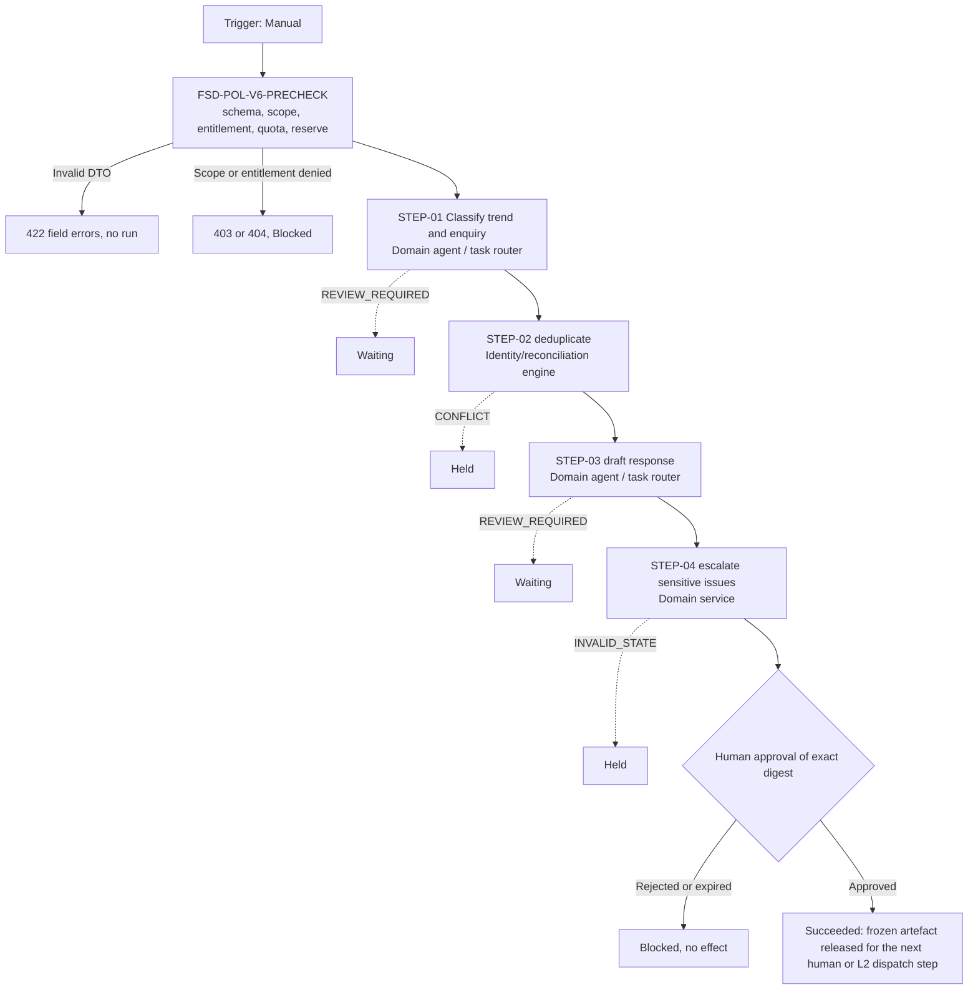
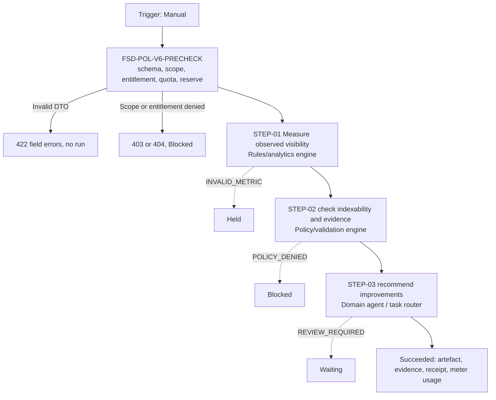
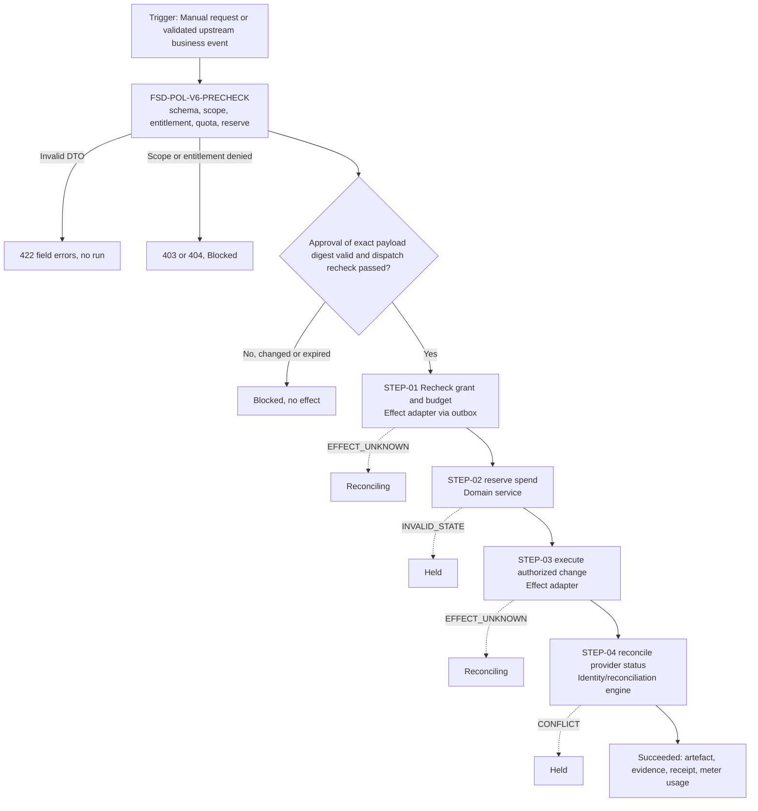
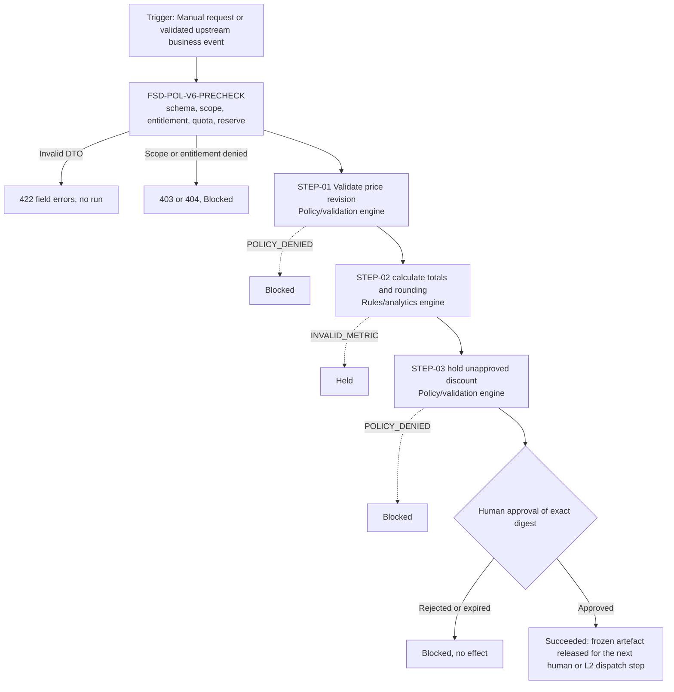
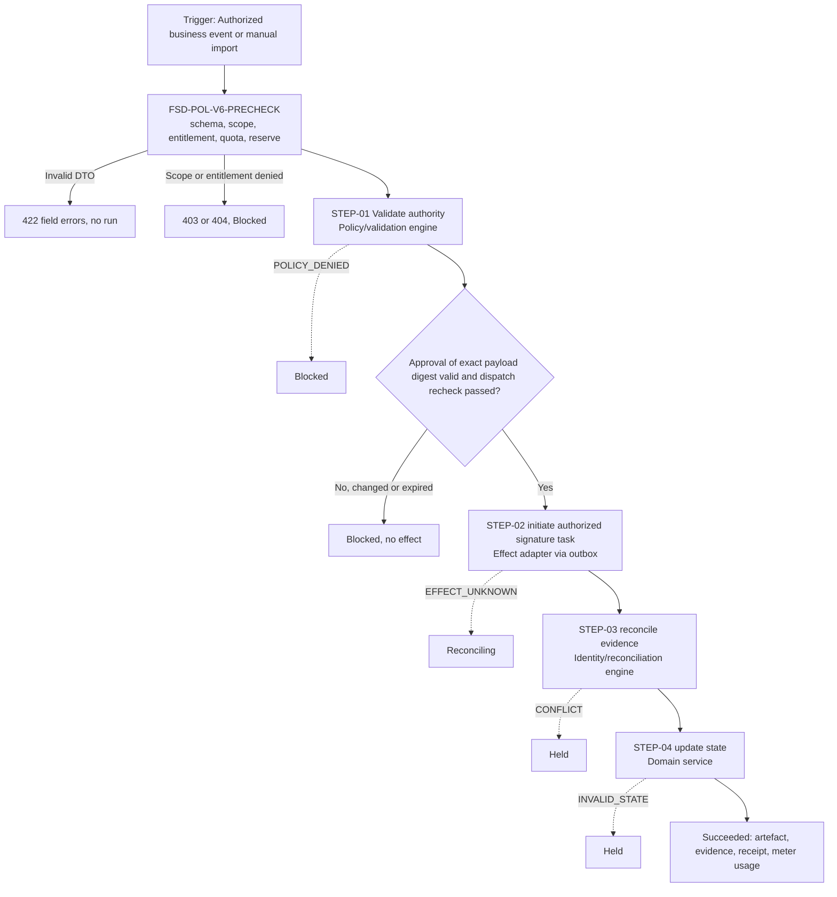
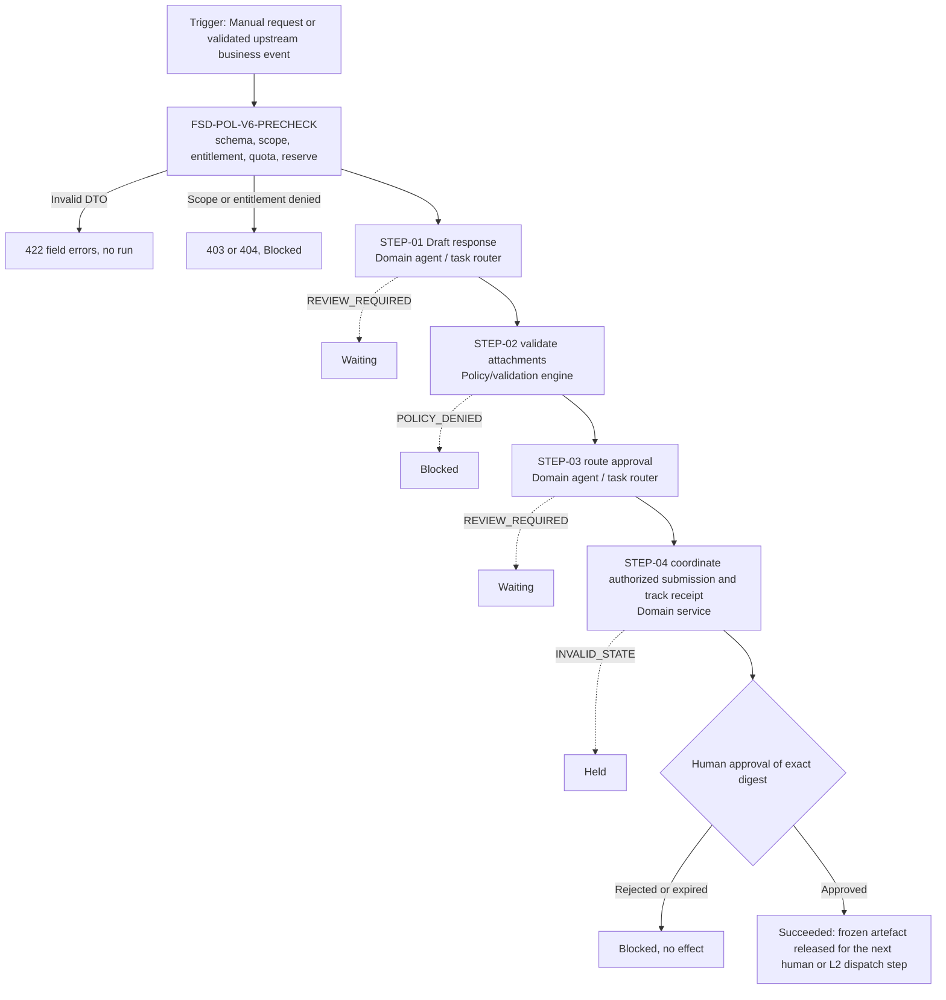
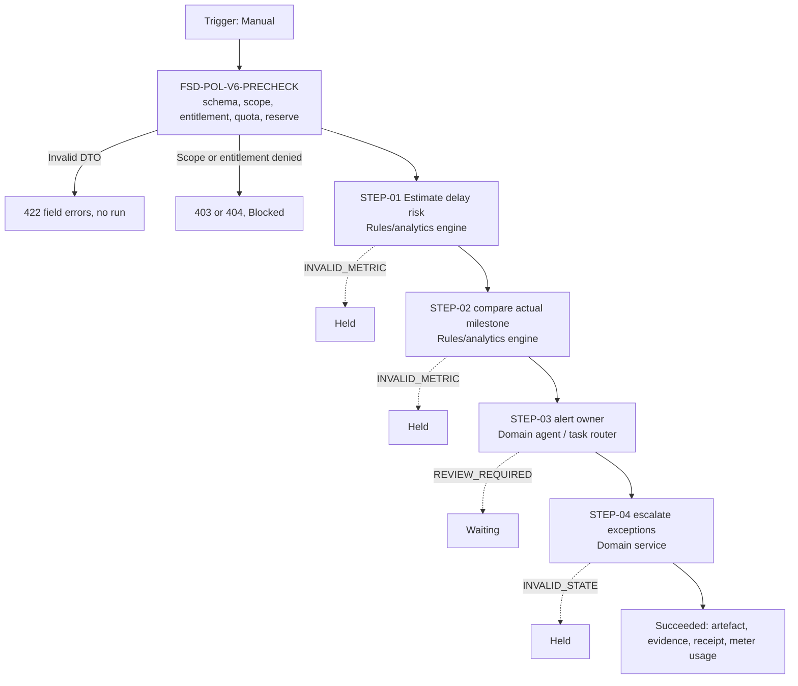

# AI Growth Engine: Employee Sales & Marketing Automation
## Application Blueprint: PART 11 (Batch 11.3), V12 Executable Workflows: SM-SVC-01…20 (80 workflows)

| Field | Value |
|---|---|
| Document | Part 11, Batch 3, file **c of c** (§11.3.5.10 SM-SVC-11…20, §11.3.6–§11.3.10). Files: `Part-11-3a_V12_Executable_Workflows_SVC01-20.md` (§11.3.1–§11.3.5.9 common engine contract), `Part-11-3b_…` (§11.3.5.10 workflow specifications SM-SVC-01…10), `Part-11-3c_…` (§11.3.5.10 SM-SVC-11…20 and §11.3.6–§11.3.10) |
| Version | 1.0 · 28 Nov 2026 |
| Baseline | Parts 0–9.10 and 0B (DEC-001…422); Part 2.2 §2.6 universal execution engine and WF-01…14; Parts 9.7–9.9 WF-15…39, AG-039…080, AU-053…119; Part 9.4 catalogue; Part 2.3 BRL and state machines; Part 3.2/3.3/3.4 contracts; customer revision V12 (BRD V12 ch09, FSD V12 ch12/13/33/40, Appendix B, workbook “39 Services 156 Workflows”) |
| Roles applied | Expert panel: Principal Workflow/BPM Architect (BPMN, saga, outbox), Revenue Operations leader, QA architect, Principal Engineer; plus Product Owner, Business Systems Analyst, Security/Compliance/AI Governance Lead, FinOps Lead |
| Status | Customer revision V12 alignment for group R3a (letter C). Development and running estimates in §11.3.5.9 are **outside** Ledger A (DEC-230) and Ledger B (DEC-231) and are separately approvable |

**Counts in this part (files a–c).** 80 V12 workflows (SM-SVC-01-WF01…SM-SVC-20-WF04) · 286 step contracts · 676 DTO field rows (169 distinct per service) · 682 workflow acceptance tests + 286 step tests from FSD ch33 mapped to TC-V12-C-031…998 · 30 engine tests TC-V12-C-001…030 · 92 requirements FR-V12-C-001…092 · 22 stories US-<EP>-YC01…YC22 · 13 workflow flowcharts + 4 engine diagrams · 15 decisions DEC-540…554 · 3 ADRs ADR-190…192 · tags 796–813 · 3,411 coverage aspects in `final/coverage_v12/C_coverage.csv`.

---
### 11.3.5.10 Workflow specifications (continued: SM-SVC-11…20)

#### SM-SVC-11 Content Marketing Automation

**Purpose:** Plan and draft accurate business content for approved publication (BRD V12 ch09; FSD V12 ch12). **Blueprint flow:** WF-05 (content and campaign). **Epic:** EP-11. **Story:** US-11-YC11.

| Field | Specification |
|---|---------|
| Family / bundle / meter | Content marketing · Full suite / Digital Marketing & Acquisition bundle / selective (1 SKU); entitlement and usage approval required. · meter: Illustrative pilot: 100 content draft(s)/month; 1 concurrent run; configurable hard budget, provider quota and frequency limits. Not approved. |
| Supported channels | Blogs, newsletters, social content drafts |
| Applicable industries / capability | All sectors with approved claims · Content marketing |
| Required supplied input (entitlement rules) | SM-SVC-11 + foundation; tenant/startup, capability, role, channel/provider and budget checks at every action |
| Optional input producers | Included foundation; no mandatory upstream paid service; optional input producers: SM-SVC-25; authorized equivalent input accepted. |
| External providers | Approved knowledge and optional document/media tools; publishing requires authorized connector (verify terms and prices at time of implementation, as of 27 Nov 2026) |
| Pricing model | Proposed monthly base entitlement + metered excess per content draft; annual option; provider charges/managed service separately quoted. Price TBD. — illustrative; Quotation pending (DEC-553) |
| Service KPI (V12) | Claims evidence or hold 100%; approved revision check 100% |
| Actors (blueprint roles) | R05 Marketing Specialist (author), R02 Startup Head (publication approver), R10 Legal (claims/copyright), R19, R20 |
| Agents: V12 → blueprint | AGT-10 (Content drafting; evidence retrieval; quality review) → AG-018 (primary), AG-012, AG-017 (SM-SVC-15); agent pool: AG-018 Content & Campaign Studio Drafter, AG-012 Claims & Policy Guard, AG-055 Knowledge Curator and RAG Freshness Agent, AG-050 |
| Automations (blueprint) | AU-029 publication pipeline and expiry monitor, AU-069 RAG freshness and coverage monitor, AU-036 document assembly/hash/diff, AU-003 schema validation |
| Shared engines (V12) | Document generation; Workflow orchestration; Governance |
| Business rules | BRL-MKT-01…03, BRL-MKT-09, BRL-PUB-01, BRL-APR-01/02 |
| Data class and gateway tier | Internal / Confidential (Tier 2 eligible only for approved public claims, opt-in); Tier 0 rules/cache first, Tier 1a then 1b, Tier 3 degrade (Part 7.3) |
| Screens (V12 = blueprint IDs) | A050; A051; A052; A005 |
| V12 API candidates | GET /api/v1/content; POST /api/v1/content/draft; PATCH /api/v1/content/{id}; GET /api/v1/admin/approvals; POST /api/v1/content/{id}/approve; GET /api/v1/social/posts; POST /api/v1/social/posts; GET /api/v1/social/status; GET /api/v1/products — retained or mapped by reviewed adapter; API catalogue reconciliation is group H (Part 11 R7) |
| V12 DB candidates → blueprint tables | growth_claim→cat_claim; growth_content_asset→mkt_content_asset; growth_content_version→mkt_content_version; growth_approval→gov_approval |

**DTO `urn:sm:dto:SM-SVC-11-WF0n:v2`** (one schema per workflow, identical for the four workflows of this service; JSON Schema 2020-12, `additionalProperties: false`, Appendix B; DEC-544).

| Field | Dir | Req | V12 type / validation | Schema constraint | Blueprint mapping |
|------|--|--|--------|--------|-------|
| `brand_ref` | in | Y | UUID / scoped external reference; input, validate authorized scope | `{"type": "string", "format": "uuid"}` | ten_business_line.brand_profile |
| `brief_ref` | in | Y | UUID / scoped external reference; input, validate authorized scope | `{"type": "string", "format": "uuid"}` | mkt_campaign.brief / mkt_content_asset.brief |
| `claim_refs` | in | Y | array (typed references or structured items); input, validate authorized scope | `{"type": "array", "items": {"type": ["string", "object"]}, "maxItems": 500}` | cat_claim.id[] |
| `asset_refs` | in | Y | array (typed references or structured items); input, validate authorized scope | `{"type": "array", "items": {"type": ["string", "object"]}, "maxItems": 500}` | mkt_content_asset.id[] |
| `content_ref` | out | Y | UUID / scoped external reference; output, validate schema and evidence | `{"type": "string", "format": "uuid"}` | mkt_content_asset.id |
| `revision` | out | Y | positive integer; output, validate schema and evidence | `{"type": "integer", "minimum": 1}` | mkt_content_version.revision / com_*_version.revision |
| `claim_check_state` | out | Y | string / configured enum; length and allowed values in versioned schema; output, validate schema and evidence | `{"type": "string", "maxLength": 64, "$comment": "configured enum; values from versioned registry claim_check_state"}` | mkt_content_version.claim_check_state |
| `review_state` | out | Y | string / configured enum; length and allowed values in versioned schema; output, validate schema and evidence | `{"type": "string", "maxLength": 64, "$comment": "configured enum; values from versioned registry review_state"}` | intel_review.state |

**DTO rules.** (1) Unknown fields rejected (422). (2) `*_ref`/`*_id` resolve inside the caller's tenant and startup only; a foreign reference is reported as not found (BRL-TEN-04). (3) Free text is Unicode NFC-normalised, 1–4,000 characters, and treated as untrusted (AIX-08 → AU-005 sanitizer; no tool invocation from content). (4) Enum fields take values from the versioned registry named in `$comment`; the registry version is pinned on the run. (5) Money fields are int64 minor units with an ISO 4217 code at the DTO boundary and Decimal in storage (DEC-543). (6) The schema version is pinned on the run (BRL-AUT-03).

**US-11-YC11 — Content Marketing Automation.** As R05 Marketing Specialist, I want the four SM-SVC-11 workflows to run as typed, policy-checked contracts on the universal engine, so that plan and draft accurate business content for approved publication without any unauthorized effect. Requirements: FR-V12-C-053, FR-V12-C-054, FR-V12-C-055, FR-V12-C-056. Epic EP-11.

```gherkin
Feature: SM-SVC-11 Content Marketing Automation contract conformance
  Background:
    Given tenant T1 startup S1 holds an active SM-SVC-11 entitlement with a monthly allowance
    And the workflow schema version is pinned on each run
  Scenario: Valid input produces the expected artefact
    When a requester starts SM-SVC-11-WF01 with a DTO valid against urn:sm:dto:SM-SVC-11-WF01:v2
    Then every step records class, input reference, output reference, state and evidence
    And the result validates against the output schema
  Scenario: Invalid or foreign input is rejected before any step
    When the DTO has an unknown field or a reference from tenant T2
    Then the API returns 422 or an indistinguishable 404 and no StepRun exists
  Scenario: Entitlement revoked after enqueue
    Given a run is queued
    When the entitlement is revoked
    Then the dispatch-time recheck blocks the next step and releases the reservation
```

##### SM-SVC-11-WF01 Content strategy and calendar

**Requirement FR-V12-C-053** (status before: Covered; after: Matched). **Blueprint:** WF-05 content plan; AG-018.

| Field | Specification |
|---|---------|
| Business outcome / input → output | Content strategy and calendar: Brand objective and audience → Content plan |
| Trigger | Manual request or validated upstream business event (FSD: Manual request or validated upstream business event; Brand objective and audience) |
| Result / acceptance | Content plan; acceptance: SM-SVC-11-WF01-TC-POS and step tests (ch33) |
| Domain contract | content payload schema SM-SVC-11-WF01@2; fields below; source-specific mandatory fields validated against required input; nullable non-applicable fields only. Validator `urn:sm:dto:SM-SVC-11-WF01:v2`. |
| Risk and authority (V12) | R0 internal analysis/draft; L1 assisted; L3 approved read/draft; Approve claims, brand and final publication; copyrighted material reviewed |
| Autonomy in blueprint | V12 L1 assisted / L3 approved read-draft → blueprint: internal analysis and drafts run unattended (no external effect); any reuse outside the workspace L1 (DEC-064, BRL-AI-07) |
| Approval gate (V12) | Approve claims, brand and final publication; copyrighted material reviewed · approval check: Approve claims, brand and final publication; copyrighted material reviewed |
| Operating mode / side effect / modalities | AI-assisted / supervised; controlled autonomous only for preapproved eligible routine steps; simulation has zero external effects. · Internal analysis/draft; no external action without separate authorization · Text; structured records (stricter classification applies, DEC-546) |
| Engine / agent | Document generation; Workflow orchestration; Governance; Content drafting; evidence retrieval; quality review → AG-018 (primary), AG-012, AG-017 (SM-SVC-15) |
| Channels / UI input controls | Website, Social · Brand objective [text]; audience [text] (4 source steps; preview and trace) |
| Step classes (FSD ch13) | 0 rules-labeled; 3 agent-labeled. Validate step taxonomy at contract review. Controls: AI-01/02/06/12/15; FL-01/02/03/07/09/13; ST-04/05/06 |
| Workflow KPI (V12) | calendar coverage; unsupported theme rate; baseline and threshold approved in pilot; source service KPI Claims evidence or hold 100%; approved revision check 100% |
| KPI formulas (this part) | calendar coverage = planned slots filled ÷ slots; unsupported theme rate = themes without approved claim ÷ themes — thresholds set after the pilot baseline (DEC-554) [GAP-810] |
| SLA | Run start ≤ 15 min (transactional) / ≤ 24 h (batch) per NFR-009, DEC-032 |
| Illustrative cost (V12) | 1 workflow invocation; not a full service cycle; tokens 3500 in / 600 out; INR 1.33 per invocation; Excluded; quote live API/channel/storage/ad/verification charges (estimate; verify at implementation, as of 27 Nov 2026) |
| Versions / acceptance origin | workflow 2.0-target; SM-SVC-11-WF01-AT01; synthetic dry run and measured benchmark pending; original SM-SVC-11-WF01-AT01 not run |
| Rules | R1. Themes suggested from approved offerings and claims only · R2. Missing evidence flagged before calendar approval · R3. Calendar approved by R02 |

| Step ID | Action | Class · V12 executor / input | Output / validation | Failure → blueprint state | Blueprint component | Step test |
|----|----|------|-------|-----|------|-------|
| SM-SVC-11-WF01-STEP-01 | Suggest themes | AI inference · Domain agent / task router / scoped evidence + approved configuration + prior results | candidate {artifact_ref,confidence,reason_codes,review_state} / Schema/claims check; draft cannot change live state; route owner and apply policy to notification | REVIEW_REQUIRED → AWAITING_APPROVAL → **Waiting (AWAITING_APPROVAL)** | Model gateway AU-001 (Tier 0 → 1a → 1b; Tier 3 degrade), AU-003 schema validation, AU-006 eval gate; agent = AGT mapping below; output is a draft only (BRL-AI-07) | TC-V12-C-513 (AIE (eval suite) + CT schema): Output validates against typed schema; claims match registry; factual statements cited; EVAL suite gate passed; untrusted input cannot invoke tools |
| SM-SVC-11-WF01-STEP-02 | match offering facts | Deterministic identity / reconciliation · Identity/reconciliation engine / scoped object refs + version + evidence_set | match_result {matched_refs,unmatched_refs,conflict_refs} / Unique source event; no cross-company merge; financial allocations atomic | CONFLICT → HELD; uncertain provider outcome reconcile → **Held / Reconciling** | AU-100 identity resolution / AU-015 safe merge / AU-030 conflict case / AU-026 uncertain-outcome reconciliation | TC-V12-C-514 (UT + IT replay): Duplicate and conflicting identities resolved per rule; uncertain match → REVIEW |
| SM-SVC-11-WF01-STEP-03 | schedule draft plan | AI inference · Domain agent / task router / scoped evidence + approved configuration + prior results | candidate {artifact_ref,confidence,reason_codes,review_state} / Schema/claims check; draft cannot change live state; route owner and apply policy to notification | REVIEW_REQUIRED → AWAITING_APPROVAL → **Waiting (AWAITING_APPROVAL)** | Model gateway AU-001 (Tier 0 → 1a → 1b; Tier 3 degrade), AU-003 schema validation, AU-006 eval gate; agent = AGT mapping below; output is a draft only (BRL-AI-07) | TC-V12-C-515 (AIE (eval suite) + CT schema): Output validates against typed schema; claims match registry; factual statements cited; EVAL suite gate passed; untrusted input cannot invoke tools |
| SM-SVC-11-WF01-STEP-04 | flag missing evidence | AI inference · Domain agent / task router / scoped evidence + approved configuration + prior results | candidate {artifact_ref,confidence,reason_codes,review_state} / Schema/claims check; draft cannot change live state; route owner and apply policy to notification | REVIEW_REQUIRED → AWAITING_APPROVAL → **Waiting (AWAITING_APPROVAL)** | Model gateway AU-001 (Tier 0 → 1a → 1b; Tier 3 degrade), AU-003 schema validation, AU-006 eval gate; agent = AGT mapping below; output is a draft only (BRL-AI-07) | TC-V12-C-516 (AIE (eval suite) + CT schema): Output validates against typed schema; claims match registry; factual statements cited; EVAL suite gate passed; untrusted input cannot invoke tools |

| Test ID | V12 ID | Level | Fixture / action (V12) | Expected (V12) | Blueprint assertion |
|---|-----|--|-----|-----|--------|
| TC-V12-C-505 | SM-SVC-11-WF01-TC-POS | IT | Brand objective and audience | Content plan | Output validates against `$defs.output` of the workflow schema; evidence/provenance persisted; run reaches Succeeded; workflow KPI event emitted |
| TC-V12-C-506 | SM-SVC-11-WF01-TC-INPUT | UT/CT | Missing or malformed Brand objective and audience | Reject/hold before effect; reason and audit | HTTP 422 with field-level errors from the Appendix B schema; no StepRun created; audit event `dto.rejected` |
| TC-V12-C-507 | SM-SVC-11-WF01-TC-SCOPE | SEC | Same reference from different tenant/company | 403 or indistinguishable 404; no leaked object | HTTP 403 or indistinguishable 404 (BRL-TEN-04); zero rows, events, notifications or provider calls in the other scope (NFR-032) |
| TC-V12-C-508 | SM-SVC-11-WF01-TC-ENT | IT | Revoke SKU or policy after enqueue | No new effect; safely pause/reconcile | Dispatch-time recheck denies (E-3, BRL-SVC-03); run Paused or Held; reservation released; no new effect |
| TC-V12-C-509 | SM-SVC-11-WF01-TC-DUP | IT replay | Replay identical event / step key | Single accepted outcome; no duplicate effect or charge | Exactly one accepted outcome, effect and meter charge (E-4, NFR-005); duplicate returns the original run reference |
| TC-V12-C-510 | SM-SVC-11-WF01-TC-QUALITY | AIE | Stale, conflicting or incomplete evidence | Flag or hold; no unsupported claims; metric evidence | Step Held or flagged; no unsupported claim reaches output (BRL-AI-03/04); eval record stored (FL-13) |
| TC-V12-C-511 | SM-SVC-11-WF01-TC-BUDGET | IT | Quota exhausted at reservation | Reject or hold; no provider effect | Reservation fails → step Blocked; zero provider calls (NFR-014); owner notified |
| TC-V12-C-512 | SM-SVC-11-WF01-TC-RECOVERY | CHAOS | Provider timeout or worker crash | Reconcile uncertain effect, safe retry only, audit | Timeout after submission → Reconciling (DEC-050, E-5); crash after checkpoint resumes without re-running a completed effect (OPT-TC-ST-04) |

##### SM-SVC-11-WF02 Article and campaign content drafting

**Requirement FR-V12-C-054** (status before: Covered; after: Matched). **Blueprint:** WF-05 drafting; AG-018; AG-012.

| Field | Specification |
|---|---------|
| Business outcome / input → output | Article and campaign content drafting: Approved brief and claims → Content drafts |
| Trigger | Manual request or validated upstream business event (FSD: Manual request or validated upstream business event; Approved brief and claims) |
| Result / acceptance | Content drafts; acceptance: SM-SVC-11-WF02-TC-POS and step tests (ch33) |
| Domain contract | content payload schema SM-SVC-11-WF02@2; fields below; source-specific mandatory fields validated against required input; nullable non-applicable fields only. Validator `urn:sm:dto:SM-SVC-11-WF02:v2`. |
| Risk and authority (V12) | R0 internal analysis/draft; L1 assisted; L3 approved read/draft; Approve claims, brand and final publication; copyrighted material reviewed |
| Autonomy in blueprint | V12 L1 assisted / L3 approved read-draft → blueprint: internal analysis and drafts run unattended (no external effect); any reuse outside the workspace L1 (DEC-064, BRL-AI-07) |
| Approval gate (V12) | Approve claims, brand and final publication; copyrighted material reviewed · approval check: Approve claims, brand and final publication; copyrighted material reviewed |
| Operating mode / side effect / modalities | AI-assisted / supervised; controlled autonomous only for preapproved eligible routine steps; simulation has zero external effects. · Internal analysis/draft; no external action without separate authorization · Text; structured records (stricter classification applies, DEC-546) |
| Engine / agent | Document generation; Workflow orchestration; Governance; Content drafting; evidence retrieval; quality review → AG-018 (primary), AG-012, AG-017 (SM-SVC-15) |
| Channels / UI input controls | Website, Social · Approved brief [text]; claims [text] (3 source steps; preview and trace) |
| Step classes (FSD ch13) | 0 rules-labeled; 1 agent-labeled. Validate step taxonomy at contract review. Controls: AI-01/02/06/12/15; FL-01/02/03/07/09/13; ST-04/05/06 |
| Workflow KPI (V12) | claim accuracy; draft acceptance; baseline and threshold approved in pilot; source service KPI Claims evidence or hold 100%; approved revision check 100% |
| KPI formulas (this part) | claim accuracy = drafts with zero unsupported claims ÷ drafts; draft acceptance = drafts approved ÷ drafts — thresholds set after the pilot baseline (DEC-554) [GAP-810] |
| SLA | Draft ≤ 2 min p95 |
| Illustrative cost (V12) | 1 workflow invocation; not a full service cycle; tokens 5000 in / 1400 out; INR 2.27 per invocation; Excluded; quote live API/channel/storage/ad/verification charges (estimate; verify at implementation, as of 27 Nov 2026) |
| Versions / acceptance origin | workflow 2.0-target; SM-SVC-11-WF02-AT01; synthetic dry run and measured benchmark pending; original SM-SVC-11-WF02-AT01 not run |
| Rules | R1. Evidence retrieved from approved claims and knowledge · R2. Variants generated; unsupported claims blocked (BRL-MKT-01) · R3. Copyrighted material reviewed |

| Step ID | Action | Class · V12 executor / input | Output / validation | Failure → blueprint state | Blueprint component | Step test |
|----|----|------|-------|-----|------|-------|
| SM-SVC-11-WF02-STEP-01 | Retrieve evidence | Evidence retrieval · Evidence/ingestion engine / permitted source or artifact refs + scope + source policy | evidence_set {items,source_ref,observed_at,hash,rights} / Reject stale or unauthorized source; preserve original and confidence | SOURCE_DENIED → HELD; transient read retry → **Held** | Research ingestion (M10–M12) via AU-007 source permission, AU-014 URL filter, AU-005 sanitizer; writes intel_source_record / intel_evidence | TC-V12-C-525 (IT (adapter stub) + SEC): Unauthorised or stale source rejected; provenance hash and rights stored |
| SM-SVC-11-WF02-STEP-02 | draft content and variants | AI inference · Domain agent / task router / scoped evidence + approved configuration + prior results | candidate {artifact_ref,confidence,reason_codes,review_state} / Schema/claims check; draft cannot change live state; route owner and apply policy to notification | REVIEW_REQUIRED → AWAITING_APPROVAL → **Waiting (AWAITING_APPROVAL)** | Model gateway AU-001 (Tier 0 → 1a → 1b; Tier 3 degrade), AU-003 schema validation, AU-006 eval gate; agent = AGT mapping below; output is a draft only (BRL-AI-07) | TC-V12-C-526 (AIE (eval suite) + CT schema): Output validates against typed schema; claims match registry; factual statements cited; EVAL suite gate passed; untrusted input cannot invoke tools |
| SM-SVC-11-WF02-STEP-03 | check unsupported claims | Policy gate / human review · Policy/validation engine / typed payload + effective policy + consent/budget/entitlement snapshot | validation {passed,reason_codes,policy_version} / Re-read effective authorization; reject or hold on missing evidence; never override suppression | POLICY_DENIED → BLOCKED; no external effect → **Blocked** | Policy Decision Point AU-009 (plan-time and dispatch-time, E-3) with gov_policy_decision record; approval routing API-541 | TC-V12-C-527 (UT decision table + IT PDP): Missing consent, entitlement, budget or jurisdiction rule → HOLD with reason code; requester ≠ reviewer |

| Test ID | V12 ID | Level | Fixture / action (V12) | Expected (V12) | Blueprint assertion |
|---|-----|--|-----|-----|--------|
| TC-V12-C-517 | SM-SVC-11-WF02-TC-POS | IT | Approved brief and claims | Content drafts | Output validates against `$defs.output` of the workflow schema; evidence/provenance persisted; run reaches Succeeded; workflow KPI event emitted |
| TC-V12-C-518 | SM-SVC-11-WF02-TC-INPUT | UT/CT | Missing or malformed Approved brief and claims | Reject/hold before effect; reason and audit | HTTP 422 with field-level errors from the Appendix B schema; no StepRun created; audit event `dto.rejected` |
| TC-V12-C-519 | SM-SVC-11-WF02-TC-SCOPE | SEC | Same reference from different tenant/company | 403 or indistinguishable 404; no leaked object | HTTP 403 or indistinguishable 404 (BRL-TEN-04); zero rows, events, notifications or provider calls in the other scope (NFR-032) |
| TC-V12-C-520 | SM-SVC-11-WF02-TC-ENT | IT | Revoke SKU or policy after enqueue | No new effect; safely pause/reconcile | Dispatch-time recheck denies (E-3, BRL-SVC-03); run Paused or Held; reservation released; no new effect |
| TC-V12-C-521 | SM-SVC-11-WF02-TC-DUP | IT replay | Replay identical event / step key | Single accepted outcome; no duplicate effect or charge | Exactly one accepted outcome, effect and meter charge (E-4, NFR-005); duplicate returns the original run reference |
| TC-V12-C-522 | SM-SVC-11-WF02-TC-QUALITY | AIE | Stale, conflicting or incomplete evidence | Flag or hold; no unsupported claims; metric evidence | Step Held or flagged; no unsupported claim reaches output (BRL-AI-03/04); eval record stored (FL-13) |
| TC-V12-C-523 | SM-SVC-11-WF02-TC-BUDGET | IT | Quota exhausted at reservation | Reject or hold; no provider effect | Reservation fails → step Blocked; zero provider calls (NFR-014); owner notified |
| TC-V12-C-524 | SM-SVC-11-WF02-TC-RECOVERY | CHAOS | Provider timeout or worker crash | Reconcile uncertain effect, safe retry only, audit | Timeout after submission → Reconciling (DEC-050, E-5); crash after checkpoint resumes without re-running a completed effect (OPT-TC-ST-04) |

##### SM-SVC-11-WF03 Content review and optimization

**Requirement FR-V12-C-055** (status before: Covered; after: Matched). **Blueprint:** WF-05 review; AU-036 diff.

| Field | Specification |
|---|---------|
| Business outcome / input → output | Content review and optimization: Draft and approved feedback/metrics → Reviewed content revision |
| Trigger | Scheduled or manual; scoped event on change (FSD: Scheduled or manual; scoped event on change; Draft and approved feedback/metrics) |
| Result / acceptance | Reviewed content revision; acceptance: SM-SVC-11-WF03-TC-POS and step tests (ch33) |
| Domain contract | content payload schema SM-SVC-11-WF03@2; fields below; source-specific mandatory fields validated against required input; nullable non-applicable fields only. Validator `urn:sm:dto:SM-SVC-11-WF03:v2`. |
| Risk and authority (V12) | R0 internal analysis/draft; L1 assisted; L3 approved read/draft; Approve claims, brand and final publication; copyrighted material reviewed |
| Autonomy in blueprint | V12 L1 assisted / L3 approved read-draft → blueprint: internal analysis and drafts run unattended (no external effect); any reuse outside the workspace L1 (DEC-064, BRL-AI-07) |
| Approval gate (V12) | Approve claims, brand and final publication; copyrighted material reviewed · approval check: Approve claims, brand and final publication; copyrighted material reviewed |
| Operating mode / side effect / modalities | AI-assisted / supervised; controlled autonomous only for preapproved eligible routine steps; simulation has zero external effects. · Internal analysis/draft; no external action without separate authorization · Text; structured records (stricter classification applies, DEC-546) |
| Engine / agent | Document generation; Workflow orchestration; Governance; Content drafting; evidence retrieval; quality review → AG-018 (primary), AG-012, AG-017 (SM-SVC-15) |
| Channels / UI input controls | Website, Social · Draft [text]; approved feedback/metrics [text] (3 source steps; preview and trace) |
| Step classes (FSD ch13) | 1 rules-labeled; 1 agent-labeled. Validate step taxonomy at contract review. Controls: AI-01/02/06/12/15; FL-01/02/03/07/09/13; ST-04/05/06 |
| Workflow KPI (V12) | revision traceability; material claim error rate; baseline and threshold approved in pilot; source service KPI Claims evidence or hold 100%; approved revision check 100% |
| KPI formulas (this part) | revision traceability = revisions with diff and approver ÷ revisions; material claim error rate = published items with claim error ÷ published — thresholds set after the pilot baseline (DEC-554) [GAP-810] |
| SLA | Run start ≤ 15 min (transactional) / ≤ 24 h (batch) per NFR-009, DEC-032 |
| Illustrative cost (V12) | 1 workflow invocation; not a full service cycle; tokens 3000 in / 550 out; INR 1.19 per invocation; Excluded; quote live API/channel/storage/ad/verification charges (estimate; verify at implementation, as of 27 Nov 2026) |
| Versions / acceptance origin | workflow 2.0-target; SM-SVC-11-WF03-AT01; synthetic dry run and measured benchmark pending; original SM-SVC-11-WF03-AT01 not run |
| Rules | R1. Revision diff computed against last approved hash · R2. Claims and style reviewed; changes create new revision (BRL-QTE-06 pattern) · R3. Approval routed to R02 |

| Step ID | Action | Class · V12 executor / input | Output / validation | Failure → blueprint state | Blueprint component | Step test |
|----|----|------|-------|-----|------|-------|
| SM-SVC-11-WF03-STEP-01 | Compare revision | Deterministic calculation · Rules/analytics engine / versioned inputs + policy/metric_version | calculation {value,unit,assumptions,evidence_refs} / Deterministic arithmetic or evaluated model; validate denominator, units, calibration and bounds | INVALID_METRIC → HELD; do not invent missing values → **Held** | Deterministic calculator in the domain module (zero model calls); Decimal arithmetic (DEC-027); BRL-AI-04 abstain on missing inputs | TC-V12-C-536 (UT golden fixture): Golden fixture exact; units/denominator validated; missing value never invented |
| SM-SVC-11-WF03-STEP-02 | review claims and style | Deterministic domain logic · Domain service / validated domain payload + prior result | domain_result {artifact_ref,status,evidence_refs} / Domain validation and version check; explicit authorization before state change | INVALID_STATE → HELD → **Held** | Domain module service: revision check (NFR-025), single transaction with audit and outbox (E-2) | TC-V12-C-537 (UT golden fixture): Golden fixture yields exact output with zero model calls; invalid state → HELD with reason |
| SM-SVC-11-WF03-STEP-03 | propose improvements and approval | AI inference · Domain agent / task router / scoped evidence + approved configuration + prior results | candidate {artifact_ref,confidence,reason_codes,review_state} / Schema/claims check; draft cannot change live state; route owner and apply policy to notification | REVIEW_REQUIRED → AWAITING_APPROVAL → **Waiting (AWAITING_APPROVAL)** | Model gateway AU-001 (Tier 0 → 1a → 1b; Tier 3 degrade), AU-003 schema validation, AU-006 eval gate; agent = AGT mapping below; output is a draft only (BRL-AI-07) | TC-V12-C-538 (AIE (eval suite) + CT schema): Output validates against typed schema; claims match registry; factual statements cited; EVAL suite gate passed; untrusted input cannot invoke tools |

| Test ID | V12 ID | Level | Fixture / action (V12) | Expected (V12) | Blueprint assertion |
|---|-----|--|-----|-----|--------|
| TC-V12-C-528 | SM-SVC-11-WF03-TC-POS | IT | Draft and approved feedback/metrics | Reviewed content revision | Output validates against `$defs.output` of the workflow schema; evidence/provenance persisted; run reaches Succeeded; workflow KPI event emitted |
| TC-V12-C-529 | SM-SVC-11-WF03-TC-INPUT | UT/CT | Missing or malformed Draft and approved feedback/metrics | Reject/hold before effect; reason and audit | HTTP 422 with field-level errors from the Appendix B schema; no StepRun created; audit event `dto.rejected` |
| TC-V12-C-530 | SM-SVC-11-WF03-TC-SCOPE | SEC | Same reference from different tenant/company | 403 or indistinguishable 404; no leaked object | HTTP 403 or indistinguishable 404 (BRL-TEN-04); zero rows, events, notifications or provider calls in the other scope (NFR-032) |
| TC-V12-C-531 | SM-SVC-11-WF03-TC-ENT | IT | Revoke SKU or policy after enqueue | No new effect; safely pause/reconcile | Dispatch-time recheck denies (E-3, BRL-SVC-03); run Paused or Held; reservation released; no new effect |
| TC-V12-C-532 | SM-SVC-11-WF03-TC-DUP | IT replay | Replay identical event / step key | Single accepted outcome; no duplicate effect or charge | Exactly one accepted outcome, effect and meter charge (E-4, NFR-005); duplicate returns the original run reference |
| TC-V12-C-533 | SM-SVC-11-WF03-TC-QUALITY | AIE | Stale, conflicting or incomplete evidence | Flag or hold; no unsupported claims; metric evidence | Step Held or flagged; no unsupported claim reaches output (BRL-AI-03/04); eval record stored (FL-13) |
| TC-V12-C-534 | SM-SVC-11-WF03-TC-BUDGET | IT | Quota exhausted at reservation | Reject or hold; no provider effect | Reservation fails → step Blocked; zero provider calls (NFR-014); owner notified |
| TC-V12-C-535 | SM-SVC-11-WF03-TC-RECOVERY | CHAOS | Provider timeout or worker crash | Reconcile uncertain effect, safe retry only, audit | Timeout after submission → Reconciling (DEC-050, E-5); crash after checkpoint resumes without re-running a completed effect (OPT-TC-ST-04) |

##### SM-SVC-11-WF04 Content gap, freshness and evidence monitoring

**Requirement FR-V12-C-056** (status before: Partially covered; after: Matched). **Blueprint:** AU-069 RAG freshness (knowledge base only); AU-029 expiry monitor. **Enhancement:** Content-inventory gap and freshness backlog is new.

| Field | Specification |
|---|---------|
| Business outcome / input → output | Content gap, freshness and evidence monitoring: Approved content inventory, performance and claim sources → Content refresh backlog |
| Trigger | Manual; scheduled or relevant validated business event; provider webhook only where authorized (FSD: Manual; scheduled or relevant validated business event; provider webhook only where authorized; Approved content inventory, performance and claim sources) |
| Result / acceptance | Content refresh backlog; Content refresh backlog; no unapproved external side effects |
| Domain contract | content payload schema SM-SVC-11-WF04@2; fields below; source-specific mandatory fields validated against required input; nullable non-applicable fields only. Validator `urn:sm:dto:SM-SVC-11-WF04:v2`. |
| Risk and authority (V12) | R0 internal analysis/draft; L1 assisted; L3 approved read/draft; Approve source/data rights and applicable external actions; approve consequential communications, commitments and changes; routine steps only within preapproved policies. |
| Autonomy in blueprint | V12 L1 assisted / L3 approved read-draft → blueprint: internal analysis and drafts run unattended (no external effect); any reuse outside the workspace L1 (DEC-064, BRL-AI-07) |
| Approval gate (V12) | Approve source/data rights and applicable external actions; approve consequential communications, commitments and changes; routine steps only within preapproved policies. · approval check: Approve source/data rights and applicable external actions; approve consequential communications, commitments and changes; routine steps only within preapproved policies. |
| Operating mode / side effect / modalities | AI-assisted / supervised; controlled autonomous only for preapproved eligible routine steps; simulation has zero external effects. · Internal analysis/draft; no external action without separate authorization · Text; structured records; documents (stricter classification applies, DEC-546) |
| Engine / agent | Document generation; Workflow orchestration; Governance; Content drafting; evidence retrieval; quality review → AG-018 (primary), AG-012, AG-017 (SM-SVC-15) |
| Channels / UI input controls | Website, Social · Approved content inventory [text]; performance [text]; claim sources [text] (3 source steps; preview and trace) |
| Step classes (FSD ch13) | 0 rules-labeled; 1 agent-labeled. Validate step taxonomy at contract review. Controls: AI-01/02/06/12/15; FL-01/02/03/07/09/13; ST-04/05/06 |
| Workflow KPI (V12) | stale content recall; backlog precision; baseline and threshold approved in pilot; source service KPI Claims evidence or hold 100%; approved revision check 100% |
| KPI formulas (this part) | stale content recall = stale items flagged ÷ stale items; backlog precision = backlog items accepted ÷ backlog items — thresholds set after the pilot baseline (DEC-554) [GAP-810] |
| SLA | Weekly batch |
| Illustrative cost (V12) | 1 invocation; text component only; tokens 1200 in / 200 out; INR 0.55 per invocation; Excluded; provider quotation and media/voice/ad fees TBD (estimate; verify at implementation, as of 27 Nov 2026) |
| Versions / acceptance origin | workflow 1.0-target; SM-SVC-11-WF04-AT01; synthetic dry run and measured benchmark pending; original SM-SVC-11-WF04-AT01 not run |
| Rules | R1. Coverage gaps computed against approved topic map · R2. Claims re-verified; expired claim → content flagged for withdrawal · R3. Backlog prioritized by traffic × staleness (deterministic) |

| Step ID | Action | Class · V12 executor / input | Output / validation | Failure → blueprint state | Blueprint component | Step test |
|----|----|------|-------|-----|------|-------|
| SM-SVC-11-WF04-STEP-01 | Identify missing/stale coverage | AI inference · Domain agent / task router / scoped evidence + approved configuration + prior results | candidate {artifact_ref,confidence,reason_codes,review_state} / Schema/claims check; draft cannot change live state; route owner and apply policy to notification | REVIEW_REQUIRED → AWAITING_APPROVAL → **Waiting (AWAITING_APPROVAL)** | Model gateway AU-001 (Tier 0 → 1a → 1b; Tier 3 degrade), AU-003 schema validation, AU-006 eval gate; agent = AGT mapping below; output is a draft only (BRL-AI-07) | TC-V12-C-547 (AIE (eval suite) + CT schema): Output validates against typed schema; claims match registry; factual statements cited; EVAL suite gate passed; untrusted input cannot invoke tools |
| SM-SVC-11-WF04-STEP-02 | verify claims | Policy gate / human review · Policy/validation engine / typed payload + effective policy + consent/budget/entitlement snapshot | validation {passed,reason_codes,policy_version} / Re-read effective authorization; reject or hold on missing evidence; never override suppression | POLICY_DENIED → BLOCKED; no external effect → **Blocked** | Policy Decision Point AU-009 (plan-time and dispatch-time, E-3) with gov_policy_decision record; approval routing API-541 | TC-V12-C-548 (UT decision table + IT PDP): Missing consent, entitlement, budget or jurisdiction rule → HOLD with reason code; requester ≠ reviewer |
| SM-SVC-11-WF04-STEP-03 | prioritize revisions | Deterministic domain logic · Domain service / validated domain payload + prior result | domain_result {artifact_ref,status,evidence_refs} / Domain validation and version check; explicit authorization before state change | INVALID_STATE → HELD → **Held** | Domain module service: revision check (NFR-025), single transaction with audit and outbox (E-2) | TC-V12-C-549 (UT golden fixture): Golden fixture yields exact output with zero model calls; invalid state → HELD with reason |

| Test ID | V12 ID | Level | Fixture / action (V12) | Expected (V12) | Blueprint assertion |
|---|-----|--|-----|-----|--------|
| TC-V12-C-539 | SM-SVC-11-WF04-TC-POS | IT | Approved content inventory, performance and claim sources | Content refresh backlog; no unapproved external side effects | Output validates against `$defs.output` of the workflow schema; evidence/provenance persisted; run reaches Succeeded; workflow KPI event emitted |
| TC-V12-C-540 | SM-SVC-11-WF04-TC-INPUT | UT/CT | Missing or malformed Approved content inventory, performance and claim sources | Reject/hold before effect; reason and audit | HTTP 422 with field-level errors from the Appendix B schema; no StepRun created; audit event `dto.rejected` |
| TC-V12-C-541 | SM-SVC-11-WF04-TC-SCOPE | SEC | Same reference from different tenant/company | 403 or indistinguishable 404; no leaked object | HTTP 403 or indistinguishable 404 (BRL-TEN-04); zero rows, events, notifications or provider calls in the other scope (NFR-032) |
| TC-V12-C-542 | SM-SVC-11-WF04-TC-ENT | IT | Revoke SKU or policy after enqueue | No new effect; safely pause/reconcile | Dispatch-time recheck denies (E-3, BRL-SVC-03); run Paused or Held; reservation released; no new effect |
| TC-V12-C-543 | SM-SVC-11-WF04-TC-DUP | IT replay | Replay identical event / step key | Single accepted outcome; no duplicate effect or charge | Exactly one accepted outcome, effect and meter charge (E-4, NFR-005); duplicate returns the original run reference |
| TC-V12-C-544 | SM-SVC-11-WF04-TC-QUALITY | AIE | Stale, conflicting or incomplete evidence | Flag or hold; no unsupported claims; metric evidence | Step Held or flagged; no unsupported claim reaches output (BRL-AI-03/04); eval record stored (FL-13) |
| TC-V12-C-545 | SM-SVC-11-WF04-TC-BUDGET | IT | Quota exhausted at reservation | Reject or hold; no provider effect | Reservation fails → step Blocked; zero provider calls (NFR-014); owner notified |
| TC-V12-C-546 | SM-SVC-11-WF04-TC-RECOVERY | CHAOS | Provider timeout or worker crash | Reconcile uncertain effect, safe retry only, audit | Timeout after submission → Reconciling (DEC-050, E-5); crash after checkpoint resumes without re-running a completed effect (OPT-TC-ST-04) |

#### SM-SVC-12 Social Media Publishing & Listening Automation

**Purpose:** Coordinate approved social content publication and permitted listening (BRD V12 ch09; FSD V12 ch12). **Blueprint flow:** WF-05 (social publishing). **Epic:** EP-11. **Story:** US-11-YC12.

| Field | Specification |
|---|---------|
| Family / bundle / meter | Digital marketing · Full suite / Digital Marketing & Acquisition bundle / selective (1 SKU); entitlement and usage approval required. · meter: Illustrative pilot: 300 social action or listening batch(s)/month; 1 concurrent run; configurable hard budget, provider quota and frequency limits. Not approved. |
| Supported channels | Facebook, Instagram, YouTube, X and LinkedIn where officially permitted |
| Applicable industries / capability | All sectors with approved social accounts · Social publishing and listening |
| Required supplied input (entitlement rules) | SM-SVC-12 + foundation; tenant/startup, capability, role, channel/provider and budget checks at every action |
| Optional input producers | Included foundation; no mandatory upstream paid service; optional input producers: SM-SVC-11; authorized equivalent input accepted. |
| External providers | Official platform APIs and account grants; no unsupported bulk messaging or scraping (verify terms and prices at time of implementation, as of 27 Nov 2026) [GAP-805] |
| Pricing model | Proposed monthly base entitlement + metered excess per social action or listening batch; annual option; provider charges/managed service separately quoted. Price TBD. — illustrative; Quotation pending (DEC-553) |
| Service KPI (V12) | Unauthorized publication = 0; provider status reconciled ≥99% |
| Actors (blueprint roles) | R05 Marketing Specialist, R02 Startup Head (publication approver), R10 Legal, R19, R20 |
| Agents: V12 → blueprint | AGT-11 (Market intelligence; content adaptation) → AG-018 (social/SEO drafting), AG-027 (listening, visibility); agent pool: AG-018, AG-027 Market & Competitor Watch Summarizer, AG-012 |
| Automations (blueprint) | AU-029 publication pipeline, AU-010 provider health/circuit breakers, AU-026 uncertain-outcome reconciliation, AU-007 source permission |
| Shared engines (V12) | Communication; Workflow orchestration; Governance |
| Business rules | BRL-MKT-07 (no automated DMs; owned accounts only), BRL-PUB-01, BRL-SRC-01/04, BRL-AUT-08 |
| Data class and gateway tier | Public (published) / Internal — Tier 2 eligible only for public-post classification, opt-in; Tier 0 rules/cache first, Tier 1a then 1b, Tier 3 degrade (Part 7.3) |
| Screens (V12 = blueprint IDs) | A048; A049; A050; A052; A053 |
| V12 API candidates | GET /api/v1/social/signals; ADAPTER Authorized social listening API; POST /api/v1/admin/social/sources; GET /api/v1/content; POST /api/v1/content/draft; PATCH /api/v1/content/{id}; GET /api/v1/social/posts; POST /api/v1/social/posts; GET /api/v1/social/status — retained or mapped by reviewed adapter; API catalogue reconciliation is group H (Part 11 R7) |
| V12 DB candidates → blueprint tables | growth_social_post→intel_social_post; growth_social_publication→mkt_social_publication; growth_page_metric→mkt_page_metric |

**DTO `urn:sm:dto:SM-SVC-12-WF0n:v2`** (one schema per workflow, identical for the four workflows of this service; JSON Schema 2020-12, `additionalProperties: false`, Appendix B; DEC-544).

| Field | Dir | Req | V12 type / validation | Schema constraint | Blueprint mapping |
|------|--|--|--------|--------|-------|
| `account_ref` | in | Y | UUID / scoped external reference; input, validate authorized scope | `{"type": "string", "format": "uuid"}` | intel_organization.id (account) |
| `content_ref` | in | Y | UUID / scoped external reference; input, validate authorized scope | `{"type": "string", "format": "uuid"}` | mkt_content_asset.id |
| `schedule` | in | Y | string / RFC 5545 RRULE with IANA timezone; validated server-side; input, validate authorized scope | `{"type": "string", "maxLength": 512}` | mkt_social_publication.schedule (RFC 5545 RRULE + IANA tz) |
| `source_ids` | in | Y | array (typed references or structured items); input, validate authorized scope | `{"type": "array", "items": {"type": ["string", "object"]}, "maxItems": 500}` | intel_source.id[] |
| `publication_ref` | out | Y | UUID / scoped external reference; output, validate schema and evidence | `{"type": "string", "format": "uuid"}` | mkt_social_publication.id |
| `status` | out | Y | string / configured enum; length and allowed values in versioned schema; output, validate schema and evidence | `{"type": "string", "maxLength": 64, "$comment": "configured enum; values from versioned registry status"}` | mkt_social_publication.state |
| `metric_refs` | out | Y | array (typed references or structured items); output, validate schema and evidence | `{"type": "array", "items": {"type": ["string", "object"]}, "maxItems": 500}` | mkt_page_metric.id[] |
| `mention_refs` | out | Y | array (typed references or structured items); output, validate schema and evidence | `{"type": "array", "items": {"type": ["string", "object"]}, "maxItems": 500}` | intel_social_post.id[] |

**DTO rules.** (1) Unknown fields rejected (422). (2) `*_ref`/`*_id` resolve inside the caller's tenant and startup only; a foreign reference is reported as not found (BRL-TEN-04). (3) Free text is Unicode NFC-normalised, 1–4,000 characters, and treated as untrusted (AIX-08 → AU-005 sanitizer; no tool invocation from content). (4) Enum fields take values from the versioned registry named in `$comment`; the registry version is pinned on the run. (5) Money fields are int64 minor units with an ISO 4217 code at the DTO boundary and Decimal in storage (DEC-543). (6) The schema version is pinned on the run (BRL-AUT-03).

**US-11-YC12 — Social Media Publishing & Listening Automation.** As R05 Marketing Specialist, I want the four SM-SVC-12 workflows to run as typed, policy-checked contracts on the universal engine, so that coordinate approved social content publication and permitted listening without any unauthorized effect. Requirements: FR-V12-C-057, FR-V12-C-058, FR-V12-C-059, FR-V12-C-060. Epic EP-11.

```gherkin
Feature: SM-SVC-12 Social Media Publishing & Listening Automation contract conformance
  Background:
    Given tenant T1 startup S1 holds an active SM-SVC-12 entitlement with a monthly allowance
    And the workflow schema version is pinned on each run
  Scenario: Valid input produces the expected artefact
    When a requester starts SM-SVC-12-WF01 with a DTO valid against urn:sm:dto:SM-SVC-12-WF01:v2
    Then every step records class, input reference, output reference, state and evidence
    And the result validates against the output schema
  Scenario: Invalid or foreign input is rejected before any step
    When the DTO has an unknown field or a reference from tenant T2
    Then the API returns 422 or an indistinguishable 404 and no StepRun exists
  Scenario: Entitlement revoked after enqueue
    Given a run is queued
    When the entitlement is revoked
    Then the dispatch-time recheck blocks the next step and releases the reservation
```

##### SM-SVC-12-WF01 Social account and publication scheduling

**Requirement FR-V12-C-057** (status before: Covered; after: Adopted (DEC-779) on authority only) [CONFLICT-799]. **Blueprint:** WF-05 social scheduling; AU-029; BRL-MKT-07.

| Field | Specification |
|---|---------|
| Business outcome / input → output | Social account and publication scheduling: Approved content and account grant → Scheduled or blocked publication |
| Trigger | Manual request or validated upstream business event (FSD: Manual request or validated upstream business event; Approved content and account grant) |
| Result / acceptance | Scheduled or blocked publication; acceptance: SM-SVC-12-WF01-TC-POS and step tests (ch33) |
| Domain contract | social_post payload schema SM-SVC-12-WF01@2; fields below; source-specific mandatory fields validated against required input; nullable non-applicable fields only. Validator `urn:sm:dto:SM-SVC-12-WF01:v2`. |
| Risk and authority (V12) | R2 external communication/provider/access write; L2 mandatory approved effect; L3 only with separately approved bounded mandate where lawful; Approve publication and response policies; platform permissions enforced |
| Autonomy in blueprint | V12 L2 mandatory approved effect; L3 only with separate bounded mandate → blueprint: L1 approval of exact hash then L2 dispatch of the approved item; L3 only for DEC-064 L3 categories (approved-FAQ replies, eligible follow-ups, reminders) [CONFLICT-799 → DEC-549 Adopted (DEC-779)] |
| Approval gate (V12) | Approve publication and response policies; platform permissions enforced · approval check: Approve publication and response policies; platform permissions enforced |
| Operating mode / side effect / modalities | Manual / supervised review; preparation only if gate not satisfied · Potential external write/communication; controlled only after applicable permission and policy approval · Text; structured records (stricter classification applies, DEC-546) |
| Engine / agent | Communication; Workflow orchestration; Governance; Market intelligence; content adaptation → AG-018 (social/SEO drafting), AG-027 (listening, visibility) |
| Channels / UI input controls | Social · Approved content [text]; account grant [text] (3 source steps; preview and trace) |
| Step classes (FSD ch13) | 0 rules-labeled; 0 agent-labeled. Validate step taxonomy at contract review. Controls: AI-01/02/06/12/15; FL-01/02/03/07/09/13; ST-04/05/06 |
| Workflow KPI (V12) | schedule accuracy; duplicate publication count; baseline and threshold approved in pilot; source service KPI Unauthorized publication = 0; provider status reconciled ≥99% |
| KPI formulas (this part) | schedule accuracy = posts published within ±5 min ÷ posts; duplicate publication count (target 0) — thresholds set after the pilot baseline (DEC-554) [GAP-810] |
| SLA | Publish within ±5 min of schedule |
| Illustrative cost (V12) | 1 workflow invocation; not a full service cycle; tokens 1000 in / 200 out; INR 0.51 per invocation; Excluded; quote live API/channel/storage/ad/verification charges (estimate; verify at implementation, as of 27 Nov 2026) |
| Versions / acceptance origin | workflow 2.0-target; SM-SVC-12-WF01-AT01; synthetic dry run and measured benchmark pending; original SM-SVC-12-WF01-AT01 not run |
| Rules | R1. Channel capability, asset format and schedule validated · R2. Publication key reserved (idempotent) · R3. Only approved posts queued; owned accounts only |

| Step ID | Action | Class · V12 executor / input | Output / validation | Failure → blueprint state | Blueprint component | Step test |
|----|----|------|-------|-----|------|-------|
| SM-SVC-12-WF01-STEP-01 | Check channel capability, asset format and schedule | Policy gate / human review · Policy/validation engine / typed payload + effective policy + consent/budget/entitlement snapshot | validation {passed,reason_codes,policy_version} / Re-read effective authorization; reject or hold on missing evidence; never override suppression | POLICY_DENIED → BLOCKED; no external effect → **Blocked** | Policy Decision Point AU-009 (plan-time and dispatch-time, E-3) with gov_policy_decision record; approval routing API-541 | TC-V12-C-560 (UT decision table + IT PDP): Missing consent, entitlement, budget or jurisdiction rule → HOLD with reason code; requester ≠ reviewer |
| SM-SVC-12-WF01-STEP-02 | reserve publication key | Deterministic domain logic · Domain service / validated domain payload + prior result | domain_result {artifact_ref,status,evidence_refs} / Domain validation and version check; explicit authorization before state change | INVALID_STATE → HELD → **Held** | Domain module service: revision check (NFR-025), single transaction with audit and outbox (E-2) | TC-V12-C-561 (UT golden fixture): Golden fixture yields exact output with zero model calls; invalid state → HELD with reason |
| SM-SVC-12-WF01-STEP-03 | queue approved post | Deterministic domain logic · Domain service / validated domain payload + prior result | domain_result {artifact_ref,status,evidence_refs} / Domain validation and version check; explicit authorization before state change | INVALID_STATE → HELD → **Held** | Domain module service: revision check (NFR-025), single transaction with audit and outbox (E-2) | TC-V12-C-562 (UT golden fixture): Golden fixture yields exact output with zero model calls; invalid state → HELD with reason |

| Test ID | V12 ID | Level | Fixture / action (V12) | Expected (V12) | Blueprint assertion |
|---|-----|--|-----|-----|--------|
| TC-V12-C-550 | SM-SVC-12-WF01-TC-POS | IT | Approved content and account grant | Scheduled or blocked publication | Output validates against `$defs.output` of the workflow schema; evidence/provenance persisted; run reaches Succeeded; workflow KPI event emitted |
| TC-V12-C-551 | SM-SVC-12-WF01-TC-INPUT | UT/CT | Missing or malformed Approved content and account grant | Reject/hold before effect; reason and audit | HTTP 422 with field-level errors from the Appendix B schema; no StepRun created; audit event `dto.rejected` |
| TC-V12-C-552 | SM-SVC-12-WF01-TC-SCOPE | SEC | Same reference from different tenant/company | 403 or indistinguishable 404; no leaked object | HTTP 403 or indistinguishable 404 (BRL-TEN-04); zero rows, events, notifications or provider calls in the other scope (NFR-032) |
| TC-V12-C-553 | SM-SVC-12-WF01-TC-ENT | IT | Revoke SKU or policy after enqueue | No new effect; safely pause/reconcile | Dispatch-time recheck denies (E-3, BRL-SVC-03); run Paused or Held; reservation released; no new effect |
| TC-V12-C-554 | SM-SVC-12-WF01-TC-DUP | IT replay | Replay identical event / step key | Single accepted outcome; no duplicate effect or charge | Exactly one accepted outcome, effect and meter charge (E-4, NFR-005); duplicate returns the original run reference |
| TC-V12-C-555 | SM-SVC-12-WF01-TC-QUALITY | AIE | Stale, conflicting or incomplete evidence | Flag or hold; no unsupported claims; metric evidence | Step Held or flagged; no unsupported claim reaches output (BRL-AI-03/04); eval record stored (FL-13) |
| TC-V12-C-556 | SM-SVC-12-WF01-TC-BUDGET | IT | Quota exhausted at reservation | Reject or hold; no provider effect | Reservation fails → step Blocked; zero provider calls (NFR-014); owner notified |
| TC-V12-C-557 | SM-SVC-12-WF01-TC-RECOVERY | CHAOS | Provider timeout or worker crash | Reconcile uncertain effect, safe retry only, audit | Timeout after submission → Reconciling (DEC-050, E-5); crash after checkpoint resumes without re-running a completed effect (OPT-TC-ST-04) |
| TC-V12-C-558 | SM-SVC-12-WF01-TC-APPROVAL | IT/SEC | Change payload or expire approval before execute | Blocked; new approval required | Approval bound to the exact payload digest; changed payload, expired or revoked mandate → Blocked (FL-09, BRL-APR-02/03); author ≠ approver (BRL-APR-01) |
| TC-V12-C-559 | SM-SVC-12-WF01-TC-EFFECT | IT/CHAOS | Provider acknowledges but response is lost | Query provider by idempotency/receipt; never duplicate commitment | Effect only through the adapter after recheck; effect receipt {provider_ref,status,observed_at} stored; uncertain → Reconciling; simulation zero effect (E-6, NFR-038) |

##### SM-SVC-12-WF02 Publication status and engagement capture

**Requirement FR-V12-C-058** (status before: Covered; after: Matched). **Blueprint:** AU-029; AU-026 reconciliation; BRL-AUT-08.

| Field | Specification |
|---|---------|
| Business outcome / input → output | Publication status and engagement capture: Authorized provider callback or polling result → Publication and metrics evidence |
| Trigger | Authorized business event or manual import; signed webhook if applicable (FSD: Authorized business event or manual import; signed webhook if applicable; Authorized provider callback or polling result) |
| Result / acceptance | Publication and metrics evidence; acceptance: SM-SVC-12-WF02-TC-POS and step tests (ch33) |
| Domain contract | social_post payload schema SM-SVC-12-WF02@2; fields below; source-specific mandatory fields validated against required input; nullable non-applicable fields only. Validator `urn:sm:dto:SM-SVC-12-WF02:v2`. |
| Risk and authority (V12) | R1 scoped state write or safety control; L1/L2 review; L3 only for approved deterministic internal actions; Approve publication and response policies; platform permissions enforced |
| Autonomy in blueprint | V12 L1/L2 review; L3 only for approved deterministic internal actions → blueprint: deterministic safety controls (suppression, pause, dedupe) run at L3; other state writes L1/L2 with revision check |
| Approval gate (V12) | Approve publication and response policies; platform permissions enforced · approval check: Approve publication and response policies; platform permissions enforced |
| Operating mode / side effect / modalities | Manual / supervised review; preparation only if gate not satisfied · Potential external write/communication; controlled only after applicable permission and policy approval · Text; structured records (stricter classification applies, DEC-546) |
| Engine / agent | Communication; Workflow orchestration; Governance; Market intelligence; content adaptation → AG-018 (social/SEO drafting), AG-027 (listening, visibility) |
| Channels / UI input controls | Social · Authorized provider callback or polling result [text] (4 source steps; preview and trace) |
| Step classes (FSD ch13) | 1 rules-labeled; 1 agent-labeled. Validate step taxonomy at contract review. Controls: AI-01/02/06/12/15; FL-01/02/03/07/09/13; ST-04/05/06 |
| Workflow KPI (V12) | publication reconciliation; metric completeness; baseline and threshold approved in pilot; source service KPI Unauthorized publication = 0; provider status reconciled ≥99% |
| KPI formulas (this part) | publication reconciliation = publications with confirmed status ÷ publications; metric completeness = metrics collected ÷ expected — thresholds set after the pilot baseline (DEC-554) [GAP-810] |
| SLA | Status reconciled ≤ 15 min |
| Illustrative cost (V12) | 1 workflow invocation; not a full service cycle; tokens 0 in / 0 out; INR 0.15 per invocation; Excluded; quote live API/channel/storage/ad/verification charges (estimate; verify at implementation, as of 27 Nov 2026) |
| Versions / acceptance origin | workflow 2.0-target; SM-SVC-12-WF02-AT01; synthetic dry run and measured benchmark pending; original SM-SVC-12-WF02-AT01 not run |
| Rules | R1. Callbacks verified; polling fallback where no webhook · R2. Status reconciled; uncertain → Reconciling · R3. Aggregate metrics only (no personal data) |

| Step ID | Action | Class · V12 executor / input | Output / validation | Failure → blueprint state | Blueprint component | Step test |
|----|----|------|-------|-----|------|-------|
| SM-SVC-12-WF02-STEP-01 | Verify event | Policy gate / human review · Policy/validation engine / typed payload + effective policy + consent/budget/entitlement snapshot | validation {passed,reason_codes,policy_version} / Re-read effective authorization; reject or hold on missing evidence; never override suppression | POLICY_DENIED → BLOCKED; no external effect → **Blocked** | Policy Decision Point AU-009 (plan-time and dispatch-time, E-3) with gov_policy_decision record; approval routing API-541 | TC-V12-C-571 (UT decision table + IT PDP): Missing consent, entitlement, budget or jurisdiction rule → HOLD with reason code; requester ≠ reviewer |
| SM-SVC-12-WF02-STEP-02 | reconcile status | Deterministic identity / reconciliation · Identity/reconciliation engine / scoped object refs + version + evidence_set | match_result {matched_refs,unmatched_refs,conflict_refs} / Unique source event; no cross-company merge; financial allocations atomic | CONFLICT → HELD; uncertain provider outcome reconcile → **Held / Reconciling** | AU-100 identity resolution / AU-015 safe merge / AU-030 conflict case / AU-026 uncertain-outcome reconciliation | TC-V12-C-572 (UT + IT replay): Duplicate and conflicting identities resolved per rule; uncertain match → REVIEW |
| SM-SVC-12-WF02-STEP-03 | collect allowed aggregate metrics | Deterministic calculation · Rules/analytics engine / versioned inputs + policy/metric_version | calculation {value,unit,assumptions,evidence_refs} / Deterministic arithmetic or evaluated model; validate denominator, units, calibration and bounds | INVALID_METRIC → HELD; do not invent missing values → **Held** | Deterministic calculator in the domain module (zero model calls); Decimal arithmetic (DEC-027); BRL-AI-04 abstain on missing inputs | TC-V12-C-573 (UT golden fixture): Golden fixture exact; units/denominator validated; missing value never invented |
| SM-SVC-12-WF02-STEP-04 | flag failure | AI inference · Domain agent / task router / scoped evidence + approved configuration + prior results | candidate {artifact_ref,confidence,reason_codes,review_state} / Schema/claims check; draft cannot change live state; route owner and apply policy to notification | REVIEW_REQUIRED → AWAITING_APPROVAL → **Waiting (AWAITING_APPROVAL)** | Model gateway AU-001 (Tier 0 → 1a → 1b; Tier 3 degrade), AU-003 schema validation, AU-006 eval gate; agent = AGT mapping below; output is a draft only (BRL-AI-07) | TC-V12-C-574 (AIE (eval suite) + CT schema): Output validates against typed schema; claims match registry; factual statements cited; EVAL suite gate passed; untrusted input cannot invoke tools |

| Test ID | V12 ID | Level | Fixture / action (V12) | Expected (V12) | Blueprint assertion |
|---|-----|--|-----|-----|--------|
| TC-V12-C-563 | SM-SVC-12-WF02-TC-POS | IT | Authorized provider callback or polling result | Publication and metrics evidence | Output validates against `$defs.output` of the workflow schema; evidence/provenance persisted; run reaches Succeeded; workflow KPI event emitted |
| TC-V12-C-564 | SM-SVC-12-WF02-TC-INPUT | UT/CT | Missing or malformed Authorized provider callback or polling result | Reject/hold before effect; reason and audit | HTTP 422 with field-level errors from the Appendix B schema; no StepRun created; audit event `dto.rejected` |
| TC-V12-C-565 | SM-SVC-12-WF02-TC-SCOPE | SEC | Same reference from different tenant/company | 403 or indistinguishable 404; no leaked object | HTTP 403 or indistinguishable 404 (BRL-TEN-04); zero rows, events, notifications or provider calls in the other scope (NFR-032) |
| TC-V12-C-566 | SM-SVC-12-WF02-TC-ENT | IT | Revoke SKU or policy after enqueue | No new effect; safely pause/reconcile | Dispatch-time recheck denies (E-3, BRL-SVC-03); run Paused or Held; reservation released; no new effect |
| TC-V12-C-567 | SM-SVC-12-WF02-TC-DUP | IT replay | Replay identical event / step key | Single accepted outcome; no duplicate effect or charge | Exactly one accepted outcome, effect and meter charge (E-4, NFR-005); duplicate returns the original run reference |
| TC-V12-C-568 | SM-SVC-12-WF02-TC-QUALITY | AIE | Stale, conflicting or incomplete evidence | Flag or hold; no unsupported claims; metric evidence | Step Held or flagged; no unsupported claim reaches output (BRL-AI-03/04); eval record stored (FL-13) |
| TC-V12-C-569 | SM-SVC-12-WF02-TC-BUDGET | IT | Quota exhausted at reservation | Reject or hold; no provider effect | Reservation fails → step Blocked; zero provider calls (NFR-014); owner notified |
| TC-V12-C-570 | SM-SVC-12-WF02-TC-RECOVERY | CHAOS | Provider timeout or worker crash | Reconcile uncertain effect, safe retry only, audit | Timeout after submission → Reconciling (DEC-050, E-5); crash after checkpoint resumes without re-running a completed effect (OPT-TC-ST-04) |

##### SM-SVC-12-WF03 Permitted social listening

**Requirement FR-V12-C-059** (status before: Partially covered; after: Matched). **Blueprint:** AG-027 watch summaries; intel_social_post; BRL-SRC-01. **Enhancement:** Permitted social listening topics, collection and escalation partly specified.

| Field | Specification |
|---|---------|
| Business outcome / input → output | Permitted social listening: Approved sources and monitoring topics → Listening report |
| Trigger | Manual request or validated upstream business event (FSD: Manual request or validated upstream business event; Approved sources and monitoring topics) |
| Result / acceptance | Listening report; acceptance: SM-SVC-12-WF03-TC-POS and step tests (ch33) |
| Domain contract | social_post payload schema SM-SVC-12-WF03@2; fields below; source-specific mandatory fields validated against required input; nullable non-applicable fields only. Validator `urn:sm:dto:SM-SVC-12-WF03:v2`. |
| Risk and authority (V12) | R0 internal analysis/draft; L1 assisted; L3 approved read/draft; Approve publication and response policies; platform permissions enforced |
| Autonomy in blueprint | V12 L1 assisted / L3 approved read-draft → blueprint: internal analysis and drafts run unattended (no external effect); any reuse outside the workspace L1 (DEC-064, BRL-AI-07) |
| Approval gate (V12) | Approve publication and response policies; platform permissions enforced · approval check: Approve publication and response policies; platform permissions enforced |
| Operating mode / side effect / modalities | AI-assisted / supervised; controlled autonomous only for preapproved eligible routine steps; simulation has zero external effects. · Internal analysis/draft; no external action without separate authorization · Text; structured records (stricter classification applies, DEC-546) |
| Engine / agent | Communication; Workflow orchestration; Governance; Market intelligence; content adaptation → AG-018 (social/SEO drafting), AG-027 (listening, visibility) |
| Channels / UI input controls | Social · Approved sources [text]; monitoring topics [text] (3 source steps; preview and trace) |
| Step classes (FSD ch13) | 0 rules-labeled; 1 agent-labeled. Validate step taxonomy at contract review. Controls: AI-01/02/06/12/15; FL-01/02/03/07/09/13; ST-04/05/06 |
| Workflow KPI (V12) | mention relevance precision; source compliance; baseline and threshold approved in pilot; source service KPI Unauthorized publication = 0; provider status reconciled ≥99% |
| KPI formulas (this part) | mention relevance precision = relevant mentions ÷ mentions surfaced; source compliance = mentions from permitted sources ÷ mentions (target 100%) — thresholds set after the pilot baseline (DEC-554) [GAP-810] |
| SLA | Daily batch |
| Illustrative cost (V12) | 1 workflow invocation; not a full service cycle; tokens 3500 in / 500 out; INR 1.25 per invocation; Excluded; quote live API/channel/storage/ad/verification charges (estimate; verify at implementation, as of 27 Nov 2026) |
| Versions / acceptance origin | workflow 2.0-target; SM-SVC-12-WF03-AT01; synthetic dry run and measured benchmark pending; original SM-SVC-12-WF03-AT01 not run |
| Rules | R1. Collect only via authorized listening APIs or owned-account data (BRL-SRC-04) · R2. Themes and intent classified; no individual profiling · R3. Relevant mentions escalated to owner |

| Step ID | Action | Class · V12 executor / input | Output / validation | Failure → blueprint state | Blueprint component | Step test |
|----|----|------|-------|-----|------|-------|
| SM-SVC-12-WF03-STEP-01 | Collect permitted signals | Evidence retrieval · Evidence/ingestion engine / permitted source or artifact refs + scope + source policy | evidence_set {items,source_ref,observed_at,hash,rights} / Reject stale or unauthorized source; preserve original and confidence | SOURCE_DENIED → HELD; transient read retry → **Held** | Research ingestion (M10–M12) via AU-007 source permission, AU-014 URL filter, AU-005 sanitizer; writes intel_source_record / intel_evidence | TC-V12-C-583 (IT (adapter stub) + SEC): Unauthorised or stale source rejected; provenance hash and rights stored |
| SM-SVC-12-WF03-STEP-02 | classify themes and intent | AI inference · Domain agent / task router / scoped evidence + approved configuration + prior results | candidate {artifact_ref,confidence,reason_codes,review_state} / Schema/claims check; draft cannot change live state; route owner and apply policy to notification | REVIEW_REQUIRED → AWAITING_APPROVAL → **Waiting (AWAITING_APPROVAL)** | Model gateway AU-001 (Tier 0 → 1a → 1b; Tier 3 degrade), AU-003 schema validation, AU-006 eval gate; agent = AGT mapping below; output is a draft only (BRL-AI-07) | TC-V12-C-584 (AIE (eval suite) + CT schema): Output validates against typed schema; claims match registry; factual statements cited; EVAL suite gate passed; untrusted input cannot invoke tools |
| SM-SVC-12-WF03-STEP-03 | escalate relevant mentions | Deterministic domain logic · Domain service / validated domain payload + prior result | domain_result {artifact_ref,status,evidence_refs} / Domain validation and version check; explicit authorization before state change | INVALID_STATE → HELD → **Held** | Domain module service: revision check (NFR-025), single transaction with audit and outbox (E-2) | TC-V12-C-585 (UT golden fixture): Golden fixture yields exact output with zero model calls; invalid state → HELD with reason |

| Test ID | V12 ID | Level | Fixture / action (V12) | Expected (V12) | Blueprint assertion |
|---|-----|--|-----|-----|--------|
| TC-V12-C-575 | SM-SVC-12-WF03-TC-POS | IT | Approved sources and monitoring topics | Listening report | Output validates against `$defs.output` of the workflow schema; evidence/provenance persisted; run reaches Succeeded; workflow KPI event emitted |
| TC-V12-C-576 | SM-SVC-12-WF03-TC-INPUT | UT/CT | Missing or malformed Approved sources and monitoring topics | Reject/hold before effect; reason and audit | HTTP 422 with field-level errors from the Appendix B schema; no StepRun created; audit event `dto.rejected` |
| TC-V12-C-577 | SM-SVC-12-WF03-TC-SCOPE | SEC | Same reference from different tenant/company | 403 or indistinguishable 404; no leaked object | HTTP 403 or indistinguishable 404 (BRL-TEN-04); zero rows, events, notifications or provider calls in the other scope (NFR-032) |
| TC-V12-C-578 | SM-SVC-12-WF03-TC-ENT | IT | Revoke SKU or policy after enqueue | No new effect; safely pause/reconcile | Dispatch-time recheck denies (E-3, BRL-SVC-03); run Paused or Held; reservation released; no new effect |
| TC-V12-C-579 | SM-SVC-12-WF03-TC-DUP | IT replay | Replay identical event / step key | Single accepted outcome; no duplicate effect or charge | Exactly one accepted outcome, effect and meter charge (E-4, NFR-005); duplicate returns the original run reference |
| TC-V12-C-580 | SM-SVC-12-WF03-TC-QUALITY | AIE | Stale, conflicting or incomplete evidence | Flag or hold; no unsupported claims; metric evidence | Step Held or flagged; no unsupported claim reaches output (BRL-AI-03/04); eval record stored (FL-13) |
| TC-V12-C-581 | SM-SVC-12-WF03-TC-BUDGET | IT | Quota exhausted at reservation | Reject or hold; no provider effect | Reservation fails → step Blocked; zero provider calls (NFR-014); owner notified |
| TC-V12-C-582 | SM-SVC-12-WF03-TC-RECOVERY | CHAOS | Provider timeout or worker crash | Reconcile uncertain effect, safe retry only, audit | Timeout after submission → Reconciling (DEC-050, E-5); crash after checkpoint resumes without re-running a completed effect (OPT-TC-ST-04) |

##### SM-SVC-12-WF04 Community response and social trend coordination

**Requirement FR-V12-C-060** (status before: Not covered; after: Adopted (DEC-779) on authority only) [CONFLICT-799]. **Blueprint:** —. **Enhancement:** Community response queue and social trend coordination are not in the blueprint.

| Field | Specification |
|---|---------|
| Business outcome / input → output | Community response and social trend coordination: Permitted social events, approved response playbook → Trend report and approved-response queue |
| Trigger | Manual; scheduled or relevant validated business event; provider webhook only where authorized (FSD: Manual; scheduled or relevant validated business event; provider webhook only where authorized; Permitted social events, approved response playbook) |
| Result / acceptance | Trend report and approved-response queue; Trend report and approved-response queue; no unapproved external side effects |
| Domain contract | social_post payload schema SM-SVC-12-WF04@2; fields below; source-specific mandatory fields validated against required input; nullable non-applicable fields only. Validator `urn:sm:dto:SM-SVC-12-WF04:v2`. |
| Risk and authority (V12) | R2 external communication/provider/access write; L2 mandatory approved effect; L3 only with separately approved bounded mandate where lawful; Approve source/data rights and applicable external actions; approve consequential communications, commitments and changes; routine steps only within preapproved policies. |
| Autonomy in blueprint | V12 L2 mandatory approved effect; L3 only with separate bounded mandate → blueprint: L1 approval of exact hash then L2 dispatch of the approved item; L3 only for DEC-064 L3 categories (approved-FAQ replies, eligible follow-ups, reminders) [CONFLICT-799 → DEC-549 Adopted (DEC-779)] |
| Approval gate (V12) | Approve source/data rights and applicable external actions; approve consequential communications, commitments and changes; routine steps only within preapproved policies. · approval check: Approve source/data rights and applicable external actions; approve consequential communications, commitments and changes; routine steps only within preapproved policies. |
| Operating mode / side effect / modalities | Manual / supervised review; preparation only if gate not satisfied · Internal analysis/draft; no external action without separate authorization · Text; structured records (stricter classification applies, DEC-546) |
| Engine / agent | Communication; Workflow orchestration; Governance; Market intelligence; content adaptation → AG-018 (social/SEO drafting), AG-027 (listening, visibility) |
| Channels / UI input controls | Social · Permitted social events [text]; approved response playbook [text] (4 source steps; preview and trace) |
| Step classes (FSD ch13) | 0 rules-labeled; 2 agent-labeled. Validate step taxonomy at contract review. Controls: AI-01/02/06/12/15; FL-01/02/03/07/09/13; ST-04/05/06 |
| Workflow KPI (V12) | trend precision; approved-response queue accuracy; baseline and threshold approved in pilot; source service KPI Unauthorized publication = 0; provider status reconciled ≥99% |
| KPI formulas (this part) | trend precision = trends confirmed ÷ trends flagged; approved-response queue accuracy = queued responses approved without edit ÷ queued — thresholds set after the pilot baseline (DEC-554) [GAP-810] |
| SLA | Response draft ≤ 30 min business hours |
| Illustrative cost (V12) | 1 invocation; text component only; tokens 1200 in / 200 out; INR 0.55 per invocation; Excluded; provider quotation and media/voice/ad fees TBD (estimate; verify at implementation, as of 27 Nov 2026) |
| Versions / acceptance origin | workflow 1.0-target; SM-SVC-12-WF04-AT01; synthetic dry run and measured benchmark pending; original SM-SVC-12-WF04-AT01 not run |
| Rules | R1. Responses drafted from approved response playbook only; L1 approval each (no automated DMs, BRL-MKT-07) · R2. Duplicates collapsed before drafting · R3. Sensitive issues (complaints, legal, health) escalated to human |

| Step ID | Action | Class · V12 executor / input | Output / validation | Failure → blueprint state | Blueprint component | Step test |
|----|----|------|-------|-----|------|-------|
| SM-SVC-12-WF04-STEP-01 | Classify trend and enquiry | AI inference · Domain agent / task router / scoped evidence + approved configuration + prior results | candidate {artifact_ref,confidence,reason_codes,review_state} / Schema/claims check; draft cannot change live state; route owner and apply policy to notification | REVIEW_REQUIRED → AWAITING_APPROVAL → **Waiting (AWAITING_APPROVAL)** | Model gateway AU-001 (Tier 0 → 1a → 1b; Tier 3 degrade), AU-003 schema validation, AU-006 eval gate; agent = AGT mapping below; output is a draft only (BRL-AI-07) | TC-V12-C-596 (AIE (eval suite) + CT schema): Output validates against typed schema; claims match registry; factual statements cited; EVAL suite gate passed; untrusted input cannot invoke tools |
| SM-SVC-12-WF04-STEP-02 | deduplicate | Deterministic identity / reconciliation · Identity/reconciliation engine / scoped object refs + version + evidence_set | match_result {matched_refs,unmatched_refs,conflict_refs} / Unique source event; no cross-company merge; financial allocations atomic | CONFLICT → HELD; uncertain provider outcome reconcile → **Held / Reconciling** | AU-100 identity resolution / AU-015 safe merge / AU-030 conflict case / AU-026 uncertain-outcome reconciliation | TC-V12-C-597 (UT + IT replay): Duplicate and conflicting identities resolved per rule; uncertain match → REVIEW |
| SM-SVC-12-WF04-STEP-03 | draft response | AI inference · Domain agent / task router / scoped evidence + approved configuration + prior results | candidate {artifact_ref,confidence,reason_codes,review_state} / Schema/claims check; draft cannot change live state; route owner and apply policy to notification | REVIEW_REQUIRED → AWAITING_APPROVAL → **Waiting (AWAITING_APPROVAL)** | Model gateway AU-001 (Tier 0 → 1a → 1b; Tier 3 degrade), AU-003 schema validation, AU-006 eval gate; agent = AGT mapping below; output is a draft only (BRL-AI-07) | TC-V12-C-598 (AIE (eval suite) + CT schema): Output validates against typed schema; claims match registry; factual statements cited; EVAL suite gate passed; untrusted input cannot invoke tools |
| SM-SVC-12-WF04-STEP-04 | escalate sensitive issues | Deterministic domain logic · Domain service / validated domain payload + prior result | domain_result {artifact_ref,status,evidence_refs} / Domain validation and version check; explicit authorization before state change | INVALID_STATE → HELD → **Held** | Domain module service: revision check (NFR-025), single transaction with audit and outbox (E-2) | TC-V12-C-599 (UT golden fixture): Golden fixture yields exact output with zero model calls; invalid state → HELD with reason |



| Test ID | V12 ID | Level | Fixture / action (V12) | Expected (V12) | Blueprint assertion |
|---|-----|--|-----|-----|--------|
| TC-V12-C-586 | SM-SVC-12-WF04-TC-POS | IT | Permitted social events, approved response playbook | Trend report and approved-response queue; no unapproved external side effects | Output validates against `$defs.output` of the workflow schema; evidence/provenance persisted; run reaches Succeeded; workflow KPI event emitted |
| TC-V12-C-587 | SM-SVC-12-WF04-TC-INPUT | UT/CT | Missing or malformed Permitted social events, approved response playbook | Reject/hold before effect; reason and audit | HTTP 422 with field-level errors from the Appendix B schema; no StepRun created; audit event `dto.rejected` |
| TC-V12-C-588 | SM-SVC-12-WF04-TC-SCOPE | SEC | Same reference from different tenant/company | 403 or indistinguishable 404; no leaked object | HTTP 403 or indistinguishable 404 (BRL-TEN-04); zero rows, events, notifications or provider calls in the other scope (NFR-032) |
| TC-V12-C-589 | SM-SVC-12-WF04-TC-ENT | IT | Revoke SKU or policy after enqueue | No new effect; safely pause/reconcile | Dispatch-time recheck denies (E-3, BRL-SVC-03); run Paused or Held; reservation released; no new effect |
| TC-V12-C-590 | SM-SVC-12-WF04-TC-DUP | IT replay | Replay identical event / step key | Single accepted outcome; no duplicate effect or charge | Exactly one accepted outcome, effect and meter charge (E-4, NFR-005); duplicate returns the original run reference |
| TC-V12-C-591 | SM-SVC-12-WF04-TC-QUALITY | AIE | Stale, conflicting or incomplete evidence | Flag or hold; no unsupported claims; metric evidence | Step Held or flagged; no unsupported claim reaches output (BRL-AI-03/04); eval record stored (FL-13) |
| TC-V12-C-592 | SM-SVC-12-WF04-TC-BUDGET | IT | Quota exhausted at reservation | Reject or hold; no provider effect | Reservation fails → step Blocked; zero provider calls (NFR-014); owner notified |
| TC-V12-C-593 | SM-SVC-12-WF04-TC-RECOVERY | CHAOS | Provider timeout or worker crash | Reconcile uncertain effect, safe retry only, audit | Timeout after submission → Reconciling (DEC-050, E-5); crash after checkpoint resumes without re-running a completed effect (OPT-TC-ST-04) |
| TC-V12-C-594 | SM-SVC-12-WF04-TC-APPROVAL | IT/SEC | Change payload or expire approval before execute | Blocked; new approval required | Approval bound to the exact payload digest; changed payload, expired or revoked mandate → Blocked (FL-09, BRL-APR-02/03); author ≠ approver (BRL-APR-01) |
| TC-V12-C-595 | SM-SVC-12-WF04-TC-EFFECT | IT/CHAOS | Provider acknowledges but response is lost | Query provider by idempotency/receipt; never duplicate commitment | Effect only through the adapter after recheck; effect receipt {provider_ref,status,observed_at} stored; uncertain → Reconciling; simulation zero effect (E-6, NFR-038) |

#### SM-SVC-13 SEO & Search Visibility Automation

**Purpose:** Monitor search visibility and prepare evidence-based website optimization (BRD V12 ch09; FSD V12 ch12). **Blueprint flow:** WF-05 (SEO). **Epic:** EP-11. **Story:** US-11-YC13.

| Field | Specification |
|---|---------|
| Family / bundle / meter | Digital marketing · Full suite / Digital Marketing & Acquisition bundle / selective (1 SKU); entitlement and usage approval required. · meter: Illustrative pilot: 200 page or keyword review(s)/month; 1 concurrent run; configurable hard budget, provider quota and frequency limits. Not approved. |
| Supported channels | Client-owned website, search console, search sources |
| Applicable industries / capability | Businesses with authorized domains · SEO |
| Required supplied input (entitlement rules) | SM-SVC-13 + foundation; tenant/startup, capability, role, channel/provider and budget checks at every action |
| Optional input producers | Included foundation; no mandatory upstream paid service; optional input producers: SM-SVC-11; SM-SVC-15; authorized equivalent input accepted. |
| External providers | Verified domain access and authorized search/analytics data; no ranking guarantees (verify terms and prices at time of implementation, as of 27 Nov 2026) [GAP-805] |
| Pricing model | Proposed monthly base entitlement + metered excess per page or keyword review; annual option; provider charges/managed service separately quoted. Price TBD. — illustrative; Quotation pending (DEC-553) |
| Service KPI (V12) | Evidence-backed issue findings ≥95%; unauthorized page changes = 0 |
| Actors (blueprint roles) | R05 Marketing Specialist, R02 Startup Head (site change approver), R19, R20 |
| Agents: V12 → blueprint | AGT-11 (Market intelligence; content optimization) → AG-018 (social/SEO drafting), AG-027 (listening, visibility); agent pool: AG-018, AG-027 |
| Automations (blueprint) | AU-033 SEO technical audit, AU-029, AU-014 |
| Shared engines (V12) | Research and evidence; Workflow orchestration; Governance |
| Business rules | BRL-MKT-08 (authorized metrics only), BRL-PUB-01…06 |
| Data class and gateway tier | Public / Internal — Tier 2 eligible (public page text only, opt-in); Tier 0 rules/cache first, Tier 1a then 1b, Tier 3 degrade (Part 7.3) |
| Screens (V12 = blueprint IDs) | A054; A055; A056; A057 |
| V12 API candidates | GET /api/v1/seo/audit; POST /api/v1/seo/audit/run; ADAPTER Search Console / site audit; POST /api/v1/seo/tasks; GET /api/v1/landing-pages; POST /api/v1/landing-pages; POST /api/v1/landing-pages/{id}/publish — retained or mapped by reviewed adapter; API catalogue reconciliation is group H (Part 11 R7) |
| V12 DB candidates → blueprint tables | growth_keyword→mkt_keyword; growth_page_metric→mkt_page_metric; growth_seo_issue→mkt_seo_issue; growth_landing_page→mkt_landing_page |

**DTO `urn:sm:dto:SM-SVC-13-WF0n:v2`** (one schema per workflow, identical for the four workflows of this service; JSON Schema 2020-12, `additionalProperties: false`, Appendix B; DEC-544).

| Field | Dir | Req | V12 type / validation | Schema constraint | Blueprint mapping |
|------|--|--|--------|--------|-------|
| `domain_ref` | in | Y | UUID / scoped external reference; input, validate authorized scope | `{"type": "string", "format": "uuid"}` | ten_domain.id |
| `page_refs` | in | Y | array (typed references or structured items); input, validate authorized scope | `{"type": "array", "items": {"type": ["string", "object"]}, "maxItems": 500}` | mkt_landing_page.id[] |
| `keyword_refs` | in | Y | array (typed references or structured items); input, validate authorized scope | `{"type": "array", "items": {"type": ["string", "object"]}, "maxItems": 500}` | mkt_keyword.id[] |
| `metric_refs` | in | Y | array (typed references or structured items); input, validate authorized scope | `{"type": "array", "items": {"type": ["string", "object"]}, "maxItems": 500}` | mkt_page_metric.id[] |
| `visibility_report_ref` | out | Y | UUID / scoped external reference; output, validate schema and evidence | `{"type": "string", "format": "uuid"}` | ana_metric_snapshot.id (visibility report) |
| `issue_refs` | out | Y | array (typed references or structured items); output, validate schema and evidence | `{"type": "array", "items": {"type": ["string", "object"]}, "maxItems": 500}` | mkt_seo_issue.id[] |
| `observed_at` | out | Y | RFC 3339 timestamp; output, validate schema and evidence | `{"type": "string", "format": "date-time"}` | intel_evidence.observed_at |
| `evidence_ids` | out | Y | array (typed references or structured items); output, validate schema and evidence | `{"type": "array", "items": {"type": ["string", "object"]}, "maxItems": 500}` | intel_evidence.id[] |

**DTO rules.** (1) Unknown fields rejected (422). (2) `*_ref`/`*_id` resolve inside the caller's tenant and startup only; a foreign reference is reported as not found (BRL-TEN-04). (3) Free text is Unicode NFC-normalised, 1–4,000 characters, and treated as untrusted (AIX-08 → AU-005 sanitizer; no tool invocation from content). (4) Enum fields take values from the versioned registry named in `$comment`; the registry version is pinned on the run. (5) Money fields are int64 minor units with an ISO 4217 code at the DTO boundary and Decimal in storage (DEC-543). (6) The schema version is pinned on the run (BRL-AUT-03).

**US-11-YC13 — SEO & Search Visibility Automation.** As R05 Marketing Specialist, I want the four SM-SVC-13 workflows to run as typed, policy-checked contracts on the universal engine, so that monitor search visibility and prepare evidence-based website optimization without any unauthorized effect. Requirements: FR-V12-C-061, FR-V12-C-062, FR-V12-C-063, FR-V12-C-064. Epic EP-11.

```gherkin
Feature: SM-SVC-13 SEO & Search Visibility Automation contract conformance
  Background:
    Given tenant T1 startup S1 holds an active SM-SVC-13 entitlement with a monthly allowance
    And the workflow schema version is pinned on each run
  Scenario: Valid input produces the expected artefact
    When a requester starts SM-SVC-13-WF01 with a DTO valid against urn:sm:dto:SM-SVC-13-WF01:v2
    Then every step records class, input reference, output reference, state and evidence
    And the result validates against the output schema
  Scenario: Invalid or foreign input is rejected before any step
    When the DTO has an unknown field or a reference from tenant T2
    Then the API returns 422 or an indistinguishable 404 and no StepRun exists
  Scenario: Entitlement revoked after enqueue
    Given a run is queued
    When the entitlement is revoked
    Then the dispatch-time recheck blocks the next step and releases the reservation
```

##### SM-SVC-13-WF01 Search visibility and keyword review

**Requirement FR-V12-C-061** (status before: Covered; after: Matched). **Blueprint:** WF-05 SEO; mkt_keyword; mkt_page_metric; BRL-MKT-08.

| Field | Specification |
|---|---------|
| Business outcome / input → output | Search visibility and keyword review: Authorized search metrics and domain → Keyword and visibility report |
| Trigger | Scheduled or manual; scoped event on change (FSD: Scheduled or manual; scoped event on change; Authorized search metrics and domain) |
| Result / acceptance | Keyword and visibility report; acceptance: SM-SVC-13-WF01-TC-POS and step tests (ch33) |
| Domain contract | search_visibility payload schema SM-SVC-13-WF01@2; fields below; source-specific mandatory fields validated against required input; nullable non-applicable fields only. Validator `urn:sm:dto:SM-SVC-13-WF01:v2`. |
| Risk and authority (V12) | R0 internal analysis/draft; L1 assisted; L3 approved read/draft; Approve website changes and marketing claims; no deceptive SEO |
| Autonomy in blueprint | V12 L1 assisted / L3 approved read-draft → blueprint: internal analysis and drafts run unattended (no external effect); any reuse outside the workspace L1 (DEC-064, BRL-AI-07) |
| Approval gate (V12) | Approve website changes and marketing claims; no deceptive SEO · approval check: Approve website changes and marketing claims; no deceptive SEO |
| Operating mode / side effect / modalities | AI-assisted / supervised; controlled autonomous only for preapproved eligible routine steps; simulation has zero external effects. · Internal analysis/draft; no external action without separate authorization · Text; structured records (stricter classification applies, DEC-546) |
| Engine / agent | Research and evidence; Workflow orchestration; Governance; Market intelligence; content optimization → AG-018 (social/SEO drafting), AG-027 (listening, visibility) |
| Channels / UI input controls | Website, Research · Authorized search metrics [text]; domain [text] (4 source steps; preview and trace) |
| Step classes (FSD ch13) | 0 rules-labeled; 2 agent-labeled. Validate step taxonomy at contract review. Controls: AI-01/02/06/12/15; FL-01/02/03/07/09/13; ST-04/05/06 |
| Workflow KPI (V12) | metric completeness; keyword relevance; baseline and threshold approved in pilot; source service KPI Evidence-backed issue findings ≥95%; unauthorized page changes = 0 |
| KPI formulas (this part) | metric completeness = metrics present ÷ expected; keyword relevance = relevant keywords ÷ classified keywords — thresholds set after the pilot baseline (DEC-554) [GAP-810] |
| SLA | Weekly batch |
| Illustrative cost (V12) | 1 workflow invocation; not a full service cycle; tokens 2500 in / 400 out; INR 0.97 per invocation; Excluded; quote live API/channel/storage/ad/verification charges (estimate; verify at implementation, as of 27 Nov 2026) |
| Versions / acceptance origin | workflow 2.0-target; SM-SVC-13-WF01-AT01; synthetic dry run and measured benchmark pending; original SM-SVC-13-WF01-AT01 not run |
| Rules | R1. Metrics only from authorized sources (Search Console or analytics) · R2. Opportunities ranked deterministically; AI labels relevance · R3. Evidence saved with observed_at |

| Step ID | Action | Class · V12 executor / input | Output / validation | Failure → blueprint state | Blueprint component | Step test |
|----|----|------|-------|-----|------|-------|
| SM-SVC-13-WF01-STEP-01 | Normalize metrics | Deterministic domain logic · Domain service / validated domain payload + prior result | domain_result {artifact_ref,status,evidence_refs} / Domain validation and version check; explicit authorization before state change | INVALID_STATE → HELD → **Held** | Domain module service: revision check (NFR-025), single transaction with audit and outbox (E-2) | TC-V12-C-608 (UT golden fixture): Golden fixture yields exact output with zero model calls; invalid state → HELD with reason |
| SM-SVC-13-WF01-STEP-02 | identify opportunities | AI inference · Domain agent / task router / scoped evidence + approved configuration + prior results | candidate {artifact_ref,confidence,reason_codes,review_state} / Schema/claims check; draft cannot change live state; route owner and apply policy to notification | REVIEW_REQUIRED → AWAITING_APPROVAL → **Waiting (AWAITING_APPROVAL)** | Model gateway AU-001 (Tier 0 → 1a → 1b; Tier 3 degrade), AU-003 schema validation, AU-006 eval gate; agent = AGT mapping below; output is a draft only (BRL-AI-07) | TC-V12-C-609 (AIE (eval suite) + CT schema): Output validates against typed schema; claims match registry; factual statements cited; EVAL suite gate passed; untrusted input cannot invoke tools |
| SM-SVC-13-WF01-STEP-03 | classify relevant keywords | AI inference · Domain agent / task router / scoped evidence + approved configuration + prior results | candidate {artifact_ref,confidence,reason_codes,review_state} / Schema/claims check; draft cannot change live state; route owner and apply policy to notification | REVIEW_REQUIRED → AWAITING_APPROVAL → **Waiting (AWAITING_APPROVAL)** | Model gateway AU-001 (Tier 0 → 1a → 1b; Tier 3 degrade), AU-003 schema validation, AU-006 eval gate; agent = AGT mapping below; output is a draft only (BRL-AI-07) | TC-V12-C-610 (AIE (eval suite) + CT schema): Output validates against typed schema; claims match registry; factual statements cited; EVAL suite gate passed; untrusted input cannot invoke tools |
| SM-SVC-13-WF01-STEP-04 | save evidence | Deterministic domain logic · Domain service / validated domain payload + prior result | domain_result {artifact_ref,status,evidence_refs} / Domain validation and version check; explicit authorization before state change | INVALID_STATE → HELD → **Held** | Domain module service: revision check (NFR-025), single transaction with audit and outbox (E-2) | TC-V12-C-611 (UT golden fixture): Golden fixture yields exact output with zero model calls; invalid state → HELD with reason |

| Test ID | V12 ID | Level | Fixture / action (V12) | Expected (V12) | Blueprint assertion |
|---|-----|--|-----|-----|--------|
| TC-V12-C-600 | SM-SVC-13-WF01-TC-POS | IT | Authorized search metrics and domain | Keyword and visibility report | Output validates against `$defs.output` of the workflow schema; evidence/provenance persisted; run reaches Succeeded; workflow KPI event emitted |
| TC-V12-C-601 | SM-SVC-13-WF01-TC-INPUT | UT/CT | Missing or malformed Authorized search metrics and domain | Reject/hold before effect; reason and audit | HTTP 422 with field-level errors from the Appendix B schema; no StepRun created; audit event `dto.rejected` |
| TC-V12-C-602 | SM-SVC-13-WF01-TC-SCOPE | SEC | Same reference from different tenant/company | 403 or indistinguishable 404; no leaked object | HTTP 403 or indistinguishable 404 (BRL-TEN-04); zero rows, events, notifications or provider calls in the other scope (NFR-032) |
| TC-V12-C-603 | SM-SVC-13-WF01-TC-ENT | IT | Revoke SKU or policy after enqueue | No new effect; safely pause/reconcile | Dispatch-time recheck denies (E-3, BRL-SVC-03); run Paused or Held; reservation released; no new effect |
| TC-V12-C-604 | SM-SVC-13-WF01-TC-DUP | IT replay | Replay identical event / step key | Single accepted outcome; no duplicate effect or charge | Exactly one accepted outcome, effect and meter charge (E-4, NFR-005); duplicate returns the original run reference |
| TC-V12-C-605 | SM-SVC-13-WF01-TC-QUALITY | AIE | Stale, conflicting or incomplete evidence | Flag or hold; no unsupported claims; metric evidence | Step Held or flagged; no unsupported claim reaches output (BRL-AI-03/04); eval record stored (FL-13) |
| TC-V12-C-606 | SM-SVC-13-WF01-TC-BUDGET | IT | Quota exhausted at reservation | Reject or hold; no provider effect | Reservation fails → step Blocked; zero provider calls (NFR-014); owner notified |
| TC-V12-C-607 | SM-SVC-13-WF01-TC-RECOVERY | CHAOS | Provider timeout or worker crash | Reconcile uncertain effect, safe retry only, audit | Timeout after submission → Reconciling (DEC-050, E-5); crash after checkpoint resumes without re-running a completed effect (OPT-TC-ST-04) |

##### SM-SVC-13-WF02 Technical and content issue detection

**Requirement FR-V12-C-062** (status before: Covered; after: Matched). **Blueprint:** AU-033 SEO technical audit; mkt_seo_issue.

| Field | Specification |
|---|---------|
| Business outcome / input → output | Technical and content issue detection: Client pages and permitted crawl budget → SEO review backlog |
| Trigger | Manual request or validated upstream business event (FSD: Manual request or validated upstream business event; Client pages and permitted crawl budget) |
| Result / acceptance | SEO review backlog; acceptance: SM-SVC-13-WF02-TC-POS and step tests (ch33) |
| Domain contract | search_visibility payload schema SM-SVC-13-WF02@2; fields below; source-specific mandatory fields validated against required input; nullable non-applicable fields only. Validator `urn:sm:dto:SM-SVC-13-WF02:v2`. |
| Risk and authority (V12) | R0 internal analysis/draft; L1 assisted; L3 approved read/draft; Approve website changes and marketing claims; no deceptive SEO |
| Autonomy in blueprint | V12 L1 assisted / L3 approved read-draft → blueprint: internal analysis and drafts run unattended (no external effect); any reuse outside the workspace L1 (DEC-064, BRL-AI-07) |
| Approval gate (V12) | Approve website changes and marketing claims; no deceptive SEO · approval check: Approve website changes and marketing claims; no deceptive SEO |
| Operating mode / side effect / modalities | AI-assisted / supervised; controlled autonomous only for preapproved eligible routine steps; simulation has zero external effects. · Internal analysis/draft; no external action without separate authorization · Text; structured records (stricter classification applies, DEC-546) |
| Engine / agent | Research and evidence; Workflow orchestration; Governance; Market intelligence; content optimization → AG-018 (social/SEO drafting), AG-027 (listening, visibility) |
| Channels / UI input controls | Website, Research · Client pages [text]; permitted crawl budget [number] (3 source steps; preview and trace) |
| Step classes (FSD ch13) | 0 rules-labeled; 1 agent-labeled. Validate step taxonomy at contract review. Controls: AI-01/02/06/12/15; FL-01/02/03/07/09/13; ST-04/05/06 |
| Workflow KPI (V12) | issue detection precision; affected-page recall; baseline and threshold approved in pilot; source service KPI Evidence-backed issue findings ≥95%; unauthorized page changes = 0 |
| KPI formulas (this part) | issue detection precision = confirmed issues ÷ issues; affected-page recall = affected pages found ÷ affected pages — thresholds set after the pilot baseline (DEC-554) [GAP-810] |
| SLA | Audit ≤ 2 h for ≤ 500 pages [ASSUMPTION-796] |
| Illustrative cost (V12) | 1 workflow invocation; not a full service cycle; tokens 1800 in / 300 out; INR 0.75 per invocation; Excluded; quote live API/channel/storage/ad/verification charges (estimate; verify at implementation, as of 27 Nov 2026) |
| Versions / acceptance origin | workflow 2.0-target; SM-SVC-13-WF02-AT01; synthetic dry run and measured benchmark pending; original SM-SVC-13-WF02-AT01 not run |
| Rules | R1. Crawl within permitted budget and robots rules · R2. Issues prioritized by severity × traffic · R3. Affected pages listed |

| Step ID | Action | Class · V12 executor / input | Output / validation | Failure → blueprint state | Blueprint component | Step test |
|----|----|------|-------|-----|------|-------|
| SM-SVC-13-WF02-STEP-01 | Check status, metadata and content | Policy gate / human review · Policy/validation engine / typed payload + effective policy + consent/budget/entitlement snapshot | validation {passed,reason_codes,policy_version} / Re-read effective authorization; reject or hold on missing evidence; never override suppression | POLICY_DENIED → BLOCKED; no external effect → **Blocked** | Policy Decision Point AU-009 (plan-time and dispatch-time, E-3) with gov_policy_decision record; approval routing API-541 | TC-V12-C-620 (UT decision table + IT PDP): Missing consent, entitlement, budget or jurisdiction rule → HOLD with reason code; requester ≠ reviewer |
| SM-SVC-13-WF02-STEP-02 | prioritize issues | Deterministic domain logic · Domain service / validated domain payload + prior result | domain_result {artifact_ref,status,evidence_refs} / Domain validation and version check; explicit authorization before state change | INVALID_STATE → HELD → **Held** | Domain module service: revision check (NFR-025), single transaction with audit and outbox (E-2) | TC-V12-C-621 (UT golden fixture): Golden fixture yields exact output with zero model calls; invalid state → HELD with reason |
| SM-SVC-13-WF02-STEP-03 | identify affected pages | AI inference · Domain agent / task router / scoped evidence + approved configuration + prior results | candidate {artifact_ref,confidence,reason_codes,review_state} / Schema/claims check; draft cannot change live state; route owner and apply policy to notification | REVIEW_REQUIRED → AWAITING_APPROVAL → **Waiting (AWAITING_APPROVAL)** | Model gateway AU-001 (Tier 0 → 1a → 1b; Tier 3 degrade), AU-003 schema validation, AU-006 eval gate; agent = AGT mapping below; output is a draft only (BRL-AI-07) | TC-V12-C-622 (AIE (eval suite) + CT schema): Output validates against typed schema; claims match registry; factual statements cited; EVAL suite gate passed; untrusted input cannot invoke tools |

| Test ID | V12 ID | Level | Fixture / action (V12) | Expected (V12) | Blueprint assertion |
|---|-----|--|-----|-----|--------|
| TC-V12-C-612 | SM-SVC-13-WF02-TC-POS | IT | Client pages and permitted crawl budget | SEO review backlog | Output validates against `$defs.output` of the workflow schema; evidence/provenance persisted; run reaches Succeeded; workflow KPI event emitted |
| TC-V12-C-613 | SM-SVC-13-WF02-TC-INPUT | UT/CT | Missing or malformed Client pages and permitted crawl budget | Reject/hold before effect; reason and audit | HTTP 422 with field-level errors from the Appendix B schema; no StepRun created; audit event `dto.rejected` |
| TC-V12-C-614 | SM-SVC-13-WF02-TC-SCOPE | SEC | Same reference from different tenant/company | 403 or indistinguishable 404; no leaked object | HTTP 403 or indistinguishable 404 (BRL-TEN-04); zero rows, events, notifications or provider calls in the other scope (NFR-032) |
| TC-V12-C-615 | SM-SVC-13-WF02-TC-ENT | IT | Revoke SKU or policy after enqueue | No new effect; safely pause/reconcile | Dispatch-time recheck denies (E-3, BRL-SVC-03); run Paused or Held; reservation released; no new effect |
| TC-V12-C-616 | SM-SVC-13-WF02-TC-DUP | IT replay | Replay identical event / step key | Single accepted outcome; no duplicate effect or charge | Exactly one accepted outcome, effect and meter charge (E-4, NFR-005); duplicate returns the original run reference |
| TC-V12-C-617 | SM-SVC-13-WF02-TC-QUALITY | AIE | Stale, conflicting or incomplete evidence | Flag or hold; no unsupported claims; metric evidence | Step Held or flagged; no unsupported claim reaches output (BRL-AI-03/04); eval record stored (FL-13) |
| TC-V12-C-618 | SM-SVC-13-WF02-TC-BUDGET | IT | Quota exhausted at reservation | Reject or hold; no provider effect | Reservation fails → step Blocked; zero provider calls (NFR-014); owner notified |
| TC-V12-C-619 | SM-SVC-13-WF02-TC-RECOVERY | CHAOS | Provider timeout or worker crash | Reconcile uncertain effect, safe retry only, audit | Timeout after submission → Reconciling (DEC-050, E-5); crash after checkpoint resumes without re-running a completed effect (OPT-TC-ST-04) |

##### SM-SVC-13-WF03 Optimization recommendations and validation

**Requirement FR-V12-C-063** (status before: Covered; after: Matched). **Blueprint:** WF-05 SEO tasks; site approval (BRL-PUB-01).

| Field | Specification |
|---|---------|
| Business outcome / input → output | Optimization recommendations and validation: Approved issue and updated page evidence → Reviewed SEO recommendation |
| Trigger | Manual request or validated upstream business event (FSD: Manual request or validated upstream business event; Approved issue and updated page evidence) |
| Result / acceptance | Reviewed SEO recommendation; acceptance: SM-SVC-13-WF03-TC-POS and step tests (ch33) |
| Domain contract | search_visibility payload schema SM-SVC-13-WF03@2; fields below; source-specific mandatory fields validated against required input; nullable non-applicable fields only. Validator `urn:sm:dto:SM-SVC-13-WF03:v2`. |
| Risk and authority (V12) | R0 internal analysis/draft; L1 assisted; L3 approved read/draft; Approve website changes and marketing claims; no deceptive SEO |
| Autonomy in blueprint | V12 L1 assisted / L3 approved read-draft → blueprint: internal analysis and drafts run unattended (no external effect); any reuse outside the workspace L1 (DEC-064, BRL-AI-07) |
| Approval gate (V12) | Approve website changes and marketing claims; no deceptive SEO · approval check: Approve website changes and marketing claims; no deceptive SEO |
| Operating mode / side effect / modalities | AI-assisted / supervised; controlled autonomous only for preapproved eligible routine steps; simulation has zero external effects. · Internal analysis/draft; no external action without separate authorization · Text; structured records (stricter classification applies, DEC-546) |
| Engine / agent | Research and evidence; Workflow orchestration; Governance; Market intelligence; content optimization → AG-018 (social/SEO drafting), AG-027 (listening, visibility) |
| Channels / UI input controls | Website, Research · Approved issue [text]; updated page evidence [text] (4 source steps; preview and trace) |
| Step classes (FSD ch13) | 1 rules-labeled; 2 agent-labeled. Validate step taxonomy at contract review. Controls: AI-01/02/06/12/15; FL-01/02/03/07/09/13; ST-04/05/06 |
| Workflow KPI (V12) | validated change coverage; post-change comparison quality; baseline and threshold approved in pilot; source service KPI Evidence-backed issue findings ≥95%; unauthorized page changes = 0 |
| KPI formulas (this part) | validated change coverage = changes with post-change comparison ÷ changes; post-change comparison quality = comparisons with matching window and metric version ÷ comparisons — thresholds set after the pilot baseline (DEC-554) [GAP-810] |
| SLA | Run start ≤ 15 min (transactional) / ≤ 24 h (batch) per NFR-009, DEC-032 |
| Illustrative cost (V12) | 1 workflow invocation; not a full service cycle; tokens 2500 in / 400 out; INR 0.97 per invocation; Excluded; quote live API/channel/storage/ad/verification charges (estimate; verify at implementation, as of 27 Nov 2026) |
| Versions / acceptance origin | workflow 2.0-target; SM-SVC-13-WF03-AT01; synthetic dry run and measured benchmark pending; original SM-SVC-13-WF03-AT01 not run |
| Rules | R1. Change drafts never published without site approval · R2. Post-change comparison uses same metric version and window · R3. Limitations recorded |

| Step ID | Action | Class · V12 executor / input | Output / validation | Failure → blueprint state | Blueprint component | Step test |
|----|----|------|-------|-----|------|-------|
| SM-SVC-13-WF03-STEP-01 | Draft changes | AI inference · Domain agent / task router / scoped evidence + approved configuration + prior results | candidate {artifact_ref,confidence,reason_codes,review_state} / Schema/claims check; draft cannot change live state; route owner and apply policy to notification | REVIEW_REQUIRED → AWAITING_APPROVAL → **Waiting (AWAITING_APPROVAL)** | Model gateway AU-001 (Tier 0 → 1a → 1b; Tier 3 degrade), AU-003 schema validation, AU-006 eval gate; agent = AGT mapping below; output is a draft only (BRL-AI-07) | TC-V12-C-631 (AIE (eval suite) + CT schema): Output validates against typed schema; claims match registry; factual statements cited; EVAL suite gate passed; untrusted input cannot invoke tools |
| SM-SVC-13-WF03-STEP-02 | route site approval | AI inference · Domain agent / task router / scoped evidence + approved configuration + prior results | candidate {artifact_ref,confidence,reason_codes,review_state} / Schema/claims check; draft cannot change live state; route owner and apply policy to notification | REVIEW_REQUIRED → AWAITING_APPROVAL → **Waiting (AWAITING_APPROVAL)** | Model gateway AU-001 (Tier 0 → 1a → 1b; Tier 3 degrade), AU-003 schema validation, AU-006 eval gate; agent = AGT mapping below; output is a draft only (BRL-AI-07) | TC-V12-C-632 (AIE (eval suite) + CT schema): Output validates against typed schema; claims match registry; factual statements cited; EVAL suite gate passed; untrusted input cannot invoke tools |
| SM-SVC-13-WF03-STEP-03 | compare post-change metrics | Deterministic calculation · Rules/analytics engine / versioned inputs + policy/metric_version | calculation {value,unit,assumptions,evidence_refs} / Deterministic arithmetic or evaluated model; validate denominator, units, calibration and bounds | INVALID_METRIC → HELD; do not invent missing values → **Held** | Deterministic calculator in the domain module (zero model calls); Decimal arithmetic (DEC-027); BRL-AI-04 abstain on missing inputs | TC-V12-C-633 (UT golden fixture): Golden fixture exact; units/denominator validated; missing value never invented |
| SM-SVC-13-WF03-STEP-04 | record limitations | Deterministic domain logic · Domain service / validated domain payload + prior result | domain_result {artifact_ref,status,evidence_refs} / Domain validation and version check; explicit authorization before state change | INVALID_STATE → HELD → **Held** | Domain module service: revision check (NFR-025), single transaction with audit and outbox (E-2) | TC-V12-C-634 (UT golden fixture): Golden fixture yields exact output with zero model calls; invalid state → HELD with reason |

| Test ID | V12 ID | Level | Fixture / action (V12) | Expected (V12) | Blueprint assertion |
|---|-----|--|-----|-----|--------|
| TC-V12-C-623 | SM-SVC-13-WF03-TC-POS | IT | Approved issue and updated page evidence | Reviewed SEO recommendation | Output validates against `$defs.output` of the workflow schema; evidence/provenance persisted; run reaches Succeeded; workflow KPI event emitted |
| TC-V12-C-624 | SM-SVC-13-WF03-TC-INPUT | UT/CT | Missing or malformed Approved issue and updated page evidence | Reject/hold before effect; reason and audit | HTTP 422 with field-level errors from the Appendix B schema; no StepRun created; audit event `dto.rejected` |
| TC-V12-C-625 | SM-SVC-13-WF03-TC-SCOPE | SEC | Same reference from different tenant/company | 403 or indistinguishable 404; no leaked object | HTTP 403 or indistinguishable 404 (BRL-TEN-04); zero rows, events, notifications or provider calls in the other scope (NFR-032) |
| TC-V12-C-626 | SM-SVC-13-WF03-TC-ENT | IT | Revoke SKU or policy after enqueue | No new effect; safely pause/reconcile | Dispatch-time recheck denies (E-3, BRL-SVC-03); run Paused or Held; reservation released; no new effect |
| TC-V12-C-627 | SM-SVC-13-WF03-TC-DUP | IT replay | Replay identical event / step key | Single accepted outcome; no duplicate effect or charge | Exactly one accepted outcome, effect and meter charge (E-4, NFR-005); duplicate returns the original run reference |
| TC-V12-C-628 | SM-SVC-13-WF03-TC-QUALITY | AIE | Stale, conflicting or incomplete evidence | Flag or hold; no unsupported claims; metric evidence | Step Held or flagged; no unsupported claim reaches output (BRL-AI-03/04); eval record stored (FL-13) |
| TC-V12-C-629 | SM-SVC-13-WF03-TC-BUDGET | IT | Quota exhausted at reservation | Reject or hold; no provider effect | Reservation fails → step Blocked; zero provider calls (NFR-014); owner notified |
| TC-V12-C-630 | SM-SVC-13-WF03-TC-RECOVERY | CHAOS | Provider timeout or worker crash | Reconcile uncertain effect, safe retry only, audit | Timeout after submission → Reconciling (DEC-050, E-5); crash after checkpoint resumes without re-running a completed effect (OPT-TC-ST-04) |

##### SM-SVC-13-WF04 AI search and answer-engine visibility monitoring

**Requirement FR-V12-C-064** (status before: Not covered; after: Matched). **Blueprint:** —. **Enhancement:** AI search / answer-engine visibility monitoring is not in the blueprint (only AU-033 and doc 21 AI search in replacement register).

| Field | Specification |
|---|---------|
| Business outcome / input → output | AI search and answer-engine visibility monitoring: Authorized site pages, permitted search analytics and query samples → AI search visibility report |
| Trigger | Manual; scheduled or relevant validated business event; provider webhook only where authorized (FSD: Manual; scheduled or relevant validated business event; provider webhook only where authorized; Authorized site pages, permitted search analytics and query samples) |
| Result / acceptance | AI search visibility report; AI search visibility report; no unapproved external side effects |
| Domain contract | search_visibility payload schema SM-SVC-13-WF04@2; fields below; source-specific mandatory fields validated against required input; nullable non-applicable fields only. Validator `urn:sm:dto:SM-SVC-13-WF04:v2`. |
| Risk and authority (V12) | R0 internal analysis/draft; L1 assisted; L3 approved read/draft; Approve source/data rights and applicable external actions; approve consequential communications, commitments and changes; routine steps only within preapproved policies. |
| Autonomy in blueprint | V12 L1 assisted / L3 approved read-draft → blueprint: internal analysis and drafts run unattended (no external effect); any reuse outside the workspace L1 (DEC-064, BRL-AI-07) |
| Approval gate (V12) | Approve source/data rights and applicable external actions; approve consequential communications, commitments and changes; routine steps only within preapproved policies. · approval check: Approve source/data rights and applicable external actions; approve consequential communications, commitments and changes; routine steps only within preapproved policies. |
| Operating mode / side effect / modalities | AI-assisted / supervised; controlled autonomous only for preapproved eligible routine steps; simulation has zero external effects. · Internal analysis/draft; no external action without separate authorization · Text; structured records (stricter classification applies, DEC-546) |
| Engine / agent | Research and evidence; Workflow orchestration; Governance; Market intelligence; content optimization → AG-018 (social/SEO drafting), AG-027 (listening, visibility) |
| Channels / UI input controls | Website, Research · Authorized site pages [text]; permitted search analytics [text]; query samples [text] (3 source steps; preview and trace) |
| Step classes (FSD ch13) | 1 rules-labeled; 1 agent-labeled. Validate step taxonomy at contract review. Controls: AI-01/02/06/12/15; FL-01/02/03/07/09/13; ST-04/05/06 |
| Workflow KPI (V12) | query observation coverage; citation accuracy; baseline and threshold approved in pilot; source service KPI Evidence-backed issue findings ≥95%; unauthorized page changes = 0 |
| KPI formulas (this part) | query observation coverage = sampled queries observed ÷ sampled queries; citation accuracy = observed citations correctly attributed ÷ citations — thresholds set after the pilot baseline (DEC-554) [GAP-810] |
| SLA | Weekly batch |
| Illustrative cost (V12) | 1 invocation; text component only; tokens 1200 in / 200 out; INR 0.55 per invocation; Excluded; provider quotation and media/voice/ad fees TBD (estimate; verify at implementation, as of 27 Nov 2026) |
| Versions / acceptance origin | workflow 1.0-target; SM-SVC-13-WF04-AT01; synthetic dry run and measured benchmark pending; original SM-SVC-13-WF04-AT01 not run |
| Rules | R1. Query samples approved and versioned; observations from permitted interfaces only (verify provider terms, as of 27 Nov 2026) · R2. Indexability and structured-data evidence checked · R3. Recommendations are drafts; no deceptive optimization |

| Step ID | Action | Class · V12 executor / input | Output / validation | Failure → blueprint state | Blueprint component | Step test |
|----|----|------|-------|-----|------|-------|
| SM-SVC-13-WF04-STEP-01 | Measure observed visibility | Deterministic calculation · Rules/analytics engine / versioned inputs + policy/metric_version | calculation {value,unit,assumptions,evidence_refs} / Deterministic arithmetic or evaluated model; validate denominator, units, calibration and bounds | INVALID_METRIC → HELD; do not invent missing values → **Held** | Deterministic calculator in the domain module (zero model calls); Decimal arithmetic (DEC-027); BRL-AI-04 abstain on missing inputs | TC-V12-C-643 (UT golden fixture): Golden fixture exact; units/denominator validated; missing value never invented |
| SM-SVC-13-WF04-STEP-02 | check indexability and evidence | Policy gate / human review · Policy/validation engine / typed payload + effective policy + consent/budget/entitlement snapshot | validation {passed,reason_codes,policy_version} / Re-read effective authorization; reject or hold on missing evidence; never override suppression | POLICY_DENIED → BLOCKED; no external effect → **Blocked** | Policy Decision Point AU-009 (plan-time and dispatch-time, E-3) with gov_policy_decision record; approval routing API-541 | TC-V12-C-644 (UT decision table + IT PDP): Missing consent, entitlement, budget or jurisdiction rule → HOLD with reason code; requester ≠ reviewer |
| SM-SVC-13-WF04-STEP-03 | recommend improvements | AI inference · Domain agent / task router / scoped evidence + approved configuration + prior results | candidate {artifact_ref,confidence,reason_codes,review_state} / Schema/claims check; draft cannot change live state; route owner and apply policy to notification | REVIEW_REQUIRED → AWAITING_APPROVAL → **Waiting (AWAITING_APPROVAL)** | Model gateway AU-001 (Tier 0 → 1a → 1b; Tier 3 degrade), AU-003 schema validation, AU-006 eval gate; agent = AGT mapping below; output is a draft only (BRL-AI-07) | TC-V12-C-645 (AIE (eval suite) + CT schema): Output validates against typed schema; claims match registry; factual statements cited; EVAL suite gate passed; untrusted input cannot invoke tools |



| Test ID | V12 ID | Level | Fixture / action (V12) | Expected (V12) | Blueprint assertion |
|---|-----|--|-----|-----|--------|
| TC-V12-C-635 | SM-SVC-13-WF04-TC-POS | IT | Authorized site pages, permitted search analytics and query samples | AI search visibility report; no unapproved external side effects | Output validates against `$defs.output` of the workflow schema; evidence/provenance persisted; run reaches Succeeded; workflow KPI event emitted |
| TC-V12-C-636 | SM-SVC-13-WF04-TC-INPUT | UT/CT | Missing or malformed Authorized site pages, permitted search analytics and query samples | Reject/hold before effect; reason and audit | HTTP 422 with field-level errors from the Appendix B schema; no StepRun created; audit event `dto.rejected` |
| TC-V12-C-637 | SM-SVC-13-WF04-TC-SCOPE | SEC | Same reference from different tenant/company | 403 or indistinguishable 404; no leaked object | HTTP 403 or indistinguishable 404 (BRL-TEN-04); zero rows, events, notifications or provider calls in the other scope (NFR-032) |
| TC-V12-C-638 | SM-SVC-13-WF04-TC-ENT | IT | Revoke SKU or policy after enqueue | No new effect; safely pause/reconcile | Dispatch-time recheck denies (E-3, BRL-SVC-03); run Paused or Held; reservation released; no new effect |
| TC-V12-C-639 | SM-SVC-13-WF04-TC-DUP | IT replay | Replay identical event / step key | Single accepted outcome; no duplicate effect or charge | Exactly one accepted outcome, effect and meter charge (E-4, NFR-005); duplicate returns the original run reference |
| TC-V12-C-640 | SM-SVC-13-WF04-TC-QUALITY | AIE | Stale, conflicting or incomplete evidence | Flag or hold; no unsupported claims; metric evidence | Step Held or flagged; no unsupported claim reaches output (BRL-AI-03/04); eval record stored (FL-13) |
| TC-V12-C-641 | SM-SVC-13-WF04-TC-BUDGET | IT | Quota exhausted at reservation | Reject or hold; no provider effect | Reservation fails → step Blocked; zero provider calls (NFR-014); owner notified |
| TC-V12-C-642 | SM-SVC-13-WF04-TC-RECOVERY | CHAOS | Provider timeout or worker crash | Reconcile uncertain effect, safe retry only, audit | Timeout after submission → Reconciling (DEC-050, E-5); crash after checkpoint resumes without re-running a completed effect (OPT-TC-ST-04) |

#### SM-SVC-14 Paid Digital Advertising Automation

**Purpose:** Plan, configure and monitor authorized paid campaigns with spend controls (BRD V12 ch09; FSD V12 ch12). **Blueprint flow:** WF-05 (paid ads) and WF-20 (experiments). **Epic:** EP-12. **Story:** US-12-YC14.

| Field | Specification |
|---|---------|
| Family / bundle / meter | Digital marketing · Full suite / Digital Marketing & Acquisition bundle / selective (1 SKU); entitlement and usage approval required. · meter: Illustrative pilot: 100 campaign review or action(s)/month; 1 concurrent run; configurable hard budget, provider quota and frequency limits. Not approved. |
| Supported channels | Google Ads, Meta Ads, LinkedIn Ads where eligible |
| Applicable industries / capability | Advertisers with eligible accounts and offerings · Paid campaign management |
| Required supplied input (entitlement rules) | SM-SVC-14 + foundation; tenant/startup, capability, role, channel/provider and budget checks at every action |
| Optional input producers | Included foundation; no mandatory upstream paid service; optional input producers: SM-SVC-11; SM-SVC-15; authorized equivalent input accepted. |
| External providers | Official advertising APIs/accounts; ad spend separate; platform restrictions apply (verify terms and prices at time of implementation, as of 27 Nov 2026) |
| Pricing model | Proposed monthly base entitlement + metered excess per campaign review or action; annual option; provider charges/managed service separately quoted. Price TBD. — illustrative; Quotation pending (DEC-553) |
| Service KPI (V12) | Unapproved spend = 0; budget enforcement 100%; attribution completeness tracked |
| Actors (blueprint roles) | R05 Marketing Specialist (author), R02 Startup Head (campaign/spend approver), R08/R09 Finance (budget line), R19, R20 |
| Agents: V12 → blueprint | AGT-12 (Campaign optimization; attribution analysis) → AG-051 (primary), AG-052, AG-053; agent pool: AG-051 Campaign Planner and Pacing Advisor, AG-052 Experiment Designer and Analyst, AG-053 Attribution and Marketing-Mix Analyst, AG-018 |
| Automations (blueprint) | AU-032 ad spend cap and anomaly pause, AU-064 budget pacing, AU-065 experiment allocator/statistics, AU-098 experiment assignment and stop monitor, AU-097 campaign ROI, AU-002, AU-026 |
| Shared engines (V12) | Experimentation; Workflow orchestration; Governance |
| Business rules | BRL-MKT-04/05/06/10, BRL-AUT-01, BRL-APR-02/06, NFR-014 |
| Data class and gateway tier | Confidential (spend, audiences) — Tier 2 never; Tier 0 rules/cache first, Tier 1a then 1b, Tier 3 degrade (Part 7.3) |
| Screens (V12 = blueprint IDs) | A058; A059; A060; A061; A082 |
| V12 API candidates | GET /api/v1/campaigns; POST /api/v1/campaigns; GET /api/v1/admin/approvals; POST /api/v1/campaigns/{id}/approve; POST /api/v1/ads/drafts; GET /api/v1/ads/metrics; ADAPTER Advertising provider API; POST /api/v1/ads/{id}/launch; POST /api/v1/ads/{id}/pause — retained or mapped by reviewed adapter; API catalogue reconciliation is group H (Part 11 R7) |
| V12 DB candidates → blueprint tables | growth_audience→mkt_audience; growth_campaign→mkt_campaign; growth_campaign_version→mkt_campaign_version; growth_budget→ai_budget (budget line); growth_ad_campaign→mkt_ad_campaign; growth_ad_spend_event→mkt_spend_event; growth_attribution_event→mkt_attribution_event |

**DTO `urn:sm:dto:SM-SVC-14-WF0n:v2`** (one schema per workflow, identical for the four workflows of this service; JSON Schema 2020-12, `additionalProperties: false`, Appendix B; DEC-544).

| Field | Dir | Req | V12 type / validation | Schema constraint | Blueprint mapping |
|------|--|--|--------|--------|-------|
| `ad_account_ref` | in | Y | UUID / scoped external reference; input, validate authorized scope | `{"type": "string", "format": "uuid"}` | eng_channel_account.id (ad account) |
| `campaign_ref` | in | Y | UUID / scoped external reference; input, validate authorized scope | `{"type": "string", "format": "uuid"}` | mkt_campaign.id / mkt_ad_campaign.id |
| `objective` | in | Y | string / free text, 1–4,000 characters, Unicode-normalised; untrusted input (AIX-08); input, validate authorized scope | `{"type": "string", "minLength": 1, "maxLength": 4000}` | mkt_campaign.objective |
| `budget_minor` | in | Y | int64, nonnegative except signed ledger deltas; input, validate authorized scope | `{"type": "integer", "minimum": 0}` | ai_budget line amount (Decimal ↔ minor units, DEC-543) |
| `currency` | in | Y | ISO 4217 code; input, validate authorized scope | `{"type": "string", "pattern": "^[A-Z]{3}$"}` | ref_currency.code |
| `campaign_version` | out | Y | positive integer; output, validate schema and evidence | `{"type": "integer", "minimum": 1}` | mkt_campaign_version.revision |
| `activation_state` | out | Y | string / configured enum; length and allowed values in versioned schema; output, validate schema and evidence | `{"type": "string", "maxLength": 64, "$comment": "configured enum; values from versioned registry activation_state"}` | mkt_ad_campaign.state |
| `spend_minor` | out | Y | int64, nonnegative except signed ledger deltas; output, validate schema and evidence | `{"type": "integer", "minimum": 0}` | mkt_spend_event.amount (Decimal ↔ minor units) |
| `provider_ref` | out | Y | UUID / scoped external reference; output, validate schema and evidence | `{"type": "string", "format": "uuid"}` | int_provider_event.provider_ref |
| `experiment_ref` | out | Y | UUID / scoped external reference; output, validate schema and evidence | `{"type": "string", "format": "uuid"}` | experiment record (WF-20, AU-065) |

**DTO rules.** (1) Unknown fields rejected (422). (2) `*_ref`/`*_id` resolve inside the caller's tenant and startup only; a foreign reference is reported as not found (BRL-TEN-04). (3) Free text is Unicode NFC-normalised, 1–4,000 characters, and treated as untrusted (AIX-08 → AU-005 sanitizer; no tool invocation from content). (4) Enum fields take values from the versioned registry named in `$comment`; the registry version is pinned on the run. (5) Money fields are int64 minor units with an ISO 4217 code at the DTO boundary and Decimal in storage (DEC-543). (6) The schema version is pinned on the run (BRL-AUT-03).

**US-12-YC14 — Paid Digital Advertising Automation.** As R05 Marketing Specialist, I want the four SM-SVC-14 workflows to run as typed, policy-checked contracts on the universal engine, so that plan, configure and monitor authorized paid campaigns with spend controls without any unauthorized effect. Requirements: FR-V12-C-065, FR-V12-C-066, FR-V12-C-067, FR-V12-C-068. Epic EP-12.

```gherkin
Feature: SM-SVC-14 Paid Digital Advertising Automation contract conformance
  Background:
    Given tenant T1 startup S1 holds an active SM-SVC-14 entitlement with a monthly allowance
    And the workflow schema version is pinned on each run
  Scenario: Valid input produces the expected artefact
    When a requester starts SM-SVC-14-WF01 with a DTO valid against urn:sm:dto:SM-SVC-14-WF01:v2
    Then every step records class, input reference, output reference, state and evidence
    And the result validates against the output schema
  Scenario: Invalid or foreign input is rejected before any step
    When the DTO has an unknown field or a reference from tenant T2
    Then the API returns 422 or an indistinguishable 404 and no StepRun exists
  Scenario: Entitlement revoked after enqueue
    Given a run is queued
    When the entitlement is revoked
    Then the dispatch-time recheck blocks the next step and releases the reservation
```

##### SM-SVC-14-WF01 Campaign and audience preparation

**Requirement FR-V12-C-065** (status before: Covered; after: Matched). **Blueprint:** WF-05 campaign draft; AG-051; BRL-MKT-04/06.

| Field | Specification |
|---|---------|
| Business outcome / input → output | Campaign and audience preparation: Approved objective and eligible audience → Campaign draft |
| Trigger | Manual request or validated upstream business event (FSD: Manual request or validated upstream business event; Approved objective and eligible audience) |
| Result / acceptance | Campaign draft; acceptance: SM-SVC-14-WF01-TC-POS and step tests (ch33) |
| Domain contract | ad_campaign payload schema SM-SVC-14-WF01@2; fields below; source-specific mandatory fields validated against required input; nullable non-applicable fields only. Validator `urn:sm:dto:SM-SVC-14-WF01:v2`. |
| Risk and authority (V12) | R0 internal analysis/draft; L1 assisted; L3 approved read/draft; Explicit campaign/audience/spend approval; no autonomous uncapped spend |
| Autonomy in blueprint | V12 L1 assisted / L3 approved read-draft → blueprint: internal analysis and drafts run unattended (no external effect); any reuse outside the workspace L1 (DEC-064, BRL-AI-07) |
| Approval gate (V12) | Explicit campaign/audience/spend approval; no autonomous uncapped spend · approval check: Explicit campaign/audience/spend approval; no autonomous uncapped spend |
| Operating mode / side effect / modalities | AI-assisted / supervised; controlled autonomous only for preapproved eligible routine steps; simulation has zero external effects. · Internal analysis/draft; no external action without separate authorization · Text; structured records (stricter classification applies, DEC-546) |
| Engine / agent | Experimentation; Workflow orchestration; Governance; Campaign optimization; attribution analysis → AG-051 (primary), AG-052, AG-053 |
| Channels / UI input controls | Paid ads · Approved objective [text]; eligible audience [text] (3 source steps; preview and trace) |
| Step classes (FSD ch13) | 0 rules-labeled; 2 agent-labeled. Validate step taxonomy at contract review. Controls: AI-01/02/06/12/15; FL-01/02/03/07/09/13; ST-04/05/06 |
| Workflow KPI (V12) | targeting compliance; draft readiness; baseline and threshold approved in pilot; source service KPI Unapproved spend = 0; budget enforcement 100%; attribution completeness tracked |
| KPI formulas (this part) | targeting compliance = drafts passing targeting rules ÷ drafts; draft readiness = drafts approved first pass ÷ drafts — thresholds set after the pilot baseline (DEC-554) [GAP-810] |
| SLA | Run start ≤ 15 min (transactional) / ≤ 24 h (batch) per NFR-009, DEC-032 |
| Illustrative cost (V12) | 1 workflow invocation; not a full service cycle; tokens 2500 in / 400 out; INR 0.97 per invocation; Excluded; quote live API/channel/storage/ad/verification charges (estimate; verify at implementation, as of 27 Nov 2026) |
| Versions / acceptance origin | workflow 2.0-target; SM-SVC-14-WF01-AT01; synthetic dry run and measured benchmark pending; original SM-SVC-14-WF01-AT01 not run |
| Rules | R1. Audience eligible; no minors, health or sensitive targeting (BRL-MKT-06, DEC-030) · R2. Claims validated · R3. Approval routed with budget line |

| Step ID | Action | Class · V12 executor / input | Output / validation | Failure → blueprint state | Blueprint component | Step test |
|----|----|------|-------|-----|------|-------|
| SM-SVC-14-WF01-STEP-01 | Prepare campaign structure | AI inference · Domain agent / task router / scoped evidence + approved configuration + prior results | candidate {artifact_ref,confidence,reason_codes,review_state} / Schema/claims check; draft cannot change live state; route owner and apply policy to notification | REVIEW_REQUIRED → AWAITING_APPROVAL → **Waiting (AWAITING_APPROVAL)** | Model gateway AU-001 (Tier 0 → 1a → 1b; Tier 3 degrade), AU-003 schema validation, AU-006 eval gate; agent = AGT mapping below; output is a draft only (BRL-AI-07) | TC-V12-C-654 (AIE (eval suite) + CT schema): Output validates against typed schema; claims match registry; factual statements cited; EVAL suite gate passed; untrusted input cannot invoke tools |
| SM-SVC-14-WF01-STEP-02 | validate targeting constraints and claims | Policy gate / human review · Policy/validation engine / typed payload + effective policy + consent/budget/entitlement snapshot | validation {passed,reason_codes,policy_version} / Re-read effective authorization; reject or hold on missing evidence; never override suppression | POLICY_DENIED → BLOCKED; no external effect → **Blocked** | Policy Decision Point AU-009 (plan-time and dispatch-time, E-3) with gov_policy_decision record; approval routing API-541 | TC-V12-C-655 (UT decision table + IT PDP): Missing consent, entitlement, budget or jurisdiction rule → HOLD with reason code; requester ≠ reviewer |
| SM-SVC-14-WF01-STEP-03 | route approval | AI inference · Domain agent / task router / scoped evidence + approved configuration + prior results | candidate {artifact_ref,confidence,reason_codes,review_state} / Schema/claims check; draft cannot change live state; route owner and apply policy to notification | REVIEW_REQUIRED → AWAITING_APPROVAL → **Waiting (AWAITING_APPROVAL)** | Model gateway AU-001 (Tier 0 → 1a → 1b; Tier 3 degrade), AU-003 schema validation, AU-006 eval gate; agent = AGT mapping below; output is a draft only (BRL-AI-07) | TC-V12-C-656 (AIE (eval suite) + CT schema): Output validates against typed schema; claims match registry; factual statements cited; EVAL suite gate passed; untrusted input cannot invoke tools |

| Test ID | V12 ID | Level | Fixture / action (V12) | Expected (V12) | Blueprint assertion |
|---|-----|--|-----|-----|--------|
| TC-V12-C-646 | SM-SVC-14-WF01-TC-POS | IT | Approved objective and eligible audience | Campaign draft | Output validates against `$defs.output` of the workflow schema; evidence/provenance persisted; run reaches Succeeded; workflow KPI event emitted |
| TC-V12-C-647 | SM-SVC-14-WF01-TC-INPUT | UT/CT | Missing or malformed Approved objective and eligible audience | Reject/hold before effect; reason and audit | HTTP 422 with field-level errors from the Appendix B schema; no StepRun created; audit event `dto.rejected` |
| TC-V12-C-648 | SM-SVC-14-WF01-TC-SCOPE | SEC | Same reference from different tenant/company | 403 or indistinguishable 404; no leaked object | HTTP 403 or indistinguishable 404 (BRL-TEN-04); zero rows, events, notifications or provider calls in the other scope (NFR-032) |
| TC-V12-C-649 | SM-SVC-14-WF01-TC-ENT | IT | Revoke SKU or policy after enqueue | No new effect; safely pause/reconcile | Dispatch-time recheck denies (E-3, BRL-SVC-03); run Paused or Held; reservation released; no new effect |
| TC-V12-C-650 | SM-SVC-14-WF01-TC-DUP | IT replay | Replay identical event / step key | Single accepted outcome; no duplicate effect or charge | Exactly one accepted outcome, effect and meter charge (E-4, NFR-005); duplicate returns the original run reference |
| TC-V12-C-651 | SM-SVC-14-WF01-TC-QUALITY | AIE | Stale, conflicting or incomplete evidence | Flag or hold; no unsupported claims; metric evidence | Step Held or flagged; no unsupported claim reaches output (BRL-AI-03/04); eval record stored (FL-13) |
| TC-V12-C-652 | SM-SVC-14-WF01-TC-BUDGET | IT | Quota exhausted at reservation | Reject or hold; no provider effect | Reservation fails → step Blocked; zero provider calls (NFR-014); owner notified |
| TC-V12-C-653 | SM-SVC-14-WF01-TC-RECOVERY | CHAOS | Provider timeout or worker crash | Reconcile uncertain effect, safe retry only, audit | Timeout after submission → Reconciling (DEC-050, E-5); crash after checkpoint resumes without re-running a completed effect (OPT-TC-ST-04) |

##### SM-SVC-14-WF02 Budget-controlled campaign activation

**Requirement FR-V12-C-066** (status before: Covered; after: Adopted (DEC-779) on authority only) [CONFLICT-798]. **Blueprint:** WF-05 activation (AU-032 caps, AU-009 recheck, AU-026).

| Field | Specification |
|---|---------|
| Business outcome / input → output | Budget-controlled campaign activation: Approved campaign and spend cap → Activation or blocked action |
| Trigger | Manual request or validated upstream business event (FSD: Manual request or validated upstream business event; Approved campaign and spend cap) |
| Result / acceptance | Activation or blocked action; acceptance: SM-SVC-14-WF02-TC-POS and step tests (ch33) |
| Domain contract | ad_campaign payload schema SM-SVC-14-WF02@2; fields below; source-specific mandatory fields validated against required input; nullable non-applicable fields only. Validator `urn:sm:dto:SM-SVC-14-WF02:v2`. |
| Risk and authority (V12) | R3 financial/legal/commitment; L2 mandatory approved effect; L3 only with separately approved bounded mandate where lawful; Explicit campaign/audience/spend approval; no autonomous uncapped spend |
| Autonomy in blueprint | V12 L2 mandatory approved effect; L3 only with separate bounded mandate → blueprint: ≤ L1 (DEC-064, BRL-AUT-01); V12 L3 mandate path disabled [CONFLICT-798 → DEC-548 Adopted (DEC-779)] |
| Approval gate (V12) | Explicit campaign/audience/spend approval; no autonomous uncapped spend · approval check: Explicit campaign/audience/spend approval; no autonomous uncapped spend |
| Operating mode / side effect / modalities | Manual / supervised review; preparation only if gate not satisfied · Internal analysis/draft; no external action without separate authorization · Text; structured records (stricter classification applies, DEC-546) |
| Engine / agent | Experimentation; Workflow orchestration; Governance; Campaign optimization; attribution analysis → AG-051 (primary), AG-052, AG-053 |
| Channels / UI input controls | Paid ads · Approved campaign [text]; spend cap [text] (4 source steps; preview and trace) |
| Step classes (FSD ch13) | 0 rules-labeled; 0 agent-labeled. Validate step taxonomy at contract review. Controls: AI-01/02/06/12/15; FL-01/02/03/07/09/13; ST-04/05/06 |
| Workflow KPI (V12) | unauthorized spend count; reconciliation rate; baseline and threshold approved in pilot; source service KPI Unapproved spend = 0; budget enforcement 100%; attribution completeness tracked |
| KPI formulas (this part) | unauthorized spend count (target 0); reconciliation rate = activations with reconciled provider state ÷ activations — thresholds set after the pilot baseline (DEC-554) [GAP-810] |
| SLA | Activation ≤ 15 min of approval; pause ≤ 60 s |
| Illustrative cost (V12) | 1 workflow invocation; not a full service cycle; tokens 0 in / 0 out; INR 0.15 per invocation; Excluded; quote live API/channel/storage/ad/verification charges (estimate; verify at implementation, as of 27 Nov 2026) |
| Versions / acceptance origin | workflow 2.0-target; SM-SVC-14-WF02-AT01; synthetic dry run and measured benchmark pending; original SM-SVC-14-WF02-AT01 not run |
| Rules | R1. Grant and budget rechecked at dispatch (E-3, NFR-014) · R2. Spend reserved before activation; cap enforced by provider and platform · R3. Approval digest must equal activation payload digest · R4. Provider timeout → Reconciling; never re-launch blindly |

| Step ID | Action | Class · V12 executor / input | Output / validation | Failure → blueprint state | Blueprint component | Step test |
|----|----|------|-------|-----|------|-------|
| SM-SVC-14-WF02-STEP-01 | Recheck grant and budget | External effect · Effect adapter / approved_action_ref + target/version + idempotency_key | effect_receipt {provider_ref,status,observed_at} / Approval payload digest and scope exact; reconcile ambiguous response before repeat | EFFECT_UNKNOWN → RECONCILING; deny missing grant → **Reconciling** | Outbox relay + provider adapter (adapter port v2, Part 3.4 §3.4.5.2 A) with provider idempotency key; AU-009 recheck; AU-026 on timeout | TC-V12-C-667 (IT sandbox adapter + CHAOS timeout): CJ preflight passes; idempotency key prevents duplicates; uncertain outcome → RECONCILING; no effect without approval |
| SM-SVC-14-WF02-STEP-02 | reserve spend | Deterministic domain logic · Domain service / validated domain payload + prior result | domain_result {artifact_ref,status,evidence_refs} / Domain validation and version check; explicit authorization before state change | INVALID_STATE → HELD → **Held** | Domain module service: revision check (NFR-025), single transaction with audit and outbox (E-2) | TC-V12-C-668 (UT golden fixture): Golden fixture yields exact output with zero model calls; invalid state → HELD with reason |
| SM-SVC-14-WF02-STEP-03 | execute authorized change | External effect · Effect adapter / approved_action_ref + target/version + idempotency_key | effect_receipt {provider_ref,status,observed_at} / Approval payload digest and scope exact; reconcile ambiguous response before repeat | EFFECT_UNKNOWN → RECONCILING; deny missing grant → **Reconciling** | Outbox relay + provider adapter (adapter port v2, Part 3.4 §3.4.5.2 A) with provider idempotency key; AU-009 recheck; AU-026 on timeout | TC-V12-C-669 (IT sandbox adapter + CHAOS timeout): CJ preflight passes; idempotency key prevents duplicates; uncertain outcome → RECONCILING; no effect without approval |
| SM-SVC-14-WF02-STEP-04 | reconcile provider status | Deterministic identity / reconciliation · Identity/reconciliation engine / scoped object refs + version + evidence_set | match_result {matched_refs,unmatched_refs,conflict_refs} / Unique source event; no cross-company merge; financial allocations atomic | CONFLICT → HELD; uncertain provider outcome reconcile → **Held / Reconciling** | AU-100 identity resolution / AU-015 safe merge / AU-030 conflict case / AU-026 uncertain-outcome reconciliation | TC-V12-C-670 (UT + IT replay): Duplicate and conflicting identities resolved per rule; uncertain match → REVIEW |



| Test ID | V12 ID | Level | Fixture / action (V12) | Expected (V12) | Blueprint assertion |
|---|-----|--|-----|-----|--------|
| TC-V12-C-657 | SM-SVC-14-WF02-TC-POS | IT | Approved campaign and spend cap | Activation or blocked action | Output validates against `$defs.output` of the workflow schema; evidence/provenance persisted; run reaches Succeeded; workflow KPI event emitted |
| TC-V12-C-658 | SM-SVC-14-WF02-TC-INPUT | UT/CT | Missing or malformed Approved campaign and spend cap | Reject/hold before effect; reason and audit | HTTP 422 with field-level errors from the Appendix B schema; no StepRun created; audit event `dto.rejected` |
| TC-V12-C-659 | SM-SVC-14-WF02-TC-SCOPE | SEC | Same reference from different tenant/company | 403 or indistinguishable 404; no leaked object | HTTP 403 or indistinguishable 404 (BRL-TEN-04); zero rows, events, notifications or provider calls in the other scope (NFR-032) |
| TC-V12-C-660 | SM-SVC-14-WF02-TC-ENT | IT | Revoke SKU or policy after enqueue | No new effect; safely pause/reconcile | Dispatch-time recheck denies (E-3, BRL-SVC-03); run Paused or Held; reservation released; no new effect |
| TC-V12-C-661 | SM-SVC-14-WF02-TC-DUP | IT replay | Replay identical event / step key | Single accepted outcome; no duplicate effect or charge | Exactly one accepted outcome, effect and meter charge (E-4, NFR-005); duplicate returns the original run reference |
| TC-V12-C-662 | SM-SVC-14-WF02-TC-QUALITY | AIE | Stale, conflicting or incomplete evidence | Flag or hold; no unsupported claims; metric evidence | Step Held or flagged; no unsupported claim reaches output (BRL-AI-03/04); eval record stored (FL-13) |
| TC-V12-C-663 | SM-SVC-14-WF02-TC-BUDGET | IT | Quota exhausted at reservation | Reject or hold; no provider effect | Reservation fails → step Blocked; zero provider calls (NFR-014); owner notified |
| TC-V12-C-664 | SM-SVC-14-WF02-TC-RECOVERY | CHAOS | Provider timeout or worker crash | Reconcile uncertain effect, safe retry only, audit | Timeout after submission → Reconciling (DEC-050, E-5); crash after checkpoint resumes without re-running a completed effect (OPT-TC-ST-04) |
| TC-V12-C-665 | SM-SVC-14-WF02-TC-APPROVAL | IT/SEC | Change payload or expire approval before execute | Blocked; new approval required | Approval bound to the exact payload digest; changed payload, expired or revoked mandate → Blocked (FL-09, BRL-APR-02/03); author ≠ approver (BRL-APR-01) |
| TC-V12-C-666 | SM-SVC-14-WF02-TC-EFFECT | IT/CHAOS | Provider acknowledges but response is lost | Query provider by idempotency/receipt; never duplicate commitment | Effect only through the adapter after recheck; effect receipt {provider_ref,status,observed_at} stored; uncertain → Reconciling; simulation zero effect (E-6, NFR-038) |

##### SM-SVC-14-WF03 Performance and spend optimization

**Requirement FR-V12-C-067** (status before: Covered; after: Matched). **Blueprint:** AU-064 pacing; AU-097 ROI; AG-051.

| Field | Specification |
|---|---------|
| Business outcome / input → output | Performance and spend optimization: Provider spend and conversion events → Optimization recommendation |
| Trigger | Manual request or validated upstream business event (FSD: Manual request or validated upstream business event; Provider spend and conversion events) |
| Result / acceptance | Optimization recommendation; acceptance: SM-SVC-14-WF03-TC-POS and step tests (ch33) |
| Domain contract | ad_campaign payload schema SM-SVC-14-WF03@2; fields below; source-specific mandatory fields validated against required input; nullable non-applicable fields only. Validator `urn:sm:dto:SM-SVC-14-WF03:v2`. |
| Risk and authority (V12) | R0 internal analysis/draft; L1 assisted; L3 approved read/draft; Explicit campaign/audience/spend approval; no autonomous uncapped spend |
| Autonomy in blueprint | V12 L1 assisted / L3 approved read-draft → blueprint: internal analysis and drafts run unattended (no external effect); any reuse outside the workspace L1 (DEC-064, BRL-AI-07) |
| Approval gate (V12) | Explicit campaign/audience/spend approval; no autonomous uncapped spend · approval check: Explicit campaign/audience/spend approval; no autonomous uncapped spend |
| Operating mode / side effect / modalities | AI-assisted / supervised; controlled autonomous only for preapproved eligible routine steps; simulation has zero external effects. · Internal analysis/draft; no external action without separate authorization · Text; structured records (stricter classification applies, DEC-546) |
| Engine / agent | Experimentation; Workflow orchestration; Governance; Campaign optimization; attribution analysis → AG-051 (primary), AG-052, AG-053 |
| Channels / UI input controls | Paid ads · Provider spend [text]; conversion events [text] (4 source steps; preview and trace) |
| Step classes (FSD ch13) | 2 rules-labeled; 2 agent-labeled. Validate step taxonomy at contract review. Controls: AI-01/02/06/12/15; FL-01/02/03/07/09/13; ST-04/05/06 |
| Workflow KPI (V12) | spend variance; recommendation accuracy; baseline and threshold approved in pilot; source service KPI Unapproved spend = 0; budget enforcement 100%; attribution completeness tracked |
| KPI formulas (this part) | spend variance = \|actual − planned\| ÷ planned; recommendation accuracy = recommendations accepted and improving KPI ÷ accepted — thresholds set after the pilot baseline (DEC-554) [GAP-810] |
| SLA | Daily |
| Illustrative cost (V12) | 1 workflow invocation; not a full service cycle; tokens 2500 in / 400 out; INR 0.97 per invocation; Excluded; quote live API/channel/storage/ad/verification charges (estimate; verify at implementation, as of 27 Nov 2026) |
| Versions / acceptance origin | workflow 2.0-target; SM-SVC-14-WF03-AT01; synthetic dry run and measured benchmark pending; original SM-SVC-14-WF03-AT01 not run |
| Rules | R1. Attribution normalized per AU-096 model in use · R2. Overspend alerts at 80/100%; anomaly > 150% pauses (BRL-MKT-05) · R3. Changes drafted for approval only |

| Step ID | Action | Class · V12 executor / input | Output / validation | Failure → blueprint state | Blueprint component | Step test |
|----|----|------|-------|-----|------|-------|
| SM-SVC-14-WF03-STEP-01 | Normalize attribution | Deterministic calculation · Rules/analytics engine / versioned inputs + policy/metric_version | calculation {value,unit,assumptions,evidence_refs} / Deterministic arithmetic or evaluated model; validate denominator, units, calibration and bounds | INVALID_METRIC → HELD; do not invent missing values → **Held** | Deterministic calculator in the domain module (zero model calls); Decimal arithmetic (DEC-027); BRL-AI-04 abstain on missing inputs | TC-V12-C-679 (UT golden fixture): Golden fixture exact; units/denominator validated; missing value never invented |
| SM-SVC-14-WF03-STEP-02 | compare target and actual | Deterministic calculation · Rules/analytics engine / versioned inputs + policy/metric_version | calculation {value,unit,assumptions,evidence_refs} / Deterministic arithmetic or evaluated model; validate denominator, units, calibration and bounds | INVALID_METRIC → HELD; do not invent missing values → **Held** | Deterministic calculator in the domain module (zero model calls); Decimal arithmetic (DEC-027); BRL-AI-04 abstain on missing inputs | TC-V12-C-680 (UT golden fixture): Golden fixture exact; units/denominator validated; missing value never invented |
| SM-SVC-14-WF03-STEP-03 | alert overspend | AI inference · Domain agent / task router / scoped evidence + approved configuration + prior results | candidate {artifact_ref,confidence,reason_codes,review_state} / Schema/claims check; draft cannot change live state; route owner and apply policy to notification | REVIEW_REQUIRED → AWAITING_APPROVAL → **Waiting (AWAITING_APPROVAL)** | Model gateway AU-001 (Tier 0 → 1a → 1b; Tier 3 degrade), AU-003 schema validation, AU-006 eval gate; agent = AGT mapping below; output is a draft only (BRL-AI-07) | TC-V12-C-681 (AIE (eval suite) + CT schema): Output validates against typed schema; claims match registry; factual statements cited; EVAL suite gate passed; untrusted input cannot invoke tools |
| SM-SVC-14-WF03-STEP-04 | draft changes for approval | AI inference · Domain agent / task router / scoped evidence + approved configuration + prior results | candidate {artifact_ref,confidence,reason_codes,review_state} / Schema/claims check; draft cannot change live state; route owner and apply policy to notification | REVIEW_REQUIRED → AWAITING_APPROVAL → **Waiting (AWAITING_APPROVAL)** | Model gateway AU-001 (Tier 0 → 1a → 1b; Tier 3 degrade), AU-003 schema validation, AU-006 eval gate; agent = AGT mapping below; output is a draft only (BRL-AI-07) | TC-V12-C-682 (AIE (eval suite) + CT schema): Output validates against typed schema; claims match registry; factual statements cited; EVAL suite gate passed; untrusted input cannot invoke tools |

| Test ID | V12 ID | Level | Fixture / action (V12) | Expected (V12) | Blueprint assertion |
|---|-----|--|-----|-----|--------|
| TC-V12-C-671 | SM-SVC-14-WF03-TC-POS | IT | Provider spend and conversion events | Optimization recommendation | Output validates against `$defs.output` of the workflow schema; evidence/provenance persisted; run reaches Succeeded; workflow KPI event emitted |
| TC-V12-C-672 | SM-SVC-14-WF03-TC-INPUT | UT/CT | Missing or malformed Provider spend and conversion events | Reject/hold before effect; reason and audit | HTTP 422 with field-level errors from the Appendix B schema; no StepRun created; audit event `dto.rejected` |
| TC-V12-C-673 | SM-SVC-14-WF03-TC-SCOPE | SEC | Same reference from different tenant/company | 403 or indistinguishable 404; no leaked object | HTTP 403 or indistinguishable 404 (BRL-TEN-04); zero rows, events, notifications or provider calls in the other scope (NFR-032) |
| TC-V12-C-674 | SM-SVC-14-WF03-TC-ENT | IT | Revoke SKU or policy after enqueue | No new effect; safely pause/reconcile | Dispatch-time recheck denies (E-3, BRL-SVC-03); run Paused or Held; reservation released; no new effect |
| TC-V12-C-675 | SM-SVC-14-WF03-TC-DUP | IT replay | Replay identical event / step key | Single accepted outcome; no duplicate effect or charge | Exactly one accepted outcome, effect and meter charge (E-4, NFR-005); duplicate returns the original run reference |
| TC-V12-C-676 | SM-SVC-14-WF03-TC-QUALITY | AIE | Stale, conflicting or incomplete evidence | Flag or hold; no unsupported claims; metric evidence | Step Held or flagged; no unsupported claim reaches output (BRL-AI-03/04); eval record stored (FL-13) |
| TC-V12-C-677 | SM-SVC-14-WF03-TC-BUDGET | IT | Quota exhausted at reservation | Reject or hold; no provider effect | Reservation fails → step Blocked; zero provider calls (NFR-014); owner notified |
| TC-V12-C-678 | SM-SVC-14-WF03-TC-RECOVERY | CHAOS | Provider timeout or worker crash | Reconcile uncertain effect, safe retry only, audit | Timeout after submission → Reconciling (DEC-050, E-5); crash after checkpoint resumes without re-running a completed effect (OPT-TC-ST-04) |

##### SM-SVC-14-WF04 Controlled experimentation and incremental campaign performance analysis

**Requirement FR-V12-C-068** (status before: Partially covered; after: Adopted (DEC-779) on authority only) [CONFLICT-798]. **Blueprint:** WF-20 experiment lifecycle; AU-065; AU-098; AG-052. **Enhancement:** Incrementality measurement with spend cap per variant partially specified.

| Field | Specification |
|---|---------|
| Business outcome / input → output | Controlled experimentation and incremental campaign performance analysis: Approved campaign, experiment design, budget, conversion events → Experiment report and recommendation |
| Trigger | Manual; scheduled or relevant validated business event; provider webhook only where authorized (FSD: Manual; scheduled or relevant validated business event; provider webhook only where authorized; Approved campaign, experiment design, budget, conversion events) |
| Result / acceptance | Experiment report and recommendation; Experiment report and recommendation; no unapproved external side effects |
| Domain contract | ad_campaign payload schema SM-SVC-14-WF04@2; fields below; source-specific mandatory fields validated against required input; nullable non-applicable fields only. Validator `urn:sm:dto:SM-SVC-14-WF04:v2`. |
| Risk and authority (V12) | R3 financial/legal/commitment; L2 mandatory approved effect; L3 only with separately approved bounded mandate where lawful; Approve source/data rights and applicable external actions; approve consequential communications, commitments and changes; routine steps only within preapproved policies. |
| Autonomy in blueprint | V12 L2 mandatory approved effect; L3 only with separate bounded mandate → blueprint: ≤ L1 (DEC-064, BRL-AUT-01); V12 L3 mandate path disabled [CONFLICT-798 → DEC-548 Adopted (DEC-779)] |
| Approval gate (V12) | Approve source/data rights and applicable external actions; approve consequential communications, commitments and changes; routine steps only within preapproved policies. · approval check: Approve source/data rights and applicable external actions; approve consequential communications, commitments and changes; routine steps only within preapproved policies. |
| Operating mode / side effect / modalities | AI-assisted / supervised; controlled autonomous only for preapproved eligible routine steps; simulation has zero external effects. · Internal analysis/draft; no external action without separate authorization · Text; structured records (stricter classification applies, DEC-546) |
| Engine / agent | Experimentation; Workflow orchestration; Governance; Campaign optimization; attribution analysis → AG-051 (primary), AG-052, AG-053 |
| Channels / UI input controls | Paid ads · Approved campaign [text]; experiment design [text]; budget [number]; conversion events [text] (4 source steps; preview and trace) |
| Step classes (FSD ch13) | 1 rules-labeled; 2 agent-labeled. Validate step taxonomy at contract review. Controls: AI-01/02/06/12/15; FL-01/02/03/07/09/13; ST-04/05/06 |
| Workflow KPI (V12) | incrementality confidence; cap violation count; baseline and threshold approved in pilot; source service KPI Unapproved spend = 0; budget enforcement 100%; attribution completeness tracked |
| KPI formulas (this part) | incrementality confidence = posterior/CI coverage of lift per pre-registration; cap violation count (target 0) — thresholds set after the pilot baseline (DEC-554) [GAP-810] |
| SLA | Daily monitoring; readout at pre-registered end |
| Illustrative cost (V12) | 1 invocation; text component only; tokens 2500 in / 500 out; INR 1.05 per invocation; Excluded; provider quotation and media/voice/ad fees TBD (estimate; verify at implementation, as of 27 Nov 2026) |
| Versions / acceptance origin | workflow 1.0-target; SM-SVC-14-WF04-AT01; synthetic dry run and measured benchmark pending; original SM-SVC-14-WF04-AT01 not run |
| Rules | R1. Variants assigned per pre-registered design · R2. Spend cap per variant enforced (R3 spend control) · R3. Incrementality via holdout; inconclusive flagged (no claim) |

| Step ID | Action | Class · V12 executor / input | Output / validation | Failure → blueprint state | Blueprint component | Step test |
|----|----|------|-------|-----|------|-------|
| SM-SVC-14-WF04-STEP-01 | Assign eligible variants | AI inference · Domain agent / task router / scoped evidence + approved configuration + prior results | candidate {artifact_ref,confidence,reason_codes,review_state} / Schema/claims check; draft cannot change live state; route owner and apply policy to notification | REVIEW_REQUIRED → AWAITING_APPROVAL → **Waiting (AWAITING_APPROVAL)** | Model gateway AU-001 (Tier 0 → 1a → 1b; Tier 3 degrade), AU-003 schema validation, AU-006 eval gate; agent = AGT mapping below; output is a draft only (BRL-AI-07) | TC-V12-C-693 (AIE (eval suite) + CT schema): Output validates against typed schema; claims match registry; factual statements cited; EVAL suite gate passed; untrusted input cannot invoke tools |
| SM-SVC-14-WF04-STEP-02 | enforce spend cap | Policy gate / human review · Policy/validation engine / typed payload + effective policy + consent/budget/entitlement snapshot | validation {passed,reason_codes,policy_version} / Re-read effective authorization; reject or hold on missing evidence; never override suppression | POLICY_DENIED → BLOCKED; no external effect → **Blocked** | Policy Decision Point AU-009 (plan-time and dispatch-time, E-3) with gov_policy_decision record; approval routing API-541 | TC-V12-C-694 (UT decision table + IT PDP): Missing consent, entitlement, budget or jurisdiction rule → HOLD with reason code; requester ≠ reviewer |
| SM-SVC-14-WF04-STEP-03 | measure incrementality | Deterministic calculation · Rules/analytics engine / versioned inputs + policy/metric_version | calculation {value,unit,assumptions,evidence_refs} / Deterministic arithmetic or evaluated model; validate denominator, units, calibration and bounds | INVALID_METRIC → HELD; do not invent missing values → **Held** | Deterministic calculator in the domain module (zero model calls); Decimal arithmetic (DEC-027); BRL-AI-04 abstain on missing inputs | TC-V12-C-695 (UT golden fixture): Golden fixture exact; units/denominator validated; missing value never invented |
| SM-SVC-14-WF04-STEP-04 | flag inconclusive result | AI inference · Domain agent / task router / scoped evidence + approved configuration + prior results | candidate {artifact_ref,confidence,reason_codes,review_state} / Schema/claims check; draft cannot change live state; route owner and apply policy to notification | REVIEW_REQUIRED → AWAITING_APPROVAL → **Waiting (AWAITING_APPROVAL)** | Model gateway AU-001 (Tier 0 → 1a → 1b; Tier 3 degrade), AU-003 schema validation, AU-006 eval gate; agent = AGT mapping below; output is a draft only (BRL-AI-07) | TC-V12-C-696 (AIE (eval suite) + CT schema): Output validates against typed schema; claims match registry; factual statements cited; EVAL suite gate passed; untrusted input cannot invoke tools |

| Test ID | V12 ID | Level | Fixture / action (V12) | Expected (V12) | Blueprint assertion |
|---|-----|--|-----|-----|--------|
| TC-V12-C-683 | SM-SVC-14-WF04-TC-POS | IT | Approved campaign, experiment design, budget, conversion events | Experiment report and recommendation; no unapproved external side effects | Output validates against `$defs.output` of the workflow schema; evidence/provenance persisted; run reaches Succeeded; workflow KPI event emitted |
| TC-V12-C-684 | SM-SVC-14-WF04-TC-INPUT | UT/CT | Missing or malformed Approved campaign, experiment design, budget, conversion events | Reject/hold before effect; reason and audit | HTTP 422 with field-level errors from the Appendix B schema; no StepRun created; audit event `dto.rejected` |
| TC-V12-C-685 | SM-SVC-14-WF04-TC-SCOPE | SEC | Same reference from different tenant/company | 403 or indistinguishable 404; no leaked object | HTTP 403 or indistinguishable 404 (BRL-TEN-04); zero rows, events, notifications or provider calls in the other scope (NFR-032) |
| TC-V12-C-686 | SM-SVC-14-WF04-TC-ENT | IT | Revoke SKU or policy after enqueue | No new effect; safely pause/reconcile | Dispatch-time recheck denies (E-3, BRL-SVC-03); run Paused or Held; reservation released; no new effect |
| TC-V12-C-687 | SM-SVC-14-WF04-TC-DUP | IT replay | Replay identical event / step key | Single accepted outcome; no duplicate effect or charge | Exactly one accepted outcome, effect and meter charge (E-4, NFR-005); duplicate returns the original run reference |
| TC-V12-C-688 | SM-SVC-14-WF04-TC-QUALITY | AIE | Stale, conflicting or incomplete evidence | Flag or hold; no unsupported claims; metric evidence | Step Held or flagged; no unsupported claim reaches output (BRL-AI-03/04); eval record stored (FL-13) |
| TC-V12-C-689 | SM-SVC-14-WF04-TC-BUDGET | IT | Quota exhausted at reservation | Reject or hold; no provider effect | Reservation fails → step Blocked; zero provider calls (NFR-014); owner notified |
| TC-V12-C-690 | SM-SVC-14-WF04-TC-RECOVERY | CHAOS | Provider timeout or worker crash | Reconcile uncertain effect, safe retry only, audit | Timeout after submission → Reconciling (DEC-050, E-5); crash after checkpoint resumes without re-running a completed effect (OPT-TC-ST-04) |
| TC-V12-C-691 | SM-SVC-14-WF04-TC-APPROVAL | IT/SEC | Change payload or expire approval before execute | Blocked; new approval required | Approval bound to the exact payload digest; changed payload, expired or revoked mandate → Blocked (FL-09, BRL-APR-02/03); author ≠ approver (BRL-APR-01) |
| TC-V12-C-692 | SM-SVC-14-WF04-TC-EFFECT | IT/CHAOS | Provider acknowledges but response is lost | Query provider by idempotency/receipt; never duplicate commitment | Effect only through the adapter after recheck; effect receipt {provider_ref,status,observed_at} stored; uncertain → Reconciling; simulation zero effect (E-6, NFR-038) |

#### SM-SVC-15 Landing Page & Website Lead Intake Automation

**Purpose:** Build approved client-controlled lead intake pages and route inbound enquiries privately (BRD V12 ch09; FSD V12 ch12). **Blueprint flow:** WF-04 (inbound acquisition) and §2.22.3 website publication. **Epic:** EP-12. **Story:** US-12-YC15.

| Field | Specification |
|---|---------|
| Family / bundle / meter | Intake & integration · Full suite / Digital Marketing & Acquisition bundle / selective (1 SKU); entitlement and usage approval required. · meter: Illustrative pilot: 500 page draft or enquiry event(s)/month; 1 concurrent run; configurable hard budget, provider quota and frequency limits. Not approved. |
| Supported channels | Client-owned websites, webhooks, landing pages |
| Applicable industries / capability | Businesses with client-controlled lead intake properties · Client-owned web intake and landing pages |
| Required supplied input (entitlement rules) | SM-SVC-15 + foundation; tenant/startup, capability, role, channel/provider and budget checks at every action |
| Optional input producers | Included foundation; no mandatory upstream paid service; optional input producers: SM-SVC-11; SM-SVC-25; authorized equivalent input accepted. |
| External providers | Verified client domain/form or API; separate client publication surface, never SaaS storefront client directory (verify terms and prices at time of implementation, as of 27 Nov 2026) |
| Pricing model | Proposed monthly base entitlement + metered excess per page draft or enquiry event; annual option; provider charges/managed service separately quoted. Price TBD. — illustrative; Quotation pending (DEC-553) |
| Service KPI (V12) | Unsigned events rejected 100%; valid intake deduplication 100% |
| Actors (blueprint roles) | R05 Marketing Specialist, R02 Startup Head, R10 Legal/DPO (consent text), R18 visitor, R19, R20 |
| Agents: V12 → blueprint | AGT-10 (Content drafting; intake classification) → AG-018 (primary), AG-012, AG-017 (SM-SVC-15); agent pool: AG-018, AG-017 Website Assistant, AG-012, AG-076 Accessibility Co-pilot |
| Automations (blueprint) | AU-020 lead dedupe, consent capture and form routing, AU-029, AU-080, AU-081 |
| Shared engines (V12) | AI knowledge and RAG; Workflow orchestration; Governance |
| Business rules | BRL-PUB-01…06, BRL-PRV-06, BRL-ELG-13 (minors), BRL-ELG-14 (health data) |
| Data class and gateway tier | Personal (form submissions) — Tier 2 never; page copy Public; Tier 0 rules/cache first, Tier 1a then 1b, Tier 3 degrade (Part 7.3) |
| Screens (V12 = blueprint IDs) | A031; A056; A057; A107; A108 |
| V12 API candidates | GET /api/v1/admin/forms; POST /api/v1/admin/forms; GET /api/v1/landing-pages; POST /api/v1/landing-pages; POST /api/v1/landing-pages/{id}/publish; separate client intake/publication contract TBD (legacy routes not approved) — retained or mapped by reviewed adapter; API catalogue reconciliation is group H (Part 11 R7) |
| V12 DB candidates → blueprint tables | growth_form→crm_form; growth_landing_page→mkt_landing_page; growth_lead→crm_lead; growth_consent→gov_consent; growth_attribution_event→mkt_attribution_event |

**DTO `urn:sm:dto:SM-SVC-15-WF0n:v2`** (one schema per workflow, identical for the four workflows of this service; JSON Schema 2020-12, `additionalProperties: false`, Appendix B; DEC-544).

| Field | Dir | Req | V12 type / validation | Schema constraint | Blueprint mapping |
|------|--|--|--------|--------|-------|
| `client_property_ref` | in | Y | UUID / scoped external reference; input, validate authorized scope | `{"type": "string", "format": "uuid"}` | ten_domain.id (client-controlled property) |
| `form_schema_ref` | in | Y | UUID / scoped external reference; input, validate authorized scope | `{"type": "string", "format": "uuid"}` | crm_form_version.id |
| `submission_ref` | in | Y | UUID / scoped external reference; input, validate authorized scope | `{"type": "string", "format": "uuid"}` | com_bid.submission_evidence (human submission, DEC-053) |
| `consent_ref` | in | Y | UUID / scoped external reference; input, validate authorized scope | `{"type": "string", "format": "uuid"}` | gov_consent.id |
| `lead_ref` | out | Y | UUID / scoped external reference; output, validate schema and evidence | `{"type": "string", "format": "uuid"}` | crm_lead.id |
| `attribution_ref` | out | Y | UUID / scoped external reference; output, validate schema and evidence | `{"type": "string", "format": "uuid"}` | mkt_attribution_event.id |
| `validation_state` | out | Y | string / configured enum; length and allowed values in versioned schema; output, validate schema and evidence | `{"type": "string", "maxLength": 64, "$comment": "configured enum; values from versioned registry validation_state"}` | crm_submission.validation_state |
| `issue_refs` | out | Y | array (typed references or structured items); output, validate schema and evidence | `{"type": "array", "items": {"type": ["string", "object"]}, "maxItems": 500}` | mkt_seo_issue.id[] |

**DTO rules.** (1) Unknown fields rejected (422). (2) `*_ref`/`*_id` resolve inside the caller's tenant and startup only; a foreign reference is reported as not found (BRL-TEN-04). (3) Free text is Unicode NFC-normalised, 1–4,000 characters, and treated as untrusted (AIX-08 → AU-005 sanitizer; no tool invocation from content). (4) Enum fields take values from the versioned registry named in `$comment`; the registry version is pinned on the run. (5) Money fields are int64 minor units with an ISO 4217 code at the DTO boundary and Decimal in storage (DEC-543). (6) The schema version is pinned on the run (BRL-AUT-03).

**US-12-YC15 — Landing Page & Website Lead Intake Automation.** As R05 Marketing Specialist, I want the four SM-SVC-15 workflows to run as typed, policy-checked contracts on the universal engine, so that build approved client-controlled lead intake pages and route inbound enquiries privately without any unauthorized effect. Requirements: FR-V12-C-069, FR-V12-C-070, FR-V12-C-071, FR-V12-C-072. Epic EP-12.

```gherkin
Feature: SM-SVC-15 Landing Page & Website Lead Intake Automation contract conformance
  Background:
    Given tenant T1 startup S1 holds an active SM-SVC-15 entitlement with a monthly allowance
    And the workflow schema version is pinned on each run
  Scenario: Valid input produces the expected artefact
    When a requester starts SM-SVC-15-WF01 with a DTO valid against urn:sm:dto:SM-SVC-15-WF01:v2
    Then every step records class, input reference, output reference, state and evidence
    And the result validates against the output schema
  Scenario: Invalid or foreign input is rejected before any step
    When the DTO has an unknown field or a reference from tenant T2
    Then the API returns 422 or an indistinguishable 404 and no StepRun exists
  Scenario: Entitlement revoked after enqueue
    Given a run is queued
    When the entitlement is revoked
    Then the dispatch-time recheck blocks the next step and releases the reservation
```

##### SM-SVC-15-WF01 Landing page and form design

**Requirement FR-V12-C-069** (status before: Covered; after: Matched). **Blueprint:** WF-04/§2.22.3 landing pages; A107/A108; BRL-PUB.

| Field | Specification |
|---|---------|
| Business outcome / input → output | Landing page and form design: Client brand, objective and approved schema → Approved candidate page/form |
| Trigger | Manual request or validated upstream business event (FSD: Manual request or validated upstream business event; Client brand, objective and approved schema) |
| Result / acceptance | Approved candidate page/form; acceptance: SM-SVC-15-WF01-TC-POS and step tests (ch33) |
| Domain contract | lead_intake payload schema SM-SVC-15-WF01@2; fields below; source-specific mandatory fields validated against required input; nullable non-applicable fields only. Validator `urn:sm:dto:SM-SVC-15-WF01:v2`. |
| Risk and authority (V12) | R0 internal analysis/draft; L1 assisted; L3 approved read/draft; Approve public client content, form and consent; authorize destination and domain |
| Autonomy in blueprint | V12 L1 assisted / L3 approved read-draft → blueprint: internal analysis and drafts run unattended (no external effect); any reuse outside the workspace L1 (DEC-064, BRL-AI-07) |
| Approval gate (V12) | Approve public client content, form and consent; authorize destination and domain · approval check: Approve public client content, form and consent; authorize destination and domain |
| Operating mode / side effect / modalities | AI-assisted / supervised; controlled autonomous only for preapproved eligible routine steps; simulation has zero external effects. · Internal analysis/draft; no external action without separate authorization · Text; structured records (stricter classification applies, DEC-546) |
| Engine / agent | AI knowledge and RAG; Workflow orchestration; Governance; Content drafting; intake classification → AG-018 (primary), AG-012, AG-017 (SM-SVC-15) |
| Channels / UI input controls | Website · Client brand [text]; objective [text]; approved schema [text] (4 source steps; preview and trace) |
| Step classes (FSD ch13) | 0 rules-labeled; 2 agent-labeled. Validate step taxonomy at contract review. Controls: AI-01/02/06/12/15; FL-01/02/03/07/09/13; ST-04/05/06 |
| Workflow KPI (V12) | form schema coverage; privacy preview pass; baseline and threshold approved in pilot; source service KPI Unsigned events rejected 100%; valid intake deduplication 100% |
| KPI formulas (this part) | form schema coverage = required fields present ÷ required fields; privacy preview pass = previews passing privacy checks ÷ previews — thresholds set after the pilot baseline (DEC-554) [GAP-810] |
| SLA | Run start ≤ 15 min (transactional) / ≤ 24 h (batch) per NFR-009, DEC-032 |
| Illustrative cost (V12) | 1 workflow invocation; not a full service cycle; tokens 4500 in / 900 out; INR 1.77 per invocation; Excluded; quote live API/channel/storage/ad/verification charges (estimate; verify at implementation, as of 27 Nov 2026) |
| Versions / acceptance origin | workflow 2.0-target; SM-SVC-15-WF01-AT01; synthetic dry run and measured benchmark pending; original SM-SVC-15-WF01-AT01 not run |
| Rules | R1. Page and form drafted from approved claims; consent text approved by R10 · R2. Preview only on separate client property with expiring grant (BRL-PUB-03) · R3. Age band first for EduVerse (DEC-030) |

| Step ID | Action | Class · V12 executor / input | Output / validation | Failure → blueprint state | Blueprint component | Step test |
|----|----|------|-------|-----|------|-------|
| SM-SVC-15-WF01-STEP-01 | Draft page and form | AI inference · Domain agent / task router / scoped evidence + approved configuration + prior results | candidate {artifact_ref,confidence,reason_codes,review_state} / Schema/claims check; draft cannot change live state; route owner and apply policy to notification | REVIEW_REQUIRED → AWAITING_APPROVAL → **Waiting (AWAITING_APPROVAL)** | Model gateway AU-001 (Tier 0 → 1a → 1b; Tier 3 degrade), AU-003 schema validation, AU-006 eval gate; agent = AGT mapping below; output is a draft only (BRL-AI-07) | TC-V12-C-705 (AIE (eval suite) + CT schema): Output validates against typed schema; claims match registry; factual statements cited; EVAL suite gate passed; untrusted input cannot invoke tools |
| SM-SVC-15-WF01-STEP-02 | validate claims and consent | Policy gate / human review · Policy/validation engine / typed payload + effective policy + consent/budget/entitlement snapshot | validation {passed,reason_codes,policy_version} / Re-read effective authorization; reject or hold on missing evidence; never override suppression | POLICY_DENIED → BLOCKED; no external effect → **Blocked** | Policy Decision Point AU-009 (plan-time and dispatch-time, E-3) with gov_policy_decision record; approval routing API-541 | TC-V12-C-706 (UT decision table + IT PDP): Missing consent, entitlement, budget or jurisdiction rule → HOLD with reason code; requester ≠ reviewer |
| SM-SVC-15-WF01-STEP-03 | preview on separate client property | Deterministic domain logic · Domain service / validated domain payload + prior result | domain_result {artifact_ref,status,evidence_refs} / Domain validation and version check; explicit authorization before state change | INVALID_STATE → HELD → **Held** | Domain module service: revision check (NFR-025), single transaction with audit and outbox (E-2) | TC-V12-C-707 (UT golden fixture): Golden fixture yields exact output with zero model calls; invalid state → HELD with reason |
| SM-SVC-15-WF01-STEP-04 | route approval | AI inference · Domain agent / task router / scoped evidence + approved configuration + prior results | candidate {artifact_ref,confidence,reason_codes,review_state} / Schema/claims check; draft cannot change live state; route owner and apply policy to notification | REVIEW_REQUIRED → AWAITING_APPROVAL → **Waiting (AWAITING_APPROVAL)** | Model gateway AU-001 (Tier 0 → 1a → 1b; Tier 3 degrade), AU-003 schema validation, AU-006 eval gate; agent = AGT mapping below; output is a draft only (BRL-AI-07) | TC-V12-C-708 (AIE (eval suite) + CT schema): Output validates against typed schema; claims match registry; factual statements cited; EVAL suite gate passed; untrusted input cannot invoke tools |

| Test ID | V12 ID | Level | Fixture / action (V12) | Expected (V12) | Blueprint assertion |
|---|-----|--|-----|-----|--------|
| TC-V12-C-697 | SM-SVC-15-WF01-TC-POS | IT | Client brand, objective and approved schema | Approved candidate page/form | Output validates against `$defs.output` of the workflow schema; evidence/provenance persisted; run reaches Succeeded; workflow KPI event emitted |
| TC-V12-C-698 | SM-SVC-15-WF01-TC-INPUT | UT/CT | Missing or malformed Client brand, objective and approved schema | Reject/hold before effect; reason and audit | HTTP 422 with field-level errors from the Appendix B schema; no StepRun created; audit event `dto.rejected` |
| TC-V12-C-699 | SM-SVC-15-WF01-TC-SCOPE | SEC | Same reference from different tenant/company | 403 or indistinguishable 404; no leaked object | HTTP 403 or indistinguishable 404 (BRL-TEN-04); zero rows, events, notifications or provider calls in the other scope (NFR-032) |
| TC-V12-C-700 | SM-SVC-15-WF01-TC-ENT | IT | Revoke SKU or policy after enqueue | No new effect; safely pause/reconcile | Dispatch-time recheck denies (E-3, BRL-SVC-03); run Paused or Held; reservation released; no new effect |
| TC-V12-C-701 | SM-SVC-15-WF01-TC-DUP | IT replay | Replay identical event / step key | Single accepted outcome; no duplicate effect or charge | Exactly one accepted outcome, effect and meter charge (E-4, NFR-005); duplicate returns the original run reference |
| TC-V12-C-702 | SM-SVC-15-WF01-TC-QUALITY | AIE | Stale, conflicting or incomplete evidence | Flag or hold; no unsupported claims; metric evidence | Step Held or flagged; no unsupported claim reaches output (BRL-AI-03/04); eval record stored (FL-13) |
| TC-V12-C-703 | SM-SVC-15-WF01-TC-BUDGET | IT | Quota exhausted at reservation | Reject or hold; no provider effect | Reservation fails → step Blocked; zero provider calls (NFR-014); owner notified |
| TC-V12-C-704 | SM-SVC-15-WF01-TC-RECOVERY | CHAOS | Provider timeout or worker crash | Reconcile uncertain effect, safe retry only, audit | Timeout after submission → Reconciling (DEC-050, E-5); crash after checkpoint resumes without re-running a completed effect (OPT-TC-ST-04) |

##### SM-SVC-15-WF02 Lead capture and routing

**Requirement FR-V12-C-070** (status before: Covered; after: Matched). **Blueprint:** AU-020 lead dedupe, consent and routing; W12–W17.

| Field | Specification |
|---|---------|
| Business outcome / input → output | Lead capture and routing: Signed form event → Private lead record |
| Trigger | Manual request or validated upstream business event (FSD: Manual request or validated upstream business event; Signed form event) |
| Result / acceptance | Private lead record; acceptance: SM-SVC-15-WF02-TC-POS and step tests (ch33) |
| Domain contract | lead_intake payload schema SM-SVC-15-WF02@2; fields below; source-specific mandatory fields validated against required input; nullable non-applicable fields only. Validator `urn:sm:dto:SM-SVC-15-WF02:v2`. |
| Risk and authority (V12) | R1 scoped state write or safety control; L1/L2 review; L3 only for approved deterministic internal actions; Approve public client content, form and consent; authorize destination and domain |
| Autonomy in blueprint | V12 L1/L2 review; L3 only for approved deterministic internal actions → blueprint: deterministic safety controls (suppression, pause, dedupe) run at L3; other state writes L1/L2 with revision check |
| Approval gate (V12) | Approve public client content, form and consent; authorize destination and domain · approval check: Approve public client content, form and consent; authorize destination and domain |
| Operating mode / side effect / modalities | AI-assisted / supervised; controlled autonomous only for preapproved eligible routine steps; simulation has zero external effects. · Internal analysis/draft; no external action without separate authorization · Text; structured records (stricter classification applies, DEC-546) |
| Engine / agent | AI knowledge and RAG; Workflow orchestration; Governance; Content drafting; intake classification → AG-018 (primary), AG-012, AG-017 (SM-SVC-15) |
| Channels / UI input controls | Website · Signed form event [text] (4 source steps; preview and trace) |
| Step classes (FSD ch13) | 0 rules-labeled; 0 agent-labeled. Validate step taxonomy at contract review. Controls: AI-01/02/06/12/15; FL-01/02/03/07/09/13; ST-04/05/06 |
| Workflow KPI (V12) | valid lead capture rate; duplicate lead count; baseline and threshold approved in pilot; source service KPI Unsigned events rejected 100%; valid intake deduplication 100% |
| KPI formulas (this part) | valid lead capture rate = valid submissions converted to leads ÷ valid submissions; duplicate lead count (target 0) — thresholds set after the pilot baseline (DEC-554) [GAP-810] |
| SLA | Lead created ≤ 60 s of submission |
| Illustrative cost (V12) | 1 workflow invocation; not a full service cycle; tokens 1000 in / 150 out; INR 0.47 per invocation; Excluded; quote live API/channel/storage/ad/verification charges (estimate; verify at implementation, as of 27 Nov 2026) |
| Versions / acceptance origin | workflow 2.0-target; SM-SVC-15-WF02-AT01; synthetic dry run and measured benchmark pending; original SM-SVC-15-WF02-AT01 not run |
| Rules | R1. Schema and scope validated; free text scanned (BRL-PRV-06) · R2. Deduplicated; consent and attribution captured · R3. Lead routed (AU-081) |

| Step ID | Action | Class · V12 executor / input | Output / validation | Failure → blueprint state | Blueprint component | Step test |
|----|----|------|-------|-----|------|-------|
| SM-SVC-15-WF02-STEP-01 | Validate schema and scope | Policy gate / human review · Policy/validation engine / typed payload + effective policy + consent/budget/entitlement snapshot | validation {passed,reason_codes,policy_version} / Re-read effective authorization; reject or hold on missing evidence; never override suppression | POLICY_DENIED → BLOCKED; no external effect → **Blocked** | Policy Decision Point AU-009 (plan-time and dispatch-time, E-3) with gov_policy_decision record; approval routing API-541 | TC-V12-C-717 (UT decision table + IT PDP): Missing consent, entitlement, budget or jurisdiction rule → HOLD with reason code; requester ≠ reviewer |
| SM-SVC-15-WF02-STEP-02 | deduplicate | Deterministic identity / reconciliation · Identity/reconciliation engine / scoped object refs + version + evidence_set | match_result {matched_refs,unmatched_refs,conflict_refs} / Unique source event; no cross-company merge; financial allocations atomic | CONFLICT → HELD; uncertain provider outcome reconcile → **Held / Reconciling** | AU-100 identity resolution / AU-015 safe merge / AU-030 conflict case / AU-026 uncertain-outcome reconciliation | TC-V12-C-718 (UT + IT replay): Duplicate and conflicting identities resolved per rule; uncertain match → REVIEW |
| SM-SVC-15-WF02-STEP-03 | capture attribution and consent | Deterministic domain logic · Domain service / validated domain payload + prior result | domain_result {artifact_ref,status,evidence_refs} / Domain validation and version check; explicit authorization before state change | INVALID_STATE → HELD → **Held** | Domain module service: revision check (NFR-025), single transaction with audit and outbox (E-2) | TC-V12-C-719 (UT golden fixture): Golden fixture yields exact output with zero model calls; invalid state → HELD with reason |
| SM-SVC-15-WF02-STEP-04 | create routed lead | Deterministic domain logic · Domain service / validated domain payload + prior result | domain_result {artifact_ref,status,evidence_refs} / Domain validation and version check; explicit authorization before state change | INVALID_STATE → HELD → **Held** | Domain module service: revision check (NFR-025), single transaction with audit and outbox (E-2) | TC-V12-C-720 (UT golden fixture): Golden fixture yields exact output with zero model calls; invalid state → HELD with reason |

| Test ID | V12 ID | Level | Fixture / action (V12) | Expected (V12) | Blueprint assertion |
|---|-----|--|-----|-----|--------|
| TC-V12-C-709 | SM-SVC-15-WF02-TC-POS | IT | Signed form event | Private lead record | Output validates against `$defs.output` of the workflow schema; evidence/provenance persisted; run reaches Succeeded; workflow KPI event emitted |
| TC-V12-C-710 | SM-SVC-15-WF02-TC-INPUT | UT/CT | Missing or malformed Signed form event | Reject/hold before effect; reason and audit | HTTP 422 with field-level errors from the Appendix B schema; no StepRun created; audit event `dto.rejected` |
| TC-V12-C-711 | SM-SVC-15-WF02-TC-SCOPE | SEC | Same reference from different tenant/company | 403 or indistinguishable 404; no leaked object | HTTP 403 or indistinguishable 404 (BRL-TEN-04); zero rows, events, notifications or provider calls in the other scope (NFR-032) |
| TC-V12-C-712 | SM-SVC-15-WF02-TC-ENT | IT | Revoke SKU or policy after enqueue | No new effect; safely pause/reconcile | Dispatch-time recheck denies (E-3, BRL-SVC-03); run Paused or Held; reservation released; no new effect |
| TC-V12-C-713 | SM-SVC-15-WF02-TC-DUP | IT replay | Replay identical event / step key | Single accepted outcome; no duplicate effect or charge | Exactly one accepted outcome, effect and meter charge (E-4, NFR-005); duplicate returns the original run reference |
| TC-V12-C-714 | SM-SVC-15-WF02-TC-QUALITY | AIE | Stale, conflicting or incomplete evidence | Flag or hold; no unsupported claims; metric evidence | Step Held or flagged; no unsupported claim reaches output (BRL-AI-03/04); eval record stored (FL-13) |
| TC-V12-C-715 | SM-SVC-15-WF02-TC-BUDGET | IT | Quota exhausted at reservation | Reject or hold; no provider effect | Reservation fails → step Blocked; zero provider calls (NFR-014); owner notified |
| TC-V12-C-716 | SM-SVC-15-WF02-TC-RECOVERY | CHAOS | Provider timeout or worker crash | Reconcile uncertain effect, safe retry only, audit | Timeout after submission → Reconciling (DEC-050, E-5); crash after checkpoint resumes without re-running a completed effect (OPT-TC-ST-04) |

##### SM-SVC-15-WF03 Intake health and conversion monitoring

**Requirement FR-V12-C-071** (status before: Partially covered; after: Matched). **Blueprint:** KPI funnel (RP-), AU-020. **Enhancement:** Intake health (failures, retries, denominators) not specified.

| Field | Specification |
|---|---------|
| Business outcome / input → output | Intake health and conversion monitoring: Form events and approved metrics → Intake health report |
| Trigger | Authorized business event or manual import; signed webhook if applicable (FSD: Authorized business event or manual import; signed webhook if applicable; Form events and approved metrics) |
| Result / acceptance | Intake health report; acceptance: SM-SVC-15-WF03-TC-POS and step tests (ch33) |
| Domain contract | lead_intake payload schema SM-SVC-15-WF03@2; fields below; source-specific mandatory fields validated against required input; nullable non-applicable fields only. Validator `urn:sm:dto:SM-SVC-15-WF03:v2`. |
| Risk and authority (V12) | R0 internal analysis/draft; L1 assisted; L3 approved read/draft; Approve public client content, form and consent; authorize destination and domain |
| Autonomy in blueprint | V12 L1 assisted / L3 approved read-draft → blueprint: internal analysis and drafts run unattended (no external effect); any reuse outside the workspace L1 (DEC-064, BRL-AI-07) |
| Approval gate (V12) | Approve public client content, form and consent; authorize destination and domain · approval check: Approve public client content, form and consent; authorize destination and domain |
| Operating mode / side effect / modalities | AI-assisted / supervised; controlled autonomous only for preapproved eligible routine steps; simulation has zero external effects. · Internal analysis/draft; no external action without separate authorization · Text; structured records (stricter classification applies, DEC-546) |
| Engine / agent | AI knowledge and RAG; Workflow orchestration; Governance; Content drafting; intake classification → AG-018 (primary), AG-012, AG-017 (SM-SVC-15) |
| Channels / UI input controls | Website · Form events [text]; approved metrics [text] (4 source steps; preview and trace) |
| Step classes (FSD ch13) | 1 rules-labeled; 2 agent-labeled. Validate step taxonomy at contract review. Controls: AI-01/02/06/12/15; FL-01/02/03/07/09/13; ST-04/05/06 |
| Workflow KPI (V12) | failure detection recall; conversion denominator accuracy; baseline and threshold approved in pilot; source service KPI Unsigned events rejected 100%; valid intake deduplication 100% |
| KPI formulas (this part) | failure detection recall = failures detected ÷ injected failures; conversion denominator accuracy = conversions using deduped denominator ÷ conversions — thresholds set after the pilot baseline (DEC-554) [GAP-810] |
| SLA | Hourly |
| Illustrative cost (V12) | 1 workflow invocation; not a full service cycle; tokens 0 in / 0 out; INR 0.15 per invocation; Excluded; quote live API/channel/storage/ad/verification charges (estimate; verify at implementation, as of 27 Nov 2026) |
| Versions / acceptance origin | workflow 2.0-target; SM-SVC-15-WF03-AT01; synthetic dry run and measured benchmark pending; original SM-SVC-15-WF03-AT01 not run |
| Rules | R1. Failures and missing fields detected from submission logs · R2. Retries reconciled so one submission counts once · R3. Conversion = leads ÷ unique form views (same window) |

| Step ID | Action | Class · V12 executor / input | Output / validation | Failure → blueprint state | Blueprint component | Step test |
|----|----|------|-------|-----|------|-------|
| SM-SVC-15-WF03-STEP-01 | Detect failures and missing fields | AI inference · Domain agent / task router / scoped evidence + approved configuration + prior results | candidate {artifact_ref,confidence,reason_codes,review_state} / Schema/claims check; draft cannot change live state; route owner and apply policy to notification | REVIEW_REQUIRED → AWAITING_APPROVAL → **Waiting (AWAITING_APPROVAL)** | Model gateway AU-001 (Tier 0 → 1a → 1b; Tier 3 degrade), AU-003 schema validation, AU-006 eval gate; agent = AGT mapping below; output is a draft only (BRL-AI-07) | TC-V12-C-729 (AIE (eval suite) + CT schema): Output validates against typed schema; claims match registry; factual statements cited; EVAL suite gate passed; untrusted input cannot invoke tools |
| SM-SVC-15-WF03-STEP-02 | reconcile retries | Deterministic identity / reconciliation · Identity/reconciliation engine / scoped object refs + version + evidence_set | match_result {matched_refs,unmatched_refs,conflict_refs} / Unique source event; no cross-company merge; financial allocations atomic | CONFLICT → HELD; uncertain provider outcome reconcile → **Held / Reconciling** | AU-100 identity resolution / AU-015 safe merge / AU-030 conflict case / AU-026 uncertain-outcome reconciliation | TC-V12-C-730 (UT + IT replay): Duplicate and conflicting identities resolved per rule; uncertain match → REVIEW |
| SM-SVC-15-WF03-STEP-03 | calculate form conversion | Deterministic calculation · Rules/analytics engine / versioned inputs + policy/metric_version | calculation {value,unit,assumptions,evidence_refs} / Deterministic arithmetic or evaluated model; validate denominator, units, calibration and bounds | INVALID_METRIC → HELD; do not invent missing values → **Held** | Deterministic calculator in the domain module (zero model calls); Decimal arithmetic (DEC-027); BRL-AI-04 abstain on missing inputs | TC-V12-C-731 (UT golden fixture): Golden fixture exact; units/denominator validated; missing value never invented |
| SM-SVC-15-WF03-STEP-04 | flag issue | AI inference · Domain agent / task router / scoped evidence + approved configuration + prior results | candidate {artifact_ref,confidence,reason_codes,review_state} / Schema/claims check; draft cannot change live state; route owner and apply policy to notification | REVIEW_REQUIRED → AWAITING_APPROVAL → **Waiting (AWAITING_APPROVAL)** | Model gateway AU-001 (Tier 0 → 1a → 1b; Tier 3 degrade), AU-003 schema validation, AU-006 eval gate; agent = AGT mapping below; output is a draft only (BRL-AI-07) | TC-V12-C-732 (AIE (eval suite) + CT schema): Output validates against typed schema; claims match registry; factual statements cited; EVAL suite gate passed; untrusted input cannot invoke tools |

| Test ID | V12 ID | Level | Fixture / action (V12) | Expected (V12) | Blueprint assertion |
|---|-----|--|-----|-----|--------|
| TC-V12-C-721 | SM-SVC-15-WF03-TC-POS | IT | Form events and approved metrics | Intake health report | Output validates against `$defs.output` of the workflow schema; evidence/provenance persisted; run reaches Succeeded; workflow KPI event emitted |
| TC-V12-C-722 | SM-SVC-15-WF03-TC-INPUT | UT/CT | Missing or malformed Form events and approved metrics | Reject/hold before effect; reason and audit | HTTP 422 with field-level errors from the Appendix B schema; no StepRun created; audit event `dto.rejected` |
| TC-V12-C-723 | SM-SVC-15-WF03-TC-SCOPE | SEC | Same reference from different tenant/company | 403 or indistinguishable 404; no leaked object | HTTP 403 or indistinguishable 404 (BRL-TEN-04); zero rows, events, notifications or provider calls in the other scope (NFR-032) |
| TC-V12-C-724 | SM-SVC-15-WF03-TC-ENT | IT | Revoke SKU or policy after enqueue | No new effect; safely pause/reconcile | Dispatch-time recheck denies (E-3, BRL-SVC-03); run Paused or Held; reservation released; no new effect |
| TC-V12-C-725 | SM-SVC-15-WF03-TC-DUP | IT replay | Replay identical event / step key | Single accepted outcome; no duplicate effect or charge | Exactly one accepted outcome, effect and meter charge (E-4, NFR-005); duplicate returns the original run reference |
| TC-V12-C-726 | SM-SVC-15-WF03-TC-QUALITY | AIE | Stale, conflicting or incomplete evidence | Flag or hold; no unsupported claims; metric evidence | Step Held or flagged; no unsupported claim reaches output (BRL-AI-03/04); eval record stored (FL-13) |
| TC-V12-C-727 | SM-SVC-15-WF03-TC-BUDGET | IT | Quota exhausted at reservation | Reject or hold; no provider effect | Reservation fails → step Blocked; zero provider calls (NFR-014); owner notified |
| TC-V12-C-728 | SM-SVC-15-WF03-TC-RECOVERY | CHAOS | Provider timeout or worker crash | Reconcile uncertain effect, safe retry only, audit | Timeout after submission → Reconciling (DEC-050, E-5); crash after checkpoint resumes without re-running a completed effect (OPT-TC-ST-04) |

##### SM-SVC-15-WF04 Machine-readable offering and intake readiness validation

**Requirement FR-V12-C-072** (status before: Not covered; after: Matched). **Blueprint:** —. **Enhancement:** Machine-readable offering (structured data) and intake readiness validation not in the blueprint.

| Field | Specification |
|---|---------|
| Business outcome / input → output | Machine-readable offering and intake readiness validation: Approved offering schema, authorized client endpoint, intake rules → Readiness and validation report |
| Trigger | Manual; scheduled or relevant validated business event; provider webhook only where authorized (FSD: Manual; scheduled or relevant validated business event; provider webhook only where authorized; Approved offering schema, authorized client endpoint, intake rules) |
| Result / acceptance | Readiness and validation report; Readiness and validation report; no unapproved external side effects |
| Domain contract | lead_intake payload schema SM-SVC-15-WF04@2; fields below; source-specific mandatory fields validated against required input; nullable non-applicable fields only. Validator `urn:sm:dto:SM-SVC-15-WF04:v2`. |
| Risk and authority (V12) | R0 internal analysis/draft; L1 assisted; L3 approved read/draft; Approve source/data rights and applicable external actions; approve consequential communications, commitments and changes; routine steps only within preapproved policies. |
| Autonomy in blueprint | V12 L1 assisted / L3 approved read-draft → blueprint: internal analysis and drafts run unattended (no external effect); any reuse outside the workspace L1 (DEC-064, BRL-AI-07) |
| Approval gate (V12) | Approve source/data rights and applicable external actions; approve consequential communications, commitments and changes; routine steps only within preapproved policies. · approval check: Approve source/data rights and applicable external actions; approve consequential communications, commitments and changes; routine steps only within preapproved policies. |
| Operating mode / side effect / modalities | AI-assisted / supervised; controlled autonomous only for preapproved eligible routine steps; simulation has zero external effects. · Internal analysis/draft; no external action without separate authorization · Text; structured records (stricter classification applies, DEC-546) |
| Engine / agent | AI knowledge and RAG; Workflow orchestration; Governance; Content drafting; intake classification → AG-018 (primary), AG-012, AG-017 (SM-SVC-15) |
| Channels / UI input controls | Website · Approved offering schema [text]; authorized client endpoint [text]; intake rules [text] (3 source steps; preview and trace) |
| Step classes (FSD ch13) | 0 rules-labeled; 0 agent-labeled. Validate step taxonomy at contract review. Controls: AI-01/02/06/12/15; FL-01/02/03/07/09/13; ST-04/05/06 |
| Workflow KPI (V12) | schema validation pass; data leak count; baseline and threshold approved in pilot; source service KPI Unsigned events rejected 100%; valid intake deduplication 100% |
| KPI formulas (this part) | schema validation pass = pages passing validation ÷ pages; data leak count (target 0) — thresholds set after the pilot baseline (DEC-554) [GAP-810] |
| SLA | On change |
| Illustrative cost (V12) | 1 invocation; text component only; tokens 1200 in / 200 out; INR 0.55 per invocation; Excluded; provider quotation and media/voice/ad fees TBD (estimate; verify at implementation, as of 27 Nov 2026) |
| Versions / acceptance origin | workflow 1.0-target; SM-SVC-15-WF04-AT01; synthetic dry run and measured benchmark pending; original SM-SVC-15-WF04-AT01 not run |
| Rules | R1. Structured offering schema validated against approved offering and price visibility rules · R2. Access and privacy checked: no personal data in public payloads · R3. Test intake with synthetic submission in simulation |

| Step ID | Action | Class · V12 executor / input | Output / validation | Failure → blueprint state | Blueprint component | Step test |
|----|----|------|-------|-----|------|-------|
| SM-SVC-15-WF04-STEP-01 | Validate structured offering and form schema | Policy gate / human review · Policy/validation engine / typed payload + effective policy + consent/budget/entitlement snapshot | validation {passed,reason_codes,policy_version} / Re-read effective authorization; reject or hold on missing evidence; never override suppression | POLICY_DENIED → BLOCKED; no external effect → **Blocked** | Policy Decision Point AU-009 (plan-time and dispatch-time, E-3) with gov_policy_decision record; approval routing API-541 | TC-V12-C-741 (UT decision table + IT PDP): Missing consent, entitlement, budget or jurisdiction rule → HOLD with reason code; requester ≠ reviewer |
| SM-SVC-15-WF04-STEP-02 | check access and privacy | Policy gate / human review · Policy/validation engine / typed payload + effective policy + consent/budget/entitlement snapshot | validation {passed,reason_codes,policy_version} / Re-read effective authorization; reject or hold on missing evidence; never override suppression | POLICY_DENIED → BLOCKED; no external effect → **Blocked** | Policy Decision Point AU-009 (plan-time and dispatch-time, E-3) with gov_policy_decision record; approval routing API-541 | TC-V12-C-742 (UT decision table + IT PDP): Missing consent, entitlement, budget or jurisdiction rule → HOLD with reason code; requester ≠ reviewer |
| SM-SVC-15-WF04-STEP-03 | test intake | Deterministic domain logic · Domain service / validated domain payload + prior result | domain_result {artifact_ref,status,evidence_refs} / Domain validation and version check; explicit authorization before state change | INVALID_STATE → HELD → **Held** | Domain module service: revision check (NFR-025), single transaction with audit and outbox (E-2) | TC-V12-C-743 (UT golden fixture): Golden fixture yields exact output with zero model calls; invalid state → HELD with reason |

| Test ID | V12 ID | Level | Fixture / action (V12) | Expected (V12) | Blueprint assertion |
|---|-----|--|-----|-----|--------|
| TC-V12-C-733 | SM-SVC-15-WF04-TC-POS | IT | Approved offering schema, authorized client endpoint, intake rules | Readiness and validation report; no unapproved external side effects | Output validates against `$defs.output` of the workflow schema; evidence/provenance persisted; run reaches Succeeded; workflow KPI event emitted |
| TC-V12-C-734 | SM-SVC-15-WF04-TC-INPUT | UT/CT | Missing or malformed Approved offering schema, authorized client endpoint, intake rules | Reject/hold before effect; reason and audit | HTTP 422 with field-level errors from the Appendix B schema; no StepRun created; audit event `dto.rejected` |
| TC-V12-C-735 | SM-SVC-15-WF04-TC-SCOPE | SEC | Same reference from different tenant/company | 403 or indistinguishable 404; no leaked object | HTTP 403 or indistinguishable 404 (BRL-TEN-04); zero rows, events, notifications or provider calls in the other scope (NFR-032) |
| TC-V12-C-736 | SM-SVC-15-WF04-TC-ENT | IT | Revoke SKU or policy after enqueue | No new effect; safely pause/reconcile | Dispatch-time recheck denies (E-3, BRL-SVC-03); run Paused or Held; reservation released; no new effect |
| TC-V12-C-737 | SM-SVC-15-WF04-TC-DUP | IT replay | Replay identical event / step key | Single accepted outcome; no duplicate effect or charge | Exactly one accepted outcome, effect and meter charge (E-4, NFR-005); duplicate returns the original run reference |
| TC-V12-C-738 | SM-SVC-15-WF04-TC-QUALITY | AIE | Stale, conflicting or incomplete evidence | Flag or hold; no unsupported claims; metric evidence | Step Held or flagged; no unsupported claim reaches output (BRL-AI-03/04); eval record stored (FL-13) |
| TC-V12-C-739 | SM-SVC-15-WF04-TC-BUDGET | IT | Quota exhausted at reservation | Reject or hold; no provider effect | Reservation fails → step Blocked; zero provider calls (NFR-014); owner notified |
| TC-V12-C-740 | SM-SVC-15-WF04-TC-RECOVERY | CHAOS | Provider timeout or worker crash | Reconcile uncertain effect, safe retry only, audit | Timeout after submission → Reconciling (DEC-050, E-5); crash after checkpoint resumes without re-running a completed effect (OPT-TC-ST-04) |

#### SM-SVC-16 Webinar, Event & Referral Acquisition Automation

**Purpose:** Manage approved events, demos and referrals to acquire qualified business relationships (BRD V12 ch09; FSD V12 ch12). **Blueprint flow:** WF-04 (event/referral intake), WF-30 (partner referral). **Epic:** EP-09. **Story:** US-09-YC16.

| Field | Specification |
|---|---------|
| Family / bundle / meter | Event acquisition · Full suite / Digital Marketing & Acquisition bundle / selective (1 SKU); entitlement and usage approval required. · meter: Illustrative pilot: 500 attendee or referral event(s)/month; 1 concurrent run; configurable hard budget, provider quota and frequency limits. Not approved. |
| Supported channels | Webinar platform, email, calendar, referral forms |
| Applicable industries / capability | Education, SaaS, B2B, healthcare institutions, professional events and referral networks · Events and referrals |
| Required supplied input (entitlement rules) | SM-SVC-16 + foundation; tenant/startup, capability, role, channel/provider and budget checks at every action |
| Optional input producers | Included foundation; no mandatory upstream paid service; optional input producers: SM-SVC-02; SM-SVC-05; SM-SVC-10; authorized equivalent input accepted. |
| External providers | Authorized meeting/event provider or manual attendance import; permissioned referrals (verify terms and prices at time of implementation, as of 27 Nov 2026) |
| Pricing model | Proposed monthly base entitlement + metered excess per attendee or referral event; annual option; provider charges/managed service separately quoted. Price TBD. — illustrative; Quotation pending (DEC-553) |
| Service KPI (V12) | Eligible reminder completion ≥99%; duplicate registration action = 0 |
| Actors (blueprint roles) | R05 Marketing Specialist, R03 Growth Manager, R16 partner/attendee, R02 Startup Head, R19, R20 |
| Agents: V12 → blueprint | AGT-04 (Qualification; outreach; meeting intelligence) → AG-009 (primary), AG-007, AG-042; AG-013 and AG-069 for SM-SVC-16; agent pool: AG-013, AG-069 Partner Match and Co-sell Brief Assistant, AG-011 |
| Automations (blueprint) | AU-051 event registration capacity, dedupe and reminders, AU-091 partner registration and channel-conflict checker, AU-020, AU-022 |
| Shared engines (V12) | Calendar; Workflow orchestration; Governance |
| Business rules | BRL-ELG-17 (referral third parties), BRL-ELG-13, BRL-MTG-06, BRL-SEQ-02 |
| Data class and gateway tier | Personal — Tier 2 never; Tier 0 rules/cache first, Tier 1a then 1b, Tier 3 degrade (Part 7.3) |
| Screens (V12 = blueprint IDs) | A062; A063; A064; A031 |
| V12 API candidates | GET /api/v1/events/business; POST /api/v1/events/business; POST /api/v1/webhooks/events; POST /api/v1/admin/events/{id}/settings; ADAPTER Webinar provider API; GET /api/v1/admin/referrals; POST /api/v1/admin/referrals/{id}/review; GET /api/v1/admin/forms; POST /api/v1/admin/forms — retained or mapped by reviewed adapter; API catalogue reconciliation is group H (Part 11 R7) |
| V12 DB candidates → blueprint tables | growth_business_event→mkt_event; growth_event_registration→mkt_registration; growth_event_attendance→mkt_attendance; growth_referral→mkt_referral |

**DTO `urn:sm:dto:SM-SVC-16-WF0n:v2`** (one schema per workflow, identical for the four workflows of this service; JSON Schema 2020-12, `additionalProperties: false`, Appendix B; DEC-544).

| Field | Dir | Req | V12 type / validation | Schema constraint | Blueprint mapping |
|------|--|--|--------|--------|-------|
| `event_ref` | in | Y | UUID / scoped external reference; input, validate authorized scope | `{"type": "string", "format": "uuid"}` | mkt_event.id |
| `registration_ref` | in | Y | UUID / scoped external reference; input, validate authorized scope | `{"type": "string", "format": "uuid"}` | mkt_registration.id |
| `partner_ref` | in | Y | UUID / scoped external reference; input, validate authorized scope | `{"type": "string", "format": "uuid"}` | lcy_partner.id |
| `consent_ref` | in | Y | UUID / scoped external reference; input, validate authorized scope | `{"type": "string", "format": "uuid"}` | gov_consent.id |
| `registration_state` | out | Y | string / configured enum; length and allowed values in versioned schema; output, validate schema and evidence | `{"type": "string", "maxLength": 64, "$comment": "configured enum; values from versioned registry registration_state"}` | mkt_registration.state |
| `attendance_state` | out | Y | string / configured enum; length and allowed values in versioned schema; output, validate schema and evidence | `{"type": "string", "maxLength": 64, "$comment": "configured enum; values from versioned registry attendance_state"}` | mkt_attendance.state |
| `referral_ref` | out | Y | UUID / scoped external reference; output, validate schema and evidence | `{"type": "string", "format": "uuid"}` | mkt_referral.id |
| `journey_ref` | out | Y | UUID / scoped external reference; output, validate schema and evidence | `{"type": "string", "format": "uuid"}` | eng_enrollment.id / attribution journey |

**DTO rules.** (1) Unknown fields rejected (422). (2) `*_ref`/`*_id` resolve inside the caller's tenant and startup only; a foreign reference is reported as not found (BRL-TEN-04). (3) Free text is Unicode NFC-normalised, 1–4,000 characters, and treated as untrusted (AIX-08 → AU-005 sanitizer; no tool invocation from content). (4) Enum fields take values from the versioned registry named in `$comment`; the registry version is pinned on the run. (5) Money fields are int64 minor units with an ISO 4217 code at the DTO boundary and Decimal in storage (DEC-543). (6) The schema version is pinned on the run (BRL-AUT-03).

**US-09-YC16 — Webinar, Event & Referral Acquisition Automation.** As R05 Marketing Specialist, I want the four SM-SVC-16 workflows to run as typed, policy-checked contracts on the universal engine, so that manage approved events, demos and referrals to acquire qualified business relationships without any unauthorized effect. Requirements: FR-V12-C-073, FR-V12-C-074, FR-V12-C-075, FR-V12-C-076. Epic EP-09.

```gherkin
Feature: SM-SVC-16 Webinar, Event & Referral Acquisition Automation contract conformance
  Background:
    Given tenant T1 startup S1 holds an active SM-SVC-16 entitlement with a monthly allowance
    And the workflow schema version is pinned on each run
  Scenario: Valid input produces the expected artefact
    When a requester starts SM-SVC-16-WF01 with a DTO valid against urn:sm:dto:SM-SVC-16-WF01:v2
    Then every step records class, input reference, output reference, state and evidence
    And the result validates against the output schema
  Scenario: Invalid or foreign input is rejected before any step
    When the DTO has an unknown field or a reference from tenant T2
    Then the API returns 422 or an indistinguishable 404 and no StepRun exists
  Scenario: Entitlement revoked after enqueue
    Given a run is queued
    When the entitlement is revoked
    Then the dispatch-time recheck blocks the next step and releases the reservation
```

##### SM-SVC-16-WF01 Event setup and registration intake

**Requirement FR-V12-C-073** (status before: Covered; after: Adopted (DEC-779) on authority only) [CONFLICT-799]. **Blueprint:** AU-051 event registration; A062/A063.

| Field | Specification |
|---|---------|
| Business outcome / input → output | Event setup and registration intake: Approved event and registration schema → Event and registration records |
| Trigger | Authorized business event or manual import; signed webhook if applicable (FSD: Authorized business event or manual import; signed webhook if applicable; Approved event and registration schema) |
| Result / acceptance | Event and registration records; acceptance: SM-SVC-16-WF01-TC-POS and step tests (ch33) |
| Domain contract | event_registration payload schema SM-SVC-16-WF01@2; fields below; source-specific mandatory fields validated against required input; nullable non-applicable fields only. Validator `urn:sm:dto:SM-SVC-16-WF01:v2`. |
| Risk and authority (V12) | R2 external communication/provider/access write; L2 mandatory approved effect; L3 only with separately approved bounded mandate where lawful; Approve event content and referral policies; follow-up permission checked |
| Autonomy in blueprint | V12 L2 mandatory approved effect; L3 only with separate bounded mandate → blueprint: L1 approval of exact hash then L2 dispatch of the approved item; L3 only for DEC-064 L3 categories (approved-FAQ replies, eligible follow-ups, reminders) [CONFLICT-799 → DEC-549 Adopted (DEC-779)] |
| Approval gate (V12) | Approve event content and referral policies; follow-up permission checked · approval check: Approve event content and referral policies; follow-up permission checked |
| Operating mode / side effect / modalities | AI-assisted / supervised; controlled autonomous only for preapproved eligible routine steps; simulation has zero external effects. · Internal analysis/draft; no external action without separate authorization · Text; structured records (stricter classification applies, DEC-546) |
| Engine / agent | Calendar; Workflow orchestration; Governance; Qualification; outreach; meeting intelligence → AG-009 (primary), AG-007, AG-042; AG-013 and AG-069 for SM-SVC-16 |
| Channels / UI input controls | Website, Email, Partner · Approved event [text]; registration schema [text] (4 source steps; preview and trace) |
| Step classes (FSD ch13) | 0 rules-labeled; 1 agent-labeled. Validate step taxonomy at contract review. Controls: AI-01/02/06/12/15; FL-01/02/03/07/09/13; ST-04/05/06 |
| Workflow KPI (V12) | registration accuracy; duplicate signup count; baseline and threshold approved in pilot; source service KPI Eligible reminder completion ≥99%; duplicate registration action = 0 |
| KPI formulas (this part) | registration accuracy = registrations with valid data ÷ registrations; duplicate signup count (target 0) — thresholds set after the pilot baseline (DEC-554) [GAP-810] |
| SLA | Registration confirmed ≤ 60 s |
| Illustrative cost (V12) | 1 workflow invocation; not a full service cycle; tokens 1000 in / 200 out; INR 0.51 per invocation; Excluded; quote live API/channel/storage/ad/verification charges (estimate; verify at implementation, as of 27 Nov 2026) |
| Versions / acceptance origin | workflow 2.0-target; SM-SVC-16-WF01-AT01; synthetic dry run and measured benchmark pending; original SM-SVC-16-WF01-AT01 not run |
| Rules | R1. Form and schedule approved · R2. Consent validated; minors path per DEC-030 · R3. Registration deduplicated |

| Step ID | Action | Class · V12 executor / input | Output / validation | Failure → blueprint state | Blueprint component | Step test |
|----|----|------|-------|-----|------|-------|
| SM-SVC-16-WF01-STEP-01 | Prepare form and schedule | AI inference · Domain agent / task router / scoped evidence + approved configuration + prior results | candidate {artifact_ref,confidence,reason_codes,review_state} / Schema/claims check; draft cannot change live state; route owner and apply policy to notification | REVIEW_REQUIRED → AWAITING_APPROVAL → **Waiting (AWAITING_APPROVAL)** | Model gateway AU-001 (Tier 0 → 1a → 1b; Tier 3 degrade), AU-003 schema validation, AU-006 eval gate; agent = AGT mapping below; output is a draft only (BRL-AI-07) | TC-V12-C-754 (AIE (eval suite) + CT schema): Output validates against typed schema; claims match registry; factual statements cited; EVAL suite gate passed; untrusted input cannot invoke tools |
| SM-SVC-16-WF01-STEP-02 | validate consent | Policy gate / human review · Policy/validation engine / typed payload + effective policy + consent/budget/entitlement snapshot | validation {passed,reason_codes,policy_version} / Re-read effective authorization; reject or hold on missing evidence; never override suppression | POLICY_DENIED → BLOCKED; no external effect → **Blocked** | Policy Decision Point AU-009 (plan-time and dispatch-time, E-3) with gov_policy_decision record; approval routing API-541 | TC-V12-C-755 (UT decision table + IT PDP): Missing consent, entitlement, budget or jurisdiction rule → HOLD with reason code; requester ≠ reviewer |
| SM-SVC-16-WF01-STEP-03 | accept authorized registration | Deterministic domain logic · Domain service / validated domain payload + prior result | domain_result {artifact_ref,status,evidence_refs} / Domain validation and version check; explicit authorization before state change | INVALID_STATE → HELD → **Held** | Domain module service: revision check (NFR-025), single transaction with audit and outbox (E-2) | TC-V12-C-756 (UT golden fixture): Golden fixture yields exact output with zero model calls; invalid state → HELD with reason |
| SM-SVC-16-WF01-STEP-04 | deduplicate | Deterministic identity / reconciliation · Identity/reconciliation engine / scoped object refs + version + evidence_set | match_result {matched_refs,unmatched_refs,conflict_refs} / Unique source event; no cross-company merge; financial allocations atomic | CONFLICT → HELD; uncertain provider outcome reconcile → **Held / Reconciling** | AU-100 identity resolution / AU-015 safe merge / AU-030 conflict case / AU-026 uncertain-outcome reconciliation | TC-V12-C-757 (UT + IT replay): Duplicate and conflicting identities resolved per rule; uncertain match → REVIEW |

| Test ID | V12 ID | Level | Fixture / action (V12) | Expected (V12) | Blueprint assertion |
|---|-----|--|-----|-----|--------|
| TC-V12-C-744 | SM-SVC-16-WF01-TC-POS | IT | Approved event and registration schema | Event and registration records | Output validates against `$defs.output` of the workflow schema; evidence/provenance persisted; run reaches Succeeded; workflow KPI event emitted |
| TC-V12-C-745 | SM-SVC-16-WF01-TC-INPUT | UT/CT | Missing or malformed Approved event and registration schema | Reject/hold before effect; reason and audit | HTTP 422 with field-level errors from the Appendix B schema; no StepRun created; audit event `dto.rejected` |
| TC-V12-C-746 | SM-SVC-16-WF01-TC-SCOPE | SEC | Same reference from different tenant/company | 403 or indistinguishable 404; no leaked object | HTTP 403 or indistinguishable 404 (BRL-TEN-04); zero rows, events, notifications or provider calls in the other scope (NFR-032) |
| TC-V12-C-747 | SM-SVC-16-WF01-TC-ENT | IT | Revoke SKU or policy after enqueue | No new effect; safely pause/reconcile | Dispatch-time recheck denies (E-3, BRL-SVC-03); run Paused or Held; reservation released; no new effect |
| TC-V12-C-748 | SM-SVC-16-WF01-TC-DUP | IT replay | Replay identical event / step key | Single accepted outcome; no duplicate effect or charge | Exactly one accepted outcome, effect and meter charge (E-4, NFR-005); duplicate returns the original run reference |
| TC-V12-C-749 | SM-SVC-16-WF01-TC-QUALITY | AIE | Stale, conflicting or incomplete evidence | Flag or hold; no unsupported claims; metric evidence | Step Held or flagged; no unsupported claim reaches output (BRL-AI-03/04); eval record stored (FL-13) |
| TC-V12-C-750 | SM-SVC-16-WF01-TC-BUDGET | IT | Quota exhausted at reservation | Reject or hold; no provider effect | Reservation fails → step Blocked; zero provider calls (NFR-014); owner notified |
| TC-V12-C-751 | SM-SVC-16-WF01-TC-RECOVERY | CHAOS | Provider timeout or worker crash | Reconcile uncertain effect, safe retry only, audit | Timeout after submission → Reconciling (DEC-050, E-5); crash after checkpoint resumes without re-running a completed effect (OPT-TC-ST-04) |
| TC-V12-C-752 | SM-SVC-16-WF01-TC-APPROVAL | IT/SEC | Change payload or expire approval before execute | Blocked; new approval required | Approval bound to the exact payload digest; changed payload, expired or revoked mandate → Blocked (FL-09, BRL-APR-02/03); author ≠ approver (BRL-APR-01) |
| TC-V12-C-753 | SM-SVC-16-WF01-TC-EFFECT | IT/CHAOS | Provider acknowledges but response is lost | Query provider by idempotency/receipt; never duplicate commitment | Effect only through the adapter after recheck; effect receipt {provider_ref,status,observed_at} stored; uncertain → Reconciling; simulation zero effect (E-6, NFR-038) |

##### SM-SVC-16-WF02 Attendee reminders and follow-up

**Requirement FR-V12-C-074** (status before: Covered; after: Adopted (DEC-779) on authority only) [CONFLICT-799]. **Blueprint:** AU-051 reminders; BRL-MTG-06; AU-022.

| Field | Specification |
|---|---------|
| Business outcome / input → output | Attendee reminders and follow-up: Registration and attendance evidence → Attendance and follow-up tasks |
| Trigger | Scheduled or manual; scoped event on change (FSD: Scheduled or manual; scoped event on change; Registration and attendance evidence) |
| Result / acceptance | Attendance and follow-up tasks; acceptance: SM-SVC-16-WF02-TC-POS and step tests (ch33) |
| Domain contract | event_registration payload schema SM-SVC-16-WF02@2; fields below; source-specific mandatory fields validated against required input; nullable non-applicable fields only. Validator `urn:sm:dto:SM-SVC-16-WF02:v2`. |
| Risk and authority (V12) | R2 external communication/provider/access write; L2 mandatory approved effect; L3 only with separately approved bounded mandate where lawful; Approve event content and referral policies; follow-up permission checked |
| Autonomy in blueprint | V12 L2 mandatory approved effect; L3 only with separate bounded mandate → blueprint: L1 approval of exact hash then L2 dispatch of the approved item; L3 only for DEC-064 L3 categories (approved-FAQ replies, eligible follow-ups, reminders) [CONFLICT-799 → DEC-549 Adopted (DEC-779)] |
| Approval gate (V12) | Approve event content and referral policies; follow-up permission checked · approval check: Approve event content and referral policies; follow-up permission checked |
| Operating mode / side effect / modalities | AI-assisted / supervised; controlled autonomous only for preapproved eligible routine steps; simulation has zero external effects. · Internal analysis/draft; no external action without separate authorization · Text; structured records (stricter classification applies, DEC-546) |
| Engine / agent | Calendar; Workflow orchestration; Governance; Qualification; outreach; meeting intelligence → AG-009 (primary), AG-007, AG-042; AG-013 and AG-069 for SM-SVC-16 |
| Channels / UI input controls | Website, Email, Partner · Registration [text]; attendance evidence [text] (4 source steps; preview and trace) |
| Step classes (FSD ch13) | 0 rules-labeled; 3 agent-labeled. Validate step taxonomy at contract review. Controls: AI-01/02/06/12/15; FL-01/02/03/07/09/13; ST-04/05/06 |
| Workflow KPI (V12) | eligible reminder rate; attendance match rate; baseline and threshold approved in pilot; source service KPI Eligible reminder completion ≥99%; duplicate registration action = 0 |
| KPI formulas (this part) | eligible reminder rate = reminders to eligible ÷ reminders; attendance match rate = attendance matched to registration ÷ attendance — thresholds set after the pilot baseline (DEC-554) [GAP-810] |
| SLA | Reminders 24 h and 1 h before |
| Illustrative cost (V12) | 1 workflow invocation; not a full service cycle; tokens 1200 in / 200 out; INR 0.55 per invocation; Excluded; quote live API/channel/storage/ad/verification charges (estimate; verify at implementation, as of 27 Nov 2026) |
| Versions / acceptance origin | workflow 2.0-target; SM-SVC-16-WF02-AT01; synthetic dry run and measured benchmark pending; original SM-SVC-16-WF02-AT01 not run |
| Rules | R1. Reminders only to eligible registrants · R2. Attendance reconciled from provider evidence · R3. Follow-up assigned by interest |

| Step ID | Action | Class · V12 executor / input | Output / validation | Failure → blueprint state | Blueprint component | Step test |
|----|----|------|-------|-----|------|-------|
| SM-SVC-16-WF02-STEP-01 | Schedule eligible reminders | AI inference · Domain agent / task router / scoped evidence + approved configuration + prior results | candidate {artifact_ref,confidence,reason_codes,review_state} / Schema/claims check; draft cannot change live state; route owner and apply policy to notification | REVIEW_REQUIRED → AWAITING_APPROVAL → **Waiting (AWAITING_APPROVAL)** | Model gateway AU-001 (Tier 0 → 1a → 1b; Tier 3 degrade), AU-003 schema validation, AU-006 eval gate; agent = AGT mapping below; output is a draft only (BRL-AI-07) | TC-V12-C-768 (AIE (eval suite) + CT schema): Output validates against typed schema; claims match registry; factual statements cited; EVAL suite gate passed; untrusted input cannot invoke tools |
| SM-SVC-16-WF02-STEP-02 | reconcile attendance | Deterministic identity / reconciliation · Identity/reconciliation engine / scoped object refs + version + evidence_set | match_result {matched_refs,unmatched_refs,conflict_refs} / Unique source event; no cross-company merge; financial allocations atomic | CONFLICT → HELD; uncertain provider outcome reconcile → **Held / Reconciling** | AU-100 identity resolution / AU-015 safe merge / AU-030 conflict case / AU-026 uncertain-outcome reconciliation | TC-V12-C-769 (UT + IT replay): Duplicate and conflicting identities resolved per rule; uncertain match → REVIEW |
| SM-SVC-16-WF02-STEP-03 | classify interest | AI inference · Domain agent / task router / scoped evidence + approved configuration + prior results | candidate {artifact_ref,confidence,reason_codes,review_state} / Schema/claims check; draft cannot change live state; route owner and apply policy to notification | REVIEW_REQUIRED → AWAITING_APPROVAL → **Waiting (AWAITING_APPROVAL)** | Model gateway AU-001 (Tier 0 → 1a → 1b; Tier 3 degrade), AU-003 schema validation, AU-006 eval gate; agent = AGT mapping below; output is a draft only (BRL-AI-07) | TC-V12-C-770 (AIE (eval suite) + CT schema): Output validates against typed schema; claims match registry; factual statements cited; EVAL suite gate passed; untrusted input cannot invoke tools |
| SM-SVC-16-WF02-STEP-04 | assign follow-up | AI inference · Domain agent / task router / scoped evidence + approved configuration + prior results | candidate {artifact_ref,confidence,reason_codes,review_state} / Schema/claims check; draft cannot change live state; route owner and apply policy to notification | REVIEW_REQUIRED → AWAITING_APPROVAL → **Waiting (AWAITING_APPROVAL)** | Model gateway AU-001 (Tier 0 → 1a → 1b; Tier 3 degrade), AU-003 schema validation, AU-006 eval gate; agent = AGT mapping below; output is a draft only (BRL-AI-07) | TC-V12-C-771 (AIE (eval suite) + CT schema): Output validates against typed schema; claims match registry; factual statements cited; EVAL suite gate passed; untrusted input cannot invoke tools |

| Test ID | V12 ID | Level | Fixture / action (V12) | Expected (V12) | Blueprint assertion |
|---|-----|--|-----|-----|--------|
| TC-V12-C-758 | SM-SVC-16-WF02-TC-POS | IT | Registration and attendance evidence | Attendance and follow-up tasks | Output validates against `$defs.output` of the workflow schema; evidence/provenance persisted; run reaches Succeeded; workflow KPI event emitted |
| TC-V12-C-759 | SM-SVC-16-WF02-TC-INPUT | UT/CT | Missing or malformed Registration and attendance evidence | Reject/hold before effect; reason and audit | HTTP 422 with field-level errors from the Appendix B schema; no StepRun created; audit event `dto.rejected` |
| TC-V12-C-760 | SM-SVC-16-WF02-TC-SCOPE | SEC | Same reference from different tenant/company | 403 or indistinguishable 404; no leaked object | HTTP 403 or indistinguishable 404 (BRL-TEN-04); zero rows, events, notifications or provider calls in the other scope (NFR-032) |
| TC-V12-C-761 | SM-SVC-16-WF02-TC-ENT | IT | Revoke SKU or policy after enqueue | No new effect; safely pause/reconcile | Dispatch-time recheck denies (E-3, BRL-SVC-03); run Paused or Held; reservation released; no new effect |
| TC-V12-C-762 | SM-SVC-16-WF02-TC-DUP | IT replay | Replay identical event / step key | Single accepted outcome; no duplicate effect or charge | Exactly one accepted outcome, effect and meter charge (E-4, NFR-005); duplicate returns the original run reference |
| TC-V12-C-763 | SM-SVC-16-WF02-TC-QUALITY | AIE | Stale, conflicting or incomplete evidence | Flag or hold; no unsupported claims; metric evidence | Step Held or flagged; no unsupported claim reaches output (BRL-AI-03/04); eval record stored (FL-13) |
| TC-V12-C-764 | SM-SVC-16-WF02-TC-BUDGET | IT | Quota exhausted at reservation | Reject or hold; no provider effect | Reservation fails → step Blocked; zero provider calls (NFR-014); owner notified |
| TC-V12-C-765 | SM-SVC-16-WF02-TC-RECOVERY | CHAOS | Provider timeout or worker crash | Reconcile uncertain effect, safe retry only, audit | Timeout after submission → Reconciling (DEC-050, E-5); crash after checkpoint resumes without re-running a completed effect (OPT-TC-ST-04) |
| TC-V12-C-766 | SM-SVC-16-WF02-TC-APPROVAL | IT/SEC | Change payload or expire approval before execute | Blocked; new approval required | Approval bound to the exact payload digest; changed payload, expired or revoked mandate → Blocked (FL-09, BRL-APR-02/03); author ≠ approver (BRL-APR-01) |
| TC-V12-C-767 | SM-SVC-16-WF02-TC-EFFECT | IT/CHAOS | Provider acknowledges but response is lost | Query provider by idempotency/receipt; never duplicate commitment | Effect only through the adapter after recheck; effect receipt {provider_ref,status,observed_at} stored; uncertain → Reconciling; simulation zero effect (E-6, NFR-038) |

##### SM-SVC-16-WF03 Partner and referral lead routing

**Requirement FR-V12-C-075** (status before: Covered; after: Matched). **Blueprint:** WF-30 partner referral; AU-091; BRL-ELG-17.

| Field | Specification |
|---|---------|
| Business outcome / input → output | Partner and referral lead routing: Authorized referral and partner grant → Referral opportunity |
| Trigger | Manual request or validated upstream business event (FSD: Manual request or validated upstream business event; Authorized referral and partner grant) |
| Result / acceptance | Referral opportunity; acceptance: SM-SVC-16-WF03-TC-POS and step tests (ch33) |
| Domain contract | event_registration payload schema SM-SVC-16-WF03@2; fields below; source-specific mandatory fields validated against required input; nullable non-applicable fields only. Validator `urn:sm:dto:SM-SVC-16-WF03:v2`. |
| Risk and authority (V12) | R1 scoped state write or safety control; L1/L2 review; L3 only for approved deterministic internal actions; Approve event content and referral policies; follow-up permission checked |
| Autonomy in blueprint | V12 L1/L2 review; L3 only for approved deterministic internal actions → blueprint: deterministic safety controls (suppression, pause, dedupe) run at L3; other state writes L1/L2 with revision check |
| Approval gate (V12) | Approve event content and referral policies; follow-up permission checked · approval check: Approve event content and referral policies; follow-up permission checked |
| Operating mode / side effect / modalities | AI-assisted / supervised; controlled autonomous only for preapproved eligible routine steps; simulation has zero external effects. · Internal analysis/draft; no external action without separate authorization · Text; structured records (stricter classification applies, DEC-546) |
| Engine / agent | Calendar; Workflow orchestration; Governance; Qualification; outreach; meeting intelligence → AG-009 (primary), AG-007, AG-042; AG-013 and AG-069 for SM-SVC-16 |
| Channels / UI input controls | Website, Email, Partner · Authorized referral [text]; partner grant [text] (3 source steps; preview and trace) |
| Step classes (FSD ch13) | 0 rules-labeled; 1 agent-labeled. Validate step taxonomy at contract review. Controls: AI-01/02/06/12/15; FL-01/02/03/07/09/13; ST-04/05/06 |
| Workflow KPI (V12) | referral attribution accuracy; duplicate opportunity count; baseline and threshold approved in pilot; source service KPI Eligible reminder completion ≥99%; duplicate registration action = 0 |
| KPI formulas (this part) | referral attribution accuracy = referrals attributed correctly ÷ referrals; duplicate opportunity count (target 0) — thresholds set after the pilot baseline (DEC-554) [GAP-810] |
| SLA | Run start ≤ 15 min (transactional) / ≤ 24 h (batch) per NFR-009, DEC-032 |
| Illustrative cost (V12) | 1 workflow invocation; not a full service cycle; tokens 1000 in / 150 out; INR 0.47 per invocation; Excluded; quote live API/channel/storage/ad/verification charges (estimate; verify at implementation, as of 27 Nov 2026) |
| Versions / acceptance origin | workflow 2.0-target; SM-SVC-16-WF03-AT01; synthetic dry run and measured benchmark pending; original SM-SVC-16-WF03-AT01 not run |
| Rules | R1. Referral source and permission validated (third-party consent, BRL-ELG-17) · R2. Relationship deduplicated; channel conflict checked · R3. Qualified and assigned |

| Step ID | Action | Class · V12 executor / input | Output / validation | Failure → blueprint state | Blueprint component | Step test |
|----|----|------|-------|-----|------|-------|
| SM-SVC-16-WF03-STEP-01 | Validate referral source and permission | Policy gate / human review · Policy/validation engine / typed payload + effective policy + consent/budget/entitlement snapshot | validation {passed,reason_codes,policy_version} / Re-read effective authorization; reject or hold on missing evidence; never override suppression | POLICY_DENIED → BLOCKED; no external effect → **Blocked** | Policy Decision Point AU-009 (plan-time and dispatch-time, E-3) with gov_policy_decision record; approval routing API-541 | TC-V12-C-780 (UT decision table + IT PDP): Missing consent, entitlement, budget or jurisdiction rule → HOLD with reason code; requester ≠ reviewer |
| SM-SVC-16-WF03-STEP-02 | deduplicate relationship | Deterministic identity / reconciliation · Identity/reconciliation engine / scoped object refs + version + evidence_set | match_result {matched_refs,unmatched_refs,conflict_refs} / Unique source event; no cross-company merge; financial allocations atomic | CONFLICT → HELD; uncertain provider outcome reconcile → **Held / Reconciling** | AU-100 identity resolution / AU-015 safe merge / AU-030 conflict case / AU-026 uncertain-outcome reconciliation | TC-V12-C-781 (UT + IT replay): Duplicate and conflicting identities resolved per rule; uncertain match → REVIEW |
| SM-SVC-16-WF03-STEP-03 | qualify and assign | AI inference · Domain agent / task router / scoped evidence + approved configuration + prior results | candidate {artifact_ref,confidence,reason_codes,review_state} / Schema/claims check; draft cannot change live state; route owner and apply policy to notification | REVIEW_REQUIRED → AWAITING_APPROVAL → **Waiting (AWAITING_APPROVAL)** | Model gateway AU-001 (Tier 0 → 1a → 1b; Tier 3 degrade), AU-003 schema validation, AU-006 eval gate; agent = AGT mapping below; output is a draft only (BRL-AI-07) | TC-V12-C-782 (AIE (eval suite) + CT schema): Output validates against typed schema; claims match registry; factual statements cited; EVAL suite gate passed; untrusted input cannot invoke tools |

| Test ID | V12 ID | Level | Fixture / action (V12) | Expected (V12) | Blueprint assertion |
|---|-----|--|-----|-----|--------|
| TC-V12-C-772 | SM-SVC-16-WF03-TC-POS | IT | Authorized referral and partner grant | Referral opportunity | Output validates against `$defs.output` of the workflow schema; evidence/provenance persisted; run reaches Succeeded; workflow KPI event emitted |
| TC-V12-C-773 | SM-SVC-16-WF03-TC-INPUT | UT/CT | Missing or malformed Authorized referral and partner grant | Reject/hold before effect; reason and audit | HTTP 422 with field-level errors from the Appendix B schema; no StepRun created; audit event `dto.rejected` |
| TC-V12-C-774 | SM-SVC-16-WF03-TC-SCOPE | SEC | Same reference from different tenant/company | 403 or indistinguishable 404; no leaked object | HTTP 403 or indistinguishable 404 (BRL-TEN-04); zero rows, events, notifications or provider calls in the other scope (NFR-032) |
| TC-V12-C-775 | SM-SVC-16-WF03-TC-ENT | IT | Revoke SKU or policy after enqueue | No new effect; safely pause/reconcile | Dispatch-time recheck denies (E-3, BRL-SVC-03); run Paused or Held; reservation released; no new effect |
| TC-V12-C-776 | SM-SVC-16-WF03-TC-DUP | IT replay | Replay identical event / step key | Single accepted outcome; no duplicate effect or charge | Exactly one accepted outcome, effect and meter charge (E-4, NFR-005); duplicate returns the original run reference |
| TC-V12-C-777 | SM-SVC-16-WF03-TC-QUALITY | AIE | Stale, conflicting or incomplete evidence | Flag or hold; no unsupported claims; metric evidence | Step Held or flagged; no unsupported claim reaches output (BRL-AI-03/04); eval record stored (FL-13) |
| TC-V12-C-778 | SM-SVC-16-WF03-TC-BUDGET | IT | Quota exhausted at reservation | Reject or hold; no provider effect | Reservation fails → step Blocked; zero provider calls (NFR-014); owner notified |
| TC-V12-C-779 | SM-SVC-16-WF03-TC-RECOVERY | CHAOS | Provider timeout or worker crash | Reconcile uncertain effect, safe retry only, audit | Timeout after submission → Reconciling (DEC-050, E-5); crash after checkpoint resumes without re-running a completed effect (OPT-TC-ST-04) |

##### SM-SVC-16-WF04 Event conversion and attendee journey optimization

**Requirement FR-V12-C-076** (status before: Partially covered; after: Adopted (DEC-779) on authority only) [CONFLICT-799]. **Blueprint:** AU-096 attribution; WF-20. **Enhancement:** Event conversion journey report partly specified.

| Field | Specification |
|---|---------|
| Business outcome / input → output | Event conversion and attendee journey optimization: Registration, permitted attendance and CRM outcomes → Event conversion report |
| Trigger | Manual; scheduled or relevant validated business event; provider webhook only where authorized (FSD: Manual; scheduled or relevant validated business event; provider webhook only where authorized; Registration, permitted attendance and CRM outcomes) |
| Result / acceptance | Event conversion report; Event conversion report; no unapproved external side effects |
| Domain contract | event_registration payload schema SM-SVC-16-WF04@2; fields below; source-specific mandatory fields validated against required input; nullable non-applicable fields only. Validator `urn:sm:dto:SM-SVC-16-WF04:v2`. |
| Risk and authority (V12) | R2 external communication/provider/access write; L2 mandatory approved effect; L3 only with separately approved bounded mandate where lawful; Approve source/data rights and applicable external actions; approve consequential communications, commitments and changes; routine steps only within preapproved policies. |
| Autonomy in blueprint | V12 L2 mandatory approved effect; L3 only with separate bounded mandate → blueprint: L1 approval of exact hash then L2 dispatch of the approved item; L3 only for DEC-064 L3 categories (approved-FAQ replies, eligible follow-ups, reminders) [CONFLICT-799 → DEC-549 Adopted (DEC-779)] |
| Approval gate (V12) | Approve source/data rights and applicable external actions; approve consequential communications, commitments and changes; routine steps only within preapproved policies. · approval check: Approve source/data rights and applicable external actions; approve consequential communications, commitments and changes; routine steps only within preapproved policies. |
| Operating mode / side effect / modalities | AI-assisted / supervised; controlled autonomous only for preapproved eligible routine steps; simulation has zero external effects. · Internal analysis/draft; no external action without separate authorization · Text; structured records (stricter classification applies, DEC-546) |
| Engine / agent | Calendar; Workflow orchestration; Governance; Qualification; outreach; meeting intelligence → AG-009 (primary), AG-007, AG-042; AG-013 and AG-069 for SM-SVC-16 |
| Channels / UI input controls | Website, Email, Partner · Registration [text]; permitted attendance [text]; CRM outcomes [text] (4 source steps; preview and trace) |
| Step classes (FSD ch13) | 1 rules-labeled; 1 agent-labeled. Validate step taxonomy at contract review. Controls: AI-01/02/06/12/15; FL-01/02/03/07/09/13; ST-04/05/06 |
| Workflow KPI (V12) | event funnel coverage; opt-out compliance; baseline and threshold approved in pilot; source service KPI Eligible reminder completion ≥99%; duplicate registration action = 0 |
| KPI formulas (this part) | event funnel coverage = funnel stages measured ÷ stages; opt-out compliance = follow-ups to opted-out (target 0) — thresholds set after the pilot baseline (DEC-554) [GAP-810] |
| SLA | Weekly |
| Illustrative cost (V12) | 1 invocation; text component only; tokens 1200 in / 200 out; INR 0.55 per invocation; Excluded; provider quotation and media/voice/ad fees TBD (estimate; verify at implementation, as of 27 Nov 2026) |
| Versions / acceptance origin | workflow 1.0-target; SM-SVC-16-WF04-AT01; synthetic dry run and measured benchmark pending; original SM-SVC-16-WF04-AT01 not run |
| Rules | R1. Segments use eligible attendees only · R2. Journey progression measured with fixed window · R3. Opt-outs suppressed before any follow-up |

| Step ID | Action | Class · V12 executor / input | Output / validation | Failure → blueprint state | Blueprint component | Step test |
|----|----|------|-------|-----|------|-------|
| SM-SVC-16-WF04-STEP-01 | Segment eligible attendees | Deterministic domain logic · Domain service / validated domain payload + prior result | domain_result {artifact_ref,status,evidence_refs} / Domain validation and version check; explicit authorization before state change | INVALID_STATE → HELD → **Held** | Domain module service: revision check (NFR-025), single transaction with audit and outbox (E-2) | TC-V12-C-793 (UT golden fixture): Golden fixture yields exact output with zero model calls; invalid state → HELD with reason |
| SM-SVC-16-WF04-STEP-02 | measure journey progression | Deterministic calculation · Rules/analytics engine / versioned inputs + policy/metric_version | calculation {value,unit,assumptions,evidence_refs} / Deterministic arithmetic or evaluated model; validate denominator, units, calibration and bounds | INVALID_METRIC → HELD; do not invent missing values → **Held** | Deterministic calculator in the domain module (zero model calls); Decimal arithmetic (DEC-027); BRL-AI-04 abstain on missing inputs | TC-V12-C-794 (UT golden fixture): Golden fixture exact; units/denominator validated; missing value never invented |
| SM-SVC-16-WF04-STEP-03 | propose follow-up | AI inference · Domain agent / task router / scoped evidence + approved configuration + prior results | candidate {artifact_ref,confidence,reason_codes,review_state} / Schema/claims check; draft cannot change live state; route owner and apply policy to notification | REVIEW_REQUIRED → AWAITING_APPROVAL → **Waiting (AWAITING_APPROVAL)** | Model gateway AU-001 (Tier 0 → 1a → 1b; Tier 3 degrade), AU-003 schema validation, AU-006 eval gate; agent = AGT mapping below; output is a draft only (BRL-AI-07) | TC-V12-C-795 (AIE (eval suite) + CT schema): Output validates against typed schema; claims match registry; factual statements cited; EVAL suite gate passed; untrusted input cannot invoke tools |
| SM-SVC-16-WF04-STEP-04 | suppress opt-outs | Policy gate / human review · Policy/validation engine / typed payload + effective policy + consent/budget/entitlement snapshot | validation {passed,reason_codes,policy_version} / Re-read effective authorization; reject or hold on missing evidence; never override suppression | POLICY_DENIED → BLOCKED; no external effect → **Blocked** | Policy Decision Point AU-009 (plan-time and dispatch-time, E-3) with gov_policy_decision record; approval routing API-541 | TC-V12-C-796 (UT decision table + IT PDP): Missing consent, entitlement, budget or jurisdiction rule → HOLD with reason code; requester ≠ reviewer |

| Test ID | V12 ID | Level | Fixture / action (V12) | Expected (V12) | Blueprint assertion |
|---|-----|--|-----|-----|--------|
| TC-V12-C-783 | SM-SVC-16-WF04-TC-POS | IT | Registration, permitted attendance and CRM outcomes | Event conversion report; no unapproved external side effects | Output validates against `$defs.output` of the workflow schema; evidence/provenance persisted; run reaches Succeeded; workflow KPI event emitted |
| TC-V12-C-784 | SM-SVC-16-WF04-TC-INPUT | UT/CT | Missing or malformed Registration, permitted attendance and CRM outcomes | Reject/hold before effect; reason and audit | HTTP 422 with field-level errors from the Appendix B schema; no StepRun created; audit event `dto.rejected` |
| TC-V12-C-785 | SM-SVC-16-WF04-TC-SCOPE | SEC | Same reference from different tenant/company | 403 or indistinguishable 404; no leaked object | HTTP 403 or indistinguishable 404 (BRL-TEN-04); zero rows, events, notifications or provider calls in the other scope (NFR-032) |
| TC-V12-C-786 | SM-SVC-16-WF04-TC-ENT | IT | Revoke SKU or policy after enqueue | No new effect; safely pause/reconcile | Dispatch-time recheck denies (E-3, BRL-SVC-03); run Paused or Held; reservation released; no new effect |
| TC-V12-C-787 | SM-SVC-16-WF04-TC-DUP | IT replay | Replay identical event / step key | Single accepted outcome; no duplicate effect or charge | Exactly one accepted outcome, effect and meter charge (E-4, NFR-005); duplicate returns the original run reference |
| TC-V12-C-788 | SM-SVC-16-WF04-TC-QUALITY | AIE | Stale, conflicting or incomplete evidence | Flag or hold; no unsupported claims; metric evidence | Step Held or flagged; no unsupported claim reaches output (BRL-AI-03/04); eval record stored (FL-13) |
| TC-V12-C-789 | SM-SVC-16-WF04-TC-BUDGET | IT | Quota exhausted at reservation | Reject or hold; no provider effect | Reservation fails → step Blocked; zero provider calls (NFR-014); owner notified |
| TC-V12-C-790 | SM-SVC-16-WF04-TC-RECOVERY | CHAOS | Provider timeout or worker crash | Reconcile uncertain effect, safe retry only, audit | Timeout after submission → Reconciling (DEC-050, E-5); crash after checkpoint resumes without re-running a completed effect (OPT-TC-ST-04) |
| TC-V12-C-791 | SM-SVC-16-WF04-TC-APPROVAL | IT/SEC | Change payload or expire approval before execute | Blocked; new approval required | Approval bound to the exact payload digest; changed payload, expired or revoked mandate → Blocked (FL-09, BRL-APR-02/03); author ≠ approver (BRL-APR-01) |
| TC-V12-C-792 | SM-SVC-16-WF04-TC-EFFECT | IT/CHAOS | Provider acknowledges but response is lost | Query provider by idempotency/receipt; never duplicate commitment | Effect only through the adapter after recheck; effect receipt {provider_ref,status,observed_at} stored; uncertain → Reconciling; simulation zero effect (E-6, NFR-038) |

#### SM-SVC-17 Proposal & Quotation Automation

**Purpose:** Generate scoped commercial proposals and deterministic quotations (BRD V12 ch09; FSD V12 ch12). **Blueprint flow:** WF-09 (proposal, quote, negotiation) and WF-28 (guarded quote). **Epic:** EP-13. **Story:** US-13-YC17.

| Field | Specification |
|---|---------|
| Family / bundle / meter | Commercial conversion · Full suite / Sales Conversion & Operations bundle / selective (1 SKU); entitlement and usage approval required. · meter: Illustrative pilot: 100 proposal or quotation case(s)/month; 1 concurrent run; configurable hard budget, provider quota and frequency limits. Not approved. |
| Supported channels | Private workspace, authorized customer exchange |
| Applicable industries / capability | B2B products, services, procurement and projects · Proposal and quotation |
| Required supplied input (entitlement rules) | SM-SVC-17 + foundation; tenant/startup, capability, role, channel/provider and budget checks at every action |
| Optional input producers | Included foundation; no mandatory upstream paid service; optional input producers: SM-SVC-04; SM-SVC-25; authorized equivalent input accepted. |
| External providers | Approved price/tax inputs; optional document renderer/e-sign (verify terms and prices at time of implementation, as of 27 Nov 2026) |
| Pricing model | Proposed monthly base entitlement + metered excess per proposal or quotation case; annual option; provider charges/managed service separately quoted. Price TBD. — illustrative; Quotation pending (DEC-553) |
| Service KPI (V12) | Quote arithmetic test pass 100%; unapproved discounts = 0 |
| Actors (blueprint roles) | R03 Growth Manager (author), R02 Startup Head (discount approver per DEC-038), R08 Finance Maker / R09 Checker (tax), R16 customer (portal review), R19, R20 |
| Agents: V12 → blueprint | AGT-13 (Document intelligence; conversion; financial review) → AG-020 (SM-SVC-17), AG-048, AG-066; AG-023 (SM-SVC-20); agent pool: AG-020 Proposal & Bid Response Drafter, AG-048 Price-Book Guidance Assistant, AG-066 CPQ Bundle Advisor and Guardrail Explainer |
| Automations (blueprint) | AU-035 quote calculator and approval routing, AU-089 CPQ guardrail evaluator, AU-036 document assembly/hash/diff |
| Shared engines (V12) | Document generation; Workflow orchestration; Governance |
| Business rules | BRL-QTE-01…07, BRL-APR-01…06, BRL-AUT-01 (≤ L1), DEC-027 |
| Data class and gateway tier | Confidential — Tier 2 never; AI receives no price values (DEC-395); Tier 0 rules/cache first, Tier 1a then 1b, Tier 3 degrade (Part 7.3) |
| Screens (V12 = blueprint IDs) | A065; A066; A067; A068 |
| V12 API candidates | GET /api/v1/deals/{id}/proposals; POST /api/v1/deals/{id}/proposals; GET /api/v1/admin/approvals; POST /api/v1/proposals/{id}/review; GET /api/v1/quotes; POST /api/v1/quotes; POST /api/v1/quotes/{id}/approve — retained or mapped by reviewed adapter; API catalogue reconciliation is group H (Part 11 R7) |
| V12 DB candidates → blueprint tables | growth_proposal→com_proposal; growth_proposal_version→com_proposal_version; growth_quote→com_quote; growth_quote_line→com_quote_line |

**DTO `urn:sm:dto:SM-SVC-17-WF0n:v2`** (one schema per workflow, identical for the four workflows of this service; JSON Schema 2020-12, `additionalProperties: false`, Appendix B; DEC-544).

| Field | Dir | Req | V12 type / validation | Schema constraint | Blueprint mapping |
|------|--|--|--------|--------|-------|
| `opportunity_ref` | in | Y | UUID / scoped external reference; input, validate authorized scope | `{"type": "string", "format": "uuid"}` | intel_opportunity.id / crm_deal.id |
| `price_revision_ref` | in | Y | UUID / scoped external reference; input, validate authorized scope | `{"type": "string", "format": "uuid"}` | cat_price_version.id |
| `line_items` | in | Y | array (typed references or structured items); input, validate authorized scope | `{"type": "array", "items": {"type": ["string", "object"]}, "maxItems": 500}` | com_quote_line[] (sku, unit, qty, price version) |
| `currency` | in | Y | ISO 4217 code; input, validate authorized scope | `{"type": "string", "pattern": "^[A-Z]{3}$"}` | ref_currency.code |
| `quote_ref` | out | Y | UUID / scoped external reference; output, validate schema and evidence | `{"type": "string", "format": "uuid"}` | com_quote.id |
| `revision` | out | Y | positive integer; output, validate schema and evidence | `{"type": "integer", "minimum": 1}` | mkt_content_version.revision / com_*_version.revision |
| `total_minor` | out | Y | int64, nonnegative except signed ledger deltas; output, validate schema and evidence | `{"type": "integer", "minimum": 0}` | com_quote.total (Decimal ↔ minor units) |
| `tax_minor` | out | Y | int64, nonnegative except signed ledger deltas; output, validate schema and evidence | `{"type": "integer", "minimum": 0}` | com_quote.tax_total (Decimal ↔ minor units) |
| `approval_state` | out | Y | string / configured enum; length and allowed values in versioned schema; output, validate schema and evidence | `{"type": "string", "maxLength": 64, "$comment": "configured enum; values from versioned registry approval_state"}` | gov_approval.state |

**DTO rules.** (1) Unknown fields rejected (422). (2) `*_ref`/`*_id` resolve inside the caller's tenant and startup only; a foreign reference is reported as not found (BRL-TEN-04). (3) Free text is Unicode NFC-normalised, 1–4,000 characters, and treated as untrusted (AIX-08 → AU-005 sanitizer; no tool invocation from content). (4) Enum fields take values from the versioned registry named in `$comment`; the registry version is pinned on the run. (5) Money fields are int64 minor units with an ISO 4217 code at the DTO boundary and Decimal in storage (DEC-543). (6) The schema version is pinned on the run (BRL-AUT-03).

**US-13-YC17 — Proposal & Quotation Automation.** As R03 Growth Manager, I want the four SM-SVC-17 workflows to run as typed, policy-checked contracts on the universal engine, so that generate scoped commercial proposals and deterministic quotations without any unauthorized effect. Requirements: FR-V12-C-077, FR-V12-C-078, FR-V12-C-079, FR-V12-C-080. Epic EP-13.

```gherkin
Feature: SM-SVC-17 Proposal & Quotation Automation contract conformance
  Background:
    Given tenant T1 startup S1 holds an active SM-SVC-17 entitlement with a monthly allowance
    And the workflow schema version is pinned on each run
  Scenario: Valid input produces the expected artefact
    When a requester starts SM-SVC-17-WF01 with a DTO valid against urn:sm:dto:SM-SVC-17-WF01:v2
    Then every step records class, input reference, output reference, state and evidence
    And the result validates against the output schema
  Scenario: Invalid or foreign input is rejected before any step
    When the DTO has an unknown field or a reference from tenant T2
    Then the API returns 422 or an indistinguishable 404 and no StepRun exists
  Scenario: Entitlement revoked after enqueue
    Given a run is queued
    When the entitlement is revoked
    Then the dispatch-time recheck blocks the next step and releases the reservation
```

##### SM-SVC-17-WF01 Proposal scope and draft

**Requirement FR-V12-C-077** (status before: Covered; after: Matched). **Blueprint:** WF-09 proposal draft; AG-020.

| Field | Specification |
|---|---------|
| Business outcome / input → output | Proposal scope and draft: Verified customer requirements and catalog → Proposal draft |
| Trigger | Manual request or validated upstream business event (FSD: Manual request or validated upstream business event; Verified customer requirements and catalog) |
| Result / acceptance | Proposal draft; acceptance: SM-SVC-17-WF01-TC-POS and step tests (ch33) |
| Domain contract | quotation payload schema SM-SVC-17-WF01@2; fields below; source-specific mandatory fields validated against required input; nullable non-applicable fields only. Validator `urn:sm:dto:SM-SVC-17-WF01:v2`. |
| Risk and authority (V12) | R0 internal analysis/draft; L1 assisted; L3 approved read/draft; Approve scope, discounts and exceptions; no unauthorized pricing changes |
| Autonomy in blueprint | V12 L1 assisted / L3 approved read-draft → blueprint: internal analysis and drafts run unattended (no external effect); any reuse outside the workspace L1 (DEC-064, BRL-AI-07) |
| Approval gate (V12) | Approve scope, discounts and exceptions; no unauthorized pricing changes · approval check: Approve scope, discounts and exceptions; no unauthorized pricing changes |
| Operating mode / side effect / modalities | AI-assisted / supervised; controlled autonomous only for preapproved eligible routine steps; simulation has zero external effects. · Internal analysis/draft; no external action without separate authorization · Text; structured records (stricter classification applies, DEC-546) |
| Engine / agent | Document generation; Workflow orchestration; Governance; Document intelligence; conversion; financial review → AG-020 (SM-SVC-17), AG-048, AG-066; AG-023 (SM-SVC-20) |
| Channels / UI input controls | CRM, Email · Verified customer requirements [text]; catalog [text] (3 source steps; preview and trace) |
| Step classes (FSD ch13) | 0 rules-labeled; 2 agent-labeled. Validate step taxonomy at contract review. Controls: AI-01/02/06/12/15; FL-01/02/03/07/09/13; ST-04/05/06 |
| Workflow KPI (V12) | scope coverage; unsupported deliverable count; baseline and threshold approved in pilot; source service KPI Quote arithmetic test pass 100%; unapproved discounts = 0 |
| KPI formulas (this part) | scope coverage = requirements covered ÷ requirements; unsupported deliverable count (target 0) — thresholds set after the pilot baseline (DEC-554) [GAP-810] |
| SLA | Run start ≤ 15 min (transactional) / ≤ 24 h (batch) per NFR-009, DEC-032 |
| Illustrative cost (V12) | 1 workflow invocation; not a full service cycle; tokens 4500 in / 900 out; INR 1.77 per invocation; Excluded; quote live API/channel/storage/ad/verification charges (estimate; verify at implementation, as of 27 Nov 2026) |
| Versions / acceptance origin | workflow 2.0-target; SM-SVC-17-WF01-AT01; synthetic dry run and measured benchmark pending; original SM-SVC-17-WF01-AT01 not run |
| Rules | R1. Deliverables matched to approved catalogue · R2. Scope, assumptions and exclusions explicit · R3. Review routed |

| Step ID | Action | Class · V12 executor / input | Output / validation | Failure → blueprint state | Blueprint component | Step test |
|----|----|------|-------|-----|------|-------|
| SM-SVC-17-WF01-STEP-01 | Match deliverables | Deterministic identity / reconciliation · Identity/reconciliation engine / scoped object refs + version + evidence_set | match_result {matched_refs,unmatched_refs,conflict_refs} / Unique source event; no cross-company merge; financial allocations atomic | CONFLICT → HELD; uncertain provider outcome reconcile → **Held / Reconciling** | AU-100 identity resolution / AU-015 safe merge / AU-030 conflict case / AU-026 uncertain-outcome reconciliation | TC-V12-C-805 (UT + IT replay): Duplicate and conflicting identities resolved per rule; uncertain match → REVIEW |
| SM-SVC-17-WF01-STEP-02 | draft scope, assumptions and exclusions | AI inference · Domain agent / task router / scoped evidence + approved configuration + prior results | candidate {artifact_ref,confidence,reason_codes,review_state} / Schema/claims check; draft cannot change live state; route owner and apply policy to notification | REVIEW_REQUIRED → AWAITING_APPROVAL → **Waiting (AWAITING_APPROVAL)** | Model gateway AU-001 (Tier 0 → 1a → 1b; Tier 3 degrade), AU-003 schema validation, AU-006 eval gate; agent = AGT mapping below; output is a draft only (BRL-AI-07) | TC-V12-C-806 (AIE (eval suite) + CT schema): Output validates against typed schema; claims match registry; factual statements cited; EVAL suite gate passed; untrusted input cannot invoke tools |
| SM-SVC-17-WF01-STEP-03 | route review | AI inference · Domain agent / task router / scoped evidence + approved configuration + prior results | candidate {artifact_ref,confidence,reason_codes,review_state} / Schema/claims check; draft cannot change live state; route owner and apply policy to notification | REVIEW_REQUIRED → AWAITING_APPROVAL → **Waiting (AWAITING_APPROVAL)** | Model gateway AU-001 (Tier 0 → 1a → 1b; Tier 3 degrade), AU-003 schema validation, AU-006 eval gate; agent = AGT mapping below; output is a draft only (BRL-AI-07) | TC-V12-C-807 (AIE (eval suite) + CT schema): Output validates against typed schema; claims match registry; factual statements cited; EVAL suite gate passed; untrusted input cannot invoke tools |

| Test ID | V12 ID | Level | Fixture / action (V12) | Expected (V12) | Blueprint assertion |
|---|-----|--|-----|-----|--------|
| TC-V12-C-797 | SM-SVC-17-WF01-TC-POS | IT | Verified customer requirements and catalog | Proposal draft | Output validates against `$defs.output` of the workflow schema; evidence/provenance persisted; run reaches Succeeded; workflow KPI event emitted |
| TC-V12-C-798 | SM-SVC-17-WF01-TC-INPUT | UT/CT | Missing or malformed Verified customer requirements and catalog | Reject/hold before effect; reason and audit | HTTP 422 with field-level errors from the Appendix B schema; no StepRun created; audit event `dto.rejected` |
| TC-V12-C-799 | SM-SVC-17-WF01-TC-SCOPE | SEC | Same reference from different tenant/company | 403 or indistinguishable 404; no leaked object | HTTP 403 or indistinguishable 404 (BRL-TEN-04); zero rows, events, notifications or provider calls in the other scope (NFR-032) |
| TC-V12-C-800 | SM-SVC-17-WF01-TC-ENT | IT | Revoke SKU or policy after enqueue | No new effect; safely pause/reconcile | Dispatch-time recheck denies (E-3, BRL-SVC-03); run Paused or Held; reservation released; no new effect |
| TC-V12-C-801 | SM-SVC-17-WF01-TC-DUP | IT replay | Replay identical event / step key | Single accepted outcome; no duplicate effect or charge | Exactly one accepted outcome, effect and meter charge (E-4, NFR-005); duplicate returns the original run reference |
| TC-V12-C-802 | SM-SVC-17-WF01-TC-QUALITY | AIE | Stale, conflicting or incomplete evidence | Flag or hold; no unsupported claims; metric evidence | Step Held or flagged; no unsupported claim reaches output (BRL-AI-03/04); eval record stored (FL-13) |
| TC-V12-C-803 | SM-SVC-17-WF01-TC-BUDGET | IT | Quota exhausted at reservation | Reject or hold; no provider effect | Reservation fails → step Blocked; zero provider calls (NFR-014); owner notified |
| TC-V12-C-804 | SM-SVC-17-WF01-TC-RECOVERY | CHAOS | Provider timeout or worker crash | Reconcile uncertain effect, safe retry only, audit | Timeout after submission → Reconciling (DEC-050, E-5); crash after checkpoint resumes without re-running a completed effect (OPT-TC-ST-04) |

##### SM-SVC-17-WF02 Quotation calculation

**Requirement FR-V12-C-078** (status before: Covered; after: Adopted (DEC-779) on authority only) [CONFLICT-798]. **Blueprint:** AU-035 quote calculator; BRL-QTE-01…07; DEC-027.

| Field | Specification |
|---|---------|
| Business outcome / input → output | Quotation calculation: Line items, quantities, prices, tax and discounts → Deterministic quotation |
| Trigger | Manual request or validated upstream business event (FSD: Manual request or validated upstream business event; Line items, quantities, prices, tax and discounts) |
| Result / acceptance | Deterministic quotation; acceptance: SM-SVC-17-WF02-TC-POS and step tests (ch33) |
| Domain contract | quotation payload schema SM-SVC-17-WF02@2; fields below; source-specific mandatory fields validated against required input; nullable non-applicable fields only. Validator `urn:sm:dto:SM-SVC-17-WF02:v2`. |
| Risk and authority (V12) | R3 financial/legal/commitment; L2 mandatory approved effect; L3 only with separately approved bounded mandate where lawful; Approve scope, discounts and exceptions; no unauthorized pricing changes |
| Autonomy in blueprint | V12 L2 mandatory approved effect; L3 only with separate bounded mandate → blueprint: ≤ L1 (DEC-064, BRL-AUT-01); V12 L3 mandate path disabled [CONFLICT-798 → DEC-548 Adopted (DEC-779)] |
| Approval gate (V12) | Approve scope, discounts and exceptions; no unauthorized pricing changes · approval check: Approve scope, discounts and exceptions; no unauthorized pricing changes |
| Operating mode / side effect / modalities | AI-assisted / supervised; controlled autonomous only for preapproved eligible routine steps; simulation has zero external effects. · Internal analysis/draft; no external action without separate authorization · Text; structured records (stricter classification applies, DEC-546) |
| Engine / agent | Document generation; Workflow orchestration; Governance; Document intelligence; conversion; financial review → AG-020 (SM-SVC-17), AG-048, AG-066; AG-023 (SM-SVC-20) |
| Channels / UI input controls | CRM, Email · Line items [text]; quantities [text]; prices [text]; tax [text]; discounts [text] (3 source steps; preview and trace) |
| Step classes (FSD ch13) | 1 rules-labeled; 0 agent-labeled. Validate step taxonomy at contract review. Controls: AI-01/02/06/12/15; FL-01/02/03/07/09/13; ST-04/05/06 |
| Workflow KPI (V12) | calculation accuracy; discount violation count; baseline and threshold approved in pilot; source service KPI Quote arithmetic test pass 100%; unapproved discounts = 0 |
| KPI formulas (this part) | calculation accuracy = quotes matching golden calculator ÷ quotes (target 100%); discount violation count (target 0) — thresholds set after the pilot baseline (DEC-554) [GAP-810] |
| SLA | Synchronous p95 ≤ 500 ms |
| Illustrative cost (V12) | 1 workflow invocation; not a full service cycle; tokens 0 in / 0 out; INR 0.15 per invocation; Excluded; quote live API/channel/storage/ad/verification charges (estimate; verify at implementation, as of 27 Nov 2026) |
| Versions / acceptance origin | workflow 2.0-target; SM-SVC-17-WF02-AT01; synthetic dry run and measured benchmark pending; original SM-SVC-17-WF02-AT01 not run |
| Rules | R1. Price revision validated (approved snapshot) · R2. Line total = ROUND_HALF_UP(qty × price × (1 − d), 2); totals Σ rounded lines + tax (BRL-QTE-02) · R3. Unapproved discount held for approver per DEC-038 |

| Step ID | Action | Class · V12 executor / input | Output / validation | Failure → blueprint state | Blueprint component | Step test |
|----|----|------|-------|-----|------|-------|
| SM-SVC-17-WF02-STEP-01 | Validate price revision | Policy gate / human review · Policy/validation engine / typed payload + effective policy + consent/budget/entitlement snapshot | validation {passed,reason_codes,policy_version} / Re-read effective authorization; reject or hold on missing evidence; never override suppression | POLICY_DENIED → BLOCKED; no external effect → **Blocked** | Policy Decision Point AU-009 (plan-time and dispatch-time, E-3) with gov_policy_decision record; approval routing API-541 | TC-V12-C-818 (UT decision table + IT PDP): Missing consent, entitlement, budget or jurisdiction rule → HOLD with reason code; requester ≠ reviewer |
| SM-SVC-17-WF02-STEP-02 | calculate totals and rounding | Deterministic calculation · Rules/analytics engine / versioned inputs + policy/metric_version | calculation {value,unit,assumptions,evidence_refs} / Deterministic arithmetic or evaluated model; validate denominator, units, calibration and bounds | INVALID_METRIC → HELD; do not invent missing values → **Held** | Deterministic calculator in the domain module (zero model calls); Decimal arithmetic (DEC-027); BRL-AI-04 abstain on missing inputs | TC-V12-C-819 (UT golden fixture): Golden fixture exact; units/denominator validated; missing value never invented |
| SM-SVC-17-WF02-STEP-03 | hold unapproved discount | Policy gate / human review · Policy/validation engine / typed payload + effective policy + consent/budget/entitlement snapshot | validation {passed,reason_codes,policy_version} / Re-read effective authorization; reject or hold on missing evidence; never override suppression | POLICY_DENIED → BLOCKED; no external effect → **Blocked** | Policy Decision Point AU-009 (plan-time and dispatch-time, E-3) with gov_policy_decision record; approval routing API-541 | TC-V12-C-820 (UT decision table + IT PDP): Missing consent, entitlement, budget or jurisdiction rule → HOLD with reason code; requester ≠ reviewer |



| Test ID | V12 ID | Level | Fixture / action (V12) | Expected (V12) | Blueprint assertion |
|---|-----|--|-----|-----|--------|
| TC-V12-C-808 | SM-SVC-17-WF02-TC-POS | IT | Line items, quantities, prices, tax and discounts | Deterministic quotation | Output validates against `$defs.output` of the workflow schema; evidence/provenance persisted; run reaches Succeeded; workflow KPI event emitted |
| TC-V12-C-809 | SM-SVC-17-WF02-TC-INPUT | UT/CT | Missing or malformed Line items, quantities, prices, tax and discounts | Reject/hold before effect; reason and audit | HTTP 422 with field-level errors from the Appendix B schema; no StepRun created; audit event `dto.rejected` |
| TC-V12-C-810 | SM-SVC-17-WF02-TC-SCOPE | SEC | Same reference from different tenant/company | 403 or indistinguishable 404; no leaked object | HTTP 403 or indistinguishable 404 (BRL-TEN-04); zero rows, events, notifications or provider calls in the other scope (NFR-032) |
| TC-V12-C-811 | SM-SVC-17-WF02-TC-ENT | IT | Revoke SKU or policy after enqueue | No new effect; safely pause/reconcile | Dispatch-time recheck denies (E-3, BRL-SVC-03); run Paused or Held; reservation released; no new effect |
| TC-V12-C-812 | SM-SVC-17-WF02-TC-DUP | IT replay | Replay identical event / step key | Single accepted outcome; no duplicate effect or charge | Exactly one accepted outcome, effect and meter charge (E-4, NFR-005); duplicate returns the original run reference |
| TC-V12-C-813 | SM-SVC-17-WF02-TC-QUALITY | AIE | Stale, conflicting or incomplete evidence | Flag or hold; no unsupported claims; metric evidence | Step Held or flagged; no unsupported claim reaches output (BRL-AI-03/04); eval record stored (FL-13) |
| TC-V12-C-814 | SM-SVC-17-WF02-TC-BUDGET | IT | Quota exhausted at reservation | Reject or hold; no provider effect | Reservation fails → step Blocked; zero provider calls (NFR-014); owner notified |
| TC-V12-C-815 | SM-SVC-17-WF02-TC-RECOVERY | CHAOS | Provider timeout or worker crash | Reconcile uncertain effect, safe retry only, audit | Timeout after submission → Reconciling (DEC-050, E-5); crash after checkpoint resumes without re-running a completed effect (OPT-TC-ST-04) |
| TC-V12-C-816 | SM-SVC-17-WF02-TC-APPROVAL | IT/SEC | Change payload or expire approval before execute | Blocked; new approval required | Approval bound to the exact payload digest; changed payload, expired or revoked mandate → Blocked (FL-09, BRL-APR-02/03); author ≠ approver (BRL-APR-01) |
| TC-V12-C-817 | SM-SVC-17-WF02-TC-EFFECT | IT/CHAOS | Provider acknowledges but response is lost | Query provider by idempotency/receipt; never duplicate commitment | Effect only through the adapter after recheck; effect receipt {provider_ref,status,observed_at} stored; uncertain → Reconciling; simulation zero effect (E-6, NFR-038) |

##### SM-SVC-17-WF03 Revision and approval workflow

**Requirement FR-V12-C-079** (status before: Covered; after: Adopted (DEC-779) on authority only) [CONFLICT-798]. **Blueprint:** WF-09 approval; BRL-QTE-06; BRL-APR-02.

| Field | Specification |
|---|---------|
| Business outcome / input → output | Revision and approval workflow: Proposal/quote and reviewer feedback → Approved quote or revision hold |
| Trigger | Manual request or validated upstream business event (FSD: Manual request or validated upstream business event; Proposal/quote and reviewer feedback) |
| Result / acceptance | Approved quote or revision hold; acceptance: SM-SVC-17-WF03-TC-POS and step tests (ch33) |
| Domain contract | quotation payload schema SM-SVC-17-WF03@2; fields below; source-specific mandatory fields validated against required input; nullable non-applicable fields only. Validator `urn:sm:dto:SM-SVC-17-WF03:v2`. |
| Risk and authority (V12) | R3 financial/legal/commitment; L2 mandatory approved effect; L3 only with separately approved bounded mandate where lawful; Approve scope, discounts and exceptions; no unauthorized pricing changes |
| Autonomy in blueprint | V12 L2 mandatory approved effect; L3 only with separate bounded mandate → blueprint: ≤ L1 (DEC-064, BRL-AUT-01); V12 L3 mandate path disabled [CONFLICT-798 → DEC-548 Adopted (DEC-779)] |
| Approval gate (V12) | Approve scope, discounts and exceptions; no unauthorized pricing changes · approval check: Approve scope, discounts and exceptions; no unauthorized pricing changes |
| Operating mode / side effect / modalities | AI-assisted / supervised; controlled autonomous only for preapproved eligible routine steps; simulation has zero external effects. · Internal analysis/draft; no external action without separate authorization · Text; structured records (stricter classification applies, DEC-546) |
| Engine / agent | Document generation; Workflow orchestration; Governance; Document intelligence; conversion; financial review → AG-020 (SM-SVC-17), AG-048, AG-066; AG-023 (SM-SVC-20) |
| Channels / UI input controls | CRM, Email · Proposal/quote [text]; reviewer feedback [text] (4 source steps; preview and trace) |
| Step classes (FSD ch13) | 1 rules-labeled; 0 agent-labeled. Validate step taxonomy at contract review. Controls: AI-01/02/06/12/15; FL-01/02/03/07/09/13; ST-04/05/06 |
| Workflow KPI (V12) | version integrity; approval traceability; baseline and threshold approved in pilot; source service KPI Quote arithmetic test pass 100%; unapproved discounts = 0 |
| KPI formulas (this part) | version integrity = approved quotes whose hash matches sent ÷ approved; approval traceability = quotes with complete approval chain ÷ quotes — thresholds set after the pilot baseline (DEC-554) [GAP-810] |
| SLA | Run start ≤ 15 min (transactional) / ≤ 24 h (batch) per NFR-009, DEC-032 |
| Illustrative cost (V12) | 1 workflow invocation; not a full service cycle; tokens 2000 in / 350 out; INR 0.83 per invocation; Excluded; quote live API/channel/storage/ad/verification charges (estimate; verify at implementation, as of 27 Nov 2026) |
| Versions / acceptance origin | workflow 2.0-target; SM-SVC-17-WF03-AT01; synthetic dry run and measured benchmark pending; original SM-SVC-17-WF03-AT01 not run |
| Rules | R1. Version compared; calculations revalidated · R2. Approved revision frozen (hash) · R3. Validity tracked; expired quote cannot be accepted (BRL-QTE-05) |

| Step ID | Action | Class · V12 executor / input | Output / validation | Failure → blueprint state | Blueprint component | Step test |
|----|----|------|-------|-----|------|-------|
| SM-SVC-17-WF03-STEP-01 | Compare version | Deterministic calculation · Rules/analytics engine / versioned inputs + policy/metric_version | calculation {value,unit,assumptions,evidence_refs} / Deterministic arithmetic or evaluated model; validate denominator, units, calibration and bounds | INVALID_METRIC → HELD; do not invent missing values → **Held** | Deterministic calculator in the domain module (zero model calls); Decimal arithmetic (DEC-027); BRL-AI-04 abstain on missing inputs | TC-V12-C-831 (UT golden fixture): Golden fixture exact; units/denominator validated; missing value never invented |
| SM-SVC-17-WF03-STEP-02 | validate calculations | Policy gate / human review · Policy/validation engine / typed payload + effective policy + consent/budget/entitlement snapshot | validation {passed,reason_codes,policy_version} / Re-read effective authorization; reject or hold on missing evidence; never override suppression | POLICY_DENIED → BLOCKED; no external effect → **Blocked** | Policy Decision Point AU-009 (plan-time and dispatch-time, E-3) with gov_policy_decision record; approval routing API-541 | TC-V12-C-832 (UT decision table + IT PDP): Missing consent, entitlement, budget or jurisdiction rule → HOLD with reason code; requester ≠ reviewer |
| SM-SVC-17-WF03-STEP-03 | freeze approved revision | Deterministic domain logic · Domain service / validated domain payload + prior result | domain_result {artifact_ref,status,evidence_refs} / Domain validation and version check; explicit authorization before state change | INVALID_STATE → HELD → **Held** | Domain module service: revision check (NFR-025), single transaction with audit and outbox (E-2) | TC-V12-C-833 (UT golden fixture): Golden fixture yields exact output with zero model calls; invalid state → HELD with reason |
| SM-SVC-17-WF03-STEP-04 | track validity | Deterministic domain logic · Domain service / validated domain payload + prior result | domain_result {artifact_ref,status,evidence_refs} / Domain validation and version check; explicit authorization before state change | INVALID_STATE → HELD → **Held** | Domain module service: revision check (NFR-025), single transaction with audit and outbox (E-2) | TC-V12-C-834 (UT golden fixture): Golden fixture yields exact output with zero model calls; invalid state → HELD with reason |

| Test ID | V12 ID | Level | Fixture / action (V12) | Expected (V12) | Blueprint assertion |
|---|-----|--|-----|-----|--------|
| TC-V12-C-821 | SM-SVC-17-WF03-TC-POS | IT | Proposal/quote and reviewer feedback | Approved quote or revision hold | Output validates against `$defs.output` of the workflow schema; evidence/provenance persisted; run reaches Succeeded; workflow KPI event emitted |
| TC-V12-C-822 | SM-SVC-17-WF03-TC-INPUT | UT/CT | Missing or malformed Proposal/quote and reviewer feedback | Reject/hold before effect; reason and audit | HTTP 422 with field-level errors from the Appendix B schema; no StepRun created; audit event `dto.rejected` |
| TC-V12-C-823 | SM-SVC-17-WF03-TC-SCOPE | SEC | Same reference from different tenant/company | 403 or indistinguishable 404; no leaked object | HTTP 403 or indistinguishable 404 (BRL-TEN-04); zero rows, events, notifications or provider calls in the other scope (NFR-032) |
| TC-V12-C-824 | SM-SVC-17-WF03-TC-ENT | IT | Revoke SKU or policy after enqueue | No new effect; safely pause/reconcile | Dispatch-time recheck denies (E-3, BRL-SVC-03); run Paused or Held; reservation released; no new effect |
| TC-V12-C-825 | SM-SVC-17-WF03-TC-DUP | IT replay | Replay identical event / step key | Single accepted outcome; no duplicate effect or charge | Exactly one accepted outcome, effect and meter charge (E-4, NFR-005); duplicate returns the original run reference |
| TC-V12-C-826 | SM-SVC-17-WF03-TC-QUALITY | AIE | Stale, conflicting or incomplete evidence | Flag or hold; no unsupported claims; metric evidence | Step Held or flagged; no unsupported claim reaches output (BRL-AI-03/04); eval record stored (FL-13) |
| TC-V12-C-827 | SM-SVC-17-WF03-TC-BUDGET | IT | Quota exhausted at reservation | Reject or hold; no provider effect | Reservation fails → step Blocked; zero provider calls (NFR-014); owner notified |
| TC-V12-C-828 | SM-SVC-17-WF03-TC-RECOVERY | CHAOS | Provider timeout or worker crash | Reconcile uncertain effect, safe retry only, audit | Timeout after submission → Reconciling (DEC-050, E-5); crash after checkpoint resumes without re-running a completed effect (OPT-TC-ST-04) |
| TC-V12-C-829 | SM-SVC-17-WF03-TC-APPROVAL | IT/SEC | Change payload or expire approval before execute | Blocked; new approval required | Approval bound to the exact payload digest; changed payload, expired or revoked mandate → Blocked (FL-09, BRL-APR-02/03); author ≠ approver (BRL-APR-01) |
| TC-V12-C-830 | SM-SVC-17-WF03-TC-EFFECT | IT/CHAOS | Provider acknowledges but response is lost | Query provider by idempotency/receipt; never duplicate commitment | Effect only through the adapter after recheck; effect receipt {provider_ref,status,observed_at} stored; uncertain → Reconciling; simulation zero effect (E-6, NFR-038) |

##### SM-SVC-17-WF04 Configurable product, service and bundle quotation generation

**Requirement FR-V12-C-080** (status before: Partially covered; after: Adopted (DEC-779) on authority only) [CONFLICT-798]. **Blueprint:** WF-28 guarded quote; AU-089 CPQ; AG-066. **Enhancement:** Configurable bundle quotation with versioned configuration partly specified.

| Field | Specification |
|---|---------|
| Business outcome / input → output | Configurable product, service and bundle quotation generation: Approved price revision, quantities, configuration and tax rules → Versioned quotation |
| Trigger | Manual; scheduled or relevant validated business event; provider webhook only where authorized (FSD: Manual; scheduled or relevant validated business event; provider webhook only where authorized; Approved price revision, quantities, configuration and tax rules) |
| Result / acceptance | Versioned quotation; Versioned quotation; no unapproved external side effects |
| Domain contract | quotation payload schema SM-SVC-17-WF04@2; fields below; source-specific mandatory fields validated against required input; nullable non-applicable fields only. Validator `urn:sm:dto:SM-SVC-17-WF04:v2`. |
| Risk and authority (V12) | R3 financial/legal/commitment; L2 mandatory approved effect; L3 only with separately approved bounded mandate where lawful; Approve source/data rights and applicable external actions; approve consequential communications, commitments and changes; routine steps only within preapproved policies. |
| Autonomy in blueprint | V12 L2 mandatory approved effect; L3 only with separate bounded mandate → blueprint: ≤ L1 (DEC-064, BRL-AUT-01); V12 L3 mandate path disabled [CONFLICT-798 → DEC-548 Adopted (DEC-779)] |
| Approval gate (V12) | Approve source/data rights and applicable external actions; approve consequential communications, commitments and changes; routine steps only within preapproved policies. · approval check: Approve source/data rights and applicable external actions; approve consequential communications, commitments and changes; routine steps only within preapproved policies. |
| Operating mode / side effect / modalities | AI-assisted / supervised; controlled autonomous only for preapproved eligible routine steps; simulation has zero external effects. · Internal analysis/draft; no external action without separate authorization · Text; structured records (stricter classification applies, DEC-546) |
| Engine / agent | Document generation; Workflow orchestration; Governance; Document intelligence; conversion; financial review → AG-020 (SM-SVC-17), AG-048, AG-066; AG-023 (SM-SVC-20) |
| Channels / UI input controls | CRM, Email · Approved price revision [number]; quantities [text]; configuration [text]; tax rules [text] (4 source steps; preview and trace) |
| Step classes (FSD ch13) | 1 rules-labeled; 1 agent-labeled. Validate step taxonomy at contract review. Controls: AI-01/02/06/12/15; FL-01/02/03/07/09/13; ST-04/05/06 |
| Workflow KPI (V12) | configuration coverage; deterministic total accuracy; baseline and threshold approved in pilot; source service KPI Quote arithmetic test pass 100%; unapproved discounts = 0 |
| KPI formulas (this part) | configuration coverage = configurations supported ÷ requested; deterministic total accuracy (target 100%) — thresholds set after the pilot baseline (DEC-554) [GAP-810] |
| SLA | Run start ≤ 15 min (transactional) / ≤ 24 h (batch) per NFR-009, DEC-032 |
| Illustrative cost (V12) | 1 invocation; text component only; tokens 2500 in / 500 out; INR 1.05 per invocation; Excluded; provider quotation and media/voice/ad fees TBD (estimate; verify at implementation, as of 27 Nov 2026) |
| Versions / acceptance origin | workflow 1.0-target; SM-SVC-17-WF04-AT01; synthetic dry run and measured benchmark pending; original SM-SVC-17-WF04-AT01 not run |
| Rules | R1. Configuration validated against approved bundle rules · R2. Totals deterministic; permitted discounts only · R3. Exceptions routed to approver |

| Step ID | Action | Class · V12 executor / input | Output / validation | Failure → blueprint state | Blueprint component | Step test |
|----|----|------|-------|-----|------|-------|
| SM-SVC-17-WF04-STEP-01 | Validate configuration | Policy gate / human review · Policy/validation engine / typed payload + effective policy + consent/budget/entitlement snapshot | validation {passed,reason_codes,policy_version} / Re-read effective authorization; reject or hold on missing evidence; never override suppression | POLICY_DENIED → BLOCKED; no external effect → **Blocked** | Policy Decision Point AU-009 (plan-time and dispatch-time, E-3) with gov_policy_decision record; approval routing API-541 | TC-V12-C-845 (UT decision table + IT PDP): Missing consent, entitlement, budget or jurisdiction rule → HOLD with reason code; requester ≠ reviewer |
| SM-SVC-17-WF04-STEP-02 | calculate totals | Deterministic calculation · Rules/analytics engine / versioned inputs + policy/metric_version | calculation {value,unit,assumptions,evidence_refs} / Deterministic arithmetic or evaluated model; validate denominator, units, calibration and bounds | INVALID_METRIC → HELD; do not invent missing values → **Held** | Deterministic calculator in the domain module (zero model calls); Decimal arithmetic (DEC-027); BRL-AI-04 abstain on missing inputs | TC-V12-C-846 (UT golden fixture): Golden fixture exact; units/denominator validated; missing value never invented |
| SM-SVC-17-WF04-STEP-03 | apply permitted discounts | Policy gate / human review · Policy/validation engine / typed payload + effective policy + consent/budget/entitlement snapshot | validation {passed,reason_codes,policy_version} / Re-read effective authorization; reject or hold on missing evidence; never override suppression | POLICY_DENIED → BLOCKED; no external effect → **Blocked** | Policy Decision Point AU-009 (plan-time and dispatch-time, E-3) with gov_policy_decision record; approval routing API-541 | TC-V12-C-847 (UT decision table + IT PDP): Missing consent, entitlement, budget or jurisdiction rule → HOLD with reason code; requester ≠ reviewer |
| SM-SVC-17-WF04-STEP-04 | route exceptions | AI inference · Domain agent / task router / scoped evidence + approved configuration + prior results | candidate {artifact_ref,confidence,reason_codes,review_state} / Schema/claims check; draft cannot change live state; route owner and apply policy to notification | REVIEW_REQUIRED → AWAITING_APPROVAL → **Waiting (AWAITING_APPROVAL)** | Model gateway AU-001 (Tier 0 → 1a → 1b; Tier 3 degrade), AU-003 schema validation, AU-006 eval gate; agent = AGT mapping below; output is a draft only (BRL-AI-07) | TC-V12-C-848 (AIE (eval suite) + CT schema): Output validates against typed schema; claims match registry; factual statements cited; EVAL suite gate passed; untrusted input cannot invoke tools |

| Test ID | V12 ID | Level | Fixture / action (V12) | Expected (V12) | Blueprint assertion |
|---|-----|--|-----|-----|--------|
| TC-V12-C-835 | SM-SVC-17-WF04-TC-POS | IT | Approved price revision, quantities, configuration and tax rules | Versioned quotation; no unapproved external side effects | Output validates against `$defs.output` of the workflow schema; evidence/provenance persisted; run reaches Succeeded; workflow KPI event emitted |
| TC-V12-C-836 | SM-SVC-17-WF04-TC-INPUT | UT/CT | Missing or malformed Approved price revision, quantities, configuration and tax rules | Reject/hold before effect; reason and audit | HTTP 422 with field-level errors from the Appendix B schema; no StepRun created; audit event `dto.rejected` |
| TC-V12-C-837 | SM-SVC-17-WF04-TC-SCOPE | SEC | Same reference from different tenant/company | 403 or indistinguishable 404; no leaked object | HTTP 403 or indistinguishable 404 (BRL-TEN-04); zero rows, events, notifications or provider calls in the other scope (NFR-032) |
| TC-V12-C-838 | SM-SVC-17-WF04-TC-ENT | IT | Revoke SKU or policy after enqueue | No new effect; safely pause/reconcile | Dispatch-time recheck denies (E-3, BRL-SVC-03); run Paused or Held; reservation released; no new effect |
| TC-V12-C-839 | SM-SVC-17-WF04-TC-DUP | IT replay | Replay identical event / step key | Single accepted outcome; no duplicate effect or charge | Exactly one accepted outcome, effect and meter charge (E-4, NFR-005); duplicate returns the original run reference |
| TC-V12-C-840 | SM-SVC-17-WF04-TC-QUALITY | AIE | Stale, conflicting or incomplete evidence | Flag or hold; no unsupported claims; metric evidence | Step Held or flagged; no unsupported claim reaches output (BRL-AI-03/04); eval record stored (FL-13) |
| TC-V12-C-841 | SM-SVC-17-WF04-TC-BUDGET | IT | Quota exhausted at reservation | Reject or hold; no provider effect | Reservation fails → step Blocked; zero provider calls (NFR-014); owner notified |
| TC-V12-C-842 | SM-SVC-17-WF04-TC-RECOVERY | CHAOS | Provider timeout or worker crash | Reconcile uncertain effect, safe retry only, audit | Timeout after submission → Reconciling (DEC-050, E-5); crash after checkpoint resumes without re-running a completed effect (OPT-TC-ST-04) |
| TC-V12-C-843 | SM-SVC-17-WF04-TC-APPROVAL | IT/SEC | Change payload or expire approval before execute | Blocked; new approval required | Approval bound to the exact payload digest; changed payload, expired or revoked mandate → Blocked (FL-09, BRL-APR-02/03); author ≠ approver (BRL-APR-01) |
| TC-V12-C-844 | SM-SVC-17-WF04-TC-EFFECT | IT/CHAOS | Provider acknowledges but response is lost | Query provider by idempotency/receipt; never duplicate commitment | Effect only through the adapter after recheck; effect receipt {provider_ref,status,observed_at} stored; uncertain → Reconciling; simulation zero effect (E-6, NFR-038) |

#### SM-SVC-18 Negotiation, Contract & MoU Automation

**Purpose:** Support negotiation and prepare approved contracts, MoUs and licensing agreements (BRD V12 ch09; FSD V12 ch12). **Blueprint flow:** WF-09 (negotiation) and WF-11 (commercial closure). **Epic:** EP-13. **Story:** US-13-YC18.

| Field | Specification |
|---|---------|
| Family / bundle / meter | Commercial conversion · Full suite / Sales Conversion & Operations bundle / selective (1 SKU); entitlement and usage approval required. · meter: Illustrative pilot: 50 agreement case(s)/month; 1 concurrent run; configurable hard budget, provider quota and frequency limits. Not approved. |
| Supported channels | Private document exchange, authorized e-sign |
| Applicable industries / capability | B2B, institutions, licensing and professional services · Negotiation and agreements / licensing |
| Required supplied input (entitlement rules) | SM-SVC-18 + foundation; tenant/startup, capability, role, channel/provider and budget checks at every action |
| Optional input producers | Included foundation; no mandatory upstream paid service; optional input producers: SM-SVC-17; authorized equivalent input accepted. |
| External providers | Legal templates; authorized e-sign provider or manual signature evidence (verify terms and prices at time of implementation, as of 27 Nov 2026) [GAP-805] |
| Pricing model | Proposed monthly base entitlement + metered excess per agreement case; annual option; provider charges/managed service separately quoted. Price TBD. — illustrative; Quotation pending (DEC-553) |
| Service KPI (V12) | Unapproved binding terms = 0; signed revision consistency 100% |
| Actors (blueprint roles) | R03 Growth Manager, R10 Legal (terms/deviation approver), R02 Startup Head (commercial approver), R16 counter-party signatory, R19, R20 |
| Agents: V12 → blueprint | AGT-14 (Objection resolution; conversion; document intelligence) → AG-021 (primary), AG-022, AG-046; agent pool: AG-021 Objection & Negotiation Assistant, AG-022 Contract Clause Reviewer, AG-046 Objection-Handling Coach |
| Automations (blueprint) | AU-036 document assembly, hashing and diff, AU-026 reconciliation |
| Shared engines (V12) | Document generation; Workflow orchestration; Governance |
| Business rules | BRL-CTR-01…05, BRL-APR-05, BRL-AUT-01, DEC-023 (e-sign adapter), DEC-054 |
| Data class and gateway tier | Confidential / legal — Tier 2 never; Tier 0 rules/cache first, Tier 1a then 1b, Tier 3 degrade (Part 7.3) |
| Screens (V12 = blueprint IDs) | A069; A070; A071; A072; A093; A094 |
| V12 API candidates | GET /api/v1/deals/{id}/objections; POST /api/v1/deals/{id}/objections; POST /api/v1/negotiations/{id}/review; GET /api/v1/contracts; POST /api/v1/contracts; POST /api/v1/webhooks/esign; POST /api/v1/contracts/{id}/approve; ADAPTER E-sign provider API; GET /api/v1/integration-enquiries — retained or mapped by reviewed adapter; API catalogue reconciliation is group H (Part 11 R7) |
| V12 DB candidates → blueprint tables | growth_negotiation→com_negotiation; growth_contract→com_contract; growth_objection→com_objection; growth_integration_deal→lcy_integration_deal |

**DTO `urn:sm:dto:SM-SVC-18-WF0n:v2`** (one schema per workflow, identical for the four workflows of this service; JSON Schema 2020-12, `additionalProperties: false`, Appendix B; DEC-544).

| Field | Dir | Req | V12 type / validation | Schema constraint | Blueprint mapping |
|------|--|--|--------|--------|-------|
| `opportunity_ref` | in | Y | UUID / scoped external reference; input, validate authorized scope | `{"type": "string", "format": "uuid"}` | intel_opportunity.id / crm_deal.id |
| `template_ref` | in | Y | UUID / scoped external reference; input, validate authorized scope | `{"type": "string", "format": "uuid"}` | eng_message_template.id |
| `terms_ref` | in | Y | UUID / scoped external reference; input, validate authorized scope | `{"type": "string", "format": "uuid"}` | cat_document.id (approved terms) |
| `signatory_refs` | in | Y | array (typed references or structured items); input, validate authorized scope | `{"type": "array", "items": {"type": ["string", "object"]}, "maxItems": 500}` | com_signature_event.signer[] |
| `agreement_ref` | out | Y | UUID / scoped external reference; output, validate schema and evidence | `{"type": "string", "format": "uuid"}` | com_contract.id |
| `revision` | out | Y | positive integer; output, validate schema and evidence | `{"type": "integer", "minimum": 1}` | mkt_content_version.revision / com_*_version.revision |
| `deviation_refs` | out | Y | array (typed references or structured items); output, validate schema and evidence | `{"type": "array", "items": {"type": ["string", "object"]}, "maxItems": 500}` | com_contract.deviation_flags[] |
| `signature_state` | out | Y | string / configured enum; length and allowed values in versioned schema; output, validate schema and evidence | `{"type": "string", "maxLength": 64, "$comment": "configured enum; values from versioned registry signature_state"}` | com_signature_event.state |
| `obligation_refs` | out | Y | array (typed references or structured items); output, validate schema and evidence | `{"type": "array", "items": {"type": ["string", "object"]}, "maxItems": 500}` | contract obligation register (FR-V12-C, see SM-SVC-18-WF04) |

**DTO rules.** (1) Unknown fields rejected (422). (2) `*_ref`/`*_id` resolve inside the caller's tenant and startup only; a foreign reference is reported as not found (BRL-TEN-04). (3) Free text is Unicode NFC-normalised, 1–4,000 characters, and treated as untrusted (AIX-08 → AU-005 sanitizer; no tool invocation from content). (4) Enum fields take values from the versioned registry named in `$comment`; the registry version is pinned on the run. (5) Money fields are int64 minor units with an ISO 4217 code at the DTO boundary and Decimal in storage (DEC-543). (6) The schema version is pinned on the run (BRL-AUT-03).

**US-13-YC18 — Negotiation, Contract & MoU Automation.** As R03 Growth Manager, I want the four SM-SVC-18 workflows to run as typed, policy-checked contracts on the universal engine, so that support negotiation and prepare approved contracts, MoUs and licensing agreements without any unauthorized effect. Requirements: FR-V12-C-081, FR-V12-C-082, FR-V12-C-083, FR-V12-C-084. Epic EP-13.

```gherkin
Feature: SM-SVC-18 Negotiation, Contract & MoU Automation contract conformance
  Background:
    Given tenant T1 startup S1 holds an active SM-SVC-18 entitlement with a monthly allowance
    And the workflow schema version is pinned on each run
  Scenario: Valid input produces the expected artefact
    When a requester starts SM-SVC-18-WF01 with a DTO valid against urn:sm:dto:SM-SVC-18-WF01:v2
    Then every step records class, input reference, output reference, state and evidence
    And the result validates against the output schema
  Scenario: Invalid or foreign input is rejected before any step
    When the DTO has an unknown field or a reference from tenant T2
    Then the API returns 422 or an indistinguishable 404 and no StepRun exists
  Scenario: Entitlement revoked after enqueue
    Given a run is queued
    When the entitlement is revoked
    Then the dispatch-time recheck blocks the next step and releases the reservation
```

##### SM-SVC-18-WF01 Negotiation assistance and objection handling

**Requirement FR-V12-C-081** (status before: Covered; after: Matched). **Blueprint:** WF-09 objections; AG-021; AG-046.

| Field | Specification |
|---|---------|
| Business outcome / input → output | Negotiation assistance and objection handling: Objection and approved price/terms → Negotiation recommendation |
| Trigger | Manual request or validated upstream business event (FSD: Manual request or validated upstream business event; Objection and approved price/terms) |
| Result / acceptance | Negotiation recommendation; acceptance: SM-SVC-18-WF01-TC-POS and step tests (ch33) |
| Domain contract | agreement payload schema SM-SVC-18-WF01@2; fields below; source-specific mandatory fields validated against required input; nullable non-applicable fields only. Validator `urn:sm:dto:SM-SVC-18-WF01:v2`. |
| Risk and authority (V12) | R0 internal analysis/draft; L1 assisted; L3 approved read/draft; Legal/commercial approval mandatory for binding terms, licensing and signature |
| Autonomy in blueprint | V12 L1 assisted / L3 approved read-draft → blueprint: internal analysis and drafts run unattended (no external effect); any reuse outside the workspace L1 (DEC-064, BRL-AI-07) |
| Approval gate (V12) | Legal/commercial approval mandatory for binding terms, licensing and signature · approval check: Legal/commercial approval mandatory for binding terms, licensing and signature |
| Operating mode / side effect / modalities | AI-assisted / supervised; controlled autonomous only for preapproved eligible routine steps; simulation has zero external effects. · Internal analysis/draft; no external action without separate authorization · Text; structured records (stricter classification applies, DEC-546) |
| Engine / agent | Document generation; Workflow orchestration; Governance; Objection resolution; conversion; document intelligence → AG-021 (primary), AG-022, AG-046 |
| Channels / UI input controls | CRM, Email · Objection [text]; approved price/terms [number] (4 source steps; preview and trace) |
| Step classes (FSD ch13) | 0 rules-labeled; 2 agent-labeled. Validate step taxonomy at contract review. Controls: AI-01/02/06/12/15; FL-01/02/03/07/09/13; ST-04/05/06 |
| Workflow KPI (V12) | playbook alignment; exception escalation recall; baseline and threshold approved in pilot; source service KPI Unapproved binding terms = 0; signed revision consistency 100% |
| KPI formulas (this part) | playbook alignment = suggestions within playbook ÷ suggestions; exception escalation recall = exceptions escalated ÷ exceptions — thresholds set after the pilot baseline (DEC-554) [GAP-810] |
| SLA | Run start ≤ 15 min (transactional) / ≤ 24 h (batch) per NFR-009, DEC-032 |
| Illustrative cost (V12) | 1 workflow invocation; not a full service cycle; tokens 2500 in / 450 out; INR 1.01 per invocation; Excluded; quote live API/channel/storage/ad/verification charges (estimate; verify at implementation, as of 27 Nov 2026) |
| Versions / acceptance origin | workflow 2.0-target; SM-SVC-18-WF01-AT01; synthetic dry run and measured benchmark pending; original SM-SVC-18-WF01-AT01 not run |
| Rules | R1. Issue classified; playbook approved · R2. Suggestions within approved limits only · R3. Exceptions escalated |

| Step ID | Action | Class · V12 executor / input | Output / validation | Failure → blueprint state | Blueprint component | Step test |
|----|----|------|-------|-----|------|-------|
| SM-SVC-18-WF01-STEP-01 | Classify issue | AI inference · Domain agent / task router / scoped evidence + approved configuration + prior results | candidate {artifact_ref,confidence,reason_codes,review_state} / Schema/claims check; draft cannot change live state; route owner and apply policy to notification | REVIEW_REQUIRED → AWAITING_APPROVAL → **Waiting (AWAITING_APPROVAL)** | Model gateway AU-001 (Tier 0 → 1a → 1b; Tier 3 degrade), AU-003 schema validation, AU-006 eval gate; agent = AGT mapping below; output is a draft only (BRL-AI-07) | TC-V12-C-857 (AIE (eval suite) + CT schema): Output validates against typed schema; claims match registry; factual statements cited; EVAL suite gate passed; untrusted input cannot invoke tools |
| SM-SVC-18-WF01-STEP-02 | retrieve approved playbook | Evidence retrieval · Evidence/ingestion engine / permitted source or artifact refs + scope + source policy | evidence_set {items,source_ref,observed_at,hash,rights} / Reject stale or unauthorized source; preserve original and confidence | SOURCE_DENIED → HELD; transient read retry → **Held** | Research ingestion (M10–M12) via AU-007 source permission, AU-014 URL filter, AU-005 sanitizer; writes intel_source_record / intel_evidence | TC-V12-C-858 (IT (adapter stub) + SEC): Unauthorised or stale source rejected; provenance hash and rights stored |
| SM-SVC-18-WF01-STEP-03 | suggest resolution within limits | AI inference · Domain agent / task router / scoped evidence + approved configuration + prior results | candidate {artifact_ref,confidence,reason_codes,review_state} / Schema/claims check; draft cannot change live state; route owner and apply policy to notification | REVIEW_REQUIRED → AWAITING_APPROVAL → **Waiting (AWAITING_APPROVAL)** | Model gateway AU-001 (Tier 0 → 1a → 1b; Tier 3 degrade), AU-003 schema validation, AU-006 eval gate; agent = AGT mapping below; output is a draft only (BRL-AI-07) | TC-V12-C-859 (AIE (eval suite) + CT schema): Output validates against typed schema; claims match registry; factual statements cited; EVAL suite gate passed; untrusted input cannot invoke tools |
| SM-SVC-18-WF01-STEP-04 | escalate exception | Deterministic domain logic · Domain service / validated domain payload + prior result | domain_result {artifact_ref,status,evidence_refs} / Domain validation and version check; explicit authorization before state change | INVALID_STATE → HELD → **Held** | Domain module service: revision check (NFR-025), single transaction with audit and outbox (E-2) | TC-V12-C-860 (UT golden fixture): Golden fixture yields exact output with zero model calls; invalid state → HELD with reason |

| Test ID | V12 ID | Level | Fixture / action (V12) | Expected (V12) | Blueprint assertion |
|---|-----|--|-----|-----|--------|
| TC-V12-C-849 | SM-SVC-18-WF01-TC-POS | IT | Objection and approved price/terms | Negotiation recommendation | Output validates against `$defs.output` of the workflow schema; evidence/provenance persisted; run reaches Succeeded; workflow KPI event emitted |
| TC-V12-C-850 | SM-SVC-18-WF01-TC-INPUT | UT/CT | Missing or malformed Objection and approved price/terms | Reject/hold before effect; reason and audit | HTTP 422 with field-level errors from the Appendix B schema; no StepRun created; audit event `dto.rejected` |
| TC-V12-C-851 | SM-SVC-18-WF01-TC-SCOPE | SEC | Same reference from different tenant/company | 403 or indistinguishable 404; no leaked object | HTTP 403 or indistinguishable 404 (BRL-TEN-04); zero rows, events, notifications or provider calls in the other scope (NFR-032) |
| TC-V12-C-852 | SM-SVC-18-WF01-TC-ENT | IT | Revoke SKU or policy after enqueue | No new effect; safely pause/reconcile | Dispatch-time recheck denies (E-3, BRL-SVC-03); run Paused or Held; reservation released; no new effect |
| TC-V12-C-853 | SM-SVC-18-WF01-TC-DUP | IT replay | Replay identical event / step key | Single accepted outcome; no duplicate effect or charge | Exactly one accepted outcome, effect and meter charge (E-4, NFR-005); duplicate returns the original run reference |
| TC-V12-C-854 | SM-SVC-18-WF01-TC-QUALITY | AIE | Stale, conflicting or incomplete evidence | Flag or hold; no unsupported claims; metric evidence | Step Held or flagged; no unsupported claim reaches output (BRL-AI-03/04); eval record stored (FL-13) |
| TC-V12-C-855 | SM-SVC-18-WF01-TC-BUDGET | IT | Quota exhausted at reservation | Reject or hold; no provider effect | Reservation fails → step Blocked; zero provider calls (NFR-014); owner notified |
| TC-V12-C-856 | SM-SVC-18-WF01-TC-RECOVERY | CHAOS | Provider timeout or worker crash | Reconcile uncertain effect, safe retry only, audit | Timeout after submission → Reconciling (DEC-050, E-5); crash after checkpoint resumes without re-running a completed effect (OPT-TC-ST-04) |

##### SM-SVC-18-WF02 Contract or MoU drafting

**Requirement FR-V12-C-082** (status before: Covered; after: Matched). **Blueprint:** WF-09/WF-11 contract draft; BRL-CTR-01; AG-022.

| Field | Specification |
|---|---------|
| Business outcome / input → output | Contract or MoU drafting: Agreed scope and approved template → Contract draft |
| Trigger | Manual request or validated upstream business event (FSD: Manual request or validated upstream business event; Agreed scope and approved template) |
| Result / acceptance | Contract draft; acceptance: SM-SVC-18-WF02-TC-POS and step tests (ch33) |
| Domain contract | agreement payload schema SM-SVC-18-WF02@2; fields below; source-specific mandatory fields validated against required input; nullable non-applicable fields only. Validator `urn:sm:dto:SM-SVC-18-WF02:v2`. |
| Risk and authority (V12) | R0 internal analysis/draft; L1 assisted; L3 approved read/draft; Legal/commercial approval mandatory for binding terms, licensing and signature |
| Autonomy in blueprint | V12 L1 assisted / L3 approved read-draft → blueprint: internal analysis and drafts run unattended (no external effect); any reuse outside the workspace L1 (DEC-064, BRL-AI-07) |
| Approval gate (V12) | Legal/commercial approval mandatory for binding terms, licensing and signature · approval check: Legal/commercial approval mandatory for binding terms, licensing and signature |
| Operating mode / side effect / modalities | Manual / supervised review; preparation only if gate not satisfied · Internal analysis/draft; no external action without separate authorization · Text; structured records; documents (stricter classification applies, DEC-546) |
| Engine / agent | Document generation; Workflow orchestration; Governance; Objection resolution; conversion; document intelligence → AG-021 (primary), AG-022, AG-046 |
| Channels / UI input controls | CRM, Email · Agreed scope [text]; approved template [text] (4 source steps; preview and trace) |
| Step classes (FSD ch13) | 1 rules-labeled; 2 agent-labeled. Validate step taxonomy at contract review. Controls: AI-01/02/06/12/15; FL-01/02/03/07/09/13; ST-04/05/06 |
| Workflow KPI (V12) | clause coverage; legal deviation recall; baseline and threshold approved in pilot; source service KPI Unapproved binding terms = 0; signed revision consistency 100% |
| KPI formulas (this part) | clause coverage = required clauses present ÷ required; legal deviation recall = deviations flagged ÷ deviations — thresholds set after the pilot baseline (DEC-554) [GAP-810] |
| SLA | Run start ≤ 15 min (transactional) / ≤ 24 h (batch) per NFR-009, DEC-032 |
| Illustrative cost (V12) | 1 workflow invocation; not a full service cycle; tokens 5000 in / 1000 out; INR 1.95 per invocation; Excluded; quote live API/channel/storage/ad/verification charges (estimate; verify at implementation, as of 27 Nov 2026) |
| Versions / acceptance origin | workflow 2.0-target; SM-SVC-18-WF02-AT01; synthetic dry run and measured benchmark pending; original SM-SVC-18-WF02-AT01 not run |
| Rules | R1. Draft only from approved templates · R2. Deviations flagged for Legal · R3. Approved version frozen with SHA-256 hash (BRL-CTR-02) |

| Step ID | Action | Class · V12 executor / input | Output / validation | Failure → blueprint state | Blueprint component | Step test |
|----|----|------|-------|-----|------|-------|
| SM-SVC-18-WF02-STEP-01 | Draft terms | AI inference · Domain agent / task router / scoped evidence + approved configuration + prior results | candidate {artifact_ref,confidence,reason_codes,review_state} / Schema/claims check; draft cannot change live state; route owner and apply policy to notification | REVIEW_REQUIRED → AWAITING_APPROVAL → **Waiting (AWAITING_APPROVAL)** | Model gateway AU-001 (Tier 0 → 1a → 1b; Tier 3 degrade), AU-003 schema validation, AU-006 eval gate; agent = AGT mapping below; output is a draft only (BRL-AI-07) | TC-V12-C-869 (AIE (eval suite) + CT schema): Output validates against typed schema; claims match registry; factual statements cited; EVAL suite gate passed; untrusted input cannot invoke tools |
| SM-SVC-18-WF02-STEP-02 | compare deviations | Deterministic calculation · Rules/analytics engine / versioned inputs + policy/metric_version | calculation {value,unit,assumptions,evidence_refs} / Deterministic arithmetic or evaluated model; validate denominator, units, calibration and bounds | INVALID_METRIC → HELD; do not invent missing values → **Held** | Deterministic calculator in the domain module (zero model calls); Decimal arithmetic (DEC-027); BRL-AI-04 abstain on missing inputs | TC-V12-C-870 (UT golden fixture): Golden fixture exact; units/denominator validated; missing value never invented |
| SM-SVC-18-WF02-STEP-03 | route legal review | AI inference · Domain agent / task router / scoped evidence + approved configuration + prior results | candidate {artifact_ref,confidence,reason_codes,review_state} / Schema/claims check; draft cannot change live state; route owner and apply policy to notification | REVIEW_REQUIRED → AWAITING_APPROVAL → **Waiting (AWAITING_APPROVAL)** | Model gateway AU-001 (Tier 0 → 1a → 1b; Tier 3 degrade), AU-003 schema validation, AU-006 eval gate; agent = AGT mapping below; output is a draft only (BRL-AI-07) | TC-V12-C-871 (AIE (eval suite) + CT schema): Output validates against typed schema; claims match registry; factual statements cited; EVAL suite gate passed; untrusted input cannot invoke tools |
| SM-SVC-18-WF02-STEP-04 | freeze approved version | Deterministic domain logic · Domain service / validated domain payload + prior result | domain_result {artifact_ref,status,evidence_refs} / Domain validation and version check; explicit authorization before state change | INVALID_STATE → HELD → **Held** | Domain module service: revision check (NFR-025), single transaction with audit and outbox (E-2) | TC-V12-C-872 (UT golden fixture): Golden fixture yields exact output with zero model calls; invalid state → HELD with reason |

| Test ID | V12 ID | Level | Fixture / action (V12) | Expected (V12) | Blueprint assertion |
|---|-----|--|-----|-----|--------|
| TC-V12-C-861 | SM-SVC-18-WF02-TC-POS | IT | Agreed scope and approved template | Contract draft | Output validates against `$defs.output` of the workflow schema; evidence/provenance persisted; run reaches Succeeded; workflow KPI event emitted |
| TC-V12-C-862 | SM-SVC-18-WF02-TC-INPUT | UT/CT | Missing or malformed Agreed scope and approved template | Reject/hold before effect; reason and audit | HTTP 422 with field-level errors from the Appendix B schema; no StepRun created; audit event `dto.rejected` |
| TC-V12-C-863 | SM-SVC-18-WF02-TC-SCOPE | SEC | Same reference from different tenant/company | 403 or indistinguishable 404; no leaked object | HTTP 403 or indistinguishable 404 (BRL-TEN-04); zero rows, events, notifications or provider calls in the other scope (NFR-032) |
| TC-V12-C-864 | SM-SVC-18-WF02-TC-ENT | IT | Revoke SKU or policy after enqueue | No new effect; safely pause/reconcile | Dispatch-time recheck denies (E-3, BRL-SVC-03); run Paused or Held; reservation released; no new effect |
| TC-V12-C-865 | SM-SVC-18-WF02-TC-DUP | IT replay | Replay identical event / step key | Single accepted outcome; no duplicate effect or charge | Exactly one accepted outcome, effect and meter charge (E-4, NFR-005); duplicate returns the original run reference |
| TC-V12-C-866 | SM-SVC-18-WF02-TC-QUALITY | AIE | Stale, conflicting or incomplete evidence | Flag or hold; no unsupported claims; metric evidence | Step Held or flagged; no unsupported claim reaches output (BRL-AI-03/04); eval record stored (FL-13) |
| TC-V12-C-867 | SM-SVC-18-WF02-TC-BUDGET | IT | Quota exhausted at reservation | Reject or hold; no provider effect | Reservation fails → step Blocked; zero provider calls (NFR-014); owner notified |
| TC-V12-C-868 | SM-SVC-18-WF02-TC-RECOVERY | CHAOS | Provider timeout or worker crash | Reconcile uncertain effect, safe retry only, audit | Timeout after submission → Reconciling (DEC-050, E-5); crash after checkpoint resumes without re-running a completed effect (OPT-TC-ST-04) |

##### SM-SVC-18-WF03 Signature and commitment coordination

**Requirement FR-V12-C-083** (status before: Covered; after: Adopted (DEC-779) on authority only) [CONFLICT-798]. **Blueprint:** WF-11; DEC-023 e-sign adapter; BRL-CTR-03/04.

| Field | Specification |
|---|---------|
| Business outcome / input → output | Signature and commitment coordination: Approved agreement and verified signatory → Signed or held agreement record |
| Trigger | Authorized business event or manual import; signed webhook if applicable (FSD: Authorized business event or manual import; signed webhook if applicable; Approved agreement and verified signatory) |
| Result / acceptance | Signed or held agreement record; acceptance: SM-SVC-18-WF03-TC-POS and step tests (ch33) |
| Domain contract | agreement payload schema SM-SVC-18-WF03@2; fields below; source-specific mandatory fields validated against required input; nullable non-applicable fields only. Validator `urn:sm:dto:SM-SVC-18-WF03:v2`. |
| Risk and authority (V12) | R3 financial/legal/commitment; L2 mandatory approved effect; L3 only with separately approved bounded mandate where lawful; Legal/commercial approval mandatory for binding terms, licensing and signature |
| Autonomy in blueprint | V12 L2 mandatory approved effect; L3 only with separate bounded mandate → blueprint: ≤ L1 (DEC-064, BRL-AUT-01); V12 L3 mandate path disabled [CONFLICT-798 → DEC-548 Adopted (DEC-779)] |
| Approval gate (V12) | Legal/commercial approval mandatory for binding terms, licensing and signature · approval check: Legal/commercial approval mandatory for binding terms, licensing and signature |
| Operating mode / side effect / modalities | Manual / supervised review; preparation only if gate not satisfied · Consequential financial/legal or authority-bearing action; prepare only until authorized · Text; structured records (stricter classification applies, DEC-546) |
| Engine / agent | Document generation; Workflow orchestration; Governance; Objection resolution; conversion; document intelligence → AG-021 (primary), AG-022, AG-046 |
| Channels / UI input controls | CRM, Email · Approved agreement [text]; verified signatory [text] (4 source steps; preview and trace) |
| Step classes (FSD ch13) | 0 rules-labeled; 0 agent-labeled. Validate step taxonomy at contract review. Controls: AI-01/02/06/12/15; FL-01/02/03/07/09/13; ST-04/05/06 |
| Workflow KPI (V12) | signatory authorization pass; receipt reconciliation; baseline and threshold approved in pilot; source service KPI Unapproved binding terms = 0; signed revision consistency 100% |
| KPI formulas (this part) | signatory authorization pass = requests with verified authority ÷ requests (target 100%); receipt reconciliation = signature events reconciled ÷ events — thresholds set after the pilot baseline (DEC-554) [GAP-810] |
| SLA | Signature request ≤ 15 min of approval |
| Illustrative cost (V12) | 1 workflow invocation; not a full service cycle; tokens 0 in / 0 out; INR 0.15 per invocation; Excluded; quote live API/channel/storage/ad/verification charges (estimate; verify at implementation, as of 27 Nov 2026) |
| Versions / acceptance origin | workflow 2.0-target; SM-SVC-18-WF03-AT01; synthetic dry run and measured benchmark pending; original SM-SVC-18-WF03-AT01 not run |
| Rules | R1. Signatory authority validated for both parties (BRL-CTR-03) · R2. Signature task initiated only after legal approval of exact hash (BRL-CTR-04) · R3. Signed hash must equal approved hash (BRL-CTR-02) |

| Step ID | Action | Class · V12 executor / input | Output / validation | Failure → blueprint state | Blueprint component | Step test |
|----|----|------|-------|-----|------|-------|
| SM-SVC-18-WF03-STEP-01 | Validate authority | Policy gate / human review · Policy/validation engine / typed payload + effective policy + consent/budget/entitlement snapshot | validation {passed,reason_codes,policy_version} / Re-read effective authorization; reject or hold on missing evidence; never override suppression | POLICY_DENIED → BLOCKED; no external effect → **Blocked** | Policy Decision Point AU-009 (plan-time and dispatch-time, E-3) with gov_policy_decision record; approval routing API-541 | TC-V12-C-883 (UT decision table + IT PDP): Missing consent, entitlement, budget or jurisdiction rule → HOLD with reason code; requester ≠ reviewer |
| SM-SVC-18-WF03-STEP-02 | initiate authorized signature task | External effect · Effect adapter / approved_action_ref + target/version + idempotency_key | effect_receipt {provider_ref,status,observed_at} / Approval payload digest and scope exact; reconcile ambiguous response before repeat | EFFECT_UNKNOWN → RECONCILING; deny missing grant → **Reconciling** | Outbox relay + provider adapter (adapter port v2, Part 3.4 §3.4.5.2 A) with provider idempotency key; AU-009 recheck; AU-026 on timeout | TC-V12-C-884 (IT sandbox adapter + CHAOS timeout): CJ preflight passes; idempotency key prevents duplicates; uncertain outcome → RECONCILING; no effect without approval |
| SM-SVC-18-WF03-STEP-03 | reconcile evidence | Deterministic identity / reconciliation · Identity/reconciliation engine / scoped object refs + version + evidence_set | match_result {matched_refs,unmatched_refs,conflict_refs} / Unique source event; no cross-company merge; financial allocations atomic | CONFLICT → HELD; uncertain provider outcome reconcile → **Held / Reconciling** | AU-100 identity resolution / AU-015 safe merge / AU-030 conflict case / AU-026 uncertain-outcome reconciliation | TC-V12-C-885 (UT + IT replay): Duplicate and conflicting identities resolved per rule; uncertain match → REVIEW |
| SM-SVC-18-WF03-STEP-04 | update state | Deterministic domain logic · Domain service / validated domain payload + prior result | domain_result {artifact_ref,status,evidence_refs} / Domain validation and version check; explicit authorization before state change | INVALID_STATE → HELD → **Held** | Domain module service: revision check (NFR-025), single transaction with audit and outbox (E-2) | TC-V12-C-886 (UT golden fixture): Golden fixture yields exact output with zero model calls; invalid state → HELD with reason |



| Test ID | V12 ID | Level | Fixture / action (V12) | Expected (V12) | Blueprint assertion |
|---|-----|--|-----|-----|--------|
| TC-V12-C-873 | SM-SVC-18-WF03-TC-POS | IT | Approved agreement and verified signatory | Signed or held agreement record | Output validates against `$defs.output` of the workflow schema; evidence/provenance persisted; run reaches Succeeded; workflow KPI event emitted |
| TC-V12-C-874 | SM-SVC-18-WF03-TC-INPUT | UT/CT | Missing or malformed Approved agreement and verified signatory | Reject/hold before effect; reason and audit | HTTP 422 with field-level errors from the Appendix B schema; no StepRun created; audit event `dto.rejected` |
| TC-V12-C-875 | SM-SVC-18-WF03-TC-SCOPE | SEC | Same reference from different tenant/company | 403 or indistinguishable 404; no leaked object | HTTP 403 or indistinguishable 404 (BRL-TEN-04); zero rows, events, notifications or provider calls in the other scope (NFR-032) |
| TC-V12-C-876 | SM-SVC-18-WF03-TC-ENT | IT | Revoke SKU or policy after enqueue | No new effect; safely pause/reconcile | Dispatch-time recheck denies (E-3, BRL-SVC-03); run Paused or Held; reservation released; no new effect |
| TC-V12-C-877 | SM-SVC-18-WF03-TC-DUP | IT replay | Replay identical event / step key | Single accepted outcome; no duplicate effect or charge | Exactly one accepted outcome, effect and meter charge (E-4, NFR-005); duplicate returns the original run reference |
| TC-V12-C-878 | SM-SVC-18-WF03-TC-QUALITY | AIE | Stale, conflicting or incomplete evidence | Flag or hold; no unsupported claims; metric evidence | Step Held or flagged; no unsupported claim reaches output (BRL-AI-03/04); eval record stored (FL-13) |
| TC-V12-C-879 | SM-SVC-18-WF03-TC-BUDGET | IT | Quota exhausted at reservation | Reject or hold; no provider effect | Reservation fails → step Blocked; zero provider calls (NFR-014); owner notified |
| TC-V12-C-880 | SM-SVC-18-WF03-TC-RECOVERY | CHAOS | Provider timeout or worker crash | Reconcile uncertain effect, safe retry only, audit | Timeout after submission → Reconciling (DEC-050, E-5); crash after checkpoint resumes without re-running a completed effect (OPT-TC-ST-04) |
| TC-V12-C-881 | SM-SVC-18-WF03-TC-APPROVAL | IT/SEC | Change payload or expire approval before execute | Blocked; new approval required | Approval bound to the exact payload digest; changed payload, expired or revoked mandate → Blocked (FL-09, BRL-APR-02/03); author ≠ approver (BRL-APR-01) |
| TC-V12-C-882 | SM-SVC-18-WF03-TC-EFFECT | IT/CHAOS | Provider acknowledges but response is lost | Query provider by idempotency/receipt; never duplicate commitment | Effect only through the adapter after recheck; effect receipt {provider_ref,status,observed_at} stored; uncertain → Reconciling; simulation zero effect (E-6, NFR-038) |

##### SM-SVC-18-WF04 Contract obligation extraction and negotiation scenario analysis

**Requirement FR-V12-C-084** (status before: Not covered; after: Matched). **Blueprint:** —. **Enhancement:** Obligation register and negotiation scenario analysis are not in the blueprint.

| Field | Specification |
|---|---------|
| Business outcome / input → output | Contract obligation extraction and negotiation scenario analysis: Authorized draft contract, approved negotiation bounds → Obligation register and negotiation brief |
| Trigger | Manual; scheduled or relevant validated business event; provider webhook only where authorized (FSD: Manual; scheduled or relevant validated business event; provider webhook only where authorized; Authorized draft contract, approved negotiation bounds) |
| Result / acceptance | Obligation register and negotiation brief; Obligation register and negotiation brief; no unapproved external side effects |
| Domain contract | agreement payload schema SM-SVC-18-WF04@2; fields below; source-specific mandatory fields validated against required input; nullable non-applicable fields only. Validator `urn:sm:dto:SM-SVC-18-WF04:v2`. |
| Risk and authority (V12) | R0 internal analysis/draft; L1 assisted; L3 approved read/draft; Approve source/data rights and applicable external actions; approve consequential communications, commitments and changes; routine steps only within preapproved policies. |
| Autonomy in blueprint | V12 L1 assisted / L3 approved read-draft → blueprint: internal analysis and drafts run unattended (no external effect); any reuse outside the workspace L1 (DEC-064, BRL-AI-07) |
| Approval gate (V12) | Approve source/data rights and applicable external actions; approve consequential communications, commitments and changes; routine steps only within preapproved policies. · approval check: Approve source/data rights and applicable external actions; approve consequential communications, commitments and changes; routine steps only within preapproved policies. |
| Operating mode / side effect / modalities | AI-assisted / supervised; controlled autonomous only for preapproved eligible routine steps; simulation has zero external effects. · Internal analysis/draft; no external action without separate authorization · Text; structured records; documents (stricter classification applies, DEC-546) |
| Engine / agent | Document generation; Workflow orchestration; Governance; Objection resolution; conversion; document intelligence → AG-021 (primary), AG-022, AG-046 |
| Channels / UI input controls | CRM, Email · Authorized draft contract [text]; approved negotiation bounds [text] (4 source steps; preview and trace) |
| Step classes (FSD ch13) | 1 rules-labeled; 2 agent-labeled. Validate step taxonomy at contract review. Controls: AI-01/02/06/12/15; FL-01/02/03/07/09/13; ST-04/05/06 |
| Workflow KPI (V12) | obligation extraction precision; deviation recall; baseline and threshold approved in pilot; source service KPI Unapproved binding terms = 0; signed revision consistency 100% |
| KPI formulas (this part) | obligation extraction precision = obligations confirmed ÷ extracted; deviation recall = deviations flagged ÷ deviations — thresholds set after the pilot baseline (DEC-554) [GAP-810] |
| SLA | Run start ≤ 15 min (transactional) / ≤ 24 h (batch) per NFR-009, DEC-032 |
| Illustrative cost (V12) | 1 invocation; text component only; tokens 2500 in / 500 out; INR 1.05 per invocation; Excluded; provider quotation and media/voice/ad fees TBD (estimate; verify at implementation, as of 27 Nov 2026) |
| Versions / acceptance origin | workflow 1.0-target; SM-SVC-18-WF04-AT01; synthetic dry run and measured benchmark pending; original SM-SVC-18-WF04-AT01 not run |
| Rules | R1. Obligations extracted from authorized drafts with clause citation · R2. Scenarios compared inside approved negotiation bounds · R3. Deviations flagged; review by R10 |

| Step ID | Action | Class · V12 executor / input | Output / validation | Failure → blueprint state | Blueprint component | Step test |
|----|----|------|-------|-----|------|-------|
| SM-SVC-18-WF04-STEP-01 | Extract obligations | Evidence retrieval · Evidence/ingestion engine / permitted source or artifact refs + scope + source policy | evidence_set {items,source_ref,observed_at,hash,rights} / Reject stale or unauthorized source; preserve original and confidence | SOURCE_DENIED → HELD; transient read retry → **Held** | Research ingestion (M10–M12) via AU-007 source permission, AU-014 URL filter, AU-005 sanitizer; writes intel_source_record / intel_evidence | TC-V12-C-895 (IT (adapter stub) + SEC): Unauthorised or stale source rejected; provenance hash and rights stored |
| SM-SVC-18-WF04-STEP-02 | compare clauses and scenarios | Deterministic calculation · Rules/analytics engine / versioned inputs + policy/metric_version | calculation {value,unit,assumptions,evidence_refs} / Deterministic arithmetic or evaluated model; validate denominator, units, calibration and bounds | INVALID_METRIC → HELD; do not invent missing values → **Held** | Deterministic calculator in the domain module (zero model calls); Decimal arithmetic (DEC-027); BRL-AI-04 abstain on missing inputs | TC-V12-C-896 (UT golden fixture): Golden fixture exact; units/denominator validated; missing value never invented |
| SM-SVC-18-WF04-STEP-03 | flag legal deviations | AI inference · Domain agent / task router / scoped evidence + approved configuration + prior results | candidate {artifact_ref,confidence,reason_codes,review_state} / Schema/claims check; draft cannot change live state; route owner and apply policy to notification | REVIEW_REQUIRED → AWAITING_APPROVAL → **Waiting (AWAITING_APPROVAL)** | Model gateway AU-001 (Tier 0 → 1a → 1b; Tier 3 degrade), AU-003 schema validation, AU-006 eval gate; agent = AGT mapping below; output is a draft only (BRL-AI-07) | TC-V12-C-897 (AIE (eval suite) + CT schema): Output validates against typed schema; claims match registry; factual statements cited; EVAL suite gate passed; untrusted input cannot invoke tools |
| SM-SVC-18-WF04-STEP-04 | route review | AI inference · Domain agent / task router / scoped evidence + approved configuration + prior results | candidate {artifact_ref,confidence,reason_codes,review_state} / Schema/claims check; draft cannot change live state; route owner and apply policy to notification | REVIEW_REQUIRED → AWAITING_APPROVAL → **Waiting (AWAITING_APPROVAL)** | Model gateway AU-001 (Tier 0 → 1a → 1b; Tier 3 degrade), AU-003 schema validation, AU-006 eval gate; agent = AGT mapping below; output is a draft only (BRL-AI-07) | TC-V12-C-898 (AIE (eval suite) + CT schema): Output validates against typed schema; claims match registry; factual statements cited; EVAL suite gate passed; untrusted input cannot invoke tools |

| Test ID | V12 ID | Level | Fixture / action (V12) | Expected (V12) | Blueprint assertion |
|---|-----|--|-----|-----|--------|
| TC-V12-C-887 | SM-SVC-18-WF04-TC-POS | IT | Authorized draft contract, approved negotiation bounds | Obligation register and negotiation brief; no unapproved external side effects | Output validates against `$defs.output` of the workflow schema; evidence/provenance persisted; run reaches Succeeded; workflow KPI event emitted |
| TC-V12-C-888 | SM-SVC-18-WF04-TC-INPUT | UT/CT | Missing or malformed Authorized draft contract, approved negotiation bounds | Reject/hold before effect; reason and audit | HTTP 422 with field-level errors from the Appendix B schema; no StepRun created; audit event `dto.rejected` |
| TC-V12-C-889 | SM-SVC-18-WF04-TC-SCOPE | SEC | Same reference from different tenant/company | 403 or indistinguishable 404; no leaked object | HTTP 403 or indistinguishable 404 (BRL-TEN-04); zero rows, events, notifications or provider calls in the other scope (NFR-032) |
| TC-V12-C-890 | SM-SVC-18-WF04-TC-ENT | IT | Revoke SKU or policy after enqueue | No new effect; safely pause/reconcile | Dispatch-time recheck denies (E-3, BRL-SVC-03); run Paused or Held; reservation released; no new effect |
| TC-V12-C-891 | SM-SVC-18-WF04-TC-DUP | IT replay | Replay identical event / step key | Single accepted outcome; no duplicate effect or charge | Exactly one accepted outcome, effect and meter charge (E-4, NFR-005); duplicate returns the original run reference |
| TC-V12-C-892 | SM-SVC-18-WF04-TC-QUALITY | AIE | Stale, conflicting or incomplete evidence | Flag or hold; no unsupported claims; metric evidence | Step Held or flagged; no unsupported claim reaches output (BRL-AI-03/04); eval record stored (FL-13) |
| TC-V12-C-893 | SM-SVC-18-WF04-TC-BUDGET | IT | Quota exhausted at reservation | Reject or hold; no provider effect | Reservation fails → step Blocked; zero provider calls (NFR-014); owner notified |
| TC-V12-C-894 | SM-SVC-18-WF04-TC-RECOVERY | CHAOS | Provider timeout or worker crash | Reconcile uncertain effect, safe retry only, audit | Timeout after submission → Reconciling (DEC-050, E-5); crash after checkpoint resumes without re-running a completed effect (OPT-TC-ST-04) |

#### SM-SVC-19 Tender & Project Bid Automation

**Purpose:** Identify and qualify tenders, prepare bid packages and coordinate approved submission (BRD V12 ch09; FSD V12 ch12). **Blueprint flow:** WF-08 (project bid, AppNAI route) and WF-18 (RFP co-pilot). **Epic:** EP-14. **Story:** US-14-YC19.

| Field | Specification |
|---|---------|
| Family / bundle / meter | Commercial acquisition · Full suite / Sales Conversion & Operations bundle / selective (1 SKU); entitlement and usage approval required. · meter: Illustrative pilot: 50 tender case(s)/month; 1 concurrent run; configurable hard budget, provider quota and frequency limits. Not approved. |
| Supported channels | Approved tender portals, client documents, private workspace |
| Applicable industries / capability | Eligible technology, manufacturing, infrastructure and professional services bidders · Tender and commercial bid capability |
| Required supplied input (entitlement rules) | SM-SVC-19 + foundation; tenant/startup, capability, role, channel/provider and budget checks at every action |
| Optional input producers | Included foundation; no mandatory upstream paid service; optional input producers: SM-SVC-02; SM-SVC-04; SM-SVC-17; SM-SVC-25; authorized equivalent input accepted. |
| External providers | Authorized tender feeds/portal and account; manual submission unless permitted API (verify terms and prices at time of implementation, as of 27 Nov 2026) |
| Pricing model | Proposed monthly base entitlement + metered excess per tender case; annual option; provider charges/managed service separately quoted. Price TBD. — illustrative; Quotation pending (DEC-553) |
| Service KPI (V12) | Mandatory requirement checks 100%; unapproved bid submissions = 0 |
| Actors (blueprint roles) | R06 Bid Manager, R02 Startup Head (bid/no-bid and submission approver), R10 Legal, R04 Research Analyst, R19, R20 |
| Agents: V12 → blueprint | AGT-15 (Research; qualification; document intelligence) → AG-019 (primary), AG-020, AG-047; agent pool: AG-019 Bid / RFP Analyzer, AG-020 Proposal & Bid Response Drafter, AG-047 RFP Response Co-pilot |
| Automations (blueprint) | AU-034 bid deadline and mandatory-checklist tracker, AU-052 tender amendment detector, AU-063 RFP answer library freshness, AU-007 |
| Shared engines (V12) | Research and evidence; Workflow orchestration; Governance |
| Business rules | BRL-BID-01…06, DEC-053 (submission never automated), BRL-AUT-01 |
| Data class and gateway tier | Confidential — Tier 2 never (public tender notice text Tier 2 eligible, opt-in); Tier 0 rules/cache first, Tier 1a then 1b, Tier 3 degrade (Part 7.3) |
| Screens (V12 = blueprint IDs) | A015; A028; A104; A065 |
| V12 API candidates | GET /api/v1/sources; GET /api/v1/research/plans; POST /api/v1/research/plans; GET /api/v1/alerts; POST /api/v1/admin/research-review-rules; GET /api/v1/sales/bids; POST /api/v1/sales/bids; PATCH /api/v1/sales/bids/{id}; GET /api/v1/deals/{id}/proposals — retained or mapped by reviewed adapter; API catalogue reconciliation is group H (Part 11 R7) |
| V12 DB candidates → blueprint tables | sales_bid→com_bid; growth_source→intel_source; growth_opportunity→intel_opportunity |

**DTO `urn:sm:dto:SM-SVC-19-WF0n:v2`** (one schema per workflow, identical for the four workflows of this service; JSON Schema 2020-12, `additionalProperties: false`, Appendix B; DEC-544).

| Field | Dir | Req | V12 type / validation | Schema constraint | Blueprint mapping |
|------|--|--|--------|--------|-------|
| `source_ref` | in | Y | UUID / scoped external reference; input, validate authorized scope | `{"type": "string", "format": "uuid"}` | intel_source.id |
| `tender_ref` | in | Y | UUID / scoped external reference; input, validate authorized scope | `{"type": "string", "format": "uuid"}` | com_bid.tender_reference |
| `capability_refs` | in | Y | array (typed references or structured items); input, validate authorized scope | `{"type": "array", "items": {"type": ["string", "object"]}, "maxItems": 500}` | cat_capability.id[] |
| `deadline` | in | Y | RFC 3339 timestamp; input, validate authorized scope | `{"type": "string", "format": "date-time"}` | intel_opportunity.deadline_utc |
| `bid_ref` | out | Y | UUID / scoped external reference; output, validate schema and evidence | `{"type": "string", "format": "uuid"}` | com_bid.id |
| `eligibility_state` | out | Y | string / configured enum; length and allowed values in versioned schema; output, validate schema and evidence | `{"type": "string", "maxLength": 64, "$comment": "configured enum; values from versioned registry eligibility_state"}` | gov_eligibility_decision.outcome |
| `missing_evidence_refs` | out | Y | array (typed references or structured items); output, validate schema and evidence | `{"type": "array", "items": {"type": ["string", "object"]}, "maxItems": 500}` | com_bid_checklist_item.id[] |
| `submission_ref` | out | Y | UUID / scoped external reference; output, validate schema and evidence | `{"type": "string", "format": "uuid"}` | com_bid.submission_evidence (human submission, DEC-053) |

**DTO rules.** (1) Unknown fields rejected (422). (2) `*_ref`/`*_id` resolve inside the caller's tenant and startup only; a foreign reference is reported as not found (BRL-TEN-04). (3) Free text is Unicode NFC-normalised, 1–4,000 characters, and treated as untrusted (AIX-08 → AU-005 sanitizer; no tool invocation from content). (4) Enum fields take values from the versioned registry named in `$comment`; the registry version is pinned on the run. (5) Money fields are int64 minor units with an ISO 4217 code at the DTO boundary and Decimal in storage (DEC-543). (6) The schema version is pinned on the run (BRL-AUT-03).

**US-14-YC19 — Tender & Project Bid Automation.** As R06 Bid Manager, I want the four SM-SVC-19 workflows to run as typed, policy-checked contracts on the universal engine, so that identify and qualify tenders, prepare bid packages and coordinate approved submission without any unauthorized effect. Requirements: FR-V12-C-085, FR-V12-C-086, FR-V12-C-087, FR-V12-C-088. Epic EP-14.

```gherkin
Feature: SM-SVC-19 Tender & Project Bid Automation contract conformance
  Background:
    Given tenant T1 startup S1 holds an active SM-SVC-19 entitlement with a monthly allowance
    And the workflow schema version is pinned on each run
  Scenario: Valid input produces the expected artefact
    When a requester starts SM-SVC-19-WF01 with a DTO valid against urn:sm:dto:SM-SVC-19-WF01:v2
    Then every step records class, input reference, output reference, state and evidence
    And the result validates against the output schema
  Scenario: Invalid or foreign input is rejected before any step
    When the DTO has an unknown field or a reference from tenant T2
    Then the API returns 422 or an indistinguishable 404 and no StepRun exists
  Scenario: Entitlement revoked after enqueue
    Given a run is queued
    When the entitlement is revoked
    Then the dispatch-time recheck blocks the next step and releases the reservation
```

##### SM-SVC-19-WF01 Tender discovery and deadline monitoring

**Requirement FR-V12-C-085** (status before: Covered; after: Matched). **Blueprint:** WF-08 discovery; AU-034; AU-052.

| Field | Specification |
|---|---------|
| Business outcome / input → output | Tender discovery and deadline monitoring: Approved source and eligible business profile → Tender opportunity list |
| Trigger | Scheduled or manual; scoped event on change (FSD: Scheduled or manual; scoped event on change; Approved source and eligible business profile) |
| Result / acceptance | Tender opportunity list; acceptance: SM-SVC-19-WF01-TC-POS and step tests (ch33) |
| Domain contract | tender payload schema SM-SVC-19-WF01@2; fields below; source-specific mandatory fields validated against required input; nullable non-applicable fields only. Validator `urn:sm:dto:SM-SVC-19-WF01:v2`. |
| Risk and authority (V12) | R0 internal analysis/draft; L1 assisted; L3 approved read/draft; Capability grant and explicit bid approval; no automatic submission to restricted portal |
| Autonomy in blueprint | V12 L1 assisted / L3 approved read-draft → blueprint: internal analysis and drafts run unattended (no external effect); any reuse outside the workspace L1 (DEC-064, BRL-AI-07) |
| Approval gate (V12) | Capability grant and explicit bid approval; no automatic submission to restricted portal · approval check: Capability grant and explicit bid approval; no automatic submission to restricted portal |
| Operating mode / side effect / modalities | AI-assisted / supervised; controlled autonomous only for preapproved eligible routine steps; simulation has zero external effects. · Internal analysis/draft; no external action without separate authorization · Text; structured records (stricter classification applies, DEC-546) |
| Engine / agent | Research and evidence; Workflow orchestration; Governance; Research; qualification; document intelligence → AG-019 (primary), AG-020, AG-047 |
| Channels / UI input controls | Research, CRM · Approved source [text]; eligible business profile [text] (4 source steps; preview and trace) |
| Step classes (FSD ch13) | 0 rules-labeled; 0 agent-labeled. Validate step taxonomy at contract review. Controls: AI-01/02/06/12/15; FL-01/02/03/07/09/13; ST-04/05/06 |
| Workflow KPI (V12) | deadline accuracy; duplicate tender count; baseline and threshold approved in pilot; source service KPI Mandatory requirement checks 100%; unapproved bid submissions = 0 |
| KPI formulas (this part) | deadline accuracy = deadlines matching notice ÷ deadlines; duplicate tender count (target 0) — thresholds set after the pilot baseline (DEC-554) [GAP-810] |
| SLA | Daily |
| Illustrative cost (V12) | 1 workflow invocation; not a full service cycle; tokens 4000 in / 600 out; INR 1.43 per invocation; Excluded; quote live API/channel/storage/ad/verification charges (estimate; verify at implementation, as of 27 Nov 2026) |
| Versions / acceptance origin | workflow 2.0-target; SM-SVC-19-WF01-AT01; synthetic dry run and measured benchmark pending; original SM-SVC-19-WF01-AT01 not run |
| Rules | R1. Only allowed tender sources · R2. Requirements and deadlines extracted with evidence · R3. Deduplicated; bid candidates created |

| Step ID | Action | Class · V12 executor / input | Output / validation | Failure → blueprint state | Blueprint component | Step test |
|----|----|------|-------|-----|------|-------|
| SM-SVC-19-WF01-STEP-01 | Retrieve allowed tenders | Evidence retrieval · Evidence/ingestion engine / permitted source or artifact refs + scope + source policy | evidence_set {items,source_ref,observed_at,hash,rights} / Reject stale or unauthorized source; preserve original and confidence | SOURCE_DENIED → HELD; transient read retry → **Held** | Research ingestion (M10–M12) via AU-007 source permission, AU-014 URL filter, AU-005 sanitizer; writes intel_source_record / intel_evidence | TC-V12-C-907 (IT (adapter stub) + SEC): Unauthorised or stale source rejected; provenance hash and rights stored |
| SM-SVC-19-WF01-STEP-02 | extract requirements and deadlines | Evidence retrieval · Evidence/ingestion engine / permitted source or artifact refs + scope + source policy | evidence_set {items,source_ref,observed_at,hash,rights} / Reject stale or unauthorized source; preserve original and confidence | SOURCE_DENIED → HELD; transient read retry → **Held** | Research ingestion (M10–M12) via AU-007 source permission, AU-014 URL filter, AU-005 sanitizer; writes intel_source_record / intel_evidence | TC-V12-C-908 (IT (adapter stub) + SEC): Unauthorised or stale source rejected; provenance hash and rights stored |
| SM-SVC-19-WF01-STEP-03 | deduplicate | Deterministic identity / reconciliation · Identity/reconciliation engine / scoped object refs + version + evidence_set | match_result {matched_refs,unmatched_refs,conflict_refs} / Unique source event; no cross-company merge; financial allocations atomic | CONFLICT → HELD; uncertain provider outcome reconcile → **Held / Reconciling** | AU-100 identity resolution / AU-015 safe merge / AU-030 conflict case / AU-026 uncertain-outcome reconciliation | TC-V12-C-909 (UT + IT replay): Duplicate and conflicting identities resolved per rule; uncertain match → REVIEW |
| SM-SVC-19-WF01-STEP-04 | create bid candidates | Deterministic domain logic · Domain service / validated domain payload + prior result | domain_result {artifact_ref,status,evidence_refs} / Domain validation and version check; explicit authorization before state change | INVALID_STATE → HELD → **Held** | Domain module service: revision check (NFR-025), single transaction with audit and outbox (E-2) | TC-V12-C-910 (UT golden fixture): Golden fixture yields exact output with zero model calls; invalid state → HELD with reason |

| Test ID | V12 ID | Level | Fixture / action (V12) | Expected (V12) | Blueprint assertion |
|---|-----|--|-----|-----|--------|
| TC-V12-C-899 | SM-SVC-19-WF01-TC-POS | IT | Approved source and eligible business profile | Tender opportunity list | Output validates against `$defs.output` of the workflow schema; evidence/provenance persisted; run reaches Succeeded; workflow KPI event emitted |
| TC-V12-C-900 | SM-SVC-19-WF01-TC-INPUT | UT/CT | Missing or malformed Approved source and eligible business profile | Reject/hold before effect; reason and audit | HTTP 422 with field-level errors from the Appendix B schema; no StepRun created; audit event `dto.rejected` |
| TC-V12-C-901 | SM-SVC-19-WF01-TC-SCOPE | SEC | Same reference from different tenant/company | 403 or indistinguishable 404; no leaked object | HTTP 403 or indistinguishable 404 (BRL-TEN-04); zero rows, events, notifications or provider calls in the other scope (NFR-032) |
| TC-V12-C-902 | SM-SVC-19-WF01-TC-ENT | IT | Revoke SKU or policy after enqueue | No new effect; safely pause/reconcile | Dispatch-time recheck denies (E-3, BRL-SVC-03); run Paused or Held; reservation released; no new effect |
| TC-V12-C-903 | SM-SVC-19-WF01-TC-DUP | IT replay | Replay identical event / step key | Single accepted outcome; no duplicate effect or charge | Exactly one accepted outcome, effect and meter charge (E-4, NFR-005); duplicate returns the original run reference |
| TC-V12-C-904 | SM-SVC-19-WF01-TC-QUALITY | AIE | Stale, conflicting or incomplete evidence | Flag or hold; no unsupported claims; metric evidence | Step Held or flagged; no unsupported claim reaches output (BRL-AI-03/04); eval record stored (FL-13) |
| TC-V12-C-905 | SM-SVC-19-WF01-TC-BUDGET | IT | Quota exhausted at reservation | Reject or hold; no provider effect | Reservation fails → step Blocked; zero provider calls (NFR-014); owner notified |
| TC-V12-C-906 | SM-SVC-19-WF01-TC-RECOVERY | CHAOS | Provider timeout or worker crash | Reconcile uncertain effect, safe retry only, audit | Timeout after submission → Reconciling (DEC-050, E-5); crash after checkpoint resumes without re-running a completed effect (OPT-TC-ST-04) |

##### SM-SVC-19-WF02 Bid/no-bid assessment

**Requirement FR-V12-C-086** (status before: Covered; after: Matched). **Blueprint:** WF-08 bid/no-bid; BRL-BID-02/03.

| Field | Specification |
|---|---------|
| Business outcome / input → output | Bid/no-bid assessment: Tender and capability evidence → Bid decision draft |
| Trigger | Manual request or validated upstream business event (FSD: Manual request or validated upstream business event; Tender and capability evidence) |
| Result / acceptance | Bid decision draft; acceptance: SM-SVC-19-WF02-TC-POS and step tests (ch33) |
| Domain contract | tender payload schema SM-SVC-19-WF02@2; fields below; source-specific mandatory fields validated against required input; nullable non-applicable fields only. Validator `urn:sm:dto:SM-SVC-19-WF02:v2`. |
| Risk and authority (V12) | R0 internal analysis/draft; L1 assisted; L3 approved read/draft; Capability grant and explicit bid approval; no automatic submission to restricted portal |
| Autonomy in blueprint | V12 L1 assisted / L3 approved read-draft → blueprint: internal analysis and drafts run unattended (no external effect); any reuse outside the workspace L1 (DEC-064, BRL-AI-07) |
| Approval gate (V12) | Capability grant and explicit bid approval; no automatic submission to restricted portal · approval check: Capability grant and explicit bid approval; no automatic submission to restricted portal |
| Operating mode / side effect / modalities | AI-assisted / supervised; controlled autonomous only for preapproved eligible routine steps; simulation has zero external effects. · Internal analysis/draft; no external action without separate authorization · Text; structured records; documents (stricter classification applies, DEC-546) |
| Engine / agent | Research and evidence; Workflow orchestration; Governance; Research; qualification; document intelligence → AG-019 (primary), AG-020, AG-047 |
| Channels / UI input controls | Research, CRM · Tender [text]; capability evidence [text] (3 source steps; preview and trace) |
| Step classes (FSD ch13) | 0 rules-labeled; 2 agent-labeled. Validate step taxonomy at contract review. Controls: AI-01/02/06/12/15; FL-01/02/03/07/09/13; ST-04/05/06 |
| Workflow KPI (V12) | mandatory criteria recall; cost assumption coverage; baseline and threshold approved in pilot; source service KPI Mandatory requirement checks 100%; unapproved bid submissions = 0 |
| KPI formulas (this part) | mandatory criteria recall = criteria evaluated ÷ criteria; cost assumption coverage = cost lines with assumptions ÷ cost lines — thresholds set after the pilot baseline (DEC-554) [GAP-810] |
| SLA | Run start ≤ 15 min (transactional) / ≤ 24 h (batch) per NFR-009, DEC-032 |
| Illustrative cost (V12) | 1 workflow invocation; not a full service cycle; tokens 3500 in / 500 out; INR 1.25 per invocation; Excluded; quote live API/channel/storage/ad/verification charges (estimate; verify at implementation, as of 27 Nov 2026) |
| Versions / acceptance origin | workflow 2.0-target; SM-SVC-19-WF02-AT01; synthetic dry run and measured benchmark pending; original SM-SVC-19-WF02-AT01 not run |
| Rules | R1. Mandatory criteria checked · R2. Gaps and cost flagged · R3. Recommendation for R02 decision |

| Step ID | Action | Class · V12 executor / input | Output / validation | Failure → blueprint state | Blueprint component | Step test |
|----|----|------|-------|-----|------|-------|
| SM-SVC-19-WF02-STEP-01 | Check mandatory criteria | Policy gate / human review · Policy/validation engine / typed payload + effective policy + consent/budget/entitlement snapshot | validation {passed,reason_codes,policy_version} / Re-read effective authorization; reject or hold on missing evidence; never override suppression | POLICY_DENIED → BLOCKED; no external effect → **Blocked** | Policy Decision Point AU-009 (plan-time and dispatch-time, E-3) with gov_policy_decision record; approval routing API-541 | TC-V12-C-919 (UT decision table + IT PDP): Missing consent, entitlement, budget or jurisdiction rule → HOLD with reason code; requester ≠ reviewer |
| SM-SVC-19-WF02-STEP-02 | flag gaps and cost | AI inference · Domain agent / task router / scoped evidence + approved configuration + prior results | candidate {artifact_ref,confidence,reason_codes,review_state} / Schema/claims check; draft cannot change live state; route owner and apply policy to notification | REVIEW_REQUIRED → AWAITING_APPROVAL → **Waiting (AWAITING_APPROVAL)** | Model gateway AU-001 (Tier 0 → 1a → 1b; Tier 3 degrade), AU-003 schema validation, AU-006 eval gate; agent = AGT mapping below; output is a draft only (BRL-AI-07) | TC-V12-C-920 (AIE (eval suite) + CT schema): Output validates against typed schema; claims match registry; factual statements cited; EVAL suite gate passed; untrusted input cannot invoke tools |
| SM-SVC-19-WF02-STEP-03 | prepare recommendation for reviewer | AI inference · Domain agent / task router / scoped evidence + approved configuration + prior results | candidate {artifact_ref,confidence,reason_codes,review_state} / Schema/claims check; draft cannot change live state; route owner and apply policy to notification | REVIEW_REQUIRED → AWAITING_APPROVAL → **Waiting (AWAITING_APPROVAL)** | Model gateway AU-001 (Tier 0 → 1a → 1b; Tier 3 degrade), AU-003 schema validation, AU-006 eval gate; agent = AGT mapping below; output is a draft only (BRL-AI-07) | TC-V12-C-921 (AIE (eval suite) + CT schema): Output validates against typed schema; claims match registry; factual statements cited; EVAL suite gate passed; untrusted input cannot invoke tools |

| Test ID | V12 ID | Level | Fixture / action (V12) | Expected (V12) | Blueprint assertion |
|---|-----|--|-----|-----|--------|
| TC-V12-C-911 | SM-SVC-19-WF02-TC-POS | IT | Tender and capability evidence | Bid decision draft | Output validates against `$defs.output` of the workflow schema; evidence/provenance persisted; run reaches Succeeded; workflow KPI event emitted |
| TC-V12-C-912 | SM-SVC-19-WF02-TC-INPUT | UT/CT | Missing or malformed Tender and capability evidence | Reject/hold before effect; reason and audit | HTTP 422 with field-level errors from the Appendix B schema; no StepRun created; audit event `dto.rejected` |
| TC-V12-C-913 | SM-SVC-19-WF02-TC-SCOPE | SEC | Same reference from different tenant/company | 403 or indistinguishable 404; no leaked object | HTTP 403 or indistinguishable 404 (BRL-TEN-04); zero rows, events, notifications or provider calls in the other scope (NFR-032) |
| TC-V12-C-914 | SM-SVC-19-WF02-TC-ENT | IT | Revoke SKU or policy after enqueue | No new effect; safely pause/reconcile | Dispatch-time recheck denies (E-3, BRL-SVC-03); run Paused or Held; reservation released; no new effect |
| TC-V12-C-915 | SM-SVC-19-WF02-TC-DUP | IT replay | Replay identical event / step key | Single accepted outcome; no duplicate effect or charge | Exactly one accepted outcome, effect and meter charge (E-4, NFR-005); duplicate returns the original run reference |
| TC-V12-C-916 | SM-SVC-19-WF02-TC-QUALITY | AIE | Stale, conflicting or incomplete evidence | Flag or hold; no unsupported claims; metric evidence | Step Held or flagged; no unsupported claim reaches output (BRL-AI-03/04); eval record stored (FL-13) |
| TC-V12-C-917 | SM-SVC-19-WF02-TC-BUDGET | IT | Quota exhausted at reservation | Reject or hold; no provider effect | Reservation fails → step Blocked; zero provider calls (NFR-014); owner notified |
| TC-V12-C-918 | SM-SVC-19-WF02-TC-RECOVERY | CHAOS | Provider timeout or worker crash | Reconcile uncertain effect, safe retry only, audit | Timeout after submission → Reconciling (DEC-050, E-5); crash after checkpoint resumes without re-running a completed effect (OPT-TC-ST-04) |

##### SM-SVC-19-WF03 Bid preparation and submission coordination

**Requirement FR-V12-C-087** (status before: Covered; after: Adopted (DEC-779) on authority only) [CONFLICT-798] [CONFLICT-800]. **Blueprint:** WF-08 package + human submission (DEC-053); WF-18.

| Field | Specification |
|---|---------|
| Business outcome / input → output | Bid preparation and submission coordination: Approved decision and tender response schema → Bid package and submission evidence |
| Trigger | Manual request or validated upstream business event (FSD: Manual request or validated upstream business event; Approved decision and tender response schema) |
| Result / acceptance | Bid package and submission evidence; acceptance: SM-SVC-19-WF03-TC-POS and step tests (ch33) |
| Domain contract | tender payload schema SM-SVC-19-WF03@2; fields below; source-specific mandatory fields validated against required input; nullable non-applicable fields only. Validator `urn:sm:dto:SM-SVC-19-WF03:v2`. |
| Risk and authority (V12) | R3 financial/legal/commitment; L2 mandatory approved effect; L3 only with separately approved bounded mandate where lawful; Capability grant and explicit bid approval; no automatic submission to restricted portal |
| Autonomy in blueprint | V12 L2 mandatory approved effect; L3 only with separate bounded mandate → blueprint: ≤ L1 (DEC-064, BRL-AUT-01); V12 L3 mandate path disabled [CONFLICT-798 → DEC-548 Adopted (DEC-779)] |
| Approval gate (V12) | Capability grant and explicit bid approval; no automatic submission to restricted portal · approval check: Capability grant and explicit bid approval; no automatic submission to restricted portal |
| Operating mode / side effect / modalities | Manual / supervised review; preparation only if gate not satisfied · Potential external write/communication; controlled only after applicable permission and policy approval · Text; structured records; documents (stricter classification applies, DEC-546) |
| Engine / agent | Research and evidence; Workflow orchestration; Governance; Research; qualification; document intelligence → AG-019 (primary), AG-020, AG-047 |
| Channels / UI input controls | Research, CRM · Approved decision [text]; tender response schema [text] (4 source steps; preview and trace) |
| Step classes (FSD ch13) | 0 rules-labeled; 2 agent-labeled. Validate step taxonomy at contract review. Controls: AI-01/02/06/12/15; FL-01/02/03/07/09/13; ST-04/05/06 |
| Workflow KPI (V12) | attachment completeness; verified receipt rate; baseline and threshold approved in pilot; source service KPI Mandatory requirement checks 100%; unapproved bid submissions = 0 |
| KPI formulas (this part) | attachment completeness = required attachments present ÷ required; verified receipt rate = submissions with verified receipt ÷ submissions — thresholds set after the pilot baseline (DEC-554) [GAP-810] |
| SLA | Package ready ≥ buffer before deadline |
| Illustrative cost (V12) | 1 workflow invocation; not a full service cycle; tokens 6000 in / 1200 out; INR 2.31 per invocation; Excluded; quote live API/channel/storage/ad/verification charges (estimate; verify at implementation, as of 27 Nov 2026) |
| Versions / acceptance origin | workflow 2.0-target; SM-SVC-19-WF03-AT01; synthetic dry run and measured benchmark pending; original SM-SVC-19-WF03-AT01 not run |
| Rules | R1. Response drafted; attachments validated · R2. Submission approval by R02 · R3. Human submits outside the system; evidence recorded (BRL-BID-04) · R4. Submission blocked at deadline − buffer (BRL-BID-01) |

| Step ID | Action | Class · V12 executor / input | Output / validation | Failure → blueprint state | Blueprint component | Step test |
|----|----|------|-------|-----|------|-------|
| SM-SVC-19-WF03-STEP-01 | Draft response | AI inference · Domain agent / task router / scoped evidence + approved configuration + prior results | candidate {artifact_ref,confidence,reason_codes,review_state} / Schema/claims check; draft cannot change live state; route owner and apply policy to notification | REVIEW_REQUIRED → AWAITING_APPROVAL → **Waiting (AWAITING_APPROVAL)** | Model gateway AU-001 (Tier 0 → 1a → 1b; Tier 3 degrade), AU-003 schema validation, AU-006 eval gate; agent = AGT mapping below; output is a draft only (BRL-AI-07) | TC-V12-C-932 (AIE (eval suite) + CT schema): Output validates against typed schema; claims match registry; factual statements cited; EVAL suite gate passed; untrusted input cannot invoke tools |
| SM-SVC-19-WF03-STEP-02 | validate attachments | Policy gate / human review · Policy/validation engine / typed payload + effective policy + consent/budget/entitlement snapshot | validation {passed,reason_codes,policy_version} / Re-read effective authorization; reject or hold on missing evidence; never override suppression | POLICY_DENIED → BLOCKED; no external effect → **Blocked** | Policy Decision Point AU-009 (plan-time and dispatch-time, E-3) with gov_policy_decision record; approval routing API-541 | TC-V12-C-933 (UT decision table + IT PDP): Missing consent, entitlement, budget or jurisdiction rule → HOLD with reason code; requester ≠ reviewer |
| SM-SVC-19-WF03-STEP-03 | route approval | AI inference · Domain agent / task router / scoped evidence + approved configuration + prior results | candidate {artifact_ref,confidence,reason_codes,review_state} / Schema/claims check; draft cannot change live state; route owner and apply policy to notification | REVIEW_REQUIRED → AWAITING_APPROVAL → **Waiting (AWAITING_APPROVAL)** | Model gateway AU-001 (Tier 0 → 1a → 1b; Tier 3 degrade), AU-003 schema validation, AU-006 eval gate; agent = AGT mapping below; output is a draft only (BRL-AI-07) | TC-V12-C-934 (AIE (eval suite) + CT schema): Output validates against typed schema; claims match registry; factual statements cited; EVAL suite gate passed; untrusted input cannot invoke tools |
| SM-SVC-19-WF03-STEP-04 | coordinate authorized submission and track receipt | Deterministic domain logic · Domain service / validated domain payload + prior result | domain_result {artifact_ref,status,evidence_refs} / Domain validation and version check; explicit authorization before state change | INVALID_STATE → HELD → **Held** | Domain module service: revision check (NFR-025), single transaction with audit and outbox (E-2) | TC-V12-C-935 (UT golden fixture): Golden fixture yields exact output with zero model calls; invalid state → HELD with reason |



| Test ID | V12 ID | Level | Fixture / action (V12) | Expected (V12) | Blueprint assertion |
|---|-----|--|-----|-----|--------|
| TC-V12-C-922 | SM-SVC-19-WF03-TC-POS | IT | Approved decision and tender response schema | Bid package and submission evidence | Output validates against `$defs.output` of the workflow schema; evidence/provenance persisted; run reaches Succeeded; workflow KPI event emitted |
| TC-V12-C-923 | SM-SVC-19-WF03-TC-INPUT | UT/CT | Missing or malformed Approved decision and tender response schema | Reject/hold before effect; reason and audit | HTTP 422 with field-level errors from the Appendix B schema; no StepRun created; audit event `dto.rejected` |
| TC-V12-C-924 | SM-SVC-19-WF03-TC-SCOPE | SEC | Same reference from different tenant/company | 403 or indistinguishable 404; no leaked object | HTTP 403 or indistinguishable 404 (BRL-TEN-04); zero rows, events, notifications or provider calls in the other scope (NFR-032) |
| TC-V12-C-925 | SM-SVC-19-WF03-TC-ENT | IT | Revoke SKU or policy after enqueue | No new effect; safely pause/reconcile | Dispatch-time recheck denies (E-3, BRL-SVC-03); run Paused or Held; reservation released; no new effect |
| TC-V12-C-926 | SM-SVC-19-WF03-TC-DUP | IT replay | Replay identical event / step key | Single accepted outcome; no duplicate effect or charge | Exactly one accepted outcome, effect and meter charge (E-4, NFR-005); duplicate returns the original run reference |
| TC-V12-C-927 | SM-SVC-19-WF03-TC-QUALITY | AIE | Stale, conflicting or incomplete evidence | Flag or hold; no unsupported claims; metric evidence | Step Held or flagged; no unsupported claim reaches output (BRL-AI-03/04); eval record stored (FL-13) |
| TC-V12-C-928 | SM-SVC-19-WF03-TC-BUDGET | IT | Quota exhausted at reservation | Reject or hold; no provider effect | Reservation fails → step Blocked; zero provider calls (NFR-014); owner notified |
| TC-V12-C-929 | SM-SVC-19-WF03-TC-RECOVERY | CHAOS | Provider timeout or worker crash | Reconcile uncertain effect, safe retry only, audit | Timeout after submission → Reconciling (DEC-050, E-5); crash after checkpoint resumes without re-running a completed effect (OPT-TC-ST-04) |
| TC-V12-C-930 | SM-SVC-19-WF03-TC-APPROVAL | IT/SEC | Change payload or expire approval before execute | Blocked; new approval required | Approval bound to the exact payload digest; changed payload, expired or revoked mandate → Blocked (FL-09, BRL-APR-02/03); author ≠ approver (BRL-APR-01) |
| TC-V12-C-931 | SM-SVC-19-WF03-TC-EFFECT | IT/CHAOS | Provider acknowledges but response is lost | Query provider by idempotency/receipt; never duplicate commitment | Effect only through the adapter after recheck; effect receipt {provider_ref,status,observed_at} stored; uncertain → Reconciling; simulation zero effect (E-6, NFR-038) |

##### SM-SVC-19-WF04 Continuous bid compliance and submission-readiness evaluation

**Requirement FR-V12-C-088** (status before: Partially covered; after: Matched). **Blueprint:** AU-034 checklist; AU-063. **Enhancement:** Continuous compliance matrix partly specified.

| Field | Specification |
|---|---------|
| Business outcome / input → output | Continuous bid compliance and submission-readiness evaluation: Tender requirements, bid revision, evidence and deadline → Bid compliance and readiness report |
| Trigger | Manual; scheduled or relevant validated business event; provider webhook only where authorized (FSD: Manual; scheduled or relevant validated business event; provider webhook only where authorized; Tender requirements, bid revision, evidence and deadline) |
| Result / acceptance | Bid compliance and readiness report; Bid compliance and readiness report; no unapproved external side effects |
| Domain contract | tender payload schema SM-SVC-19-WF04@2; fields below; source-specific mandatory fields validated against required input; nullable non-applicable fields only. Validator `urn:sm:dto:SM-SVC-19-WF04:v2`. |
| Risk and authority (V12) | R0 internal analysis/draft; L1 assisted; L3 approved read/draft; Approve source/data rights and applicable external actions; approve consequential communications, commitments and changes; routine steps only within preapproved policies. |
| Autonomy in blueprint | V12 L1 assisted / L3 approved read-draft → blueprint: internal analysis and drafts run unattended (no external effect); any reuse outside the workspace L1 (DEC-064, BRL-AI-07) |
| Approval gate (V12) | Approve source/data rights and applicable external actions; approve consequential communications, commitments and changes; routine steps only within preapproved policies. · approval check: Approve source/data rights and applicable external actions; approve consequential communications, commitments and changes; routine steps only within preapproved policies. |
| Operating mode / side effect / modalities | AI-assisted / supervised; controlled autonomous only for preapproved eligible routine steps; simulation has zero external effects. · Potential external write/communication; controlled only after applicable permission and policy approval · Text; structured records; documents (stricter classification applies, DEC-546) |
| Engine / agent | Research and evidence; Workflow orchestration; Governance; Research; qualification; document intelligence → AG-019 (primary), AG-020, AG-047 |
| Channels / UI input controls | Research, CRM · Tender requirements [text]; bid revision [text]; evidence [text]; deadline [date] (4 source steps; preview and trace) |
| Step classes (FSD ch13) | 0 rules-labeled; 1 agent-labeled. Validate step taxonomy at contract review. Controls: AI-01/02/06/12/15; FL-01/02/03/07/09/13; ST-04/05/06 |
| Workflow KPI (V12) | requirement evidence coverage; missing-item recall; baseline and threshold approved in pilot; source service KPI Mandatory requirement checks 100%; unapproved bid submissions = 0 |
| KPI formulas (this part) | requirement evidence coverage = requirements with evidence ÷ requirements; missing-item recall = missing items flagged ÷ missing items — thresholds set after the pilot baseline (DEC-554) [GAP-810] |
| SLA | Daily until deadline |
| Illustrative cost (V12) | 1 invocation; text component only; tokens 1200 in / 200 out; INR 0.55 per invocation; Excluded; provider quotation and media/voice/ad fees TBD (estimate; verify at implementation, as of 27 Nov 2026) |
| Versions / acceptance origin | workflow 1.0-target; SM-SVC-19-WF04-AT01; synthetic dry run and measured benchmark pending; original SM-SVC-19-WF04-AT01 not run |
| Rules | R1. Each requirement mapped to evidence · R2. Completeness validated · R3. Missing items flagged; submission approval still required |

| Step ID | Action | Class · V12 executor / input | Output / validation | Failure → blueprint state | Blueprint component | Step test |
|----|----|------|-------|-----|------|-------|
| SM-SVC-19-WF04-STEP-01 | Map requirements to evidence | Deterministic domain logic · Domain service / validated domain payload + prior result | domain_result {artifact_ref,status,evidence_refs} / Domain validation and version check; explicit authorization before state change | INVALID_STATE → HELD → **Held** | Domain module service: revision check (NFR-025), single transaction with audit and outbox (E-2) | TC-V12-C-944 (UT golden fixture): Golden fixture yields exact output with zero model calls; invalid state → HELD with reason |
| SM-SVC-19-WF04-STEP-02 | validate completeness | Policy gate / human review · Policy/validation engine / typed payload + effective policy + consent/budget/entitlement snapshot | validation {passed,reason_codes,policy_version} / Re-read effective authorization; reject or hold on missing evidence; never override suppression | POLICY_DENIED → BLOCKED; no external effect → **Blocked** | Policy Decision Point AU-009 (plan-time and dispatch-time, E-3) with gov_policy_decision record; approval routing API-541 | TC-V12-C-945 (UT decision table + IT PDP): Missing consent, entitlement, budget or jurisdiction rule → HOLD with reason code; requester ≠ reviewer |
| SM-SVC-19-WF04-STEP-03 | flag missing items | AI inference · Domain agent / task router / scoped evidence + approved configuration + prior results | candidate {artifact_ref,confidence,reason_codes,review_state} / Schema/claims check; draft cannot change live state; route owner and apply policy to notification | REVIEW_REQUIRED → AWAITING_APPROVAL → **Waiting (AWAITING_APPROVAL)** | Model gateway AU-001 (Tier 0 → 1a → 1b; Tier 3 degrade), AU-003 schema validation, AU-006 eval gate; agent = AGT mapping below; output is a draft only (BRL-AI-07) | TC-V12-C-946 (AIE (eval suite) + CT schema): Output validates against typed schema; claims match registry; factual statements cited; EVAL suite gate passed; untrusted input cannot invoke tools |
| SM-SVC-19-WF04-STEP-04 | require submission approval | Deterministic domain logic · Domain service / validated domain payload + prior result | domain_result {artifact_ref,status,evidence_refs} / Domain validation and version check; explicit authorization before state change | INVALID_STATE → HELD → **Held** | Domain module service: revision check (NFR-025), single transaction with audit and outbox (E-2) | TC-V12-C-947 (UT golden fixture): Golden fixture yields exact output with zero model calls; invalid state → HELD with reason |

| Test ID | V12 ID | Level | Fixture / action (V12) | Expected (V12) | Blueprint assertion |
|---|-----|--|-----|-----|--------|
| TC-V12-C-936 | SM-SVC-19-WF04-TC-POS | IT | Tender requirements, bid revision, evidence and deadline | Bid compliance and readiness report; no unapproved external side effects | Output validates against `$defs.output` of the workflow schema; evidence/provenance persisted; run reaches Succeeded; workflow KPI event emitted |
| TC-V12-C-937 | SM-SVC-19-WF04-TC-INPUT | UT/CT | Missing or malformed Tender requirements, bid revision, evidence and deadline | Reject/hold before effect; reason and audit | HTTP 422 with field-level errors from the Appendix B schema; no StepRun created; audit event `dto.rejected` |
| TC-V12-C-938 | SM-SVC-19-WF04-TC-SCOPE | SEC | Same reference from different tenant/company | 403 or indistinguishable 404; no leaked object | HTTP 403 or indistinguishable 404 (BRL-TEN-04); zero rows, events, notifications or provider calls in the other scope (NFR-032) |
| TC-V12-C-939 | SM-SVC-19-WF04-TC-ENT | IT | Revoke SKU or policy after enqueue | No new effect; safely pause/reconcile | Dispatch-time recheck denies (E-3, BRL-SVC-03); run Paused or Held; reservation released; no new effect |
| TC-V12-C-940 | SM-SVC-19-WF04-TC-DUP | IT replay | Replay identical event / step key | Single accepted outcome; no duplicate effect or charge | Exactly one accepted outcome, effect and meter charge (E-4, NFR-005); duplicate returns the original run reference |
| TC-V12-C-941 | SM-SVC-19-WF04-TC-QUALITY | AIE | Stale, conflicting or incomplete evidence | Flag or hold; no unsupported claims; metric evidence | Step Held or flagged; no unsupported claim reaches output (BRL-AI-03/04); eval record stored (FL-13) |
| TC-V12-C-942 | SM-SVC-19-WF04-TC-BUDGET | IT | Quota exhausted at reservation | Reject or hold; no provider effect | Reservation fails → step Blocked; zero provider calls (NFR-014); owner notified |
| TC-V12-C-943 | SM-SVC-19-WF04-TC-RECOVERY | CHAOS | Provider timeout or worker crash | Reconcile uncertain effect, safe retry only, audit | Timeout after submission → Reconciling (DEC-050, E-5); crash after checkpoint resumes without re-running a completed effect (OPT-TC-ST-04) |

#### SM-SVC-20 Sales Order & Fulfillment Automation

**Purpose:** Coordinate approved sales orders, customer delivery milestones and fulfillment handoffs; procurement moved to SM-SVC-39. (BRD V12 ch09; FSD V12 ch12). **Blueprint flow:** WF-10 (order and fulfilment, OrganicSpec route) and WF-11. **Epic:** EP-14. **Story:** US-14-YC20.

| Field | Specification |
|---|---------|
| Family / bundle / meter | Commercial operations · Full suite / Sales Conversion & Operations bundle / selective (1 SKU); entitlement and usage approval required. · meter: Illustrative pilot: 200 order case(s)/month; 1 concurrent run; configurable hard budget, provider quota and frequency limits. Not approved. |
| Supported channels | Private workspace, authorized ERP/order connectors |
| Applicable industries / capability | Manufacturing, distribution, retail, agriculture, services and procurement · Sales order and fulfillment |
| Required supplied input (entitlement rules) | SM-SVC-20 + foundation; tenant/startup, capability, role, channel/provider and budget checks at every action |
| Optional input producers | Included foundation; no mandatory upstream paid service; optional input producers: SM-SVC-17; SM-SVC-18; authorized equivalent input accepted. |
| External providers | Client inventory/ERP data or manual import; authorized order connector if available (verify terms and prices at time of implementation, as of 27 Nov 2026) |
| Pricing model | Proposed monthly base entitlement + metered excess per order case; annual option; provider charges/managed service separately quoted. Price TBD. — illustrative; Quotation pending (DEC-553) |
| Service KPI (V12) | Order arithmetic pass 100%; duplicate commitments = 0 |
| Actors (blueprint roles) | R07 Order Coordinator, R02 Startup Head (commitment approver), R08/R09 Finance, R16 customer, R19, R20 |
| Agents: V12 → blueprint | AGT-13 (Document intelligence; operations planning) → AG-020 (SM-SVC-17), AG-048, AG-066; AG-023 (SM-SVC-20); agent pool: AG-023 Order Document Extractor, AG-025 Onboarding Handoff Summarizer |
| Automations (blueprint) | AU-038 fulfilment ledger and over-delivery guard, AU-035, AU-026 |
| Shared engines (V12) | Workflow orchestration; Workflow orchestration; Governance |
| Business rules | BRL-ORD-01…06, BRL-FIN-01, BRL-LCY-01 |
| Data class and gateway tier | Confidential — Tier 2 never; Tier 0 rules/cache first, Tier 1a then 1b, Tier 3 degrade (Part 7.3) |
| Screens (V12 = blueprint IDs) | A105; A067; A075; A077 |
| V12 API candidates | GET /api/v1/sales/orders; POST /api/v1/sales/orders; PATCH /api/v1/sales/orders/{id}; GET /api/v1/quotes; POST /api/v1/quotes; GET /api/v1/onboarding; POST /api/v1/onboarding/{id}/complete; GET /api/v1/partners; POST /api/v1/partners — retained or mapped by reviewed adapter; API catalogue reconciliation is group H (Part 11 R7) |
| V12 DB candidates → blueprint tables | sales_order→com_order; sales_order_line→com_order_line; sales_fulfillment→com_fulfillment_event; growth_invoice→com_invoice; growth_payment→com_payment |

**DTO `urn:sm:dto:SM-SVC-20-WF0n:v2`** (one schema per workflow, identical for the four workflows of this service; JSON Schema 2020-12, `additionalProperties: false`, Appendix B; DEC-544).

| Field | Dir | Req | V12 type / validation | Schema constraint | Blueprint mapping |
|------|--|--|--------|--------|-------|
| `quote_ref` | in | Y | UUID / scoped external reference; input, validate authorized scope | `{"type": "string", "format": "uuid"}` | com_quote.id |
| `order_lines` | in | Y | array (typed references or structured items); input, validate authorized scope | `{"type": "array", "items": {"type": ["string", "object"]}, "maxItems": 500}` | com_order_line[] |
| `inventory_ref` | in | Y | UUID / scoped external reference; input, validate authorized scope | `{"type": "string", "format": "uuid"}` | com_sku_availability.id / com_inventory_reservation.id |
| `delivery_refs` | in | Y | array (typed references or structured items); input, validate authorized scope | `{"type": "array", "items": {"type": ["string", "object"]}, "maxItems": 500}` | com_fulfillment_event.id[] |
| `order_ref` | out | Y | UUID / scoped external reference; output, validate schema and evidence | `{"type": "string", "format": "uuid"}` | com_order.id |
| `milestone_refs` | out | Y | array (typed references or structured items); output, validate schema and evidence | `{"type": "array", "items": {"type": ["string", "object"]}, "maxItems": 500}` | com_fulfillment_event.id[] (milestones) |
| `fulfillment_state` | out | Y | string / configured enum; length and allowed values in versioned schema; output, validate schema and evidence | `{"type": "string", "maxLength": 64, "$comment": "configured enum; values from versioned registry fulfillment_state"}` | com_order.fulfilment_state |
| `exception_refs` | out | Y | array (typed references or structured items); output, validate schema and evidence | `{"type": "array", "items": {"type": ["string", "object"]}, "maxItems": 500}` | com_discrepancy_case.id[] / lcy_task.id[] |

**DTO rules.** (1) Unknown fields rejected (422). (2) `*_ref`/`*_id` resolve inside the caller's tenant and startup only; a foreign reference is reported as not found (BRL-TEN-04). (3) Free text is Unicode NFC-normalised, 1–4,000 characters, and treated as untrusted (AIX-08 → AU-005 sanitizer; no tool invocation from content). (4) Enum fields take values from the versioned registry named in `$comment`; the registry version is pinned on the run. (5) Money fields are int64 minor units with an ISO 4217 code at the DTO boundary and Decimal in storage (DEC-543). (6) The schema version is pinned on the run (BRL-AUT-03).

**US-14-YC20 — Sales Order & Fulfillment Automation.** As R07 Order Coordinator, I want the four SM-SVC-20 workflows to run as typed, policy-checked contracts on the universal engine, so that coordinate approved sales orders, customer delivery milestones and fulfillment handoffs; procurement moved to SM-SVC-39. without any unauthorized effect. Requirements: FR-V12-C-089, FR-V12-C-090, FR-V12-C-091, FR-V12-C-092. Epic EP-14.

```gherkin
Feature: SM-SVC-20 Sales Order & Fulfillment Automation contract conformance
  Background:
    Given tenant T1 startup S1 holds an active SM-SVC-20 entitlement with a monthly allowance
    And the workflow schema version is pinned on each run
  Scenario: Valid input produces the expected artefact
    When a requester starts SM-SVC-20-WF01 with a DTO valid against urn:sm:dto:SM-SVC-20-WF01:v2
    Then every step records class, input reference, output reference, state and evidence
    And the result validates against the output schema
  Scenario: Invalid or foreign input is rejected before any step
    When the DTO has an unknown field or a reference from tenant T2
    Then the API returns 422 or an indistinguishable 404 and no StepRun exists
  Scenario: Entitlement revoked after enqueue
    Given a run is queued
    When the entitlement is revoked
    Then the dispatch-time recheck blocks the next step and releases the reservation
```

##### SM-SVC-20-WF01 Sales order preparation

**Requirement FR-V12-C-089** (status before: Covered; after: Matched). **Blueprint:** WF-10 order draft; BRL-ORD-01; AU-038.

| Field | Specification |
|---|---------|
| Business outcome / input → output | Sales order preparation: Approved customer quotation/terms and sales line items → Sales order draft |
| Trigger | Manual request or validated upstream business event (FSD: Manual request or validated upstream business event; Approved customer quotation/terms and sales line items) |
| Result / acceptance | Sales order draft; acceptance: SM-SVC-20-WF01-TC-POS and step tests (ch33) |
| Domain contract | sales_order payload schema SM-SVC-20-WF01@2; fields below; source-specific mandatory fields validated against required input; nullable non-applicable fields only. Validator `urn:sm:dto:SM-SVC-20-WF01:v2`. |
| Risk and authority (V12) | R0 internal analysis/draft; L1 assisted; L3 approved read/draft; Approve sales commitments, price, fulfillment acceptance and changes; procurement is separate. |
| Autonomy in blueprint | V12 L1 assisted / L3 approved read-draft → blueprint: internal analysis and drafts run unattended (no external effect); any reuse outside the workspace L1 (DEC-064, BRL-AI-07) |
| Approval gate (V12) | Approve sales commitments, price, fulfillment acceptance and changes; procurement is separate. · approval check: Approve sales commitments, price, fulfillment acceptance and changes; procurement is separate. |
| Operating mode / side effect / modalities | AI-assisted / supervised; controlled autonomous only for preapproved eligible routine steps; simulation has zero external effects. · Internal analysis/draft; no external action without separate authorization · Text; structured records (stricter classification applies, DEC-546) |
| Engine / agent | Workflow orchestration; Workflow orchestration; Governance; Document intelligence; operations planning → AG-020 (SM-SVC-17), AG-048, AG-066; AG-023 (SM-SVC-20) |
| Channels / UI input controls | CRM, Partner · Approved customer quotation/terms [text]; sales line items [text] (3 source steps; preview and trace) |
| Step classes (FSD ch13) | 0 rules-labeled; 1 agent-labeled. Validate step taxonomy at contract review. Controls: AI-01/02/06/12/15; FL-01/02/03/07/09/13; ST-04/05/06 |
| Workflow KPI (V12) | quote consistency; inventory check coverage; baseline and threshold approved in pilot; source service KPI Order arithmetic pass 100%; duplicate commitments = 0 |
| KPI formulas (this part) | quote consistency = orders matching approved quote ÷ orders (target 100%); inventory check coverage = lines checked ÷ lines — thresholds set after the pilot baseline (DEC-554) [GAP-810] |
| SLA | Run start ≤ 15 min (transactional) / ≤ 24 h (batch) per NFR-009, DEC-032 |
| Illustrative cost (V12) | 1 workflow invocation; not a full service cycle; tokens 1200 in / 200 out; INR 0.55 per invocation; Excluded; quote live API/channel/storage/ad/verification charges (estimate; verify at implementation, as of 27 Nov 2026) |
| Versions / acceptance origin | workflow 2.0-target; SM-SVC-20-WF01-AT01; synthetic dry run and measured benchmark pending; original SM-SVC-20-WF01-AT01 not run |
| Rules | R1. Approved quote, price, tax and quantity validated · R2. Inventory and selling capability checked · R3. Draft for approval; procurement separate |

| Step ID | Action | Class · V12 executor / input | Output / validation | Failure → blueprint state | Blueprint component | Step test |
|----|----|------|-------|-----|------|-------|
| SM-SVC-20-WF01-STEP-01 | Validate approved customer quote, price, tax and quantity | Policy gate / human review · Policy/validation engine / typed payload + effective policy + consent/budget/entitlement snapshot | validation {passed,reason_codes,policy_version} / Re-read effective authorization; reject or hold on missing evidence; never override suppression | POLICY_DENIED → BLOCKED; no external effect → **Blocked** | Policy Decision Point AU-009 (plan-time and dispatch-time, E-3) with gov_policy_decision record; approval routing API-541 | TC-V12-C-956 (UT decision table + IT PDP): Missing consent, entitlement, budget or jurisdiction rule → HOLD with reason code; requester ≠ reviewer |
| SM-SVC-20-WF01-STEP-02 | check inventory and selling capability | Policy gate / human review · Policy/validation engine / typed payload + effective policy + consent/budget/entitlement snapshot | validation {passed,reason_codes,policy_version} / Re-read effective authorization; reject or hold on missing evidence; never override suppression | POLICY_DENIED → BLOCKED; no external effect → **Blocked** | Policy Decision Point AU-009 (plan-time and dispatch-time, E-3) with gov_policy_decision record; approval routing API-541 | TC-V12-C-957 (UT decision table + IT PDP): Missing consent, entitlement, budget or jurisdiction rule → HOLD with reason code; requester ≠ reviewer |
| SM-SVC-20-WF01-STEP-03 | draft sales order for approval | AI inference · Domain agent / task router / scoped evidence + approved configuration + prior results | candidate {artifact_ref,confidence,reason_codes,review_state} / Schema/claims check; draft cannot change live state; route owner and apply policy to notification | REVIEW_REQUIRED → AWAITING_APPROVAL → **Waiting (AWAITING_APPROVAL)** | Model gateway AU-001 (Tier 0 → 1a → 1b; Tier 3 degrade), AU-003 schema validation, AU-006 eval gate; agent = AGT mapping below; output is a draft only (BRL-AI-07) | TC-V12-C-958 (AIE (eval suite) + CT schema): Output validates against typed schema; claims match registry; factual statements cited; EVAL suite gate passed; untrusted input cannot invoke tools |

| Test ID | V12 ID | Level | Fixture / action (V12) | Expected (V12) | Blueprint assertion |
|---|-----|--|-----|-----|--------|
| TC-V12-C-948 | SM-SVC-20-WF01-TC-POS | IT | Approved customer quotation/terms and sales line items | Sales order draft | Output validates against `$defs.output` of the workflow schema; evidence/provenance persisted; run reaches Succeeded; workflow KPI event emitted |
| TC-V12-C-949 | SM-SVC-20-WF01-TC-INPUT | UT/CT | Missing or malformed Approved customer quotation/terms and sales line items | Reject/hold before effect; reason and audit | HTTP 422 with field-level errors from the Appendix B schema; no StepRun created; audit event `dto.rejected` |
| TC-V12-C-950 | SM-SVC-20-WF01-TC-SCOPE | SEC | Same reference from different tenant/company | 403 or indistinguishable 404; no leaked object | HTTP 403 or indistinguishable 404 (BRL-TEN-04); zero rows, events, notifications or provider calls in the other scope (NFR-032) |
| TC-V12-C-951 | SM-SVC-20-WF01-TC-ENT | IT | Revoke SKU or policy after enqueue | No new effect; safely pause/reconcile | Dispatch-time recheck denies (E-3, BRL-SVC-03); run Paused or Held; reservation released; no new effect |
| TC-V12-C-952 | SM-SVC-20-WF01-TC-DUP | IT replay | Replay identical event / step key | Single accepted outcome; no duplicate effect or charge | Exactly one accepted outcome, effect and meter charge (E-4, NFR-005); duplicate returns the original run reference |
| TC-V12-C-953 | SM-SVC-20-WF01-TC-QUALITY | AIE | Stale, conflicting or incomplete evidence | Flag or hold; no unsupported claims; metric evidence | Step Held or flagged; no unsupported claim reaches output (BRL-AI-03/04); eval record stored (FL-13) |
| TC-V12-C-954 | SM-SVC-20-WF01-TC-BUDGET | IT | Quota exhausted at reservation | Reject or hold; no provider effect | Reservation fails → step Blocked; zero provider calls (NFR-014); owner notified |
| TC-V12-C-955 | SM-SVC-20-WF01-TC-RECOVERY | CHAOS | Provider timeout or worker crash | Reconcile uncertain effect, safe retry only, audit | Timeout after submission → Reconciling (DEC-050, E-5); crash after checkpoint resumes without re-running a completed effect (OPT-TC-ST-04) |

##### SM-SVC-20-WF02 Order and milestone coordination

**Requirement FR-V12-C-090** (status before: Covered; after: Adopted (DEC-779) on authority only) [CONFLICT-798]. **Blueprint:** WF-10 fulfilment; BRL-ORD-02…04.

| Field | Specification |
|---|---------|
| Business outcome / input → output | Order and milestone coordination: Approved order and fulfillment evidence → Fulfillment plan and status |
| Trigger | Manual request or validated upstream business event (FSD: Manual request or validated upstream business event; Approved order and fulfillment evidence) |
| Result / acceptance | Fulfillment plan and status; acceptance: SM-SVC-20-WF02-TC-POS and step tests (ch33) |
| Domain contract | sales_order payload schema SM-SVC-20-WF02@2; fields below; source-specific mandatory fields validated against required input; nullable non-applicable fields only. Validator `urn:sm:dto:SM-SVC-20-WF02:v2`. |
| Risk and authority (V12) | R3 financial/legal/commitment; L2 mandatory approved effect; L3 only with separately approved bounded mandate where lawful; Approve sales commitments, price, fulfillment acceptance and changes; procurement is separate. |
| Autonomy in blueprint | V12 L2 mandatory approved effect; L3 only with separate bounded mandate → blueprint: ≤ L1 (DEC-064, BRL-AUT-01); V12 L3 mandate path disabled [CONFLICT-798 → DEC-548 Adopted (DEC-779)] |
| Approval gate (V12) | Approve sales commitments, price, fulfillment acceptance and changes; procurement is separate. · approval check: Approve sales commitments, price, fulfillment acceptance and changes; procurement is separate. |
| Operating mode / side effect / modalities | AI-assisted / supervised; controlled autonomous only for preapproved eligible routine steps; simulation has zero external effects. · Internal analysis/draft; no external action without separate authorization · Text; structured records (stricter classification applies, DEC-546) |
| Engine / agent | Workflow orchestration; Workflow orchestration; Governance; Document intelligence; operations planning → AG-020 (SM-SVC-17), AG-048, AG-066; AG-023 (SM-SVC-20) |
| Channels / UI input controls | CRM, Partner · Approved order [text]; fulfillment evidence [text] (4 source steps; preview and trace) |
| Step classes (FSD ch13) | 0 rules-labeled; 2 agent-labeled. Validate step taxonomy at contract review. Controls: AI-01/02/06/12/15; FL-01/02/03/07/09/13; ST-04/05/06 |
| Workflow KPI (V12) | milestone assignment completeness; delay detection; baseline and threshold approved in pilot; source service KPI Order arithmetic pass 100%; duplicate commitments = 0 |
| KPI formulas (this part) | milestone assignment completeness = milestones with owner ÷ milestones; delay detection = delays flagged ÷ delays — thresholds set after the pilot baseline (DEC-554) [GAP-810] |
| SLA | Run start ≤ 15 min (transactional) / ≤ 24 h (batch) per NFR-009, DEC-032 |
| Illustrative cost (V12) | 1 workflow invocation; not a full service cycle; tokens 0 in / 0 out; INR 0.15 per invocation; Excluded; quote live API/channel/storage/ad/verification charges (estimate; verify at implementation, as of 27 Nov 2026) |
| Versions / acceptance origin | workflow 2.0-target; SM-SVC-20-WF02-AT01; synthetic dry run and measured benchmark pending; original SM-SVC-20-WF02-AT01 not run |
| Rules | R1. Milestones created; owner assigned · R2. Status transitions validated · R3. Delays flagged |

| Step ID | Action | Class · V12 executor / input | Output / validation | Failure → blueprint state | Blueprint component | Step test |
|----|----|------|-------|-----|------|-------|
| SM-SVC-20-WF02-STEP-01 | Create milestones | Deterministic domain logic · Domain service / validated domain payload + prior result | domain_result {artifact_ref,status,evidence_refs} / Domain validation and version check; explicit authorization before state change | INVALID_STATE → HELD → **Held** | Domain module service: revision check (NFR-025), single transaction with audit and outbox (E-2) | TC-V12-C-969 (UT golden fixture): Golden fixture yields exact output with zero model calls; invalid state → HELD with reason |
| SM-SVC-20-WF02-STEP-02 | assign owner | AI inference · Domain agent / task router / scoped evidence + approved configuration + prior results | candidate {artifact_ref,confidence,reason_codes,review_state} / Schema/claims check; draft cannot change live state; route owner and apply policy to notification | REVIEW_REQUIRED → AWAITING_APPROVAL → **Waiting (AWAITING_APPROVAL)** | Model gateway AU-001 (Tier 0 → 1a → 1b; Tier 3 degrade), AU-003 schema validation, AU-006 eval gate; agent = AGT mapping below; output is a draft only (BRL-AI-07) | TC-V12-C-970 (AIE (eval suite) + CT schema): Output validates against typed schema; claims match registry; factual statements cited; EVAL suite gate passed; untrusted input cannot invoke tools |
| SM-SVC-20-WF02-STEP-03 | validate status transitions | Policy gate / human review · Policy/validation engine / typed payload + effective policy + consent/budget/entitlement snapshot | validation {passed,reason_codes,policy_version} / Re-read effective authorization; reject or hold on missing evidence; never override suppression | POLICY_DENIED → BLOCKED; no external effect → **Blocked** | Policy Decision Point AU-009 (plan-time and dispatch-time, E-3) with gov_policy_decision record; approval routing API-541 | TC-V12-C-971 (UT decision table + IT PDP): Missing consent, entitlement, budget or jurisdiction rule → HOLD with reason code; requester ≠ reviewer |
| SM-SVC-20-WF02-STEP-04 | flag delay | AI inference · Domain agent / task router / scoped evidence + approved configuration + prior results | candidate {artifact_ref,confidence,reason_codes,review_state} / Schema/claims check; draft cannot change live state; route owner and apply policy to notification | REVIEW_REQUIRED → AWAITING_APPROVAL → **Waiting (AWAITING_APPROVAL)** | Model gateway AU-001 (Tier 0 → 1a → 1b; Tier 3 degrade), AU-003 schema validation, AU-006 eval gate; agent = AGT mapping below; output is a draft only (BRL-AI-07) | TC-V12-C-972 (AIE (eval suite) + CT schema): Output validates against typed schema; claims match registry; factual statements cited; EVAL suite gate passed; untrusted input cannot invoke tools |

| Test ID | V12 ID | Level | Fixture / action (V12) | Expected (V12) | Blueprint assertion |
|---|-----|--|-----|-----|--------|
| TC-V12-C-959 | SM-SVC-20-WF02-TC-POS | IT | Approved order and fulfillment evidence | Fulfillment plan and status | Output validates against `$defs.output` of the workflow schema; evidence/provenance persisted; run reaches Succeeded; workflow KPI event emitted |
| TC-V12-C-960 | SM-SVC-20-WF02-TC-INPUT | UT/CT | Missing or malformed Approved order and fulfillment evidence | Reject/hold before effect; reason and audit | HTTP 422 with field-level errors from the Appendix B schema; no StepRun created; audit event `dto.rejected` |
| TC-V12-C-961 | SM-SVC-20-WF02-TC-SCOPE | SEC | Same reference from different tenant/company | 403 or indistinguishable 404; no leaked object | HTTP 403 or indistinguishable 404 (BRL-TEN-04); zero rows, events, notifications or provider calls in the other scope (NFR-032) |
| TC-V12-C-962 | SM-SVC-20-WF02-TC-ENT | IT | Revoke SKU or policy after enqueue | No new effect; safely pause/reconcile | Dispatch-time recheck denies (E-3, BRL-SVC-03); run Paused or Held; reservation released; no new effect |
| TC-V12-C-963 | SM-SVC-20-WF02-TC-DUP | IT replay | Replay identical event / step key | Single accepted outcome; no duplicate effect or charge | Exactly one accepted outcome, effect and meter charge (E-4, NFR-005); duplicate returns the original run reference |
| TC-V12-C-964 | SM-SVC-20-WF02-TC-QUALITY | AIE | Stale, conflicting or incomplete evidence | Flag or hold; no unsupported claims; metric evidence | Step Held or flagged; no unsupported claim reaches output (BRL-AI-03/04); eval record stored (FL-13) |
| TC-V12-C-965 | SM-SVC-20-WF02-TC-BUDGET | IT | Quota exhausted at reservation | Reject or hold; no provider effect | Reservation fails → step Blocked; zero provider calls (NFR-014); owner notified |
| TC-V12-C-966 | SM-SVC-20-WF02-TC-RECOVERY | CHAOS | Provider timeout or worker crash | Reconcile uncertain effect, safe retry only, audit | Timeout after submission → Reconciling (DEC-050, E-5); crash after checkpoint resumes without re-running a completed effect (OPT-TC-ST-04) |
| TC-V12-C-967 | SM-SVC-20-WF02-TC-APPROVAL | IT/SEC | Change payload or expire approval before execute | Blocked; new approval required | Approval bound to the exact payload digest; changed payload, expired or revoked mandate → Blocked (FL-09, BRL-APR-02/03); author ≠ approver (BRL-APR-01) |
| TC-V12-C-968 | SM-SVC-20-WF02-TC-EFFECT | IT/CHAOS | Provider acknowledges but response is lost | Query provider by idempotency/receipt; never duplicate commitment | Effect only through the adapter after recheck; effect receipt {provider_ref,status,observed_at} stored; uncertain → Reconciling; simulation zero effect (E-6, NFR-038) |

##### SM-SVC-20-WF03 Acceptance and delivery exception handling

**Requirement FR-V12-C-091** (status before: Covered; after: Adopted (DEC-779) on authority only) [CONFLICT-798]. **Blueprint:** WF-10 acceptance; BRL-ORD-05; AU-038.

| Field | Specification |
|---|---------|
| Business outcome / input → output | Acceptance and delivery exception handling: Delivery evidence or exception → Accepted or held milestone |
| Trigger | Authorized business event or manual import; signed webhook if applicable (FSD: Authorized business event or manual import; signed webhook if applicable; Delivery evidence or exception) |
| Result / acceptance | Accepted or held milestone; acceptance: SM-SVC-20-WF03-TC-POS and step tests (ch33) |
| Domain contract | sales_order payload schema SM-SVC-20-WF03@2; fields below; source-specific mandatory fields validated against required input; nullable non-applicable fields only. Validator `urn:sm:dto:SM-SVC-20-WF03:v2`. |
| Risk and authority (V12) | R3 financial/legal/commitment; L2 mandatory approved effect; L3 only with separately approved bounded mandate where lawful; Approve sales commitments, price, fulfillment acceptance and changes; procurement is separate. |
| Autonomy in blueprint | V12 L2 mandatory approved effect; L3 only with separate bounded mandate → blueprint: ≤ L1 (DEC-064, BRL-AUT-01); V12 L3 mandate path disabled [CONFLICT-798 → DEC-548 Adopted (DEC-779)] |
| Approval gate (V12) | Approve sales commitments, price, fulfillment acceptance and changes; procurement is separate. · approval check: Approve sales commitments, price, fulfillment acceptance and changes; procurement is separate. |
| Operating mode / side effect / modalities | AI-assisted / supervised; controlled autonomous only for preapproved eligible routine steps; simulation has zero external effects. · Potential external write/communication; controlled only after applicable permission and policy approval · Text; structured records (stricter classification applies, DEC-546) |
| Engine / agent | Workflow orchestration; Workflow orchestration; Governance; Document intelligence; operations planning → AG-020 (SM-SVC-17), AG-048, AG-066; AG-023 (SM-SVC-20) |
| Channels / UI input controls | CRM, Partner · Delivery evidence or exception [text] (4 source steps; preview and trace) |
| Step classes (FSD ch13) | 0 rules-labeled; 1 agent-labeled. Validate step taxonomy at contract review. Controls: AI-01/02/06/12/15; FL-01/02/03/07/09/13; ST-04/05/06 |
| Workflow KPI (V12) | acceptance evidence match; invalid transition rejection; baseline and threshold approved in pilot; source service KPI Order arithmetic pass 100%; duplicate commitments = 0 |
| KPI formulas (this part) | acceptance evidence match = acceptances with evidence ÷ acceptances; invalid transition rejection (target 100%) — thresholds set after the pilot baseline (DEC-554) [GAP-810] |
| SLA | Run start ≤ 15 min (transactional) / ≤ 24 h (batch) per NFR-009, DEC-032 |
| Illustrative cost (V12) | 1 workflow invocation; not a full service cycle; tokens 1000 in / 150 out; INR 0.47 per invocation; Excluded; quote live API/channel/storage/ad/verification charges (estimate; verify at implementation, as of 27 Nov 2026) |
| Versions / acceptance origin | workflow 2.0-target; SM-SVC-20-WF03-AT01; synthetic dry run and measured benchmark pending; original SM-SVC-20-WF03-AT01 not run |
| Rules | R1. Milestone matched to acceptance evidence · R2. Inconsistent state held · R3. Reviewer routed; handoff updated |

| Step ID | Action | Class · V12 executor / input | Output / validation | Failure → blueprint state | Blueprint component | Step test |
|----|----|------|-------|-----|------|-------|
| SM-SVC-20-WF03-STEP-01 | Match milestone and acceptance | Deterministic identity / reconciliation · Identity/reconciliation engine / scoped object refs + version + evidence_set | match_result {matched_refs,unmatched_refs,conflict_refs} / Unique source event; no cross-company merge; financial allocations atomic | CONFLICT → HELD; uncertain provider outcome reconcile → **Held / Reconciling** | AU-100 identity resolution / AU-015 safe merge / AU-030 conflict case / AU-026 uncertain-outcome reconciliation | TC-V12-C-983 (UT + IT replay): Duplicate and conflicting identities resolved per rule; uncertain match → REVIEW |
| SM-SVC-20-WF03-STEP-02 | hold inconsistent state | Policy gate / human review · Policy/validation engine / typed payload + effective policy + consent/budget/entitlement snapshot | validation {passed,reason_codes,policy_version} / Re-read effective authorization; reject or hold on missing evidence; never override suppression | POLICY_DENIED → BLOCKED; no external effect → **Blocked** | Policy Decision Point AU-009 (plan-time and dispatch-time, E-3) with gov_policy_decision record; approval routing API-541 | TC-V12-C-984 (UT decision table + IT PDP): Missing consent, entitlement, budget or jurisdiction rule → HOLD with reason code; requester ≠ reviewer |
| SM-SVC-20-WF03-STEP-03 | route reviewer | AI inference · Domain agent / task router / scoped evidence + approved configuration + prior results | candidate {artifact_ref,confidence,reason_codes,review_state} / Schema/claims check; draft cannot change live state; route owner and apply policy to notification | REVIEW_REQUIRED → AWAITING_APPROVAL → **Waiting (AWAITING_APPROVAL)** | Model gateway AU-001 (Tier 0 → 1a → 1b; Tier 3 degrade), AU-003 schema validation, AU-006 eval gate; agent = AGT mapping below; output is a draft only (BRL-AI-07) | TC-V12-C-985 (AIE (eval suite) + CT schema): Output validates against typed schema; claims match registry; factual statements cited; EVAL suite gate passed; untrusted input cannot invoke tools |
| SM-SVC-20-WF03-STEP-04 | update handoff | Deterministic domain logic · Domain service / validated domain payload + prior result | domain_result {artifact_ref,status,evidence_refs} / Domain validation and version check; explicit authorization before state change | INVALID_STATE → HELD → **Held** | Domain module service: revision check (NFR-025), single transaction with audit and outbox (E-2) | TC-V12-C-986 (UT golden fixture): Golden fixture yields exact output with zero model calls; invalid state → HELD with reason |

| Test ID | V12 ID | Level | Fixture / action (V12) | Expected (V12) | Blueprint assertion |
|---|-----|--|-----|-----|--------|
| TC-V12-C-973 | SM-SVC-20-WF03-TC-POS | IT | Delivery evidence or exception | Accepted or held milestone | Output validates against `$defs.output` of the workflow schema; evidence/provenance persisted; run reaches Succeeded; workflow KPI event emitted |
| TC-V12-C-974 | SM-SVC-20-WF03-TC-INPUT | UT/CT | Missing or malformed Delivery evidence or exception | Reject/hold before effect; reason and audit | HTTP 422 with field-level errors from the Appendix B schema; no StepRun created; audit event `dto.rejected` |
| TC-V12-C-975 | SM-SVC-20-WF03-TC-SCOPE | SEC | Same reference from different tenant/company | 403 or indistinguishable 404; no leaked object | HTTP 403 or indistinguishable 404 (BRL-TEN-04); zero rows, events, notifications or provider calls in the other scope (NFR-032) |
| TC-V12-C-976 | SM-SVC-20-WF03-TC-ENT | IT | Revoke SKU or policy after enqueue | No new effect; safely pause/reconcile | Dispatch-time recheck denies (E-3, BRL-SVC-03); run Paused or Held; reservation released; no new effect |
| TC-V12-C-977 | SM-SVC-20-WF03-TC-DUP | IT replay | Replay identical event / step key | Single accepted outcome; no duplicate effect or charge | Exactly one accepted outcome, effect and meter charge (E-4, NFR-005); duplicate returns the original run reference |
| TC-V12-C-978 | SM-SVC-20-WF03-TC-QUALITY | AIE | Stale, conflicting or incomplete evidence | Flag or hold; no unsupported claims; metric evidence | Step Held or flagged; no unsupported claim reaches output (BRL-AI-03/04); eval record stored (FL-13) |
| TC-V12-C-979 | SM-SVC-20-WF03-TC-BUDGET | IT | Quota exhausted at reservation | Reject or hold; no provider effect | Reservation fails → step Blocked; zero provider calls (NFR-014); owner notified |
| TC-V12-C-980 | SM-SVC-20-WF03-TC-RECOVERY | CHAOS | Provider timeout or worker crash | Reconcile uncertain effect, safe retry only, audit | Timeout after submission → Reconciling (DEC-050, E-5); crash after checkpoint resumes without re-running a completed effect (OPT-TC-ST-04) |
| TC-V12-C-981 | SM-SVC-20-WF03-TC-APPROVAL | IT/SEC | Change payload or expire approval before execute | Blocked; new approval required | Approval bound to the exact payload digest; changed payload, expired or revoked mandate → Blocked (FL-09, BRL-APR-02/03); author ≠ approver (BRL-APR-01) |
| TC-V12-C-982 | SM-SVC-20-WF03-TC-EFFECT | IT/CHAOS | Provider acknowledges but response is lost | Query provider by idempotency/receipt; never duplicate commitment | Effect only through the adapter after recheck; effect receipt {provider_ref,status,observed_at} stored; uncertain → Reconciling; simulation zero effect (E-6, NFR-038) |

##### SM-SVC-20-WF04 Order fulfillment prediction and exception monitoring

**Requirement FR-V12-C-092** (status before: Not covered; after: Matched). **Blueprint:** —. **Enhancement:** Fulfilment delay prediction and exception monitoring are not in the blueprint.

| Field | Specification |
|---|---------|
| Business outcome / input → output | Order fulfillment prediction and exception monitoring: Sales order, delivery events, capacity and promised dates → Fulfillment forecast and exception queue |
| Trigger | Manual; scheduled or relevant validated business event; provider webhook only where authorized (FSD: Manual; scheduled or relevant validated business event; provider webhook only where authorized; Sales order, delivery events, capacity and promised dates) |
| Result / acceptance | Fulfillment forecast and exception queue; Fulfillment forecast and exception queue; no unapproved external side effects |
| Domain contract | sales_order payload schema SM-SVC-20-WF04@2; fields below; source-specific mandatory fields validated against required input; nullable non-applicable fields only. Validator `urn:sm:dto:SM-SVC-20-WF04:v2`. |
| Risk and authority (V12) | R0 internal analysis/draft; L1 assisted; L3 approved read/draft; Approve source/data rights and applicable external actions; approve consequential communications, commitments and changes; routine steps only within preapproved policies. |
| Autonomy in blueprint | V12 L1 assisted / L3 approved read-draft → blueprint: internal analysis and drafts run unattended (no external effect); any reuse outside the workspace L1 (DEC-064, BRL-AI-07) |
| Approval gate (V12) | Approve source/data rights and applicable external actions; approve consequential communications, commitments and changes; routine steps only within preapproved policies. · approval check: Approve source/data rights and applicable external actions; approve consequential communications, commitments and changes; routine steps only within preapproved policies. |
| Operating mode / side effect / modalities | AI-assisted / supervised; controlled autonomous only for preapproved eligible routine steps; simulation has zero external effects. · Internal analysis/draft; no external action without separate authorization · Text; structured records (stricter classification applies, DEC-546) |
| Engine / agent | Workflow orchestration; Workflow orchestration; Governance; Document intelligence; operations planning → AG-020 (SM-SVC-17), AG-048, AG-066; AG-023 (SM-SVC-20) |
| Channels / UI input controls | CRM, Partner · Sales order [text]; delivery events [text]; capacity [text]; promised dates [text] (4 source steps; preview and trace) |
| Step classes (FSD ch13) | 2 rules-labeled; 1 agent-labeled. Validate step taxonomy at contract review. Controls: AI-01/02/06/12/15; FL-01/02/03/07/09/13; ST-04/05/06 |
| Workflow KPI (V12) | delay forecast error; exception recall; baseline and threshold approved in pilot; source service KPI Order arithmetic pass 100%; duplicate commitments = 0 |
| KPI formulas (this part) | delay forecast error = MAE(predicted − actual delay days); exception recall = exceptions flagged ÷ exceptions — thresholds set after the pilot baseline (DEC-554) [GAP-810] |
| SLA | Daily |
| Illustrative cost (V12) | 1 invocation; text component only; tokens 1200 in / 200 out; INR 0.55 per invocation; Excluded; provider quotation and media/voice/ad fees TBD (estimate; verify at implementation, as of 27 Nov 2026) |
| Versions / acceptance origin | workflow 1.0-target; SM-SVC-20-WF04-AT01; synthetic dry run and measured benchmark pending; original SM-SVC-20-WF04-AT01 not run |
| Rules | R1. Delay risk estimated from promised dates, capacity and history (deterministic baseline first) · R2. Actual vs milestone compared · R3. Owner alerted; exceptions escalated |

| Step ID | Action | Class · V12 executor / input | Output / validation | Failure → blueprint state | Blueprint component | Step test |
|----|----|------|-------|-----|------|-------|
| SM-SVC-20-WF04-STEP-01 | Estimate delay risk | Deterministic calculation · Rules/analytics engine / versioned inputs + policy/metric_version | calculation {value,unit,assumptions,evidence_refs} / Deterministic arithmetic or evaluated model; validate denominator, units, calibration and bounds | INVALID_METRIC → HELD; do not invent missing values → **Held** | Deterministic calculator in the domain module (zero model calls); Decimal arithmetic (DEC-027); BRL-AI-04 abstain on missing inputs | TC-V12-C-995 (UT golden fixture): Golden fixture exact; units/denominator validated; missing value never invented |
| SM-SVC-20-WF04-STEP-02 | compare actual milestone | Deterministic calculation · Rules/analytics engine / versioned inputs + policy/metric_version | calculation {value,unit,assumptions,evidence_refs} / Deterministic arithmetic or evaluated model; validate denominator, units, calibration and bounds | INVALID_METRIC → HELD; do not invent missing values → **Held** | Deterministic calculator in the domain module (zero model calls); Decimal arithmetic (DEC-027); BRL-AI-04 abstain on missing inputs | TC-V12-C-996 (UT golden fixture): Golden fixture exact; units/denominator validated; missing value never invented |
| SM-SVC-20-WF04-STEP-03 | alert owner | AI inference · Domain agent / task router / scoped evidence + approved configuration + prior results | candidate {artifact_ref,confidence,reason_codes,review_state} / Schema/claims check; draft cannot change live state; route owner and apply policy to notification | REVIEW_REQUIRED → AWAITING_APPROVAL → **Waiting (AWAITING_APPROVAL)** | Model gateway AU-001 (Tier 0 → 1a → 1b; Tier 3 degrade), AU-003 schema validation, AU-006 eval gate; agent = AGT mapping below; output is a draft only (BRL-AI-07) | TC-V12-C-997 (AIE (eval suite) + CT schema): Output validates against typed schema; claims match registry; factual statements cited; EVAL suite gate passed; untrusted input cannot invoke tools |
| SM-SVC-20-WF04-STEP-04 | escalate exceptions | Deterministic domain logic · Domain service / validated domain payload + prior result | domain_result {artifact_ref,status,evidence_refs} / Domain validation and version check; explicit authorization before state change | INVALID_STATE → HELD → **Held** | Domain module service: revision check (NFR-025), single transaction with audit and outbox (E-2) | TC-V12-C-998 (UT golden fixture): Golden fixture yields exact output with zero model calls; invalid state → HELD with reason |



| Test ID | V12 ID | Level | Fixture / action (V12) | Expected (V12) | Blueprint assertion |
|---|-----|--|-----|-----|--------|
| TC-V12-C-987 | SM-SVC-20-WF04-TC-POS | IT | Sales order, delivery events, capacity and promised dates | Fulfillment forecast and exception queue; no unapproved external side effects | Output validates against `$defs.output` of the workflow schema; evidence/provenance persisted; run reaches Succeeded; workflow KPI event emitted |
| TC-V12-C-988 | SM-SVC-20-WF04-TC-INPUT | UT/CT | Missing or malformed Sales order, delivery events, capacity and promised dates | Reject/hold before effect; reason and audit | HTTP 422 with field-level errors from the Appendix B schema; no StepRun created; audit event `dto.rejected` |
| TC-V12-C-989 | SM-SVC-20-WF04-TC-SCOPE | SEC | Same reference from different tenant/company | 403 or indistinguishable 404; no leaked object | HTTP 403 or indistinguishable 404 (BRL-TEN-04); zero rows, events, notifications or provider calls in the other scope (NFR-032) |
| TC-V12-C-990 | SM-SVC-20-WF04-TC-ENT | IT | Revoke SKU or policy after enqueue | No new effect; safely pause/reconcile | Dispatch-time recheck denies (E-3, BRL-SVC-03); run Paused or Held; reservation released; no new effect |
| TC-V12-C-991 | SM-SVC-20-WF04-TC-DUP | IT replay | Replay identical event / step key | Single accepted outcome; no duplicate effect or charge | Exactly one accepted outcome, effect and meter charge (E-4, NFR-005); duplicate returns the original run reference |
| TC-V12-C-992 | SM-SVC-20-WF04-TC-QUALITY | AIE | Stale, conflicting or incomplete evidence | Flag or hold; no unsupported claims; metric evidence | Step Held or flagged; no unsupported claim reaches output (BRL-AI-03/04); eval record stored (FL-13) |
| TC-V12-C-993 | SM-SVC-20-WF04-TC-BUDGET | IT | Quota exhausted at reservation | Reject or hold; no provider effect | Reservation fails → step Blocked; zero provider calls (NFR-014); owner notified |
| TC-V12-C-994 | SM-SVC-20-WF04-TC-RECOVERY | CHAOS | Provider timeout or worker crash | Reconcile uncertain effect, safe retry only, audit | Timeout after submission → Reconciling (DEC-050, E-5); crash after checkpoint resumes without re-running a completed effect (OPT-TC-ST-04) |

## 11.3.6 Conflicts and proposed resolutions

| Tag | Conflict | V12 position | Blueprint position | Proposed resolution | Status |
|---|---|---|---|---|---|
| CONFLICT-798 | R3 workflows may run at L3 under a “separately approved bounded mandate where lawful” | SM-SVC-14-WF02, SM-SVC-14-WF04, SM-SVC-17-WF02, SM-SVC-17-WF03, SM-SVC-17-WF04, SM-SVC-18-WF03, SM-SVC-19-WF03, SM-SVC-20-WF02, SM-SVC-20-WF03 (9) | DEC-064 and BRL-AUT-01: quotes, discounts, contracts, legal terms, bid submission ≤ L1; spend activation L1 approval; safety invariant “consequential actions capped at L1” | Keep ≤ L1 (V12 L2 = blueprint L1 + L2 dispatch of the exact item); keep the mandate data model but disable the L3 path by a non-tenant-editable flag; revisit only with legal opinion per jurisdiction | **Adopted (DEC-779)** (DEC-548) |
| CONFLICT-799 | R2 workflows may run at L3 with a bounded mandate | SM-SVC-06-WF02, SM-SVC-07-WF02, SM-SVC-07-WF04, SM-SVC-09-WF02, SM-SVC-09-WF04, SM-SVC-10-WF01, SM-SVC-10-WF02, SM-SVC-12-WF01, SM-SVC-12-WF04, SM-SVC-16-WF01, SM-SVC-16-WF02, SM-SVC-16-WF04 (12) | DEC-064: L3 only for approved-FAQ replies, eligible follow-ups and reminders; first-touch outreach and publication L1 | Allow the V12 mandate only for DEC-064 L3 categories (SM-SVC-09-WF02 approved FAQ, SM-SVC-10-WF01/02 and SM-SVC-16-WF02 reminders/bookings, eligible follow-ups); all others L1 + L2 dispatch | **Adopted (DEC-779)** (DEC-549) |
| CONFLICT-800 | SM-SVC-19-WF03 step 04 “coordinate authorized submission and track receipt”; workbook “manual submission unless permitted API” | Submission by permitted API possible | DEC-053: tender submission never automated; human submits; AI never submits bids (safety invariant) | Step 04 = human submission task with evidence capture (BRL-BID-04); no portal API submission adapter | **Adopted (DEC-781)** (DEC-550) |
| CONFLICT-801 | Authority scale L0–L4 vs blueprint L0–L3 | L2 = exact approved action; L4 adaptive orchestration | L0–L3 (Part 7.2; DEC-064) | Crosswalk §11.3.5.4; L4 is a label for supervisor orchestration with L3 ceiling | Resolved — adopt V12 labels (DEC-542) |
| CONFLICT-802 | DTO money as int64 minor units | `budget_minor`, `spend_minor`, `total_minor`, `tax_minor` | DEC-027 Decimal; Part 3.5b Money decimal string | Minor units at the workflow DTO boundary; Decimal storage; exact conversion | Resolved — adopt V12 (DEC-543, amends Part 3.5b for workflow DTOs) |
| CONFLICT-809 | V12 sources disagree on side-effect classification for some workflows | e.g. SM-SVC-14-WF04, SM-SVC-17-WF02/03/04 and SM-SVC-20-WF02 are R3 in BRD/FSD but “Internal analysis/draft” in the workbook; SM-SVC-19-WF04 and SM-SVC-08-WF01 are R0/R1 but “Potential external write” | — | Apply the stricter classification per workflow and step | Resolved (DEC-546) |

No item weakens a safety invariant. Investor/fundraising scope: no workflow in SM-SVC-01…20 targets investors; BRL-TEN-12 and DEC-002 negative tests apply to SM-SVC-02 discovery [RECOMMENDATION-812].

## 11.3.7 Decisions

| DEC | Decision | Authority | Effect |
|---|---|---|---|
| DEC-540 | Adopt SM-SVC-01-WF01…SM-SVC-20-WF04 and their step IDs as canonical workflow-contract IDs; WF-01…39 remain business-flow views that invoke them; AGT-01…15 become aliases on existing agents | Customer revision V12 (28 Nov 2026) | Registry, traces and RTM carry V12 IDs |
| DEC-541 | Add the Blocked step state; V12 failure codes are StepRun reason codes; AWAITING_APPROVAL = Waiting | Customer revision V12 (28 Nov 2026) | Amends Part 2.3 §2.27.14 and Part 3.2 run states |
| DEC-542 | Authority crosswalk L0–L4/R0–R3 → blueprint autonomy (§11.3.5.4); DEC-064 caps unchanged | Customer revision V12 (28 Nov 2026) | Amends Part 7.2 autonomy labels |
| DEC-543 | Workflow DTO money = int64 minor units + ISO 4217; storage Decimal | Customer revision V12 (28 Nov 2026) | Amends Part 3.5b Money for workflow DTOs; DEC-027 storage unchanged |
| DEC-544 | Appendix B JSON Schemas are the canonical validators (`urn:sm:dto:<wf>:v2`), pinned per run | Customer revision V12 (28 Nov 2026) | FR-V12-C-008 |
| DEC-545 | FSD-POL-V6-PRECHECK adopted: idempotency digest, timeouts 30 s / 90 s, ≤ 3 safe retries with jitter, finalize contents | Customer revision V12 (28 Nov 2026) | Complements NFR-016, BRL-AUT-06/07 |
| DEC-546 | Where V12 sources disagree on risk or side-effect class, the stricter applies | Customer revision V12 (28 Nov 2026) | Resolves CONFLICT-809 |
| DEC-547 | Per-workflow acceptance taxonomy (POS, INPUT, SCOPE, ENT, DUP, QUALITY, BUDGET, RECOVERY; +APPROVAL, EFFECT for R2/R3) is a release gate per workflow | Customer revision V12 (28 Nov 2026) | 682 + 286 tests mapped to TC-V12-C |
| DEC-548 | R3 workflows stay ≤ L1; V12 bounded-mandate L3 path disabled | Adopted (DEC-779) | CONFLICT-798 |
| DEC-549 | R2 L3 mandate only for DEC-064 L3 categories | Adopted (DEC-779) | CONFLICT-799 |
| DEC-550 | SM-SVC-19-WF03 submission remains human (DEC-053) | Adopted (DEC-781) | CONFLICT-800 |
| DEC-551 | The 20 WF04 workflows are in scope as V12 contracts with the specifications in this part | Customer revision V12 (28 Nov 2026) | The WF04 requirements FR-V12-C-016, 020, 024 … 092 (every fourth FR) |
| DEC-552 | WF04 and not-covered capability build is placed in Phase 2 (W6) unless funded earlier; cost per §11.3.5.9 | Adopted (DEC-790) | Budget envelope outside DEC-230/231 |
| DEC-553 | V12 per-invocation INR figures are illustrative metering inputs, not prices (Quotation pending) | Customer revision V12 (28 Nov 2026) | Cost columns in each block |
| DEC-554 | 160 workflow KPIs adopted with the formulas in this part; thresholds set after the pilot baseline | Customer revision V12 (28 Nov 2026) | FR-V12-C-012; GAP-810 |

## 11.3.8 Expert persona review

| Persona | Finding | Action taken |
|---|---|---|
| Principal Workflow/BPM Architect | V12 workflows are SKU-level activities; the blueprint WF-xx are end-to-end processes. Mixing them would duplicate orchestration. Failure routes need a compensating path for R3 effects (saga). | Crosswalk §11.3.4.3 keeps both layers; step state model with Blocked and Reconciling; effects only via outbox and adapter; compensation limited to authorized reversible actions (FL-11) |
| Principal Workflow/BPM Architect | 286 steps reduce to 7 behaviour classes | ADR-190 handler library; FL-03 release gate |
| Revenue Operations leader | Workflow KPIs had no formulas or owners; per-invocation cost is not a price | 160 KPI formulas, thresholds after pilot (DEC-554); cost labelled illustrative (DEC-553); meter events per service (FR-V12-C-012) |
| Revenue Operations leader | Quotes, contracts, ad spend and bids must never gain autonomy through a mandate | CONFLICT-798/799/800 raised; ≤ L1 retained pending Founder |
| QA architect | V12 gives 8–10 scenario types per workflow and one test per step but no executable assertions | Each mapped to TC-V12-C with level and blueprint assertion; 30 engine tests incl. chaos, replay, A11Y and minors/health negatives |
| QA architect | AT01 original acceptance is still “not run” | Kept as origin reference; superseded by TC-POS mapping; evidence links required at execution |
| Principal Engineer | DTO money representation differs from Part 3.5b; physical DDL for artefacts/effects is not in the blueprint | DEC-543/ADR-191; GAP-803 handed to data group; logical fields in FR-V12-C-006 |
| Principal Engineer | Start-run endpoint for catalogued workflows with typed DTO is missing | Proposed endpoint in FR-V12-C-003; GAP-804 to API group |
| Security/AI Governance Lead | Multimodal enquiries (SM-SVC-09-WF04, SM-SVC-10) add audio/image personal data | Tier 1b only, never Tier 2; recording consent verify [ASSUMPTION-811] |
| FinOps Lead | Development effort for 80 contracts was not in Ledger A | §11.3.5.9 separately approvable estimate; WF04 share deferred to W6 (DEC-552) |

## 11.3.9 Tags register

| Tag | Statement | Location | Owner / next step |
|---|---|---|---|
| ASSUMPTION-796 | SLA targets where V12 says “baseline and threshold approved in pilot” (e.g. 2 h report draft, 2-business-day verification, 30 min import, 15 min handover) are planning values | Workflow blocks (SLA rows) | Product owner confirms after pilot |
| ASSUMPTION-797 | Score agreement tolerance ±5 points for SM-SVC-04-WF02 | SM-SVC-04-WF02 | RevOps confirms with labelled sample |
| CONFLICT-798 | R3 L3 bounded-mandate path vs DEC-064 / safety invariant | §11.3.6 | Founder (DEC-548) |
| CONFLICT-799 | R2 L3 bounded-mandate path beyond DEC-064 L3 categories | §11.3.6 | Founder (DEC-549) |
| CONFLICT-800 | Bid submission coordination vs DEC-053 | §11.3.6 | Founder (DEC-550) |
| CONFLICT-801 | L0–L4 vs L0–L3 authority scale | §11.3.5.4 | Resolved DEC-542 |
| CONFLICT-802 | Minor-unit money in DTOs vs Decimal | §11.3.5.1 | Resolved DEC-543 |
| GAP-803 | Physical DDL for run artefact, evidence and effect receipt (V12 DB-V2-*) | FR-V12-C-006 | Part 11 data group (I/E) |
| GAP-804 | Typed start-run endpoint for catalogued workflows (V12 API-V2-RUN) | FR-V12-C-003 | Part 11 API group (H) |
| GAP-805 | Provider terms for answer-engine observation, social listening APIs, WhatsApp commerce messages and e-sign evidence are unverified | SM-SVC-07/12/13/18 blocks | Verify at time of implementation (as of 27 Nov 2026) |
| ASSUMPTION-806 | Cost basis: V12 illustrative INR/invocation; meter unit ≈ one invocation; low 0.3× / high 3×; effort component estimates | §11.3.5.9 | FinOps re-baseline at approval |
| RECOMMENDATION-807 | Implement the 286 steps through the 7-class handler library and generate tests from the registry | ADR-190 | Principal Engineer |
| RECOMMENDATION-808 | Regenerate the Part 9.4 catalogue so each WF-xx lists the SM-SVC contracts it invokes | §11.3.4.3 | Documentation owner |
| CONFLICT-809 | V12 internal inconsistency of side-effect classes | §11.3.6 | Resolved DEC-546 |
| GAP-810 | No numeric thresholds for 160 workflow KPIs in V12 | Workflow blocks | Set after pilot baseline (DEC-554) |
| ASSUMPTION-811 | Multimodal enquiries processed only at Tier 1b with recording consent; jurisdictional consent rules to verify | SM-SVC-09-WF04, SM-SVC-10 | Legal/DPO |
| RECOMMENDATION-812 | Keep BRL-TEN-12 / DEC-002 negative tests on SM-SVC-02 discovery (no investor targets) | §11.3.6 | QA |
| RECOMMENDATION-813 | Part 2.3 §2.27.14 and Part 3.2 run states to add `blocked` | §11.3.5.3 | Owners of Parts 2.3/3.2 |

**Inconsistencies observed in earlier parts (reported, not fixed).** (1) Part 3.2 run states (`queued, running, waiting, succeeded, failed, cancelled, uncertain, reconciled_*`) and Part 2.3 §2.27.14 states (Pending, Running, Waiting, Held, Paused, Reconciling, Succeeded, Failed, Cancelled) use different vocabularies for the same object; neither has Blocked. (2) Part 3.3 §3.3.5 says money storage is always 2 dp while Part 3.5b allows up to 4 decimals in the Money pattern. (3) Part 9.4 lists WF-01…39 but WF-24 is not present in Part 9.7b (numbering gap).

## 11.3.10 Quality gate: Batch 11.3 (files a, b and c)

| # | Check | Result | Notes and fixes applied |
|---|---|---|---|
| 1 | Every requirement traced to a source | Pass | Every block cites BRD V12 ch09, FSD V12 ch12/13/33/40, Appendix B and the workbook row; blueprint mappings cite WF, AG, AU, BRL, DEC, NFR |
| 2 | Assumptions/gaps/conflicts tagged and logged | Pass | 18 tags (796–813) in §11.3.9; 3 Founder conflicts, 3 resolved conflicts |
| 3 | IDs unique and consistent with earlier parts | Pass | DEC-540…554, ADR-190…192, FR-V12-C-001…092, TC-V12-C-001…998, US-<EP>-YC01…22 are in the allocated ranges; no AG/AU/WF IDs issued (owned by other groups); V12 IDs kept literally |
| 4 | No story lacks AC and no requirement lacks a test | Pass | 22 stories with Gherkin; 92 FRs, each with tests (engine FRs → TC-001…030; workflow FRs → 10–14 tests each) |
| 5 | Negative, edge, security and accessibility cases covered | Pass | INPUT, SCOPE, ENT, DUP, BUDGET, RECOVERY per workflow (480); APPROVAL/EFFECT (42); engine SEC, CHAOS, A11Y and minors/health tests |
| 6 | No agent lacks guardrail, fallback, KPI and cost estimate | N/A | No new agents; AGT roles mapped to existing AG cards which carry these fields |
| 7 | Time-sensitive facts flagged "verify" with an as-of date | Pass | Provider rules, prices and cost rates flagged (as of 27 Nov 2026) |
| 8 | No restricted data routed to free-tier models | Pass | Tier 2 eligibility stated per service; contact, conversation, commercial and multimodal data never Tier 2 |
| 9 | Consistent with earlier parts | Pass | Safety invariants kept (L1 cap, PDP recheck, simulation zero effect, no minors, no patient data, human bid submission); approved budgets unchanged |

**Status: Part 11 Batch 11.3 complete (files a, b and c). 80 V12 workflows, 286 steps, 676 DTO rows, 968 V12 tests mapped plus 30 engine tests; 3,411 aspects: 3,368 Matched, 43 Pending Founder decision; 3 conflicts pending the Founder (DEC-548/549/550).** *(v1.2: every item counted here as "Pending Founder decision" was adopted by DEC-770…791 — Part 11.14; read as Adopted. Part 11.25.)*
