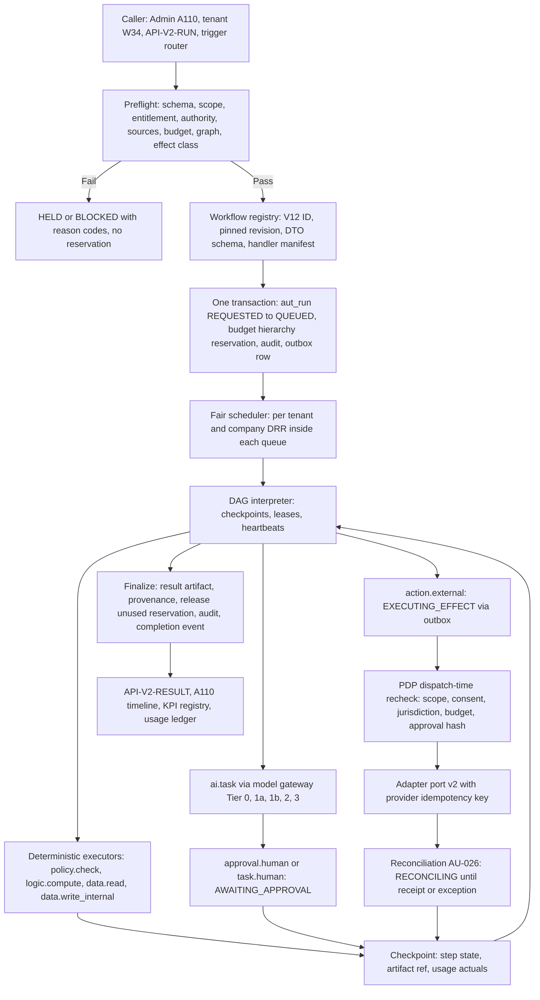
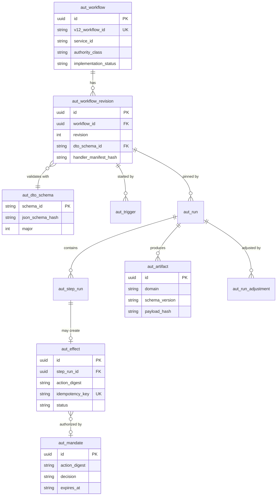
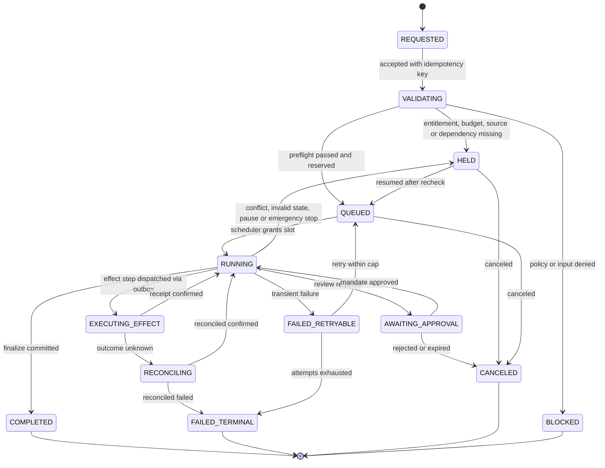
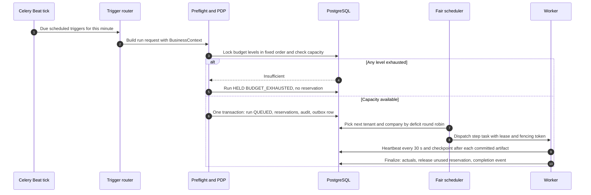

# AI Growth Engine: Employee Sales & Marketing Automation
## Application Blueprint: PART 11 (Batch 11.4b), V12 Executable Workflows SM-SVC-21…39: Common Engine, Workflow Registry, DTO Schemas, Step/Trigger/Event Registry and Scheduler

| Field | Value |
|---|---|
| Document | Part 11, Batch 4b of 4: the common executable-workflow contract that every one of the 76 workflows in Parts 11.4c/11.4d (and, by reference, the 80 workflows of SVC-01…20 in Part 11.3) runs on |
| Version | 1.0 · 28 Nov 2026 |
| Baseline | Part 2.2 §2.6 (E-1…E-9); Part 2.3 §2.27.14; Part 3.1 §3.1.4.6, ADR-027, ADR-028; Part 3.2 §3.2.3, §3.2.7; Part 3.3 ENT-159…169, UQ-IDEM-11…13; Part 3.4 §3.4.5.4 (execution policy, WQG-01…12, lease fencing); Part 7.4b §7.4.5.7.3 (NT13); DEC-051, DEC-064, DEC-321, DEC-384, DEC-418, DEC-421 |
| V12 sources | FSD ch12 preamble (V10, V6, V5, V4), ch13 (all), ch19 (all), App. B header and conventions, workbook common fields |
| New IDs | ADR-195…199 · DEC-561…570 (statements in §11.4.7, Part 11.4d) · FR-V12-D-001…028 (register in Part 11.4d §11.4.5.30) |
| Roles applied | Principal Workflow/BPM Architect, Event-driven Systems Architect, Principal Engineer, QA Architect, Data Architect, SRE Lead |

## 11.4.5 Enhancements (part 1 of 3): the common executable-workflow contract

### 11.4.5.1 Scope and design principles

| # | Principle | Source | Consequence |
|---|---|---|---|
| P1 | **One engine.** Every V12 workflow is a versioned definition interpreted by the existing M55 engine (Part 3.1 §3.1.4.6). No second runtime, no workflow-specific worker code paths | FSD ch12 V6 "one versioned definition per canonical workflow"; ADR-027 | V12 executor kinds become NT13 node types with registered handlers |
| P2 | **V12 IDs are canonical** for the service catalogue (`SM-SVC-##-WF#`, `…-STEP-##`); the blueprint's WF-01…39 stay as end-to-end journeys that compose V12 workflows | V12 brief rule 4 | DEC-560; mapping in §11.4.4.1 |
| P3 | **Stricter wins.** Where V12 and the blueprint differ on a control, the stricter rule applies; where V12 loosens a safety invariant, the invariant stands and a CONFLICT is raised | V11 brief invariants; V12 brief rule 5 | DEC-566, DEC-570; CONFLICT-814…819 |
| P4 | **Deterministic first.** Only steps of class "AI inference" call a model; arithmetic, dedupe, filters and state changes are registered functions | FSD ch12 V5; AI-01; Part 7.1 principle 1 | 164 of 231 steps make no model call |
| P5 | **Every effect through the outbox**, rechecked by the PDP at dispatch, idempotent, reconciled when uncertain | E-2…E-5; FSD ch19 V5 | The 10 effect steps are NT13-13 only |
| P6 | **Typed contracts at every boundary**: run input/output (App. B), step input/output (executor contracts), events (envelope v2) | FL-02, FL-03, REC-09 | DEC-562, DEC-563, DEC-565 |
| P7 | **Simulation equals production minus effects**: same definition, same preflight, provider simulator for NT13-13 | E-6; FL-07 | WQG-09 egress counter = 0 |
| P8 | **No new AI agents in this group.** Agent steps reuse AG-001…080; new agent IDs belong to groups F and M | V12 brief ID allocation | Gaps in agent coverage are noted for group F |

### 11.4.5.2 Architecture of the V12 executable-workflow layer (ADR-195)



**ADR-195 V12 executable workflows run on the M55 engine.** *Context:* V12 specifies 156 workflows with typed DTOs, 517 steps and seven executor kinds; the blueprint already has a DAG interpreter, NT13 node types, outbox and PDP. *Decision:* register every V12 workflow as an `aut_workflow` with an immutable `aut_workflow_revision` whose DAG uses only NT13 node types; bind every V12 step ID to one node and one registered handler; expose V12 API-V2-RUN/RESULT/APPROVAL/CANCEL as thin endpoints over `aut_run`. *Alternatives rejected:* a separate orchestration product (Temporal-class) — new operational surface for a 6-engineer team and a second state store; hand-coded Celery chains per workflow — violates DEC-051 (no code nodes) and BRL-AUT-02. *Consequences:* + one audit, budget and approval path for all 156 workflows; + V12 tests run against the same simulator; − the interpreter needs parallel branches (FR-V12-D-021) and the registry needs V12 metadata (§11.4.5.3). *Status:* Proposed (Customer revision V12).

### 11.4.5.3 Workflow registry (FR-V12-D-001, DEC-560, DEC-569)

**Registry columns added to `aut_workflow` (ENT-159) and `aut_workflow_revision`.**

| Table | Column | Type | Null | Constraint | Source |
|---|---|---|---|---|---|
| aut_workflow | `v12_workflow_id` | text | N | UNIQUE per product; CHECK `^SM-SVC-\d{2}-WF0[1-4]$` | FL-01 |
| aut_workflow | `service_id` | text | N | CHECK `^SM-SVC-\d{2}$`; FK service catalogue (Part 11.2) | BRD ch08/09 |
| aut_workflow | `historical_group` | text | Y | 20 labels (§11.4.4.5) | REC-08 |
| aut_workflow | `authority_class` | text | N | CHECK IN (R0, R1, R2, R3) | FSD ch12 |
| aut_workflow | `implementation_status` | text | N | CHECK IN (proposed, specified, built, tested, released, disabled_pending_founder, retired) | Workbook "Implementation and verification status" |
| aut_workflow | `semantic_version` | text | N | e.g. `2.0-target` | Workbook versions |
| aut_workflow_revision | `dto_schema_id` | text | N | `urn:sm:dto:<workflow>:v<n>`; FK `aut_dto_schema` | App. B |
| aut_workflow_revision | `handler_manifest` | jsonb | N | validates against §11.4.5.5.2; one entry per STEP ID | FL-03 |
| aut_workflow_revision | `control_links` | text[] | N | e.g. {AI-01, AI-02, AI-06, AI-12, AI-15, FL-01, FL-02, FL-03, FL-07, FL-09, FL-13, ST-04, ST-05, ST-06} | ch13 mapping |
| aut_workflow_revision | `kpi_ids` | text[] | N | KPI registry rows (FR-V12-D-027) | ch12 KPI |
| aut_workflow_revision | `channel_allowlist` | text[] | N | ch12 channel candidates | V4 guard "Channel" |
| aut_workflow_revision | `execution_policy` | jsonb | N | Part 3.4 §3.4.5.4 A schema | ADR-107 |

**Lifecycle.** `draft → validated (WQG-01…08) → tested (WQG-09/10 + all TC-V12-D archetype instances for the workflow pass) → approved (WQG-12, SoD) → active → deprecated → retired`. A workflow whose STEP IDs are not all present in the handler manifest cannot leave `validated` (FL-03). `disabled_pending_founder` is a terminal-until-decision state used for the 12 conflict workflows: the definition, DTO and tests exist, the PDP denies every run with rule `FOUNDER_DECISION_PENDING`.

**Templates (MT-29, MT-34, REC-05, FL-12).** A template is a versioned **parameter set** over one registered workflow revision: allowed values for configuration fields, default schedules, channel subset, thresholds and copy references. It never contains nodes. Applying a template to two businesses leaves the definition count unchanged (TC-V12-D-013). Publishing a template requires: the target workflow is entitled for the tenant, the template passed its simulation fixture, reviewer ≠ author.

**Migration and deprecation (D-CSV-009).** Stable IDs never change meaning; a material change creates a new revision; active runs keep their snapshot (BRL-AUT-03); a deprecation notice goes to subscribed tenants ≥ 30 days before retirement [RECOMMENDATION-830: 30 days, aligned with the 30-day renewal notice of FR-ENH-J-009]; entitlements are mapped to the successor before migration; no silent downgrade.



`aut_effect`, `aut_mandate`, `aut_artifact`, `aut_dto_schema` and `aut_run_adjustment` are the blueprint tables for V12 DB-V2-EFFECT, DB-V2-APPROVAL, DB-V2-ARTIFACT, the schema registry and the terminal-state adjustment; DB-V2-RUN and DB-V2-STEP map to `aut_run` and `aut_step_run`, DB-V2-INBOX/OUTBOX to `ops_inbox` (new) and `ops_outbox`, DB-V2-USAGE to the usage ledger (AU-042), DB-V2-EVIDENCE to `intel_evidence` (ENT-059) plus artifact evidence links. All are tenant-scoped with RLS (STD-S set) and the workflow-touched add-on (STD-W, `is_simulated`). Final DDL is owned by the data group (ASSUMPTION-827).

### 11.4.5.4 DTO schema registry and BusinessContext (DEC-565, ADR-198, GAP-824)

**Conventions adopted literally from App. B (schema v2).** JSON Schema 2020-12; `$id` = `urn:sm:dto:<workflow>:v2`; `$defs.input` and `$defs.output`; `additionalProperties: false`; references `string/uuid`; currency `^[A-Z]{3}$`; money `integer` minor units with `minimum 0`; revisions `integer minimum 1`; configured enums `string maxLength 64` with values from a versioned registry; arrays of `string|object` with `maxItems 500`; decimals as strings `^-?\d{1,14}(\.\d{1,4})?$`; free text `minLength 1, maxLength 4000`.

**Defects found and the v3 correction (GAP-824).**

| # | V12 v2 behaviour | Effect | v3 rule (additive, backward compatible for producers) |
|---|---|---|---|
| D1 | One schema per service; every output property is `required` for all four workflows | A workflow that does not compute, say, `allocation_ref` (SVC-21-WF01) can never emit a valid result | Per-workflow `x-produces` list (in each workflow card, Parts 11.4c/d); outputs not produced become `type: [T, "null"]`; produced outputs stay required and non-null |
| D2 | Arrays accept `string` or any `object` | Untyped payloads pass validation | `items` gets a typed `$ref` per field (`ref_item` = uuid string; `reason_code` = registry enum; `structured_item` with `additionalProperties: false`) |
| D3 | `risk_score`, `confidence`, `error_metric` are enum bands only | Calibration and error KPIs (e.g. "forecast error tracked", "calibrated risk") cannot be computed from the result | Optional numeric companions `risk_value`, `confidence_value` (0–1) and `error_value` (≥ 0) |
| D4 | `interval` object has no `additionalProperties: false` | Extra keys pass | Closed object |
| D5 | Catalogue publication (SVC-28-WF01) has no output field for the published version | Result cannot be referenced | Add optional `catalog_version_ref` (uuid) to the SVC-28 schema |

**Money at the boundary (RECOMMENDATION-829).** Workflow DTOs carry `*_minor` int64 plus `currency`; REST resources keep ADR-030 decimal strings. Conversion is exact: `minor = amount × 10^exponent(currency)` using ISO 4217 exponents (INR 2); a value that is not an exact multiple is rejected with `AMOUNT_PRECISION`. Ledger storage stays `numeric(18,4)` (Part 3.3).

**Enum registry.** Table `aut_enum_value (registry_name, value, label_key, ordinal, valid_from, valid_to)`; enums used in SVC-21…39: `reconciliation_state`, `readiness_state`, `risk_score`, `confidence`, `error_metric`, `review_state`, `disposition`, `qa_state`, `rights_state`, `target_language` (DEC-026 locales), `mandate_state`, `decision_state`, `severity`, `sla_state`, `activation_state`, `delivery_state`, `eligibility_state`, `suppression_state`. Proposed values are in each DTO table of Parts 11.4c/d; values are configuration, not code.

**BusinessContext v1 (FSD ch12 V6).** Stored on every run as `aut_run.business_context` and hashed into the idempotency key:

```json
{
  "$schema": "https://json-schema.org/draft/2020-12/schema",
  "$id": "urn:sm:ctx:business-context:v1",
  "type": "object",
  "additionalProperties": false,
  "required": ["tenant_id", "company_id", "service_id", "workflow_id", "workflow_version", "actor_ref", "policy_snapshot_ref"],
  "properties": {
    "tenant_id": {"type": "string", "format": "uuid"},
    "organization_ref": {"type": ["string", "null"], "format": "uuid"},
    "company_id": {"type": "string", "format": "uuid", "$comment": "blueprint startup_id (ASSUMPTION-825)"},
    "division_ref": {"type": ["string", "null"], "format": "uuid"},
    "brand_ref": {"type": ["string", "null"], "format": "uuid"},
    "offering_ref": {"type": ["string", "null"], "format": "uuid"},
    "target_market": {"type": ["string", "null"], "maxLength": 64},
    "account_ref": {"type": ["string", "null"], "format": "uuid"},
    "configuration_ref": {"type": ["string", "null"], "format": "uuid"},
    "config_revision": {"type": ["integer", "null"], "minimum": 1},
    "sku_id": {"type": ["string", "null"], "maxLength": 64},
    "service_id": {"type": "string", "pattern": "^SM-SVC-\\d{2}$"},
    "workflow_id": {"type": "string", "pattern": "^SM-SVC-\\d{2}-WF0[1-4]$"},
    "workflow_version": {"type": "integer", "minimum": 1},
    "actor_ref": {"type": "string", "format": "uuid"},
    "policy_snapshot_ref": {"type": "string", "format": "uuid"}
  }
}
```

**Validation flow.** API-V2-RUN validates `input` against the pinned revision's schema (field errors returned as `422` with JSON pointers, FL-02); every step validates its own output contract (§11.4.5.5); finalize validates the run result against the v3 output projection. Schemas are immutable once published; a CI job re-validates all 156 schemas against the 2020-12 meta-schema and the v3 rules on every change (TC-V12-D-002).

**Example: SM-SVC-21-WF02 v3 output projection** (produces `allocation_ref`, `balance_minor`, `reconciliation_state`; `discrepancy_refs` nullable):

```json
{
  "$id": "urn:sm:dto:SM-SVC-21-WF02:v3",
  "$defs": {
    "output": {
      "type": "object", "additionalProperties": false,
      "x-produces": ["allocation_ref", "balance_minor", "reconciliation_state"],
      "required": ["allocation_ref", "balance_minor", "discrepancy_refs", "reconciliation_state"],
      "properties": {
        "allocation_ref": {"type": "string", "format": "uuid"},
        "balance_minor": {"type": "integer", "minimum": 0},
        "discrepancy_refs": {"type": ["array", "null"], "maxItems": 500, "items": {"$ref": "#/$defs/ref_item"}},
        "reconciliation_state": {"type": "string", "maxLength": 64, "$comment": "registry reconciliation_state"}
      }
    },
    "ref_item": {"type": "string", "format": "uuid"}
  }
}
```

### 11.4.5.5 Step executor contracts and handler manifest (DEC-562, RECOMMENDATION-828)

#### 11.4.5.5.1 V10 typed node patterns ↔ NT13 node types

| V10 pattern (ch13) | Input → output | Effect boundary | NT13 type | Blueprint handler examples |
|---|---|---|---|---|
| Trigger | Event envelope → validated event | No effect | NT13-01 / 02 / 03 | Trigger router |
| Filter | Typed record + predicate → eligible or held | No effect | NT13-06 `logic.condition` | Sandboxed expression (DEC-051) |
| Research | Permitted query + source rights → evidence refs | Read only | NT13-04 `data.read` | AU-007, AU-005, AG-003 plan |
| Extract | Evidence ref + schema → typed candidate | No effect | NT13-08 `ai.task` | AG-004, AG-023, AG-024 |
| Deduplicate | Scoped identity + key → canonical ref | No effect | NT13-07 `logic.dedupe` | AU-015, AU-074 |
| Score | Rubric + evidence → score and explanation | No effect | NT13-07 `logic.score` (+ NT13-08 explanation) | AU-017, AU-093 |
| Route | Scope + decision → next step | No effect | NT13-06 | Routing rules (AU-081) |
| Draft | Approved context + prompt → versioned draft | No effect | NT13-08 | AG-011, AG-018, AG-020 |
| Validate | Candidate + policy → validation evidence | No effect | NT13-09 `policy.check` | AU-009, AU-012 claims, AU-003 schema |
| Approve | Exact digest + mandate → reviewer decision | No effect | NT13-10 `approval.human` | CA-APPROVE; mandates §11.4.5.5.5 |
| Dispatch | Authorized intent + key → uncertain or receipt | External effect via gateway | NT13-13 `action.external` | Outbox + AU-009 + adapters |
| Reconcile | Intent + receipt → matched or exception | Controlled state update | NT13-07 subtype **`logic.reconcile`** (new, side-effect class W1) | AU-026, AU-037 |
| Wait / stop | Checkpoint + stop condition → held or resumed | No effect | NT13-12 `wait.timer` | Timers polled by Beat (ADR-028) |

The V10 text says these are "not claimed to be the original historical 13 node definitions"; the blueprint NT13 list was also derived because the source pack gave no names (Part 7.4a F38-003). NT13 stays the canonical published list; the V10 patterns are its documented semantics.

#### 11.4.5.5.2 Handler manifest (one entry per STEP ID)

```json
{
  "$id": "urn:sm:engine:handler-manifest-entry:v1",
  "type": "object", "additionalProperties": false,
  "required": ["step_id", "executor", "node_type", "handler_ref", "input_contract", "output_contract", "timeout_s", "retry_class", "max_attempts", "side_effect_class", "failure_route", "tests"],
  "properties": {
    "step_id": {"type": "string", "pattern": "^SM-SVC-\\d{2}-WF0[1-4]-STEP-\\d{2}$"},
    "executor": {"enum": ["policy_validation", "identity_reconciliation", "domain_service", "domain_agent", "rules_analytics", "effect_adapter", "evidence_ingestion"]},
    "node_type": {"type": "string", "pattern": "^NT13-(0[1-9]|1[0-3])$"},
    "handler_ref": {"type": "string", "$comment": "AG-###, AU-###, module.service or adapter port ID"},
    "input_contract": {"type": "string"}, "output_contract": {"type": "string"},
    "timeout_s": {"type": "integer", "minimum": 1, "maximum": 86400},
    "retry_class": {"enum": ["validation", "transient_read", "throttle", "uncertain_write", "model_transient", "none"]},
    "max_attempts": {"type": "integer", "minimum": 1, "maximum": 3},
    "side_effect_class": {"enum": ["none", "internal", "external"]},
    "reversibility": {"enum": ["not_applicable", "reversible", "compensable", "irreversible"]},
    "confidence_floor": {"type": ["number", "null"], "minimum": 0, "maximum": 1},
    "context_budget_tokens": {"type": ["integer", "null"], "maximum": 100000},
    "model_tier_policy": {"type": ["string", "null"], "enum": ["tier0_only", "tier1a", "tier1b", null]},
    "tier2_eligible": {"type": "boolean", "default": false},
    "approval_role": {"type": ["string", "null"]},
    "failure_route": {"type": "object", "additionalProperties": false, "required": ["code", "run_state"],
      "properties": {"code": {"enum": ["POLICY_DENIED", "CONFLICT", "INVALID_STATE", "REVIEW_REQUIRED", "INVALID_METRIC", "EFFECT_UNKNOWN", "SOURCE_DENIED"]},
                     "run_state": {"enum": ["BLOCKED", "HELD", "AWAITING_APPROVAL", "RECONCILING"]}}},
    "tests": {"type": "array", "minItems": 1, "items": {"type": "string"}}
  }
}
```

`tier2_eligible` defaults to `false` and may be `true` only when every input field is Public or Internal-non-personal (DEC-418; V11 invariant). None of the 231 steps in SVC-21…39 qualifies, because every workflow handles tenant-confidential or personal data.

#### 11.4.5.5.3 Engine defaults (FSD-POL-V6-PRECHECK adopted)

| Item | Default | Bound | Source |
|---|---|---|---|
| Step idempotency key | `sha256(tenant_id ‖ company_id ‖ run_id ‖ workflow_version ‖ step_id ‖ target_digest)` | Unique per (tenant, company) on `aut_step_run`/`aut_effect` | FSD-POL-V6-PRECHECK; UQ-IDEM-11 |
| Read / evidence timeout | 30 s | ≤ 120 s per adapter | FSD-POL-V6-PRECHECK |
| AI step timeout | 90 s | ≤ 180 s | FSD-POL-V6-PRECHECK; Part 7.3 |
| Provider effect timeout | Per verified adapter (Part 3.2 §3.2.7) | — | FSD-POL-V6-PRECHECK |
| Safe retries | ≤ 3 attempts, exponential backoff with full jitter, honour `Retry-After` | BRL-AUT-06 | ST-06 |
| Uncertain writes | Never replayed; RECONCILING until receipt or exception | E-5 | ST-05 |
| Long-running media or calls | Asynchronous: submit, then poll or signed callback; the step waits in AWAITING_EXTERNAL (sub-state of RUNNING) | Run deadline (execution policy) | FSD-POL-V6-PRECHECK |
| Finalize | Persist accepted output ref, provenance, step states, effect receipt, usage actuals; release unused reservation; append audit | One transaction | FSD-POL-V6-PRECHECK |
| Artifact rule | Typed artifact schema; fields needing relational constraints, ledgers, uniqueness, joins or retention are normalized before production; no JSON replacement of accounting or identity | — | FSD-POL-V6-ARTIFACT |

#### 11.4.5.5.4 Run preflight order (FR-V12-D-007)

| # | Check | Failure → state, reason code |
|---|---|---|
| 1 | Authenticated actor or verified trigger; scope resolved from membership (E-1) | BLOCKED `SCOPE_DENIED` |
| 2 | Workflow active, revision pinned, not `disabled_pending_founder` | BLOCKED `WORKFLOW_NOT_ACTIVE` / `FOUNDER_DECISION_PENDING` |
| 3 | Released entitlement for the service in this company (SKU) | HELD `ENTITLEMENT_MISSING` |
| 4 | Input valid against DTO schema | BLOCKED `INPUT_INVALID` (422 with field pointers) |
| 5 | Authority: actor role may request this R-class; mode allowed (live, dry_run, simulation) | BLOCKED `AUTHORITY_DENIED` |
| 6 | Connector and source rights for every evidence and effect step (AU-007, adapter registry) | HELD `SOURCE_DENIED` / `CONNECTOR_MISSING` |
| 7 | Dependency graph: child workflows entitled or equivalent input supplied (FL-10) | HELD `DEPENDENCY_UNMET` |
| 8 | Effect class: every effect step has an approval binding and eligibility rule set (WQG-04/05) | BLOCKED `EFFECT_UNBOUND` |
| 9 | Budget hierarchy reservation (tenant → company → offering → service → workflow) in money and units | HELD `BUDGET_EXHAUSTED` |

`dry_run` stops after step 9 without reserving (FL-07): it returns the plan, the estimated cost and the would-be holds, with zero provider calls.

#### 11.4.5.5.5 Approval mandates (FL-09) and confidence routing (FL-08, FL-13)

| Mandate field (`aut_mandate`) | Rule |
|---|---|
| `actor_id`, `role` | Approver holds the role named in the handler manifest; approver ≠ requester (CA-APPROVE) |
| `resource_ref`, `action`, `action_digest` | SHA-256 of the canonical JSON of the exact payload; any change voids the mandate |
| `amount_minor`, `currency` | Required for R3; must not exceed the DEC-038 threshold of the approver |
| `policy_version` | PDP policy revision at approval; a stricter revision at dispatch forces re-approval |
| `expires_at` | Simulation 15 minutes (V12 V4 sample); production defaults: R2 promotional 72 h, R2 transactional 24 h (Part 3.4 §3.4.5.2 D), R3 24 h; configurable shorter only |
| `revoked_at` | Revocation blocks every effect not yet dispatched |
| `scope` | One run step (L1). V12 "L3 bounded mandates" covering many future actions are **not created** (CONFLICT-814) |

**Confidence routing.** Each `ai.task` step declares `confidence_floor` (default 0.80 for classification, 0.70 for extraction, not applicable to free-text drafts, which always go to review). Below the floor, or on schema/claims failure (AU-003, AG-012), the step routes to `approval.human` with reason `LOW_CONFIDENCE`; it never proceeds to an effect. Every accepted AI output stores an acceptance record: schema valid, evidence refs, confidence, policy check, evaluator version (FL-13).

**Cancellation and compensation (FL-11).** API-V2-CANCEL moves the run to CANCELED: unstarted steps are skipped; reservations are released; an effect step that is `reversible` is compensated only if an approved compensation action exists (for example withdraw a scoped portal grant); `irreversible` or uncertain effects go to RECONCILING and an owner task; nothing is compensated without authorization.

### 11.4.5.6 Trigger and event registry (DEC-563, DEC-564, ADR-196, GAP-822, GAP-823)

#### 11.4.5.6.1 Canonical event envelope v2

```json
{
  "$schema": "https://json-schema.org/draft/2020-12/schema",
  "$id": "urn:sm:event:envelope:v2",
  "type": "object", "additionalProperties": false,
  "required": ["event_id", "event_type", "schema_version", "tenant_id", "company_id", "occurred_at", "received_at", "correlation_id", "idempotency_key", "payload_ref"],
  "properties": {
    "event_id": {"type": "string", "format": "uuid"},
    "event_type": {"type": "string", "pattern": "^[a-z]+(\\.[a-z0-9_]+){2,3}$"},
    "schema_version": {"type": "integer", "minimum": 1},
    "product": {"const": "commercial"},
    "tenant_id": {"type": "string", "format": "uuid"},
    "company_id": {"type": "string", "format": "uuid"},
    "service_id": {"type": ["string", "null"], "pattern": "^SM-SVC-\\d{2}$"},
    "workflow_id": {"type": ["string", "null"], "pattern": "^SM-SVC-\\d{2}-WF0[1-4]$"},
    "workflow_version": {"type": ["integer", "null"], "minimum": 1},
    "run_id": {"type": ["string", "null"], "format": "uuid"},
    "actor_ref": {"type": "object", "additionalProperties": false, "required": ["type", "id"],
                  "properties": {"type": {"enum": ["user", "service", "agent", "provider", "external_agent"]}, "id": {"type": "string"}}},
    "source_ref": {"type": ["string", "null"], "maxLength": 200},
    "occurred_at": {"type": "string", "format": "date-time"},
    "received_at": {"type": "string", "format": "date-time"},
    "correlation_id": {"type": "string", "format": "uuid"},
    "causation_id": {"type": ["string", "null"], "format": "uuid"},
    "idempotency_key": {"type": "string", "maxLength": 200},
    "policy_version": {"type": ["integer", "null"], "minimum": 1},
    "approval_ref": {"type": ["string", "null"], "format": "uuid"},
    "payload_ref": {"type": "string", "maxLength": 500, "$comment": "reference or digest; no Restricted values (Part 3.2)"}
  }
}
```

| Rule | Specification |
|---|---|
| Tenant and company | Derived from trusted authentication or the verified connector mapping, never from the event body (E-1); mismatch → reject `SCOPE_MISMATCH` |
| Uniqueness | `UNIQUE (tenant_id, event_id)` on `ops_inbox` and `ops_domain_event`; provider events also `UNIQUE (connection_id, provider_event_id)` |
| Version | Consumers declare accepted `schema_version` range; out of range → dead-letter with `SCHEMA_UNSUPPORTED` |
| Aliases | For one schema major, producers also emit Part 3.2 names (`id`, `type`, `startup_id`, `data`); consumers read either |
| Product constant | `product = "commercial"` (Part 3.4 §3.4.5.2 E; CONFLICT-326 history) |

**`ops_inbox` (new, symmetric to `ops_outbox`).** Columns: `tenant_id`, `event_id`, `event_type`, `source` (webhook, internal, child_workflow), `connection_id`, `payload_ref`, `state` ∈ {received, verified, routed, rejected, dead_letter}, `attempts ≤ 10`, `next_attempt_at`, `correlation_id`, `lease_token`, `received_at`. Weekly partitions, 30-day retention after routing (as `ops_outbox`). The trigger router claims rows with `FOR UPDATE SKIP LOCKED`, matches enabled triggers, and creates at most one run per (trigger, event) (UQ-IDEM-12).

#### 11.4.5.6.2 Trigger kinds and `aut_trigger` changes (DEC-564)

| Kind | V12 rule | NT13 | `aut_trigger` columns (new in bold) | Test |
|---|---|---|---|---|
| `manual` | Authenticated user, released entitlement, typed inputs | 03 | `allowed_roles`, **`input_schema_id`** | TC-V12-D-017 |
| `scheduled` | IANA time zone + UTC next execution; per-tenant concurrency; misfire skip or reschedule, never burst | 02 | `schedule_cron`, `timezone`, `next_fire_at` (UTC), **`misfire_policy` ∈ {skip, reschedule_once}**, **`max_concurrent_runs`**, **`quiet_window`** | TC-V12-D-016 |
| `event` | Verified inbox, schema/version, causal correlation, dedup | 01 | `event_type`, `event_schema_version`, `condition`, `dedup_window_s` | TC-V12-D-010 |
| `provider_callback` | Signature, timestamp, replay check, account mapping, monotonic state, reconciliation | 01 (subtype) | `credential_ref_id`, **`replay_window_s` (default 300)**, **`monotonic_field`** | TC-V12-D-010 |
| `child_workflow` | Explicit registered dependency; optional upstream input; bounded depth; cycle detection | 01 (subtype) | **`parent_workflow_id`**, **`input_mapping`** (typed JSON pointers), **`max_depth` (3)** | TC-V12-D-011 |

REC-01 draft fields added to `aut_trigger`: **`requester_id`**, **`reviewer_id`** (≠ requester), **`test_evidence_ref`** (simulation run with zero egress), `revision`. State machine unchanged (`draft → tested → enabled → paused → retired`); `enabled` requires `tested` and reviewer approval. Misfire: Beat's minute tick computes due triggers; if `now − next_fire_at > grace` (default 15 min) then `skip` records `MISFIRE_SKIPPED`, `reschedule_once` runs once and records `MISFIRE_RECOVERED`; never more than one catch-up run per trigger (replaces AU-028 "recover once" wording with the same effect).

#### 11.4.5.6.3 Event types for SVC-21…39 (GAP-822)

V12 says only "validated upstream business event". The registry defines, per workflow: `sm.svc<nn>.wf0<n>.requested` (manual/API), and the run lifecycle events `sm.svc<nn>.wf0<n>.completed | held | blocked | failed | canceled`. The upstream blueprint domain events (Part 3.2 §3.2.3.3) that may start each service are:

| Service | Consumed domain events (trigger kind `event`) | Child-workflow producers (workbook "optional input producers") |
|---|---|---|
| SVC-21 | `finance.invoice.issued`, `finance.payment.received`, `finance.payment.verified`, `finance.discrepancy.raised` | SVC-20 |
| SVC-22 | `crm.deal.won`, `commerce.contract.legal_approved`, `lifecycle.onboarding.started`, `lifecycle.pilot.stage_changed` | SVC-18, SVC-20 |
| SVC-23 | `lifecycle.renewal.due`, `crm.deal.lost`, `lifecycle.case.created` | SVC-22, SVC-05 |
| SVC-24 | `crm.deal.won`, `marketing.attribution.recorded`, `finance.payment.verified` | SVC-05, SVC-14, SVC-21 |
| SVC-25 | `knowledge.document.scanned`, `knowledge.document.indexed`, `catalog.claim.approved` | none |
| SVC-26 | `engagement.inbound.received` (voice), `engagement.meeting.booked` | SVC-07, SVC-09, SVC-10 |
| SVC-27 | `marketing.content.approved`, `marketing.campaign.approved` | SVC-11, SVC-12, SVC-14 |
| SVC-28 | `catalog.offering_version.approved`, `catalog.price_version.approved`, `ops.webhook.received` (external agent) | SVC-15, SVC-17, SVC-18, SVC-20, SVC-21 |
| SVC-29 | `intelligence.opportunity.qualified`, `intelligence.organization.upserted`, `crm.deal.transitioned` | SVC-02, SVC-03, SVC-04, SVC-05, SVC-08 |
| SVC-30 | `web.publication.published`, `marketing.campaign.approved` | SVC-13, SVC-14, SVC-15, SVC-24 |
| SVC-31 | `catalog.price_version.approved`, `commerce.inventory.reserved`, `ops.webhook.received` (marketplace) | SVC-15, SVC-20, SVC-21, SVC-24 |
| SVC-32 | `marketing.referral.decided`, `crm.deal.created`, `lifecycle.deployment.stage_changed` | SVC-02, SVC-16, SVC-22, SVC-24 |
| SVC-33 | `engagement.inbound.received`, `lifecycle.case.created`, `engagement.chat.handover_requested` | SVC-09, SVC-22, SVC-23, SVC-25 |
| SVC-34 | `saas.usage.threshold_reached`, `saas.subscription.changed`, product events via ADR-105 | SVC-04, SVC-15, SVC-22, SVC-23, SVC-24 |
| SVC-35 | `intelligence.research_run.completed` (review sources), `governance.compliance_incident.opened` | SVC-01, SVC-12, SVC-23 |
| SVC-36 | `catalog.claim.approved`, `commerce.objection.recorded` | SVC-09, SVC-10, SVC-17, SVC-25 |
| SVC-37 | `catalog.price_version.approved`, `commerce.quote.approved` | SVC-14, SVC-17, SVC-24 |
| SVC-38 | `engagement.optout.received`, `engagement.message.delivered`, `ops.webhook.received` (SMS DLR) | SVC-06, SVC-07, SVC-08, SVC-09 |
| SVC-39 | `commerce.order.approved`, `commerce.fulfilment.recorded`, `finance.invoice.issued` (payable) | SVC-02, SVC-17, SVC-20, SVC-21 |

A child trigger fires only if the child service is entitled for the company, or the parent passes an equivalent authorized input (FL-10); otherwise the child run is HELD `DEPENDENCY_UNMET` and the parent continues (TC-V12-D-011).

#### 11.4.5.6.4 Default schedules for "scheduled" triggers (GAP-823, RECOMMENDATION-830)

64 of the 76 workflows accept a scheduled trigger; V12 gives no cadence. Defaults below are tenant-editable within policy (RT-08); all times in the company's IANA zone; quiet hours from CFG apply to any effect.

| Pattern | Default cadence | Applies to |
|---|---|---|
| Monitoring / anomaly / risk (WF04 family, reputation, SLA, suppression) | Daily 02:15 local; SLA monitors every 15 min within business hours | SVC-21-WF04, 22-WF04, 23-WF04, 24-WF04, 25-WF04, 29-WF04, 30-WF04, 31-WF04, 32-WF04, 33-WF03, 33-WF04, 34-WF01, 35-WF01, 35-WF03, 37-WF04, 38-WF04, 39-WF04 |
| Synchronisation with a provider | Hourly at minute 17 (offset to avoid :00 pile-ups) | SVC-31-WF01…03, SVC-38-WF03 |
| Reporting / review | Weekly Monday 06:30 local | SVC-21-WF03, 24-WF01…03, 30-WF01, 32-WF01, 35-WF04, 36-WF04, 37-WF01 |
| Reminder calculation | Daily 07:45 local | SVC-22-WF03, SVC-23-WF01, SVC-25-WF03 |
| All others with a scheduled option | Off by default (manual or event only) | Remaining workflows |

### 11.4.5.7 Run and step state model v2 (DEC-561, ADR-197)



| Blueprint state (Part 2.3 §2.27.14, `aut_run.state`) | V12 state(s) | Note |
|---|---|---|
| pending | REQUESTED, VALIDATING, QUEUED | Split so preflight holds and scheduler waits are visible (REC-02) |
| running | RUNNING | — |
| waiting | AWAITING_APPROVAL (approval) or RUNNING with `wait_reason` (timer) | Timers keep RUNNING with `wait_reason = timer` |
| (none) | EXECUTING_EFFECT | New: an effect is in flight |
| held, paused | HELD with `hold_reason` ∈ {conflict, invalid_state, paused, emergency_stop, entitlement, budget, source, dependency, founder_decision_pending} | V12 V4: "pause moves active runs to Held" |
| reconciling | RECONCILING | — |
| failed | FAILED_RETRYABLE or FAILED_TERMINAL | — |
| (none) | BLOCKED | Terminal policy denial with no reservation |
| succeeded | COMPLETED | — |
| cancelled | CANCELED | Spelling follows V12 |

**Transition guard.** `UPDATE aut_run SET state = :to, version = version + 1 … WHERE id = :id AND version = :expected AND state = :from` (optimistic version); zero rows → `409 STATE_CONFLICT`. Terminal states (COMPLETED, FAILED_TERMINAL, CANCELED, BLOCKED) are immutable; a reconciliation finding after termination creates an `aut_run_adjustment` (append-only: reason, effect_id, before/after digest, approver R08 for money or R11 otherwise), never an update. Step states use the same names minus QUEUED/VALIDATING. Migration: `aut_run.state` CHECK is replaced; a view `v_aut_run_state_legacy` keeps the old names for reports RP-22 and KPI-19/20 until they are regenerated.

**A110 run timeline (REC-02, FR-V12-D-018).** Per run: business context, pinned revision, current node, wait/hold reason, per-step state with attempt, reservation (money and units) and actual (`known`/`unknown`/`not_applicable`), approval mandate status and expiry, effect receipts and reconciliation status, and the cancellation/retry actions the viewer may take. Two concurrent runs never share mutable context; each shows only its own steps.

### 11.4.5.8 Scheduler and execution control (ADR-199, RECOMMENDATION-830)

| Component | Specification | Source |
|---|---|---|
| Beat tick | One active Celery Beat per environment (DEC-321 leader lock); a 1-minute tick computes due `scheduled` triggers and timer wakes and inserts outbox rows; Beat itself does no business work | ADR-028; DEC-421 (AWS ap-south-1) |
| Queues | DEC-321 canonical queues; V12 executor → queue: policy/identity/rules/domain service → `transactional`; domain agent → `ai`; evidence → `research`; effect → `communication` or `financial`; reconcile → `financial` | DEC-321 |
| Fair share inside a queue | Weighted deficit round robin over active (tenant, company) pairs: quantum 1 task × weight (plan weight 1/2/4 by SaaS plan tier [RECOMMENDATION-830]); a pair with no deficit waits; a pair's in-flight cap = min(plan cap, 20 runs per startup, Part 3.1) | MT-28; ST-03 |
| Provider bulkheads | Unchanged per-provider caps (Part 3.2 §3.2.7.3) plus a per-(provider, tenant) cap of 50% of the provider bulkhead so one tenant cannot hold every slot | ST-03; IP-09 |
| Budget hierarchy | Levels: tenant aggregate (DEC-008 ceiling) → company → offering → service → workflow; each level has money cap, unit cap (workbook pilot limits), currency, period (calendar month), time zone; reservation succeeds only if every level has capacity | MT-30 |
| Atomic reservation | Single transaction: `SELECT … FROM budget_line WHERE id = ANY(:levels) FOR UPDATE` in fixed order (tenant first) to avoid deadlocks; check remaining ≥ estimate at every level; insert one `budget_reservation` row per level; commit with the run row and outbox row (E-2) | MT-30; AU-002 |
| Parallel DAG | New control nodes `parallel` (fan-out ≤ 4 branches) and `join` (all, any, n-of-m) for steps with side-effect class `none` only; effects stay sequential; cancel of the run cancels open branches; join waits on dependency results | FL-06 |
| Schedule controls | Tenant R12 may pause/resume a trigger, change cadence within the template's allowed set, set preference windows; consent, quiet hours, caps and emergency stop still apply | RT-08 |
| Heartbeats | Worker heartbeat every 30 s on `aut_step_run.heartbeat_at`; reaper (every minute) reclaims steps after 3 missed beats by bumping the fencing token; a reclaimed step with an external call in flight moves to RECONCILING, otherwise re-queues | V4 liveness; Part 3.4 lease fencing |
| Dead letters | Unchanged (DEC-321); DLQ items create an owner task in A110 and an AG-028 triage summary | NFR-016 |
| Usage metering | Each completed run writes one usage row per unit (workbook "per invoice/receipt record", "per call minute" …) to the AU-042 ledger with the actual cost | DB-V2-USAGE |



**Parameters (proposed, tunable by R11 within bounds).** DRR quantum 1; plan weights 1/2/4; per-tenant in-flight cap per queue 10 (pilot); provider per-tenant cap 50%; misfire grace 15 min; heartbeat 30 s; reaper threshold 90 s; parallel fan-out ≤ 4; child depth ≤ 3. Acceptance: noisy-tenant fixture (TC-V12-D-019), two-level budget exhaustion fixture (TC-V12-D-020), parallel join and cancel fixture (TC-V12-D-021).

### 11.4.5.9 Authority mapping: V12 L0–L4 and R0–R3 to blueprint L0–L3 (DEC-566)

| V12 authority | V12 meaning (BRD ch18) | Blueprint equivalent | Allowed for V12 risk class |
|---|---|---|---|
| L0 | Manual action recorded | Human action logged; no AI | All |
| L1 | AI proposes or drafts; human decides | L0 suggest / L1 draft for approval | All |
| L2 | Exact approved action with reviewer, expiry and limits | **L1** approval of the exact payload hash (mandate §11.4.5.5.5), then the engine dispatches that single item (DEC-064 "L1 then L2 dispatch") | R1, R2, R3 (R3 default) |
| L3 | Bounded routine actions under approved mandate, scope, expiry and caps | **L3** within caps only for the DEC-064 routine set (replies from approved FAQ, eligible follow-ups, reminders) and registered deterministic internal steps | R0 (read/draft), R1 (deterministic internal), R2 routine only. **Not for R3** (CONFLICT-814) |
| L4 | Adaptive orchestration inside L3 constraints; never expands authority | Supervisor-as-planner (ADR-110, DEC-384): AG-039 proposes, AU-053 validates, engine executes | Planning only; inherits the cap of each step |

| V12 risk class | Meaning | Blueprint maximum autonomy | Approval binding |
|---|---|---|---|
| R0 | Internal analysis / draft | L1 (drafts); L3 for deterministic analytics | None for analytics; review before any use outside the workspace |
| R1 | Scoped state write or safety control | L1; L3 for registered deterministic internal actions; L2 only for the DEC-407 protective set | Owner role per workflow |
| R2 | External communication / provider / access write | L1 approval of the exact payload, L2 dispatch; L3 only for the DEC-064 routine set within caps | Mandate per item or per approved template revision |
| R3 | Financial / legal / commitment | **L1 maximum**; money movement not supported (DEC-064) | Mandate per item with amount and DEC-038 threshold; maker-checker for finance (R08/R09) |

**Stricter-wins examples.** SVC-23-WF01 renewal reminders: DEC-064 allows L3 within caps; V12 classifies R2 "L2 mandatory approved effect", so reminders need template-level approval of the exact message revision (stricter, adopted). SVC-21-WF02 partial payment allocation: V12 offers "L3 with separately approved bounded mandate"; DEC-064 caps finance at L1 (stricter, retained; CONFLICT-814).

## Quality gate: Batch 11.4b

| # | Check | Result | Notes and fixes applied |
|---|---|---|---|
| 1 | Every requirement traced to a source | Pass | Each table row cites the V12 control (REC-, FL-, ST-, MT-, RT-, AI-) and the blueprint element it extends |
| 2 | Assumptions, gaps, conflicts tagged and logged | Pass | GAP-822/823/824, RECOMMENDATION-828/829/830, ASSUMPTION-825/827, CONFLICT-814 used; register in Part 11.4d |
| 3 | IDs unique and consistent | Pass | ADR-195…199, DEC-561…570 within range; NT13 and DEC-321 queue names reused unchanged |
| 4 | No story lacks AC and no requirement lacks a test | Pass | FR-V12-D-001…028 each map to TC-V12-D tests (Part 11.4d §11.4.5.30–32) |
| 5 | Negative, edge, security, accessibility cases | Pass | Preflight denials, misfire, replay, stale mandate, noisy tenant, budget exhaustion, heartbeat loss, terminal adjustment covered |
| 6 | Agents have guardrail, fallback, KPI, cost | N/A | No new agents |
| 7 | Time-sensitive facts flagged | Pass | No prices in this file; queue and hosting facts cite DEC-321/DEC-421 |
| 8 | No restricted data to free tiers | Pass | `tier2_eligible` defaults false; none of the 231 steps qualifies |
| 9 | Consistent with earlier parts | Pass | Extends E-1…E-9, ADR-027/028, ENT-159…169, WQG-01…12; legacy state view keeps RP-22 and KPI-19/20 working |

**Status: Part 11 Batch 11.4b complete. Common contract for all V12 executable workflows specified: registry, DTO v2/v3, 7 executor contracts, envelope v2, 5 trigger kinds, run state model v2, fair scheduler and budget hierarchy, authority mapping.**
