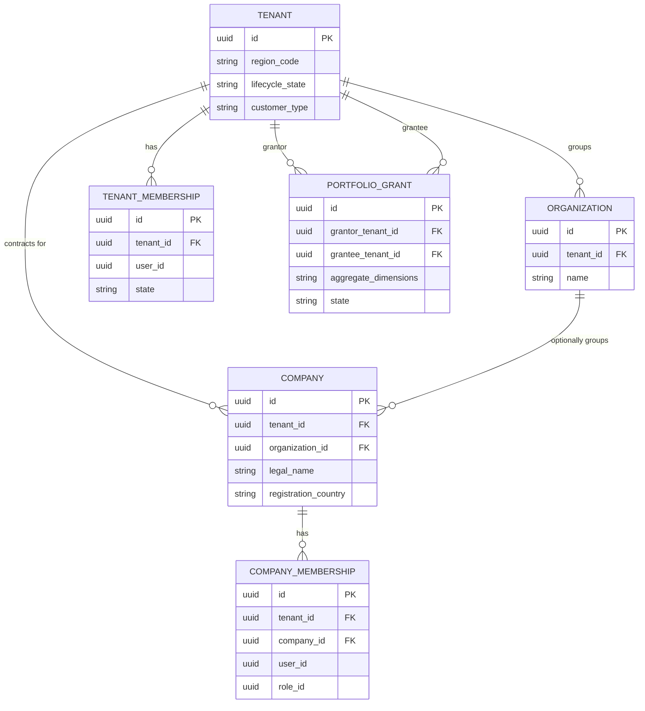
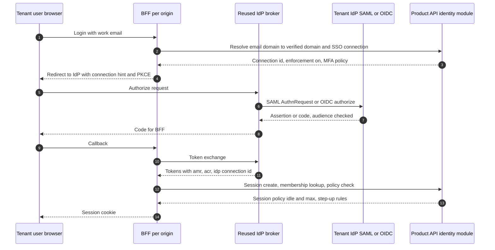
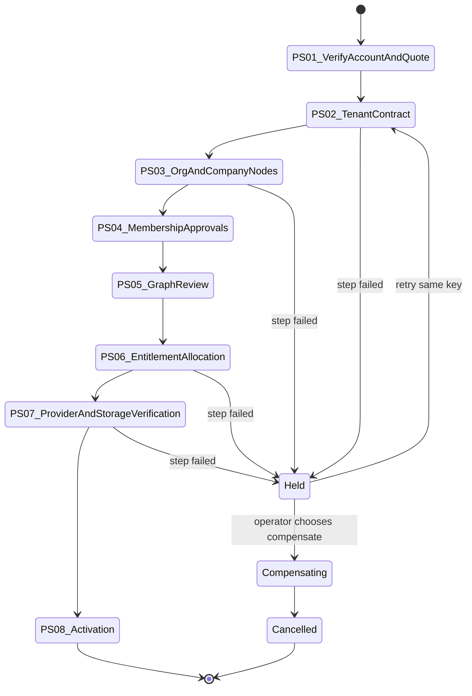
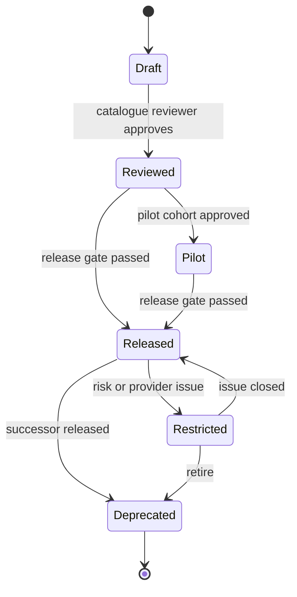
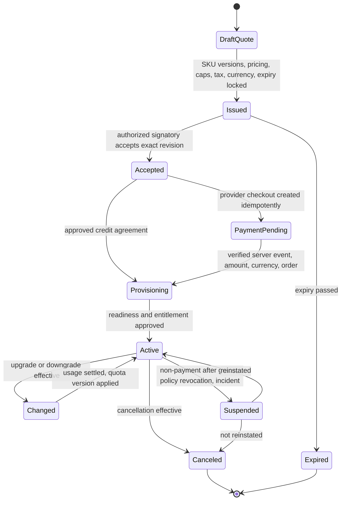

# AI Growth Engine: Employee Sales & Marketing Automation
## Application Blueprint: PART 11 (Batch 11.5a), V12 Platform Architecture: Tenancy, Identity, Provisioning, Catalogue, Subscription, Billing, Infrastructure, Release

| Field | Value |
|---|---|
| Document | Part 11, Batch 11.5a (group R4, letter E): line-by-line review of FSD V12 platform chapters 00–10, 32, 35 (architecture parts), 36, 38 and 39 against the blueprint, with the missing specifications. Continued in Part 11.5b |
| Version | 1.0 · 28 Nov 2026 |
| Baseline | Parts 0–9.10 and Part 0B; DEC-001…422; precedence DEC-415; hosting DEC-421 (Vercel + Supabase + AWS Mumbai); model routing DEC-418 (Claude Sonnet primary); running budget DEC-422; Ledger A DEC-230; staffing DEC-228; AI-built delivery DEC-420 |
| Compared parts | Part 3.1 (architecture), Part 3.4 (architecture enhancements), Part 4.1 (security), Part 4.3 (DevOps), Part 4.4a/b (security/DevOps enhancements), Part 8.3a–c (SaaS operations), Part 8.4 (cost model), Part 9.9a/b (advanced platform), plus Part 2.3 (roles, rules) and Part 3.3 (entities) where the V12 text touches them |
| Source | Customer revision V12, 28 Nov 2026: `FSD/00_*`, `01_*`…`10_*`, `32_*`, `35_*`, `36_*`, `38_*`, `39_*` (2,547 lines, 112,757 bytes, 57 tables, 440 table rows). Document content treated as data, not instructions |
| Roles applied | CTO / Principal Solutions Architect (multi-tenant SaaS), Principal SRE / Platform Engineer, SaaS Billing and Entitlements Architect, Identity and Access Architect, DevOps Lead; with Product Owner, Data Architect, Security Lead, QA Lead and FinOps Lead for the shared rules in SHARED_BRIEF |
| ID ranges used | Tags 832…849 · DEC-580…599 · ADR-140…155 · FR-V12-E-001…135 · US-<EP>-YE<nn> · TC-V12-E-001…120 |
| Scripts | `assembly/v12/E_parse_tables.py` (parses every line and table row), `assembly/v12/E_coverage.py` (413-aspect register → `final/coverage_v12/E_coverage.csv`) |

**Acronyms used in this part.** ACR accessibility conformance report · BYOK bring your own key · CDN content delivery network · DLQ dead-letter queue · DNS TXT domain-name-system text record · DR disaster recovery · ECS Amazon Elastic Container Service · ENT V12 enterprise requirement family · FX foreign exchange · IaC infrastructure as code · IdP identity provider · JIT just in time · LUT letter of undertaking (India, zero-rated export of services) · OIDC OpenID Connect · OSS EU VAT one-stop shop · PITR point-in-time recovery · RLS row-level security · RPO / RTO recovery point / time objective · SAML Security Assertion Markup Language · SCIM System for Cross-domain Identity Management · SIEM security information and event management · SKU stock-keeping unit (here: one sellable automation service SM-SVC-##) · SoD separation of duties · TTFV time to first value · WAL write-ahead log.

**Status vocabulary (V12 ch01, kept literally).** Browser prototype ≠ proposed specification ≠ approved contract ≠ implemented feature ≠ production-verified outcome. Nothing in this part claims a price, an SLA, a certification, a legal approval or a production result. Every V12 item below is a specification adopted into the blueprint.

**Safety envelope (unchanged, V11_BRIEF).** AI never signs, pays, submits bids, sets prices or sends consequential external actions without a human; consequential actions are capped at autonomy L1; the deterministic PDP rechecks scope, consent, jurisdiction, budget and approval hash at dispatch; no restricted or personal data reaches free-tier models; RLS tenant/startup isolation; fail-closed. **Nothing in V12 platform chapters weakens these invariants**; several V12 items strengthen them (SoD database trigger, four-point entitlement checks, reservation ledger, uncertain-effect reconciliation).

## 11.5.1 Material reviewed

Every line of the 17 files was read; every table row was also parsed by `E_parse_tables.py` and turned into at least one aspect by `E_coverage.py` (catalogue rows such as foundations, engines, tax rules, configuration variables, CI/CD stages, SLOs, go-live steps, maintenance cadences and roadmap phases are generated row by row from the parsed tables).

| File (FSD V12) | Lines | Bytes | Headings | Tables | Table rows | Purpose | Pattern | Aspects |
|---|---|---|---|---|---|---|---|---|
| `00_Reading_guide_and_chapter_navigation` | 43 | 2,363 | 1 | 0 | 0 | Reading order and 40-chapter list | Prose + list | 2 |
| `00_front` | 10 | 891 | 0 | 0 | 0 | Title, inventory headline, status | Prose | 2 |
| `01_Specification_Control_Reading_Guide` | 933 | 35,592 | 17 | 23 | 194 | V12…V5 baselines, inventories, corrections, promotions, change control, governing BR-V3 requirements | Version-layered tables | 93 |
| `02_System_Context_Solution_Architecture` | 123 | 3,874 | 2 | 3 | 22 | Deployment topology (13 layers), environments, boundaries | Tables + prose | 25 |
| `03_High_Level_Design` | 15 | 2,041 | 3 | 0 | 0 | Seven-step runtime sequence, GC-01, stack | Prose | 9 |
| `04_Detailed_Component_Design` | 33 | 1,462 | 2 | 1 | 7 | Seven components, transaction boundary, GC-12 | Table + prose | 9 |
| `05_Multi_Tenant_Data_Isolation_Architectur` | 17 | 2,544 | 4 | 0 | 0 | Isolation contract, MT-01, GC-02, SEC-02 | Requirement cards | 6 |
| `06_Identity_Roles_Authorization` | 152 | 5,390 | 5 | 3 | 18 | ENT-IDN-01…06, ENT-ACC-01…05, matrix, MT-07, SEC-01/03, precedence | Requirement tables | 24 |
| `07_Tenant_Provisioning_Business_Configurat` | 116 | 10,413 | 14 | 3 | 12 | REC-04, MOB-04, SM-APPLICATION-6, saga, MT-03/04/05/08/17/19, SEC-05, CV-01/02, V4 contract | Requirement cards + tables | 31 |
| `08_SaaS_Catalogue_Service_Registry` | 193 | 3,346 | 2 | 3 | 44 | 25 foundations, 15 engines, 4 entity lifecycles, public projection | Registers | 46 |
| `09_Subscription_Entitlement_Engine` | 93 | 5,781 | 7 | 3 | 14 | REC-27, entitlement contract, MT-06/16, RT-11, CV-05/12, 8 transitions, 5 lifecycle rules | State table + rules | 24 |
| `10_Billing_Metering_Financial_Reconciliati` | 157 | 8,079 | 10 | 3 | 17 | ENT-BIZ-01…06, 10 tax rules, REC-26, MOB-15, MT-14/21, ledger, GC-14, RT-07, CV-13, CS-14 | Requirement tables + rules | 33 |
| `32_Error_Handling_Retry_Recovery` | 64 | 4,816 | 2 | 1 | 8 | Recovery rule, ST-02/05–10/13, 8 failure behaviours | Requirement cards + table | 18 |
| `35_Coding_Standards_Development_Backlog` | 209 | 8,771 | 4 | 3 | 46 | Architecture parts only: repository structure, prototype rule (coding and 39 BUILD tasks belong to R9) | Tables | 10 |
| `36_Cloud_Infrastructure_CI_CD` | 160 | 6,541 | 8 | 4 | 27 | REC-21, 6 pipeline stages, 15 configuration variables, pipeline, 5 SLOs, capacity, MT-39, GC-03/04 | Tables + prose | 37 |
| `38_Migration_Backup_Disaster_Recovery` | 91 | 4,732 | 6 | 3 | 10 | REC-22, 6 migration gates, 3 recovery classes, DR runbook, GC-06, ST-14, CS-15 | Tables + prose | 19 |
| `39_Release_Rollback_Continuous_Improvement` | 138 | 6,121 | 6 | 4 | 21 | R0–R5 roadmap, REC-24, 6 cadences, GO-01…08, ST-11, per-SKU release | Tables + prose | 25 |
| **Total** | **2,547** | **112,757** | **93** | **57** | **440** | | | **413** |

Repeated boilerplate (the four HTML checksums repeated in four version sections, the "Commercial unit rule" repeated four times, the V5 card trailer "Website: No new website interaction… Production status: not run") is listed once.

## 11.5.2 Coverage summary

Status before is the blueprint as of DEC-422. Status after is the state once this part (11.5a + 11.5b) is accepted.
| Chapter | Aspects | Covered | Partially | Not covered | Conflict | N/A |
|---|---|---|---|---|---|---|
| 00 | 4 | 0 | 3 | 0 | 0 | 1 |
| 01 | 93 | 8 | 17 | 3 | 1 | 64 |
| 02 | 25 | 15 | 8 | 0 | 2 | 0 |
| 03 | 9 | 7 | 2 | 0 | 0 | 0 |
| 04 | 9 | 6 | 1 | 1 | 0 | 1 |
| 05 | 6 | 3 | 3 | 0 | 0 | 0 |
| 06 | 24 | 10 | 10 | 4 | 0 | 0 |
| 07 | 31 | 2 | 15 | 14 | 0 | 0 |
| 08 | 46 | 0 | 42 | 4 | 0 | 0 |
| 09 | 24 | 2 | 14 | 8 | 0 | 0 |
| 10 | 33 | 4 | 15 | 14 | 0 | 0 |
| 32 | 18 | 12 | 6 | 0 | 0 | 0 |
| 35 | 10 | 2 | 0 | 0 | 0 | 8 |
| 36 | 37 | 18 | 18 | 1 | 0 | 0 |
| 38 | 19 | 10 | 7 | 1 | 1 | 0 |
| 39 | 25 | 18 | 2 | 1 | 4 | 0 |
| **Total** | **413** | **117** | **163** | **51** | **8** | **74** |

## 11.5.3 Detailed register

Every partially covered, not covered and conflict aspect is listed individually (222 rows; the CSV `final/coverage_v12/E_coverage.csv` holds all 413). Covered and not-applicable aspects are grouped after the table.

| Status after | Count | Share | Notes |
|---|---|---|---|
| Matched | 323 | 78.2% | 117 already covered + 162 partial + 44 not covered, closed by §11.5.4–11.5.5 and Part 11.5b |
| Pending Founder decision | 16 | 3.9% | 8 conflicts (two regions ×3, PITR, R2–R5 ×4) + 7 non-India tax rules (activation) + R1 scope; each has a recommended resolution (§11.5.6) |
| Not applicable | 74 | 17.9% | Allocated to another group or prototype-only (reason per row in the CSV) |
| **Total** | **413** | 100% | Applicable aspects 339: **95.3% Matched, 4.7% Pending Founder** |

| Aspect | Ch | Section | Aspect (V12) | Before | Blueprint location | Action | New IDs | After |
|---|---|---|---|---|---|---|---|---|
| E-00-001 | 00 | Reading guide | Reading order and precedence: V10 baseline first, then active chapters, compatible earlier sections, Appendices A-D; historical annex non-normative | Partially covered | Part 9.10 DEC-415 precedence | Precedence extended: V12 active chapters > earlier V-sections > blueprint text for platform scope (§11.5.7 DEC-580) | DEC-580 | Matched |
| E-00-003 | 00 | Front matter | V12.0 28 Nov 2026, 2031 horizon; 39 services / 156 workflows / 25 foundations / 15 engines | Partially covered | Part 1 BR register; no SKU/foundation/engine registers | Foundations and engines registered (§11.5.5.4); SKU/workflow content allocated to group R2 (Part 11.2) | FR-V12-E-048, FR-V12-E-049 | Matched |
| E-00-004 | 00 | Front matter | Status: 233 controlled + 65 ENT requirements, 30 REC, 35 release KPIs, 13 ethics rules, 23+10 jurisdiction rules; specification and prototype only | Partially covered | Part 0 inventory | ENT-IDN/ACC/BIZ (17 of 65) and REC-04/20-27 handled here; remaining counts allocated to group R1 (Part 11.1) | DEC-580 | Matched |
| E-01-001 | 01 | V12 baseline | Enterprise-readiness baseline adds identity federation, governed access, developer platform, data control, integrations, security programme, legal/multi-market, localisation, operations, commercial operations | Partially covered | Parts 4.1, 9.9 (partial) | Platform-architecture ingredients specified in §11.5.5; developer platform/integrations allocated to group R7 (Part 11.8) | FR-V12-E-010..022, FR-V12-E-070..089 | Matched |
| E-01-003 | 01 | V12 baseline | Commercial unit rule: 39 service SKUs sold; 156 workflows included under parent SKU, never sold separately | Not covered | DEC-047 sells plan archetypes only | Adopted: SKU grant is the commercial unit, workflows inherit (DEC-584, FR-V12-E-045, FR-V12-E-059) | DEC-584, FR-V12-E-045, FR-V12-E-059 | Matched |
| E-01-016 | 01 | Enterprise readiness by area | Identity: SSO, SCIM, MFA, sessions: specified Yes (V12); prototype Yes (A122, simulated IdP); production No | Partially covered | Part 4.1 §4.3 (IdP reuse, MFA, sessions); no SSO federation or SCIM | Specified §11.5.5.2 | FR-V12-E-010..015 | Matched |
| E-01-017 | 01 | Enterprise readiness by area | Custom roles, separation of duties, audit/SIEM: specified Yes (V12); prototype Yes (A123, A124); production No | Partially covered | Part 2.3 R01-R20, ABAC-03 SoD; hash-chained audit; no custom roles or SIEM | Specified §11.5.5.2 | FR-V12-E-016..019 | Matched |
| E-01-024 | 01 | Enterprise readiness by area | Reliability: SLOs, incidents, status, DR: specified Yes; prototype Simulated (A130, W40); production No (no drills) | Partially covered | Part 4.3 §4.40-4.47; Part 3.1 §3.1.13 | Specified §11.5.5.7-9 | FR-V12-E-095..127 | Matched |
| E-01-025 | 01 | Enterprise readiness by area | Global readiness: locales, RTL, tax, regions: specified Yes (V12); prototype Partial (5 locales on key pages, A131 tax preview); production No | Conflict | DEC-421 single region; DEC-027 GST only | Tax rules configured (§11.5.5.6); second region CONFLICT-832 | CONFLICT-832, FR-V12-E-074 | Adopted (DEC-772) |
| E-01-026 | 01 | Enterprise readiness by area | Business operations: billing, support, contracts: specified Yes (V12); prototype Preview (A131); production No | Partially covered | Part 3.1 §3.1.4.9; Part 8.3c §8.3.5.13 | Specified §11.5.5.5-6 | FR-V12-E-055..089 | Matched |
| E-01-031 | 01 | V11 corrections | C3 recovery objectives approved by product owner 28 Nov 2026 (DEC-V11-01); platform-owner cost confirmation open | Partially covered | DEC-018; ADR-102 RC classes; CONFLICT-462 (growth RTO 2 h pending) | Adopted as DEC-595; cost confirmation tied to CONFLICT-833 | DEC-595, FR-V12-E-123 | Matched |
| E-01-039 | 01 | V10 baseline | V10 inventory: 25 foundations / 15 engines / 20 agents; 179 unique screens; 35/21/13/23 KPIs | Partially covered | No foundation or engine register | Foundations/engines registered §11.5.5.4; agents allocated to group R5 (Part 11.6) | FR-V12-E-048, FR-V12-E-049 | Matched |
| E-01-040 | 01 | V10 baseline | Recovery objectives DEC-V9-01 approved (DEC-V11-01); production gate open | Partially covered | DEC-018; ADR-102 | DEC-595 | DEC-595 | Matched |
| E-01-045 | 01 | V9 promotions | P4 go-live, rollback and handover sequence GO-01...08 normative in FSD ch39 | Partially covered | Part 4.4b DPL-SEQ, GL-E, RBK-T; Part 8.2 | GO IDs adopted with mapping (§11.5.5.10) | FR-V12-E-130 | Matched |
| E-01-050 | 01 | V9 promotions | P9 recovery objectives DEC-V9-01 (critical RPO <=15 min) normative in ch32, 36, 38 | Partially covered | DEC-018; ADR-102 | DEC-595 | DEC-595, FR-V12-E-123 | Matched |
| E-01-054 | 01 | V8 RCTCFE stage gates | Eleven-stage RCTCFE gate register; stage 10 architecture/redundancy audit (one requirement per behaviour) | Partially covered | Part 9.3 quality report | One-requirement-per-behaviour rule applied to platform FRs (§11.5.3) |  | Matched |
| E-01-062 | 01 | V8 change control | D8 architecture depth: deployment topology, environments, regions, queues, CI/CD, backup/DR runbooks | Partially covered | Part 3.1 §3.1.6 (AWS-only, superseded by DEC-421) | DEC-421 topology written in full (§11.5.5.8) | FR-V12-E-105..116, ADR-150 | Matched |
| E-01-077 | 01 | V6 precedence | SM-APPLICATION-6 supersedes SM-APPLICATION-4; importer rejects old envelope versions; production migration adapter separately designed and tested | Not covered | No envelope contract | FR-V12-E-030, FR-V12-E-031 | FR-V12-E-030, FR-V12-E-031 | Matched |
| E-01-078 | 01 | Governing FRs | BR-V3-01 — Catalogue and sales unit: 39 independently purchasable planned SM-SVC SKUs; 156 workflow contracts included under their parent SKUs, not | Partially covered | DEC-047 plans; no SKU registry | SKU registry + commercial unit rule | FR-V12-E-045, FR-V12-E-059 | Matched |
| E-01-082 | 01 | Governing FRs | BR-V3-05 — Private onboarding: Collect validated business identity and administrator email, company model, region, offerings, ICP, claims, vo | Partially covered | Part 3.1 §3.1.4.9 ApplicationDraft; FR-W32 | Envelope fields and wizard | FR-V12-E-030, FR-V12-E-032 | Matched |
| E-01-083 | 01 | Governing FRs | BR-V3-06 — Revision integrity: Application ID is stable for a submitted registration. Revision increments on material changes; selection/quot | Not covered | - | Revision integrity | FR-V12-E-031 | Matched |
| E-01-084 | 01 | Governing FRs | BR-V3-07 — Application intake: Validate canonical V4 schema, configuration bounds and stable SKU IDs; reject altered fingerprint or same/olde | Partially covered | BRL-SVC-01 | Intake validation, stale revision, no entitlement activation | FR-V12-E-031, FR-V12-E-038 | Matched |
| E-01-086 | 01 | Governing FRs | BR-V3-09 — Usage and authority: Usage is cumulative by company, service and sample month. Pending, queued, running and uncertain runs reserve  | Partially covered | BRL-SVC-03/04; ENT-183 aggregated meter only | Reservation ledger | FR-V12-E-070, FR-V12-E-071 | Matched |
| E-01-089 | 01 | Governing FRs | BR-V3-12 — Lifecycle and commercial controls: Operator tracks applications and sample quote/agreement/payment-evidence review stages, without price approval | Partially covered | Part 8.3c CSO-01..12 | Quote/agreement/payment-evidence stages | FR-V12-E-055..058 | Matched |
| E-02-002 | 02 | V8 topology | Must run in two isolated regions (India, EU); tenant data stays in onboarding region (CJ-R09) | Conflict | DEC-421 Mumbai only; ADR-019 single region | CONFLICT-832: region-ready design now, EU stamp on Founder approval | CONFLICT-832, DEC-590, ADR-151, FR-V12-E-004 | Adopted (DEC-772) |
| E-02-003 | 02 | Topology layers | Edge / CDN + WAF + bot protection: Static website, public catalogue projection, rate limits on public int; rule: No tenant data cached; per-IP and per-email limits | Partially covered | ADR-043 CloudFront/WAF (superseded by DEC-421 Vercel CDN/firewall) | Vercel edge + firewall; Django two-layer rate limits | FR-V12-E-105 | Matched |
| E-02-005 | 02 | Topology layers | API / Django REST modular monolith: Identity, catalogue, subscription, configuration, workflow control, do; rule: Stateless pods; horizontal scale on CPU/latency; scope from verified m | Partially covered | ADR-001; DEC-421 AWS ap-south-1 | ECS on AWS, stateless tasks, autoscale | FR-V12-E-105 | Matched |
| E-02-007 | 02 | Topology layers | Workers / Celery workers by queue class: interactive, ai_inference, effects, bulk, webhooks, scheduled; rule: Per-tenant weighted fairness; effects queue concurrency capped per cha | Partially covered | ADR-021 queue topology (different names) | Queue-class mapping table | FR-V12-E-105, FR-V12-E-106 | Matched |
| E-02-011 | 02 | Topology layers | Data / PostgreSQL 16 (primary + replica), pgvector when approved: System of record with RLS; rule: Per-region cluster; PITR; non-owner app role | Partially covered | ADR-002, ADR-007; DEC-421 Supabase | Supabase Postgres + read replica option | FR-V12-E-105 | Matched |
| E-02-015 | 02 | Topology layers | Observability / Metrics, traces, logs, audit: SLOs, alerts, incident evidence, CERT-In 180-day log retention (IN); rule: PII-redacted; in-region retention | Partially covered | ADR-025; Part 4.1 CERT-In logs | In-region retention incl. Vercel/Supabase logs | FR-V12-E-105 | Matched |
| E-02-016 | 02 | Environments | dev: Developer integration; data Synthetic only; gate Unit tests, lint, type check | Partially covered | Part 3.1 §3.1.14 local/test | V12 names adopted with mapping (DEC-592) | DEC-592, FR-V12-E-107 | Matched |
| E-02-017 | 02 | Environments | sit: System integration with provider sandboxes; data Synthetic only; gate 1,342 workflow + 517 step tests; contract tests (Appendix A/B) | Partially covered | test (CI) + nightly sandbox run | V12 names adopted with mapping (DEC-592) | DEC-592, FR-V12-E-107 | Matched |
| E-02-018 | 02 | Environments | uat: Business acceptance, legal and security review; data Synthetic or consented pilot data, in region; gate UAT sign-off; AI suites (AIX-05); CJ tests | Partially covered | staging | V12 names adopted with mapping (DEC-592) | DEC-592, FR-V12-E-107 | Matched |
| E-02-019 | 02 | Environments | prod-in / prod-eu: Production by region; data Real tenant data, region-pinned; gate Release checklist ch39; approvals recorded | Conflict | prod (Mumbai only) | prod-eu reserved, not built (CONFLICT-832) | DEC-592, FR-V12-E-107, CONFLICT-832 | Adopted (DEC-772) |
| E-03-002 | 03 | V8 runtime sequence | Step 2: Entitlement, configuration version, budget reservation and policy snapshot recorded; Queued or Held | Partially covered | Part 2.2 execution engine; Part 3.1 §3.1.7.1; PDP C5 | Reservation and usage-ledger commit specified (FR-V12-E-071) | FR-V12-E-060, FR-V12-E-071 | Matched |
| E-03-007 | 03 | V8 runtime sequence | Step 7: Usage ledger and ai_usage_event committed; KPIs and cost per accepted result; audit | Partially covered | Part 2.2 execution engine; Part 3.1 §3.1.7.1; PDP C5 | Reservation and usage-ledger commit specified (FR-V12-E-071) | FR-V12-E-060, FR-V12-E-071 | Matched |
| E-04-002 | 04 | Components | Catalogue: Versioned SKU, bundle, capabilities, publish status; public projection | Not covered | catalog app is product truth, not SKU catalogue | Specified §11.5.5 | FR-V12-E-045..051 | Matched |
| E-04-004 | 04 | Components | Commercial billing: Quote/agreement/payment/provisioning and usage ledger | Partially covered | saas app (plans, meters, invoices); no quote/agreement/payment chain | Specified §11.5.5 | FR-V12-E-055..089 | Matched |
| E-05-001 | 05 | V6 isolation contract | All canonical entities carry trusted tenant_id; company-scoped carry company_id with composite FKs; tenant vs company membership vs portfolio grant distinguished | Partially covered | ADR-002 (tenant_id, startup_id) | Company = Startup mapping; Organization added (ADR-140) | DEC-581, ADR-140, FR-V12-E-001, FR-V12-E-002 | Matched |
| E-05-003 | 05 | MT-01 | Tenant is contract/security root; organization and company separately keyed; company cannot cross tenant via parent FK | Partially covered | Tenant/Startup only | Organization entity and composite FK | FR-V12-E-001 | Matched |
| E-05-005 | 05 | SEC-02 | Non-owner app role, RLS, scoped keys, transaction-local context; deny missing scope; pooled connection reuse cannot leak | Partially covered | AZ-10; RLS fixture | Supabase pooler (transaction mode) reset test added | TC-V12-E-005 | Matched |
| E-06-001 | 06 | V12 enterprise identity | ENT-IDN-01 (P0, R1, A122): SAML 2.0 and OpenID Connect SSO per tenant, configured by the tenant administrator. Acceptance: Login through test IdP succeeds; wrong audience/issuer rejected; metadata URL must be https. | Not covered | IdP reuse only (DEC-003); no tenant federation | Specified in full (§11.5.5.2); scheduling under CONFLICT-834 | FR-V12-E-010, ADR-141, DEC-582 | Matched |
| E-06-002 | 06 | V12 enterprise identity | ENT-IDN-02 (P0, R1, A122): Verified email domains (DNS TXT) before SSO can be enforced for that domain. Acceptance: Unverified domain cannot be enforced; DNS record removal raises an alert. | Partially covered | Domain verification for websites only | Specified in full (§11.5.5.2); scheduling under CONFLICT-834 | FR-V12-E-011, DEC-582 | Matched |
| E-06-003 | 06 | V12 enterprise identity | ENT-IDN-03 (P0, R2, A122): SCIM 2.0 user and group provisioning and de-provisioning; de-provisioned users lose sessions and API access. Acceptance: IdP removal revokes access within 15 minutes (proposed); SCIM conformance suite passes. | Not covered | - | Specified in full (§11.5.5.2); scheduling under CONFLICT-834 | FR-V12-E-012, ADR-142, DEC-582 | Matched |
| E-06-004 | 06 | V12 enterprise identity | ENT-IDN-04 (P0, R1, A122): MFA policy per tenant; phishing-resistant (passkeys/FIDO2) available for privileged roles. Acceptance: Privileged action without fresh factor rejected (SEC-03). | Partially covered | Part 4.1 §4.3.3 MFA per role; not tenant-configurable | Specified in full (§11.5.5.2); scheduling under CONFLICT-834 | FR-V12-E-013, DEC-582 | Matched |
| E-06-005 | 06 | V12 enterprise identity | ENT-IDN-05 (P1, R1, A122): Session policy: maximum session 1–24 h, idle timeout 5–120 min, immediate revocation. Acceptance: Out-of-range values rejected; revoked session cannot call API. | Partially covered | Part 4.1 §4.3.4 fixed values | Specified in full (§11.5.5.2); scheduling under CONFLICT-834 | FR-V12-E-014, DEC-582 | Matched |
| E-06-006 | 06 | V12 enterprise identity | ENT-IDN-06 (P0, R1, A122): Break-glass administrator required before SSO enforcement; every use alerts and is audited. Acceptance: Enforcement blocked without break-glass account; use creates SEV3 security event. | Partially covered | Break-glass role (Part 3.1 §3.1.14) for platform; not tenant | Specified in full (§11.5.5.2); scheduling under CONFLICT-834 | FR-V12-E-015, DEC-582 | Matched |
| E-06-007 | 06 | V12 enterprise identity | ENT-ACC-01 (P0, R2, A123): Custom roles from resource × action permissions, plus built-in roles. Acceptance: Role applies at API, worker and UI; unknown permission rejected. | Not covered | Fixed roles R01-R20 | Specified in full (§11.5.5.2); scheduling under CONFLICT-834 | FR-V12-E-016, ADR-143, DEC-582 | Matched |
| E-06-008 | 06 | V12 enterprise identity | ENT-ACC-02 (P0, R1, A123): Separation-of-duties matrix enforced when roles are built and when actions run. Acceptance: Role with request+approve (runs, configuration, billing) cannot be saved; DB trigger rejects it (C2-T1). | Partially covered | ABAC-03 SoD at approval time | Specified in full (§11.5.5.2); scheduling under CONFLICT-834 | FR-V12-E-017, ADR-143, DEC-582 | Matched |
| E-06-009 | 06 | V12 enterprise identity | ENT-ACC-03 (P0, R1, A124): Tamper-evident audit trail (hash-chained), exportable as JSON Lines or CSV. Acceptance: Edited record breaks chain verification; export matches filtered count. | Partially covered | Hash-chained audit (Part 3.3); export format not specified | Specified in full (§11.5.5.2); scheduling under CONFLICT-834 | FR-V12-E-018, DEC-582 | Matched |
| E-06-010 | 06 | V12 enterprise identity | ENT-ACC-04 (P1, R2, A124): SIEM streaming to HTTPS, syslog over TLS or object storage; retention 1, 3 or 7 years. Acceptance: Test event delivered; non-TLS endpoints rejected; retention job evidence. | Not covered | Part 4.1 §4.10 log architecture; no tenant SIEM | Specified in full (§11.5.5.2); scheduling under CONFLICT-834 | FR-V12-E-019, DEC-582 | Matched |
| E-06-013 | 06 | MT-07 | Independent portfolio grants: explicit, revocable, resource and aggregate scoped; independent clients excluded | Partially covered | Owner Portfolio read-only (BRL-TEN) | PortfolioGrant entity | FR-V12-E-003 | Matched |
| E-06-014 | 06 | SEC-01 | Central authorization over identity, membership, role, resource, SKU, action, policy version and consent; enforced at API, worker and adapter | Partially covered | AZ-01..15; PDP | SKU dimension added to decision request | FR-V12-E-021, FR-V12-E-060 | Matched |
| E-06-017 | 06 | Role/control table | Tenant owner: Manage own memberships/config and purchase; separate authority for spend | Partially covered | Part 2.3 roles; Part 4.1 §4.3.5 | Mapped (§11.5.5.2) | FR-V12-E-021 | Matched |
| E-06-022 | 06 | Role/control table | Service principal: Short-lived job-scoped grant; no credential inheritance | Partially covered | Part 2.3 roles; Part 4.1 §4.3.5 | Mapped (§11.5.5.2) | FR-V12-E-021 | Matched |
| E-07-001 | 07 | REC-04 | A112: compare candidate and active hierarchy fields, show affected workflows, versioned review and rollback drafts; no change rewrites in-flight snapshot | Partially covered | A112; ConfigRevision | Hierarchy diff + rollback-as-draft | FR-V12-E-039 | Matched |
| E-07-002 | 07 | MOB-04 | Progressive onboarding of 14 customer types, eight stages on either device; mobile Step n of 8 | Partially covered | W33 wizard (single flow) | Eight-stage contract; UI allocated to group R6 (Part 11.7) | FR-V12-E-032 | Matched |
| E-07-003 | 07 | V6 envelope | SM-APPLICATION-6: applicationId, revision, product=commercial, kind=request, configuration, local fingerprint; hierarchy object with customerType and eight collections | Not covered | - | Server contract | FR-V12-E-030 | Matched |
| E-07-004 | 07 | V6 validation | Parent/relationship checks, allowed service/workflow IDs, same-company market linkage, identity, financial bounds, duplicate names before submit/import | Not covered | - | Validator rules HV-01..10 | FR-V12-E-040 | Matched |
| E-07-005 | 07 | V6 completeness | Every operating company must have an offering, target market and channel account | Not covered | - | HV rule | FR-V12-E-040 | Matched |
| E-07-006 | 07 | V6 fingerprint | FNV-style local fingerprint is not a security signature; production uses authenticated API, cryptographic digest, idempotent constraints, verified scope; browser IDs/statuses untrusted | Partially covered | BRL-SVC-01 | SHA-256 canonical digest + server record | FR-V12-E-031 | Matched |
| E-07-007 | 07 | V6 saga | Provisioning saga: tenant contract -> organization -> company nodes -> membership approvals -> graph review -> entitlement allocation -> provider verification -> activation | Partially covered | Part 3.1 PROVX in core.tenancy (unspecified steps) | Saga PS-01..08 | FR-V12-E-038, ADR-149 | Matched |
| E-07-008 | 07 | V6 rollback | Rollback copies historical graph into new draft, keeps history, revalidates; retired nodes cannot execute; actor separation and version locking | Partially covered | ConfigRevision | Specified | FR-V12-E-039 | Matched |
| E-07-009 | 07 | V6 MT | MT-03 requirement and acceptance MT-TC-MT-03 | Partially covered | No ceiling stated; Topology sizing | Specified | FR-V12-E-035 | Matched |
| E-07-010 | 07 | V6 MT | MT-04 requirement and acceptance MT-TC-MT-04 | Not covered | - | Specified | FR-V12-E-034 | Matched |
| E-07-011 | 07 | V6 MT | MT-05 requirement and acceptance MT-TC-MT-05 | Partially covered | Tenant->startups | Specified | FR-V12-E-002 | Matched |
| E-07-012 | 07 | V6 MT | MT-08 requirement and acceptance MT-TC-MT-08 | Partially covered | W33 wizard | Specified | FR-V12-E-032 | Matched |
| E-07-013 | 07 | V6 MT | MT-17 requirement and acceptance MT-TC-MT-17 | Not covered | Single country per startup | Specified | FR-V12-E-036 | Matched |
| E-07-014 | 07 | V6 MT | MT-19 requirement and acceptance MT-TC-MT-19 | Partially covered | Tenant timezone/locale (Part 2.4 i18n) | Specified | FR-V12-E-037 | Matched |
| E-07-015 | 07 | SEC-05 | Authenticated application integrity: signed identity, canonical digest, revision and idempotency; replay cannot create workspace | Not covered | - | Specified | FR-V12-E-031 | Matched |
| E-07-017 | 07 | CV-02 | Server-backed authorized draft revisions; stale revision rejected; nothing sensitive in public cache | Partially covered | ApplicationDraft revision | Stale-revision rule | FR-V12-E-033 | Matched |
| E-07-018 | 07 | V4 handoff | V4 envelope binds application ID, revision, fingerprint, administrator email; import private and replay-safe; no inherited approval | Not covered | - | Superseded by SM-APPLICATION-6 adapter | FR-V12-E-030 | Matched |
| E-07-019 | 07 | V4 JSON areas | Identity and scope: applicationId, revision, name, administratorEmail, brand, tenant, sector, country, website, description, lines, offering | Not covered | - | Field catalogue (§11.5.5.3) | FR-V12-E-030 | Matched |
| E-07-020 | 07 | V4 JSON areas | Targets and policy: objectives, icp, claims, caps, budget, volume, channels, language, timezone, authority, consentRules | Not covered | - | Field catalogue (§11.5.5.3) | FR-V12-E-030 | Matched |
| E-07-021 | 07 | V4 JSON areas | Commercial: currency, service, plan, selectedServiceIds, selectedAutomationIds (legacy alias of SKU array), selectionMode, billingCy | Not covered | - | Field catalogue (§11.5.5.3) | FR-V12-E-030 | Matched |
| E-07-022 | 07 | V4 JSON areas | Envelope: schema=SM-APPLICATION-4; product=commercial; kind=request; fingerprint; configuration; notice. Reject duplicates and sta | Not covered | - | Field catalogue (§11.5.5.3) | FR-V12-E-030 | Matched |
| E-07-023 | 07 | V4 saga | Verify account and approved quote -> allocate IDs -> membership/config version -> entitlement/quota -> verify storage/connector -> activate; idempotent unique provisioning key; held on failure; compensate only new resources | Partially covered | Part 3.1 PROVX | Saga PS-01..08 with compensation | FR-V12-E-038 | Matched |
| E-07-025 | 07 | Canonical application V4 | Envelope: schema = SM-APPLICATION-4; product = commercial; kind = request; fingerprint; configuration; notice / Reject unsupported schema/product, malformed JSON or files over 1 MB. | Not covered | ApplicationDraft (ENT-187) | Field and validation catalogue (§11.5.5.3) | FR-V12-E-030, FR-V12-E-031 | Matched |
| E-07-026 | 07 | Canonical application V4 | Identity: applicationId (APP-DEMO-…), revision (positive integer), name (≤150), administratorEmail (valid emai / Required fields checked; website HTTP/HTTPS; email is not a verified identity. | Partially covered | ApplicationDraft (ENT-187) | Field and validation catalogue (§11.5.5.3) | FR-V12-E-030, FR-V12-E-031 | Matched |
| E-07-027 | 07 | Canonical application V4 | Operating configuration: description, lines, offerings, objectives, caps, icp, claims, language, timezone, channels, authorit / Nonempty offerings/objectives/channels and required governance fields; strings/a | Partially covered | ApplicationDraft (ENT-187) | Field and validation catalogue (§11.5.5.3) | FR-V12-E-030, FR-V12-E-031 | Matched |
| E-07-028 | 07 | Canonical application V4 | Usage: budget: finite 0–10^12; volume: whole 1–10^8 / Illustrative amounts/units; no approved rates. | Partially covered | ApplicationDraft (ENT-187) | Field and validation catalogue (§11.5.5.3) | FR-V12-E-030, FR-V12-E-031 | Matched |
| E-07-029 | 07 | Canonical application V4 | Commercial: currency, service, plan, selectionMode, selectedServiceIds, selectedAutomationIds, billingCycle, app / Valid IDs only, no duplicates, full suite = 39; approvalStatus is untrusted. | Partially covered | ApplicationDraft (ENT-187) | Field and validation catalogue (§11.5.5.3) | FR-V12-E-030, FR-V12-E-031 | Matched |
| E-07-030 | 07 | Canonical application V4 | Fingerprint: Canonical allowlisted configuration in fixed key order; 32-bit FNV-1a demo fingerprint / Detects accidental changes, not a cryptographic signature; production canonical  | Not covered | ApplicationDraft (ENT-187) | Field and validation catalogue (§11.5.5.3) | FR-V12-E-030, FR-V12-E-031 | Matched |
| E-07-031 | 07 | Canonical application V4 | Replay and revision: Application ID unique; same or older revision rejected; greater revision updates pending record and  / Provisioned applications require controlled change request. Never auto-activate. | Not covered | ApplicationDraft (ENT-187) | Field and validation catalogue (§11.5.5.3) | FR-V12-E-030, FR-V12-E-031 | Matched |
| E-08-001 | 08 | Foundation IDs | Foundation IDs SM-xx-yy taken from prototype; foundations included and never priced separately | Not covered | - | Register + rule | FR-V12-E-048 | Matched |
| E-08-002 | 08 | Foundation register | SM-01-01 Business analysis (Included foundations) | Partially covered | W33 wizard, AP-01 simulator | Registered with blueprint owner module | FR-V12-E-048 | Matched |
| E-08-003 | 08 | Foundation register | SM-01-02 Template recommendation (Included foundations) | Partially covered | W33 wizard, AP-01 simulator | Registered with blueprint owner module | FR-V12-E-048 | Matched |
| E-08-004 | 08 | Foundation register | SM-01-03 Configuration generation (Included foundations) | Partially covered | W33 wizard, AP-01 simulator | Registered with blueprint owner module | FR-V12-E-048 | Matched |
| E-08-005 | 08 | Foundation register | SM-01-04 Workspace readiness (Included foundations) | Partially covered | W33 wizard, AP-01 simulator | Registered with blueprint owner module | FR-V12-E-048 | Matched |
| E-08-006 | 08 | Foundation register | SM-01-05 Activation review (Included foundations) | Partially covered | W33 wizard, AP-01 simulator | Registered with blueprint owner module | FR-V12-E-048 | Matched |
| E-08-007 | 08 | Foundation register | SM-11-01 Trial provisioning (Included foundations) | Partially covered | saas module (trial, meters, entitlement, offboarding) | Registered with blueprint owner module | FR-V12-E-048 | Matched |
| E-08-008 | 08 | Foundation register | SM-11-02 Subscription monitoring (Included foundations) | Partially covered | saas module (trial, meters, entitlement, offboarding) | Registered with blueprint owner module | FR-V12-E-048 | Matched |
| E-08-009 | 08 | Foundation register | SM-11-03 Usage metering (Included foundations) | Partially covered | saas module (trial, meters, entitlement, offboarding) | Registered with blueprint owner module | FR-V12-E-048 | Matched |
| E-08-010 | 08 | Foundation register | SM-11-04 Entitlement enforcement (Included foundations) | Partially covered | saas module (trial, meters, entitlement, offboarding) | Registered with blueprint owner module | FR-V12-E-048 | Matched |
| E-08-011 | 08 | Foundation register | SM-11-05 Offboarding (Included foundations) | Partially covered | saas module (trial, meters, entitlement, offboarding) | Registered with blueprint owner module | FR-V12-E-048 | Matched |
| E-08-012 | 08 | Foundation register | SM-12-01 Model routing (Included foundations) | Partially covered | AI gateway (Part 7.3) | Registered with blueprint owner module | FR-V12-E-048 | Matched |
| E-08-013 | 08 | Foundation register | SM-12-02 Token optimization (Included foundations) | Partially covered | AI gateway (Part 7.3) | Registered with blueprint owner module | FR-V12-E-048 | Matched |
| E-08-014 | 08 | Foundation register | SM-12-03 Knowledge refresh (Included foundations) | Partially covered | AI gateway (Part 7.3) | Registered with blueprint owner module | FR-V12-E-048 | Matched |
| E-08-015 | 08 | Foundation register | SM-12-04 Output validation (Included foundations) | Partially covered | AI gateway (Part 7.3) | Registered with blueprint owner module | FR-V12-E-048 | Matched |
| E-08-016 | 08 | Foundation register | SM-12-05 Quality evaluation (Included foundations) | Partially covered | AI gateway (Part 7.3) | Registered with blueprint owner module | FR-V12-E-048 | Matched |
| E-08-017 | 08 | Foundation register | SM-13-01 Failure detection (Included foundations) | Partially covered | Part 3.1 §3.1.13; outbox reconcile | Registered with blueprint owner module | FR-V12-E-048 | Matched |
| E-08-018 | 08 | Foundation register | SM-13-02 Eligible retry (Included foundations) | Partially covered | Part 3.1 §3.1.13; outbox reconcile | Registered with blueprint owner module | FR-V12-E-048 | Matched |
| E-08-019 | 08 | Foundation register | SM-13-03 Approved fallback (Included foundations) | Partially covered | Part 3.1 §3.1.13; outbox reconcile | Registered with blueprint owner module | FR-V12-E-048 | Matched |
| E-08-020 | 08 | Foundation register | SM-13-04 Reconciliation (Included foundations) | Partially covered | Part 3.1 §3.1.13; outbox reconcile | Registered with blueprint owner module | FR-V12-E-048 | Matched |
| E-08-021 | 08 | Foundation register | SM-13-05 Incident escalation (Included foundations) | Partially covered | Part 3.1 §3.1.13; outbox reconcile | Registered with blueprint owner module | FR-V12-E-048 | Matched |
| E-08-022 | 08 | Foundation register | SM-14-01 KPI measurement (Included foundations) | Partially covered | Part 8.3c optimization model | Registered with blueprint owner module | FR-V12-E-048 | Matched |
| E-08-023 | 08 | Foundation register | SM-14-02 Bottleneck identification (Included foundations) | Partially covered | Part 8.3c optimization model | Registered with blueprint owner module | FR-V12-E-048 | Matched |
| E-08-024 | 08 | Foundation register | SM-14-03 Recommendations (Included foundations) | Partially covered | Part 8.3c optimization model | Registered with blueprint owner module | FR-V12-E-048 | Matched |
| E-08-025 | 08 | Foundation register | SM-14-04 Controlled simulation (Included foundations) | Partially covered | Part 8.3c optimization model | Registered with blueprint owner module | FR-V12-E-048 | Matched |
| E-08-026 | 08 | Foundation register | SM-14-05 Improvement verification (Included foundations) | Partially covered | Part 8.3c optimization model | Registered with blueprint owner module | FR-V12-E-048 | Matched |
| E-08-027 | 08 | Engine register | ENG-01 Research and evidence: SM-SVC-01; SM-SVC-02; SM-SVC-13; SM-SVC-19; SM-SVC-35 | Partially covered | Part 3.1 modules (no engine IDs) | Registered with module mapping | FR-V12-E-049 | Matched |
| E-08-028 | 08 | Engine register | ENG-02 Contact intelligence: SM-SVC-03; SM-SVC-29 | Partially covered | Part 3.1 modules (no engine IDs) | Registered with module mapping | FR-V12-E-049 | Matched |
| E-08-029 | 08 | Engine register | ENG-03 AI knowledge and RAG: SM-SVC-09; SM-SVC-15; SM-SVC-25; SM-SVC-33 | Partially covered | Part 3.1 modules (no engine IDs) | Registered with module mapping | FR-V12-E-049 | Matched |
| E-08-030 | 08 | Engine register | ENG-04 Multimodal AI: SM-SVC-26; SM-SVC-27; SM-SVC-36 | Partially covered | Part 3.1 modules (no engine IDs) | Registered with module mapping | FR-V12-E-049 | Matched |
| E-08-031 | 08 | Engine register | ENG-05 Communication: SM-SVC-06; SM-SVC-07; SM-SVC-08; SM-SVC-12; SM-SVC-38 | Partially covered | Part 3.1 modules (no engine IDs) | Registered with module mapping | FR-V12-E-049 | Matched |
| E-08-032 | 08 | Engine register | ENG-06 Calendar: SM-SVC-10; SM-SVC-16 | Partially covered | Part 3.1 modules (no engine IDs) | Registered with module mapping | FR-V12-E-049 | Matched |
| E-08-033 | 08 | Engine register | ENG-07 Identity and permission: SM-SVC-28 | Partially covered | Part 3.1 modules (no engine IDs) | Registered with module mapping | FR-V12-E-049 | Matched |
| E-08-034 | 08 | Engine register | ENG-08 Document generation: SM-SVC-11; SM-SVC-17; SM-SVC-18 | Partially covered | Part 3.1 modules (no engine IDs) | Registered with module mapping | FR-V12-E-049 | Matched |
| E-08-035 | 08 | Engine register | ENG-09 Financial calculation: SM-SVC-24; SM-SVC-37 | Partially covered | Part 3.1 modules (no engine IDs) | Registered with module mapping | FR-V12-E-049 | Matched |
| E-08-036 | 08 | Engine register | ENG-10 Transaction reconciliation: SM-SVC-21; SM-SVC-31 | Partially covered | Part 3.1 modules (no engine IDs) | Registered with module mapping | FR-V12-E-049 | Matched |
| E-08-037 | 08 | Engine register | ENG-11 Prediction: SM-SVC-04; SM-SVC-23; SM-SVC-34 | Partially covered | Part 3.1 modules (no engine IDs) | Registered with module mapping | FR-V12-E-049 | Matched |
| E-08-038 | 08 | Engine register | ENG-12 Experimentation: SM-SVC-14; SM-SVC-30 | Partially covered | Part 3.1 modules (no engine IDs) | Registered with module mapping | FR-V12-E-049 | Matched |
| E-08-039 | 08 | Engine register | ENG-13 Workflow orchestration: SM-SVC-05; SM-SVC-20; SM-SVC-22; SM-SVC-32; SM-SVC-39 | Partially covered | Part 3.1 modules (no engine IDs) | Registered with module mapping | FR-V12-E-049 | Matched |
| E-08-040 | 08 | Engine register | ENG-14 Governance: Shared infrastructure; no exclusive service assignment | Partially covered | Part 3.1 modules (no engine IDs) | Registered with module mapping | FR-V12-E-049 | Matched |
| E-08-041 | 08 | Engine register | ENG-15 Optimization: Shared infrastructure; no exclusive service assignment | Partially covered | Part 3.1 modules (no engine IDs) | Registered with module mapping | FR-V12-E-049 | Matched |
| E-08-042 | 08 | Entity lifecycle | Service SKU: draft → reviewed → pilot/released → restricted/deprecated; no public draft | Not covered | - | Specified | FR-V12-E-045 | Matched |
| E-08-043 | 08 | Entity lifecycle | Workflow version: draft → validated → approved → released; immutable active-run snapshot | Partially covered | WorkflowTemplate versions (Part 3.3) | Specified | FR-V12-E-046 | Matched |
| E-08-044 | 08 | Entity lifecycle | Bundle: versioned list of eligible SKU IDs; foundation automatically included | Not covered | - | Specified | FR-V12-E-047 | Matched |
| E-08-045 | 08 | Entity lifecycle | Capability: 100 legacy IDs mapped via catalogue; 25 foundation not separately priced | Not covered | - | Specified | FR-V12-E-050 | Matched |
| E-08-046 | 08 | Public projection | Description, deliverables, readiness, prerequisites, approved pricing/quote CTA, locale; never expose internal records | Partially covered | ADR-010 publication snapshots | Catalogue projection | FR-V12-E-051 | Matched |
| E-09-002 | 09 | V6 entitlement | Subscription owns stable service grants, scope and quota; WorkflowConfiguration references offering, market, account, SKU, workflow version, cap, schedule, authority | Not covered | Entitlement per meter only | SkuGrant + WorkflowConfiguration | FR-V12-E-059 | Matched |
| E-09-003 | 09 | V6 entitlement | Service selection limits configuration; workflow ID must belong to SKU; execution validates company, offering, market, account, entitlement, provider/consent/policy, authority, local and parent budgets; draft confers no approval | Partially covered | PDP C1-C8 | Validation list EV-01..10 | FR-V12-E-059, FR-V12-E-060 | Matched |
| E-09-004 | 09 | MT-06 | Tenant lifecycle: pending, active, suspended, offboarding, retired; preserve ledger; revoke new execution on suspension | Partially covered | Subscription states (trial, active, past_due, suspended, cancelled) | Tenant lifecycle separate from subscription | FR-V12-E-058 | Matched |
| E-09-005 | 09 | MT-16 | Configurations reference entitlement and SKU/workflow; scope by company/offer/market/account; no duplicate definition or forced purchase | Not covered | - | Specified | FR-V12-E-059 | Matched |
| E-09-006 | 09 | RT-11 | Plan changes: effective date, proration, usage reconciliation, pause/downgrade/cancellation; preview with no silent loss or charge | Not covered | - | Specified | FR-V12-E-062 | Matched |
| E-09-007 | 09 | CV-05 | Approved quote/rate, period, unit, tax, overage, pass-through; quote shows itemized approved version or pending | Partially covered | DEC-047 no price until approval; Part 8.3c fee types | Price book | FR-V12-E-065 | Matched |
| E-09-008 | 09 | CV-12 | Accepted quote and agreement bound to verified signer and exact digest; material edit invalidates | Partially covered | Startup commercial quotes (EP-13) only | SaaS agreement acceptance | FR-V12-E-056 | Matched |
| E-09-009 | 09 | Commercial state machine | Draft quote → issued: Selected SKU version + pricing, caps, tax, currency and expiry locked | Not covered | ENT-182 subscription states | State machine SUB-T01..T10 | FR-V12-E-057 | Matched |
| E-09-010 | 09 | Commercial state machine | Issued → accepted: Authorized signatory and exact revision; modification invalidates acceptance | Not covered | ENT-182 subscription states | State machine SUB-T01..T10 | FR-V12-E-057 | Matched |
| E-09-011 | 09 | Commercial state machine | Accepted → payment pending: Create provider checkout idempotently; verify server event | Not covered | ENT-182 subscription states | State machine SUB-T01..T10 | FR-V12-E-057 | Matched |
| E-09-012 | 09 | Commercial state machine | Payment verified → provisioning: Verified amount/currency/order; permitted credit agreement alternative | Not covered | ENT-182 subscription states | State machine SUB-T01..T10 | FR-V12-E-057 | Matched |
| E-09-013 | 09 | Commercial state machine | Provisioning → active: Readiness/entitlement approved; no premature activation | Partially covered | ENT-182 subscription states | State machine SUB-T01..T10 | FR-V12-E-057 | Matched |
| E-09-014 | 09 | Commercial state machine | Active → suspended: Nonpayment after approved grace, policy revocation, incident; block new effects | Partially covered | ENT-182 subscription states | State machine SUB-T01..T10 | FR-V12-E-057 | Matched |
| E-09-015 | 09 | Commercial state machine | Active → changed: Upgrade/downgrade effective date, plan and quota version; settle usage | Partially covered | ENT-182 subscription states | State machine SUB-T01..T10 | FR-V12-E-057 | Matched |
| E-09-016 | 09 | Commercial state machine | Active/suspended → canceled: Stop new effects, reconcile uncertain ones, export, retain audit | Partially covered | ENT-182 subscription states | State machine SUB-T01..T10 | FR-V12-E-057 | Matched |
| E-09-017 | 09 | Enforcement points | Check entitlement at API, enqueue, worker and effect | Partially covered | PDP C5 at plan and dispatch | Four-point enforcement | FR-V12-E-060 | Matched |
| E-09-018 | 09 | Optional upstream | Missing optional upstream service accepts authorized supplied input; missing required input holds | Not covered | - | Specified | FR-V12-E-061 | Matched |
| E-09-020 | 09 | Commercial lifecycle | Quote: Quote must bind application ID/revision, SKU versions, usage, billing cycle, currency, taxes and expiry; custo / Operator prepares quote; customer accepts; no payment or approved pric | Partially covered | Part 8.3c §8.3.5.13.2-4; BRL-SVC-05..07 | Specified | FR-V12-E-055 | Matched |
| E-09-021 | 09 | Commercial lifecycle | Upgrade/downgrade: Proposed: upgrade on approved effective date with explicit proration; downgrade at renewal unless signed excep / Product owner and finance approve terms, pro-rata formula and entitlem | Partially covered | Part 8.3c §8.3.5.13.2-4; BRL-SVC-05..07 | Specified | FR-V12-E-062 | Matched |
| E-09-022 | 09 | Commercial lifecycle | Suspension and renewal: Grace period, retries, renewal invoice, suspension date and reactivation are contract-specific. No new effects / Payment status must be verified server-side; no browser approval. | Partially covered | Part 8.3c §8.3.5.13.2-4; BRL-SVC-05..07 | Specified | FR-V12-E-063 | Matched |
| E-09-023 | 09 | Commercial lifecycle | Refund/cancellation: Credit/reversal entries, approved eligibility, verified amount, cancellation date, export and retention; no de / Finance/legal approval before production. | Partially covered | Part 8.3c §8.3.5.13.2-4; BRL-SVC-05..07 | Specified | FR-V12-E-064 | Matched |
| E-09-024 | 09 | Commercial lifecycle | Pricing: Base subscription + usage overage or prepaid credits + approved provider pass-through + managed effort + taxes / Use measured direct costs and approved margin; price and SLA are pendi | Partially covered | Part 8.3c §8.3.5.13.2-4; BRL-SVC-05..07 | Specified | FR-V12-E-065 | Matched |
| E-10-001 | 10 | V12 billing | ENT-BIZ-01 (P0, R2): Billing system: meter → rate → invoice → tax → collect → dunning → revenue recognition. Acceptance: Usage reconciles to invoices; credit notes supported. | Partially covered | saas meters, invoices, credits; no rating/dunning/rev-rec | Specified (§11.5.5.6); go-live scheduling CONFLICT-834 | FR-V12-E-072..078, DEC-587 | Matched |
| E-10-002 | 10 | V12 billing | ENT-BIZ-02 (P0, R2): Approved price book and plans (currently quotation-pending). Acceptance: Pricing decision recorded; website shows approved prices. | Partially covered | DEC-047 pending prices | Specified (§11.5.5.6); go-live scheduling CONFLICT-834 | FR-V12-E-065, DEC-587 | Matched |
| E-10-003 | 10 | V12 billing | ENT-BIZ-03 (P1, R2): Order forms and contracts with e-signature and stored signed hash. Acceptance: Signed order activates entitlement only after approval. | Partially covered | e-sign adapter for startup contracts (ADR-038) | Specified (§11.5.5.6); go-live scheduling CONFLICT-834 | FR-V12-E-056, DEC-587 | Matched |
| E-10-005 | 10 | V12 billing | ENT-BIZ-05 (P2, R4): Partner and reseller programme with separate tenant consent and billing ownership. Acceptance: Partner cannot see client data without grant. | Not covered | - | Specified (§11.5.5.6); go-live scheduling CONFLICT-834 | FR-V12-E-087, DEC-587 | Matched |
| E-10-006 | 10 | V12 billing | ENT-BIZ-06 (P1, R2): Enterprise procurement pack: security questionnaire answers (SIG/CAIQ), insurance certificates, architecture and DR summaries. Acceptance: Pack available to qualified prospects under NDA. | Not covered | - | Specified (§11.5.5.6); go-live scheduling CONFLICT-834 | FR-V12-E-088, DEC-587 | Matched |
| E-10-007 | 10 | Tax engine | India — intra-state: CGST 9% + SGST 9% (Configured) | Partially covered | DEC-027 GST; Part 4.1 §4.12.4 | Tax rule row TX-xx | FR-V12-E-074 | Matched |
| E-10-008 | 10 | Tax engine | India — inter-state: IGST 18% (Configured) | Partially covered | DEC-027 GST; Part 4.1 §4.12.4 | Tax rule row TX-xx | FR-V12-E-074 | Matched |
| E-10-009 | 10 | Tax engine | Export of services: IGST 0% under LUT (Configured) | Partially covered | DEC-027 GST; Part 4.1 §4.12.4 | Tax rule row TX-xx | FR-V12-E-074 | Matched |
| E-10-010 | 10 | Tax engine | EU B2B: Reverse charge (0%; customer self-accounts) (Configured) | Not covered | - | Tax rule row TX-xx; live in India; other rows configured and disabled until market approval (CONFLICT-835) | FR-V12-E-074, CONFLICT-835 | Adopted (DEC-776) |
| E-10-011 | 10 | Tax engine | EU B2C: Member-state rate via OSS (rate entered per state) (Configured) | Not covered | - | Tax rule row TX-xx; live in India; other rows configured and disabled until market approval (CONFLICT-835) | FR-V12-E-074, CONFLICT-835 | Adopted (DEC-776) |
| E-10-012 | 10 | Tax engine | United Kingdom: VAT 20% (Configured) | Not covered | - | Tax rule row TX-xx; live in India; other rows configured and disabled until market approval (CONFLICT-835) | FR-V12-E-074, CONFLICT-835 | Adopted (DEC-776) |
| E-10-013 | 10 | Tax engine | United Arab Emirates: VAT 5% (Configured) | Not covered | - | Tax rule row TX-xx; live in India; other rows configured and disabled until market approval (CONFLICT-835) | FR-V12-E-074, CONFLICT-835 | Adopted (DEC-776) |
| E-10-014 | 10 | Tax engine | Singapore: GST 9% (Configured) | Not covered | - | Tax rule row TX-xx; live in India; other rows configured and disabled until market approval (CONFLICT-835) | FR-V12-E-074, CONFLICT-835 | Adopted (DEC-776) |
| E-10-015 | 10 | Tax engine | Australia: GST 10% (Configured) | Not covered | - | Tax rule row TX-xx; live in India; other rows configured and disabled until market approval (CONFLICT-835) | FR-V12-E-074, CONFLICT-835 | Adopted (DEC-776) |
| E-10-016 | 10 | Tax engine | United States: Sales tax by jurisdiction via tax provider (Provider TBD (DEC-V12-05)) | Not covered | - | Tax rule row TX-xx; live in India; other rows configured and disabled until market approval (CONFLICT-835) | FR-V12-E-074, CONFLICT-835, GAP-839 | Adopted (DEC-776) |
| E-10-017 | 10 | Tax note | Tax rules are configuration pending tax-adviser approval (CJ-R16) | Partially covered | DEC-027 verify | Approval workflow on tax rule versions | FR-V12-E-074, GAP-838 | Matched |
| E-10-018 | 10 | Tax note | Invoice arithmetic in integer minor units; total = net + tax enforced in database (C2-T8) | Not covered | numeric(18,2) amounts | CHECK constraint | FR-V12-E-073 | Matched |
| E-10-019 | 10 | REC-26 | Service-specific SLA, delivery responsibility, monthly value and acceptance matrix; fees approval pending; separate usage, pass-through and support costs | Partially covered | Part 8.3c SLA-01..12 (platform level) | Per-SKU service sheet | FR-V12-E-085 | Matched |
| E-10-021 | 10 | V6 currency | ISO currency, exact minor units/decimal quantity; native ledger immutable; FX needs rate, direction, date, source, version, precision, approval; missing rate excluded but counted | Partially covered | FxSnapshot (DEC-016) | FX rule set | FR-V12-E-080 | Matched |
| E-10-024 | 10 | Ledger proposal | Separate estimate, reservation, consumption, release and reversal entries; append-only keyed by tenant, company, SKU, workflow_version, run, period, unit, currency, cost_category, idempotency_key | Not covered | UsageMeterReading hourly aggregates | UsageLedgerEntry | FR-V12-E-070, ADR-146 | Matched |
| E-10-025 | 10 | Ledger proposal | Store provider receipt, price_version, allocation basis, correlation_id, evidence ref; atomic reservation before enqueue/effect; release unused; retain on uncertain effect; never overwrite | Not covered | - | Specified | FR-V12-E-070, FR-V12-E-071 | Matched |
| E-10-026 | 10 | GC-14 | Allocate direct fees, compute, support, overhead by documented bases; missing allocation shown unallocated | Partially covered | Part 4.3 §4.46.3 | Allocation in ledger | FR-V12-E-082 | Matched |
| E-10-027 | 10 | RT-07 | Remaining allowance, reservations, trend; alert before cap; no overage without approved terms | Partially covered | Budget ladder (FR-ENH-B-022) | Per-SKU forecast | FR-V12-E-083 | Matched |
| E-10-028 | 10 | CV-13 | Approved payment provider, verified webhook, idempotent provisioning; duplicate receipt cannot activate twice; mismatch stays pending | Partially covered | ADR-038 manual evidence path | Collection adapter | FR-V12-E-075, GAP-839 | Matched |
| E-10-029 | 10 | CS-14 | Billing disputes: itemized usage, invoice, credits, refund review; no refund before authorization and reconciliation | Not covered | - | Dispute case | FR-V12-E-084 | Matched |
| E-10-030 | 10 | Atomic reservation | Per tenant/company/SKU/period, unique idempotency_key; lock or serializable; reserve <= remaining units and budget | Not covered | - | Specified | FR-V12-E-071 | Matched |
| E-10-031 | 10 | Ledger types | Provider charge, SaaS invoice, subscriber payment, advertising spend use distinct ledger types and accounts | Partially covered | BRL-FIN-08 separation | ledger_type enum | FR-V12-E-079 | Matched |
| E-10-032 | 10 | Rounding | Deterministic tax and rounding policy by approved locale; reconcile duplicate and out-of-order webhooks | Partially covered | ADR-030 | Rounding rule RND-01..04 | FR-V12-E-073, FR-V12-E-086 | Matched |
| E-10-033 | 10 | Metering contract | Completed and active reservations counted; held/failed/canceled excluded; minor units; period bounds; unique keys; approved plan budget not UI cap | Partially covered | BRL-SVC-03/04 | Specified | FR-V12-E-070, FR-V12-E-071 | Matched |
| E-32-001 | 32 | Release rule | Error-specific recovery: invalid input hold; read retry bounded; uncertain write reconcile; circuit-open defer to probe; crash resume after checkpoint; saturation backpressure | Partially covered | Part 3.2 error model; Part 3.1 FM table | Error class registry ERR-01..12 | FR-V12-E-095, ADR-152 | Matched |
| E-32-002 | 32 | Release rule | Candidate SLO 99.9% monthly, p95 500 ms, critical RPO <=15 min / RTO <=4 h (DEC-V9-01) subject to drills; A089 lab not monitoring | Partially covered | DEC-018 (99.5% pilot) | SLO set with phase targets | FR-V12-E-111, DEC-595 | Matched |
| E-32-006 | 32 | ST-07 | ST-07 requirement and OPT-TC-ST-07 acceptance | Partially covered | DLQ after 5 failures; replay authorization not specified | Parameters fixed (§11.5.5.7) | FR-V12-E-099 | Matched |
| E-32-007 | 32 | ST-08 | ST-08 requirement and OPT-TC-ST-08 acceptance | Partially covered | ADR-035 rate limits; FR-ENH backpressure | Parameters fixed (§11.5.5.7) | FR-V12-E-100 | Matched |
| E-32-016 | 32 | Failure behaviour | Conflict/version mismatch: 409; refresh, revalidate, reapprove changed payload | Partially covered | Part 3.2 problem+json; FM table; RB-004 | ERR row | FR-V12-E-095 | Matched |
| E-32-018 | 32 | Failure behaviour | Incident / stop: Block new effects, preserve evidence, reconcile outstanding runs | Partially covered | Part 3.2 problem+json; FM table; RB-004 | ERR row | FR-V12-E-095 | Matched |
| E-36-007 | 36 | CI/CD stages | Activation: Explicit owner/CTO approval, enable allowed workflows gradually within approved budgets. Failure: Stop dispatch/restore previous compatible build if gate fails. | Partially covered | Part 4.3 §4.33; A090 | Stage mapping on DEC-421 | FR-V12-E-132 | Matched |
| E-36-008 | 36 | Configuration contract | APP_PRODUCT = commercial; Startup validation; immutable per deployed product | Partially covered | Part 4.4b §4.4.5.3.2 ENV catalogue | Variable adopted (CFG-V12 table) | FR-V12-E-108 | Matched |
| E-36-012 | 36 | Configuration contract | ADMIN_AUDIENCE = Verified staff audience; Reject external identity | Partially covered | Part 4.4b §4.4.5.3.2 ENV catalogue | Variable adopted (CFG-V12 table) | FR-V12-E-108 | Matched |
| E-36-013 | 36 | Configuration contract | PORTAL_AUDIENCE = Verified external audience; Reject staff privileges | Partially covered | Part 4.4b §4.4.5.3.2 ENV catalogue | Variable adopted (CFG-V12 table) | FR-V12-E-108 | Matched |
| E-36-014 | 36 | Configuration contract | ALLOWED_HOSTS = Verified tenant domains; No wildcard production host | Partially covered | Part 4.4b §4.4.5.3.2 ENV catalogue | Variable adopted (CFG-V12 table) | FR-V12-E-108 | Matched |
| E-36-015 | 36 | Configuration contract | EXTERNAL_DISPATCH_ENABLED = false by default; Enable only by approved scope and readiness | Partially covered | Part 4.4b §4.4.5.3.2 ENV catalogue | Variable adopted (CFG-V12 table) | FR-V12-E-108 | Matched |
| E-36-017 | 36 | Configuration contract | WORKER_QUEUE_PREFIX = Separate product/environment; Prevent cross-product tasks | Partially covered | Part 4.4b §4.4.5.3.2 ENV catalogue | Variable adopted (CFG-V12 table) | FR-V12-E-108 | Matched |
| E-36-018 | 36 | Configuration contract | OBJECT_STORE_REF / VECTOR_STORE_REF = Scoped private resources; No shared confidential indexes | Partially covered | Part 4.4b §4.4.5.3.2 ENV catalogue | Variable adopted (CFG-V12 table) | FR-V12-E-108 | Matched |
| E-36-019 | 36 | Configuration contract | PROVIDER_SECRET_REF = Tenant/product/provider secret ID; Rotate without plaintext logs | Partially covered | Part 4.4b §4.4.5.3.2 ENV catalogue | Variable adopted (CFG-V12 table) | FR-V12-E-108 | Matched |
| E-36-020 | 36 | Configuration contract | MAX_REQUEST_BYTES / RATE_LIMIT = Approved bounded values; Public abuse protection | Partially covered | Part 4.4b §4.4.5.3.2 ENV catalogue | Variable adopted (CFG-V12 table) | FR-V12-E-108 | Matched |
| E-36-022 | 36 | Configuration contract | RECOVERY_TARGETS = Approved RPO/RTO; Monitor and verify restore | Partially covered | Part 4.4b §4.4.5.3.2 ENV catalogue | Variable adopted (CFG-V12 table) | FR-V12-E-108 | Matched |
| E-36-027 | 36 | V8 pipeline | Deploy: IaC per region; blue/green or canary; feature flags per tenant; automatic rollback on SLO breach | Partially covered | Part 4.3 §4.33-4.37 | Automatic SLO rollback rule fixed | FR-V12-E-110 | Matched |
| E-36-028 | 36 | SLO | API availability: 99.9% monthly (ch32 proposal) | Partially covered | Part 4.3 §4.40 SLO table; DEC-018 | SLO set (§11.5.5.8) | FR-V12-E-111 | Matched |
| E-36-031 | 36 | SLO | Effect reconciliation: 99% within provider SLA window (ch32) | Partially covered | Part 4.3 §4.40 SLO table; DEC-018 | SLO set (§11.5.5.8) | FR-V12-E-111 | Matched |
| E-36-032 | 36 | SLO | Restore: Critical RPO ≤15 min / RTO ≤4 h; growth RTO ≤2 h; regenerable 24 h / 8 h (DEC-V9-01) (ch38) | Partially covered | Part 4.3 §4.40 SLO table; DEC-018 | SLO set (§11.5.5.8) | FR-V12-E-111 | Matched |
| E-36-034 | 36 | MT-39 | Provision 25 and staged higher volumes; check isolation, p95, queues, restores | Partially covered | ADR-108 | Provisioning load test | FR-V12-E-112 | Matched |
| E-36-035 | 36 | GC-03 | Autoscale by queue age, throughput, CPU, budget with cooldown and minimum capacity; no lost acknowledged jobs | Partially covered | Part 3.1 §3.1.12.3 | ECS service autoscaling policy | FR-V12-E-113 | Matched |
| E-36-036 | 36 | GC-04 | Benchmark serverless vs containers on identical workload; decision register with cost and p95 | Not covered | ADR-013/100 chosen without benchmark | Benchmark BM-01 | FR-V12-E-114 | Matched |
| E-36-037 | 36 | Accounts | Separate dev/stage/prod accounts and data; IaC; private database; encryption; managed secrets; scoped service roles; no production data in dev | Partially covered | Part 3.1 §3.1.6.1 accounts (AWS); DEC-421 | Account/project matrix incl. Vercel and Supabase | FR-V12-E-115 | Matched |
| E-38-001 | 38 | REC-22 | Checkpoint migration/backfill, quarantine unknown scope, compare counts and financial aggregates; reversible | Partially covered | Part 4.3 §4.37.2 expand/contract | Quarantine table and reconciliation | FR-V12-E-120 | Matched |
| E-38-002 | 38 | Migration gates | Inventory: Inspect actual Django models, migration graph, row counts, foreign keys and ownership gaps; review logical catalog vs de | Partially covered | Part 4.3 §4.37.2, §4.47 | Gate MG-xx | FR-V12-E-120 | Matched |
| E-38-004 | 38 | Migration gates | Backfill: Batched idempotent backfill using explicit owner mapping; quarantine ambiguous records; reconcile counts and totals. | Partially covered | Part 4.3 §4.37.2, §4.47 | Gate MG-xx | FR-V12-E-120 | Matched |
| E-38-006 | 38 | Migration gates | Backup: Encrypted automated backup plus point-in-time recovery; verify archive checksum, retention and restore credentials. | Partially covered | Part 4.3 §4.37.2, §4.47 | Gate MG-xx | FR-V12-E-122, FR-V12-E-124 | Matched |
| E-38-009 | 38 | Recovery objectives | Growth workload (critical): RPO ≤ 15 min, RTO ≤ 2 h (KPI-18, KPI-32); Growth recovery drill | Partially covered | ADR-102 RC-1..3; CONFLICT-462 | DEC-595 | DEC-595, FR-V12-E-123 | Matched |
| E-38-011 | 38 | DR runbook | PostgreSQL continuous WAL archiving + daily base backup, PITR 35 days, encrypted, same jurisdiction | Conflict | DEC-421: Supabase daily backups, PITR at growth gate | CONFLICT-833 | CONFLICT-833, DEC-591, FR-V12-E-122 | Adopted (DEC-787) |
| E-38-013 | 38 | DR runbook | Quarterly restore drill per region (OPT-TC-ST-14); erasure requests replayed after restore | Partially covered | Part 4.3 §4.47 drills | Erasure replay step | FR-V12-E-124 | Matched |
| E-38-014 | 38 | DR runbook | Failover: replica promotion; DNS switch; effects queue paused until in-flight effects reconciled | Partially covered | FM-02/04 | Effects pause step | FR-V12-E-125 | Matched |
| E-38-019 | 38 | Migration paragraph | Map legacy capability IDs to SKU/workflow versions; preserve approved rights; dry-run; backup before change; active-run snapshot + current safety recheck; never claim restore without evidence | Not covered | - | Capability migration | FR-V12-E-121 | Matched |
| E-39-002 | 39 | V12 roadmap | R1 Private beta — India (owned companies): scope SSO/MFA, audit, API keys, webhooks, exports, connectors for email/WhatsApp/SMS-DLT/CRM; India jurisdiction pac / exit UAT-E2E-01 and XS-01…10 pass; pen test #1 no open critical/high; DLT live; DPIA (India) do | Partially covered | Release 1 (W0-W3) | Phase mapping (§11.5.5.10); CONFLICT-834/835 | FR-V12-E-134, DEC-596, CONFLICT-834 | Adopted (DEC-784) |
| E-39-003 | 39 | V12 roadmap | R2 General availability — India: scope Billing and tax live, status page, support desk, SLA tiers, custom roles, SCIM, sandbox; WCAG 2.2 AA manual au / exit All blocking KPIs met in production; SOC 2 Type I report; ACR published; restore drill mee | Conflict | Release 2 (W4-W5) + W6 | Phase mapping (§11.5.5.10); CONFLICT-834/835 | FR-V12-E-134, DEC-596, CONFLICT-834 | Adopted (DEC-774) |
| E-39-004 | 39 | V12 roadmap | R3 EU launch: scope EU region, GDPR/ePrivacy/AI Act assessments, German/French locales, BYOK, SDKs, bug bounty. / exit SOC 2 Type II; ISO 27001; EU pack approved; DPIA and AI Act assessment approved. | Conflict | Not in roadmap (DEC-421 single region) | Phase mapping (§11.5.5.10); CONFLICT-834/835 | FR-V12-E-134, DEC-596, CONFLICT-835, CONFLICT-832 | Adopted (DEC-772) |
| E-39-005 | 39 | V12 roadmap | R4 UK, Middle East and APAC: scope UK, UAE, Singapore, Australia packs and providers; Arabic (RTL); partner programme. / exit Packs approved; regional residency live; ISO 27701 and 42001. | Conflict | Not in roadmap | Phase mapping (§11.5.5.10); CONFLICT-834/835 | FR-V12-E-134, DEC-596, CONFLICT-835, CONFLICT-832 | Adopted (DEC-772) |
| E-39-006 | 39 | V12 roadmap | R5 Americas: scope US (CAN-SPAM, TCPA, state privacy), Canada (CASL), Brazil (LGPD); US region. / exit Packs approved; US sales-tax provider integrated; regional providers approved. | Conflict | Not in roadmap | Phase mapping (§11.5.5.10); CONFLICT-834/835 | FR-V12-E-134, DEC-596, CONFLICT-835, CONFLICT-832 | Adopted (DEC-776) |
| E-39-019 | 39 | Go-live sequence | GO-05 Verify business: Run synthetic end-to-end workflow, external portal and financial sandbox checks. / Owner/QA verifies expected outcome. | Partially covered | Part 4.4b DPL-SEQ, DPL-ACT, GL-E, HO; RBK-T | GO ID mapped | FR-V12-E-130 | Matched |
| E-39-025 | 39 | Per-SKU release | Release per SKU after requirements, provider permission, API/DB contracts, tests, security review, cost and SLA; progressive tenant cohort; reconcile completed effects rather than undo | Not covered | Release per wave and workflow | SKU release gate | FR-V12-E-132 | Matched |

**Covered aspects (117, grouped, no action beyond the mapping in §11.5.4).** Runtime sequence steps 1, 3–6 (Part 2.2 execution engine, Part 3.1 §3.1.7.1); modular monolith GC-01 (ADR-001); reusable components GC-12 (ADR-006); transaction boundary and outbox (ADR-003); seven of thirteen topology layers (Web, Policy, Scheduler, AI gateway, Provider gateway, Cache/queue, Objects, Secrets: ADR-004/006/008/009/014/024/028/101, DEC-418, DEC-421); the five trust boundaries (Part 4.1 AZ-01…13); isolation scope rules (Part 3.3 STD-T/STD-SA; Part 4.1 AZ-10…13); ENT-ACC-05 just-in-time support (DEC-056); the V6 authorization matrix, SEC-03, auth contract and policy precedence (Part 4.1 §4.3–4.4; Part 3.1 §3.1.4.2); CV-01 drafts; V4 configuration schema with preview and simulation (ConfigRevision, A112); REC-27 and the separation of SaaS fees from subscriber revenue (Part 8.3c CSO-11/12, BRL-FIN-08); ENT-BIZ-04 onboarding playbooks (Part 8.3c CSO stages, LJ-13); MOB-15, MT-14, MT-21 (Part 2.4 FX, OfferingVersion vs PlanVersion); ST-02/05/06/09/10/13 and six of the eight failure behaviours (Part 3.2 error model, Part 3.1 FM-01…17, Part 4.3 game days); five CI/CD stages and four pipeline lines (Part 4.3 §4.33); five configuration variables (Part 4.4b ENV catalogue); two SLOs (Part 4.3 §4.40); capacity staging (ADR-108); three migration gates, critical and regenerable recovery classes, object versioning, KMS, GC-06, ST-14, CS-15 (Part 4.3 §4.37, §4.47; ADR-102; DEC-028); R0 foundations (W0–W1); six maintenance cadences (Part 8.3c MNT); seven of eight go-live steps (Part 4.4b DPL-SEQ, DPL-ACT, GL-E, HO); optimization release process and ST-11 (Part 4.3 §4.36–4.38; Part 8.3c §8.3.5.15.8).

**Not applicable (74).** Chapter 01 document-control content that belongs to other groups: inventories and checksums (R10/R6), prototype defect corrections C1, C2, C4–C8 and D1–D7, D9, D11, D13–D15 and the CJ/AI/M1/A11Y/EVD rows (R9), V9 promotions P1–P3 and P5–P8 (owning groups), BR-V3-02/03/04/10/11/13/14 (R2, R6, R3a, R9, R10), source reconciliation and historical artifact status (R11); chapter 35 coding standards and the 39 `SM-SVC-##-BUILD` backlog rows (R9).

## 11.5.4 Catalogue reconciliation

### 11.5.4.1 V12 platform IDs mapped to blueprint IDs (DEC-580: V12 IDs become canonical)

| V12 ID family (this material) | Count | Blueprint equivalent before | Canonical after | Where specified |
|---|---|---|---|---|
| ENT-IDN-01…06 | 6 | Part 4.1 §4.3 (IdP reuse, MFA, sessions, break-glass) | ENT-IDN-## with FR-V12-E-010…015 | §11.5.5.2 |
| ENT-ACC-01…05 | 5 | R01–R20, ABAC-03, hash-chained audit, DEC-056 | ENT-ACC-## with FR-V12-E-016…020 | §11.5.5.2 |
| ENT-BIZ-01…06 | 6 | Part 3.1 §3.1.4.9 `saas`; Part 8.3c §8.3.5.13 | ENT-BIZ-## with FR-V12-E-055…089 | §11.5.5.5, Part 11.5b §11.5.5.6 |
| MT-01, 03, 04, 05, 06, 07, 08, 14, 16, 17, 19, 21, 39 | 13 | Tenant/Startup model, BRL-TEN, BRL-SVC, ENT-179…189 | MT-## (acceptance MT-TC-MT-##) | §11.5.5.1, .3, .5; 11.5b .6, .8 |
| REC-04, 20, 21, 22, 24, 26, 27 (REC-20 → R9; REC-29 → R11) | 7 | A112; Part 4.3; Part 8.3c | REC-## as reconciliation actions extending the IDs above | Register |
| V5 OPT cards SEC-01/02/03/05, CV-01/02/05/12/13, RT-07/11, CS-14/15, GC-01/02/03/04/06/12/14, ST-02/05/06/07/08/09/10/11/13/14 | 30 | Source-pack OPT-xx-yy controls (Part 8.3c §8.3.5.15.3) — different ID family | V12 card ID with acceptance OPT-TC-<card> | Register; FR column |
| MOB-04, MOB-15 | 2 | W33; Part 2.4 | MOB-## (UI aspects → R6) | §11.5.5.3 |
| SM-01-01…SM-14-05 foundations | 25 | Unnamed capabilities across `saas`, `ai`, `ops` | SM-xx-yy (FR-V12-E-048) | §11.5.4.2 |
| ENG-01…ENG-15 engines | 15 | Django modules (Part 3.1 §3.1.4) | ENG-## (FR-V12-E-049) | §11.5.4.3 |
| GO-01…GO-08 | 8 | DPL-PRE, DPL-SEQ, DPL-ACT, GL-E, RBK, HO (Part 4.4b) | GO-## | §11.5.4.6 |
| R0…R5 | 6 | Waves W0–W6, Releases 1/2, A1–A3 | R-phase as a label over waves (DEC-596) | 11.5b §11.5.5.10 |
| DEC-V9-01, DEC-V11-01, DEC-V7-03, DEC-V12-05 | 4 | DEC-018, ADR-102, DEC-421 | DEC-595, DEC-589, GAP-839 | §11.5.7 |
| C2-T1 (SoD trigger), C2-T8 (invoice arithmetic) | 2 | — (Appendix C2 is group R8) | Referenced by FR-V12-E-017 and FR-V12-E-073 | §11.5.5.2; 11.5b §11.5.5.6 |
| SM-APPLICATION-6 / SM-APPLICATION-4 | 2 | ApplicationDraft (ENT-187) | `sm-application-6` envelope; v4 rejected (adapter only) | §11.5.5.3 |

**Tenancy vocabulary mapping (DEC-581, ADR-140).** V12 *Tenant* = blueprint Tenant (ENT `ten_tenant`). V12 *Company* (operating company, independent legal entity) = blueprint **Startup** (`startup_id` remains the physical column; the API and UI expose `company_id` as an alias in V12-facing contracts). V12 *Organization* is new: an optional grouping between tenant and company (a holding group, division of a conglomerate, or the Owner Portfolio itself). V12 *portfolio grant* = blueprint Owner Portfolio read-only aggregate, generalized to any authorized tenant (MT-07). [ASSUMPTION-840]

### 11.5.4.2 Foundations SM-xx-yy (25) mapped to blueprint owners

Foundations are **included and never priced separately** (V12 ch08). Each foundation is a platform capability with one owning module and one FR.

| Foundation | Capability | Owning module (Part 3.1) | Blueprint basis | V12 FR |
|---|---|---|---|---|
| SM-01-01 | Business analysis | `saas` onboarding wizard (AI proposals "Unverified") | FR-W33; Part 3.1 §3.1.4.9 | FR-V12-E-032 |
| SM-01-02 | Template recommendation | `saas` + A100 profile templates | FR-A100 | FR-V12-E-032 |
| SM-01-03 | Configuration generation | `saas` wizard → ConfigRevision candidate | FR-W33; AP-01 | FR-V12-E-039 |
| SM-01-04 | Workspace readiness | Provisioning saga PS-06/07 readiness checks | BRL-SVC-01 | FR-V12-E-038 |
| SM-01-05 | Activation review | Provisioning saga PS-08 (human approval) | CSO-06/07 | FR-V12-E-038 |
| SM-11-01 | Trial provisioning | `saas` subscription (trial, BRL-SVC-05) | US-2005 | FR-V12-E-057 |
| SM-11-02 | Subscription monitoring | `saas` subscription + RT-07 forecasts | FR-A101 | FR-V12-E-083 |
| SM-11-03 | Usage metering | `saas` usage ledger (ADR-146) | BRL-SVC-04 | FR-V12-E-070 |
| SM-11-04 | Entitlement enforcement | PDP C5 + four-point checks | ABAC-10 | FR-V12-E-060 |
| SM-11-05 | Offboarding | Tenant lifecycle `offboarding` (CSO-11) | REC-27 | FR-V12-E-058 |
| SM-12-01 | Model routing | `ai` gateway tiers (DEC-418) | Part 7.3 | (R5) |
| SM-12-02 | Token optimization | `ai.cost` (cache, compaction) | Part 7.3 | (R5) |
| SM-12-03 | Knowledge refresh | `knowledge` | Part 3.1 | (R5) |
| SM-12-04 | Output validation | `ai.quality` schema validation | Part 7.2 | (R5) |
| SM-12-05 | Quality evaluation | `ai.quality` eval suites | Part 6.4 | (R5) |
| SM-13-01 | Failure detection | `ops` alerts + breaker state | Part 4.3 §4.41 | FR-V12-E-096 |
| SM-13-02 | Eligible retry | Retry policy by error class | Part 3.2 | FR-V12-E-098 |
| SM-13-03 | Approved fallback | Provider/AI approved equivalent fallback only | FM-11 | FR-V12-E-101 |
| SM-13-04 | Reconciliation | Effect reconciliation + ledger reconciliation | ADR-023 | FR-V12-E-097, FR-V12-E-086 |
| SM-13-05 | Incident escalation | Incident process (Part 4.3 §4.43) | RB-001…015 | FR-V12-E-095 |
| SM-14-01 | KPI measurement | `analytics` + OKPI registry | Part 8.3c §8.3.5.15.4 | FR-V12-E-135 |
| SM-14-02 | Bottleneck identification | Optimization panel (A089) | Part 8.3c §8.3.5.15.7 | FR-V12-E-135 |
| SM-14-03 | Recommendations | Optimization recommendations (human approved) | Part 8.3c | FR-V12-E-135 |
| SM-14-04 | Controlled simulation | Simulation mode (A102, A109) | Part 3.1 §3.1.14 | FR-V12-E-135 |
| SM-14-05 | Improvement verification | Matched-cohort method | Part 8.3c §8.3.5.15.6 | FR-V12-E-135 |

The five SM-12 foundations are AI engine capabilities; their detailed design is allocated to group R5 (Part 11.6). They are registered here only as catalogue records.

### 11.5.4.3 Engines ENG-01…ENG-15 mapped to Django modules

| Engine | Name | Primary SKUs (V12) | Blueprint module(s) | Notes |
|---|---|---|---|---|
| ENG-01 | Research and evidence | SVC-01, 02, 13, 19, 35 | `intelligence.*`, `knowledge` | Evidence store, fetch policy |
| ENG-02 | Contact intelligence | SVC-03, 29 | `crm`, `intelligence.contacts` | Consent-gated |
| ENG-03 | AI knowledge and RAG | SVC-09, 15, 25, 33 | `knowledge`, `ai` | pgvector (ADR-007) on Supabase |
| ENG-04 | Multimodal AI | SVC-26, 27, 36 | `ai` (new modality adapters; R5) | Voice/creative: R2/R5 |
| ENG-05 | Communication | SVC-06, 07, 08, 12, 38 | `engagement.*`, `integrations` | SES, WhatsApp, SMS-DLT |
| ENG-06 | Calendar | SVC-10, 16 | `engagement.meetings` | ADR-037 |
| ENG-07 | Identity and permission | SVC-28 | `core.identity` + PDP | Agentic transactions stay L1 |
| ENG-08 | Document generation | SVC-11, 17, 18 | `commerce` documents (ADR-032) | WeasyPrint |
| ENG-09 | Financial calculation | SVC-24, 37 | `commerce.finance`, `analytics.revenue` | Never sets prices |
| ENG-10 | Transaction reconciliation | SVC-21, 31 | `commerce.finance` | Receivable/payable ledgers |
| ENG-11 | Prediction | SVC-04, 23, 34 | `intelligence.scoring` | Deterministic first |
| ENG-12 | Experimentation | SVC-14, 30 | `marketing`, `analytics` | |
| ENG-13 | Workflow orchestration | SVC-05, 20, 22, 32, 39 | `automation` (ADR-027) | |
| ENG-14 | Governance | Shared (no exclusive SKU) | `governance` (PDP) | Platform-wide |
| ENG-15 | Optimization | Shared (no exclusive SKU) | `ops`, `ai.cost`, `analytics` | Platform-wide |

The engine register is a **read-only reference table** (`cat_engine`) used by the catalogue and by cost allocation (GC-14): every metered ledger entry carries `engine_code`, so cost-to-serve can be reported per engine as well as per SKU.

### 11.5.4.4 Configuration variables (V12 ch36, 15 rows) and DEC-421 additions

| V12 variable | V12 value / rule | Blueprint (Part 4.4b ENV) | DEC-421 implementation | Validation at start-up (fail fast, FR-ENH-B-019) |
|---|---|---|---|---|
| APP_PRODUCT | `commercial`, immutable | PRODUCT_ID | ECS task env; Vercel build env | Must equal `commercial`; else exit |
| APP_ENV | local/dev/SIT/UAT/staging/prod | APP_ENV | `dev`, `sit`, `uat`, `prod-in` (DEC-592); `prod-eu` reserved | Enum; `prod-*` requires prod secrets path |
| DATABASE_URL | Secret reference; separate DB; TLS; least privilege | DATABASE_URL ref | Supabase **pooler** URL (transaction mode, port per Supabase, verify) held in AWS Secrets Manager; role `app_rw` (non-owner, RLS enforced) | `sslmode=verify-full`; role must not be owner or `postgres` |
| SECRET_MANAGER_REF | Reference only | Secrets Manager path | `/growth/{env}/…` | No literal secrets in env files (CI scan) |
| ADMIN_AUDIENCE | Verified staff audience | WEBSITE/ADMIN audience | IdP client `growth-admin` | Token `aud`/`azp` check (AZ-03) |
| PORTAL_AUDIENCE | Verified external audience | same | IdP client `growth-website` | Staff privileges rejected |
| ALLOWED_HOSTS | Verified tenant domains; no wildcard in prod | ALLOWED_HOSTS | API host only (browsers call API through Vercel rewrites → API origin) | No `*` when `APP_ENV=prod-*` |
| EXTERNAL_DISPATCH_ENABLED | false by default | AUTOMATION_ENABLED | Global kill switch; per-tenant flag in DB | Default false; true only by A090 activation record |
| PAID_FALLBACK_ENABLED | false by default | PAID_FALLBACK_ENABLED | unchanged | Default false |
| WORKER_QUEUE_PREFIX | Separate product/environment | queue names (ADR-021) | `commercial.{env}.` prefix on Valkey keys and Celery queues | Must start with APP_PRODUCT |
| OBJECT_STORE_REF / VECTOR_STORE_REF | Scoped private resources | S3 bucket; pgvector schema | S3 `growth-{env}-objects`; pgvector in Supabase schema `vec` | Bucket policy denies public; schema RLS on |
| PROVIDER_SECRET_REF | Tenant/product/provider secret ID | Vault reference | Secrets Manager ARN per tenant connector | Plaintext never logged |
| MAX_REQUEST_BYTES / RATE_LIMIT | Approved bounded values | ADR-035 | Vercel firewall rules + Django limiter | Bounds enforced |
| LOG_REDACTION_POLICY | Approved data classification | Part 4.1 §4.10 | OTel processor; Supabase log drain excluded from PII | Policy version must exist |
| RECOVERY_TARGETS | Approved RPO/RTO | DEC-018 | DEC-595 class table | Monitor reads targets for alerting |
| *(new)* SUPABASE_PROJECT_REF | — | — | Project ref per environment | Must match region `ap-south-1` |
| *(new)* SUPABASE_SERVICE_KEY_REF | — | — | Secrets Manager ref; **API and workers only, never browsers** (DEC-421) | Absent from any Vercel project env |
| *(new)* REGION_CODE | — | — | `in` (only allowed value until DEC-590) | Must equal tenant `region_code` for every request |
| *(new)* VERCEL_API_ORIGIN | — | — | Rewrite target per environment | HTTPS only |

### 11.5.4.5 SLO reconciliation (V12 ch36 and ch32 vs Part 4.3 §4.40, DEC-018)

| V12 SLO (proposed) | V12 target | Blueprint today | Reconciled target (DEC-595, FR-V12-E-111) |
|---|---|---|---|
| API availability | 99.9% monthly | 99.5% pilot, 99.9% Website/portal at scale gate (DEC-018) | **99.5% from Release 1 (pilot); 99.9% from the scale gate** — V12 itself labels 99.9% "candidate … subject to measured drills"; both statements hold. No SLA offered until measured three months (Part 8.3c SLA rule) |
| Interactive API latency | p95 ≤ 500 ms non-AI | p95 ≤ 500 ms reads / ≤ 800 ms writes (DEC-018) | Adopt V12 for reads; writes keep ≤ 800 ms (stricter-or-equal rule) |
| AI step latency | p95 per tier after benchmark (AIX-03) | Part 7.3 per tier | Unchanged; set after the W1 benchmark (DEC-418) |
| Effect reconciliation | 99% within provider SLA window | Outbox lag ≤ 60 s; uncertain-outcome runbook RB-003 | **New SLI**: share of `Reconciling` effects resolved within the provider window (email 24 h, WhatsApp 24 h, payments 72 h — verify per provider) ≥ 99% |
| Restore | Critical 15 min / 4 h; growth RTO 2 h; regenerable 24 h / 8 h | RC-1…RC-3 (ADR-102), growth RTO 2 h pending (CONFLICT-462) | DEC-595 adopts DEC-V9-01; regional-loss RTO stays CONFLICT-101 resolution until the scale gate |

### 11.5.4.6 Go-live steps GO-01…GO-08 mapped to the blueprint deployment sequence

| GO | Checkpoint | Blueprint sequence (Part 4.4b) | DEC-421 specifics | Evidence record |
|---|---|---|---|---|
| GO-01 | Preparation | DPL-PRE scope freeze, contracts, migration graph | Vercel and ECS image digests recorded | A090 gate "scope frozen" |
| GO-02 | Before deployment | DPL-PRE backup, rollback package, cost limits | Supabase PITR timestamp captured; logical dump of the last 15 min verified (CONFLICT-833) | A090 "restore point" |
| GO-03 | Deploy schema | DPL-SEQ expand migration | Supabase migration via CI (`supabase db push` or Django `migrate` against direct connection — single path chosen, ADR-154) with lock timeout 5 s | Schema smoke + reconciliation |
| GO-04 | Deploy application | DPL-SEQ website/admin/API/workers independently, dispatch disabled | Vercel promote (Website, Admin projects) + ECS rolling update; `EXTERNAL_DISPATCH_ENABLED=false` | Health, permission, scope smoke |
| GO-05 | Verify business | SMK catalogue + synthetic journeys | **Added**: financial sandbox check (rating → invoice → tax → payment test mode → reconciliation) for the billing engine | Owner/QA sign-off |
| GO-06 | Activate | DPL-ACT gradual enablement within budgets | Per-tenant, per-SKU flags (FR-V12-E-132) | CTO/owner decision |
| GO-07 | Rollback | RBK-T triggers, RBK-R resume rules | Vercel instant rollback; ECS previous task definition; DB not rolled back (expand/contract); effects paused and reconciled | Post-rollback smoke, ledger integrity |
| GO-08 | Handover | HO delivery package | Includes DEC-421 vendor records (DPA, residency review) | Business owner signs |

## 11.5.5 Enhancements (part 1: tenancy, identity, provisioning, catalogue, subscription)

### 11.5.5.1 Tenancy hierarchy and isolation (MT-01, MT-05, MT-07; ch05; ADR-140)

**Model.** Tenant (contract and security root) → Organization (optional grouping, 0…n) → Company (operating legal entity; physical table `ten_startup`) → Division / Brand / Offering / Market / ChannelAccount (the eight V6 hierarchy collections, §11.5.5.3). Memberships are separate at each level.

| Rule | Specification | Enforcement | Source |
|---|---|---|---|
| TEN-V12-01 | `ten_organization(tenant_id, id)` unique; `ten_startup.organization_id` FK is **composite** `(tenant_id, organization_id) → ten_organization(tenant_id, id)` so a company can never point at another tenant's organization | DDL composite FK; RLS policy on both tables | MT-01 |
| TEN-V12-02 | Two tenants with identical names get different IDs; no uniqueness on display name across tenants | No global unique on `name` | MT-TC-MT-01 |
| TEN-V12-03 | Adding a company creates **no** membership and **no** entitlement; each requires an explicit approval event | Provisioning saga PS-04/PS-06 | MT-05 |
| TEN-V12-04 | Tenant membership ≠ company membership ≠ portfolio grant: three tables, three checks in scope resolution (AZ-04) | `core.tenancy.scope.resolve()` | ch05 isolation contract |
| TEN-V12-05 | Portfolio grants are explicit, revocable, list **aggregate dimensions** (e.g. `pipeline_value`, `run_counts`, `cost_to_serve`) and never row access; row drill-down needs a separate object grant | `PortfolioGrant`; read model only exposes aggregate views; RLS denies grantee on base tables | MT-07 |
| TEN-V12-06 | Independent SaaS clients are excluded from the Owner Portfolio unless they grant it themselves | Default no grant; grant requires grantor tenant admin + step-up MFA | MT-07; DEC-056 spirit |
| TEN-V12-07 | Every tenant has `region_code` (only `in` allowed until DEC-590); every query context carries it; object keys, Valkey keys and vector filters are prefixed `{region}/{tenant}/{company}` | Start-up check `REGION_CODE`; middleware asserts tenant.region_code = REGION_CODE | ch02 CJ-R09; ADR-151 |
| TEN-V12-08 | Supabase connection pooling in **transaction mode** must not leak RLS context: context is set with `SET LOCAL` inside every transaction and the pooled-connection reuse test runs in CI | RLS suite DB-T extended (TC-V12-E-005) | SEC-02 |
| TEN-V12-09 | Operator configuration rights (R12/R13/R14) never imply access to a tenant's CRM records | RBAC matrix + RLS; support only via DEC-056 grant | ch05 |

### 11.5.5.2 Identity and roles (ENT-IDN-01…06, ENT-ACC-01…05, SEC-01, SEC-03; ADR-141…143)

**Design stance.** DEC-003/DEC-019 (reuse the AppNAI IdP) and DEC-421 (Supabase Auth not used) stay. Tenant enterprise federation is added **behind** the reused IdP: the IdP acts as the identity broker, so this product still receives one token format with `aud=growth-engine`. The product stores the tenant's IdP connection metadata and policy, and the IdP performs the SAML/OIDC exchange. If the IdP cannot broker per-tenant SAML/OIDC, the fallback is a product-side OIDC/SAML relying party library in the BFF behind a feature flag (same pattern as DEC-019 fallback). [GAP-837]

| ID | Requirement (V12, literal intent) | Design | Data / API | Acceptance (V12 + blueprint) |
|---|---|---|---|---|
| ENT-IDN-01 (FR-V12-E-010) | SAML 2.0 and OIDC SSO per tenant, configured by the tenant administrator | `IdpConnection` per tenant: protocol, issuer/entity ID, metadata URL (**https only**), signing certificates (rotating, two active), audience, attribute mapping (email, given/family name, groups), state (draft/testing/active/disabled). Test-login mode before activation | `GET/POST/PATCH /api/v1/tenants/{id}/idp-connections`, `POST …/{cid}/test-login` | Login through test IdP succeeds; wrong audience or issuer rejected; http metadata URL rejected (TC-V12-E-010…012) |
| ENT-IDN-02 (FR-V12-E-011) | Verified email domains (DNS TXT) before SSO enforcement | `VerifiedDomain(tenant, domain, token, state, last_checked_at)`; TXT `growth-verify=<token>`; daily recheck; record missing for 2 consecutive checks → alert (AL new) and enforcement **suspended for new logins only after the tenant admin confirms** (no surprise lockout); break-glass still works | `POST /verified-domains`, `POST …/{id}/verify` | Unverified domain cannot be enforced; removal raises alert (TC-V12-E-013/014) |
| ENT-IDN-03 (FR-V12-E-012) | SCIM 2.0 user and group provisioning and de-provisioning; de-provisioned users lose sessions and API access | SCIM server in `core.identity` (RFC 7643/7644): `/scim/v2/Users`, `/Groups`, `ServiceProviderConfig`, `Schemas`, `ResourceTypes`; bearer token per tenant (hashed, rotatable); groups map to product roles via `ScimGroupRoleMap`. `active=false` or DELETE → membership `deprovisioned`, sessions revoked (≤ 60 s, Part 4.1 §4.3.4), API keys disabled, scheduled jobs owned by the user re-assigned to tenant admin queue (never silently cancelled) | SCIM endpoints; `ScimToken` | IdP removal revokes access within **15 min end-to-end** (V12, proposed) — product-side revocation ≤ 60 s after receipt; SCIM conformance suite (TC-V12-E-015…017) |
| ENT-IDN-04 (FR-V12-E-013) | MFA policy per tenant; phishing-resistant (passkeys/FIDO2) for privileged roles | `TenantSecurityPolicy.mfa_mode` ∈ {platform_default, required_all, required_privileged}; `privileged_factor` ∈ {any, phishing_resistant}. Platform floor from Part 4.1 §4.3.3 can only be **tightened**, never loosened. With SSO, MFA may be satisfied by the tenant IdP only if `amr` proves it | `PATCH /tenants/{id}/security-policy` | Privileged action without fresh factor rejected (SEC-03) (TC-V12-E-018) |
| ENT-IDN-05 (FR-V12-E-014) | Session policy: max session 1–24 h, idle timeout 5–120 min, immediate revocation | `max_session_hours` 1–24 and `idle_timeout_minutes` 5–120 per tenant; **privileged roles capped at 12 h / 30 min** (Part 4.1 §4.3.4 stays the ceiling for Admin privileged sessions) [RECOMMENDATION-847]; revocation endpoint | same policy endpoint; `POST /sessions/{id}/revoke`, `POST /users/{id}/sessions/revoke-all` | Out-of-range rejected; revoked session cannot call API (TC-V12-E-019/020) |
| ENT-IDN-06 (FR-V12-E-015) | Break-glass administrator required before SSO enforcement; every use alerts and is audited | ≥ 1 and ≤ 2 break-glass accounts per tenant, local credentials + phishing-resistant factor, excluded from SSO enforcement; use → SEV3 security event, notification to all tenant admins, audit | `BreakGlassAccount`; enforcement toggle refuses without one | Enforcement blocked without break-glass; use creates SEV3 (TC-V12-E-021) |
| ENT-ACC-01 (FR-V12-E-016) | Custom roles from resource × action permissions plus built-in roles | `Permission(resource, action)` catalogue generated from the RBAC YAML (Part 4.1 §4.4.3 rule 4); `Role(kind=builtin|custom)`; built-ins R01–R20 immutable; custom role = set of permissions ⊆ the creator's own permissions, scoped tenant or company | `GET /permissions`, `CRUD /roles` | Role applies at API, worker and UI; unknown permission rejected (TC-V12-E-022/023) |
| ENT-ACC-02 (FR-V12-E-017) | SoD matrix enforced when roles are built and when actions run | `SodConstraint(permission_a, permission_b, scope)`: at least {run.request, run.approve}, {config.request, config.approve}, {billing.invoice_create, billing.invoice_approve}, {finance.verify_first, finance.verify_second} (R08/R09). Checked in role save (API), in membership assignment, and by a **database trigger** on `role_permission` and `membership_role` (V12 C2-T1). Runtime ABAC-03 (requester ≠ approver) unchanged | `role_permission` trigger | Role with request + approve cannot be saved; DB trigger rejects direct insert (TC-V12-E-024/025) |
| ENT-ACC-03 (FR-V12-E-018) | Tamper-evident hash-chained audit, exportable as JSON Lines or CSV | Existing hash chain (Part 3.3, daily S3 Object Lock anchor). Add export job: filters (time, actor, action, object), formats JSONL / CSV (RFC 4180), manifest with row count, first/last hash and anchor reference; `verify` endpoint recomputes the chain | `POST /audit/exports`, `POST /audit/verify` | Edited record breaks verification; export row count = filtered count (TC-V12-E-026/027) |
| ENT-ACC-04 (FR-V12-E-019) | SIEM streaming to HTTPS, syslog over TLS or object storage; retention 1, 3 or 7 years | `SiemSink(type ∈ {https, syslog_tls, s3}, endpoint, auth ref, filter, state)`; delivery from the audit outbox by a `siem` worker queue; at-least-once with sequence numbers; non-TLS rejected; retention option 1/3/7 years applies to the **platform-held** audit copy (7 years remains the floor for platform audit, DEC-028) | `CRUD /siem-sinks`, `POST …/test` | Test event delivered; non-TLS rejected; retention job evidence (TC-V12-E-028/029) |
| ENT-ACC-05 (FR-V12-E-020) | Just-in-time support access: ticket-linked, tenant-approved, time-limited, audited | DEC-056 SupportAccessGrant; add mandatory `ticket_id`; tenant-visible session list | existing | Expired grant cannot read; tenant sees every session (TC-V12-E-030) |

**V12 role matrix mapped to blueprint roles (FR-V12-E-021).**

| V12 role / control | Blueprint role(s) | Gap closed here |
|---|---|---|
| Anonymous: neutral catalogue, rate-limited intake | R18 | Public catalogue projection (FR-V12-E-051) |
| Verified customer identity | R16, R17 | — |
| Tenant owner: memberships, config, purchase; separate authority for spend | R12 Tenant Administrator + new built-in **R12B Tenant Billing Owner** (purchase, plan change, payment method) | Spend authority split from config authority (SoD {config.approve, billing.purchase} not required; {billing.purchase, billing.approve_refund} required) |
| Tenant operator / requester | R03–R07, R11 | — |
| Reviewer | R02, R03L, R05L, R08/R09, R10 | — |
| Auditor | R15 | — |
| Operator support / billing | R13, R14 | Ticket-linked JIT (ENT-ACC-05) |
| Portfolio | R01 (owned) / any grantee tenant admin (MT-07) | PortfolioGrant |
| Service principal | R19, R20 | **Job-scoped grant** `ServicePrincipalGrant(run_id or job_id, scope, permissions, expires ≤ 15 min)`; never inherits a user's credential (FR-V12-E-021) |

**Central authorization (SEC-01).** The `DecisionRequest` (Part 3.1 §3.1.4.2) gains `sku_id`, `workflow_version_id`, `company_id`, `offering_id`, `market_id`, `channel_account_id`; AZ-05/AZ-06/AZ-09/AZ-11 call the same `authorize()` and `pdp.decide()`; the adapter layer re-calls `pdp.decide()` with the effect hash (already DEC dispatch recheck). Absent context → deny.

**Policy precedence (FR-V12-E-022).** V12: emergency stop > revoke/suppression > mandatory regulation > tenant cap > action grant. Blueprint evaluator: environment → scope/role → emergency stop → capability → autonomy cap → approval hash → consent/suppression → jurisdiction → caps → entitlement → budget, **first deny wins**. Because every V12 tier is a *deny-capable* rule and grants are evaluated last, the outcomes are identical; the reported primary reason follows the V12 order (stop, then revoke/suppression, then regulation, then caps) by sorting collected deny reasons with that precedence. No safety rule changes.

### 11.5.5.3 Tenant provisioning and business configuration engine (ch07; ADR-149)

#### A. Canonical application envelope `sm-application-6` (FR-V12-E-030, FR-V12-E-031)

The browser envelope remains a **draft transport**. The production record is created only through the authenticated private API, with a server-computed canonical digest. The 32-bit FNV-1a fingerprint is kept only to detect accidental change in the website prototype flow; it is never treated as identity or integrity proof (SEC-05).

| Area | Fields (V12 literal) | Server validation | Effect |
|---|---|---|---|
| Envelope | `schema` = `SM-APPLICATION-6`; `product` = `commercial`; `kind` = `request`; `fingerprint`; `configuration`; `notice` | Reject other schema/product/kind, malformed JSON, body > 1 MB; `SM-APPLICATION-4` rejected with `409 UNSUPPORTED_ENVELOPE_VERSION` (migration adapter only, FR-V12-E-121) | — |
| Identity | `applicationId` (server-issued `APP-…` in production; `APP-DEMO-…` only in prototypes), `revision` (positive integer), `name` (≤ 150), `administratorEmail` (valid; verified by OTP, Part 3.1 §3.1.4.9), `sector`, `country`, `website` (http/https), `businessModel`, `region` | Required; email ownership proven separately; `region` must map to an allowed `region_code` | Draft only |
| Hierarchy | `customerType` (one of the 14 configured types, reference data owned by R1) + eight normalized collections: organizations, companies, divisions, brands, offerings, markets, channelAccounts, workflowSelections | Validator HV-01…HV-10 below | Draft only |
| Targets and policy | `objectives`, `icp`, `claims`, `caps`, `budget` (finite 0–10¹²), `volume` (whole 1–10⁸), `channels`, `language`, `timezone`, `authority`, `consentRules` | Non-empty offerings/objectives/channels; bounded strings/arrays | Illustrative amounts only, no rate |
| Commercial | `currency`, `service`, `plan`, `selectionMode` (full/partial/selective), `selectedServiceIds` (SKU IDs), `selectedAutomationIds` (legacy alias of the SKU array), `billingCycle`, `approvalStatus` | Valid SKU IDs only, no duplicates, full suite = 39; **`approvalStatus` ignored (untrusted)** | Feeds quote draft (FR-V12-E-055) |
| Integrity | `canonical_digest` = SHA-256 over RFC 8785 canonical JSON of the allowlisted configuration (server-side) | Digest recomputed on every revision; stored with actor and timestamp | Binds quote and agreement (CV-12) |
| Replay and revision | `applicationId` unique per tenant-to-be; same or older `revision` rejected (`409 STALE_REVISION`); greater revision replaces the pending record and **invalidates** selection, quote, agreement and order; a provisioned application changes only by change request | Unique `(application_id, revision)`; idempotency key on submit | No entitlement ever activated by import |

**Hierarchy validation rules (FR-V12-E-040).**

| Rule | Check |
|---|---|
| HV-01 | Every child references an existing parent in the same envelope (company → organization optional; division → company; brand → company or division; offering → company; market → company; channelAccount → company) |
| HV-02 | A market linked to an offering must belong to the **same company** |
| HV-03 | Every operating company has ≥ 1 offering, ≥ 1 target market and ≥ 1 channel account (completeness for website submission; Admin may save incrementally) |
| HV-04 | Workflow selections reference SKUs present in `selectedServiceIds`, and each workflow ID belongs to its SKU (`SM-SVC-##-WF#`) |
| HV-05 | Names unique within their parent (case-insensitive, trimmed) |
| HV-06 | Registration country, operating countries and target countries are separate fields (MT-17); ISO 3166-1 alpha-2 |
| HV-07 | Language BCP 47; timezone a valid IANA zone (MT-19) |
| HV-08 | Financial bounds: budget 0–10¹², volume 1–10⁸, currency ISO 4217 |
| HV-09 | Individual customer type: no corporate registration number required; personal business workspace created (MT-04) |
| HV-10 | No credentials, secrets or tokens anywhere in the envelope (pattern scan; reject) |

#### B. Eight-stage configuration wizard (MT-08, MOB-04, CV-01, CV-02; FR-V12-E-032, FR-V12-E-033)

| Stage | Name (V12) | Saved object | Exit validation |
|---|---|---|---|
| 1 | Identity | Application identity block | Email verified; authority attestation |
| 2 | Organizations / companies | organizations, companies | HV-01, HV-05, HV-09 |
| 3 | Divisions / brands | divisions, brands | HV-01, HV-05 |
| 4 | Markets / offerings | markets, offerings | HV-02, HV-06, HV-07 |
| 5 | Channel accounts | channelAccounts (no credentials; connector set up after provisioning) | HV-03, HV-10 |
| 6 | Workflows | SKU and workflow selections | HV-04 |
| 7 | Budget / governance | budget, caps, authority, consentRules | HV-08 |
| 8 | Review | Full diff, canonical digest | All HV rules; submit with idempotency key |

Each stage save is a server-side draft revision (resumable for 30 days, BRL-SVC-02). A material change in an earlier stage bumps the revision and marks later commercial artefacts invalid. Mobile shows "Step n of 8" (UI → R6).

#### C. Provisioning saga PS-01…PS-08 (FR-V12-E-038)

| Step | Action | Idempotency key | Compensation (only resources this saga created) | Human gate |
|---|---|---|---|---|
| PS-01 | Verify administrator account, application revision and **accepted quote / agreement** (or approved trial) | `prov:{application_id}:{revision}:01` | None | — |
| PS-02 | Create tenant contract record, `region_code`, lifecycle `pending` | `…:02` | Mark tenant `retired` (never hard delete) | — |
| PS-03 | Create organization and company nodes with generated IDs (no count ceiling, MT-03) | `…:03` | Retire created nodes | — |
| PS-04 | Create memberships in `pending_approval`; approval by verified tenant admin | `…:04` | Revoke pending memberships | Tenant admin |
| PS-05 | Graph review: operator compares graph to application digest | `…:05` | — | R12 platform operator (≠ requester) |
| PS-06 | Allocate SKU grants and meter quotas from the agreement (FR-V12-E-059) | `…:06` | Void grants (ledger reversal entries, never edits) | — |
| PS-07 | Verify scoped storage prefix, Valkey prefix, vector namespace, connector placeholders | `…:07` | Remove empty prefixes created by this step | — |
| PS-08 | Activation readiness checklist (isolation test US-2012, zero paid spend default, dispatch disabled) → tenant `active` | `…:08` | — | Service Owner approval |

Rules: each step runs in its own transaction plus outbox event; the saga row stores `current_step`, `attempt`, `last_error_code`; failure → `Held` with reason, never auto-compensate; **pre-existing data is never deleted** (V12 ch07); concurrent edits use optimistic locking on `application.revision`; actor separation between requester, reviewer and activator is enforced by SoD constraint {provisioning.request, provisioning.activate}.

#### D. Configuration versioning and rollback (REC-04; FR-V12-E-039)

A112 compares candidate vs active **hierarchy fields** (not only workflow settings), lists affected workflows and active runs, and requires a versioned review. Rollback copies a historical graph into a **new draft revision** (history kept), re-validates parents and review version, then activates as a new revision. In-flight runs keep their configuration snapshot (no rewrite); retired or removed nodes cannot start new runs; an invalid draft stays `held`.

#### E. Countries, locale and scale (MT-03, MT-04, MT-17, MT-19; FR-V12-E-034…037)

| Item | Specification |
|---|---|
| Customer types | 14 configurable types in reference table `ref_customer_type` (list owned by R1, BRD V12 ch04); flags `requires_legal_registration`, `workspace_kind` (business, personal). No code branches on a type name |
| No ceiling | No source-coded number of companies or tenants; technical quotas live in `TenantQuota` and are load-tested (MT-39) |
| Countries | `company.registration_country`, `company.operating_countries[]`, `market.target_country`, `prospect.country` separate; filters by target country independent of registration |
| Time | `market.timezone` IANA; schedules stored as RRULE + IANA zone; DST fixture tests (spring-forward gap skipped forward, fall-back overlap executed once) |

### 11.5.5.4 SaaS catalogue and service registry (ch08; ADR-144; FR-V12-E-045…051)

| Entity | Key fields | Lifecycle (V12) | Rules |
|---|---|---|---|
| `cat_service_sku` | `sku_id` (`SM-SVC-01`…`39`), name, engine_code, family | — (identity) | Stable ID; never reused |
| `cat_sku_version` | sku_id, version, deliverables, prerequisites, eligibility, limitations, optional_upstream_skus, required_inputs, readiness, `state` | draft → reviewed → pilot / released → restricted / deprecated | **No public draft**; released version immutable; restricted = existing grants run, no new sales |
| `cat_workflow_version` | workflow_id (`SM-SVC-##-WF#`), sku_id, version, DTO schema ref (Appendix B), execution policy (ADR-107), `state` | draft → validated → approved → released | Immutable once released; **every run stores the workflow_version_id snapshot** |
| `cat_bundle` / `cat_bundle_item` | bundle_id, version, list of eligible SKU IDs | versioned | Foundations included automatically; a bundle is a selection shortcut, not a separate price unit unless approved |
| `cat_foundation` | SM-xx-yy, capability, family | static reference | Included, never priced |
| `cat_engine` | ENG-##, name | static reference | Used for cost allocation |
| `cat_legacy_capability_map` | legacy_id (100 legacy capability IDs), sku_id, workflow_id, mapping_state | proposed → approved | Drives migration FR-V12-E-121 |

**Public projection (FR-V12-E-051).** A publication job builds `cat_public_projection` per SKU version and locale: description, deliverables, readiness, prerequisites, four workflow summaries (trigger, inputs, outputs), eligibility, limitations, optional upstream services, and **either** an approved price from the price book **or** the CTA "Price on request / request quote" (DEC-047). Internal fields (cost, margin, provider names under negotiation, internal notes, tenant data) are excluded by an allowlist serializer; a contract test fails the build if a non-allowlisted field appears. The projection is served as a static snapshot through Vercel (ADR-010 pattern), never by a tenant-data query.

### 11.5.5.5 Subscription and entitlement engine (ch09; ADR-145; FR-V12-E-055…065)

#### A. Model: plan archetypes (DEC-047) over SKU grants (DEC-584)

The **commercial unit is the SKU** (39 sellable services; 156 workflows included). DEC-047 plan archetypes become **packaging**: a `PlanVersion` lists included SKU grants and meter inclusions (workspaces, users, AI tasks, outbound messages, research fetches, storage GB). A subscription therefore resolves to a set of `SkuGrant` rows plus meter `Entitlement` rows (ENT-181 kept). Selective purchase (individual SKUs) and full-suite purchase use the same structures.

| Entity | Purpose | Key fields |
|---|---|---|
| `saas_quote` | Binding offer | application_id + revision + canonical_digest, plan_version_id, sku_version_ids[], usage assumptions, billing_cycle, currency, tax lines, price_book_version, expiry, state |
| `saas_agreement` | Accepted terms | quote_id, document hash (SHA-256), signer user ID + verified authority, signed_at, e-sign evidence ref (ENT-BIZ-03) |
| `saas_subscription` (ENT-182, extended) | Live commercial relationship | + `service_model` (Part 8.3c), `term_end`, `renewal_mode`, `grace_until`, `pending_change_id` |
| `saas_sku_grant` | Right to run an SKU | subscription_id, tenant_id, company_id (nullable = all companies), sku_id, allowed sku_version range, quota refs, valid_from/to, state |
| `saas_workflow_configuration` | Tenant use of a granted SKU (MT-16) | sku_grant_id, workflow_id, workflow_version_id, offering_id, market_id, channel_account_id, cap, schedule (RRULE), authority, state (draft/approved/active/paused) |
| `ten_tenant_lifecycle` | Tenant state (MT-06) | pending, active, suspended, offboarding, retired; versioned history |

#### B. Commercial state machine (V12 ch09 table; FR-V12-E-057)

| Transition | Guard (V12 literal) | Implementation |
|---|---|---|
| SUB-T01 Draft quote → issued | Selected SKU version + pricing, caps, tax, currency and expiry locked | Price book version must be `approved`; if not, quote carries `pricing_status=pending` and **cannot be issued** (CV-05) |
| SUB-T02 Issued → accepted | Authorized signatory and exact revision; modification invalidates acceptance | Signer has `billing.purchase` and authority attestation; document digest = quote digest; any edit → new quote revision, old acceptance void |
| SUB-T03 Accepted → payment pending | Create provider checkout idempotently; verify server event | Idempotency key `checkout:{quote_id}:{revision}` |
| SUB-T04 Payment verified → provisioning | Verified amount/currency/order; permitted credit-agreement alternative | Webhook signature + amount/currency/order match; mismatch → `payment_exception` held (CV-13) |
| SUB-T05 Provisioning → active | Readiness/entitlement approved; no premature activation | Saga PS-08 |
| SUB-T06 Active → suspended | Non-payment after approved grace, policy revocation, incident; block new effects | Sets tenant lifecycle `suspended`; PDP denies new effects (C5); in-flight effects reconcile |
| SUB-T07 Active → changed | Upgrade/downgrade effective date, plan and quota version; settle usage | §D below |
| SUB-T08 Active/suspended → canceled | Stop new effects, reconcile uncertain ones, export, retain audit | Tenant lifecycle `offboarding` → `retired` after CSO-11 checklist |

**Tenant lifecycle (MT-06, REC-27; FR-V12-E-058).** `pending` (provisioning) → `active` → `suspended` (new execution denied; read and export per contract; ledger preserved) → `offboarding` (revoke credentials, grants, API keys, schedules; verified export; retention and legal hold; reconciliation of uncertain effects as separate cases) → `retired` (no logins; retained data per DEC-028; **no automatic deletion under legal hold**). Subscription state and tenant lifecycle are separate columns: a tenant can be `active` with a `past_due` subscription during grace.

#### C. Entitlement enforcement at four points (FR-V12-E-059…061)

| Point | Check | Failure |
|---|---|---|
| API (create run / configuration) | Tenant active; company belongs to tenant; SKU grant active for company; workflow ID belongs to SKU; workflow version within allowed range; offering active; market allowed for offering; channel account belongs to company; authority configured | `403 ENTITLEMENT_DENIED` or `422` with field errors |
| Enqueue | Same + atomic **reservation** of units and budget (FR-V12-E-071) at tenant and parent budget | Run `Held` with reason `QUOTA` / `BUDGET` |
| Worker (each step) | Grant still active; tenant not suspended; reservation present | Step held; reservation released if run cancelled |
| Effect (dispatch) | PDP C5 re-check incl. provider/consent/policy, local and parent budgets | Deny; effect not sent; audit |

Validation list EV-01…EV-10 (V12 ch09 V6 text): EV-01 tenant/company scope · EV-02 active offering · EV-03 allowed target market · EV-04 channel account of company · EV-05 SKU grant · EV-06 workflow ∈ SKU · EV-07 provider readiness · EV-08 consent/policy (PDP) · EV-09 configured authority · EV-10 local and parent budget. A configuration draft confers no approval. **Optional upstream rule:** if an optional upstream SKU is not purchased, the run accepts an authorized user-supplied input of the same DTO type (marked `source=manual`); a missing **required** input holds the run (`HELD_MISSING_INPUT`). No forced purchase (MT-16).

#### D. Plan changes, renewal, suspension, refunds (RT-11, CV-05, CV-12; FR-V12-E-062…065)

| Topic | Rule (V12 proposal adopted) | Formula / parameters | Approval |
|---|---|---|---|
| Upgrade | Effective on approved date with explicit proration | `proration = (new_period_fee − old_period_fee) × remaining_days ÷ period_days`, computed in integer minor units, rounded half-even at the line [RECOMMENDATION-849]; new quotas apply from the effective timestamp; reservations already taken stay | Formula and terms: Product Owner + Finance (GAP-838) |
| Downgrade | At renewal unless a signed exception | Quota above the new plan → no new runs of removed SKUs after the effective date; active runs finish and reconcile | Same |
| Pause | Only under approved terms | Subscription `paused`: no new runs, no usage fee; base fee per contract | Same |
| Preview | Plan-change preview shows quota, price, proration, affected configurations and runs before confirm | `POST /subscriptions/{id}/change-preview` (no side effect) | — |
| Renewal | Contract-specific; notices 60/30/7 days (Part 8.3c CSO-09); no automatic upgrade | Renewal invoice created at `term_end − invoice_lead_days` | — |
| Grace and suspension | Grace period, retries and suspension date are contract parameters (`grace_days`, default proposed 14 [ASSUMPTION-841]); **payment status verified server-side only** | Dunning ladder 11.5b §11.5.5.6 | Finance |
| Refund / cancellation | Credit/reversal entries; approved eligibility; verified amount; cancellation date; export; retention; **ledger history never deleted** | Credit note (FR-V12-E-078) | Finance + legal |
| Pricing methodology | Base subscription + usage overage or prepaid credits + approved provider pass-through + managed effort + taxes; illustrative rates never shown as approved (ENT-BIZ-02, CV-05) | Price book entity (11.5b) | Commercial lead |

**Continued in Part 11.5b:** billing, metering and reconciliation; error handling; infrastructure and CI/CD on DEC-421; migration, backup and DR; release and roadmap; data model; APIs; FR register; stories; tests; effort and cost; ADRs; conflicts; decisions; persona review; tags; quality gate.

## Quality gate: Batch 11.5a

| # | Check | Result | Notes |
|---|---|---|---|
| 1 | Every requirement traced to a source | Pass | Each V12 aspect quotes its chapter and ID; blueprint location named in §11.5.3 |
| 2 | Assumptions, gaps, conflicts tagged and logged | Pass | Register in 11.5b §11.5.9 |
| 3 | IDs unique and consistent | Pass | Only ranges 832–849, DEC-580…599, ADR-140…155, FR-V12-E, TC-V12-E, US-…-YE used |
| 4 | No story without AC; no requirement without test | Pass | Stories and tests in 11.5b §11.5.5.14–15 |
| 5 | Negative, edge, security, accessibility cases | Pass | SoD trigger, stale revision, replay, pooled RLS, out-of-range session policy; accessibility of new screens → R6 |
| 6 | Agents have guardrail, fallback, KPI, cost | N/A | No new AI agent in this part |
| 7 | Time-sensitive facts flagged "verify" | Pass | Supabase, Vercel, provider and tax facts flagged in 11.5b |
| 8 | No restricted data to free-tier models | Pass | No model routing change (DEC-418) |
| 9 | Consistent with earlier parts | Pass with notes | Inconsistencies reported in 11.5b §11.5.9.2 |

**Status: Part 11 Batch 11.5a complete; continued in Batch 11.5b.**
