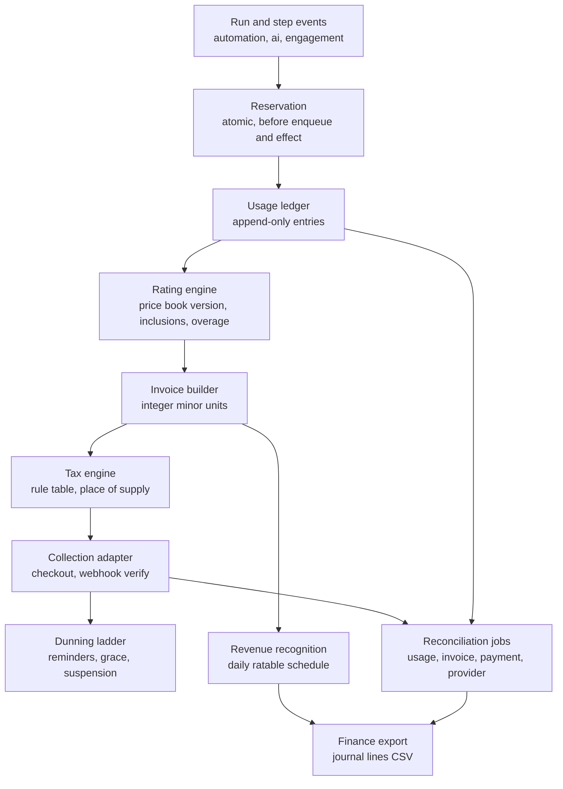
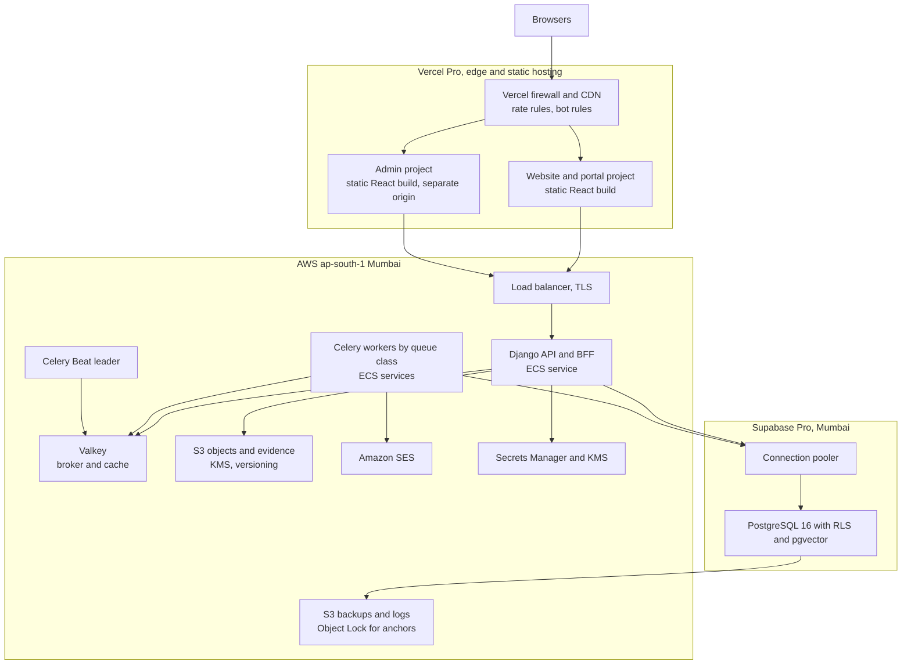
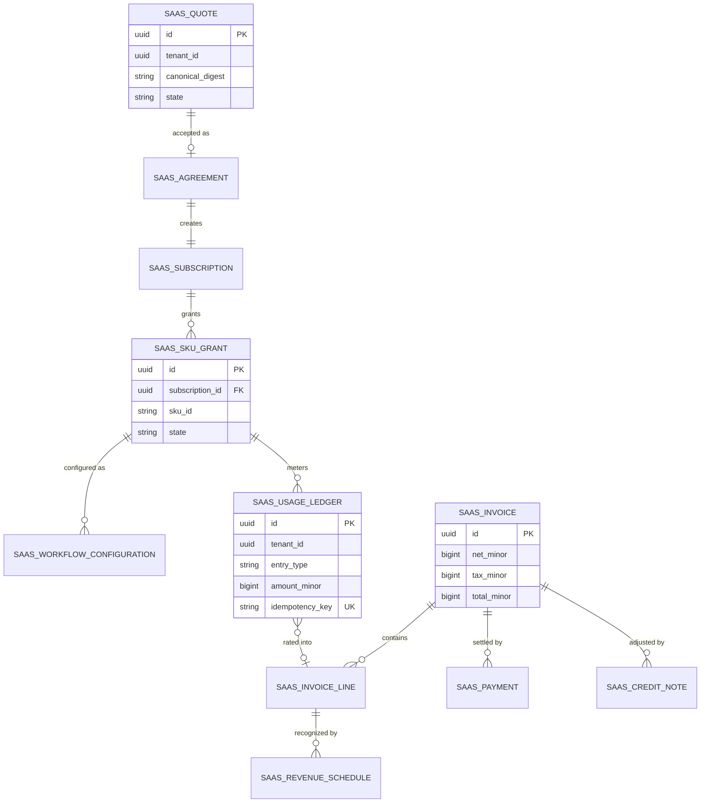

# AI Growth Engine: Employee Sales & Marketing Automation
## Application Blueprint: PART 11 (Batch 11.5b), V12 Platform Architecture: Billing, Error Handling, Infrastructure, DR, Release, Registers and Decisions

| Field | Value |
|---|---|
| Document | Part 11, Batch 11.5b (group R4, letter E), continuation of Part 11.5a |
| Version | 1.0 · 28 Nov 2026 |
| Baseline | As Part 11.5a: Parts 0–9.10, DEC-001…422; DEC-421 hosting; DEC-418 model routing; DEC-422 running budget; DEC-230 Ledger A; DEC-228 staffing |
| Source | FSD V12 chapters 10, 32, 36, 38, 39 (and the requirement, data, API and test consequences of chapters 02–09) |
| Roles applied | CTO / Principal Solutions Architect, Principal SRE / Platform Engineer, SaaS Billing and Entitlements Architect, Identity and Access Architect, DevOps Lead; FinOps Lead and QA Lead for cost and tests |
| ID ranges used | Tags 832…849 · DEC-580…597 · ADR-140…155 · FR-V12-E-001…135 · US-01/18/20/21-YE01… · TC-V12-E-001…120 |

**Facts to verify.** All Vercel, Supabase, AWS, payment-gateway, e-sign and tax facts below are as understood on 27 Nov 2026 and must be **verified at time of implementation (as of 27 Nov 2026)**. Amounts in ₹ use ₹85 per US$ (verify). Tax rates are configuration pending tax-adviser approval (CJ-R16), never legal advice.

## 11.5.5 Enhancements (part 2)

### 11.5.5.6 Billing, metering and financial reconciliation (ch10; ENT-BIZ-01…06; ADR-146…148)

#### A. Pipeline: meter → rate → invoice → tax → collect → dunning → revenue recognition (ENT-BIZ-01)



[RECOMMENDATION-846] The rating, invoicing, tax and ledger logic is built in-house in the `saas` module (open-source first, and money logic stays human-owned under DEC-420). A payment gateway is used **only for collection** (checkout, mandates, webhooks). An open-source billing engine (for example Lago, AGPL-3.0; verify licence and fit) was considered and is not recommended for Release 2 because it would add a second system of record for money and a licence review.

#### B. Usage ledger (ADR-146; FR-V12-E-070)

| Entry type | Created when | Sign | Notes |
|---|---|---|---|
| `estimate` | Quote or preview | info only | Never counted against quota |
| `reservation` | Before enqueue (run) and before effect (step) | − available | Holds units and budget |
| `consumption` | Step completed with eligible usage (or effect confirmed by receipt) | settles reservation | Actual quantity; may be less than reserved |
| `release` | Unused reservation; run cancelled, failed or held | + available | Never on an uncertain effect until reconciled |
| `reversal` | Correction of a posted consumption | opposite sign | References the reversed entry; posted entries are **never edited** |

Mandatory columns: `id`, `tenant_id`, `company_id`, `sku_id`, `workflow_version_id`, `run_id`, `step_id`, `period_id`, `meter_code`, `unit`, `quantity numeric(20,6)` (exact decimal for non-monetary meters), `amount_minor bigint` (integer minor units), `currency char(3)`, `cost_category`, `engine_code`, `ledger_type`, `price_version_id`, `allocation_basis`, `provider_receipt_ref`, `correlation_id`, `evidence_ref`, `idempotency_key`, `created_at`. Constraint `UNIQUE (tenant_id, idempotency_key)`. Partitioned monthly by `created_at`. Row-level security on `tenant_id`; `UPDATE` and `DELETE` revoked from the application role (append-only), enforced by trigger. The hourly `saas_usage_meter_reading` (ENT-183) becomes a **projection** of this ledger, so its reconciliation digest (NFR-035) is computed from ledger rows.

**Counting rule (V12 metering contract).** Completed (`consumption`) and active (`reservation` not yet settled) count toward the period; held, failed and cancelled runs count nothing after their `release`. The approved plan budget from the subscription is used, never a UI cap.

#### C. Atomic reservation (FR-V12-E-071)

```text
BEGIN;  -- READ COMMITTED with row lock on the balance row
SELECT included_qty, reserved_qty, consumed_qty, budget_minor, budget_reserved_minor
  FROM saas_quota_balance
 WHERE tenant_id = :t AND company_id = :c AND sku_id = :s AND meter_code = :m AND period_id = :p
 FOR UPDATE;
-- remaining_units  = included_qty + approved_overage_qty - reserved_qty - consumed_qty
-- remaining_budget = budget_minor - budget_reserved_minor - budget_consumed_minor  (tenant and parent budget)
IF :qty > remaining_units OR :amount_minor > remaining_budget THEN
   ROLLBACK; -> run Held (QUOTA or BUDGET), no ledger row
ELSE
   INSERT INTO saas_usage_ledger(..., entry_type='reservation', idempotency_key=:k) ON CONFLICT DO NOTHING;
   UPDATE saas_quota_balance SET reserved_qty = reserved_qty + :qty, budget_reserved_minor = ... ;
   COMMIT;
```

Repeated `idempotency_key` returns the original result (no second reservation). Parent budget (tenant level) and local budget (company or workflow configuration level) are both locked in a fixed order (tenant, then company) to avoid deadlocks. Uncertain effects keep their reservation until reconciliation decides `consumption` or `release` (V12 ch10).

#### D. Rating (FR-V12-E-072)

`line_amount_minor = round_half_even(max(0, eligible_units − included_units) × unit_rate_minor_per_unit)` per meter and SKU, using the `price_book_version` pinned in the subscription. Subscription fees are rated in advance; usage and managed-service hours in arrears (Part 8.3c §8.3.5.13.2 kept). Prepaid credits are drawn down before overage. Provider pass-through lines carry the provider receipt and are itemized separately (never merged into subscription).

#### E. Invoice arithmetic and rounding (FR-V12-E-073)

| Rule | Specification |
|---|---|
| RND-01 | All monetary amounts are `bigint` minor units + ISO 4217 currency (exponent from `ref_currency`, e.g. INR 2, JPY 0, BHD 3); no floating point anywhere |
| RND-02 | Database CHECK on `saas_service_invoice`: `total_minor = net_minor + tax_minor` and `net_minor = Σ line.net_minor`, `tax_minor = Σ tax_line.amount_minor` (V12 C2-T8). The invoice row is written in the same transaction as its lines |
| RND-03 | Tax is computed **per line** and rounded half-even, then summed (India GST invoice practice; verify with tax adviser, GAP-838) |
| RND-04 | Duplicate or out-of-order webhooks: payment events are applied by `(provider, provider_event_id)` uniqueness and by event time; a late refund before its payment is parked until the payment arrives |

ENT-184/185 currently use `numeric(18,2)`; these columns migrate to `*_minor bigint` through expand/contract (MG-02…MG-04) and the inconsistency is reported in §11.5.9.2.

#### F. Tax engine (FR-V12-E-074; ADR-148)

| Rule | Jurisdiction (V12) | Rule (V12) | V12 status | Blueprint activation |
|---|---|---|---|---|
| TX-01 | India intra-state | CGST 9% + SGST 9% | Configured | **Live** from Release 2 billing go-live after tax-adviser approval |
| TX-02 | India inter-state | IGST 18% | Configured | **Live** (same) |
| TX-03 | Export of services | IGST 0% under LUT | Configured | **Live** when a valid LUT reference is stored for the financial year |
| TX-04 | EU B2B | Reverse charge (0%; customer self-accounts) | Configured | Configured, **disabled** (CONFLICT-835) |
| TX-05 | EU B2C | Member-state rate via OSS (rate per state) | Configured | Configured, disabled |
| TX-06 | United Kingdom | VAT 20% | Configured | Configured, disabled |
| TX-07 | United Arab Emirates | VAT 5% | Configured | Configured, disabled |
| TX-08 | Singapore | GST 9% | Configured | Configured, disabled |
| TX-09 | Australia | GST 10% | Configured | Configured, disabled |
| TX-10 | United States | Sales tax by jurisdiction via tax provider | Provider TBD (DEC-V12-05) | Not built; provider selection GAP-839 |

Engine design: `tax_rule(rule_id, jurisdiction, customer_kind ∈ {b2b, b2c}, place_of_supply_logic, rate_bp (basis points), components[], effective_from/to, version, approval_state, enabled)`. Determination inputs: supplier GSTIN state, customer billing country/state, customer tax ID validity (GSTIN, EU VAT ID format + VIES check where enabled, verify), service type, LUT reference. Output: tax lines with rule version recorded on every invoice line. A rule version is usable only when `approval_state = approved` (tax adviser) **and** `enabled = true` for a market the Founder has opened (DEC-587). Rate changes create a new version with `effective_from`; historical invoices are never recomputed.

#### G. Collection (CV-13; FR-V12-E-075)

Collection adapter (port `PaymentCollectionPort`, ADR-103 pattern) supports: hosted checkout for the first invoice, card/UPI/net-banking mandates for recurring (where the gateway supports it, verify), bank transfer with manual evidence (ADR-038 path). Rules: checkout created idempotently (`checkout:{invoice_id}`); activation or provisioning only on **verified server webhook** with signature, amount, currency and order match; duplicate receipt cannot activate twice (`UNIQUE(provider, provider_payment_id)`); mismatch → `payment_exception` case in A101 for R14 review. Provider selection (Indian gateway for INR first) is open [GAP-839]; fees are a percentage of collections and are reported as cost of collection, not hosting (verify current rates).

#### H. Dunning (FR-V12-E-076)

| Step | Day (from due date) | Action | Effect on service |
|---|---|---|---|
| DN-0 | 0 | Invoice due; automatic mandate retry if a mandate exists | None |
| DN-1 | +3 | Reminder email to R12B billing owner and tenant admin | None |
| DN-2 | +7 | Second reminder; mandate retry; A101 task for R14 | None |
| DN-3 | +14 (= `grace_days`, contract parameter) [ASSUMPTION-841] | Final notice; subscription `past_due` → suspension scheduled | None until suspension date |
| DN-4 | Suspension date | Tenant `suspended` (SUB-T06): new effects blocked, read/export kept per contract | No new runs; in-flight reconcile |
| DN-5 | Payment verified | Reinstate (Suspended → Active), configuration restored (BRL-SVC-06) | Service resumes |

Every dunning message is a platform-operational notification (transactional), not marketing; the PDP still records it. Days are proposals pending Finance (GAP-838).

#### I. Revenue recognition (FR-V12-E-077)

Subscription fees are recognized **ratably per day** over the service period; usage and overage when the usage occurs (at rating); onboarding/professional services on delivery acceptance; credit notes reduce revenue in the period issued [ASSUMPTION-843, verify with the finance adviser against Ind AS 115]. `saas_revenue_schedule(invoice_line_id, recognition_date, amount_minor, state)`; a daily job posts recognized amounts; the finance export produces journal lines (deferred revenue, revenue, tax payable, receivable) as CSV for the accounting system. The platform does not run a general ledger.

#### J. Credit notes, refunds and disputes (BRL-SVC-07, CS-14; FR-V12-E-078, FR-V12-E-084)

Credit notes reference the original invoice and lines, carry their own tax lines (reverse of original rule version), reason code, approver (R14 ≠ requester), and are append-only. Refund = credit note + collection-adapter refund with idempotency key; executed only after authorization and reconciliation. Disputes: tenant opens `BillingDispute` from the portal with the disputed lines; the itemized view shows ledger entries per line (usage, invoice, credits); state `open → under_review → resolved_credit | resolved_no_change`; no refund before authorization; the dispute is private to the tenant.

#### K. Ledger types and accounts (FR-V12-E-079)

`ledger_type` ∈ {`saas_usage` (this ledger), `provider_charge` (what providers bill us), `subscriber_payment` (tenant's own customer revenue, `commerce.finance`), `ad_spend`}. Each type has separate tables or partitions, accounts and reports; no report sums across types (BRL-FIN-08, V12 ch09/ch10).

#### L. FX and multi-currency (MT-21, MOB-15, V6 currency; FR-V12-E-080, FR-V12-E-081)

Native ledgers are immutable in their currency. Converted reporting uses an `FxSnapshot` (existing, DEC-016) with rate, quote/base direction, date, source, version, precision and approval; amounts without an approved rate are **excluded from converted totals and shown as an exception** with their count and native total. SaaS invoices are issued in the subscription currency (INR at launch). Subscriber offering prices (`OfferingVersion`) remain versioned separately from SaaS fees (MT-14); changing them never touches a SaaS quote or invoice.

#### M. Cost allocation, forecasts and alerts (GC-14, RT-07; FR-V12-E-082, FR-V12-E-083)

| Cost element | Allocation basis (documented) | Source |
|---|---|---|
| Provider direct fees | Exact per run via `provider_receipt_ref` | Provider invoices |
| AI tokens | Exact per call (`ai_usage_event`) | Model gateway metering |
| Compute (ECS, Supabase, Vercel) | Share of worker-seconds per tenant per day; Supabase by share of rows written + query time sample | DEC-421 bills |
| Support | Ticket minutes per tenant | Support desk |
| Overhead | Equal share per active tenant | Monthly |
| Missing allocation | Shown as **unallocated**, never zero | — |

Forecast: `remaining = included + approved_overage − reserved − consumed`; trend = 7-day moving average of consumption; projected exhaustion date; alerts at 70/90/100% (DEC-162 ladder) to the tenant admin and billing owner. No overage without an approved overage term.

#### N. Reconciliation jobs (FR-V12-E-086)

| Job | Frequency | Compares | Exception |
|---|---|---|---|
| RJ-01 Usage ↔ ledger | Hourly | Run/step events vs ledger `consumption` count and digest | Missing or extra entry → case |
| RJ-02 Ledger ↔ invoice | At invoice close | Σ rated ledger vs invoice lines (BRL-SVC-04 100%) | Blocks invoice issue |
| RJ-03 Invoice ↔ payment | Daily | Invoice totals vs verified payments | Under/over payment case |
| RJ-04 Provider charge ↔ provider ledger | Monthly | Provider bills vs `provider_charge` entries | Variance > 2% → FinOps review |
| RJ-05 Reservations aging | Hourly | Reservations older than run timeout + 1 h | Release or escalate (uncertain) |
| RJ-06 Revenue schedule ↔ invoices | Monthly close | Recognized + deferred = invoiced − credits | Blocks finance export |

#### O. Commercial operations items (REC-26, ENT-BIZ-02…06; FR-V12-E-065, FR-V12-E-085, FR-V12-E-087…089)

| Item | Specification |
|---|---|
| Price book (ENT-BIZ-02) | `PriceBook` → `PriceBookVersion(state: draft, approved, published, retired)` → `PriceItem(sku_id or plan_version_id, meter_code, unit_rate_minor, currency, billing_period, tax_category)`. Website shows a price only from a **published** version; otherwise "Price on request" (DEC-047). Approval = Commercial lead + Finance, recorded |
| Order forms and e-signature (ENT-BIZ-03) | Order form generated from the issued quote (WeasyPrint, ADR-032); e-sign through the ADR-038 adapter (manual evidence path first); stored signed hash; entitlement activation only after SUB-T02 **and** activation approval |
| Onboarding playbooks (ENT-BIZ-04) | Part 8.3c CSO-01…12 kept; add milestone `first_value_at` = first completed run of a purchased SKU with accepted output; TTFV reported per cohort (signup month × plan) |
| Partner and reseller (ENT-BIZ-05, P2, V12 phase R4) | Data model reserved: `PartnerAccount`, `PartnerTenantLink(consent_state, billing_owner ∈ {partner, client})`. Partner sees **no client data without a grant** (PortfolioGrant pattern). Build deferred to R4 (CONFLICT-835) |
| Procurement pack (ENT-BIZ-06) | Document set maintained in A090 evidence: SIG Lite / CAIQ answers, architecture summary (this part + Part 3.1), DR summary (§11.5.5.9), insurance certificates (when held), DPA template; released to qualified prospects under NDA (W38 → R6) |
| Per-SKU service sheet (REC-26) | For each SKU version: delivery responsibility (client vs platform), monthly value statement, acceptance matrix, SLA reference (Part 8.3c SLA template), separate lines for usage, pass-through and support costs; fees remain "approval pending" until the price book is published |

### 11.5.5.7 Error handling, retry and recovery (ch32; ADR-152; FR-V12-E-095…103)

| ERR | Class (V12) | Detection | Behaviour | Retry | Run/effect state | HTTP / problem type |
|---|---|---|---|---|---|---|
| ERR-01 | Invalid scope / entitlement | AZ-04…09 | Fail closed; no side effect; audit denied | Never | Denied | 403/404 `scope-denied`, `entitlement-denied` |
| ERR-02 | Invalid schema / evidence | DTO validation, claims check | Hold with field errors; reviewer queue | Never (until corrected) | Held | 422 `validation-failed` |
| ERR-03 | Quota / budget | Reservation | Reject or hold **before** effect; release reservation | No | Held `QUOTA`/`BUDGET` | 409 `quota-exceeded` |
| ERR-04 | Read timeout / 429 | Adapter | Bounded retry honouring Retry-After / provider reset | ≤ 4 attempts, exponential 2^n s ± 20% jitter, cap 60 s | Running | — |
| ERR-05 | Write timeout (uncertain external write) | Adapter | Persist `uncertain`; reconcile with provider **before** any retry | Only after reconciliation says "not delivered" | Reconciling | — |
| ERR-06 | Conflict / version mismatch | ETag / revision | 409; client refreshes, revalidates; changed payload needs re-approval (hash changes) | No automatic | Held `STALE` | 409 `version-conflict` |
| ERR-07 | Provider outage | Breaker open | Pause, or **approved equivalent** fallback only; no unauthorized channel switch | Probe-driven | Held `PROVIDER_HOLD` | 503 `dependency-unavailable` |
| ERR-08 | Incident / emergency stop | Stop flag | Block new effects; preserve evidence; reconcile outstanding runs | No | Held `STOPPED` | 423 `stopped` |
| ERR-09 | Crash after checkpoint | Worker heartbeat lost | Resume the incomplete **safe** step from last checkpoint (deterministic steps; AI steps re-run within budget; effect steps go to ERR-05 path) | Once, then DLQ | Running | — |
| ERR-10 | Saturation | Queue age, saturation, provider limit | Backpressure: defer or reject new jobs fairly per tenant | Client retries after `Retry-After` | Queued / rejected | 429 `backpressure` |
| ERR-11 | Poison message | 5 failed deliveries | DLQ with failure code, scope, payload reference, owner | Authorized replay only | DLQ | — |
| ERR-12 | Dependency of an unaffected route | Health map | Keep other routes available; show provider hold and manual alternative | — | Unaffected | — |

| Mechanism | Parameters (initial, tunable by config revision) | FR |
|---|---|---|
| Circuit breaker (ST-02) | Per provider × tenant connector: open after 5 consecutive retryable failures **or** ≥ 50% failures over ≥ 20 calls in 60 s; open 60 s; half-open probe 1 call; close after 3 successes; scoped so a healthy provider stays available | FR-V12-E-096 |
| Idempotency (ST-05) | Scoped unique keys for inbound events `(provider, event_id)`, intents `(tenant, intent_key)`, receipts `(provider, receipt_id)`; repeated key returns the stored result | FR-V12-E-097 |
| Retry (ST-06) | Classified as validation (never), transient read (ERR-04), throttle (Retry-After), uncertain write (ERR-05) | FR-V12-E-098 |
| DLQ and replay (ST-07) | `DeadLetter(id, queue, failure_code, tenant_id, scope, payload_ref, owner, first/last_failed_at, attempts)`; replay requires R11 or R13 with step-up MFA, re-runs PDP and entitlement with **current** policy, reuses the original idempotency key (no duplicate effect); bulk replay ≤ 100 items per approval | FR-V12-E-099 |
| Backpressure (ST-08) | Admission control on enqueue: reject with 429 when queue age p95 > 2× class SLO or tenant share > 40% of a saturated queue; accepted jobs are durable (outbox) | FR-V12-E-100 |
| Degradation (ST-09) | Route health map; UI shows provider hold banner on affected screens only | FR-V12-E-101 |
| Synthetic probes (ST-10) | Every 5 min: public catalogue, login (test IdP), application submit (synthetic), API read, enqueue/dequeue echo job, billing sandbox rating; alert within 10 min of injected failure | FR-V12-E-102 |
| Chaos (ST-13) | Non-production only (ADR-135): provider outage, duplicate webhooks, latency, Valkey loss, Supabase connection exhaustion, S3 denial; evidence of recovery or bounded hold | FR-V12-E-103 |

### 11.5.5.8 Infrastructure, CI/CD and environments on DEC-421 (ch02, ch36; ADR-150, ADR-151, ADR-154)

**Conflict check.** V12 prescribes a provider-neutral topology (cloud choice "decision DEC-V7-03"). DEC-421 is that decision for this blueprint; every V12 layer maps onto it (table below). **Two V12 prescriptions conflict with DEC-421** and are raised for the Founder: (1) two isolated production regions, India and EU (CONFLICT-832); (2) PostgreSQL continuous WAL archiving with 35-day PITR, versus DEC-421 "daily backups; PITR added at the growth gate" (CONFLICT-833).



Browsers never reach Supabase (DEC-421). The SPAs call the API origin (directly, or through a Vercel rewrite to the API origin; one pattern chosen per environment and recorded in A090).

| V12 layer (ch02) | V12 rule | DEC-421 component | Isolation / scaling on DEC-421 | Residual action |
|---|---|---|---|---|
| Edge: CDN + WAF + bot protection | No tenant data cached; per-IP and per-email limits on W12–W20, W32, W35 | Vercel CDN + Vercel firewall (custom rules on Pro, verify) | Static assets only; per-email limits in Django (ADR-035 layer 2) | Firewall rules in IaC (Vercel provider for Terraform/OpenTofu, verify) |
| Web: React SPA (portal, admin) | Audience-specific builds; CSP; no inline secrets | Two Vercel projects | Separate origins; CSP headers in `vercel.json` | — |
| API: Django REST monolith | Stateless pods; scale on CPU/latency | ECS on EC2 (ADR-100) in ap-south-1 | Min 1 / max per Topology A/B; scale on CPU 60% and p95 latency | — |
| Policy engine | Pack versions cached per region; fail closed | In-process PDP (ADR-004) | Cache ≤ 30 s keyed by revision | — |
| Workers by queue class | interactive, ai_inference, effects, bulk, webhooks, scheduled; per-tenant fairness; effects concurrency per channel account | ECS services `worker-tx`, `worker-batch` (ADR-021) | Mapping below | — |
| Scheduler | Single active leader per region | Celery Beat with DB lock (ADR-028) | One leader | — |
| AI gateway | Region-pinned endpoints; per-tenant token quotas | Model gateway (ADR-008, DEC-418) | Provider region per Part 7.3 (verify data-processing location) | — |
| Provider gateway | Credentials by reference; signed webhooks into verified inbox | Adapters (ADR-103) | Secrets Manager references | — |
| Data: PostgreSQL 16 primary + replica, pgvector | Per-region cluster; PITR; non-owner app role | Supabase Pro (Mumbai); read replica optional at scale (verify plan) | RLS; `app_rw` non-owner; pooler transaction mode with `SET LOCAL` context | PITR: CONFLICT-833 |
| Cache/queue: Valkey | Keys prefixed by tenant and policy version | Valkey on ECS/ElastiCache (ADR-101) | `commercial.{env}.{region}.{tenant}.` prefix | — |
| Objects | Per-region bucket; tenant paths; KMS | S3 ap-south-1 | `{region}/{tenant}/{company}/…`; SSE-KMS | — |
| Secrets + KMS | No secret in DB, logs, prompts | AWS Secrets Manager + KMS; Supabase service key stored there | Vercel projects hold **no** secrets beyond public config | — |
| Observability | PII-redacted; in-region; CERT-In 180-day logs (IN) | OTel → CloudWatch/S3 (ADR-025); Vercel and Supabase log drains to S3 where the plan allows (verify) [ASSUMPTION-836] | 180-day retention in S3 ap-south-1 | Verify drain availability per plan |

**Queue classes (V12) mapped to ADR-021 queues (FR-V12-E-106).**

| V12 class | Blueprint queues | Service | Fairness / concurrency |
|---|---|---|---|
| interactive | `transactional`, `notify` | worker-tx | Highest priority |
| effects | `dispatch`, `reconcile` | worker-tx | Concurrency cap per channel account (provider rate) |
| webhooks | `webhook_process` | worker-tx | Inbox dedup first |
| ai_inference | `ai` | worker-batch | Per-tenant token quota; weighted round-robin |
| bulk | `research`, `projections`, `reports`, `imports_exports`, `render` | worker-batch | Round-robin over tenants |
| scheduled | `maintenance` (+ Beat triggers) | worker-batch | Leader only |
| *(new)* `siem`, `billing` | SIEM delivery; rating, invoicing, dunning, revenue jobs | worker-batch | Billing jobs idempotent per period |

**Environments (DEC-592; FR-V12-E-107) [RECOMMENDATION-848].**

| V12 environment | Blueprint (Part 3.1 §3.1.14) | DEC-421 realization | Data rule (V12) | Promotion gate (V12) |
|---|---|---|---|---|
| dev | `local` + `test` | Docker Compose (PostgreSQL 16 + pgvector, Valkey, MinIO); Vercel preview deployments for UI branches | Synthetic only | Unit, lint, type check |
| sit | `test` (CI) + nightly sandbox run | Ephemeral CI database container + provider sandboxes; Supabase CLI local stack where needed (verify) | Synthetic only | 1,342 workflow + 517 step tests; contract tests (Appendix A/B) |
| uat | `staging` | Supabase project `growth-uat` (Mumbai); ECS `growth-nonprod`; Vercel staging domains | Synthetic or consented pilot data, in region | UAT sign-off; AI suites (AIX-05); CJ tests |
| prod-in | `prod` | Supabase project `growth-prod-in`; ECS `growth-prod`; Vercel production | Real tenant data, Mumbai | Release checklist GO-01…08 |
| prod-eu | — | **Reserved, not built** (CONFLICT-832) | — | — |

**Accounts and projects (FR-V12-E-115).** AWS accounts `growth-shared`, `growth-nonprod`, `growth-prod` (Part 3.1 §3.1.6.1); Supabase organization with one project per environment (no production data in non-production; separate service keys); Vercel team with two projects × environments; GitHub OIDC to AWS roles; Supabase and Vercel tokens held in GitHub environment secrets with required reviewers for `prod-in`.

**CI/CD pipeline (ch36; FR-V12-E-109, FR-V12-E-110).**

| Stage (V12) | Jobs (GitHub Actions) | DEC-421 target | Failure behaviour (V12) |
|---|---|---|---|
| PR | Review, lint, type check, unit tests, secret scan, dependency audit + SBOM (CycloneDX), licence check, SAST | — | No merge |
| Build | Website and Admin builds (Vercel build with locked lockfile), API/worker image with immutable digest, cosign signature (CAP-X3-19) | Vercel prebuilt output; ECR image | No deploy of unverified digest |
| Contract | OpenAPI (Appendix A/A2) and JSON Schema (Appendix B) contract tests; migration dry-run on a clone of the Appendix C schema | CI database | Reject mismatch |
| SIT | Safe migration on synthetic clone; integration tests with mocks; RLS negative suite incl. pooled-connection test; AI-INJ; affected EVAL suites (AIX-06) | Ephemeral | Remediate and rerun |
| Staging / UAT | Same artifacts and config shape; DAST; UAT; performance smoke | `growth-uat` | External dispatch disabled until approval |
| Production | Infra plan review; PITR timestamp / logical dump verified; expand migration; Vercel promote; ECS rolling or canary (10% → 50% → 100% of tasks, 15 min each); smoke | `growth-prod-in` | Automatic rollback when the error-budget burn rate > 14.4 over 5 min or smoke fails; irreversible actions frozen |
| Activation | Owner/CTO approval in A090; per-tenant, per-SKU flags; budgets | DB flags | Stop dispatch; restore previous compatible build |

**Capacity and scale (MT-39, GC-03, GC-04; FR-V12-E-112…114).** Provisioning load test: create 25 owned-company tenants, then 100 and 250 synthetic tenants with multi-company, multi-market and multichannel variants; measure provisioning saga p95 (≤ 60 s excluding human gates), API p95, queue delay per class, quota isolation (one tenant at 100% quota does not raise another tenant's queue delay by > 20%), restore time. Autoscaling: worker services scale on queue age (target p95 ≤ class SLO), throughput and CPU, with cooldown 300 s, minimum 1 task per service, and a budget ceiling (max tasks from the FinOps budget); scale-in uses Celery warm shutdown with `acks_late` so no acknowledged job is lost. Benchmark BM-01 (GC-04): run the same workload (API read mix, rating batch, AI-step orchestration) on ECS on EC2, ECS Fargate and AWS Lambda; record cold start, duration, memory, egress, p95 and cost per 1,000 runs; the result is recorded as an ADR update before the scale gate.

**Region-ready design without a second region (ADR-151) [RECOMMENDATION-845].** Every tenant row has `region_code`; every storage key, cache key and vector namespace starts with the region; IaC is parameterized by region; configuration refuses a request whose tenant region differs from `REGION_CODE`. A second region is then a **separate stamped deployment** (its own Vercel projects or rewrites, Supabase project, ECS, S3, KMS) with **no cross-region replication of personal data**, and a global directory that stores only tenant → region routing (no personal data). Nothing is built until DEC-590.

### 11.5.5.9 Migration, backup and disaster recovery (ch38; ADR-153; FR-V12-E-120…127)

**Migration gates (REC-22; FR-V12-E-120).**

| Gate | V12 work | Specification | Evidence |
|---|---|---|---|
| MG-01 Inventory | Inspect Django models, migration graph, row counts, FKs, ownership gaps; logical vs deployed schema | `manage.py showmigrations`, schema diff against Appendix C, ownership report | Inventory report in A090 |
| MG-02 Expand | Compatible columns/indexes with bounded locks; validate on clone | `lock_timeout = 5s`, `statement_timeout` per step; `CREATE INDEX CONCURRENTLY` | Clone run log |
| MG-03 Backfill | Batched idempotent backfill with explicit owner mapping; **quarantine** ambiguous records; reconcile counts and totals | Batches ≤ 5,000 rows; `migration_quarantine(table, row_id, reason)`; finance totals by currency compared before/after | Reconciliation report |
| MG-04 Validate / contract | NOT NULL/unique/FK, scoped queries, finance totals, rollback window; remove old schema only after sign-off | Contract only in the next release after compatibility sign-off | QA sign-off |
| MG-05 Backup | Encrypted automated backup + PITR; checksum, retention, restore credentials | See backup table | Backup verification job |
| MG-06 Restore rehearsal | New isolated instance; timestamps; smoke; reconcile critical data; tenant isolation | Supabase restore to a **new project** (or PITR clone, verify) + RLS smoke + ledger reconciliation | Drill record (KPI-18/19) |

**Capability migration (FR-V12-E-121).** Legacy capability IDs (100) map to SKU and workflow versions via `cat_legacy_capability_map`; approved rights are preserved as SKU grants; dry run compares scope and counts; backup before change; active runs keep their version snapshot and get the current safety recheck at the next effect. The `SM-APPLICATION-4` envelope is imported only through a separately tested adapter that produces a new `SM-APPLICATION-6` draft (never an active configuration).

**Backup design on DEC-421 (FR-V12-E-122).**

| Asset | Mechanism | RPO | Retention | Location | Status |
|---|---|---|---|---|---|
| PostgreSQL (Supabase) | Supabase daily backups (Pro) | 24 h | 7 days (verify) | Supabase, Mumbai | DEC-421 baseline |
| PostgreSQL (Supabase) | **PITR add-on** (Option A) | ≈ 2 min (WAL, verify) | 7 days (larger options 14/28 days, verify) | Supabase, Mumbai | CONFLICT-833 |
| PostgreSQL (independent) | Logical dump (`pg_dump -Fc`, encrypted with KMS) to S3 `growth-prod-backups` | Daily (DEC-421 nightly) → **every 6 h** proposed | **35 days** (V12) via S3 lifecycle; monthly copy 12 months | AWS ap-south-1, separate account | Proposed |
| PostgreSQL (Option B alternative) | Logical replication subscriber on AWS (PostgreSQL 16, small instance) | Seconds–minutes (verify lag) | Continuous | AWS ap-south-1 | Alternative to A |
| S3 objects | Versioning; noncurrent 35 days; cross-zone within region | 0 | 35 days | ap-south-1 | Unchanged (no cross-jurisdiction replication) |
| Audit anchors | S3 Object Lock daily anchor | 1 day | 7 years | ap-south-1 | Unchanged |
| Valkey | Not a recovery source (rebuilt from PostgreSQL) | n/a | — | — | Unchanged |
| Vercel deployments | Immutable deployments; instant rollback | 0 | Per plan (verify) | Vercel | Unchanged |
| IaC, schemas, prompts, workflow definitions | Git + release tags; mirror to S3 | Per commit | Indefinite | GitHub + S3 | Unchanged |

**Recovery objectives (DEC-V9-01 adopted as DEC-595; FR-V12-E-123).**

| Data class (V12) | Blueprint class | RPO | RTO | KPI | Achievable on DEC-421 when | Verification |
|---|---|---|---|---|---|---|
| Critical transactional data | RC-1 | ≤ 15 min | ≤ 4 h | KPI-18, KPI-19 | **Only with Option A or B** (daily backup gives 24 h) | Isolated restore + ledger reconciliation |
| Growth workload (critical) | RC-1 subset (runs, outbox, approvals, ledgers of active workflows) | ≤ 15 min | ≤ 2 h | KPI-18, KPI-32 | Option A/B + rehearsed runbook (≤ 2 h needs ≤ 75-min RC-1 restore, ADR-102 trigger) | Growth recovery drill |
| Regenerable research data | RC-2 | ≤ 24 h | ≤ 8 h | KPI-33, KPI-34 | Already (daily + rebuild) | Research-only restore |
| Regional loss | All | ≤ 15 min (Option A/B within region does **not** survive regional loss; S3 cross-region copy of logical dumps gives ≤ 6 h) | Best effort ≤ 8 h at pilot (CONFLICT-101 resolution kept) | — | Scale gate | Twice-yearly rehearsal |

**DR runbooks (FR-V12-E-124, FR-V12-E-125).**

| Runbook | Trigger | Steps (summary) | Target |
|---|---|---|---|
| DR-01 Point-in-time restore (corruption / bad migration) | FM-05 | Stop dispatch (`EXTERNAL_DISPATCH_ENABLED=false`); pause effects queue; PITR restore to new project at T−1 min (Option A) or promote subscriber (Option B); verify RLS, audit chain, ledger reconciliation; repoint `DATABASE_URL` secret; resume after reconciling in-flight effects | RC-1 ≤ 4 h / ≤ 15 min |
| DR-02 Supabase project unavailable | Provider incident | Status banner; read-only mode for portals; if > 2 h, restore latest logical dump into AWS-hosted PostgreSQL (prepared IaC) and repoint; reconcile after | ≤ 8 h (pilot) |
| DR-03 AWS compute failure | FM-01/02 | ECS reschedule; Valkey rebuild; outbox relay re-publishes | ≤ 20 min / 0 |
| DR-04 Vercel incident | Vercel status | Static builds also published to S3 + CloudFront fallback bucket (prebuilt artifacts); DNS switch documented (manual) | ≤ 1 h |
| DR-05 Region loss (ap-south-1) | FM-04 | IaC apply in ap-south-2 (Hyderabad), restore logical dump from cross-region copy, new Supabase project in nearest available region **only if data-residency review allows** (verify), DNS switch, effects paused until reconciliation | Best effort ≤ 8 h |

**Drills.** Quarterly restore drill per production region with evidence (OPT-TC-ST-14), recording start/stop timestamps, achieved RPO, RTO, smoke, ledger reconciliation and tenant-isolation check. **Erasure replay**: after any restore, the `privacy_erasure_log` (IDs and hashes only) is replayed so that data deleted after the backup point stays deleted (V12 ch38). Failover pauses the effects queue until in-flight effects are reconciled. Restore success is never claimed without drill evidence.

**Storage lifecycle and portability (GC-06, CS-15; FR-V12-E-126, FR-V12-E-127).** Unchanged from DEC-028 and CSO-10/11, with the V12 statement adopted: archive only eligible data; retained or held data never deleted; export contains only authorized data; deletion honours retention and legal hold.

### 11.5.5.10 Release, rollback and roadmap (ch39; ADR-155; FR-V12-E-130…135)

**R0–R5 mapped to the approved roadmap (DEC-596; FR-V12-E-134).**

| V12 phase | V12 scope (summary) | V12 exit criteria | Blueprint mapping | Status |
|---|---|---|---|---|
| R0 Foundations | Core from Appendices A–C/A2/C2; identity reuse; CI/CD with SAST/DAST/SBOM; IaC in IN region | SIT green (1,342 + 517 tests); RLS and SoD suites; SBOM per build | W0–W1 (Day 1–45) on DEC-421 | Matched |
| R1 Private beta India (owned companies) | SSO/MFA, audit, API keys, webhooks, exports, connectors (email, WhatsApp, SMS-DLT, CRM); India pack legally approved | UAT-E2E-01, XS-01…10; pen test #1 no open critical/high; DLT live; DPIA (India) | Release 1 (W0–W3, go/no-go 4 Jun 2027) for MFA, audit, exports, connectors already in scope; **tenant SSO** not in Release 1 scope | Pending Founder (CONFLICT-834) |
| R2 GA India | Billing and tax live, status page, support desk, SLA tiers, custom roles, SCIM, sandbox; WCAG 2.2 AA manual audit | Blocking KPIs met in production; SOC 2 Type I; ACR; restore drill meets DEC-V9-01 | Release 2 (W4–W5, build 2 Jul 2027) + W6; SOC 2 Type I only on the DEC-408 trigger (Part 9.9) | Pending Founder (CONFLICT-834) |
| R3 EU launch | EU region, GDPR/ePrivacy/AI Act assessments, de/fr locales, BYOK, SDKs, bug bounty | SOC 2 Type II; ISO 27001; EU pack; DPIA and AI Act assessment | Not in the approved horizon (Day 365); BYOK and SDKs exist as A2/A3 items (CAP-X3-15, CAP-X3-23) | Pending Founder (CONFLICT-832, CONFLICT-835) |
| R4 UK, Middle East, APAC | UK, UAE, SG, AU packs; Arabic RTL; partner programme | Packs approved; regional residency; ISO 27701 and 42001 | Not in horizon | Pending Founder (CONFLICT-835) |
| R5 Americas | US (CAN-SPAM, TCPA, state privacy), Canada (CASL), Brazil (LGPD); US region | Packs approved; US sales-tax provider; regional providers | Not in horizon | Pending Founder (CONFLICT-835) |

V12 states that durations are not estimated by the sequence; the blueprint dates of record (DEC-416) are unchanged by this mapping.

**Per-SKU release gate (FR-V12-E-132).** An SKU version can be activated for a tenant cohort only when A090 shows: approved requirements; provider permission (where external); physical API and DB contracts merged; SKU tests green (workflow, step, AI eval); security review; cost estimate and budget; SLA reference; price book status (published or "price on request"). Activation is progressive: internal tenant → one owned company → owned cohort → independent cohort; each step has an error-budget guard. Rollback reverts code or configuration and compatible migrations; completed external effects are **reconciled, not silently undone**.

**Maintenance (REC-24; FR-V12-E-133).** The six V12 cadences (daily, weekly, monthly, quarterly, before any update, after incident) map one-to-one to Part 8.3c MNT calendar; overdue controls escalate to the owner in A106. DEC-421 adds monthly checks of Vercel/Supabase plan limits, log-drain health, backup and PITR status, and vendor DPA/residency status.

**Optimization release (FR-V12-E-135) and ST-11 (FR-V12-E-131).** Unchanged: fixed-workload pilot, quality/consent/security/reliability gates before any cheaper model or variant, feature flags, version snapshots, error-budget gate, owner approval for pricing, provider, capacity and customer-facing claims.

### 11.5.5.11 Data model additions (for Part 3.3; DDL owner group R8 applies naming to Appendix C2)

| Table | Scope | Key columns | Constraints | FR |
|---|---|---|---|---|
| `ten_organization` | T | id, tenant_id, name, state | UNIQUE (tenant_id, id); UNIQUE (tenant_id, lower(name)) | 001 |
| `ten_startup` (+cols) | T | organization_id, registration_country, operating_countries[], customer_type | Composite FK (tenant_id, organization_id) | 001, 034, 036 |
| `ten_tenant` (+cols) | P | region_code, lifecycle_state, customer_type | CHECK region_code IN ('in') until DEC-590 | 004, 058 |
| `ten_portfolio_grant` | X | grantor_tenant_id, grantee_tenant_id, aggregate_dimensions[], state, expires_at | Grantor ≠ grantee | 003 |
| `idn_idp_connection` | T | protocol, issuer, metadata_url, certs, audience, mapping, state | metadata_url LIKE 'https://%' | 010 |
| `idn_verified_domain` | T | domain, token_hash, state, last_checked_at | UNIQUE (domain) globally among verified | 011 |
| `idn_scim_token`, `idn_scim_group_role_map` | T | token_hash, last_used_at; group_external_id, role_id | — | 012 |
| `idn_tenant_security_policy` | T | mfa_mode, privileged_factor, max_session_hours, idle_timeout_minutes | CHECK 1–24; CHECK 5–120 | 013, 014 |
| `idn_break_glass_account` | T | user_id, last_used_at | ≤ 2 per tenant | 015 |
| `idn_permission`, `idn_role`, `idn_role_permission` | P / T | resource, action; kind; | SoD trigger on insert/update (C2-T1) | 016, 017 |
| `idn_sod_constraint` | P | permission_a, permission_b, scope | — | 017 |
| `aud_export_job`, `aud_siem_sink` | T | filters, format, manifest; type, endpoint, auth_ref, retention_years | retention IN (1, 3, 7) | 018, 019 |
| `idn_service_principal_grant` | T | run_id/job_id, permissions, expires_at | expires_at ≤ created_at + 15 min | 021 |
| `saas_application` / `saas_application_revision` | P (pre-tenant) | application_id, revision, canonical_digest, envelope jsonb, state | UNIQUE (application_id, revision) | 030, 031 |
| `saas_provisioning_saga` | P | application_id, revision, current_step, attempt, state, last_error_code | UNIQUE idempotency key per step | 038 |
| `cat_service_sku`, `cat_sku_version`, `cat_workflow_version`, `cat_bundle`, `cat_bundle_item`, `cat_foundation`, `cat_engine`, `cat_legacy_capability_map`, `cat_public_projection` | P | as §11.5.5.4 | Released versions immutable (trigger) | 045–051 |
| `saas_quote`, `saas_agreement` | T | as §11.5.5.5 | Digest equality on accept | 055, 056 |
| `saas_sku_grant`, `saas_workflow_configuration`, `saas_quota_balance` | T | as §11.5.5.5 / .6 | Workflow ∈ SKU (FK to cat_workflow_version.sku_id) | 059, 060, 071 |
| `saas_usage_ledger` | T | as §11.5.5.6 B | Append-only trigger; UNIQUE (tenant_id, idempotency_key) | 070 |
| `saas_price_book`, `saas_price_book_version`, `saas_price_item` | P | as §11.5.5.6 O | Published only when approved | 065 |
| `saas_service_invoice` (+cols), `saas_service_invoice_line` (+cols), `saas_tax_line` | T | *_minor bigint, currency, tax_rule_version_id | total = net + tax (C2-T8) | 073, 074 |
| `tax_rule` | P | §11.5.5.6 F | Usable only when approved and enabled | 074 |
| `saas_payment`, `saas_payment_exception` | T | provider, provider_payment_id, amount_minor, currency, state | UNIQUE (provider, provider_payment_id) | 075 |
| `saas_dunning_event`, `saas_revenue_schedule`, `saas_credit_note`, `saas_billing_dispute` | T | §11.5.5.6 H–J | Append-only where financial | 076–078, 084 |
| `ops_dead_letter`, `ops_reconciliation_case` | T | §11.5.5.7, RJ-01…06 | — | 086, 099 |
| `migration_quarantine` | P | table, row_id, reason, resolved_by | — | 120 |



### 11.5.5.12 API additions (for Part 3.2 and Appendix A2; contract owner group R7)

| Method and path | Purpose | Roles | FR |
|---|---|---|---|
| `GET/POST/PATCH /api/v1/tenants/{tid}/idp-connections`, `POST …/{cid}/test-login`, `POST …/{cid}/activate` | Tenant SSO | R12 (step-up) | 010 |
| `POST /api/v1/tenants/{tid}/verified-domains`, `POST …/{did}/verify` | Domain verification | R12 | 011 |
| `/scim/v2/Users`, `/scim/v2/Groups`, `/scim/v2/ServiceProviderConfig`, `/scim/v2/Schemas`, `/scim/v2/ResourceTypes` | SCIM 2.0 | SCIM token | 012 |
| `GET/PATCH /api/v1/tenants/{tid}/security-policy` | MFA and session policy | R12 (step-up) | 013, 014 |
| `POST /api/v1/sessions/{sid}/revoke`, `POST /api/v1/users/{uid}/sessions/revoke-all` | Revocation | R12, self | 014 |
| `GET /api/v1/permissions`, `GET/POST/PATCH/DELETE /api/v1/roles` | Custom roles | R12 | 016, 017 |
| `POST /api/v1/audit/exports`, `GET …/{id}`, `POST /api/v1/audit/verify` | Audit export | R12, R15 | 018 |
| `GET/POST/PATCH/DELETE /api/v1/siem-sinks`, `POST …/{id}/test` | SIEM | R12 | 019 |
| `GET/POST/DELETE /api/v1/portfolio-grants` | MT-07 | Grantor R12 (step-up) | 003 |
| `POST /api/v1/applications` (envelope), `PUT /api/v1/applications/{aid}/revisions/{n}`, `POST …/submit` | Application | R17 | 030–033 |
| `GET /api/v1/admin/provisioning-sagas`, `POST …/{id}/retry`, `POST …/{id}/compensate`, `POST …/{id}/activate` | Saga | R12 platform, Service Owner | 038 |
| `GET /api/v1/catalogue/skus`, `GET …/{sku}/versions`, `GET /api/v1/public/catalogue` | Catalogue and projection | R18 (public), all | 045–051 |
| `POST /api/v1/admin/catalogue/sku-versions/{id}/transition` | SKU lifecycle | Catalogue reviewer | 045 |
| `POST /api/v1/quotes`, `POST …/{qid}/issue`, `POST …/{qid}/accept` | Quote and agreement | R14 / R12B (step-up) | 055–057 |
| `POST /api/v1/subscriptions/{sid}/change-preview`, `POST …/changes` | Plan change | R12B | 062 |
| `GET /api/v1/subscriptions/{sid}/usage`, `GET …/forecast` | Usage and forecast | R12, R12B | 070, 083 |
| `GET /api/v1/invoices`, `GET …/{iid}`, `POST /api/v1/invoices/{iid}/credit-notes` | Invoices, credits | R12B; R14 | 073, 078 |
| `POST /api/v1/billing/webhooks/{provider}` | Payment events | Signed provider | 075 |
| `POST /api/v1/billing-disputes`, `PATCH …/{id}` | Disputes | R12B; R14 | 084 |
| `GET /api/v1/admin/dead-letters`, `POST …/replay` | DLQ replay | R11, R13 (step-up) | 099 |
| `GET /api/v1/admin/reconciliation-cases` | RJ exceptions | R14, R13 | 086 |

All endpoints: problem+json errors (ADR-022), idempotency keys on unsafe methods (ADR-023), `X-Request-ID`, scope from membership, never from the body.

### 11.5.5.13 Functional requirement register (FR-V12-E)

| FR | Requirement | Source (V12) | Epic | Wave / release | Tests |
|---|---|---|---|---|---|
| FR-V12-E-001 | Tenant → Organization → Company hierarchy with composite FKs; company = startup | MT-01, ch05 | EP-01 | W1 (R1) | TC-001, 002 |
| FR-V12-E-002 | Company membership separate; adding a company grants nothing | MT-05 | EP-01 | W1 | TC-003 |
| FR-V12-E-003 | Portfolio grants: explicit, revocable, aggregate-only | MT-07 | EP-01 | W2 | TC-004, 007 |
| FR-V12-E-004 | Region code on tenant and on every key; request region check | ch02 CJ-R09 | EP-01 | W1 | TC-006 |
| FR-V12-E-005 | Isolation invariants incl. pooled-connection context reset | ch05, SEC-02 | EP-01 | W0 | TC-005, 008 |
| FR-V12-E-010 | Tenant SAML 2.0 / OIDC SSO | ENT-IDN-01 | EP-01 | Release 2+ (CONFLICT-834) | TC-010, 011, 012 |
| FR-V12-E-011 | Verified domains (DNS TXT) and monitoring | ENT-IDN-02 | EP-01 | Release 2+ | TC-013, 014 |
| FR-V12-E-012 | SCIM 2.0 provisioning and de-provisioning | ENT-IDN-03 | EP-01 | Release 2+ | TC-015, 016, 017 |
| FR-V12-E-013 | Tenant MFA policy; phishing-resistant for privileged | ENT-IDN-04, SEC-03 | EP-01 | W2 | TC-018 |
| FR-V12-E-014 | Tenant session policy 1–24 h / 5–120 min; revocation | ENT-IDN-05 | EP-01 | W2 | TC-019, 020 |
| FR-V12-E-015 | Break-glass before SSO enforcement | ENT-IDN-06 | EP-01 | Release 2+ | TC-021 |
| FR-V12-E-016 | Permission catalogue and custom roles | ENT-ACC-01 | EP-01 | Release 2+ | TC-022, 023 |
| FR-V12-E-017 | SoD constraints at build, assignment and DB trigger | ENT-ACC-02 | EP-01 | W2 | TC-024, 025 |
| FR-V12-E-018 | Audit export JSONL/CSV with chain verification | ENT-ACC-03 | EP-01 | W3 | TC-026, 027 |
| FR-V12-E-019 | SIEM streaming sinks; 1/3/7-year retention option | ENT-ACC-04 | EP-01 | Release 2+ | TC-028, 029 |
| FR-V12-E-020 | JIT support access with ticket link | ENT-ACC-05 | EP-01 | W2 | TC-030 |
| FR-V12-E-021 | Central authorization incl. SKU dimension; service-principal grants | SEC-01, ch06 matrix | EP-01 | W1 | TC-009, 032 |
| FR-V12-E-022 | Deny-reason precedence per V12 order | ch06 | EP-03 | W1 | TC-031 |
| FR-V12-E-030 | `SM-APPLICATION-6` envelope contract | ch07 V6 | EP-20 | W4 | TC-033, 034 |
| FR-V12-E-031 | Revision, digest and replay rules | BR-V3-06/07, SEC-05 | EP-20 | W4 | TC-035, 036 |
| FR-V12-E-032 | Eight-stage wizard | MT-08, MOB-04 | EP-20 | W4 | TC-037 |
| FR-V12-E-033 | Server-backed drafts; stale revision rejected | CV-01, CV-02 | EP-20 | W4 | TC-038 |
| FR-V12-E-034 | 14 configurable customer types; individual workspace | MT-04 | EP-20 | W4 | TC-039 |
| FR-V12-E-035 | No onboarding ceiling; quotas separate | MT-03 | EP-20 | W4 | TC-040 |
| FR-V12-E-036 | Registration, operating and target countries separate | MT-17 | EP-20 | W4 | TC-041 |
| FR-V12-E-037 | Region, language, IANA timezone per market; DST | MT-19 | EP-20 | W4 | TC-042 |
| FR-V12-E-038 | Provisioning saga PS-01…08 | ch07 V4/V6 | EP-20 | W4 | TC-043, 044, 045 |
| FR-V12-E-039 | Configuration diff, rollback-as-new-draft, snapshot protection | REC-04 | EP-18 | W4 | TC-046 |
| FR-V12-E-040 | Hierarchy validation HV-01…10 | ch07 V6 | EP-20 | W4 | TC-047, 048 |
| FR-V12-E-045 | SKU registry and lifecycle | ch08 | EP-20 | W4 | TC-049 |
| FR-V12-E-046 | Workflow version registry; immutable run snapshot | ch08 | EP-18 | W1 | TC-050 |
| FR-V12-E-047 | Bundles | ch08 | EP-20 | W4 | TC-051 |
| FR-V12-E-048 | Foundations register (25) | ch08 | EP-20 | W4 | TC-052 |
| FR-V12-E-049 | Engines register (15) and engine_code on cost | ch08 | EP-20 | W4 | TC-053 |
| FR-V12-E-050 | Legacy capability map | ch08, ch38 | EP-20 | W4 | TC-054 |
| FR-V12-E-051 | Public catalogue projection allowlist | ch08 | EP-19 | W3 | TC-055 |
| FR-V12-E-055 | Quote binding application revision and SKU versions | ch09 | EP-20 | W5 | TC-056 |
| FR-V12-E-056 | Agreement bound to verified signer and digest | CV-12, ENT-BIZ-03 | EP-20 | W5 | TC-057 |
| FR-V12-E-057 | Commercial state machine SUB-T01…T08 | ch09 | EP-20 | W5 | TC-058, 059 |
| FR-V12-E-058 | Tenant lifecycle states and offboarding | MT-06, REC-27 | EP-20 | W5 | TC-060, 061 |
| FR-V12-E-059 | SKU grants and workflow configuration (MT-16) | ch09, MT-16 | EP-20 | W4 | TC-062 |
| FR-V12-E-060 | Four-point entitlement enforcement | ch09 | EP-18 | W4 | TC-063, 064 |
| FR-V12-E-061 | Optional upstream input rule | ch09 | EP-18 | W4 | TC-065 |
| FR-V12-E-062 | Plan change preview, effective date, proration | RT-11 | EP-20 | W5 | TC-066, 067 |
| FR-V12-E-063 | Renewal, grace, suspension, reactivation | ch09 | EP-20 | W5 | TC-068 |
| FR-V12-E-064 | Refund and cancellation by credit/reversal | ch09 | EP-20 | W5 | TC-069 |
| FR-V12-E-065 | Price book and transparent pricing | CV-05, ENT-BIZ-02 | EP-20 | W5 | TC-070 |
| FR-V12-E-070 | Usage ledger entry types and keys | ch10 | EP-20 | W4 | TC-071, 072 |
| FR-V12-E-071 | Atomic reservation, release, uncertain hold | ch10, BR-V3-09 | EP-20 | W4 | TC-073, 074 |
| FR-V12-E-072 | Rating engine | ENT-BIZ-01 | EP-20 | W5 | TC-075 |
| FR-V12-E-073 | Invoice in minor units; total = net + tax | ch10 C2-T8 | EP-20 | W5 | TC-076 |
| FR-V12-E-074 | Tax engine TX-01…10 with approval and enablement | ch10 | EP-20 | W5 | TC-077, 078 |
| FR-V12-E-075 | Verified collection; duplicate receipt safe | CV-13 | EP-20 | W5 | TC-079 |
| FR-V12-E-076 | Dunning DN-0…5 | ENT-BIZ-01 | EP-20 | W5 | TC-080 |
| FR-V12-E-077 | Revenue recognition schedule and export | ENT-BIZ-01 | EP-20 | W6 | TC-081 |
| FR-V12-E-078 | Credit notes | ENT-BIZ-01, BRL-SVC-07 | EP-20 | W5 | TC-082 |
| FR-V12-E-079 | Distinct ledger types | ch10 | EP-15 | W4 | TC-083 |
| FR-V12-E-080 | FX and native-currency reporting | MT-21, MOB-15 | EP-15 | W4 | TC-084 |
| FR-V12-E-081 | Offering price independent of SaaS fee | MT-14 | EP-15 | W4 | TC-085 |
| FR-V12-E-082 | Cost allocation with unallocated shown | GC-14 | EP-21 | W5 | TC-086 |
| FR-V12-E-083 | Consumption forecast and quota alerts | RT-07 | EP-20 | W5 | TC-087 |
| FR-V12-E-084 | Billing disputes | CS-14 | EP-20 | W5 | TC-088 |
| FR-V12-E-085 | Per-SKU service sheet | REC-26 | EP-20 | W5 | TC-089 |
| FR-V12-E-086 | Reconciliation jobs RJ-01…06 | ch10 | EP-20 | W5 | TC-090 |
| FR-V12-E-087 | Partner/reseller model reserved; no data without grant | ENT-BIZ-05 | EP-20 | R4 (CONFLICT-835) | TC-091 |
| FR-V12-E-088 | Procurement pack | ENT-BIZ-06 | EP-21 | W6 | TC-092 |
| FR-V12-E-089 | Onboarding playbooks and TTFV | ENT-BIZ-04 | EP-20 | W5 | TC-093 |
| FR-V12-E-095 | Error class registry ERR-01…12 | ch32 | EP-18 | W1 | TC-094 |
| FR-V12-E-096 | Circuit breaker parameters | ST-02 | EP-18 | W2 | TC-095 |
| FR-V12-E-097 | Idempotency and reconciliation | ST-05 | EP-18 | W1 | TC-096 |
| FR-V12-E-098 | Retry policy by class | ST-06 | EP-18 | W1 | TC-097 |
| FR-V12-E-099 | DLQ and authorized replay | ST-07 | EP-18 | W2 | TC-098 |
| FR-V12-E-100 | Backpressure | ST-08 | EP-18 | W3 | TC-099 |
| FR-V12-E-101 | Dependency-aware degradation | ST-09 | EP-18 | W3 | TC-100 |
| FR-V12-E-102 | Synthetic probes | ST-10 | EP-21 | W3 | TC-101 |
| FR-V12-E-103 | Chaos and fault injection (non-prod) | ST-13 | EP-21 | W5 | TC-102 |
| FR-V12-E-105 | DEC-421 topology for the 13 V12 layers | ch02 | EP-21 | W0 | TC-103 |
| FR-V12-E-106 | Queue-class mapping and fairness | ch02 | EP-18 | W0 | TC-104 |
| FR-V12-E-107 | Environments dev/sit/uat/prod-in | ch02 | EP-21 | W0 | TC-105 |
| FR-V12-E-108 | Configuration contract with fail-fast | ch36 | EP-21 | W0 | TC-106 |
| FR-V12-E-109 | CI/CD stages incl. contract, RLS, AI eval, SBOM | ch36 | EP-21 | W0 | TC-107 |
| FR-V12-E-110 | Canary/flags and automatic rollback on burn | ch36 | EP-21 | W1 | TC-108 |
| FR-V12-E-111 | SLO set reconciled | ch32, ch36 | EP-21 | W1 | TC-109 |
| FR-V12-E-112 | Provisioning and scalability tests | MT-39 | EP-21 | W5 | TC-110 |
| FR-V12-E-113 | Worker autoscaling with no lost jobs | GC-03 | EP-21 | W3 | TC-111 |
| FR-V12-E-114 | Compute benchmark BM-01 | GC-04 | EP-21 | W5 | TC-112 |
| FR-V12-E-115 | Accounts/projects separation; no prod data in dev | ch36 | EP-21 | W0 | TC-113 |
| FR-V12-E-116 | In-region observability; 180-day logs | ch02 | EP-21 | W1 | TC-114 |
| FR-V12-E-120 | Migration gates MG-01…06 and quarantine | REC-22 | EP-21 | W0 | TC-115 |
| FR-V12-E-121 | Legacy capability and envelope migration | ch38 | EP-20 | W4 | TC-054, 116 |
| FR-V12-E-122 | Backups on DEC-421 (+ Option A/B) | ch38 | EP-21 | W3 | TC-117 |
| FR-V12-E-123 | Recovery objectives per class | DEC-V9-01 | EP-21 | W3 | TC-117 |
| FR-V12-E-124 | Restore drill with erasure replay | ST-14, ch38 | EP-21 | W3 | TC-118 |
| FR-V12-E-125 | Failover with effects paused | ch38 | EP-21 | W3 | TC-118 |
| FR-V12-E-126 | Storage lifecycle tiers | GC-06 | EP-03 | W3 | TC-119 |
| FR-V12-E-127 | Portability and offboarding | CS-15 | EP-20 | W5 | TC-061 |
| FR-V12-E-130 | GO-01…08 sequence | ch39 | EP-21 | W3 | TC-120 |
| FR-V12-E-131 | Canary and rollback (ST-11) | ST-11 | EP-21 | W1 | TC-108 |
| FR-V12-E-132 | Per-SKU release gate and progressive activation | ch39 | EP-21 | W3 | TC-120 |
| FR-V12-E-133 | Maintenance cadence with escalation | REC-24 | EP-21 | W3 | TC-119 |
| FR-V12-E-134 | R-phase tracking in A090 | ch39 | EP-21 | W0 | TC-120 |
| FR-V12-E-135 | Optimization release process | ch39 | EP-21 | W5 | TC-102 |

TC numbers above are abbreviations of TC-V12-E-###. 102 FRs, each with at least one test.

### 11.5.5.14 User stories with acceptance criteria

| Story | As a / I want / so that | FRs |
|---|---|---|
| US-01-YE01 | As a tenant administrator I want to add an organization and companies under my tenant so that each legal entity is isolated | 001, 002 |
| US-01-YE02 | As a tenant administrator I want to grant another tenant aggregate-only portfolio access so that my group sees totals but no records | 003 |
| US-01-YE03 | As a tenant administrator I want to connect my SAML or OIDC IdP so that staff sign in with corporate accounts | 010, 015 |
| US-01-YE04 | As a tenant administrator I want to verify my email domain so that SSO can be enforced safely | 011 |
| US-01-YE05 | As an IT administrator I want SCIM de-provisioning so that leavers lose access quickly | 012 |
| US-01-YE06 | As a tenant administrator I want to set MFA and session policy within platform bounds | 013, 014 |
| US-01-YE07 | As a tenant administrator I want custom roles that cannot break separation of duties | 016, 017 |
| US-01-YE08 | As an auditor I want to export and verify the audit trail and stream it to our SIEM | 018, 019 |
| US-01-YE09 | As the platform I want job-scoped service-principal grants so that workers never inherit user credentials | 021 |
| US-20-YE01 | As an applicant I want to submit a configuration envelope and have stale revisions rejected | 030, 031, 040 |
| US-20-YE02 | As an applicant I want to complete eight stages and resume a draft on any device | 032, 033, 034, 036, 037 |
| US-20-YE03 | As a platform operator I want a provisioning saga that holds on failure and compensates only what it created | 038, 035 |
| US-20-YE04 | As a catalogue reviewer I want SKU versions to move through a controlled lifecycle and publish a safe projection | 045–051 |
| US-20-YE05 | As a billing owner I want to accept an exact quote revision so that I am bound only to what I saw | 055, 056, 057, 065 |
| US-20-YE06 | As the platform I want provisioning only after a verified payment event | 057, 075 |
| US-20-YE07 | As the platform I want entitlement checked at API, enqueue, worker and effect | 059, 060, 061 |
| US-20-YE08 | As a billing owner I want to preview a plan change with proration before confirming | 062, 063 |
| US-20-YE09 | As the platform I want atomic reservations that release unused units and keep uncertain ones | 070, 071 |
| US-20-YE10 | As a finance user I want invoices with correct tax in integer minor units | 072, 073, 074 |
| US-20-YE11 | As a finance user I want dunning to suspend only after grace and reinstate on payment | 076, 063 |
| US-20-YE12 | As a billing owner I want to dispute lines and receive a credit note after review | 078, 084, 064 |
| US-20-YE13 | As a finance user I want revenue recognized daily and reconciled at close | 077, 086 |
| US-20-YE14 | As a tenant I want controlled offboarding with export and retention | 058, 127 |
| US-20-YE15 | As a customer-success lead I want TTFV and quota forecasts per tenant | 083, 089 |
| US-18-YE01 | As an automation lead I want to replay dead letters only with current policy and the original key | 095, 097, 098, 099 |
| US-18-YE02 | As the platform I want backpressure and degradation so overload never loses accepted work | 100, 101, 096 |
| US-21-YE01 | As a DevOps lead I want the DEC-421 pipeline to promote the same digest with automatic rollback | 105–111, 115, 116, 131 |
| US-21-YE02 | As an SRE I want quarterly restore drills that replay erasures and prove RPO/RTO | 120–126 |
| US-21-YE03 | As a release manager I want per-SKU gates and GO-01…08 evidence in A090 | 130, 132, 133, 134, 135 |
| US-21-YE04 | As an SRE I want provisioning load tests, autoscaling and a compute benchmark | 112, 113, 114, 102, 103 |
| US-15-YE01 | As a finance user I want SaaS, provider, subscriber and ad-spend ledgers separate, with FX exceptions visible | 079, 080, 081, 082 |
| US-20-YE16 | As a commercial lead I want the partner model, procurement pack and per-SKU service sheets ready | 085, 087, 088 |
| US-03-YE01 | As a compliance lead I want deny reasons ordered by V12 precedence | 022 |
| US-01-YE10 | As a tenant I want region-pinned data and pooled-connection safety | 004, 005, 020 |

```gherkin
Feature: V12 platform architecture acceptance (group E)

  Scenario: US-01-YE01 company cannot cross tenants
    Given tenant T1 with organization O1 and tenant T2
    When a company is inserted for T2 referencing O1
    Then the database rejects the row by composite foreign key
    And no membership or entitlement is created for any new company

  Scenario: US-01-YE02 portfolio grant is aggregate only
    Given T1 grants T2 aggregate dimensions pipeline_value and run_counts
    When a T2 user requests a T1 opportunity record
    Then the response is 404 and the access attempt is audited
    And after revocation the aggregate view returns 403

  Scenario: US-01-YE03 SSO audience mismatch rejected
    Given an active SAML connection for tenant T1
    When an assertion arrives with a wrong audience
    Then login fails and a security event is logged
    And activation is refused while no break-glass account exists

  Scenario: US-01-YE04 unverified domain cannot be enforced
    Given domain example.test without a matching TXT record
    When the administrator enables SSO enforcement for it
    Then the request is rejected with DOMAIN_NOT_VERIFIED

  Scenario: US-01-YE05 SCIM de-provisioning revokes access
    Given user U active with two sessions and one API key
    When the IdP sends active false for U
    Then within 60 seconds of receipt all sessions and the API key are revoked
    And jobs owned by U move to the tenant admin queue

  Scenario: US-01-YE06 out-of-range session policy
    When the administrator sets idle timeout to 3 minutes
    Then the change is rejected with field error idle_timeout_minutes
    And privileged roles never exceed 12 hours maximum session

  Scenario: US-01-YE07 SoD on custom role
    When an administrator saves a role holding run.request and run.approve
    Then the API rejects it
    And a direct insert into role_permission is rejected by the trigger

  Scenario: US-01-YE08 audit export integrity
    Given 1,200 audit rows match the filter
    When the auditor exports JSON Lines
    Then the manifest row count is 1,200 and chain verification passes
    And editing one row makes verification fail at that row

  Scenario: US-20-YE01 stale revision rejected
    Given application APP-1 at revision 3
    When revision 2 is submitted
    Then the API returns 409 STALE_REVISION and nothing changes
    And approvalStatus in any envelope is ignored

  Scenario: US-20-YE03 saga holds and compensates only its own resources
    Given a saga failing at PS-07
    When the operator chooses compensate
    Then only prefixes and grants created by this saga are retired or reversed
    And pre-existing tenant data is untouched

  Scenario: US-20-YE05 material edit voids acceptance
    Given quote Q revision 1 accepted by an authorized signer
    When a price item changes
    Then a new revision is created and the old acceptance is void
    And no entitlement is activated from revision 1

  Scenario: US-20-YE06 duplicate payment receipt
    Given a verified payment event for invoice I
    When the same provider payment id arrives again
    Then the tenant is not provisioned twice and the event is acknowledged

  Scenario: US-20-YE07 entitlement at effect time
    Given a run queued under an active SKU grant
    When the grant is suspended before dispatch
    Then the PDP denies the effect and the reservation is released

  Scenario: US-20-YE09 uncertain effect keeps reservation
    Given an email effect timed out without receipt
    Then the reservation remains until reconciliation decides consumption or release

  Scenario: US-20-YE10 invoice arithmetic
    Given lines net 990000 minor INR and intra-state supply
    When the invoice is built
    Then CGST and SGST lines are 89100 each and total is 1168200
    And the database rejects any row where total differs from net plus tax

  Scenario: US-20-YE11 suspension only after grace
    Given an unpaid invoice due on day 0 and grace 14 days
    Then reminders are sent on day 3 and day 7 and no suspension occurs before day 14
    And payment on day 16 reinstates the tenant

  Scenario: US-18-YE01 replay uses current policy
    Given a dead letter for an effect whose consent was withdrawn
    When an authorized user replays it
    Then the PDP denies it and no message is sent

  Scenario: US-21-YE01 automatic rollback
    Given a canary at 10 percent of tasks
    When the error-budget burn rate exceeds 14.4 for 5 minutes
    Then the deployment rolls back to the previous digest and dispatch stays frozen

  Scenario: US-21-YE02 erasure replay after restore
    Given a data principal erased after the backup point
    When the database is restored in a drill
    Then the erasure log is replayed and the principal's data is absent
```

Every other story (US-01-YE09/10, US-20-YE02/04/08/12–16, US-18-YE02, US-21-YE03/04, US-15-YE01, US-03-YE01) takes its acceptance criteria from the "Expected" column of the tests mapped to its FRs in §11.5.5.15 (Given the precondition, When the step, Then the expected result).

### 11.5.5.15 Test cases (TC-V12-E)

| TC | FR | Type | Scenario | Expected |
|---|---|---|---|---|
| TC-V12-E-001 | 001 | DB | Cross-tenant organization reference | Rejected by composite FK |
| TC-V12-E-002 | 001 | DB | Two tenants named identically | Distinct IDs; both saved |
| TC-V12-E-003 | 002 | IT | Add company | 0 memberships, 0 grants created |
| TC-V12-E-004 | 003 | SEC | Grantee requests row | 404; audited |
| TC-V12-E-005 | 005 | SEC | Pooled connection reused across tenants (transaction mode) | Second tenant sees 0 foreign rows |
| TC-V12-E-006 | 004 | IT | Request for tenant with region ≠ REGION_CODE | 409; no query executed |
| TC-V12-E-007 | 003 | SEC | Independent client absent from Owner Portfolio | Not listed without grant |
| TC-V12-E-008 | 005 | SEC | R13 opens CRM record without grant | 404 |
| TC-V12-E-009 | 021 | SEC | Service-principal grant after 15 min | Denied |
| TC-V12-E-010 | 010 | IT | Test IdP login | Success; tokens with connection id |
| TC-V12-E-011 | 010 | SEC | Wrong audience / issuer | Rejected |
| TC-V12-E-012 | 010 | UT | http metadata URL | 422 |
| TC-V12-E-013 | 011 | IT | Enforce unverified domain | DOMAIN_NOT_VERIFIED |
| TC-V12-E-014 | 011 | IT | TXT removed for two checks | Alert raised; no lockout without admin confirmation |
| TC-V12-E-015 | 012 | IT | SCIM create/update/deactivate | Conformance suite passes |
| TC-V12-E-016 | 012 | SEC | Deactivate → API call with existing key | 401 within 60 s of receipt |
| TC-V12-E-017 | 012 | SEC | Invalid SCIM token | 401; no data |
| TC-V12-E-018 | 013 | SEC | Privileged action, factor older than policy | STEP_UP_REQUIRED |
| TC-V12-E-019 | 014 | UT | Values 0 h, 25 h, 4 min, 121 min | Rejected |
| TC-V12-E-020 | 014 | SEC | Revoked session calls API | 401 |
| TC-V12-E-021 | 015 | IT | Enforce SSO without break-glass; use break-glass | Refused; SEV3 event on use |
| TC-V12-E-022 | 016 | IT | Custom role enforced at API, worker, UI | Consistent allow/deny |
| TC-V12-E-023 | 016 | UT | Unknown permission | Rejected |
| TC-V12-E-024 | 017 | IT | Role with request + approve via API | Rejected |
| TC-V12-E-025 | 017 | DB | Direct insert violating SoD | Trigger error |
| TC-V12-E-026 | 018 | IT | Export JSONL/CSV | Counts equal filter |
| TC-V12-E-027 | 018 | SEC | Tampered row | Verification fails at that row |
| TC-V12-E-028 | 019 | IT | HTTPS sink test event | Delivered with sequence number |
| TC-V12-E-029 | 019 | SEC | Non-TLS syslog sink | Rejected |
| TC-V12-E-030 | 020 | SEC | Expired support grant read | Denied; tenant sees session list |
| TC-V12-E-031 | 022 | UT | Multiple deny reasons | Primary reason follows V12 precedence |
| TC-V12-E-032 | 021 | SEC | UI allows, adapter re-check denies | Effect not sent |
| TC-V12-E-033 | 030 | CT | Envelope schema/product/kind invalid; > 1 MB | Rejected |
| TC-V12-E-034 | 030 | CT | SM-APPLICATION-4 envelope | 409 UNSUPPORTED_ENVELOPE_VERSION |
| TC-V12-E-035 | 031 | IT | Same/older revision | 409 STALE_REVISION |
| TC-V12-E-036 | 031 | SEC | Replay of submitted envelope; altered digest | No new workspace |
| TC-V12-E-037 | 032 | E2E | Eight stages desktop and mobile | Step n of 8; complete review |
| TC-V12-E-038 | 033 | IT | Resume draft; stale revision | Resumed; stale rejected |
| TC-V12-E-039 | 034 | IT | Individual type without registration number | Accepted; personal workspace |
| TC-V12-E-040 | 035 | PERF | 250 tenants created dynamically | No code change; quotas applied |
| TC-V12-E-041 | 036 | IT | IN registration, US target filter | Independent filters |
| TC-V12-E-042 | 037 | UT | DST spring/fall fixtures | Gap skipped, overlap once |
| TC-V12-E-043 | 038 | IT | Saga happy path | Active after PS-08 approval |
| TC-V12-E-044 | 038 | IT | Failure at PS-06; retry same key | No duplicate grants |
| TC-V12-E-045 | 038 | IT | Compensate | Only saga-created resources retired |
| TC-V12-E-046 | 039 | IT | Rollback to historical graph | New draft revision; in-flight snapshot intact |
| TC-V12-E-047 | 040 | UT | HV-01…HV-10 each violated | Specific field errors |
| TC-V12-E-048 | 040 | SEC | Credential pattern in envelope | Rejected (HV-10) |
| TC-V12-E-049 | 045 | IT | Draft SKU in public projection | Absent |
| TC-V12-E-050 | 046 | IT | Edit released workflow version | Rejected; run snapshot unchanged |
| TC-V12-E-051 | 047 | UT | Bundle with ineligible SKU | Rejected |
| TC-V12-E-052 | 048 | UT | Foundation priced | Rejected (never priced) |
| TC-V12-E-053 | 049 | UT | Ledger entry without engine_code | Rejected |
| TC-V12-E-054 | 050, 121 | IT | Legacy capability migration dry run | Counts and rights preserved |
| TC-V12-E-055 | 051 | CT | Non-allowlisted field in projection | Build fails |
| TC-V12-E-056 | 055 | IT | Issue quote with unapproved price book | Refused; pricing pending |
| TC-V12-E-057 | 056 | SEC | Accept by unauthorized signer; digest mismatch | Rejected |
| TC-V12-E-058 | 057 | IT | All SUB-T transitions | Guards enforced |
| TC-V12-E-059 | 057 | IT | Provisioning before payment verified | Blocked |
| TC-V12-E-060 | 058 | IT | Suspend tenant | New executions denied; in-flight reconcile |
| TC-V12-E-061 | 058, 127 | IT | Offboard with legal hold | Export done; no deletion of held data |
| TC-V12-E-062 | 059 | IT | One SKU across two offerings; unentitled SKU | Allowed; rejected |
| TC-V12-E-063 | 060 | IT | Grant revoked between enqueue and worker | Step held |
| TC-V12-E-064 | 060 | SEC | Effect with revoked grant | PDP deny |
| TC-V12-E-065 | 061 | IT | Optional upstream missing, manual input | Run proceeds with source=manual |
| TC-V12-E-066 | 062 | UT | Upgrade proration mid-period | Formula result in minor units |
| TC-V12-E-067 | 062 | IT | Preview has no side effect | No ledger rows |
| TC-V12-E-068 | 063 | IT | Renewal notices 60/30/7 | Sent; no auto-upgrade |
| TC-V12-E-069 | 064 | IT | Cancellation with refund | Credit note; ledger intact |
| TC-V12-E-070 | 065 | IT | Website price display | Only published version or price on request |
| TC-V12-E-071 | 070 | DB | UPDATE/DELETE on ledger | Rejected |
| TC-V12-E-072 | 070 | IT | Duplicate idempotency key | Same result, one row |
| TC-V12-E-073 | 071 | CONC | 50 parallel reservations over remaining quota | Never exceeds quota |
| TC-V12-E-074 | 071 | IT | Uncertain effect | Reservation retained until reconciled |
| TC-V12-E-075 | 072 | UT | Inclusion, prepaid credit, overage | Correct line amounts |
| TC-V12-E-076 | 073 | DB | total ≠ net + tax | CHECK violation |
| TC-V12-E-077 | 074 | UT | TX-01, TX-02, TX-03 determination | Correct components |
| TC-V12-E-078 | 074 | IT | Disabled or unapproved rule | Not applied; invoice held |
| TC-V12-E-079 | 075 | SEC | Unsigned or mismatched webhook; duplicate | Rejected; no double activation |
| TC-V12-E-080 | 076 | IT | Dunning timeline | DN steps on schedule |
| TC-V12-E-081 | 077 | UT | Annual fee daily recognition | Sum equals invoice net |
| TC-V12-E-082 | 078 | SEC | Credit note by requester as approver | Rejected (SoD) |
| TC-V12-E-083 | 079 | IT | Cross-type report | Not possible |
| TC-V12-E-084 | 080 | IT | Mixed INR/USD, missing rate | Excluded with exception count |
| TC-V12-E-085 | 081 | IT | Offering price change | Quote and invoice unchanged |
| TC-V12-E-086 | 082 | IT | Cost without basis | Shown unallocated |
| TC-V12-E-087 | 083 | IT | 70/90/100% thresholds | Alerts; no overage without term |
| TC-V12-E-088 | 084 | IT | Dispute flow | No refund before authorization |
| TC-V12-E-089 | 085 | DOC | Service sheet for each released SKU | Present; fees approval pending |
| TC-V12-E-090 | 086 | IT | RJ-02 mismatch | Invoice issue blocked |
| TC-V12-E-091 | 087 | SEC | Partner without grant | No client data |
| TC-V12-E-092 | 088 | DOC | Procurement pack release | NDA recorded |
| TC-V12-E-093 | 089 | IT | TTFV per cohort | Computed from first accepted run |
| TC-V12-E-094 | 095 | IT | Each ERR class fixture | Documented behaviour and problem type |
| TC-V12-E-095 | 096 | IT | Failing provider fixture | Breaker opens; healthy provider unaffected |
| TC-V12-E-096 | 097 | IT | Repeated key; uncertain write | Same result; no duplicate |
| TC-V12-E-097 | 098 | IT | Retryable read vs invalid request | Bounded retries vs none |
| TC-V12-E-098 | 099 | SEC | Replay without step-up; replay after policy change | Refused; PDP re-evaluated |
| TC-V12-E-099 | 100 | PERF | Overload fixture | 429 with Retry-After; accepted jobs durable |
| TC-V12-E-100 | 101 | IT | One connector down | Other routes usable |
| TC-V12-E-101 | 102 | OPS | Injected probe failure | Alert within 10 min |
| TC-V12-E-102 | 103, 135 | OPS | Chaos set in uat; cheaper variant pilot | Bounded hold; gates enforced |
| TC-V12-E-103 | 105 | SEC | Browser call to Supabase | Not possible (no key, network) |
| TC-V12-E-104 | 106 | PERF | Batch flood | Interactive p95 unaffected |
| TC-V12-E-105 | 107 | OPS | Live credential in uat | Resolution refused |
| TC-V12-E-106 | 108 | UT | Missing or invalid variable | Process exits at start |
| TC-V12-E-107 | 109 | CI | Each mandatory stage failure | Merge or deploy blocked |
| TC-V12-E-108 | 110, 131 | OPS | Canary regression | Automatic rollback |
| TC-V12-E-109 | 111 | OPS | SLO computation | Matches reconciled targets |
| TC-V12-E-110 | 112 | PERF | 25 → 250 tenants | Isolation, p95, queues within limits |
| TC-V12-E-111 | 113 | PERF | Scale-in under load | No acknowledged job lost |
| TC-V12-E-112 | 114 | PERF | BM-01 | Decision recorded with cost and p95 |
| TC-V12-E-113 | 115 | SEC | Production data in dev | Blocked by policy and scans |
| TC-V12-E-114 | 116 | OPS | Log retention | 180 days in ap-south-1 |
| TC-V12-E-115 | 120 | DB | Backfill with ambiguous owner | Quarantined; totals reconcile |
| TC-V12-E-116 | 121 | IT | V4 envelope via adapter | New V6 draft only |
| TC-V12-E-117 | 122, 123 | DR | Restore drill RC-1, RC-2 | RPO/RTO met or release blocker |
| TC-V12-E-118 | 124, 125 | DR | Erasure replay; failover with effects paused | Erased data absent; no duplicate effects |
| TC-V12-E-119 | 126, 133 | OPS | Aged fixture; overdue control | Moved to tier, held data kept; escalation |
| TC-V12-E-120 | 130, 132, 134 | OPS | GO-01…08 evidence; SKU gate missing item | Activation refused until complete |

### 11.5.5.16 Effort and cost (separately approvable proposal; Ledgers A and B unchanged)

**Basis.** Engineering day value ₹4,545–6,818 per person-day (Part 9.9 §9.9.13 basis); estimates are ranges (low / likely / high) [ASSUMPTION-842: AI-built delivery savings under DEC-420 are **not** applied; apply the Sprint 2 calibration factor if the gate passes]. Overlap with the approved EP-20 baseline (US-2001…2012: plans, subscription, metering, invoicing) is deducted.

| # | Work item | Low | Likely | High (pd) |
|---|---|---|---|---|
| E1 | Hierarchy, portfolio grants, region code | 8 | 12 | 18 |
| E2 | Tenant SSO + verified domains | 13 | 19 | 31 |
| E3 | SCIM 2.0 | 12 | 18 | 28 |
| E4 | Tenant MFA/session policy + break-glass | 6 | 9 | 14 |
| E5 | Permission catalogue, custom roles, SoD trigger | 12 | 18 | 28 |
| E6 | Audit export + SIEM sinks | 9 | 13 | 20 |
| E7 | Envelope, validator, revisions, wizard backend | 14 | 21 | 32 |
| E8 | Provisioning saga + configuration rollback | 12 | 18 | 27 |
| E9 | Catalogue registry, projection, legacy map | 10 | 15 | 22 |
| E10 | Quote, agreement, state machine, tenant lifecycle | 12 | 18 | 27 |
| E11 | SKU grants, workflow configuration, four-point checks | 8 | 12 | 18 |
| E12 | Plan change, proration, renewal, grace | 6 | 9 | 14 |
| E13 | Usage ledger + reservations | 10 | 15 | 22 |
| E14 | Rating, invoicing, minor units, rounding | 10 | 14 | 21 |
| E15 | Tax engine (India live, others configured) | 6 | 9 | 14 |
| E16 | Collection adapter + dunning | 8 | 12 | 18 |
| E17 | Revenue recognition, credit notes, disputes | 8 | 12 | 18 |
| E18 | Reconciliation jobs, cost allocation, forecasts | 8 | 12 | 18 |
| E19 | Error registry, DLQ replay, backpressure | 6 | 9 | 14 |
| E20 | DEC-421 IaC, CI/CD, environments, config contract, BM-01 | 12 | 18 | 27 |
| E21 | Backup Option A/B, logical dumps, restore automation, capability migration | 8 | 12 | 18 |
| E22 | Per-SKU gates, GO evidence, R-phase tracking in A090 | 4 | 6 | 9 |
| E23 | QA design and execution for TC-V12-E-001…120 | 25 | 36 | 54 |
| E24 | Procurement pack and playbooks (non-engineering) | 3 | 5 | 8 |
| | Subtotal | 230 | 342 | 520 |
| | Less overlap with approved EP-20 baseline | −30 | −45 | −65 |
| | **Net incremental** | **200** | **297** | **455** |

**Development cost (one-time), by package.**

| Package | Content | pd (L / likely / H) | Low | Likely | High |
|---|---|---|---|---|---|
| CR-V12-E-01 Core V12 platform alignment | E1, E7–E15, E19–E22 + QA share, less overlap | 111 / 165 / 251 | ₹5.04 L | ₹9.38 L | ₹17.11 L |
| CR-V12-E-02 Enterprise identity and access | E2–E6 + QA share | 58 / 86 / 134 | ₹2.64 L | ₹4.89 L | ₹9.14 L |
| CR-V12-E-03 Billing automation | E16–E18, E24 + QA share | 31 / 46 / 70 | ₹1.41 L | ₹2.61 L | ₹4.77 L |
| **Total** | | **200 / 297 / 455** | **₹9.09 L** | **₹16.88 L** | **₹31.02 L** |

Formula: low = pd_low × ₹4,545; likely = pd_likely × ₹5,682 (midpoint); high = pd_high × ₹6,818. **Excluded, quotes needed (verify):** tax-adviser review of TX-01…03 and invoice format (≈ ₹0.5–1.5 L); legal review of order form, e-sign and refund terms (≈ ₹0.5–2.0 L); SOC 2 Type I readiness and audit (₹3–8 L + ₹8–20 L, Part 9.9 GAP-714) — needed only if R2 exit criteria are adopted (CONFLICT-834); WCAG 2.2 AA manual audit (Part 9.9 XD3 pattern).

**Subscription and running cost (recurring, per month, pilot scale; estimates, verify).**

| # | Item | Formula / basis | Low | High | Condition |
|---|---|---|---|---|---|
| RB-E1a | Supabase PITR add-on, 7-day (Option A) | ≈ US$100 × ₹85 + possible compute step-up ≈ US$0–15 (verify) | ₹8,500 | ₹9,800 | If DEC-591 chooses A |
| RB-E1b | Logical-replication subscriber on AWS (Option B) | Small instance + 20–50 GB gp3 (verify) | ₹1,200 | ₹2,500 | If DEC-591 chooses B |
| RB-E2 | S3 for 35-day logical dumps, audit exports, SIEM S3 sinks | 50–150 GB standard + requests (verify) | ₹150 | ₹450 | Always |
| RB-E3 | Payment collection fees | % of SaaS collections (gateway rate, verify) | variable | variable | Cost of revenue, not hosting |
| RB-E4 | E-sign envelopes | agreements per month × provider rate (verify) | ₹0 | ₹1,500 | When ENT-BIZ-03 goes live |
| RB-E5 | SSO/SCIM | ₹0 if the reused IdP brokers (GAP-837); open-source libraries otherwise | ₹0 | ₹0 | — |
| RB-E6 | Second region stamp (EU) | ≈ DEC-421 hosting again ₹8,400–13,650 + DR storage | ₹8,700 | ₹14,250 | **Only** if DEC-590 approves |
| | **Total without second region** (Option A) | RB-E1a + RB-E2 + RB-E4 | **₹8,650** | **₹11,750** | Outside DEC-422; via change control |
| | **Total without second region** (Option B) | RB-E1b + RB-E2 + RB-E4 | **₹1,350** | **₹4,450** | Outside DEC-422 |

### 11.5.5.17 Architecture decision records (ADR-140…155)

| ADR | Title | Status | Decision (summary) | Consequences |
|---|---|---|---|---|
| ADR-140 | Tenant → Organization → Company hierarchy | Proposed | Company maps to Startup; Organization optional; composite FKs | + V12 vocabulary without data migration of startup IDs; − alias in contracts |
| ADR-141 | Tenant federation through the reused IdP broker | Proposed (GAP-837) | IdP brokers SAML/OIDC; product stores connections and policy | + one token format; − depends on IdP capability |
| ADR-142 | SCIM 2.0 server in `core.identity` | Proposed | RFC 7643/7644 subset; per-tenant hashed tokens | + standard IdP integration; − conformance testing effort |
| ADR-143 | Permission catalogue, custom roles and SoD trigger | Proposed | Built-ins immutable; custom ⊆ creator; DB trigger | + defence in depth; − role-design UX |
| ADR-144 | Catalogue registry with immutable released versions | Proposed | SKU, workflow version, bundle, foundation, engine tables; public projection allowlist | + run snapshots stable |
| ADR-145 | SKU grants under plan archetypes | Proposed | Commercial unit = SKU; plans package grants | + V12 commercial unit rule; DEC-047 kept as packaging |
| ADR-146 | Append-only usage ledger with atomic reservations | Proposed | Five entry types; unique idempotency; meter readings become projection | + no double charge; − more rows (partitioned) |
| ADR-147 | In-house rating and invoicing; gateway for collection only | Proposed | No external billing SaaS | + one money system of record |
| ADR-148 | Rule-table tax engine with integer minor units | Proposed | Versioned rules; approval + enablement; C2-T8 CHECK | + auditability |
| ADR-149 | Durable provisioning saga | Proposed | Eight steps, per-step keys, hold-not-compensate default | + safe retries |
| ADR-150 | V12 layers on DEC-421 | Proposed (DEC-589) | Mapping table §11.5.5.8 | + no topology ambiguity |
| ADR-151 | Region-ready single region | Proposed (DEC-590 pending) | region_code everywhere; stamped deployments later | + cheap readiness |
| ADR-152 | Error class registry | Proposed | ERR-01…12 with parameters | + uniform behaviour |
| ADR-153 | Backup independent of the database vendor | Proposed (DEC-591 pending) | Option A or B + 6-hourly logical dumps (35 days) + drills | + RPO independent of Supabase plan |
| ADR-154 | Environment set dev/sit/uat/prod-in | Proposed | V12 names; one migration path (Django migrations against the Supabase direct connection; Supabase CLI only for local stack) | + single schema authority |
| ADR-155 | Per-SKU release gates and R-phase labels | Proposed | A090 gate per SKU version; R-phase as label | + V12 release model inside waves |

## 11.5.6 Conflicts and proposed resolutions

| Tag | V12 statement | Conflicts with | Proposed resolution | Status |
|---|---|---|---|---|
| CONFLICT-832 | Two isolated production regions (India, EU); `prod-in` / `prod-eu`; R3 EU region | **DEC-421** (Mumbai only), ADR-019, DEC-422 budget | Keep India-only through Release 2 and W6. Build region-ready (ADR-151) at ≈ 3–5 pd inside E1/E20. Do not onboard EU-resident tenants' personal data until the Founder approves an EU stamp (estimated +₹8,700–14,250/month and a separate one-time effort ≈ 25–40 pd, verify) | **Pending Founder decision** (DEC-590) |
| CONFLICT-833 | Continuous WAL archiving, daily base backup, PITR 35 days; critical RPO ≤ 15 min (DEC-V9-01) | **DEC-421** ("daily backups; PITR added at the growth gate") — also inconsistent with DEC-018 RPO ≤ 15 min | Option A (recommended for simplicity): enable Supabase PITR from the Release 1 production go-live, plus 6-hourly logical dumps kept 35 days in S3 [RECOMMENDATION-844]. Option B (lower cost, more operations): logical-replication subscriber on AWS. Option C (not recommended): accept 24 h RPO until the growth gate, which breaks DEC-018 and DEC-V9-01 | **Pending Founder decision** (DEC-591) |
| CONFLICT-834 | R1/R2 scope and exits: tenant SSO, SCIM, custom roles, SIEM, billing and tax live, status page, SLA tiers, sandbox, SOC 2 Type I, manual WCAG audit | **DEC-230/422** budgets, **DEC-228** staffing, approved Release 1/2 scope | Specifications are adopted in full (Matched). Build scheduling: CR-V12-E-01 into Release 2 (W4–W5) as a change request; CR-V12-E-02 and CR-V12-E-03 in W6/A1 unless funded earlier; SOC 2 Type I stays on the DEC-408 trigger | **Pending Founder decision** (DEC-597) |
| CONFLICT-835 | R3–R5 markets (EU, UK, UAE, SG, AU, US, CA, BR), their tax rules live, partner programme | Approved horizon (Day 365), DEC-421 single region, DEC-002 scope | Configure TX-04…09 now, disabled; no tax provider for US (GAP-839); partner model reserved; markets opened one by one by Founder decision with legal and tax approval | **Pending Founder decision** (DEC-596) |

No V12 platform statement weakens a safety invariant; no CONFLICT was needed on that ground. DEC-418 (Claude Sonnet primary) is untouched by these chapters (the AI gateway layer is region-pinned and metered, consistent with DEC-418).

## 11.5.7 Decisions

| DEC | Decision | Authority | Effect |
|---|---|---|---|
| DEC-580 | V12 platform IDs (ENT-IDN/ACC/BIZ, MT, REC, V5 cards, GO, R-phases, SM-xx-yy, ENG) are canonical; mapping in §11.5.4.1; for platform scope V12 active chapters take precedence over earlier blueprint text below the DEC-415 chain | Customer revision V12 (28 Nov 2026) | Amends DEC-415 precedence for platform chapters |
| DEC-581 | Tenancy vocabulary Tenant → Organization → Company; Company = Startup (ADR-140) | Customer revision V12 (28 Nov 2026) | Amends DEC-016 entity naming |
| DEC-582 | Enterprise identity ENT-IDN-01…06 and ENT-ACC-01…05 specified as §11.5.5.2; IdP remains reused (DEC-003/019), Supabase Auth not used (DEC-421) | Customer revision V12 (28 Nov 2026) | Extends Part 4.1 §4.3–4.4; scheduling under DEC-597 |
| DEC-583 | Custom roles with SoD constraints and database trigger; R01–R20 remain built-ins; new built-in R12B Tenant Billing Owner | Customer revision V12 (28 Nov 2026) | Amends Part 2.3 role register |
| DEC-584 | Commercial unit = SKU (39 sold; 156 workflows included); DEC-047 archetypes become packaging of SKU grants and meter inclusions | Customer revision V12 (28 Nov 2026) | Amends DEC-047 |
| DEC-585 | Commercial state machine SUB-T01…T08 and tenant lifecycle pending/active/suspended/offboarding/retired | Customer revision V12 (28 Nov 2026) | Amends ENT-182 state set and §2.27.18 |
| DEC-586 | Append-only usage ledger with atomic reservations; hourly meter readings become a projection | Customer revision V12 (28 Nov 2026) | Amends ENT-183 role |
| DEC-587 | Billing pipeline with integer minor units, rule-table tax engine (India live after tax-adviser approval; other rows disabled), gateway for collection only | Customer revision V12 (28 Nov 2026) | Amends ENT-184/185 money types; extends DEC-027 |
| DEC-588 | Upgrade with daily proration on the effective date; downgrade at renewal; grace and dunning per contract parameters; values pending Finance (GAP-838) | Customer revision V12 (28 Nov 2026) | New commercial rules |
| DEC-589 | V12 provider-neutral topology realized on DEC-421 (ADR-150); DEC-V7-03 resolved by DEC-421 | Customer revision V12 (28 Nov 2026) | Completes DEC-421 design |
| DEC-590 | Second production region (EU) | **Pending Founder decision** | CONFLICT-832; recommended: not before W6 exit |
| DEC-591 | Backup option for RPO ≤ 15 min on Supabase (A PITR add-on / B logical replica) from Release 1 go-live | **Pending Founder decision** | CONFLICT-833; recommended Option A |
| DEC-592 | Environment names dev/sit/uat/prod-in (prod-eu reserved) with mapping to local/test/staging/prod | Customer revision V12 (28 Nov 2026) | Amends Part 3.1 §3.1.14 names |
| DEC-593 | Configuration contract of 15 V12 variables plus four DEC-421 variables, fail-fast at start | Customer revision V12 (28 Nov 2026) | Extends Part 4.4b ENV |
| DEC-594 | Error class registry ERR-01…12 with breaker, retry, DLQ-replay and backpressure parameters | Customer revision V12 (28 Nov 2026) | Extends Part 3.2 error model |
| DEC-595 | Recovery objectives DEC-V9-01 adopted (critical 15 min / 4 h; growth 15 min / 2 h; regenerable 24 h / 8 h); resolves CONFLICT-462 in favour of growth RTO ≤ 2 h for non-regional failures; regional loss keeps the CONFLICT-101 resolution | Customer revision V12 (28 Nov 2026) | Achievability depends on DEC-591 |
| DEC-596 | R0–R5 are labels over the approved waves; R0 = W0–W1; R1 ≈ Release 1; R2 ≈ Release 2 + W6; R3–R5 outside the approved horizon | **Pending Founder decision** (R1–R5 scope) | CONFLICT-834, CONFLICT-835 |
| DEC-597 | Fund CR-V12-E-01 (₹5.0–17.1 L, likely ₹9.4 L) into Release 2; CR-V12-E-02 and -03 to W6/A1 unless funded earlier | **Pending Founder decision** | Outside Ledger A and Phase-2 estimates |

DEC-598 and DEC-599 are unused and stay reserved.

## 11.5.8 Expert persona review

| Persona | Finding | Change made in this part |
|---|---|---|
| CTO / Principal Solutions Architect | V12 adds a SKU-level commercial model and a three-level hierarchy; naive adoption would rename `startup_id` everywhere | Alias approach (ADR-140); no physical rename; composite FKs added; region-ready design for a later stamp |
| Principal SRE / Platform Engineer | DEC-421 as written leaves the pilot with a 24-hour RPO, which contradicts DEC-018 and V12 DEC-V9-01 | CONFLICT-833 with costed Options A and B; 6-hourly independent dumps; DR-01…05 runbooks for Supabase, AWS and Vercel incidents; erasure replay |
| SaaS Billing and Entitlements Architect | The blueprint meters aggregates; V12 requires reservations, rating, tax and revenue recognition with exact integers | Ledger with five entry types, atomic reservation, RND-01…04, tax rule versions, dunning, revenue schedule, six reconciliation jobs |
| Identity and Access Architect | SSO and SCIM must not bypass the reused IdP or weaken privileged session limits | IdP-broker design, break-glass precondition, privileged caps kept at 12 h / 30 min, SoD trigger, SCIM revocation ≤ 60 s after receipt |
| DevOps Lead | V12 environment names and pipeline need a single schema authority on Supabase | ADR-154 (Django migrations only), GitHub environment protection, Vercel prebuilt artifacts, canary with burn-rate rollback, BM-01 benchmark |

## 11.5.9 Tags register

### 11.5.9.1 Tags issued in Part 11.5 (range 832…849)

| Tag | Statement | Status |
|---|---|---|
| CONFLICT-832 | V12 two isolated regions (India, EU) vs DEC-421 single Mumbai region | Pending Founder decision (DEC-590) |
| CONFLICT-833 | V12 WAL/PITR 35 days and RPO ≤ 15 min vs DEC-421 daily backups until growth gate | Pending Founder decision (DEC-591) |
| CONFLICT-834 | V12 R1/R2 enterprise scope and certification exits vs approved budgets and staffing | Pending Founder decision (DEC-597) |
| CONFLICT-835 | V12 R3–R5 markets, non-India tax activation and partner programme vs approved horizon and hosting | Pending Founder decision (DEC-596) |
| ASSUMPTION-836 | Supabase Pro (Mumbai) and Vercel Pro capabilities used here — PITR options, read replicas, pooler modes, log drains, firewall rules, instant rollback — are available as described (verify at time of implementation, as of 27 Nov 2026) | Open; verify at Sprint 0 |
| GAP-837 | Unknown whether the reused AppNAI IdP can broker per-tenant SAML/OIDC and expose SCIM-driven revocation | Open; add to the DEC-019 Sprint 0 spike |
| GAP-838 | Commercial inputs not approved: price book, proration formula, grace and dunning days, refund policy, tax-adviser review of TX-01…03 and rounding | Open; Product Owner + Finance |
| GAP-839 | Payment collection provider for SaaS billing and the US sales-tax provider (DEC-V12-05) not selected | Open; procurement |
| ASSUMPTION-840 | V12 Company equals blueprint Startup; Organization is an optional new grouping | Adopted via DEC-581 |
| ASSUMPTION-841 | Default grace 14 days and dunning reminders on days 3 and 7 | Open; Finance to confirm |
| ASSUMPTION-842 | Effort excludes DEC-420 AI-built savings; overlap with EP-20 baseline 30/45/65 pd | Open; recalibrate after the Sprint 2 gate |
| ASSUMPTION-843 | Subscription revenue recognized ratably per day; usage at rating (Ind AS 115 alignment to verify) | Open; finance adviser |
| RECOMMENDATION-844 | Enable Supabase PITR (or Option B) from the Release 1 production go-live, plus 6-hourly logical dumps for 35 days | Proposed (DEC-591) |
| RECOMMENDATION-845 | Region-ready design now (region_code, prefixed keys, parameterized IaC), second region as a separate stamp later | Adopted in design (ADR-151) |
| RECOMMENDATION-846 | Build rating, invoicing and tax in-house; use a payment gateway only for collection | Adopted (ADR-147) |
| RECOMMENDATION-847 | Tenant session policy within V12 bounds, but privileged Admin sessions capped at 12 h absolute / 30 min idle | Adopted (FR-V12-E-014) |
| RECOMMENDATION-848 | Adopt V12 environment names; realize sit as ephemeral CI plus nightly sandbox run to avoid a fourth hosted environment | Adopted (DEC-592) |
| RECOMMENDATION-849 | Daily proration in integer minor units with half-even rounding per line | Proposed (DEC-588, pending GAP-838) |

### 11.5.9.2 Inconsistencies found in earlier parts (reported, not changed)

| # | Location | Inconsistency | Suggested owner action |
|---|---|---|---|
| 1 | Part 3.1 §3.1.6, §3.1.13.2, §3.1.14; ADR-013, ADR-100 | Still describe the AWS-only topology (RDS, CloudFront, RDS cross-Region backups) superseded by DEC-421; no Vercel/Supabase deployment view existed before §11.5.5.8 | Mark superseded; point to Part 11.5b §11.5.5.8–11.5.5.9 |
| 2 | Part 9.10 DEC-421 vs Part 0A DEC-018 | "PITR added at the growth gate" implies a pilot RPO of up to 24 h, contradicting RPO ≤ 15 min | Resolve through DEC-591 (CONFLICT-833) |
| 3 | Part 3.3 ENT-182/184/185 | Money as `numeric(18,2)`; V12 requires integer minor units and DB arithmetic CHECK | Expand/contract migration (MG-02…04) |
| 4 | Part 3.3 ENT-181 | Entitlement has meter dimension only; no SKU dimension | Add `saas_sku_grant` (DEC-584) |
| 5 | Part 4.1 AZ-01, §4.3.5 | Edge enforcement named as CloudFront/WAF and IAM database authentication; under DEC-421 the edge is Vercel and the database is Supabase (no IAM DB auth) | Update wording to Vercel firewall and Secrets-Manager-held database credentials |
| 6 | Part 3.4 / Part 4.4b CONFLICT-462 | Growth RTO ≤ 2 h left pending; V12 records product-owner approval (DEC-V11-01) | Closed by DEC-595 |

## 11.5.10 Quality gate: Batch 11.5 (files a and b)

| # | Check | Result | Notes |
|---|---|---|---|
| 1 | Every requirement traced to a source | Pass | 413 aspects with V12 chapter, section and ID; every FR cites its V12 source |
| 2 | Assumptions, gaps, conflicts tagged and logged | Pass | 18 tags (832–849), all in §11.5.9.1 |
| 3 | IDs unique and consistent with earlier parts | Pass | Only allocated ranges; ADR-140…155; DEC-580…597 (598–599 reserved); existing IDs referenced, not reissued |
| 4 | No story without AC; no requirement without a test | Pass | 34 stories, each with Gherkin or test-derived AC; 102 FRs each mapped to ≥ 1 of 120 tests |
| 5 | Negative, edge, security, accessibility cases | Pass | SoD trigger, replay, stale revision, pooled RLS, duplicate webhooks, uncertain effects, chaos; accessibility of new screens allocated to R6 |
| 6 | Agents have guardrail, fallback, KPI, cost | N/A | No AI agent added |
| 7 | Time-sensitive facts flagged "verify" | Pass | Vercel, Supabase, AWS, gateway, e-sign, tax and SOC 2 figures flagged as of 27 Nov 2026 |
| 8 | No restricted data to free-tier models | Pass | No routing change; DEC-418 intact |
| 9 | Consistent with earlier parts | Pass with notes | Six inconsistencies reported in §11.5.9.2; four Founder conflicts raised |

**Status: Part 11 Batch 11.5 complete (files 11.5a and 11.5b). 413 V12 aspects reviewed (117 covered, 163 partial, 51 not covered, 8 conflict, 74 not applicable before); after enhancement 323 Matched, 16 Pending Founder decision, 74 Not applicable — 95.3% of applicable aspects Matched. 102 FRs, 34 stories, 120 tests, 16 ADRs, 18 decisions (4 pending Founder) and four conflicts against DEC-421 and the approved budgets raised.**
