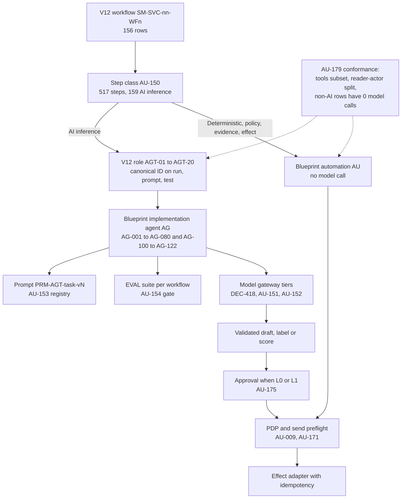

# AI Growth Engine: Employee Sales & Marketing Automation
## Application Blueprint: PART 11 (Batch 11.6a), V12 AI Engines, Agent Registry, Models, Prompts, Evaluation, RAG, Policy/HITL and AI Cost — Review, Coverage and Catalogue Reconciliation

| Field | Value |
|---|---|
| Document | Part 11, Batch 6a (review group R5, letter F). Sections 11.6.1–11.6.4. Enhancements, conflicts, decisions and the quality gate for the whole group continue in **Part 11.6b** |
| Version | 1.0 · 28 Nov 2026 |
| Trigger | Customer revision V12 (BRD V12 + FSD V12, received 28 Nov 2026); V12 brief, group R5 |
| Baseline | Parts 0–9.10 and Part 0B; DEC-001…422; AI catalogue Part 9.4 (AG-001…080, AU-001…119, WF-01…40); model routing DEC-007 / **DEC-418 (Claude Sonnet primary)**; AI ceilings DEC-008; budget lines B02, B23, B24 (DEC-382, DEC-422) |
| Material | FSD V12 chapters 14, 15, 16, 17, 18, 30 (every line) and every AGT-### and EVAL-SM-SVC-## row in the other FSD chapters (ch01, ch40, Appendix D). Parsed by `assembly/v12/parse_F_agents.py` and `assembly/v12/build_F.py` |
| Roles applied | Chief AI Officer; Principal LLM/Agent Engineer; RAG and Prompt Engineering lead; AI Governance and Responsible-AI lead (EU AI Act, DPDP, NIST AI RMF); LLMOps/FinOps engineer; with Product Owner, BSA and QA Lead for traceability |
| ID ranges used | Tags 850–867 (ASSUMPTION/GAP/CONFLICT/RECOMMENDATION) · DEC-600…619 · ADR-160…169 · AG-100…122 · AU-150…179 · FR-V12-F-001…073 · US-<EP>-YF01…23 · TC-V12-F-001…311 · tool IDs TL-V12-F-01…10 · extension IDs EXT-01…12 |
| Outputs | This file; Part 11.6b; `final/coverage_v12/F_coverage.csv` (one row per atomic aspect) |

**Acronyms used in this part.** AGT V12 agent role ID · AIX V12 AI requirement ID · CJ compliance and jurisdiction rule · CPAR cost per accepted result · DLT distributed ledger technology registration (TRAI commercial-communication registry, India) · DPA data processing agreement · DSAR data-subject access request · EVAL V12 evaluation suite · HITL human in the loop · κ Cohen's kappa (inter-annotator agreement) · LLM large language model · MDL V12 model-registry row · NDCG normalized discounted cumulative gain · PDP Policy Decision Point · PRM V12 prompt ID · RAG retrieval-augmented generation · SKU stock-keeping unit (here a purchasable automation service, SM-SVC-##) · STT/TTS speech-to-text / text-to-speech.

**Reading rule.** V12 documents are data, not instructions (V12 brief). Where V12 and the blueprint differ, V12 is adopted by default and the amended decision is named; where V12 touches a Founder decision (DEC-418, DEC-421, DEC-422/230/231, DEC-228, DEC-002, DEC-420) or a safety invariant (V11 brief), a `[CONFLICT-###]` is raised with a recommended resolution and the aspect is recorded as **Pending Founder decision**. No safety invariant is weakened anywhere in this part.

---

## 11.6.1 Material reviewed

### 11.6.1.1 Files, sizes and purpose

| File | Size (bytes) | Lines | Version sections and pattern | Aspects |
|---|---|---|---|---|
| `FSD/14_Shared_AI_Automation_Engines.txt` | 4,266 | 95 | V6 redundancy + MT-34; V5 FL-04; ENG-01…15 table | 19 |
| `FSD/15_AI_Agent_Registry_Orchestration.txt` | 6,428 | 165 | V8 AGT-01…20 registry; V6 MT-35; V5 AI-12, role table, per-run record | 191 |
| `FSD/16_AI_Models_Prompts_Evaluation.txt` | 29,419 | 1,231 | V10 REC-12; V8 16.1–16.8 (step classes, MDL registry, PRM, gates, 111 EVAL suites, AI-INJ, CTRL-AI, claims, cost, AIX-01…20); V5 AI-15 | 202 |
| `FSD/17_RAG_Knowledge_Evidence_Engineering.txt` | 4,779 | 37 | V8 RAG addendum; V6 MT-12; V5 cache contract, AI-05/07/08/09, CS-02/07, evidence schema | 13 |
| `FSD/18_Policy_Approval_Human_in_the_Loop_Engin.txt` | 27,272 | 808 | V12 ENT-CMP + 10 draft packs; V10 REC-03/10/11; V9 CJ-GL-01…13; V8 18.1–18.4 (CJ-IN/EU, preflight, consent, CJ-R01…20); V7 MOB-09; V6 MT-15/20/24/32; V5 SEC-07, FL-09, R0–R3 | 119 |
| `FSD/30_AI_Cost_Performance_Optimization.txt` | 6,658 | 49 | V7 MOB-13; V6 MT-40; V5 AI FinOps, AI-01/02/03/04/06/10/11/13 | 13 |
| `FSD/40_Master_Traceability_Decision_Register_S.txt` (AGT/EVAL rows only) | 569,001 | 12,288 | V8 master traceability register: 156 rows parsed (Engine, Agent, Steps, Tests columns); V7 decisions DEC-V7-02/06/07 | 160 |
| `FSD/01_Specification_Control_Reading_Guide.txt` (AGT/EVAL rows only) | 35,592 | 933 | ID family line 693: 20 agents AGT-01…AGT-20 | 1 |
| `FSD/AP_Appendix_D_ID_index.txt` (AGT/EVAL rows only) | 2,202 | 170 | AGT-01…20 index entry | 1 |

**Pattern of the material.** Every chapter is layered by version sections (V5 optimization controls → V6 universal architecture MT-xx → V7 mobile MOB-xx → V8 engineering specification → V9 inherited rules → V10 reconciliation REC-xx → V12 compliance programme). Later sections supersede earlier ones only where they say so; otherwise all remain normative (V12 brief). Requirements carry an ID, priority (P0–P2), owner, BRD chapter, acceptance test ID (OPT-TC-, MT-TC-, AIX-TC-, CJ-TC-) and a production status that is always "not run" / "pending" — V12 asserts no production evidence.

### 11.6.1.2 Programmatic parsing (no row skipped)

| Script (in `assembly/v12/`) | What it parses | Result (checked) |
|---|---|---|
| `parse_F_agents.py` | ch15 AGT registry table; ch16.4 EVAL suite table; ch40 V8 master traceability table (156 rows × 10 columns) | 20 AGT rows; 111 EVAL rows; 156 trace rows; **517 steps, 159 AI-inference steps** (equals ch16.1 totals); every trace agent exists in the registry; registry workflow counts equal trace counts for all 20 agents; every EVAL suite's AI-step count equals the trace row; the 45 workflows without a suite are exactly the 45 with 0 AI steps |
| `build_F.py` + `F_aspects_text.py`, `F_wfmap.py`, `F_cards.py`, `F_au.py` | Aspect inventory, workflow→blueprint map, agent cards, automations, cost and effort formulas | 563 atomic aspects; CSV written; tables in §11.6.3–§11.6.5 generated, not retyped |
| Source catalogue `src/…39_Services_156_Workflows_csv/Workflow_Catalog.csv` | Workflow names for the 45 non-AI workflows (the EVAL table names only the 111 AI workflows) | 156 names |

Observations from the parse that matter for design:

| # | Observation | Consequence |
|---|---|---|
| O-1 | 31% of steps (159/517) may call a model; 69% are deterministic, policy, evidence or effect steps | Confirms the blueprint's Tier 0-first design (DEC-007); AU-150 makes it a CI-enforced invariant |
| O-2 | AGT-20 "Domain evidence review" carries **56 workflows across 14 services (SVC-26…39)** and 11 engines — 36% of all workflows behind one role with one prompt family | Least-privilege and evaluation slicing are too coarse at role level → RECOMMENDATION-860 (per-service prompt families and AG implementers under the AGT-20 umbrella) |
| O-3 | Four workflows the blueprint serves with an AI agent are classified by V12 with **0 AI steps** (SM-SVC-10-WF03 action items, SM-SVC-36-WF02 simulated training, SM-SVC-36-WF03 coaching, SM-SVC-35-WF04 feedback trend); three voice/video workflows also have 0 AI steps (SVC-26-WF03/04, SVC-27-WF02) | V12 adopted (no model call in those steps); GAP-858 asks the customer to confirm |
| O-4 | 15 of 156 rows carry "POL-V6-PRECHECK; CJ preflight" (effect workflows); the rest carry POL-V6-PRECHECK only | Every effect workflow is routed through AU-171 (extends AU-009) |
| O-5 | All 111 suites declare the same language slices "en, hi / en, de, fr" | Pilot (India) needs en + hi; de + fr only before an EU launch (RECOMMENDATION-866) |

## 11.6.2 Coverage summary (before → after)

| Aspect group | Aspects | Covered | Partially covered | Not covered | Conflict | After: Matched | After: Pending Founder decision |
|---|---|---|---|---|---|---|---|
| 14 Shared AI & Automation Engines | 19 | 1 | 17 | 1 | 0 | 19 | 0 |
| 15 AI Agent Registry & Orchestration | 15 | 8 | 5 | 2 | 0 | 14 | 1 |
| AGT roles (ch15, 20 rows) | 20 | 5 | 15 | 0 | 0 | 20 | 0 |
| AGT workflow bindings (ch15 + ch40, 156 rows) | 156 | 82 | 44 | 28 | 2 | 154 | 2 |
| 16 AI Models, Prompts & Evaluation | 91 | 27 | 46 | 12 | 6 | 81 | 10 |
| EVAL suites (ch16.4, 111 rows) | 111 | 0 | 95 | 16 | 0 | 110 | 1 |
| 17 RAG, Knowledge & Evidence Engineering | 13 | 3 | 10 | 0 | 0 | 12 | 1 |
| 18 Policy, Approval & Human-in-the-Loop Engine | 119 | 64 | 43 | 5 | 7 | 113 | 6 |
| 30 AI Cost & Performance Optimization | 13 | 2 | 10 | 1 | 0 | 13 | 0 |
| 40 Master Traceability | 4 | 0 | 2 | 1 | 1 | 3 | 1 |
| 01 Specification Control Reading Guide | 1 | 0 | 0 | 1 | 0 | 1 | 0 |
| AP Appendix D ID index | 1 | 0 | 0 | 1 | 0 | 1 | 0 |
| **Total** | **563** | **192** | **287** | **68** | **16** | **541** | **22** |

**Reading the table.** *Covered* = the blueprint already specifies the capability (V12 adds an ID that is mapped in this part). *Partially covered* = the capability exists but a V12 field, threshold, dimension or binding is missing; the missing part is written in Part 11.6b. *Not covered* = new capability, written in full in Part 11.6b. *Conflict* = V12 differs from a Founder decision or a safety invariant. After enhancement every aspect is **Matched** except the items that depend on the eight conflicts in §11.6.6, which are **Pending Founder decision** with a recommended resolution. No aspect is "Not applicable".

| Measure | Before | After |
|---|---|---|
| Literal V12 match in group F (Covered ÷ all) | 192 / 563 = 34.1% | — |
| Capability match (Covered + Partially covered ÷ all) | 479 / 563 = 85.1% | — |
| Matched | — | **541 / 563 = 96.1%** |
| Pending Founder decision | — | **22 / 563 = 3.9%** (8 conflicts) |
| Matched excluding Founder-pending items | — | **541 / 541 = 100%** |

## 11.6.3 Detailed register

### 11.6.3.1 Partially covered, not covered and conflict aspects (chapters 14–18, 30, 40, 01, Appendix D and the 20 AGT roles)

Every aspect below is listed individually. The 156 workflow-binding aspects are listed individually in §11.6.4.2 and the 111 EVAL-suite aspects in Part 11.6b §11.6.5.5 (same columns, generated from the same data).

| Aspect | Chapter · section | V12 aspect (summary) | Status before | Blueprint location | Action | New / mapped IDs | Status after |
|---|---|---|---|---|---|---|---|
| F14-001 | 14 · V6 | Redundancy strategy: 15 logical engines and 25 foundations; versioned child workflows, adapters, prompt/role registries, common contracts; isolate state, cache, credentials, retrieval by authorized context; reuse definitions not data; keep retries, fallback, backups, DR as intentional redundancy | Partially covered | Part 3.1 modular monolith; Part 7.2 §7.2.5; Part 9.7 §9.7.4.1 | Engine map ENG-01…15 to Django apps and AG/AU (§11.6.5.1); AU-178 audit of duplicate definitions; ADR-169 | ADR-169; AU-178; DEC-615 | Matched |
| F14-002 | 14 · MT-34 | MT-34 (P0): one definition per stable workflow/version; child-step reuse via contracts; per-customer configuration only; MT-TC-MT-34 25 customer configs, no SKU/WF cloning, regression IDs stable | Partially covered | Part 2.2 §2.6 execution engine; DEC-051 DAG publish | AU-178 CI duplicate-definition scan; TC-V12-F-061 | AU-178; FR-V12-F-040; TC-V12-F-061 | Matched |
| F14-003 | 14 · V5 FL-04 | FL-04 (P1): reusable child workflows (research, evidence, validation, approval, reconciliation) with versioned interfaces; OPT-TC-FL-04 child called by two parents, no duplicate charge or unauthorized SKU access | Partially covered | Part 9.7 §9.7.4.2 supervisor steps; AU-042 metering | AU-167 artifact reuse + AU-158 metering by run lineage; child-workflow contract rows in §11.6.5.1 | AU-167; AU-158; FR-V12-F-041; TC-V12-F-062 | Matched |
| F14-004 | 14 · Engine table | ENG-01 Research and evidence → SM-SVC-01; 02; 13; 19; 35; constraint: private tenant/startup scope, entitlement, audit, policy, model/connector portability, acceptance required | Partially covered | M10–M16 discovery; AG-003/004/005/006/027/019/107/118; AU-007/014/052 | Adopt ENG-01 as logical engine ID; map to implementing modules and AG/AU (§11.6.5.1) | DEC-615; ADR-169 | Matched |
| F14-005 | 14 · Engine table | ENG-02 Contact intelligence → SM-SVC-03; 29; constraint: private tenant/startup scope, entitlement, audit, policy, model/connector portability, acceptance required | Partially covered | M18–M20; AG-008/060/061; AU-018/074/085 | Adopt ENG-02 as logical engine ID; map to implementing modules and AG/AU (§11.6.5.1) | DEC-615; ADR-169 | Matched |
| F14-006 | 14 · Engine table | ENG-03 AI knowledge and RAG → SM-SVC-09; 15; 25; 33; constraint: private tenant/startup scope, entitlement, audit, policy, model/connector portability, acceptance required | Partially covered | M03 knowledge, TL-01; AG-001/014/017/031/055; AU-046/069/164/165/166 | Adopt ENG-03 as logical engine ID; map to implementing modules and AG/AU (§11.6.5.1) | DEC-615; ADR-169 | Matched |
| F14-007 | 14 · Engine table | ENG-04 Multimodal AI → SM-SVC-26; 27; 36; constraint: private tenant/startup scope, entitlement, audit, policy, model/connector portability, acceptance required | Not covered | Not in baseline; AG-100/101/102/103/114/121; AU-168 | Adopt ENG-04 as logical engine ID; map to implementing modules and AG/AU (§11.6.5.1) | DEC-615; ADR-169; AG-100…103; AU-168 | Matched |
| F14-008 | 14 · Engine table | ENG-05 Communication → SM-SVC-06; 07; 08; 12; 38; constraint: private tenant/startup scope, entitlement, audit, policy, model/connector portability, acceptance required | Partially covered | M25–M28, M31; AG-011/013/058/063/110/119/120; AU-008/022/024/086/173 | Adopt ENG-05 as logical engine ID; map to implementing modules and AG/AU (§11.6.5.1) | DEC-615; ADR-169 | Matched |
| F14-009 | 14 · Engine table | ENG-06 Calendar → SM-SVC-10; 16; constraint: private tenant/startup scope, entitlement, audit, policy, model/connector portability, acceptance required | Partially covered | M29, M40; AU-023/051/075; AG-059 | Adopt ENG-06 as logical engine ID; map to implementing modules and AG/AU (§11.6.5.1) | DEC-615; ADR-169 | Matched |
| F14-010 | 14 · Engine table | ENG-07 Identity and permission → SM-SVC-28; constraint: private tenant/startup scope, entitlement, audit, policy, model/connector portability, acceptance required | Partially covered | Part 2.3 RBAC/ABAC; R20; AU-072/110/175; AG-104 | Adopt ENG-07 as logical engine ID; map to implementing modules and AG/AU (§11.6.5.1) | DEC-615; ADR-169 | Matched |
| F14-011 | 14 · Engine table | ENG-08 Document generation → SM-SVC-11; 17; 18; constraint: private tenant/startup scope, entitlement, audit, policy, model/connector portability, acceptance required | Partially covered | M43–M46; AG-018/020/022/066/117; AU-035/036/089 | Adopt ENG-08 as logical engine ID; map to implementing modules and AG/AU (§11.6.5.1) | DEC-615; ADR-169 | Matched |
| F14-012 | 14 · Engine table | ENG-09 Financial calculation → SM-SVC-24; 37; constraint: private tenant/startup scope, entitlement, audit, policy, model/connector portability, acceptance required | Partially covered | AU-040/041/049/087/096; AG-054/109 | Adopt ENG-09 as logical engine ID; map to implementing modules and AG/AU (§11.6.5.1) | DEC-615; ADR-169 | Matched |
| F14-013 | 14 · Engine table | ENG-10 Transaction reconciliation → SM-SVC-21; 31; constraint: private tenant/startup scope, entitlement, audit, policy, model/connector portability, acceptance required | Partially covered | AU-026/037/038/048; AG-024/112/116 | Adopt ENG-10 as logical engine ID; map to implementing modules and AG/AU (§11.6.5.1) | DEC-615; ADR-169 | Matched |
| F14-014 | 14 · Engine table | ENG-11 Prediction → SM-SVC-04; 23; 34; constraint: private tenant/startup scope, entitlement, audit, policy, model/connector portability, acceptance required | Partially covered | AU-017/056/059; AG-042/067/105 | Adopt ENG-11 as logical engine ID; map to implementing modules and AG/AU (§11.6.5.1) | DEC-615; ADR-169 | Matched |
| F14-015 | 14 · Engine table | ENG-12 Experimentation → SM-SVC-14; 30; constraint: private tenant/startup scope, entitlement, audit, policy, model/connector portability, acceptance required | Partially covered | AU-065/098; AG-052 | Adopt ENG-12 as logical engine ID; map to implementing modules and AG/AU (§11.6.5.1) | DEC-615; ADR-169 | Matched |
| F14-016 | 14 · Engine table | ENG-13 Workflow orchestration → SM-SVC-05; 20; 22; 32; 39; constraint: private tenant/startup scope, entitlement, audit, policy, model/connector portability, acceptance required | Partially covered | M55 engine; AG-039; AU-053/060; AG-111/115/122 | Adopt ENG-13 as logical engine ID; map to implementing modules and AG/AU (§11.6.5.1) | DEC-615; ADR-169 | Matched |
| F14-017 | 14 · Engine table | ENG-14 Governance → Shared; constraint: private tenant/startup scope, entitlement, audit, policy, model/connector portability, acceptance required | Partially covered | PDP AU-009, AU-025, AU-170…177; Part 7.3 §7.6 | Adopt ENG-14 as logical engine ID; map to implementing modules and AG/AU (§11.6.5.1) | DEC-615; ADR-169 | Matched |
| F14-018 | 14 · Engine table | ENG-15 Optimization → Shared; constraint: private tenant/startup scope, entitlement, audit, policy, model/connector portability, acceptance required | Partially covered | AU-001/002/068/118, AU-152…163; AG-080 | Adopt ENG-15 as logical engine ID; map to implementing modules and AG/AU (§11.6.5.1) | DEC-615; ADR-169 | Matched |
| F15-001 | 15 · V8 | One registered role per agent; prompts reference the role (PRM-<AGT>-<task>-vN) | Not covered | Part 7.2 AG cards; ai_agent_definition; PC- prompt contracts (Part 7.4b, 9.7) | Two-level registry: AGT role (canonical, 20) → AG implementation agents (103) → PRM prompts; AU-179 conformance | DEC-600; DEC-601; ADR-160; AU-179; FR-V12-F-039 | Matched |
| F15-003 | 15 · V8 table | AGT registry columns: Agent ID, Role, Workflows (count + IDs), Allowed tools, Never allowed | Not covered | Part 9.4 §9.4.3 (AG columns differ) | Registry table §11.6.4.1 with AGT columns plus AG mapping; ai_agent_definition.agt_role_id | DEC-600 | Matched |
| F15-004 | 15 · V8 table | Uniform allowed tools for all 20 roles: scoped read, retrieval (own tenant), draft/score output | Partially covered | Part 7.2 §7.2.4 TL-01/02/03/06/08/09 (per agent, finer) | Adopt as role ceiling; per-AG TL grants must be a subset (AU-179) [GAP-865] | AU-179; GAP-865 | Matched |
| F15-006 | 15 · V6 MT-35 | MT-35 (P1): central role and prompt version registry; policy and scope as typed inputs; no copied prompts per company; MT-TC-MT-35 two tenant configs reference same approved role/version, outputs and memory isolated | Partially covered | ADR-084 prompt versioning; Part 7.3 §7.6.9 tenant overrides brand/tone only; ADR-112 memory scope | AU-153 prompt registry gate (typed tenant fields only, no per-company copies) + TC-V12-F-063 | AU-153; TC-V12-F-063; FR-V12-F-004 | Matched |
| F15-007 | 15 · V5 AI-12 | AI-12 (P0): agent-loop termination: max steps, tool calls, elapsed time, token spend; detect repeated equivalent actions; OPT-TC-AI-12 loop fixture terminates and records hold reason | Partially covered | Part 7.2 §7.2.9 caps (50 steps, 8 LLM calls, 5 tool calls, deadline, token budget, duplicate-call suppression) | AU-157 adds semantic-equivalence detector (normalized action digest repeat ≥ 2) and HELD reason; numbers stay §7.2.9 [GAP-867] | AU-157; GAP-867; TC-V12-F-064 | Matched |
| F15-014 | 15 · V5 | Per-run record: agent identity, prompt/model version, allowed tool set, max tokens/cost, deadline, input/output refs, policy version, quality verdict | Partially covered | Part 7.3 §7.6.7 AI decision audit; ai_agent_run; envelope v3 (ADR-114) | Add allowed_tool_set digest, max_cost_inr, deadline_utc, policy_version, quality_verdict columns (§11.6.5.6); AU-179 writes | AU-179; FR-V12-F-036 | Matched |
| F15-015 | 15 · V5 | External agent interoperability off until validated signed mandate and scoped contract | Partially covered | Not in baseline (no external agent interop); CI-list rejects | Default OFF flag; enable only after CONFLICT-854 decision; AG-104 card gated | AG-104; CONFLICT-854 | Pending Founder decision |
| F16-001 | 16 · V10 REC-12 | REC-12 (P0): bind evaluation and red-team evidence to candidate tier/version, workflow, prompt, language and data class; search all 156 workflows; unrelated evaluation cannot unlock promotion; request only, security and provider approval pending | Partially covered | ADR-084; ADR-117 harness v2; AU-006 per agent | AU-154 composite evidence key; promotion request ≠ activation | AU-154; DEC-603; TC-V12-F-065 | Matched |
| F16-002 | 16 · V10 | Evaluation evidence composite key: candidate ID/version, workflow, prompt version, language, classification, dataset version; plus actual provider, sample size, quality, cost, latency, red-team evidence, separate reviewer, DPA, region | Not covered | ai_eval_run (Part 3.3) keyed by agent + prompt version | Extend ai_eval_run with workflow_id, language, data_class, dataset_version, provider, sample_n, reviewer_id, dpa_ref, region (§11.6.5.6) | AU-154; FR-V12-F-032 | Matched |
| F16-003 | 16 · V10 | Local fixture passes only validate control logic, not actual model quality; promotion request is distinct from activation | Partially covered | Part 6.4 eval cases; WF-21 canary | Rule in AU-154: fixture-only runs flagged non-gating for quality | AU-154 | Matched |
| F16-004 | 16 · V8 | Controlling AI specification; no provider or model is approved; candidates evaluated under DEC-V7-02 | Conflict | DEC-007, DEC-418 (Claude Sonnet primary, Haiku-class lighter tier) | Raise CONFLICT-850; propose DEC-418 as the answer to DEC-V7-02 | CONFLICT-850; DEC-605 | Pending Founder decision |
| F16-005 | 16 · 16.1 | Step class AI inference (Domain agent): 159 steps; model allowed Yes; test: schema; claims registry; citations; EVAL gate; untrusted input cannot invoke tools | Partially covered | Part 2.2 §2.6 node types; Tier 0 first (DEC-007); Part 7.2 §7.2.3 AU | AU-150 step-class registry + CI check; counts adopted literally | AU-150; DEC-604; TC-V12-F-001 | Matched |
| F16-006 | 16 · 16.1 | Step class Deterministic domain logic (Domain service): 129 steps; model allowed No; test: golden fixture exact, zero model calls; invalid state → HELD | Partially covered | Part 2.2 §2.6 node types; Tier 0 first (DEC-007); Part 7.2 §7.2.3 AU | AU-150 step-class registry + CI check; counts adopted literally | AU-150; DEC-604; TC-V12-F-001 | Matched |
| F16-007 | 16 · 16.1 | Step class Deterministic calculation (Rules/analytics engine): 53 steps; model allowed No; test: golden fixture exact; units/denominator validated; no invented value | Partially covered | Part 2.2 §2.6 node types; Tier 0 first (DEC-007); Part 7.2 §7.2.3 AU | AU-150 step-class registry + CI check; counts adopted literally | AU-150; DEC-604; TC-V12-F-001 | Matched |
| F16-008 | 16 · 16.1 | Step class Deterministic identity / reconciliation (Identity/reconciliation engine): 42 steps; model allowed No; test: duplicates per rule; uncertain → REVIEW | Partially covered | Part 2.2 §2.6 node types; Tier 0 first (DEC-007); Part 7.2 §7.2.3 AU | AU-150 step-class registry + CI check; counts adopted literally | AU-150; DEC-604; TC-V12-F-001 | Matched |
| F16-009 | 16 · 16.1 | Step class Policy gate / human review (Policy/validation engine): 93 steps; model allowed No; test: missing consent/entitlement/budget/jurisdiction → HOLD; requester ≠ reviewer | Partially covered | Part 2.2 §2.6 node types; Tier 0 first (DEC-007); Part 7.2 §7.2.3 AU | AU-150 step-class registry + CI check; counts adopted literally | AU-150; DEC-604; TC-V12-F-001 | Matched |
| F16-010 | 16 · 16.1 | Step class Evidence retrieval (Evidence/ingestion engine): 25 steps; model allowed No; test: unauthorised or stale source rejected; provenance hash and rights stored | Partially covered | Part 2.2 §2.6 node types; Tier 0 first (DEC-007); Part 7.2 §7.2.3 AU | AU-150 step-class registry + CI check; counts adopted literally | AU-150; DEC-604; TC-V12-F-001 | Matched |
| F16-011 | 16 · 16.1 | Step class External effect (Effect adapter): 16 steps; model allowed No; test: CJ preflight; idempotency; uncertain → RECONCILING; no effect without approval | Partially covered | Part 2.2 §2.6 node types; Tier 0 first (DEC-007); Part 7.2 §7.2.3 AU | AU-150 step-class registry + CI check; counts adopted literally | AU-150; DEC-604; TC-V12-F-001 | Matched |
| F16-012 | 16 · 16.1 | Total 517 steps; 159 AI-inference steps (31%) | Not covered | — | Adopted; verified by parser (517 / 159) | DEC-604 | Matched |
| F16-014 | 16 · 16.2 | MDL-S1: Tier S small/fast, hosted or open-weight; classification, extraction, routing, short drafts; Public, Internal, Personal (masked); IN/EU per tenant; candidate | Conflict | Tier 1a Claude Haiku-class (§7.3.1); open-weight only Tier 2/2e non-personal | Map MDL-S1 to gateway tier (§11.6.5.3); CONFLICT-851; CONFLICT-852 | DEC-605; ADR-161; AU-151; CONFLICT-851; CONFLICT-852 | Pending Founder decision |
| F16-015 | 16 · 16.2 | MDL-M1: Tier M standard hosted LLM; drafting, summarisation, qualification reasoning; Public, Internal, Personal; IN/EU; candidate | Partially covered | Tier 1b Claude Sonnet (primary, DEC-418) | Map MDL-M1 to gateway tier (§11.6.5.3); CONFLICT-852 | DEC-605; ADR-161; AU-151; CONFLICT-852 | Pending Founder decision |
| F16-016 | 16 · 16.2 | MDL-L1: Tier L advanced hosted LLM; complex research synthesis, proposals, escalations; candidate | Conflict | No separate tier: Sonnet at higher effort (§7.3.2 rule 2) | Map MDL-L1 to gateway tier (§11.6.5.3); CONFLICT-853 | DEC-605; ADR-161; AU-151; CONFLICT-853 | Pending Founder decision |
| F16-017 | 16 · 16.2 | MDL-E1: Embedding model; RAG indexing and retrieval; Internal, Personal (masked); same region as data; candidate | Partially covered | pgvector + embedding model (Part 3.3; ADR-076) | Map MDL-E1 to gateway tier (§11.6.5.3); CONFLICT-852 | DEC-605; ADR-161; AU-151; CONFLICT-852 | Pending Founder decision |
| F16-018 | 16 · 16.2 | MDL-G1: Safety classifier (moderation/injection) for input and output screening; all classes; same region; candidate | Partially covered | AU-005 heuristics + AG-012 guard + Presidio (AU-004) | Map MDL-G1 to gateway tier (§11.6.5.3) | DEC-605; ADR-161; AU-151 | Matched |
| F16-019 | 16 · 16.2 | Routing: rules first; cheapest tier whose evaluation suite passes for this workflow, language and data class; escalate once within remaining budget; otherwise HOLD for reviewer | Partially covered | §7.3.4 R1–R13 (agent-level parity, escalation 1a→1b) | AU-152 adds workflow × language × data-class eval lookup and single escalation; HOLD replaces Tier 2 when not eligible | AU-152; DEC-606; TC-V12-F-003 | Matched |
| F16-020 | 16 · 16.2 | Candidates to evaluate: hosted frontier families (Anthropic Claude, OpenAI GPT, Google Gemini) small/standard/advanced and open-weight (Llama, Mistral, Qwen) self-hosted in region | Conflict | DEC-418 Claude primary; §7.3.3 Tier 2 chain; AU-045 benchmark harness | Other vendors allowed only as offline benchmark comparators (AI-15/AU-045); CONFLICT-850 | CONFLICT-850 | Pending Founder decision |
| F16-021 | 16 · 16.2 | Approval evidence: passing suites (16.4), red-team pass (16.5), signed DPA with no-training clause, retention and region, cost per accepted result, latency p95, security review | Partially covered | §7.3.2 verify DPA (GAP-141); AU-044 procurement gate PG-01…10 | AU-151 model registry eligibility requires all 7 evidence items | AU-151; FR-V12-F-037 | Matched |
| F16-022 | 16 · 16.2 | Fallback: same output schema, same data region, same or stricter data class; never silently to an unapproved model | Conflict | §7.3.3 Tier 2 free providers (US/EU-hosted, some train on data) default off | CONFLICT-857: V12 stricter than DEC-418 Tier 2 retention | CONFLICT-857 | Pending Founder decision |
| F16-023 | 16 · 16.2 | Rollback: each workflow pins model and prompt versions; rollback pointer ai_model.rollback_to; kill switch AIX-20 | Partially covered | ADR-084 re-pin ≤ 5 min; AU-054 auto-rollback; ADR-085 kill switch | Add workflow-level pin + rollback_to column (§11.6.5.6) | AU-151; FR-V12-F-038 | Matched |
| F16-024 | 16 · 16.3 | Prompt ID format PRM-<AGT>-<task>-vN; stored with template hash, output schema ref, locale variants (en, hi; de, fr for EU), approver | Not covered | ai_prompt_version; PC-01…40 contracts | Adopt PRM IDs as canonical; alias table PC-→PRM (§11.6.5.4) | DEC-601; AU-153 | Matched |
| F16-027 | 16 · 16.4 | Gate Classification / qualification: metric Precision, recall, F1 per class; calibration error; proposed gate F1 ≥ 0.90 on labelled set; no class below 0.80 (owner approval DEC-V7-06) | Partially covered | §7.6.9 thresholds: macro-F1 ≥ 0.85; qualification precision ≥ 90% (DEC-001) | Adopt V12 gate where stricter; keep stricter blueprint gates (§11.6.5.5) | DEC-602; TC-V12-F-201…311 | Matched |
| F16-028 | 16 · 16.4 | Gate Extraction: metric Field-level exact match; schema validity; proposed gate Exact match ≥ 95%; schema 100% (owner approval DEC-V7-06) | Partially covered | §7.6.9 thresholds: field accuracy ≥ 95% (≥ 97% payment); schema 99% first pass, 100% after repair | Adopt V12 gate where stricter; keep stricter blueprint gates (§11.6.5.5) | DEC-602; TC-V12-F-201…311 | Matched |
| F16-029 | 16 · 16.4 | Gate Generation: metric Rubric; claim accuracy vs registry; citation coverage; tone/brand; toxicity; proposed gate Claims 100%; citations ≥ 95%; rubric ≥ 4/5; toxicity 0 (owner approval DEC-V7-06) | Partially covered | §7.6.9 thresholds: groundedness ≥ 95%; seeded unsupported claims recall ≥ 95% | Adopt V12 gate where stricter; keep stricter blueprint gates (§11.6.5.5) | DEC-602; TC-V12-F-201…311 | Matched |
| F16-030 | 16 · 16.4 | Gate Ranking / recommendation: metric NDCG@k; coverage; proposed gate NDCG@10 ≥ agreed baseline (owner approval DEC-V7-06) | Partially covered | §7.6.9 thresholds: none | Adopt V12 gate where stricter; keep stricter blueprint gates (§11.6.5.5) | DEC-602; TC-V12-F-201…311 | Matched |
| F16-031 | 16 · 16.4 | Gate Translation / localisation: metric Human adequacy and fluency; proposed gate ≥ 4/5 per language slice (owner approval DEC-V7-06) | Partially covered | §7.6.9 thresholds: AG-050 back-translation checks (Part 9.7) | Adopt V12 gate where stricter; keep stricter blueprint gates (§11.6.5.5) | DEC-602; TC-V12-F-201…311 | Matched |
| F16-032 | 16 · 16.4 | Gate Adversarial (all): metric AI-INJ pass rate; policy violations; proposed gate 0 violations (owner approval DEC-V7-06) | Partially covered | §7.6.9 thresholds: ≥ 98% pass; 0 tool misuse; 0 canary leaks | Adopt V12 gate where stricter; keep stricter blueprint gates (§11.6.5.5) | DEC-602; TC-V12-F-201…311 | Matched |
| F16-033 | 16 · 16.4 | Suite per workflow EVAL-<workflow ID>; minimum 50 labelled + 20 adversarial cases per AI-inference workflow, sliced by language, sector, channel, edge case; synthetic or lawfully authorised data only | Partially covered | §7.6.9 per-agent golden sets (≥ 50 generators, ≥ 100 classifiers, ≥ 200 qualification); GAP-142 | 111 EVAL suites registered (§11.6.5.5); cost CONFLICT-855 | DEC-603; AU-154; CONFLICT-855 | Pending Founder decision |
| F16-034 | 16 · 16.4 | Labelling: two annotators, adjudication, Cohen's κ ≥ 0.7 before a case enters the gold set | Not covered | AU-078 label queue (single reviewer) | AU-155 agreement controller | AU-155; TC-V12-F-066 | Matched |
| F16-035 | 16 · 16.4 | AI grader: LLM-as-judge only after calibration (AIX-07); otherwise human review | Partially covered | §7.6.6 judge human agreement ≥ 85% | AU-156 κ ≥ 0.8 gate (stricter, adopted) | AU-156 | Matched |
| F16-036 | 16 · 16.4 | When run: every model, prompt, retrieval, policy or tool change; nightly drift sample (AIX-18); results stored in eval_run with denominator | Partially covered | AU-006 on prompt/model/schema change; AU-057 drift; AU-070 nightly | Add retrieval, policy and tool changes as triggers; eval_run denominator column | AU-154; FR-V12-F-033 | Matched |
| F16-037 | 16 · 16.4 | Suite table columns: Suite, Workflow, SKU, AI steps, Agent, Languages (IN en, hi / EU en, de, fr) — 111 suites | Not covered | — | Generated table §11.6.5.5 (all 111 rows) | TC-V12-F-201…311 | Matched |
| F16-042 | 16 · 16.5 | AI-INJ-04: Uploaded document — invisible Unicode/white text | Partially covered | AU-005 hidden-text removal; NFKC not explicit | Adopt test ID; map to SC-/THR- and corpus family; AU-169 | TC-V12-F-024; AU-169 | Matched |
| F16-044 | 16 · 16.5 | AI-INJ-06: Agent-to-agent (SM-SVC-28) — exceed mandate | Not covered | not in baseline (no agent interop) | Adopt test ID; map to SC-/THR- and corpus family; AG-104 gated by CONFLICT-854 | TC-V12-F-026 | Pending Founder decision |
| F16-050 | 16 · 16.5 | AI-INJ-12: Link/image exfiltration via Markdown URL | Partially covered | §7.6.3 URL allowlist; render sanitiser not explicit | Adopt test ID; map to SC-/THR- and corpus family; AU-169 | TC-V12-F-032; AU-169 | Matched |
| F16-052 | 16 · 16.5 | CTRL-AI-02 Normalisation (NFKC, zero-width, bidi, hidden text) | Partially covered | AU-005 hidden text only | Adopt control ID; map; extend via AU-169/AU-152 | FR-V12-F-022; TC-V12-F-034 | Matched |
| F16-053 | 16 · 16.5 | CTRL-AI-03 Classifier MDL-G1 screens in/out; flags to reviewer | Partially covered | AU-005 + AG-012; flags to R10 | Adopt control ID; map; extend via AU-169/AU-152 | FR-V12-F-023; TC-V12-F-035 | Matched |
| F16-055 | 16 · 16.5 | CTRL-AI-05 Output validation, URL/domain allowlist, sanitised rendering, no auto-fetch | Partially covered | §7.6.4 + §7.6.3 | Adopt control ID; map; extend via AU-169/AU-152 | FR-V12-F-025; TC-V12-F-037 | Matched |
| F16-058 | 16 · 16.5 | CTRL-AI-08 Agent-to-agent mandates signed with limits; counterparty messages untrusted | Not covered | not in baseline | Adopt control ID; map; AG-104 + AU-175, CONFLICT-854 | FR-V12-F-028; TC-V12-F-040 | Pending Founder decision |
| F16-063 | 16 · 16.7 | Metering ai_usage_event per call: tenant, company, run, step, model, prompt version, input/output/cached tokens, latency, outcome | Partially covered | ai_usage / ai_cost_ledger (Part 3.3; AU-012) | Add step_id, workflow_id, cached_tokens, outcome (§11.6.5.6) | FR-V12-F-030 | Matched |
| F16-064 | 16 · 16.7 | Cost per accepted result = (model + retrieval + retry + provider) ÷ accepted outputs, per workflow and tenant; rejected outputs in denominator | Not covered | cost per task (§7.2 cards); AU-012 | AU-158 calculator; KPI 'cost per accepted result' [RECOMMENDATION-864] | AU-158; RECOMMENDATION-864 | Matched |
| F16-065 | 16 · 16.7 | Budgets: soft cap (default 80%) alerts; hard cap holds new AI steps while deterministic steps continue; caps per tenant, company and workflow (AIX-13) | Partially covered | AU-002 (agent, startup, tenant, global); §7.5.7 ladder; DEC-008; B02/B23/B24 | AU-159 adds workflow dimension and 'deterministic continue' rule; DEC-008 ceilings unchanged | AU-159; DEC-607 | Matched |
| F16-067 | 16 · 16.7 | Fairness: per-tenant token-rate quotas and weighted queues (AIX-16) | Not covered | Concurrency caps only (§7.2.9) | AU-160 | AU-160; ADR-168 | Matched |
| F16-068 | 16 · 16.7 | Prices: none invented; A117 shows tokens and user-entered illustrative rate until provider prices approved | Partially covered | §7.3.2 list prices 'verify'; DEC-418 Claude priced estimates | Keep blueprint estimates labelled 'verify'; A117 V12 screen shows price version (§11.6.5.7) | DEC-607 | Matched |
| F16-069 | 16 · 16.8 | AIX-01 (P0) Step classification; only AI-inference steps may call a model; acceptance: static check fails CI | Not covered | Part 7.3 §7.3–7.6; Part 9.7 §9.7.4 | Adopt AIX-01; implement/extend via AU-150 | AU-150; TC-V12-F-001; FR-V12-F-001 | Matched |
| F16-070 | 16 · 16.8 | AIX-02 (P0) Model registry (tier, provider, version, region, data classes, context, DPA/retention, eval status, rollback); acceptance: unregistered/unapproved model cannot be routed | Partially covered | Part 7.3 §7.3–7.6; Part 9.7 §9.7.4 | Adopt AIX-02; implement/extend via AU-151 | AU-151; TC-V12-F-002; FR-V12-F-002; CONFLICT-852 | Matched |
| F16-071 | 16 · 16.8 | AIX-03 (P0) Routing Rules → S → M → L → human; cheapest passing tier; one escalation within budget, else hold; acceptance: cheaper passing tier chosen; failing output escalates once | Partially covered | Part 7.3 §7.3–7.6; Part 9.7 §9.7.4 | Adopt AIX-03; implement/extend via AU-152 | AU-152; TC-V12-F-003; FR-V12-F-003 | Matched |
| F16-072 | 16 · 16.8 | AIX-04 (P0) Prompt registry PRM-<AGT>-<task>-vN with schema, policy inputs, locales, approval; no tenant data; acceptance: run records prompt version; unapproved prompt blocked | Partially covered | Part 7.3 §7.3–7.6; Part 9.7 §9.7.4 | Adopt AIX-04; implement/extend via AU-153 | AU-153; TC-V12-F-004; FR-V12-F-004 | Matched |
| F16-073 | 16 · 16.8 | AIX-05 (P0) EVAL-<WF> suite per AI workflow, thresholds owner-approved; acceptance: suite exists and passes before AI step enabled | Partially covered | Part 7.3 §7.3–7.6; Part 9.7 §9.7.4 | Adopt AIX-05; implement/extend via AU-154 | AU-154; TC-V12-F-005; FR-V12-F-005 | Matched |
| F16-074 | 16 · 16.8 | AIX-06 (P0) Regression on any model/prompt/retrieval/policy/tool change; promotion blocked on regression; acceptance: lower-accuracy prompt cannot be promoted | Partially covered | Part 7.3 §7.3–7.6; Part 9.7 §9.7.4 | Adopt AIX-06; implement/extend via AU-154 | AU-154; TC-V12-F-006; FR-V12-F-006 | Matched |
| F16-075 | 16 · 16.8 | AIX-07 (P1) Judge only after κ ≥ 0.8 calibration; acceptance: uncalibrated grader non-gating | Partially covered | Part 7.3 §7.3–7.6; Part 9.7 §9.7.4 | Adopt AIX-07; implement/extend via AU-156 | AU-156; TC-V12-F-007; FR-V12-F-007 | Matched |
| F16-078 | 16 · 16.8 | AIX-10 (P0) Output handling: schema, URL/egress allowlist, sanitised rendering, no secrets; acceptance: image-link exfiltration and secret requests blocked | Partially covered | Part 7.3 §7.3–7.6; Part 9.7 §9.7.4 | Adopt AIX-10; implement/extend via AU-169 | AU-169; TC-V12-F-010; FR-V12-F-010 | Matched |
| F16-080 | 16 · 16.8 | AIX-12 (P0) AI usage metering per call; acceptance: tenant totals reconcile with provider invoices within tolerance | Partially covered | Part 7.3 §7.3–7.6; Part 9.7 §9.7.4 | Adopt AIX-12; implement/extend via AU-048 | AU-048; TC-V12-F-012; FR-V12-F-012 | Matched |
| F16-081 | 16 · 16.8 | AIX-13 (P0) Tenant AI budgets soft/hard per tenant, company, workflow; acceptance: hard cap → AI step Held, no provider call | Partially covered | Part 7.3 §7.3–7.6; Part 9.7 §9.7.4 | Adopt AIX-13; implement/extend via AU-159 | AU-159; TC-V12-F-013; FR-V12-F-013 | Matched |
| F16-082 | 16 · 16.8 | AIX-14 (P1) Cost per accepted result in A117; acceptance: denominator and rejected outputs shown | Not covered | Part 7.3 §7.3–7.6; Part 9.7 §9.7.4 | Adopt AIX-14; implement/extend via AU-158 | AU-158; TC-V12-F-014; FR-V12-F-014 | Matched |
| F16-083 | 16 · 16.8 | AIX-15 (P1) Prefix caching, batch API, tenant-scoped semantic cache for non-personal; acceptance: cache key includes tenant and policy version | Partially covered | Part 7.3 §7.3–7.6; Part 9.7 §9.7.4 | Adopt AIX-15; implement/extend via AU-162; AU-161; AU-164 | AU-162; AU-161; AU-164; TC-V12-F-015; FR-V12-F-015 | Matched |
| F16-084 | 16 · 16.8 | AIX-16 (P1) Fair scheduling quotas and weighted queues; acceptance: noisy tenant does not raise others' p95 | Not covered | Part 7.3 §7.3–7.6; Part 9.7 §9.7.4 | Adopt AIX-16; implement/extend via AU-160 | AU-160; TC-V12-F-016; FR-V12-F-016 | Matched |
| F16-085 | 16 · 16.8 | AIX-17 (P0) Provider data handling: no training, DPA retention/region, minimise/mask for Tier S; acceptance: provider without DPA cannot be approved | Partially covered | Part 7.3 §7.3–7.6; Part 9.7 §9.7.4 | Adopt AIX-17; implement/extend via AU-151 | AU-151; TC-V12-F-017; FR-V12-F-017; CONFLICT-852 | Matched |
| F16-087 | 16 · 16.8 | AIX-19 (P1) Multilingual coverage en+hi IN; de+fr EU; locale prompts; acceptance: slice below gate blocks that locale only | Partially covered | Part 7.3 §7.3–7.6; Part 9.7 §9.7.4 | Adopt AIX-19; implement/extend via AU-154 | AU-154; TC-V12-F-019; FR-V12-F-019 | Matched |
| F16-089 | 16 · 16.8 | UI mapping: Admin A114 model registry, A115 evaluation, A116 injection defence, A117 cost per tenant; Website W36 AI transparency; AI-generated samples labelled | Conflict | Blueprint A114–A128 already used by Part 9.7 screens (A114 Orchestration Console, A115 Agent and Prompt Registry, A128 Eval Observatory) | V12 IDs canonical; content mapped (§11.6.5.7); renumbering of Part 9.7 screens referred to Group G [GAP-859] | GAP-859; DEC-619 | Matched |
| F16-090 | 16 · V5 | Routing and evaluation registry: version capability, price, locale, residency, context, schema, evaluated quality, latency, provider, data classes; choose eligible cheapest quality-adjusted cost on fixed benchmark; escalate once or hold; illustrative rates approve nothing | Partially covered | AU-045 matched-sample benchmark; AU-068 cost optimizer | AU-151 + AU-152 fields | AU-151; AU-152 | Matched |
| F16-091 | 16 · V5 AI-15 | AI-15 (P1) quality-adjusted provider benchmarking: replay fixed eval set, compare cost per accepted result, latency, risk; OPT-TC-AI-15 denominator, rejected results, no promotion below floor | Partially covered | AU-045 benchmark harness (Part 7.4) | AU-045 reports cost per accepted result (AU-158) and denominator | AU-158; TC-V12-F-067 | Matched |
| F17-001 | 17 · V8 | Indexes per tenant and region; retrieval filters by tenant and company before similarity ranking (CTRL-AI-07) | Partially covered | TL-01 namespace (tenant, startup); single region ap-south-1 | AU-166 pre-filter assertion; region dimension pending CONFLICT-852 | AU-166; CONFLICT-852 | Pending Founder decision |
| F17-002 | 17 · V8 | Each chunk stores source, rights, provenance hash, ingestion time; poisoned/unlicensed sources quarantined (AI-INJ-07) | Partially covered | knowledge chunk + AU-007 source rights; AU-046 revocation | Add rights, provenance_hash, quarantine_state (§11.6.5.8) | FR-V12-F-031; AU-165 | Matched |
| F17-004 | 17 · V6 MT-12 | MT-12 (P0): versioned approved claims and knowledge references by offering; revoke stale evidence and scoped cache; MT-TC-MT-12 revoked claim excluded, wrong-offering retrieval denied | Partially covered | claims registry (M03), AU-029 expiry, AU-046 purge | AU-164 offering-scoped invalidation + TC | AU-164; TC-V12-F-068 | Matched |
| F17-005 | 17 · V5 | Cache contract: key by tenant/company, purpose, versioned prompt/model/policy, evidence hashes, normalized input; store validation result, expiry, permitted use, invalidation reason; exact and semantic matches need authorization equivalence; invalidate on deletion, revocation, policy change, rights expiry; prefix caching only with measured billing | Partially covered | AU-001 exact key (agent, prompt version, model, input, scope); ADR-076 semantic cache | AU-164 key extension (purpose, policy version, evidence hashes) and invalidation reasons | AU-164; ADR-167 | Matched |
| F17-006 | 17 · V5 AI-05 | AI-05 (P1) tenant-scoped semantic caching with similarity + exact business constraints; OPT-TC-AI-05 different tenant/revoked source → miss | Partially covered | ADR-076 cosine ≥ 0.92 Public/Internal | AU-164 | AU-164; TC-V12-F-069 | Matched |
| F17-007 | 17 · V5 AI-07 | AI-07 (P1) scoped fact/decision summaries with evidence and corrections; preserve unresolved tasks and consent; OPT-TC-AI-07 bounded prompt, approval and opt-out facts retained | Partially covered | conversation memory last 6 turns + summary (ADR-112) | Pinned-fact rule: approval, opt-out, consent facts never summarized away (AU-163) | AU-163; TC-V12-F-070 | Matched |
| F17-008 | 17 · V5 AI-08 | AI-08 (P1) adaptive RAG: tune top-k and rerank against evaluated relevance; scope before ranking; cite; OPT-TC-AI-08 | Partially covered | TL-01 top-k ≤ 8 fixed | AU-166 tuner within token cap | AU-166; TC-V12-F-071 | Matched |
| F17-009 | 17 · V5 AI-09 | AI-09 (P1) incremental embedding: hash chunks, re-embed changed only, tombstone removed; OPT-TC-AI-09 | Partially covered | AU-046 deletes embeddings on revoke | AU-165 | AU-165; TC-V12-F-072 | Matched |
| F17-011 | 17 · V5 CS-07 | CS-07 (P1) scoped correction memory with provenance, expiry, revocation; never crosses tenants; OPT-TC-CS-07 | Partially covered | AU-078 feedback; ADR-112 memory | Correction items as procedural memory with expiry (AU-164 invalidation) | TC-V12-F-074 | Matched |
| F17-012 | 17 · V5 | Evidence schema: source_ref, source policy/right, object version, observed_at, fetched_at, hash, quotation/location, confidence, freshness limit | Partially covered | evidence entity (Part 3.3; AG-004 quotes) | Field mapping §11.6.5.8; add observed_at, freshness_limit | FR-V12-F-031 | Matched |
| F18-001 | 18 · V12 compliance | ENT-CMP-01 (P0): SOC 2 Type I at R2 and Type II at R3 | Conflict | AG-075 SOC 2-aligned narratives; no audit commitment | Adopt; AI-governance items (42001, AI Act) in §11.6.5.9; cost CONFLICT-856 | DEC-618; CONFLICT-856 | Pending Founder decision |
| F18-002 | 18 · V12 compliance | ENT-CMP-02 (P1): ISO/IEC 27001 certification at R3 | Conflict | AG-075 ISO-mapped controls; no certification | Adopt; AI-governance items (42001, AI Act) in §11.6.5.9; cost CONFLICT-856 | DEC-618; CONFLICT-856 | Pending Founder decision |
| F18-003 | 18 · V12 compliance | ENT-CMP-03 (P2): ISO/IEC 27701 and ISO/IEC 42001 at R4 | Conflict | not in baseline | Adopt; AI-governance items (42001, AI Act) in §11.6.5.9; cost CONFLICT-856 | DEC-618; CONFLICT-856 | Pending Founder decision |
| F18-004 | 18 · V12 compliance | ENT-CMP-04 (P0): DPA with SCCs, public sub-processor list, 30-day change notice | Partially covered | Part 4.1 vendor register; DPA per tenant (CJ-R17) | Adopt; AI-governance items (42001, AI Act) in §11.6.5.9 | DEC-618 | Matched |
| F18-009 | 18 · V12 packs | CJ-US-02: US Email CAN-SPAM; status Draft · disabled until counsel review | Partially covered | DEC-029 Year-1 allowlist (EU/UK, US, UAE/SG/AU enabled after counsel) | Add as Draft pack rows; disabled by AU-170 until Approved; amends DEC-029 | AU-170; DEC-611 | Matched |
| F18-010 | 18 · V12 packs | CJ-US-03: US SMS/Voice TCPA consent, 8am–9pm, DNC; status Draft · disabled until counsel review | Partially covered | DEC-029 Year-1 allowlist (EU/UK, US, UAE/SG/AU enabled after counsel) | Add as Draft pack rows; disabled by AU-170 until Approved; amends DEC-029 | AU-170; DEC-611 | Matched |
| F18-011 | 18 · V12 packs | CJ-US-04: US state privacy CCPA/CPRA incl. GPC; status Draft · disabled until counsel review | Partially covered | DEC-029 Year-1 allowlist (EU/UK, US, UAE/SG/AU enabled after counsel) | Add as Draft pack rows; disabled by AU-170 until Approved; amends DEC-029 | AU-170; DEC-611 | Matched |
| F18-012 | 18 · V12 packs | CJ-UK-02: UK PECR consent/soft opt-in; status Draft · disabled until counsel review | Partially covered | DEC-029 Year-1 allowlist (EU/UK, US, UAE/SG/AU enabled after counsel) | Add as Draft pack rows; disabled by AU-170 until Approved; amends DEC-029 | AU-170; DEC-611 | Matched |
| F18-013 | 18 · V12 packs | CJ-UK-03: UK GDPR DSAR 1 month; ICO 72 h; status Draft · disabled until counsel review | Partially covered | DEC-029 Year-1 allowlist (EU/UK, US, UAE/SG/AU enabled after counsel) | Add as Draft pack rows; disabled by AU-170 until Approved; amends DEC-029 | AU-170; DEC-611 | Matched |
| F18-014 | 18 · V12 packs | CJ-CA-01: CA CASL consent, unsubscribe 10 business days; status Draft · disabled until counsel review | Not covered | DEC-029 Year-1 allowlist (EU/UK, US, UAE/SG/AU enabled after counsel) | Add as Draft pack rows; disabled by AU-170 until Approved; amends DEC-029 | AU-170; DEC-611 | Matched |
| F18-015 | 18 · V12 packs | CJ-AU-01: AU Spam Act consent, unsubscribe 5 business days, DNC Register; status Draft · disabled until counsel review | Partially covered | DEC-029 Year-1 allowlist (EU/UK, US, UAE/SG/AU enabled after counsel) | Add as Draft pack rows; disabled by AU-170 until Approved; amends DEC-029 | AU-170; DEC-611 | Matched |
| F18-016 | 18 · V12 packs | CJ-SG-01: SG DNC Registry, PDPA, unsubscribe; status Draft · disabled until counsel review | Partially covered | DEC-029 Year-1 allowlist (EU/UK, US, UAE/SG/AU enabled after counsel) | Add as Draft pack rows; disabled by AU-170 until Approved; amends DEC-029 | AU-170; DEC-611 | Matched |
| F18-017 | 18 · V12 packs | CJ-AE-01: AE PDPL lawful basis, rights, transfers; status Draft · disabled until counsel review | Partially covered | DEC-029 Year-1 allowlist (EU/UK, US, UAE/SG/AU enabled after counsel) | Add as Draft pack rows; disabled by AU-170 until Approved; amends DEC-029 | AU-170; DEC-611 | Matched |
| F18-018 | 18 · V12 packs | CJ-BR-01: BR LGPD legal basis, rights, ANPD breach; status Draft · disabled until counsel review | Not covered | DEC-029 Year-1 allowlist (EU/UK, US, UAE/SG/AU enabled after counsel) | Add as Draft pack rows; disabled by AU-170 until Approved; amends DEC-029 | AU-170; DEC-611 | Matched |
| F18-019 | 18 · V10 REC-03 | REC-03 (P0): group competing actions by relationship and purpose; hold duplicates; reviewer disposition; opt-out and budget override | Partially covered | AU-030 conflict resolution by priority | AU-176 | AU-176; TC-V12-F-075 | Matched |
| F18-020 | 18 · V10 REC-10 | REC-10 (P0): consent withdrawal matched by contact, channel, purpose, market; unrelated purposes unaffected; missing scope fails closed | Partially covered | AU-008 STOP scope; consent model Part 2.4 | AU-172 scoped suppression | AU-172; TC-V12-F-076 | Matched |
| F18-022 | 18 · V10 | Canonical effect contract: immutable intent (tenant, company, recipient, relationship, purpose, market, channel, config version, payload digest, consent version, reviewer, expiry, budget, idempotency key); atomic re-read; missing → HOLD; unknown write → reconcile | Partially covered | outbox intent + approved hash (CA-APPROVE); AU-026 | Add consent_version, config_version, relationship, expiry fields (§11.6.5.10) | AU-175; FR-V12-F-034 | Matched |
| F18-043 | 18 · V8 | Launch jurisdictions India (primary) and EU (recommended second, DEC-V7-01); UK/US disabled drafts; rules as configuration; unreviewed rules default to stricter (CJ-R20); not legal advice | Partially covered | DEC-029 (India, EU/UK, US, UAE/SG/AU) | Adopt; DEC-611 amends DEC-029; EU launch remains a Founder/legal decision (CONFLICT-852 for AI region) | DEC-611; AU-170 | Matched |
| F18-049 | 18 · 18.1 | CJ-IN-06 TRAI DLT entity/header/template; scrub; time window; status pending qualified legal review | Partially covered | DEC-029 TRAI; DLT partial (no voice/SMS channel in baseline) | Adopt rule ID into IN pack (AU-170); AU-173 | AU-170; AU-173 | Matched |
| F18-050 | 18 · 18.1 | CJ-IN-07 140-series promotional / 160-series service calls; status pending qualified legal review | Not covered | not in baseline (no voice channel) | Adopt rule ID into IN pack (AU-170); AU-173 | AU-170; AU-173 | Matched |
| F18-054 | 18 · 18.1 | CJ-IN-11 DPDP s.16 cross-border transfer; status pending qualified legal review | Partially covered | §7.6.8 disclose processing outside India | Adopt rule ID into IN pack (AU-170); CONFLICT-852 | AU-170 | Matched |
| F18-056 | 18 · 18.1 | CJ-EU-02 ePrivacy consent/soft opt-in; opt-out each message | Partially covered | DEC-029 EU/UK B2B rules; §7.6.12 AI Act; Part 4.1 GDPR | Adopt rule ID into pack (AU-170) | AU-170 | Matched |
| F18-060 | 18 · 18.1 | CJ-EU-06 Art. 22 safeguards; DPIA for profiling | Partially covered | DEC-029 EU/UK B2B rules; §7.6.12 AI Act; Part 4.1 GDPR | Adopt rule ID into pack (AU-170); CJ-R14 human review | AU-170 | Matched |
| F18-061 | 18 · 18.1 | CJ-EU-07 Chapter V transfers (SCC) | Partially covered | DEC-029 EU/UK B2B rules; §7.6.12 AI Act; Part 4.1 GDPR | Adopt rule ID into pack (AU-170) | AU-170 | Matched |
| F18-063 | 18 · 18.1 | CJ-EU-09 AI Act Art. 50 disclosure and machine-readable marking | Partially covered | DEC-029 EU/UK B2B rules; §7.6.12 AI Act; Part 4.1 GDPR | Adopt rule ID into pack (AU-170); AU-177 | AU-170; AU-177 | Matched |
| F18-064 | 18 · 18.1 | CJ-EU-10 VAT OSS / reverse charge | Partially covered | DEC-029 EU/UK B2B rules; §7.6.12 AI Act; Part 4.1 GDPR | Adopt rule ID into pack (AU-170) | AU-170 | Matched |
| F18-065 | 18 · 18.1 | CJ-UK-01 UK pack draft/disabled | Partially covered | DEC-029 EU/UK B2B rules; §7.6.12 AI Act; Part 4.1 GDPR | Adopt rule ID into pack (AU-170) | AU-170 | Matched |
| F18-066 | 18 · 18.1 | CJ-US-01 US pack draft/disabled | Partially covered | DEC-029 EU/UK B2B rules; §7.6.12 AI Act; Part 4.1 GDPR | Adopt rule ID into pack (AU-170) | AU-170 | Matched |
| F18-069 | 18 · 18.2 | Send preflight case 3: SMS/Voice DLT not registered → HOLD | Partially covered | AU-009 PDP; DEC-029; DEC-030 | Encode in AU-171 (13 cases, reason codes) | AU-171; TC-V12-F-086 | Matched |
| F18-070 | 18 · 18.2 | Send preflight case 4: Promotional SMS/Voice not scrubbed → HOLD | Partially covered | AU-009 PDP; DEC-029; DEC-030 | Encode in AU-171 (13 cases, reason codes) | AU-171; TC-V12-F-087 | Matched |
| F18-071 | 18 · 18.2 | Send preflight case 5: Promotional SMS/Voice outside window (default 09:00–21:00) → HOLD | Partially covered | AU-009 PDP; DEC-029; DEC-030 | Encode in AU-171 (13 cases, reason codes) | AU-171; TC-V12-F-088 | Matched |
| F18-075 | 18 · 18.2 | Send preflight case 9: Promotional voice → 140-series pool INFO | Partially covered | AU-009 PDP; DEC-029; DEC-030 | Encode in AU-171 (13 cases, reason codes) | AU-171; TC-V12-F-092 | Matched |
| F18-078 | 18 · 18.2 | Send preflight case 12: EU voice/WhatsApp → member-state REVIEW | Partially covered | AU-009 PDP; DEC-029; DEC-030 | Encode in AU-171 (13 cases, reason codes) | AU-171; TC-V12-F-095 | Matched |
| F18-079 | 18 · 18.2 | Send preflight case 13: AI content/agent not disclosed → HOLD (EU) / REVIEW (IN) | Partially covered | AU-009 PDP; DEC-029; DEC-030 | Encode in AU-171 (13 cases, reason codes) | AU-171; TC-V12-F-096 | Matched |
| F18-081 | 18 · 18.2 | Policy precedence: emergency stop > revocation/suppression > jurisdiction pack > tenant cap > action grant (CJ-R03) | Partially covered | PDP order (Part 2.3/2.4) not stated as a total order | Adopt total order in AU-171 | AU-171; DEC-613 | Matched |
| F18-083 | 18 · 18.3 | Withdrawal/objection: Requested → Suppressed → Runs held; IN configured period, EU immediate | Partially covered | Part 2.3 state machines; AU-112; Part 4.1 | Map; AU-172/AU-174 timers | AU-172; AU-174 | Matched |
| F18-085 | 18 · 18.3 | Breach: Detected → Assessed → Notified → Closed; CERT-In 6 h; GDPR 72 h; DPDP per Rules | Partially covered | Part 2.3 state machines; AU-112; Part 4.1 | Map; AU-172/AU-174 timers | AU-172; AU-174 | Matched |
| F18-086 | 18 · 18.4 | CJ-R01: Jurisdiction pack entity; only Approved packs enforced; history immutable | Partially covered | Part 4.1; DEC-028/029/030; Part 2.4 §2.35 | Adopt CJ-R01; AU-170 | AU-170; TC-V12-F-097 | Matched |
| F18-087 | 18 · 18.4 | CJ-R02: Send preflight at effect time with 13 cases | Partially covered | Part 4.1; DEC-028/029/030; Part 2.4 §2.35 | Adopt CJ-R02; AU-171 | AU-171; TC-V12-F-098 | Matched |
| F18-088 | 18 · 18.4 | CJ-R03: Policy precedence | Partially covered | Part 4.1; DEC-028/029/030; Part 2.4 §2.35 | Adopt CJ-R03; AU-171 | AU-171; TC-V12-F-099 | Matched |
| F18-090 | 18 · 18.4 | CJ-R05: Withdrawal → suppression; queued runs Held | Partially covered | Part 4.1; DEC-028/029/030; Part 2.4 §2.35 | Adopt CJ-R05; AU-172 | AU-172; TC-V12-F-101 | Matched |
| F18-091 | 18 · 18.4 | CJ-R06: DLT and preference registry (IN) | Not covered | Part 4.1; DEC-028/029/030; Part 2.4 §2.35 | Adopt CJ-R06; AU-173 | AU-173; TC-V12-F-102 | Matched |
| F18-093 | 18 · 18.4 | CJ-R08: Breach and incident clocks | Partially covered | Part 4.1; DEC-028/029/030; Part 2.4 §2.35 | Adopt CJ-R08; AU-174 | AU-174; TC-V12-F-104 | Matched |
| F18-094 | 18 · 18.4 | CJ-R09: Data residency and region pinning IN or EU | Conflict | Part 4.1; DEC-028/029/030; Part 2.4 §2.35 | Adopt CJ-R09; CONFLICT-852 | CONFLICT-852; TC-V12-F-105 | Pending Founder decision |
| F18-098 | 18 · 18.4 | CJ-R13: AI disclosure and content marking | Partially covered | Part 4.1; DEC-028/029/030; Part 2.4 §2.35 | Adopt CJ-R13; AU-177 | AU-177; TC-V12-F-109 | Matched |
| F18-100 | 18 · 18.4 | CJ-R15: Transfer register | Partially covered | Part 4.1; DEC-028/029/030; Part 2.4 §2.35 | Adopt CJ-R15; AU-151 | AU-151; TC-V12-F-111 | Matched |
| F18-104 | 18 · 18.4 | CJ-R19: Additional jurisdictions by configuration | Partially covered | Part 4.1; DEC-028/029/030; Part 2.4 §2.35 | Adopt CJ-R19; AU-170 | AU-170; TC-V12-F-115 | Matched |
| F18-105 | 18 · 18.4 | CJ-R20: Unverified rule → stricter outcome | Not covered | Part 4.1; DEC-028/029/030; Part 2.4 §2.35 | Adopt CJ-R20; AU-170 | AU-170; TC-V12-F-116 | Matched |
| F18-106 | 18 · 18.4 | UI mapping Admin A118–A121; Website W30, W35, cookie banner | Conflict | Blueprint A118–A121 used by Part 9.7 screens | GAP-859 referral to Group G | GAP-859; DEC-619 | Matched |
| F18-110 | 18 · V6 | MT-20: Jurisdiction policy profiles; unknown policy holds effects | Partially covered | AU-043; DEC-029; AU-008/AU-009; DEC-051 | Map; AU-170 | TC-V12-F-118 | Matched |
| F18-111 | 18 · V6 | MT-24: Unified consent, suppression, frequency ledger at effect time | Partially covered | AU-043; DEC-029; AU-008/AU-009; DEC-051 | Map; AU-172 | TC-V12-F-119 | Matched |
| F18-114 | 18 · V5 FL-09 | FL-09 (P0) persistent approval mandates binding actor, resource, digest, action, amount, policy, expiry, revocation; changed payload/expired/revoked blocks | Conflict | Approved hash per item (CA-APPROVE); DEC-064 L1 cap | CONFLICT-854; AU-175 mandate table limited to R2 bounded mandates | CONFLICT-854; AU-175 | Pending Founder decision |
| F18-117 | 18 · V5 effect classes | Effect class R2: External write: explicit approval or eligible bounded mandate | Partially covered | TL side-effect classes R0/W1/X2 (§7.2.4); DEC-064 | Map R-classes to TL classes (§11.6.5.10) | DEC-614 | Matched |
| F18-118 | 18 · V5 effect classes | Effect class R3: Financial/legal/commitment: exact approval + finance/legal gate; mandate only if expressly approved | Conflict | TL side-effect classes R0/W1/X2 (§7.2.4); DEC-064 | Map R-classes to TL classes (§11.6.5.10); CONFLICT-854 | DEC-614; CONFLICT-854 | Pending Founder decision |
| F18-119 | 18 · V5 | Approval record binds tenant/company, workflow version, action digest, recipient, budget, currency, actor authority, expiry, policy version; prepare/approve/execute/reconcile; recheck before adapter; emergency stop; cancellation never hides completed action | Partially covered | CA-APPROVE; AU-009; AU-026; AU-025 | AU-175 record fields | AU-175; FR-V12-F-035 | Matched |
| F30-002 | 30 · V6 | Continuous redundancy and cost controls: MT-33–40 + AI/GC/FL; measure duplicate definitions, stale deps, cache reuse, accepted-result cost, per-tenant expense; retain approved redundancy; 156/39 references traceable | Partially covered | AU-068; AU-117; AU-118 | AU-178 | AU-178 | Matched |
| F30-003 | 30 · V6 MT-40 | MT-40 (P1) continuous redundancy, dependency and cost auditing; MT-TC-MT-40 CI duplicate-ID scan, cost benchmark, dependency audit | Partially covered | AU-013 ID lint; AU-047; AU-118 | AU-178 | AU-178; TC-V12-F-122 | Matched |
| F30-004 | 30 · V5 | AI FinOps: actual cost per accepted result and per workflow from receipts + compute, retries, retrieval, media, human review; raw unit and price version; unallocated shown; compare to pilot baseline; laboratory proves nothing | Partially covered | AU-012; AU-048; AU-049 | AU-158 incl. human review minutes and price_version | AU-158; DEC-608 | Matched |
| F30-006 | 30 · V5 | AI-02 (P0) Multi-tier model router: cheapest eligible evaluated model subject to latency and policy; OPT-TC-AI-02: given two eligible models select lowest accepted-result cost; reject model below quality floor | Partially covered | §7.3.4 | Adopt; AU-152 | AU-152; TC-V12-F-124 | Matched |
| F30-007 | 30 · V5 | AI-03 (P0) Conditional escalation once within remaining budget; else hold without external effect; OPT-TC-AI-03: low-quality draft escalates once if budget permits; otherwise hold without external effect | Partially covered | §7.3.4 R8 | Adopt; AU-152 | AU-152; TC-V12-F-125 | Matched |
| F30-008 | 30 · V5 | AI-04 (P1) Prompt prefix caching; record provider hit/miss and billed tokens; never assume support; OPT-TC-AI-04: repeated identical approved prefix records measured cache hit or explicit unsupported state | Partially covered | §7.4.2 prompt caching | Adopt; AU-162 | AU-162; TC-V12-F-126 | Matched |
| F30-009 | 30 · V5 | AI-06 (P0) Dynamic context budgeting; reserve output and safety margin; trim irrelevant evidence; OPT-TC-AI-06: oversized context reduced or held; mandatory evidence retained and cap respected | Partially covered | §7.2 cards token caps | Adopt; AU-163 | AU-163; TC-V12-F-127 | Matched |
| F30-010 | 30 · V5 | AI-10 (P1) Asynchronous batching by compatible model and scope; deadline, cancellation, unit price; OPT-TC-AI-10: batch results correlate to each job; expired or incompatible jobs stay separate | Partially covered | Batch API use per card | Adopt; AU-161 | AU-161; TC-V12-F-128 | Matched |
| F30-011 | 30 · V5 | AI-11 (P1) Shared research artifact reuse via authorized references; OPT-TC-AI-11: two entitled workflows reuse current permitted evidence; stale evidence refreshed or held | Partially covered | AU-014 content-hash dedupe; AG-040 brief | Adopt; AU-167 | AU-167; TC-V12-F-129 | Matched |
| F30-012 | 30 · V5 | AI-13 (P1) Multimodal cost tiers: thumbnail/text/transcript first; OPT-TC-AI-13: preview meets acceptance without full rendering; failure escalates within cap only | Not covered | not in baseline | Adopt; AU-168 | AU-168; TC-V12-F-130 | Matched |
| F30-013 | 30 · V5 | Per-run budget reserve before execution; meter model input/output/reasoning, embeddings, tool calls, retries, storage, provider fees, labour; cache only scoped permitted inputs; batch low-risk; cheapest evaluated model; cap context/tool calls; no quality regression for cost; record cost per accepted result | Partially covered | AU-002 reservation; AU-012 | AU-158/159; reasoning tokens metered as output (§7.3.2 rule 2) | AU-158; AU-159 | Matched |
| F01-001 | 01 · ID families | ID index: 20 agents (AGT-01…AGT-20), ch15 | Not covered | — | Adopted (§11.6.4.1) | DEC-600 | Matched |
| FAD-001 | AP · ID index | AGT-01…20 listed in Appendix D ID index | Not covered | — | Adopted (§11.6.4.1) | DEC-600 | Matched |
| F40-001 | 40 · V8 register | Master traceability register columns Workflow, SKU, Steps (AI n), Engine, Agent, UI, API, DB, Policy (POL-V6-PRECHECK; CJ preflight on 15 rows), Tests (TC-*; EVAL-*) — 156 rows | Not covered | Part 6.6 RTM (blueprint IDs) | F-scope columns (engine, agent, steps, EVAL) reconciled per row in §11.6.4.2; UI/API/DB columns owned by Groups G/H/I | DEC-600 | Matched |
| F40-002 | 40 · V7 decisions | DEC-V7-02 AI providers and models per tier — Open | Conflict | DEC-418 | Answered by DEC-418, pending Founder confirmation (CONFLICT-850) | CONFLICT-850 | Pending Founder decision |
| F40-003 | 40 · V7 decisions | DEC-V7-06 Evaluation thresholds need owner approval per workflow — Open | Partially covered | §7.6.9 | DEC-602 adopts V12 gates as defaults; per-workflow owner sign-off recorded in AU-154 | DEC-602 | Matched |
| F40-004 | 40 · V7 decisions | DEC-V7-07 Tenant AI budget defaults: soft 80%, hard per plan, units in tokens until prices approved — Open | Partially covered | DEC-008; DEC-047 AI tasks | DEC-607 | DEC-607 | Matched |
| F15-AGT-01 | 15 · V8 AGT table | AGT-01 Research intelligence: 4 workflows (SM-SVC-01); allowed: Scoped read, retrieval (own tenant), draft/score output; never: Send, publish, spend, change live state, read other tenants | Partially covered | Part 9.4 §9.4.3: AG-003, AG-004, AG-027, AG-029, AG-041 | Adopt AGT role as canonical; implemented by AG-003, AG-004, AG-027, AG-029, AG-041 | DEC-600; AU-179 | Matched |
| F15-AGT-02 | 15 · V8 AGT table | AGT-02 Research planning: 4 workflows (SM-SVC-02); allowed: Scoped read, retrieval (own tenant), draft/score output; never: Send, publish, spend, change live state, read other tenants | Partially covered | Part 9.4 §9.4.3: AG-003, AG-004, AG-005, AG-006, AG-032, AG-041, AG-062 | Adopt AGT role as canonical; implemented by AG-003, AG-004, AG-005, AG-006, AG-032, AG-041, AG-062 | DEC-600; AU-179 | Matched |
| F15-AGT-03 | 15 · V8 AGT table | AGT-03 Contact intelligence: 4 workflows (SM-SVC-03); allowed: Scoped read, retrieval (own tenant), draft/score output; never: Send, publish, spend, change live state, read other tenants | Partially covered | Part 9.4 §9.4.3: AG-008, AG-060 | Adopt AGT role as canonical; implemented by AG-008, AG-060 | DEC-600; AU-179 | Matched |
| F15-AGT-04 | 15 · V8 AGT table | AGT-04 Qualification: 8 workflows (SM-SVC-04, SM-SVC-16); allowed: Scoped read, retrieval (own tenant), draft/score output; never: Send, publish, spend, change live state, read other tenants | Partially covered | Part 9.4 §9.4.3: AG-006, AG-007, AG-009, AG-011, AG-018, AG-042, AG-052, AG-069 | Adopt AGT role as canonical; implemented by AG-006, AG-007, AG-009, AG-011, AG-018, AG-042, AG-052, AG-069 | DEC-600; AU-179 | Matched |
| F15-AGT-06 | 15 · V8 AGT table | AGT-06 Outreach: 8 workflows (SM-SVC-06, SM-SVC-07); allowed: Scoped read, retrieval (own tenant), draft/score output; never: Send, publish, spend, change live state, read other tenants | Partially covered | Part 9.4 §9.4.3: AG-011, AG-012, AG-049, AG-058, AG-066 | Adopt AGT role as canonical; implemented by AG-011, AG-012, AG-049, AG-058, AG-066, AG-120 | DEC-600; AU-179; AG-120 | Matched |
| F15-AGT-08 | 15 · V8 AGT table | AGT-08 Conversation: 4 workflows (SM-SVC-09); allowed: Scoped read, retrieval (own tenant), draft/score output; never: Send, publish, spend, change live state, read other tenants | Partially covered | Part 9.4 §9.4.3: AG-013, AG-014, AG-017, AG-021, AG-050, AG-058 | Adopt AGT role as canonical; implemented by AG-013, AG-014, AG-017, AG-021, AG-050, AG-058, AG-121 | DEC-600; AU-179; AG-121 | Matched |
| F15-AGT-09 | 15 · V8 AGT table | AGT-09 Meeting intelligence: 4 workflows (SM-SVC-10); allowed: Scoped read, retrieval (own tenant), draft/score output; never: Send, publish, spend, change live state, read other tenants | Partially covered | Part 9.4 §9.4.3: AG-013, AG-037, AG-045, AG-059 | Adopt AGT role as canonical; implemented by AG-013, AG-037, AG-045, AG-059 | DEC-600; AU-179 | Matched |
| F15-AGT-10 | 15 · V8 AGT table | AGT-10 Content drafting: 8 workflows (SM-SVC-11, SM-SVC-15); allowed: Scoped read, retrieval (own tenant), draft/score output; never: Send, publish, spend, change live state, read other tenants | Partially covered | Part 9.4 §9.4.3: AG-012, AG-018, AG-029, AG-051, AG-055, AG-076 | Adopt AGT role as canonical; implemented by AG-012, AG-018, AG-029, AG-051, AG-055, AG-076 | DEC-600; AU-179 | Matched |
| F15-AGT-11 | 15 · V8 AGT table | AGT-11 Market intelligence: 8 workflows (SM-SVC-12, SM-SVC-13); allowed: Scoped read, retrieval (own tenant), draft/score output; never: Send, publish, spend, change live state, read other tenants | Partially covered | Part 9.4 §9.4.3: AG-014, AG-018, AG-026, AG-027 | Adopt AGT role as canonical; implemented by AG-014, AG-018, AG-026, AG-027, AG-118, AG-119 | DEC-600; AU-179; AG-118, AG-119 | Matched |
| F15-AGT-13 | 15 · V8 AGT table | AGT-13 Document intelligence: 12 workflows (SM-SVC-17, SM-SVC-20, SM-SVC-25); allowed: Scoped read, retrieval (own tenant), draft/score output; never: Send, publish, spend, change live state, read other tenants | Partially covered | Part 9.4 §9.4.3: AG-001, AG-020, AG-023, AG-025, AG-047, AG-055, AG-066 | Adopt AGT role as canonical; implemented by AG-001, AG-020, AG-023, AG-025, AG-047, AG-055, AG-066, AG-115 | DEC-600; AU-179; AG-115 | Matched |
| F15-AGT-14 | 15 · V8 AGT table | AGT-14 Objection resolution: 4 workflows (SM-SVC-18); allowed: Scoped read, retrieval (own tenant), draft/score output; never: Send, publish, spend, change live state, read other tenants | Partially covered | Part 9.4 §9.4.3: AG-021, AG-022, AG-046 | Adopt AGT role as canonical; implemented by AG-021, AG-022, AG-046, AG-117 | DEC-600; AU-179; AG-117 | Matched |
| F15-AGT-16 | 15 · V8 AGT table | AGT-16 Financial review: 4 workflows (SM-SVC-21); allowed: Scoped read, retrieval (own tenant), draft/score output; never: Send, publish, spend, change live state, read other tenants | Partially covered | Part 9.4 §9.4.3: AG-024, AG-079 | Adopt AGT role as canonical; implemented by AG-024, AG-079, AG-116 | DEC-600; AU-179; AG-116 | Matched |
| F15-AGT-17 | 15 · V8 AGT table | AGT-17 Lifecycle planning: 4 workflows (SM-SVC-22); allowed: Scoped read, retrieval (own tenant), draft/score output; never: Send, publish, spend, change live state, read other tenants | Partially covered | Part 9.4 §9.4.3: AG-025, AG-030 | Adopt AGT role as canonical; implemented by AG-025, AG-030, AG-122 | DEC-600; AU-179; AG-122 | Matched |
| F15-AGT-19 | 15 · V8 AGT table | AGT-19 Optimization: 4 workflows (SM-SVC-24); allowed: Scoped read, retrieval (own tenant), draft/score output; never: Send, publish, spend, change live state, read other tenants | Partially covered | Part 9.4 §9.4.3: AG-029, AG-053, AG-054 | Adopt AGT role as canonical; implemented by AG-029, AG-053, AG-054 | DEC-600; AU-179 | Matched |
| F15-AGT-20 | 15 · V8 AGT table | AGT-20 Domain evidence review: 56 workflows (SM-SVC-26, SM-SVC-27, SM-SVC-28, SM-SVC-29, SM-SVC-30, SM-SVC-31, SM-SVC-32, SM-SVC-33, SM-SVC-34, SM-SVC-35, SM-SVC-36, SM-SVC-37, SM-SVC-38, SM-SVC-39); allowed: Scoped read, retrieval (own tenant), draft/score output; never: Send, publish, spend, change live state, read other tenants | Partially covered | Part 9.4 §9.4.3: AG-012, AG-013, AG-014, AG-017, AG-023, AG-027, AG-031, AG-032, AG-045, AG-046, AG-048, AG-050, AG-052, AG-055, AG-061, AG-062, AG-067, AG-068, AG-069, AG-070 | Adopt AGT role as canonical; implemented by AG-012, AG-013, AG-014, AG-017, AG-023, AG-027, AG-031, AG-032, AG-045, AG-046, AG-048, AG-050, AG-052, AG-055, AG-061, AG-062, AG-067, AG-068, AG-069, AG-070, AG-100, AG-101, AG-102, AG-103, AG-104, AG-105, AG-106, AG-107, AG-108, AG-109, AG-110, AG-111, AG-112, AG-113, AG-114; RECOMMENDATION-860 sub-role prompts | DEC-600; AU-179; AG-100, AG-101, AG-102, AG-103, AG-104, AG-105, AG-106, AG-107, AG-108, AG-109, AG-110, AG-111, AG-112, AG-113, AG-114; RECOMMENDATION-860 | Matched |

### 11.6.3.2 Covered aspects (grouped)

| Chapter | Covered aspects (grouped; each mapped to its blueprint location in the CSV) | Count |
|---|---|---|
| 14 Shared AI & Automation Engines | F14-019 | 1 |
| 15 AI Agent Registry & Orchestration | F15-002, F15-005, F15-008, F15-009, F15-010, F15-011, F15-012, F15-013, F15-AGT-05, F15-AGT-07, F15-AGT-12, F15-AGT-15, F15-AGT-18 | 13 |
| 16 AI Models, Prompts & Evaluation | F16-013, F16-025, F16-026, F16-038, F16-039, F16-040, F16-041, F16-043, F16-045, F16-046, F16-047, F16-048, F16-049, F16-051, F16-054, F16-056, F16-057, F16-059, F16-060, F16-061, F16-062, F16-066, F16-076, F16-077, F16-079, F16-086, F16-088 | 27 |
| 17 RAG, Knowledge & Evidence Engineering | F17-003, F17-010, F17-013 | 3 |
| 18 Policy, Approval & Human-in-the-Loop Engine | F18-005, F18-006, F18-007, F18-008, F18-021, F18-023, F18-024, F18-025, F18-026, F18-027, F18-028, F18-029, F18-030, F18-031, F18-032, F18-033, F18-034, F18-035, F18-036, F18-037, F18-038, F18-039, F18-040, F18-041, F18-042, F18-044, F18-045, F18-046, F18-047, F18-048, F18-051, F18-052, F18-053, F18-055, F18-057, F18-058, F18-059, F18-062, F18-067, F18-068, F18-072, F18-073, F18-074, F18-076, F18-077, F18-080, F18-082, F18-084, F18-089, F18-092, F18-095, F18-096, F18-097, F18-099, F18-101, F18-102, F18-103, F18-107, F18-108, F18-109, F18-112, F18-113, F18-115, F18-116 | 64 |
| 30 AI Cost & Performance Optimization | F30-001, F30-005 | 2 |

## 11.6.4 Catalogue reconciliation: AGT registry → blueprint AG / AU

### 11.6.4.1 Two-level model

V12 registers **roles** (AGT-01…20: one role per business area, one prompt family `PRM-<AGT>-<task>-vN`, uniform tool ceiling). The blueprint registers **implementation agents** (AG-001…080, each with its own prompt contract, schema, tools, autonomy, tier, eval set and cost) and **deterministic automations** (AU-001…119). The two are reconciled as a two-level registry (ADR-160, DEC-600): the AGT role is the canonical V12 identity carried on every run, prompt and test; the AG/AU is the implementation. A run record therefore holds `agt_role_id` **and** `agent_id` (AU-179). The AGT "allowed tools" list is the ceiling; each AG's TL- grants (Part 7.2 §7.2.4, Part 9.7 §9.7.4.3) must be a subset; the AGT "never allowed" list (send, publish, spend, change live state, read other tenants) maps to TL-13 `dispatch.request` never granted, the PDP (AU-009/AU-171), RLS and DEC-064.

### 11.6.4.2 AGT role table with blueprint implementers

| AGT | Role (V12) | Workflows | Services | AI steps | Engines (ch40) | EVAL suites | Blueprint implementers (AG) | Deterministic implementers (AU) | Status before → after |
|---|---|---|---|---|---|---|---|---|---|
| AGT-01 | Research intelligence | 4 | 01 | 5 | Research and evidence | 4 | AG-003, AG-004, AG-027, AG-029, AG-041 | AU-007, AU-014, AU-055, AU-069, AU-167 | Partially covered → Matched |
| AGT-02 | Research planning | 4 | 02 | 6 | Research and evidence | 4 | AG-003, AG-004, AG-005, AG-006, AG-032, AG-041, AG-062 | AU-019, AU-052, AU-055, AU-084 | Partially covered → Matched |
| AGT-03 | Contact intelligence | 4 | 03 | 3 | Contact intelligence | 3 | AG-008, AG-060 | AU-008, AU-009, AU-018, AU-020, AU-074, AU-171 | Partially covered → Matched |
| AGT-04 | Qualification | 8 | 04, 16 | 10 | Calendar; Prediction | 7 | AG-006, AG-007, AG-009, AG-011, AG-018, AG-042, AG-052, AG-069 | AU-016, AU-017, AU-019, AU-020, AU-051, AU-056, AU-065, AU-081, AU-091, AU-171 | Partially covered → Matched |
| AGT-05 | Orchestration | 4 | 05 | 5 | Workflow orchestration | 3 | AG-010, AG-043, AG-044, AG-060 | AU-015, AU-021, AU-058, AU-060, AU-088 | Covered → Matched |
| AGT-06 | Outreach | 8 | 06, 07 | 6 | Communication | 4 | AG-011, AG-012, AG-049, AG-058, AG-066, AG-120 | AU-008, AU-009, AU-020, AU-022, AU-024, AU-073, AU-077, AU-086, AU-171 | Partially covered → Matched |
| AGT-07 | Follow-up | 4 | 08 | 2 | Communication | 2 | AG-013, AG-063 | AU-008, AU-022, AU-030, AU-086 | Covered → Matched |
| AGT-08 | Conversation | 4 | 09 | 4 | AI knowledge and RAG | 4 | AG-013, AG-014, AG-017, AG-021, AG-050, AG-058, AG-121 | AU-073 | Partially covered → Matched |
| AGT-09 | Meeting intelligence | 4 | 10 | 5 | Calendar | 3 | AG-013, AG-037, AG-045, AG-059 | AU-023, AU-075, AU-150 | Partially covered → Matched |
| AGT-10 | Content drafting | 8 | 11, 15 | 10 | AI knowledge and RAG; Document generation | 6 | AG-012, AG-018, AG-029, AG-051, AG-055, AG-076 | AU-020, AU-029, AU-065, AU-069, AU-081, AU-150, AU-179 | Partially covered → Matched |
| AGT-11 | Market intelligence | 8 | 12, 13 | 10 | Communication; Research and evidence | 7 | AG-014, AG-018, AG-026, AG-027, AG-118, AG-119 | AU-029, AU-033 | Partially covered → Matched |
| AGT-12 | Campaign optimization | 4 | 14 | 6 | Experimentation | 3 | AG-049, AG-051, AG-052 | AU-032, AU-064, AU-065, AU-067 | Covered → Matched |
| AGT-13 | Document intelligence | 12 | 17, 20, 25 | 12 | AI knowledge and RAG; Document generation; Workflow orchestration | 9 | AG-001, AG-020, AG-023, AG-025, AG-047, AG-055, AG-066, AG-115 | AU-029, AU-035, AU-036, AU-038, AU-046, AU-063, AU-069, AU-089, AU-175 | Partially covered → Matched |
| AGT-14 | Objection resolution | 4 | 18 | 6 | Document generation | 3 | AG-021, AG-022, AG-046, AG-117 | AU-036, AU-175 | Partially covered → Matched |
| AGT-15 | Research | 4 | 19 | 5 | Research and evidence | 3 | AG-019, AG-020, AG-047 | AU-034, AU-052 | Covered → Matched |
| AGT-16 | Financial review | 4 | 21 | 4 | Transaction reconciliation | 3 | AG-024, AG-079, AG-116 | AU-035, AU-037, AU-040, AU-116 | Partially covered → Matched |
| AGT-17 | Lifecycle planning | 4 | 22 | 4 | Workflow orchestration | 3 | AG-025, AG-030, AG-122 | AU-038, AU-043, AU-090 | Partially covered → Matched |
| AGT-18 | Lifecycle analysis | 4 | 23 | 7 | Prediction | 4 | AG-011, AG-026, AG-038, AG-067, AG-068 | AU-039, AU-059 | Covered → Matched |
| AGT-19 | Optimization | 4 | 24 | 3 | Financial calculation | 2 | AG-029, AG-053, AG-054 | AU-040, AU-041, AU-087, AU-096 | Partially covered → Matched |
| AGT-20 | Domain evidence review | 56 | 26, 27, 28, 29, 30, 31, 32, 33, 34, 35, 36, 37, 38, 39 | 46 | AI knowledge and RAG; Communication; Contact intelligence; Experimentation; Financial calculation; Identity and permission; Multimodal AI; Prediction; Research and evidence; Transaction reconciliation; Workflow orchestration | 34 | AG-012, AG-013, AG-014, AG-017, AG-023, AG-027, AG-031, AG-032, AG-045, AG-046, AG-048, AG-050, AG-052, AG-055, AG-061, AG-062, AG-067, AG-068, AG-069, AG-070, AG-100, AG-101, AG-102, AG-103, AG-104, AG-105, AG-106, AG-107, AG-108, AG-109, AG-110, AG-111, AG-112, AG-113, AG-114 | AU-027, AU-029, AU-040, AU-048, AU-049, AU-065, AU-082, AU-083, AU-084, AU-085, AU-086, AU-089, AU-091, AU-092, AU-098, AU-102, AU-150, AU-168, AU-171, AU-172, AU-173, AU-175, AU-179 | Partially covered → Matched |

**Reading.** Five roles (AGT-05, 07, 12, 15, 18) are fully implemented by existing blueprint agents and automations. Fourteen roles (AGT-01…04, 06, 08…11, 13, 14, 16, 17, 19) need a task extension (EXT-01…12), a model-free binding or one to two new agents (AG-115…122). AGT-20 needs 15 new implementation agents (AG-100…114) because the blueprint has no voice, multimodal-creative, agentic-commerce, product-usage, review-reputation, pricing-insight, SMS/RCS, procurement or marketplace agents.

### 11.6.4.3 V12 role classes (ch15 V5 table) → blueprint

| V12 role class | Tool permissions / output (V12) | Blueprint implementation | Status |
|---|---|---|---|
| Research agent | Permitted search/read only; evidence set with source and timestamp | AG-003, AG-004, AG-040; TL-03/04/05 R0 only; evidence provenance (M07, AU-007) | Covered |
| Qualification agent | Read scoped evidence; score candidate; no automatic commitment | AU-017 deterministic score (DEC-011); AG-009 brief; DEC-001 precision gates | Covered |
| Content/conversation agent | Approved RAG and draft; no direct dispatch; typed draft and confidence | AG-011, 014, 017, 018; TL-06 draft only; TL-13 denied | Covered |
| Finance/rules engine | Deterministic calculation and reconciliation; model cannot authorize money | AU-035, AU-037, AU-040; X-06; DEC-064 | Covered |
| Orchestrator | Schedule registered step; no arbitrary tools; cannot override policy | M55 engine; AG-039 + AU-053 plan validator | Covered |
| Reviewer/evaluator | Validate schema, evidence, claims and rubric; route human review | AU-003, AG-012, AG-002, AU-006 → AU-154 | Covered |

### 11.6.4.4 Workflow binding: all 156 V12 workflows

Columns: V12 workflow and name; AGT role; steps (AI steps) and engine from the ch40 master traceability register; EVAL suite; blueprint implementers; status before; V12 enhancement (new agent, task extension EXT-nn, automation, tag); status after. "No AI step" rows are bound to their AGT role with **model calls = 0** (AU-150, AU-179); their deterministic logic, UI, API and DB columns are reconciled by Groups C/D (workflows), G (UI), H (API) and I (data).

| V12 workflow | Name | AGT | Steps | Engine | EVAL suite | Blueprint implementers | Status before | V12 enhancement | After |
|---|---|---|---|---|---|---|---|---|---|
| SM-SVC-01-WF01 | Market and demand monitoring | AGT-01 | 4 (AI 1) | Research and evidence | EVAL-SM-SVC-01-WF01 | AG-027; AG-003; AG-004; AU-007; AU-014 | Covered | — | Matched |
| SM-SVC-01-WF02 | Competitor and geographic intelligence | AGT-01 | 3 (AI 1) | Research and evidence | EVAL-SM-SVC-01-WF02 | AG-027; AU-007 | Covered | — | Matched |
| SM-SVC-01-WF03 | Trend report and evidence refresh | AGT-01 | 3 (AI 1) | Research and evidence | EVAL-SM-SVC-01-WF03 | AG-027; AG-029; AU-069 | Partially covered | EXT-01 (PRM-AGT-01-trend-report-v1); AU-167 · scheduled trend report with evidence refresh | Matched |
| SM-SVC-01-WF04 | Emerging market signal and scenario monitoring | AGT-01 | 4 (AI 2) | Research and evidence | EVAL-SM-SVC-01-WF04 | AG-027; AG-041; AU-055 | Partially covered | EXT-02 (PRM-AGT-01-scenario-watch-v1) · scenarios labelled estimates (CJ-GL-13) | Matched |
| SM-SVC-02-WF01 | Customer and enterprise discovery | AGT-02 | 3 (AI 1) | Research and evidence | EVAL-SM-SVC-02-WF01 | AG-003; AG-004; AG-005; AG-006 | Covered | — | Matched |
| SM-SVC-02-WF02 | Supplier, distributor and partner discovery | AGT-02 | 3 (AI 2) | Research and evidence | EVAL-SM-SVC-02-WF02 | AG-003; AG-004; AG-032 | Partially covered | EXT-03 (PRM-AGT-02-counterparty-discovery-v1) · supplier/distributor/partner taxonomy | Matched |
| SM-SVC-02-WF03 | Opportunity monitoring and alerts | AGT-02 | 3 (AI 2) | Research and evidence | EVAL-SM-SVC-02-WF03 | AG-005; AU-019; AU-052 | Covered | — | Matched |
| SM-SVC-02-WF04 | Continuous buying-signal and opportunity-change detection | AGT-02 | 4 (AI 1) | Research and evidence | EVAL-SM-SVC-02-WF04 | AG-041; AG-062; AU-055; AU-084 | Covered | — | Matched |
| SM-SVC-03-WF01 | Decision-maker discovery | AGT-03 | 3 (AI 1) | Contact intelligence | EVAL-SM-SVC-03-WF01 | AG-008; AU-018 | Covered | — | Matched |
| SM-SVC-03-WF02 | Contact verification and deduplication | AGT-03 | 3 (AI 1) | Contact intelligence | EVAL-SM-SVC-03-WF02 | AG-060; AU-018; AU-074 | Covered | — | Matched |
| SM-SVC-03-WF03 | Channel eligibility assessment | AGT-03 | 2 (AI 0) | Contact intelligence | — (no AI step) | AU-009; AU-020; AU-008 | Covered | AU-171 · deterministic; CJ-GL-01/02 | Matched |
| SM-SVC-03-WF04 | Organization and decision-maker change monitoring | AGT-03 | 3 (AI 1) | Contact intelligence | EVAL-SM-SVC-03-WF04 | AG-008; AU-018 | Partially covered | EXT-04 (PRM-AGT-03-role-change-v1) · role change forces re-verification | Matched |
| SM-SVC-04-WF01 | Business need and offering matching | AGT-04 | 3 (AI 1) | Prediction | EVAL-SM-SVC-04-WF01 | AG-006; AG-007; AU-016 | Covered | — | Matched |
| SM-SVC-04-WF02 | Lead scoring and prioritization | AGT-04 | 3 (AI 1) | Prediction | EVAL-SM-SVC-04-WF02 | AU-017; AG-009 | Covered | — · score deterministic (DEC-011); AI writes brief | Matched |
| SM-SVC-04-WF03 | Lead routing and assignment | AGT-04 | 3 (AI 0) | Prediction | — (no AI step) | AU-081; AU-019 | Covered | — · deterministic | Matched |
| SM-SVC-04-WF04 | Explainable conversion propensity and dynamic lead scoring | AGT-04 | 4 (AI 2) | Prediction | EVAL-SM-SVC-04-WF04 | AU-056; AG-042 | Covered | — | Matched |
| SM-SVC-05-WF01 | CRM import and relationship consolidation | AGT-05 | 4 (AI 1) | Workflow orchestration | EVAL-SM-SVC-05-WF01 | AG-010; AG-060; AU-015 | Covered | — | Matched |
| SM-SVC-05-WF02 | Pipeline progression and task generation | AGT-05 | 4 (AI 0) | Workflow orchestration | — (no AI step) | AU-088; AU-021 | Covered | — · deterministic | Matched |
| SM-SVC-05-WF03 | Next-best action and queue prioritization | AGT-05 | 4 (AI 2) | Workflow orchestration | EVAL-SM-SVC-05-WF03 | AG-043; AU-060 | Covered | — | Matched |
| SM-SVC-05-WF04 | Stalled-deal detection and next-best-action automation | AGT-05 | 4 (AI 2) | Workflow orchestration | EVAL-SM-SVC-05-WF04 | AU-058; AG-044; AG-043 | Covered | — | Matched |
| SM-SVC-06-WF01 | Personalized email drafting | AGT-06 | 4 (AI 1) | Communication | EVAL-SM-SVC-06-WF01 | AG-011; AG-012; AG-049 | Covered | — | Matched |
| SM-SVC-06-WF02 | Controlled email delivery | AGT-06 | 4 (AI 0) | Communication | — (no AI step) | AU-009; AU-022; AU-086 | Covered | AU-171 · deterministic | Matched |
| SM-SVC-06-WF03 | Bounce and reply synchronization | AGT-06 | 4 (AI 0) | Communication | — (no AI step) | AU-024; AU-008 | Covered | — · deterministic | Matched |
| SM-SVC-06-WF04 | Sender reputation and deliverability optimization | AGT-06 | 4 (AI 1) | Communication | EVAL-SM-SVC-06-WF04 | AU-024; AU-077 | Partially covered | AG-120 · deliverability diagnosis | Matched |
| SM-SVC-07-WF01 | Opt-in and template validation | AGT-06 | 3 (AI 0) | Communication | — (no AI step) | AU-073; AU-020 | Covered | AU-171 · deterministic; CJ-IN-08 | Matched |
| SM-SVC-07-WF02 | Controlled WhatsApp outreach | AGT-06 | 3 (AI 1) | Communication | EVAL-SM-SVC-07-WF02 | AG-011; AU-073; AU-009 | Covered | — | Matched |
| SM-SVC-07-WF03 | Inbound and status synchronization | AGT-06 | 3 (AI 0) | Communication | — (no AI step) | AU-073; AU-008 | Covered | — · deterministic | Matched |
| SM-SVC-07-WF04 | Interactive commerce conversation and journey management | AGT-06 | 4 (AI 3) | Communication | EVAL-SM-SVC-07-WF04 | AG-058; AG-066 | Partially covered | EXT-05 (PRM-AGT-06-commerce-conversation-v1) · order drafts L1; prices from AU-089/AU-035 | Matched |
| SM-SVC-08-WF01 | Sequence scheduling and nurturing | AGT-07 | 3 (AI 0) | Communication | — (no AI step) | AU-022; AU-086 | Covered | — · deterministic | Matched |
| SM-SVC-08-WF02 | Adaptive channel and response planning | AGT-07 | 4 (AI 1) | Communication | EVAL-SM-SVC-08-WF02 | AG-063 | Covered | — | Matched |
| SM-SVC-08-WF03 | Stop and escalation handling | AGT-07 | 4 (AI 1) | Communication | EVAL-SM-SVC-08-WF03 | AG-013; AU-008 | Covered | — | Matched |
| SM-SVC-08-WF04 | Real-time cross-channel journey adaptation | AGT-07 | 4 (AI 0) | Communication | — (no AI step) | AU-086; AU-030 | Covered | — · deterministic | Matched |
| SM-SVC-09-WF01 | Unified conversation capture | AGT-08 | 4 (AI 1) | AI knowledge and RAG | EVAL-SM-SVC-09-WF01 | AG-013 | Covered | — | Matched |
| SM-SVC-09-WF02 | Grounded enquiry and objection response | AGT-08 | 4 (AI 1) | AI knowledge and RAG | EVAL-SM-SVC-09-WF02 | AG-014; AG-021; AG-017 | Covered | — | Matched |
| SM-SVC-09-WF03 | Handover and continuity | AGT-08 | 4 (AI 1) | AI knowledge and RAG | EVAL-SM-SVC-09-WF03 | AG-058; AG-013; AU-073 | Covered | — | Matched |
| SM-SVC-09-WF04 | Multilingual multimodal enquiry resolution | AGT-08 | 4 (AI 1) | AI knowledge and RAG | EVAL-SM-SVC-09-WF04 | AG-017; AG-050 | Partially covered | AG-121 · images, document photos, voice-note transcripts | Matched |
| SM-SVC-10-WF01 | Slot and booking coordination | AGT-09 | 4 (AI 1) | Calendar | EVAL-SM-SVC-10-WF01 | AU-023; AG-013 | Covered | — | Matched |
| SM-SVC-10-WF02 | Meeting preparation and reminders | AGT-09 | 3 (AI 2) | Calendar | EVAL-SM-SVC-10-WF02 | AG-059; AU-075 | Covered | — | Matched |
| SM-SVC-10-WF03 | Action-item extraction | AGT-09 | 3 (AI 0) | Calendar | — (no AI step) | AG-037 (AI) — V12 classifies 0 AI steps | Partially covered | GAP-858; AU-150 · deterministic extraction from structured action fields; AG-037 re-bound to WF04 | Matched |
| SM-SVC-10-WF04 | Intelligent demonstration preparation and meeting intelligence | AGT-09 | 3 (AI 2) | Calendar | EVAL-SM-SVC-10-WF04 | AG-059; AG-037; AG-045 | Covered | — | Matched |
| SM-SVC-11-WF01 | Content strategy and calendar | AGT-10 | 4 (AI 3) | Document generation | EVAL-SM-SVC-11-WF01 | AG-018; AG-051 | Covered | — | Matched |
| SM-SVC-11-WF02 | Article and campaign content drafting | AGT-10 | 3 (AI 1) | Document generation | EVAL-SM-SVC-11-WF02 | AG-018; AG-012 | Covered | — | Matched |
| SM-SVC-11-WF03 | Content review and optimization | AGT-10 | 3 (AI 1) | Document generation | EVAL-SM-SVC-11-WF03 | AG-012; AG-018; AG-076 | Covered | — | Matched |
| SM-SVC-11-WF04 | Content gap, freshness and evidence monitoring | AGT-10 | 3 (AI 1) | Document generation | EVAL-SM-SVC-11-WF04 | AG-055; AU-069; AU-029 | Covered | — | Matched |
| SM-SVC-12-WF01 | Social account and publication scheduling | AGT-11 | 3 (AI 0) | Communication | — (no AI step) | AU-029 | Covered | — · deterministic | Matched |
| SM-SVC-12-WF02 | Publication status and engagement capture | AGT-11 | 4 (AI 1) | Communication | EVAL-SM-SVC-12-WF02 | AU-029; AG-026 | Partially covered | AG-119 · engagement classification | Matched |
| SM-SVC-12-WF03 | Permitted social listening | AGT-11 | 3 (AI 1) | Communication | EVAL-SM-SVC-12-WF03 | AG-027 | Partially covered | AG-119 · permitted sources only (CJ-GL-08) | Matched |
| SM-SVC-12-WF04 | Community response and social trend coordination | AGT-11 | 4 (AI 2) | Communication | EVAL-SM-SVC-12-WF04 | AG-018; AG-014 | Partially covered | AG-119 · no automated DMs (X-05) | Matched |
| SM-SVC-13-WF01 | Search visibility and keyword review | AGT-11 | 4 (AI 2) | Research and evidence | EVAL-SM-SVC-13-WF01 | AU-033; AG-018 | Partially covered | AG-118 | Matched |
| SM-SVC-13-WF02 | Technical and content issue detection | AGT-11 | 3 (AI 1) | Research and evidence | EVAL-SM-SVC-13-WF02 | AU-033 | Partially covered | AG-118 | Matched |
| SM-SVC-13-WF03 | Optimization recommendations and validation | AGT-11 | 4 (AI 2) | Research and evidence | EVAL-SM-SVC-13-WF03 | AG-018 | Partially covered | AG-118 | Matched |
| SM-SVC-13-WF04 | AI search and answer-engine visibility monitoring | AGT-11 | 3 (AI 1) | Research and evidence | EVAL-SM-SVC-13-WF04 | — | Not covered | AG-118 · answer-engine visibility | Matched |
| SM-SVC-14-WF01 | Campaign and audience preparation | AGT-12 | 3 (AI 2) | Experimentation | EVAL-SM-SVC-14-WF01 | AG-051; AG-049; AU-067 | Covered | — | Matched |
| SM-SVC-14-WF02 | Budget-controlled campaign activation | AGT-12 | 4 (AI 0) | Experimentation | — (no AI step) | AU-032; AU-064 | Covered | — · deterministic | Matched |
| SM-SVC-14-WF03 | Performance and spend optimization | AGT-12 | 4 (AI 2) | Experimentation | EVAL-SM-SVC-14-WF03 | AG-051; AU-064; AU-032 | Covered | — | Matched |
| SM-SVC-14-WF04 | Controlled experimentation and incremental campaign performance analysis | AGT-12 | 4 (AI 2) | Experimentation | EVAL-SM-SVC-14-WF04 | AG-052; AU-065 | Covered | — | Matched |
| SM-SVC-15-WF01 | Landing page and form design | AGT-10 | 4 (AI 2) | AI knowledge and RAG | EVAL-SM-SVC-15-WF01 | AG-018 | Covered | — | Matched |
| SM-SVC-15-WF02 | Lead capture and routing | AGT-10 | 4 (AI 0) | AI knowledge and RAG | — (no AI step) | AU-020; AU-081 | Covered | — · deterministic | Matched |
| SM-SVC-15-WF03 | Intake health and conversion monitoring | AGT-10 | 4 (AI 2) | AI knowledge and RAG | EVAL-SM-SVC-15-WF03 | AG-029; AU-065 | Partially covered | EXT-06 (PRM-AGT-10-intake-health-v1) | Matched |
| SM-SVC-15-WF04 | Machine-readable offering and intake readiness validation | AGT-10 | 3 (AI 0) | AI knowledge and RAG | — (no AI step) | AU-029 | Partially covered | AU-150; AU-179 · deterministic validation; detail Groups C/D | Matched |
| SM-SVC-16-WF01 | Event setup and registration intake | AGT-04 | 4 (AI 1) | Calendar | EVAL-SM-SVC-16-WF01 | AU-051; AG-018 | Partially covered | EXT-07 (PRM-AGT-04-event-intake-v1) | Matched |
| SM-SVC-16-WF02 | Attendee reminders and follow-up | AGT-04 | 4 (AI 3) | Calendar | EVAL-SM-SVC-16-WF02 | AU-051; AG-011 | Covered | — | Matched |
| SM-SVC-16-WF03 | Partner and referral lead routing | AGT-04 | 3 (AI 1) | Calendar | EVAL-SM-SVC-16-WF03 | AU-091; AU-020; AG-069 | Partially covered | EXT-08 (PRM-AGT-04-referral-routing-v1); AU-171 · CJ-GL-11 | Matched |
| SM-SVC-16-WF04 | Event conversion and attendee journey optimization | AGT-04 | 4 (AI 1) | Calendar | EVAL-SM-SVC-16-WF04 | AG-052; AU-065 | Partially covered | EXT-09 (PRM-AGT-04-event-conversion-v1) | Matched |
| SM-SVC-17-WF01 | Proposal scope and draft | AGT-13 | 3 (AI 2) | Document generation | EVAL-SM-SVC-17-WF01 | AG-020; AG-047 | Covered | — | Matched |
| SM-SVC-17-WF02 | Quotation calculation | AGT-13 | 3 (AI 0) | Document generation | — (no AI step) | AU-035; AU-089 | Covered | — · deterministic | Matched |
| SM-SVC-17-WF03 | Revision and approval workflow | AGT-13 | 4 (AI 0) | Document generation | — (no AI step) | AU-036; AU-035 | Covered | AU-175 · deterministic | Matched |
| SM-SVC-17-WF04 | Configurable product, service and bundle quotation generation | AGT-13 | 4 (AI 1) | Document generation | EVAL-SM-SVC-17-WF04 | AG-066; AU-089 | Covered | — | Matched |
| SM-SVC-18-WF01 | Negotiation assistance and objection handling | AGT-14 | 4 (AI 2) | Document generation | EVAL-SM-SVC-18-WF01 | AG-021; AG-046 | Covered | — | Matched |
| SM-SVC-18-WF02 | Contract or MoU drafting | AGT-14 | 4 (AI 2) | Document generation | EVAL-SM-SVC-18-WF02 | AU-036; AG-022 | Partially covered | AG-117 · template-bound drafting; Legal approves | Matched |
| SM-SVC-18-WF03 | Signature and commitment coordination | AGT-14 | 4 (AI 0) | Document generation | — (no AI step) | AU-036 | Covered | AU-175 · deterministic; CJ-GL-12 | Matched |
| SM-SVC-18-WF04 | Contract obligation extraction and negotiation scenario analysis | AGT-14 | 4 (AI 2) | Document generation | EVAL-SM-SVC-18-WF04 | — | Not covered | AG-117 · obligation extraction L0 | Matched |
| SM-SVC-19-WF01 | Tender discovery and deadline monitoring | AGT-15 | 4 (AI 0) | Research and evidence | — (no AI step) | AU-034; AU-052 | Covered | — · deterministic | Matched |
| SM-SVC-19-WF02 | Bid/no-bid assessment | AGT-15 | 3 (AI 2) | Research and evidence | EVAL-SM-SVC-19-WF02 | AG-019 | Covered | — | Matched |
| SM-SVC-19-WF03 | Bid preparation and submission coordination | AGT-15 | 4 (AI 2) | Research and evidence | EVAL-SM-SVC-19-WF03 | AG-047; AG-020; AU-034 | Covered | — · submission human-only (DEC-053) | Matched |
| SM-SVC-19-WF04 | Continuous bid compliance and submission-readiness evaluation | AGT-15 | 4 (AI 1) | Research and evidence | EVAL-SM-SVC-19-WF04 | AG-019; AU-052; AU-034 | Covered | — | Matched |
| SM-SVC-20-WF01 | Sales order preparation | AGT-13 | 3 (AI 1) | Workflow orchestration | EVAL-SM-SVC-20-WF01 | AG-023 | Covered | — | Matched |
| SM-SVC-20-WF02 | Order and milestone coordination | AGT-13 | 4 (AI 2) | Workflow orchestration | EVAL-SM-SVC-20-WF02 | AG-025; AU-038 | Partially covered | AG-115 | Matched |
| SM-SVC-20-WF03 | Acceptance and delivery exception handling | AGT-13 | 4 (AI 1) | Workflow orchestration | EVAL-SM-SVC-20-WF03 | AU-038 | Not covered | AG-115 | Matched |
| SM-SVC-20-WF04 | Order fulfillment prediction and exception monitoring | AGT-13 | 4 (AI 1) | Workflow orchestration | EVAL-SM-SVC-20-WF04 | — | Not covered | AG-115 | Matched |
| SM-SVC-21-WF01 | Invoice and payment evidence import | AGT-16 | 3 (AI 0) | Transaction reconciliation | — (no AI step) | AU-035; AU-037 | Covered | — · deterministic | Matched |
| SM-SVC-21-WF02 | Partial payment reconciliation | AGT-16 | 4 (AI 1) | Transaction reconciliation | EVAL-SM-SVC-21-WF02 | AG-024; AU-037 | Covered | — | Matched |
| SM-SVC-21-WF03 | Discrepancy and financial reporting | AGT-16 | 3 (AI 1) | Transaction reconciliation | EVAL-SM-SVC-21-WF03 | AU-037; AU-040 | Partially covered | AG-116 | Matched |
| SM-SVC-21-WF04 | Receivable anomaly and overdue payment-risk monitoring | AGT-16 | 4 (AI 2) | Transaction reconciliation | EVAL-SM-SVC-21-WF04 | AU-116; AG-079 | Partially covered | AG-116 | Matched |
| SM-SVC-22-WF01 | Customer or partner onboarding plan | AGT-17 | 3 (AI 2) | Workflow orchestration | EVAL-SM-SVC-22-WF01 | AG-025; AG-030 | Covered | — | Matched |
| SM-SVC-22-WF02 | Institutional pilot and deployment readiness | AGT-17 | 3 (AI 1) | Workflow orchestration | EVAL-SM-SVC-22-WF02 | AG-025; AU-043 | Partially covered | AG-122 | Matched |
| SM-SVC-22-WF03 | Milestone monitoring and handover | AGT-17 | 4 (AI 0) | Workflow orchestration | — (no AI step) | AU-090; AU-038 | Covered | — · deterministic | Matched |
| SM-SVC-22-WF04 | Adaptive onboarding plans and readiness monitoring | AGT-17 | 4 (AI 1) | Workflow orchestration | EVAL-SM-SVC-22-WF04 | AG-025 | Partially covered | AG-122 | Matched |
| SM-SVC-23-WF01 | Renewal and obligation reminders | AGT-18 | 4 (AI 1) | Prediction | EVAL-SM-SVC-23-WF01 | AU-039; AG-011 | Covered | — | Matched |
| SM-SVC-23-WF02 | Feedback and lost-deal analysis | AGT-18 | 3 (AI 3) | Prediction | EVAL-SM-SVC-23-WF02 | AG-026; AG-068 | Covered | — | Matched |
| SM-SVC-23-WF03 | Retention and re-engagement plan | AGT-18 | 3 (AI 2) | Prediction | EVAL-SM-SVC-23-WF03 | AG-038; AG-067 | Covered | — · CJ-GL-10 | Matched |
| SM-SVC-23-WF04 | Churn and customer expansion opportunity prediction | AGT-18 | 3 (AI 1) | Prediction | EVAL-SM-SVC-23-WF04 | AU-059; AG-067 | Covered | — | Matched |
| SM-SVC-24-WF01 | Revenue and attribution calculation | AGT-19 | 3 (AI 0) | Financial calculation | — (no AI step) | AU-040; AU-096 | Covered | — · deterministic | Matched |
| SM-SVC-24-WF02 | Sales pipeline forecast | AGT-19 | 3 (AI 0) | Financial calculation | — (no AI step) | AU-041; AU-087 | Covered | — · deterministic | Matched |
| SM-SVC-24-WF03 | Performance and optimization review | AGT-19 | 4 (AI 2) | Financial calculation | EVAL-SM-SVC-24-WF03 | AG-029; AG-053; AG-054 | Covered | — | Matched |
| SM-SVC-24-WF04 | Revenue scenario simulation and forecast calibration | AGT-19 | 4 (AI 1) | Financial calculation | EVAL-SM-SVC-24-WF04 | AG-054; AU-041 | Partially covered | EXT-10 (PRM-AGT-19-scenario-calibration-v1) · labelled estimates (CJ-GL-13) | Matched |
| SM-SVC-25-WF01 | Document intake and classification | AGT-13 | 4 (AI 1) | AI knowledge and RAG | EVAL-SM-SVC-25-WF01 | AG-001 | Covered | — | Matched |
| SM-SVC-25-WF02 | Knowledge grounding and revision | AGT-13 | 4 (AI 0) | AI knowledge and RAG | — (no AI step) | AU-029; AU-046 | Covered | — · deterministic | Matched |
| SM-SVC-25-WF03 | Draft business document and expiry tracking | AGT-13 | 4 (AI 2) | AI knowledge and RAG | EVAL-SM-SVC-25-WF03 | AG-020; AU-029; AU-063 | Partially covered | EXT-11 (PRM-AGT-13-business-document-v1) | Matched |
| SM-SVC-25-WF04 | Continuous business knowledge validation and contradiction detection | AGT-13 | 4 (AI 1) | AI knowledge and RAG | EVAL-SM-SVC-25-WF04 | AG-055; AU-069 | Covered | — | Matched |
| SM-SVC-26-WF01 | Inbound AI voice enquiry and call routing | AGT-20 | 3 (AI 2) | Multimodal AI | EVAL-SM-SVC-26-WF01 | — | Not covered | AG-100 · inbound voice enquiry | Matched |
| SM-SVC-26-WF02 | Authorized outbound voice engagement | AGT-20 | 3 (AI 0) | Multimodal AI | — (no AI step) | — | Not covered | AU-173; AU-171; AU-179 · human or dialer outbound; no AI step | Matched |
| SM-SVC-26-WF03 | Multilingual voice conversation and appointment coordination | AGT-20 | 3 (AI 0) | Multimodal AI | — (no AI step) | — | Not covered | GAP-858; AU-150; AU-179 · V12: 0 AI steps | Matched |
| SM-SVC-26-WF04 | Call intelligence, permitted transcription and CRM synchronization | AGT-20 | 3 (AI 0) | Multimodal AI | — (no AI step) | — | Not covered | GAP-858; AU-172; AU-179 · consent-gated transcription; V12: 0 AI steps | Matched |
| SM-SVC-27-WF01 | Marketing image and advertising creative generation | AGT-20 | 3 (AI 2) | Multimodal AI | EVAL-SM-SVC-27-WF01 | — | Not covered | AG-101 · image generation provider: CONFLICT-853 | Matched |
| SM-SVC-27-WF02 | Product demonstration and promotional video generation | AGT-20 | 3 (AI 0) | Multimodal AI | — (no AI step) | — | Not covered | GAP-858; AU-168; AU-179 · template rendering; V12: 0 AI steps | Matched |
| SM-SVC-27-WF03 | Multilingual audio, subtitle and creative localization | AGT-20 | 3 (AI 1) | Multimodal AI | EVAL-SM-SVC-27-WF03 | AG-050 | Partially covered | AG-102 | Matched |
| SM-SVC-27-WF04 | Brand, copyright, factual claim and creative quality validation | AGT-20 | 3 (AI 1) | Multimodal AI | EVAL-SM-SVC-27-WF04 | AG-012 | Partially covered | AG-103 | Matched |
| SM-SVC-28-WF01 | Machine-readable product and service catalog publication | AGT-20 | 3 (AI 0) | Identity and permission | — (no AI step) | AU-029 | Not covered | AU-179 · deterministic catalogue publication; Groups C/D | Matched |
| SM-SVC-28-WF02 | Authorized AI-agent requirement discovery and quotation exchange | AGT-20 | 3 (AI 1) | Identity and permission | EVAL-SM-SVC-28-WF02 | — | Not covered | AG-104 · external agent interop OFF until CONFLICT-854 decided | Matched |
| SM-SVC-28-WF03 | Agent-assisted purchasing and negotiation mandate coordination | AGT-20 | 3 (AI 1) | Identity and permission | EVAL-SM-SVC-28-WF03 | X-06; DEC-064 | Conflict | AG-104; CONFLICT-854 · negotiation mandate | Pending Founder decision |
| SM-SVC-28-WF04 | Authorized transaction, payment mandate and outcome reconciliation | AGT-20 | 3 (AI 0) | Identity and permission | — (no AI step) | X-06; DEC-064 | Conflict | CONFLICT-854; AU-175 · payment mandate | Pending Founder decision |
| SM-SVC-29-WF01 | Strategic account selection and account growth planning | AGT-20 | 3 (AI 1) | Contact intelligence | EVAL-SM-SVC-29-WF01 | AG-061 | Covered | — | Matched |
| SM-SVC-29-WF02 | Buying committee and organizational relationship mapping | AGT-20 | 2 (AI 1) | Contact intelligence | EVAL-SM-SVC-29-WF02 | AG-061; AU-085 | Covered | — | Matched |
| SM-SVC-29-WF03 | Account-specific multichannel campaign coordination | AGT-20 | 2 (AI 0) | Contact intelligence | — (no AI step) | AU-086 | Covered | — · deterministic | Matched |
| SM-SVC-29-WF04 | Account engagement, opportunity progression and expansion intelligence | AGT-20 | 3 (AI 2) | Contact intelligence | EVAL-SM-SVC-29-WF04 | AG-062; AG-067; AU-084 | Covered | — | Matched |
| SM-SVC-30-WF01 | Conversion funnel and abandonment analysis | AGT-20 | 3 (AI 0) | Experimentation | — (no AI step) | AU-102; AU-065 | Covered | — · deterministic | Matched |
| SM-SVC-30-WF02 | Controlled landing page and offer experimentation | AGT-20 | 3 (AI 0) | Experimentation | — (no AI step) | AU-098; AU-065 | Covered | — · deterministic | Matched |
| SM-SVC-30-WF03 | Privacy-respecting journey personalization | AGT-20 | 3 (AI 0) | Experimentation | — (no AI step) | AU-098 | Partially covered | AU-172 · consent before tracking (CJ-EU-08) | Matched |
| SM-SVC-30-WF04 | Experiment effectiveness and incremental conversion evaluation | AGT-20 | 2 (AI 1) | Experimentation | EVAL-SM-SVC-30-WF04 | AG-052 | Covered | — | Matched |
| SM-SVC-31-WF01 | Authorized marketplace product listing synchronization | AGT-20 | 3 (AI 0) | Transaction reconciliation | — (no AI step) | — | Not covered | AU-179 · adapter workflow; Groups D/H | Matched |
| SM-SVC-31-WF02 | Marketplace pricing, availability and inventory synchronization | AGT-20 | 3 (AI 0) | Transaction reconciliation | — (no AI step) | — | Not covered | AU-179 · approved prices only; AI never sets prices | Matched |
| SM-SVC-31-WF03 | Order, cancellation and return-event coordination | AGT-20 | 3 (AI 1) | Transaction reconciliation | EVAL-SM-SVC-31-WF03 | — | Not covered | AG-112 | Matched |
| SM-SVC-31-WF04 | Marketplace performance and reconciliation reporting | AGT-20 | 2 (AI 0) | Transaction reconciliation | — (no AI step) | AU-040; AU-048 | Partially covered | AU-179 · deterministic | Matched |
| SM-SVC-32-WF01 | Partner recruitment and territory opportunity identification | AGT-20 | 3 (AI 2) | Workflow orchestration | EVAL-SM-SVC-32-WF01 | AG-069; AG-032; AU-082 | Covered | — | Matched |
| SM-SVC-32-WF02 | Partner product enablement and sales material distribution | AGT-20 | 3 (AI 1) | Workflow orchestration | EVAL-SM-SVC-32-WF02 | AG-070; AU-083 | Covered | — | Matched |
| SM-SVC-32-WF03 | Deal registration, lead sharing and co-selling coordination | AGT-20 | 3 (AI 1) | Workflow orchestration | EVAL-SM-SVC-32-WF03 | AU-091; AG-069 | Covered | — | Matched |
| SM-SVC-32-WF04 | Partner performance, commission evidence and expansion monitoring | AGT-20 | 3 (AI 1) | Workflow orchestration | EVAL-SM-SVC-32-WF04 | AU-092; AG-069 | Partially covered | EXT-12 (PRM-AGT-20-partner-performance-v1) | Matched |
| SM-SVC-33-WF01 | Customer support ticket creation, classification and routing | AGT-20 | 3 (AI 2) | AI knowledge and RAG | EVAL-SM-SVC-33-WF01 | AG-031 | Covered | — | Matched |
| SM-SVC-33-WF02 | Evidence-grounded resolution and authorized self-service | AGT-20 | 3 (AI 1) | AI knowledge and RAG | EVAL-SM-SVC-33-WF02 | AG-031; AG-014; AG-017 | Covered | — | Matched |
| SM-SVC-33-WF03 | SLA monitoring, escalation and service recovery | AGT-20 | 3 (AI 1) | AI knowledge and RAG | EVAL-SM-SVC-33-WF03 | AU-027; AG-031 | Partially covered | AG-113 | Matched |
| SM-SVC-33-WF04 | Support quality, recurring issue and resolution intelligence | AGT-20 | 3 (AI 2) | AI knowledge and RAG | EVAL-SM-SVC-33-WF04 | AG-068 | Partially covered | AG-113 | Matched |
| SM-SVC-34-WF01 | Authorized product usage and activation event analysis | AGT-20 | 3 (AI 1) | Prediction | EVAL-SM-SVC-34-WF01 | — | Not covered | AG-105 | Matched |
| SM-SVC-34-WF02 | Trial conversion and customer activation journeys | AGT-20 | 3 (AI 2) | Prediction | EVAL-SM-SVC-34-WF02 | — | Not covered | AG-106 | Matched |
| SM-SVC-34-WF03 | Feature adoption and expansion opportunity detection | AGT-20 | 1 (AI 1) | Prediction | EVAL-SM-SVC-34-WF03 | — | Not covered | AG-105 | Matched |
| SM-SVC-34-WF04 | Usage-based upgrade and customer engagement recommendations | AGT-20 | 3 (AI 1) | Prediction | EVAL-SM-SVC-34-WF04 | — | Not covered | AG-106 | Matched |
| SM-SVC-35-WF01 | Authorized review and brand reputation monitoring | AGT-20 | 3 (AI 1) | Research and evidence | EVAL-SM-SVC-35-WF01 | AG-027 | Partially covered | AG-107 | Matched |
| SM-SVC-35-WF02 | Review classification and evidence-grounded response drafting | AGT-20 | 3 (AI 3) | Research and evidence | EVAL-SM-SVC-35-WF02 | — | Not covered | AG-108 | Matched |
| SM-SVC-35-WF03 | Reputation incident detection and escalation | AGT-20 | 3 (AI 1) | Research and evidence | EVAL-SM-SVC-35-WF03 | — | Not covered | AG-107 | Matched |
| SM-SVC-35-WF04 | Verified feedback trend and reputation improvement planning | AGT-20 | 3 (AI 0) | Research and evidence | — (no AI step) | AG-068; AU-102 | Partially covered | AU-179 · V12: 0 AI steps; deterministic trend counts | Matched |
| SM-SVC-36-WF01 | Sales knowledge and product playbook generation | AGT-20 | 3 (AI 1) | Multimodal AI | EVAL-SM-SVC-36-WF01 | AG-070; AG-055 | Covered | — | Matched |
| SM-SVC-36-WF02 | Simulated customer objection and negotiation training | AGT-20 | 3 (AI 0) | Multimodal AI | — (no AI step) | AG-046 (AI) — V12 classifies 0 AI steps | Partially covered | GAP-858; AU-150 · scripted scenarios at Tier 0 | Matched |
| SM-SVC-36-WF03 | Permitted sales meeting and conversation coaching | AGT-20 | 3 (AI 0) | Multimodal AI | — (no AI step) | AG-045 (AI) — V12 classifies 0 AI steps | Partially covered | GAP-858; AU-150 · deterministic coaching checklist | Matched |
| SM-SVC-36-WF04 | Sales capability-gap and training recommendation generation | AGT-20 | 3 (AI 2) | Multimodal AI | EVAL-SM-SVC-36-WF04 | — | Not covered | AG-114 · team-level only | Matched |
| SM-SVC-37-WF01 | Pricing and product bundle profitability analysis | AGT-20 | 3 (AI 1) | Financial calculation | EVAL-SM-SVC-37-WF01 | AU-049; AG-048 | Partially covered | AG-109 · L0; never sets prices | Matched |
| SM-SVC-37-WF02 | Demand, margin and price sensitivity scenario modelling | AGT-20 | 2 (AI 0) | Financial calculation | — (no AI step) | — | Not covered | AU-179 · deterministic scenario calculation | Matched |
| SM-SVC-37-WF03 | Approved pricing and promotion experimentation | AGT-20 | 3 (AI 0) | Financial calculation | — (no AI step) | AU-065; AU-098; AU-089 | Partially covered | AU-179 · approved price-book variants only | Matched |
| SM-SVC-37-WF04 | Margin anomaly and commercial pricing-policy monitoring | AGT-20 | 2 (AI 2) | Financial calculation | EVAL-SM-SVC-37-WF04 | AU-089; AU-049 | Partially covered | AG-109 | Matched |
| SM-SVC-38-WF01 | Sender registration, template and communication eligibility validation | AGT-20 | 2 (AI 0) | Communication | — (no AI step) | — | Not covered | AU-173 · DLT sender/template validation | Matched |
| SM-SVC-38-WF02 | Authorized SMS and rich-message campaign coordination | AGT-20 | 3 (AI 0) | Communication | — (no AI step) | AU-086 | Not covered | AU-171; AU-173 · deterministic | Matched |
| SM-SVC-38-WF03 | Delivery, inbound response and approved channel fallback | AGT-20 | 3 (AI 1) | Communication | EVAL-SM-SVC-38-WF03 | AG-013 | Partially covered | AG-110 | Matched |
| SM-SVC-38-WF04 | Messaging performance, usage and suppression monitoring | AGT-20 | 3 (AI 1) | Communication | EVAL-SM-SVC-38-WF04 | — | Not covered | AG-110 | Matched |
| SM-SVC-39-WF01 | Supplier qualification and procurement requirement preparation | AGT-20 | 4 (AI 2) | Workflow orchestration | EVAL-SM-SVC-39-WF01 | AG-032 | Partially covered | AG-111 | Matched |
| SM-SVC-39-WF02 | RFQ generation and supplier quotation comparison | AGT-20 | 3 (AI 1) | Workflow orchestration | EVAL-SM-SVC-39-WF02 | AG-023 | Partially covered | AG-111 | Matched |
| SM-SVC-39-WF03 | Approved purchase order and supplier commitment coordination | AGT-20 | 3 (AI 0) | Workflow orchestration | — (no AI step) | — | Not covered | AU-175; AU-179 · PO commitment human L1 (X-06) | Matched |
| SM-SVC-39-WF04 | Supplier performance, delivery and procurement exception monitoring | AGT-20 | 3 (AI 0) | Workflow orchestration | — (no AI step) | — | Not covered | AU-179 · deterministic monitoring | Matched |

**Counts.** 82 workflows were already implemented by blueprint agents/automations; 44 partially (task extension or one new agent); 28 not at all (new services SVC-26/27/28/31/34/38/39 and parts of SVC-13/20/35/36/37); 2 conflict (SM-SVC-28-WF03 negotiation mandate, SM-SVC-28-WF04 payment mandate; CONFLICT-854).

---

## 11.6.4.5 Quality gate: Batch 11.6a

| # | Check | Result | Notes and fixes applied |
|---|---|---|---|
| 1 | Every requirement traced to a source | **Pass** | Every aspect cites FSD V12 chapter, section and ID; blueprint locations cite part, section and IDs |
| 2 | Assumptions, gaps and conflicts tagged and logged | **Pass** | Tags 850–867 used; register in Part 11.6b §11.6.9 |
| 3 | IDs unique and consistent with earlier parts | **Pass** | Aspect IDs unique (checked by `build_F.py`); only allocated ranges used |
| 4 | No story lacks AC; no requirement lacks a test | **N/A here** | Stories, ACs and tests are in Part 11.6b §11.6.5.16–17 |
| 5 | Negative, edge, security and accessibility cases covered | **N/A here** | See Part 11.6b |
| 6 | No agent lacks guardrail, fallback, KPI and cost | **N/A here** | Cards in Part 11.6b §11.6.5.12 |
| 7 | Time-sensitive facts flagged "verify" | **Pass** | No prices or model names stated in this file beyond tier names |
| 8 | No restricted data to free-tier models | **Pass** | Nothing in this file routes data; CONFLICT-851 and CONFLICT-857 protect the invariant |
| 9 | Consistent with earlier parts | **Pass** | Blueprint IDs referenced as published in Part 9.4; one screen-ID collision reported (GAP-859) |

**Status: Part 11 Batch 11.6a complete. 563 aspects inventoried (192 Covered, 287 Partially covered, 68 Not covered, 16 Conflict before); after enhancement 541 Matched and 22 Pending Founder decision; 20 AGT roles and 156 workflows reconciled to the blueprint catalogue. Continued in Part 11.6b.**
