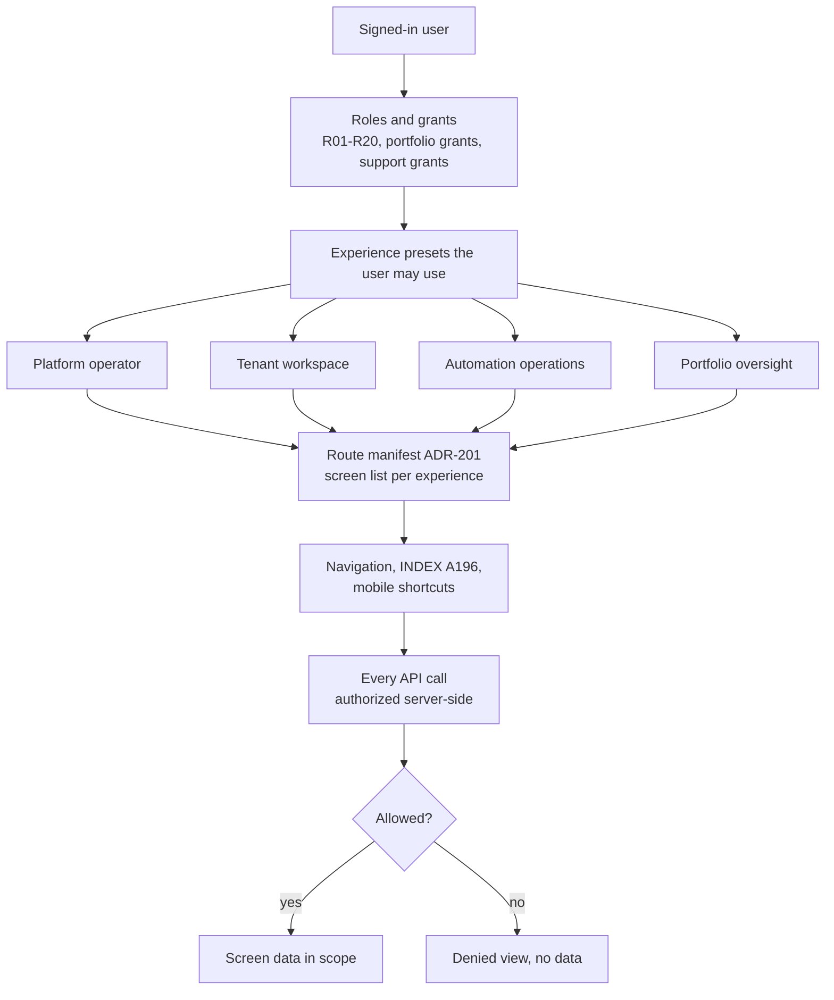

# AI Growth Engine: Employee Sales & Marketing Automation
## Application Blueprint: PART 11 (Batch 11.7a), V12 Public Website, Tenant Portal, Operator Administration, Portfolio Command Centre, UI/UX Master and HTML Prototypes: Material, Coverage and Catalogue Reconciliation

| Field | Value |
|---|---|
| Document | Application Blueprint · Part 11.7 (Batch 11.7a of 3: material, coverage, detailed register, catalogue reconciliation). Batch 11.7b holds the enhancements (screen contracts, components, responsive and mobile rules, accessibility, effort and cost). Batch 11.7c holds the FR, story and test registers, datasets, conflicts, decisions, expert review, tags and the quality gate |
| Version | 1.0 · 28 Nov 2026 |
| Baseline | Blueprint Parts 0–9.10 and 0B (346 decisions DEC-001…422); Part 2.5 (147 screens), Part 2.7a/2.7b (147 contract cards), Parts 9.7–9.9 (A114–A169, W35–W49); V11_BRIEF safety invariants; customer revision V12 (FSD V12 chapters 20–24, source workbook 147 Screen Field, neutral website pack, four HTML prototypes) received 28 Nov 2026 |
| Roles applied | Head of Product Design (enterprise SaaS), Principal UX Architect, Accessibility Lead (WCAG 2.2 AA), Principal Frontend Engineer (React/TypeScript), Mobile UX Specialist; Business Systems Analyst for traceability |
| ID ranges used | DEC-620…639 · ASSUMPTION/GAP/CONFLICT/RECOMMENDATION-868…885 · ADR-200…204 · FR-V12-G-001…117 · US-<EP>-YG<nn> · TC-V12-G-001…234 · screens A170–A204 and W50–W54 (A205–A259 and W55–W99 reserved, unused) · aspect IDs G-<src>-#### |
| Machine-readable register | `final/coverage_v12/G_coverage.csv` (5,430 aspects, columns doc, chapter, section, aspect_id, aspect_summary, status_before, blueprint_location, action, new_ids, status_after) |
| Scripts | `assembly/v12/g_parse_fsd.py` (FSD tables), `g_crawl_prototypes.js` (sandboxed headless crawl, network disabled), `g_common.py`, `g_screens.py`, `g_build.py` (aspects and CSV), `g_render.py` (tables and cards) |

**How to read this part.** V12 is the customer's revised specification. It keeps the 147 screen IDs of the baseline and adds 46 more, but it **re-purposes the public website**: W01–W34 no longer present the owned startups to the public. They now form a **neutral SaaS storefront** that sells the 39 automation services (SM-SVC-01…39). It also adds tenant service workspaces (X26–X39), platform-operator screens (O01–O08), AI-governance and compliance screens (V12 A114–A121), enterprise screens (V12 A122–A131) and enterprise website pages (V12 W35–W41). Batch 11.7a lists what was reviewed, how every aspect compares with the blueprint, and how every V12 route maps to a blueprint screen. Batch 11.7b specifies the missing screens and behaviours at build depth. Batch 11.7c closes traceability, conflicts and decisions.

**Acronyms used in this part.** ACR accessibility conformance report; ADR architecture decision record; BYOK bring your own key; CDN content delivery network; DLT distributed ledger technology (India SMS registration); DSAR data-subject access request; ICU International Components for Unicode (message format); KMS key management service; MFA multi-factor authentication; PDP Policy Decision Point; RTL right-to-left; SCIM System for Cross-domain Identity Management; SIEM security information and event management; SKU stock-keeping unit (here, one sellable automation service); SoD separation of duties; SSO single sign-on; TCO total cost of ownership.

---

## 11.7.1 Material reviewed

### 11.7.1.1 Files

| # | File (customer revision V12, 28 Nov 2026) | Size | Sections / structure | Purpose | Pattern | Aspects |
|---|---|---|---|---|---|---|
| 1 | FSD V12 ch20 `20_Public_SaaS_Website_Specification.txt` | 57 KB | V12 ENT-GLB table (8); V6/V5 text; 22 optimisation items (GC, AT, CV); route registry (34); 34 route rules; workflow-demonstration text; 156 fictional outputs | Neutral SaaS storefront | Layered V12 → V5 sections | 269 |
| 2 | FSD V12 ch21 `21_Tenant_Portal_Business_Workspace_Specif.txt` | 25 KB | REC-07/25; 8 service stages; MOB-05/11/17; V5 portal; 11 RT items; 39 domain panels; 39 evidence-field rows | Tenant portal and service workspaces | Tables + MOB blocks | 131 |
| 3 | FSD V12 ch22 `22_Platform_Operator_Administration.txt` | 3 KB | V12 screen table (16: A122–A131, W37–W41, W01+ language switcher); V5 lab; AT-15, CV-15; operator scope | Operator and enterprise screens | Table + text | 27 |
| 4 | FSD V12 ch23 `23_Authorized_Portfolio_Command_Centre.txt` | 4 KB | REC-06/13; MOB-06; V6 alignment; MT-02, MT-25; filter contract (6) | Portfolio Command Centre | Table + text | 31 |
| 5 | FSD V12 ch24 `24_UI_UX_Components_Screens_Interaction_Ma.txt` | 172 KB | REC-14; MOB alignment (18); V8 screens (10) and behaviours (7); MOB-01/02/03/07/08/12; presentation inventory; website crosswalk (34); admin crosswalk (135); MT-26/37; 11 optimisation items; admin route registry (135); **113 per-screen specification tables × 7 rows** | UI/UX master | Parsed programmatically (`g_parse_fsd.py`: 122 tables, 1,148 rows) | 3,223 |
| 6 | Workbook `Sales_Marketing_Automation_147_Screen_Field_csv/` (Summary, Website, Admin, New_screens, Global_fields, Acceptance) | 78 KB | 31 website rows, 108 admin rows, 9 new layouts, G01–G15, T01–T25 | Field audit (same content as baseline source doc 06) | CSV | 188 |
| 7 | Website pack `Sales_Marketing_Automation_34_Neutral_SaaS_Website(1)/` (README, route reconciliation, layout catalogue, verification report, preview) | 233 KB | 34 route renames; 64 catalogue entries (39 SKUs + 25 foundations), 7 families, 12 channels, 12 industries; 22 verification checks | Developer handoff of the neutral storefront | JSON/CSV | 234 |
| 8 | `commercial_website_desktop_V12.html` = `…_mobile_V12.html` | 251 KB each | 4 scripts; data object CFG; 41 routes + 404; 2 session states | Website prototype | Single-page app, hash routes | 309 |
| 9 | `commercial_admin_desktop_V12.html` = `…_mobile_V12.html` | 1,092 KB each | 5 scripts; DATA (39 services, 156 workflows, 135 screens, 25 foundations, 15 engines); V5/V6/R10 registers; V8/E12 screens and 9 constant tables | Admin prototype | Single-page app; 4 access experiences | 1,016 |
| 10 | Source archive (Investment Automation sibling: 19-route website, 24 services / 96 workflows workbook) | — | Investor and fundraising product | Sibling product | — | 1 |
| 11 | Blueprint governance (approved budgets) | — | — | Budget fit of V12 UI scope | — | 1 |
| | **Total** | | | | | **5,430** |

### 11.7.1.2 Method

1. **Read every line.** Chapters 20–23 were read in full; chapter 24 and the CSV/JSON packs were also parsed with scripts saved in `assembly/v12/` so that no row is skipped.
2. **Prototype crawl in a sandbox.** The prototypes are untrusted code. They were opened only in a headless Chromium (Playwright) context with `offline: true` and a route handler that aborts every non-`file:`/`data:` request. The crawl visited every website route signed out and in a synthetic demo session, an unknown route, the Hindi and Arabic locales, and every Admin route (153 registered screens + 13 utility views) under each of the four access experiences (664 renders). It recorded headings, every form control (label, type, required, options), buttons, tables (headers, row count), disclosures, notices and links. No page errors occurred. Screenshots were taken for reference only and are not published.
3. **Desktop = mobile.** A byte comparison shows the desktop and mobile files differ in exactly one line each: the `<body>` class (`v7-desktop` vs `mobile-preview`) and the banner text. One crawl therefore covers both device builds; all mobile behaviour comes from the shared `v7*` script driven by the layout class and viewport.
4. **Atomic aspects.** Each requirement, rule, route, section, field, action, table, disclosure, dataset and dataset row is an aspect with ID `G-<src>-####`. Repeated boilerplate (for example the identical V2 rule on 113 screens) is listed once per screen.
5. **Comparison.** Field and route atoms of the 113 per-screen tables were compared token-wise with the Part 2.7b contract card of the same screen (rule: all tokens present = Covered, ≥ 50% = Partial). Other aspects were judged against Parts 2.1, 2.3, 2.5, 2.7a/b, 3.2, 4.1 and 9.7–9.9, with the location recorded.
6. **Enhancement.** Every Partial, Not covered and Conflict aspect points to an FR-V12-G requirement and a contract in Batch 11.7b; Founder-level conflicts are raised in §11.7.6.

### 11.7.1.3 What V12 changes in the UI (headline)

| # | Change | Evidence | Blueprint effect |
|---|---|---|---|
| 1 | Website becomes a **neutral SaaS storefront**: 34 route IDs kept, names and purpose replaced (for example W02 "Company and startup business directory" → "Automation categories") | Route reconciliation CSV; FSD ch20 route registry | DEC-621; 34 route delta cards; the former startup-facing intake moves to tenant-owned sites (A107/A108 renamed, new W54) |
| 2 | Subscription by **Full suite / Partial bundle / Selective** over 39 SKUs; 25 foundations always included; **quote request only, no checkout** | README; CFG; W06 | FR-V12-G-104/105 |
| 3 | **Enterprise website pages** W35–W41 and **enterprise Admin screens** A114–A131 | FSD ch22, ch24 V8 table; prototype | New A198–A204, W50–W53; aliases to Part 9.7–9.9 screens |
| 4 | **V12 screen IDs collide** with blueprint IDs A114–A131 and W35–W41 (assigned in Parts 9.7–9.9 to other screens) | ch22/ch24 tables vs Part 9.7b/9.8a/9.9a | DEC-620 dual-ID crosswalk; CONFLICT-870 |
| 5 | **14 service workspaces X26–X39** and **8 operator screens O01–O08** | ch24 admin registry | New A170–A191 |
| 6 | **Four access experiences** (Platform operator, Tenant workspace, Automation operations, Portfolio oversight) | Admin registry "Demo access" column; prototype selector | DEC-624 |
| 7 | **Full mobile parity** for Website and Admin from one responsive build | MOB-01…18 | DEC-623 amends DEC-043 |
| 8 | **Localisation** en, hi, de, fr, ar with RTL | ENT-GLB-01…04; prototype V12L | DEC-625 amends DEC-026/DEC-404 for the website |
| 9 | **Investor / fundraising mode** remains in the website template (`CFG.inv`) and a sibling investment storefront is in the archive | Prototype code; README; archive | CONFLICT-868, pending Founder decision (DEC-632) |

---

## 11.7.2 Coverage summary

### 11.7.2.1 Before and after, by material

| Src | Material | Aspects | Covered | Partial | Not covered | Conflict | N/A | Matched (after) | Pending Founder | N/A (after) |
|---|---|---|---|---|---|---|---|---|---|---|
| F20 | FSD ch20 Public SaaS Website | 113 | 1 | 75 | 35 | 1 | 1 | 112 | 0 | 1 |
| F20S | FSD ch20 156 fictional outputs | 156 | 0 | 0 | 156 | 0 | 0 | 156 | 0 | 0 |
| F21 | FSD ch21 Tenant portal | 53 | 0 | 26 | 27 | 0 | 0 | 53 | 0 | 0 |
| F21P | FSD ch21 39 domain panels + evidence fields | 78 | 0 | 50 | 28 | 0 | 0 | 78 | 0 | 0 |
| F22 | FSD ch22 Platform operator | 27 | 0 | 16 | 11 | 0 | 0 | 27 | 0 | 0 |
| F23 | FSD ch23 Portfolio Command Centre | 31 | 0 | 26 | 0 | 5 | 0 | 31 | 0 | 0 |
| F24 | FSD ch24 UI/UX master (prose, MOB, V8, crosswalks) | 275 | 120 | 113 | 33 | 7 | 2 | 273 | 0 | 2 |
| F24R | FSD ch24 Admin route registry (135) | 135 | 0 | 113 | 22 | 0 | 0 | 135 | 0 | 0 |
| F24F | FSD ch24 113 per-screen specs (field, route, rule atoms) | 2813 | 2784 | 29 | 0 | 0 | 0 | 2813 | 0 | 0 |
| WB | Workbook 147 Screen Field (6 sheets) | 188 | 185 | 3 | 0 | 0 | 0 | 188 | 0 | 0 |
| WP | Website pack (README, reconciliation, verification) | 89 | 0 | 39 | 0 | 50 | 0 | 73 | 16 | 0 |
| WPC | Website pack layout catalogue | 145 | 0 | 99 | 46 | 0 | 0 | 145 | 0 | 0 |
| PW | Prototype website (41 routes + 404, chrome) | 301 | 6 | 120 | 168 | 5 | 2 | 297 | 2 | 2 |
| PWD | Prototype website datasets | 8 | 0 | 0 | 8 | 0 | 0 | 8 | 0 | 0 |
| PA | Prototype admin (153 screens + utility views, chrome) | 899 | 124 | 62 | 710 | 2 | 1 | 898 | 0 | 1 |
| PAD | Prototype admin datasets | 117 | 0 | 52 | 65 | 0 | 0 | 117 | 0 | 0 |
| SA | Source archive (Investment sibling) | 1 | 0 | 0 | 0 | 1 | 0 | 0 | 1 | 0 |
| BG | Blueprint governance (budget) | 1 | 0 | 0 | 0 | 1 | 0 | 0 | 1 | 0 |
| **Total** |  | **5430** | **3220** | **823** | **1309** | **72** | **6** | **5404** | **20** | **6** |

**Reading the numbers.** 3,220 aspects (59%) were already covered, almost all of them field, route and rule atoms of the 113 Admin screen specifications and the 147-screen workbook, which carry the same content as baseline source document 06 that Part 2.7b already reconciled. The uncovered mass sits where V12 is genuinely new: the prototype admin screens X26–X39, O01–O08 and V12 A114–A131 (710 elements), the storefront routes (168), the 156 fictional workflow outputs and the domain panels. After this part, 5,404 aspects are **Matched**, 20 are **Pending Founder decision** (investor/fundraising mode and the investment sibling: 18; budget: 1; certification programme vs DEC-408: 1) and 6 are **Not applicable** with a reason. *(v1.2: every item counted here as "Pending Founder decision" was adopted by DEC-770…791 — Part 11.14; read as Adopted. Part 11.25.)*

### 11.7.2.2 Covered aspects (grouped)

| Src | Material | Covered aspects (grouped) | Where covered |
|---|---|---|---|
| F20 | FSD ch20 Public SaaS Website | 1 | Part 2.5/2.7 |
| F24 | FSD ch24 UI/UX master (prose, MOB, V8, crosswalks) | 120 | Part 2.7a FR-FLT; Part 2.5 §2.46; CS items in Parts 2.4, 3.2, 9.9 |
| F24F | FSD ch24 113 per-screen specs (field, route, rule atoms) | 2784 | Part 2.7b per-screen cards (field, route, table, rule) and Part 2.1 alias scheme |
| WB | Workbook 147 Screen Field (6 sheets) | 185 | Part 2.7a/2.7b and coverage C06 (same field audit as source doc 06) |
| PW | Prototype website (41 routes + 404, chrome) | 6 | Part 2.5 chrome |
| PA | Prototype admin (153 screens + utility views, chrome) | 124 | Part 2.5/2.7b A001–A113 (screen identity unchanged) |

### 11.7.2.3 Status after, by kind of action

| Action kind | Aspects | Where |
|---|---|---|
| Route delta on a re-purposed website screen (W01–W34) | 34 FRs; 467 aspect links | §11.7.5.2 (Batch 11.7b) |
| New screen contract (A170–A204, W50–W54) | 40 FRs; 765 aspect links | §11.7.5.4–11.7.5.6 |
| Delta on an existing screen (aliases, A089, A106, A107/A108) | 20 FRs; 390 aspect links | §11.7.5.3 |
| Cross-cutting behaviour (i18n, accessibility, mobile, storefront, drafts, domain panel) | 23 FRs; 1,027 aspect links (an aspect may link to several FRs) | §11.7.5.7–11.7.5.11 |
| Pending Founder decision | 20 aspects | §11.7.6 |
| Not applicable | 6 aspects | §11.7.3 rows with reason |

---

## 11.7.3 Detailed register

Every Partial, Not covered and Conflict aspect is listed individually below (one row per aspect, or for prototype screen elements one row per screen that names each element, every element being its own aspect ID in the CSV). Covered aspects are grouped in §11.7.2.2. Column "After" is **Matched** unless stated.

#### Register F20: FSD ch20 Public SaaS Website (112 aspects)

| Aspect | Summary | Before | Blueprint location | Action | New IDs | After |
|---|---|---|---|---|---|---|
| G-F20-0001 | ENT-GLB-01 [P0] Internationalisation framework: externalised strings, ICU MessageFormat, pseudo-localisation tests. Acceptance: Pseudo-locale run shows no hard-coded strings in core flows. Phase R1; prototype W01 language switcher | Partially covered | DEC-026 (i18n-ready ICU); Part 2.5 §2.49 | DEC-625; §11.7.5.6 i18n/RTL | FR-V12-G-095 | Matched |
| G-F20-0002 | ENT-GLB-02 [P1] Locales: English and Hindi (R2), German and French (R3), Arabic (R4), others by market. Acceptance: Professional translation review per locale. Phase R2–R4; prototype W01 | Conflict | DEC-026 locales en-IN + hi/ta/or | DEC-625; §11.7.5.6 i18n/RTL | FR-V12-G-095; DEC-625; CONFLICT-872 | Matched |
| G-F20-0003 | ENT-GLB-03 [P1] Right-to-left layout support. Acceptance: Arabic pages mirror correctly with no overflow. Phase R4; prototype W01 (ar) | Not covered | No RTL layout rule in Part 2.5 | DEC-625; §11.7.5.6 i18n/RTL | FR-V12-G-095 | Matched |
| G-F20-0004 | ENT-GLB-04 [P0] Locale formats: dates, numbers, currencies, addresses, phone numbers in E.164, IANA time zones. Acceptance: Format tests per locale. Phase R1; prototype — | Partially covered | DEC-026/DEC-027; Part 2.7b R-FLD | DEC-625; §11.7.5.6 i18n/RTL | FR-V12-G-095 | Matched |
| G-F20-0005 | ENT-GLB-05 [P0] Tax engine abstraction: India GST, EU VAT (reverse charge and OSS), UK VAT, UAE VAT, Singapore and Australia GST, US sales tax via provider. Acceptance: Invoice tax lines match the approved rule table (A131). Phase | Partially covered | Part 8.3 tax (DEC-028); A101 | Alias delta A131→A101 (§11.7.5.5) | FR-V12-G-089 | Matched |
| G-F20-0007 | ENT-GLB-07 [P1] Regional messaging providers selected per market (DLT India, sender registration elsewhere). Acceptance: Provider approved per region before launch. Phase R1–R5; prototype A128 | Partially covered | A008/A044; DLT in Part 4.1 | Alias delta A131→A101 (§11.7.5.5) | FR-V12-G-086 | Matched |
| G-F20-0008 | ENT-GLB-08 [P1] Region expansion plan with data residency (US, UK, Middle East, APAC). Acceptance: Region exit criteria met (roadmap). Phase R4–R5; prototype — | Not applicable | Architecture/residency roadmap (Group E, Part 11.5) | None (owned by Part 11.5) |  | Not applicable (residency roadmap is arc |
| G-F20-0009 | Website route alignment: W01 neutral universal proposition; W32 private registration; W33 eight-stage hierarchy wizard and reviewed export; W22/W27/W34 private setup summary. V5 readiness, TCO, sample outputs and all 34 routes ret | Partially covered | Part 2.5 §2.43 W32–W34; Part 2.7b W33 | W33 eight-stage wizard; W22/W27/W34 setup summary | FR-V12-G-113; FR-V12-G-114 | Matched |
| G-F20-0010 | V5 website route addition: W11/W07 local readiness/goal guidance (AT-05/06, CV-03) | Not covered | No equivalent in Part 2.5/2.7b | Route delta cards §11.7.5.2 | FR-V12-G-108 | Matched |
| G-F20-0011 | V5 website route addition: W06 total cost and 50% benefit sensitivity + selection worksheet import/export (CV-02/06/07) | Not covered | No equivalent in Part 2.5/2.7b | Route delta cards §11.7.5.2 | FR-V12-G-107 | Matched |
| G-F20-0012 | V5 website route addition: W31 compare outputs/prerequisites without selection (CV-04) | Not covered | No equivalent in Part 2.5/2.7b | Route delta cards §11.7.5.2 | FR-V12-G-031 | Matched |
| G-F20-0013 | V5 website route addition: W08 three-sample session cap and searchable 39-guide directory (AT-07/09) | Not covered | No equivalent in Part 2.5/2.7b | Route delta cards §11.7.5.2 | FR-V12-G-106 | Matched |
| G-F20-0014 | V5 website route addition: W05/W08 export four preauthored fictional outputs per SKU (AT-08) | Not covered | No equivalent in Part 2.5/2.7b | Route delta cards §11.7.5.2 | FR-V12-G-106 | Matched |
| G-F20-0015 | V5 website route addition: W16 pending provider prerequisites (AT-11) | Not covered | No equivalent in Part 2.5/2.7b | Route delta cards §11.7.5.2 | FR-V12-G-016 | Matched |
| G-F20-0016 | V5 website route addition: W30 trust disclosures (AT-12). No production inference, analytics, checkout, SEO routes, locale or authentication is implemented by these HTML changes. | Not covered | No equivalent in Part 2.5/2.7b | Route delta cards §11.7.5.2 | FR-V12-G-030 | Matched |
| G-F20-0017 | GC-07 (P1) CDN and neutral asset caching — Requirement: Cache only versioned public assets and catalogue projection; private responses no-store. Acceptance OPT-TC-GC-07: Anonymous cache returns public data; authenticated response | Not covered | No equivalent UI; requirement register shown in A089 (V5 lab) | A089 delta lists the item in the optimisation register panel; requirement substance reconciled by the optimisa | FR-V12-G-091 | Matched |
| G-F20-0018 | AT-01 (P1) Crawlable service pages — Requirement: Generate canonical production routes and metadata for each of 39 services; sitemap and public projection only. Acceptance OPT-TC-AT-01: Each public SKU route has unique title, desc | Not covered | No equivalent UI; requirement register shown in A089 (V5 lab) | A089 delta lists the item in the optimisation register panel; requirement substance reconciled by the optimisa | FR-V12-G-091 | Matched |
| G-F20-0019 | AT-02 (P1) Industry solution pages — Requirement: Use reviewed neutral examples and existing service combinations by industry. Acceptance OPT-TC-AT-02: Industry selection shows relevant SKUs with rationale and no fictitious custom | Not covered | No OPT-TC/AT/CV register in blueprint; nearest Part 2.5 §2.43 W07; Part 2.7b card W07 (pre | §11.7.5 route delta W07 | FR-V12-G-007 | Matched |
| G-F20-0020 | AT-03 (P1) Persona-based entry journeys — Requirement: Offer founder, marketing, sales and enterprise paths with relevant value propositions. Acceptance OPT-TC-AT-03: Persona choice changes suggestions without automatic selection. | Not covered | No OPT-TC/AT/CV register in blueprint; nearest Part 2.5 §2.43 W11; Part 2.7b card W11 (pre | §11.7.5 route delta W11 | FR-V12-G-108 | Matched |
| G-F20-0021 | AT-04 (P1) Transparent solution comparisons — Requirement: Explain capabilities, prerequisites and limitations compared with manual/point-tool alternatives. Acceptance OPT-TC-AT-04: Comparison states limitations and evidence; no u | Not covered | No equivalent UI; requirement register shown in A089 (V5 lab) | A089 delta lists the item in the optimisation register panel; requirement substance reconciled by the optimisa | FR-V12-G-091 | Matched |
| G-F20-0022 | AT-05 (P1) Free automation maturity assessment — Requirement: Collect nonidentifying readiness answers; compute explainable category score. Acceptance OPT-TC-AT-05: Score reproducible from responses; no mandatory personal data. Ow | Not covered | No OPT-TC/AT/CV register in blueprint; nearest Part 2.5 §2.43 W11; Part 2.7b card W11 (pre | §11.7.5 route delta W11 | FR-V12-G-108 | Matched |
| G-F20-0023 | AT-06 (P1) Personalized opportunity report — Requirement: Generate local report with score, reasons and suggested service IDs; no guarantee. Acceptance OPT-TC-AT-06: Report export contains inputs, recommendations and caveat. Owner | Not covered | No OPT-TC/AT/CV register in blueprint; nearest Part 2.5 §2.43 W11; Part 2.7b card W11 (pre | §11.7.5 route delta W11 | FR-V12-G-108 | Matched |
| G-F20-0024 | AT-07 (P1) Controlled sandbox — Requirement: Expose synthetic sample execution with hard limits, no external effects and clear status. Acceptance OPT-TC-AT-07: Sample limit enforced and no provider/network action from demo. Owner: | Not covered | No OPT-TC/AT/CV register in blueprint; nearest Part 2.5 §2.43 W08; Part 2.7b card W08 (pre | §11.7.5 route delta W08 | FR-V12-G-106 | Matched |
| G-F20-0025 | AT-08 (P1) Downloadable sample outputs — Requirement: Provide labeled fictional outputs for each of 39 services and associated workflows. Acceptance OPT-TC-AT-08: Each SKU sample download contains all four workflow IDs and illustr | Not covered | No OPT-TC/AT/CV register in blueprint; nearest Part 2.5 §2.43 W05; Part 2.7b card W05 (pre | §11.7.5 route delta W05, W08 | FR-V12-G-106 | Matched |
| G-F20-0026 | AT-09 (P1) Educational resource centre — Requirement: Publish approved service tutorials, guides and event descriptions with search and links. Acceptance OPT-TC-AT-09: Resource search returns relevant service guide; unavailable ev | Not covered | No OPT-TC/AT/CV register in blueprint; nearest Part 2.5 §2.43 W08; Part 2.7b card W08 (pre | §11.7.5 route delta W08 | FR-V12-G-008 | Matched |
| G-F20-0027 | AT-10 (P2) Referral and agency programmes — Requirement: Define consent, attribution, approved terms and conflict review; no unapproved commission. Acceptance OPT-TC-AT-10: Referral fixture attributed once and awaits approved term | Not covered | No equivalent UI; requirement register shown in A089 (V5 lab) | A089 delta lists the item in the optimisation register panel; requirement substance reconciled by the optimisa | FR-V12-G-091 | Matched |
| G-F20-0028 | AT-11 (P1) Integration compatibility directory — Requirement: Show provider prerequisites, availability and last verification; no unsupported claim. Acceptance OPT-TC-AT-11: Unknown connector marked unverified; approved connector | Not covered | No OPT-TC/AT/CV register in blueprint; nearest Part 2.5 §2.43 W16; Part 2.7b card W16 (pre | §11.7.5 route delta W16 | FR-V12-G-016 | Matched |
| G-F20-0029 | AT-12 (P0) Verified trust centre — Requirement: Disclose data ownership, security controls, operational status and evidence gaps. Acceptance OPT-TC-AT-12: No compliance or availability claim without verified evidence. Owner: Growt | Not covered | No OPT-TC/AT/CV register in blueprint; nearest Part 2.5 §2.43 W30; Part 2.7b card W30 (pre | §11.7.5 route delta W30 | FR-V12-G-030 | Matched |
| G-F20-0030 | AT-13 (P2) Regional and multilingual content — Requirement: Version translations and locale/currency/timezone settings; review claims. Acceptance OPT-TC-AT-13: Locale fixture preserves approved meaning, terms and currency. Owner: | Not covered | No equivalent UI; requirement register shown in A089 (V5 lab) | A089 delta lists the item in the optimisation register panel; requirement substance reconciled by the optimisa | FR-V12-G-091 | Matched |
| G-F20-0031 | CV-03 (P1) Explainable recommended bundles — Requirement: Map objective, business model and constraints to SKU suggestions and optional prerequisites. Acceptance OPT-TC-CV-03: Reasons visible; user confirms selected services indep | Not covered | No OPT-TC/AT/CV register in blueprint; nearest Part 2.5 §2.43 W11; Part 2.7b card W11 (pre | §11.7.5 route delta W11 | FR-V12-G-108 | Matched |
| G-F20-0032 | CV-04 (P1) Side-by-side service comparison — Requirement: Compare output, limits, dependencies, meter and approved costs; unknown prices explicit. Acceptance OPT-TC-CV-04: Compare two SKUs without adding them to cart; no fabricate | Not covered | No OPT-TC/AT/CV register in blueprint; nearest Part 2.5 §2.43 W31; Part 2.7b card W31 (pre | §11.7.5 route delta W31 | FR-V12-G-031 | Matched |
| G-F20-0033 | CV-06 (P1) Total cost of ownership estimator — Requirement: Use customer-supplied subscription, provider, labor and implementation assumptions; show currency and period. Acceptance OPT-TC-CV-06: Calculated total equals inputs; one | Not covered | No OPT-TC/AT/CV register in blueprint; nearest Part 2.5 §2.43 W06; Part 2.7b card W06 (pre | §11.7.5 route delta W06 | FR-V12-G-107 | Matched |
| G-F20-0034 | CV-07 (P1) Service-specific ROI sensitivity — Requirement: Compute estimated value from workload, time saved, labor and cost ranges; disclose assumptions. Acceptance OPT-TC-CV-07: Negative ROI remains visible; no guarantee or inve | Not covered | No OPT-TC/AT/CV register in blueprint; nearest Part 2.5 §2.43 W06; Part 2.7b card W06 (pre | §11.7.5 route delta W06 | FR-V12-G-107 | Matched |
| G-F20-0035 | CV-08 (P1) Guided use-case demonstrations — Requirement: Show synthetic output walkthroughs relevant to chosen use case and selected SKUs. Acceptance OPT-TC-CV-08: Demo uses fictional data and no live effects; user can return to s | Not covered | No OPT-TC/AT/CV register in blueprint; nearest Part 2.5 §2.43 W08; Part 2.7b card W08 (pre | §11.7.5 route delta W08 | FR-V12-G-106 | Matched |
| G-F20-0036 | CV-09 (P1) Consultation and onboarding booking — Requirement: Capture preferred timezone and availability; confirm only from authorized calendar provider. Acceptance OPT-TC-CV-09: Demo does not confirm live slot; production confli | Not covered | No equivalent UI; requirement register shown in A089 (V5 lab) | A089 delta lists the item in the optimisation register panel; requirement substance reconciled by the optimisa | FR-V12-G-091 | Matched |
| G-F20-0037 | CV-10 (P1) Private lead qualification and routing — Requirement: Qualify SaaS enquiry with approved rubric and route to operator sales queue. Acceptance OPT-TC-CV-10: Enquiry scoped to operator; customer business data not automati | Not covered | No equivalent UI; requirement register shown in A089 (V5 lab) | A089 delta lists the item in the optimisation register panel; requirement substance reconciled by the optimisa | FR-V12-G-091 | Matched |
| G-F20-0038 | CV-11 (P1) Consent-based quotation follow-up — Requirement: Use approved cadence, channel, stop rules, quote revision and eligibility. Acceptance OPT-TC-CV-11: Opt-out or accepted quote stops sequence; no duplicate reminder. Owner | Not covered | No equivalent UI; requirement register shown in A089 (V5 lab) | A089 delta lists the item in the optimisation register panel; requirement substance reconciled by the optimisa | FR-V12-G-091 | Matched |
| G-F20-0039 | W01 Home — access Public; V3 design intent: Overview, bundles, illustrative ROI | Partially covered | Part 2.5 §2.43 W01; Part 2.7b card W01 (pre-V12 semantics) | DEC-621 repurpose; route delta card | FR-V12-G-001 | Matched |
| G-F20-0040 | W02 Automation categories — access Public; V3 design intent: Retained V2 route; local illustrative interaction / reference | Partially covered | Part 2.5 §2.43 W02; Part 2.7b card W02 (pre-V12 semantics) | DEC-621 repurpose; route delta card | FR-V12-G-002 | Matched |
| G-F20-0041 | W03 Automation family details — access Public; V3 design intent: Retained V2 route; local illustrative interaction / reference | Partially covered | Part 2.5 §2.43 W03; Part 2.7b card W03 (pre-V12 semantics) | DEC-621 repurpose; route delta card | FR-V12-G-003 | Matched |
| G-F20-0042 | W04 Complete automation catalog — access Public; V3 design intent: Searchable SKU cards, family/filter and selection | Partially covered | Part 2.5 §2.43 W04; Part 2.7b card W04 (pre-V12 semantics) | DEC-621 repurpose; route delta card | FR-V12-G-004 | Matched |
| G-F20-0043 | W05 Individual automation details — access Public; V3 design intent: SKU detail with four workflow previews | Partially covered | Part 2.5 §2.43 W05; Part 2.7b card W05 (pre-V12 semantics) | DEC-621 repurpose; route delta card | FR-V12-G-005 | Matched |
| G-F20-0044 | W06 Plans & automation selection — access Public; V3 design intent: Full / partial / selective request and quote configuration | Partially covered | Part 2.5 §2.43 W06; Part 2.7b card W06 (pre-V12 semantics) | DEC-621 repurpose; route delta card | FR-V12-G-006 | Matched |
| G-F20-0045 | W07 Industry solution guide — access Public; V3 design intent: Retained V2 route; local illustrative interaction / reference | Partially covered | Part 2.5 §2.43 W07; Part 2.7b card W07 (pre-V12 semantics) | DEC-621 repurpose; route delta card | FR-V12-G-007 | Matched |
| G-F20-0046 | W08 Resources & automation guides — access Public; V3 design intent: Retained V2 route; local illustrative interaction / reference | Partially covered | Part 2.5 §2.43 W08; Part 2.7b card W08 (pre-V12 semantics) | DEC-621 repurpose; route delta card | FR-V12-G-008 | Matched |
| G-F20-0047 | W09 Illustrative use cases — access Public; V3 design intent: Retained V2 route; local illustrative interaction / reference | Partially covered | Part 2.5 §2.43 W09; Part 2.7b card W09 (pre-V12 semantics) | DEC-621 repurpose; route delta card | FR-V12-G-009 | Matched |
| G-F20-0048 | W10 Campaign automation overview — access Public; V3 design intent: Retained V2 route; local illustrative interaction / reference | Partially covered | Part 2.5 §2.43 W10; Part 2.7b card W10 (pre-V12 semantics) | DEC-621 repurpose; route delta card | FR-V12-G-010 | Matched |
| G-F20-0049 | W11 Automation selection assistant — access Public; V3 design intent: Rule-based guided service selection | Partially covered | Part 2.5 §2.43 W11; Part 2.7b card W11 (pre-V12 semantics) | DEC-621 repurpose; route delta card | FR-V12-G-011 | Matched |
| G-F20-0050 | W12 Service enquiry — access Public; V3 design intent: Retained V2 route; local illustrative interaction / reference | Partially covered | Part 2.5 §2.43 W12; Part 2.7b card W12 (pre-V12 semantics) | DEC-621 repurpose; route delta card | FR-V12-G-012 | Matched |
| G-F20-0051 | W13 Product demo & partnership enquiry — access Public; V3 design intent: Retained V2 route; local illustrative interaction / reference | Partially covered | Part 2.5 §2.43 W13; Part 2.7b card W13 (pre-V12 semantics) | DEC-621 repurpose; route delta card | FR-V12-G-013 | Matched |
| G-F20-0052 | W14 Custom quotation request — access Public; V3 design intent: Retained V2 route; local illustrative interaction / reference | Partially covered | Part 2.5 §2.43 W14; Part 2.7b card W14 (pre-V12 semantics) | DEC-621 repurpose; route delta card | FR-V12-G-014 | Matched |
| G-F20-0053 | W15 Automation requirements builder — access Public; V3 design intent: Retained V2 route; local illustrative interaction / reference | Partially covered | Part 2.5 §2.43 W15; Part 2.7b card W15 (pre-V12 semantics) | DEC-621 repurpose; route delta card | FR-V12-G-015 | Matched |
| G-F20-0054 | W16 Channel & integration options — access Public; V3 design intent: Retained V2 route; local illustrative interaction / reference | Partially covered | Part 2.5 §2.43 W16; Part 2.7b card W16 (pre-V12 semantics) | DEC-621 repurpose; route delta card | FR-V12-G-016 | Matched |
| G-F20-0055 | W17 Service delivery models — access Public; V3 design intent: Retained V2 route; local illustrative interaction / reference | Partially covered | Part 2.5 §2.43 W17; Part 2.7b card W17 (pre-V12 semantics) | DEC-621 repurpose; route delta card | FR-V12-G-017 | Matched |
| G-F20-0056 | W18 Consultation & demo booking — access Public; V3 design intent: Retained V2 route; local illustrative interaction / reference | Partially covered | Part 2.5 §2.43 W18; Part 2.7b card W18 (pre-V12 semantics) | DEC-621 repurpose; route delta card | FR-V12-G-018 | Matched |
| G-F20-0057 | W19 Product webinars & events — access Public; V3 design intent: Retained V2 route; local illustrative interaction / reference | Partially covered | Part 2.5 §2.43 W19; Part 2.7b card W19 (pre-V12 semantics) | DEC-621 repurpose; route delta card | FR-V12-G-019 | Matched |
| G-F20-0058 | W20 Service referral programme — access Public; V3 design intent: Retained V2 route; local illustrative interaction / reference | Partially covered | Part 2.5 §2.43 W20; Part 2.7b card W20 (pre-V12 semantics) | DEC-621 repurpose; route delta card | FR-V12-G-020 | Matched |
| G-F20-0059 | W21 Client sign-in & recovery — access Demo entry; V3 design intent: Retained V2 route; local illustrative interaction / reference | Partially covered | Part 2.5 §2.43 W21; Part 2.7b card W21 (pre-V12 semantics) | DEC-621 repurpose; route delta card | FR-V12-G-021 | Matched |
| G-F20-0060 | W22 Client service dashboard — access Private demo; V3 design intent: Retained V2 route; local illustrative interaction / reference | Partially covered | Part 2.5 §2.43 W22; Part 2.7b card W22 (pre-V12 semantics) | DEC-621 repurpose; route delta card | FR-V12-G-022 | Matched |
| G-F20-0061 | W23 Subscription quotation review — access Private demo; V3 design intent: Retained V2 route; local illustrative interaction / reference | Partially covered | Part 2.5 §2.43 W23; Part 2.7b card W23 (pre-V12 semantics) | DEC-621 repurpose; route delta card | FR-V12-G-023 | Matched |
| G-F20-0062 | W24 Service agreement review — access Private demo; V3 design intent: Retained V2 route; local illustrative interaction / reference | Partially covered | Part 2.5 §2.43 W24; Part 2.7b card W24 (pre-V12 semantics) | DEC-621 repurpose; route delta card | FR-V12-G-024 | Matched |
| G-F20-0063 | W25 Subscription order status — access Private demo; V3 design intent: Retained V2 route; local illustrative interaction / reference | Partially covered | Part 2.5 §2.43 W25; Part 2.7b card W25 (pre-V12 semantics) | DEC-621 repurpose; route delta card | FR-V12-G-025 | Matched |
| G-F20-0064 | W26 Billing & invoice status — access Private demo; V3 design intent: Retained V2 route; local illustrative interaction / reference | Partially covered | Part 2.5 §2.43 W26; Part 2.7b card W26 (pre-V12 semantics) | DEC-621 repurpose; route delta card | FR-V12-G-026 | Matched |
| G-F20-0065 | W27 Private onboarding checklist — access Private demo; V3 design intent: Retained V2 route; local illustrative interaction / reference | Partially covered | Part 2.5 §2.43 W27; Part 2.7b card W27 (pre-V12 semantics) | DEC-621 repurpose; route delta card | FR-V12-G-027 | Matched |
| G-F20-0066 | W28 Support, feedback & renewal — access Private demo; V3 design intent: Retained V2 route; local illustrative interaction / reference | Partially covered | Part 2.5 §2.43 W28; Part 2.7b card W28 (pre-V12 semantics) | DEC-621 repurpose; route delta card | FR-V12-G-028 | Matched |
| G-F20-0067 | W29 Communication preferences — access Private demo; V3 design intent: Retained V2 route; local illustrative interaction / reference | Partially covered | Part 2.5 §2.43 W29; Part 2.7b card W29 (pre-V12 semantics) | DEC-621 repurpose; route delta card | FR-V12-G-029 | Matched |
| G-F20-0068 | W30 Contact, privacy & help — access Public; V3 design intent: Trust and FAQ information | Partially covered | Part 2.5 §2.43 W30; Part 2.7b card W30 (pre-V12 semantics) | DEC-621 repurpose; route delta card | FR-V12-G-030 | Matched |
| G-F20-0069 | W31 Compare bundles & service coverage — access Public; V3 design intent: Bundle and selected-service comparison | Partially covered | Part 2.5 §2.43 W31; Part 2.7b card W31 (pre-V12 semantics) | DEC-621 repurpose; route delta card | FR-V12-G-031 | Matched |
| G-F20-0070 | W32 Private client registration — access Public entry; V3 design intent: Private demo registration | Partially covered | Part 2.5 §2.43 W32; Part 2.7b card W32 (pre-V12 semantics) | DEC-621 repurpose; route delta card | FR-V12-G-032 | Matched |
| G-F20-0071 | W33 Private configuration wizard — access Private demo; V3 design intent: Identity, objectives, channels/policy and review | Partially covered | Part 2.5 §2.43 W33; Part 2.7b card W33 (pre-V12 semantics) | DEC-621 repurpose; route delta card | FR-V12-G-033 | Matched |
| G-F20-0072 | W34 Client service portal — access Private demo; V3 design intent: Private requested services and JSON handoff | Partially covered | Part 2.5 §2.43 W34; Part 2.7b card W34 (pre-V12 semantics) | DEC-621 repurpose; route delta card | FR-V12-G-034 | Matched |
| G-F20-0073 | V4 chapter guidance: the current chapter registers contains current 34 W route registry and prototype interactions. | Partially covered | Part 2.5 §2.40.2 | DEC-621; ADR-204 anonymous catalogue projection | FR-V12-G-104 | Matched |
| G-F20-0074 | 34 route baseline. Use neutral public catalogue projection and private registration; no embedded tenant data, browser demo auth, or fake payment state. W01–W20 public entry/marketing, W21 sign-in, W22–W29 authenticated, W30–W32 pu | Partially covered | Part 2.5 §2.40.2 | DEC-621; ADR-204 anonymous catalogue projection | FR-V12-G-104 | Matched |
| G-F20-0075 | W01: Public catalogue or rate-limited private intake only. Neutral hero, service categories, CTA to catalogue, no tenant identity; UAT W01-V2-UAT: valid navigation, denied access, no unauthorized exposure, keyboard/mobile, error h | Partially covered | Part 2.5 §2.43 W01; Part 2.7b card W01 (pre-V12 semantics) | Route delta card W01; UAT W01-V2-UAT mapped to TC-V12-G- tests | FR-V12-G-001 | Matched |
| G-F20-0076 | W02: Public catalogue or rate-limited private intake only. Render approved neutral service information or private scoped action appropriate to route; validate input and show empty/loading/error/denied states; UAT W02-V2-UAT: valid | Partially covered | Part 2.5 §2.43 W02; Part 2.7b card W02 (pre-V12 semantics) | Route delta card W02; UAT W02-V2-UAT mapped to TC-V12-G- tests | FR-V12-G-002 | Matched |
| G-F20-0077 | W03: Public catalogue or rate-limited private intake only. Render approved neutral service information or private scoped action appropriate to route; validate input and show empty/loading/error/denied states; UAT W03-V2-UAT: valid | Partially covered | Part 2.5 §2.43 W03; Part 2.7b card W03 (pre-V12 semantics) | Route delta card W03; UAT W03-V2-UAT mapped to TC-V12-G- tests | FR-V12-G-003 | Matched |
| G-F20-0078 | W04: Public catalogue or rate-limited private intake only. SKU search/category/filter/sort and release state; selection by stable SKU ID; UAT W04-V2-UAT: valid navigation, denied access, no unauthorized exposure, keyboard/mobile, | Partially covered | Part 2.5 §2.43 W04; Part 2.7b card W04 (pre-V12 semantics) | Route delta card W04; UAT W04-V2-UAT mapped to TC-V12-G- tests | FR-V12-G-004 | Matched |
| G-F20-0079 | W05: Public catalogue or rate-limited private intake only. Render approved neutral service information or private scoped action appropriate to route; validate input and show empty/loading/error/denied states; UAT W05-V2-UAT: valid | Partially covered | Part 2.5 §2.43 W05; Part 2.7b card W05 (pre-V12 semantics) | Route delta card W05; UAT W05-V2-UAT mapped to TC-V12-G- tests | FR-V12-G-005 | Matched |
| G-F20-0080 | W06: Public catalogue or rate-limited private intake only. Full/partial/selective, currency/cycle/delivery mode; quote invalidation on selection change; UAT W06-V2-UAT: valid navigation, denied access, no unauthorized exposure, ke | Partially covered | Part 2.5 §2.43 W06; Part 2.7b card W06 (pre-V12 semantics) | Route delta card W06; UAT W06-V2-UAT mapped to TC-V12-G- tests | FR-V12-G-006; FR-V12-G-105 | Matched |
| G-F20-0081 | W07: Public catalogue or rate-limited private intake only. Render approved neutral service information or private scoped action appropriate to route; validate input and show empty/loading/error/denied states; UAT W07-V2-UAT: valid | Partially covered | Part 2.5 §2.43 W07; Part 2.7b card W07 (pre-V12 semantics) | Route delta card W07; UAT W07-V2-UAT mapped to TC-V12-G- tests | FR-V12-G-007 | Matched |
| G-F20-0082 | W08: Public catalogue or rate-limited private intake only. Render approved neutral service information or private scoped action appropriate to route; validate input and show empty/loading/error/denied states; UAT W08-V2-UAT: valid | Partially covered | Part 2.5 §2.43 W08; Part 2.7b card W08 (pre-V12 semantics) | Route delta card W08; UAT W08-V2-UAT mapped to TC-V12-G- tests | FR-V12-G-008 | Matched |
| G-F20-0083 | W09: Public catalogue or rate-limited private intake only. Render approved neutral service information or private scoped action appropriate to route; validate input and show empty/loading/error/denied states; UAT W09-V2-UAT: valid | Partially covered | Part 2.5 §2.43 W09; Part 2.7b card W09 (pre-V12 semantics) | Route delta card W09; UAT W09-V2-UAT mapped to TC-V12-G- tests | FR-V12-G-009 | Matched |
| G-F20-0084 | W10: Public catalogue or rate-limited private intake only. Render approved neutral service information or private scoped action appropriate to route; validate input and show empty/loading/error/denied states; UAT W10-V2-UAT: valid | Partially covered | Part 2.5 §2.43 W10; Part 2.7b card W10 (pre-V12 semantics) | Route delta card W10; UAT W10-V2-UAT mapped to TC-V12-G- tests | FR-V12-G-010 | Matched |
| G-F20-0085 | W11: Public catalogue or rate-limited private intake only. Render approved neutral service information or private scoped action appropriate to route; validate input and show empty/loading/error/denied states; UAT W11-V2-UAT: valid | Partially covered | Part 2.5 §2.43 W11; Part 2.7b card W11 (pre-V12 semantics) | Route delta card W11; UAT W11-V2-UAT mapped to TC-V12-G- tests | FR-V12-G-011 | Matched |
| G-F20-0086 | W12: Public catalogue or rate-limited private intake only. Minimal private enquiry and consent; safe acknowledgement; UAT W12-V2-UAT: valid navigation, denied access, no unauthorized exposure, keyboard/mobile, error handling; not | Partially covered | Part 2.5 §2.43 W12; Part 2.7b card W12 (pre-V12 semantics) | Route delta card W12; UAT W12-V2-UAT mapped to TC-V12-G- tests | FR-V12-G-012 | Matched |
| G-F20-0087 | W13: Public catalogue or rate-limited private intake only. Render approved neutral service information or private scoped action appropriate to route; validate input and show empty/loading/error/denied states; UAT W13-V2-UAT: valid | Partially covered | Part 2.5 §2.43 W13; Part 2.7b card W13 (pre-V12 semantics) | Route delta card W13; UAT W13-V2-UAT mapped to TC-V12-G- tests | FR-V12-G-013 | Matched |
| G-F20-0088 | W14: Public catalogue or rate-limited private intake only. Requested SKU IDs, requirements, private contact; no price commitment; UAT W14-V2-UAT: valid navigation, denied access, no unauthorized exposure, keyboard/mobile, error ha | Partially covered | Part 2.5 §2.43 W14; Part 2.7b card W14 (pre-V12 semantics) | Route delta card W14; UAT W14-V2-UAT mapped to TC-V12-G- tests | FR-V12-G-014; FR-V12-G-105 | Matched |
| G-F20-0089 | W15: Public catalogue or rate-limited private intake only. Render approved neutral service information or private scoped action appropriate to route; validate input and show empty/loading/error/denied states; UAT W15-V2-UAT: valid | Partially covered | Part 2.5 §2.43 W15; Part 2.7b card W15 (pre-V12 semantics) | Route delta card W15; UAT W15-V2-UAT mapped to TC-V12-G- tests | FR-V12-G-015 | Matched |
| G-F20-0090 | W16: Public catalogue or rate-limited private intake only. Render approved neutral service information or private scoped action appropriate to route; validate input and show empty/loading/error/denied states; UAT W16-V2-UAT: valid | Partially covered | Part 2.5 §2.43 W16; Part 2.7b card W16 (pre-V12 semantics) | Route delta card W16; UAT W16-V2-UAT mapped to TC-V12-G- tests | FR-V12-G-016 | Matched |
| G-F20-0091 | W17: Public catalogue or rate-limited private intake only. Render approved neutral service information or private scoped action appropriate to route; validate input and show empty/loading/error/denied states; UAT W17-V2-UAT: valid | Partially covered | Part 2.5 §2.43 W17; Part 2.7b card W17 (pre-V12 semantics) | Route delta card W17; UAT W17-V2-UAT mapped to TC-V12-G- tests | FR-V12-G-017 | Matched |
| G-F20-0092 | W18: Public catalogue or rate-limited private intake only. Requested time, timezone, contact; confirm after provider evidence; UAT W18-V2-UAT: valid navigation, denied access, no unauthorized exposure, keyboard/mobile, error handl | Partially covered | Part 2.5 §2.43 W18; Part 2.7b card W18 (pre-V12 semantics) | Route delta card W18; UAT W18-V2-UAT mapped to TC-V12-G- tests | FR-V12-G-018 | Matched |
| G-F20-0093 | W19: Public catalogue or rate-limited private intake only. Render approved neutral service information or private scoped action appropriate to route; validate input and show empty/loading/error/denied states; UAT W19-V2-UAT: valid | Partially covered | Part 2.5 §2.43 W19; Part 2.7b card W19 (pre-V12 semantics) | Route delta card W19; UAT W19-V2-UAT mapped to TC-V12-G- tests | FR-V12-G-019 | Matched |
| G-F20-0094 | W20: Public catalogue or rate-limited private intake only. Render approved neutral service information or private scoped action appropriate to route; validate input and show empty/loading/error/denied states; UAT W20-V2-UAT: valid | Partially covered | Part 2.5 §2.43 W20; Part 2.7b card W20 (pre-V12 semantics) | Route delta card W20; UAT W20-V2-UAT mapped to TC-V12-G- tests | FR-V12-G-020 | Matched |
| G-F20-0095 | W21: Public catalogue or rate-limited private intake only. Reuse identity, MFA where required, reset rate limits, trusted redirect; UAT W21-V2-UAT: valid navigation, denied access, no unauthorized exposure, keyboard/mobile, error | Partially covered | Part 2.5 §2.43 W21; Part 2.7b card W21 (pre-V12 semantics) | Route delta card W21; UAT W21-V2-UAT mapped to TC-V12-G- tests | FR-V12-G-021 | Matched |
| G-F20-0096 | W22: Verified membership and applicable entitlement. Tenant scope, activation status, allowance, errors, support; UAT W22-V2-UAT: valid navigation, denied access, no unauthorized exposure, keyboard/mobile, error handling; not run. | Partially covered | Part 2.5 §2.43 W22; Part 2.7b card W22 (pre-V12 semantics) | Route delta card W22; UAT W22-V2-UAT mapped to TC-V12-G- tests | FR-V12-G-022 | Matched |
| G-F20-0097 | W23: Verified membership and applicable entitlement. Immutable quote version; approve/reject, expiry, no edited accepted quote; UAT W23-V2-UAT: valid navigation, denied access, no unauthorized exposure, keyboard/mobile, error hand | Partially covered | Part 2.5 §2.43 W23; Part 2.7b card W23 (pre-V12 semantics) | Route delta card W23; UAT W23-V2-UAT mapped to TC-V12-G- tests | FR-V12-G-023; FR-V12-G-105 | Matched |
| G-F20-0098 | W24: Verified membership and applicable entitlement. Authorized signatory, review version, acceptance evidence; UAT W24-V2-UAT: valid navigation, denied access, no unauthorized exposure, keyboard/mobile, error handling; not run. | Partially covered | Part 2.5 §2.43 W24; Part 2.7b card W24 (pre-V12 semantics) | Route delta card W24; UAT W24-V2-UAT mapped to TC-V12-G- tests | FR-V12-G-024 | Matched |
| G-F20-0099 | W25: Verified membership and applicable entitlement. Provisioning status, no activation without verified subscription; UAT W25-V2-UAT: valid navigation, denied access, no unauthorized exposure, keyboard/mobile, error handling; not | Partially covered | Part 2.5 §2.43 W25; Part 2.7b card W25 (pre-V12 semantics) | Route delta card W25; UAT W25-V2-UAT mapped to TC-V12-G- tests | FR-V12-G-025 | Matched |
| G-F20-0100 | W26: Verified membership and applicable entitlement. Verified server invoice/payment; no client business receivables; UAT W26-V2-UAT: valid navigation, denied access, no unauthorized exposure, keyboard/mobile, error handling; not | Partially covered | Part 2.5 §2.43 W26; Part 2.7b card W26 (pre-V12 semantics) | Route delta card W26; UAT W26-V2-UAT mapped to TC-V12-G- tests | FR-V12-G-026 | Matched |
| G-F20-0101 | W27: Verified membership and applicable entitlement. Render approved neutral service information or private scoped action appropriate to route; validate input and show empty/loading/error/denied states; UAT W27-V2-UAT: valid navig | Partially covered | Part 2.5 §2.43 W27; Part 2.7b card W27 (pre-V12 semantics) | Route delta card W27; UAT W27-V2-UAT mapped to TC-V12-G- tests | FR-V12-G-027 | Matched |
| G-F20-0102 | W28: Verified membership and applicable entitlement. Render approved neutral service information or private scoped action appropriate to route; validate input and show empty/loading/error/denied states; UAT W28-V2-UAT: valid navig | Partially covered | Part 2.5 §2.43 W28; Part 2.7b card W28 (pre-V12 semantics) | Route delta card W28; UAT W28-V2-UAT mapped to TC-V12-G- tests | FR-V12-G-028 | Matched |
| G-F20-0103 | W29: Verified membership and applicable entitlement. Consent and preferences; suppression propagated; UAT W29-V2-UAT: valid navigation, denied access, no unauthorized exposure, keyboard/mobile, error handling; not run. | Partially covered | Part 2.5 §2.43 W29; Part 2.7b card W29 (pre-V12 semantics) | Route delta card W29; UAT W29-V2-UAT mapped to TC-V12-G- tests | FR-V12-G-029 | Matched |
| G-F20-0104 | W30: Public catalogue or rate-limited private intake only. Render approved neutral service information or private scoped action appropriate to route; validate input and show empty/loading/error/denied states; UAT W30-V2-UAT: valid | Partially covered | Part 2.5 §2.43 W30; Part 2.7b card W30 (pre-V12 semantics) | Route delta card W30; UAT W30-V2-UAT mapped to TC-V12-G- tests | FR-V12-G-030 | Matched |
| G-F20-0105 | W31: Public catalogue or rate-limited private intake only. Compare released SKUs and included foundations; no fake prices; UAT W31-V2-UAT: valid navigation, denied access, no unauthorized exposure, keyboard/mobile, error handling; | Partially covered | Part 2.5 §2.43 W31; Part 2.7b card W31 (pre-V12 semantics) | Route delta card W31; UAT W31-V2-UAT mapped to TC-V12-G- tests | FR-V12-G-031 | Matched |
| G-F20-0106 | W32: Public catalogue or rate-limited private intake only. Private registration, verification, minimal PII; no public publication; UAT W32-V2-UAT: valid navigation, denied access, no unauthorized exposure, keyboard/mobile, error h | Partially covered | Part 2.5 §2.43 W32; Part 2.7b card W32 (pre-V12 semantics) | Route delta card W32; UAT W32-V2-UAT mapped to TC-V12-G- tests | FR-V12-G-032 | Matched |
| G-F20-0107 | W33: Verified membership and applicable entitlement. Scoped company configuration, permissions, connector readiness, simulation; UAT W33-V2-UAT: valid navigation, denied access, no unauthorized exposure, keyboard/mobile, error han | Partially covered | Part 2.5 §2.43 W33; Part 2.7b card W33 (pre-V12 semantics) | Route delta card W33; UAT W33-V2-UAT mapped to TC-V12-G- tests | FR-V12-G-033 | Matched |
| G-F20-0108 | W34: Verified membership and applicable entitlement. Only entitled services, usage, support and private workspace entry; UAT W34-V2-UAT: valid navigation, denied access, no unauthorized exposure, keyboard/mobile, error handling; n | Partially covered | Part 2.5 §2.43 W34; Part 2.7b card W34 (pre-V12 semantics) | Route delta card W34; UAT W34-V2-UAT mapped to TC-V12-G- tests | FR-V12-G-034 | Matched |
| G-F20-0109 | W05 displays the four workflow contracts and opens a visible fictional output preview for each of 156 workflows. | Not covered | No workflow preview library in blueprint | W05 sample library; calculators | FR-V12-G-106 | Matched |
| G-F20-0110 | The artifact fields are derived from the output contract and each flow has its own curated fictional example. | Not covered | No workflow preview library in blueprint | W05 sample library; calculators | FR-V12-G-106 | Matched |
| G-F20-0111 | No real research or model execution is asserted. | Not covered | No workflow preview library in blueprint | W05 sample library; calculators | FR-V12-G-106 | Matched |
| G-F20-0112 | W01 ROI accepts user assumptions and estimated monthly automation cost, showing gross and net illustrative time value. | Not covered | No workflow preview library in blueprint | W05 sample library; calculators | FR-V12-G-107 | Matched |
| G-F20-0113 | Production URL, SEO, formal accessibility and consent-aware analytics must be implemented independently. | Not covered | No workflow preview library in blueprint | W05 sample library; calculators | FR-V12-G-095 | Matched |

#### Register F20S: FSD ch20 156 fictional outputs (156 aspects)

All 156 rows were Not covered before and are Matched by FR-V12-G-106; each row is listed individually with its aspect ID in the W05 sample library dataset (Part 11.7c §11.7.5.15).

#### Register F21: FSD ch21 Tenant portal (53 aspects)

| Aspect | Summary | Before | Blueprint location | Action | New IDs | After |
|---|---|---|---|---|---|---|
| G-F21-0001 | REC-07 · P1 / Product owner / Source D11,14,38: Recover source journey patterns; map proposed industry templates to current service IDs, source rights and approved claims. Acceptance: No public customer identities; mark missing hi | Partially covered | A100 templates; W27 checklist (Part 2.5) | W27/W34 activation checklist tied to selected services; A100 template-to-SKU mapping | FR-V12-G-114 | Matched |
| G-F21-0002 | REC-25 · P1 / Customer success / Source D33,34: Contextual role guides, first-value and service activation checklist tied to selected services. Acceptance: No activation before verified readiness and entitlement approval. | Partially covered | A100 templates; W27 checklist (Part 2.5) | W27/W34 activation checklist tied to selected services; A100 template-to-SKU mapping | FR-V12-G-114 | Matched |
| G-F21-0003 | Stage Contract / trial: Verify customer tenant, legal entity, service plan, allowed product, users, data, support and regulatory boundaries. Evidence: Approved service agreement, entitlements and price card. | Partially covered | Part 8.3 (SaaS onboarding SLA); A099/A101; W27/W34 | Operator screens A184–A191 + portal W27/W34 show each stage and its evidence | FR-V12-G-055; FR-V12-G-056; FR-V12-G-057; FR-V12-G-059; FR-V12-G-114 | Matched |
| G-F21-0004 | Stage Provision: Create independent tenant and startup(s), assign roles, verify custom domain and data region, set budget and credentials. Evidence: Isolation and access tests; no owner portfolio access. | Partially covered | Part 8.3 (SaaS onboarding SLA); A099/A101; W27/W34 | Operator screens A184–A191 + portal W27/W34 show each stage and its evidence | FR-V12-G-055; FR-V12-G-056; FR-V12-G-057; FR-V12-G-059; FR-V12-G-114 | Matched |
| G-F21-0005 | Stage Configure / import: Select business template, upload approved knowledge, dry-run import, resolve ownership and duplicates. Evidence: Approved profile hash and data reconciliation. | Partially covered | Part 8.3 (SaaS onboarding SLA); A099/A101; W27/W34 | Operator screens A184–A191 + portal W27/W34 show each stage and its evidence | FR-V12-G-055; FR-V12-G-056; FR-V12-G-057; FR-V12-G-059; FR-V12-G-114 | Matched |
| G-F21-0006 | Stage Activation: Run simulation and role training, review source/channel permissions, paid services disabled by default. Evidence: Client sign-off and approved workflow controls. | Partially covered | Part 8.3 (SaaS onboarding SLA); A099/A101; W27/W34 | Operator screens A184–A191 + portal W27/W34 show each stage and its evidence | FR-V12-G-055; FR-V12-G-056; FR-V12-G-057; FR-V12-G-059; FR-V12-G-114 | Matched |
| G-F21-0007 | Stage Billing: Meter actual authorized consumption with unique event key; compute rate-card charge and separate tax; reconcile invoice and receipt. Evidence: No duplicate bill, scoped currency/account and adjustment trail. | Partially covered | Part 8.3 (SaaS onboarding SLA); A099/A101; W27/W34 | Operator screens A184–A191 + portal W27/W34 show each stage and its evidence | FR-V12-G-055; FR-V12-G-056; FR-V12-G-057; FR-V12-G-059; FR-V12-G-114 | Matched |
| G-F21-0008 | Stage SLA: Define availability, support hours, response/recovery terms, exclusions and measurement formula based on tested capacity. Evidence: Client-approved SLA, no unmeasured guarantee. | Partially covered | Part 8.3 (SaaS onboarding SLA); A099/A101; W27/W34 | Operator screens A184–A191 + portal W27/W34 show each stage and its evidence | FR-V12-G-055; FR-V12-G-056; FR-V12-G-057; FR-V12-G-059; FR-V12-G-114 | Matched |
| G-F21-0009 | Stage Support: Use time-limited approved support grants, redacted diagnostics, escalation and incident status. Evidence: Grant expires and audit retained. | Partially covered | Part 8.3 (SaaS onboarding SLA); A099/A101; W27/W34 | Operator screens A184–A191 + portal W27/W34 show each stage and its evidence | FR-V12-G-055; FR-V12-G-056; FR-V12-G-057; FR-V12-G-059; FR-V12-G-114 | Matched |
| G-F21-0010 | Stage Renew/offboard: Review plan usage and client acceptance; stop workflows, revoke accounts, export permitted data, apply retention/legal hold. Evidence: No post-offboard actions; verified export and deletion decision. | Partially covered | Part 8.3 (SaaS onboarding SLA); A099/A101; W27/W34 | Operator screens A184–A191 + portal W27/W34 show each stage and its evidence | FR-V12-G-055; FR-V12-G-056; FR-V12-G-057; FR-V12-G-059; FR-V12-G-114 | Matched |
| G-F21-0011 | MOB-05: Owner — Customer success + IAM | Partially covered | Part 2.5 §2.48 portal XS | §11.7.5.8 mobile rules | FR-V12-G-102 | Matched |
| G-F21-0012 | MOB-05: Business requirement — Private dashboards, subscription requests, usage and onboarding remain accessible only in authorized customer scope. Public site never displays subscriber identities. | Partially covered | Part 2.5 §2.48 portal XS | §11.7.5.8 mobile rules | FR-V12-G-102 | Matched |
| G-F21-0013 | MOB-05: Functional contract — Mobile collapsible private sidebar; identical private-route access guard. Server must authenticate and authorize every request; HTML does not enforce real security. | Partially covered | Part 2.5 §2.48 portal XS | §11.7.5.8 mobile rules | FR-V12-G-102 | Matched |
| G-F21-0014 | MOB-05: Scope / UI mapping — W21–W29,W33,W34 | Partially covered | Part 2.5 §2.48 portal XS | §11.7.5.8 mobile rules | FR-V12-G-102 | Matched |
| G-F21-0015 | MOB-05: Acceptance MOB-05-AT01 — Anonymous route shells and private portal guard checked. Production session/authorization tests pending. | Partially covered | Part 2.5 §2.48 portal XS | §11.7.5.8 mobile rules | FR-V12-G-102 | Matched |
| G-F21-0016 | MOB-11: Owner — IAM + customer success | Partially covered | Part 2.5 W32 save-and-resume | §11.7.5.8 mobile rules | FR-V12-G-112 | Matched |
| G-F21-0017 | MOB-11: Business requirement — Session end clears synthetic private company graph, signature and application state. Signed-in demo users can initialize a fresh application; real drafts must be protected, versioned and authorized. | Partially covered | Part 2.5 W32 save-and-resume | §11.7.5.8 mobile rules | FR-V12-G-112 | Matched |
| G-F21-0018 | MOB-11: Functional contract — V7 logout handler clears V6 graph, stage, edit state, submitted fingerprint and revision before existing logout. Initialize state.app before saving identity. Server-side draft recovery with TTL, revoc | Partially covered | Part 2.5 W32 save-and-resume | §11.7.5.8 mobile rules | FR-V12-G-112 | Matched |
| G-F21-0019 | MOB-11: Scope / UI mapping — W21,W32,W33,W34; logout | Partially covered | Part 2.5 W32 save-and-resume | §11.7.5.8 mobile rules | FR-V12-G-112 | Matched |
| G-F21-0020 | MOB-11: Acceptance MOB-11-AT01 — Both website builds: logout graph cleared; initial identity save after sign-in with null application passes. Server session expiration/recovery pending. | Partially covered | Part 2.5 W32 save-and-resume | §11.7.5.8 mobile rules | FR-V12-G-112 | Matched |
| G-F21-0021 | MOB-17: Owner — Customer success | Partially covered | W28/W29 (Part 2.5) | §11.7.5.8 mobile rules | FR-V12-G-114 | Matched |
| G-F21-0022 | MOB-17: Business requirement — Mobile users can access help, preferences, customer success planning, renewal and satisfaction workflows without losing desktop capability. | Partially covered | W28/W29 (Part 2.5) | §11.7.5.8 mobile rules | FR-V12-G-114 | Matched |
| G-F21-0023 | MOB-17: Functional contract — Reuse V5 onboarding milestones, feedback and support tools. Private support case state and consent preserved on server; no actual customer contact in local prototype. | Partially covered | W28/W29 (Part 2.5) | §11.7.5.8 mobile rules | FR-V12-G-114 | Matched |
| G-F21-0024 | MOB-17: Scope / UI mapping — W22,W27,W28,W29,W30,W34; O06 | Partially covered | W28/W29 (Part 2.5) | §11.7.5.8 mobile rules | FR-V12-G-114 | Matched |
| G-F21-0025 | MOB-17: Acceptance MOB-17-AT01 — Routes render; actual support SLA and end-to-end notification/feedback tests pending. | Partially covered | W28/W29 (Part 2.5) | §11.7.5.8 mobile rules | FR-V12-G-114 | Matched |
| G-F21-0026 | W22/W27/W34 derive success-plan cards from current selected SKU IDs with first-value acceptance milestone, inputs and pending verification; W28 local fictional feedback and survey fields. | Not covered | W22/W27/W34 (Part 2.5) lack success-plan cards | Portal delta | FR-V12-G-114 | Matched |
| G-F21-0027 | Portal remains protected only by inherited demo state. | Not covered | W22/W27/W34 (Part 2.5) lack success-plan cards | Portal delta | FR-V12-G-114 | Matched |
| G-F21-0028 | Production server validates membership, subscriptions and allowed objects independently. | Not covered | W22/W27/W34 (Part 2.5) lack success-plan cards | Portal delta | FR-V12-G-114 | Matched |
| G-F21-0029 | Selection worksheet export deliberately excludes name, email, quote, payment and application state. | Not covered | W22/W27/W34 (Part 2.5) lack success-plan cards | Portal delta | FR-V12-G-114 | Matched |
| G-F21-0030 | RT-01 (P1) Customer health scoring — Requirement: Use adoption, quality, value, reliability, support and renewal signals; show missing data and configurable weights. Acceptance OPT-TC-RT-01: Score reproducible and not used to rest | Not covered | No equivalent UI; requirement register shown in A089 (V5 lab) | A089 delta lists the item in the optimisation register panel; requirement substance reconciled by the optimisa | FR-V12-G-091 | Matched |
| G-F21-0031 | RT-02 (P0) Service first-value milestones — Requirement: Define first accepted deliverable for all 39 services and track time from activation. Acceptance OPT-TC-RT-02: Every SKU has measurable first-value event and accountable own | Not covered | No OPT-TC/AT/CV register in blueprint; nearest Part 2.5 §2.43 W05; Part 2.7b card W05 (pre | §11.7.5 route delta W05, W22, W27, W34 | FR-V12-G-114 | Matched |
| G-F21-0032 | RT-03 (P1) Personalized success plans — Requirement: Generate approved checklist from selected SKUs, data rights and connector readiness. Acceptance OPT-TC-RT-03: Plan lists required steps and owner; unpurchased service not requir | Not covered | No OPT-TC/AT/CV register in blueprint; nearest Part 2.5 §2.43 W22; Part 2.7b card W22 (pre | §11.7.5 route delta W22, W34 | FR-V12-G-114 | Matched |
| G-F21-0033 | RT-04 (P1) Underused-service detection — Requirement: Detect eligible inactive subscription and offer contextual guidance, not forced upsell. Acceptance OPT-TC-RT-04: Inactive sample flagged; paused and ineligible plans excluded. | Not covered | No equivalent UI; requirement register shown in A089 (V5 lab) | A089 delta lists the item in the optimisation register panel; requirement substance reconciled by the optimisa | FR-V12-G-091 | Matched |
| G-F21-0034 | RT-05 (P1) Connector and expiry alerts — Requirement: Notify authorized owner before credential/config expiry and on failure; respect preferences. Acceptance OPT-TC-RT-05: Expiry fixture alerts once with corrective action; no secr | Not covered | No equivalent UI; requirement register shown in A089 (V5 lab) | A089 delta lists the item in the optimisation register panel; requirement substance reconciled by the optimisa | FR-V12-G-091 | Matched |
| G-F21-0035 | RT-06 (P1) Periodic customer value reports — Requirement: Show accepted outputs, usage, measured outcomes and assumptions by period. Acceptance OPT-TC-RT-06: Report separates observed outcomes from estimated value. Owner: Customer | Not covered | No equivalent UI; requirement register shown in A089 (V5 lab) | A089 delta lists the item in the optimisation register panel; requirement substance reconciled by the optimisa | FR-V12-G-091 | Matched |
| G-F21-0036 | RT-09 (P1) Evidence-based complementary services — Requirement: Recommend optional services using unmet objective and actual usage, with clear reasons. Acceptance OPT-TC-RT-09: Recommendation never activates or bills another SKU. | Not covered | No equivalent UI; requirement register shown in A089 (V5 lab) | A089 delta lists the item in the optimisation register panel; requirement substance reconciled by the optimisa | FR-V12-G-091 | Matched |
| G-F21-0037 | RT-10 (P1) Renewal readiness — Requirement: Track agreement expiry, utilization, open issues and approved renewal reminders. Acceptance OPT-TC-RT-10: Renewal queue excludes opted-out messaging and shows unresolved terms. Owner: Cu | Not covered | No equivalent UI; requirement register shown in A089 (V5 lab) | A089 delta lists the item in the optimisation register panel; requirement substance reconciled by the optimisa | FR-V12-G-091 | Matched |
| G-F21-0038 | RT-12 (P1) Cancellation reason and ethical win-back — Requirement: Allow cancellation without forced retention; optional reason and consented follow-up. Acceptance OPT-TC-RT-12: Cancellation works without survey; opt-out blocks wi | Not covered | No equivalent UI; requirement register shown in A089 (V5 lab) | A089 delta lists the item in the optimisation register panel; requirement substance reconciled by the optimisa | FR-V12-G-091 | Matched |
| G-F21-0039 | RT-13 (P1) Adoption and training guidance — Requirement: Recommend tutorials using authorized adoption events and role preferences. Acceptance OPT-TC-RT-13: Inactive feature guidance is relevant and can be dismissed. Owner: Custom | Not covered | No equivalent UI; requirement register shown in A089 (V5 lab) | A089 delta lists the item in the optimisation register panel; requirement substance reconciled by the optimisa | FR-V12-G-091 | Matched |
| G-F21-0040 | RT-14 (P2) Enterprise success reviews — Requirement: Assign success plan, milestone and periodic business review under contracted model. Acceptance OPT-TC-RT-14: Review includes accepted evidence and customer-confirmed actions. Ow | Not covered | No equivalent UI; requirement register shown in A089 (V5 lab) | A089 delta lists the item in the optimisation register panel; requirement substance reconciled by the optimisa | FR-V12-G-091 | Matched |
| G-F21-0041 | RT-15 (P1) Private product-feedback tracker — Requirement: Capture feature requests and status with authorized scope and resolution notice. Acceptance OPT-TC-RT-15: Feedback status persists in production and unrelated tenant canno | Not covered | No equivalent UI; requirement register shown in A089 (V5 lab) | A089 delta lists the item in the optimisation register panel; requirement substance reconciled by the optimisa | FR-V12-G-091 | Matched |
| G-F21-0042 | Each SVC workspace provides service-specific input/evidence fields, local draft/review and versioned edit workbench, search, scoped export and four workflow entries. | Not covered | No domain-panel component in blueprint | ADR-202 shared domain panel; W34 entitled workspace links | FR-V12-G-116 | Matched |
| G-F21-0043 | Dedicated patterns retained for pipeline, inbox, calendar, quotation and margin. | Not covered | No domain-panel component in blueprint | ADR-202 shared domain panel; W34 entitled workspace links | FR-V12-G-116 | Matched |
| G-F21-0044 | Other workspaces use shared domain components; bespoke implementation remains an engineering acceptance task. | Not covered | No domain-panel component in blueprint | ADR-202 shared domain panel; W34 entitled workspace links | FR-V12-G-116 | Matched |
| G-F21-0045 | V4 chapter guidance: the current chapter registers specifies domain panels and UI mappings. | Partially covered | Part 2.7b | §11.7.5.4 | FR-V12-G-116 | Matched |
| G-F21-0046 | Tenant service portal is a separate permission experience from platform operator Admin. | Not covered | No domain-panel component in blueprint | ADR-202 shared domain panel; W34 entitled workspace links | FR-V12-G-116 | Matched |
| G-F21-0047 | W34 links to purchased domain workspace; show readiness, usage, policy status, run history, approvals, evidence, export and support. | Not covered | No domain-panel component in blueprint | ADR-202 shared domain panel; W34 entitled workspace links | FR-V12-G-116 | Matched |
| G-F21-0048 | Deny non-entitled service actions but allow permitted data portability. | Not covered | No domain-panel component in blueprint | ADR-202 shared domain panel; W34 entitled workspace links | FR-V12-G-116 | Matched |
| G-F21-0049 | Candidate specialized workspaces X26–X39 reuse existing shared components where possible. | Not covered | No domain-panel component in blueprint | ADR-202 shared domain panel; W34 entitled workspace links | FR-V12-G-116 | Matched |
| G-F21-0050 | Draft, review, inspect, search, export and create revised draft. | Not covered | No domain-panel component in blueprint | ADR-202 shared domain panel; W34 entitled workspace links | FR-V12-G-116 | Matched |
| G-F21-0051 | Revised records retain a local prior snapshot; review status returns to Draft. | Not covered | No domain-panel component in blueprint | ADR-202 shared domain panel; W34 entitled workspace links | FR-V12-G-116 | Matched |
| G-F21-0052 | Server implementation must enforce scope, version compare-and-swap, permissions and audit. | Not covered | No domain-panel component in blueprint | ADR-202 shared domain panel; W34 entitled workspace links | FR-V12-G-116 | Matched |
| G-F21-0053 | Five richer interaction patterns are retained; not all 135 screens are bespoke. | Not covered | No domain-panel component in blueprint | ADR-202 shared domain panel; W34 entitled workspace links | FR-V12-G-116 | Matched |

#### Register F24: FSD ch24 UI/UX master (prose, MOB, V8, crosswalks) (155 aspects)

| Aspect | Summary | Before | Blueprint location | Action | New IDs | After |
|---|---|---|---|---|---|---|
| G-F24-0001 | MOB-01: Owner — Product + QA | Conflict | DEC-043 Admin desktop-first | §11.7.5.8 mobile rules; DEC-623 amends DEC-043 | FR-V12-G-102; DEC-623; CONFLICT-871 | Matched |
| G-F24-0002 | MOB-01: Business requirement — All 39 service SKUs, 156 workflows, 36 website routes and 143 registered Admin screens retain their IDs and business semantics on desktop/mobile. Different presentation does not create a new subscrip | Conflict | DEC-043 Admin desktop-first | §11.7.5.8 mobile rules; DEC-623 amends DEC-043 | FR-V12-G-102; DEC-623; CONFLICT-871 | Matched |
| G-F24-0003 | MOB-01: Functional contract — One responsive Website and one responsive Admin React build; shared routes, types, state machines and API client. Device-specific layouts reference one logical screen inventory. | Conflict | DEC-043 Admin desktop-first | §11.7.5.8 mobile rules; DEC-623 amends DEC-043 | FR-V12-G-102; DEC-623; CONFLICT-871 | Matched |
| G-F24-0004 | MOB-01: Scope / UI mapping — W01–W36; A001–A121; X26–X39; O01–O08; dynamic detail views | Conflict | DEC-043 Admin desktop-first | §11.7.5.8 mobile rules; DEC-623 amends DEC-043 | FR-V12-G-102; DEC-623; CONFLICT-871 | Matched |
| G-F24-0005 | MOB-01: Acceptance MOB-01-AT01 — All four builds: 39/156 parity; every 36 website route shell and 143 Admin screen shell renders in permitted demo scope. Production end-to-end parity pending. | Conflict | DEC-043 Admin desktop-first | §11.7.5.8 mobile rules; DEC-623 amends DEC-043 | FR-V12-G-102; DEC-623; CONFLICT-871 | Matched |
| G-F24-0006 | MOB-02: Owner — UX + frontend | Partially covered | Part 2.5 §2.40.2 portal bottom tab bar | §11.7.5.8 mobile rules | FR-V12-G-099 | Matched |
| G-F24-0007 | MOB-02: Business requirement — Mobile customers discover services, select plans, access their private portal and get help. Employees reach company management, workflows, review queues and contextual menus without duplicating deskt | Partially covered | Part 2.5 §2.40.2 portal bottom tab bar | §11.7.5.8 mobile rules | FR-V12-G-099 | Matched |
| G-F24-0008 | MOB-02: Functional contract — Bottom navigation with five customer links; Admin shortcuts vary by demo access experience. Full screen navigator remains accessible. Set aria-current for active route and move focus to main on route | Partially covered | Part 2.5 §2.40.2 portal bottom tab bar | §11.7.5.8 mobile rules | FR-V12-G-099 | Matched |
| G-F24-0009 | MOB-02: Scope / UI mapping — W01,W04,W06,W34,W30; A089,ORG,WORKFLOWS,RUNS,INDEX,O02,O04 | Partially covered | Part 2.5 §2.40.2 portal bottom tab bar | §11.7.5.8 mobile rules | FR-V12-G-099 | Matched |
| G-F24-0010 | MOB-02: Acceptance MOB-02-AT01 — Tap mobile Services, Business and More; active page indicator and menu open/close pass. Full keyboard and screen-reader verification pending. | Partially covered | Part 2.5 §2.40.2 portal bottom tab bar | §11.7.5.8 mobile rules | FR-V12-G-099 | Matched |
| G-F24-0011 | MOB-03: Owner — UX + frontend | Partially covered | Part 2.5 §2.46 (no 44 px rule) | §11.7.5.8 mobile rules | FR-V12-G-102 | Matched |
| G-F24-0012 | MOB-03: Business requirement — Use comfortable touch targets and readable form labels. No essential action should depend on hover or mouse-only controls. | Partially covered | Part 2.5 §2.46 (no 44 px rule) | §11.7.5.8 mobile rules | FR-V12-G-102 | Matched |
| G-F24-0013 | MOB-03: Functional contract — Use 44px minimum design target for primary form controls and bottom nav; compact single-column forms; wrap text; preserve action semantics. Test zoom and text scaling separately. | Partially covered | Part 2.5 §2.46 (no 44 px rule) | §11.7.5.8 mobile rules | FR-V12-G-102 | Matched |
| G-F24-0014 | MOB-03: Scope / UI mapping — All form, selection and review routes | Partially covered | Part 2.5 §2.46 (no 44 px rule) | §11.7.5.8 mobile rules | FR-V12-G-102 | Matched |
| G-F24-0015 | MOB-03: Acceptance MOB-03-AT01 — Representative controls and home layout checked; formal target-size, zoom and assistive-technology audit pending. | Partially covered | Part 2.5 §2.46 (no 44 px rule) | §11.7.5.8 mobile rules | FR-V12-G-102 | Matched |
| G-F24-0016 | MOB-07: Owner — Frontend + data | Partially covered | Part 2.5 §2.48 facets in a sheet | §11.7.5.8 mobile rules | FR-V12-G-101 | Matched |
| G-F24-0017 | MOB-07: Business requirement — Filters remain accessible but are collapsed when not needed on a small screen. Company, business, offering, market, channel and workflow dimensions retain their existing semantics. | Partially covered | Part 2.5 §2.48 facets in a sheet | §11.7.5.8 mobile rules | FR-V12-G-101 | Matched |
| G-F24-0018 | MOB-07: Functional contract — Wrap existing filter forms in native details disclosures; preserve controls and selections, maintain open state across renders, retain cascading logic. Do not add second filter state. | Partially covered | Part 2.5 §2.48 facets in a sheet | §11.7.5.8 mobile rules | FR-V12-G-101 | Matched |
| G-F24-0019 | MOB-07: Scope / UI mapping — A089,RUNS; v6 business filters; existing #filters | Partially covered | Part 2.5 §2.48 facets in a sheet | §11.7.5.8 mobile rules | FR-V12-G-101 | Matched |
| G-F24-0020 | MOB-07: Acceptance MOB-07-AT01 — Mobile disclosures expand and original Admin routes render. Exhaustive filter combinations and attribution reconciliation pending. | Partially covered | Part 2.5 §2.48 facets in a sheet | §11.7.5.8 mobile rules | FR-V12-G-101 | Matched |
| G-F24-0021 | MOB-08: Owner — UX + frontend | Partially covered | Part 2.5 §2.48 tables → stacked cards | §11.7.5.8 mobile rules | FR-V12-G-100 | Matched |
| G-F24-0022 | MOB-08: Business requirement — Complex grids remain readable without losing columns or review actions. Provide drill-down where appropriate; avoid horizontal page overflow. | Partially covered | Part 2.5 §2.48 tables → stacked cards | §11.7.5.8 mobile rules | FR-V12-G-100 | Matched |
| G-F24-0023 | MOB-08: Functional contract — Keep existing semantic tables in independently scrollable containers; make containers keyboard-focusable and labelled. Use single-column cards and compact KPI grids; production may offer responsive re | Partially covered | Part 2.5 §2.48 tables → stacked cards | §11.7.5.8 mobile rules | FR-V12-G-100 | Matched |
| G-F24-0024 | MOB-08: Scope / UI mapping — A029,A037,A040,A067; all table and detail views | Partially covered | Part 2.5 §2.48 tables → stacked cards | §11.7.5.8 mobile rules | FR-V12-G-100 | Matched |
| G-F24-0025 | MOB-08: Acceptance MOB-08-AT01 — Home no horizontal overflow at eight widths. Complex tables require individual content and touch-scroll acceptance. | Partially covered | Part 2.5 §2.48 tables → stacked cards | §11.7.5.8 mobile rules | FR-V12-G-100 | Matched |
| G-F24-0026 | MOB-12: Owner — Accessibility + QA | Partially covered | Part 2.5 §2.46 | §11.7.5.8 mobile rules | FR-V12-G-098 | Matched |
| G-F24-0027 | MOB-12: Business requirement — Provide accessible reading order, keyboard access, meaningful labels, focus visibility and feedback on both devices. | Partially covered | Part 2.5 §2.46 | §11.7.5.8 mobile rules | FR-V12-G-098 | Matched |
| G-F24-0028 | MOB-12: Functional contract — Skip link, route focus, labelled scroll regions, native disclosures, active nav aria-current, labelled modal and keyboard close. Target WCAG 2.2 AA for production; do not assert certification. | Partially covered | Part 2.5 §2.46 | §11.7.5.8 mobile rules | FR-V12-G-098 | Matched |
| G-F24-0029 | MOB-12: Scope / UI mapping — All routes; Admin drawer | Partially covered | Part 2.5 §2.46 | §11.7.5.8 mobile rules | FR-V12-G-098 | Matched |
| G-F24-0030 | MOB-12: Acceptance MOB-12-AT01 — Targeted nav marker and modal tests pass. Screen reader, contrast, zoom, focus order and full WCAG audit pending. | Partially covered | Part 2.5 §2.46 | §11.7.5.8 mobile rules | FR-V12-G-098 | Matched |
| G-F24-0032 | MOB-01 Device parity & inventory — V8 change: Parity now covers W01–W36 and A001–A121 (+X26–X39, O01–O08) in both device builds. Evidence: W-ROUTES ×3, A-SCREENS ×2 | Conflict | DEC-043 Admin desktop-first | §11.7.5.8 | FR-V12-G-102; DEC-623 | Matched |
| G-F24-0033 | MOB-02 Device navigation — V8 change: Mobile menu lists W35/W36; 404 view for unknown routes keeps bottom navigation. Evidence: W-MENU, W-404, A-404 | Partially covered | Part 2.5 §2.40.2 portal bottom tab bar | §11.7.5.8 | FR-V12-G-099 | Matched |
| G-F24-0034 | MOB-03 Touch controls and layout — V8 change: Cookie banner sits above the bottom navigation; new forms inherit 44 px targets. Evidence: W-COOKIE-2 | Partially covered | Part 2.5 §2.46 (no 44 px rule) | §11.7.5.8 | FR-V12-G-102 | Matched |
| G-F24-0035 | MOB-04 Progressive onboarding — V8 change: Inline, announced field errors on registration and wizard; focus to first error. Evidence: W-VAL-1…3 | Partially covered | Part 2.5 §2.48 | §11.7.5.8 | FR-V12-G-102 | Matched |
| G-F24-0036 | MOB-05 Private mobile customer portal — V8 change: Data-rights request (W35) and AI transparency (W36) available on mobile. Evidence: W-DSR, W-AI | Partially covered | Part 2.5 §2.48 portal XS | §11.7.5.8 | FR-V12-G-102 | Matched |
| G-F24-0037 | MOB-06 Mobile management Command Centre — V8 change: A114–A121 AI-governance and compliance screens available in mobile Admin. Evidence: A-SCREENS, A-PREFLIGHT, A-INJ | Conflict | DEC-043; A089 not targeted on mobile | §11.7.5.8 | FR-V12-G-102; DEC-623 | Matched |
| G-F24-0038 | MOB-07 Contextual mobile filters — V8 change: New record search/status filters and A118 market filter are compact controls. Evidence: A-RECORDS | Partially covered | Part 2.5 §2.48 facets in a sheet | §11.7.5.8 | FR-V12-G-101 | Matched |
| G-F24-0039 | MOB-08 Responsive records and tables — V8 change: New tables use scroll regions; no page-level overflow on any permitted screen. Evidence: A-OVERFLOW ×2 | Partially covered | Part 2.5 §2.48 tables → stacked cards | §11.7.5.8 | FR-V12-G-100 | Matched |
| G-F24-0040 | MOB-09 Sensitive approvals — V8 change: Requester ≠ reviewer and reconciled completion enforced identically on mobile. Evidence: A-SOD ×2; DB-T5 | Partially covered | Part 2.5 §2.48 | §11.7.5.8 | FR-V12-G-102 | Matched |
| G-F24-0041 | MOB-10 PWA and offline boundary — V8 change: No change; cookie choice stored locally only as a per-viewer convenience. Evidence: Not applicable | Not applicable | Part 2.5 §2.48 | None: PWA/offline unchanged; cookie choice is per-viewer local convenience |  | Not applicable (no V8 change; PWA/offlin |
| G-F24-0042 | MOB-11 Session and draft recovery — V8 change: No change in V8. Evidence: Inherited V7-QA evidence | Partially covered | Part 2.5 W32 save-and-resume | §11.7.5.8 | FR-V12-G-112 | Matched |
| G-F24-0043 | MOB-12 Accessibility — V8 change: Contrast and link fixes, skip-link fix (D14); 0 automated WCAG 2.1 A/AA violations. Evidence: axe 358 representations; W-KEY, A-KEY | Partially covered | Part 2.5 §2.46 | §11.7.5.8 | FR-V12-G-098 | Matched |
| G-F24-0044 | MOB-13 Mobile performance and cost — V8 change: V8 layer adds about 34 KB per Admin file and 11 KB per website file (measured); no new network requests. Evidence: File sizes recorded | Partially covered | Part 2.5 §2.48 | §11.7.5.8 | FR-V12-G-102 | Matched |
| G-F24-0045 | MOB-14 Scoped mobile notifications — V8 change: Breach and DSAR clocks are operator/tenant scoped; no push notifications added. Evidence: A-DSAR | Partially covered | Part 2.5 §2.48 | §11.7.5.8 | FR-V12-G-102 | Matched |
| G-F24-0046 | MOB-15 Financial and currency integrity — V8 change: Fractional FX rates now accepted (D15); missing-rate exclusion verified on both devices. Evidence: A-FX ×2 | Partially covered | Part 2.5 §2.48 | §11.7.5.8 | FR-V12-G-102 | Matched |
| G-F24-0047 | MOB-16 Cross-device application handoff — V8 change: No change; SM-APPLICATION-6 unchanged. Evidence: Inherited V7-QA evidence | Partially covered | Part 2.5 §2.48 | §11.7.5.8 | FR-V12-G-102 | Matched |
| G-F24-0048 | MOB-17 Support, retention and feedback — V8 change: Help adds privacy notices by jurisdiction and links to W35/W36. Evidence: W-DSR | Partially covered | W28/W29 (Part 2.5) | §11.7.5.8 | FR-V12-G-114 | Matched |
| G-F24-0049 | MOB-18 Release, regression and traceability — V8 change: One V8 baseline, six artifacts, hashes in both documents, 71 checks, requirement status register. Evidence: This chapter | Partially covered | Part 2.5 §2.48 | §11.7.5.8 | FR-V12-G-102 | Matched |
| G-F24-0050 | A114 AI model registry & routing (AI governance) audiences Operator, automation ops, tenant (read-only); interactions Tier table, routing policy, promotion gate (blocked without passing suite); requirements AIX-02, AIX-03 | Not covered | V12 ID collides with blueprint A114; nearest blueprint A198 | Crosswalk A114 → A198 (DEC-620) | FR-V12-G-068; DEC-620 | Matched |
| G-F24-0051 | A115 AI evaluation suites & quality gates (AI governance) audiences Operator, automation ops, tenant; interactions Per-workflow suites, thresholds, local replay (synthetic values); requirements AIX-05, AIX-06 | Partially covered | V12 ID collides with blueprint A115; nearest blueprint A128 | Crosswalk A115 → A128 (DEC-620) | FR-V12-G-079; DEC-620 | Matched |
| G-F24-0052 | A116 Prompt-injection defence & red-team (AI governance) audiences Operator, automation ops, tenant; interactions Controls, AI-INJ-01…12, live local content screen; requirements AIX-08…10 | Not covered | V12 ID collides with blueprint A116; nearest blueprint A199 | Crosswalk A116 → A199 (DEC-620) | FR-V12-G-069; DEC-620 | Matched |
| G-F24-0053 | A117 AI usage & cost per tenant (AI governance) audiences All four audiences (portfolio: aggregate only); interactions Token metering, caps, cost per accepted result, user-entered illustrative rate; requirements AIX-12…14 | Partially covered | V12 ID collides with blueprint A117; nearest blueprint A012 | Crosswalk A117 → A012 (DEC-620) | FR-V12-G-080; DEC-620 | Matched |
| G-F24-0054 | A118 Jurisdiction policy packs & send preflight (Compliance) audiences Operator, automation ops, tenant; interactions Rule register with legal source; live preflight; requirements CJ-R01…03 | Not covered | V12 ID collides with blueprint A118; nearest blueprint A200 | Crosswalk A118 → A200 (DEC-620) | FR-V12-G-070; DEC-620 | Matched |
| G-F24-0055 | A119 Consent & suppression ledger (Compliance) audiences Tenant, automation ops; interactions Search, withdrawal → suppression → held runs; requirements CJ-R04, CJ-R05 | Not covered | V12 ID collides with blueprint A119; nearest blueprint A201 | Crosswalk A119 → A201 (DEC-620) | FR-V12-G-071; DEC-620 | Matched |
| G-F24-0056 | A120 Data-rights requests (DSAR) (Compliance) audiences Tenant (act), operator (view); interactions Due dates, identity verification, legal hold; requirements CJ-R07 | Partially covered | V12 ID collides with blueprint A120; nearest blueprint A163 | Crosswalk A120 → A163 (DEC-620) | FR-V12-G-081; DEC-620 | Matched |
| G-F24-0057 | A121 Breach & incident notification register (Compliance) audiences Operator (act), tenant (view); interactions CERT-In 6 h, DPDP Board, GDPR 72 h clocks; requirements CJ-R08 | Not covered | V12 ID collides with blueprint A121; nearest blueprint A202 | Crosswalk A121 → A202 (DEC-620) | FR-V12-G-072; DEC-620 | Matched |
| G-F24-0058 | W35 Privacy & data-rights request (Website) audiences Public; interactions Request form with inline validation; reference and due date; requirements CJ-R07, CJ-R18 | Partially covered | V12 ID collides with blueprint W35; nearest blueprint W49 | Crosswalk W35 → W49 (DEC-620) | FR-V12-G-075; DEC-620 | Matched |
| G-F24-0059 | W36 AI transparency & trust (Website) audiences Public; interactions How AI is used, disclosure, evaluation, injection defence; requirements CJ-R13 | Not covered | V12 ID collides with blueprint W36; nearest blueprint W50 | Crosswalk W36 → W50 (DEC-620) | FR-V12-G-035; DEC-620 | Matched |
| G-F24-0060 | 404 / not found: Unknown W or A route shows a not-found view; nothing changes; links back (D11). | Partially covered | Part 2.5 W03 'unknown host → 404' | §11.7.5 cross-cutting behaviour | FR-V12-G-038 | Matched |
| G-F24-0061 | Inline validation (Website): Invalid fields get aria-invalid, an inline message linked by aria-describedby, focus moves to the first invalid field; message clears when corrected (D11). | Partially covered | Part 2.5 §2.46 | §11.7.5 cross-cutting behaviour | FR-V12-G-097 | Matched |
| G-F24-0062 | Cookie consent (Website): Banner on first visit: Essential only / Accept analytics; choice stored with notice version; reopened from W30 (CJ-R12). | Partially covered | Part 4.1 cookie notes; W30 | §11.7.5 cross-cutting behaviour | FR-V12-G-096 | Matched |
| G-F24-0064 | Run states (Admin): Approve → Running → (simulated dispatch) Reconciling → (receipt matched) Completed. | Partially covered | Part 2.3 run state machine | §11.7.5 cross-cutting behaviour | FR-V12-G-111 | Matched |
| G-F24-0065 | Generic workspaces (Admin): Seeded synthetic records, search, status filter, reviewer approval with separation of duties (D9). | Not applicable | Prototype seed behaviour | §11.7.5 cross-cutting behaviour |  | Not applicable (demo seed data; producti |
| G-F24-0066 | Service workspaces (Admin): Four seeded fictional records per entitled service and tenant (D9). | Not covered | No service workspaces | §11.7.5 cross-cutting behaviour | FR-V12-G-116 | Matched |
| G-F24-0067 | Website: desktop 36, mobile 36, logical W01–W36 | Partially covered | Part 2.5 147 screens + Parts 9.7–9.9 71 | Route count reconciliation §11.7.4 (GAP-881) | FR-V12-G-102 | Matched |
| G-F24-0068 | Admin: desktop 143, mobile 143, logical A001–A121, X26–X39, O01–O08 | Partially covered | Part 2.5 147 screens + Parts 9.7–9.9 71 | Route count reconciliation §11.7.4 (GAP-881) | FR-V12-G-102 | Matched |
| G-F24-0069 | Total: desktop 179, mobile 179, logical 179 unique logical routes; 358 views | Partially covered | Part 2.5 147 screens + Parts 9.7–9.9 71 | Route count reconciliation §11.7.4 (GAP-881) | FR-V12-G-102 | Matched |
| G-F24-0070 | W01 Home — Public; desktop + mobile | Partially covered | Part 2.5 §2.43 W01; Part 2.7b card W01 (pre-V12 semantics) | Crosswalk §11.7.4 | FR-V12-G-001 | Matched |
| G-F24-0071 | W02 Automation categories — Public; desktop + mobile | Partially covered | Part 2.5 §2.43 W02; Part 2.7b card W02 (pre-V12 semantics) | Crosswalk §11.7.4 | FR-V12-G-002 | Matched |
| G-F24-0072 | W03 Automation family details — Public; desktop + mobile | Partially covered | Part 2.5 §2.43 W03; Part 2.7b card W03 (pre-V12 semantics) | Crosswalk §11.7.4 | FR-V12-G-003 | Matched |
| G-F24-0073 | W04 Complete automation catalog — Public; desktop + mobile | Partially covered | Part 2.5 §2.43 W04; Part 2.7b card W04 (pre-V12 semantics) | Crosswalk §11.7.4 | FR-V12-G-004 | Matched |
| G-F24-0074 | W05 Individual automation details — Public; desktop + mobile | Partially covered | Part 2.5 §2.43 W05; Part 2.7b card W05 (pre-V12 semantics) | Crosswalk §11.7.4 | FR-V12-G-005 | Matched |
| G-F24-0075 | W06 Plans & automation selection — Public; desktop + mobile | Partially covered | Part 2.5 §2.43 W06; Part 2.7b card W06 (pre-V12 semantics) | Crosswalk §11.7.4 | FR-V12-G-006 | Matched |
| G-F24-0076 | W07 Industry solution guide — Public; desktop + mobile | Partially covered | Part 2.5 §2.43 W07; Part 2.7b card W07 (pre-V12 semantics) | Crosswalk §11.7.4 | FR-V12-G-007 | Matched |
| G-F24-0077 | W08 Resources & automation guides — Public; desktop + mobile | Partially covered | Part 2.5 §2.43 W08; Part 2.7b card W08 (pre-V12 semantics) | Crosswalk §11.7.4 | FR-V12-G-008 | Matched |
| G-F24-0078 | W09 Illustrative use cases — Public; desktop + mobile | Partially covered | Part 2.5 §2.43 W09; Part 2.7b card W09 (pre-V12 semantics) | Crosswalk §11.7.4 | FR-V12-G-009 | Matched |
| G-F24-0079 | W10 Campaign automation overview — Public; desktop + mobile | Partially covered | Part 2.5 §2.43 W10; Part 2.7b card W10 (pre-V12 semantics) | Crosswalk §11.7.4 | FR-V12-G-010 | Matched |
| G-F24-0080 | W11 Automation selection assistant — Public; desktop + mobile | Partially covered | Part 2.5 §2.43 W11; Part 2.7b card W11 (pre-V12 semantics) | Crosswalk §11.7.4 | FR-V12-G-011 | Matched |
| G-F24-0081 | W12 Service enquiry — Public; desktop + mobile | Partially covered | Part 2.5 §2.43 W12; Part 2.7b card W12 (pre-V12 semantics) | Crosswalk §11.7.4 | FR-V12-G-012 | Matched |
| G-F24-0082 | W13 Product demo & partnership enquiry — Public; desktop + mobile | Partially covered | Part 2.5 §2.43 W13; Part 2.7b card W13 (pre-V12 semantics) | Crosswalk §11.7.4 | FR-V12-G-013 | Matched |
| G-F24-0083 | W14 Custom quotation request — Public; desktop + mobile | Partially covered | Part 2.5 §2.43 W14; Part 2.7b card W14 (pre-V12 semantics) | Crosswalk §11.7.4 | FR-V12-G-014 | Matched |
| G-F24-0084 | W15 Automation requirements builder — Public; desktop + mobile | Partially covered | Part 2.5 §2.43 W15; Part 2.7b card W15 (pre-V12 semantics) | Crosswalk §11.7.4 | FR-V12-G-015 | Matched |
| G-F24-0085 | W16 Channel & integration options — Public; desktop + mobile | Partially covered | Part 2.5 §2.43 W16; Part 2.7b card W16 (pre-V12 semantics) | Crosswalk §11.7.4 | FR-V12-G-016 | Matched |
| G-F24-0086 | W17 Service delivery models — Public; desktop + mobile | Partially covered | Part 2.5 §2.43 W17; Part 2.7b card W17 (pre-V12 semantics) | Crosswalk §11.7.4 | FR-V12-G-017 | Matched |
| G-F24-0087 | W18 Consultation & demo booking — Public; desktop + mobile | Partially covered | Part 2.5 §2.43 W18; Part 2.7b card W18 (pre-V12 semantics) | Crosswalk §11.7.4 | FR-V12-G-018 | Matched |
| G-F24-0088 | W19 Product webinars & events — Public; desktop + mobile | Partially covered | Part 2.5 §2.43 W19; Part 2.7b card W19 (pre-V12 semantics) | Crosswalk §11.7.4 | FR-V12-G-019 | Matched |
| G-F24-0089 | W20 Service referral programme — Public; desktop + mobile | Partially covered | Part 2.5 §2.43 W20; Part 2.7b card W20 (pre-V12 semantics) | Crosswalk §11.7.4 | FR-V12-G-020 | Matched |
| G-F24-0090 | W21 Client sign-in & recovery — Demo entry; desktop + mobile | Partially covered | Part 2.5 §2.43 W21; Part 2.7b card W21 (pre-V12 semantics) | Crosswalk §11.7.4 | FR-V12-G-021 | Matched |
| G-F24-0091 | W22 Client service dashboard — Private demo; desktop + mobile | Partially covered | Part 2.5 §2.43 W22; Part 2.7b card W22 (pre-V12 semantics) | Crosswalk §11.7.4 | FR-V12-G-022 | Matched |
| G-F24-0092 | W23 Subscription quotation review — Private demo; desktop + mobile | Partially covered | Part 2.5 §2.43 W23; Part 2.7b card W23 (pre-V12 semantics) | Crosswalk §11.7.4 | FR-V12-G-023 | Matched |
| G-F24-0093 | W24 Service agreement review — Private demo; desktop + mobile | Partially covered | Part 2.5 §2.43 W24; Part 2.7b card W24 (pre-V12 semantics) | Crosswalk §11.7.4 | FR-V12-G-024 | Matched |
| G-F24-0094 | W25 Subscription order status — Private demo; desktop + mobile | Partially covered | Part 2.5 §2.43 W25; Part 2.7b card W25 (pre-V12 semantics) | Crosswalk §11.7.4 | FR-V12-G-025 | Matched |
| G-F24-0095 | W26 Billing & invoice status — Private demo; desktop + mobile | Partially covered | Part 2.5 §2.43 W26; Part 2.7b card W26 (pre-V12 semantics) | Crosswalk §11.7.4 | FR-V12-G-026 | Matched |
| G-F24-0096 | W27 Private onboarding checklist — Private demo; desktop + mobile | Partially covered | Part 2.5 §2.43 W27; Part 2.7b card W27 (pre-V12 semantics) | Crosswalk §11.7.4 | FR-V12-G-027 | Matched |
| G-F24-0097 | W28 Support, feedback & renewal — Private demo; desktop + mobile | Partially covered | Part 2.5 §2.43 W28; Part 2.7b card W28 (pre-V12 semantics) | Crosswalk §11.7.4 | FR-V12-G-028 | Matched |
| G-F24-0098 | W29 Communication preferences — Private demo; desktop + mobile | Partially covered | Part 2.5 §2.43 W29; Part 2.7b card W29 (pre-V12 semantics) | Crosswalk §11.7.4 | FR-V12-G-029 | Matched |
| G-F24-0099 | W30 Contact, privacy & help — Public; desktop + mobile | Partially covered | Part 2.5 §2.43 W30; Part 2.7b card W30 (pre-V12 semantics) | Crosswalk §11.7.4 | FR-V12-G-030 | Matched |
| G-F24-0100 | W31 Compare bundles & service coverage — Public; desktop + mobile | Partially covered | Part 2.5 §2.43 W31; Part 2.7b card W31 (pre-V12 semantics) | Crosswalk §11.7.4 | FR-V12-G-031 | Matched |
| G-F24-0101 | W32 Private client registration — Public entry; desktop + mobile | Partially covered | Part 2.5 §2.43 W32; Part 2.7b card W32 (pre-V12 semantics) | Crosswalk §11.7.4 | FR-V12-G-032 | Matched |
| G-F24-0102 | W33 Private configuration wizard — Private demo; desktop + mobile | Partially covered | Part 2.5 §2.43 W33; Part 2.7b card W33 (pre-V12 semantics) | Crosswalk §11.7.4 | FR-V12-G-033 | Matched |
| G-F24-0103 | W34 Client service portal — Private demo; desktop + mobile | Partially covered | Part 2.5 §2.43 W34; Part 2.7b card W34 (pre-V12 semantics) | Crosswalk §11.7.4 | FR-V12-G-034 | Matched |
| G-F24-0210 | A107 Tenant-owned website intake configuration — experiences Tenant workspace | Partially covered | Part 2.5/2.7b A107 | Rename (DEC-622) | FR-V12-G-092 | Matched |
| G-F24-0211 | A108 Tenant-owned landing page review & intake analytics — experiences Tenant workspace | Partially covered | Part 2.5/2.7b A108 | Rename (DEC-622) | FR-V12-G-093 | Matched |
| G-F24-0217 | X26 AI Voice & Intelligent Telephony workspace — experiences Tenant workspace, Automation operations | Not covered | No blueprint screen (new A170) | New screen A170 | FR-V12-G-040 | Matched |
| G-F24-0218 | X27 Multimodal Creative & Localization workspace — experiences Tenant workspace, Automation operations | Not covered | No blueprint screen (new A171) | New screen A171 | FR-V12-G-041 | Matched |
| G-F24-0219 | X28 Agentic Commerce & AI-to-AI Business Transaction workspace — experiences Tenant workspace, Automation operations | Not covered | No blueprint screen (new A172) | New screen A172 | FR-V12-G-042 | Matched |
| G-F24-0220 | X29 Account-Based Marketing & Enterprise Buying Group workspace — experiences Tenant workspace, Automation operations | Not covered | No blueprint screen (new A173) | New screen A173 | FR-V12-G-043 | Matched |
| G-F24-0221 | X30 Conversion Rate Optimization & Intelligent Experimentation workspace — experiences Tenant workspace, Automation operations | Not covered | No blueprint screen (new A174) | New screen A174 | FR-V12-G-044 | Matched |
| G-F24-0222 | X31 Marketplace & E-commerce Channel Operations workspace — experiences Tenant workspace, Automation operations | Not covered | No blueprint screen (new A175) | New screen A175 | FR-V12-G-045 | Matched |
| G-F24-0223 | X32 Partner, Distributor & Co-Selling workspace — experiences Tenant workspace, Automation operations | Not covered | No blueprint screen (new A176) | New screen A176 | FR-V12-G-046 | Matched |
| G-F24-0224 | X33 Customer Service & Support Operations workspace — experiences Tenant workspace, Automation operations | Not covered | No blueprint screen (new A177) | New screen A177 | FR-V12-G-047 | Matched |
| G-F24-0225 | X34 Product-Led Growth & Usage Intelligence workspace — experiences Tenant workspace, Automation operations | Not covered | No blueprint screen (new A178) | New screen A178 | FR-V12-G-048 | Matched |
| G-F24-0226 | X35 Brand Reputation & Review Intelligence workspace — experiences Tenant workspace, Automation operations | Not covered | No blueprint screen (new A179) | New screen A179 | FR-V12-G-049 | Matched |
| G-F24-0227 | X36 AI Sales Enablement & Coaching workspace — experiences Tenant workspace, Automation operations | Not covered | No blueprint screen (new A180) | New screen A180 | FR-V12-G-050 | Matched |
| G-F24-0228 | X37 Pricing, Offer & Revenue Optimization workspace — experiences Tenant workspace, Automation operations | Not covered | No blueprint screen (new A181) | New screen A181 | FR-V12-G-051 | Matched |
| G-F24-0229 | X38 SMS, RCS & Business Messaging workspace — experiences Tenant workspace, Automation operations | Not covered | No blueprint screen (new A182) | New screen A182 | FR-V12-G-052 | Matched |
| G-F24-0230 | X39 Procurement & Supplier Management workspace — experiences Tenant workspace, Automation operations | Not covered | No blueprint screen (new A183) | New screen A183 | FR-V12-G-053 | Matched |
| G-F24-0231 | O01 SaaS service & release catalogue — experiences Platform operator | Not covered | No blueprint screen (new A184) | New screen A184 | FR-V12-G-054 | Matched |
| G-F24-0232 | O02 Customer applications & provisioning — experiences Platform operator | Not covered | No blueprint screen (new A185) | New screen A185 | FR-V12-G-055 | Matched |
| G-F24-0233 | O03 Plans, quotes & agreements — experiences Platform operator | Not covered | No blueprint screen (new A186) | New screen A186 | FR-V12-G-056 | Matched |
| G-F24-0234 | O04 Subscription billing & usage — experiences Platform operator | Not covered | No blueprint screen (new A187) | New screen A187 | FR-V12-G-057 | Matched |
| G-F24-0235 | O05 Provider & connector health — experiences Platform operator | Not covered | No blueprint screen (new A188) | New screen A188 | FR-V12-G-058 | Matched |
| G-F24-0236 | O06 Support & delegated access — experiences Platform operator | Not covered | No blueprint screen (new A189) | New screen A189 | FR-V12-G-059 | Matched |
| G-F24-0237 | O07 Release gates & decision register — experiences Platform operator | Not covered | No blueprint screen (new A190) | New screen A190 | FR-V12-G-060 | Matched |
| G-F24-0238 | O08 Portfolio grant administration — experiences Platform operator | Not covered | No blueprint screen (new A191) | New screen A191 | FR-V12-G-061 | Matched |
| G-F24-0239 | Dynamic service and workflow detail views, ORG, service registry, execution monitor and other utility navigation are not new registered routes. | Partially covered | Part 2.5 §2.48; Part 3.1 frontend | ADR-200/ADR-201; §11.7.5.8 | FR-V12-G-102 | Matched |
| G-F24-0240 | Every mobile route retains access conditions and requirements from its desktop counterpart. | Partially covered | Part 2.5 §2.48; Part 3.1 frontend | ADR-200/ADR-201; §11.7.5.8 | FR-V12-G-102 | Matched |
| G-F24-0241 | Mobile bottom navigation is a presentation change, not a privilege change. | Partially covered | Part 2.5 §2.48; Part 3.1 frontend | ADR-200/ADR-201; §11.7.5.8 | FR-V12-G-102 | Matched |
| G-F24-0242 | Desktop browser widths below 780px use the same responsive treatment; the mobile preview is constrained to 520px on a large display. | Partially covered | Part 2.5 §2.48; Part 3.1 frontend | ADR-200/ADR-201; §11.7.5.8 | FR-V12-G-102 | Matched |
| G-F24-0243 | Actual production device layout shall use responsive breakpoints, not a second codebase. | Partially covered | Part 2.5 §2.48; Part 3.1 frontend | ADR-200/ADR-201; §11.7.5.8 | FR-V12-G-102 | Matched |
| G-F24-0244 | Both mobile and desktop render the same registered route IDs; access is evaluated from the inherited screen inventory. | Partially covered | Part 2.5 §2.48; Part 3.1 frontend | ADR-200/ADR-201; §11.7.5.8 | FR-V12-G-102 | Matched |
| G-F24-0245 | In production screen presence is not authorization; API, data and effect authorization must be enforced on each request. | Partially covered | Part 2.5 §2.48; Part 3.1 frontend | ADR-200/ADR-201; §11.7.5.8 | FR-V12-G-102 | Matched |
| G-F24-0246 | Frontend component contract: Shared V6 hierarchy editor/validator module is identical in both offline HTML files; canonical arrays and parent relationship rules. | Partially covered | Part 2.5 §2.48; Part 3.1 frontend | ADR-200/ADR-201; §11.7.5.8 | FR-V12-G-102 | Matched |
| G-F24-0247 | Inherited V3–V5 overrides remain for compatible historical interface behavior. | Partially covered | Part 2.5 §2.48; Part 3.1 frontend | ADR-200/ADR-201; §11.7.5.8 | FR-V12-G-102 | Matched |
| G-F24-0248 | Final React design must refactor those layers into component ownership and typed API contracts; no claim that all frontend semantic redundancy was removed. | Partially covered | Part 2.5 §2.48; Part 3.1 frontend | ADR-200/ADR-201; §11.7.5.8 | FR-V12-G-102 | Matched |
| G-F24-0249 | Separate configuration and operational access, keyboard and accessibility acceptance required. | Partially covered | Part 2.5 §2.48; Part 3.1 frontend | ADR-200/ADR-201; §11.7.5.8 | FR-V12-G-102 | Matched |
| G-F24-0250 | MT-26: Requirement: Changing tenant/company/division/brand/offer/market invalidates descendants; options derive from allowed IDs. | Partially covered | FR-FLT (Part 2.7a); Part 2.5 §2.45.2 component library | Cascade rules / component ownership | FR-V12-G-110 | Matched |
| G-F24-0251 | MT-26: Acceptance: MT-TC-MT-26 — Change ancestor; stale child selection cleared; invalid query denied. | Partially covered | FR-FLT (Part 2.7a); Part 2.5 §2.45.2 component library | Cascade rules / component ownership | FR-V12-G-110 | Matched |
| G-F24-0252 | MT-26: P0 \| Owner: Frontend / API \| BRD chapter 19 \| Production acceptance pending. | Partially covered | FR-FLT (Part 2.7a); Part 2.5 §2.45.2 component library | Cascade rules / component ownership | FR-V12-G-110 | Matched |
| G-F24-0253 | MT-37: Requirement: Use canonical shared hierarchy module and design components. Migrate inherited prototype layers into React components with contract tests; no blind copy to production. | Partially covered | FR-FLT (Part 2.7a); Part 2.5 §2.45.2 component library | Cascade rules / component ownership | FR-V12-G-102 | Matched |
| G-F24-0254 | MT-37: Acceptance: MT-TC-MT-37 — Shared V6 editor code identical in both HTML; production component ownership and no duplicate handlers verified. | Partially covered | FR-FLT (Part 2.7a); Part 2.5 §2.45.2 component library | Cascade rules / component ownership | FR-V12-G-102 | Matched |
| G-F24-0255 | MT-37: P1 \| Owner: Frontend \| BRD chapter 24 \| Production acceptance pending. | Partially covered | FR-FLT (Part 2.7a); Part 2.5 §2.45.2 component library | Cascade rules / component ownership | FR-V12-G-102 | Matched |
| G-F24-0256 | All IDs remain navigable within assigned demo audiences. | Partially covered | Part 2.7b cards | §11.7.4 registry reconciliation | FR-V12-G-103 | Matched |
| G-F24-0257 | A routes preserve historical reference fields, X routes are newer specialized service panels, and O routes are operator controls. | Partially covered | Part 2.7b cards | §11.7.4 registry reconciliation | FR-V12-G-103 | Matched |
| G-F24-0258 | Service-linked A routes use an associated domain panel; historical reference screens and unmatched legacy configurations still need bespoke implementation. | Partially covered | Part 2.7b cards | §11.7.4 registry reconciliation | FR-V12-G-103 | Matched |
| G-F24-0259 | Dynamic service/workflow detail views are not double-counted. | Partially covered | Part 2.7b cards | §11.7.4 registry reconciliation | FR-V12-G-103 | Matched |
| G-F24-0260 | V4 chapter guidance: the current chapter registers replaces historical screen count with 135 registered Admin screens and dynamic details. | Partially covered | Part 2.7b cards | §11.7.4 registry reconciliation | FR-V12-G-103 | Matched |
| G-F24-0261 | Historical Admin IDs preserved. | Partially covered | Part 2.7b cards | §11.7.4 registry reconciliation | FR-V12-G-103 | Matched |
| G-F24-0262 | Reassign audience based on actual permissions, not legacy Admin label. | Partially covered | Part 2.7b cards | §11.7.4 registry reconciliation | FR-V12-G-103 | Matched |
| G-F24-0263 | Private screen source fields retained as candidate. | Partially covered | Part 2.7b cards | §11.7.4 registry reconciliation | FR-V12-G-103 | Matched |
| G-F24-0264 | Do not implement public tenant publication from A107/A108; tenant-owned website actions only within authorized SM-SVC-15. | Partially covered | Part 2.7b cards | §11.7.4 registry reconciliation | FR-V12-G-103 | Matched |
| G-F24-0265 | ST-15 (P1) Frontend safe recovery — Requirement: Provide scoped server drafts, session expiry recovery and error boundaries; never persist credentials. Acceptance OPT-TC-ST-15: Expired session reauthenticates and resumes authorize | Not covered | No equivalent UI; requirement register shown in A089 (V5 lab) | A089 delta lists the item in the optimisation register panel; requirement substance reconciled by the optimisa | FR-V12-G-091 | Matched |
| G-F24-0269 | CS-04 (P1) Workflow progress and hold visibility — Requirement: Display actual state, completed steps, estimated turnaround and reason with uncertainty. Acceptance OPT-TC-CS-04: Held run shows safe recovery and no misleading compl | Not covered | No equivalent UI; requirement register shown in A089 (V5 lab) | A089 delta lists the item in the optimisation register panel; requirement substance reconciled by the optimisa | FR-V12-G-091 | Matched |
| G-F24-0271 | CS-06 (P1) Output feedback and regeneration — Requirement: Allow accept, reject, correct and regenerate with explicit budget and versioning. Acceptance OPT-TC-CS-06: Correction creates new version; rejection does not count as acce | Not covered | No equivalent UI; requirement register shown in A089 (V5 lab) | A089 delta lists the item in the optimisation register panel; requirement substance reconciled by the optimisa | FR-V12-G-091 | Matched |
| G-F24-0275 | CS-13 (P1) Closed-loop feedback — Requirement: Assign owner, priority, status and resolution; notify customer under preferences. Acceptance OPT-TC-CS-13: Case has traceable response and closure evidence; customer can reopen. Owner | Not covered | No OPT-TC/AT/CV register in blueprint; nearest Part 2.5 §2.43 W28; Part 2.7b card W28 (pre | §11.7.5 route delta W28 | FR-V12-G-115 | Matched |

#### Register F23: FSD ch23 Portfolio Command Centre (31 aspects)

| Aspect | Summary | Before | Blueprint location | Action | New IDs | After |
|---|---|---|---|---|---|---|
| G-F23-0001 | MOB-06: Owner — Product + frontend | Conflict | DEC-043; A089 not targeted on mobile | §11.7.5.8 mobile rules; DEC-623 amends DEC-043 | FR-V12-G-102; DEC-623; CONFLICT-871 | Matched |
| G-F23-0002 | MOB-06: Business requirement — Managers can select an authorized company, review priorities and see business/automation metrics. Four owned startups and future independent customers remain distinct. | Conflict | DEC-043; A089 not targeted on mobile | §11.7.5.8 mobile rules; DEC-623 amends DEC-043 | FR-V12-G-102; DEC-623; CONFLICT-871 | Matched |
| G-F23-0003 | MOB-06: Functional contract — Reuse A089, V6 company selector, 14 management views and 9 optimization perspectives; move existing four run KPI cards before filters in compact mode; do not duplicate aggregation logic. | Conflict | DEC-043; A089 not targeted on mobile | §11.7.5.8 mobile rules; DEC-623 amends DEC-043 | FR-V12-G-102; DEC-623; CONFLICT-871 | Matched |
| G-F23-0004 | MOB-06: Scope / UI mapping — A089,ORG,INDEX; v6-member; O02,O08 | Conflict | DEC-043; A089 not targeted on mobile | §11.7.5.8 mobile rules; DEC-623 amends DEC-043 | FR-V12-G-102; DEC-623; CONFLICT-871 | Matched |
| G-F23-0005 | MOB-06: Acceptance MOB-06-AT01 — Four startup membership labels verified; role-dependent shortcuts checked. Real data and analytics authorization pending. | Conflict | DEC-043; A089 not targeted on mobile | §11.7.5.8 mobile rules; DEC-623 amends DEC-043 | FR-V12-G-102; DEC-623; CONFLICT-871 | Matched |
| G-F23-0006 | REC-06 · P1 / Operations lead / Source D17,31: A106: scoped action inbox with approval, held, failure and uncertain-run links; separate from operator-wide incidents. Acceptance: No record-level action is exposed to portfolio-only | Partially covered | A106 (Part 2.5 §2.43.4) | A106 delta | FR-V12-G-094 | Matched |
| G-F23-0007 | REC-13 · P1 / UX lead / Source D17: Scope-keyed saved filter views; revalidate allowed company on apply; memory-only synthetic demo. Acceptance: Different identity/scope cannot retrieve saved view; production persistence requires | Partially covered | FR-FLT saved views (Part 2.7a) | Saved views scope-keyed | FR-V12-G-109 | Matched |
| G-F23-0008 | A089 prominent business context, explicit demo company switch and business/market filters. | Partially covered | A089 (Part 2.5 §2.44.5); startup switcher §2.41 | A089 delta; ORG A197 | FR-V12-G-091; FR-V12-G-067 | Matched |
| G-F23-0009 | ORG dynamic private manager accessible from navigation and authorized configuration screens. | Partially covered | A089 (Part 2.5 §2.44.5); startup switcher §2.41 | A089 delta; ORG A197 | FR-V12-G-091; FR-V12-G-067 | Matched |
| G-F23-0010 | Portfolio selector uses granted companies only; operator sees configuration but not raw customer CRM. | Partially covered | A089 (Part 2.5 §2.44.5); startup switcher §2.41 | A089 delta; ORG A197 | FR-V12-G-091; FR-V12-G-067 | Matched |
| G-F23-0011 | All 14 views and nine V5 optimization laboratories retained. | Partially covered | A089 (Part 2.5 §2.44.5); startup switcher §2.41 | A089 delta; ORG A197 | FR-V12-G-091; FR-V12-G-067 | Matched |
| G-F23-0012 | The 17 new context filter controls complement inherited date, SKU, workflow, channel and status dimensions; event attribution only when present. | Partially covered | A089 (Part 2.5 §2.44.5); startup switcher §2.41 | A089 delta; ORG A197 | FR-V12-G-091; FR-V12-G-067 | Matched |
| G-F23-0013 | Admin seed events are fictional; commercial currency views expose separate native totals and missing conversion exceptions. | Partially covered | A089 (Part 2.5 §2.44.5); startup switcher §2.41 | A089 delta; ORG A197 | FR-V12-G-091; FR-V12-G-067 | Matched |
| G-F23-0014 | MT-02 — Prominent startup and company selector: Requirement: Display authorized company context before all management dashboards; identity switching separate from filters. | Partially covered | Part 2.5 §2.41 startup selector; FR-FLT (Part 2.7a) | A089 delta / cascade rules | FR-V12-G-091 | Matched |
| G-F23-0015 | MT-02 — Prominent startup and company selector: Acceptance: MT-TC-MT-02 — Switch all four seeded companies; no independent client in portfolio grant view. | Partially covered | Part 2.5 §2.41 startup selector; FR-FLT (Part 2.7a) | A089 delta / cascade rules | FR-V12-G-091 | Matched |
| G-F23-0016 | MT-02 — Prominent startup and company selector: P0 \| Owner: Product / frontend \| BRD chapter 19 \| Production acceptance pending. | Partially covered | Part 2.5 §2.41 startup selector; FR-FLT (Part 2.7a) | A089 delta / cascade rules | FR-V12-G-091 | Matched |
| G-F23-0017 | MT-25 — Restore business, offering and opportunity filters: Requirement: Company context and relevant primary/advanced filters prominently available; unsupported values not invented. | Partially covered | Part 2.5 §2.41 startup selector; FR-FLT (Part 2.7a) | A089 delta / cascade rules | FR-V12-G-110 | Matched |
| G-F23-0018 | MT-25 — Restore business, offering and opportunity filters: Acceptance: MT-TC-MT-25 — Filter business then brand/offer and opportunity type; scoped counts change consistently. | Partially covered | Part 2.5 §2.41 startup selector; FR-FLT (Part 2.7a) | A089 delta / cascade rules | FR-V12-G-110 | Matched |
| G-F23-0019 | MT-25 — Restore business, offering and opportunity filters: P0 \| Owner: Frontend / analytics \| BRD chapter 19 \| Production acceptance pending. | Partially covered | Part 2.5 §2.41 startup selector; FR-FLT (Part 2.7a) | A089 delta / cascade rules | FR-V12-G-110 | Matched |
| G-F23-0020 | All 14 management views show different labels and relevant filtered synthetic metrics. | Partially covered | A089 seven views (Part 2.5 §2.40.1) | A089 delta | FR-V12-G-091 | Matched |
| G-F23-0021 | Business event and workflow run filters have distinct measurement scopes; no fabricated provider spend, ROI, AI quality or live values. | Partially covered | A089 seven views (Part 2.5 §2.40.1) | A089 delta | FR-V12-G-091 | Matched |
| G-F23-0022 | Portfolio aggregation remains separately authorized. | Partially covered | A089 seven views (Part 2.5 §2.40.1) | A089 delta | FR-V12-G-091 | Matched |
| G-F23-0023 | V4 chapter guidance: the current chapter registers defines the fourteen management views and scoped filters. | Partially covered | A089 seven views (Part 2.5 §2.40.1) | A089 delta | FR-V12-G-091 | Matched |
| G-F23-0024 | Portfolio filter restricts company list to explicit grants; aggregated metrics query on permission-approved company set, never cross-tenant raw join without grant. | Partially covered | A089 seven views (Part 2.5 §2.40.1) | A089 delta | FR-V12-G-091 | Matched |
| G-F23-0025 | Show scope/time/currency; revocation invalidates caches; drilldown separate authorization; export audited. | Partially covered | A089 seven views (Part 2.5 §2.40.1) | A089 delta | FR-V12-G-091 | Matched |
| G-F23-0026 | Filter/feature Company: Tenant / Automation: one demo membership at a time; explicit separate persona switch. Portfolio: all granted companies or one granted company. | Partially covered | FR-FLT-01…11 (Part 2.7a §2.7.5) | A089 filter contract delta | FR-V12-G-091 | Matched |
| G-F23-0027 | Filter/feature Bundle / SKU / workflow: Cascading selection; change family resets SKU and workflow, change SKU resets workflow immediately. | Partially covered | FR-FLT-01…11 (Part 2.7a §2.7.5) | A089 filter contract delta | FR-V12-G-110 | Matched |
| G-F23-0028 | Filter/feature Date / stage: Fixed sample date plus custom from/to; stage filters business ledger only. | Partially covered | FR-FLT-01…11 (Part 2.7a §2.7.5) | A089 filter contract delta | FR-V12-G-091 | Matched |
| G-F23-0029 | Filter/feature Channel / country / objective / state / search: Scoped run and applicable business filters. | Partially covered | FR-FLT-01…11 (Part 2.7a §2.7.5) | A089 filter contract delta | FR-V12-G-091 | Matched |
| G-F23-0030 | Filter/feature Preset: Save/load current filter values in session only; reset clears active filters. | Partially covered | FR-FLT-01…11 (Part 2.7a §2.7.5) | A089 filter contract delta | FR-V12-G-109 | Matched |
| G-F23-0031 | Filter/feature Tabs: 14 distinct KPI panels and context-specific run subsets. See V4 KPI mapping in chapter 29. | Partially covered | FR-FLT-01…11 (Part 2.7a §2.7.5) | A089 filter contract delta | FR-V12-G-091 | Matched |

#### Register F21P: FSD ch21 39 domain panels + evidence fields (78 aspects)

| Aspect | Summary | Before | Blueprint location | Action | New IDs | After |
|---|---|---|---|---|---|---|
| G-F21P-0001 | SM-SVC-01 — Market signals: fields Market / region; Source reference; Signal confidence; Evidence review; action: Review signal; channels/pattern Research \| domain draft/review | Partially covered | Part 2.7b cards A015, A016, A085, A086 | Domain panel contract §11.7.5.4 → A015, A016, A085, A086 | FR-V12-G-116 | Matched |
| G-F21P-0002 | SM-SVC-01 Market & Competitive Intelligence Automation: evidence fields Competitor / market segment; Evidence observed date; Change summary; lifecycle Create → review → revised draft; scoped fictional export | Partially covered | Part 2.7b cards A015, A016, A085, A086 | Domain panel evidence fields §11.7.5.4 → A015, A016, A085, A086 | FR-V12-G-116 | Matched |
| G-F21P-0003 | SM-SVC-02 — Opportunity discovery: fields Account / opportunity; Permitted source; Deadline; Eligibility; action: Qualify opportunity; channels/pattern Research, Partner \| domain draft/review | Partially covered | Part 2.7b cards A018, A019, A020, A028, A064 | Domain panel contract §11.7.5.4 → A018, A019, A020, A028, A064 | FR-V12-G-116 | Matched |
| G-F21P-0004 | SM-SVC-02 Global Business Opportunity Discovery Automation: evidence fields Target organization type; Country / territory; Opportunity evidence; lifecycle Create → review → revised draft; scoped fictional export | Partially covered | Part 2.7b cards A018, A019, A020, A028, A064 | Domain panel evidence fields §11.7.5.4 → A018, A019, A020, A028, A064 | FR-V12-G-116 | Matched |
| G-F21P-0005 | SM-SVC-03 — Contact intelligence: fields Contact alias; Organization; Verification date; Consent eligibility; action: Verify candidate; channels/pattern Research \| domain draft/review | Partially covered | Part 2.7b cards A007, A024, A025, A026 | Domain panel contract §11.7.5.4 → A007, A024, A025, A026 | FR-V12-G-116 | Matched |
| G-F21P-0006 | SM-SVC-03 B2B Contact & Decision-Maker Intelligence Automation: evidence fields Role / department; Verification source; Permitted contact purpose; lifecycle Create → review → revised draft; scoped fictional export | Partially covered | Part 2.7b cards A007, A024, A025, A026 | Domain panel evidence fields §11.7.5.4 → A007, A024, A025, A026 | FR-V12-G-116 | Matched |
| G-F21P-0007 | SM-SVC-04 — Qualification: fields Lead reference; Offering match; Fit score; Evidence confidence; action: Review qualification; channels/pattern CRM, Research \| domain draft/review | Partially covered | Part 2.7b cards A021, A022, A023, A027, A030 | Domain panel contract §11.7.5.4 → A021, A022, A023, A027, A030 | FR-V12-G-116 | Matched |
| G-F21P-0008 | SM-SVC-04 Lead Qualification & Intelligent Matching Automation: evidence fields Scoring rubric version; Evidence for match; Assignment rationale; lifecycle Create → review → revised draft; scoped fictional export | Partially covered | Part 2.7b cards A021, A022, A023, A027, A030 | Domain panel evidence fields §11.7.5.4 → A021, A022, A023, A027, A030 | FR-V12-G-116 | Matched |
| G-F21P-0009 | SM-SVC-05 — CRM pipeline: fields Opportunity; Account owner; Deal value; Pipeline stage; action: Advance stage; channels/pattern CRM \| Pipeline stage advancement (no closure) | Partially covered | Part 2.7b cards A029, A032 | Domain panel contract §11.7.5.4 → A029, A032 | FR-V12-G-116 | Matched |
| G-F21P-0010 | SM-SVC-05 CRM & Sales Pipeline Automation: evidence fields Expected close date; Next eligible action; Qualification evidence; lifecycle Create → review → revised draft; scoped fictional export | Partially covered | Part 2.7b cards A029, A032 | Domain panel evidence fields §11.7.5.4 → A029, A032 | FR-V12-G-116 | Matched |
| G-F21P-0011 | SM-SVC-06 — Email campaign: fields Campaign name; Sender / template; Audience count; Suppression review; action: Prepare email draft; channels/pattern Email \| domain draft/review | Partially covered | Part 2.7b cards A034, A035, A036 | Domain panel contract §11.7.5.4 → A034, A035, A036 | FR-V12-G-116 | Matched |
| G-F21P-0012 | SM-SVC-06 Email Marketing & Outreach Automation: evidence fields Subject / template version; Segment definition; Unsubscribe control; lifecycle Create → review → revised draft; scoped fictional export | Partially covered | Part 2.7b cards A034, A035, A036 | Domain panel evidence fields §11.7.5.4 → A034, A035, A036 | FR-V12-G-116 | Matched |
| G-F21P-0013 | SM-SVC-07 — WhatsApp template: fields Template name; Business sender; Opted-in count; Template eligibility; action: Review template; channels/pattern WhatsApp \| domain draft/review | Partially covered | Part 2.7b cards A044, A045 | Domain panel contract §11.7.5.4 → A044, A045 | FR-V12-G-116 | Matched |
| G-F21P-0014 | SM-SVC-07 WhatsApp Business Marketing Automation: evidence fields Approved template reference; Purpose / opt-in evidence; Message body draft; lifecycle Create → review → revised draft; scoped fictional export | Partially covered | Part 2.7b cards A044, A045 | Domain panel evidence fields §11.7.5.4 → A044, A045 | FR-V12-G-116 | Matched |
| G-F21P-0015 | SM-SVC-08 — Follow-up sequence: fields Sequence name; Relationship reference; Delay days; Stop condition; action: Prepare sequence; channels/pattern Email, WhatsApp, SMS/RCS, Voice, CRM \| domain draft/review | Partially covered | Part 2.7b cards A038, A039, A046 | Domain panel contract §11.7.5.4 → A038, A039, A046 | FR-V12-G-116 | Matched |
| G-F21P-0016 | SM-SVC-08 Omnichannel Follow-up & Lead Nurturing Automation: evidence fields Cadence / channel order; Next action date; Stop rule; lifecycle Create → review → revised draft; scoped fictional export | Partially covered | Part 2.7b cards A038, A039, A046 | Domain panel evidence fields §11.7.5.4 → A038, A039, A046 | FR-V12-G-116 | Matched |
| G-F21P-0017 | SM-SVC-09 — Unified inbox: fields Conversation reference; Channel / intent; Priority; Handover state; action: Prepare reply; channels/pattern Website, Email, WhatsApp, CRM \| Sample conversation preview | Partially covered | Part 2.7b cards A037, A069 | Domain panel contract §11.7.5.4 → A037, A069 | FR-V12-G-116 | Matched |
| G-F21P-0018 | SM-SVC-09 AI Chat, Unified Inbox & Objection Automation: evidence fields Inbound message summary; Response draft; Handover reason; lifecycle Create → review → revised draft; scoped fictional export | Partially covered | Part 2.7b cards A037, A069 | Domain panel evidence fields §11.7.5.4 → A037, A069 | FR-V12-G-116 | Matched |
| G-F21P-0019 | SM-SVC-10 — Meeting calendar: fields Meeting title; Participant alias; Meeting date; Availability; action: Prepare booking; channels/pattern CRM, Email \| Sample week agenda | Partially covered | Part 2.7b cards A040, A041, A063 | Domain panel contract §11.7.5.4 → A040, A041, A063 | FR-V12-G-116 | Matched |
| G-F21P-0020 | SM-SVC-10 Meeting, Demo & Appointment Automation: evidence fields Start time / timezone; Agenda; Availability evidence; lifecycle Create → review → revised draft; scoped fictional export | Partially covered | Part 2.7b cards A040, A041, A063 | Domain panel evidence fields §11.7.5.4 → A040, A041, A063 | FR-V12-G-116 | Matched |
| G-F21P-0021 | SM-SVC-11 — Content studio: fields Content title; Audience / format; Word target; Claims review; action: Save content draft; channels/pattern Website, Social \| domain draft/review | Partially covered | Part 2.7b cards A005, A050, A051 | Domain panel contract §11.7.5.4 → A005, A050, A051 | FR-V12-G-116 | Matched |
| G-F21P-0022 | SM-SVC-11 Content Marketing Automation: evidence fields Approved claims / sources; Editorial due date; Content draft; lifecycle Create → review → revised draft; scoped fictional export | Partially covered | Part 2.7b cards A005, A050, A051 | Domain panel evidence fields §11.7.5.4 → A005, A050, A051 | FR-V12-G-116 | Matched |
| G-F21P-0023 | SM-SVC-12 — Social publishing: fields Post title; Channel / asset; Publish date; Approval state; action: Prepare post; channels/pattern Social \| domain draft/review | Partially covered | Part 2.7b cards A048, A049, A052, A053 | Domain panel contract §11.7.5.4 → A048, A049, A052, A053 | FR-V12-G-116 | Matched |
| G-F21P-0024 | SM-SVC-12 Social Media Publishing & Listening Automation: evidence fields Asset reference; Publishing channel; Post draft; lifecycle Create → review → revised draft; scoped fictional export | Partially covered | Part 2.7b cards A048, A049, A052, A053 | Domain panel evidence fields §11.7.5.4 → A048, A049, A052, A053 | FR-V12-G-116 | Matched |
| G-F21P-0025 | SM-SVC-13 — SEO backlog: fields Page / keyword; Search intent; Priority score; Evidence status; action: Review optimization; channels/pattern Website, Research \| domain draft/review | Partially covered | Part 2.7b cards A054, A055, A056, A057 | Domain panel contract §11.7.5.4 → A054, A055, A056, A057 | FR-V12-G-116 | Matched |
| G-F21P-0026 | SM-SVC-13 SEO & Search Visibility Automation: evidence fields URL / keyword; Current evidence; Proposed correction; lifecycle Create → review → revised draft; scoped fictional export | Partially covered | Part 2.7b cards A054, A055, A056, A057 | Domain panel evidence fields §11.7.5.4 → A054, A055, A056, A057 | FR-V12-G-116 | Matched |
| G-F21P-0027 | SM-SVC-14 — Ad campaign: fields Campaign name; Ad account / audience; Budget; Spend approval; action: Prepare campaign; channels/pattern Paid ads \| domain draft/review | Partially covered | Part 2.7b cards A058, A059, A060, A061, A082 | Domain panel contract §11.7.5.4 → A058, A059, A060, A061, A082 | FR-V12-G-116 | Matched |
| G-F21P-0028 | SM-SVC-14 Paid Digital Advertising Automation: evidence fields Campaign objective; Audience approval reference; Budget allocation notes; lifecycle Create → review → revised draft; scoped fictional export | Partially covered | Part 2.7b cards A058, A059, A060, A061, A082 | Domain panel evidence fields §11.7.5.4 → A058, A059, A060, A061, A082 | FR-V12-G-116 | Matched |
| G-F21P-0029 | SM-SVC-15 — Landing page: fields Page title; Domain / CTA; Expected submissions; Consent check; action: Review page draft; channels/pattern Website \| domain draft/review | Partially covered | Part 2.7b cards A031, A107, A108 | Domain panel contract §11.7.5.4 → A031, A107, A108 | FR-V12-G-116 | Matched |
| G-F21P-0030 | SM-SVC-15 Landing Page & Website Lead Intake Automation: evidence fields CTA text; Form schema reference; Privacy notice; lifecycle Create → review → revised draft; scoped fictional export | Partially covered | Part 2.7b cards A031, A107, A108 | Domain panel evidence fields §11.7.5.4 → A031, A107, A108 | FR-V12-G-116 | Matched |
| G-F21P-0031 | SM-SVC-16 — Event & referral: fields Event title; Event / partner type; Event date; Registration status; action: Prepare event; channels/pattern Website, Email, Partner \| domain draft/review | Partially covered | Part 2.7b cards A062 | Domain panel contract §11.7.5.4 → A062 | FR-V12-G-116 | Matched |
| G-F21P-0032 | SM-SVC-16 Webinar, Event & Referral Acquisition Automation: evidence fields Registration scope; Event location / link; Referral terms; lifecycle Create → review → revised draft; scoped fictional export | Partially covered | Part 2.7b cards A062 | Domain panel evidence fields §11.7.5.4 → A062 | FR-V12-G-116 | Matched |
| G-F21P-0033 | SM-SVC-17 — Quotation builder: fields Proposal title; Item description; Unit price; Discount approval; action: Calculate quote; channels/pattern CRM, Email \| Subtotal calculator | Partially covered | Part 2.7b cards A065, A066, A067, A068 | Domain panel contract §11.7.5.4 → A065, A066, A067, A068 | FR-V12-G-116 | Matched |
| G-F21P-0034 | SM-SVC-17 Proposal & Quotation Automation: evidence fields Price version; Quantity / tax assumptions; Quote notes; lifecycle Create → review → revised draft; scoped fictional export | Partially covered | Part 2.7b cards A065, A066, A067, A068 | Domain panel evidence fields §11.7.5.4 → A065, A066, A067, A068 | FR-V12-G-116 | Matched |
| G-F21P-0035 | SM-SVC-18 — Contract workspace: fields Agreement title; Counterparty alias; Expiry date; Legal review; action: Prepare agreement; channels/pattern CRM, Email \| domain draft/review | Partially covered | Part 2.7b cards A070, A071, A072, A093, A094 | Domain panel contract §11.7.5.4 → A070, A071, A072, A093, A094 | FR-V12-G-116 | Matched |
| G-F21P-0036 | SM-SVC-18 Negotiation, Contract & MoU Automation: evidence fields Agreement version; Approval / signatory scope; Redline notes; lifecycle Create → review → revised draft; scoped fictional export | Partially covered | Part 2.7b cards A070, A071, A072, A093, A094 | Domain panel evidence fields §11.7.5.4 → A070, A071, A072, A093, A094 | FR-V12-G-116 | Matched |
| G-F21P-0037 | SM-SVC-19 — Tender desk: fields Tender title; Issuer / evidence; Deadline; Eligibility; action: Prepare bid; channels/pattern Research, CRM \| domain draft/review | Partially covered | Part 2.7b cards A104 | Domain panel contract §11.7.5.4 → A104 | FR-V12-G-116 | Matched |
| G-F21P-0038 | SM-SVC-19 Tender & Project Bid Automation: evidence fields Eligibility evidence; Bid/no-bid rationale; Document checklist; lifecycle Create → review → revised draft; scoped fictional export | Partially covered | Part 2.7b cards A104 | Domain panel evidence fields §11.7.5.4 → A104 | FR-V12-G-116 | Matched |
| G-F21P-0039 | SM-SVC-20 — Orders & fulfillment: fields Order reference; Item / carrier; Quantity; Fulfillment state; action: Review order; channels/pattern CRM, Partner \| domain draft/review | Partially covered | Part 2.7b cards A075, A077, A105 | Domain panel contract §11.7.5.4 → A075, A077, A105 | FR-V12-G-116 | Matched |
| G-F21P-0040 | SM-SVC-20 Sales Order & Fulfillment Automation: evidence fields Order status / carrier; Expected delivery date; Exception reason; lifecycle Create → review → revised draft; scoped fictional export | Partially covered | Part 2.7b cards A075, A077, A105 | Domain panel evidence fields §11.7.5.4 → A075, A077, A105 | FR-V12-G-116 | Matched |
| G-F21P-0041 | SM-SVC-21 — Reconciliation: fields Invoice reference; Receipt reference; Amount; Matching state; action: Review match; channels/pattern CRM \| domain draft/review | Partially covered | Part 2.7b cards A073, A074, A083 | Domain panel contract §11.7.5.4 → A073, A074, A083 | FR-V12-G-116 | Matched |
| G-F21P-0042 | SM-SVC-21 Payment, Invoice & Reconciliation Automation: evidence fields Currency; Verified receipt evidence; Variance explanation; lifecycle Create → review → revised draft; scoped fictional export | Partially covered | Part 2.7b cards A073, A074, A083 | Domain panel evidence fields §11.7.5.4 → A073, A074, A083 | FR-V12-G-116 | Matched |
| G-F21P-0043 | SM-SVC-22 — Customer onboarding: fields Customer alias; Owner / checklist; Target date; Readiness; action: Review onboarding; channels/pattern CRM, Partner \| domain draft/review | Partially covered | Part 2.7b cards A076, A078, A091, A092, A095, A096 | Domain panel contract §11.7.5.4 → A076, A078, A091, A092, A095, A096 | FR-V12-G-116 | Matched |
| G-F21P-0044 | SM-SVC-22 Customer, Partner & Institutional Onboarding Automation: evidence fields Readiness checklist; Owner / deadline; Missing prerequisites; lifecycle Create → review → revised draft; scoped fictional export | Partially covered | Part 2.7b cards A076, A078, A091, A092, A095, A096 | Domain panel evidence fields §11.7.5.4 → A076, A078, A091, A092, A095, A096 | FR-V12-G-116 | Matched |
| G-F21P-0045 | SM-SVC-23 — Retention: fields Customer alias; Renewal reason; Renewal date; Health score; action: Prepare renewal; channels/pattern CRM, Email \| domain draft/review | Partially covered | Part 2.7b cards A079, A080, A081 | Domain panel contract §11.7.5.4 → A079, A080, A081 | FR-V12-G-116 | Matched |
| G-F21P-0046 | SM-SVC-23 Customer Retention, Renewal & Feedback Automation: evidence fields Health evidence; Renewal / contact plan; Churn risk reason; lifecycle Create → review → revised draft; scoped fictional export | Partially covered | Part 2.7b cards A079, A080, A081 | Domain panel evidence fields §11.7.5.4 → A079, A080, A081 | FR-V12-G-116 | Matched |
| G-F21P-0047 | SM-SVC-24 — Revenue analytics: fields Metric name; Source / dimension; Value; Evidence review; action: Review metric; channels/pattern CRM \| domain draft/review | Partially covered | Part 2.7b cards A087, A088 | Domain panel contract §11.7.5.4 → A087, A088 | FR-V12-G-116 | Matched |
| G-F21P-0048 | SM-SVC-24 Revenue, Attribution & Sales Forecast Automation: evidence fields Reporting period; Formula / denominator; Evidence link; lifecycle Create → review → revised draft; scoped fictional export | Partially covered | Part 2.7b cards A087, A088 | Domain panel evidence fields §11.7.5.4 → A087, A088 | FR-V12-G-116 | Matched |
| G-F21P-0049 | SM-SVC-25 — Knowledge library: fields Document title; Source / classification; Version; Evidence approval; action: Review knowledge; channels/pattern Research, CRM \| domain draft/review | Partially covered | Part 2.7b cards A004, A006, A011 | Domain panel contract §11.7.5.4 → A004, A006, A011 | FR-V12-G-116 | Matched |
| G-F21P-0050 | SM-SVC-25 Business Document & Knowledge Intelligence Automation: evidence fields Document version / hash; Retention class; Review findings; lifecycle Create → review → revised draft; scoped fictional export | Partially covered | Part 2.7b cards A004, A006, A011 | Domain panel evidence fields §11.7.5.4 → A004, A006, A011 | FR-V12-G-116 | Matched |
| G-F21P-0051 | SM-SVC-26 — Voice campaign: fields Call campaign; Script / sender; Call count; Consent status; action: Prepare call queue; channels/pattern Voice \| domain draft/review | Not covered | No screen for SM-SVC-26 | Domain panel contract §11.7.5.4 → A170 | FR-V12-G-040 | Matched |
| G-F21P-0052 | SM-SVC-26 AI Voice & Intelligent Telephony Automation: evidence fields Call purpose / consent evidence; Script draft; Disposition / escalation; lifecycle Create → review → revised draft; scoped fictional export | Not covered | No screen for SM-SVC-26 | Domain panel evidence fields §11.7.5.4 → A170 | FR-V12-G-040 | Matched |
| G-F21P-0053 | SM-SVC-27 — Creative studio: fields Asset title; Format / locale; Variation count; Brand review; action: Prepare asset; channels/pattern Social, Website \| domain draft/review | Not covered | No screen for SM-SVC-27 | Domain panel contract §11.7.5.4 → A171 | FR-V12-G-041 | Matched |
| G-F21P-0054 | SM-SVC-27 Multimodal Creative & Localization Automation: evidence fields Brand / asset reference; Locale / dimensions; Creative brief; lifecycle Create → review → revised draft; scoped fictional export | Not covered | No screen for SM-SVC-27 | Domain panel evidence fields §11.7.5.4 → A171 | FR-V12-G-041 | Matched |
| G-F21P-0055 | SM-SVC-28 — Agentic commerce: fields Mandate reference; Counterparty / transaction; Spending limit; Approval state; action: Review mandate; channels/pattern CRM, Partner \| domain draft/review | Not covered | No screen for SM-SVC-28 | Domain panel contract §11.7.5.4 → A172 | FR-V12-G-042 | Matched |
| G-F21P-0056 | SM-SVC-28 Agentic Commerce & AI-to-AI Business Transaction Automation: evidence fields Mandate version; Recipient / approval reference; Transaction reconciliation; lifecycle Create → review → revised draft; scoped fictional export | Not covered | No screen for SM-SVC-28 | Domain panel evidence fields §11.7.5.4 → A172 | FR-V12-G-042 | Matched |
| G-F21P-0057 | SM-SVC-29 — Account buying group: fields Account alias; Stakeholder / role; Engagement score; Coverage status; action: Review account; channels/pattern CRM, Email, Research \| domain draft/review | Not covered | No screen for SM-SVC-29 | Domain panel contract §11.7.5.4 → A173 | FR-V12-G-043 | Matched |
| G-F21P-0058 | SM-SVC-29 Account-Based Marketing & Enterprise Buying Group Automation: evidence fields Buying group role; Account plan; Coverage gap; lifecycle Create → review → revised draft; scoped fictional export | Not covered | No screen for SM-SVC-29 | Domain panel evidence fields §11.7.5.4 → A173 | FR-V12-G-043 | Matched |
| G-F21P-0059 | SM-SVC-30 — Experimentation: fields Hypothesis; Variant / measure; Sample size; Stopping rule; action: Review experiment; channels/pattern Website, Paid ads \| domain draft/review | Not covered | No screen for SM-SVC-30 | Domain panel contract §11.7.5.4 → A174 | FR-V12-G-044 | Matched |
| G-F21P-0060 | SM-SVC-30 Conversion Rate Optimization & Intelligent Experimentation Automation: evidence fields Variant definition; Metric / denominator; Stopping rule evidence; lifecycle Create → review → revised draft; scoped fictional export | Not covered | No screen for SM-SVC-30 | Domain panel evidence fields §11.7.5.4 → A174 | FR-V12-G-044 | Matched |
| G-F21P-0061 | SM-SVC-31 — Marketplace: fields Listing title; Channel / inventory; Available quantity; Order status; action: Review listing; channels/pattern Website, Partner \| domain draft/review | Not covered | No screen for SM-SVC-31 | Domain panel contract §11.7.5.4 → A175 | FR-V12-G-045 | Matched |
| G-F21P-0062 | SM-SVC-31 Marketplace & E-commerce Channel Operations Automation: evidence fields Listing / SKU reference; Inventory / return policy; Order evidence; lifecycle Create → review → revised draft; scoped fictional export | Not covered | No screen for SM-SVC-31 | Domain panel evidence fields §11.7.5.4 → A175 | FR-V12-G-045 | Matched |
| G-F21P-0063 | SM-SVC-32 — Partner management: fields Partner alias; Territory / referral; Pipeline value; Conflict review; action: Review partner; channels/pattern Partner, CRM \| domain draft/review | Not covered | No screen for SM-SVC-32 | Domain panel contract §11.7.5.4 → A176 | FR-V12-G-046 | Matched |
| G-F21P-0064 | SM-SVC-32 Partner, Distributor & Co-Selling Automation: evidence fields Partner agreement; Territory / attribution; Conflict rationale; lifecycle Create → review → revised draft; scoped fictional export | Not covered | No screen for SM-SVC-32 | Domain panel evidence fields §11.7.5.4 → A176 | FR-V12-G-046 | Matched |
| G-F21P-0065 | SM-SVC-33 — Support inbox: fields Ticket subject; Issue / priority; SLA hours; Escalation state; action: Prepare response; channels/pattern CRM, Email, Website \| domain draft/review | Not covered | No screen for SM-SVC-33 | Domain panel contract §11.7.5.4 → A177 | FR-V12-G-047 | Matched |
| G-F21P-0066 | SM-SVC-33 Customer Service & Support Operations Automation: evidence fields Ticket priority / owner; SLA due date; Suggested response; lifecycle Create → review → revised draft; scoped fictional export | Not covered | No screen for SM-SVC-33 | Domain panel evidence fields §11.7.5.4 → A177 | FR-V12-G-047 | Matched |
| G-F21P-0067 | SM-SVC-34 — Product-led growth: fields Cohort name; Activation event; Users; Retention state; action: Review cohort; channels/pattern Website, CRM \| domain draft/review | Not covered | No screen for SM-SVC-34 | Domain panel contract §11.7.5.4 → A178 | FR-V12-G-048 | Matched |
| G-F21P-0068 | SM-SVC-34 Product-Led Growth & Usage Intelligence Automation: evidence fields Cohort period; Activation definition; Retention evidence; lifecycle Create → review → revised draft; scoped fictional export | Not covered | No screen for SM-SVC-34 | Domain panel evidence fields §11.7.5.4 → A178 | FR-V12-G-048 | Matched |
| G-F21P-0069 | SM-SVC-35 — Brand reputation: fields Mention reference; Channel / sentiment; Priority score; Response approval; action: Prepare response; channels/pattern Social, Research \| domain draft/review | Not covered | No screen for SM-SVC-35 | Domain panel contract §11.7.5.4 → A179 | FR-V12-G-049 | Matched |
| G-F21P-0070 | SM-SVC-35 Brand Reputation & Review Intelligence Automation: evidence fields Mention evidence; Response draft; Escalation reason; lifecycle Create → review → revised draft; scoped fictional export | Not covered | No screen for SM-SVC-35 | Domain panel evidence fields §11.7.5.4 → A179 | FR-V12-G-049 | Matched |
| G-F21P-0071 | SM-SVC-36 — Sales coaching: fields Review title; Conversation reference; Coaching score; Reviewer state; action: Review coaching; channels/pattern CRM, Voice \| domain draft/review | Not covered | No screen for SM-SVC-36 | Domain panel contract §11.7.5.4 → A180 | FR-V12-G-050 | Matched |
| G-F21P-0072 | SM-SVC-36 AI Sales Enablement & Coaching Automation: evidence fields Conversation reference; Scoring rubric; Coaching feedback; lifecycle Create → review → revised draft; scoped fictional export | Not covered | No screen for SM-SVC-36 | Domain panel evidence fields §11.7.5.4 → A180 | FR-V12-G-050 | Matched |
| G-F21P-0073 | SM-SVC-37 — Pricing optimization: fields Offer name; Cost basis; Proposed price; Margin approval; action: Calculate margin; channels/pattern CRM \| Margin calculator | Not covered | No screen for SM-SVC-37 | Domain panel contract §11.7.5.4 → A181 | FR-V12-G-051 | Matched |
| G-F21P-0074 | SM-SVC-37 Pricing, Offer & Revenue Optimization Automation: evidence fields Cost / price assumptions; Discount authority; Margin rationale; lifecycle Create → review → revised draft; scoped fictional export | Not covered | No screen for SM-SVC-37 | Domain panel evidence fields §11.7.5.4 → A181 | FR-V12-G-051 | Matched |
| G-F21P-0075 | SM-SVC-38 — SMS / RCS: fields Template name; Sender / audience; Recipient count; Consent / template; action: Prepare message; channels/pattern SMS/RCS \| domain draft/review | Not covered | No screen for SM-SVC-38 | Domain panel contract §11.7.5.4 → A182 | FR-V12-G-052 | Matched |
| G-F21P-0076 | SM-SVC-38 SMS, RCS & Business Messaging Automation: evidence fields Approved sender / template; Opt-in evidence; Message draft; lifecycle Create → review → revised draft; scoped fictional export | Not covered | No screen for SM-SVC-38 | Domain panel evidence fields §11.7.5.4 → A182 | FR-V12-G-052 | Matched |
| G-F21P-0077 | SM-SVC-39 — Procurement: fields RFQ title; Supplier alias; Purchase amount; Risk review; action: Prepare RFQ; channels/pattern Partner, CRM \| domain draft/review | Not covered | No screen for SM-SVC-39 | Domain panel contract §11.7.5.4 → A183 | FR-V12-G-053 | Matched |
| G-F21P-0078 | SM-SVC-39 Procurement & Supplier Management Automation: evidence fields RFQ / specification; Supplier evidence; Comparison / risk notes; lifecycle Create → review → revised draft; scoped fictional export | Not covered | No screen for SM-SVC-39 | Domain panel evidence fields §11.7.5.4 → A183 | FR-V12-G-053 | Matched |

#### Register F22: FSD ch22 Platform operator (27 aspects)

| Aspect | Summary | Before | Blueprint location | Action | New IDs | After |
|---|---|---|---|---|---|---|
| G-F22-0001 | A122 Identity, SSO, SCIM & MFA — audience Tenant (manage), operator (state only); requirements ENT-IDN-01…06 | Not covered | Blueprint A203 (new); V12 ID collides with Part 9.7–9.9 A122 | Crosswalk V12 A122 → A203 (DEC-620); contract §11.7.5 | FR-V12-G-073; DEC-620 | Matched |
| G-F22-0002 | A123 Custom roles & separation of duties — audience Tenant; requirements ENT-ACC-01, 02 | Partially covered | Blueprint A002 (alias); V12 ID collides with Part 9.7–9.9 A123 | Crosswalk V12 A123 → A002 (DEC-620); contract §11.7.5 | FR-V12-G-082; DEC-620 | Matched |
| G-F22-0003 | A124 Audit log & SIEM export — audience Tenant, operator; requirements ENT-ACC-03, 04 | Partially covered | Blueprint A009 (alias); V12 ID collides with Part 9.7–9.9 A124 | Crosswalk V12 A124 → A009 (DEC-620); contract §11.7.5 | FR-V12-G-083; DEC-620 | Matched |
| G-F22-0004 | A125 API keys & webhooks — audience Tenant; requirements ENT-API-01, 05 | Partially covered | Blueprint A168 (alias); V12 ID collides with Part 9.7–9.9 A125 | Crosswalk V12 A125 → A168 (DEC-620); contract §11.7.5 | FR-V12-G-084; DEC-620 | Matched |
| G-F22-0005 | A126 Data export, portability & encryption keys — audience Tenant; requirements ENT-DAT-01, 02 | Partially covered | Blueprint A103 (alias); V12 ID collides with Part 9.7–9.9 A126 | Crosswalk V12 A126 → A103 (DEC-620); contract §11.7.5 | FR-V12-G-085; DEC-620 | Matched |
| G-F22-0006 | A127 Sandbox environments — audience Tenant; requirements ENT-DAT-04, 05 | Not covered | Blueprint A204 (new); V12 ID collides with Part 9.7–9.9 A127 | Crosswalk V12 A127 → A204 (DEC-620); contract §11.7.5 | FR-V12-G-074; DEC-620 | Matched |
| G-F22-0007 | A128 Integrations & connectors — audience Tenant, automation ops; requirements ENT-INT-01…05 | Partially covered | Blueprint A008 (alias); V12 ID collides with Part 9.7–9.9 A128 | Crosswalk V12 A128 → A008 (DEC-620); contract §11.7.5 | FR-V12-G-086; DEC-620 | Matched |
| G-F22-0008 | A129 Trust, certification & vulnerability programme — audience Operator (manage), tenant (read); requirements ENT-SEC-02…05, ENT-CMP-01…04 | Partially covered | Blueprint A159 (alias); V12 ID collides with Part 9.7–9.9 A129 | Crosswalk V12 A129 → A159 (DEC-620); contract §11.7.5 | FR-V12-G-087; DEC-620 | Matched |
| G-F22-0009 | A130 Reliability, incidents & status page — audience Operator, automation ops, tenant (read); requirements ENT-OPS-01…04, 07 | Partially covered | Blueprint A156 (alias); V12 ID collides with Part 9.7–9.9 A130 | Crosswalk V12 A130 → A156 (DEC-620); contract §11.7.5 | FR-V12-G-088; DEC-620 | Matched |
| G-F22-0010 | A131 Billing, tax & invoices — audience Operator, tenant; requirements ENT-BIZ-01, ENT-GLB-05, 06 | Partially covered | Blueprint A101 (alias); V12 ID collides with Part 9.7–9.9 A131 | Crosswalk V12 A131 → A101 (DEC-620); contract §11.7.5 | FR-V12-G-089; DEC-620 | Matched |
| G-F22-0011 | W37 Enterprise capabilities — audience Public; requirements BR-V12-01…05 | Not covered | Blueprint W51 (new); V12 ID collides with Part 9.7–9.9 W37 | Crosswalk V12 W37 → W51 (DEC-620); contract §11.7.5 | FR-V12-G-036; DEC-620 | Matched |
| G-F22-0012 | W38 Trust centre — audience Public; requirements ENT-CMP-01…06, ENT-SEC-05 | Partially covered | Blueprint W46 (alias); V12 ID collides with Part 9.7–9.9 W38 | Crosswalk V12 W38 → W46 (DEC-620); contract §11.7.5 | FR-V12-G-076; DEC-620 | Matched |
| G-F22-0013 | W39 Developers & API — audience Public; requirements ENT-API-04, 06, 07 | Partially covered | Blueprint W47 (alias); V12 ID collides with Part 9.7–9.9 W39 | Crosswalk V12 W39 → W47 (DEC-620); contract §11.7.5 | FR-V12-G-077; DEC-620 | Matched |
| G-F22-0014 | W40 System status — audience Public; requirements ENT-OPS-02, 03 | Partially covered | Blueprint W45 (alias); V12 ID collides with Part 9.7–9.9 W40 | Crosswalk V12 W40 → W45 (DEC-620); contract §11.7.5 | FR-V12-G-078; DEC-620 | Matched |
| G-F22-0015 | W41 Legal centre — audience Public; requirements ENT-CMP-04, 07 | Not covered | Blueprint W52 (new); V12 ID collides with Part 9.7–9.9 W41 | Crosswalk V12 W41 → W52 (DEC-620); contract §11.7.5 | FR-V12-G-037; DEC-620 | Matched |
| G-F22-0016 | W01+ Language switcher (en, hi, de, fr, ar; RTL) — audience Public; requirements ENT-GLB-01…03 | Partially covered | Blueprint W01 chrome | Crosswalk V12 W01+ → W01 chrome (DEC-620); contract §11.7.5 | FR-V12-G-095; DEC-620 | Matched |
| G-F22-0017 | A089 operator has nine scenario tabs. | Not covered | A089 (Part 2.5) has no optimisation laboratory | A089 delta: 9 perspectives, audience filtering | FR-V12-G-091 | Matched |
| G-F22-0018 | Tenant workspace and Automation operations use AI, SEC, ST, FL, CS only; Portfolio oversight has no operator laboratory metrics. | Not covered | A089 (Part 2.5) has no optimisation laboratory | A089 delta: 9 perspectives, audience filtering | FR-V12-G-091 | Matched |
| G-F22-0019 | Each form validates local numeric bounds and returns deterministic fictional calculations or decisions. | Not covered | A089 (Part 2.5) has no optimisation laboratory | A089 delta: 9 perspectives, audience filtering | FR-V12-G-091 | Matched |
| G-F22-0020 | Use actual instrumentation and access grants for production dashboards. | Not covered | A089 (Part 2.5) has no optimisation laboratory | A089 delta: 9 perspectives, audience filtering | FR-V12-G-091 | Matched |
| G-F22-0021 | The 135-item searchable register lists acceptance gates, not completed work. | Not covered | A089 (Part 2.5) has no optimisation laboratory | A089 delta: 9 perspectives, audience filtering | FR-V12-G-091 | Matched |
| G-F22-0022 | V4 chapter guidance: the current chapter registers specifies O01–O08 operator scope and lifecycle review. | Partially covered | A099/A101 (Part 2.5); R13/R14 (Part 2.3) | Operator screens A184–A191 | FR-V12-G-054; FR-V12-G-055; FR-V12-G-056; FR-V12-G-057; FR-V12-G-058; FR-V12-G-0 | Matched |
| G-F22-0023 | Operator manages neutral catalogue, plan versions, account verification, billing, provider health, support tickets, incidents and release gates. | Partially covered | A099/A101 (Part 2.5); R13/R14 (Part 2.3) | Operator screens A184–A191 | FR-V12-G-054; FR-V12-G-055; FR-V12-G-056; FR-V12-G-057; FR-V12-G-058; FR-V12-G-0 | Matched |
| G-F22-0024 | No default ability to read tenant CRM or data. | Partially covered | A099/A101 (Part 2.5); R13/R14 (Part 2.3) | Operator screens A184–A191 | FR-V12-G-054; FR-V12-G-055; FR-V12-G-056; FR-V12-G-057; FR-V12-G-058; FR-V12-G-0 | Matched |
| G-F22-0025 | Access by scoped ticket grant; break-glass reason, expiry, audit and review. | Partially covered | A099/A101 (Part 2.5); R13/R14 (Part 2.3) | Operator screens A184–A191 | FR-V12-G-054; FR-V12-G-055; FR-V12-G-056; FR-V12-G-057; FR-V12-G-058; FR-V12-G-0 | Matched |
| G-F22-0026 | AT-15 (P1) Operator acquisition workspace — Requirement: Use subscribed commercial services under separate operator tenant for SaaS acquisition. Acceptance OPT-TC-AT-15: Operator campaigns cannot access customer private records by | Not covered | No equivalent UI; requirement register shown in A089 (V5 lab) | A089 delta lists the item in the optimisation register panel; requirement substance reconciled by the optimisa | FR-V12-G-091 | Matched |
| G-F22-0027 | CV-15 (P1) Operator conversion intelligence — Requirement: Track acquisition source and funnel events by cohort, industry and selected service; distinguish unknowns. Acceptance OPT-TC-CV-15: Funnel stages reconcile to eligible eve | Not covered | No equivalent UI; requirement register shown in A089 (V5 lab) | A089 delta lists the item in the optimisation register panel; requirement substance reconciled by the optimisa | FR-V12-G-091 | Matched |

#### Register F24R: FSD ch24 Admin route registry (135) (135 aspects)

| Aspect | Summary | Before | Blueprint location | Action | New IDs | After |
|---|---|---|---|---|---|---|
| G-F24R-0001 | A001 Login, MFA and account recovery — demo access Platform operator, Tenant workspace; UI pattern Historical scoped reference / draft review | Partially covered | Part 2.7b A001 (audience preset and domain-panel mapping new) | Audience preset + domain-panel mapping (§11.7.4) | FR-V12-G-103 | Matched |
| G-F24R-0002 | A002 User and role administration — demo access Platform operator, Tenant workspace; UI pattern Historical scoped reference / draft review | Partially covered | Part 2.7b A002 (audience preset and domain-panel mapping new) | Audience preset + domain-panel mapping (§11.7.4) | FR-V12-G-103 | Matched |
| G-F24R-0003 | A003 Growth workspace navigation — demo access Tenant workspace; UI pattern Command Centre / shared management views | Partially covered | Part 2.7b A003 (audience preset and domain-panel mapping new) | Audience preset + domain-panel mapping (§11.7.4) | FR-V12-G-103 | Matched |
| G-F24R-0004 | A004 Product and capability editor — demo access Tenant workspace; UI pattern Domain panel SM-SVC-25; retain historical fields | Partially covered | Part 2.7b A004 (audience preset and domain-panel mapping new) | Audience preset + domain-panel mapping (§11.7.4) | FR-V12-G-103; FR-V12-G-116 | Matched |
| G-F24R-0005 | A005 Product knowledge catalog — demo access Tenant workspace; UI pattern Domain panel SM-SVC-11; retain historical fields | Partially covered | Part 2.7b A005 (audience preset and domain-panel mapping new) | Audience preset + domain-panel mapping (§11.7.4) | FR-V12-G-103; FR-V12-G-116 | Matched |
| G-F24R-0006 | A006 Knowledge documents and approval — demo access Tenant workspace; UI pattern Domain panel SM-SVC-25; retain historical fields | Partially covered | Part 2.7b A006 (audience preset and domain-panel mapping new) | Audience preset + domain-panel mapping (§11.7.4) | FR-V12-G-103; FR-V12-G-116 | Matched |
| G-F24R-0007 | A007 Consent and communication policies — demo access Tenant workspace; UI pattern Domain panel SM-SVC-03; retain historical fields | Partially covered | Part 2.7b A007 (audience preset and domain-panel mapping new) | Audience preset + domain-panel mapping (§11.7.4) | FR-V12-G-103; FR-V12-G-116 | Matched |
| G-F24R-0008 | A008 Integration connections — demo access Platform operator, Tenant workspace; UI pattern Historical scoped reference / draft review | Partially covered | Part 2.7b A008 (audience preset and domain-panel mapping new) | Audience preset + domain-panel mapping (§11.7.4) | FR-V12-G-103 | Matched |
| G-F24R-0009 | A009 Audit and job activity — demo access Platform operator, Tenant workspace, Automation operations; UI pattern Historical scoped reference / draft review | Partially covered | Part 2.7b A009 (audience preset and domain-panel mapping new) | Audience preset + domain-panel mapping (§11.7.4) | FR-V12-G-103 | Matched |
| G-F24R-0010 | A010 Source permissions and registry — demo access Tenant workspace; UI pattern Historical scoped reference / draft review | Partially covered | Part 2.7b A010 (audience preset and domain-panel mapping new) | Audience preset + domain-panel mapping (§11.7.4) | FR-V12-G-103 | Matched |
| G-F24R-0011 | A011 AI configuration and evaluation — demo access Platform operator, Tenant workspace, Automation operations; UI pattern Domain panel SM-SVC-25; retain historical fields | Partially covered | Part 2.7b A011 (audience preset and domain-panel mapping new) | Audience preset + domain-panel mapping (§11.7.4) | FR-V12-G-103; FR-V12-G-116 | Matched |
| G-F24R-0012 | A012 API cost and budget dashboard — demo access Platform operator, Tenant workspace, Automation operations; UI pattern Historical scoped reference / draft review | Partially covered | Part 2.7b A012 (audience preset and domain-panel mapping new) | Audience preset + domain-panel mapping (§11.7.4) | FR-V12-G-103 | Matched |
| G-F24R-0013 | A013 Privacy request queue — demo access Platform operator, Tenant workspace; UI pattern Historical scoped reference / draft review | Partially covered | Part 2.7b A013 (audience preset and domain-panel mapping new) | Audience preset + domain-panel mapping (§11.7.4) | FR-V12-G-103 | Matched |
| G-F24R-0014 | A014 System health and incidents — demo access Platform operator, Tenant workspace, Automation operations; UI pattern Historical scoped reference / draft review | Partially covered | Part 2.7b A014 (audience preset and domain-panel mapping new) | Audience preset + domain-panel mapping (§11.7.4) | FR-V12-G-103 | Matched |
| G-F24R-0015 | A015 Research planner — demo access Tenant workspace; UI pattern Domain panel SM-SVC-01; retain historical fields | Partially covered | Part 2.7b A015 (audience preset and domain-panel mapping new) | Audience preset + domain-panel mapping (§11.7.4) | FR-V12-G-103; FR-V12-G-116 | Matched |
| G-F24R-0016 | A016 Market discovery results — demo access Tenant workspace; UI pattern Domain panel SM-SVC-01; retain historical fields | Partially covered | Part 2.7b A016 (audience preset and domain-panel mapping new) | Audience preset + domain-panel mapping (§11.7.4) | FR-V12-G-103; FR-V12-G-116 | Matched |
| G-F24R-0017 | A017 Evidence detail panel — demo access Tenant workspace; UI pattern Historical scoped reference / draft review | Partially covered | Part 2.7b A017 (audience preset and domain-panel mapping new) | Audience preset + domain-panel mapping (§11.7.4) | FR-V12-G-103 | Matched |
| G-F24R-0018 | A018 Organization directory — demo access Tenant workspace; UI pattern Domain panel SM-SVC-02; retain historical fields | Partially covered | Part 2.7b A018 (audience preset and domain-panel mapping new) | Audience preset + domain-panel mapping (§11.7.4) | FR-V12-G-103; FR-V12-G-116 | Matched |
| G-F24R-0019 | A019 Buying signals board — demo access Tenant workspace; UI pattern Domain panel SM-SVC-02; retain historical fields | Partially covered | Part 2.7b A019 (audience preset and domain-panel mapping new) | Audience preset + domain-panel mapping (§11.7.4) | FR-V12-G-103; FR-V12-G-116 | Matched |
| G-F24R-0020 | A020 Business need review — demo access Tenant workspace; UI pattern Domain panel SM-SVC-02; retain historical fields | Partially covered | Part 2.7b A020 (audience preset and domain-panel mapping new) | Audience preset + domain-panel mapping (§11.7.4) | FR-V12-G-103; FR-V12-G-116 | Matched |
| G-F24R-0021 | A021 Product solution matching — demo access Tenant workspace; UI pattern Domain panel SM-SVC-04; retain historical fields | Partially covered | Part 2.7b A021 (audience preset and domain-panel mapping new) | Audience preset + domain-panel mapping (§11.7.4) | FR-V12-G-103; FR-V12-G-116 | Matched |
| G-F24R-0022 | A022 Opportunity shortlist and scoring — demo access Tenant workspace; UI pattern Domain panel SM-SVC-04; retain historical fields | Partially covered | Part 2.7b A022 (audience preset and domain-panel mapping new) | Audience preset + domain-panel mapping (§11.7.4) | FR-V12-G-103; FR-V12-G-116 | Matched |
| G-F24R-0023 | A023 Research rules and scoring settings — demo access Tenant workspace; UI pattern Domain panel SM-SVC-04; retain historical fields | Partially covered | Part 2.7b A023 (audience preset and domain-panel mapping new) | Audience preset + domain-panel mapping (§11.7.4) | FR-V12-G-103; FR-V12-G-116 | Matched |
| G-F24R-0024 | A024 Decision-maker and contact discovery — demo access Tenant workspace; UI pattern Domain panel SM-SVC-03; retain historical fields | Partially covered | Part 2.7b A024 (audience preset and domain-panel mapping new) | Audience preset + domain-panel mapping (§11.7.4) | FR-V12-G-103; FR-V12-G-116 | Matched |
| G-F24R-0025 | A025 Contact verification queue — demo access Tenant workspace; UI pattern Domain panel SM-SVC-03; retain historical fields | Partially covered | Part 2.7b A025 (audience preset and domain-panel mapping new) | Audience preset + domain-panel mapping (§11.7.4) | FR-V12-G-103; FR-V12-G-116 | Matched |
| G-F24R-0026 | A026 Contact quality and role mapping — demo access Tenant workspace; UI pattern Domain panel SM-SVC-03; retain historical fields | Partially covered | Part 2.7b A026 (audience preset and domain-panel mapping new) | Audience preset + domain-panel mapping (§11.7.4) | FR-V12-G-103; FR-V12-G-116 | Matched |
| G-F24R-0027 | A027 Qualified opportunity review — demo access Tenant workspace; UI pattern Domain panel SM-SVC-04; retain historical fields | Partially covered | Part 2.7b A027 (audience preset and domain-panel mapping new) | Audience preset + domain-panel mapping (§11.7.4) | FR-V12-G-103; FR-V12-G-116 | Matched |
| G-F24R-0028 | A028 Research approval and alert rules — demo access Tenant workspace; UI pattern Domain panel SM-SVC-02; retain historical fields | Partially covered | Part 2.7b A028 (audience preset and domain-panel mapping new) | Audience preset + domain-panel mapping (§11.7.4) | FR-V12-G-103; FR-V12-G-116 | Matched |
| G-F24R-0029 | A029 CRM sales pipeline — demo access Tenant workspace; UI pattern Domain panel SM-SVC-05; retain historical fields | Partially covered | Part 2.7b A029 (audience preset and domain-panel mapping new) | Audience preset + domain-panel mapping (§11.7.4) | FR-V12-G-103; FR-V12-G-116 | Matched |
| G-F24R-0030 | A030 Sales pipeline and assignment rules — demo access Tenant workspace; UI pattern Domain panel SM-SVC-04; retain historical fields | Partially covered | Part 2.7b A030 (audience preset and domain-panel mapping new) | Audience preset + domain-panel mapping (§11.7.4) | FR-V12-G-103; FR-V12-G-116 | Matched |
| G-F24R-0031 | A031 Lead form and routing configuration — demo access Tenant workspace; UI pattern Domain panel SM-SVC-15; retain historical fields | Partially covered | Part 2.7b A031 (audience preset and domain-panel mapping new) | Audience preset + domain-panel mapping (§11.7.4) | FR-V12-G-103; FR-V12-G-116 | Matched |
| G-F24R-0032 | A032 Customer 360 profile — demo access Tenant workspace; UI pattern Domain panel SM-SVC-05; retain historical fields | Partially covered | Part 2.7b A032 (audience preset and domain-panel mapping new) | Audience preset + domain-panel mapping (§11.7.4) | FR-V12-G-103; FR-V12-G-116 | Matched |
| G-F24R-0033 | A033 Workflow control centre — demo access Tenant workspace, Automation operations; UI pattern Run monitoring and control links | Partially covered | Part 2.7b A033 (audience preset and domain-panel mapping new) | Audience preset + domain-panel mapping (§11.7.4) | FR-V12-G-103 | Matched |
| G-F24R-0034 | A034 Personalized outreach editor — demo access Tenant workspace; UI pattern Domain panel SM-SVC-06; retain historical fields | Partially covered | Part 2.7b A034 (audience preset and domain-panel mapping new) | Audience preset + domain-panel mapping (§11.7.4) | FR-V12-G-103; FR-V12-G-116 | Matched |
| G-F24R-0035 | A035 Message templates and approval queue — demo access Tenant workspace; UI pattern Domain panel SM-SVC-06; retain historical fields | Partially covered | Part 2.7b A035 (audience preset and domain-panel mapping new) | Audience preset + domain-panel mapping (§11.7.4) | FR-V12-G-103; FR-V12-G-116 | Matched |
| G-F24R-0036 | A036 Email channel configuration — demo access Tenant workspace; UI pattern Domain panel SM-SVC-06; retain historical fields | Partially covered | Part 2.7b A036 (audience preset and domain-panel mapping new) | Audience preset + domain-panel mapping (§11.7.4) | FR-V12-G-103; FR-V12-G-116 | Matched |
| G-F24R-0037 | A037 Unified inbox and outbox — demo access Tenant workspace; UI pattern Domain panel SM-SVC-09; retain historical fields | Partially covered | Part 2.7b A037 (audience preset and domain-panel mapping new) | Audience preset + domain-panel mapping (§11.7.4) | FR-V12-G-103; FR-V12-G-116 | Matched |
| G-F24R-0038 | A038 Follow-up sequences and tasks — demo access Tenant workspace; UI pattern Domain panel SM-SVC-08; retain historical fields | Partially covered | Part 2.7b A038 (audience preset and domain-panel mapping new) | Audience preset + domain-panel mapping (§11.7.4) | FR-V12-G-103; FR-V12-G-116 | Matched |
| G-F24R-0039 | A039 Follow-up policies — demo access Tenant workspace; UI pattern Domain panel SM-SVC-08; retain historical fields | Partially covered | Part 2.7b A039 (audience preset and domain-panel mapping new) | Audience preset + domain-panel mapping (§11.7.4) | FR-V12-G-103; FR-V12-G-116 | Matched |
| G-F24R-0040 | A040 Meeting calendar and agenda — demo access Tenant workspace; UI pattern Domain panel SM-SVC-10; retain historical fields | Partially covered | Part 2.7b A040 (audience preset and domain-panel mapping new) | Audience preset + domain-panel mapping (§11.7.4) | FR-V12-G-103; FR-V12-G-116 | Matched |
| G-F24R-0041 | A041 Calendar configuration — demo access Tenant workspace; UI pattern Domain panel SM-SVC-10; retain historical fields | Partially covered | Part 2.7b A041 (audience preset and domain-panel mapping new) | Audience preset + domain-panel mapping (§11.7.4) | FR-V12-G-103; FR-V12-G-116 | Matched |
| G-F24R-0042 | A042 Growth dashboard — demo access Tenant workspace, Portfolio oversight; UI pattern Command Centre / shared management views | Partially covered | Part 2.7b A042 (audience preset and domain-panel mapping new) | Audience preset + domain-panel mapping (§11.7.4) | FR-V12-G-103 | Matched |
| G-F24R-0043 | A043 Management dashboard — demo access Tenant workspace, Portfolio oversight; UI pattern Command Centre / shared management views | Partially covered | Part 2.7b A043 (audience preset and domain-panel mapping new) | Audience preset + domain-panel mapping (§11.7.4) | FR-V12-G-103 | Matched |
| G-F24R-0044 | A044 WhatsApp channel and templates — demo access Tenant workspace; UI pattern Domain panel SM-SVC-07; retain historical fields | Partially covered | Part 2.7b A044 (audience preset and domain-panel mapping new) | Audience preset + domain-panel mapping (§11.7.4) | FR-V12-G-103; FR-V12-G-116 | Matched |
| G-F24R-0045 | A045 WhatsApp conversations — demo access Tenant workspace; UI pattern Domain panel SM-SVC-07; retain historical fields | Partially covered | Part 2.7b A045 (audience preset and domain-panel mapping new) | Audience preset + domain-panel mapping (§11.7.4) | FR-V12-G-103; FR-V12-G-116 | Matched |
| G-F24R-0046 | A046 Chat FAQ and omnichannel routing — demo access Tenant workspace; UI pattern Domain panel SM-SVC-08; retain historical fields | Partially covered | Part 2.7b A046 (audience preset and domain-panel mapping new) | Audience preset + domain-panel mapping (§11.7.4) | FR-V12-G-103; FR-V12-G-116 | Matched |
| G-F24R-0047 | A047 Compliance incident dashboard — demo access Platform operator, Tenant workspace, Automation operations; UI pattern Historical scoped reference / draft review | Partially covered | Part 2.7b A047 (audience preset and domain-panel mapping new) | Audience preset + domain-panel mapping (§11.7.4) | FR-V12-G-103 | Matched |
| G-F24R-0048 | A048 Social listening feed — demo access Tenant workspace; UI pattern Domain panel SM-SVC-12; retain historical fields | Partially covered | Part 2.7b A048 (audience preset and domain-panel mapping new) | Audience preset + domain-panel mapping (§11.7.4) | FR-V12-G-103; FR-V12-G-116 | Matched |
| G-F24R-0049 | A049 Social source permissions — demo access Tenant workspace; UI pattern Domain panel SM-SVC-12; retain historical fields | Partially covered | Part 2.7b A049 (audience preset and domain-panel mapping new) | Audience preset + domain-panel mapping (§11.7.4) | FR-V12-G-103; FR-V12-G-116 | Matched |
| G-F24R-0050 | A050 Content studio — demo access Tenant workspace; UI pattern Domain panel SM-SVC-11; retain historical fields | Partially covered | Part 2.7b A050 (audience preset and domain-panel mapping new) | Audience preset + domain-panel mapping (§11.7.4) | FR-V12-G-103; FR-V12-G-116 | Matched |
| G-F24R-0051 | A051 Content and claims approval — demo access Tenant workspace; UI pattern Domain panel SM-SVC-11; retain historical fields | Partially covered | Part 2.7b A051 (audience preset and domain-panel mapping new) | Audience preset + domain-panel mapping (§11.7.4) | FR-V12-G-103; FR-V12-G-116 | Matched |
| G-F24R-0052 | A052 Social publishing calendar — demo access Tenant workspace; UI pattern Domain panel SM-SVC-12; retain historical fields | Partially covered | Part 2.7b A052 (audience preset and domain-panel mapping new) | Audience preset + domain-panel mapping (§11.7.4) | FR-V12-G-103; FR-V12-G-116 | Matched |
| G-F24R-0053 | A053 Social account and publishing controls — demo access Tenant workspace; UI pattern Domain panel SM-SVC-12; retain historical fields | Partially covered | Part 2.7b A053 (audience preset and domain-panel mapping new) | Audience preset + domain-panel mapping (§11.7.4) | FR-V12-G-103; FR-V12-G-116 | Matched |
| G-F24R-0054 | A054 SEO and visibility dashboard — demo access Tenant workspace; UI pattern Domain panel SM-SVC-13; retain historical fields | Partially covered | Part 2.7b A054 (audience preset and domain-panel mapping new) | Audience preset + domain-panel mapping (§11.7.4) | FR-V12-G-103; FR-V12-G-116 | Matched |
| G-F24R-0055 | A055 SEO review backlog — demo access Tenant workspace; UI pattern Domain panel SM-SVC-13; retain historical fields | Partially covered | Part 2.7b A055 (audience preset and domain-panel mapping new) | Audience preset + domain-panel mapping (§11.7.4) | FR-V12-G-103; FR-V12-G-116 | Matched |
| G-F24R-0056 | A056 Landing page builder — demo access Tenant workspace; UI pattern Domain panel SM-SVC-13; retain historical fields | Partially covered | Part 2.7b A056 (audience preset and domain-panel mapping new) | Audience preset + domain-panel mapping (§11.7.4) | FR-V12-G-103; FR-V12-G-116 | Matched |
| G-F24R-0057 | A057 Landing page approvals — demo access Tenant workspace; UI pattern Domain panel SM-SVC-13; retain historical fields | Partially covered | Part 2.7b A057 (audience preset and domain-panel mapping new) | Audience preset + domain-panel mapping (§11.7.4) | FR-V12-G-103; FR-V12-G-116 | Matched |
| G-F24R-0058 | A058 Campaign builder and audience — demo access Tenant workspace; UI pattern Domain panel SM-SVC-14; retain historical fields | Partially covered | Part 2.7b A058 (audience preset and domain-panel mapping new) | Audience preset + domain-panel mapping (§11.7.4) | FR-V12-G-103; FR-V12-G-116 | Matched |
| G-F24R-0059 | A059 Campaign approval and budgets — demo access Tenant workspace; UI pattern Domain panel SM-SVC-14; retain historical fields | Partially covered | Part 2.7b A059 (audience preset and domain-panel mapping new) | Audience preset + domain-panel mapping (§11.7.4) | FR-V12-G-103; FR-V12-G-116 | Matched |
| G-F24R-0060 | A060 Paid advertising dashboard — demo access Tenant workspace; UI pattern Domain panel SM-SVC-14; retain historical fields | Partially covered | Part 2.7b A060 (audience preset and domain-panel mapping new) | Audience preset + domain-panel mapping (§11.7.4) | FR-V12-G-103; FR-V12-G-116 | Matched |
| G-F24R-0061 | A061 Advertising spend controls — demo access Tenant workspace; UI pattern Domain panel SM-SVC-14; retain historical fields | Partially covered | Part 2.7b A061 (audience preset and domain-panel mapping new) | Audience preset + domain-panel mapping (§11.7.4) | FR-V12-G-103; FR-V12-G-116 | Matched |
| G-F24R-0062 | A062 Webinar and demo event manager — demo access Tenant workspace; UI pattern Domain panel SM-SVC-16; retain historical fields | Partially covered | Part 2.7b A062 (audience preset and domain-panel mapping new) | Audience preset + domain-panel mapping (§11.7.4) | FR-V12-G-103; FR-V12-G-116 | Matched |
| G-F24R-0063 | A063 Event and reminder settings — demo access Tenant workspace; UI pattern Domain panel SM-SVC-10; retain historical fields | Partially covered | Part 2.7b A063 (audience preset and domain-panel mapping new) | Audience preset + domain-panel mapping (§11.7.4) | FR-V12-G-103; FR-V12-G-116 | Matched |
| G-F24R-0064 | A064 Referral and partner approvals — demo access Tenant workspace; UI pattern Domain panel SM-SVC-02; retain historical fields | Partially covered | Part 2.7b A064 (audience preset and domain-panel mapping new) | Audience preset + domain-panel mapping (§11.7.4) | FR-V12-G-103; FR-V12-G-116 | Matched |
| G-F24R-0065 | A065 Proposal builder and preview — demo access Tenant workspace; UI pattern Domain panel SM-SVC-17; retain historical fields | Partially covered | Part 2.7b A065 (audience preset and domain-panel mapping new) | Audience preset + domain-panel mapping (§11.7.4) | FR-V12-G-103; FR-V12-G-116 | Matched |
| G-F24R-0066 | A066 Proposal approval queue — demo access Tenant workspace; UI pattern Domain panel SM-SVC-17; retain historical fields | Partially covered | Part 2.7b A066 (audience preset and domain-panel mapping new) | Audience preset + domain-panel mapping (§11.7.4) | FR-V12-G-103; FR-V12-G-116 | Matched |
| G-F24R-0067 | A067 Quotation builder — demo access Tenant workspace; UI pattern Domain panel SM-SVC-17; retain historical fields | Partially covered | Part 2.7b A067 (audience preset and domain-panel mapping new) | Audience preset + domain-panel mapping (§11.7.4) | FR-V12-G-103; FR-V12-G-116 | Matched |
| G-F24R-0068 | A068 Price and discount approval — demo access Tenant workspace; UI pattern Domain panel SM-SVC-17; retain historical fields | Partially covered | Part 2.7b A068 (audience preset and domain-panel mapping new) | Audience preset + domain-panel mapping (§11.7.4) | FR-V12-G-103; FR-V12-G-116 | Matched |
| G-F24R-0069 | A069 Negotiation and objections — demo access Tenant workspace; UI pattern Domain panel SM-SVC-09; retain historical fields | Partially covered | Part 2.7b A069 (audience preset and domain-panel mapping new) | Audience preset + domain-panel mapping (§11.7.4) | FR-V12-G-103; FR-V12-G-116 | Matched |
| G-F24R-0070 | A070 Negotiation exception queue — demo access Tenant workspace; UI pattern Domain panel SM-SVC-18; retain historical fields | Partially covered | Part 2.7b A070 (audience preset and domain-panel mapping new) | Audience preset + domain-panel mapping (§11.7.4) | FR-V12-G-103; FR-V12-G-116 | Matched |
| G-F24R-0071 | A071 Contracts and MoUs — demo access Tenant workspace; UI pattern Domain panel SM-SVC-18; retain historical fields | Partially covered | Part 2.7b A071 (audience preset and domain-panel mapping new) | Audience preset + domain-panel mapping (§11.7.4) | FR-V12-G-103; FR-V12-G-116 | Matched |
| G-F24R-0072 | A072 Contract and legal approvals — demo access Tenant workspace; UI pattern Domain panel SM-SVC-18; retain historical fields | Partially covered | Part 2.7b A072 (audience preset and domain-panel mapping new) | Audience preset + domain-panel mapping (§11.7.4) | FR-V12-G-103; FR-V12-G-116 | Matched |
| G-F24R-0073 | A073 Payment and deal closure — demo access Tenant workspace; UI pattern Domain panel SM-SVC-21; retain historical fields | Partially covered | Part 2.7b A073 (audience preset and domain-panel mapping new) | Audience preset + domain-panel mapping (§11.7.4) | FR-V12-G-103; FR-V12-G-116 | Matched |
| G-F24R-0074 | A074 Payment reconciliation — demo access Tenant workspace; UI pattern Domain panel SM-SVC-21; retain historical fields | Partially covered | Part 2.7b A074 (audience preset and domain-panel mapping new) | Audience preset + domain-panel mapping (§11.7.4) | FR-V12-G-103; FR-V12-G-116 | Matched |
| G-F24R-0075 | A075 Customer onboarding checklist — demo access Tenant workspace; UI pattern Domain panel SM-SVC-20; retain historical fields | Partially covered | Part 2.7b A075 (audience preset and domain-panel mapping new) | Audience preset + domain-panel mapping (§11.7.4) | FR-V12-G-103; FR-V12-G-116 | Matched |
| G-F24R-0076 | A076 Onboarding assignment — demo access Tenant workspace; UI pattern Domain panel SM-SVC-22; retain historical fields | Partially covered | Part 2.7b A076 (audience preset and domain-panel mapping new) | Audience preset + domain-panel mapping (§11.7.4) | FR-V12-G-103; FR-V12-G-116 | Matched |
| G-F24R-0077 | A077 Partner deployment pipeline — demo access Tenant workspace; UI pattern Domain panel SM-SVC-20; retain historical fields | Partially covered | Part 2.7b A077 (audience preset and domain-panel mapping new) | Audience preset + domain-panel mapping (§11.7.4) | FR-V12-G-103; FR-V12-G-116 | Matched |
| G-F24R-0078 | A078 Deployment readiness approval — demo access Tenant workspace; UI pattern Domain panel SM-SVC-22; retain historical fields | Partially covered | Part 2.7b A078 (audience preset and domain-panel mapping new) | Audience preset + domain-panel mapping (§11.7.4) | FR-V12-G-103; FR-V12-G-116 | Matched |
| G-F24R-0079 | A079 Renewal and retention calendar — demo access Tenant workspace; UI pattern Domain panel SM-SVC-23; retain historical fields | Partially covered | Part 2.7b A079 (audience preset and domain-panel mapping new) | Audience preset + domain-panel mapping (§11.7.4) | FR-V12-G-103; FR-V12-G-116 | Matched |
| G-F24R-0080 | A080 Renewal policies — demo access Tenant workspace; UI pattern Domain panel SM-SVC-23; retain historical fields | Partially covered | Part 2.7b A080 (audience preset and domain-panel mapping new) | Audience preset + domain-panel mapping (§11.7.4) | FR-V12-G-103; FR-V12-G-116 | Matched |
| G-F24R-0081 | A081 Lost deal and feedback — demo access Tenant workspace; UI pattern Domain panel SM-SVC-23; retain historical fields | Partially covered | Part 2.7b A081 (audience preset and domain-panel mapping new) | Audience preset + domain-panel mapping (§11.7.4) | FR-V12-G-103; FR-V12-G-116 | Matched |
| G-F24R-0082 | A082 Revenue and attribution dashboard — demo access Tenant workspace, Portfolio oversight; UI pattern Domain panel SM-SVC-14; retain historical fields | Partially covered | Part 2.7b A082 (audience preset and domain-panel mapping new) | Audience preset + domain-panel mapping (§11.7.4) | FR-V12-G-103; FR-V12-G-116 | Matched |
| G-F24R-0083 | A083 Revenue reconciliation and KPI settings — demo access Tenant workspace; UI pattern Domain panel SM-SVC-21; retain historical fields | Partially covered | Part 2.7b A083 (audience preset and domain-panel mapping new) | Audience preset + domain-panel mapping (§11.7.4) | FR-V12-G-103; FR-V12-G-116 | Matched |
| G-F24R-0084 | A084 AI quality and feedback review — demo access Platform operator, Tenant workspace, Automation operations; UI pattern Historical scoped reference / draft review | Partially covered | Part 2.7b A084 (audience preset and domain-panel mapping new) | Audience preset + domain-panel mapping (§11.7.4) | FR-V12-G-103 | Matched |
| G-F24R-0085 | A085 Competitor and market watch — demo access Tenant workspace; UI pattern Domain panel SM-SVC-01; retain historical fields | Partially covered | Part 2.7b A085 (audience preset and domain-panel mapping new) | Audience preset + domain-panel mapping (§11.7.4) | FR-V12-G-103; FR-V12-G-116 | Matched |
| G-F24R-0086 | A086 Competitor source review — demo access Tenant workspace; UI pattern Domain panel SM-SVC-01; retain historical fields | Partially covered | Part 2.7b A086 (audience preset and domain-panel mapping new) | Audience preset + domain-panel mapping (§11.7.4) | FR-V12-G-103; FR-V12-G-116 | Matched |
| G-F24R-0087 | A087 Sales forecasting dashboard — demo access Tenant workspace, Portfolio oversight; UI pattern Domain panel SM-SVC-24; retain historical fields | Partially covered | Part 2.7b A087 (audience preset and domain-panel mapping new) | Audience preset + domain-panel mapping (§11.7.4) | FR-V12-G-103; FR-V12-G-116 | Matched |
| G-F24R-0088 | A088 Forecast model settings — demo access Tenant workspace; UI pattern Domain panel SM-SVC-24; retain historical fields | Partially covered | Part 2.7b A088 (audience preset and domain-panel mapping new) | Audience preset + domain-panel mapping (§11.7.4) | FR-V12-G-103; FR-V12-G-116 | Matched |
| G-F24R-0089 | A089 Unified admin command centre — demo access Tenant workspace, Portfolio oversight; UI pattern Command Centre / shared management views | Partially covered | Part 2.7b A089 (audience preset and domain-panel mapping new) | Audience preset + domain-panel mapping (§11.7.4) | FR-V12-G-103 | Matched |
| G-F24R-0090 | A090 Production release readiness — demo access Platform operator, Tenant workspace, Automation operations; UI pattern Historical scoped reference / draft review | Partially covered | Part 2.7b A090 (audience preset and domain-panel mapping new) | Audience preset + domain-panel mapping (§11.7.4) | FR-V12-G-103 | Matched |
| G-F24R-0091 | A091 Insurance institutional pilot — demo access Tenant workspace; UI pattern Domain panel SM-SVC-22; retain historical fields | Partially covered | Part 2.7b A091 (audience preset and domain-panel mapping new) | Audience preset + domain-panel mapping (§11.7.4) | FR-V12-G-103; FR-V12-G-116 | Matched |
| G-F24R-0092 | A092 Insurance pilot approval — demo access Tenant workspace; UI pattern Domain panel SM-SVC-22; retain historical fields | Partially covered | Part 2.7b A092 (audience preset and domain-panel mapping new) | Audience preset + domain-panel mapping (§11.7.4) | FR-V12-G-103; FR-V12-G-116 | Matched |
| G-F24R-0093 | A093 Technology licensing enquiries — demo access Tenant workspace; UI pattern Domain panel SM-SVC-18; retain historical fields | Partially covered | Part 2.7b A093 (audience preset and domain-panel mapping new) | Audience preset + domain-panel mapping (§11.7.4) | FR-V12-G-103; FR-V12-G-116 | Matched |
| G-F24R-0094 | A094 Licensing and API scope approval — demo access Tenant workspace; UI pattern Domain panel SM-SVC-18; retain historical fields | Partially covered | Part 2.7b A094 (audience preset and domain-panel mapping new) | Audience preset + domain-panel mapping (§11.7.4) | FR-V12-G-103; FR-V12-G-116 | Matched |
| G-F24R-0095 | A095 Phygital expansion tracker — demo access Tenant workspace; UI pattern Domain panel SM-SVC-22; retain historical fields | Partially covered | Part 2.7b A095 (audience preset and domain-panel mapping new) | Audience preset + domain-panel mapping (§11.7.4) | FR-V12-G-103; FR-V12-G-116 | Matched |
| G-F24R-0096 | A096 Phygital readiness approval — demo access Tenant workspace; UI pattern Domain panel SM-SVC-22; retain historical fields | Partially covered | Part 2.7b A096 (audience preset and domain-panel mapping new) | Audience preset + domain-panel mapping (§11.7.4) | FR-V12-G-103; FR-V12-G-116 | Matched |
| G-F24R-0097 | A097 Future product catalog view — demo access Tenant workspace; UI pattern Historical scoped reference / draft review | Partially covered | Part 2.7b A097 (audience preset and domain-panel mapping new) | Audience preset + domain-panel mapping (§11.7.4) | FR-V12-G-103 | Matched |
| G-F24R-0098 | A098 Future product launch approval — demo access Tenant workspace; UI pattern Historical scoped reference / draft review | Partially covered | Part 2.7b A098 (audience preset and domain-panel mapping new) | Audience preset + domain-panel mapping (§11.7.4) | FR-V12-G-103 | Matched |
| G-F24R-0099 | A099 Tenant, startup and membership administration — demo access Platform operator, Tenant workspace; UI pattern Historical scoped reference / draft review | Partially covered | Part 2.7b A099 (audience preset and domain-panel mapping new) | Audience preset + domain-panel mapping (§11.7.4) | FR-V12-G-103 | Matched |
| G-F24R-0100 | A100 Business profile templates and branding — demo access Platform operator, Tenant workspace; UI pattern Historical scoped reference / draft review | Partially covered | Part 2.7b A100 (audience preset and domain-panel mapping new) | Audience preset + domain-panel mapping (§11.7.4) | FR-V12-G-103 | Matched |
| G-F24R-0101 | A101 Service subscriptions, usage and billing — demo access Platform operator, Tenant workspace; UI pattern Historical scoped reference / draft review | Partially covered | Part 2.7b A101 (audience preset and domain-panel mapping new) | Audience preset + domain-panel mapping (§11.7.4) | FR-V12-G-103 | Matched |
| G-F24R-0102 | A102 Autonomous commercial planner and simulation — demo access Tenant workspace, Automation operations; UI pattern Run monitoring and control links | Partially covered | Part 2.7b A102 (audience preset and domain-panel mapping new) | Audience preset + domain-panel mapping (§11.7.4) | FR-V12-G-103 | Matched |
| G-F24R-0103 | A103 Import, export and client portability — demo access Platform operator, Tenant workspace; UI pattern Historical scoped reference / draft review | Partially covered | Part 2.7b A103 (audience preset and domain-panel mapping new) | Audience preset + domain-panel mapping (§11.7.4) | FR-V12-G-103 | Matched |
| G-F24R-0104 | A104 Global project bid and tender desk — demo access Tenant workspace; UI pattern Domain panel SM-SVC-19; retain historical fields | Partially covered | Part 2.7b A104 (audience preset and domain-panel mapping new) | Audience preset + domain-panel mapping (§11.7.4) | FR-V12-G-103; FR-V12-G-116 | Matched |
| G-F24R-0105 | A105 Purchase, sales order and fulfillment desk — demo access Tenant workspace; UI pattern Domain panel SM-SVC-20; retain historical fields | Partially covered | Part 2.7b A105 (audience preset and domain-panel mapping new) | Audience preset + domain-panel mapping (§11.7.4) | FR-V12-G-103; FR-V12-G-116 | Matched |
| G-F24R-0106 | A106 Persistent action and notification centre — demo access Platform operator, Tenant workspace, Automation operations; UI pattern Run monitoring and control links | Partially covered | Part 2.7b A106 (audience preset and domain-panel mapping new) | Audience preset + domain-panel mapping (§11.7.4) | FR-V12-G-103 | Matched |
| G-F24R-0107 | A107 Tenant-owned website intake configuration — demo access Tenant workspace; UI pattern Domain panel SM-SVC-15; retain historical fields | Partially covered | Part 2.7b A107 (audience preset and domain-panel mapping new) | Audience preset + domain-panel mapping (§11.7.4) | FR-V12-G-103; FR-V12-G-116 | Matched |
| G-F24R-0108 | A108 Tenant-owned landing page review & intake analytics — demo access Tenant workspace; UI pattern Domain panel SM-SVC-15; retain historical fields | Partially covered | Part 2.7b A108 (audience preset and domain-panel mapping new) | Audience preset + domain-panel mapping (§11.7.4) | FR-V12-G-103; FR-V12-G-116 | Matched |
| G-F24R-0109 | A109 Event & Trigger Management Centre — demo access Platform operator, Tenant workspace, Automation operations; UI pattern Run monitoring and control links | Partially covered | Part 2.7b A109 (audience preset and domain-panel mapping new) | Audience preset + domain-panel mapping (§11.7.4) | FR-V12-G-103 | Matched |
| G-F24R-0110 | A110 Live Automation Execution Monitor — demo access Platform operator, Tenant workspace, Automation operations; UI pattern Run monitoring and control links | Partially covered | Part 2.7b A110 (audience preset and domain-panel mapping new) | Audience preset + domain-panel mapping (§11.7.4) | FR-V12-G-103 | Matched |
| G-F24R-0111 | A111 Automation Coordination & Conflict Resolution — demo access Platform operator, Tenant workspace, Automation operations; UI pattern Run monitoring and control links | Partially covered | Part 2.7b A111 (audience preset and domain-panel mapping new) | Audience preset + domain-panel mapping (§11.7.4) | FR-V12-G-103 | Matched |
| G-F24R-0112 | A112 Business Configuration Change Centre — demo access Platform operator, Tenant workspace, Automation operations; UI pattern Historical scoped reference / draft review | Partially covered | Part 2.7b A112 (audience preset and domain-panel mapping new) | Audience preset + domain-panel mapping (§11.7.4) | FR-V12-G-103 | Matched |
| G-F24R-0113 | A113 Automation Template & Node Library — demo access Platform operator, Tenant workspace, Automation operations; UI pattern Historical scoped reference / draft review | Partially covered | Part 2.7b A113 (audience preset and domain-panel mapping new) | Audience preset + domain-panel mapping (§11.7.4) | FR-V12-G-103 | Matched |
| G-F24R-0114 | X26 AI Voice & Intelligent Telephony workspace — demo access Tenant workspace, Automation operations; UI pattern Domain panel SM-SVC-26; retain historical fields | Not covered | New A170 | Audience preset + domain-panel mapping (§11.7.4) | FR-V12-G-040 | Matched |
| G-F24R-0115 | X27 Multimodal Creative & Localization workspace — demo access Tenant workspace, Automation operations; UI pattern Domain panel SM-SVC-27; retain historical fields | Not covered | New A171 | Audience preset + domain-panel mapping (§11.7.4) | FR-V12-G-041 | Matched |
| G-F24R-0116 | X28 Agentic Commerce & AI-to-AI Business Transaction workspace — demo access Tenant workspace, Automation operations; UI pattern Domain panel SM-SVC-28; retain historical fields | Not covered | New A172 | Audience preset + domain-panel mapping (§11.7.4) | FR-V12-G-042 | Matched |
| G-F24R-0117 | X29 Account-Based Marketing & Enterprise Buying Group workspace — demo access Tenant workspace, Automation operations; UI pattern Domain panel SM-SVC-29; retain historical fields | Not covered | New A173 | Audience preset + domain-panel mapping (§11.7.4) | FR-V12-G-043 | Matched |
| G-F24R-0118 | X30 Conversion Rate Optimization & Intelligent Experimentation workspace — demo access Tenant workspace, Automation operations; UI pattern Domain panel SM-SVC-30; retain historical fields | Not covered | New A174 | Audience preset + domain-panel mapping (§11.7.4) | FR-V12-G-044 | Matched |
| G-F24R-0119 | X31 Marketplace & E-commerce Channel Operations workspace — demo access Tenant workspace, Automation operations; UI pattern Domain panel SM-SVC-31; retain historical fields | Not covered | New A175 | Audience preset + domain-panel mapping (§11.7.4) | FR-V12-G-045 | Matched |
| G-F24R-0120 | X32 Partner, Distributor & Co-Selling workspace — demo access Tenant workspace, Automation operations; UI pattern Domain panel SM-SVC-32; retain historical fields | Not covered | New A176 | Audience preset + domain-panel mapping (§11.7.4) | FR-V12-G-046 | Matched |
| G-F24R-0121 | X33 Customer Service & Support Operations workspace — demo access Tenant workspace, Automation operations; UI pattern Domain panel SM-SVC-33; retain historical fields | Not covered | New A177 | Audience preset + domain-panel mapping (§11.7.4) | FR-V12-G-047 | Matched |
| G-F24R-0122 | X34 Product-Led Growth & Usage Intelligence workspace — demo access Tenant workspace, Automation operations; UI pattern Domain panel SM-SVC-34; retain historical fields | Not covered | New A178 | Audience preset + domain-panel mapping (§11.7.4) | FR-V12-G-048 | Matched |
| G-F24R-0123 | X35 Brand Reputation & Review Intelligence workspace — demo access Tenant workspace, Automation operations; UI pattern Domain panel SM-SVC-35; retain historical fields | Not covered | New A179 | Audience preset + domain-panel mapping (§11.7.4) | FR-V12-G-049 | Matched |
| G-F24R-0124 | X36 AI Sales Enablement & Coaching workspace — demo access Tenant workspace, Automation operations; UI pattern Domain panel SM-SVC-36; retain historical fields | Not covered | New A180 | Audience preset + domain-panel mapping (§11.7.4) | FR-V12-G-050 | Matched |
| G-F24R-0125 | X37 Pricing, Offer & Revenue Optimization workspace — demo access Tenant workspace, Automation operations; UI pattern Domain panel SM-SVC-37; retain historical fields | Not covered | New A181 | Audience preset + domain-panel mapping (§11.7.4) | FR-V12-G-051 | Matched |
| G-F24R-0126 | X38 SMS, RCS & Business Messaging workspace — demo access Tenant workspace, Automation operations; UI pattern Domain panel SM-SVC-38; retain historical fields | Not covered | New A182 | Audience preset + domain-panel mapping (§11.7.4) | FR-V12-G-052 | Matched |
| G-F24R-0127 | X39 Procurement & Supplier Management workspace — demo access Tenant workspace, Automation operations; UI pattern Domain panel SM-SVC-39; retain historical fields | Not covered | New A183 | Audience preset + domain-panel mapping (§11.7.4) | FR-V12-G-053 | Matched |
| G-F24R-0128 | O01 SaaS service & release catalogue — demo access Platform operator; UI pattern Operator control / local review | Not covered | New A184 | Audience preset + domain-panel mapping (§11.7.4) | FR-V12-G-054 | Matched |
| G-F24R-0129 | O02 Customer applications & provisioning — demo access Platform operator; UI pattern Operator control / local review | Not covered | New A185 | Audience preset + domain-panel mapping (§11.7.4) | FR-V12-G-055 | Matched |
| G-F24R-0130 | O03 Plans, quotes & agreements — demo access Platform operator; UI pattern Operator control / local review | Not covered | New A186 | Audience preset + domain-panel mapping (§11.7.4) | FR-V12-G-056 | Matched |
| G-F24R-0131 | O04 Subscription billing & usage — demo access Platform operator; UI pattern Operator control / local review | Not covered | New A187 | Audience preset + domain-panel mapping (§11.7.4) | FR-V12-G-057 | Matched |
| G-F24R-0132 | O05 Provider & connector health — demo access Platform operator; UI pattern Operator control / local review | Not covered | New A188 | Audience preset + domain-panel mapping (§11.7.4) | FR-V12-G-058 | Matched |
| G-F24R-0133 | O06 Support & delegated access — demo access Platform operator; UI pattern Operator control / local review | Not covered | New A189 | Audience preset + domain-panel mapping (§11.7.4) | FR-V12-G-059 | Matched |
| G-F24R-0134 | O07 Release gates & decision register — demo access Platform operator; UI pattern Operator control / local review | Not covered | New A190 | Audience preset + domain-panel mapping (§11.7.4) | FR-V12-G-060 | Matched |
| G-F24R-0135 | O08 Portfolio grant administration — demo access Platform operator; UI pattern Operator control / local review | Not covered | New A191 | Audience preset + domain-panel mapping (§11.7.4) | FR-V12-G-061 | Matched |

#### Register F24F: FSD ch24 113 per-screen specs (field, route, rule atoms) (29 aspects)

| Aspect | Summary | Before | Blueprint location | Action | New IDs | After |
|---|---|---|---|---|---|---|
| G-F24F-0130 | A006 adapter ADAPTER Object storage / document extraction | Partially covered | Part 2.7b card A006 integrations; Part 3.5b | Integration mapping owned by Part 11.8 (Group H); screen shows provider state only | FR-V12-G-116 | Matched |
| G-F24F-0246 | A011 adapter ADAPTER AI inference / embeddings | Partially covered | Part 2.7b card A011 integrations; Part 3.5b | Integration mapping owned by Part 11.8 (Group H); screen shows provider state only | FR-V12-G-116 | Matched |
| G-F24F-0344 | A015 adapter ADAPTER Public web search | Partially covered | Part 2.7b card A015 integrations; Part 3.5b | Integration mapping owned by Part 11.8 (Group H); screen shows provider state only | FR-V12-G-116 | Matched |
| G-F24F-0372 | A016 adapter ADAPTER Public web search | Partially covered | Part 2.7b card A016 integrations; Part 3.5b | Integration mapping owned by Part 11.8 (Group H); screen shows provider state only | FR-V12-G-116 | Matched |
| G-F24F-0373 | A016 adapter ADAPTER Permitted website fetch / extraction | Partially covered | Part 2.7b card A016 integrations; Part 3.5b | Integration mapping owned by Part 11.8 (Group H); screen shows provider state only | FR-V12-G-116 | Matched |
| G-F24F-0398 | A017 adapter ADAPTER AI inference / embeddings | Partially covered | Part 2.7b card A017 integrations; Part 3.5b | Integration mapping owned by Part 11.8 (Group H); screen shows provider state only | FR-V12-G-116 | Matched |
| G-F24F-0399 | A017 adapter ADAPTER Permitted website fetch / extraction | Partially covered | Part 2.7b card A017 integrations; Part 3.5b | Integration mapping owned by Part 11.8 (Group H); screen shows provider state only | FR-V12-G-116 | Matched |
| G-F24F-0491 | A021 adapter ADAPTER AI inference / embeddings | Partially covered | Part 2.7b card A021 integrations; Part 3.5b | Integration mapping owned by Part 11.8 (Group H); screen shows provider state only | FR-V12-G-116 | Matched |
| G-F24F-0585 | A024 adapter ADAPTER Apollo.io account / person enrichment | Partially covered | Part 2.7b card A024 integrations; Part 3.5b | Integration mapping owned by Part 11.8 (Group H); screen shows provider state only | FR-V12-G-116 | Matched |
| G-F24F-0611 | A025 adapter ADAPTER Apollo.io account / person enrichment | Partially covered | Part 2.7b card A025 integrations; Part 3.5b | Integration mapping owned by Part 11.8 (Group H); screen shows provider state only | FR-V12-G-116 | Matched |
| G-F24F-0612 | A025 adapter ADAPTER Business contact verification provider | Partially covered | Part 2.7b card A025 integrations; Part 3.5b | Integration mapping owned by Part 11.8 (Group H); screen shows provider state only | FR-V12-G-116 | Matched |
| G-F24F-0639 | A026 adapter ADAPTER Apollo.io account / person enrichment | Partially covered | Part 2.7b card A026 integrations; Part 3.5b | Integration mapping owned by Part 11.8 (Group H); screen shows provider state only | FR-V12-G-116 | Matched |
| G-F24F-0640 | A026 adapter ADAPTER Business contact verification provider | Partially covered | Part 2.7b card A026 integrations; Part 3.5b | Integration mapping owned by Part 11.8 (Group H); screen shows provider state only | FR-V12-G-116 | Matched |
| G-F24F-0784 | A032 route POST /api/v1/commercial/admin/external-grants | Partially covered | Part 2.7b card A032 legacy operations; Part 3.5a | API mapping owned by Part 11.8 (Group H) | FR-V12-G-116 | Matched |
| G-F24F-0785 | A032 route POST /api/v1/commercial/admin/external-grants/{id}/control | Partially covered | Part 2.7b card A032 legacy operations; Part 3.5a | API mapping owned by Part 11.8 (Group H) | FR-V12-G-116 | Matched |
| G-F24F-0847 | A034 adapter ADAPTER AI inference / embeddings | Partially covered | Part 2.7b card A034 integrations; Part 3.5b | Integration mapping owned by Part 11.8 (Group H); screen shows provider state only | FR-V12-G-116 | Matched |
| G-F24F-0947 | A037 adapter ADAPTER Email delivery / inbound provider | Partially covered | Part 2.7b card A037 integrations; Part 3.5b | Integration mapping owned by Part 11.8 (Group H); screen shows provider state only | FR-V12-G-116 | Matched |
| G-F24F-1034 | A040 adapter ADAPTER Calendar availability / booking | Partially covered | Part 2.7b card A040 integrations; Part 3.5b | Integration mapping owned by Part 11.8 (Group H); screen shows provider state only | FR-V12-G-116 | Matched |
| G-F24F-1155 | A045 adapter ADAPTER Meta WhatsApp Business API | Partially covered | Part 2.7b card A045 integrations; Part 3.5b | Integration mapping owned by Part 11.8 (Group H); screen shows provider state only | FR-V12-G-116 | Matched |
| G-F24F-1255 | A049 adapter ADAPTER Authorized social listening API | Partially covered | Part 2.7b card A049 integrations; Part 3.5b | Integration mapping owned by Part 11.8 (Group H); screen shows provider state only | FR-V12-G-116 | Matched |
| G-F24F-1329 | A052 adapter ADAPTER Official social publishing API | Partially covered | Part 2.7b card A052 integrations; Part 3.5b | Integration mapping owned by Part 11.8 (Group H); screen shows provider state only | FR-V12-G-116 | Matched |
| G-F24F-1354 | A053 adapter ADAPTER Official social publishing API | Partially covered | Part 2.7b card A053 integrations; Part 3.5b | Integration mapping owned by Part 11.8 (Group H); screen shows provider state only | FR-V12-G-116 | Matched |
| G-F24F-1539 | A061 adapter ADAPTER Advertising provider API | Partially covered | Part 2.7b card A061 integrations; Part 3.5b | Integration mapping owned by Part 11.8 (Group H); screen shows provider state only | FR-V12-G-116 | Matched |
| G-F24F-1565 | A062 adapter ADAPTER Webinar provider API | Partially covered | Part 2.7b card A062 integrations; Part 3.5b | Integration mapping owned by Part 11.8 (Group H); screen shows provider state only | FR-V12-G-116 | Matched |
| G-F24F-1588 | A063 adapter ADAPTER Webinar provider API | Partially covered | Part 2.7b card A063 integrations; Part 3.5b | Integration mapping owned by Part 11.8 (Group H); screen shows provider state only | FR-V12-G-116 | Matched |
| G-F24F-1786 | A072 adapter ADAPTER E-sign provider API | Partially covered | Part 2.7b card A072 integrations; Part 3.5b | Integration mapping owned by Part 11.8 (Group H); screen shows provider state only | FR-V12-G-116 | Matched |
| G-F24F-1812 | A073 adapter ADAPTER Payment gateway API | Partially covered | Part 2.7b card A073 integrations; Part 3.5b | Integration mapping owned by Part 11.8 (Group H); screen shows provider state only | FR-V12-G-116 | Matched |
| G-F24F-1839 | A074 adapter ADAPTER Payment gateway API | Partially covered | Part 2.7b card A074 integrations; Part 3.5b | Integration mapping owned by Part 11.8 (Group H); screen shows provider state only | FR-V12-G-116 | Matched |
| G-F24F-2194 | A090 adapter ADAPTER CI/CD and health monitoring | Partially covered | Part 2.7b card A090 integrations; Part 3.5b | Integration mapping owned by Part 11.8 (Group H); screen shows provider state only | FR-V12-G-116 | Matched |

#### Register WB: Workbook 147 Screen Field (6 sheets) (3 aspects)

| Aspect | Summary | Before | Blueprint location | Action | New IDs | After |
|---|---|---|---|---|---|---|
| G-WB-0186 | Website 34 | Partially covered | Part 2.5 147 screens | Totals superseded by V12 route count reconciliation §11.7.4 | FR-V12-G-102 | Matched |
| G-WB-0187 | Admin 113 | Partially covered | Part 2.5 147 screens | Totals superseded by V12 route count reconciliation §11.7.4 | FR-V12-G-102 | Matched |
| G-WB-0188 | Total 147 | Partially covered | Part 2.5 147 screens | Totals superseded by V12 route count reconciliation §11.7.4 | FR-V12-G-102 | Matched |

#### Register WP: Website pack (README, reconciliation, verification) (89 aspects)

| Aspect | Summary | Before | Blueprint location | Action | New IDs | After |
|---|---|---|---|---|---|---|
| G-WP-0001 | NEUTRAL SaaS STOREFRONTS — DEVELOPER HANDOFF  Open commercial_website.html or investment_website.html locally in Chrome/Edge. | Conflict | DEC-002 (no fundraising) | CONFLICT-868 pending Founder | FR-V12-G-117 | Adopted (DEC-783) |
| G-WP-0002 | Each is standalone; no dependencies. | Partially covered | Part 2.5 §2.40.2; Part 4.1 | Adopted in §11.7.5 storefront rules | FR-V12-G-104 | Matched |
| G-WP-0003 | The public catalog describes proposed automation capabilities, not client businesses. | Partially covered | Part 2.5 §2.40.2; Part 4.1 | Adopted in §11.7.5 storefront rules | FR-V12-G-104 | Matched |
| G-WP-0004 | The original 34 commercial and 19 investment Website route IDs are retained but old issuer/business relationship routes are repurposed (see reconciliation CSVs). | Conflict | DEC-002 (no fundraising) | CONFLICT-868 pending Founder | FR-V12-G-117 | Adopted (DEC-783) |
| G-WP-0005 | Existing Admin prototypes are not included or modified. | Partially covered | Part 2.5 §2.40.2; Part 4.1 | Adopted in §11.7.5 storefront rules | FR-V12-G-104 | Matched |
| G-WP-0006 | Existing 36/38-document packages and master engineering workbooks are not modified; they require reconciliation before development. | Partially covered | Part 2.5 §2.40.2; Part 4.1 | Adopted in §11.7.5 storefront rules | FR-V12-G-104 | Matched |
| G-WP-0007 | Each catalog contains 100 proposed capability entries in 20 families: 75 optional selections, 25 foundational entries. | Partially covered | Part 2.5 §2.40.2; Part 4.1 | Adopted in §11.7.5 storefront rules | FR-V12-G-104 | Matched |
| G-WP-0008 | Full suite selects all optional entries, partial bundle selects complete families (default five), and selective mode permits individual entries. | Partially covered | Part 2.5 §2.40.2; Part 4.1 | Adopted in §11.7.5 storefront rules | FR-V12-G-104 | Matched |
| G-WP-0009 | Foundational controls and mandatory policy, consent, approval and budget checks are never optional when applicable. | Partially covered | Part 2.5 §2.40.2; Part 4.1 | Adopted in §11.7.5 storefront rules | FR-V12-G-104 | Matched |
| G-WP-0010 | The selection is an indicative service scope, not a statement that 100 production engines exist. | Partially covered | Part 2.5 §2.40.2; Part 4.1 | Adopted in §11.7.5 storefront rules | FR-V12-G-104 | Matched |
| G-WP-0011 | Delivery model, billing cycle and quote currency are selectable. | Partially covered | Part 2.5 §2.40.2; Part 4.1 | Adopted in §11.7.5 storefront rules | FR-V12-G-104 | Matched |
| G-WP-0012 | No approved pricing is supplied, so purchase journey is a quote and demo subscription request, not live checkout or payment. | Partially covered | Part 2.5 §2.40.2; Part 4.1 | Adopted in §11.7.5 storefront rules | FR-V12-G-104 | Matched |
| G-WP-0013 | No external dispatch or funds transfer occurs. | Partially covered | Part 2.5 §2.40.2; Part 4.1 | Adopted in §11.7.5 storefront rules | FR-V12-G-104 | Matched |
| G-WP-0014 | Investment storefront sells fundraising workflow software only; it is not a securities marketplace or offer. | Conflict | DEC-002 (no fundraising) | CONFLICT-868 pending Founder | FR-V12-G-117 | Adopted (DEC-783) |
| G-WP-0015 | All investment offers, diligence, issuer data, and closing records belong to authorized private operations. | Conflict | DEC-002 (no fundraising) | CONFLICT-868 pending Founder | FR-V12-G-117 | Adopted (DEC-783) |
| G-WP-0016 | Private demo access is illustrative, not actual security. | Partially covered | Part 2.5 §2.40.2; Part 4.1 | Adopted in §11.7.5 storefront rules | FR-V12-G-104 | Matched |
| G-WP-0017 | Business fields accept synthetic data only and remain in browser memory; sign-out clears private application state. | Partially covered | Part 2.5 §2.40.2; Part 4.1 | Adopted in §11.7.5 storefront rules | FR-V12-G-104 | Matched |
| G-WP-0018 | No real credentials requested, no localStorage, no client seed records, and no public profile publication or snapshot import. | Partially covered | Part 2.5 §2.40.2; Part 4.1 | Adopted in §11.7.5 storefront rules | FR-V12-G-104 | Matched |
| G-WP-0019 | Demo registration is not identity verification. | Partially covered | Part 2.5 §2.40.2; Part 4.1 | Adopted in §11.7.5 storefront rules | FR-V12-G-104 | Matched |
| G-WP-0020 | Real company-specific fields and operational records must be served exclusively by authenticated, authorized backend endpoints. | Partially covered | Part 2.5 §2.40.2; Part 4.1 | Adopted in §11.7.5 storefront rules | FR-V12-G-104 | Matched |
| G-WP-0021 | Do not host any Admin HTML or other private developer artifact on a public origin. | Partially covered | Part 2.5 §2.40.2; Part 4.1 | Adopted in §11.7.5 storefront rules | FR-V12-G-104 | Matched |
| G-WP-0022 | In production, anonymous endpoints return only product service catalog, approved pricing, public policy and educational information. | Partially covered | Part 2.5 §2.40.2; Part 4.1 | Adopted in §11.7.5 storefront rules | FR-V12-G-104 | Matched |
| G-WP-0023 | Do not expose client business names, profile, products, private pipeline, investor/customer directory, client-specific published snapshots, or tenant identifiers in anonymous payloads. | Conflict | DEC-002 (no fundraising) | CONFLICT-868 pending Founder | FR-V12-G-117 | Adopted (DEC-783) |
| G-WP-0024 | Store onboarding data server-side after appropriate verification; validate tenant membership and entitlement at every API. | Partially covered | Part 2.5 §2.40.2; Part 4.1 | Adopted in §11.7.5 storefront rules | FR-V12-G-104 | Matched |
| G-WP-0025 | Generic industry templates are not client records. | Partially covered | Part 2.5 §2.40.2; Part 4.1 | Adopted in §11.7.5 storefront rules | FR-V12-G-104 | Matched |
| G-WP-0026 | A synthetic application can be exported as private JSON with selectedAutomationIds, selectionMode and billingCycle. | Partially covered | Part 2.5 §2.40.2; Part 4.1 | Adopted in §11.7.5 storefront rules | FR-V12-G-104 | Matched |
| G-WP-0027 | The prior Admin import format supports basic configuration fields; it does not yet preserve these new service-selection fields or enforce service entitlements. | Partially covered | Part 2.5 §2.40.2; Part 4.1 | Adopted in §11.7.5 storefront rules | FR-V12-G-104 | Matched |
| G-WP-0028 | The new public files intentionally cannot import old profile publication snapshots. | Partially covered | Part 2.5 §2.40.2; Part 4.1 | Adopted in §11.7.5 storefront rules | FR-V12-G-104 | Matched |
| G-WP-0029 | Reconcile the private Admin import, backend subscription/entitlement validation, and old publication assumptions in the engineering catalogs before connecting the two products. | Partially covered | Part 2.5 §2.40.2; Part 4.1 | Adopted in §11.7.5 storefront rules | FR-V12-G-104 | Matched |
| G-WP-0030 | No real information should be exported through this demo. | Partially covered | Part 2.5 §2.40.2; Part 4.1 | Adopted in §11.7.5 storefront rules | FR-V12-G-104 | Matched |
| G-WP-0031 | Verification: Chromium rendered all routes signed out and with a synthetic demo session using injected HTML content (the runtime blocks direct local file/localhost navigation). | Partially covered | Part 2.5 §2.40.2; Part 4.1 | Adopted in §11.7.5 storefront rules | FR-V12-G-104 | Matched |
| G-WP-0032 | No JavaScript page errors observed; full, default partial and selective counts, filters, synthetic registration, wizard, export, quote/order request, sign-out and mobile homepage overflow tested. | Partially covered | Part 2.5 §2.40.2; Part 4.1 | Adopted in §11.7.5 storefront rules | FR-V12-G-104 | Matched |
| G-WP-0033 | This is representative prototype verification, not production security or billing testing. | Partially covered | Part 2.5 §2.40.2; Part 4.1 | Adopted in §11.7.5 storefront rules | FR-V12-G-104 | Matched |
| G-WP-0034 | W01: 'Business growth platform homepage' (Public) → 'Home' (Public); Repurposed / retained ID; neutral SaaS service only | Conflict | Part 2.5 §2.43 W01; Part 2.7b card W01 (pre-V12 semantics) uses previous name 'Business gr | Adopt V12 (DEC-621); previous startup-site semantics move to tenant-owned intake W54 and A107/A108 | FR-V12-G-001; DEC-621 | Matched |
| G-WP-0035 | W02: 'Company and startup business directory' (Public) → 'Automation categories' (Public); Repurposed / retained ID; neutral SaaS service only | Conflict | Part 2.5 §2.43 W02; Part 2.7b card W02 (pre-V12 semantics) uses previous name 'Company and | Adopt V12 (DEC-621); previous startup-site semantics move to tenant-owned intake W54 and A107/A108 | FR-V12-G-002; DEC-621; FR-V12-G-039 | Matched |
| G-WP-0036 | W03: 'Individual startup website' (Public) → 'Automation family details' (Public); Repurposed / retained ID; neutral SaaS service only | Conflict | Part 2.5 §2.43 W03; Part 2.7b card W03 (pre-V12 semantics) uses previous name 'Individual | Adopt V12 (DEC-621); previous startup-site semantics move to tenant-owned intake W54 and A107/A108 | FR-V12-G-003; DEC-621; FR-V12-G-039 | Matched |
| G-WP-0037 | W04: 'Product, service and programme catalog' (Public) → 'Complete automation catalog' (Public); Repurposed / retained ID; neutral SaaS service only | Conflict | Part 2.5 §2.43 W04; Part 2.7b card W04 (pre-V12 semantics) uses previous name 'Product, se | Adopt V12 (DEC-621); previous startup-site semantics move to tenant-owned intake W54 and A107/A108 | FR-V12-G-004; DEC-621 | Matched |
| G-WP-0038 | W05: 'Product, service or programme details' (Public) → 'Individual automation details' (Public); Repurposed / retained ID; neutral SaaS service only | Conflict | Part 2.5 §2.43 W05; Part 2.7b card W05 (pre-V12 semantics) uses previous name 'Product, se | Adopt V12 (DEC-621); previous startup-site semantics move to tenant-owned intake W54 and A107/A108 | FR-V12-G-005; DEC-621 | Matched |
| G-WP-0039 | W06: 'Approved pricing and commercial packages' (Public / Portal) → 'Plans & automation selection' (Public); Repurposed / retained ID; neutral SaaS service only | Conflict | Part 2.5 §2.43 W06; Part 2.7b card W06 (pre-V12 semantics) uses previous name 'Approved pr | Adopt V12 (DEC-621); previous startup-site semantics move to tenant-owned intake W54 and A107/A108 | FR-V12-G-006; DEC-621 | Matched |
| G-WP-0040 | W07: 'Industry and business solution pages' (Public) → 'Industry solution guide' (Public); Repurposed / retained ID; neutral SaaS service only | Conflict | Part 2.5 §2.43 W07; Part 2.7b card W07 (pre-V12 semantics) uses previous name 'Industry an | Adopt V12 (DEC-621); previous startup-site semantics move to tenant-owned intake W54 and A107/A108 | FR-V12-G-007; DEC-621 | Matched |
| G-WP-0041 | W08: 'Blog, articles and knowledge centre' (Public) → 'Resources & automation guides' (Public); Repurposed / retained ID; neutral SaaS service only | Conflict | Part 2.5 §2.43 W08; Part 2.7b card W08 (pre-V12 semantics) uses previous name 'Blog, artic | Adopt V12 (DEC-621); previous startup-site semantics move to tenant-owned intake W54 and A107/A108 | FR-V12-G-008; DEC-621 | Matched |
| G-WP-0042 | W09: 'Case studies, testimonials and business evidence' (Public) → 'Illustrative use cases' (Public); Repurposed / retained ID; neutral SaaS service only | Conflict | Part 2.5 §2.43 W09; Part 2.7b card W09 (pre-V12 semantics) uses previous name 'Case studie | Adopt V12 (DEC-621); previous startup-site semantics move to tenant-owned intake W54 and A107/A108 | FR-V12-G-009; DEC-621 | Matched |
| G-WP-0043 | W10: 'Campaign landing pages' (Public) → 'Campaign automation overview' (Public); Repurposed / retained ID; neutral SaaS service only | Conflict | Part 2.5 §2.43 W10; Part 2.7b card W10 (pre-V12 semantics) uses previous name 'Campaign la | Adopt V12 (DEC-621); previous startup-site semantics move to tenant-owned intake W54 and A107/A108 | FR-V12-G-010; DEC-621; FR-V12-G-039 | Matched |
| G-WP-0044 | W11: 'AI website chat assistant' (Public) → 'Automation selection assistant' (Public); Repurposed / retained ID; neutral SaaS service only | Conflict | Part 2.5 §2.43 W11; Part 2.7b card W11 (pre-V12 semantics) uses previous name 'AI website | Adopt V12 (DEC-621); previous startup-site semantics move to tenant-owned intake W54 and A107/A108 | FR-V12-G-011; DEC-621 | Matched |
| G-WP-0045 | W12: 'General business enquiry' (Public) → 'Service enquiry' (Public); Repurposed / retained ID; neutral SaaS service only | Conflict | Part 2.5 §2.43 W12; Part 2.7b card W12 (pre-V12 semantics) uses previous name 'General bus | Adopt V12 (DEC-621); previous startup-site semantics move to tenant-owned intake W54 and A107/A108 | FR-V12-G-012; DEC-621; FR-V12-G-039 | Matched |
| G-WP-0046 | W13: 'Product demo and partnership enquiry' (Public) → 'Product demo & partnership enquiry' (Public); Repurposed / retained ID; neutral SaaS service only | Conflict | Part 2.5 §2.43 W13; Part 2.7b card W13 (pre-V12 semantics) uses previous name 'Product dem | Adopt V12 (DEC-621); previous startup-site semantics move to tenant-owned intake W54 and A107/A108 | FR-V12-G-013; DEC-621; FR-V12-G-039 | Matched |
| G-WP-0047 | W14: 'Request for quotation' (Public / Portal) → 'Custom quotation request' (Public); Repurposed / retained ID; neutral SaaS service only | Conflict | Part 2.5 §2.43 W14; Part 2.7b card W14 (pre-V12 semantics) uses previous name 'Request for | Adopt V12 (DEC-621); previous startup-site semantics move to tenant-owned intake W54 and A107/A108 | FR-V12-G-014; DEC-621; FR-V12-G-039 | Matched |
| G-WP-0048 | W15: 'Project requirement submission' (Public / Portal) → 'Automation requirements builder' (Public); Repurposed / retained ID; neutral SaaS service only | Conflict | Part 2.5 §2.43 W15; Part 2.7b card W15 (pre-V12 semantics) uses previous name 'Project req | Adopt V12 (DEC-621); previous startup-site semantics move to tenant-owned intake W54 and A107/A108 | FR-V12-G-015; DEC-621; FR-V12-G-039 | Matched |
| G-WP-0049 | W16: 'Supplier registration and product supply enquiry' (Public / Portal) → 'Channel & integration options' (Public); Repurposed / retained ID; neutral SaaS service only | Conflict | Part 2.5 §2.43 W16; Part 2.7b card W16 (pre-V12 semantics) uses previous name 'Supplier re | Adopt V12 (DEC-621); previous startup-site semantics move to tenant-owned intake W54 and A107/A108 | FR-V12-G-016; DEC-621; FR-V12-G-039 | Matched |
| G-WP-0050 | W17: 'Student training and institutional enquiry' (Public / Portal) → 'Service delivery models' (Public); Repurposed / retained ID; neutral SaaS service only | Conflict | Part 2.5 §2.43 W17; Part 2.7b card W17 (pre-V12 semantics) uses previous name 'Student tra | Adopt V12 (DEC-621); previous startup-site semantics move to tenant-owned intake W54 and A107/A108 | FR-V12-G-017; DEC-621; FR-V12-G-039 | Matched |
| G-WP-0051 | W18: 'Meeting and appointment booking' (Public / Portal) → 'Consultation & demo booking' (Public); Repurposed / retained ID; neutral SaaS service only | Conflict | Part 2.5 §2.43 W18; Part 2.7b card W18 (pre-V12 semantics) uses previous name 'Meeting and | Adopt V12 (DEC-621); previous startup-site semantics move to tenant-owned intake W54 and A107/A108 | FR-V12-G-018; DEC-621; FR-V12-G-039 | Matched |
| G-WP-0052 | W19: 'Webinar and event registration' (Public) → 'Product webinars & events' (Public); Repurposed / retained ID; neutral SaaS service only | Conflict | Part 2.5 §2.43 W19; Part 2.7b card W19 (pre-V12 semantics) uses previous name 'Webinar and | Adopt V12 (DEC-621); previous startup-site semantics move to tenant-owned intake W54 and A107/A108 | FR-V12-G-019; DEC-621; FR-V12-G-039 | Matched |
| G-WP-0053 | W20: 'Partner referral form' (Public) → 'Service referral programme' (Public); Repurposed / retained ID; neutral SaaS service only | Conflict | Part 2.5 §2.43 W20; Part 2.7b card W20 (pre-V12 semantics) uses previous name 'Partner ref | Adopt V12 (DEC-621); previous startup-site semantics move to tenant-owned intake W54 and A107/A108 | FR-V12-G-020; DEC-621; FR-V12-G-039 | Matched |
| G-WP-0054 | W21: 'Customer registration, login and recovery' (Authentication) → 'Client sign-in & recovery' (Demo entry); Repurposed / retained ID; neutral SaaS service only | Conflict | Part 2.5 §2.43 W21; Part 2.7b card W21 (pre-V12 semantics) uses previous name 'Customer re | Adopt V12 (DEC-621); previous startup-site semantics move to tenant-owned intake W54 and A107/A108 | FR-V12-G-021; DEC-621 | Matched |
| G-WP-0055 | W22: 'Customer self-service dashboard' (Portal) → 'Client service dashboard' (Private demo); Repurposed / retained ID; neutral SaaS service only | Conflict | Part 2.5 §2.43 W22; Part 2.7b card W22 (pre-V12 semantics) uses previous name 'Customer se | Adopt V12 (DEC-621); previous startup-site semantics move to tenant-owned intake W54 and A107/A108 | FR-V12-G-022; DEC-621 | Matched |
| G-WP-0056 | W23: 'Proposal and quotation review' (Portal) → 'Subscription quotation review' (Private demo); Repurposed / retained ID; neutral SaaS service only | Conflict | Part 2.5 §2.43 W23; Part 2.7b card W23 (pre-V12 semantics) uses previous name 'Proposal an | Adopt V12 (DEC-621); previous startup-site semantics move to tenant-owned intake W54 and A107/A108 | FR-V12-G-023; DEC-621 | Matched |
| G-WP-0057 | W24: 'Agreement review and e-signature' (Portal) → 'Service agreement review' (Private demo); Repurposed / retained ID; neutral SaaS service only | Conflict | Part 2.5 §2.43 W24; Part 2.7b card W24 (pre-V12 semantics) uses previous name 'Agreement r | Adopt V12 (DEC-621); previous startup-site semantics move to tenant-owned intake W54 and A107/A108 | FR-V12-G-024; DEC-621 | Matched |
| G-WP-0058 | W25: 'Order, project and service status' (Portal) → 'Subscription order status' (Private demo); Repurposed / retained ID; neutral SaaS service only | Conflict | Part 2.5 §2.43 W25; Part 2.7b card W25 (pre-V12 semantics) uses previous name 'Order, proj | Adopt V12 (DEC-621); previous startup-site semantics move to tenant-owned intake W54 and A107/A108 | FR-V12-G-025; DEC-621 | Matched |
| G-WP-0059 | W26: 'Payment and invoice status' (Portal) → 'Billing & invoice status' (Private demo); Repurposed / retained ID; neutral SaaS service only | Conflict | Part 2.5 §2.43 W26; Part 2.7b card W26 (pre-V12 semantics) uses previous name 'Payment and | Adopt V12 (DEC-621); previous startup-site semantics move to tenant-owned intake W54 and A107/A108 | FR-V12-G-026; DEC-621 | Matched |
| G-WP-0060 | W27: 'Customer onboarding and document exchange' (Portal) → 'Private onboarding checklist' (Private demo); Repurposed / retained ID; neutral SaaS service only | Conflict | Part 2.5 §2.43 W27; Part 2.7b card W27 (pre-V12 semantics) uses previous name 'Customer on | Adopt V12 (DEC-621); previous startup-site semantics move to tenant-owned intake W54 and A107/A108 | FR-V12-G-027; DEC-621 | Matched |
| G-WP-0061 | W28: 'Support, feedback and renewal requests' (Portal) → 'Support, feedback & renewal' (Private demo); Repurposed / retained ID; neutral SaaS service only | Conflict | Part 2.5 §2.43 W28; Part 2.7b card W28 (pre-V12 semantics) uses previous name 'Support, fe | Adopt V12 (DEC-621); previous startup-site semantics move to tenant-owned intake W54 and A107/A108 | FR-V12-G-028; DEC-621 | Matched |
| G-WP-0062 | W29: 'Communication preferences and opt-out' (Public / Portal) → 'Communication preferences' (Private demo); Repurposed / retained ID; neutral SaaS service only | Conflict | Part 2.5 §2.43 W29; Part 2.7b card W29 (pre-V12 semantics) uses previous name 'Communicati | Adopt V12 (DEC-621); previous startup-site semantics move to tenant-owned intake W54 and A107/A108 | FR-V12-G-029; DEC-621 | Matched |
| G-WP-0063 | W30: 'Contact, privacy, terms and help centre' (Public / Portal) → 'Contact, privacy & help' (Public); Repurposed / retained ID; neutral SaaS service only | Conflict | Part 2.5 §2.43 W30; Part 2.7b card W30 (pre-V12 semantics) uses previous name 'Contact, pr | Adopt V12 (DEC-621); previous startup-site semantics move to tenant-owned intake W54 and A107/A108 | FR-V12-G-030; DEC-621 | Matched |
| G-WP-0064 | W31: 'SaaS introduction, plans & demo' (Public) → 'Compare bundles & service coverage' (Public); Repurposed / retained ID; neutral SaaS service only | Conflict | Part 2.5 §2.43 W31; Part 2.7b card W31 (pre-V12 semantics) uses previous name 'SaaS introd | Adopt V12 (DEC-621); previous startup-site semantics move to tenant-owned intake W54 and A107/A108 | FR-V12-G-031; DEC-621 | Matched |
| G-WP-0065 | W32: 'Startup & third-party client registration' (Public / identity verification) → 'Private client registration' (Public entry); Repurposed / retained ID; neutral SaaS service only | Conflict | Part 2.5 §2.43 W32; Part 2.7b card W32 (pre-V12 semantics) uses previous name 'Startup & t | Adopt V12 (DEC-621); previous startup-site semantics move to tenant-owned intake W54 and A107/A108 | FR-V12-G-032; DEC-621 | Matched |
| G-WP-0066 | W33: 'AI business onboarding & configuration wizard' (Authenticated SaaS applicant) → 'Private configuration wizard' (Private demo); Repurposed / retained ID; neutral SaaS service only | Conflict | Part 2.5 §2.43 W33; Part 2.7b card W33 (pre-V12 semantics) uses previous name 'AI business | Adopt V12 (DEC-621); previous startup-site semantics move to tenant-owned intake W54 and A107/A108 | FR-V12-G-033; DEC-621 | Matched |
| G-WP-0067 | W34: 'SaaS client service portal' (Authenticated SaaS client) → 'Client service portal' (Private demo); Repurposed / retained ID; neutral SaaS service only | Conflict | Part 2.5 §2.43 W34; Part 2.7b card W34 (pre-V12 semantics) uses previous name 'SaaS client | Adopt V12 (DEC-621); previous startup-site semantics move to tenant-owned intake W54 and A107/A108 | FR-V12-G-034; DEC-621 | Matched |
| G-WP-0068 | Prototype verification routes = 34 | Partially covered | Part 6.1 E2E strategy | Converted to production tests TC-V12-G | FR-V12-G-102 | Matched |
| G-WP-0069 | Prototype verification routes_checked_signed_out_and_demo_session = True | Partially covered | Part 6.1 E2E strategy | Converted to production tests TC-V12-G | FR-V12-G-102 | Matched |
| G-WP-0070 | Prototype verification js_errors = [] | Partially covered | Part 6.1 E2E strategy | Converted to production tests TC-V12-G | FR-V12-G-104 | Matched |
| G-WP-0071 | Prototype verification no_seed_name_scan = True | Partially covered | Part 6.1 E2E strategy | Converted to production tests TC-V12-G | FR-V12-G-104 | Matched |
| G-WP-0072 | Prototype verification full_selection = 75 | Partially covered | Part 6.1 E2E strategy | Converted to production tests TC-V12-G | FR-V12-G-104 | Matched |
| G-WP-0073 | Prototype verification partial_selection = 25 | Partially covered | Part 6.1 E2E strategy | Converted to production tests TC-V12-G | FR-V12-G-104 | Matched |
| G-WP-0074 | Prototype verification selective_selection = 1 | Partially covered | Part 6.1 E2E strategy | Converted to production tests TC-V12-G | FR-V12-G-104 | Matched |
| G-WP-0075 | Prototype verification private_wizard_and_export = True | Partially covered | Part 6.1 E2E strategy | Converted to production tests TC-V12-G | FR-V12-G-104 | Matched |
| G-WP-0076 | Prototype verification quote_and_order_simulation = True | Partially covered | Part 6.1 E2E strategy | Converted to production tests TC-V12-G | FR-V12-G-104 | Matched |
| G-WP-0077 | Prototype verification signout_gate = True | Partially covered | Part 6.1 E2E strategy | Converted to production tests TC-V12-G | FR-V12-G-104 | Matched |
| G-WP-0078 | Prototype verification mobile_home_no_overflow = True | Partially covered | Part 6.1 E2E strategy | Converted to production tests TC-V12-G | FR-V12-G-102 | Matched |
| G-WP-0079 | Investment storefront verification routes = 19 | Conflict | DEC-002 | CONFLICT-868 | FR-V12-G-117 | Adopted (DEC-783) |
| G-WP-0080 | Investment storefront verification routes_checked_signed_out_and_demo_session = True | Conflict | DEC-002 | CONFLICT-868 | FR-V12-G-117 | Adopted (DEC-783) |
| G-WP-0081 | Investment storefront verification js_errors = [] | Conflict | DEC-002 | CONFLICT-868 | FR-V12-G-117 | Adopted (DEC-783) |
| G-WP-0082 | Investment storefront verification no_seed_name_scan = True | Conflict | DEC-002 | CONFLICT-868 | FR-V12-G-117 | Adopted (DEC-783) |
| G-WP-0083 | Investment storefront verification full_selection = 75 | Conflict | DEC-002 | CONFLICT-868 | FR-V12-G-117 | Adopted (DEC-783) |
| G-WP-0084 | Investment storefront verification partial_selection = 25 | Conflict | DEC-002 | CONFLICT-868 | FR-V12-G-117 | Adopted (DEC-783) |
| G-WP-0085 | Investment storefront verification selective_selection = 1 | Conflict | DEC-002 | CONFLICT-868 | FR-V12-G-117 | Adopted (DEC-783) |
| G-WP-0086 | Investment storefront verification private_wizard_and_export = True | Conflict | DEC-002 | CONFLICT-868 | FR-V12-G-117 | Adopted (DEC-783) |
| G-WP-0087 | Investment storefront verification quote_and_order_simulation = True | Conflict | DEC-002 | CONFLICT-868 | FR-V12-G-117 | Adopted (DEC-783) |
| G-WP-0088 | Investment storefront verification signout_gate = True | Conflict | DEC-002 | CONFLICT-868 | FR-V12-G-117 | Adopted (DEC-783) |
| G-WP-0089 | Investment storefront verification mobile_home_no_overflow = True | Conflict | DEC-002 | CONFLICT-868 | FR-V12-G-117 | Adopted (DEC-783) |

#### Register WPC: Website pack layout catalogue (145 aspects)

| Aspect | Summary | Before | Blueprint location | Action | New IDs | After |
|---|---|---|---|---|---|---|
| G-WPC-0001 | SM-01-01 Business analysis (Business onboarding) — included foundation, not purchasable | Not covered | No foundations list in blueprint | W04/W05/W06/W31 display | FR-V12-G-104 | Matched |
| G-WPC-0002 | SM-01-02 Template recommendation (Business onboarding) — included foundation, not purchasable | Not covered | No foundations list in blueprint | W04/W05/W06/W31 display | FR-V12-G-104 | Matched |
| G-WPC-0003 | SM-01-03 Configuration generation (Business onboarding) — included foundation, not purchasable | Not covered | No foundations list in blueprint | W04/W05/W06/W31 display | FR-V12-G-104 | Matched |
| G-WPC-0004 | SM-01-04 Workspace readiness (Business onboarding) — included foundation, not purchasable | Not covered | No foundations list in blueprint | W04/W05/W06/W31 display | FR-V12-G-104 | Matched |
| G-WPC-0005 | SM-01-05 Activation review (Business onboarding) — included foundation, not purchasable | Not covered | No foundations list in blueprint | W04/W05/W06/W31 display | FR-V12-G-104 | Matched |
| G-WPC-0006 | SM-02-01 Scheduled discovery (Research) | Partially covered | Service registry reconciled in Part 11.2 (Group B); W04 card lists offerings not SKUs | W04/W05/W06/W31 display | FR-V12-G-104 | Matched |
| G-WPC-0007 | SM-02-02 Evidence refresh (Research) | Partially covered | Service registry reconciled in Part 11.2 (Group B); W04 card lists offerings not SKUs | W04/W05/W06/W31 display | FR-V12-G-104 | Matched |
| G-WPC-0008 | SM-02-03 Evidence extraction (Research) | Partially covered | Service registry reconciled in Part 11.2 (Group B); W04 card lists offerings not SKUs | W04/W05/W06/W31 display | FR-V12-G-104 | Matched |
| G-WPC-0009 | SM-02-04 Change detection (Research) | Partially covered | Service registry reconciled in Part 11.2 (Group B); W04 card lists offerings not SKUs | W04/W05/W06/W31 display | FR-V12-G-104 | Matched |
| G-WPC-0010 | SM-02-05 Opportunity alerts (Research) | Partially covered | Service registry reconciled in Part 11.2 (Group B); W04 card lists offerings not SKUs | W04/W05/W06/W31 display | FR-V12-G-104 | Matched |
| G-WPC-0011 | SM-03-01 Permitted contact discovery (Contact intelligence) | Partially covered | Service registry reconciled in Part 11.2 (Group B); W04 card lists offerings not SKUs | W04/W05/W06/W31 display | FR-V12-G-104 | Matched |
| G-WPC-0012 | SM-03-02 Contact verification (Contact intelligence) | Partially covered | Service registry reconciled in Part 11.2 (Group B); W04 card lists offerings not SKUs | W04/W05/W06/W31 display | FR-V12-G-104 | Matched |
| G-WPC-0013 | SM-03-03 Deduplication (Contact intelligence) | Partially covered | Service registry reconciled in Part 11.2 (Group B); W04 card lists offerings not SKUs | W04/W05/W06/W31 display | FR-V12-G-104 | Matched |
| G-WPC-0014 | SM-03-04 Role classification (Contact intelligence) | Partially covered | Service registry reconciled in Part 11.2 (Group B); W04 card lists offerings not SKUs | W04/W05/W06/W31 display | FR-V12-G-104 | Matched |
| G-WPC-0015 | SM-03-05 Eligibility assessment (Contact intelligence) | Partially covered | Service registry reconciled in Part 11.2 (Group B); W04 card lists offerings not SKUs | W04/W05/W06/W31 display | FR-V12-G-104 | Matched |
| G-WPC-0016 | SM-04-01 Relevance scoring (Qualification) | Partially covered | Service registry reconciled in Part 11.2 (Group B); W04 card lists offerings not SKUs | W04/W05/W06/W31 display | FR-V12-G-104 | Matched |
| G-WPC-0017 | SM-04-02 Opportunity matching (Qualification) | Partially covered | Service registry reconciled in Part 11.2 (Group B); W04 card lists offerings not SKUs | W04/W05/W06/W31 display | FR-V12-G-104 | Matched |
| G-WPC-0018 | SM-04-03 Confidence evaluation (Qualification) | Partially covered | Service registry reconciled in Part 11.2 (Group B); W04 card lists offerings not SKUs | W04/W05/W06/W31 display | FR-V12-G-104 | Matched |
| G-WPC-0019 | SM-04-04 Prioritization (Qualification) | Partially covered | Service registry reconciled in Part 11.2 (Group B); W04 card lists offerings not SKUs | W04/W05/W06/W31 display | FR-V12-G-104 | Matched |
| G-WPC-0020 | SM-04-05 Assignment (Qualification) | Partially covered | Service registry reconciled in Part 11.2 (Group B); W04 card lists offerings not SKUs | W04/W05/W06/W31 display | FR-V12-G-104 | Matched |
| G-WPC-0021 | SM-05-01 Message drafting (Outreach) | Partially covered | Service registry reconciled in Part 11.2 (Group B); W04 card lists offerings not SKUs | W04/W05/W06/W31 display | FR-V12-G-104 | Matched |
| G-WPC-0022 | SM-05-02 Personalization (Outreach) | Partially covered | Service registry reconciled in Part 11.2 (Group B); W04 card lists offerings not SKUs | W04/W05/W06/W31 display | FR-V12-G-104 | Matched |
| G-WPC-0023 | SM-05-03 Localization (Outreach) | Partially covered | Service registry reconciled in Part 11.2 (Group B); W04 card lists offerings not SKUs | W04/W05/W06/W31 display | FR-V12-G-104 | Matched |
| G-WPC-0024 | SM-05-04 Eligible channel selection (Outreach) | Partially covered | Service registry reconciled in Part 11.2 (Group B); W04 card lists offerings not SKUs | W04/W05/W06/W31 display | FR-V12-G-104 | Matched |
| G-WPC-0025 | SM-05-05 Controlled dispatch (Outreach) | Partially covered | Service registry reconciled in Part 11.2 (Group B); W04 card lists offerings not SKUs | W04/W05/W06/W31 display | FR-V12-G-104 | Matched |
| G-WPC-0026 | SM-06-01 Follow-up scheduling (Follow-up) | Partially covered | Service registry reconciled in Part 11.2 (Group B); W04 card lists offerings not SKUs | W04/W05/W06/W31 display | FR-V12-G-104 | Matched |
| G-WPC-0027 | SM-06-02 Reply detection (Follow-up) | Partially covered | Service registry reconciled in Part 11.2 (Group B); W04 card lists offerings not SKUs | W04/W05/W06/W31 display | FR-V12-G-104 | Matched |
| G-WPC-0028 | SM-06-03 Interval adjustment (Follow-up) | Partially covered | Service registry reconciled in Part 11.2 (Group B); W04 card lists offerings not SKUs | W04/W05/W06/W31 display | FR-V12-G-104 | Matched |
| G-WPC-0029 | SM-06-04 Stop-condition enforcement (Follow-up) | Partially covered | Service registry reconciled in Part 11.2 (Group B); W04 card lists offerings not SKUs | W04/W05/W06/W31 display | FR-V12-G-104 | Matched |
| G-WPC-0030 | SM-06-05 Overdue escalation (Follow-up) | Partially covered | Service registry reconciled in Part 11.2 (Group B); W04 card lists offerings not SKUs | W04/W05/W06/W31 display | FR-V12-G-104 | Matched |
| G-WPC-0031 | SM-07-01 Intent detection (Conversation) | Partially covered | Service registry reconciled in Part 11.2 (Group B); W04 card lists offerings not SKUs | W04/W05/W06/W31 display | FR-V12-G-104 | Matched |
| G-WPC-0032 | SM-07-02 Sentiment classification (Conversation) | Partially covered | Service registry reconciled in Part 11.2 (Group B); W04 card lists offerings not SKUs | W04/W05/W06/W31 display | FR-V12-G-104 | Matched |
| G-WPC-0033 | SM-07-03 Objection classification (Conversation) | Partially covered | Service registry reconciled in Part 11.2 (Group B); W04 card lists offerings not SKUs | W04/W05/W06/W31 display | FR-V12-G-104 | Matched |
| G-WPC-0034 | SM-07-04 Evidence retrieval (Conversation) | Partially covered | Service registry reconciled in Part 11.2 (Group B); W04 card lists offerings not SKUs | W04/W05/W06/W31 display | FR-V12-G-104 | Matched |
| G-WPC-0035 | SM-07-05 Human handover (Conversation) | Partially covered | Service registry reconciled in Part 11.2 (Group B); W04 card lists offerings not SKUs | W04/W05/W06/W31 display | FR-V12-G-104 | Matched |
| G-WPC-0036 | SM-08-01 Availability checks (Meetings) | Partially covered | Service registry reconciled in Part 11.2 (Group B); W04 card lists offerings not SKUs | W04/W05/W06/W31 display | FR-V12-G-104 | Matched |
| G-WPC-0037 | SM-08-02 Meeting scheduling (Meetings) | Partially covered | Service registry reconciled in Part 11.2 (Group B); W04 card lists offerings not SKUs | W04/W05/W06/W31 display | FR-V12-G-104 | Matched |
| G-WPC-0038 | SM-08-03 Reminders (Meetings) | Partially covered | Service registry reconciled in Part 11.2 (Group B); W04 card lists offerings not SKUs | W04/W05/W06/W31 display | FR-V12-G-104 | Matched |
| G-WPC-0039 | SM-08-04 Meeting preparation (Meetings) | Partially covered | Service registry reconciled in Part 11.2 (Group B); W04 card lists offerings not SKUs | W04/W05/W06/W31 display | FR-V12-G-104 | Matched |
| G-WPC-0040 | SM-08-05 Action-item extraction (Meetings) | Partially covered | Service registry reconciled in Part 11.2 (Group B); W04 card lists offerings not SKUs | W04/W05/W06/W31 display | FR-V12-G-104 | Matched |
| G-WPC-0041 | SM-09-01 Document drafting (Documents) | Partially covered | Service registry reconciled in Part 11.2 (Group B); W04 card lists offerings not SKUs | W04/W05/W06/W31 display | FR-V12-G-104 | Matched |
| G-WPC-0042 | SM-09-02 Document extraction (Documents) | Partially covered | Service registry reconciled in Part 11.2 (Group B); W04 card lists offerings not SKUs | W04/W05/W06/W31 display | FR-V12-G-104 | Matched |
| G-WPC-0043 | SM-09-03 Classification (Documents) | Partially covered | Service registry reconciled in Part 11.2 (Group B); W04 card lists offerings not SKUs | W04/W05/W06/W31 display | FR-V12-G-104 | Matched |
| G-WPC-0044 | SM-09-04 Version tracking (Documents) | Partially covered | Service registry reconciled in Part 11.2 (Group B); W04 card lists offerings not SKUs | W04/W05/W06/W31 display | FR-V12-G-104 | Matched |
| G-WPC-0045 | SM-09-05 Expiry reminders (Documents) | Partially covered | Service registry reconciled in Part 11.2 (Group B); W04 card lists offerings not SKUs | W04/W05/W06/W31 display | FR-V12-G-104 | Matched |
| G-WPC-0046 | SM-10-01 Amount validation (Financial controls) | Partially covered | Service registry reconciled in Part 11.2 (Group B); W04 card lists offerings not SKUs | W04/W05/W06/W31 display | FR-V12-G-104 | Matched |
| G-WPC-0047 | SM-10-02 Receipt matching (Financial controls) | Partially covered | Service registry reconciled in Part 11.2 (Group B); W04 card lists offerings not SKUs | W04/W05/W06/W31 display | FR-V12-G-104 | Matched |
| G-WPC-0048 | SM-10-03 Duplicate prevention (Financial controls) | Partially covered | Service registry reconciled in Part 11.2 (Group B); W04 card lists offerings not SKUs | W04/W05/W06/W31 display | FR-V12-G-104 | Matched |
| G-WPC-0049 | SM-10-04 Discrepancy detection (Financial controls) | Partially covered | Service registry reconciled in Part 11.2 (Group B); W04 card lists offerings not SKUs | W04/W05/W06/W31 display | FR-V12-G-104 | Matched |
| G-WPC-0050 | SM-10-05 Financial reporting (Financial controls) | Partially covered | Service registry reconciled in Part 11.2 (Group B); W04 card lists offerings not SKUs | W04/W05/W06/W31 display | FR-V12-G-104 | Matched |
| G-WPC-0051 | SM-11-01 Trial provisioning (SaaS operations) — included foundation, not purchasable | Not covered | No foundations list in blueprint | W04/W05/W06/W31 display | FR-V12-G-104 | Matched |
| G-WPC-0052 | SM-11-02 Subscription monitoring (SaaS operations) — included foundation, not purchasable | Not covered | No foundations list in blueprint | W04/W05/W06/W31 display | FR-V12-G-104 | Matched |
| G-WPC-0053 | SM-11-03 Usage metering (SaaS operations) — included foundation, not purchasable | Not covered | No foundations list in blueprint | W04/W05/W06/W31 display | FR-V12-G-104 | Matched |
| G-WPC-0054 | SM-11-04 Entitlement enforcement (SaaS operations) — included foundation, not purchasable | Not covered | No foundations list in blueprint | W04/W05/W06/W31 display | FR-V12-G-104 | Matched |
| G-WPC-0055 | SM-11-05 Offboarding (SaaS operations) — included foundation, not purchasable | Not covered | No foundations list in blueprint | W04/W05/W06/W31 display | FR-V12-G-104 | Matched |
| G-WPC-0056 | SM-12-01 Model routing (AI operations) — included foundation, not purchasable | Not covered | No foundations list in blueprint | W04/W05/W06/W31 display | FR-V12-G-104 | Matched |
| G-WPC-0057 | SM-12-02 Token optimization (AI operations) — included foundation, not purchasable | Not covered | No foundations list in blueprint | W04/W05/W06/W31 display | FR-V12-G-104 | Matched |
| G-WPC-0058 | SM-12-03 Knowledge refresh (AI operations) — included foundation, not purchasable | Not covered | No foundations list in blueprint | W04/W05/W06/W31 display | FR-V12-G-104 | Matched |
| G-WPC-0059 | SM-12-04 Output validation (AI operations) — included foundation, not purchasable | Not covered | No foundations list in blueprint | W04/W05/W06/W31 display | FR-V12-G-104 | Matched |
| G-WPC-0060 | SM-12-05 Quality evaluation (AI operations) — included foundation, not purchasable | Not covered | No foundations list in blueprint | W04/W05/W06/W31 display | FR-V12-G-104 | Matched |
| G-WPC-0061 | SM-13-01 Failure detection (Reliability) — included foundation, not purchasable | Not covered | No foundations list in blueprint | W04/W05/W06/W31 display | FR-V12-G-104 | Matched |
| G-WPC-0062 | SM-13-02 Eligible retry (Reliability) — included foundation, not purchasable | Not covered | No foundations list in blueprint | W04/W05/W06/W31 display | FR-V12-G-104 | Matched |
| G-WPC-0063 | SM-13-03 Approved fallback (Reliability) — included foundation, not purchasable | Not covered | No foundations list in blueprint | W04/W05/W06/W31 display | FR-V12-G-104 | Matched |
| G-WPC-0064 | SM-13-04 Reconciliation (Reliability) — included foundation, not purchasable | Not covered | No foundations list in blueprint | W04/W05/W06/W31 display | FR-V12-G-104 | Matched |
| G-WPC-0065 | SM-13-05 Incident escalation (Reliability) — included foundation, not purchasable | Not covered | No foundations list in blueprint | W04/W05/W06/W31 display | FR-V12-G-104 | Matched |
| G-WPC-0066 | SM-14-01 KPI measurement (Optimization) — included foundation, not purchasable | Not covered | No foundations list in blueprint | W04/W05/W06/W31 display | FR-V12-G-104 | Matched |
| G-WPC-0067 | SM-14-02 Bottleneck identification (Optimization) — included foundation, not purchasable | Not covered | No foundations list in blueprint | W04/W05/W06/W31 display | FR-V12-G-104 | Matched |
| G-WPC-0068 | SM-14-03 Recommendations (Optimization) — included foundation, not purchasable | Not covered | No foundations list in blueprint | W04/W05/W06/W31 display | FR-V12-G-104 | Matched |
| G-WPC-0069 | SM-14-04 Controlled simulation (Optimization) — included foundation, not purchasable | Not covered | No foundations list in blueprint | W04/W05/W06/W31 display | FR-V12-G-104 | Matched |
| G-WPC-0070 | SM-14-05 Improvement verification (Optimization) — included foundation, not purchasable | Not covered | No foundations list in blueprint | W04/W05/W06/W31 display | FR-V12-G-104 | Matched |
| G-WPC-0071 | SM-15-01 Enquiry form integration (Website intake & integration) | Partially covered | Service registry reconciled in Part 11.2 (Group B); W04 card lists offerings not SKUs | W04/W05/W06/W31 display | FR-V12-G-104 | Matched |
| G-WPC-0072 | SM-15-02 Form schema configuration (Website intake & integration) | Partially covered | Service registry reconciled in Part 11.2 (Group B); W04 card lists offerings not SKUs | W04/W05/W06/W31 display | FR-V12-G-104 | Matched |
| G-WPC-0073 | SM-15-03 Language routing (Website intake & integration) | Partially covered | Service registry reconciled in Part 11.2 (Group B); W04 card lists offerings not SKUs | W04/W05/W06/W31 display | FR-V12-G-104 | Matched |
| G-WPC-0074 | SM-15-04 Approved connector review (Website intake & integration) | Partially covered | Service registry reconciled in Part 11.2 (Group B); W04 card lists offerings not SKUs | W04/W05/W06/W31 display | FR-V12-G-104 | Matched |
| G-WPC-0075 | SM-15-05 Intake monitoring (Website intake & integration) | Partially covered | Service registry reconciled in Part 11.2 (Group B); W04 card lists offerings not SKUs | W04/W05/W06/W31 display | FR-V12-G-104 | Matched |
| G-WPC-0076 | SM-16-01 Industry monitoring (Market intelligence) | Partially covered | Service registry reconciled in Part 11.2 (Group B); W04 card lists offerings not SKUs | W04/W05/W06/W31 display | FR-V12-G-104 | Matched |
| G-WPC-0077 | SM-16-02 Demand detection (Market intelligence) | Partially covered | Service registry reconciled in Part 11.2 (Group B); W04 card lists offerings not SKUs | W04/W05/W06/W31 display | FR-V12-G-104 | Matched |
| G-WPC-0078 | SM-16-03 Geographic analysis (Market intelligence) | Partially covered | Service registry reconciled in Part 11.2 (Group B); W04 card lists offerings not SKUs | W04/W05/W06/W31 display | FR-V12-G-104 | Matched |
| G-WPC-0079 | SM-16-04 Competitor monitoring (Market intelligence) | Partially covered | Service registry reconciled in Part 11.2 (Group B); W04 card lists offerings not SKUs | W04/W05/W06/W31 display | FR-V12-G-104 | Matched |
| G-WPC-0080 | SM-16-05 Trend reporting (Market intelligence) | Partially covered | Service registry reconciled in Part 11.2 (Group B); W04 card lists offerings not SKUs | W04/W05/W06/W31 display | FR-V12-G-104 | Matched |
| G-WPC-0081 | SM-17-01 Content planning (Content marketing) | Partially covered | Service registry reconciled in Part 11.2 (Group B); W04 card lists offerings not SKUs | W04/W05/W06/W31 display | FR-V12-G-104 | Matched |
| G-WPC-0082 | SM-17-02 Content drafting (Content marketing) | Partially covered | Service registry reconciled in Part 11.2 (Group B); W04 card lists offerings not SKUs | W04/W05/W06/W31 display | FR-V12-G-104 | Matched |
| G-WPC-0083 | SM-17-03 Claim checking (Content marketing) | Partially covered | Service registry reconciled in Part 11.2 (Group B); W04 card lists offerings not SKUs | W04/W05/W06/W31 display | FR-V12-G-104 | Matched |
| G-WPC-0084 | SM-17-04 Approved content scheduling (Content marketing) | Partially covered | Service registry reconciled in Part 11.2 (Group B); W04 card lists offerings not SKUs | W04/W05/W06/W31 display | FR-V12-G-104 | Matched |
| G-WPC-0085 | SM-17-05 Performance analysis (Content marketing) | Partially covered | Service registry reconciled in Part 11.2 (Group B); W04 card lists offerings not SKUs | W04/W05/W06/W31 display | FR-V12-G-104 | Matched |
| G-WPC-0086 | SM-18-01 Audience preparation (Digital marketing) | Partially covered | Service registry reconciled in Part 11.2 (Group B); W04 card lists offerings not SKUs | W04/W05/W06/W31 display | FR-V12-G-104 | Matched |
| G-WPC-0087 | SM-18-02 Campaign configuration (Digital marketing) | Partially covered | Service registry reconciled in Part 11.2 (Group B); W04 card lists offerings not SKUs | W04/W05/W06/W31 display | FR-V12-G-104 | Matched |
| G-WPC-0088 | SM-18-03 Spend monitoring (Digital marketing) | Partially covered | Service registry reconciled in Part 11.2 (Group B); W04 card lists offerings not SKUs | W04/W05/W06/W31 display | FR-V12-G-104 | Matched |
| G-WPC-0089 | SM-18-04 Conversion attribution (Digital marketing) | Partially covered | Service registry reconciled in Part 11.2 (Group B); W04 card lists offerings not SKUs | W04/W05/W06/W31 display | FR-V12-G-104 | Matched |
| G-WPC-0090 | SM-18-05 Optimization recommendations (Digital marketing) | Partially covered | Service registry reconciled in Part 11.2 (Group B); W04 card lists offerings not SKUs | W04/W05/W06/W31 display | FR-V12-G-104 | Matched |
| G-WPC-0091 | SM-19-01 Readiness assessment (Commercial conversion) | Partially covered | Service registry reconciled in Part 11.2 (Group B); W04 card lists offerings not SKUs | W04/W05/W06/W31 display | FR-V12-G-104 | Matched |
| G-WPC-0092 | SM-19-02 Quotation drafting (Commercial conversion) | Partially covered | Service registry reconciled in Part 11.2 (Group B); W04 card lists offerings not SKUs | W04/W05/W06/W31 display | FR-V12-G-104 | Matched |
| G-WPC-0093 | SM-19-03 Objection resolution (Commercial conversion) | Partially covered | Service registry reconciled in Part 11.2 (Group B); W04 card lists offerings not SKUs | W04/W05/W06/W31 display | FR-V12-G-104 | Matched |
| G-WPC-0094 | SM-19-04 Negotiation assistance (Commercial conversion) | Partially covered | Service registry reconciled in Part 11.2 (Group B); W04 card lists offerings not SKUs | W04/W05/W06/W31 display | FR-V12-G-104 | Matched |
| G-WPC-0095 | SM-19-05 Approval routing (Commercial conversion) | Partially covered | Service registry reconciled in Part 11.2 (Group B); W04 card lists offerings not SKUs | W04/W05/W06/W31 display | FR-V12-G-104 | Matched |
| G-WPC-0096 | SM-20-01 Customer onboarding (Customer lifecycle) | Partially covered | Service registry reconciled in Part 11.2 (Group B); W04 card lists offerings not SKUs | W04/W05/W06/W31 display | FR-V12-G-104 | Matched |
| G-WPC-0097 | SM-20-02 Milestone reminders (Customer lifecycle) | Partially covered | Service registry reconciled in Part 11.2 (Group B); W04 card lists offerings not SKUs | W04/W05/W06/W31 display | FR-V12-G-104 | Matched |
| G-WPC-0098 | SM-20-03 Obligation tracking (Customer lifecycle) | Partially covered | Service registry reconciled in Part 11.2 (Group B); W04 card lists offerings not SKUs | W04/W05/W06/W31 display | FR-V12-G-104 | Matched |
| G-WPC-0099 | SM-20-04 Renewal preparation (Customer lifecycle) | Partially covered | Service registry reconciled in Part 11.2 (Group B); W04 card lists offerings not SKUs | W04/W05/W06/W31 display | FR-V12-G-104 | Matched |
| G-WPC-0100 | SM-20-05 Feedback collection (Customer lifecycle) | Partially covered | Service registry reconciled in Part 11.2 (Group B); W04 card lists offerings not SKUs | W04/W05/W06/W31 display | FR-V12-G-104 | Matched |
| G-WPC-0101 | Family Business onboarding (core=True): Shared platform foundation, included with eligible service subscriptions. | Not covered | No service families on W02 | W02/W03 family cards | FR-V12-G-002 | Matched |
| G-WPC-0102 | Family Research (core=False): Configure research capabilities for approved objectives, within the authorized private workspace. | Not covered | No service families on W02 | W02/W03 family cards | FR-V12-G-002 | Matched |
| G-WPC-0103 | Family Contact intelligence (core=False): Configure contact intelligence capabilities for approved objectives, within the authorized private workspace. | Not covered | No service families on W02 | W02/W03 family cards | FR-V12-G-002 | Matched |
| G-WPC-0104 | Family Qualification (core=False): Configure qualification capabilities for approved objectives, within the authorized private workspace. | Not covered | No service families on W02 | W02/W03 family cards | FR-V12-G-002 | Matched |
| G-WPC-0105 | Family Outreach (core=False): Configure outreach capabilities for approved objectives, within the authorized private workspace. | Not covered | No service families on W02 | W02/W03 family cards | FR-V12-G-002 | Matched |
| G-WPC-0106 | Family Follow-up (core=False): Configure follow-up capabilities for approved objectives, within the authorized private workspace. | Not covered | No service families on W02 | W02/W03 family cards | FR-V12-G-002 | Matched |
| G-WPC-0107 | Family Conversation (core=False): Configure conversation capabilities for approved objectives, within the authorized private workspace. | Not covered | No service families on W02 | W02/W03 family cards | FR-V12-G-002 | Matched |
| G-WPC-0108 | Family Meetings (core=False): Configure meetings capabilities for approved objectives, within the authorized private workspace. | Not covered | No service families on W02 | W02/W03 family cards | FR-V12-G-002 | Matched |
| G-WPC-0109 | Family Documents (core=False): Configure documents capabilities for approved objectives, within the authorized private workspace. | Not covered | No service families on W02 | W02/W03 family cards | FR-V12-G-002 | Matched |
| G-WPC-0110 | Family Financial controls (core=False): Configure financial controls capabilities for approved objectives, within the authorized private workspace. | Not covered | No service families on W02 | W02/W03 family cards | FR-V12-G-002 | Matched |
| G-WPC-0111 | Family SaaS operations (core=True): Shared platform foundation, included with eligible service subscriptions. | Not covered | No service families on W02 | W02/W03 family cards | FR-V12-G-002 | Matched |
| G-WPC-0112 | Family AI operations (core=True): Shared platform foundation, included with eligible service subscriptions. | Not covered | No service families on W02 | W02/W03 family cards | FR-V12-G-002 | Matched |
| G-WPC-0113 | Family Reliability (core=True): Shared platform foundation, included with eligible service subscriptions. | Not covered | No service families on W02 | W02/W03 family cards | FR-V12-G-002 | Matched |
| G-WPC-0114 | Family Optimization (core=True): Shared platform foundation, included with eligible service subscriptions. | Not covered | No service families on W02 | W02/W03 family cards | FR-V12-G-002 | Matched |
| G-WPC-0115 | Family Website intake & integration (core=False): Configure website intake & integration capabilities for approved objectives, within the authorized private workspace. | Not covered | No service families on W02 | W02/W03 family cards | FR-V12-G-002 | Matched |
| G-WPC-0116 | Family Market intelligence (core=False): Configure market intelligence capabilities for approved objectives, within the authorized private workspace. | Not covered | No service families on W02 | W02/W03 family cards | FR-V12-G-002 | Matched |
| G-WPC-0117 | Family Content marketing (core=False): Configure content marketing capabilities for approved objectives, within the authorized private workspace. | Not covered | No service families on W02 | W02/W03 family cards | FR-V12-G-002 | Matched |
| G-WPC-0118 | Family Digital marketing (core=False): Configure digital marketing capabilities for approved objectives, within the authorized private workspace. | Not covered | No service families on W02 | W02/W03 family cards | FR-V12-G-002 | Matched |
| G-WPC-0119 | Family Commercial conversion (core=False): Configure commercial conversion capabilities for approved objectives, within the authorized private workspace. | Not covered | No service families on W02 | W02/W03 family cards | FR-V12-G-002 | Matched |
| G-WPC-0120 | Family Customer lifecycle (core=False): Configure customer lifecycle capabilities for approved objectives, within the authorized private workspace. | Not covered | No service families on W02 | W02/W03 family cards | FR-V12-G-002 | Matched |
| G-WPC-0121 | Channel option: Email | Partially covered | Channels in Part 2.1 modules | W16 channel list | FR-V12-G-016 | Matched |
| G-WPC-0122 | Channel option: WhatsApp Business | Partially covered | Channels in Part 2.1 modules | W16 channel list | FR-V12-G-016 | Matched |
| G-WPC-0123 | Channel option: Website enquiry integration | Partially covered | Channels in Part 2.1 modules | W16 channel list | FR-V12-G-016 | Matched |
| G-WPC-0124 | Channel option: Calendar | Partially covered | Channels in Part 2.1 modules | W16 channel list | FR-V12-G-016 | Matched |
| G-WPC-0125 | Channel option: Phone / SMS (conditional) | Partially covered | Channels in Part 2.1 modules | W16 channel list | FR-V12-G-016 | Matched |
| G-WPC-0126 | Channel option: Zoom / Meet / Teams | Partially covered | Channels in Part 2.1 modules | W16 channel list | FR-V12-G-016 | Matched |
| G-WPC-0127 | Channel option: Webhooks | Partially covered | Channels in Part 2.1 modules | W16 channel list | FR-V12-G-016 | Matched |
| G-WPC-0128 | Channel option: LinkedIn (permitted activities only) | Partially covered | Channels in Part 2.1 modules | W16 channel list | FR-V12-G-016 | Matched |
| G-WPC-0129 | Channel option: Social business accounts (conditional) | Partially covered | Channels in Part 2.1 modules | W16 channel list | FR-V12-G-016 | Matched |
| G-WPC-0130 | Channel option: Paid ads (conditional) | Partially covered | Channels in Part 2.1 modules | W16 channel list | FR-V12-G-016 | Matched |
| G-WPC-0131 | Channel option: Search visibility (conditional) | Partially covered | Channels in Part 2.1 modules | W16 channel list | FR-V12-G-016 | Matched |
| G-WPC-0132 | Channel option: Customer service integrations | Partially covered | Channels in Part 2.1 modules | W16 channel list | FR-V12-G-016 | Matched |
| G-WPC-0133 | Industry option: Technology | Partially covered | Industry taxonomy (Part 3.3) | W07/W32 select options | FR-V12-G-007 | Matched |
| G-WPC-0134 | Industry option: Healthcare | Partially covered | Industry taxonomy (Part 3.3) | W07/W32 select options | FR-V12-G-007 | Matched |
| G-WPC-0135 | Industry option: Education | Partially covered | Industry taxonomy (Part 3.3) | W07/W32 select options | FR-V12-G-007 | Matched |
| G-WPC-0136 | Industry option: Agriculture | Partially covered | Industry taxonomy (Part 3.3) | W07/W32 select options | FR-V12-G-007 | Matched |
| G-WPC-0137 | Industry option: Manufacturing | Partially covered | Industry taxonomy (Part 3.3) | W07/W32 select options | FR-V12-G-007 | Matched |
| G-WPC-0138 | Industry option: Retail | Partially covered | Industry taxonomy (Part 3.3) | W07/W32 select options | FR-V12-G-007 | Matched |
| G-WPC-0139 | Industry option: Financial services | Partially covered | Industry taxonomy (Part 3.3) | W07/W32 select options | FR-V12-G-007 | Matched |
| G-WPC-0140 | Industry option: Logistics | Partially covered | Industry taxonomy (Part 3.3) | W07/W32 select options | FR-V12-G-007 | Matched |
| G-WPC-0141 | Industry option: Energy & climate | Partially covered | Industry taxonomy (Part 3.3) | W07/W32 select options | FR-V12-G-007 | Matched |
| G-WPC-0142 | Industry option: Professional services | Partially covered | Industry taxonomy (Part 3.3) | W07/W32 select options | FR-V12-G-007 | Matched |
| G-WPC-0143 | Industry option: B2B SaaS | Partially covered | Industry taxonomy (Part 3.3) | W07/W32 select options | FR-V12-G-007 | Matched |
| G-WPC-0144 | Industry option: Other / custom | Partially covered | Industry taxonomy (Part 3.3) | W07/W32 select options | FR-V12-G-007 | Matched |
| G-WPC-0145 | Starter family: ['Research', 'Contact intelligence', 'Qualification', 'Outreach', 'Follow-up'] | Not covered | — | W06 partial-bundle default | FR-V12-G-104 | Matched |

#### Register PW: Prototype website (41 routes + 404, chrome) (86 aspects)

| Aspect | Summary | Before | Blueprint location | Action | New IDs | After |
|---|---|---|---|---|---|---|
| G-PW-0001 | Navigation link: Automations #W04 | Partially covered | Part 2.5 §2.40.2 | Navigation contract §11.7.5.8 | FR-V12-G-099 | Matched |
| G-PW-0002 | Navigation link: Find my services #W11 | Partially covered | Part 2.5 §2.40.2 | Navigation contract §11.7.5.8 | FR-V12-G-099 | Matched |
| G-PW-0003 | Navigation link: Plans & pricing #W06 | Partially covered | Part 2.5 §2.40.2 | Navigation contract §11.7.5.8 | FR-V12-G-099 | Matched |
| G-PW-0004 | Navigation link: Compare #W31 | Partially covered | Part 2.5 §2.40.2 | Navigation contract §11.7.5.8 | FR-V12-G-099 | Matched |
| G-PW-0005 | Navigation link: Book demo #W18 | Partially covered | Part 2.5 §2.40.2 | Navigation contract §11.7.5.8 | FR-V12-G-099 | Matched |
| G-PW-0006 | Navigation link: Help #W30 | Partially covered | Part 2.5 §2.40.2 | Navigation contract §11.7.5.8 | FR-V12-G-099 | Matched |
| G-PW-0007 | Navigation link: Home #W01 | Partially covered | Part 2.5 §2.40.2 | Navigation contract §11.7.5.8 | FR-V12-G-099 | Matched |
| G-PW-0008 | Navigation link: Services #W04 | Partially covered | Part 2.5 §2.40.2 | Navigation contract §11.7.5.8 | FR-V12-G-099 | Matched |
| G-PW-0009 | Navigation link: Select #W06 | Partially covered | Part 2.5 §2.40.2 | Navigation contract §11.7.5.8 | FR-V12-G-099 | Matched |
| G-PW-0010 | Navigation link: Portal #W34 | Partially covered | Part 2.5 §2.40.2 | Navigation contract §11.7.5.8 | FR-V12-G-099 | Matched |
| G-PW-0011 | Navigation link: Help #W30 | Partially covered | Part 2.5 §2.40.2 | Navigation contract §11.7.5.8 | FR-V12-G-099 | Matched |
| G-PW-0012 | Footer link: Privacy & terms #W30 | Partially covered | Part 2.5 footer | Footer contract | FR-V12-G-030 | Matched |
| G-PW-0013 | Footer link: Your data rights #W35 | Not covered | Part 2.5 footer | Footer contract | FR-V12-G-075 | Matched |
| G-PW-0014 | Footer link: AI transparency #W36 | Not covered | Part 2.5 footer | Footer contract | FR-V12-G-035 | Matched |
| G-PW-0015 | Footer link: Enterprise #W37 | Not covered | Part 2.5 footer | Footer contract | FR-V12-G-036 | Matched |
| G-PW-0016 | Footer link: Trust centre #W38 | Not covered | Part 2.5 footer | Footer contract | FR-V12-G-076 | Matched |
| G-PW-0017 | Footer link: Developers #W39 | Not covered | Part 2.5 footer | Footer contract | FR-V12-G-077 | Matched |
| G-PW-0018 | Footer link: System status #W40 | Not covered | Part 2.5 footer | Footer contract | FR-V12-G-078 | Matched |
| G-PW-0019 | Footer link: Legal #W41 | Not covered | Part 2.5 footer | Footer contract | FR-V12-G-037 | Matched |
| G-PW-0020 | Prototype screen navigator listing 41 routes | Not applicable | — | Prototype-only navigator; production uses sitemap |  | Not applicable (prototype navigator; pro |
| G-PW-0021 | Locale hi:हिन्दी:ltr | Partially covered | DEC-026 | DEC-625 | FR-V12-G-095 | Matched |
| G-PW-0022 | Locale de:Deutsch:ltr | Conflict | DEC-026 | DEC-625 | FR-V12-G-095 | Matched |
| G-PW-0023 | Locale fr:Français:ltr | Conflict | DEC-026 | DEC-625 | FR-V12-G-095 | Matched |
| G-PW-0024 | Locale ar:العربية:rtl | Conflict | DEC-026 | DEC-625 | FR-V12-G-095 | Matched |
| G-PW-0025 | Locale en:English:ltr | Partially covered | DEC-026 | DEC-625 | FR-V12-G-095 | Matched |
| G-PW-0026 | lang:hi: html lang=hi dir=ltr; partial translation of navigation | Not covered | No RTL rule | RTL mirroring rule §11.7.5.6 | FR-V12-G-095 | Matched |
| G-PW-0027 | lang:ar: html lang=ar dir=rtl; partial translation of navigation | Not covered | No RTL rule | RTL mirroring rule §11.7.5.6 | FR-V12-G-095 | Matched |
| G-PW-0028 | Skip to main content link | Partially covered | Part 2.5 §2.41/§2.45.2 | Component catalogue §11.7.5.9 | FR-V12-G-098 | Matched |
| G-PW-0029 | Demo strip banner 'V12.0 · DESKTOP/MOBILE UI' (layout class v7-desktop / mobile-preview) | Not applicable | Part 2.5 §2.41/§2.45.2 | None |  | Not applicable (prototype banner only) |
| G-PW-0030 | Cookie preferences dialog (role=dialog): Essential only / Accept analytics / Read privacy notice; notice version COOKIE-NOTICE-v1 | Partially covered | Part 2.5 §2.41/§2.45.2 | Component catalogue §11.7.5.9 | FR-V12-G-096 | Matched |
| G-PW-0031 | Cart count and selection bar | Partially covered | Part 2.5 §2.41/§2.45.2 | Component catalogue §11.7.5.9 | FR-V12-G-104 | Matched |
| G-PW-0032 | Client sign-in / End demo session control | Partially covered | Part 2.5 §2.41/§2.45.2 | Component catalogue §11.7.5.9 | FR-V12-G-112 | Matched |
| G-PW-0033 | Partial translation notice | Partially covered | Part 2.5 §2.41/§2.45.2 | Component catalogue §11.7.5.9 | FR-V12-G-095 | Matched |
| G-PW-0034 | W22 signed out shows 'Private client access required' with 'Open client sign-in' | Partially covered | Part 2.5 §2.43 W22; Part 2.7b card W22 (pre-V12 semantics) | Guard state in route card | FR-V12-G-022 | Matched |
| G-PW-0035 | W23 signed out shows 'Private client access required' with 'Open client sign-in' | Partially covered | Part 2.5 §2.43 W23; Part 2.7b card W23 (pre-V12 semantics) | Guard state in route card | FR-V12-G-023 | Matched |
| G-PW-0036 | W24 signed out shows 'Private client access required' with 'Open client sign-in' | Partially covered | Part 2.5 §2.43 W24; Part 2.7b card W24 (pre-V12 semantics) | Guard state in route card | FR-V12-G-024 | Matched |
| G-PW-0037 | W25 signed out shows 'Private client access required' with 'Open client sign-in' | Partially covered | Part 2.5 §2.43 W25; Part 2.7b card W25 (pre-V12 semantics) | Guard state in route card | FR-V12-G-025 | Matched |
| G-PW-0038 | W26 signed out shows 'Private client access required' with 'Open client sign-in' | Partially covered | Part 2.5 §2.43 W26; Part 2.7b card W26 (pre-V12 semantics) | Guard state in route card | FR-V12-G-026 | Matched |
| G-PW-0039 | W27 signed out shows 'Private client access required' with 'Open client sign-in' | Partially covered | Part 2.5 §2.43 W27; Part 2.7b card W27 (pre-V12 semantics) | Guard state in route card | FR-V12-G-027 | Matched |
| G-PW-0040 | W28 signed out shows 'Private client access required' with 'Open client sign-in' | Partially covered | Part 2.5 §2.43 W28; Part 2.7b card W28 (pre-V12 semantics) | Guard state in route card | FR-V12-G-028 | Matched |
| G-PW-0041 | W29 signed out shows 'Private client access required' with 'Open client sign-in' | Partially covered | Part 2.5 §2.43 W29; Part 2.7b card W29 (pre-V12 semantics) | Guard state in route card | FR-V12-G-029 | Matched |
| G-PW-0042 | W33 signed out shows 'Private client access required' with 'Open client sign-in' | Partially covered | Part 2.5 §2.43 W33; Part 2.7b card W33 (pre-V12 semantics) | Guard state in route card | FR-V12-G-033 | Matched |
| G-PW-0043 | W34 signed out shows 'Private client access required' with 'Open client sign-in' | Partially covered | Part 2.5 §2.43 W34; Part 2.7b card W34 (pre-V12 semantics) | Guard state in route card | FR-V12-G-034 | Matched |
| G-PW-0044 | W01 → W01: V12 · Home — sections: Automate your sales & marketing operations. / Choose how you subscribe / Full automation suite / Partial automation bundle / Select individual automations / Explore automation families / Research | Partially covered | Part 2.5 §2.43 W01; Part 2.7b card W01 (pre-V12 semantics) | Route card W01 | FR-V12-G-001 | Matched |
| G-PW-0057 | W02 → W02: V12 · Automation categories — sections: Explore service bundles / Research & Lead Intelligence / Outreach & Conversations / Digital Marketing & Acquisition / Sales Conversion & Operations / Lifecycle & Business Intellig | Partially covered | Part 2.5 §2.43 W02; Part 2.7b card W02 (pre-V12 semantics) | Route card W02 | FR-V12-G-002 | Matched |
| G-PW-0062 | W03 → W03: V12 · Automation family details — sections: Research & Lead Intelligence / Research & Lead Intelligence / How this is delivered | Partially covered | Part 2.5 §2.43 W03; Part 2.7b card W03 (pre-V12 semantics) | Route card W03 | FR-V12-G-003 | Matched |
| G-PW-0069 | W04 → W04: V12 · Complete automation catalog — sections: Explore 39 automation services / 39 matching services / Market & Competitive Intelligence Automation / Global Business Opportunity Discovery Automation / B2B Contact & Decis | Partially covered | Part 2.5 §2.43 W04; Part 2.7b card W04 (pre-V12 semantics) | Route card W04 | FR-V12-G-004 | Matched |
| G-PW-0079 | W05 → W05: V12 · Individual automation details — sections: Market & Competitive Intelligence Automation / Independent service / What your business receives / Customer inputs / Deliverable / Provider prerequisites / Approval & limi | Partially covered | Part 2.5 §2.43 W05; Part 2.7b card W05 (pre-V12 semantics) | Route card W05 | FR-V12-G-005 | Matched |
| G-PW-0084 | W06 → W06: V12 · Plans & automation selection — sections: Configure your automation subscription / Full suite / Partial bundle / Selective automation / Service configuration / Your selection / Compare total cost and value / Save o | Partially covered | Part 2.5 §2.43 W06; Part 2.7b card W06 (pre-V12 semantics) | Route card W06 | FR-V12-G-006 | Matched |
| G-PW-0106 | W07 → W07: V12 · Industry solution guide — sections: Industry solution guide / Technology / Healthcare / Education / Agriculture / Manufacturing / Retail / Financial services / Logistics / Energy & climate / Professional services | Partially covered | Part 2.5 §2.43 W07; Part 2.7b card W07 (pre-V12 semantics) | Route card W07 | FR-V12-G-007 | Matched |
| G-PW-0116 | W08 → W08: V12 · Resources & automation guides — sections: Automation guides / Guided sample output laboratory / Service learning library / Reusable business automation patterns / Onboarding / Research / Contact intelligence / Qua | Partially covered | Part 2.5 §2.43 W08; Part 2.7b card W08 (pre-V12 semantics) | Route card W08 | FR-V12-G-008 | Matched |
| G-PW-0127 | W09 → W09: V12 · Illustrative use cases — sections: Illustrative automation use cases / B2B lead qualification / Distributor acquisition / Service renewal / One coordinated business journey | Partially covered | Part 2.5 §2.43 W09; Part 2.7b card W09 (pre-V12 semantics) | Route card W09 | FR-V12-G-009 | Matched |
| G-PW-0128 | W10 → W10: V12 · Campaign automation overview — sections: Campaign automation overview | Partially covered | Part 2.5 §2.43 W10; Part 2.7b card W10 (pre-V12 semantics) | Route card W10 | FR-V12-G-010 | Matched |
| G-PW-0130 | W11 → W11: V12 · Automation selection assistant — sections: Find the best service combination / Find your highest-value automation opportunity | Partially covered | Part 2.5 §2.43 W11; Part 2.7b card W11 (pre-V12 semantics) | Route card W11 | FR-V12-G-011 | Matched |
| G-PW-0143 | W12 → W12: V12 · Service enquiry — sections: Service enquiry / Private by design | Partially covered | Part 2.5 §2.43 W12; Part 2.7b card W12 (pre-V12 semantics) | Route card W12 | FR-V12-G-012 | Matched |
| G-PW-0150 | W13 → W13: V12 · Product demo & partnership enquiry — sections: Product demo & partnership enquiry / Private by design | Partially covered | Part 2.5 §2.43 W13; Part 2.7b card W13 (pre-V12 semantics) | Route card W13 | FR-V12-G-013 | Matched |
| G-PW-0157 | W14 → W14: V12 · Custom quotation request — sections: Custom quotation request / Private by design | Partially covered | Part 2.5 §2.43 W14; Part 2.7b card W14 (pre-V12 semantics) | Route card W14 | FR-V12-G-014 | Matched |
| G-PW-0164 | W15 → W15: V12 · Automation requirements builder — sections: Automation requirements builder / Private by design | Partially covered | Part 2.5 §2.43 W15; Part 2.7b card W15 (pre-V12 semantics) | Route card W15 | FR-V12-G-015 | Matched |
| G-PW-0171 | W16 → W16: V12 · Channel & integration options — sections: Channel & integration options / Email / WhatsApp Business / Website enquiry integration / Calendar / Phone / SMS (conditional) / Zoom / Meet / Teams / Webhooks / LinkedIn | Partially covered | Part 2.5 §2.43 W16; Part 2.7b card W16 (pre-V12 semantics) | Route card W16 | FR-V12-G-016 | Matched |
| G-PW-0174 | W17 → W17: V12 · Service delivery models — sections: Service delivery models / Self-service SaaS / Assisted SaaS / Managed automation service / Enterprise | Partially covered | Part 2.5 §2.43 W17; Part 2.7b card W17 (pre-V12 semantics) | Route card W17 | FR-V12-G-017 | Matched |
| G-PW-0176 | W18 → W18: V12 · Consultation & demo booking — sections: Book a service consultation / Private by design | Partially covered | Part 2.5 §2.43 W18; Part 2.7b card W18 (pre-V12 semantics) | Route card W18 | FR-V12-G-018 | Matched |
| G-PW-0183 | W19 → W19: V12 · Product webinars & events — sections: Product webinars & events / Private by design | Partially covered | Part 2.5 §2.43 W19; Part 2.7b card W19 (pre-V12 semantics) | Route card W19 | FR-V12-G-019 | Matched |
| G-PW-0188 | W20 → W20: V12 · Service referral programme — sections: Service referral programme / Private by design | Partially covered | Part 2.5 §2.43 W20; Part 2.7b card W20 (pre-V12 semantics) | Route card W20 | FR-V12-G-020 | Matched |
| G-PW-0195 | W21 → W21: V12 · Client sign-in & recovery — sections: Client access / Existing client / New client | Partially covered | Part 2.5 §2.43 W21; Part 2.7b card W21 (pre-V12 semantics) | Route card W21 | FR-V12-G-021 | Matched |
| G-PW-0198 | W22 → W22: V12 · Client service dashboard — sections: Client service dashboard / Business configuration / Service selection / Orders and invoices / Support and renewals / Private customer success planning / Private operating hiera | Partially covered | Part 2.5 §2.43 W22; Part 2.7b card W22 (pre-V12 semantics) | Route card W22 | FR-V12-G-022 | Matched |
| G-PW-0204 | W23 → W23: V12 · Subscription quotation review — sections: Subscription quotation review | Partially covered | Part 2.5 §2.43 W23; Part 2.7b card W23 (pre-V12 semantics) | Route card W23 | FR-V12-G-023 | Matched |
| G-PW-0209 | W24 → W24: V12 · Service agreement review — sections: Service agreement review | Partially covered | Part 2.5 §2.43 W24; Part 2.7b card W24 (pre-V12 semantics) | Route card W24 | FR-V12-G-024 | Matched |
| G-PW-0212 | W25 → W25: V12 · Subscription order status — sections: Subscription order status | Partially covered | Part 2.5 §2.43 W25; Part 2.7b card W25 (pre-V12 semantics) | Route card W25 | FR-V12-G-025 | Matched |
| G-PW-0216 | W26 → W26: V12 · Billing & invoice status — sections: Subscription billing & invoice status | Partially covered | Part 2.5 §2.43 W26; Part 2.7b card W26 (pre-V12 semantics) | Route card W26 | FR-V12-G-026 | Matched |
| G-PW-0220 | W27 → W27: V12 · Private onboarding checklist — sections: Private onboarding checklist / Private customer success planning / Private operating hierarchy / Activation and ongoing success checklist | Partially covered | Part 2.5 §2.43 W27; Part 2.7b card W27 (pre-V12 semantics) | Route card W27 | FR-V12-G-027 | Matched |
| G-PW-0224 | W28 → W28: V12 · Support, feedback & renewal — sections: Service support & requests / Private by design / Customer feedback & service recovery / Activation and ongoing success checklist | Partially covered | Part 2.5 §2.43 W28; Part 2.7b card W28 (pre-V12 semantics) | Route card W28 | FR-V12-G-028 | Matched |
| G-PW-0235 | W29 → W29: V12 · Communication preferences — sections: Account preferences | Partially covered | Part 2.5 §2.43 W29; Part 2.7b card W29 (pre-V12 semantics) | Route card W29 | FR-V12-G-029 | Matched |
| G-PW-0239 | W30 → W30: V12 · Contact, privacy & help — sections: Contact, privacy & help / Service enquiry / Privacy & security / Terms & pricing / Client access / Trust centre & frequently asked questions / Trust, privacy and operational tra | Partially covered | Part 2.5 §2.43 W30; Part 2.7b card W30 (pre-V12 semantics) | Route card W30 | FR-V12-G-030 | Matched |
| G-PW-0248 | W31 → W31: V12 · Compare bundles & service coverage — sections: Compare subscription models / Compare selected services / Select services first / Compare individual services | Partially covered | Part 2.5 §2.43 W31; Part 2.7b card W31 (pre-V12 semantics) | Route card W31 | FR-V12-G-031 | Matched |
| G-PW-0256 | W32 → W32: V12 · Private client registration — sections: Register for automation services / Your selected services | Partially covered | Part 2.5 §2.43 W32; Part 2.7b card W32 (pre-V12 semantics) | Route card W32 | FR-V12-G-032 | Matched |
| G-PW-0265 | W33 → W33: V12 · Private configuration wizard — sections: Universal business configuration / Customer identity and legal registration | Partially covered | Part 2.5 §2.43 W33; Part 2.7b card W33 (pre-V12 semantics) | Route card W33 | FR-V12-G-033 | Matched |
| G-PW-0275 | W34 → W34: V12 · Client service portal — sections: Client service portal / Business configuration / Service selection / Orders and invoices / Support and renewals / Requested service workspaces / No service selected / Private cust | Partially covered | Part 2.5 §2.43 W34; Part 2.7b card W34 (pre-V12 semantics) | Route card W34 | FR-V12-G-034 | Matched |
| G-PW-0281 | W35 → W49: V12 · Privacy & data-rights request — sections: Privacy & data-rights request / Submit a request / What happens next | Partially covered | Blueprint W49 | Route card W49 | FR-V12-G-075 | Matched |
| G-PW-0288 | W36 → W50: V12 · AI transparency & trust — sections: AI transparency & trust / Rules before AI / People approve effects / Labelled AI content / Your data is not used to train models / Evaluated before use / Protected against manip | Not covered | Blueprint W50 | Route card W50 | FR-V12-G-035 | Matched |
| G-PW-0289 | W37 → W51: V12 · Enterprise capabilities — sections: Enterprise capabilities / Single sign-on and provisioning / Custom roles and separation of duties / Audit and security monitoring / Developer platform / Data control / Integrati | Not covered | Blueprint W51 | Route card W51 | FR-V12-G-036 | Matched |
| G-PW-0290 | W38 → W46: V12 · Trust centre — sections: Trust centre / Data protection | Partially covered | Blueprint W46 | Route card W46 | FR-V12-G-076 | Matched |
| G-PW-0293 | W39 → W47: V12 · Developers & API — sections: Developers & API / Authentication / Requests / Rate limits / Webhooks / Versioning / Sandbox and SDKs / Example request | Partially covered | Blueprint W47 | Route card W47 | FR-V12-G-077 | Matched |
| G-PW-0294 | W40 → W45: V12 · System status — sections: System status / Incident communication | Partially covered | Blueprint W45 | Route card W45 | FR-V12-G-078 | Matched |
| G-PW-0297 | W41 → W52: V12 · Legal centre — sections: Legal centre | Not covered | Blueprint W52 | Route card W52 | FR-V12-G-037 | Matched |
| G-PW-0299 | W99X → W53: Sales & Marketing Automation — Page not found — sections: Page not found | Not covered | Blueprint W53 | Route card W53 | FR-V12-G-038 | Matched |
| G-PW-0300 | Website template contains an investor/fundraising objective mode (CFG.inv) with 'Automate your fundraising operations', 'eligible investors', 'Fundraising thesis' wording; commercial build sets inv=false | Conflict | DEC-002; CC-01; negative regression test (Part 6.1 T02) | CONFLICT-868: remove mode from the commercial codebase; Founder decides on sibling product | FR-V12-G-117; DEC-632 | Adopted (DEC-783) |

#### Register PWD: Prototype website datasets (8 aspects)

| Aspect | Summary | Before | Blueprint location | Action | New IDs | After |
|---|---|---|---|---|---|---|
| G-PWD-0001 | CFG.items: 100 catalogue entries (39 SKUs with 4 workflows each + 25 foundations) | Not covered | — | Dataset contract §11.7.5.7 | FR-V12-G-104 | Matched |
| G-PWD-0002 | V4_EXAMPLES: 39 × 4 curated fictional outputs (156) | Not covered | — | Dataset contract §11.7.5.7 | FR-V12-G-106 | Matched |
| G-PWD-0003 | W10: Campaign overview groups and events | Not covered | — | Dataset contract §11.7.5.7 | FR-V12-G-010 | Matched |
| G-PWD-0004 | V12L: 5 locales with direction | Not covered | — | Dataset contract §11.7.5.7 | FR-V12-G-095 | Matched |
| G-PWD-0005 | V12T: Chrome translation table (hi, de, fr, ar) | Not covered | — | Dataset contract §11.7.5.7 | FR-V12-G-095 | Matched |
| G-PWD-0006 | V4_SCHEMA SM-APPLICATION-6: Private application export schema with 33 keys incl. selectedServiceIds, selectedAutomationIds, selectionMode, billingCycle, hierarchy | Not covered | — | Dataset contract §11.7.5.7 | FR-V12-G-055 | Matched |
| G-PWD-0007 | state: Website state: auth, selected set, selection mode, step, submitted, revision, quote validity, app; cleared on logout (MOB-11) | Not covered | — | Dataset contract §11.7.5.7 | FR-V12-G-112 | Matched |
| G-PWD-0008 | localStorage: Per-viewer storage of cookie choice (sm-v8-consent) and language (sm-v12-lang) only | Not covered | — | Dataset contract §11.7.5.7 | FR-V12-G-096 | Matched |

#### Register PA: Prototype admin (153 screens + utility views, chrome) (94 aspects)

| Aspect | Summary | Before | Blueprint location | Action | New IDs | After |
|---|---|---|---|---|---|---|
| G-PA-0001 | Access experience 'Tenant workspace' → R02–R12, R15 within own tenant and granted startups | Not covered | Roles R01–R20 (Part 2.3) have no experience presets | DEC-624 | FR-V12-G-103 | Matched |
| G-PA-0002 | Access experience 'Platform operator' → R01 acting as Service Owner (DEC-047), R13 Platform Support, R14 Platform Billing | Not covered | Roles R01–R20 (Part 2.3) have no experience presets | DEC-624 | FR-V12-G-103 | Matched |
| G-PA-0003 | Access experience 'Portfolio oversight' → R01 Founder / Portfolio Owner via explicit portfolio grants (aggregate only) | Not covered | Roles R01–R20 (Part 2.3) have no experience presets | DEC-624 | FR-V12-G-103 | Matched |
| G-PA-0004 | Access experience 'Automation operations' → R11 Automation Lead, R13 Platform Support (grant-scoped) | Not covered | Roles R01–R20 (Part 2.3) have no experience presets | DEC-624 | FR-V12-G-103 | Matched |
| G-PA-0005 | Navigation: A089 Unified Command Centre; 39 service workspaces; 156 workflow registry; Execution & approvals (non-operator, non-portfolio); O01/O02 shortcuts (operator); Screen inventory & traceability; grouped screen list with co | Partially covered | Part 2.5 §2.41 global shell | Shell contract §11.7.5.8 | FR-V12-G-103 | Matched |
| G-PA-0006 | Demo membership switch (one membership at a time) and Action role (Requester / Reviewer / Read-only auditor) | Partially covered | Part 2.5 §2.41 global shell | Shell contract §11.7.5.8 | FR-V12-G-111 | Matched |
| G-PA-0007 | Scope tag: 'Granted aggregate' (portfolio), 'Operator scope', tenant name | Partially covered | Part 2.5 §2.41 global shell | Shell contract §11.7.5.8 | FR-V12-G-103 | Matched |
| G-PA-0008 | Denied view: 'This route is not available in this access experience' with Back to Command Centre | Partially covered | Part 2.5 §2.41 global shell | Shell contract §11.7.5.8 | FR-V12-G-103 | Matched |
| G-PA-0009 | Drawer dialog (role=dialog, labelled, Close ×) | Partially covered | Part 2.5 §2.41 global shell | Shell contract §11.7.5.8 | FR-V12-G-098 | Matched |
| G-PA-0010 | Banner 'V12.0 · DESKTOP/MOBILE UI · INTERNAL' | Not applicable | Part 2.5 §2.41 global shell | None |  | Not applicable (prototype banner) |
| G-PA-0221 | A107 Tenant-owned website intake configuration → A107 (same); experiences: Tenant workspace; sections: Tenant-owned website intake configuration / Landing page / Domain detail & evidence / Intake & integration · local record workb | Conflict | Part 2.5/2.7b A107 | Crosswalk + experience preset | FR-V12-G-092 | Matched |
| G-PA-0222 | A108 Tenant-owned landing page review & intake analytics → A108 (same); experiences: Tenant workspace; sections: Tenant-owned landing page review & intake analytics / Landing page / Domain detail & evidence / Intake & integration | Conflict | Part 2.5/2.7b A108 | Crosswalk + experience preset | FR-V12-G-093 | Matched |
| G-PA-0228 | X26 AI Voice & Intelligent Telephony workspace → A170 (new); experiences: Tenant workspace, Automation operations; sections: Voice campaign / Domain detail & evidence / Voice engagement · local record workbench / Versioned records | Not covered | — | Contract A170 | FR-V12-G-040 | Matched |
| G-PA-0246 | X27 Multimodal Creative & Localization workspace → A171 (new); experiences: Tenant workspace, Automation operations; sections: Creative studio / Domain detail & evidence / Creative production · local record workbench / Versioned r | Not covered | — | Contract A171 | FR-V12-G-041 | Matched |
| G-PA-0264 | X28 Agentic Commerce & AI-to-AI Business Transaction workspace → A172 (new); experiences: Tenant workspace, Automation operations; sections: Agentic commerce / Domain detail & evidence / Agentic commerce · local record workbench / | Not covered | — | Contract A172 | FR-V12-G-042 | Matched |
| G-PA-0282 | X29 Account-Based Marketing & Enterprise Buying Group workspace → A173 (new); experiences: Tenant workspace, Automation operations; sections: Account buying group / Domain detail & evidence / Account intelligence · local record wo | Not covered | — | Contract A173 | FR-V12-G-043 | Matched |
| G-PA-0300 | X30 Conversion Rate Optimization & Intelligent Experimentation workspace → A174 (new); experiences: Tenant workspace, Automation operations; sections: Experimentation / Domain detail & evidence / Experimentation · local record wor | Not covered | — | Contract A174 | FR-V12-G-044 | Matched |
| G-PA-0318 | X31 Marketplace & E-commerce Channel Operations workspace → A175 (new); experiences: Tenant workspace, Automation operations; sections: Marketplace / Domain detail & evidence / Marketplace operations · local record workbench / Ver | Not covered | — | Contract A175 | FR-V12-G-045 | Matched |
| G-PA-0336 | X32 Partner, Distributor & Co-Selling workspace → A176 (new); experiences: Tenant workspace, Automation operations; sections: Partner management / Domain detail & evidence / Partner growth · local record workbench / Versioned reco | Not covered | — | Contract A176 | FR-V12-G-046 | Matched |
| G-PA-0354 | X33 Customer Service & Support Operations workspace → A177 (new); experiences: Tenant workspace, Automation operations; sections: Support inbox / Domain detail & evidence / Support operations · local record workbench / Versioned r | Not covered | — | Contract A177 | FR-V12-G-047 | Matched |
| G-PA-0372 | X34 Product-Led Growth & Usage Intelligence workspace → A178 (new); experiences: Tenant workspace, Automation operations; sections: Product-led growth / Domain detail & evidence / Usage intelligence · local record workbench / Vers | Not covered | — | Contract A178 | FR-V12-G-048 | Matched |
| G-PA-0390 | X35 Brand Reputation & Review Intelligence workspace → A179 (new); experiences: Tenant workspace, Automation operations; sections: Brand reputation / Domain detail & evidence / Reputation · local record workbench / Versioned recor | Not covered | — | Contract A179 | FR-V12-G-049 | Matched |
| G-PA-0408 | X36 AI Sales Enablement & Coaching workspace → A180 (new); experiences: Tenant workspace, Automation operations; sections: Sales coaching / Domain detail & evidence / Sales enablement · local record workbench / Versioned records & | Not covered | — | Contract A180 | FR-V12-G-050 | Matched |
| G-PA-0425 | X37 Pricing, Offer & Revenue Optimization workspace → A181 (new); experiences: Tenant workspace, Automation operations; sections: Pricing optimization / Domain detail & evidence / Pricing intelligence · local record workbench / Ve | Not covered | — | Contract A181 | FR-V12-G-051 | Matched |
| G-PA-0448 | X38 SMS, RCS & Business Messaging workspace → A182 (new); experiences: Tenant workspace, Automation operations; sections: SMS / RCS / Domain detail & evidence / Mobile messaging · local record workbench / Versioned records & activ | Not covered | — | Contract A182 | FR-V12-G-052 | Matched |
| G-PA-0466 | X39 Procurement & Supplier Management workspace → A183 (new); experiences: Tenant workspace, Automation operations; sections: Procurement / Domain detail & evidence / Procurement · local record workbench / Versioned records & acti | Not covered | — | Contract A183 | FR-V12-G-053 | Matched |
| G-PA-0484 | O01 SaaS service & release catalogue → A184 (new); experiences: Platform operator; sections: SaaS service & release catalogue | Not covered | — | Contract A184 | FR-V12-G-054 | Matched |
| G-PA-0486 | O02 Customer applications & provisioning → A185 (new); experiences: Platform operator; sections: Customer applications & provisioning / Private application queue / Synthetic customer inventory / Business & Organization Management | Not covered | — | Contract A185 | FR-V12-G-055 | Matched |
| G-PA-0516 | O03 Plans, quotes & agreements → A186 (new); experiences: Platform operator; sections: Plans, quotes & agreements / Illustrative commercial lifecycle | Not covered | — | Contract A186 | FR-V12-G-056 | Matched |
| G-PA-0519 | O04 Subscription billing & usage → A187 (new); experiences: Platform operator; sections: Subscription billing & usage / Illustrative commercial lifecycle | Not covered | — | Contract A187 | FR-V12-G-057 | Matched |
| G-PA-0522 | O05 Provider & connector health → A188 (new); experiences: Platform operator; sections: Provider & connector health | Not covered | — | Contract A188 | FR-V12-G-058 | Matched |
| G-PA-0524 | O06 Support & delegated access → A189 (new); experiences: Platform operator; sections: Support & delegated access | Not covered | — | Contract A189 | FR-V12-G-059 | Matched |
| G-PA-0525 | O07 Release gates & decision register → A190 (new); experiences: Platform operator; sections: Release gates & decision register | Not covered | — | Contract A190 | FR-V12-G-060 | Matched |
| G-PA-0527 | O08 Portfolio grant administration → A191 (new); experiences: Platform operator; sections: Portfolio grant administration / Business & Organization Management Centre / Operating companies · 1 | Not covered | — | Contract A191 | FR-V12-G-061 | Matched |
| G-PA-0555 | A114 AI model registry & routing → A198 (new); experiences: Tenant workspace, Platform operator, Automation operations; sections: AI model registry & routing / Routing policy / Promotion gate / Candidate tiers | Not covered | — | Contract A198 | FR-V12-G-068 | Matched |
| G-PA-0557 | A115 AI evaluation suites & quality gates → A128 (alias); experiences: Tenant workspace, Platform operator, Automation operations; sections: AI evaluation suites & quality gates | Partially covered | Part 2.5/2.7b A128 | Contract A128 | FR-V12-G-079 | Matched |
| G-PA-0559 | A116 Prompt-injection defence & red-team → A199 (new); experiences: Tenant workspace, Platform operator, Automation operations; sections: Prompt-injection defence & red-team / Controls / Live local content screen / Red-team suite | Not covered | — | Contract A199 | FR-V12-G-069 | Matched |
| G-PA-0563 | A117 AI usage & cost per tenant → A012 (alias); experiences: Tenant workspace, Platform operator, Portfolio oversight, Automation operations; sections: AI usage & cost per tenant | Partially covered | Part 2.5/2.7b A012 | Contract A012 | FR-V12-G-080 | Matched |
| G-PA-0568 | A118 Jurisdiction policy packs & send preflight → A200 (new); experiences: Tenant workspace, Platform operator, Automation operations; sections: Jurisdiction policy packs & send preflight / Send preflight (live) / Rule register | Not covered | — | Contract A200 | FR-V12-G-070 | Matched |
| G-PA-0587 | A119 Consent & suppression ledger → A201 (new); experiences: Tenant workspace, Automation operations; sections: Consent & suppression ledger | Not covered | — | Contract A201 | FR-V12-G-071 | Matched |
| G-PA-0591 | A120 Data-rights requests (DSAR) → A163 (alias); experiences: Tenant workspace, Platform operator; sections: Data-rights requests (DSAR) | Partially covered | Part 2.5/2.7b A163 | Contract A163 | FR-V12-G-081 | Matched |
| G-PA-0595 | A121 Breach & incident notification register → A202 (new); experiences: Tenant workspace, Platform operator; sections: Breach & incident notification register | Not covered | — | Contract A202 | FR-V12-G-072 | Matched |
| G-PA-0597 | A122 Identity, SSO, SCIM & MFA → A203 (new); experiences: Tenant workspace, Platform operator; sections: Identity, SSO, SCIM & MFA / Single sign-on / State / MFA and sessions | Not covered | — | Contract A203 | FR-V12-G-073 | Matched |
| G-PA-0610 | A123 Custom roles & separation of duties → A002 (alias); experiences: Tenant workspace; sections: Custom roles & separation of duties / New custom role | Partially covered | Part 2.5/2.7b A002 | Contract A002 | FR-V12-G-082 | Matched |
| G-PA-0627 | A124 Audit log & SIEM export → A009 (alias); experiences: Tenant workspace, Platform operator; sections: Audit log & SIEM export / SIEM destination | Partially covered | Part 2.5/2.7b A009 | Contract A009 | FR-V12-G-083 | Matched |
| G-PA-0637 | A125 API keys & webhooks → A168 (alias); experiences: Tenant workspace; sections: API keys & webhooks / Create API key / Webhook endpoint / API keys / Webhooks | Partially covered | Part 2.5/2.7b A168 | Contract A168 | FR-V12-G-084 | Matched |
| G-PA-0657 | A126 Data export, portability & encryption keys → A103 (alias); experiences: Tenant workspace; sections: Data export, portability & encryption keys / Request tenant export / Encryption keys | Partially covered | Part 2.5/2.7b A103 | Contract A103 | FR-V12-G-085 | Matched |
| G-PA-0666 | A127 Sandbox environments → A204 (new); experiences: Tenant workspace; sections: Sandbox environments / Create sandbox | Not covered | — | Contract A204 | FR-V12-G-074 | Matched |
| G-PA-0671 | A128 Integrations & connectors → A008 (alias); experiences: Tenant workspace, Automation operations; sections: Integrations & connectors | Partially covered | Part 2.5/2.7b A008 | Contract A008 | FR-V12-G-086 | Matched |
| G-PA-0674 | A129 Trust, certification & vulnerability programme → A159 (alias); experiences: Tenant workspace, Platform operator; sections: Trust, certification & vulnerability programme / Vulnerability and pen-test findings | Partially covered | Part 2.5/2.7b A159 | Contract A159 | FR-V12-G-087 | Matched |
| G-PA-0678 | A130 Reliability, incidents & status page → A156 (alias); experiences: Tenant workspace, Platform operator, Automation operations; sections: Reliability, incidents & status page | Partially covered | Part 2.5/2.7b A156 | Contract A156 | FR-V12-G-088 | Matched |
| G-PA-0682 | A131 Billing, tax & invoices → A101 (alias); experiences: Tenant workspace, Platform operator; sections: Billing, tax & invoices / Invoice preview | Partially covered | Part 2.5/2.7b A101 | Contract A101 | FR-V12-G-089 | Matched |
| G-PA-0689 | INDEX  → A196 (new-utility); experiences: Tenant workspace, Platform operator, Portfolio oversight, Automation operations; sections: Screen inventory | Not covered | — | Contract A196 | FR-V12-G-066 | Matched |
| G-PA-0692 | SERVICES  → A192 (new-utility); experiences: Tenant workspace, Automation operations; sections: Automation service catalogue / SM-SVC-01 · Market & Competitive Intelligence Automation / SM-SVC-02 · Global Business Opportunity Disc | Not covered | — | Contract A192 | FR-V12-G-062 | Matched |
| G-PA-0698 | WORKFLOWS  → A194 (new-utility); experiences: Tenant workspace, Automation operations; sections: Workflow registry | Not covered | — | Contract A194 | FR-V12-G-064 | Matched |
| G-PA-0704 | RUNS  → A110 (alias); experiences: Tenant workspace, Automation operations; sections: Execution, approvals & recovery / Automation control centre · local usage and control registry / Service registry / Workflow registry / AI confi | Partially covered | Part 2.5/2.7b A110 | Contract A110 | FR-V12-G-090 | Matched |
| G-PA-0730 | SVC-SM-SVC-01  → A193 (new-utility); experiences: Tenant workspace, Automation operations; sections: Market signals / Domain detail & evidence / Market intelligence · local record workbench / Versioned records & activity / Market | Not covered | — | Contract A193 | FR-V12-G-063 | Matched |
| G-PA-0749 | SVC-SM-SVC-05  → A193 (new-utility); experiences: Tenant workspace, Automation operations; sections: CRM pipeline / Domain detail & evidence / Relationship management · local record workbench / Versioned records & activity / CRM & | Not covered | — | Contract A193 | FR-V12-G-063 | Matched |
| G-PA-0769 | SVC-SM-SVC-09  → A193 (new-utility); experiences: Tenant workspace, Automation operations; sections: Unified inbox / Conversation preview / Domain detail & evidence / Conversation intelligence · local record workbench / Versioned | Not covered | — | Contract A193 | FR-V12-G-063 | Matched |
| G-PA-0789 | SVC-SM-SVC-10  → A193 (new-utility); experiences: Tenant workspace, Automation operations; sections: Meeting calendar / Domain detail & evidence / Meetings · local record workbench / Versioned records & activity / Meeting, Demo & | Not covered | — | Contract A193 | FR-V12-G-063 | Matched |
| G-PA-0808 | SVC-SM-SVC-17  → A193 (new-utility); experiences: Tenant workspace, Automation operations; sections: Quotation builder / Domain detail & evidence / Commercial conversion · local record workbench / Versioned records & activity / Pr | Not covered | — | Contract A193 | FR-V12-G-063 | Matched |
| G-PA-0831 | SVC-SM-SVC-28  → A193 (new-utility); experiences: Tenant workspace, Automation operations; sections: Agentic commerce / Domain detail & evidence / Agentic commerce · local record workbench / Versioned records & activity / Agentic | Not covered | — | Contract A193 | FR-V12-G-063 | Matched |
| G-PA-0849 | WF-SM-SVC-01-WF01  → A195 (new-utility); experiences: Tenant workspace, Automation operations; sections: Market and demand monitoring / Trigger & expected result / Policy & execution / Execution steps (4) / Candidate integration c | Not covered | — | Contract A195 | FR-V12-G-065 | Matched |
| G-PA-0856 | ORG  → A197 (new-utility); experiences: Tenant workspace, Platform operator, Portfolio oversight, Automation operations; sections: Organization & commercial configuration / Business & Organization Management Centre / Operating com | Not covered | — | Contract A197 | FR-V12-G-067 | Matched |
| G-PA-0869 | A089 management view 'Executive Overview' | Partially covered | A089 seven views (Part 2.5 §2.40.1) | A089 delta §11.7.5.3 | FR-V12-G-091 | Matched |
| G-PA-0870 | A089 management view 'Market Intelligence' | Partially covered | A089 seven views (Part 2.5 §2.40.1) | A089 delta §11.7.5.3 | FR-V12-G-091 | Matched |
| G-PA-0871 | A089 management view 'Lead & Contact Intelligence' | Partially covered | A089 seven views (Part 2.5 §2.40.1) | A089 delta §11.7.5.3 | FR-V12-G-091 | Matched |
| G-PA-0872 | A089 management view 'Digital Marketing' | Partially covered | A089 seven views (Part 2.5 §2.40.1) | A089 delta §11.7.5.3 | FR-V12-G-091 | Matched |
| G-PA-0873 | A089 management view 'Omnichannel Engagement' | Partially covered | A089 seven views (Part 2.5 §2.40.1) | A089 delta §11.7.5.3 | FR-V12-G-091 | Matched |
| G-PA-0874 | A089 management view 'Follow-up & Meetings' | Partially covered | A089 seven views (Part 2.5 §2.40.1) | A089 delta §11.7.5.3 | FR-V12-G-091 | Matched |
| G-PA-0875 | A089 management view 'Objection & Negotiation' | Partially covered | A089 seven views (Part 2.5 §2.40.1) | A089 delta §11.7.5.3 | FR-V12-G-091 | Matched |
| G-PA-0876 | A089 management view 'Sales Pipeline & Closure' | Partially covered | A089 seven views (Part 2.5 §2.40.1) | A089 delta §11.7.5.3 | FR-V12-G-091 | Matched |
| G-PA-0877 | A089 management view 'Revenue & Financial Intelligence' | Partially covered | A089 seven views (Part 2.5 §2.40.1) | A089 delta §11.7.5.3 | FR-V12-G-091 | Matched |
| G-PA-0878 | A089 management view 'Customer Success' | Partially covered | A089 seven views (Part 2.5 §2.40.1) | A089 delta §11.7.5.3 | FR-V12-G-091 | Matched |
| G-PA-0879 | A089 management view 'Partner & Procurement' | Partially covered | A089 seven views (Part 2.5 §2.40.1) | A089 delta §11.7.5.3 | FR-V12-G-091 | Matched |
| G-PA-0880 | A089 management view 'AI & Automation Control' | Partially covered | A089 seven views (Part 2.5 §2.40.1) | A089 delta §11.7.5.3 | FR-V12-G-091 | Matched |
| G-PA-0881 | A089 management view 'Governance & Risk' | Partially covered | A089 seven views (Part 2.5 §2.40.1) | A089 delta §11.7.5.3 | FR-V12-G-091 | Matched |
| G-PA-0882 | A089 management view 'Optimization Intelligence' | Partially covered | A089 seven views (Part 2.5 §2.40.1) | A089 delta §11.7.5.3 | FR-V12-G-091 | Matched |
| G-PA-0884 | A089 context filter 'Business division' | Not covered | Part 2.7b A089; FR-FLT | A089 filter delta | FR-V12-G-091 | Matched |
| G-PA-0885 | A089 context filter 'Brand' | Not covered | Part 2.7b A089; FR-FLT | A089 filter delta | FR-V12-G-091 | Matched |
| G-PA-0886 | A089 context filter 'Product / service / programme' | Not covered | Part 2.7b A089; FR-FLT | A089 filter delta | FR-V12-G-091 | Matched |
| G-PA-0887 | A089 context filter 'Target market' | Partially covered | Part 2.7b A089; FR-FLT | A089 filter delta | FR-V12-G-091 | Matched |
| G-PA-0888 | A089 context filter 'Target country' | Partially covered | Part 2.7b A089; FR-FLT | A089 filter delta | FR-V12-G-091 | Matched |
| G-PA-0889 | A089 context filter 'State / region' | Partially covered | Part 2.7b A089; FR-FLT | A089 filter delta | FR-V12-G-091 | Matched |
| G-PA-0890 | A089 context filter 'Channel account' | Not covered | Part 2.7b A089; FR-FLT | A089 filter delta | FR-V12-G-091 | Matched |
| G-PA-0891 | A089 context filter 'Industry' | Not covered | Part 2.7b A089; FR-FLT | A089 filter delta | FR-V12-G-091 | Matched |
| G-PA-0892 | A089 context filter 'Customer type' | Partially covered | Part 2.7b A089; FR-FLT | A089 filter delta | FR-V12-G-091 | Matched |
| G-PA-0893 | A089 context filter 'Target segment' | Partially covered | Part 2.7b A089; FR-FLT | A089 filter delta | FR-V12-G-091 | Matched |
| G-PA-0894 | A089 context filter 'Campaign' | Not covered | Part 2.7b A089; FR-FLT | A089 filter delta | FR-V12-G-091 | Matched |
| G-PA-0895 | A089 context filter 'Opportunity type' | Partially covered | Part 2.7b A089; FR-FLT | A089 filter delta | FR-V12-G-091 | Matched |
| G-PA-0896 | A089 context filter 'Employee' | Not covered | Part 2.7b A089; FR-FLT | A089 filter delta | FR-V12-G-091 | Matched |
| G-PA-0897 | A089 context filter 'Team' | Not covered | Part 2.7b A089; FR-FLT | A089 filter delta | FR-V12-G-091 | Matched |
| G-PA-0898 | A089 context filter 'Risk / priority' | Not covered | Part 2.7b A089; FR-FLT | A089 filter delta | FR-V12-G-091 | Matched |
| G-PA-0899 | A089 context filter 'Authority level' | Not covered | Part 2.7b A089; FR-FLT | A089 filter delta | FR-V12-G-091 | Matched |

#### Register PAD: Prototype admin datasets (117 aspects)

| Aspect | Summary | Before | Blueprint location | Action | New IDs | After |
|---|---|---|---|---|---|---|
| G-PAD-0001 | V8_RULES  CJ-IN-01 \| IN \| All \| Consent for personal data must be free, specific, informed, unconditional and unambiguous, preceded by an itemised notice in clear language. \| DPDP Act 2023 s.5–6; DPDP Rules 2025 | Not covered | Blueprint A200 | Dataset shown on A200 | FR-V12-G-070 | Matched |
| G-PAD-0002 | V8_RULES  CJ-IN-02 \| IN \| All \| Withdrawal of consent must be as easy as giving it; processing and messaging stop within the configured period. \| DPDP Act 2023 s.6(4) | Not covered | Blueprint A200 | Dataset shown on A200 | FR-V12-G-070 | Matched |
| G-PAD-0003 | V8_RULES  CJ-IN-03 \| IN \| All \| Children (under 18): verifiable parental consent; no tracking, behavioural monitoring or targeted advertising directed at children. \| DPDP Act 2023 s.9; DPDP Rules 2025 | Not covered | Blueprint A200 | Dataset shown on A200 | FR-V12-G-070 | Matched |
| G-PAD-0004 | V8_RULES  CJ-IN-04 \| IN \| All \| Personal-data breach: intimate the Data Protection Board and affected data principals; detailed report within the period set by the Rules. \| DPDP Act 2023 s.8(6); DPDP Rules 2025 | Not covered | Blueprint A200 | Dataset shown on A200 | FR-V12-G-070 | Matched |
| G-PAD-0005 | V8_RULES  CJ-IN-05 \| IN \| All \| Data-principal rights: access summary, correction, completion, erasure, grievance redressal and nomination within configured timelines. \| DPDP Act 2023 s.11–14; DPDP Rules 2025 | Not covered | Blueprint A200 | Dataset shown on A200 | FR-V12-G-070 | Matched |
| G-PAD-0006 | V8_RULES  CJ-IN-06 \| IN \| SMS / Voice \| Commercial communication: registered entity, header and content template on DLT; scrub promotional sends against preference registry; promotional time window. \| TRAI TCCCPR 2018 (as amended) | Not covered | Blueprint A200 | Dataset shown on A200 | FR-V12-G-070 | Matched |
| G-PAD-0007 | V8_RULES  CJ-IN-07 \| IN \| Voice \| Promotional calls from the designated 140 number series; service/transactional calls from the 160 series. \| TRAI / DoT directions on number series | Not covered | Blueprint A200 | Dataset shown on A200 | FR-V12-G-070 | Matched |
| G-PAD-0008 | V8_RULES  CJ-IN-08 \| IN \| WhatsApp \| Opt-in before business-initiated messages; approved templates; customer-service window rules. \| WhatsApp Business messaging policy (platform policy) | Not covered | Blueprint A200 | Dataset shown on A200 | FR-V12-G-070 | Matched |
| G-PAD-0009 | V8_RULES  CJ-IN-09 \| IN \| Platform \| Report specified cyber-security incidents to CERT-In within 6 hours; retain ICT system logs for 180 days. \| CERT-In Directions, 28 Apr 2022 (IT Act s.70B) | Not covered | Blueprint A200 | Dataset shown on A200 | FR-V12-G-070 | Matched |
| G-PAD-0010 | V8_RULES  CJ-IN-10 \| IN \| Billing \| SaaS fees taxed under the approved GST configuration; e-invoice (IRN) where the turnover threshold applies. \| CGST Act 2017; e-invoicing notifications | Not covered | Blueprint A200 | Dataset shown on A200 | FR-V12-G-070 | Matched |
| G-PAD-0011 | V8_RULES  CJ-IN-11 \| IN \| Platform \| Cross-border transfer permitted except to countries restricted by Government notification; sector rules may be stricter. \| DPDP Act 2023 s.16 | Not covered | Blueprint A200 | Dataset shown on A200 | FR-V12-G-070 | Matched |
| G-PAD-0012 | V8_RULES  CJ-EU-01 \| EU \| All \| A documented lawful basis per processing purpose; consent must be demonstrable and withdrawable. \| GDPR Art. 6–7 | Not covered | Blueprint A200 | Dataset shown on A200 | FR-V12-G-070 | Matched |
| G-PAD-0013 | V8_RULES  CJ-EU-02 \| EU \| Email / SMS \| Unsolicited electronic marketing to individuals needs prior consent; soft opt-in only for existing customers and similar products, with opt-out in every message. \| ePrivacy Directive 2002/58 | Not covered | Blueprint A200 | Dataset shown on A200 | FR-V12-G-070 | Matched |
| G-PAD-0014 | V8_RULES  CJ-EU-03 \| EU \| All \| Objection to direct marketing is absolute: stop processing for that purpose. \| GDPR Art. 21(2)–(3) | Not covered | Blueprint A200 | Dataset shown on A200 | FR-V12-G-070 | Matched |
| G-PAD-0015 | V8_RULES  CJ-EU-04 \| EU \| All \| Respond to data-subject requests within one month (extendable by two months with reasons). \| GDPR Art. 12(3) | Not covered | Blueprint A200 | Dataset shown on A200 | FR-V12-G-070 | Matched |
| G-PAD-0016 | V8_RULES  CJ-EU-05 \| EU \| Platform \| Notify the supervisory authority within 72 hours of awareness; inform data subjects without undue delay when high risk. \| GDPR Art. 33–34 | Not covered | Blueprint A200 | Dataset shown on A200 | FR-V12-G-070 | Matched |
| G-PAD-0017 | V8_RULES  CJ-EU-06 \| EU \| AI \| Solely automated decisions with legal or similarly significant effects need safeguards and human review; DPIA for large-scale profiling. \| GDPR Art. 22, 35 | Not covered | Blueprint A200 | Dataset shown on A200 | FR-V12-G-070 | Matched |
| G-PAD-0018 | V8_RULES  CJ-EU-07 \| EU \| Platform \| Transfers outside the EEA need adequacy or appropriate safeguards (e.g. SCCs plus transfer assessment). \| GDPR Chapter V | Not covered | Blueprint A200 | Dataset shown on A200 | FR-V12-G-070 | Matched |
| G-PAD-0019 | V8_RULES  CJ-EU-08 \| EU \| Website \| Non-essential cookies and similar tracking require prior consent. \| ePrivacy Directive Art. 5(3) | Not covered | Blueprint A200 | Dataset shown on A200 | FR-V12-G-070 | Matched |
| G-PAD-0020 | V8_RULES  CJ-EU-09 \| EU \| AI \| Tell people when they interact with an AI system; mark AI-generated content in machine-readable form. \| EU AI Act (Reg. 2024/1689) Art. 50 — confirm applicable date | Not covered | Blueprint A200 | Dataset shown on A200 | FR-V12-G-070 | Matched |
| G-PAD-0021 | V8_RULES  CJ-EU-10 \| EU \| Billing \| VAT on B2C electronic services at the customer member-state rate via OSS; B2B reverse charge. \| VAT Directive; OSS scheme | Not covered | Blueprint A200 | Dataset shown on A200 | FR-V12-G-070 | Matched |
| G-PAD-0022 | V8_RULES  CJ-GL-01 \| GL \| All \| Contact people only through legitimate published professional channels; never private contacts or guessed/pattern-generated email addresses. \| Inherited business rule M18 (01 Business Requirements) | Not covered | Blueprint A200 | Dataset shown on A200 | FR-V12-G-070 | Matched |
| G-PAD-0023 | V8_RULES  CJ-GL-02 \| GL \| All \| A verified contact is not consent: verification never creates send eligibility. \| Inherited business rule M19 | Not covered | Blueprint A200 | Dataset shown on A200 | FR-V12-G-070 | Matched |
| G-PAD-0024 | V8_RULES  CJ-GL-03 \| GL \| All \| Deletion or correction must not re-enable outreach; suppression survives erasure as a hashed token. \| Inherited business rule M56 | Not covered | Blueprint A200 | Dataset shown on A200 | FR-V12-G-070 | Matched |
| G-PAD-0025 | V8_RULES  CJ-GL-04 \| GL \| All \| Planned or unavailable offerings cannot be promoted, matched for sale or quoted. \| Inherited business rules M02, M16, M66 | Not covered | Blueprint A200 | Dataset shown on A200 | FR-V12-G-070 | Matched |
| G-PAD-0026 | V8_RULES  CJ-GL-05 \| GL \| All \| STOP, opt-out or a reply cancels all scoped follow-ups across linked channels; no duplicate replies across channels. \| Inherited business rules M04, M27, M28, M41 | Not covered | Blueprint A200 | Dataset shown on A200 | FR-V12-G-070 | Matched |
| G-PAD-0027 | V8_RULES  CJ-GL-06 \| GL \| Inbound \| Urgent or clinical enquiries route to a human; AI never gives medical advice or diagnosis, or invents a relationship. \| Inherited business rules M25, M27, M32 | Not covered | Blueprint A200 | Dataset shown on A200 | FR-V12-G-070 | Matched |
| G-PAD-0028 | V8_RULES  CJ-GL-07 \| GL \| All \| No personal-health targeting queries, no health events to ad pixels and no medical data in scoring or onboarding hand-offs. \| Inherited business rules M10, M37, M48, M50 | Not covered | Blueprint A200 | Dataset shown on A200 | FR-V12-G-070 | Matched |
| G-PAD-0029 | V8_RULES  CJ-GL-08 \| GL \| Social / WhatsApp \| No private-group scraping, restricted profiles or unsolicited automated direct messages. \| Inherited business rules M31, M33, M35 | Not covered | Blueprint A200 | Dataset shown on A200 | FR-V12-G-070 | Matched |
| G-PAD-0030 | V8_RULES  CJ-GL-09 \| GL \| All \| Complaints above the configured threshold pause the campaign. \| Inherited business rule M57 | Not covered | Blueprint A200 | Dataset shown on A200 | FR-V12-G-070 | Matched |
| G-PAD-0031 | V8_RULES  CJ-GL-10 \| GL \| All \| No automatic re-contact after a lost deal without a documented policy. \| Inherited business rule M51 | Not covered | Blueprint A200 | Dataset shown on A200 | FR-V12-G-070 | Matched |
| G-PAD-0032 | V8_RULES  CJ-GL-11 \| GL \| All \| Referral and partner leads never enrol third-party contacts without their own basis. \| Inherited business rule M42 | Not covered | Blueprint A200 | Dataset shown on A200 | FR-V12-G-070 | Matched |
| G-PAD-0033 | V8_RULES  CJ-GL-12 \| GL \| Documents \| AI never signs contracts; only approved document versions are shared externally, with the signed version hash stored. \| Inherited business rules M43, M46 | Not covered | Blueprint A200 | Dataset shown on A200 | FR-V12-G-070 | Matched |
| G-PAD-0034 | V8_RULES  CJ-GL-13 \| GL \| Content \| No fabricated rankings, unverified comparative claims or forecasts presented as facts; forecasts are labelled estimates. \| Inherited business rules M36, M59, M60 | Not covered | Blueprint A200 | Dataset shown on A200 | FR-V12-G-070 | Matched |
| G-PAD-0035 | V8_RULES  CJ-UK-01 \| UK \| Email / SMS \| Draft only: PECR and UK GDPR rules not yet reviewed; pack disabled. \| PECR 2003; UK GDPR | Not covered | Blueprint A200 | Dataset shown on A200 | FR-V12-G-070 | Matched |
| G-PAD-0036 | V8_RULES  CJ-US-01 \| US \| SMS / Voice \| Draft only: CAN-SPAM, TCPA and state privacy rules not yet reviewed; pack disabled. \| CAN-SPAM; TCPA; state laws | Not covered | Blueprint A200 | Dataset shown on A200 | FR-V12-G-070 | Matched |
| G-PAD-0037 | V8_TIERS  MDL-R0 \| Rules engine \| No model \| Arithmetic, dedup, filters, state changes \| All \| Not applicable \| Approved design pattern | Not covered | Blueprint A198 | Dataset shown on A198 | FR-V12-G-068 | Matched |
| G-PAD-0038 | V8_TIERS  MDL-S1 \| Tier S · small/fast candidate \| Hosted LLM (provider TBD) \| Classification, extraction, routing, short drafts \| Public, Internal, Personal (masked) \| IN / EU region required \| Candidate — not approved | Not covered | Blueprint A198 | Dataset shown on A198 | FR-V12-G-068 | Matched |
| G-PAD-0039 | V8_TIERS  MDL-M1 \| Tier M · standard candidate \| Hosted LLM (provider TBD) \| Drafting, summarisation, qualification reasoning \| Public, Internal, Personal \| IN / EU region required \| Candidate — not approved | Not covered | Blueprint A198 | Dataset shown on A198 | FR-V12-G-068 | Matched |
| G-PAD-0040 | V8_TIERS  MDL-L1 \| Tier L · advanced candidate \| Hosted LLM (provider TBD) \| Complex research synthesis, proposals, escalations \| Public, Internal, Personal \| IN / EU region required \| Candidate — not approved | Not covered | Blueprint A198 | Dataset shown on A198 | FR-V12-G-068 | Matched |
| G-PAD-0041 | V8_TIERS  MDL-E1 \| Embedding candidate \| Embedding model (provider TBD) \| RAG indexing and retrieval \| Internal, Personal (masked) \| Same region as tenant data \| Candidate — not approved | Not covered | Blueprint A198 | Dataset shown on A198 | FR-V12-G-068 | Matched |
| G-PAD-0042 | V8_TIERS  MDL-G1 \| Safety classifier candidate \| Moderation / injection classifier \| Input/output screening \| All \| Same region as tenant data \| Candidate — not approved | Not covered | Blueprint A198 | Dataset shown on A198 | FR-V12-G-068 | Matched |
| G-PAD-0043 | V8_INJ  AI-INJ-01 \| Scraped web page \| Hidden instruction text in page body \| Content wrapped as untrusted data; no tool authority | Not covered | Blueprint A199 | Dataset shown on A199 | FR-V12-G-069 | Matched |
| G-PAD-0044 | V8_INJ  AI-INJ-02 \| Inbound email \| Instruction to forward records to an external address \| Effect tools unavailable in reading step; egress allowlist | Not covered | Blueprint A199 | Dataset shown on A199 | FR-V12-G-069 | Matched |
| G-PAD-0045 | V8_INJ  AI-INJ-03 \| WhatsApp / SMS reply \| Request to change pricing or claims \| Claims registry check; reviewer required | Not covered | Blueprint A199 | Dataset shown on A199 | FR-V12-G-069 | Matched |
| G-PAD-0046 | V8_INJ  AI-INJ-04 \| Uploaded document \| Invisible Unicode / white-on-white text \| Normalisation strips control characters; flagged | Not covered | Blueprint A199 | Dataset shown on A199 | FR-V12-G-069 | Matched |
| G-PAD-0047 | V8_INJ  AI-INJ-05 \| CRM free-text field \| Instruction stored in contact notes \| Field passed as quoted data; schema output only | Not covered | Blueprint A199 | Dataset shown on A199 | FR-V12-G-069 | Matched |
| G-PAD-0048 | V8_INJ  AI-INJ-06 \| Agent-to-agent (SM-SVC-28) \| Counterparty agent asks to exceed mandate \| Signed mandate limits; hold above cap | Not covered | Blueprint A199 | Dataset shown on A199 | FR-V12-G-069 | Matched |
| G-PAD-0049 | V8_INJ  AI-INJ-07 \| RAG knowledge base \| Poisoned document in tenant corpus \| Source rights + provenance; citation required | Not covered | Blueprint A199 | Dataset shown on A199 | FR-V12-G-069 | Matched |
| G-PAD-0050 | V8_INJ  AI-INJ-08 \| Tool output \| API response containing instructions \| Tool output treated as data; no chained effects | Not covered | Blueprint A199 | Dataset shown on A199 | FR-V12-G-069 | Matched |
| G-PAD-0051 | V8_INJ  AI-INJ-09 \| Multilingual payload \| Instruction in Hindi / mixed script \| Language-agnostic classifier; same controls | Not covered | Blueprint A199 | Dataset shown on A199 | FR-V12-G-069 | Matched |
| G-PAD-0052 | V8_INJ  AI-INJ-10 \| System prompt extraction \| Request to reveal prompts or secrets \| Secrets never in context; refusal template | Not covered | Blueprint A199 | Dataset shown on A199 | FR-V12-G-069 | Matched |
| G-PAD-0053 | V8_INJ  AI-INJ-11 \| Cross-tenant probe \| Reference to another tenant record ID \| Scope check before retrieval; 404 | Not covered | Blueprint A199 | Dataset shown on A199 | FR-V12-G-069 | Matched |
| G-PAD-0054 | V8_INJ  AI-INJ-12 \| Link / image exfiltration \| Markdown image URL embedding data \| Output URL allowlist; rendering sanitiser | Not covered | Blueprint A199 | Dataset shown on A199 | FR-V12-G-069 | Matched |
| G-PAD-0055 | PERMS Runs create \| approve \| dispatch | Partially covered | Blueprint A002 | Dataset shown on A002 | FR-V12-G-082 | Matched |
| G-PAD-0056 | PERMS Consent view \| withdraw | Partially covered | Blueprint A002 | Dataset shown on A002 | FR-V12-G-082 | Matched |
| G-PAD-0057 | PERMS Configuration edit \| approve | Partially covered | Blueprint A002 | Dataset shown on A002 | FR-V12-G-082 | Matched |
| G-PAD-0058 | PERMS Billing view \| approve | Partially covered | Blueprint A002 | Dataset shown on A002 | FR-V12-G-082 | Matched |
| G-PAD-0059 | PERMS Audit view \| export | Partially covered | Blueprint A002 | Dataset shown on A002 | FR-V12-G-082 | Matched |
| G-PAD-0060 | PERMS API keys manage | Partially covered | Blueprint A002 | Dataset shown on A002 | FR-V12-G-082 | Matched |
| G-PAD-0061 | PERMS Integrations connect | Partially covered | Blueprint A002 | Dataset shown on A002 | FR-V12-G-082 | Matched |
| G-PAD-0062 | SOD  Runs:create \| Runs:approve | Partially covered | Blueprint A002 | Dataset shown on A002 | FR-V12-G-082 | Matched |
| G-PAD-0063 | SOD  Configuration:edit \| Configuration:approve | Partially covered | Blueprint A002 | Dataset shown on A002 | FR-V12-G-082 | Matched |
| G-PAD-0064 | SOD  Billing:view \| Billing:approve | Partially covered | Blueprint A002 | Dataset shown on A002 | FR-V12-G-082 | Matched |
| G-PAD-0065 | SOD  Runs:approve \| Runs:dispatch | Partially covered | Blueprint A002 | Dataset shown on A002 | FR-V12-G-082 | Matched |
| G-PAD-0066 | BUILTIN  Owner \| All tenant administration; cannot approve own requests | Partially covered | Blueprint A002 | Dataset shown on A002 | FR-V12-G-082 | Matched |
| G-PAD-0067 | BUILTIN  Requester \| Runs:create; Consent:view | Partially covered | Blueprint A002 | Dataset shown on A002 | FR-V12-G-082 | Matched |
| G-PAD-0068 | BUILTIN  Reviewer \| Runs:approve; Configuration:approve | Partially covered | Blueprint A002 | Dataset shown on A002 | FR-V12-G-082 | Matched |
| G-PAD-0069 | BUILTIN  Read-only auditor \| Audit:view; Consent:view | Partially covered | Blueprint A002 | Dataset shown on A002 | FR-V12-G-082 | Matched |
| G-PAD-0070 | BUILTIN  Finance approver \| Billing:view; Billing:approve (separate users) | Partially covered | Blueprint A002 | Dataset shown on A002 | FR-V12-G-082 | Matched |
| G-PAD-0071 | BUILTIN  Support delegate \| Ticket-scoped, time-limited read access | Partially covered | Blueprint A002 | Dataset shown on A002 | FR-V12-G-082 | Matched |
| G-PAD-0072 | INT  INT-01 \| CRM \| Salesforce / HubSpot / Zoho \| OAuth 2.0 \| Bi-directional contacts, accounts, opportunities | Partially covered | Blueprint A008 | Dataset shown on A008 | FR-V12-G-086 | Matched |
| G-PAD-0073 | INT  INT-02 \| Email delivery \| ESP (SES, SendGrid, Postmark or equivalent) \| API key in vault \| Send, bounce, complaint, unsubscribe webhooks | Partially covered | Blueprint A008 | Dataset shown on A008 | FR-V12-G-086 | Matched |
| G-PAD-0074 | INT  INT-03 \| WhatsApp \| Meta Business Solution Provider \| System user token \| Approved templates; opt-in required (CJ-IN-08) | Partially covered | Blueprint A008 | Dataset shown on A008 | FR-V12-G-086 | Matched |
| G-PAD-0075 | INT  INT-04 \| SMS (India) \| DLT-registered telecom aggregator \| API key \| Entity, header and template IDs required (CJ-IN-06) | Partially covered | Blueprint A008 | Dataset shown on A008 | FR-V12-G-086 | Matched |
| G-PAD-0076 | INT  INT-05 \| Voice \| CPaaS with 140/160 series numbers \| API key \| Promotional vs service number pools (CJ-IN-07) | Partially covered | Blueprint A008 | Dataset shown on A008 | FR-V12-G-086 | Matched |
| G-PAD-0077 | INT  INT-06 \| Calendar \| Google Workspace / Microsoft 365 \| OAuth 2.0 \| Free/busy and booking | Partially covered | Blueprint A008 | Dataset shown on A008 | FR-V12-G-086 | Matched |
| G-PAD-0078 | INT  INT-07 \| Advertising \| Google Ads / Meta / LinkedIn \| OAuth 2.0 \| Budgets, audiences without health data (CJ-GL-07) | Partially covered | Blueprint A008 | Dataset shown on A008 | FR-V12-G-086 | Matched |
| G-PAD-0079 | INT  INT-08 \| Payments \| Razorpay / Stripe or equivalent \| API key in vault \| Payment intents, receipts, refunds | Partially covered | Blueprint A008 | Dataset shown on A008 | FR-V12-G-086 | Matched |
| G-PAD-0080 | INT  INT-09 \| Data warehouse \| BigQuery / Snowflake / Postgres \| Service account \| Scoped export of analytics | Partially covered | Blueprint A008 | Dataset shown on A008 | FR-V12-G-086 | Matched |
| G-PAD-0081 | INT  INT-10 \| Identity provider \| Okta / Entra ID / Google \| SAML / OIDC / SCIM \| SSO and provisioning (A122) | Partially covered | Blueprint A008 | Dataset shown on A008 | FR-V12-G-086 | Matched |
| G-PAD-0082 | INT  INT-11 \| Contact data \| Licensed provider (ZoomInfo, Apollo …) \| API key \| Blocked pending legal (DEC-V9-04, CJ-GL-01) | Partially covered | Blueprint A008 | Dataset shown on A008 | FR-V12-G-086 | Matched |
| G-PAD-0083 | CERT  SOC 2 Type I \| Planned \| R2 \| Security, availability, confidentiality criteria | Partially covered | Blueprint A159 | Dataset shown on A159 | FR-V12-G-087 | Matched |
| G-PAD-0084 | CERT  SOC 2 Type II \| Planned \| R3 \| ≥ 6-month observation period | Partially covered | Blueprint A159 | Dataset shown on A159 | FR-V12-G-087 | Matched |
| G-PAD-0085 | CERT  ISO/IEC 27001 \| Planned \| R3 \| ISMS, Annex A controls | Partially covered | Blueprint A159 | Dataset shown on A159 | FR-V12-G-087 | Matched |
| G-PAD-0086 | CERT  ISO/IEC 27701 \| Planned \| R4 \| Privacy information management | Partially covered | Blueprint A159 | Dataset shown on A159 | FR-V12-G-087 | Matched |
| G-PAD-0087 | CERT  ISO/IEC 42001 \| Planned \| R4 \| AI management system | Partially covered | Blueprint A159 | Dataset shown on A159 | FR-V12-G-087 | Matched |
| G-PAD-0088 | CERT  WCAG 2.2 AA conformance report \| Automated pass; manual audit planned \| R2 \| Accessibility conformance report (ACR/VPAT) | Partially covered | Blueprint A159 | Dataset shown on A159 | FR-V12-G-087 | Matched |
| G-PAD-0089 | CERT  Penetration test \| Planned each major release; annual minimum \| R2 \| PEN-01…08 scope | Partially covered | Blueprint A159 | Dataset shown on A159 | FR-V12-G-087 | Matched |
| G-PAD-0090 | CERT  Bug bounty \| Planned \| R3 \| Public programme after R3 | Partially covered | Blueprint A159 | Dataset shown on A159 | FR-V12-G-087 | Matched |
| G-PAD-0091 | VSLA Critical 7 | Partially covered | Blueprint A159 | Dataset shown on A159 | FR-V12-G-087 | Matched |
| G-PAD-0092 | VSLA High 30 | Partially covered | Blueprint A159 | Dataset shown on A159 | FR-V12-G-087 | Matched |
| G-PAD-0093 | VSLA Medium 90 | Partially covered | Blueprint A159 | Dataset shown on A159 | FR-V12-G-087 | Matched |
| G-PAD-0094 | VSLA Low 180 | Partially covered | Blueprint A159 | Dataset shown on A159 | FR-V12-G-087 | Matched |
| G-PAD-0095 | TAX India — intra-state (CGST+SGST) GST 18% (9% + 9%) \| 18 | Partially covered | Blueprint A101 | Dataset shown on A101 | FR-V12-G-089 | Matched |
| G-PAD-0096 | TAX India — inter-state (IGST) IGST 18% \| 18 | Partially covered | Blueprint A101 | Dataset shown on A101 | FR-V12-G-089 | Matched |
| G-PAD-0097 | TAX EU B2B (reverse charge) VAT 0% — reverse charge, customer self-accounts \| 0 | Partially covered | Blueprint A101 | Dataset shown on A101 | FR-V12-G-089 | Matched |
| G-PAD-0098 | TAX EU B2C (OSS, member-state rate) VAT at member-state rate — enter rate \| None | Partially covered | Blueprint A101 | Dataset shown on A101 | FR-V12-G-089 | Matched |
| G-PAD-0099 | TAX United Kingdom VAT 20% \| 20 | Partially covered | Blueprint A101 | Dataset shown on A101 | FR-V12-G-089 | Matched |
| G-PAD-0100 | TAX United Arab Emirates VAT 5% \| 5 | Partially covered | Blueprint A101 | Dataset shown on A101 | FR-V12-G-089 | Matched |
| G-PAD-0101 | TAX Singapore GST 9% \| 9 | Partially covered | Blueprint A101 | Dataset shown on A101 | FR-V12-G-089 | Matched |
| G-PAD-0102 | TAX Australia GST 10% \| 10 | Partially covered | Blueprint A101 | Dataset shown on A101 | FR-V12-G-089 | Matched |
| G-PAD-0103 | TAX United States Sales tax via tax-provider lookup (TBD) — enter rate \| None | Partially covered | Blueprint A101 | Dataset shown on A101 | FR-V12-G-089 | Matched |
| G-PAD-0104 | TAX Export of services (zero-rated, LUT) IGST 0% under LUT \| 0 | Partially covered | Blueprint A101 | Dataset shown on A101 | FR-V12-G-089 | Matched |
| G-PAD-0105 | DATA.services: 39 services with family, domain, objective, input, output, channel, meter, allowance, price 'Quotation pending', provider | Not covered | Blueprint A192 | Dataset contract on A192 | FR-V12-G-062 | Matched |
| G-PAD-0106 | DATA.workflows: 156 workflows with trigger, input, output, 4 steps each (STEP IDs, engine, contract, failure → state), risk | Not covered | Blueprint A194 | Dataset contract on A194 | FR-V12-G-064 | Matched |
| G-PAD-0107 | DATA.screens: 135 screen definitions (113 A + 14 X + 8 O) with audiences, fields, originalFields, additions, removal, routes, tables, links | Not covered | Blueprint A196 | Dataset contract on A196 | FR-V12-G-066 | Matched |
| G-PAD-0108 | DATA.foundations: 25 included foundations SM-01-01 … SM-14-05 | Not covered | Blueprint A192 | Dataset contract on A192 | FR-V12-G-062 | Matched |
| G-PAD-0109 | DATA.engines: 15 logical engines ENG-01…15 with mapped services | Not covered | Blueprint A192 | Dataset contract on A192 | FR-V12-G-062 | Matched |
| G-PAD-0110 | V5_REGISTER: 135 optimisation requirements (9 groups × 15: AI, GC, SEC, ST, FL, AT, RT, CV, CS) | Not covered | Blueprint A089 | Dataset contract on A089 | FR-V12-G-091 | Matched |
| G-PAD-0111 | V6_REGISTER: 40 multi-tenant requirements MT-01…40 | Not covered | Blueprint A197 | Dataset contract on A197 | FR-V12-G-067 | Matched |
| G-PAD-0112 | R10: Historical reconciliation register REC-01…30, weights, 20 automation groups, 7 journey events, 5 startup scenarios, 14 plays, 13 node types | Not covered | Blueprint A089 | Dataset contract on A089 | FR-V12-G-091 | Matched |
| G-PAD-0113 | states: Execution states: Queued, Running, Awaiting approval, Held, Completed, Failed, Reconciling, Canceled | Partially covered | Blueprint A110 | Dataset contract on A110 | FR-V12-G-090 | Matched |
| G-PAD-0114 | stages: Pipeline stages: Discovered, Qualified, Engaged, Meeting, Proposal, Won, Lost | Partially covered | Blueprint A029 | Dataset contract on A029 | FR-V12-G-116 | Matched |
| G-PAD-0115 | viewGroups: 14 management views mapped to the 7 Admin groups and service sets | Not covered | Blueprint A089 | Dataset contract on A089 | FR-V12-G-091 | Matched |
| G-PAD-0116 | v5GroupLabels: 9 optimisation perspectives: AI cost, General cost, Security, Stability, AI flows, Attraction, Retention, Conversion, Satisfaction | Not covered | Blueprint A089 | Dataset contract on A089 | FR-V12-G-091 | Matched |
| G-PAD-0117 | V6_LABELS: 8 hierarchy entity types | Not covered | Blueprint A197 | Dataset contract on A197 | FR-V12-G-067 | Matched |

#### Register SA: Source archive (Investment sibling) (1 aspects)

| Aspect | Summary | Before | Blueprint location | Action | New IDs | After |
|---|---|---|---|---|---|---|
| G-SA-0001 | Sibling investor/fundraising storefront and catalogue in the V12 source archive | Conflict | DEC-002 | CONFLICT-868 | FR-V12-G-117 | Adopted (DEC-783) |

#### Register BG: Blueprint governance (budget) (1 aspects)

| Aspect | Summary | Before | Blueprint location | Action | New IDs | After |
|---|---|---|---|---|---|---|
| G-BG-0001 | New screens A170–A204, W50–W54, Admin mobile parity, locales de/fr/ar and RTL exceed approved Ledger A/B scope | Conflict | DEC-230/DEC-422/DEC-228 | CONFLICT-869; separate costed proposal §11.7.5.12 | DEC-633 | Adopted (DEC-790) |

#### Register PW/PA itemised screen elements (890 aspects in 193 rows)

Each row names every individual field, action, table or disclosure of one prototype screen that was not already covered; each item is a separate aspect ID in `G_coverage.csv`.

| Aspect IDs | Screen | Element | n | Items (each an aspect) | Before (mode) | New IDs | After |
|---|---|---|---|---|---|---|---|
| G-PW-0045…0048 | W01 | Form field | 4 | 'Tasks per month' [number, required]; 'Minutes saved per task' [number, required]; 'Hourly cost (your currency)' [number, required]; 'Estimated monthly automation cost' [number, required] | Not covered | FR-V12-G-001 | Matched |
| G-PW-0049…0056 | W01 | Action | 8 | 'Build your subscription'; 'Calculate illustrative savings'; 'Compare service coverage'; 'Explore automations'; 'Explore bundle'; 'Explore family'; 'Explore option'; 'View all 39 services' | Partially covered | FR-V12-G-001 | Matched |
| G-PW-0058…0061 | W02 | Action | 4 | 'Add'; 'Details'; 'Family details'; 'Select entire family' | Not covered | FR-V12-G-002 | Matched |
| G-PW-0063…0068 | W03 | Action | 6 | 'Add'; 'Configure subscription'; 'Details'; 'Family details'; 'Review selection'; 'Select entire family' | Not covered | FR-V12-G-003 | Matched |
| G-PW-0070…0073 | W04 | Form field | 4 | 'Search' [search]; 'Family' [select-one, options: All families \| Research & Lead Intellig; 'Show' [select-one, options: All services & foundations \| Selectable o; 'Sort' [select-one, options: Family order \| Name A–Z] | Partially covered | FR-V12-G-004 | Matched |
| G-PW-0074…0077 | W04 | Action | 4 | 'Add to selection'; 'Apply filters'; 'Reset'; 'Review selection' | Not covered | FR-V12-G-004 | Matched |
| G-PW-0080…0083 | W05 | Action | 4 | 'Add to subscription'; 'Download all four fictional workflow outputs'; 'Preview fictional result'; 'Review selection' | Not covered | FR-V12-G-005 | Matched |
| G-PW-0085…0097 | W06 | Form field | 13 | 'Delivery model' [select-one, options: Self-service SaaS \| Assisted Sa; 'Billing cycle' [select-one, options: Monthly \| Annual]; 'Quote currency' [select-one, options: INR \| USD \| EUR \| GBP]; 'Currency' [select-one, options: INR \| USD \| EUR \| GBP]; 'Monthly subscription estimate' [number, required]; 'Monthly provider / channel fees' [number, required]; 'Monthly managed support' [number, required]; 'One-time setup / implementation' [number, required]; 'Months to amortize setup' [number, required]; 'Monthly tasks' [number, required]; 'Minutes saved per task' [number, required]; 'Hourly labor value' [number, required]; 'Import saved worksheet' [file] | Not covered | FR-V12-G-006 | Matched |
| G-PW-0098…0105 | W06 | Action | 8 | 'Calculate planning scenario'; 'Customize selection'; 'Request subscription quote'; 'Save worksheet'; 'Select Full suite'; 'Select Partial bundle'; 'Select Selective automation'; 'Update preferences' | Not covered | FR-V12-G-006 | Matched |
| G-PW-0107…0113 | W07 | Form field | 7 | 'Business objective' [select-one, options: Find new customers \| Improv; 'Your role' [select-one, options: Founder / owner \| Sales team \| Marke; 'Business model' [select-one, options: B2B \| B2C \| D2C \| B2G \| Institu; 'Approved data and sources (0–5)' [number, required]; 'Defined business process (0–5)' [number, required]; 'Team readiness (0–5)' [number, required]; 'Measurement and governance (0–5)' [number, required] | Not covered | FR-V12-G-007 | Matched |
| G-PW-0114…0115 | W07 | Action | 2 | 'Explore capabilities'; 'Generate my readiness report' | Not covered | FR-V12-G-007 | Matched |
| G-PW-0117…0119 | W08 | Form field | 3 | 'Service' [select-one, options: Market & Competitive Intelligence Auto; 'Workflow' [select-one, options: Market and demand monitoring \| Compet; 'Search 39 setup guides' [text] | Not covered | FR-V12-G-008 | Matched |
| G-PW-0120…0122 | W08 | Action | 3 | 'Download all four fictional outputs'; 'Preview sample (3 remaining)'; 'Service details and sample' | Not covered | FR-V12-G-008 | Matched |
| G-PW-0123…0126 | W08 | Disclosure | 4 | 'Choosing the right automation scope'; 'Configuring eligible channels'; 'Operating by exception'; 'Controlling usage and cost' | Not covered | FR-V12-G-008 | Matched |
| G-PW-0129…0129 | W10 | Action | 1 | 'Review selection' | Not covered | FR-V12-G-010 | Matched |
| G-PW-0131…0140 | W11 | Form field | 10 | 'Objective' [select-one, options: Generate leads \| Engage customers \| ; 'Business model' [select-one, options: B2B \| B2C \| D2C \| B2G \| Institu; 'Delivery' [select-one, options: Self-service SaaS \| Assisted SaaS \| M; 'Business objective' [select-one, options: Find new customers \| Improv; 'Your role' [select-one, options: Founder / owner \| Sales team \| Marke; 'Business model' [select-one, options: B2B \| B2C \| D2C \| B2G \| Institu; 'Approved data and sources (0–5)' [number, required]; 'Defined business process (0–5)' [number, required]; 'Team readiness (0–5)' [number, required]; 'Measurement and governance (0–5)' [number, required] | Not covered | FR-V12-G-011 | Matched |
| G-PW-0141…0142 | W11 | Action | 2 | 'Generate my readiness report'; 'Recommend services' | Not covered | FR-V12-G-011 | Matched |
| G-PW-0144…0147 | W12 | Form field | 4 | 'Contact email' [email, required]; 'Service model' [select-one, options: Self-service SaaS \| Assisted Saa; 'Interest' [select-one, options: Full suite \| Partial bundle \| Individ; 'Requirements' [textarea] | Not covered | FR-V12-G-012 | Matched |
| G-PW-0148…0149 | W12 | Action | 2 | 'Explore automation services'; 'Save demo request' | Not covered | FR-V12-G-012 | Matched |
| G-PW-0151…0154 | W13 | Form field | 4 | 'Contact email' [email, required]; 'Service model' [select-one, options: Self-service SaaS \| Assisted Saa; 'Interest' [select-one, options: Full suite \| Partial bundle \| Individ; 'Requirements' [textarea] | Not covered | FR-V12-G-013 | Matched |
| G-PW-0155…0156 | W13 | Action | 2 | 'Explore automation services'; 'Save demo request' | Not covered | FR-V12-G-013 | Matched |
| G-PW-0158…0161 | W14 | Form field | 4 | 'Contact email' [email, required]; 'Service model' [select-one, options: Self-service SaaS \| Assisted Saa; 'Interest' [select-one, options: Full suite \| Partial bundle \| Individ; 'Requirements' [textarea] | Partially covered | FR-V12-G-014 | Matched |
| G-PW-0162…0163 | W14 | Action | 2 | 'Explore automation services'; 'Save demo request' | Not covered | FR-V12-G-014 | Matched |
| G-PW-0165…0168 | W15 | Form field | 4 | 'Contact email' [email, required]; 'Service model' [select-one, options: Self-service SaaS \| Assisted Saa; 'Interest' [select-one, options: Full suite \| Partial bundle \| Individ; 'Requirements' [textarea] | Partially covered | FR-V12-G-015 | Matched |
| G-PW-0169…0170 | W15 | Action | 2 | 'Explore automation services'; 'Save demo request' | Not covered | FR-V12-G-015 | Matched |
| G-PW-0172…0172 | W16 | Form field | 1 | 'Filter by provider or service' [text] | Not covered | FR-V12-G-016 | Matched |
| G-PW-0173…0173 | W16 | Table | 1 | [Service / Requirement / Status] rows=39 | Not covered | FR-V12-G-016 | Matched |
| G-PW-0175…0175 | W17 | Action | 1 | 'Choose model' | Not covered | FR-V12-G-017 | Matched |
| G-PW-0177…0180 | W18 | Form field | 4 | 'Contact email' [email, required]; 'Preferred date' [date, required]; 'Preferred time' [time, required]; 'Timezone' [select-one, options: Asia/Kolkata \| UTC \| Europe/London \| | Partially covered | FR-V12-G-018 | Matched |
| G-PW-0181…0182 | W18 | Action | 2 | 'Explore automation services'; 'Save demo request' | Not covered | FR-V12-G-018 | Matched |
| G-PW-0184…0185 | W19 | Form field | 2 | 'Email' [email, required]; 'Topic' [select-one, options: Automation configuration \| Omnichannel w | Partially covered | FR-V12-G-019 | Matched |
| G-PW-0186…0187 | W19 | Action | 2 | 'Explore automation services'; 'Save demo request' | Not covered | FR-V12-G-019 | Matched |
| G-PW-0189…0192 | W20 | Form field | 4 | 'Contact email' [email, required]; 'Service model' [select-one, options: Self-service SaaS \| Assisted Saa; 'Interest' [select-one, options: Full suite \| Partial bundle \| Individ; 'Requirements' [textarea] | Not covered | FR-V12-G-020 | Matched |
| G-PW-0193…0194 | W20 | Action | 2 | 'Explore automation services'; 'Save demo request' | Not covered | FR-V12-G-020 | Matched |
| G-PW-0196…0196 | W21 | Action | 1 | 'Enter private demo' | Not covered | FR-V12-G-021 | Matched |
| G-PW-0199…0203 | W22 | Action | 4 | 'Manage selection'; 'Open support'; 'Save synthetic planning worksheet'; 'View billing status' | Not covered | FR-V12-G-022 | Matched |
| G-PW-0205…0207 | W23 | Action | 3 | 'Edit selection'; 'Record demo quote request'; 'Review service terms' | Not covered | FR-V12-G-023 | Matched |
| G-PW-0208…0208 | W23 | Table | 1 | [Field / Value] rows=8 | Not covered | FR-V12-G-023 | Matched |
| G-PW-0210…0210 | W24 | Form field | 1 | 'Acknowledge this sample is not a binding agreement.' [checkbox, requi | Not covered | FR-V12-G-024 | Matched |
| G-PW-0211…0211 | W24 | Action | 1 | 'Acknowledge demo terms' | Not covered | FR-V12-G-024 | Matched |
| G-PW-0213…0214 | W25 | Action | 2 | 'Client service portal'; 'Review quotation' | Partially covered | FR-V12-G-025 | Matched |
| G-PW-0215…0215 | W25 | Table | 1 | [Record / Status] rows=6 | Not covered | FR-V12-G-025 | Matched |
| G-PW-0217…0218 | W26 | Action | 2 | 'Client service portal'; 'Review quotation' | Not covered | FR-V12-G-026 | Matched |
| G-PW-0219…0219 | W26 | Table | 1 | [Record / Status] rows=6 | Not covered | FR-V12-G-026 | Matched |
| G-PW-0221…0222 | W27 | Action | 2 | 'Continue configuration'; 'Save synthetic planning worksheet' | Partially covered | FR-V12-G-027 | Matched |
| G-PW-0223…0223 | W27 | Table | 1 | [Task / Status] rows=6 | Not covered | FR-V12-G-027 | Matched |
| G-PW-0225…0231 | W28 | Form field | 7 | 'Request type' [select-one, options: Technical support \| Service scope; 'Request details' [textarea]; 'Topic' [select-one, options: Setup \| Output quality \| Workflow delay ; 'Satisfaction (1–5)' [number, required]; 'Ease of use (1–7)' [number, required]; 'Recommendation (0–10)' [number, required]; 'Optional fictional comment' [textarea] | Not covered | FR-V12-G-028 | Matched |
| G-PW-0232…0234 | W28 | Action | 3 | 'Explore automation services'; 'Record local feedback'; 'Save demo request' | Not covered | FR-V12-G-028 | Matched |
| G-PW-0236…0237 | W29 | Form field | 2 | 'Language' [select-one, options: English \| Hindi \| Other]; 'Receive optional service news' [checkbox] | Not covered | FR-V12-G-029 | Matched |
| G-PW-0238…0238 | W29 | Action | 1 | 'Save demo preferences' | Partially covered | FR-V12-G-029 | Matched |
| G-PW-0240…0242 | W30 | Action | 3 | 'Client demo sign-in'; 'Cookie preferences'; 'Send demo enquiry' | Not covered | FR-V12-G-030 | Matched |
| G-PW-0243…0247 | W30 | Disclosure | 5 | 'Are services live?'; 'Can I buy one service?'; 'Is my business published?'; 'What are the limits?'; 'Can I cancel?' | Not covered | FR-V12-G-030 | Matched |
| G-PW-0249…0250 | W31 | Form field | 2 | 'Service A' [select-one, options: Market & Competitive Intelligence Au; 'Service B' [select-one, options: Market & Competitive Intelligence Au | Partially covered | FR-V12-G-031 | Matched |
| G-PW-0251…0254 | W31 | Action | 4 | 'Browse catalog'; 'Build subscription'; 'Compare outputs and prerequisites'; 'Explore services' | Not covered | FR-V12-G-031 | Matched |
| G-PW-0255…0255 | W31 | Table | 1 | [Feature / Full suite / Partial bundle / Selective] rows=6 | Not covered | FR-V12-G-031 | Matched |
| G-PW-0257…0262 | W32 | Form field | 6 | 'Business name' [text, required]; 'Administrator email' [email, required]; 'Country' [select-one, options: India \| United States \| United Kingdom; 'Industry' [select-one, options: Technology \| Healthcare \| Education \|; 'Business website' [url]; 'I understand this is a synthetic service application, not a live regi | Partially covered | FR-V12-G-032 | Matched |
| G-PW-0263…0264 | W32 | Action | 2 | 'Continue to private configuration'; 'Review service selection' | Not covered | FR-V12-G-032 | Matched |
| G-PW-0266…0273 | W33 | Form field | 8 | 'Customer type' [select-one, options: Individual professional \| Freela; 'Customer / contracting party' [text, required]; 'Administrator email (fictional)' [email, required]; 'Industry' [text, required]; 'Registration country' [text, required]; 'Business model' [select-one, options: B2B \| B2C \| D2C \| B2G \| Institu; 'Operating region' [text, required]; 'Optional website' [url] | Partially covered | FR-V12-G-033 | Matched |
| G-PW-0274…0274 | W33 | Action | 1 | 'Save identity & continue' | Not covered | FR-V12-G-033 | Matched |
| G-PW-0276…0279 | W34 | Action | 2 | 'Manage selection'; 'Save synthetic planning worksheet' | Not covered | FR-V12-G-034 | Matched |
| G-PW-0282…0286 | W35 | Form field | 5 | 'Jurisdiction' [select-one, options: India (DPDP Act 2023) \| European ; 'Request type' [select-one, options: Access \| Correction or completion; 'Email address' [email, required]; 'Details (optional, max 2,000 characters)' [textarea]; 'I understand my identity will be verified before the request is fulfi | Not covered | FR-V12-G-075 | Matched |
| G-PW-0287…0287 | W35 | Action | 1 | 'Submit request' | Not covered | FR-V12-G-075 | Matched |
| G-PW-0291…0301 | W38 | Table | 3 | [Programme / Status / Target phase] rows=8; [Topic / Approach] rows=4; W38 certification programme targets (SOC 2 Type I R2, Type II R3, ISO | Not covered | FR-V12-G-076 | Matched |
| G-PW-0295…0296 | W40 | Table | 2 | [Component / Status (synthetic) / 90-day availability] rows=7; [Severity / First update / Update cadence] rows=3 | Not covered | FR-V12-G-078 | Matched |
| G-PW-0298…0298 | W41 | Table | 1 | [Document / Purpose / Status] rows=8 | Not covered | FR-V12-G-037 | Matched |
| G-PA-0100…0161 | A089 | Form field | 62 | 'Explicit demo membership switch' [select-one, 5 options]; 'Tenant' [select-one, 2 options]; 'Business division' [select-one, 2 options]; 'Brand' [select-one, 2 options]; 'Product / service / programme' [select-one, 3 options]; 'Target market' [select-one, 3 options]; 'Target country' [select-one, 3 options]; 'State / region' [select-one, 2 options]; 'Channel account' [select-one, 14 options]; 'Industry' [select-one, 2 options]; 'Customer type' [select-one, 2 options]; 'Target segment' [select-one, 2 options]; 'Campaign' [select-one, 5 options]; 'Opportunity type' [select-one, 4 options]; 'Employee' [select-one, 4 options]; 'Team' [select-one, 3 options]; 'Risk / priority' [select-one, 4 options]; 'Authority level' [select-one, 3 options]; 'Demo membership (switch fictional persona)' [select-one, 5 options]; 'Action role' [select-one, 3 options]; 'Company / tenant' [select-one, 1 options | Not covered | FR-V12-G-091 | Matched |
| G-PA-0162…0197 | A089 | Action | 36 | 'AI & Automation Control'; 'AI cost'; 'AI flows'; 'Apply filters'; 'Apply illustrative FX rates'; 'Apply multi-select'; 'Automation control centre'; 'Clear business filters'; 'Clear multi-select'; 'Customer Success'; 'Digital Marketing'; 'Evaluate scenario'; 'Executive Overview'; 'Follow-up & Meetings'; 'Governance & Risk'; 'Lead & Contact Intelligence'; 'Load preset'; 'Manage business configuration'; 'Market Intelligence'; 'Objection & Negotiation'; 'Omnichannel Engagement'; 'Open scoped run queue'; 'Open workspace'; 'Optimization Intelligence'; 'Partner & Procurement'; 'Record synthetic event'; 'Reset filters'; 'Revenue & Financial Intelligence'; 'Review'; 'Sales Pipeline & Closure'; 'Satisfaction'; 'Save current filters'; 'Save preset'; 'Screen inventory'; 'Security'; 'Stability' | Not covered | FR-V12-G-091 | Matched |
| G-PA-0198…0203 | A089 | Table | 6 | [Run / workflow / Company / Channel / State / Date / Action] rows=7; [ID / priority / Production requirement / Acceptance test (not run)] r; [Currency / Open pipeline / Receipts] rows=2; [Name / Action] rows=1; [Event / Trigger / State / Expected evidence] rows=7; [Run / Status / Reference] rows=13 | Not covered | FR-V12-G-091 | Matched |
| G-PA-0229…0235 | X26 | Form field | 7 | 'Call purpose / consent evidence' [text]; 'Script draft' [text]; 'Disposition / escalation' [text]; 'Call campaign' [text]; 'Script / sender' [text]; 'Call count' [number]; 'Consent status' [select-one, 4 options] | Not covered | FR-V12-G-040 | Matched |
| G-PA-0236…0244 | X26 | Action | 9 | 'All services'; 'Authorized outbound voice engagement'; 'Call intelligence, permitted transcription and CRM synchroni'; 'Execution monitor'; 'Inbound AI voice enquiry and call routing'; 'Inspect contract'; 'Multilingual voice conversation and appointment coordination'; 'Prepare call queue (local draft)'; 'Prepare simulation' | Not covered | FR-V12-G-040 | Matched |
| G-PA-0245…0245 | X26 | Table | 1 | [Reference / Call campaign / Script / sender / Call count / Consent st | Not covered | FR-V12-G-040 | Matched |
| G-PA-0247…0253 | X27 | Form field | 7 | 'Brand / asset reference' [text]; 'Locale / dimensions' [text]; 'Creative brief' [text]; 'Asset title' [text]; 'Format / locale' [text]; 'Variation count' [number]; 'Brand review' [select-one, 4 options] | Not covered | FR-V12-G-041 | Matched |
| G-PA-0254…0262 | X27 | Action | 9 | 'All services'; 'Brand, copyright, factual claim and creative quality validat'; 'Execution monitor'; 'Inspect contract'; 'Marketing image and advertising creative generation'; 'Multilingual audio, subtitle and creative localization'; 'Prepare asset (local draft)'; 'Prepare simulation'; 'Product demonstration and promotional video generation' | Not covered | FR-V12-G-041 | Matched |
| G-PA-0263…0263 | X27 | Table | 1 | [Reference / Asset title / Format / locale / Variation count / Brand r | Not covered | FR-V12-G-041 | Matched |
| G-PA-0265…0271 | X28 | Form field | 7 | 'Mandate version' [text]; 'Recipient / approval reference' [text]; 'Transaction reconciliation' [text]; 'Mandate reference' [text]; 'Counterparty / transaction' [text]; 'Spending limit' [number]; 'Approval state' [select-one, 4 options] | Not covered | FR-V12-G-042 | Matched |
| G-PA-0272…0280 | X28 | Action | 9 | 'Agent-assisted purchasing and negotiation mandate coordinati'; 'All services'; 'Authorized AI-agent requirement discovery and quotation exch'; 'Authorized transaction, payment mandate and outcome reconcil'; 'Execution monitor'; 'Inspect contract'; 'Machine-readable product and service catalog publication'; 'Prepare simulation'; 'Review mandate (local draft)' | Not covered | FR-V12-G-042 | Matched |
| G-PA-0281…0281 | X28 | Table | 1 | [Reference / Mandate reference / Counterparty / transaction / Spending | Not covered | FR-V12-G-042 | Matched |
| G-PA-0283…0289 | X29 | Form field | 7 | 'Buying group role' [text]; 'Account plan' [text]; 'Coverage gap' [text]; 'Account alias' [text]; 'Stakeholder / role' [text]; 'Engagement score' [number]; 'Coverage status' [select-one, 4 options] | Not covered | FR-V12-G-043 | Matched |
| G-PA-0290…0298 | X29 | Action | 9 | 'Account engagement, opportunity progression and expansion in'; 'Account-specific multichannel campaign coordination'; 'All services'; 'Buying committee and organizational relationship mapping'; 'Execution monitor'; 'Inspect contract'; 'Prepare simulation'; 'Review account (local draft)'; 'Strategic account selection and account growth planning' | Not covered | FR-V12-G-043 | Matched |
| G-PA-0299…0299 | X29 | Table | 1 | [Reference / Account alias / Stakeholder / role / Engagement score / C | Not covered | FR-V12-G-043 | Matched |
| G-PA-0301…0307 | X30 | Form field | 7 | 'Variant definition' [text]; 'Metric / denominator' [text]; 'Stopping rule evidence' [text]; 'Hypothesis' [text]; 'Variant / measure' [text]; 'Sample size' [number]; 'Stopping rule' [select-one, 4 options] | Not covered | FR-V12-G-044 | Matched |
| G-PA-0308…0316 | X30 | Action | 9 | 'All services'; 'Controlled landing page and offer experimentation'; 'Conversion funnel and abandonment analysis'; 'Execution monitor'; 'Experiment effectiveness and incremental conversion evaluati'; 'Inspect contract'; 'Prepare simulation'; 'Privacy-respecting journey personalization'; 'Review experiment (local draft)' | Not covered | FR-V12-G-044 | Matched |
| G-PA-0317…0317 | X30 | Table | 1 | [Reference / Hypothesis / Variant / measure / Sample size / Stopping r | Not covered | FR-V12-G-044 | Matched |
| G-PA-0319…0325 | X31 | Form field | 7 | 'Listing / SKU reference' [text]; 'Inventory / return policy' [text]; 'Order evidence' [text]; 'Listing title' [text]; 'Channel / inventory' [text]; 'Available quantity' [number]; 'Order status' [select-one, 4 options] | Not covered | FR-V12-G-045 | Matched |
| G-PA-0326…0334 | X31 | Action | 9 | 'All services'; 'Authorized marketplace product listing synchronization'; 'Execution monitor'; 'Inspect contract'; 'Marketplace performance and reconciliation reporting'; 'Marketplace pricing, availability and inventory synchronizat'; 'Order, cancellation and return-event coordination'; 'Prepare simulation'; 'Review listing (local draft)' | Not covered | FR-V12-G-045 | Matched |
| G-PA-0335…0335 | X31 | Table | 1 | [Reference / Listing title / Channel / inventory / Available quantity | Not covered | FR-V12-G-045 | Matched |
| G-PA-0337…0343 | X32 | Form field | 7 | 'Partner agreement' [text]; 'Territory / attribution' [text]; 'Conflict rationale' [text]; 'Partner alias' [text]; 'Territory / referral' [text]; 'Pipeline value' [number]; 'Conflict review' [select-one, 4 options] | Not covered | FR-V12-G-046 | Matched |
| G-PA-0344…0352 | X32 | Action | 9 | 'All services'; 'Deal registration, lead sharing and co-selling coordination'; 'Execution monitor'; 'Inspect contract'; 'Partner performance, commission evidence and expansion monit'; 'Partner product enablement and sales material distribution'; 'Partner recruitment and territory opportunity identification'; 'Prepare simulation'; 'Review partner (local draft)' | Not covered | FR-V12-G-046 | Matched |
| G-PA-0353…0353 | X32 | Table | 1 | [Reference / Partner alias / Territory / referral / Pipeline value / C | Not covered | FR-V12-G-046 | Matched |
| G-PA-0355…0361 | X33 | Form field | 7 | 'Ticket priority / owner' [text]; 'SLA due date' [text]; 'Suggested response' [text]; 'Ticket subject' [text]; 'Issue / priority' [text]; 'SLA hours' [number]; 'Escalation state' [select-one, 4 options] | Not covered | FR-V12-G-047 | Matched |
| G-PA-0362…0370 | X33 | Action | 9 | 'All services'; 'Customer support ticket creation, classification and routing'; 'Evidence-grounded resolution and authorized self-service'; 'Execution monitor'; 'Inspect contract'; 'Prepare response (local draft)'; 'Prepare simulation'; 'SLA monitoring, escalation and service recovery'; 'Support quality, recurring issue and resolution intelligence' | Not covered | FR-V12-G-047 | Matched |
| G-PA-0371…0371 | X33 | Table | 1 | [Reference / Ticket subject / Issue / priority / SLA hours / Escalatio | Not covered | FR-V12-G-047 | Matched |
| G-PA-0373…0379 | X34 | Form field | 7 | 'Cohort period' [text]; 'Activation definition' [text]; 'Retention evidence' [text]; 'Cohort name' [text]; 'Activation event' [text]; 'Users' [number]; 'Retention state' [select-one, 4 options] | Not covered | FR-V12-G-048 | Matched |
| G-PA-0380…0388 | X34 | Action | 9 | 'All services'; 'Authorized product usage and activation event analysis'; 'Execution monitor'; 'Feature adoption and expansion opportunity detection'; 'Inspect contract'; 'Prepare simulation'; 'Review cohort (local draft)'; 'Trial conversion and customer activation journeys'; 'Usage-based upgrade and customer engagement recommendations' | Not covered | FR-V12-G-048 | Matched |
| G-PA-0389…0389 | X34 | Table | 1 | [Reference / Cohort name / Activation event / Users / Retention state | Not covered | FR-V12-G-048 | Matched |
| G-PA-0391…0397 | X35 | Form field | 7 | 'Mention evidence' [text]; 'Response draft' [text]; 'Escalation reason' [text]; 'Mention reference' [text]; 'Channel / sentiment' [text]; 'Priority score' [number]; 'Response approval' [select-one, 4 options] | Not covered | FR-V12-G-049 | Matched |
| G-PA-0398…0406 | X35 | Action | 9 | 'All services'; 'Authorized review and brand reputation monitoring'; 'Execution monitor'; 'Inspect contract'; 'Prepare response (local draft)'; 'Prepare simulation'; 'Reputation incident detection and escalation'; 'Review classification and evidence-grounded response draftin'; 'Verified feedback trend and reputation improvement planning' | Not covered | FR-V12-G-049 | Matched |
| G-PA-0407…0407 | X35 | Table | 1 | [Reference / Mention reference / Channel / sentiment / Priority score | Not covered | FR-V12-G-049 | Matched |
| G-PA-0409…0414 | X36 | Form field | 6 | 'Conversation reference' [text]; 'Scoring rubric' [text]; 'Coaching feedback' [text]; 'Review title' [text]; 'Coaching score' [number]; 'Reviewer state' [select-one, 4 options] | Not covered | FR-V12-G-050 | Matched |
| G-PA-0415…0423 | X36 | Action | 9 | 'All services'; 'Execution monitor'; 'Inspect contract'; 'Permitted sales meeting and conversation coaching'; 'Prepare simulation'; 'Review coaching (local draft)'; 'Sales capability-gap and training recommendation generation'; 'Sales knowledge and product playbook generation'; 'Simulated customer objection and negotiation training' | Not covered | FR-V12-G-050 | Matched |
| G-PA-0424…0424 | X36 | Table | 1 | [Reference / Review title / Conversation reference / Coaching score / | Not covered | FR-V12-G-050 | Matched |
| G-PA-0426…0436 | X37 | Form field | 11 | 'Unit price' [number]; 'Unit cost' [number]; 'Discount %' [number]; 'kind' [hidden]; 'Cost / price assumptions' [text]; 'Discount authority' [text]; 'Margin rationale' [text]; 'Offer name' [text]; 'Cost basis' [text]; 'Proposed price' [number]; 'Margin approval' [select-one, 4 options] | Not covered | FR-V12-G-051 | Matched |
| G-PA-0437…0446 | X37 | Action | 10 | 'All services'; 'Approved pricing and promotion experimentation'; 'Calculate margin (local draft)'; 'Calculate sample margin'; 'Demand, margin and price sensitivity scenario modelling'; 'Execution monitor'; 'Inspect contract'; 'Margin anomaly and commercial pricing-policy monitoring'; 'Prepare simulation'; 'Pricing and product bundle profitability analysis' | Not covered | FR-V12-G-051 | Matched |
| G-PA-0447…0447 | X37 | Table | 1 | [Reference / Offer name / Cost basis / Proposed price / Margin approva | Not covered | FR-V12-G-051 | Matched |
| G-PA-0449…0455 | X38 | Form field | 7 | 'Approved sender / template' [text]; 'Opt-in evidence' [text]; 'Message draft' [text]; 'Template name' [text]; 'Sender / audience' [text]; 'Recipient count' [number]; 'Consent / template' [select-one, 4 options] | Not covered | FR-V12-G-052 | Matched |
| G-PA-0456…0464 | X38 | Action | 9 | 'All services'; 'Authorized SMS and rich-message campaign coordination'; 'Delivery, inbound response and approved channel fallback'; 'Execution monitor'; 'Inspect contract'; 'Messaging performance, usage and suppression monitoring'; 'Prepare message (local draft)'; 'Prepare simulation'; 'Sender registration, template and communication eligibility ' | Not covered | FR-V12-G-052 | Matched |
| G-PA-0465…0465 | X38 | Table | 1 | [Reference / Template name / Sender / audience / Recipient count / Con | Not covered | FR-V12-G-052 | Matched |
| G-PA-0467…0473 | X39 | Form field | 7 | 'RFQ / specification' [text]; 'Supplier evidence' [text]; 'Comparison / risk notes' [text]; 'RFQ title' [text]; 'Supplier alias' [text]; 'Purchase amount' [number]; 'Risk review' [select-one, 4 options] | Not covered | FR-V12-G-053 | Matched |
| G-PA-0474…0482 | X39 | Action | 9 | 'All services'; 'Approved purchase order and supplier commitment coordination'; 'Execution monitor'; 'Inspect contract'; 'Prepare RFQ (local draft)'; 'Prepare simulation'; 'RFQ generation and supplier quotation comparison'; 'Supplier performance, delivery and procurement exception mon'; 'Supplier qualification and procurement requirement preparati' | Not covered | FR-V12-G-053 | Matched |
| G-PA-0483…0483 | X39 | Table | 1 | [Reference / RFQ title / Supplier alias / Purchase amount / Risk revie | Not covered | FR-V12-G-053 | Matched |
| G-PA-0485…0485 | O01 | Table | 1 | [SKU / Service / Bundle / Release / Commercial] rows=39 | Not covered | FR-V12-G-054 | Matched |
| G-PA-0487…0499 | O02 | Form field | 13 | 'Import private website demo JSON' [file]; 'Contracting tenant' [select-one, 5 options]; 'New fictional customer' [text]; 'Customer type' [select-one, 14 options]; 'Ownership classification' [select-one, 2 options]; 'Requested service (not activated)' [select-one, 39 options]; 'Organization' [select-one, 1 options]; 'Operating company / personal workspace' [text]; 'Registration country' [text]; 'Operating countries (comma-separated)' [text]; 'Industry' [text]; 'Business model' [select-one, 7 options]; 'Lifecycle' [select-one, 5 options] | Not covered | FR-V12-G-055 | Matched |
| G-PA-0500…0511 | O02 | Action | 12 | 'Add operating companie'; 'Brands'; 'Business divisions'; 'Channel accounts'; 'Create pending tenant'; 'Edit'; 'New synthetic application'; 'Offerings'; 'Operating companies'; 'Organizations'; 'Target markets'; 'Workflow configurations' | Not covered | FR-V12-G-055 | Matched |
| G-PA-0512…0515 | O02 | Table | 4 | [Application / Business / Requested services / State / Review] rows=1; [Tenant / Name / Industry / Type / Sample entitled SKUs] rows=5; [Name / stable ID / Configuration / Action] rows=1; [ID / Requirement / Production acceptance] rows=40 | Not covered | FR-V12-G-055 | Matched |
| G-PA-0517…0518 | O03 | Table | 2 | [Application / Selection / Quote status / Currency / Delivery] rows=1; [Application / Current local stage / Action] rows=1 | Not covered | FR-V12-G-056 | Matched |
| G-PA-0520…0521 | O04 | Table | 2 | [Customer / Demo SKUs / Subscription invoice / Payment] rows=5; [Application / Current local stage / Action] rows=1 | Not covered | FR-V12-G-057 | Matched |
| G-PA-0523…0523 | O05 | Table | 1 | [Channel / Required connector / Live permission / State] rows=11 | Not covered | FR-V12-G-058 | Matched |
| G-PA-0526…0526 | O07 | Table | 1 | [Gate / Evidence status] rows=7 | Not covered | FR-V12-G-060 | Matched |
| G-PA-0528…0539 | O08 | Form field | 12 | 'Contracting tenant' [select-one, 5 options]; 'New fictional customer' [text]; 'Customer type' [select-one, 14 options]; 'Ownership classification' [select-one, 2 options]; 'Requested service (not activated)' [select-one, 39 options]; 'Organization' [select-one, 1 options]; 'Operating company / personal workspace' [text]; 'Registration country' [text]; 'Operating countries (comma-separated)' [text]; 'Industry' [text]; 'Business model' [select-one, 7 options]; 'Lifecycle' [select-one, 5 options] | Not covered | FR-V12-G-061 | Matched |
| G-PA-0540…0551 | O08 | Action | 12 | 'Add operating companie'; 'Brands'; 'Business divisions'; 'Channel accounts'; 'Create pending tenant'; 'Edit'; 'Offerings'; 'Operating companies'; 'Organizations'; 'Revoke demo grant'; 'Target markets'; 'Workflow configurations' | Not covered | FR-V12-G-061 | Matched |
| G-PA-0552…0554 | O08 | Table | 3 | [Company / Type / Aggregate grant / Action] rows=5; [Name / stable ID / Configuration / Action] rows=1; [ID / Requirement / Production acceptance] rows=40 | Not covered | FR-V12-G-061 | Matched |
| G-PA-0556…0556 | A114 | Table | 1 | [ID / Tier / Model type / Tasks / Data classes / Region / Status / ] r | Not covered | FR-V12-G-068 | Matched |
| G-PA-0558…0558 | A115 | Table | 1 | [Evidence key / Contract fixture / Red-team fixture / Assumed cost / A | Not covered | FR-V12-G-079 | Matched |
| G-PA-0560…0560 | A116 | Form field | 1 | 'Paste inbound text to screen (stays in this browser)' [textarea] | Not covered | FR-V12-G-069 | Matched |
| G-PA-0561…0561 | A116 | Action | 1 | 'Screen content' | Not covered | FR-V12-G-069 | Matched |
| G-PA-0562…0562 | A116 | Table | 1 | [Test / Source / Attack / Expected control / Status] rows=12 | Not covered | FR-V12-G-069 | Matched |
| G-PA-0564…0565 | A117 | Form field | 2 | 'Illustrative cost per 1,000 tokens (user-entered, not a price)' [text; 'Hard cap (tokens) for AppNAI • demo' [number] | Not covered | FR-V12-G-080 | Matched |
| G-PA-0567…0567 | A117 | Table | 1 | [Company / Runs / Tokens (synthetic) / Accepted results / Tokens per a | Not covered | FR-V12-G-080 | Matched |
| G-PA-0569…0584 | A118 | Form field | 16 | 'Target market' [select-one, 2 options]; 'Channel' [select-one, 4 options]; 'Purpose' [select-one, 2 options]; 'Consent status' [select-one, 5 options]; 'Recipient is a minor' [select-one, 3 options]; 'Recipient local send hour (0–23)' [number]; 'DLT entity/header/template registered (IN)' [select-one, 2 options]; 'Scrubbed against preference registry (IN)' [select-one, 2 options]; 'Contact source' [select-one, 3 options]; 'Contact previously erased or suppressed' [select-one, 2 options]; 'Offering status' [select-one, 2 options]; 'STOP, opt-out or reply received in sequence' [select-one, 2 options]; 'Health or medical attributes used for targeting' [select-one, 2 optio; 'Responds to an urgent or clinical enquiry' [select-one, 2 options]; 'AI-generated content disclosed' [select-one, 3 options]; 'Market' [select-one, 6 options] | Not covered | FR-V12-G-070 | Matched |
| G-PA-0585…0585 | A118 | Action | 1 | 'Run preflight' | Not covered | FR-V12-G-070 | Matched |
| G-PA-0586…0586 | A118 | Table | 1 | [Rule / Market / Channel / Rule summary / Legal source / Status] rows= | Not covered | FR-V12-G-070 | Matched |
| G-PA-0588…0588 | A119 | Form field | 1 | 'Search consent records' [text] | Not covered | FR-V12-G-071 | Matched |
| G-PA-0589…0589 | A119 | Action | 1 | 'Record withdrawal' | Not covered | FR-V12-G-071 | Matched |
| G-PA-0590…0590 | A119 | Table | 1 | [Contact (pseudonymous) / Market / Channel / Purpose / Basis / Notice | Not covered | FR-V12-G-071 | Matched |
| G-PA-0592…0593 | A120 | Action | 2 | 'Complete with evidence'; 'Verify identity' | Not covered | FR-V12-G-081 | Matched |
| G-PA-0594…0594 | A120 | Table | 1 | [Request / Type / Market / Received / Due / Status / Hold / Action] ro | Not covered | FR-V12-G-081 | Matched |
| G-PA-0596…0596 | A121 | Table | 1 | [Incident / Summary / Detected / Authority / Deadline / State / Action | Not covered | FR-V12-G-072 | Matched |
| G-PA-0598…0605 | A122 | Form field | 8 | 'Protocol' [select-one, 2 options]; 'IdP SSO / discovery URL (https)' [url]; 'Entity ID / issuer' [text]; 'Email domain to verify (e.g. example.com)' [text]; 'Break-glass administrator email' [email]; 'MFA policy' [select-one, 3 options]; 'Maximum session (hours, 1–24)' [number]; 'Idle timeout (minutes, 5–120)' [number] | Not covered | FR-V12-G-073 | Matched |
| G-PA-0606…0609 | A122 | Action | 4 | 'Enable SCIM'; 'Enforce SSO'; 'Save and test (simulated)'; 'Save policy' | Not covered | FR-V12-G-073 | Matched |
| G-PA-0611…0624 | A123 | Form field | 13 | 'Role name' [text]; 'Runs: create' [checkbox]; 'Runs: approve' [checkbox]; 'Runs: dispatch' [checkbox]; 'Consent: view' [checkbox]; 'Consent: withdraw' [checkbox]; 'Configuration: edit' [checkbox]; 'Configuration: approve' [checkbox]; 'Billing: view' [checkbox]; 'Billing: approve' [checkbox]; 'Audit: export' [checkbox]; 'API keys: manage' [checkbox]; 'Integrations: connect' [checkbox] | Not covered | FR-V12-G-082 | Matched |
| G-PA-0625…0625 | A123 | Action | 1 | 'Create role' | Partially covered | FR-V12-G-082 | Matched |
| G-PA-0626…0626 | A123 | Table | 1 | [Built-in role / Permissions] rows=6 | Not covered | FR-V12-G-082 | Matched |
| G-PA-0628…0632 | A124 | Form field | 4 | 'Search audit events' [text]; 'Endpoint (https:// or syslog-tls://host:port or bucket URI)' [text]; 'Format' [select-one, 2 options]; 'Retention' [select-one, 3 options] | Not covered | FR-V12-G-083 | Matched |
| G-PA-0633…0635 | A124 | Action | 3 | 'Export CSV'; 'Export JSON'; 'Save and send test event' | Partially covered | FR-V12-G-083 | Matched |
| G-PA-0636…0636 | A124 | Table | 1 | [Time / Actor audience / Action / Reference] rows=3 | Not covered | FR-V12-G-083 | Matched |
| G-PA-0638…0652 | A125 | Form field | 15 | 'Key name' [text]; 'runs:read' [checkbox]; 'runs:write' [checkbox]; 'contacts:read' [checkbox]; 'consent:write' [checkbox]; 'webhooks:manage' [checkbox]; 'reports:read' [checkbox]; 'Expires in days (1–365)' [number]; 'IP allowlist (CIDR, optional)' [text]; 'Endpoint URL (https)' [url]; 'run.completed' [checkbox]; 'run.held' [checkbox]; 'consent.withdrawn' [checkbox]; 'dsar.completed' [checkbox]; 'invoice.issued' [checkbox] | Not covered | FR-V12-G-084 | Matched |
| G-PA-0653…0654 | A125 | Action | 2 | 'Add endpoint'; 'Create key' | Not covered | FR-V12-G-084 | Matched |
| G-PA-0655…0656 | A125 | Table | 2 | [Name / Prefix / Scopes / Expires / Status / Action] rows=1; [Endpoint / Events / Signing / Action] rows=1 | Not covered | FR-V12-G-084 | Matched |
| G-PA-0660…0662 | A126 | Form field | 3 | 'Key management' [select-one, 2 options]; 'KMS key reference (aws/azure/gcp format)' [text]; 'Rotation' [select-one, 3 options] | Not covered | FR-V12-G-085 | Matched |
| G-PA-0664…0664 | A126 | Action | 1 | 'Save key settings' | Not covered | FR-V12-G-085 | Matched |
| G-PA-0665…0665 | A126 | Table | 1 | [Export / Scope / Format / Requested by / Status / Action] rows=1 | Not covered | FR-V12-G-085 | Matched |
| G-PA-0667…0668 | A127 | Form field | 2 | 'Sandbox name' [text]; 'Copy configuration' [select-one, 2 options] | Not covered | FR-V12-G-074 | Matched |
| G-PA-0669…0669 | A127 | Action | 1 | 'Create sandbox' | Not covered | FR-V12-G-074 | Matched |
| G-PA-0670…0670 | A127 | Table | 1 | [Environment / Data / Configuration / Status / Action] rows=1 | Not covered | FR-V12-G-074 | Matched |
| G-PA-0672…0672 | A128 | Action | 1 | 'Connect (sandbox)' | Partially covered | FR-V12-G-086 | Matched |
| G-PA-0673…0673 | A128 | Table | 1 | [ID / Category / Examples / Auth / Scope / Status / Action] rows=11 | Not covered | FR-V12-G-086 | Matched |
| G-PA-0675…0677 | A129 | Table | 3 | [Programme / Status / Target phase / Scope] rows=8; [Finding / Severity / Due (SLA) / Status / Action] rows=1; [Sub-processor category / Purpose / Region / Vendor] rows=6 | Not covered | FR-V12-G-087 | Matched |
| G-PA-0679…0681 | A130 | Table | 3 | [SLO / Target / Measured] rows=4; [Incident / Severity / Declared / Status / Action] rows=1; [On-call role / Responsibility] rows=4 | Not covered | FR-V12-G-088 | Matched |
| G-PA-0684…0687 | A131 | Form field | 3 | 'Tax jurisdiction' [select-one, 10 options]; 'Illustrative rate per usage unit (user-entered, not a price)' [text]; 'Tax rate % (only where the rule asks you to enter it)' [text] | Partially covered | FR-V12-G-089 | Matched |
| G-PA-0688…0688 | A131 | Action | 1 | 'Preview invoice' | Partially covered | FR-V12-G-089 | Matched |
| G-PA-0690…0690 | INDEX | Action | 1 | 'Open' | Not covered | FR-V12-G-066 | Matched |
| G-PA-0691…0691 | INDEX | Table | 1 | [ID / screen / Group / Source / status / Action] rows=145 | Not covered | FR-V12-G-066 | Matched |
| G-PA-0693…0694 | SERVICES | Form field | 2 | 'Bundle' [select-one, 7 options]; 'Search service' [text] | Not covered | FR-V12-G-062 | Matched |
| G-PA-0695…0696 | SERVICES | Action | 2 | 'Apply'; 'Open service' | Not covered | FR-V12-G-062 | Matched |
| G-PA-0697…0697 | SERVICES | Table | 1 | [Engine ID / Logical engine / Mapped services] rows=15 | Not covered | FR-V12-G-062 | Matched |
| G-PA-0699…0700 | WORKFLOWS | Form field | 2 | 'Service' [select-one, 40 options]; 'Search workflow' [text] | Not covered | FR-V12-G-064 | Matched |
| G-PA-0701…0702 | WORKFLOWS | Action | 2 | 'Apply'; 'Simulate' | Not covered | FR-V12-G-064 | Matched |
| G-PA-0703…0703 | WORKFLOWS | Table | 1 | [Workflow ID / Title / Risk / authority / Steps / Action] rows=156 | Not covered | FR-V12-G-064 | Matched |
| G-PA-0705…0717 | RUNS | Form field | 9 | 'Company / tenant' [select-one, 1 options]; 'Service bundle' [select-one, 7 options]; 'Service SKU' [select-one, 40 options]; 'Channel' [select-one, 12 options]; 'Date window' [select-one, 3 options]; 'Country' [select-one, 3 options]; 'Business objective' [select-one, 2 options]; 'Search run / service' [text]; 'Pipeline stage' [select-one, 8 options] | Not covered | FR-V12-G-090 | Matched |
| G-PA-0718…0726 | RUNS | Action | 9 | 'Apply filters'; 'Choose workflow'; 'Emergency pause demo scope'; 'Export scoped demo run CSV'; 'Load preset'; 'Open'; 'Reset filters'; 'Review'; 'Save preset' | Partially covered | FR-V12-G-090 | Matched |
| G-PA-0727…0729 | RUNS | Table | 3 | [Run / workflow / Company / Channel / State / Date / Action] rows=13; [Service / Sample allowance / Used or reserved / Remaining] rows=19; [Engine / Responsibility] rows=15 | Not covered | FR-V12-G-090 | Matched |
| G-PA-0731…0737 | SVC-SM-SVC-01 | Form field | 7 | 'Competitor / market segment' [text]; 'Evidence observed date' [text]; 'Change summary' [text]; 'Market / region' [text]; 'Source reference' [text]; 'Signal confidence' [number]; 'Evidence review' [select-one, 4 options] | Not covered | FR-V12-G-063 | Matched |
| G-PA-0738…0747 | SVC-SM-SVC-01 | Action | 10 | 'All services'; 'Competitor and geographic intelligence'; 'Create revised draft'; 'Emerging market signal and scenario monitoring'; 'Execution monitor'; 'Inspect contract'; 'Market and demand monitoring'; 'Prepare simulation'; 'Review signal (local draft)'; 'Trend report and evidence refresh' | Not covered | FR-V12-G-063 | Matched |
| G-PA-0748…0748 | SVC-SM-SVC-01 | Table | 1 | [Reference / Market / region / Source reference / Signal confidence / | Not covered | FR-V12-G-063 | Matched |
| G-PA-0750…0756 | SVC-SM-SVC-05 | Form field | 7 | 'Expected close date' [text]; 'Next eligible action' [text]; 'Qualification evidence' [text]; 'Opportunity' [text]; 'Account owner' [text]; 'Deal value' [number]; 'Pipeline stage' [select-one, 4 options] | Not covered | FR-V12-G-063 | Matched |
| G-PA-0757…0767 | SVC-SM-SVC-05 | Action | 11 | 'Advance'; 'Advance stage (local draft)'; 'All services'; 'CRM import and relationship consolidation'; 'Create revised draft'; 'Execution monitor'; 'Inspect contract'; 'Next-best action and queue prioritization'; 'Pipeline progression and task generation'; 'Prepare simulation'; 'Stalled-deal detection and next-best-action automation' | Not covered | FR-V12-G-063 | Matched |
| G-PA-0768…0768 | SVC-SM-SVC-05 | Table | 1 | [Reference / Opportunity / Account owner / Deal value / Pipeline stage | Not covered | FR-V12-G-063 | Matched |
| G-PA-0770…0776 | SVC-SM-SVC-09 | Form field | 7 | 'Inbound message summary' [text]; 'Response draft' [text]; 'Handover reason' [text]; 'Conversation reference' [text]; 'Channel / intent' [text]; 'Priority' [number]; 'Handover state' [select-one, 4 options] | Not covered | FR-V12-G-063 | Matched |
| G-PA-0777…0787 | SVC-SM-SVC-09 | Action | 11 | 'All services'; 'Create revised draft'; 'Execution monitor'; 'Grounded enquiry and objection response'; 'Handover and continuity'; 'Inspect contract'; 'Multilingual multimodal enquiry resolution'; 'Open sample conversation'; 'Prepare reply (local draft)'; 'Prepare simulation'; 'Unified conversation capture' | Not covered | FR-V12-G-063 | Matched |
| G-PA-0788…0788 | SVC-SM-SVC-09 | Table | 1 | [Reference / Conversation reference / Channel / intent / Priority / Ha | Not covered | FR-V12-G-063 | Matched |
| G-PA-0790…0796 | SVC-SM-SVC-10 | Form field | 7 | 'Start time / timezone' [text]; 'Agenda' [text]; 'Availability evidence' [text]; 'Meeting title' [text]; 'Participant alias' [text]; 'Meeting date' [date]; 'Availability' [select-one, 4 options] | Not covered | FR-V12-G-063 | Matched |
| G-PA-0797…0806 | SVC-SM-SVC-10 | Action | 10 | 'Action-item extraction'; 'All services'; 'Create revised draft'; 'Execution monitor'; 'Inspect contract'; 'Intelligent demonstration preparation and meeting intelligen'; 'Meeting preparation and reminders'; 'Prepare booking (local draft)'; 'Prepare simulation'; 'Slot and booking coordination' | Not covered | FR-V12-G-063 | Matched |
| G-PA-0807…0807 | SVC-SM-SVC-10 | Table | 1 | [Reference / Meeting title / Participant alias / Meeting date / Availa | Not covered | FR-V12-G-063 | Matched |
| G-PA-0809…0818 | SVC-SM-SVC-17 | Form field | 10 | 'Unit price' [number]; 'Quantity' [number]; 'Discount %' [number]; 'kind' [hidden]; 'Price version' [text]; 'Quantity / tax assumptions' [text]; 'Quote notes' [text]; 'Proposal title' [text]; 'Item description' [text]; 'Discount approval' [select-one, 4 options] | Not covered | FR-V12-G-063 | Matched |
| G-PA-0819…0829 | SVC-SM-SVC-17 | Action | 11 | 'All services'; 'Calculate quote (local draft)'; 'Calculate sample quote'; 'Configurable product, service and bundle quotation generatio'; 'Create revised draft'; 'Execution monitor'; 'Inspect contract'; 'Prepare simulation'; 'Proposal scope and draft'; 'Quotation calculation'; 'Revision and approval workflow' | Not covered | FR-V12-G-063 | Matched |
| G-PA-0830…0830 | SVC-SM-SVC-17 | Table | 1 | [Reference / Proposal title / Item description / Unit price / Discount | Not covered | FR-V12-G-063 | Matched |
| G-PA-0832…0838 | SVC-SM-SVC-28 | Form field | 7 | 'Mandate version' [text]; 'Recipient / approval reference' [text]; 'Transaction reconciliation' [text]; 'Mandate reference' [text]; 'Counterparty / transaction' [text]; 'Spending limit' [number]; 'Approval state' [select-one, 4 options] | Not covered | FR-V12-G-063 | Matched |
| G-PA-0839…0847 | SVC-SM-SVC-28 | Action | 9 | 'Agent-assisted purchasing and negotiation mandate coordinati'; 'All services'; 'Authorized AI-agent requirement discovery and quotation exch'; 'Authorized transaction, payment mandate and outcome reconcil'; 'Execution monitor'; 'Inspect contract'; 'Machine-readable product and service catalog publication'; 'Prepare simulation'; 'Review mandate (local draft)' | Not covered | FR-V12-G-063 | Matched |
| G-PA-0848…0848 | SVC-SM-SVC-28 | Table | 1 | [Reference / Mandate reference / Counterparty / transaction / Spending | Not covered | FR-V12-G-063 | Matched |
| G-PA-0850…0855 | WF-SM-SVC-01-WF01 | Action | 6 | 'Next step'; 'Parent service'; 'Prepare simulation'; 'Previous step'; 'Restart walkthrough'; 'Workflow registry' | Not covered | FR-V12-G-065 | Matched |
| G-PA-0857…0857 | ORG | Form field | 1 | 'Explicit demo membership switch' [select-one, 5 options] | Not covered | FR-V12-G-067 | Matched |
| G-PA-0858…0866 | ORG | Action | 9 | 'Brands'; 'Business divisions'; 'Channel accounts'; 'Manage business configuration'; 'Offerings'; 'Operating companies'; 'Organizations'; 'Target markets'; 'Workflow configurations' | Not covered | FR-V12-G-067 | Matched |
| G-PA-0867…0868 | ORG | Table | 2 | [Name / stable ID / Configuration] rows=1; [ID / Requirement / Production acceptance] rows=40 | Not covered | FR-V12-G-067 | Matched |

---

## 11.7.4 Catalogue reconciliation

### 11.7.4.1 Route and screen counts

| Count | V12 statement | V12 prototype (crawl) | Blueprint before | Blueprint after this part |
|---|---|---|---|---|
| Website routes | 34 (ch20), 36 (ch24 V7/V8 inventory) | 41 + 404 (W01–W41) | 34 (W01–W34) + 15 (W35–W49, Parts 9.8–9.9) = 49 | 49 + 5 new (W50–W54) = **54** website/portal screens; V12 W35, W38, W39, W40 alias W49, W46, W47, W45 |
| Admin registered screens | 135 (ch24 registry), 143 (MOB-01) | 153 (A001–A131 incl. V8/E12, X26–X39, O01–O08) | 113 + 56 (A114–A169) = 169 | 169 + 35 new (A170–A204) = **204**, of which A192–A197 are utility views not counted as registered routes (DEC-628) |
| Logical routes total | 179 (ch24) | 194 + utility | 218 | **258** (incl. 6 utility views) |
| Device views | 358 (179 × 2) | layout class only | responsive (DEC-043) | one build per frontend, two layout classes (ADR-200) |

V12's own counts are stale against its own prototype (36 vs 41 website routes; 143 vs 153 Admin screens) [GAP-879]. The prototype screen inventory (INDEX) lists 145 rows, eight fewer than the 153 registered screens, because the V12 enterprise screens are appended after the inventory is built [GAP-880]. This part reconciles to the prototype, which is the most complete V12 artefact.

### 11.7.4.2 Website route crosswalk (V12 → blueprint)

| V12 route | V12 name | V12 access | Blueprint ID | Previous blueprint name | Relation | FR |
|---|---|---|---|---|---|---|
| W01 | Home | Public | W01 | Business growth platform homepage | repurposed (DEC-621) | FR-V12-G-001 |
| W02 | Automation categories | Public | W02 | Company and startup business directory | repurposed (DEC-621) | FR-V12-G-002 |
| W03 | Automation family details | Public | W03 | Individual startup website | repurposed (DEC-621) | FR-V12-G-003 |
| W04 | Complete automation catalog | Public | W04 | Product, service and programme catalog | repurposed (DEC-621) | FR-V12-G-004 |
| W05 | Individual automation details | Public | W05 | Product, service or programme details | repurposed (DEC-621) | FR-V12-G-005 |
| W06 | Plans & automation selection | Public | W06 | Approved pricing and commercial packages | repurposed (DEC-621) | FR-V12-G-006 |
| W07 | Industry solution guide | Public | W07 | Industry and business solution pages | repurposed (DEC-621) | FR-V12-G-007 |
| W08 | Resources & automation guides | Public | W08 | Blog, articles and knowledge centre | repurposed (DEC-621) | FR-V12-G-008 |
| W09 | Illustrative use cases | Public | W09 | Case studies, testimonials and business evidence | repurposed (DEC-621) | FR-V12-G-009 |
| W10 | Campaign automation overview | Public | W10 | Campaign landing pages | repurposed (DEC-621) | FR-V12-G-010 |
| W11 | Automation selection assistant | Public | W11 | AI website chat assistant | repurposed (DEC-621) | FR-V12-G-011 |
| W12 | Service enquiry | Public | W12 | General business enquiry | repurposed (DEC-621) | FR-V12-G-012 |
| W13 | Product demo & partnership enquiry | Public | W13 | Product demo and partnership enquiry | repurposed (DEC-621) | FR-V12-G-013 |
| W14 | Custom quotation request | Public | W14 | Request for quotation | repurposed (DEC-621) | FR-V12-G-014 |
| W15 | Automation requirements builder | Public | W15 | Project requirement submission | repurposed (DEC-621) | FR-V12-G-015 |
| W16 | Channel & integration options | Public | W16 | Supplier registration and product supply enquiry | repurposed (DEC-621) | FR-V12-G-016 |
| W17 | Service delivery models | Public | W17 | Student training and institutional enquiry | repurposed (DEC-621) | FR-V12-G-017 |
| W18 | Consultation & demo booking | Public | W18 | Meeting and appointment booking | repurposed (DEC-621) | FR-V12-G-018 |
| W19 | Product webinars & events | Public | W19 | Webinar and event registration | repurposed (DEC-621) | FR-V12-G-019 |
| W20 | Service referral programme | Public | W20 | Partner referral form | repurposed (DEC-621) | FR-V12-G-020 |
| W21 | Client sign-in & recovery | Demo entry | W21 | Customer registration, login and recovery | repurposed (DEC-621) | FR-V12-G-021 |
| W22 | Client service dashboard | Private demo | W22 | Customer self-service dashboard | repurposed (DEC-621) | FR-V12-G-022 |
| W23 | Subscription quotation review | Private demo | W23 | Proposal and quotation review | repurposed (DEC-621) | FR-V12-G-023 |
| W24 | Service agreement review | Private demo | W24 | Agreement review and e-signature | repurposed (DEC-621) | FR-V12-G-024 |
| W25 | Subscription order status | Private demo | W25 | Order, project and service status | repurposed (DEC-621) | FR-V12-G-025 |
| W26 | Billing & invoice status | Private demo | W26 | Payment and invoice status | repurposed (DEC-621) | FR-V12-G-026 |
| W27 | Private onboarding checklist | Private demo | W27 | Customer onboarding and document exchange | repurposed (DEC-621) | FR-V12-G-027 |
| W28 | Support, feedback & renewal | Private demo | W28 | Support, feedback and renewal requests | repurposed (DEC-621) | FR-V12-G-028 |
| W29 | Communication preferences | Private demo | W29 | Communication preferences and opt-out | repurposed (DEC-621) | FR-V12-G-029 |
| W30 | Contact, privacy & help | Public | W30 | Contact, privacy, terms and help centre | repurposed (DEC-621) | FR-V12-G-030 |
| W31 | Compare bundles & service coverage | Public | W31 | SaaS introduction, plans & demo | repurposed (DEC-621) | FR-V12-G-031 |
| W32 | Private client registration | Public entry | W32 | Startup & third-party client registration | repurposed (DEC-621) | FR-V12-G-032 |
| W33 | Private configuration wizard | Private demo | W33 | AI business onboarding & configuration wizard | repurposed (DEC-621) | FR-V12-G-033 |
| W34 | Client service portal | Private demo | W34 | SaaS client service portal | repurposed (DEC-621) | FR-V12-G-034 |
| V12 W35 | Privacy & data-rights request | Public | W49 | Part 9.9 W49 | alias | FR-V12-G-075 |
| V12 W36 | AI transparency & trust | Public | W50 | — | new | FR-V12-G-035 |
| V12 W37 | Enterprise capabilities | Public | W51 | — | new | FR-V12-G-036 |
| V12 W38 | Trust centre | Public | W46 | Part 9.9 W46 | alias | FR-V12-G-076 |
| V12 W39 | Developers & API | Public | W47 | Part 9.9 W47 | alias | FR-V12-G-077 |
| V12 W40 | System status | Public | W45 | Part 9.9 W45 | alias | FR-V12-G-078 |
| V12 W41 | Legal centre | Public | W52 | — | new | FR-V12-G-037 |
| V12 W35 | Privacy & data-rights request | Public | W49 | Part 9.9 W49 | alias | FR-V12-G-075 |
| V12 W36 | AI transparency & trust | Public | W50 | — | new | FR-V12-G-035 |
| V12 W37 | Enterprise capabilities | Public | W51 | — | new | FR-V12-G-036 |
| V12 W38 | Trust centre | Public | W46 | Part 9.9 W46 | alias | FR-V12-G-076 |
| V12 W39 | Developers & API | Public | W47 | Part 9.9 W47 | alias | FR-V12-G-077 |
| V12 W40 | System status | Public | W45 | Part 9.9 W45 | alias | FR-V12-G-078 |
| V12 W41 | Legal centre | Public | W52 | — | new | FR-V12-G-037 |
| V12 (unknown) | Page not found | Public | W53 | — | new | FR-V12-G-038 |

### 11.7.4.3 Admin screen crosswalk (V12 → blueprint)

Experiences: TW Tenant workspace, OP Platform operator, AO Automation operations, PO Portfolio oversight (as rendered in the sandboxed crawl; a screen absent from an experience showed "This route is not available in this access experience"). "same" means identical ID and scope; "alias" means the V12 screen is delivered by an existing blueprint screen with the delta in §11.7.5.3; "new" means a new blueprint screen in this part. Dynamic `SVC-*` and `WF-*` views are shown once.

| V12 screen | V12 name | Experiences | Blueprint ID | Blueprint name | Relation | FR |
|---|---|---|---|---|---|---|
| A001 | Login, MFA and account recovery | TW OP | A001 | Login, MFA and account recovery | same | FR-V12-G-103 |
| A002 | User and role administration | TW OP | A002 | User and role administration | same | FR-V12-G-103 |
| A003 | Growth workspace navigation | TW | A003 | Growth workspace navigation | same | FR-V12-G-103 |
| A004 | Product and capability editor | TW | A004 | Product and capability editor | same | FR-V12-G-103 |
| A005 | Product knowledge catalog | TW | A005 | Product knowledge catalog | same | FR-V12-G-103 |
| A006 | Knowledge documents and approval | TW | A006 | Knowledge documents and approval | same | FR-V12-G-103 |
| A007 | Consent and communication policies | TW | A007 | Consent and communication policies | same | FR-V12-G-103 |
| A008 | Integration connections | TW OP | A008 | Integration connections | same | FR-V12-G-103 |
| A009 | Audit and job activity | TW OP AO | A009 | Audit and job activity | same | FR-V12-G-103 |
| A010 | Source permissions and registry | TW | A010 | Source permissions and registry | same | FR-V12-G-103 |
| A011 | AI configuration and evaluation | TW OP AO | A011 | AI configuration and evaluation | same | FR-V12-G-103 |
| A012 | API cost and budget dashboard | TW OP AO | A012 | API cost and budget dashboard | same | FR-V12-G-103 |
| A013 | Privacy request queue | TW OP | A013 | Privacy request queue | same | FR-V12-G-103 |
| A014 | System health and incidents | TW OP AO | A014 | System health and incidents | same | FR-V12-G-103 |
| A015 | Research planner | TW | A015 | Research planner | same | FR-V12-G-103 |
| A016 | Market discovery results | TW | A016 | Market discovery results | same | FR-V12-G-103 |
| A017 | Evidence detail panel | TW | A017 | Evidence detail panel | same | FR-V12-G-103 |
| A018 | Organization directory | TW | A018 | Organization directory | same | FR-V12-G-103 |
| A019 | Buying signals board | TW | A019 | Buying signals board | same | FR-V12-G-103 |
| A020 | Business need review | TW | A020 | Business need review | same | FR-V12-G-103 |
| A021 | Product solution matching | TW | A021 | Product solution matching | same | FR-V12-G-103 |
| A022 | Opportunity shortlist and scoring | TW | A022 | Opportunity shortlist and scoring | same | FR-V12-G-103 |
| A023 | Research rules and scoring settings | TW | A023 | Research rules and scoring settings | same | FR-V12-G-103 |
| A024 | Decision-maker and contact discovery | TW | A024 | Decision-maker and contact discovery | same | FR-V12-G-103 |
| A025 | Contact verification queue | TW | A025 | Contact verification queue | same | FR-V12-G-103 |
| A026 | Contact quality and role mapping | TW | A026 | Contact quality and role mapping | same | FR-V12-G-103 |
| A027 | Qualified opportunity review | TW | A027 | Qualified opportunity review | same | FR-V12-G-103 |
| A028 | Research approval and alert rules | TW | A028 | Research approval and alert rules | same | FR-V12-G-103 |
| A029 | CRM sales pipeline | TW | A029 | CRM sales pipeline | same | FR-V12-G-103 |
| A030 | Sales pipeline and assignment rules | TW | A030 | Sales pipeline and assignment rules | same | FR-V12-G-103 |
| A031 | Lead form and routing configuration | TW | A031 | Lead form and routing configuration | same | FR-V12-G-103 |
| A032 | Customer 360 profile | TW | A032 | Customer 360 profile | same | FR-V12-G-103 |
| A033 | Workflow control centre | TW AO | A033 | Workflow control centre | same | FR-V12-G-103 |
| A034 | Personalized outreach editor | TW | A034 | Personalized outreach editor | same | FR-V12-G-103 |
| A035 | Message templates and approval queue | TW | A035 | Message templates and approval queue | same | FR-V12-G-103 |
| A036 | Email channel configuration | TW | A036 | Email channel configuration | same | FR-V12-G-103 |
| A037 | Unified inbox and outbox | TW | A037 | Unified inbox and outbox | same | FR-V12-G-103 |
| A038 | Follow-up sequences and tasks | TW | A038 | Follow-up sequences and tasks | same | FR-V12-G-103 |
| A039 | Follow-up policies | TW | A039 | Follow-up policies | same | FR-V12-G-103 |
| A040 | Meeting calendar and agenda | TW | A040 | Meeting calendar and agenda | same | FR-V12-G-103 |
| A041 | Calendar configuration | TW | A041 | Calendar configuration | same | FR-V12-G-103 |
| A042 | Growth dashboard | TW PO | A042 | Growth dashboard | same | FR-V12-G-103 |
| A043 | Management dashboard | TW PO | A043 | Management dashboard | same | FR-V12-G-103 |
| A044 | WhatsApp channel and templates | TW | A044 | WhatsApp channel and templates | same | FR-V12-G-103 |
| A045 | WhatsApp conversations | TW | A045 | WhatsApp conversations | same | FR-V12-G-103 |
| A046 | Chat FAQ and omnichannel routing | TW | A046 | Chat FAQ and omnichannel routing | same | FR-V12-G-103 |
| A047 | Compliance incident dashboard | TW OP AO | A047 | Compliance incident dashboard | same | FR-V12-G-103 |
| A048 | Social listening feed | TW | A048 | Social listening feed | same | FR-V12-G-103 |
| A049 | Social source permissions | TW | A049 | Social source permissions | same | FR-V12-G-103 |
| A050 | Content studio | TW | A050 | Content studio | same | FR-V12-G-103 |
| A051 | Content and claims approval | TW | A051 | Content and claims approval | same | FR-V12-G-103 |
| A052 | Social publishing calendar | TW | A052 | Social publishing calendar | same | FR-V12-G-103 |
| A053 | Social account and publishing controls | TW | A053 | Social account and publishing controls | same | FR-V12-G-103 |
| A054 | SEO and visibility dashboard | TW | A054 | SEO and visibility dashboard | same | FR-V12-G-103 |
| A055 | SEO review backlog | TW | A055 | SEO review backlog | same | FR-V12-G-103 |
| A056 | Landing page builder | TW | A056 | Landing page builder | same | FR-V12-G-103 |
| A057 | Landing page approvals | TW | A057 | Landing page approvals | same | FR-V12-G-103 |
| A058 | Campaign builder and audience | TW | A058 | Campaign builder and audience | same | FR-V12-G-103 |
| A059 | Campaign approval and budgets | TW | A059 | Campaign approval and budgets | same | FR-V12-G-103 |
| A060 | Paid advertising dashboard | TW | A060 | Paid advertising dashboard | same | FR-V12-G-103 |
| A061 | Advertising spend controls | TW | A061 | Advertising spend controls | same | FR-V12-G-103 |
| A062 | Webinar and demo event manager | TW | A062 | Webinar and demo event manager | same | FR-V12-G-103 |
| A063 | Event and reminder settings | TW | A063 | Event and reminder settings | same | FR-V12-G-103 |
| A064 | Referral and partner approvals | TW | A064 | Referral and partner approvals | same | FR-V12-G-103 |
| A065 | Proposal builder and preview | TW | A065 | Proposal builder and preview | same | FR-V12-G-103 |
| A066 | Proposal approval queue | TW | A066 | Proposal approval queue | same | FR-V12-G-103 |
| A067 | Quotation builder | TW | A067 | Quotation builder | same | FR-V12-G-103 |
| A068 | Price and discount approval | TW | A068 | Price and discount approval | same | FR-V12-G-103 |
| A069 | Negotiation and objections | TW | A069 | Negotiation and objections | same | FR-V12-G-103 |
| A070 | Negotiation exception queue | TW | A070 | Negotiation exception queue | same | FR-V12-G-103 |
| A071 | Contracts and MoUs | TW | A071 | Contracts and MoUs | same | FR-V12-G-103 |
| A072 | Contract and legal approvals | TW | A072 | Contract and legal approvals | same | FR-V12-G-103 |
| A073 | Payment and deal closure | TW | A073 | Payment and deal closure | same | FR-V12-G-103 |
| A074 | Payment reconciliation | TW | A074 | Payment reconciliation | same | FR-V12-G-103 |
| A075 | Customer onboarding checklist | TW | A075 | Customer onboarding checklist | same | FR-V12-G-103 |
| A076 | Onboarding assignment | TW | A076 | Onboarding assignment | same | FR-V12-G-103 |
| A077 | Partner deployment pipeline | TW | A077 | Partner deployment pipeline | same | FR-V12-G-103 |
| A078 | Deployment readiness approval | TW | A078 | Deployment readiness approval | same | FR-V12-G-103 |
| A079 | Renewal and retention calendar | TW | A079 | Renewal and retention calendar | same | FR-V12-G-103 |
| A080 | Renewal policies | TW | A080 | Renewal policies | same | FR-V12-G-103 |
| A081 | Lost deal and feedback | TW | A081 | Lost deal and feedback | same | FR-V12-G-103 |
| A082 | Revenue and attribution dashboard | TW PO | A082 | Revenue and attribution dashboard | same | FR-V12-G-103 |
| A083 | Revenue reconciliation and KPI settings | TW | A083 | Revenue reconciliation and KPI settings | same | FR-V12-G-103 |
| A084 | AI quality and feedback review | TW OP AO | A084 | AI quality and feedback review | same | FR-V12-G-103 |
| A085 | Competitor and market watch | TW | A085 | Competitor and market watch | same | FR-V12-G-103 |
| A086 | Competitor source review | TW | A086 | Competitor source review | same | FR-V12-G-103 |
| A087 | Sales forecasting dashboard | TW PO | A087 | Sales forecasting dashboard | same | FR-V12-G-103 |
| A088 | Forecast model settings | TW | A088 | Forecast model settings | same | FR-V12-G-103 |
| A089 | Unified admin command centre | TW OP PO AO | A089 | Unified admin command centre | same | FR-V12-G-091 |
| A090 | Production release readiness | TW OP AO | A090 | Production release readiness | same | FR-V12-G-103 |
| A091 | Insurance institutional pilot | TW | A091 | Insurance institutional pilot | same | FR-V12-G-103 |
| A092 | Insurance pilot approval | TW | A092 | Insurance pilot approval | same | FR-V12-G-103 |
| A093 | Technology licensing enquiries | TW | A093 | Technology licensing enquiries | same | FR-V12-G-103 |
| A094 | Licensing and API scope approval | TW | A094 | Licensing and API scope approval | same | FR-V12-G-103 |
| A095 | Phygital expansion tracker | TW | A095 | Phygital expansion tracker | same | FR-V12-G-103 |
| A096 | Phygital readiness approval | TW | A096 | Phygital readiness approval | same | FR-V12-G-103 |
| A097 | Future product catalog view | TW | A097 | Future product catalog view | same | FR-V12-G-103 |
| A098 | Future product launch approval | TW | A098 | Future product launch approval | same | FR-V12-G-103 |
| A099 | Tenant, startup and membership administration | TW OP | A099 | Tenant, startup and membership administration | same | FR-V12-G-103 |
| A100 | Business profile templates and branding | TW OP | A100 | Business profile templates and branding | same | FR-V12-G-103 |
| A101 | Service subscriptions, usage and billing | TW OP | A101 | Service subscriptions, usage and billing | same | FR-V12-G-103 |
| A102 | Autonomous commercial planner and simulation | TW AO | A102 | Autonomous commercial planner and simulation | same | FR-V12-G-103 |
| A103 | Import, export and client portability | TW OP | A103 | Import, export and client portability | same | FR-V12-G-103 |
| A104 | Global project bid and tender desk | TW | A104 | Global project bid and tender desk | same | FR-V12-G-103 |
| A105 | Purchase, sales order and fulfillment desk | TW | A105 | Purchase, sales order and fulfillment desk | same | FR-V12-G-103 |
| A106 | Persistent action and notification centre | TW OP AO | A106 | Persistent action and notification centre | same | FR-V12-G-094 |
| A107 | Tenant-owned website intake configuration | TW | A107 | Website configuration and content management | same ID, renamed (DEC-622) | FR-V12-G-092 |
| A108 | Tenant-owned landing page review & intake analytics | TW | A108 | Website preview, approval, publishing and analytics | same ID, renamed (DEC-622) | FR-V12-G-093 |
| A109 | Event & Trigger Management Centre | TW OP AO | A109 | Event & Trigger Management Centre | same | FR-V12-G-103 |
| A110 | Live Automation Execution Monitor | TW OP AO | A110 | Live Automation Execution Monitor | same | FR-V12-G-103 |
| A111 | Automation Coordination & Conflict Resolution | TW OP AO | A111 | Automation Coordination & Conflict Resolution | same | FR-V12-G-103 |
| A112 | Business Configuration Change Centre | TW OP AO | A112 | Business Configuration Change Centre | same | FR-V12-G-103 |
| A113 | Automation Template & Node Library | TW OP AO | A113 | Automation Template & Node Library | same | FR-V12-G-103 |
| X26 | AI Voice & Intelligent Telephony workspace | TW AO | A170 | AI Voice & Intelligent Telephony workspace | new | FR-V12-G-040 |
| X27 | Multimodal Creative & Localization workspace | TW AO | A171 | Multimodal Creative & Localization workspace | new | FR-V12-G-041 |
| X28 | Agentic Commerce & AI-to-AI Business Transaction workspace | TW AO | A172 | Agentic Commerce & AI-to-AI Business Transaction workspace | new | FR-V12-G-042 |
| X29 | Account-Based Marketing & Enterprise Buying Group workspace | TW AO | A173 | Account-Based Marketing & Enterprise Buying Group workspace | new | FR-V12-G-043 |
| X30 | Conversion Rate Optimization & Intelligent Experimentation workspace | TW AO | A174 | Conversion Rate Optimization & Intelligent Experimentation workspace | new | FR-V12-G-044 |
| X31 | Marketplace & E-commerce Channel Operations workspace | TW AO | A175 | Marketplace & E-commerce Channel Operations workspace | new | FR-V12-G-045 |
| X32 | Partner, Distributor & Co-Selling workspace | TW AO | A176 | Partner, Distributor & Co-Selling workspace | new | FR-V12-G-046 |
| X33 | Customer Service & Support Operations workspace | TW AO | A177 | Customer Service & Support Operations workspace | new | FR-V12-G-047 |
| X34 | Product-Led Growth & Usage Intelligence workspace | TW AO | A178 | Product-Led Growth & Usage Intelligence workspace | new | FR-V12-G-048 |
| X35 | Brand Reputation & Review Intelligence workspace | TW AO | A179 | Brand Reputation & Review Intelligence workspace | new | FR-V12-G-049 |
| X36 | AI Sales Enablement & Coaching workspace | TW AO | A180 | AI Sales Enablement & Coaching workspace | new | FR-V12-G-050 |
| X37 | Pricing, Offer & Revenue Optimization workspace | TW AO | A181 | Pricing, Offer & Revenue Optimization workspace | new | FR-V12-G-051 |
| X38 | SMS, RCS & Business Messaging workspace | TW AO | A182 | SMS, RCS & Business Messaging workspace | new | FR-V12-G-052 |
| X39 | Procurement & Supplier Management workspace | TW AO | A183 | Procurement & Supplier Management workspace | new | FR-V12-G-053 |
| O01 | SaaS service & release catalogue | OP | A184 | SaaS service & release catalogue | new | FR-V12-G-054 |
| O02 | Customer applications & provisioning | OP | A185 | Customer applications & provisioning | new | FR-V12-G-055 |
| O03 | Plans, quotes & agreements | OP | A186 | Plans, quotes & agreements | new | FR-V12-G-056 |
| O04 | Subscription billing & usage | OP | A187 | Subscription billing & usage | new | FR-V12-G-057 |
| O05 | Provider & connector health | OP | A188 | Provider & connector health | new | FR-V12-G-058 |
| O06 | Support & delegated access | OP | A189 | Support & delegated access | new | FR-V12-G-059 |
| O07 | Release gates & decision register | OP | A190 | Release gates & decision register | new | FR-V12-G-060 |
| O08 | Portfolio grant administration | OP | A191 | Portfolio grant administration | new | FR-V12-G-061 |
| V12 A114 | AI model registry & routing | TW OP AO | A198 | AI model registry and routing | new | FR-V12-G-068 |
| V12 A115 | AI evaluation suites & quality gates | TW OP AO | A128 + A011 | AI Evaluation, Red-Team and Drift Observatory | alias | FR-V12-G-079 |
| V12 A116 | Prompt-injection defence & red-team | TW OP AO | A199 | Prompt-injection defence and red-team | new | FR-V12-G-069 |
| V12 A117 | AI usage & cost per tenant | TW OP PO AO | A012 + A167 | API cost and budget dashboard | alias | FR-V12-G-080 |
| V12 A118 | Jurisdiction policy packs & send preflight | TW OP AO | A200 | Jurisdiction policy packs and send preflight | new | FR-V12-G-070 |
| V12 A119 | Consent & suppression ledger | TW AO | A201 | Consent and suppression ledger | new | FR-V12-G-071 |
| V12 A120 | Data-rights requests (DSAR) | TW OP | A163 + A013 | Rights Case Console (with A013 Privacy request queue) | alias | FR-V12-G-081 |
| V12 A121 | Breach & incident notification register | TW OP | A202 | Breach and incident notification register | new | FR-V12-G-072 |
| V12 A122 | Identity, SSO, SCIM & MFA | TW OP | A203 | Identity, SSO, SCIM and MFA | new | FR-V12-G-073 |
| V12 A123 | Custom roles & separation of duties | TW | A002 | User and role administration | alias | FR-V12-G-082 |
| V12 A124 | Audit log & SIEM export | TW OP | A009 | Audit and job activity | alias | FR-V12-G-083 |
| V12 A125 | API keys & webhooks | TW | A168 | Developer Platform and Marketplace Admin | alias | FR-V12-G-084 |
| V12 A126 | Data export, portability & encryption keys | TW | A103 + A162 | Import, export and client portability | alias | FR-V12-G-085 |
| V12 A127 | Sandbox environments | TW | A204 | Sandbox environments | new | FR-V12-G-074 |
| V12 A128 | Integrations & connectors | TW AO | A008 | Integration connections | alias | FR-V12-G-086 |
| V12 A129 | Trust, certification & vulnerability programme | TW OP | A159 + A165 | Status and Trust Centre Admin (with A165) | alias | FR-V12-G-087 |
| V12 A130 | Reliability, incidents & status page | TW OP AO | A156 + A014 | SLO and Remediation Console (with A014) | alias | FR-V12-G-088 |
| V12 A131 | Billing, tax & invoices | TW OP | A101 + A187 | Service subscriptions, usage and billing | alias | FR-V12-G-089 |
| INDEX | Screen inventory & traceability | TW OP PO AO | A196 | Screen inventory and traceability | new-utility | FR-V12-G-066 |
| SERVICES | 39 service workspaces | TW AO | A192 | Automation service catalogue (tenant view) | new-utility | FR-V12-G-062 |
| WORKFLOWS | 156 workflow registry | TW AO | A194 | Workflow registry | new-utility | FR-V12-G-064 |
| RUNS | Execution & approvals | TW AO | A110 | Live Automation Execution Monitor | alias | FR-V12-G-090 |
| SVC-* (dynamic) | SVC-SM-SVC-01 | TW AO | A193 | Service workspace detail | new-utility | FR-V12-G-063 |
| WF-* (dynamic) | WF-SM-SVC-01-WF01 | TW AO | A195 | Workflow contract detail and walkthrough | new-utility | FR-V12-G-065 |
| ORG | Business & Organization Management Centre | TW OP PO AO | A197 | Business and Organization Management Centre | new-utility | FR-V12-G-067 |

### 11.7.4.4 Dual-ID rule (DEC-620)

V12 numbers its new screens A114–A131 and W35–W41. The blueprint had already assigned those numbers in Parts 9.7–9.9 (for example blueprint A120 is "Deal and Churn Risk Radar", V12 A120 is "Data-rights requests"). Renumbering 26 blueprint screens would break 596 cross-references across Parts 3, 5, 6 and 9. Therefore:

1. Blueprint IDs stay the primary keys in code, routes, tests and the RTM.
2. The V12 ID is stored as a **qualified alias** `V12-A120`, `V12-W36` in the route manifest (ADR-201), shown in the screen header next to the blueprint ID, and searchable in INDEX (A196).
3. Every test that the customer names by V12 ID (for example "A-PREFLIGHT", "W-DSR") resolves through the alias to the blueprint screen.
4. A114–A131 and W35–W41 without a `V12-` prefix always mean the blueprint screens.

### 11.7.4.5 Access experiences (DEC-624)

V12 shows every Admin screen through one of four "demo access experiences". In production an experience is **a navigation preset computed from the user's roles and grants**, never a privilege: the server authorizes every API call (CA-ADMIN, ABAC-01…12), and switching experience is only possible when the user holds the roles behind it.

| V12 access experience | Blueprint roles (Part 2.3) | Scope | Default landing | Navigation shortcuts (prototype) | Never sees |
|---|---|---|---|---|---|
| Platform operator | R01 acting as Service Owner (DEC-047), R13 Platform Support, R14 Platform Billing | All SaaS contracts: catalogue, plans, applications, billing, providers, support grants, release gates, portfolio grants | A089 (operator panel) | A089, O01 (A184), O02 (A185), INDEX (A196) | Tenant CRM, contacts, messages, pipeline (only via an A189 support grant) |
| Tenant workspace | R02–R12, R15 | Own tenant and granted startups | A089 | A089, SERVICES (A192), WORKFLOWS (A194), RUNS (A110), INDEX | Other tenants; operator ledgers |
| Automation operations | R11 Automation Lead, R13 (grant-scoped) | Workflows, runs, triggers, AI and connectors of granted tenants | RUNS (A110) | A089, SERVICES, WORKFLOWS, RUNS, INDEX | Commercial ledgers beyond run cost |
| Portfolio oversight | R01 via explicit portfolio grants (A191) | Aggregates over granted companies only | A089 (granted aggregate) | A089, INDEX | Record-level data, operator cost, independent clients without a grant |

---

**Continues in Batch 11.7b** (enhancements) **and Batch 11.7c** (registers, conflicts, decisions, review, tags, quality gate).
