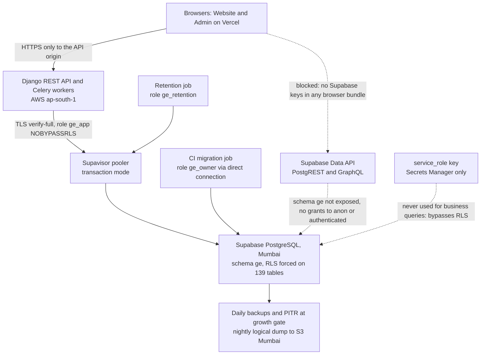
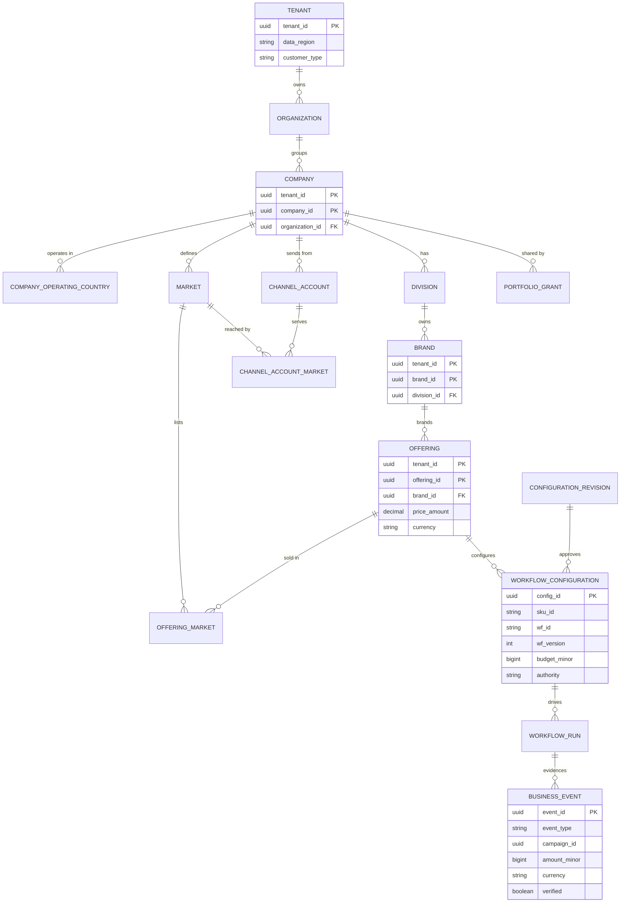

# AI Growth Engine: Employee Sales & Marketing Automation
## Application Blueprint: PART 11 (Batch 11.9b), V12 Database Schema, DDL with RLS: DDL-V12-I ("Appendix C3"), Supabase Privilege Model and Verification

| Field | Value |
|---|---|
| Document | Part 11, Batch 11.9b · Enhancements for FSD V12 chapter 26, Appendix C and Appendix C2 (Group R8, letter I) |
| Version | 1.0 · 28 Nov 2026 |
| Baseline | Part 11.9a (material, coverage, register, catalogue reconciliation); Part 3.3 §3.3.5–§3.3.11; Part 3.6a/b; Part 4.1; Part 9.9; Part 11.5a (DEC-581, ADR-140, ADR-154); DEC-421 (Supabase PostgreSQL, Mumbai), DEC-422 |
| Roles applied | Principal Data Architect / PostgreSQL DBA (lead), CISO, Chief Data Officer, Threat-modelling lead, QA Lead |
| Evidence | `assembly/v12/i_ddl/appendix_c3_group_i.sql` (1,877 lines, the complete DDL-V12-I), `run_all.sh`, `c3_tests.out` (50 PASS, 0 FAIL), `c3_v12_regression.out` (20/20 customer tests), `c3_policy_register.csv` (139 tables), `c3_index_register.csv` (333 indexes) |

---

## 11.9.5 Enhancements (part 1: database)

### 11.9.5.1 What DDL-V12-I does, in one table

| Section | Closes | Summary | Decision / ADR |
|---|---|---|---|
| C3-01 Roles and Data API closure | F6, CONFLICT-906 | Eight roles without `BYPASSRLS`; every privilege revoked from `PUBLIC`, `anon`, `authenticated`; default privileges revoked; only `ge_*` roles get schema usage | DEC-663, ADR-212 |
| C3-02 Context functions | F1, CONFLICT-909 | `app_tenant()` raises `42501` when the tenant context is missing (V12 DB-T2 semantics); `app_company_ids()`, `app_write_company()`, `app_actor_id()`, `app_actor_kind()`, `app_portfolio_id()` fail to empty/NULL | DEC-662, ADR-210 |
| C3-03 Scope integrity | F3, F5 | NOT NULL scope keys; tenant-pinned composite FKs and PKs; company carried on steps, effects, outbox and audit; inbox keyed by provider account | DEC-662 |
| C3-04 Vocabularies and value rules | F8, F10 | 80 CHECK constraints: statuses, types, ISO codes, hash lengths, lifetimes, 7-day export link, Tier 2 data classes, AI trace completeness | DEC-661, DEC-664 |
| C3-05 Residency guard | ENT-DAT-03 | Region-pinned database; immutable `data_region` | DEC-667 (EU activation pending, CONFLICT-832) |
| C3-06 Separation of duties | F7 | SoD on INSERT **and** UPDATE; user-level SoD across roles; no self-granted roles | DEC-669 |
| C3-07 Append-only and tamper evidence | F7, SEC-06 | `fn_forbid_mutation()`; hash-chained `fn_append_audit()` + `fn_verify_audit_chain()`; forward-only effect transitions | DEC-668 |
| C3-08 Breach clocks | ch31 V8 | CERT-In 6 h, GDPR 72 h, DPDP Board 72 h (verify) enforced on notification deadlines | DEC-670 |
| C3-09 Crypto-shredding | ENT-DAT-02 | Per-tenant DEKs wrapped by platform or customer KEK; revocation destroys wrapped DEKs | DEC-671, ADR-213 |
| C3-10 Domain schema registry | F8, DB-V2-ARTIFACT | Registry + trigger validating schema reference, status vocabulary, required payload keys, payload size and optimistic version | DEC-661, ADR-211 |
| C3-11 V6 hierarchy and configuration | MT-09/10/11/18/33 | Company-pinned keys for division → brand → offering; market, offering-market, channel-account-market, configuration revision, workflow configuration, business event | DEC-660, DEC-672 |
| C3-12 Analytics and usage tables | ch29, ch26 V5/V4 | Metric definition, versioned aggregates, experiment, feedback case, SLI sample, customer value, journey event, domain record version, usage reservation | DEC-672, ADR-214 |
| C3-13 Generated: grants, RLS, indexes, registry triggers | F1–F4 | 410 policies on 139 tables, 333 indexes, 89 validation triggers | DEC-662, DEC-677 |

### 11.9.5.2 Supabase PostgreSQL (Mumbai) operating model (DEC-421, DEC-663, ADR-212)

DEC-421 keeps the database on **Supabase Pro in the Mumbai region**, used **only by the Django API and Celery workers** (Supabase Auth not used; browsers never reach Supabase). Supabase exposes extra surfaces that a generic PostgreSQL design does not have. The controls below close them. *All Supabase product facts (pooler ports and modes, Data API settings, extension list, PostgreSQL major version, PITR, read replicas, network restrictions) must be verified at time of implementation (as of 27 Nov 2026).* [RECOMMENDATION-919]



| # | Control | Specification | Verified by |
|---|---|---|---|
| SB-01 | Business schema not exposed | All business tables live in schema `ge` (reference run used `public` only to stack on Appendix C). `ge` is **not** in the Data API exposed-schemas list; the Data API is disabled for the project if the feature allows (verify). Defence in depth: `REVOKE ALL … FROM PUBLIC, anon, authenticated` and revoked default privileges (C3-01) | TC-V12-I-025 (0 privileges for `anon`/`authenticated`) |
| SB-02 | No RLS bypass in the application path | Django and Celery connect as **`ge_app` / `ge_worker`** (NOLOGIN in the reference run, LOGIN with a Secrets-Manager password in production), created by SQL with `NOBYPASSRLS`. The `postgres` role and the `service_role` JWT are never used by application code. `service_role` bypasses RLS in Supabase, so the DEC-421 phrase "service key held server-side" is read as "kept server-side for Storage/administration only, never for business queries" | CI check: connection user ≠ `postgres`; TC-V12-I-027 |
| SB-03 | Pooler-safe context | Supavisor **transaction mode**. Every request/job opens one transaction (`ATOMIC_REQUESTS` / task base class), first statement `set_config('app.tenant_id', $1, true)`, `app.company_ids`, `app.write_company_id`, `app.actor_id`, `app.actor_kind` (all `is_local = true`). Server-side prepared statements off (psycopg `prepare_threshold=None`) and `DISABLE_SERVER_SIDE_CURSORS = True` because transaction pooling does not keep session state (verify driver settings) | Pooled-reuse test (Part 11.5a TC-V12-E-005) + TC-V12-I-003 |
| SB-04 | Role-name alignment | `ge_app` (Part 3.3 §3.3.5.10) = `app_user` (V12 Appendix C header) = `app_rw` (Part 11.5a): one role, three names; the blueprint name `ge_app` is used in DDL | Report §11.9.8.2 |
| SB-05 | Network | Supabase network restrictions allow only the AWS NAT egress IPs of the API/worker subnets and the CI runner; SSL enforcement on (verify availability on the plan) | Infra policy check (Part 4.3) |
| SB-06 | Extensions | `pgcrypto`, `vector` (pgvector, HNSW, `halfvec`), `pg_trgm`, `btree_gin`, `pg_stat_statements`; `pg_partman` if available, otherwise partitions are created by a `pg_cron` job (verify each on Supabase) | Migration step 1 |
| SB-07 | Version | Appendix C was tested on 16.15; Part 3.3 targeted 17. Use the major version Supabase offers for new projects (verify) and run the full `run_all.sh` suite on it before Sprint 1 | Sprint 0 gate |
| SB-08 | Backups | Daily backups (included), PITR added at the growth gate (DEC-421/DEC-422; Part 11.5a CONFLICT-833 on the 15-minute RPO) and the nightly logical dump to S3 Mumbai | Part 11.5a DR runbook |
| SB-09 | Secrets | Database passwords and any Supabase keys only in AWS Secrets Manager; rotation 90 days (Part 4.1 §4.6.2); never in Vercel environment variables (Part 11.5a) | Secret scan KPI-04 (V12) |
| SB-10 | Logs | Supabase log drain excludes statement parameters; `log_min_duration_statement` with parameter redaction; logs stay in India (CERT-In 180 days, CJ-IN-09) | Part 4.1 §4.10.2 |

### 11.9.5.3 Tenancy, configuration and attribution model (V6, MT-09/10/11/18/27/33)



**Key rule (MT-09/10/18).** Every association carries `(tenant_id, company_id)` and references both parents through **company-pinned composite keys** `(tenant_id, company_id, <id>)`. A brand cannot belong to another company's division, an offering cannot use another company's brand and an offering–market pair cannot span companies, even if application code is wrong (TC-V12-I-030). Names are unique on a normalized form within their scope (MT-33) and renames never change IDs.

### 11.9.5.4 Context variables and RLS policy templates (DEC-662, ADR-210)

| V12 variable (Appendix C header) | Blueprint variable (Part 3.3 §3.3.9.1) | Set from | Helper |
|---|---|---|---|
| `app.tenant_id` | `app.tenant_id` | Membership-derived claim | `app_tenant()` – raises `42501` when missing |
| `app.company_ids` | `app.startup_ids` | Membership ∩ requested scope | `app_company_ids()` – empty array when missing |
| (new) `app.write_company_id` | `app.write_startup_id` | Exactly one selected company; empty in portfolio mode | `app_write_company()` – NULL when missing |
| (new) `app.actor_id`, `app.actor_kind` | same | Authenticated principal | `app_actor_id()`, `app_actor_kind()` |
| (new) `app.portfolio_id` | (Owner Portfolio scope) | Portfolio grant in force | `app_portfolio_id()` |
| (new) `app.deployment_region` | — | `ALTER DATABASE … SET` per regional database | Residency trigger |
| `app.retention_run_id` | same | Retention job only | Unlocks purge in `fn_forbid_mutation()` |

Policies always wrap helpers in a scalar sub-select, `(SELECT app_tenant())`, so PostgreSQL evaluates them once per statement (initPlan) instead of once per row.

| Template | Predicate (SELECT) | INSERT / UPDATE `WITH CHECK` | DELETE | Applies to |
|---|---|---|---|---|
| **P-CO** | `tenant_id = (SELECT app_tenant()) AND company_id = ANY ((SELECT app_company_ids())::uuid[])` | `tenant_id = (SELECT app_tenant()) AND company_id = (SELECT app_write_company())` | none | company-scoped tables (NOT NULL `company_id`) |
| **P-CO-NULLABLE** | as P-CO `OR company_id IS NULL` | as P-CO, or `company_id IS NULL AND app_actor_kind() = 'service'` | none | tenant-wide rows allowed (`ai_usage_event`, `outbox`, `audit_event` read side) |
| **P-TEN** | `tenant_id = (SELECT app_tenant())` | same | none | tenant-scoped tables without company |
| **P-TEN-SELF** | own tenant row only | none (provisioning through `ge_owner` function) | none | `tenant` |
| **P-PORTFOLIO** | tenant AND (company in scope OR `portfolio_id = app_portfolio_id()`) AND not revoked AND not expired | write company + `actor_kind = 'internal'` | none | `portfolio_grant` |
| **P-JOURNEY** | subscriber rows by tenant for `ge_app`; operator rows only for `ge_readonly` | subscriber by tenant; operator rows only from `service` | none | `journey_event` |
| **P-TEN + P-PLATFORM** | tenant rows for app roles; all rows for `ge_platform_sec` | same split | none | `incident` |
| Service insert | P-TEN, INSERT only when `actor_kind = 'service'` | | none | `inbox` |
| No RLS (grants only) | — | writes only by `ge_owner` migrations or `ge_platform_sec` | — | 16 platform tables: `ai_model`, `prompt_version`, `eval_suite`, `eval_run`, `fx_rate`, `jurisdiction_pack`, `jurisdiction_rule`, `locale_bundle`, `sod_conflict`, `tax_rule`, `ops_incident`, `incident_notification`, `security_finding`, `domain_schema_registry`, `metric_definition`, `sli_sample` |

```sql
-- P-CO, expanded for one table (generated identically for every company-scoped table)
ALTER TABLE workflow_run ENABLE ROW LEVEL SECURITY; ALTER TABLE workflow_run FORCE ROW LEVEL SECURITY;
CREATE POLICY rls_workflow_run__select ON workflow_run FOR SELECT
  USING (tenant_id = (SELECT app_tenant()) AND company_id = ANY ((SELECT app_company_ids())::uuid[]));
CREATE POLICY rls_workflow_run__insert ON workflow_run FOR INSERT
  WITH CHECK (tenant_id = (SELECT app_tenant()) AND company_id = (SELECT app_write_company()));
CREATE POLICY rls_workflow_run__update ON workflow_run FOR UPDATE
  USING (tenant_id = (SELECT app_tenant()) AND company_id = (SELECT app_write_company()))
  WITH CHECK (tenant_id = (SELECT app_tenant()) AND company_id = (SELECT app_write_company()));
-- no DELETE policy: business rows are archived, never deleted by the application
```

**Policy register (generated, 139 tables, 410 policies).** Physical names follow `rls_<table>__<verb>` (Part 3.3 §3.3.5.8).

| Template | Tables | Table list |
|---|---|---|
| P-TEN-SELF | 1 | `tenant` |
| P-TEN | 20 | `organization`, `dsar_request`, `ai_budget`, `identity_provider`, `scim_token`, `custom_role`, `role_permission`, `api_key`, `webhook_endpoint`, `webhook_delivery`, `audit_sink`, `export_job`, `tenant_key_config`, `sandbox_environment`, `config_promotion`, `connector_installation`, `invoice`, `user_role_assignment`, `tenant_data_key`, `customer_value` |
| P-CO | 105 | `company`, `workflow_step_run`, `effect`, `consent_record`, `suppression`, `growth_source`, `growth_source_policy`, `growth_source_record`, `growth_evidence`, `growth_competitor`, `growth_market_event`, `growth_search_plan`, `growth_organization`, `growth_signal`, `growth_signal_type`, `growth_need_evidence`, `growth_referral`, `growth_contact`, `growth_contact_source`, `growth_contact_verification`, `growth_consent`, `growth_suppression`, `growth_need`, `growth_product`, `growth_opportunity`, `growth_score_version`, `growth_activity`, `growth_deal`, `growth_stage`, `growth_task`, `growth_budget`, `growth_message`, `growth_message_draft`, `growth_message_template`, `growth_outbox`, `growth_delivery_event`, `growth_thread`, `growth_channel_account`, `growth_inbound_event`, `growth_enrollment`, `growth_sequence`, `growth_sequence_step`, `growth_routing_rule`, `growth_workflow_execution`, `growth_identity_link`, `growth_objection`, `growth_calendar_link`, `growth_meeting`, `growth_business_event`, `growth_event_attendance`, `growth_event_registration`, `growth_claim`, `growth_content_asset`, `growth_content_version`, `growth_approval`, `growth_social_post`, `growth_social_publication`, `growth_keyword`, `growth_page_metric`, `growth_seo_issue`, `growth_landing_page`, `growth_audience`, `growth_campaign`, `growth_campaign_version`, `growth_ad_campaign`, `growth_ad_spend_event`, `growth_attribution_event`, `growth_form`, `growth_lead`, `growth_proposal`, `growth_proposal_version`, `growth_quote`, `growth_quote_line`, `growth_negotiation`, `growth_contract`, `growth_integration_deal`, `sales_bid`, `growth_invoice`, `growth_payment`, `sales_fulfillment`, `sales_order`, `sales_order_line`, `growth_onboarding`, `growth_deployment`, `growth_partner`, `growth_pilot`, `growth_renewal`, `growth_feedback`, `growth_metric_snapshot`, `growth_forecast`, `growth_stage_metric`, `growth_document`, `growth_document_chunk`, `growth_embedding`, `company_operating_country`, `offering_market`, `channel_account_market`, `configuration_revision`, `workflow_configuration`, `business_event`, `metric_aggregate`, `experiment`, `feedback_case`, `domain_record_version`, `usage_reservation` |
| P-CO-NULLABLE | 8 | `division`, `brand`, `offering`, `market`, `channel_account`, `workflow_run`, `outbox`, `ai_usage_event` |
| P-TEN (service insert) | 1 | `inbox` |
| P-CO-NULLABLE (select only; insert via fn_append_audit) | 1 | `audit_event` |
| P-PORTFOLIO | 1 | `portfolio_grant` |
| P-TEN + P-PLATFORM | 1 | `incident` |
| P-JOURNEY | 1 | `journey_event` |

**Portal and support predicates** of Part 3.3 §3.3.9.4–§3.3.9.5 (object grants for `actor_kind = 'portal'`, read-only support grants) are added unchanged on the portal-visible tables; they are additional permissive SELECT policies and do not widen P-CO for internal users.

### 11.9.5.5 DDL-V12-I part 1: roles, context, integrity, vocabularies, residency, SoD, audit, breach clocks, crypto-shredding, registry (full text)

Apply after Appendix C and C2. This is the exact text executed in the verification run.

```sql
-- =====================================================================================
-- DDL-V12-I  "Appendix C3" addendum (Group I, Part 11.9). Apply after FSD V12 Appendix C and C2.
-- Tested on PostgreSQL 16.15 (scratch cluster), as owner for DDL and as role ge_app for tests.
-- Target: Supabase Pro PostgreSQL, Mumbai region (DEC-421). Production schema `ge` (not `public`);
-- this reference run uses `public` so that it applies unchanged on top of Appendix C/C2.
-- Every statement is idempotent where PostgreSQL allows it. Not a Django migration (MT-36 approval).
-- =====================================================================================

-- C3-01 Roles. Supabase creates anon, authenticated, service_role; emulate them for the reference run.
DO $$ BEGIN
  IF NOT EXISTS (SELECT 1 FROM pg_roles WHERE rolname='anon') THEN CREATE ROLE anon NOLOGIN; END IF;
  IF NOT EXISTS (SELECT 1 FROM pg_roles WHERE rolname='authenticated') THEN CREATE ROLE authenticated NOLOGIN; END IF;
  IF NOT EXISTS (SELECT 1 FROM pg_roles WHERE rolname='ge_owner') THEN CREATE ROLE ge_owner NOLOGIN NOBYPASSRLS; END IF;
  IF NOT EXISTS (SELECT 1 FROM pg_roles WHERE rolname='ge_app') THEN CREATE ROLE ge_app NOLOGIN NOBYPASSRLS; END IF;          -- LOGIN in production via Supavisor
  IF NOT EXISTS (SELECT 1 FROM pg_roles WHERE rolname='ge_worker') THEN CREATE ROLE ge_worker NOLOGIN NOBYPASSRLS; END IF;
  IF NOT EXISTS (SELECT 1 FROM pg_roles WHERE rolname='ge_readonly') THEN CREATE ROLE ge_readonly NOLOGIN NOBYPASSRLS; END IF;
  IF NOT EXISTS (SELECT 1 FROM pg_roles WHERE rolname='ge_retention') THEN CREATE ROLE ge_retention NOLOGIN NOBYPASSRLS; END IF;
  IF NOT EXISTS (SELECT 1 FROM pg_roles WHERE rolname='ge_audit_writer') THEN CREATE ROLE ge_audit_writer NOLOGIN NOBYPASSRLS; END IF;
  IF NOT EXISTS (SELECT 1 FROM pg_roles WHERE rolname='ge_platform_sec') THEN CREATE ROLE ge_platform_sec NOLOGIN NOBYPASSRLS; END IF;
END $$;
-- The Supabase Data API (PostgREST) must never reach business tables: no grants to anon/authenticated/PUBLIC.
REVOKE ALL ON ALL TABLES IN SCHEMA public FROM PUBLIC, anon, authenticated;
REVOKE ALL ON ALL SEQUENCES IN SCHEMA public FROM PUBLIC, anon, authenticated;
REVOKE ALL ON ALL FUNCTIONS IN SCHEMA public FROM PUBLIC, anon, authenticated;
ALTER DEFAULT PRIVILEGES IN SCHEMA public REVOKE ALL ON TABLES FROM PUBLIC, anon, authenticated;
ALTER DEFAULT PRIVILEGES IN SCHEMA public REVOKE EXECUTE ON FUNCTIONS FROM PUBLIC, anon, authenticated;
GRANT USAGE ON SCHEMA public TO ge_app, ge_worker, ge_readonly, ge_retention, ge_audit_writer, ge_platform_sec;
GRANT EXECUTE ON FUNCTION digest(bytea, text), digest(text, text), hmac(bytea, bytea, text), gen_random_bytes(int) TO ge_app, ge_worker;   -- pgcrypto, after the PUBLIC revoke

-- C3-02 Context functions (fail closed). app_tenant() raises when the context is missing (V12 DB-T2 semantics);
-- company and write-scope helpers return an empty set / NULL so that predicates evaluate to false.
CREATE OR REPLACE FUNCTION app_tenant() RETURNS uuid LANGUAGE plpgsql STABLE AS $$
DECLARE v text := current_setting('app.tenant_id', true);
BEGIN
  IF v IS NULL OR v = '' THEN RAISE EXCEPTION 'tenant context missing' USING ERRCODE = '42501'; END IF;
  RETURN v::uuid;
END $$;
CREATE OR REPLACE FUNCTION app_company_ids() RETURNS uuid[] LANGUAGE sql STABLE AS
$$ SELECT COALESCE(NULLIF(current_setting('app.company_ids', true), '')::uuid[], '{}'::uuid[]) $$;
CREATE OR REPLACE FUNCTION app_write_company() RETURNS uuid LANGUAGE sql STABLE AS
$$ SELECT NULLIF(current_setting('app.write_company_id', true), '')::uuid $$;
CREATE OR REPLACE FUNCTION app_actor_id() RETURNS uuid LANGUAGE sql STABLE AS
$$ SELECT NULLIF(current_setting('app.actor_id', true), '')::uuid $$;
CREATE OR REPLACE FUNCTION app_actor_kind() RETURNS text LANGUAGE sql STABLE AS
$$ SELECT COALESCE(NULLIF(current_setting('app.actor_kind', true), ''), 'none') $$;
CREATE OR REPLACE FUNCTION app_portfolio_id() RETURNS uuid LANGUAGE sql STABLE AS
$$ SELECT NULLIF(current_setting('app.portfolio_id', true), '')::uuid $$;
GRANT EXECUTE ON FUNCTION app_tenant(), app_company_ids(), app_write_company(), app_actor_id(), app_actor_kind(), app_portfolio_id()
  TO ge_app, ge_worker, ge_readonly, ge_retention, ge_audit_writer;

-- C3-03 Scope integrity: NOT NULL scope keys and composite (tenant-pinned) foreign keys.
ALTER TABLE outbox ALTER COLUMN tenant_id SET NOT NULL;
ALTER TABLE portfolio_grant ALTER COLUMN tenant_id SET NOT NULL, ALTER COLUMN company_id SET NOT NULL, ALTER COLUMN portfolio_id SET NOT NULL;
ALTER TABLE portfolio_grant ADD CONSTRAINT portfolio_grant_company_fk FOREIGN KEY (tenant_id, company_id) REFERENCES company(tenant_id, company_id);
ALTER TABLE portfolio_grant ADD CONSTRAINT portfolio_grant_no_wildcard CHECK (cardinality(dimensions) > 0 AND NOT ('*' = ANY (dimensions)));
ALTER TABLE portfolio_grant ADD CONSTRAINT portfolio_grant_expiry_required CHECK (expires_at IS NOT NULL);
ALTER TABLE custom_role ADD CONSTRAINT custom_role_tenant_role_uq UNIQUE (tenant_id, role_id);
ALTER TABLE role_permission DROP CONSTRAINT role_permission_role_id_fkey;
ALTER TABLE role_permission DROP CONSTRAINT role_permission_pkey;
ALTER TABLE role_permission ADD CONSTRAINT role_permission_pkey PRIMARY KEY (tenant_id, role_id, permission);  -- no cross-tenant uniqueness oracle
ALTER TABLE role_permission ADD CONSTRAINT role_permission_role_fk FOREIGN KEY (tenant_id, role_id) REFERENCES custom_role(tenant_id, role_id);
ALTER TABLE role_permission ADD CONSTRAINT role_permission_format CHECK (permission ~ '^[A-Z][A-Za-z]+:[a-z]+$');
ALTER TABLE webhook_endpoint ADD CONSTRAINT webhook_endpoint_tenant_uq UNIQUE (tenant_id, endpoint_id);
ALTER TABLE webhook_delivery DROP CONSTRAINT webhook_delivery_endpoint_id_fkey;
ALTER TABLE webhook_delivery ADD CONSTRAINT webhook_delivery_endpoint_fk FOREIGN KEY (tenant_id, endpoint_id) REFERENCES webhook_endpoint(tenant_id, endpoint_id);
ALTER TABLE sandbox_environment ADD CONSTRAINT sandbox_environment_tenant_uq UNIQUE (tenant_id, sandbox_id);
ALTER TABLE config_promotion DROP CONSTRAINT config_promotion_sandbox_id_fkey;
ALTER TABLE config_promotion ADD CONSTRAINT config_promotion_sandbox_fk FOREIGN KEY (tenant_id, sandbox_id) REFERENCES sandbox_environment(tenant_id, sandbox_id);
-- company scope on run children (company isolation of steps and effects)
ALTER TABLE workflow_run ADD CONSTRAINT workflow_run_company_run_uq UNIQUE (tenant_id, company_id, run_id);
ALTER TABLE workflow_step_run ADD COLUMN IF NOT EXISTS company_id uuid;
ALTER TABLE effect ADD COLUMN IF NOT EXISTS company_id uuid;
ALTER TABLE effect ADD CONSTRAINT effect_run_fk FOREIGN KEY (tenant_id, company_id, run_id) REFERENCES workflow_run(tenant_id, company_id, run_id);
ALTER TABLE workflow_step_run ADD CONSTRAINT workflow_step_run_company_fk FOREIGN KEY (tenant_id, company_id, run_id) REFERENCES workflow_run(tenant_id, company_id, run_id);
ALTER TABLE workflow_step_run ALTER COLUMN company_id SET NOT NULL;
ALTER TABLE effect ALTER COLUMN company_id SET NOT NULL;
ALTER TABLE consent_record ALTER COLUMN company_id SET NOT NULL;
ALTER TABLE consent_record ADD CONSTRAINT consent_record_contact_fk FOREIGN KEY (tenant_id, contact_id) REFERENCES growth_contact(tenant_id, id);
-- outbox / audit / usage carry company for company-level RLS where the event is company-scoped
ALTER TABLE outbox ADD COLUMN IF NOT EXISTS company_id uuid;
ALTER TABLE outbox ADD COLUMN IF NOT EXISTS dedup_key text;
ALTER TABLE outbox ADD COLUMN IF NOT EXISTS correlation_id uuid;
ALTER TABLE outbox ADD COLUMN IF NOT EXISTS attempts int NOT NULL DEFAULT 0 CHECK (attempts BETWEEN 0 AND 20);
ALTER TABLE outbox ADD COLUMN IF NOT EXISTS next_attempt_at timestamptz NOT NULL DEFAULT now();
ALTER TABLE outbox ADD CONSTRAINT outbox_dedup_uq UNIQUE (tenant_id, dedup_key);
-- inbox: dedupe per provider ACCOUNT (Part 3.3 UQ-IDEM-01) and reject unsigned rows
ALTER TABLE inbox ADD COLUMN IF NOT EXISTS provider_account text NOT NULL DEFAULT 'unknown';
ALTER TABLE inbox DROP CONSTRAINT inbox_pkey;
ALTER TABLE inbox ADD CONSTRAINT inbox_pkey PRIMARY KEY (provider, provider_account, provider_event_id);
ALTER TABLE inbox ADD CONSTRAINT inbox_signature_required CHECK (signature_ok);
ALTER TABLE inbox ADD COLUMN IF NOT EXISTS payload_ref text;
ALTER TABLE inbox ADD COLUMN IF NOT EXISTS processed_at timestamptz;

-- C3-04 Enumerations and value rules missing from Appendix C/C2 (CHECK constraints)
ALTER TABLE tenant ADD CONSTRAINT tenant_customer_type_ck CHECK (customer_type IN ('owned','client'));
ALTER TABLE tenant ADD CONSTRAINT tenant_contract_status_ck CHECK (contract_status IN ('pending','trial','active','suspended','offboarding','closed'));
ALTER TABLE company ADD CONSTRAINT company_status_ck CHECK (status IN ('draft','active','suspended','archived'));
ALTER TABLE company ADD CONSTRAINT company_country_ck CHECK (registration_country IS NULL OR registration_country ~ '^[A-Z]{2}$');
ALTER TABLE offering ADD CONSTRAINT offering_type_ck CHECK (offering_type IN ('product','service','programme','solution'));
ALTER TABLE offering ADD CONSTRAINT offering_status_ck CHECK (status IN ('draft','pending_approval','approved','published','retired'));
ALTER TABLE offering ADD CONSTRAINT offering_price_ck CHECK (price_amount IS NULL OR (price_amount >= 0 AND currency IS NOT NULL));
ALTER TABLE offering ADD CONSTRAINT offering_version_ck CHECK (version >= 1);
ALTER TABLE market ADD CONSTRAINT market_country_ck CHECK (country ~ '^[A-Z]{2}$');
ALTER TABLE market ADD CONSTRAINT market_currency_ck CHECK (currency ~ '^[A-Z]{3}$');
ALTER TABLE market ADD CONSTRAINT market_timezone_ck CHECK (timezone ~ '^[A-Za-z]+(/[A-Za-z0-9_+-]+)+$' OR timezone = 'UTC');
ALTER TABLE channel_account ADD CONSTRAINT channel_account_channel_ck CHECK (channel IN ('email','whatsapp','sms','rcs','voice','linkedin','social','web_chat'));
ALTER TABLE channel_account ADD CONSTRAINT channel_account_status_ck CHECK (status IN ('pending_verification','active','paused','suspended','retired'));
ALTER TABLE channel_account ADD CONSTRAINT channel_account_credential_ref_ck CHECK (credential_ref ~ '^(vault|sm|kms|aws-sm)://');
ALTER TABLE workflow_step_run ADD CONSTRAINT workflow_step_run_status_ck CHECK (status IN ('Pending','Running','Succeeded','Failed','Skipped','Held','Compensated'));
ALTER TABLE workflow_step_run ADD CONSTRAINT workflow_step_run_ai_trace_ck CHECK (step_class <> 'ai_inference' OR (model_id IS NOT NULL AND prompt_version IS NOT NULL));
ALTER TABLE workflow_step_run ADD CONSTRAINT workflow_step_run_attempt_ck CHECK (attempt BETWEEN 1 AND 3);
ALTER TABLE workflow_run ADD CONSTRAINT workflow_run_wf_ck CHECK (wf_id ~ '^SM-SVC-\d{2}-WF0?[1-4]$' AND wf_version >= 1 AND reserved_units >= 0);
ALTER TABLE workflow_run ADD CONSTRAINT workflow_run_wf_matches_sku_ck CHECK (left(wf_id, 9) = sku_id);
ALTER TABLE consent_record ADD CONSTRAINT consent_record_channel_ck CHECK (channel IN ('email','whatsapp','sms','rcs','voice','linkedin','social','web_chat','any'));
ALTER TABLE consent_record ADD CONSTRAINT consent_record_basis_ck CHECK (basis IN ('consent','legitimate_use','contract','legal_obligation','legitimate_interest'));
ALTER TABLE consent_record ADD CONSTRAINT consent_record_market_ck CHECK (market ~ '^[A-Z]{2}$');
ALTER TABLE consent_record ADD CONSTRAINT consent_record_hash_ck CHECK (octet_length(evidence_hash) = 32);
ALTER TABLE suppression ADD CONSTRAINT suppression_reason_ck CHECK (reason IN ('opt_out','complaint','bounce','erasure','legal','minor','manual'));
ALTER TABLE dsar_request ADD CONSTRAINT dsar_type_ck CHECK (request_type IN ('access','correction','erasure','portability','grievance','nomination','withdraw_consent','objection'));
ALTER TABLE dsar_request ADD CONSTRAINT dsar_status_ck CHECK (status IN ('Received','Identity pending','In progress','On hold (legal)','Completed','Rejected'));
ALTER TABLE dsar_request ADD CONSTRAINT dsar_due_ck CHECK (due_at > received_at);
ALTER TABLE dsar_request ADD CONSTRAINT dsar_identity_before_completion_ck CHECK (status <> 'Completed' OR (identity_verified_at IS NOT NULL AND evidence_ref IS NOT NULL));
ALTER TABLE dsar_request ADD CONSTRAINT dsar_hold_ck CHECK (status <> 'On hold (legal)' OR legal_hold);
ALTER TABLE incident ADD CONSTRAINT incident_severity_ck CHECK (severity IN ('SEV1','SEV2','SEV3','SEV4'));
ALTER TABLE incident ADD CONSTRAINT incident_time_ck CHECK (aware_at >= detected_at);
ALTER TABLE incident_notification ADD CONSTRAINT incident_notification_authority_ck CHECK (authority IN ('CERT-In','DPB-India','EU-SA','UK-ICO','Data-principals','Customer-controller','Other'));
ALTER TABLE ai_model ADD CONSTRAINT ai_model_tier_ck CHECK (tier IN ('T0','T1a','T1b','T2','T3'));
ALTER TABLE ai_model ADD CONSTRAINT ai_model_t2_data_ck CHECK (tier <> 'T2' OR data_classes <@ ARRAY['Public','Internal-non-personal']::text[]);
ALTER TABLE ai_usage_event ADD CONSTRAINT ai_usage_tokens_ck CHECK (input_tokens >= 0 AND output_tokens >= 0 AND cached_tokens >= 0 AND (latency_ms IS NULL OR latency_ms >= 0));
ALTER TABLE ai_usage_event ADD CONSTRAINT ai_usage_outcome_ck CHECK (outcome IS NULL OR outcome IN ('ok','schema_invalid','refused','timeout','error','cached','degraded'));
ALTER TABLE prompt_version ADD CONSTRAINT prompt_version_status_ck CHECK (status IN ('Draft','In evaluation','Approved','Suspended','Retired'));
ALTER TABLE prompt_version ADD CONSTRAINT prompt_version_hash_ck CHECK (octet_length(template_hash) = 32);
ALTER TABLE eval_suite ADD CONSTRAINT eval_suite_count_ck CHECK (case_count > 0);
ALTER TABLE eval_run ADD CONSTRAINT eval_run_denominator_ck CHECK (denominator > 0);
ALTER TABLE connector_installation ADD CONSTRAINT connector_status_ck CHECK (status IN ('Requested','In review','Active','Suspended','Removed'));
ALTER TABLE config_promotion ADD CONSTRAINT config_promotion_status_ck CHECK (status IN ('Requested','Approved','Rejected','Applied','Rolled back'));
ALTER TABLE config_promotion ADD CONSTRAINT config_promotion_approved_ck CHECK (status NOT IN ('Approved','Applied') OR approved_by IS NOT NULL);
ALTER TABLE export_job ADD CONSTRAINT export_job_ready_ck CHECK (status <> 'Ready' OR (approved_by IS NOT NULL AND manifest_hash IS NOT NULL AND expires_at IS NOT NULL));
ALTER TABLE export_job ADD COLUMN IF NOT EXISTS approved_at timestamptz;
ALTER TABLE export_job ADD CONSTRAINT export_job_link_7d_ck CHECK (expires_at IS NULL OR (approved_at IS NOT NULL AND expires_at <= approved_at + interval '7 days'));
ALTER TABLE invoice ADD CONSTRAINT invoice_status_ck CHECK (status IN ('Draft','Issued','Paid','Partially paid','Void','Credited'));
ALTER TABLE invoice ADD CONSTRAINT invoice_currency_ck CHECK (currency ~ '^[A-Z]{3}$');
ALTER TABLE fx_rate ALTER COLUMN base_currency SET NOT NULL, ALTER COLUMN quote_currency SET NOT NULL;
ALTER TABLE fx_rate ADD CONSTRAINT fx_rate_ccy_ck CHECK (base_currency ~ '^[A-Z]{3}$' AND quote_currency ~ '^[A-Z]{3}$' AND base_currency <> quote_currency);
ALTER TABLE fx_rate ADD CONSTRAINT fx_rate_version_uq UNIQUE (base_currency, quote_currency, effective_at, approved_version);
ALTER TABLE api_key ADD CONSTRAINT api_key_prefix_uq UNIQUE (prefix);
ALTER TABLE api_key ADD CONSTRAINT api_key_hash_uq UNIQUE (key_hash);
ALTER TABLE api_key ADD CONSTRAINT api_key_hash_len_ck CHECK (octet_length(key_hash) = 32);
ALTER TABLE api_key ADD COLUMN IF NOT EXISTS created_at timestamptz NOT NULL DEFAULT now();
ALTER TABLE api_key ADD CONSTRAINT api_key_max_life_ck CHECK (expires_at <= created_at + interval '397 days');
ALTER TABLE scim_token ADD CONSTRAINT scim_token_hash_uq UNIQUE (token_hash);
ALTER TABLE scim_token ADD COLUMN IF NOT EXISTS expires_at timestamptz NOT NULL DEFAULT (now() + interval '365 days');
ALTER TABLE scim_token ADD CONSTRAINT scim_token_life_ck CHECK (expires_at <= created_at + interval '397 days');
ALTER TABLE webhook_endpoint ADD COLUMN IF NOT EXISTS verified_at timestamptz;
ALTER TABLE webhook_endpoint ADD CONSTRAINT webhook_active_verified_ck CHECK (NOT active OR verified_at IS NOT NULL);
ALTER TABLE webhook_delivery ADD COLUMN IF NOT EXISTS event_id uuid NOT NULL DEFAULT gen_random_uuid();
ALTER TABLE webhook_delivery ADD CONSTRAINT webhook_delivery_attempt_uq UNIQUE (tenant_id, endpoint_id, event_id, attempt);
ALTER TABLE tenant_key_config ADD COLUMN IF NOT EXISTS provider text;
ALTER TABLE tenant_key_config ADD CONSTRAINT tenant_key_provider_ck CHECK ((mode = 'platform' AND provider IS NULL) OR (mode = 'customer' AND provider IN ('aws-kms','azure-key-vault','gcp-kms')));
ALTER TABLE tenant_key_config ADD COLUMN IF NOT EXISTS key_state text NOT NULL DEFAULT 'active' CHECK (key_state IN ('pending_validation','active','rotating','revoked','failed'));
ALTER TABLE tenant_key_config ADD COLUMN IF NOT EXISTS revoked_at timestamptz;
ALTER TABLE sandbox_environment ADD COLUMN IF NOT EXISTS created_at timestamptz NOT NULL DEFAULT now();
ALTER TABLE jurisdiction_pack ADD CONSTRAINT jurisdiction_pack_approval_ck CHECK (status <> 'Approved' OR (approved_by IS NOT NULL AND approved_at IS NOT NULL AND effective_from IS NOT NULL));
ALTER TABLE jurisdiction_pack ADD CONSTRAINT jurisdiction_pack_window_ck CHECK (effective_to IS NULL OR effective_to >= effective_from);
ALTER TABLE jurisdiction_rule ADD CONSTRAINT jurisdiction_rule_interp_ck CHECK (interpretation_status IN ('Draft','Counsel reviewed','Approved','Superseded'));
ALTER TABLE ai_budget ADD CONSTRAINT ai_budget_period_ck CHECK (period ~ '^\d{4}-(0[1-9]|1[0-2])$');
ALTER TABLE ai_budget ADD CONSTRAINT ai_budget_hard_ck CHECK (hard_cap_tokens > 0);
ALTER TABLE security_finding ADD CONSTRAINT security_finding_close_ck CHECK (closed_at IS NULL OR closed_at >= found_at);
ALTER TABLE locale_bundle ADD CONSTRAINT locale_bundle_cov_ck CHECK (coverage_percent BETWEEN 0 AND 100);
ALTER TABLE locale_bundle ADD CONSTRAINT locale_bundle_tag_ck CHECK (locale ~ '^[a-z]{2,3}(-[A-Z][a-z]{3})?(-[A-Z]{2})?$');

-- C3-05 Data residency (ENT-DAT-03, CJ-R09). Each regional database pins its region; tenant region is immutable.
CREATE OR REPLACE FUNCTION fn_tenant_region_guard() RETURNS trigger LANGUAGE plpgsql AS $$
DECLARE r text := current_setting('app.deployment_region', true);
BEGIN
  IF r IS NULL OR r = '' THEN RAISE EXCEPTION 'deployment region not configured' USING ERRCODE = '42501'; END IF;
  IF TG_OP = 'UPDATE' AND NEW.data_region IS DISTINCT FROM OLD.data_region THEN
    RAISE EXCEPTION 'data_region is fixed at onboarding (CJ-R09)' USING ERRCODE = '23514'; END IF;
  IF NEW.data_region <> r THEN
    RAISE EXCEPTION 'cross-region write rejected: tenant region % in % database', NEW.data_region, r USING ERRCODE = '23514'; END IF;
  RETURN NEW;
END $$;
DROP TRIGGER IF EXISTS trg_tenant_region_guard ON tenant;
CREATE TRIGGER trg_tenant_region_guard BEFORE INSERT OR UPDATE ON tenant FOR EACH ROW EXECUTE FUNCTION fn_tenant_region_guard();

-- C3-06 Separation of duties: also on UPDATE, and across all roles held by one user (ENT-ACC-02).
CREATE TABLE IF NOT EXISTS user_role_assignment (
  tenant_id uuid NOT NULL REFERENCES tenant(tenant_id), user_id uuid NOT NULL, role_id uuid NOT NULL,
  granted_by uuid NOT NULL, granted_at timestamptz NOT NULL DEFAULT now(), expires_at timestamptz, revoked_at timestamptz,
  PRIMARY KEY (tenant_id, user_id, role_id), FOREIGN KEY (tenant_id, role_id) REFERENCES custom_role(tenant_id, role_id),
  CHECK (granted_by <> user_id));
CREATE OR REPLACE FUNCTION enforce_sod() RETURNS trigger LANGUAGE plpgsql AS $$
BEGIN
  IF EXISTS (SELECT 1 FROM role_permission rp JOIN sod_conflict c
             ON (c.permission_a = NEW.permission AND c.permission_b = rp.permission) OR (c.permission_b = NEW.permission AND c.permission_a = rp.permission)
             WHERE rp.role_id = NEW.role_id AND rp.tenant_id = NEW.tenant_id AND rp.permission <> COALESCE(CASE WHEN TG_OP='UPDATE' THEN OLD.permission END,'')) THEN
    RAISE EXCEPTION 'separation of duties violation: % conflicts within role', NEW.permission USING ERRCODE = '23514';
  END IF;
  IF EXISTS (SELECT 1 FROM user_role_assignment ura JOIN user_role_assignment other
               ON other.tenant_id = ura.tenant_id AND other.user_id = ura.user_id AND other.role_id <> ura.role_id AND other.revoked_at IS NULL
             JOIN role_permission rp ON rp.tenant_id = other.tenant_id AND rp.role_id = other.role_id
             JOIN sod_conflict c ON (c.permission_a = NEW.permission AND c.permission_b = rp.permission) OR (c.permission_b = NEW.permission AND c.permission_a = rp.permission)
             WHERE ura.tenant_id = NEW.tenant_id AND ura.role_id = NEW.role_id AND ura.revoked_at IS NULL) THEN
    RAISE EXCEPTION 'separation of duties violation: % conflicts with another role held by the same user', NEW.permission USING ERRCODE = '23514';
  END IF;
  RETURN NEW;
END $$;
DROP TRIGGER IF EXISTS role_permission_sod ON role_permission;
CREATE TRIGGER role_permission_sod BEFORE INSERT OR UPDATE ON role_permission FOR EACH ROW EXECUTE FUNCTION enforce_sod();
CREATE OR REPLACE FUNCTION enforce_sod_assignment() RETURNS trigger LANGUAGE plpgsql AS $$
BEGIN
  IF NEW.revoked_at IS NULL AND EXISTS (
     SELECT 1 FROM role_permission a JOIN user_role_assignment o ON o.tenant_id = NEW.tenant_id AND o.user_id = NEW.user_id AND o.role_id <> NEW.role_id AND o.revoked_at IS NULL
       JOIN role_permission b ON b.tenant_id = o.tenant_id AND b.role_id = o.role_id
       JOIN sod_conflict c ON (c.permission_a = a.permission AND c.permission_b = b.permission) OR (c.permission_b = a.permission AND c.permission_a = b.permission)
     WHERE a.tenant_id = NEW.tenant_id AND a.role_id = NEW.role_id) THEN
    RAISE EXCEPTION 'separation of duties violation: role assignment combines conflicting permissions' USING ERRCODE = '23514';
  END IF;
  RETURN NEW;
END $$;
DROP TRIGGER IF EXISTS trg_user_role_assignment_sod ON user_role_assignment;
CREATE TRIGGER trg_user_role_assignment_sod BEFORE INSERT OR UPDATE ON user_role_assignment FOR EACH ROW EXECUTE FUNCTION enforce_sod_assignment();

-- C3-07 Append-only and tamper evidence (SEC-06, NFR-018)
CREATE OR REPLACE FUNCTION fn_forbid_mutation() RETURNS trigger LANGUAGE plpgsql AS $$
BEGIN
  IF current_user = 'ge_retention' AND current_setting('app.retention_run_id', true) IS NOT NULL
     AND current_setting('app.retention_run_id', true) <> '' AND TG_OP = 'DELETE' THEN RETURN OLD; END IF;
  RAISE EXCEPTION 'IMMUTABLE_RECORD: % on % is not allowed', TG_OP, TG_TABLE_NAME USING ERRCODE = 'P0001';
END $$;
ALTER TABLE audit_event ADD COLUMN IF NOT EXISTS company_id uuid;
ALTER TABLE audit_event ADD COLUMN IF NOT EXISTS correlation_id uuid;
ALTER TABLE audit_event ADD COLUMN IF NOT EXISTS object_type text;
ALTER TABLE audit_event ADD COLUMN IF NOT EXISTS payload_redacted jsonb NOT NULL DEFAULT '{}'::jsonb;
ALTER TABLE audit_event ADD COLUMN IF NOT EXISTS schema_version int NOT NULL DEFAULT 1;
ALTER TABLE audit_event ADD COLUMN IF NOT EXISTS prev_hash bytea;
ALTER TABLE audit_event ADD COLUMN IF NOT EXISTS row_hash bytea;
CREATE OR REPLACE FUNCTION fn_append_audit(p_company uuid, p_actor uuid, p_action text, p_ref text, p_object_type text,
  p_policy_version text, p_correlation uuid, p_payload jsonb) RETURNS bigint LANGUAGE plpgsql SECURITY DEFINER SET search_path = public, pg_temp AS $$
DECLARE t uuid := app_tenant(); prev bytea; h bytea; new_id bigint; ts timestamptz := clock_timestamp();
BEGIN
  PERFORM pg_advisory_xact_lock(hashtextextended(t::text, 42));
  SELECT row_hash INTO prev FROM audit_event WHERE tenant_id = t ORDER BY audit_id DESC LIMIT 1;
  h := digest(coalesce(prev, '\x'::bytea) || convert_to(jsonb_build_object('t',t,'c',p_company,'a',p_actor,'act',p_action,'ref',p_ref,
        'ot',p_object_type,'pv',p_policy_version,'corr',p_correlation,'p',p_payload,'ts',ts)::text, 'UTF8'), 'sha256');
  INSERT INTO audit_event(tenant_id, company_id, actor, action, ref, object_type, policy_version, correlation_id, payload_redacted, occurred_at, prev_hash, row_hash)
  VALUES (t, p_company, p_actor, p_action, p_ref, p_object_type, p_policy_version, p_correlation, p_payload, ts, prev, h) RETURNING audit_id INTO new_id;
  RETURN new_id;
END $$;
REVOKE ALL ON FUNCTION fn_append_audit(uuid,uuid,text,text,text,text,uuid,jsonb) FROM PUBLIC;
GRANT EXECUTE ON FUNCTION fn_append_audit(uuid,uuid,text,text,text,text,uuid,jsonb) TO ge_app, ge_worker;
CREATE OR REPLACE FUNCTION fn_verify_audit_chain(p_tenant uuid) RETURNS TABLE(audit_id bigint, ok boolean) LANGUAGE sql STABLE AS $$
  SELECT a.audit_id, a.row_hash = digest(coalesce(a.prev_hash,'\x'::bytea) || convert_to(jsonb_build_object('t',a.tenant_id,'c',a.company_id,'a',a.actor,'act',a.action,'ref',a.ref,
         'ot',a.object_type,'pv',a.policy_version,'corr',a.correlation_id,'p',a.payload_redacted,'ts',a.occurred_at)::text,'UTF8'),'sha256')
         AND a.prev_hash IS NOT DISTINCT FROM lag(a.row_hash) OVER (ORDER BY a.audit_id)
  FROM audit_event a WHERE a.tenant_id = p_tenant ORDER BY a.audit_id $$;
DO $$ DECLARE t text; BEGIN
  FOREACH t IN ARRAY ARRAY['audit_event','consent_record','ai_usage_event','eval_run','webhook_delivery','incident_notification'] LOOP
    EXECUTE format('DROP TRIGGER IF EXISTS trg_%1$s_immutable ON %1$I', t);
    IF t IN ('webhook_delivery','incident_notification') THEN
      EXECUTE format('CREATE TRIGGER trg_%1$s_immutable BEFORE DELETE ON %1$I FOR EACH ROW EXECUTE FUNCTION fn_forbid_mutation()', t);
    ELSE
      EXECUTE format('CREATE TRIGGER trg_%1$s_immutable BEFORE UPDATE OR DELETE ON %1$I FOR EACH ROW EXECUTE FUNCTION fn_forbid_mutation()', t);
    END IF;
  END LOOP; END $$;
-- Effects move forward only (Intended -> Dispatched -> Reconciling -> Confirmed | Failed -> Compensated)
CREATE OR REPLACE FUNCTION fn_effect_transition() RETURNS trigger LANGUAGE plpgsql AS $$
BEGIN
  IF NEW.idempotency_key <> OLD.idempotency_key OR NEW.preflight_verdict <> OLD.preflight_verdict OR NEW.run_id <> OLD.run_id THEN
    RAISE EXCEPTION 'IMMUTABLE_RECORD: effect identity columns are frozen' USING ERRCODE = 'P0001'; END IF;
  IF NOT ((OLD.status, NEW.status) IN (('Intended','Dispatched'),('Intended','Failed'),('Dispatched','Reconciling'),('Dispatched','Confirmed'),
      ('Dispatched','Failed'),('Reconciling','Confirmed'),('Reconciling','Failed'),('Failed','Compensated'),('Confirmed','Compensated'))
      OR OLD.status = NEW.status) THEN
    RAISE EXCEPTION 'invalid effect transition % -> %', OLD.status, NEW.status USING ERRCODE = '23514'; END IF;
  RETURN NEW;
END $$;
DROP TRIGGER IF EXISTS trg_effect_transition ON effect;
CREATE TRIGGER trg_effect_transition BEFORE UPDATE ON effect FOR EACH ROW EXECUTE FUNCTION fn_effect_transition();
CREATE TRIGGER trg_effect_nodelete BEFORE DELETE ON effect FOR EACH ROW EXECUTE FUNCTION fn_forbid_mutation();

-- C3-08 Breach clocks (V8 regulatory obligations; CERT-In 6 hours)
CREATE OR REPLACE FUNCTION fn_incident_deadline() RETURNS trigger LANGUAGE plpgsql AS $$
DECLARE aware timestamptz;
BEGIN
  SELECT aware_at INTO aware FROM incident WHERE incident_id = NEW.incident_id;
  IF NEW.authority = 'CERT-In' AND NEW.deadline_at > aware + interval '6 hours' THEN
    RAISE EXCEPTION 'CERT-In deadline must be within 6 hours of awareness' USING ERRCODE = '23514'; END IF;
  IF NEW.authority IN ('EU-SA','UK-ICO') AND NEW.deadline_at > aware + interval '72 hours' THEN
    RAISE EXCEPTION 'GDPR supervisory deadline must be within 72 hours of awareness' USING ERRCODE = '23514'; END IF;
  IF NEW.authority = 'DPB-India' AND NEW.deadline_at > aware + interval '72 hours' THEN
    RAISE EXCEPTION 'DPDP Board detailed report deadline must be within 72 hours (verify DPDP Rules 2025)' USING ERRCODE = '23514'; END IF;
  RETURN NEW;
END $$;
DROP TRIGGER IF EXISTS trg_incident_deadline ON incident_notification;
CREATE TRIGGER trg_incident_deadline BEFORE INSERT OR UPDATE ON incident_notification FOR EACH ROW EXECUTE FUNCTION fn_incident_deadline();

-- C3-09 Crypto-shredding support (ENT-DAT-02). Per-tenant data keys wrapped by the platform or customer KMS key.
CREATE TABLE IF NOT EXISTS tenant_data_key (
  tenant_id uuid NOT NULL REFERENCES tenant(tenant_id), dek_id uuid NOT NULL DEFAULT gen_random_uuid(),
  wrapped_dek bytea, kek_ref text NOT NULL, kek_provider text NOT NULL CHECK (kek_provider IN ('platform-aws-kms','aws-kms','azure-key-vault','gcp-kms')),
  created_at timestamptz NOT NULL DEFAULT now(), rotated_from uuid, destroyed_at timestamptz, destroy_reason text,
  PRIMARY KEY (tenant_id, dek_id),
  CHECK ((destroyed_at IS NULL AND wrapped_dek IS NOT NULL) OR (destroyed_at IS NOT NULL AND wrapped_dek IS NULL AND destroy_reason IS NOT NULL)));
CREATE OR REPLACE FUNCTION fn_tenant_key_revoked() RETURNS trigger LANGUAGE plpgsql AS $$
BEGIN
  IF NEW.key_state = 'revoked' AND OLD.key_state <> 'revoked' THEN
    NEW.revoked_at := coalesce(NEW.revoked_at, now());
    UPDATE tenant_data_key SET wrapped_dek = NULL, destroyed_at = now(), destroy_reason = 'customer key revoked (crypto-shred)'
     WHERE tenant_id = NEW.tenant_id AND destroyed_at IS NULL;
  END IF;
  RETURN NEW;
END $$;
DROP TRIGGER IF EXISTS trg_tenant_key_revoked ON tenant_key_config;
CREATE TRIGGER trg_tenant_key_revoked BEFORE UPDATE ON tenant_key_config FOR EACH ROW EXECUTE FUNCTION fn_tenant_key_revoked();

-- C3-10 Domain schema registry: the 89 generic domain tables validate schema_ref, status and required payload keys (Appendix B).
CREATE TABLE IF NOT EXISTS domain_schema_registry (
  schema_ref text NOT NULL, version int NOT NULL CHECK (version >= 1), table_name text NOT NULL, allowed_statuses text[] NOT NULL CHECK (cardinality(allowed_statuses) > 0),
  required_keys text[] NOT NULL DEFAULT '{}', json_schema jsonb NOT NULL, data_class text NOT NULL CHECK (data_class IN ('Public','Internal','Confidential','Restricted')),
  retention_class text NOT NULL, max_payload_bytes int NOT NULL DEFAULT 262144 CHECK (max_payload_bytes BETWEEN 1024 AND 1048576),
  status text NOT NULL CHECK (status IN ('Draft','Approved','Retired')), approved_by uuid, approved_at timestamptz,
  PRIMARY KEY (schema_ref, version), CHECK (status <> 'Approved' OR (approved_by IS NOT NULL AND approved_at IS NOT NULL)));
CREATE OR REPLACE FUNCTION fn_validate_domain_row() RETURNS trigger LANGUAGE plpgsql AS $$
DECLARE r domain_schema_registry%ROWTYPE;
BEGIN
  SELECT * INTO r FROM domain_schema_registry d WHERE d.schema_ref = NEW.schema_ref AND d.table_name = TG_TABLE_NAME AND d.status = 'Approved'
   ORDER BY d.version DESC LIMIT 1;
  IF NOT FOUND THEN RAISE EXCEPTION 'unknown or unapproved schema_ref % for %', NEW.schema_ref, TG_TABLE_NAME USING ERRCODE = '23514'; END IF;
  IF NOT (NEW.status = ANY (r.allowed_statuses)) THEN RAISE EXCEPTION 'status % not allowed for %', NEW.status, NEW.schema_ref USING ERRCODE = '23514'; END IF;
  IF NOT (NEW.payload ?& r.required_keys) THEN RAISE EXCEPTION 'payload missing required keys for %', NEW.schema_ref USING ERRCODE = '23514'; END IF;
  IF pg_column_size(NEW.payload) > r.max_payload_bytes THEN RAISE EXCEPTION 'payload exceeds % bytes', r.max_payload_bytes USING ERRCODE = '54000'; END IF;
  IF TG_OP = 'UPDATE' THEN
    IF NEW.created_by <> OLD.created_by OR NEW.created_at <> OLD.created_at OR NEW.id <> OLD.id THEN
      RAISE EXCEPTION 'IMMUTABLE_RECORD: identity columns frozen' USING ERRCODE = 'P0001'; END IF;
    IF NEW.version <> OLD.version + 1 THEN RAISE EXCEPTION 'STALE_REVISION: expected version %', OLD.version + 1 USING ERRCODE = '40001'; END IF;
    NEW.updated_at := now();
  END IF;
  RETURN NEW;
END $$;
```

### 11.9.5.6 DDL-V12-I part 2: new tables (full text)

```sql
-- C3-11 V6 logical entities absent from Appendix C (MT-09/10/11/18/27/33; ch26 V6 entity table)
CREATE TABLE IF NOT EXISTS company_operating_country (
  tenant_id uuid NOT NULL, company_id uuid NOT NULL, country_code char(2) NOT NULL CHECK (country_code ~ '^[A-Z]{2}$'),
  status text NOT NULL DEFAULT 'active' CHECK (status IN ('active','paused','exited')), created_at timestamptz NOT NULL DEFAULT now(),
  PRIMARY KEY (tenant_id, company_id, country_code), FOREIGN KEY (tenant_id, company_id) REFERENCES company(tenant_id, company_id));
ALTER TABLE division ADD COLUMN IF NOT EXISTS name_norm text GENERATED ALWAYS AS (lower(btrim(name))) STORED;
ALTER TABLE division ADD CONSTRAINT division_company_uq UNIQUE (tenant_id, company_id, division_id);
ALTER TABLE division ADD CONSTRAINT division_name_uq UNIQUE (tenant_id, company_id, name_norm);
ALTER TABLE brand ADD COLUMN IF NOT EXISTS status text NOT NULL DEFAULT 'active' CHECK (status IN ('active','retired'));
ALTER TABLE brand ADD COLUMN IF NOT EXISTS valid_from timestamptz NOT NULL DEFAULT now();
ALTER TABLE brand ADD COLUMN IF NOT EXISTS valid_to timestamptz;
ALTER TABLE brand ADD CONSTRAINT brand_company_uq UNIQUE (tenant_id, company_id, brand_id);
ALTER TABLE brand ADD CONSTRAINT brand_division_company_fk FOREIGN KEY (tenant_id, company_id, division_id) REFERENCES division(tenant_id, company_id, division_id);
ALTER TABLE offering ADD CONSTRAINT offering_company_uq UNIQUE (tenant_id, company_id, offering_id);
ALTER TABLE offering ADD CONSTRAINT offering_brand_company_fk FOREIGN KEY (tenant_id, company_id, brand_id) REFERENCES brand(tenant_id, company_id, brand_id);
ALTER TABLE market ADD CONSTRAINT market_company_uq UNIQUE (tenant_id, company_id, market_id);
ALTER TABLE channel_account ADD CONSTRAINT channel_account_company_uq UNIQUE (tenant_id, company_id, account_id);
CREATE TABLE IF NOT EXISTS offering_market (
  tenant_id uuid NOT NULL, company_id uuid NOT NULL, offering_id uuid NOT NULL, market_id uuid NOT NULL,
  eligibility_status text NOT NULL DEFAULT 'pending' CHECK (eligibility_status IN ('pending','eligible','held','ineligible')), policy_ref uuid,
  created_at timestamptz NOT NULL DEFAULT now(), PRIMARY KEY (tenant_id, company_id, offering_id, market_id),
  FOREIGN KEY (tenant_id, company_id, offering_id) REFERENCES offering(tenant_id, company_id, offering_id),
  FOREIGN KEY (tenant_id, company_id, market_id) REFERENCES market(tenant_id, company_id, market_id));
CREATE TABLE IF NOT EXISTS channel_account_market (
  tenant_id uuid NOT NULL, company_id uuid NOT NULL, account_id uuid NOT NULL, market_id uuid NOT NULL, created_at timestamptz NOT NULL DEFAULT now(),
  PRIMARY KEY (tenant_id, company_id, account_id, market_id),
  FOREIGN KEY (tenant_id, company_id, account_id) REFERENCES channel_account(tenant_id, company_id, account_id),
  FOREIGN KEY (tenant_id, company_id, market_id) REFERENCES market(tenant_id, company_id, market_id));
CREATE TABLE IF NOT EXISTS configuration_revision (
  tenant_id uuid NOT NULL, company_id uuid NOT NULL, config_revision_id uuid NOT NULL DEFAULT gen_random_uuid(), scope text NOT NULL,
  base_version int NOT NULL CHECK (base_version >= 0), revision int NOT NULL CHECK (revision >= 1), requester_id uuid NOT NULL, reviewer_id uuid,
  snapshot_ref text NOT NULL, snapshot_hash bytea NOT NULL CHECK (octet_length(snapshot_hash) = 32),
  status text NOT NULL CHECK (status IN ('Draft','Pending review','Approved','Rejected','Superseded')), created_at timestamptz NOT NULL DEFAULT now(),
  PRIMARY KEY (tenant_id, config_revision_id), UNIQUE (tenant_id, company_id, scope, revision),
  FOREIGN KEY (tenant_id, company_id) REFERENCES company(tenant_id, company_id),
  CHECK (reviewer_id IS NULL OR reviewer_id <> requester_id), CHECK (status NOT IN ('Approved') OR reviewer_id IS NOT NULL),
  CHECK (revision = base_version + 1));
CREATE TABLE IF NOT EXISTS workflow_configuration (
  tenant_id uuid NOT NULL, company_id uuid NOT NULL, config_id uuid NOT NULL DEFAULT gen_random_uuid(),
  offering_id uuid NOT NULL, market_id uuid NOT NULL, account_id uuid, sku_id text NOT NULL CHECK (sku_id ~ '^SM-SVC-\d{2}$'),
  wf_id text NOT NULL, wf_version int NOT NULL CHECK (wf_version >= 1), budget_minor bigint NOT NULL CHECK (budget_minor >= 0),
  currency char(3) NOT NULL CHECK (currency ~ '^[A-Z]{3}$'), authority text NOT NULL CHECK (authority IN ('L0','L1','L2','L3')),
  schedule text, status text NOT NULL CHECK (status IN ('Draft','Active','Paused','Retired')), config_revision_id uuid NOT NULL,
  version int NOT NULL DEFAULT 1 CHECK (version >= 1), created_at timestamptz NOT NULL DEFAULT now(),
  PRIMARY KEY (tenant_id, config_id),
  FOREIGN KEY (tenant_id, company_id, offering_id) REFERENCES offering(tenant_id, company_id, offering_id),
  FOREIGN KEY (tenant_id, company_id, market_id) REFERENCES market(tenant_id, company_id, market_id),
  FOREIGN KEY (tenant_id, company_id, account_id) REFERENCES channel_account(tenant_id, company_id, account_id),
  FOREIGN KEY (tenant_id, config_revision_id) REFERENCES configuration_revision(tenant_id, config_revision_id),
  CHECK (left(wf_id, 9) = sku_id));
CREATE UNIQUE INDEX IF NOT EXISTS ux_workflow_configuration_active ON workflow_configuration (tenant_id, company_id, offering_id, market_id, wf_id) WHERE status = 'Active';
-- BusinessEvent: the attribution fact (MT-27, MT-31; ch29 V6 event attribution). Unknown attribution stays NULL.
CREATE TABLE IF NOT EXISTS business_event (
  tenant_id uuid NOT NULL, company_id uuid NOT NULL, event_id uuid NOT NULL DEFAULT gen_random_uuid(), idempotency_key text NOT NULL,
  event_type text NOT NULL CHECK (event_type IN ('lead_created','opportunity_qualified','meeting_held','proposal_sent','deal_won','deal_lost','order_confirmed',
     'invoice_issued','payment_verified','renewal_won','churned','refund_verified')),
  offering_id uuid, market_id uuid, account_id uuid, campaign_id uuid, sku_id text CHECK (sku_id IS NULL OR sku_id ~ '^SM-SVC-\d{2}$'), wf_id text,
  run_id uuid, wf_version int, config_revision_id uuid, correlation_id uuid,
  amount_minor bigint CHECK (amount_minor IS NULL OR amount_minor >= 0), currency char(3) CHECK (currency IS NULL OR currency ~ '^[A-Z]{3}$'),
  evidence_ref text, verified boolean NOT NULL DEFAULT false, is_simulated boolean NOT NULL DEFAULT false, source_kind text NOT NULL DEFAULT 'live'
     CHECK (source_kind IN ('live','import','demo_fixture')),
  occurred_at timestamptz NOT NULL, recorded_at timestamptz NOT NULL DEFAULT now(), metric_version int NOT NULL DEFAULT 1,
  PRIMARY KEY (tenant_id, event_id), UNIQUE (tenant_id, company_id, idempotency_key),
  FOREIGN KEY (tenant_id, company_id) REFERENCES company(tenant_id, company_id),
  FOREIGN KEY (tenant_id, company_id, offering_id) REFERENCES offering(tenant_id, company_id, offering_id),
  FOREIGN KEY (tenant_id, company_id, market_id) REFERENCES market(tenant_id, company_id, market_id),
  FOREIGN KEY (tenant_id, company_id, account_id) REFERENCES channel_account(tenant_id, company_id, account_id),
  FOREIGN KEY (tenant_id, company_id, run_id) REFERENCES workflow_run(tenant_id, company_id, run_id),
  CHECK ((amount_minor IS NULL) = (currency IS NULL)),
  CHECK (wf_id IS NULL OR (sku_id IS NOT NULL AND left(wf_id, 9) = sku_id)),
  CHECK (NOT verified OR evidence_ref IS NOT NULL),
  CHECK (source_kind <> 'demo_fixture' OR is_simulated));
CREATE OR REPLACE FUNCTION fn_business_event_attribution() RETURNS trigger LANGUAGE plpgsql AS $$
BEGIN  -- run-attributed events inherit only evidenced dimensions from the run; never invent offering/market
  IF NEW.run_id IS NOT NULL THEN
    SELECT r.sku_id, r.wf_id, r.wf_version INTO NEW.sku_id, NEW.wf_id, NEW.wf_version FROM workflow_run r
     WHERE r.tenant_id = NEW.tenant_id AND r.company_id = NEW.company_id AND r.run_id = NEW.run_id;
  END IF;
  RETURN NEW;
END $$;
CREATE TRIGGER trg_business_event_attr BEFORE INSERT ON business_event FOR EACH ROW EXECUTE FUNCTION fn_business_event_attribution();
CREATE TRIGGER trg_business_event_immutable BEFORE UPDATE OR DELETE ON business_event FOR EACH ROW EXECUTE FUNCTION fn_forbid_mutation();

-- C3-12 Analytics: metric contract (ch29 V5 "Metric contract"), versioned aggregates, experiments, feedback, SLI, customer value
CREATE TABLE IF NOT EXISTS metric_definition (
  metric_id text NOT NULL CHECK (metric_id ~ '^[A-Z][A-Z0-9]*(-[A-Z0-9]+)*-\d{2,3}$'), metric_version int NOT NULL CHECK (metric_version >= 1),
  name text NOT NULL, formula text NOT NULL, numerator_sql_ref text NOT NULL, denominator_sql_ref text, unit text NOT NULL CHECK (unit IN ('count','ratio','fraction','ms','seconds','score','minor_currency','percent')),
  source_event_types text[] NOT NULL, currency_rule text NOT NULL CHECK (currency_rule IN ('native_only','no_currency','approved_fx_display')),
  timezone text NOT NULL DEFAULT 'Asia/Kolkata', period_grain text NOT NULL CHECK (period_grain IN ('hour','day','week','month','quarter','rolling_30d')),
  filters jsonb NOT NULL DEFAULT '{}', attribution_rule text CHECK (attribution_rule IN ('none','first_touch','last_non_direct','linear','position_40_20_40')),
  observation_window_days int CHECK (observation_window_days BETWEEN 1 AND 365), owner text NOT NULL, baseline numeric, threshold numeric,
  threshold_direction text CHECK (threshold_direction IN ('<=','>=','=')), audience text NOT NULL CHECK (audience IN ('tenant','operator')),
  status text NOT NULL CHECK (status IN ('Draft','Approved','Retired')), approved_by uuid, approved_at timestamptz,
  PRIMARY KEY (metric_id, metric_version), CHECK (status <> 'Approved' OR approved_by IS NOT NULL));
CREATE TABLE IF NOT EXISTS metric_aggregate (
  tenant_id uuid NOT NULL, company_id uuid NOT NULL, metric_id text NOT NULL, metric_version int NOT NULL, period_start timestamptz NOT NULL,
  dimension_hash bytea NOT NULL, dimensions jsonb NOT NULL DEFAULT '{}', aggregate_version int NOT NULL DEFAULT 1 CHECK (aggregate_version >= 1),
  numerator numeric NOT NULL, denominator numeric CHECK (denominator IS NULL OR denominator >= 0), unknown_count bigint NOT NULL DEFAULT 0 CHECK (unknown_count >= 0),
  value numeric GENERATED ALWAYS AS (CASE WHEN denominator IS NULL THEN numerator WHEN denominator = 0 THEN NULL ELSE numerator / denominator END) STORED,
  currency char(3) CHECK (currency IS NULL OR currency ~ '^[A-Z]{3}$'), source_event_count bigint NOT NULL CHECK (source_event_count >= 0),
  computed_at timestamptz NOT NULL DEFAULT now(), superseded_at timestamptz, late_event_reason text,
  PRIMARY KEY (tenant_id, company_id, metric_id, metric_version, period_start, dimension_hash, aggregate_version),
  FOREIGN KEY (metric_id, metric_version) REFERENCES metric_definition(metric_id, metric_version),
  FOREIGN KEY (tenant_id, company_id) REFERENCES company(tenant_id, company_id),
  CHECK (aggregate_version = 1 OR late_event_reason IS NOT NULL));
CREATE UNIQUE INDEX IF NOT EXISTS ux_metric_aggregate_current ON metric_aggregate (tenant_id, company_id, metric_id, metric_version, period_start, dimension_hash) WHERE superseded_at IS NULL;
CREATE TABLE IF NOT EXISTS experiment (
  tenant_id uuid NOT NULL, company_id uuid NOT NULL, experiment_id uuid NOT NULL DEFAULT gen_random_uuid(), name text NOT NULL,
  hypothesis text NOT NULL, primary_metric_id text NOT NULL, primary_metric_version int NOT NULL, guardrail_metric_ids text[] NOT NULL DEFAULT '{}',
  allocation jsonb NOT NULL, consent_class text NOT NULL CHECK (consent_class IN ('necessary','analytics','marketing')),
  min_sample_per_arm int NOT NULL CHECK (min_sample_per_arm >= 100), stopping_rule text NOT NULL, max_duration_days int NOT NULL CHECK (max_duration_days BETWEEN 7 AND 90),
  status text NOT NULL CHECK (status IN ('Draft','Approved','Running','Stopped','Concluded')), winner_arm text, decided_by uuid, decided_at timestamptz,
  created_by uuid NOT NULL, PRIMARY KEY (tenant_id, experiment_id), FOREIGN KEY (tenant_id, company_id) REFERENCES company(tenant_id, company_id),
  FOREIGN KEY (primary_metric_id, primary_metric_version) REFERENCES metric_definition(metric_id, metric_version),
  CHECK (winner_arm IS NULL OR (decided_by IS NOT NULL AND decided_by <> created_by AND status = 'Concluded')));   -- CV-14: no automatic winner
CREATE TABLE IF NOT EXISTS feedback_case (   -- ch26 V5 opt_feedback_case; ch29 CS-12 (CSAT, CES, NPS)
  tenant_id uuid NOT NULL, company_id uuid NOT NULL, case_id uuid NOT NULL DEFAULT gen_random_uuid(), revision int NOT NULL DEFAULT 1,
  milestone text NOT NULL CHECK (milestone IN ('onboarding_complete','first_value','support_resolved','renewal','quarterly')),
  output_ref text, topic text, csat smallint CHECK (csat BETWEEN 1 AND 5), ces smallint CHECK (ces BETWEEN 1 AND 7), nps smallint CHECK (nps BETWEEN 0 AND 10),
  responded boolean NOT NULL, consent_class text NOT NULL CHECK (consent_class IN ('necessary','analytics','marketing')), owner_id uuid,
  state text NOT NULL CHECK (state IN ('Invited','Responded','Expired','In follow-up','Resolved')), resolution_ref text, invited_at timestamptz NOT NULL, responded_at timestamptz,
  PRIMARY KEY (tenant_id, case_id, revision), FOREIGN KEY (tenant_id, company_id) REFERENCES company(tenant_id, company_id),
  CHECK (responded = (responded_at IS NOT NULL)), CHECK (responded OR (csat IS NULL AND ces IS NULL AND nps IS NULL)),
  CHECK (state <> 'Resolved' OR resolution_ref IS NOT NULL));
CREATE TABLE IF NOT EXISTS sli_sample (   -- ch26 V5 opt_sli_sample; ch29 KPI-05/06/26–31
  component text NOT NULL, tenant_scope uuid NOT NULL DEFAULT '00000000-0000-0000-0000-000000000000', metric_id text NOT NULL, metric_version int NOT NULL, window_start timestamptz NOT NULL, window_end timestamptz NOT NULL,
  numerator bigint NOT NULL CHECK (numerator >= 0), denominator bigint NOT NULL CHECK (denominator >= 0), status text NOT NULL CHECK (status IN ('ok','missing_data','excluded_approved')),
  exclusion_ref text, PRIMARY KEY (component, metric_id, metric_version, window_start, tenant_scope),
  CHECK (window_end > window_start), CHECK (numerator <= denominator OR metric_id ~ '^KPI-(05|26|27|28|29|30|31)$'), CHECK (status <> 'excluded_approved' OR exclusion_ref IS NOT NULL));
CREATE TABLE IF NOT EXISTS customer_value (   -- ch26 V5 opt_customer_value: no guaranteed value
  tenant_id uuid NOT NULL, sku_id text NOT NULL CHECK (sku_id ~ '^SM-SVC-\d{2}$'), period text NOT NULL CHECK (period ~ '^\d{4}-(0[1-9]|1[0-2])$'),
  accepted_count int NOT NULL CHECK (accepted_count >= 0), allowance int NOT NULL CHECK (allowance >= 0), outcome_evidence_refs text[] NOT NULL DEFAULT '{}',
  assumption_version int NOT NULL, label text NOT NULL DEFAULT 'Estimate - not a guarantee' CHECK (label LIKE 'Estimate%'),
  PRIMARY KEY (tenant_id, sku_id, period));
CREATE TABLE IF NOT EXISTS journey_event (   -- ch26 V5 opt_journey_event; ch29 AT-14 consent-aware acquisition analytics
  event_id uuid NOT NULL, audience text NOT NULL CHECK (audience IN ('operator','subscriber')), tenant_id uuid, cohort text, acquisition_source text NOT NULL DEFAULT 'unknown',
  consent_class text NOT NULL CHECK (consent_class IN ('necessary','analytics','marketing')), pseudonymous_ref bytea, stage text NOT NULL, sku_id text,
  occurred_at timestamptz NOT NULL, correlation_id uuid, PRIMARY KEY (event_id),
  CHECK (consent_class <> 'necessary' OR pseudonymous_ref IS NULL), CHECK (pseudonymous_ref IS NULL OR octet_length(pseudonymous_ref) = 32),
  CHECK (audience <> 'subscriber' OR tenant_id IS NOT NULL));
CREATE TABLE IF NOT EXISTS domain_record_version (   -- ch26 "Proposed V4 persistence additions"
  tenant_id uuid NOT NULL, company_id uuid NOT NULL, table_name text NOT NULL, record_id uuid NOT NULL, revision int NOT NULL CHECK (revision >= 1),
  payload jsonb NOT NULL, reason text NOT NULL, actor_id uuid NOT NULL, review_state text NOT NULL CHECK (review_state IN ('none','pending','approved','rejected')),
  created_at timestamptz NOT NULL DEFAULT now(), PRIMARY KEY (tenant_id, table_name, record_id, revision),
  FOREIGN KEY (tenant_id, company_id) REFERENCES company(tenant_id, company_id));
CREATE TRIGGER trg_domain_record_version_immutable BEFORE UPDATE OR DELETE ON domain_record_version FOR EACH ROW EXECUTE FUNCTION fn_forbid_mutation();
CREATE TABLE IF NOT EXISTS usage_reservation (   -- ch26 V4 usage_reservation; DB-V2-USAGE
  tenant_id uuid NOT NULL, company_id uuid NOT NULL, reservation_id uuid NOT NULL DEFAULT gen_random_uuid(), sku_id text NOT NULL, period text NOT NULL,
  run_id uuid NOT NULL, units int NOT NULL CHECK (units > 0), amount_minor bigint NOT NULL CHECK (amount_minor >= 0), currency char(3) NOT NULL CHECK (currency ~ '^[A-Z]{3}$'),
  state text NOT NULL CHECK (state IN ('Reserved','Committed','Released','Reconciled')), idempotency_key text NOT NULL, created_at timestamptz NOT NULL DEFAULT now(),
  PRIMARY KEY (tenant_id, reservation_id), UNIQUE (tenant_id, run_id, period), UNIQUE (tenant_id, idempotency_key),
  FOREIGN KEY (tenant_id, company_id, run_id) REFERENCES workflow_run(tenant_id, company_id, run_id));
```

### 11.9.5.7 DDL-V12-I part 3 (C3-13, generated): grants, policies, indexes, validation triggers

`gen_c3.py` reads the live catalogue after parts 1–2 and emits 1,387 static statements (kept in `appendix_c3_group_i.sql`; regenerate whenever a table is added, and the CI guards fail if it is not). Rules:

| Rule | Generated statements |
|---|---|
| Grants | Platform tables: `SELECT` to `ge_app, ge_worker, ge_readonly` (security findings only to `ge_platform_sec`). Append-only tables (`consent_record`, `ai_usage_event`, `business_event`, `domain_record_version`): `SELECT, INSERT`. `audit_event`: `SELECT` only (insert through `fn_append_audit()`). All other tenant tables: `SELECT, INSERT, UPDATE` (no `DELETE`). `ge_readonly`: `SELECT` except secret-bearing tables (`api_key`, `scim_token`, `tenant_data_key`, `identity_provider`, `tenant_key_config`) |
| RLS | Drop the 120 V12 `<table>_tenant` policies; enable and force RLS on every table with `tenant_id`; create template policies (§11.9.5.4) |
| Indexes | One B-tree per FK without a supporting index (IX-R1, 110); V5 common index `(tenant_id, company_id, status, updated_at DESC)` and `(tenant_id, company_id, schema_ref)` per domain table (178); GIN on `evidence_refs` for 8 evidence-heavy tables; 22 query-specific indexes |
| Validation | `CREATE TRIGGER trg_<table>_validate BEFORE INSERT OR UPDATE … EXECUTE FUNCTION fn_validate_domain_row()` on the 89 domain tables |

**Index register (333 generated indexes; new-table keys and unique indexes come from parts 1–2).**

| Purpose | Count | Indexes (name: table (definition)) |
|---|---|---|
| FK support (IX-R1) | 125 | `ai_model`(rollback_to); `api_key`(tenant_id); `audit_sink`(tenant_id); `brand`(tenant_id,company_id,division_id); `brand`(tenant_id,division_id); `business_event`(tenant_id,company_id,account_id); `business_event`(tenant_id,company_id,market_id); `business_event`(tenant_id,company_id,offering_id); `business_event`(tenant_id,company_id,run_id); `channel_account_market`(tenant_id,company_id,market_id); `company`(tenant_id,organization_id); `config_promotion`(tenant_id,sandbox_id); `connector_installation`(tenant_id); `consent_record`(tenant_id,contact_id); `consent_record`(tenant_id,company_id); `domain_record_version`(tenant_id,company_id); `effect`(tenant_id,company_id,run_id); `eval_run`(suite_id); `experiment`(primary_metric_id,primary_metric_version); `experiment`(tenant_id,company_id); `export_job`(tenant_id); `feedback_case`(tenant_id,company_id); `growth_activity`(tenant_id,company_id); `growth_ad_campaign`(tenant_id,company_id); `growth_ad_spend_event`(tenant_id,company_id); `growth_approval`(tenant_id,company_id); `growth_attribution_event`(tenant_id,company_id); `growth_audience`(tenant_id,company_id); `growth_budget`(tenant_id,company_id); `growth_business_event`(tenant_id,company_id); `growth_calendar_link`(tenant_id,company_id); `growth_campaign`(tenant_id,company_id); `growth_campaign_version`(tenant_id,company_id); `growth_channel_account`(tenant_id,company_id); `growth_claim`(tenant_id,company_id); `growth_competitor`(tenant_id,company_id); `growth_consent`(tenant_id,company_id); `growth_contact_source`(tenant_id,company_id); `growth_contact`(tenant_id,company_id); `growth_contact_verification`(tenant_id,company_id); `growth_content_asset`(tenant_id,company_id); `growth_content_version`(tenant_id,company_id); `growth_contract`(tenant_id,company_id); `growth_deal`(tenant_id,company_id); `growth_delivery_event`(tenant_id,company_id); `growth_deployment`(tenant_id,company_id); `growth_document_chunk`(tenant_id,company_id); `growth_document`(tenant_id,company_id); `growth_embedding`(tenant_id,company_id); `growth_enrollment`(tenant_id,company_id); `growth_event_attendance`(tenant_id,company_id); `growth_event_registration`(tenant_id,company_id); `growth_evidence`(tenant_id,company_id); `growth_feedback`(tenant_id,company_id); `growth_forecast`(tenant_id,company_id); `growth_form`(tenant_id,company_id); `growth_identity_link`(tenant_id,company_id); `growth_inbound_event`(tenant_id,company_id); `growth_integration_deal`(tenant_id,company_id); `growth_invoice`(tenant_id,company_id); `growth_keyword`(tenant_id,company_id); `growth_landing_page`(tenant_id,company_id); `growth_lead`(tenant_id,company_id); `growth_market_event`(tenant_id,company_id); `growth_meeting`(tenant_id,company_id); `growth_message_draft`(tenant_id,company_id); `growth_message_template`(tenant_id,company_id); `growth_message`(tenant_id,company_id); `growth_metric_snapshot`(tenant_id,company_id); `growth_need_evidence`(tenant_id,company_id); `growth_need`(tenant_id,company_id); `growth_negotiation`(tenant_id,company_id); `growth_objection`(tenant_id,company_id); `growth_onboarding`(tenant_id,company_id); `growth_opportunity`(tenant_id,company_id); `growth_organization`(tenant_id,company_id); `growth_outbox`(tenant_id,company_id); `growth_page_metric`(tenant_id,company_id); `growth_partner`(tenant_id,company_id); `growth_payment`(tenant_id,company_id); `growth_pilot`(tenant_id,company_id); `growth_product`(tenant_id,company_id); `growth_proposal`(tenant_id,company_id); `growth_proposal_version`(tenant_id,company_id); `growth_quote_line`(tenant_id,company_id); `growth_quote`(tenant_id,company_id); `growth_referral`(tenant_id,company_id); `growth_renewal`(tenant_id,company_id); `growth_routing_rule`(tenant_id,company_id); `growth_score_version`(tenant_id,company_id); `growth_search_plan`(tenant_id,company_id); `growth_seo_issue`(tenant_id,company_id); `growth_sequence_step`(tenant_id,company_id); `growth_sequence`(tenant_id,company_id); `growth_signal`(tenant_id,company_id); `growth_signal_type`(tenant_id,company_id); `growth_social_post`(tenant_id,company_id); `growth_social_publication`(tenant_id,company_id); `growth_source_policy`(tenant_id,company_id); `growth_source_record`(tenant_id,company_id); `growth_source`(tenant_id,company_id); `growth_stage_metric`(tenant_id,company_id); `growth_stage`(tenant_id,company_id); `growth_suppression`(tenant_id,company_id); `growth_task`(tenant_id,company_id); `growth_thread`(tenant_id,company_id); `growth_workflow_execution`(tenant_id,company_id); `invoice`(tax_rule_id); `invoice`(tenant_id); `metric_aggregate`(metric_id,metric_version); `offering`(tenant_id,company_id,brand_id); `offering_market`(tenant_id,company_id,market_id); `offering`(tenant_id,brand_id); `portfolio_grant`(tenant_id,company_id); `sales_bid`(tenant_id,company_id); `sales_fulfillment`(tenant_id,company_id); `sales_order_line`(tenant_id,company_id); `sales_order`(tenant_id,company_id); `scim_token`(tenant_id); `usage_reservation`(tenant_id,company_id,run_id); `user_role_assignment`(tenant_id,role_id); `workflow_configuration`(tenant_id,company_id,account_id); `workflow_configuration`(tenant_id,company_id,market_id); `workflow_configuration`(tenant_id,config_revision_id); `workflow_step_run`(tenant_id,company_id,run_id) |
| V5 common physical design | 89 | one per V12 domain table: `ix_<table>__scope_status_upd` (tenant_id, company_id, status, updated_at DESC) |
| registry lookup | 89 | one per V12 domain table: `ix_<table>__schema_ref` (tenant_id, company_id, schema_ref) |
| evidence lookup | 8 | `ixg_growth_signal__evidence_refs`: growth_signal (USING gin (evidence_refs)); `ixg_growth_need__evidence_refs`: growth_need (USING gin (evidence_refs)); `ixg_growth_opportunity__evidence_refs`: growth_opportunity (USING gin (evidence_refs)); `ixg_growth_need_evidence__evidence_refs`: growth_need_evidence (USING gin (evidence_refs)); `ixg_growth_claim__evidence_refs`: growth_claim (USING gin (evidence_refs)); `ixg_growth_evidence__evidence_refs`: growth_evidence (USING gin (evidence_refs)); `ixg_growth_market_event__evidence_refs`: growth_market_event (USING gin (evidence_refs)); `ixg_growth_score_version__evidence_refs`: growth_score_version (USING gin (evidence_refs)) |
| dispatcher claim FOR UPDATE SKIP LOCKED | 1 | `ixp_outbox__pending`: outbox (next_attempt_at, event_id) WHERE (published_at IS NULL) |
| live monitor | 1 | `ix_workflow_run__scope_status`: workflow_run (tenant_id, company_id, status, created_at DESC) |
| queue | 1 | `ixp_workflow_run__active`: workflow_run (tenant_id, company_id, created_at) WHERE (status IN ('Queued','Running','Awaiting approval','Held','Reconciling')) |
| reconciliation | 1 | `ixp_effect__open`: effect (tenant_id, company_id, status) WHERE (status IN ('Intended','Dispatched','Reconciling')) |
| PDP consent lookup | 1 | `ix_consent_record__current`: consent_record (tenant_id, company_id, contact_id, channel, purpose, captured_at DESC) |
| DSAR clock | 1 | `ixp_dsar_request__open`: dsar_request (tenant_id, due_at) WHERE (status NOT IN ('Completed','Rejected')) |
| time-range audit search | 1 | `ixb_audit_event__time`: audit_event (USING brin (occurred_at)) |
| object history | 1 | `ix_audit_event__object`: audit_event (tenant_id, object_type, ref, occurred_at DESC) |
| usage scans | 1 | `ixb_ai_usage_event__time`: ai_usage_event (USING brin (occurred_at)) |
| cost per company per day | 1 | `ix_ai_usage_event__scope_time`: ai_usage_event (tenant_id, company_id, occurred_at) |
| retry worker | 1 | `ixp_webhook_delivery__pending`: webhook_delivery (tenant_id, endpoint_id, signed_at) WHERE (delivered_at IS NULL) |
| key listing | 1 | `ixp_api_key__live`: api_key (tenant_id) WHERE (revoked_at IS NULL) |
| release gate KPI-03 | 1 | `ixp_security_finding__open`: security_finding (severity, due_at) WHERE (closed_at IS NULL) |
| export queue | 1 | `ix_export_job__status`: export_job (tenant_id, status) |
| KPI period scans | 1 | `ix_business_event__time`: business_event (tenant_id, company_id, occurred_at) |
| attribution | 1 | `ixp_business_event__campaign`: business_event (tenant_id, company_id, campaign_id, occurred_at) WHERE (campaign_id IS NOT NULL) |
| service/workflow filter MT-27 | 1 | `ix_business_event__wf`: business_event (tenant_id, company_id, sku_id, wf_id, occurred_at) |
| breach clock A121 | 1 | `ixp_incident_notification__due`: incident_notification (deadline_at) WHERE (notified_at IS NULL) |
| inbound processing | 1 | `ixp_inbox__unprocessed`: inbox (tenant_id, received_at) WHERE (processed_at IS NULL) |
| portfolio scope | 1 | `ixp_portfolio_grant__live`: portfolio_grant (tenant_id, portfolio_id) WHERE (revoked_at IS NULL) |
| PDP pack lookup | 1 | `ix_jurisdiction_pack__status`: jurisdiction_pack (jurisdiction, status) |
| dashboard | 1 | `ix_metric_aggregate__lookup`: metric_aggregate (tenant_id, company_id, metric_id, period_start) |

Indexes on populated production tables are created with `CREATE INDEX CONCURRENTLY` in their own migration (Part 3.3 IX-R6); the reference run creates them inline because tables are empty.

### 11.9.5.8 Vector retrieval on Supabase (GAP-916)

```sql
-- Applied once the embedding model is approved (V12-ENG DEC-042; Part 3.3 GAP-111). Dimension pinned per model.
ALTER TABLE growth_embedding ADD COLUMN embedding halfvec(1024), ADD COLUMN model_id text, ADD COLUMN chunk_id uuid;
ALTER TABLE growth_embedding ADD CONSTRAINT growth_embedding_model_ck CHECK (embedding IS NULL OR model_id IS NOT NULL);
CREATE UNIQUE INDEX ux_growth_embedding__chunk_model ON growth_embedding (tenant_id, company_id, chunk_id, model_id);
CREATE INDEX ixv_growth_embedding__hnsw ON growth_embedding USING hnsw (embedding halfvec_cosine_ops) WITH (m = 16, ef_construction = 64);
-- query: SET LOCAL hnsw.ef_search = 100; SET LOCAL hnsw.iterative_scan = relaxed_order;  (pgvector >= 0.8, verify on Supabase)
```

RLS (P-CO) applies to the vector table; retrieval also filters `tenant_id`, `company_id` and data class explicitly; no embeddings for Restricted chunks or personal contact data (Part 3.3 §3.3.8.4). Not executed in the reference run because the scratch cluster has no pgvector, exactly as in the customer's own test.

### 11.9.5.9 Partitioning, retention and volume for the V12 tables

| Table | Growth driver (PERF-02 growth profile) | Partitioning | Retention class (Part 3.3 §3.3.11) | Purge path |
|---|---|---|---|---|
| `audit_event` | 100k actions/day × ~3 audit rows ≈ 110 M rows/year | RANGE monthly on `occurred_at` (from Day 1; BRIN per partition) | AUD (7 years; legal hold) | Detach + archive to S3 Object Lock; never row deletes |
| `ai_usage_event` | ≈ 1 call per AI step; 1–3 M rows/year | RANGE monthly at > 50 M rows (Part 3.3 trigger) | FIN 8 years (aggregates); raw 24 months | `ge_retention` with `app.retention_run_id` |
| `business_event` | 10k–100k business events/day upper bound | RANGE quarterly when > 20 GB | BUS; pseudonymize after MKT expiry | Same |
| `webhook_delivery` | Events × endpoints × attempts (≤ 6) | RANGE monthly | OPS 90 days | Drop partitions |
| `inbox`, `outbox` | Provider callbacks; dispatched events | Not partitioned; purge processed rows | OPS 30–90 days | Purge job |
| `journey_event` | Website visits with analytics consent | RANGE monthly | MKT 13 months then aggregate only | Drop partitions |
| `metric_aggregate` | metrics × companies × periods × dimensions | Not partitioned Year 1 | BUS | Superseded versions kept 24 months |
| 89 domain tables | per workflow | Not partitioned Year 1; list-partition by tenant if a tenant exceeds 20 GB | per `domain_schema_registry.retention_class` | Registry-driven purge |

Partition maintenance uses `pg_partman` if Supabase offers it, otherwise a `pg_cron` job creates the next three monthly partitions (verify availability, as of 27 Nov 2026). The parent keeps the RLS policies; PostgreSQL applies the parent's policies to all partitions accessed through the parent.

### 11.9.5.10 Migration and performance controls (ST-12, GC-05, MT-36)

| Step | Control |
|---|---|
| 1 | Migration approval gate MT-36: data architect + security lead sign the DDL diff; `run_all.sh` green on the target major version |
| 2 | Order: extensions and roles → tenant root → organization/company/division/brand → reference and platform tables → governance → business and domain tables → deferred cyclic FKs → RLS policies and triggers → indexes (`CONCURRENTLY`) → views (Part 3.3 §3.3.5.11 extended) |
| 3 | **Expand / migrate / contract** (ST-12): add nullable columns and new tables; dual-write in application; backfill in batches of ≤ 5,000 rows with `lock_timeout = 5s` and `statement_timeout = 60s`; switch reads; enforce NOT NULL with `NOT VALID` + `VALIDATE CONSTRAINT`; drop old columns one release later. Old and new workers run together against the mixed-version fixture (OPT-TC-ST-12) |
| 4 | Single migration path chosen by Part 11.5a ADR-154 (Django migrations against the direct connection, not the pooler); RLS/trigger SQL lives in `RunSQL` migrations generated from `gen_c3.py` |
| 5 | GC-05 performance: `pg_stat_statements` top-20 queries reviewed weekly; `EXPLAIN (ANALYZE, BUFFERS)` with RLS on in CI for the top 20 list/dashboard queries; every policy column indexed; pool reuse test (no context leak) |
| 6 | CI guards (fail the build): tables with `tenant_id` lacking RLS + FORCE (TC-V12-I-027); tenant tables without a SELECT policy (TC-V12-I-027b); FKs without a supporting index (TC-V12-I-028); grants to `anon`/`authenticated` (TC-V12-I-025) |

### 11.9.5.11 Verification evidence (executed on PostgreSQL 16.15, 28 Nov 2026)

| Test | Requirement | Assertion | Result |
|---|---|---|---|
| TC-V12-I-001 | DDL-V12-I | cross-company read denied inside one tenant | PASS (value 1) |
| TC-V12-I-001b | DDL-V12-I | company table shows only scoped company | PASS (value 1) |
| TC-V12-I-001c | DDL-V12-I | write to non-selected company denied | PASS (SQLSTATE 42501) |
| TC-V12-I-002 | DDL-V12-I | portfolio mode reads permitted companies | PASS (value 2) |
| TC-V12-I-002b | DDL-V12-I | portfolio mode cannot write | PASS (SQLSTATE 42501) |
| TC-V12-I-003 | DDL-V12-I | no tenant context fails closed (error) | PASS (SQLSTATE 42501) |
| TC-V12-I-004 | DDL-V12-I | tenant B cannot attach permission to tenant A role | PASS (SQLSTATE 23503) |
| TC-V12-I-008 | DDL-V12-I | tenant B sees no tenant A inbox rows | PASS (value 0) |
| TC-V12-I-009 | DDL-V12-I | tenant B sees no tenant A incidents | PASS (value 0) |
| TC-V12-I-005 | DDL-V12-I | SoD bypass by UPDATE rejected | PASS (SQLSTATE 23514) |
| TC-V12-I-006 | DDL-V12-I | SoD across two roles of one user rejected | PASS (SQLSTATE 23514) |
| TC-V12-I-006b | DDL-V12-I | self-granted role rejected | PASS (SQLSTATE 23514) |
| TC-V12-I-007a | DDL-V12-I | direct audit INSERT denied to app role | PASS (SQLSTATE 42501) |
| TC-V12-I-007b | DDL-V12-I | audit chain verifies | PASS (value true) |
| TC-V12-I-007c | DDL-V12-I | audit UPDATE rejected | PASS (SQLSTATE 42501) |
| TC-V12-I-007d | DDL-V12-I | audit DELETE rejected | PASS (SQLSTATE 42501) |
| TC-V12-I-008b | DDL-V12-I | unsigned inbound callback rejected | PASS (SQLSTATE 23514) |
| TC-V12-I-010 | DDL-V12-I | portfolio wildcard grant rejected | PASS (SQLSTATE 23514) |
| TC-V12-I-010b | DDL-V12-I | portfolio grant without expiry rejected | PASS (SQLSTATE 23514) |
| TC-V12-I-013 | DDL-V12-I | effect with run in another company rejected | PASS (SQLSTATE 23503) |
| TC-V12-I-013b | DDL-V12-I | effect Intended->Confirmed skip rejected | PASS (SQLSTATE 23514) |
| TC-V12-I-013c | DDL-V12-I | effect delete rejected | PASS (SQLSTATE 42501) |
| TC-V12-I-016a | DDL-V12-I | unknown schema_ref rejected | PASS (SQLSTATE 23514) |
| TC-V12-I-016b | DDL-V12-I | status outside vocabulary rejected | PASS (SQLSTATE 23514) |
| TC-V12-I-016c | DDL-V12-I | payload missing required key rejected | PASS (SQLSTATE 23514) |
| TC-V12-I-016d | DDL-V12-I | stale version update rejected | PASS (SQLSTATE 40001) |
| TC-V12-I-016e | DDL-V12-I | valid optimistic update accepted | PASS (value verified) |
| TC-V12-I-017a | DDL-V12-I | amount without currency rejected | PASS (SQLSTATE 23514) |
| TC-V12-I-017b | DDL-V12-I | demo fixture counted as live rejected | PASS (SQLSTATE 23514) |
| TC-V12-I-017c | DDL-V12-I | run-attributed event inherits evidenced SKU/WF only | PASS (value SM-SVC-01/SM-SVC-01-WF1/null) |
| TC-V12-I-017d | DDL-V12-I | business event immutable | PASS (SQLSTATE 42501) |
| TC-V12-I-018 | DDL-V12-I | experiment winner without independent decision rejected | PASS (SQLSTATE 23514) |
| TC-V12-I-019 | DDL-V12-I | missing survey response cannot carry a score | PASS (SQLSTATE 23514) |
| TC-V12-I-020 | DDL-V12-I | export link longer than 7 days rejected | PASS (SQLSTATE 23514) |
| TC-V12-I-021 | DDL-V12-I | API key lifetime > 397 days rejected | PASS (SQLSTATE 23514) |
| TC-V12-I-023 | DDL-V12-I | AI step without prompt version rejected | PASS (SQLSTATE 23514) |
| TC-V12-I-026 | DDL-V12-I | app role cannot DELETE business rows | PASS (SQLSTATE 42501) |
| TC-V12-I-029 | DDL-V12-I | late-event aggregate v2 without reason rejected | PASS (SQLSTATE 23514) |
| TC-V12-I-031 | DDL-V12-I | strictly necessary event carrying pseudonymous id rejected | PASS (SQLSTATE 23514) |
| TC-V12-I-011 | DDL-V12-I | cross-region tenant insert rejected in IN database | PASS (SQLSTATE 23514) |
| TC-V12-I-012 | DDL-V12-I | data_region change rejected | PASS (SQLSTATE 23514) |
| TC-V12-I-014 | DDL-V12-I | CERT-In deadline beyond 6 hours rejected | PASS (SQLSTATE 23514) |
| TC-V12-I-015 | DDL-V12-I | key revocation crypto-shreds tenant DEKs | PASS (value 1) |
| TC-V12-I-022 | DDL-V12-I | Tier 2 model with Confidential data rejected | PASS (SQLSTATE 23514) |
| TC-V12-I-024 | DDL-V12-I | workflow configuration SKU/WF mismatch rejected | PASS (SQLSTATE 23514) |
| TC-V12-I-030 | DDL-V12-I | brand from another company rejected | PASS (SQLSTATE 23503) |
| TC-V12-I-025 | DDL-V12-I | Supabase anon/authenticated hold no table privileges | PASS (value 0) |
| TC-V12-I-027 | DDL-V12-I | CI guard: tenant tables without RLS+FORCE | PASS (value 0) |
| TC-V12-I-028 | DDL-V12-I | CI guard: foreign keys without supporting index | PASS (value 0) |
| TC-V12-I-027b | DDL-V12-I | CI guard: tenant-scoped tables without a SELECT policy | PASS (value 0) |
| TC-V12-I-032 | DB-T1…T9, C2-T1…T11 | All 20 customer tests re-run on the C3 build as `ge_app` with tenant **and** company context | **PASS** (20/20; `c3_v12_regression.out`) |
| TC-V12-I-033 | `reference_schema_smoke.sql` | Initial reservation succeeds; overspend, foreign scope and duplicate provider receipt rejected (blueprint equivalents `ai_budget`, `com_payment`) | Adopted (run in Sprint 0 against the Django schema) |

```gherkin
Feature: Company-level isolation inside one tenant (TC-V12-I-001, TC-V12-I-002)
  Background:
    Given tenant "A" owns companies "C1" and "C3"
    And each company has one workflow run

  Scenario: A single-company session sees only its company
    Given the session context is tenant "A", companies ["C1"], write company "C1"
    When the API lists workflow runs
    Then exactly 1 run is returned
    And inserting a run for company "C3" fails with SQLSTATE 42501

  Scenario: Portfolio mode reads several companies but cannot write
    Given the session context is tenant "A", companies ["C1","C3"], no write company
    When the API lists workflow runs
    Then 2 runs are returned
    And any insert fails with SQLSTATE 42501

Feature: Fail closed without context (TC-V12-I-003, DB-T2)
  Scenario: Missing tenant context
    Given a pooled connection where app.tenant_id was never set in this transaction
    When any tenant-scoped table is queried
    Then the query fails with SQLSTATE 42501 "tenant context missing"

Feature: Tamper-evident audit (TC-V12-I-007)
  Scenario: Audit rows cannot be changed and the chain verifies
    Given two audit events appended through fn_append_audit
    Then fn_verify_audit_chain returns ok for every row
    And UPDATE or DELETE on audit_event by ge_app is denied
    And a direct INSERT by ge_app is denied

Feature: Residency (TC-V12-I-011, TC-V12-I-012)
  Scenario: EU tenant written into the India database
    Given the database has app.deployment_region = "IN"
    When a tenant with data_region "EU" is inserted
    Then the insert fails with "cross-region write rejected"
  Scenario: Region change after onboarding
    When an existing tenant's data_region is updated
    Then the update fails with "data_region is fixed at onboarding (CJ-R09)"
```

### 11.9.5.12 Functional requirements (database and platform data)

| FR | Requirement | Source | Release (V12 phase → wave) | Tests |
|---|---|---|---|---|
| FR-V12-I-001 | Adopt Appendix C/C2 table names as canonical logical names; implement them through the physical mapping of Part 11.9a §11.9.4 with blueprint prefixes and `startup_id` = `company_id` (DEC-581) | ch26; App. C/C2 | R1 → Release 1 (W0–W1) | TC-V12-I-032 |
| FR-V12-I-002 | Database privilege model for Supabase: schema `ge` not exposed, no grants to `anon`/`authenticated`/`PUBLIC`, application roles without `BYPASSRLS`, `service_role` never used for business queries, Supavisor transaction mode with transaction-local context | SEC rule (ch31 V5), App. C header, DEC-421 | Release 1 (W0) | TC-V12-I-025, TC-V12-E-005 |
| FR-V12-I-003 | Command-split tenant **and company** RLS on every table with `tenant_id`; portfolio sessions read-only | SEC-02, MT-01, MT-09 | Release 1 (W0) | TC-V12-I-001, 002, 027 |
| FR-V12-I-004 | Missing tenant context raises `42501`; missing company scope returns zero rows | DB-T2 | Release 1 | TC-V12-I-003 |
| FR-V12-I-005 | Tenant-pinned composite keys for all tenant-scoped parent/child pairs; no global uniqueness on tenant data except opaque random identifiers and platform invoice numbers | DB-T1, C2 | Release 1 | TC-V12-I-004, 013, 030 |
| FR-V12-I-006 | RLS and NOT NULL scope keys on `tenant`, `inbox`, `incident`, `portfolio_grant`, `outbox` | App. C | Release 1 | TC-V12-I-008, 009, 010 |
| FR-V12-I-007 | Allowed-value CHECKs for every status/type column (C3-04) and registry vocabularies for domain tables | App. C | Release 1 | TC-V12-I-016 |
| FR-V12-I-008 | SoD enforced on role build (insert/update) and on role assignment per user; no self-granted roles | ENT-ACC-02, C2-T1 | Release 1 | TC-V12-I-005, 006 |
| FR-V12-I-009 | Append-only audit with per-tenant hash chain, insert only through `fn_append_audit()`; append-only consent, usage, evaluation and business events | SEC-06 | Release 1 | TC-V12-I-007, 017d |
| FR-V12-I-010 | Tenancy hierarchy organization → company → division → brand → offering, market and the association tables with company-pinned keys | MT-09/10/11/18/33 | Release 1 (W1) | TC-V12-I-030 |
| FR-V12-I-011 | Domain schema registry and write-time validation of `schema_ref`, status, required payload keys, size and optimistic version on the 89 domain tables | App. C domain shape; ch26 V5 fields | Release 1 (W1) | TC-V12-I-016 |
| FR-V12-I-012 | Index policy: every FK supported; V5 common scope index; query-specific partial/BRIN/GIN indexes; CI guard | GC-05, App. C | Release 1 | TC-V12-I-028 |
| FR-V12-I-013 | Region-pinned database; tenant region immutable; cross-region write rejected | ENT-DAT-03, CJ-R09 | Release 1 (IN); EU pending Founder | TC-V12-I-011, 012 |
| FR-V12-I-014 | Breach notification deadlines validated in the database | ch31 V8 | Release 1 | TC-V12-I-014 |
| FR-V12-I-015 | Effect ledger: preflight ALLOW, forward-only transitions, no delete, company-pinned run | DB-T6, DB-V2-EFFECT | Release 1 | TC-V12-I-013 |
| FR-V12-I-016 | Vector column and HNSW index for retrieval once the embedding model is approved | V12-ENG DEC-042 | Release 1 (W1 gate) | Retrieval eval (Part 6.4) |
| FR-V12-I-017 | Money stored as integer minor units with currency; unit prices, quantities, rates as exact numeric | ch26 V5 rule | Release 1 | C2-T8, TC-V12-I-017a |
| FR-V12-I-018 | FX rates: ISO codes, base ≠ quote, positive rate, unique approved version | V6 FXRate | Release 2 | C3-04 checks |
| FR-V12-I-019 | API keys and SCIM tokens stored as SHA-256 hashes, unique prefix and hash, lifetime ≤ 397 days, revocable | ENT-API-01, C2-T9 | R1/R2 → Release 1/2 | TC-V12-I-021 |
| FR-V12-I-020 | Full tenant export (JSON Lines, CSV, Parquet) with manifest hash, second approver and link ≤ 7 days | ENT-DAT-01 | Release 1 | C2-T2, TC-V12-I-020 |
| FR-V12-I-021 | Envelope encryption with per-tenant DEKs; platform KEK (AWS KMS Mumbai) or customer KEK (AWS KMS, Azure Key Vault, GCP KMS); rotation 90/180/365 days; revocation crypto-shreds | ENT-DAT-02 | R3 → W6 (proposal, §11.9c cost) | TC-V12-I-015 |
| FR-V12-I-022 | Sandbox environments with synthetic data only; promotion as a reviewed, immutable configuration revision | ENT-DAT-04/05 | R2 → Release 2 | C2-T3, C2-T5 |
| FR-V12-I-023 | Workflow configuration bound to offering, market, account, SKU and workflow version under an approved configuration revision; one active configuration per scope | V6 WorkflowConfiguration | Release 1 | TC-V12-I-024 |
| FR-V12-I-024 | Webhook endpoints verified before activation; deliveries unique per endpoint/event/attempt (1–6) | C2 | Release 2 | C3-04 checks |
| FR-V12-I-025 | Audit sinks (HTTPS, syslog-TLS, object storage; JSON or CEF; 1/3/7-year retention) fed from the audit chain with redacted payloads | C2 `audit_sink` | R2 → Release 2 | Integration test (Part 6) |
| FR-V12-I-026 | Reference-data governance for `locale_bundle`, `tax_rule`, `jurisdiction_pack/rule`, `ai_model`, `eval_suite`: platform-only writes, approval columns | C, C2 | Release 1 | C3-04 checks |
| FR-V12-I-030 | Analytics and usage tables of §11.9.5.6 (`sli_sample`, `customer_value`, `feedback_case`, `journey_event`, `metric_definition`, `metric_aggregate`, `experiment`) | ch26 V5, ch29 | Release 2 | TC-V12-I-018, 019, 029, 031 |
| FR-V12-I-031 | `domain_record_version` immutable snapshots and `usage_reservation` atomic reservation | ch26 V4 | Release 1 | TC-V12-I-033 |

### 11.9.5.13 User stories (database)

| Story | As a … I want … so that … | Acceptance criteria (summary) | FR |
|---|---|---|---|
| US-01-YI01 | As the platform security lead I want application roles that cannot bypass RLS and a closed Supabase Data API so that no tenant row is reachable outside the Django API | AC-1 `anon`/`authenticated` hold 0 table privileges; AC-2 application connection user is not `postgres` and has `rolbypassrls = false`; AC-3 CI fails if either regresses | FR-V12-I-002 |
| US-01-YI02 | As an Owner Portfolio executive I want to read several companies but write only in one selected company so that portfolio views never mutate data | AC-1 multi-company context returns rows of every permitted company; AC-2 any write without a single write company fails `42501`; AC-3 a company outside the grant returns 0 rows | FR-V12-I-003 |
| US-01-YI03 | As a tenant administrator I want brands, offerings and markets bound to my company so that another company in my group cannot reuse them by mistake | AC-1 offering with a brand of another company is rejected (23503); AC-2 duplicate normalized names in one scope are rejected; AC-3 rename keeps IDs | FR-V12-I-010 |
| US-03-YI01 | As the DPO I want breach deadlines validated when notifications are planned so that CERT-In 6-hour and GDPR/DPDP 72-hour clocks cannot be mis-entered | AC-1 CERT-In deadline > aware + 6 h rejected; AC-2 EU/UK > 72 h rejected; AC-3 overdue open notifications listed by `ixp_incident_notification__due` | FR-V12-I-014 |
| US-03-YI02 | As the DPO I want DSAR completion blocked until identity is verified and evidence attached | AC-1 status Completed without `identity_verified_at` rejected; AC-2 legal hold status requires `legal_hold = true` | FR-V12-I-006, 007 |
| US-04-YI01 | As the AI governance lead I want every AI step to record model and prompt version and Tier 2 models restricted to Public/Internal-non-personal data | AC-1 `ai_inference` without prompt version rejected; AC-2 Tier 2 model registered with Confidential data class rejected | FR-V12-I-007 |
| US-18-YI01 | As a workflow owner I want effects to move forward only and never be deleted so that reconciliation is trustworthy | AC-1 Intended→Confirmed skip rejected; AC-2 delete rejected; AC-3 effect cannot reference a run of another company | FR-V12-I-015 |
| US-18-YI02 | As a configuration owner I want workflow configurations tied to an approved revision with a different reviewer | AC-1 reviewer = requester rejected; AC-2 SKU/workflow mismatch rejected; AC-3 only one active configuration per offering/market/workflow | FR-V12-I-023 |
| US-20-YI01 | As a tenant administrator I want a full export with a second approver and a link valid for at most 7 days | AC-1 requester approval rejected (C2-T2); AC-2 Ready requires approver, manifest hash and expiry; AC-3 expiry > 7 days rejected | FR-V12-I-020 |
| US-20-YI02 | As a Scale-plan tenant I want to bring my own KMS key and have my data made unreadable if I revoke it | AC-1 customer mode requires provider and key reference; AC-2 revocation destroys all wrapped DEKs of the tenant; AC-3 reads of encrypted fields then fail closed and the outbox holds | FR-V12-I-021 |
| US-20-YI03 | As a developer of a tenant I want API keys shown once and stored only as a hash | AC-1 no plaintext key column (C2-T9); AC-2 lifetime > 397 days rejected; AC-3 revoked keys excluded by `ixp_api_key__live` | FR-V12-I-019 |
| US-21-YI01 | As the release manager I want CI guards on RLS coverage, FK indexes and Data API grants so that schema regressions block a release | AC-1 any table with `tenant_id` lacking RLS+FORCE fails the build; AC-2 any FK without index fails; AC-3 any grant to `anon` fails | FR-V12-I-012 |

---

### Quality gate: Batch 11.9b

| # | Item | Result | Notes |
|---|---|---|---|
| 1 | Every requirement traced to a source | Pass | FR table cites V12 IDs (ENT-DAT, DB-T, C2-T, MT, SEC) and decisions |
| 2 | Assumptions, gaps, conflicts tagged and logged | Pass | GAP-912…916, CONFLICT-906/908/909, RECOMMENDATION-919 |
| 3 | IDs unique and consistent | Pass | FR-V12-I-001…031, US-xx-YI01…, TC-V12-I-001…033 within allocation |
| 4 | No story lacks AC; no requirement lacks a test | Pass | Each FR has a TC or named check; 50 assertions executed |
| 5 | Negative, edge, security, accessibility | Pass | Negative-first DB suite; accessibility N/A for DDL |
| 6 | Agents: guardrail, fallback, KPI, cost | N/A | No agent |
| 7 | Time-sensitive facts flagged | Pass | Supabase pooler, Data API, extensions, versions, PITR flagged "verify (as of 27 Nov 2026)" |
| 8 | No restricted data to free tiers | Pass | `ai_model_t2_data_ck` (TC-V12-I-022) |
| 9 | Consistent with earlier parts | Pass | DEC-581 physical naming kept; Part 3.3 conventions reused; Part 11.5a ADR-154 migration path reused |

**Status: Part 11 Batch 11.9b complete. DDL-V12-I applied on PostgreSQL 16.15: 155 tables, 1,579 columns, 536 constraints, 410 RLS policies on 139 forced-RLS tables, 516 indexes, 105 triggers; 50/50 new assertions and 20/20 customer tests pass. Continue with Part 11.9c.**
