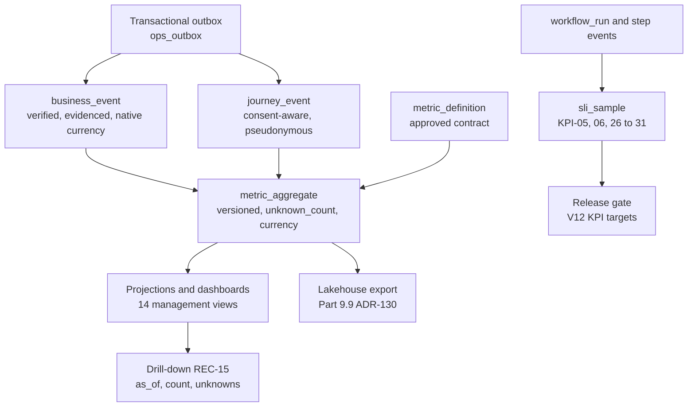

# AI Growth Engine: Employee Sales & Marketing Automation
## Application Blueprint: PART 11 (Batch 11.9c), V12 Security, Privacy, Threats, Analytics, Attribution and KPI Engineering; Conflicts, Decisions and Quality Gate

| Field | Value |
|---|---|
| Document | Part 11, Batch 11.9c · Enhancements for FSD V12 chapter 31 (Cybersecurity, Privacy and Threat Management) and chapter 29 (Analytics, Attribution and KPI Engineering); conflicts, decisions, persona review, tags and quality gate for the whole of Batch 11.9 |
| Version | 1.0 · 28 Nov 2026 |
| Baseline | Part 11.9a/b; Part 1 (KPI-01…31); Part 2.4 §2.31 (reports, attribution); Part 3.3 §3.3.13–§3.3.16 (governance, privacy); Part 4.1 (STRIDE THR-001…082, SC-01…50, regulatory map); Part 4.2/4.3; Part 9.9 (THR-X3, CAP-X3-02/04/15/19/26); Part 11.5a (CONFLICT-832/833, FR-V12-E-010…015); DEC-421, DEC-422, DEC-228, DEC-044 |
| Roles applied | CISO (lead for §11.9.5.16–§11.9.5.19), Threat-modelling lead, Chief Data Officer (lead for §11.9.5.14–§11.9.5.15), Principal Data Architect, FinOps Lead |

---

## 11.9.5 Enhancements (part 2: analytics, KPIs, security, threats, privacy, cost)

### 11.9.5.14 Analytics and attribution model (ch29 V6, V5; MT-13, MT-27, MT-31; REC-15; DEC-672, ADR-214)

**Principles adopted literally from V12 (binding).**

| # | Principle (V12 source) | Implementation |
|---|---|---|
| AN-01 | Business event references trusted tenant/company, optional offering, market, account, campaign, SKU and workflow **only if evidenced** (ch29 V6) | `business_event` (Part 11.9b C3-11); run-linked events inherit SKU/WF/version from the run by trigger and never infer offering or market (TC-V12-I-017c) |
| AN-02 | Unknown attribution stays NULL, is excluded when a filter is applied and is **labelled** (MT-27) | Every metric query returns `(value, unknown_count)`; dashboards print "n unattributed, excluded" next to filtered totals |
| AN-03 | Match cohort/period and **native currency** before reporting; no mixed-currency sum (ch29 V6, V6 BusinessEvent) | Aggregates keyed by currency; cross-currency views only through `approved_fx_display` with the FX version printed (DEC-027 display-only rule kept) |
| AN-04 | No inferred live data from demo fixtures | `source_kind = 'demo_fixture'` forces `is_simulated = true`; KPI indexes and views exclude simulated rows (TC-V12-I-017b; Part 3.3 IX-R4) |
| AN-05 | Business outcomes are separate from workflow runs; unmeasured metric is shown "unavailable" (MT-31) | Run counts never feed revenue/won KPIs; `metric_aggregate` absent → UI state "Unavailable – not instrumented" |
| AN-06 | Consent-aware events; minimal pseudonymous identifiers only after consent; no operator-wide customer record access by default (ch29 V5) | `journey_event` checks; operator analytics read only `audience = 'operator'` rows (P-JOURNEY); subscriber analytics are tenant-scoped |
| AN-07 | Aggregate denominators; separate subscriber commercial revenue from operator MRR (ch29 V5) | Two metric audiences in `metric_definition.audience`; operator MRR from `saas_service_invoice`, tenant revenue from `business_event` |
| AN-08 | Metric contract: `metric_id/version`, formula, numerator/denominator, source event IDs, currency/timezone, period, filters, owner, baseline, threshold (ch29 V5) | `metric_definition` columns map 1:1 (C3-12); approval required before display |
| AN-09 | Late events version the aggregate; no double count; attribution rule and observation window explicit | `metric_aggregate.aggregate_version`, `superseded_at`, `late_event_reason` (TC-V12-I-029); unique current aggregate per key |
| AN-10 | Offering-specific audiences: ICP, segment, market eligibility and source rights per offering; no cross-product prospect assumptions (MT-13) | Audience definition requires `offering_id` + `market_id`; PDP rejects an audience reused for another offering; evidence references per audience member |
| AN-11 | Drill-down contract (REC-15): timestamped, scoped, record count, unknown indicators, original currency; stable cursor; bulk actions recheck each item | Every KPI tile links to a drill-down whose response carries `as_of`, `record_count`, `unknown_count`, `currency`, `cursor` (keyset on `(occurred_at, event_id)`); totals reconcile to filtered records (test TC-V12-I-040); bulk actions re-run PDP per item |

**Attribution models (Part 2.4 §2.31.4 kept; V12 evidence rules layered on top).** Let a converted business event *e* (for example `deal_won`, `payment_verified`) have evidenced touches *t₁ … tₙ* (campaign, referral, ad, outbound reply) within the observation window *W* (default 90 days, `metric_definition.observation_window_days`), ordered by time; direct/unknown touches are excluded from credit but counted in `unknown_count`.

| Model | Credit to touch *tᵢ* | When used |
|---|---|---|
| Last non-direct (**default**) | 1 for the last evidenced non-direct touch, else 0 | Default for all tenants (RECOMMENDATION-022) |
| First touch | 1 for *t₁* | Awareness analysis |
| Linear | 1 / *n* | Multi-touch view |
| Position-based 40/20/40 | 0.4 to *t₁*, 0.4 to *tₙ*, 0.2 / (*n* − 2) to each middle touch (*n* ≥ 3); 0.5/0.5 when *n* = 2 | Mid-funnel review |

Attributed revenue for campaign *c* in period *P* and currency *k*: **Σₑ Σᵢ credit(tᵢ) × amount_minor(e) · [campaign(tᵢ) = c] · [currency(e) = k] · [verified(e)]**, reported per currency, with the caveat "attribution is an estimate of contribution, not causation" (RPT-R9). Events with no evidenced touch are reported as "Unattributed".

**Consent-aware acquisition analytics (AT-14).** First-party event schema; strictly necessary events carry no identifier (CHECK in `journey_event`); analytics/marketing events carry `pseudonymous_ref = HMAC-SHA-256(first-party cookie, per-tenant analytics key)` only when the consent class allows; opt-out deletes the cookie, stops collection and keeps only aggregated counts; denominators always show "source unknown" separately (OPT-TC-AT-14). EduVerse learners and any `age_band = 'under_18'` contact are never assigned a pseudonymous analytics key (DEC-030).

**Controlled conversion experiments (CV-14).** `experiment` (C3-12) requires hypothesis, primary metric (approved contract), guardrail metrics, allocation, consent class, minimum sample per arm ≥ 100, stopping rule and maximum duration 7–90 days. Analysis: difference in conversion *p_B − p_A* with a 95% interval (Wilson score per arm; two-proportion difference with unpooled standard error *SE = √(p_A(1−p_A)/n_A + p_B(1−p_B)/n_B)*); results always show the denominators. **No automatic winner:** `winner_arm` requires a decider different from the creator (TC-V12-I-018). Dark patterns are out of scope by policy (no deceptive variants; claims must be approved, BRL-MKT-01).

**CSAT, CES and NPS (CS-12).** Collected at defined milestones (`feedback_case.milestone`), optional, consent-classed. Formulas (denominator = responses, never invitations): **CSAT = count(csat ≥ 4) ÷ count(csat not null)**; **CES = mean(ces)** on a 1–7 scale (lower effort = better, label the direction); **NPS = 100 × (count(nps ≥ 9) − count(nps ≤ 6)) ÷ count(nps not null)**; response rate = responses ÷ invitations is shown separately. A missing response is never treated as satisfaction (TC-V12-I-019). Cells with fewer than 5 responses show "< 5" (Part 9.9 THR-X3-07).

### 11.9.5.15 KPI engineering (ch29 V9 release KPIs, 14 management views, PERF-01…07)

**ID rule (DEC-665).** V12 release-acceptance KPIs keep their V12 IDs and are cited as **"V12 KPI-nn"**. Blueprint business KPIs keep KPI-01…31 (Part 1) and are cited as "KPI-nn" or "BP KPI-nn" where both appear. Formulas below get metric IDs **MET-V12-I-nn** for `metric_definition.metric_id`.

| Metric | V12 KPI | Formula (numerator ÷ denominator) | Source | Window / target | Gate |
|---|---|---|---|---|---|
| MET-V12-I-01 | V12 KPI-05 Initial dashboard p95 | 95th percentile of server-timed dashboard response (request received → last byte) over dashboard requests | OTel spans `http.route` in dashboard set | Per release test run at PERF-01 load; **≤ 2,000 ms** | Blocking |
| MET-V12-I-02 | V12 KPI-06 Critical service availability | good minutes ÷ (total minutes in service window − approved exclusions) for the critical service set | Synthetic probes + `sli_sample` (`status = excluded_approved` needs `exclusion_ref`) | Rolling 30 days; **≥ 0.999** | Review target |
| MET-V12-I-03 | V12 KPI-26 Growth dashboard p95 | as MET-01 at PERF-02 load | OTel | **≤ 2,500 ms** | Review target |
| MET-V12-I-04 | V12 KPI-27 Async acknowledgement p95 | 95th percentile (durable accept committed − request received) for async endpoints and verified webhooks; excludes external completion | OTel + `inbox.received_at` | **≤ 2,000 ms** | Blocking |
| MET-V12-I-05 | V12 KPI-28 Projection refresh | 95th percentile (projection row visible timestamp − source event commit timestamp) | Outbox `created_at` vs projection `computed_at` | **≤ 60 s** in approved workload (PERF-05) | Review target |
| MET-V12-I-06 | V12 KPI-29 LCP p75 | 75th percentile Largest Contentful Paint of representative website visits | RUM (web-vitals) with analytics consent, else lab runs | **≤ 2,500 ms** | Review target |
| MET-V12-I-07 | V12 KPI-30 INP p75 | 75th percentile Interaction to Next Paint | RUM / lab | **≤ 200 ms** | Review target |
| MET-V12-I-08 | V12 KPI-31 CLS p75 | 75th percentile Cumulative Layout Shift | RUM / lab | **≤ 0.1** | Review target |
| MET-V12-I-09 | V12 KPI-03 Unresolved critical security findings | count(`security_finding` where severity = Critical and `closed_at` is null) at release cut; overdue Critical blocks release (ENT-SEC-03) | `ixp_security_finding__open` | **= 0** | Blocking |

**Load profiles (PERF-01…07, DEC-676).** Adopted as binding acceptance profiles; scripts in k6 (Part 4.2 LT-xx) with synthetic tenants only.

| Profile | Data set | Load | Pass criteria | Notes |
|---|---|---|---|---|
| PERF-01 Initial | 25 owned startups + 10 external tenants; 50 staff; 100k opportunities | 50 concurrent jobs; 10k scheduled actions/day | V12 KPI-05 ≤ 2 s, KPI-27 ≤ 2 s | Matches DEC-031 design point |
| PERF-02 Growth | 50+ owned + 100 external tenants; 250 staff; 1 M opportunities | 250 concurrent jobs; 100k actions/day | KPI-26 ≤ 2.5 s, KPI-27 ≤ 2 s | Run on the Supabase growth-gate compute tier |
| PERF-03 Burst | PERF-01 data | 2× approved rate for 15 min | No corruption; bounded 429/queue; back to baseline ≤ 10 min | Tenant caps active |
| PERF-04 Endurance | PERF-01 data | 8 h at representative rate | No memory/queue growth > 5%/h; budgets and outcomes reconcile | Ledger reconciliation after run |
| PERF-05 Projection | PERF-01 | Continuous events | KPI-28 ≤ 60 s | Projection lag SLI |
| PERF-06 Recovery | PERF-01 | Kill worker and provider simulator, restart, replay | 0 duplicate effects (V12 KPI-07/08); backlog drains within recovery window | Uses effect ledger and inbox de-dup |
| PERF-07 Noisy neighbour | Tenant A at quota + tenant B normal | Mixed | Tenant B p95 within 10% of solo baseline; no cross-tenant access | Per-tenant pool and rate limits |

**Fourteen management views: production metric for every V12 label (MET-V12-I-10…65).** In production each label becomes an approved metric; "Sample …" labels exist only in the synthetic prototype and are renamed "Verified …" (RECOMMENDATION-921). Service groups per view are configuration in `metric_definition.filters` [ASSUMPTION-904]. All run metrics count `workflow_run` rows of the view's SKUs in the period; all business metrics come from `business_event` / typed tables with `verified = true` and `is_simulated = false`; money is per currency.

| View (SKUs) | Label 1 | Label 2 | Label 3 | Label 4 |
|---|---|---|---|---|
| 1 Executive (all) | MET-10 Opportunity records = count(live opportunities) | MET-11 Open pipeline = Σ open deal value per currency | MET-12 Won deals = count(`deal_won`, verified) | MET-13 Verified receipts = Σ `payment_verified` amount per currency |
| 2 Market intelligence (SVC-01, 02, 25, 35) | MET-14 Research runs = count(runs) | MET-15 Evidence reviews = count(reviews decided) | MET-16 Held signals = count(signals in Held) | MET-17 Completed research = count(runs Completed) |
| 3 Lead & contact (SVC-03, 04, 15, 29) | MET-18 Discovered prospects = count(new contacts with source evidence) | MET-19 Qualified prospects = count(`opportunity_qualified`) | MET-20 Contact & lead runs = count(runs) | MET-21 Pending reviews = count(reviews open) |
| 4 Digital marketing (SVC-11, 12, 13, 14, 16, 27) | MET-22 Marketing runs | MET-23 Completed campaigns = count(campaigns Completed) | MET-24 Held campaign actions = count(effects Held by PDP) | MET-25 Verified marketing-attributed receipts = attributed revenue (default model) per currency |
| 5 Omnichannel (SVC-06, 07, 08, 09, 26, 38) | MET-26 Engagement runs | MET-27 Completed messages/tasks = count(effects Confirmed) | MET-28 Held outreach = count(dispatch held by PDP) | MET-29 Channel records = count(active channel accounts) |
| 6 Follow-up & meetings (SVC-05, 10) | MET-30 Follow-up runs | MET-31 Meeting-stage records = count(deals in meeting stage) | MET-32 Pending approvals = count(approvals open) | MET-33 Held tasks = count(tasks Held) |
| 7 Objection & negotiation (SVC-17, 18, 36, 37) | MET-34 Negotiation runs | MET-35 Proposal-stage records | MET-36 Awaiting review | MET-37 Held negotiations |
| 8 Sales pipeline (SVC-05, 17, 18, 19, 20) | MET-38 Open opportunities | MET-39 Proposal-stage records | MET-40 Won deals | MET-41 Open pipeline per currency |
| 9 Revenue & financial (SVC-21, 24, 28, 31) | MET-42 Verified receipts per currency | MET-43 Open pipeline per currency | MET-44 Won deals | MET-45 Financial runs |
| 10 Customer success (SVC-22, 23, 33, 34) | MET-46 Lifecycle runs | MET-47 Completed lifecycle runs | MET-48 Open reviews | MET-49 Held lifecycle actions |
| 11 Partner & procurement (SVC-32, 39) | MET-50 Partner/procurement runs | MET-51 Completed runs | MET-52 Pending reviews | MET-53 Held purchasing actions |
| 12 AI & automation (all) | MET-54 Total runs | MET-55 Completed runs | MET-56 Reserved units = Σ `usage_reservation.units` Reserved | MET-57 Held/failed runs |
| 13 Governance & risk (all) | MET-58 Awaiting approval = count(runs Awaiting approval) | MET-59 Held runs | MET-60 Failed runs | MET-61 Uncertain outcomes = count(effects Reconciling > SLA) |
| 14 Optimization (SVC-30) | MET-62 Optimization runs | MET-63 Completed runs | MET-64 Pending review = count(experiments awaiting decision) | MET-65 Held experiments = count(experiments Stopped by guardrail) |

### 11.9.5.16 Security programme (ch31 V12 ENT-SEC-01…08, V5 SEC rules, V7 MOB-10, V8 obligations; DEC-675)

| ID | V12 requirement | Blueprint before | Specification adopted | Evidence | Phase → wave |
|---|---|---|---|---|---|
| ENT-SEC-01 | Secure SDLC: SAST, DAST, dependency and secret scanning on every change; threat model per release | Part 4.1 §4.16.1 (gates) | Unchanged gates + **threat model per release**: the STRIDE register (Part 4.1 §4.2, Part 9.9, §11.9.5.17) is re-reviewed at every release candidate; new trust boundaries require a THR row with a test | Pipeline blocks on Critical; release record links the reviewed THR delta | R0 → Release 1 |
| ENT-SEC-02 | SBOM (CycloneDX or SPDX) for every release, stored with the release record | Part 4.1 (CycloneDX), Part 9.9 CAP-X3-19 | CycloneDX SBOM per artefact (backend image, two frontend builds, worker image); **signed** (Sigstore cosign keyless or KMS key, verify) and attached to `ops_release`; A129 shows SBOM status | SBOM digest + signature verified in deploy | R0 → Release 1 |
| ENT-SEC-03 | Remediation SLAs Critical 7 d, High 30, Medium 90, Low 180 (proposed); overdue critical blocks release (KPI-03) | Part 4.1 §4.16.3 (Low: next maintenance) | **Adopt V12** (DEC-666): Low 180 days; enforced by `security_finding` CHECK (C2-T7 family) and the release gate MET-V12-I-09 | C2-T7; release gate report | R1 → Release 1 |
| ENT-SEC-04 | Independent pen test before each major release and at least annually (PEN-01…08) | Part 8.4 A7: two tests (Release 1, Release 2) | Two funded tests unchanged; the **annual** test from W6 is a separately approvable running cost (§11.9.5.19); scope = PEN-01…08 below | Report with no open Critical/High before go-live | R1 → Release 1/2; annual W6 |
| ENT-SEC-05 | Public bug bounty after R3 | Part 4.1 RECOMMENDATION-048 (considered at W6) | VDP + `security.txt` now (unchanged); **bug-bounty programme in W6** after R3 equivalent, triage SLA 3 business days; budget proposal §11.9.5.19 | Programme live | R3 → W6 |
| ENT-SEC-06 | TLS 1.2+, AES-256 at rest, key rotation | Part 4.1 §4.5 | Unchanged; Supabase at-rest encryption + app-layer envelope encryption for Restricted fields; DEK rotation 90/180/365 days (`tenant_key_config.rotation_days`) | TLS scan grade A; KMS rotation evidence | R0 → Release 1 |
| ENT-SEC-07 | Secrets management with rotation and break-glass | Part 4.1 §4.6, Part 9.9 CAP-X3-18 | Unchanged; database role passwords included (SB-09); break-glass account per tenant required before SSO enforcement (C2-T4) | Rotation drill; no static long-lived secrets | R0 → Release 1 |
| ENT-SEC-08 | 24×7 security monitoring and incident-response plan linked to breach clocks (A121); quarterly tabletop | Part 4.3: out-of-hours paging Sev1 only (CONFLICT-113, DEC-044) | IR plan, breach clocks (C3-08) and quarterly tabletop **adopted**; **24×7 monitoring Pending Founder decision** (CONFLICT-905): options in §11.9.6 | Tabletop record each quarter | R2 → Release 2 |

**V5 security rules (SEC-06, SEC-08…14) → blueprint controls.**

| V12 | Requirement | Control (blueprint + this batch) | Test |
|---|---|---|---|
| SEC-06 | Tamper-evident audit with actor, scope, correlation, integrity chain; redact sensitive values | `fn_append_audit()` hash chain, append-only, daily anchor to S3 Object Lock (Part 3.3 §3.3.5.9), redacted `payload_redacted` | TC-V12-I-007; OPT-TC-SEC-06 |
| SEC-08 | Prompt-injection defences: external text is untrusted evidence; separate instructions, schemas, tools; validate output and egress | Part 4.1 §4.15, Part 7 guardrails; tool allowlists; output JSON Schema validation; PDP recheck before any effect | OPT-TC-SEC-08; PEN-06 |
| SEC-09 | DLP: classify, redact/minimize before model/provider transmission; hold prohibited fields | Gateway DLP (Part 3.1), data-class tags in `domain_schema_registry.data_class`; Tier 2 restricted by DB CHECK | OPT-TC-SEC-09; TC-V12-I-022 |
| SEC-10 | Safe private file ingestion: quarantine, scan, MIME and size, isolated parsers, no retrieval before clearance | Part 4.1 THR-005 controls; chunks get `is_searchable = false` until cleared | OPT-TC-SEC-10 |
| SEC-11 | Browser controls: CSP, escaping, anti-framing, cookie flags, dependency integrity | Part 4.1 §4.9; SRI on third-party scripts; Vercel headers configuration per project (verify) | OPT-TC-SEC-11 |
| SEC-12 | SSRF-safe egress: scheme check, allowlist, resolve and re-check redirects/IPs; deny private/link-local | Part 4.1 SSRF control; egress proxy in AWS; audit-sink and webhook URLs pass the same validator | OPT-TC-SEC-12 |
| SEC-13 | Behaviour monitoring: unusual login, export, permission change, usage | Security event catalogue (Part 4.1 §4.10.1) + new events: export approved, SSO enforcement changed, SCIM token created, API key created, CMK state change, role permission change, audit sink change | OPT-TC-SEC-13 |
| SEC-14 | Supply chain: SBOM, dependency scan, signed build, protected releases | ENT-SEC-02 + branch protection; unsigned artefact blocks deploy | OPT-TC-SEC-14 |
| SEC release rule | Server-side authorization, non-owner RLS, secret vault, approved outbound gateway, quarantine, prompt/tool separation, redacted audit mandatory; no certification asserted | All present; "non-owner RLS" made concrete for Supabase (SB-02) | TC-V12-I-025, 027 |

**Penetration-test scope (PEN-01…08), mapped to threats and tests.**

| PEN | Asset | Blueprint threats | DB / app tests that must already pass |
|---|---|---|---|
| PEN-01 | Admin identity (external token, revoked membership, wrong audience) | THR-0xx Admin identity (Part 4.1 TB-03); THR-V12-I-15 | TC-V12-E (identity, Part 11.5a); TC-V12-I-003 |
| PEN-02 | Tenant/issuer data across API, worker, export, cache, storage, RAG | THR-V12-I-01…06, THR-X3-05 | TC-V12-I-001, 002, 004, 008, 009, 027 |
| PEN-03 | Website publication (unknown host, draft, private URL) | THR-001, THR-002 | Part 6 publication tests |
| PEN-04 | Portal invitations (expired/replayed token, foreign resource) | Part 4.1 TB-02 | Portal policy tests (Part 3.3 §3.3.9.4) |
| PEN-05 | Workflow/financial (replay callback, stale approval, concurrent budget/receipt) | THR-V12-I-11; V12 KPI-07/08 | C2-T8, DB-T8, TC-V12-I-013, TC-V12-I-033 |
| PEN-06 | AI (untrusted source tries to exfiltrate or act) | Part 4.1 §4.8.3; THR-X3-06 | AI red-team suite (Part 6.4) |
| PEN-07 | Supply chain (SBOM, secrets, digests, least privilege, network) | THR-V12-I-02 | SBOM signature verify; TC-V12-I-025 |
| PEN-08 | Incident readiness (contain, revoke, stop dispatch, preserve logs, recover) | THR-V12-I-22 | Quarterly tabletop; PERF-06 |

**Regulatory obligations (ch31 V8).** CERT-In: report specified incidents within **6 hours**, keep ICT logs **180 days in India** (CJ-IN-09), synchronise clocks to approved NTP sources (Amazon Time Sync and Supabase-managed NTP; verify the CERT-In NTP list) — enforced by C3-08 and SB-10. GDPR Art. 32 / DPDP s.8(5) reasonable security safeguards — encryption, access control, logging, tested restore — covered by Part 4.1 and this batch. Breach handling follows FSD 18.3 with clocks on A121 (`incident_notification`). [ASSUMPTION-918: DPDP Rules 2025 require intimation to the Data Protection Board without delay and a detailed report within 72 hours; DSAR response periods per the Rules — verify, as of 27 Nov 2026.]

**MOB-10 PWA and offline boundary (consistent with Part 9.9 ADR-139).** Service worker caches **public assets only** by default; authenticated API responses `Cache-Control: no-store`; private caches cleared at logout and on remote session revoke; no background replay of financial or communication effects (drafts never dispatch on sync, THR-X3-16); standalone prototype files contain no live PWA or server. Acceptance MOB-10-AT01: inspect service-worker caches and airplane-mode behaviour; no private response persisted and no external action (TC-V12-I-058).

### 11.9.5.17 Threat model (STRIDE) for the V12 data, identity and analytics additions

New trust boundaries: **TB-V12-I-01** Supabase database and its APIs; **TB-V12-I-02** tenant IdP / SCIM; **TB-V12-I-03** customer KMS; **TB-V12-I-04** audit sink / SIEM; **TB-V12-I-05** export delivery; **TB-V12-I-06** sandbox and promotion; **TB-V12-I-07** analytics pipeline.

| THR | TB | STRIDE | Threat | Impact | Likelihood | Controls (SC) | Residual | Test |
|---|---|---|---|---|---|---|---|---|
| THR-V12-I-01 | 01 | I | Business tables read through the Supabase Data API with the anon key | H | M | SC-V12-I-01 schema `ge` not exposed, no grants to `anon`/`authenticated`, no Supabase keys in browsers | L | TC-V12-I-025 |
| THR-V12-I-02 | 01 | E | Application or job uses `service_role`/`postgres`, bypassing RLS | H | M | SC-V12-I-02 `ge_app`/`ge_worker` NOBYPASSRLS; CI asserts connection user; secrets only in Secrets Manager | L | CI check; TC-V12-I-027 |
| THR-V12-I-03 | 01 | I | Pooled connection carries the previous request's tenant context | H | L | SC-V12-I-03 transaction-local `set_config(…, true)`; context set first in every transaction; error on missing tenant | L | TC-V12-I-003; TC-V12-E-005 |
| THR-V12-I-04 | 01 | I | User of company C1 reads company C3 of the same tenant | H | H (customer DDL) | SC-V12-I-04 P-CO company predicate on every company table | L | TC-V12-I-001 |
| THR-V12-I-05 | 01 | E | Portfolio session (several companies) writes or approves | H | M | SC-V12-I-04 write predicate needs one write company; PDP `SELECT_SINGLE_STARTUP` | L | TC-V12-I-002b |
| THR-V12-I-06 | 01 | I | FK/PK errors reveal another tenant's IDs (existence oracle) | M | M | SC-V12-I-05 tenant-pinned composite keys and PKs | L | TC-V12-I-004 |
| THR-V12-I-07 | 01 | E | SoD bypass by updating a permission or by holding two roles | H | M | SC-V12-I-06 SoD on INSERT/UPDATE and per user; no self-grant | L | TC-V12-I-005, 006 |
| THR-V12-I-08 | 01 | T | Audit rows altered or deleted by the application or an operator | H | L | SC-V12-I-07 append-only, insert via definer function, hash chain, daily anchor in S3 Object Lock | L | TC-V12-I-007 |
| THR-V12-I-09 | 05/06 | R | Requester approves own export or promotion and denies it later | M | M | SC-V12-I-08 requester ≠ approver CHECKs; audit chain | L | C2-T2, C2-T3 |
| THR-V12-I-10 | 01 | T | Free-text or invalid state corrupts state machines and KPIs | M | H (customer DDL) | SC-V12-I-09 CHECK vocabularies; registry trigger | L | TC-V12-I-016 |
| THR-V12-I-11 | 01 | S | Unsigned or replayed provider callback stored and processed | H | M | SC-V12-I-10 signature verification before insert; `signature_ok` CHECK; key provider + account + event | L | TC-V12-I-008b; DB-T8 |
| THR-V12-I-12 | 01 | I | Tenant data written in the wrong region | H | L | SC-V12-I-11 per-region database; `data_region` immutable; deployment-region guard | L | TC-V12-I-011, 012 |
| THR-V12-I-13 | 03 | D | Customer revokes or loses KMS key: partial writes, outage | M | M | SC-V12-I-12 fail closed per tenant, outbox hold, crypto-shred is deliberate and audited (cross-ref THR-X3-09) | M (by design) | TC-V12-I-015 |
| THR-V12-I-14 | 02 | I | SCIM token or API key stolen from a dump or log | H | L | SC-V12-I-13 hash-only storage, unique prefix, ≤ 397-day life, revocation, secret scanning | L | C2-T9; TC-V12-I-021 |
| THR-V12-I-15 | 02 | S | SSO enforced on an unverified domain (takeover) or without break-glass (lock-out) | H | L | C2 `identity_provider` CHECK; DNS TXT verification; break-glass alerting (Part 11.5a ENT-IDN-02/06) | L | C2-T4 |
| THR-V12-I-16 | 05 | I | Export link leaked or reused after expiry | H | M | SC-V12-I-14 second approver, manifest hash, ≤ 7-day signed link, single tenant prefix, download audit | L | TC-V12-I-020 |
| THR-V12-I-17 | 06 | I | Personal data copied into a sandbox | H | M | SC-V12-I-15 `contains_personal_data = false`; synthetic generator only; DLP scan on promotion payloads | L | C2-T5 |
| THR-V12-I-18 | 04 | I | Audit sink pointed at an attacker endpoint | H | L | SC-V12-I-16 sink verification challenge, R12 + R10 approval, SSRF-safe egress, redacted payloads | L | Integration test |
| THR-V12-I-19 | 07 | I | Re-identification from journey events or small aggregates | M | M | SC-V12-I-17 consent class rules, HMAC per tenant, min cell 5, operator/subscriber split | L | TC-V12-I-031 |
| THR-V12-I-20 | 07 | T | Demo fixtures or run counts reported as live business outcomes | M | M | SC-V12-I-18 `source_kind`/`is_simulated` checks; AN-05 | L | TC-V12-I-017b |
| THR-V12-I-21 | 07 | T | Late events silently change a published KPI | M | M | SC-V12-I-19 versioned aggregates with reason | L | TC-V12-I-029 |
| THR-V12-I-22 | 01 | R | Breach deadline mis-entered, regulator notified late | H | L | SC-V12-I-20 deadline triggers; due-list index; tabletop | L | TC-V12-I-014 |
| THR-V12-I-23 | 01 | I | Free Tier 2 model registered for confidential data | H | L | SC-V12-I-21 `ai_model_t2_data_ck` + gateway rule (DEC-007) | L | TC-V12-I-022 |
| THR-V12-I-24 | 01 | D | One tenant exhausts database connections or I/O | M | M | SC-V12-I-22 per-tenant rate limits and job quotas, pool caps, statement timeouts | L | PERF-07 |

**V12 threat list (ch31 V5) → registers.** Cross-tenant object leakage → THR-V12-I-04/06, THR-002, THR-X3-05; privilege escalation → THR-V12-I-05/07; prompt injection → Part 4.1 LLM01, THR-X3-06; malicious uploads → THR-005; SSRF → Part 4.1 SSRF threat, SC-V12-I-16; webhook spoof/replay → THR-V12-I-11, THR-X3-02; credential theft → THR-V12-I-14, THR-X3-01; duplicate financial effects → effect ledger, V12 KPI-07; billing abuse → `usage_reservation` unique run/period, budget caps (BRL-AI-08); unsafe external actions → PDP recheck, autonomy L1 cap (safety invariant). V12 control families map to SC-01…50 and SC-V12-I-01…22.

### 11.9.5.18 Privacy engineering (DPDP Act 2023 and Rules 2025, GDPR, CISO view)

| Data object (V12) | Personal data | Class (Part 4.1 §4.1.2) | Purpose / lawful basis | Retention | Rights handling |
|---|---|---|---|---|---|
| `consent_record` | Contact reference, evidence hash | Restricted | Proof of consent / legitimate use (DPDP s.6, s.7) | AUD 7 y after withdrawal (Part 3.3 §3.3.11) | Withdrawal appends a new row (`supersedes`) |
| `suppression` | Contact reference or identifier HMAC | Restricted | Honour opt-out and erasure (s.12) | Kept as hash after erasure | Never deleted while the person must stay suppressed |
| `dsar_request` | Request metadata | Confidential | Data-principal rights (s.11–14) | AUD | Identity verified before completion; legal hold flag |
| `incident`, `incident_notification` | Possible personal data flag, summary | Confidential | Breach intimation (s.8(6)); CERT-In | AUD | — |
| `journey_event` | Pseudonymous reference (only after consent) | Restricted when present | Analytics with consent (AT-14) | 13 months then aggregate | Opt-out stops collection; erasure deletes rows for the HMAC |
| `feedback_case` | Survey answers linked to a customer contact | Confidential | Service improvement with consent class | 24 months | Access and erasure via DSAR |
| `business_event` | None directly (account references) | Confidential | Contractual/analytics | BUS | Pseudonymized with the account |
| `export_job` | Whole tenant data set | Restricted | Portability (s.11) and contract exit | Link ≤ 7 days; manifest kept | Second approver |
| `sandbox_environment` | **None allowed** | Internal | Testing | — | Synthetic only |
| `identity_provider`, `scim_token`, `api_key` | Admin email, hashes | Restricted | Security (legitimate use) | Life of tenant | — |
| `ai_usage_event` | None (IDs only) | Internal | Cost and quality | FIN 8 y aggregates | — |

**DPIA triggers added by V12 (Part 4.1 §4.11.2 extended):** cross-region tenant onboarding (EU) · customer-managed keys and crypto-shredding · audit streaming to tenant SIEMs · consent-aware acquisition analytics · experiments that change outreach content · sandbox promotion of configuration that alters PDP rules. **Children (EduVerse) and patients (MedMaarg):** no new table may store learner or patient data; `journey_event` and `feedback_case` exclude `age_band = 'under_18'` contacts; the safety invariants are unchanged. **Cross-border:** India-region tenants keep all personal data and customer KEKs in India (KEK region check at key registration); EU tenants are pending CONFLICT-832.

### 11.9.5.19 Cost of the additions (estimates; **outside** the approved budgets DEC-230/DEC-231/DEC-422; separately approvable)

Basis: engineering day ₹4,545–6,818 per person-day (Part 8.4); ranges low–high; provider prices are placeholders to **verify at time of implementation (as of 27 Nov 2026)**.

**Development (one-time).**

| Item | Scope | Person-days | Cost (₹) | Wave |
|---|---|---|---|---|
| D1 | DDL-V12-I into Django `RunSQL` migrations, `gen_c3.py` in CI, CI guards, test suite port | 8–14 | 36,360–95,452 | Release 1 (W0–W1) |
| D2 | Domain schema registry population from Appendix B (89 tables, 156 workflows) and validation trigger tuning | 4–8 | 18,180–54,544 | Release 1 (W1) |
| D3 | Analytics tables, metric contracts, 65 MET definitions, SLI collection, drill-down contract | 10–18 | 45,450–1,22,724 | Release 1–2 |
| D4 | Security programme set-up: signed SBOM, per-release threat-model template, Low-SLA gate, finding register (A129) | 4–7 | 18,180–47,726 | Release 1 |
| D5 | Audit-sink connectors (HTTPS, syslog-TLS, object storage) | 5–9 | 22,725–61,362 | Release 2 |
| D6 | Sandbox synthetic generator and promotion flow | 6–10 | 27,270–68,180 | Release 2 |
| D7 | Multi-cloud CMK adapters (Azure Key Vault, GCP KMS) and crypto-shred drill | 12–20 | 54,540–1,36,360 | W6 |
| | **Total** | **49–86** | **₹2.23–5.86 lakh** | Release 1: D1–D4 ₹1.18–3.20 L |

**Subscriptions and running (recurring).**

| Item | Basis | Monthly (₹) | Status |
|---|---|---|---|
| R1 Annual independent pen test from W6 | ₹1.5–4.0 L per test ÷ 12 (Part 8.4 A7 quotes, verify) | 12,500–33,333 | Proposal (W6) |
| R2 Bug-bounty programme (managed platform fee + reward pool) | Platform fee and rewards to verify; VDP-only option ₹0 | 0–25,000 | Proposal (W6) |
| R3 24×7 security monitoring (managed detection and response or follow-the-sun on-call) | Vendor quotes to verify | 40,000–1,50,000 | **Pending Founder (CONFLICT-905)** |
| R4 Customer KMS API calls (Azure/GCP) | Per-tenant key operations, recharged to Scale plan | 200–1,000 per BYOK tenant | Proposal (W6) |
| R5 Audit-sink egress | Small JSON volumes | 0–500 | Proposal (Release 2) |
| R6 Supabase storage for 373 extra indexes and partitions | Within B01b at pilot volumes; reassess at growth gate | 0 at pilot | No change |

### 11.9.5.20 Functional requirements and user stories (analytics, KPIs, security)

| FR | Requirement | Source | Release (V12 phase → wave) | Tests |
|---|---|---|---|---|
| FR-V12-I-040 | Drill-down contract for every KPI tile: `as_of`, record count, unknown count, native currency, keyset cursor; totals reconcile; bulk actions re-check each item | REC-15 | Release 1 (W3) | TC-V12-I-040 |
| FR-V12-I-041 | PERF-01…07 load profiles executed before each release gate; V12 KPI-05/26/27/28 measured | ch29 V9 | Release 1 (PERF-01, 03–07); Release 2 (PERF-02) | Part 4.2 LT suite |
| FR-V12-I-042 | `business_event` fact with evidenced-only attribution, unknowns NULL and labelled, offering-specific audiences | ch29 V6; MT-13/27/31 | Release 1 (W4 attribution) | TC-V12-I-041, 042, 047 |
| FR-V12-I-043 | Fourteen management views implemented with MET-V12-I-10…65 production metrics | ch29 V4 mapping | Release 1–2 | Metric unit tests per MET |
| FR-V12-I-044 | Metric contract and versioned aggregates for all tenant and operator metrics; separate audiences | ch29 V5 | Release 1 | TC-V12-I-029, 043 |
| FR-V12-I-045 | Consent-aware acquisition analytics | AT-14 | Release 1 (W3) | TC-V12-I-031, 044 |
| FR-V12-I-046 | Controlled experiments without automatic winners | CV-14 | Release 2 | TC-V12-I-018, 045 |
| FR-V12-I-047 | CSAT, CES, NPS at milestones with denominators | CS-12 | Release 2 | TC-V12-I-019, 046 |
| FR-V12-I-050 | Secure SDLC gates and per-release threat-model review | ENT-SEC-01 | Release 1 | Pipeline evidence |
| FR-V12-I-051 | Signed SBOM per artefact stored with the release record | ENT-SEC-02, SEC-14 | Release 1 | SBOM signature check |
| FR-V12-I-052 | Vulnerability SLAs 7/30/90/180 days; overdue Critical blocks release | ENT-SEC-03 | Release 1 | C2-T7; MET-V12-I-09 |
| FR-V12-I-053 | Independent pen test per major release and annually, scope PEN-01…08 | ENT-SEC-04 | Release 1/2; annual W6 | TC-V12-I-050…057 |
| FR-V12-I-054 | Public bug-bounty programme | ENT-SEC-05 | W6 | Programme live |
| FR-V12-I-055 | Encryption in transit/at rest and key rotation | ENT-SEC-06 | Release 1 | TLS scan; KMS evidence |
| FR-V12-I-056 | Secrets rotation and break-glass | ENT-SEC-07 | Release 1 | Rotation drill |
| FR-V12-I-057 | IR plan linked to breach clocks; quarterly tabletop; 24×7 monitoring per DEC-679 | ENT-SEC-08 | Release 2 (24×7 pending) | Tabletop record; TC-V12-I-014 |
| FR-V12-I-058 | SEC-08…13 controls (prompt injection, DLP, file ingestion, browser, SSRF, behaviour monitoring) evidenced per release | ch31 V5 | Release 1 | OPT-TC-SEC-08…13 |
| FR-V12-I-059 | PWA offline boundary | MOB-10 | Release 2 | TC-V12-I-058 |

| Story | As a … I want … so that … | Acceptance criteria (summary) | FR |
|---|---|---|---|
| US-15-YI01 | As a revenue lead I want attributed revenue only from verified events with evidenced touches, per currency | AC-1 unknown touches excluded and counted; AC-2 no cross-currency sums; AC-3 model and window printed with the caveat | FR-V12-I-042 |
| US-17-YI01 | As an executive I want every KPI tile to open a drill-down whose rows add up to the tile | AC-1 totals reconcile; AC-2 `as_of` and unknown count shown; AC-3 bulk actions re-check each item | FR-V12-I-040 |
| US-17-YI02 | As an analytics owner I want metric definitions approved and versioned so that late events never silently change history | AC-1 unapproved metric not displayed; AC-2 late events create a new aggregate version with a reason; AC-3 superseded values retained 24 months | FR-V12-I-044 |
| US-12-YI01 | As a growth manager I want experiments with guardrails and a human decision | AC-1 minimum sample and stopping rule required; AC-2 denominators and interval shown; AC-3 winner needs an independent decider | FR-V12-I-046 |
| US-16-YI01 | As a customer-success lead I want CSAT/CES/NPS with response rates | AC-1 missing responses never counted; AC-2 cells < 5 suppressed; AC-3 formulas match §11.9.5.14 | FR-V12-I-047 |
| US-21-YI02 | As the security lead I want a release blocked by an overdue Critical finding or an unsigned artefact | AC-1 MET-V12-I-09 > 0 blocks; AC-2 SBOM signature failure blocks deploy; AC-3 threat-model delta attached to the release record | FR-V12-I-050…052 |
| US-21-YI03 | As the DPO I want quarterly incident tabletop exercises with breach clocks | AC-1 tabletop record each quarter; AC-2 CERT-In 6 h and DPDP/GDPR 72 h clocks exercised; AC-3 lessons logged as findings | FR-V12-I-057 |

---

## 11.9.6 Conflicts and proposed resolutions

| Tag | Conflict | V12 position | Blueprint / Founder position | Proposed resolution | Status |
|---|---|---|---|---|---|
| CONFLICT-832 (raised in Part 11.5a; cross-referenced) | Data residency India **and EU now** (ENT-DAT-03; `tenant.data_region IN ('IN','EU')`) | Two regions | DEC-421 single Supabase region (Mumbai); DEC-422 budget | Keep the residency guard (works per regional database); onboard IN only; enable EU when the first EU contract is signed, as a second Supabase project + AWS region with its own budget line (Part 11.5a) | **Pending Founder decision** (DEC-678) |
| CONFLICT-905 | ENT-SEC-08 24×7 security monitoring | P0, R2 | DEC-044 support hours; CONFLICT-113 (Sev1-only out-of-hours paging); DEC-228 staffing; DEC-422 budget | Option A (recommended): managed detection and response for Sev1/Sev2 security alerts 24×7 + existing on-call for Sev1 (R3 ₹40k–1.5 L/month, verify). Option B: keep Sev1-only paging and record a customer-accepted deviation in the enterprise contract. Option C: defer to W6 | **Pending Founder decision** (DEC-679) |
| CONFLICT-906 | DEC-421 says the Django API uses "the service key held server-side" | V12 SEC rule: non-owner RLS mandatory | Supabase `service_role` bypasses RLS | Business queries use `ge_app` (NOBYPASSRLS) through Supavisor; the service key is kept server-side only for Storage/administration. Hosting choice unchanged | Resolved (DEC-663) |
| CONFLICT-907 | V12 KPI-01…35 and V12-ENG "DEC-039…042" reuse blueprint IDs with other meanings | V12 IDs canonical | KPI-01…31, DEC-039…042 in use | Namespace: "V12 KPI-nn", "V12-ENG DEC-nnn"; MET-V12-I-nn for formulas | Resolved (DEC-665) |
| CONFLICT-908 | Money storage | Integer minor units + currency; exact decimal for units/rates (ch26 V5) | Part 3.3 §3.3.5.6 `numeric(18,2)` | Adopt V12 for amounts (`*_minor bigint`); keep `numeric(18,4)` unit prices and quantities; ROUND_HALF_UP rules unchanged; consistent with Part 11.5a FR-V12-E-073 | Resolved (DEC-664) |
| CONFLICT-909 | Missing tenant context | Raise an error (DB-T2) | Part 3.3 §3.3.9.1 helpers return NULL → zero rows | Adopt V12 for tenant (louder failure), keep zero rows for missing company scope | Resolved (DEC-662) |
| CONFLICT-910 | Customer-managed keys | AWS KMS, Azure Key Vault, GCP KMS (ENT-DAT-02) | Part 9.9 ASSUMPTION-704: AWS KMS in ap-south-1 only | Adopt V12 providers through a KEK adapter; key region must match tenant region; delivered in W6 with costs D7/R4 | Resolved (DEC-671) |
| CONFLICT-911 | Low-severity remediation SLA | 180 days | Part 4.1 §4.16.3 "next maintenance or accept" | Adopt 180 days | Resolved (DEC-666) |

No conflict weakens a safety invariant: AI still never signs, pays, submits, prices or sends without a human; consequential actions stay at L1; the PDP recheck, Tier 2 data restriction, tenant isolation, Website/Admin separation, EduVerse and MedMaarg rules are reinforced by database constraints.

## 11.9.7 Decisions

| DEC | Decision | Authority | Effect |
|---|---|---|---|
| DEC-660 | FSD V12 Appendix C/C2 table names are the canonical **logical** names; physical tables follow Part 3.3 naming with the mapping of Part 11.9a §11.9.4; V12 *company* = blueprint *startup* (physical `startup_id`, alias `company_id`) per DEC-581 | Customer revision V12 (28 Nov 2026) | 48 core/enterprise tables mapped; 17 new physical tables |
| DEC-661 | Hybrid domain storage: typed blueprint tables **plus** the V12 common columns `schema_ref`, `evidence_refs`, `payload`, validated by `domain_schema_registry` (ADR-211) | Customer revision V12 (28 Nov 2026) | 324 domain-schema fields Matched; 89 validation triggers |
| DEC-662 | RLS model: command-split policies on tenant **and company**; no DELETE policies on business tables; missing tenant context raises `42501` (amends Part 3.3 §3.3.9.1) (ADR-210) | Customer revision V12 (28 Nov 2026) | 410 policies; GAP-912/913 closed |
| DEC-663 | Supabase privilege model: schema `ge` unexposed, no grants to `anon`/`authenticated`, `ge_app`/`ge_worker` NOBYPASSRLS through Supavisor transaction mode, `service_role` never used for business queries (ADR-212). Refines the wording of DEC-421; hosting unchanged | Customer revision V12 (28 Nov 2026) | CONFLICT-906 resolved |
| DEC-664 | Monetary amounts stored as `bigint *_minor` + `char(3)` currency; unit prices, quantities and rates exact `numeric`; amends Part 3.3 §3.3.5.6 storage (rounding rules of DEC-027 unchanged) | Customer revision V12 (28 Nov 2026) | CONFLICT-908 resolved |
| DEC-665 | ID namespacing: "V12 KPI-nn" for V12 release KPIs, "V12-ENG DEC-nnn" for archive decision IDs, MET-V12-I-nn for metric formulas | Customer revision V12 (28 Nov 2026) | CONFLICT-907 resolved |
| DEC-666 | Vulnerability SLA Low = 180 days (amends Part 4.1 §4.16.3) | Customer revision V12 (28 Nov 2026) | Release gate unchanged for Critical |
| DEC-667 | Residency guard: one database per region, `data_region` fixed at onboarding, cross-region writes rejected | Customer revision V12 (28 Nov 2026) | India live; EU activation see DEC-678 |
| DEC-668 | Append-only audit with per-tenant hash chain through `fn_append_audit()`; append-only consent, usage, evaluation, business-event and record-version tables | Customer revision V12 (28 Nov 2026) | SEC-06 met |
| DEC-669 | SoD enforced in the database at role build (insert/update) and per user across roles; seed pairs of C2 plus RECOMMENDATION-920 pairs | Customer revision V12 (28 Nov 2026) | ENT-ACC-02 met |
| DEC-670 | Breach-notification deadlines validated in the database (CERT-In 6 h; GDPR 72 h; DPDP Board 72 h, verify) | Customer revision V12 (28 Nov 2026) | A121 clocks trustworthy |
| DEC-671 | Envelope encryption with per-tenant DEKs; platform KEK or customer KEK (AWS KMS, Azure Key Vault, GCP KMS); revocation crypto-shreds; W6 delivery; costs D7/R4 separately approvable (ADR-213) | Customer revision V12 (28 Nov 2026) | Supersedes Part 9.9 ASSUMPTION-704 |
| DEC-672 | Analytics model: `business_event` fact, `metric_definition` contract, versioned `metric_aggregate`, consent-aware `journey_event`, experiments without automatic winners, CSAT/CES/NPS formulas (ADR-214) | Customer revision V12 (28 Nov 2026) | ch29 aspects Matched |
| DEC-673 | Full tenant export per ENT-DAT-01 (formats, manifest hash, second approver, ≤ 7-day link) | Customer revision V12 (28 Nov 2026) | Part 3.3 ENT-189 extended |
| DEC-674 | Tenant sandboxes with synthetic data only; configuration promotion as reviewed immutable revision (ENT-DAT-04/05) | Customer revision V12 (28 Nov 2026) | Release 2 |
| DEC-675 | Security programme ENT-SEC-01…07, PEN-01…08 scope, SEC-06/08…14, MOB-10 adopted; annual pen test and bug bounty from W6 as separately approvable costs | Customer revision V12 (28 Nov 2026) | ch31 aspects Matched except ENT-SEC-08 |
| DEC-676 | PERF-01…07 load profiles and V12 KPI targets (KPI-05, 06, 26–31) are binding performance acceptance | Customer revision V12 (28 Nov 2026) | Part 4.2 tests extended |
| DEC-677 | Index policy: every FK supported, V5 common scope index on domain tables, CI guards on RLS coverage, FK indexes and Data API grants | Customer revision V12 (28 Nov 2026) | GAP-914 closed |
| DEC-678 | Enable the EU region (second Supabase project and AWS region) for ENT-DAT-03 | **Pending Founder decision** | CONFLICT-832; until decided, onboarding is IN only and the EU value is rejected by the IN database |
| DEC-679 | 24×7 security monitoring for ENT-SEC-08 (Option A MDR recommended) | **Pending Founder decision** | CONFLICT-905; R3 cost ₹40k–1.5 L/month (verify) |

**Architecture decision records.**

| ADR | Title | Decision | Alternatives rejected |
|---|---|---|---|
| ADR-210 | Command-split tenant + company RLS with fail-closed context | §11.9.5.4 templates; helpers in scalar sub-selects | Tenant-only `FOR ALL` (customer DDL: leaks across companies, allows portfolio writes); per-company schemas (operational overhead) |
| ADR-211 | Hybrid typed + validated-payload domain tables | Typed columns for filterable fields; registry-validated `payload` for the rest | Pure generic tables (weak integrity, poor indexing); pure typed tables (cannot absorb 156 workflow DTO changes without migrations) |
| ADR-212 | Supabase connection and privilege model | `ge_app` NOBYPASSRLS via Supavisor transaction mode; Data API closed | Using `service_role` (bypasses RLS); session-mode pooling (lower concurrency); direct connections from Vercel functions (personal data outside AWS) |
| ADR-213 | Envelope encryption with multi-cloud customer KEKs | App-layer AES-256-GCM with per-tenant DEKs wrapped by KEK adapters | Database-level CMK (not offered per tenant on the managed platform, verify); per-tenant databases (cost) |
| ADR-214 | Business-event fact with metric contract and versioned aggregates | §11.9.5.14 | Computing KPIs from run counts (V12 forbids); unversioned aggregates (late events change history) |

## 11.9.8 Expert persona review

### 11.9.8.1 Findings by persona

| Persona | Review question | Finding | Action taken |
|---|---|---|---|
| Principal Data Architect / DBA | Does the customer DDL isolate companies, scale, and survive migration? | It isolates tenants only; zero secondary indexes; 110 unindexed FKs; 4 RLS holes; 3 non-composite tenant keys; no roles | DDL-V12-I with 50 passing assertions and 20/20 customer tests; partitioning plan for audit/usage/events; expand/migrate/contract |
| CISO | Is "non-owner RLS" real on Supabase, and is the audit trail trustworthy? | Supabase Data API and `service_role` are bypass paths the customer DDL does not address; audit mutable | DEC-663, SB-01…10, hash chain, CI guards; 24×7 monitoring escalated to the Founder |
| Chief Data Officer | Can every dashboard number be traced to verified events with a denominator? | V12 views are synthetic labels; attribution needs a fact table and versioning | `business_event`, `metric_definition`, `metric_aggregate`; 65 metric formulas; attribution and survey formulas with denominators |
| Threat-modelling lead | Which new boundaries do V12 enterprise features add? | Seven boundaries (database APIs, IdP/SCIM, customer KMS, SIEM sink, export, sandbox, analytics) | THR-V12-I-01…24 with controls and tests; PEN-01…08 mapped |

### 11.9.8.2 Inconsistencies found in earlier parts and in V12 (reported, not fixed)

1. **DEC-421 (Part 9.10)** says the API uses "the service key held server-side"; on Supabase that key bypasses RLS, contradicting the same decision's "tenant isolation stays enforced by RLS" (CONFLICT-906).
2. **Role names differ:** Part 3.3 `ge_app`, V12 Appendix C `app_user`, Part 11.5a `app_rw` for the same non-owner role.
3. **Part 3.3 §3.3.5.1** still specifies PostgreSQL 17 on Amazon RDS; DEC-421 moved the database to Supabase and V12 tested PostgreSQL 16.15.
4. **Part 3.3 §3.3.9.1** returns zero rows on missing context; V12 DB-T2 requires an error (CONFLICT-909).
5. **Part 4.1 §4.16.3** Low-severity SLA differs from V12 (CONFLICT-911); **Part 9.9 CAP-X3-15** limits BYOK to AWS KMS (CONFLICT-910).
6. **V12 internal:** workflow IDs appear as `SM-SVC-01-WF01` (Appendix C comments) and `SM-SVC-01-WF1` (chapters); 49 Appendix C comment lists are truncated at ten IDs; V12 KPI and archive DEC IDs collide with blueprint IDs (CONFLICT-907); chapter 26 V12 text says "137 tables, 120 policies" — confirmed, but the customer policies never use the `app.company_ids` variable that the Appendix C header says the application sets.

## 11.9.9 Tags register (904…921)

| Tag | Statement | Where | Status |
|---|---|---|---|
| ASSUMPTION-904 | SKU groupings of the 14 management views (§11.9.5.15) are configuration, not fixed by V12 | 11.9c §11.9.5.15 | Open; confirm with analytics owner at W2 |
| CONFLICT-905 | ENT-SEC-08 24×7 security monitoring vs DEC-044, CONFLICT-113, DEC-228, DEC-422 | §11.9.6 | Pending Founder decision (DEC-679) |
| CONFLICT-906 | DEC-421 "service key" wording vs RLS enforcement on Supabase | §11.9.6 | Resolved by DEC-663 |
| CONFLICT-907 | V12 KPI / V12-ENG DEC ID collisions | §11.9.6 | Resolved by DEC-665 |
| CONFLICT-908 | Money storage representation | §11.9.6 | Resolved by DEC-664 |
| CONFLICT-909 | Missing-context semantics | §11.9.6 | Resolved by DEC-662 |
| CONFLICT-910 | Multi-cloud customer KMS vs AWS-only BYOK | §11.9.6 | Resolved by DEC-671 |
| CONFLICT-911 | Low-severity vulnerability SLA | §11.9.6 | Resolved by DEC-666 |
| GAP-912 | Customer RLS: tenant-only, `FOR ALL`, company scope unused | 11.9a §11.9.3.3 F1/F2 | Closed by C3-13 |
| GAP-913 | Four tenant tables without RLS; nullable scope keys | F3 | Closed by C3-03/C3-13 |
| GAP-914 | No secondary indexes; 110 unindexed FKs | F4 | Closed by C3-13, DEC-677 |
| GAP-915 | No roles/grants; mutable audit/consent; SoD insert-only; non-composite keys; 109 free-text states | F5–F8 | Closed by C3-01…07, C3-10 |
| GAP-916 | No vector column; embedding model and dimension undecided (V12-ENG DEC-042, Part 3.3 GAP-111) | F9; 11.9b §11.9.5.8 | Design ready; closes at the W1 model decision |
| ASSUMPTION-917 | V12 phases map to waves: R0/R1 → Release 1, R2 → Release 2, R3–R5 → W6/Future (aligned with Part 11.5a phase mapping) | FR tables | Open; confirm with Group E mapping |
| ASSUMPTION-918 | DPDP Rules 2025 timings (Board intimation, 72-hour detailed report, DSAR periods) and CERT-In 6-hour rule as encoded in C3-08 | §11.9.5.16 | Verify (as of 27 Nov 2026) before go-live |
| RECOMMENDATION-919 | Supabase hardening SB-01…10 (Data API closure, pooler mode, extensions, version, network restrictions, PITR) — verify each feature on the purchased plan | 11.9b §11.9.5.2 | Proposed |
| RECOMMENDATION-920 | Add SoD pairs: (`Export:request`, `Export:approve`), (`Sandbox:promote`, `Sandbox:approve`), (`Keys:configure`, `Keys:approve`), (`Roles:edit`, `Roles:approve`), (`Webhooks:create`, `Webhooks:approve`) via `INSERT INTO sod_conflict` | DEC-669 | Proposed |
| RECOMMENDATION-921 | Production dashboards replace prototype "Sample …" labels with "Verified …" metrics, always print denominators, unknown counts and "< 5" small cells | §11.9.5.15 | Proposed |

## 11.9.10 Quality gate (Batch 11.9 a + b + c)

| # | Item | Result | Notes and fixes applied |
|---|---|---|---|
| 1 | Every requirement traced to a source | Pass | 3,248 aspect rows cite V12 file/chapter/section; every enhancement cites ENT-DAT, ENT-SEC, PEN, SEC, MT, REC, PERF, KPI, DB-T, C2-T or DEC IDs |
| 2 | Assumptions/gaps/conflicts tagged and logged | Pass | 18 tags 904…921 (§11.9.9); CONFLICT-832 cross-referenced, not duplicated |
| 3 | IDs unique and consistent with earlier parts | Pass | DEC-660…679, ADR-210…214, FR-V12-I, US-xx-YI, TC-V12-I within allocation; new registers namespaced (THR-V12-I, SC-V12-I, MET-V12-I); collisions resolved by DEC-665 |
| 4 | No story lacks AC; no requirement lacks a test | Pass | 12 database stories with AC (11.9b); FR → TC table; analytics TC-V12-I-040…047 and security TC-V12-I-050…058 defined in §11.9.10.1 |
| 5 | Negative, edge, security, accessibility cases | Pass | DB suite is negative-first; STRIDE 24 threats with tests; accessibility V12 KPI-23 belongs to Group G, no UI added here |
| 6 | Agents have guardrail, fallback, KPI, cost | N/A | No AI agent added |
| 7 | Time-sensitive facts flagged "verify" with date | Pass | Supabase features, DPDP/CERT-In timings, tool and vendor prices flagged (as of 27 Nov 2026) |
| 8 | No restricted data routed to free-tier models | Pass | Enforced in the database (TC-V12-I-022) and unchanged gateway rule |
| 9 | Consistent with earlier parts | Pass with reports | DEC-581 kept; six inconsistencies reported in §11.9.8.2, none silently changed |

### 11.9.10.1 Test cases defined in this file

| TC | Scenario | Expected |
|---|---|---|
| TC-V12-I-040 | REC-15: KPI tile total vs drill-down rows under a filter with unattributed events | Totals equal Σ drill-down rows; `unknown_count` shown; currency per row |
| TC-V12-I-041 | MT-27: service/workflow filter on business events with NULL `wf_id` | Only attributed events counted; unknowns excluded and labelled |
| TC-V12-I-042 | MT-31: two offerings' ledgers compared | Only matching events counted per offering; unmeasured metric "Unavailable" |
| TC-V12-I-043 | Mixed currencies in one period | No cross-currency sum; FX display only with approved version printed |
| TC-V12-I-044 | AT-14: opt-out then page views | Optional analytics blocked; denominators separate "source unknown" |
| TC-V12-I-045 | CV-14: experiment reaches sample size | Report shows denominators and interval; status cannot become Concluded with a winner without an independent decider |
| TC-V12-I-046 | CS-12: 10 invitations, 4 responses (NPS 10, 9, 6, 3) | Response rate 40%; NPS = 100 × (2 − 2) ÷ 4 = 0; missing responses ignored |
| TC-V12-I-047 | Attribution models on a 4-touch journey | Credits: last non-direct 1 to t₄; linear 0.25 each; position 0.4/0.1/0.1/0.4 |
| TC-V12-I-050…057 | PEN-01…08 executed by the independent tester on an isolated environment with synthetic data | No production-blocking condition in the PEN table |
| TC-V12-I-058 | MOB-10-AT01 service-worker inspection and airplane mode | No private response persisted; no external action replayed |

**Status: Part 11 Batch 11.9c complete. Group I (R8) covers FSD V12 chapters 26, 29, 31, Appendices C and C2 and the database files of `src/engineering`: 3,248 aspects, 3,245 Matched and 3 Pending Founder decision (EU residency ×2 under CONFLICT-832/DEC-678; 24×7 security monitoring under CONFLICT-905/DEC-679); DEC-660…679, ADR-210…214, tags 904…921; DDL-V12-I verified on PostgreSQL 16.15 (50/50 new assertions, 20/20 customer tests).**
