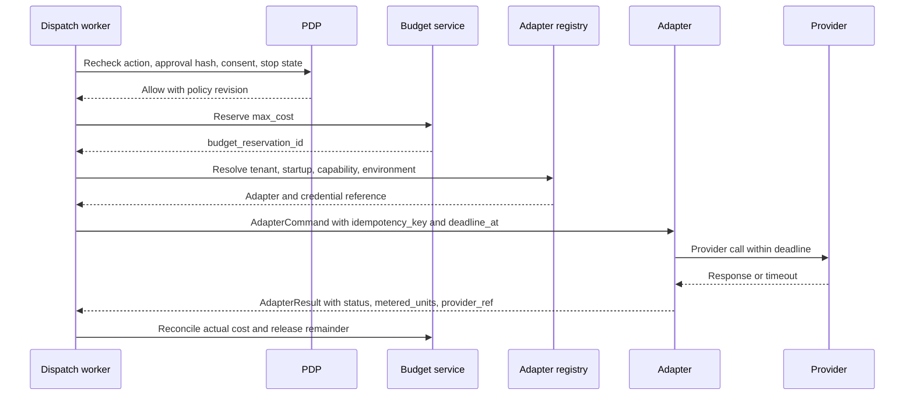
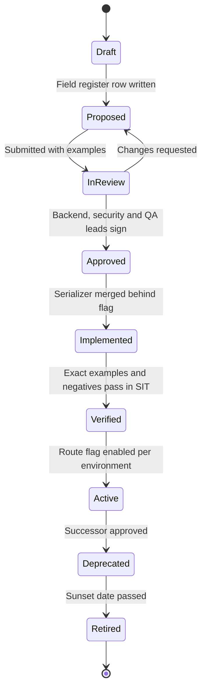

# AI Growth Engine: Employee Sales & Marketing Automation
## Application Blueprint: PART 3 (Batch 3.5b), Source Pack API Catalog Reconciliation: Enhancements, Field Contracts, Adapters, Conflicts and Tests

| Field | Value |
|---|---|
| Document | Part 3, Batch 3.5 (file b of 2): enhancements derived from document 07 "REST API & External Integration Catalog" |
| Version | 1.0 · 27 Nov 2026 |
| Baseline | BRD, FRD, Parts 0, 0A (DEC-001…065), 1, 2.1–2.5, 3.1, 3.2, 3.3, 4.1, 4.2, 6.x; file a of this batch (`Part-03-5a_Source_Pack_API_Catalog_Reconciliation.md`, §3.5.1–§3.5.4) |
| Roles applied | API Architect (lead), Integration Architect, Principal Engineer, Security Reviewer; QA Lead, FinOps Lead and Data Architect as reviewers |
| What this file adds | 24 operations (API-ENH-D-001…024) · normalized field contracts for 247 source operations · 38 contract decisions (SRC07-DEC-001…038) · 19 candidate contracts · AdapterCommand/AdapterResult envelope · 3 adapters (AD-D01…D03) · 74-entry provider register · 4 error codes · website ingress allowlist (80 operations) · contract-approval lifecycle and evidence record · 20 FR-ENH-D requirements · 16 stories with Gherkin · 367 test cases |
| Normative status | All additions are **proposals** for the coordinator to bind (as source document 07 itself states: "candidate contracts are not production-approved"). Nothing here changes Parts 3.1–3.3 silently; deltas are tagged |

**Acronyms.** As in file a, plus: CAS compare-and-swap · DPDP Digital Personal Data Protection Act 2023 (India) · HMAC hash-based message authentication code · MX mail exchanger (DNS record) · OAS OpenAPI Specification · SMTP Simple Mail Transfer Protocol.

---

## 3.5.5 Enhancements

### 3.5.5.1 Contract conventions: translating source DTOs into Part 3.2 standards (adds to Part 3.2 §3.2.1)

Document 07 writes its proposals in a compact DTO style (`idempotency_key` and `expected_revision` in the body, `page_size`, `items`/`next_cursor`, `job_id` with `queued|held|pending|simulated`). Part 3.2 §3.2.1 already fixes headers, envelopes and run resources. The table below is the **binding translation** used for every row of §3.5.5.3 (CONFLICT-361…363 give the reasons).

| Source convention | Normative Part 3.2/3.5 form | Rule | Tag |
|---|---|---|---|
| Body field `idempotency_key: string` | `Idempotency-Key` header; body field rejected (`additionalProperties: false`) | Key scoped to tenant, startup, operation and actor; same key + different body → 409 `IDEMPOTENCY_KEY_REUSED` (§3.2.1.5). Mandatory on **every** state-changing POST, also where the source DTO omitted it (129 of 165 explicit DTOs) | CONFLICT-361 |
| Body field `expected_revision: integer` | `If-Match: "r<revision>"` header | Stale → 409 `STALE_REVISION` with `current_revision` (§3.2.1.8) | CONFLICT-361 |
| Query `page_size` (1–100) and `cursor` | `limit` (1–100, default 25) and `cursor` | Cursor signed and bound to filter hash and scope token; mismatch → 400 `CURSOR_MISMATCH` | CONFLICT-362 |
| List result `items[]`, `next_cursor`, `as_of` | `{ "data": [...], "page": { "next_cursor", "prev_cursor", "limit" }, "meta": { "as_of", "total_estimate", "total_exact" } }` | Same envelope on every list in every namespace | CONFLICT-362 |
| Async result `job_id`, `state ∈ {queued, held, pending, simulated}` | `202` + `Location` + `{ "run_id", "status_url", "state", "simulated" }` | States per table *Run-state mapping* below | CONFLICT-363 |
| Mutation result `id`, `state`, `revision` | Resource representation (at least `id`, `state`, `revision`, `scope`) + `ETag: "r<revision>"` | `revision` is always present (source marked it "optional/review") | — |
| `approval_id: uuid` in body | Kept; server validates that the Approval is `approved`, unexpired, for the same object, revision and `content_hash` (CA-APPROVE) | Mismatch → 409 `APPROVAL_VOIDED` / `APPROVAL_EXPIRED`; missing → 403 `APPROVAL_REQUIRED` | — |
| `amount: string`, `currency: string` pairs | `Money { "amount": "<decimal string>", "currency": "<ISO 4217>" }` | Server recomputes totals; never float (FR-DM-01) | — |
| `action: string [a|b|c]` on `/control` routes | One action sub-resource per verb (`POST …/{id}/approve`, `…/suspend`) as in Part 3.2 | Keeps one permission, one SE class and one rate class per route (ADR-022); the source enum is preserved as the set of sub-resources | — |
| Error body "code, safe message and request_id" | RFC 9457 problem document with `code`, `detail`, `request_id`, `correlation_id`, `rule_ids`, `errors[]`, `retryable` | Superset; no stack traces | — |
| "Proposed status 200/201/202" | Part 3.2 §3.2.1.10 SE-class rule; 24 differences resolved in file a §3.5.4.7 | — | CONFLICT-370 |

**Candidate field notation (document 07 "Candidate field notation") → OpenAPI 3.1 schema** [ASSUMPTION-362, -363]

| Token | Source meaning | OpenAPI schema adopted | Default bounds (verify in review) |
|---|---|---|---|
| `u` | UUID | `type: string, format: uuid` (UUIDv7 server-generated) | — |
| `s` | bounded string | `type: string, minLength: 1, maxLength: 255` | `reason`, `message`, `description` maxLength 2,000; `name`/`title` 200 |
| `i` | non-negative integer | `type: integer, minimum: 0` | `revision` minimum 1 |
| `b` | Boolean | `type: boolean` | — |
| `m` | non-negative decimal string | `type: string, pattern: ^\d{1,15}(\.\d{1,4})?$` inside `Money` | Scale 2 for INR; currency minor units per ISO 4217 |
| `c` | ISO currency | `type: string, pattern: ^[A-Z]{3}$` from reference list (CFG-32) | — |
| `cc` | country code | `type: string, pattern: ^[A-Z]{2}$` (ISO 3166-1 alpha-2) | — |
| `t` | UTC ISO date-time | `type: string, format: date-time` ending `Z` | — |
| `h` | 64-char lowercase SHA-256 | `type: string, pattern: ^[a-f0-9]{64}$` | — |
| `k` | idempotency/event key | Header `Idempotency-Key` (`^[A-Za-z0-9_-]{22,128}$`) or provider event ID (≤ 255) | — |
| `url` | HTTPS URL | `type: string, format: uri, pattern: ^https://` | ≤ 2,048 |
| `p` | page size 1–100 | `limit: integer 1–100, default 25` | — |
| `pct` | 0–100 | `type: string` decimal `0.00–100.00` (not float) | — |
| `ids` | unique UUID list | `type: array, items: uuid, uniqueItems: true, maxItems: 1,000` | — |
| `ss` | string list | `type: array, items: s, maxItems: 100` | — |
| `items` | scoped id/state/reason records | `array` of `{ id: u, state: s, reason: s? }` | — |
| `slots` | start/end timestamps | `array` of `{ start_at: t, end_at: t }`, `end_at > start_at` | ≤ 200 slots |
| `lines` | id, description, quantity, unit price, line total | `array` of `{ id, description, quantity: Quantity, unit_price: Money, line_total: Money }`; totals server-computed | ≤ 200 lines |
| `fields` | name/label/required/type | `array` of `{ name, label_key, required: b, type ∈ allowlisted field types (CFG-12) }` | ≤ 50 |
| `contact` | name and eligible email or phone | `{ name: s, email?: email, phone?: E.164 }` with at least one channel | — |
| `map` | policy-specific typed object (still to approve) | `type: object` with a named JSON Schema per policy family (`$ref: #/components/schemas/<Family>PolicyV<n>`), never free-form | ASSUMPTION-365 |
| `?` / `-` | optional / no response body | not in `required` / `204 No Content` | — |

**Run-state mapping** (CONFLICT-363)

| Source state | Part 3.2 run state (§3.2.1.11; DEC-050) | Notes |
|---|---|---|
| `queued` | `queued` | Accepted and durable |
| `pending` | `queued` | Same meaning; not retained as a separate state |
| `held` | `waiting` with `wait_reason ∈ {approval, policy_hold, quiet_hours, budget, conflict_hold, scan_pending}` | Exposes *why* it is held (FR-UIS-03) |
| `simulated` | Any state + `"simulated": true` | Simulated runs never appear in live lists unless `include_simulated=true` (BRL-AUT-04) |

**Error profiles** used in §3.5.5.3 (codes from Part 3.2 §3.2.1.9; new codes marked ★)

| Profile | Applies to | Error codes (HTTP) |
|---|---|---|
| E-R | Reads (SE R) | `VALIDATION_FAILED`, `FILTER_NOT_ALLOWED`, `FILTER_OUT_OF_SCOPE`, `CURSOR_MISMATCH` (400) · `AUTHENTICATION_REQUIRED`, `SESSION_EXPIRED`, `WRONG_AUDIENCE` (401) · `FORBIDDEN` (403) · `NOT_FOUND` (404, uniform) · `RATE_LIMITED` (429) |
| E-W | Internal writes (SE W) | E-R + `IDEMPOTENCY_KEY_REQUIRED` (400) · `PORTFOLIO_READ_ONLY` (403) · `STALE_REVISION`, `SCOPE_CHANGED`, `IDEMPOTENCY_KEY_REUSED`, `REQUEST_IN_PROGRESS`, `IMMUTABLE_RECORD` (409) · `PAYLOAD_TOO_LARGE` (413) |
| E-Q | Queued internal work (SE Q) | E-W + `ENTITLEMENT_EXCEEDED` (403) · `BUDGET_EXHAUSTED`, `QUOTA_EXHAUSTED` (429) |
| E-X | External effect (SE X) | E-Q + `POLICY_DENIED`, `APPROVAL_REQUIRED`, `AUTONOMY_CAP`, `EMERGENCY_STOP_ACTIVE` (403) · `OUTCOME_UNCERTAIN`, `APPROVAL_EXPIRED`, `APPROVAL_VOIDED` (409) · `PROVIDER_UNAVAILABLE` (503) |
| E-A | Approvals/decisions (SE A) | E-W + `STEP_UP_REQUIRED` (401) · `SEPARATION_OF_DUTIES`, `APPROVAL_REQUIRED` (403) · `INVALID_TRANSITION`, `APPROVAL_EXPIRED`, `APPROVAL_VOIDED` (409) |
| E-F | Financial/consent/evidence ledgers (SE F) | E-W + `SEPARATION_OF_DUTIES` (403, maker = checker) · `DUPLICATE` (409) |
| E-I | Public intake and inbound (SE I) | `VALIDATION_FAILED` (400) · `UNKNOWN_HOST` (404) · `PAYLOAD_TOO_LARGE` (413) · `RATE_LIMITED` (429, challenge after threshold) · duplicate → 202 with the **same** reference (no error) |
| E-H | Provider webhooks | `WEBHOOK_SIGNATURE_INVALID`★, `WEBHOOK_REPLAY_REJECTED`★ (401) · duplicate → 200 no effect · `PAYLOAD_TOO_LARGE` (413) · `RATE_LIMITED` (429 only above RL-HOOK ceiling) |
| E-S | BFF/session | `AUTHENTICATION_REQUIRED`, `SESSION_EXPIRED`, `WRONG_AUDIENCE`, `STEP_UP_REQUIRED` (401) · `RATE_LIMITED` (429) |

**New error codes** [RECOMMENDATION-370] (add to the Part 3.2 §3.2.1.9 catalogue; all keep the problem+json shape)

| Code | HTTP | When | Source basis | Typical rule IDs |
|---|---|---|---|---|
| `CHECKSUM_MISMATCH` | 409 | Completed upload's SHA-256 differs from the declared `sha256`; object stays quarantined | SM-OP-297 "invalid checksum remains quarantined" | NFR-021 |
| `SCAN_PENDING` | 409 | Document used before the malware verdict (download, attach, index) | SM-OP-296/297; AD-20 | NFR-021, BRL-PUB-04 |
| `WEBHOOK_SIGNATURE_INVALID` | 401 | Provider signature over the raw body fails, or the connection is unknown (no detail returned) | 8 provider-callback operations | NFR-005 |
| `WEBHOOK_REPLAY_REJECTED` | 401 | Signed timestamp outside ± 5 min where the provider signs time | Document 07 "stale timestamp" test | §3.2.1.13 step 3 |

### 3.5.5.2 New operations (adds to Part 3.2 §3.2.2.4)

Columns as in Part 3.2 §3.2.2.2. IDs `API-ENH-D-###` keep this batch from colliding with other source-pack groups; the coordinator may renumber them into `API-556+` when binding.

<<FRAG:enh_ops.md>>

**Operation detail** (request fields use §3.5.5.1 notation; all mutating routes also take the headers of the *Idempotent* column)

| Op ID | Request | Response | Business rules | Specific errors | Event emitted (§3.2.3) |
|---|---|---|---|---|---|
| API-ENH-D-001 | `licence_ref: s`, `allowed_purpose: ss`, `allowed_scope: map(SourceScopeV1)`, `expires_at: t?`, `reason: s` | 200 SourcePolicy `{id, revision, state: "pending_approval"}` | New revision voids the current approval; collection continues on the **previous approved** revision until the new one is approved; loosening needs R10 + R02 (BR-M07) | `INVALID_TRANSITION` (expired source) | `source.policy_revised` |
| API-ENH-D-002 | query `task_key?`, `dataset_revision?`, `label_source?`, `limit`, `cursor` | 200 list of `{id, task_key, dataset_revision, input_digest, expected_label, provenance, tags, created_at}`; inputs shown redacted | Restricted inputs masked (NFR-078); cases from production feedback only after API-151 acceptance | — | — |
| API-ENH-D-003 | `code: s ^[a-z0-9_]{3,40}$`, `label_key: s`, `vertical: s?`, `evidence_rule: map(SignalEvidenceV1)`, `reason: s` | 201 `{id, revision, state: "draft"}` | Approval type `signal_taxonomy` (R02); active classifiers keep the pinned taxonomy revision; new codes start with weight 0 until the scoring version references them (DEC-011) | `DUPLICATE` (code exists) | `config.signal_taxonomy_revised` |
| API-ENH-D-004 | `rules: array of {title_pattern: s, seniority?: s, role_hypothesis: s, confidence: pct}`, `vertical: s?`, `reason: s` | 201 `{id, revision, state}` | Patterns are anchored, case-insensitive literals or simple wildcards (no user regex: ReDoS guard); applies to new contacts and on explicit re-run | `VALIDATION_FAILED` (pattern) | `config.role_mapping_revised` |
| API-ENH-D-005 | none | 200 `{id, read_at}` | Only the recipient; idempotent by method | `NOT_FOUND` (other user's alert) | — |
| API-ENH-D-006 | `reason: s`, `resume_mode ∈ {all, selected}`, `run_ids: ids?` | 202 `{run_id, status_url, state, resumed_count, held_count}` | PDP recheck per run: budget, consent, approval hash, autonomy cap, emergency stop; runs failing the check stay `waiting` with the rule ID (BRL-AUT-05) | `EMERGENCY_STOP_ACTIVE`, `AUTONOMY_CAP` | `workflow.resumed` |
| API-ENH-D-007 | none | 200 `{id, channel, thread_id, delivery_state, outcome_certainty, provider_ref_masked, events: items, last_event_at}` | Body and recipient masked per §2.26.5 | — | — |
| API-ENH-D-008 | `limit`, `cursor` | 200 list `{id, waba_ref_masked, phone_number_masked, quality_rating, messaging_tier, templates_approved, templates_pending, webhook_health}` | Never returns access tokens (NFR-004) | — | — |
| API-ENH-D-009 | `enabled: b`, `languages: ss`, `handover_hours: map(HoursV1)`, `transcript_retention_days: i`, `daily_ai_budget: Money`, `greeting_key: s` | 200 `{revision, state}` + ETag | Retention ≤ policy maximum (DEC-028); budget ≤ startup AI cap (DEC-008); loosening (longer retention, higher budget) → approval R01 + R10 | `POLICY_DENIED` (retention above max) | `config.chat_settings_revised` |
| API-ENH-D-010 | `stage_probabilities: map(StageProbV1)`, `horizon_days: i`, `seasonality: b`, `reason: s` | 201 `{id, revision, state: "draft"}` | Backtest (API-407) required before approval type `forecast_model`; forecasts always labelled estimates (BR-M60) | `INVALID_TRANSITION` | `config.forecast_model_revised` |
| API-ENH-D-011 | query `type ∈ {insurance, partner, institutional}`, `stage?`, `limit`, `cursor` | 200 list `{id, type, organization, stage, approvals, data_agreement_state, next_review_at}` | Organization-level only: no patient or individual data (MedMaarg boundary) | — | — |
| API-ENH-D-012 | `reason: s` | 200 `{id, state: "disabled", revision}` | Atomic: mapping removed, CDN/tenant-keyed cache purged, host → 404 `UNKNOWN_HOST`; published snapshots retained for re-enable | `INVALID_TRANSITION` | `site.domain_disabled` |
| API-ENH-D-013 | `action ∈ {record, verify}`, `amount: Money`, `received_at: t`, `evidence_ref: u`, `payment_ref: s` | 201 `{receipt_id, state ∈ {recorded, verified}, ledger_entry_id?}` | Maker records, a **different** checker verifies; ledger entry only on verify; no double allocation (BRL-FIN-02) | `SEPARATION_OF_DUTIES`, `DUPLICATE` | `billing.service_receipt_verified` |
| API-ENH-D-014 | query `period?`, `dimension?`, `tenant?` (platform roles), `limit`, `cursor` | 200 list `{id, period, dimension, quantity, rate_version, amount: Money, adjustments: items}` | Own tenant only for R12; platform R01 sees all (DEC-047) | — | — |
| API-ENH-D-015 | `amount: Money`, `reason: s`, `approval_id: u?` | 201 `{credit_id, state}` | Append-only; credit ≤ original charge; above the plan threshold needs R01 approval | `APPROVAL_REQUIRED`, `DUPLICATE` | `billing.usage_credit_appended` |
| API-ENH-D-016 | `decision ∈ {accept, dispute}`, `lines: items(id, accepted_quantity: Quantity, reason?)`, `evidence_ids: ids` | 201 `{acceptance_id, order_state}` | Buy direction only; acceptance cannot exceed received quantity (FR-DM-03); dispute opens a discrepancy task; payable ledger only after acceptance (CA-FIN) | `OVER_DELIVERY`, `INVALID_TRANSITION` | `order.acceptance_recorded` |
| API-ENH-D-017 | `reason: s` | 200 `{grant_id, state: "revoked", revoked_at}` | Effective ≤ 60 s for active portal sessions (NFR-050 pattern); audit retained | `INVALID_TRANSITION` | `portal.grant_revoked` |
| API-ENH-D-018 | `sha256: h` (repeated for verification) | 202 `{run_id, state: "waiting", wait_reason: "scan_pending"}` | Server hashes the stored object; mismatch → stays quarantined; only the uploader's grant may complete | `CHECKSUM_MISMATCH` | `document.upload_completed` |
| API-ENH-D-019 | none | 200 `{application_ref, revision, configuration, validation: items, status}` | Applicant identity must match the verified administrator; no tenant data exists yet (pre-provision) | `NOT_FOUND` (expired reference) | — |
| API-ENH-D-020 | `export_requested: b`, `effective_after: t?`, `reason: s` | 202 `{case_id, state: "requested"}` | Creates a WF-14 case for platform R01/R12; no data deletion until approval and the retention rules (DEC-028) | `INVALID_TRANSITION` (already offboarding) | `saas.offboarding_requested` |
| API-ENH-D-021 | `name: s`, `capability: s`, `graph: map(WorkflowGraphV1)`, `input_schema: map`, `output_schema: map` | 201 `{id, revision, state: "draft"}` | Only node types from API-478; ≤ 50 nodes, no cycles except bounded waits, no code nodes (DEC-051) | `VALIDATION_FAILED` (graph) | `workflow.template_created` |
| API-ENH-D-022 | `reason: s`, `notify: b` | 202 `{grant_id, invite_state: "reissued"}` | Previous invite secret invalid immediately; new secret delivered through the outbox; recipient identity binding unchanged | `INVALID_TRANSITION` (revoked grant) | `portal.grant_rotated` |
| API-ENH-D-023 | query `counterparty?`, `object_type?`, `state?`, `limit`, `cursor` | 200 list `{id, counterparty, object_type, object_id, actions, state, expires_at}` | Scope-limited; recipient identity shown masked | — | — |
| API-ENH-D-024 | `type ∈ {access, correction, deletion, restriction, export}`, `channel_received ∈ {email, phone, letter, in_person}`, `subject_contact_ref: u?`, `request: s` | 202 `{id, state: "identity_verification_pending", due_at}` | Due date per jurisdiction pack (NFR-075); no disclosure before verification (API-085) | — | `privacy.request_recorded` |

### 3.5.5.3 Field contract register: 247 source operations with a proposed DTO or list contract

**How to read.** One row per source operation whose document 07 maturity is *explicit DTO* (164), *public allowlist* (1) or *cursor list* (82). *Request* lists body fields after translation (§3.5.5.1): `name:type∈{enum}`; `?` = optional; `decimal-str` = Money amount; `ISO-4217` = currency. *Headers* are the mandatory request headers from Part 3.2 §3.2.1.4. *Status* for split operations lists each target (`366:200` = API-366 returns 200). *Errors* = profile from §3.5.5.1 plus operation-specific codes. These DTOs are the **starting schemas for drf-spectacular serializers** [RECOMMENDATION-361]; each still passes the approval workflow of §3.5.5.9 before its route is enabled.

<<FRAG:fields.md>>

### 3.5.5.4 Contract decisions for the 38 review-required operations (SRC07-DEC-001…038)

Document 07 numbers these decisions DEC-001…038, which collide with the binding blueprint decisions DEC-001…065 (Part 0A). They are renamed **SRC07-DEC-###** here and everywhere else (CONFLICT-364). The first five reuse identity (resolved to the BFF of DEC-019 [ASSUMPTION-361]); eight are provider callbacks or challenges (resolved to the Part 3.2 webhook model); 25 are reads whose response allowlists are proposed below.

<<FRAG:decs.md>>

### 3.5.5.5 Candidate operations SM-UX-API-01…19: normalized contracts and reuse-first decisions

<<FRAG:cands.md>>

**Reuse-first decisions** (document 07 "Reuse-first comparison for candidate operations" vs Part 3.2)

<<REUSE_TABLE>>

**Applicant draft boundary (confirmed and made testable).** Before tenant provisioning, the applicant holds only an opaque, expiring application reference (API-503…507) whose draft JSON and revision live in isolated intake storage (ENT ApplicationDraft, Part 3.3). API-ENH-D-019 and API-509/511 operate on that draft only; no applicant call can create or mutate a startup, tenant, membership, provider connection or budget. Provisioning (API-027/030) runs only after the `client_application` approval by platform R01/R12 and is an idempotent saga keyed by `application_ref` (Part 3.2 §3.2.2.3). Tests TC-ENH-D-C02…C05 and TC-ENH-D-E019 assert that every applicant route returns 404 for another applicant's reference and that no `ten_*` row is written before approval.

### 3.5.5.6 Adapter contract enhancements (adds to Part 3.2 §3.2.4)

#### 3.5.5.6.1 AdapterCommand and AdapterResult envelope [RECOMMENDATION-363]

Part 3.1 defines `AdapterResult(status, provider_ref, normalized, cost, failure_class)`. Document 07 requires a richer **request context** and **response**. The envelope below is mandatory for every port (FR-ENH-D-006).

| Envelope | Field | Type | Source requirement | Purpose |
|---|---|---|---|---|
| AdapterCommand | `product` | s (`growth-engine`) | "Request context includes product" | Guards against cross-product credential use (NFR-031) |
| AdapterCommand | `tenant_id`, `startup_id` | u | "tenant, startup" | Registry resolution and RLS scope |
| AdapterCommand | `action` | `{type, object_type, object_id, approval_id?, content_hash?}` | "approved action" | Dispatch-time PDP recheck binds to the approved hash |
| AdapterCommand | `idempotency_key`, `correlation_id` | k, u | "idempotency/correlation key" | Provider-side idempotency (§3.2.1.5) and tracing (NFR-079) |
| AdapterCommand | `deadline_at` | t | "deadline" | Adapter must not start a call it cannot finish; timeout → `transient` before submission, `uncertain` after |
| AdapterCommand | `budget_reservation_id`, `max_cost` | u, Money | "budget reservation" | No paid call without reservation (NFR-014) |
| AdapterCommand | `environment`, `simulated` | s, b | ABAC-12; NFR-038 | Simulation uses fake/sandbox adapter only |
| AdapterCommand | `payload` | port-specific DTO | Validated adapter command | Minimized per §3.2.4.4 |
| AdapterResult | `status` | `confirmed · failed · uncertain · skipped` | "provider status" | Run state |
| AdapterResult | `normalized`, `evidence_refs` | port DTO, ids | "normalized data/evidence" | Evidence for research and audit |
| AdapterResult | `provider_ref` | s (masked in logs) | "external reference" | Reconciliation key |
| AdapterResult | `metered_units` | `[{unit, quantity}]` (credits, tokens, messages, pages) | "metered units" | Usage ledger and B-budget reconciliation (NFR-035, NFR-093) |
| AdapterResult | `cost` | Money (estimate or actual) + `cost_basis ∈ {estimate, invoice}` | Part 3.1 | FinOps |
| AdapterResult | `failure_class`, `safe_error_code` | enum, s | "safe error code" | Never the raw provider message to users |
| AdapterResult | `latency_ms`, `provider_status_code` | i | OPT-09-03 | Circuit breaker and SLO |



#### 3.5.5.6.2 Source adapters → Part 3.2 adapters

<<ADAPTER_TABLE>>

#### 3.5.5.6.3 New adapters AD-D01…AD-D03 (part A and part B format of Part 3.2)

| AD | Provider (port) | Purpose | Protocol / API | Authentication | Quotas and limits (verify, as of 27 Nov 2026) | Wave | Budget ID |
|---|---|---|---|---|---|---|---|
| AD-D01 | **Amazon S3 + in-process document parser** (`ObjectStoragePort`, `DocumentExtractionPort`) | Presigned quarantine upload, scanned promotion, short-lived download; text extraction of approved PDFs/DOCX for knowledge (SM-OP-016) | AWS SDK; parser libraries in the worker (e.g. pypdf, python-docx; licences verify) | IAM task role; bucket policies per product | S3 request and storage pricing per region (verify); parser CPU within B01 | W0 | B01 |
| AD-D02 | **Contact verification provider** (`ContactVerificationPort`), e.g. Hunter Email Verifier (source SM-OP-080), OFF by default | Verify deliverability of a business email (syntax, MX, mailbox check) before first outreach | REST JSON | API key in Secrets Manager | Free tier and credits per provider (source: Hunter 50 credits/month, checked 2026-11-24; verify) | W1 pilot only if approved | B18 (₹0 until approved) |
| AD-D03 | **Owned-site technical audit** (`SiteAuditPort`), self-hosted crawler + Lighthouse (open source) | Crawl the startup's own published site: broken links, metadata, Core Web Vitals lab data, accessibility hints (SM-OP-160) | Internal worker; headless browser | Private network; only verified own domains | Self-host capacity; ₹0 licence (verify licences) | W3 | B01 (B17 if a paid SEO data source is added) |

| AD | Failure classification | Idempotency approach | Sandbox | Data classification sent | Fallback |
|---|---|---|---|---|---|
| AD-D01 | S3 5xx/throttle → transient; access denied → auth; parser error/encrypted PDF → permanent (document marked `extraction_failed`) | Object key = document ID + version; content SHA-256 | LocalStack / test bucket | Confidential/Restricted files stay in the product's AWS account | Manual text entry by R02/R10; document not indexed until extracted |
| AD-D02 | 5xx → transient; 429 → rate_limited; credits exhausted → permanent for period; "unknown" result → uncertain (treated as unverified) | Read-only; cache result per email hash 30 days | Provider test keys (verify) | **Restricted** (email address) → minimized, provenance recorded, consent not implied | Manual verification task (A025); contact stays `unverified` and ineligible for automated outreach |
| AD-D03 | Crawl timeout → transient; robots disallow → permanent; host not verified → permanent (security event) | Crawl ID per site revision | Staging sites | Public (own published pages) | Manual audit checklist; Search Console data (AD-17) only |

#### 3.5.5.6.4 Provider and tool register (74 names found in the per-operation Integration columns)

Classes: **Runtime provider** (called by the product at run time through a port), **OSS library** (linked into the build), **Developer plugin** (Claude Code skills/plugins used by engineers; document 07: "developer plugins are not runtime entitlements"), **Unapproved SaaS** (commercial service with "₹0 committed; use only after approved procurement"). All licence, quota and price values are the source's statements and are **to verify at time of implementation (as of 27 Nov 2026)**.

<<PROVIDER_SUMMARY>>

<<FRAG:providers.md>>

**Budget-allocation conflicts (CONFLICT-368).** Document 07 allocates several providers to "B07/B10 shared optional" while DEC-020 (binding) assigns dedicated reserved budgets at ₹0 until approved: e-signature (PandaDoc in the source) → **B13**; calendar/meeting APIs → **B15**; webinar (Zoom) → **B10** (consistent); contact verification (Hunter/Clay) → **B18**; LLM observability (Langfuse) → **B22**; social platform APIs (Postiz uses them) → **B16**. Resolution: DEC-020 governs; the source allocation is superseded and recorded only for traceability.

### 3.5.5.7 Website ingress allowlist generated from the catalogue [RECOMMENDATION-366]

Document 07: "Any route not explicitly admitted to the website is denied by default … the website ingress allowlist is defined by the per-operation access boundary, not URL prefix alone." The allowlist below is generated from the Part 3.2 *NS* column plus the enhancement operations and becomes the `urls_web` route map; CT-07 fails if the deployed map differs (FR-ENH-D-018).

<<ALLOWLIST_TABLE>>

### 3.5.5.8 Provider callbacks: per-operation reliability contract

| Source op (SRC07-DEC) | Part 3.2 op | Provider and signature (verify scheme at implementation) | Dedupe key | Acknowledge | Replay window | Effect after persist | Reconciliation |
|---|---|---|---|---|---|---|---|
| SM-OP-109 (-018) `POST /api/v1/webhooks/email` | API-239 | Amazon SES via SNS: SNS message signature (certificate URL host pinned to `sns.<region>.amazonaws.com`); subscription confirmation handled once | (connection, SNS `MessageId`) | 200 ≤ NFR-051 | SNS timestamp ± 5 min | Delivery/bounce/complaint → suppression (BR-M24) | Daily SES suppression list sync (IP-05) |
| SM-OP-112 (-020) `POST /api/v1/webhooks/inbound` | API-240 | Inbound email (SES receipt via SNS) or chat relay; signature per source | (connection, provider message ID) | 200 | ± 5 min | Inbound event → classification job (AI Tier 1a) | Thread re-link by headers |
| SM-OP-124 (-022) `POST /api/v1/webhooks/calendar` | API-244 | Google channel token + resource ID; Microsoft Graph `clientState` + validation token | (channel ID, resource state, message number) | 200 | Channel expiry | Re-fetch changed events (push carries no body) | Watch renewal job; full sync daily |
| SM-OP-133 (-023) `GET /api/v1/webhooks/whatsapp` | API-249 | Meta verification: `hub.mode=subscribe`, `hub.verify_token` constant-time compare | — | 200 with `hub.challenge` only | — | None | — |
| SM-OP-134 (-024) `POST /api/v1/webhooks/whatsapp` | API-245 | `X-Hub-Signature-256` HMAC-SHA256 with app secret over raw body | (WABA, message/status ID, status) | 200 | Event-ID dedupe (no signed timestamp) | Status → message state; inbound → thread; 24-h window start | Status poll for `uncertain` sends |
| SM-OP-179 (-028) `POST /api/v1/webhooks/events` | API-297 | Webinar provider (Zoom candidate): signed header with timestamp (verify) + URL validation challenge | (account, event ID) | 200 | ± 5 min | Registration/attendance update | Attendance CSV import fallback (A103) |
| SM-OP-199 (-031) `POST /api/v1/webhooks/esign` | API-333 | E-sign provider HMAC or certificate (DEC-023 shortlist; PandaDoc only if selected) | (provider envelope ID, event) | 200 | Provider-specific | Signature status; signed PDF fetched and hashed | Query by envelope before retry |
| SM-OP-204 (-033) `POST /api/v1/webhooks/payment` | API-385 | Payment gateway HMAC (e.g. Razorpay `X-Razorpay-Signature`, verify) | (merchant account, payment/event ID) | 200 | Provider-specific | Payment record **unverified** until amount, currency and invoice match; ledger only after maker-checker (DEC-022) | Settlement report daily |

### 3.5.5.9 Contract lifecycle, evidence and approval gates (adds to Part 3.2 §3.2.5 and Part 8.2)

#### 3.5.5.9.1 Operation contract state machine [RECOMMENDATION-364]



| Rule | Specification |
|---|---|
| L-01 | Every operation (API-###, API-ENH-D-###) has an OpenAPI `x-contract-state`; CI blocks a merge that mounts a route whose state is below `Implemented`; production deploy blocks a route below `Verified` (FR-ENH-D-001) |
| L-02 | `Approved` requires three named reviewers: backend lead (shape, state machine), security reviewer (authorization, field minimization, error leakage), QA lead (examples and negatives). Self-review is not allowed (separation of duties) |
| L-03 | Approval binds to the SHA-256 of the operation's canonical OpenAPI fragment; any change returns it to `Proposed` |
| L-04 | Route flags are per environment and default OFF in production (Part 3.1 feature flags); enabling writes an audit event |
| L-05 | Deprecation follows Part 3.2 §3.2.1.3 (headers, ≥ 6 months public/portal) |
| L-06 | The 38 SRC07-DEC items and any `map` type remain `Proposed` until their decision is bound by the coordinator |

#### 3.5.5.9.2 Contract evidence record (document 07 "Acceptance and evidence record")

| Field | Type | Required | Content |
|---|---|---|---|
| `operation_id` | s | Yes | API-### or API-ENH-D-### (plus `x-source-op`) |
| `contract_hash` | h | Yes | Hash approved under L-03 |
| `responsible`, `reviewer` | user refs | Yes | Implementing owner; independent reviewer (≠ responsible) |
| `artifact` | `{commit, image_digest, environment}` | Yes | Build that was tested |
| `scenarios` | `[{test_id, result ∈ pending/pass/fail/na, evidence_uri}]` | Yes | TC-ENH-D rows of §3.5.5.12; `na` needs reason |
| `decision` | `pending · pass · fail · approved_na` | Yes | Missing evidence = `pending` (never inferred) |
| `remediation` | `[{defect_id, owner, action, retest_test_id}]` | If fail | — |
| `business_acceptance` | `{by, at, scope}` | For consequential operations (SE X, A, F) | Product owner or delegate |

Stored as an append-only `ContractEvidence` record (new logical entity proposed to the document 08 group; no physical table asserted here [ASSUMPTION-366]); surfaced on A090 release readiness.

#### 3.5.5.9.3 Outstanding approval gates (document 07) and their owners

| Gate (source count) | Meaning | Owner | Blocks | Status after this batch |
|---|---|---|---|---|
| Exact API definitions outstanding: 38 | SRC07-DEC-001…038 | API architect + product owner | Routes of those operations (L-06) | Proposals written (§3.5.5.4); binding pending |
| Partial API proposals: 0 | — | — | — | Closed |
| Database reuse/field confirmations: 4 | Not identified in document 07 | Data architect | Operations writing the affected tables | **GAP-365**: document 08 group to identify; until then the four are unknown and no table is assumed |
| UI semantic mapping approvals pending: 138 | Retained UI IDs vs current 147 | UX lead | Screen-to-operation traces | Part 3.2 traces 147/147 screens; approval record still needed |

#### 3.5.5.9.4 Catalogue integrity gate [RECOMMENDATION-367]

A CI job (`catalog-integrity`) runs on every PR and before every release (FR-ENH-D-003):

| # | Check | Pass condition |
|---|---|---|
| CI-1 | operationId uniqueness | Every OpenAPI operation has a unique `operationId` = API-### or API-ENH-D-### |
| CI-2 | Source coverage | `x-source-op` values cover SM-OP-001…302 and SM-UX-API-01…19 exactly as `D_api_mapping.csv` (321/321) |
| CI-3 | Adapter isolation | No AD/AD-D port appears in any URL map; 17 source adapters map only to AD IDs |
| CI-4 | Path parameters | Every `{param}` in a path is declared with a schema; no unresolved parameter |
| CI-5 | Ingress | `urls_web` route set = §3.5.5.7 allowlist; `urls_admin` contains no `public`/`portal` operation |
| CI-6 | Contract state | No mounted route below `Implemented`; no production route below `Verified` |
| CI-7 | Test linkage | Every Active operation has ≥ 1 passing TC-ENH-D row and the negative families of its SE class |
| CI-8 | Counts report | Prints HTTP, adapter, candidate, enhancement and blueprint-only counts; any change needs a reviewer |

### 3.5.5.10 Optimization controls of document 07 → NFRs and API-level evidence

<<OPT_TABLE>>

**Per-operation performance budgets** [RECOMMENDATION-371] (document 07: "Profile operation-level latency, payload bytes and query count"). Every list operation declares in OpenAPI `x-perf: {p95_ms, max_payload_kb, max_queries}`; defaults: R reads p95 ≤ 500 ms (NFR-039), payload ≤ 256 KB per page of 25, ≤ 8 SQL queries per request (no N+1); W/Q/X writes p95 ≤ 800 ms for the synchronous part (NFR-040). The API performance suite (Part 6.7 LT family) records the three numbers per operation on the realistic dataset; a regression > 20% or a query-count increase fails the build (FR-ENH-D-005).

### 3.5.5.11 Requirements and user stories

#### 3.5.5.11.1 Enhanced functional requirements

| FR ID | Requirement | Source | Epic | Wave | Priority | Tests |
|---|---|---|---|---|---|---|
| FR-ENH-D-001 | Each operation has a contract state (§3.5.5.9.1); a route is mounted only from `Implemented` and enabled in production only from `Verified`; approval needs backend, security and QA leads | Doc 07 "Activation", "Field-level contract approval" | EP-21 | W0 | Must | TC-ENH-D-N18, TC-ENH-D-N19 |
| FR-ENH-D-002 | An append-only contract evidence record (§3.5.5.9.2) is kept per operation and shown on A090; missing evidence is `pending` | Doc 07 "Acceptance and evidence record" | EP-21 | W0 | Must | TC-ENH-D-N20 |
| FR-ENH-D-003 | The catalogue-integrity gate CI-1…CI-8 runs on every PR and release | Doc 07 "Catalog integrity", "HTTP vs adapter classification" | EP-21 | W0 | Must | TC-ENH-D-N18 |
| FR-ENH-D-004 | An idempotent replay writes audit event `api.idempotent_replay` (key hash, operation, actor, original request ID); a conflicting reuse writes a security audit event | Doc 07 "Idempotency … audit effect and replay result" | EP-01 | W0 | Should | TC-ENH-D-N04 |
| FR-ENH-D-005 | Every list operation declares `x-perf` budgets; CI fails on > 20% p95 or payload regression or extra queries | Doc 07 optimization, OPT-02-03, OPT-02-06 | EP-21 | W1 | Should | TC-ENH-D-N21 |
| FR-ENH-D-006 | Every adapter accepts AdapterCommand and returns AdapterResult (§3.5.5.6.1), including `deadline_at`, `budget_reservation_id` and `metered_units` | Doc 07 "Adapter contract" | EP-01 | W0 | Must | TC-ENH-D-N09…N11, N14, N15 |
| FR-ENH-D-007 | External portal grants can be listed, revoked (≤ 60 s effect) and rotated; expiry is enforced by a scheduled job | SM-OP-293/294 | EP-19 | W2 | Must | TC-ENH-D-E017, E022, E023 |
| FR-ENH-D-008 | A portal upload is usable only after completion with a matching SHA-256 and a clean scan verdict | SM-OP-296/297 | EP-19 | W2 | Must | TC-ENH-D-E018 |
| FR-ENH-D-009 | SaaS service finance: usage-charge ledger read, approved credit adjustments (append-only) and service-receipt reconciliation with maker-checker | SM-OP-266…268 | EP-20 | W5 | Must | TC-ENH-D-E013…E015 |
| FR-ENH-D-010 | Intelligence configuration: source policy revision, signal taxonomy revision, role-mapping rule set, alert read | SM-OP-032, 065, 075, 084 | EP-05/EP-06 | W1 | Should | TC-ENH-D-E001, E003…E005 |
| FR-ENH-D-011 | Engagement operations: single-message delivery status, WABA account list, assistant settings with retention and budget limits | SM-OP-110, 130, 138 | EP-08/EP-10 | W2–W3 | Should | TC-ENH-D-E007…E009 |
| FR-ENH-D-012 | Automation: workflow-scope resume with PDP recheck; template creation from scratch with allowlisted nodes | SM-OP-101; SM-UX-API-18 | EP-18 | W2/W5 | Must | TC-ENH-D-E006, E021 |
| FR-ENH-D-013 | Lifecycle and desks: pilot list by type; Admin-side acceptance/dispute for buy orders | SM-OP-236, 286 | EP-16/EP-14 | W4 | Should | TC-ENH-D-E011, E016 |
| FR-ENH-D-014 | Governance and AI quality: staff-recorded offline privacy request; evaluation case list | SM-OP-041, 036 | EP-03/EP-04 | W0–W1 | Must | TC-ENH-D-E024, E002 |
| FR-ENH-D-015 | Brand-domain disable with atomic unmapping and cache purge | SM-OP-260 | EP-01/EP-19 | W2 | Should | TC-ENH-D-E012 |
| FR-ENH-D-016 | SaaS applicant and client: draft read; offboarding request | SM-UX-API-03, 07 | EP-20 | W5 | Should | TC-ENH-D-E019, E020 |
| FR-ENH-D-017 | Forecast assumption revisions gated by backtest and approval | SM-OP-230 | EP-17 | W5 | Could | TC-ENH-D-E010 |
| FR-ENH-D-018 | Website ingress route map equals the generated allowlist (§3.5.5.7); token routes are portal-classified | Doc 07 operating contract | EP-19 | W2 | Must | TC-ENH-D-N22 |
| FR-ENH-D-019 | Error codes `CHECKSUM_MISMATCH`, `SCAN_PENDING`, `WEBHOOK_SIGNATURE_INVALID`, `WEBHOOK_REPLAY_REJECTED` are added to the catalogue with message keys | §3.5.5.1 | EP-01 | W0 | Should | TC-ENH-D-N16, N17, E018 |
| FR-ENH-D-020 | OpenAPI carries `x-source-op`, `x-sit-id` and `x-contract-state` on every operation; adapters carry the same in the port registry | Doc 07 "Preserve source identities" | EP-21 | W0 | Should | TC-ENH-D-N18 |

#### 3.5.5.11.2 User stories with acceptance criteria

Stories follow Part 5 conventions (persona, roles R01–R20, traces, Gherkin). IDs follow the source-pack rule `US-<EP>-ED<nn>`.

| Story | Title | Persona / role | Traces | Points | Wave |
|---|---|---|---|---|---|
| US-21-ED01 | Contract approval gate and evidence record | P10 Automation lead (R11), QA lead, security reviewer | FR-ENH-D-001, -002; NFR-013, NFR-015 | 5–8 | W0 |
| US-21-ED02 | Catalogue integrity and source traceability | Principal engineer (R11) | FR-ENH-D-003, -020; GAP-103 | 3–5 | W0 |
| US-01-ED01 | Idempotent replay audit and new error codes | Platform engineer | FR-ENH-D-004, -019; NFR-015, NFR-073 | 2–3 | W0 |
| US-21-ED03 | Per-operation performance budgets | Performance engineer | FR-ENH-D-005; NFR-039, NFR-040 | 3–5 | W1 |
| US-01-ED02 | Adapter command/result envelope | Integration architect | FR-ENH-D-006; NFR-014, NFR-035 | 5 | W0 |
| US-19-ED01 | Manage external portal grants | P03 Growth manager (R03), R02 | FR-ENH-D-007; ABAC-09 | 3 | W2 |
| US-19-ED02 | Complete portal upload with checksum | P14 External customer (R16) | FR-ENH-D-008; NFR-021 | 2 | W2 |
| US-19-ED03 | Website ingress allowlist and domain disable | R12 tenant admin | FR-ENH-D-015, -018; NFR-001, NFR-020 | 3 | W2 |
| US-20-ED01 | Service finance completeness | R08 finance maker, R09 checker | FR-ENH-D-009; NFR-035 | 5 | W5 |
| US-20-ED02 | Applicant draft read and offboarding request | SaaS applicant, R17 | FR-ENH-D-016 | 2 | W5 |
| US-05-ED01 | Intelligence configuration revisions | R04 research analyst, R02 | FR-ENH-D-010; BR-M07 | 3–5 | W1 |
| US-08-ED01 | Message status, WABA list and assistant settings | R05 marketing, R11 | FR-ENH-D-011 | 3 | W2–W3 |
| US-18-ED01 | Resume workflow and create template | R11 automation lead | FR-ENH-D-012; BRL-AUT-05 | 3 | W2/W5 |
| US-16-ED01 | Pilot list and buy-order acceptance | R02, R07 | FR-ENH-D-013; FR-DM-03 | 3 | W4 |
| US-03-ED01 | Offline privacy request and eval cases | R10 DPO, R11 | FR-ENH-D-014; NFR-075 | 2–3 | W0–W1 |
| US-17-ED01 | Forecast assumption revision | R09, R01 | FR-ENH-D-017; BR-M60 | 2 | W5 |

```gherkin
Feature: US-21-ED01 Contract approval gate and evidence record
  @happy
  Scenario: AC-21-ED01-01 Route enabled only after verified contract
    Given operation "API-374" has contract state "Approved" signed by backend, security and QA leads
    And its exact examples and negative families pass in SIT on image digest "sha256:…"
    When the release pipeline promotes the build to production
    Then the route flag for "API-374" may be enabled and an audit event records who enabled it

  @neg @sec
  Scenario: AC-21-ED01-02 Unapproved contract cannot be mounted
    Given operation "API-ENH-D-016" has contract state "Proposed"
    When a developer opens a pull request that mounts its route
    Then the catalog-integrity job fails with check "CI-6" and names the operation

  @neg
  Scenario: AC-21-ED01-03 Self-review is rejected
    Given the backend lead authored the field contract of "API-398"
    When the same person records the security review
    Then the approval is rejected with code "SEPARATION_OF_DUTIES"

  @edge
  Scenario: AC-21-ED01-04 Contract change voids approval
    Given "API-329" is "Approved" with contract hash H1
    When a field "discount_reason" is added to its request schema
    Then its contract state returns to "Proposed" and the evidence record shows decision "pending"

  @edge
  Scenario: AC-21-ED01-05 Missing evidence is never inferred
    Given scenario "TC-ENH-D-189" has no result for the release candidate
    Then A090 shows the operation as "pending" and the release gate for SE class X operations stays closed
```

```gherkin
Feature: US-21-ED02 Catalogue integrity and source traceability
  @happy
  Scenario: AC-21-ED02-01 Full source coverage
    When the catalog-integrity job runs on the main branch
    Then x-source-op values cover SM-OP-001 to SM-OP-302 and SM-UX-API-01 to SM-UX-API-19 exactly once each
    And the job prints 285 HTTP, 17 adapter, 19 candidate and 24 enhancement operations

  @neg @sec
  Scenario: AC-21-ED02-02 Adapter exposed as a route
    Given a developer adds a URL route for the "EnrichmentPort"
    Then check "CI-3" fails and the merge is blocked

  @neg
  Scenario: AC-21-ED02-03 Duplicate operationId
    Given two operations declare operationId "API-212"
    Then check "CI-1" fails

  @edge
  Scenario: AC-21-ED02-04 Count change needs review
    Given an operation is deleted
    Then check "CI-8" requires an approved reviewer before merge and the gap in API IDs is kept
```

```gherkin
Feature: US-01-ED01 Idempotent replay audit and new error codes
  @happy
  Scenario: AC-01-ED01-01 Replay is audited
    Given a quote was created with Idempotency-Key "k-123"
    When the same request is sent again with the same body
    Then the stored response is returned with header "Idempotent-Replayed: true"
    And audit event "api.idempotent_replay" records the key hash, operation "API-329" and actor

  @neg @sec
  Scenario: AC-01-ED01-02 Key reuse with a different body
    When the same key is sent with a different body
    Then the response is 409 "IDEMPOTENCY_KEY_REUSED" and a security audit event is written

  @neg
  Scenario: AC-01-ED01-03 Webhook signature invalid
    When a payment webhook arrives with a tampered body
    Then the response is 401 "WEBHOOK_SIGNATURE_INVALID", the payload is discarded and no ledger entry exists
```

```gherkin
Feature: US-01-ED02 Adapter command and result envelope
  @happy
  Scenario: AC-01-ED02-01 Metered units reconcile the budget
    Given a search run reserved "₹2.00" under budget B03
    When the search adapter returns metered_units "credits: 3" and actual cost "₹0.20"
    Then the reservation is reconciled and the remainder released within the same transaction as the run update

  @neg
  Scenario: AC-01-ED02-02 No reservation means no call
    When a paid adapter receives an AdapterCommand without budget_reservation_id
    Then it returns failure_class "permanent" with safe_error_code "BUDGET_RESERVATION_MISSING" and makes no provider call

  @edge @I4
  Scenario: AC-01-ED02-03 Deadline passed after submission
    Given deadline_at is reached after the provider accepted the request but before a response
    Then AdapterResult status is "uncertain" and the run waits for reconciliation instead of retrying

  @sec
  Scenario: AC-01-ED02-04 Simulation never reaches a provider
    Given AdapterCommand simulated is true
    Then the registry resolves the fake adapter and the provider call counter stays 0
```

```gherkin
Feature: US-19-ED01 Manage external portal grants
  @happy
  Scenario: AC-19-ED01-01 Revoke a grant
    Given customer contact "Ravi" holds an active grant to quote "Q-17"
    When growth manager R03 revokes the grant with reason "Contract ended"
    Then within 60 seconds Ravi's portal request for "Q-17" returns 404 "NOT_FOUND"
    And the audit trail keeps the grant history

  @neg @perm
  Scenario: AC-19-ED01-02 Unassigned manager cannot revoke
    Given R03 is not assigned to the deal of "Q-17"
    When R03 calls revoke
    Then the response is 404 "NOT_FOUND"

  @edge
  Scenario: AC-19-ED01-03 Rotation invalidates the old invitation
    When R03 rotates the invitation of a pending grant
    Then redeeming the previous invite secret returns 404 and the new secret is delivered once through the outbox
```

```gherkin
Feature: US-19-ED02 Complete portal upload with checksum
  @happy
  Scenario: AC-19-ED02-01 Matching checksum enqueues scan
    Given a customer uploaded "gst-certificate.pdf" to the quarantine URL
    When the customer completes the upload with the matching SHA-256
    Then the response is 202 with wait_reason "scan_pending"

  @neg
  Scenario: AC-19-ED02-02 Checksum mismatch
    When the declared SHA-256 differs from the stored object
    Then the response is 409 "CHECKSUM_MISMATCH" and the object stays quarantined

  @neg @sec
  Scenario: AC-19-ED02-03 Use before verdict
    When a staff user tries to attach the document before the scan verdict
    Then the response is 409 "SCAN_PENDING"
```

```gherkin
Feature: US-19-ED03 Website ingress allowlist and domain disable
  @sec
  Scenario: AC-19-ED03-01 Admin route not reachable through the website
    When the website distribution receives "GET /api/v1/commercial/admin/quotes"
    Then the response is 404 and the route is absent from the urls_web map

  @happy
  Scenario: AC-19-ED03-02 Disable a domain
    When tenant admin R12 disables domain "shop.organicspec.example"
    Then requests for that host return 404 "UNKNOWN_HOST" within the cache purge time and the publications are retained
```

```gherkin
Feature: US-20-ED01 Service finance completeness
  @happy
  Scenario: AC-20-ED01-01 Maker-checker receipt
    Given finance maker R08 records a receipt of "₹11,800.00 INR" against service invoice "SI-2026-031"
    When checker R09, a different person, verifies it
    Then a receivable ledger entry is appended and the invoice shows "paid"

  @neg
  Scenario: AC-20-ED01-02 Same person cannot verify
    When R08 tries to verify the receipt he recorded
    Then the response is 403 "SEPARATION_OF_DUTIES"

  @edge
  Scenario: AC-20-ED01-03 Credit cannot exceed the charge
    Given usage charge "UC-88" is "₹500.00"
    When a credit of "₹600.00" is requested
    Then the response is 400 "VALIDATION_FAILED" with field "amount"
```

```gherkin
Feature: US-20-ED02 Applicant draft read and offboarding request
  @sec
  Scenario: AC-20-ED02-01 Applicant sees only own draft
    When applicant A requests the draft of application reference of applicant B
    Then the response is 404 "NOT_FOUND" and no tenant data exists for either applicant

  @happy
  Scenario: AC-20-ED02-02 Offboarding is a request, not an action
    When client admin R17 requests offboarding with export
    Then a WF-14 case is created with state "requested" and no data is deleted or exported until approval
```

```gherkin
Feature: US-05-ED01 Intelligence configuration revisions
  @happy
  Scenario: AC-05-ED01-01 Revised source keeps collecting on the approved revision
    Given source "state-tenders" is approved at revision 3
    When R04 revises its allowed scope
    Then revision 4 is "pending_approval" and collection continues under revision 3 until R10 approves

  @neg
  Scenario: AC-05-ED01-02 Unsafe role pattern rejected
    When R04 submits a role-mapping rule with a regular expression pattern
    Then the response is 400 "VALIDATION_FAILED" and only literal or wildcard patterns are accepted
```

```gherkin
Feature: US-08-ED01 Message status, WABA list and assistant settings
  @sec
  Scenario: AC-08-ED01-01 Tokens never returned
    When R11 lists WhatsApp accounts
    Then no access token or app secret appears in the response body

  @neg
  Scenario: AC-08-ED01-02 Retention above policy
    When R02 sets transcript retention above the startup policy maximum
    Then the response is 403 "POLICY_DENIED" with the retention rule ID
```

```gherkin
Feature: US-18-ED01 Resume workflow and create template
  @happy
  Scenario: AC-18-ED01-01 Resume rechecks policy per run
    Given workflow "renewal-reminders" was paused with 40 waiting runs
    When R11 resumes it
    Then runs passing the PDP recheck resume and runs whose consent was withdrawn stay waiting with rule "BRL-ELG-02"

  @neg
  Scenario: AC-18-ED01-02 Stop state blocks resume
    Given an emergency stop is active for the startup
    When R11 resumes the workflow
    Then the response is 403 "EMERGENCY_STOP_ACTIVE"

  @neg
  Scenario: AC-18-ED01-03 Template with a code node rejected
    When R11 creates a template containing a node type not in the node library
    Then the response is 400 "VALIDATION_FAILED" for field "graph.nodes[3].type"
```

```gherkin
Feature: US-16-ED01 Pilot list and buy-order acceptance
  @happy
  Scenario: AC-16-ED01-01 Accept received goods
    Given OrganicSpec buy order "PO-44" received 100 kg of 120 kg ordered
    When order coordinator R07 accepts 100 kg with evidence
    Then the acceptance is recorded and the payable ledger reflects only 100 kg

  @neg
  Scenario: AC-16-ED01-02 Acceptance above received quantity
    When R07 accepts 110 kg
    Then the response is 409 "OVER_DELIVERY"
```

```gherkin
Feature: US-03-ED01 Offline privacy request and evaluation cases
  @happy
  Scenario: AC-03-ED01-01 Staff records a phoned-in request
    When DPO R10 records an erasure request received by phone
    Then the request is "identity_verification_pending" with a due date from the jurisdiction pack and nothing is disclosed

  @sec
  Scenario: AC-03-ED01-02 Evaluation cases are redacted
    When R11 lists evaluation cases
    Then Restricted inputs are masked and only digests are shown
```

```gherkin
Feature: US-21-ED03 Per-operation performance budgets
  @neg
  Scenario: AC-21-ED03-01 N+1 regression fails the build
    Given "API-338" declares max_queries 8
    When a change makes the quotes list execute 26 queries for 25 rows
    Then the API performance suite fails and names "API-338"
```

```gherkin
Feature: US-17-ED01 Forecast assumption revision
  @neg
  Scenario: AC-17-ED01-01 Approval needs a backtest
    Given forecast model revision 5 has no backtest
    When R01 tries to approve it
    Then the response is 409 "INVALID_TRANSITION" with reason "backtest_required"
```

### 3.5.5.12 Test cases

#### 3.5.5.12.1 Negative fixture families (document 07 "Operation-specific negative fixtures") [RECOMMENDATION-362]

| Family | Test ID | Fixture | Expected result | Applies to |
|---|---|---|---|---|
| N01 | TC-ENH-D-N01 | Wrong role for the operation (from the CT-05 role matrix) | 403 `FORBIDDEN` or 404 for objects outside scope | All |
| N02 | TC-ENH-D-N02 | Two-tenant fixture: caller of tenant B uses an ID of tenant A; wrong audience token | 404 `NOT_FOUND` (identical timing envelope); 401 `WRONG_AUDIENCE` | All |
| N03 | TC-ENH-D-N03 | Unknown filter, filter out of scope, cursor reused with other filters, `limit` 0 and 101 | 400 with the specific code | Lists |
| N04 | TC-ENH-D-N04 | Missing key; replay same key/body; same key/different body; concurrent same key | 400 / stored response + `Idempotent-Replayed` / 409 `IDEMPOTENCY_KEY_REUSED` / 409 `REQUEST_IN_PROGRESS` | POST mutations |
| N05 | TC-ENH-D-N05 | Pagination boundary: empty page, last page, 10,001 rows (estimate) | Stable order with ID tie-breaker; `total_exact: false` above 10,000 | Lists |
| N06 | TC-ENH-D-N06 | Stale `If-Match`; scope switched in another tab | 409 `STALE_REVISION` with `current_revision`; 409 `SCOPE_CHANGED` | Revisioned writes |
| N07 | TC-ENH-D-N07 | Malformed type, enum outside list, unknown field, oversized string/array, float money | 400 `VALIDATION_FAILED` with `errors[].field` | Writes |
| N08 | TC-ENH-D-N08 | Approver = author; maker = checker; approval for another hash; expired approval | 403 `SEPARATION_OF_DUTIES`; 409 `APPROVAL_VOIDED`/`APPROVAL_EXPIRED` | SE A, F |
| N09 | TC-ENH-D-N09 | Budget exhausted before the call; quota exhausted | 429 `BUDGET_EXHAUSTED`/`QUOTA_EXHAUSTED`; zero provider calls | SE Q, X, adapters |
| N10 | TC-ENH-D-N10 | Provider 5xx, 429, timeout before submission | Retry per §3.2.7 with jitter; circuit opens at threshold | SE X, adapters |
| N11 | TC-ENH-D-N11 | Timeout after submission | Run `uncertain`; no retry until reconciled (NFR-026) | SE X, adapters |
| N12 | TC-ENH-D-N12 | Simulation request | 0 adapter calls; `simulated: true` everywhere | SE X |
| N13 | TC-ENH-D-N13 | Public intake: unknown host, payload > 64 KB, 31 submissions/min from one IP hash, duplicate person within window | 404 `UNKNOWN_HOST`; 413; 429 + challenge; one lead, same reference | SE I public |
| N14 | TC-ENH-D-N14 | Adapter command missing tenant/startup or with a credential of another product | Registry refuses; security audit event | Adapters |
| N15 | TC-ENH-D-N15 | Provider response with unknown fields and unknown enum values | Unknown fields ignored; enum → `other`; no crash (IP-10) | Adapters |
| N16 | TC-ENH-D-N16 | Webhook tampered body, wrong secret, unknown connection | 401 `WEBHOOK_SIGNATURE_INVALID`; payload discarded; security audit | Webhooks |
| N17 | TC-ENH-D-N17 | Webhook stale timestamp; duplicate event; out-of-order status | 401 `WEBHOOK_REPLAY_REJECTED`; 200 no second effect; state never regresses | Webhooks |
| N18 | TC-ENH-D-N18 | Catalogue integrity CI-1…CI-8 on a seeded broken branch (duplicate operationId, adapter route, missing x-source-op) | Each check fails with the named operation | Gate |
| N19 | TC-ENH-D-N19 | Route of a `Proposed` contract mounted; production enable of an `Implemented` contract | CI-6 fails; deploy blocked | Gate |
| N20 | TC-ENH-D-N20 | Evidence record without a scenario result | Decision stays `pending`; A090 shows pending | Gate |
| N21 | TC-ENH-D-N21 | Seeded N+1 and payload regression on a list | Performance suite fails naming the operation | Lists |
| N22 | TC-ENH-D-N22 | Probe every Admin/internal path through the website distribution; probe token routes without token | 404 for all; token routes 404 without a valid signed token | Ingress |

#### 3.5.5.12.2 Per-operation tests (302 source operations, 19 candidates, 24 enhancement operations)

Each row is the blueprint test for one source SIT (SM-SIT-A###) or new operation: the positive oracle adapts the source SIT assertion to the normative contract of §3.5.5.3/§3.5.5.4, and the listed negative families (§3.5.5.12.1) are executed with the same fixtures. Priority P0 = external effect, approval, ledger, inbound, public or portal surface.

<<FRAG:tests.md>>

**Test count.** 302 operation tests (TC-ENH-D-001…302) + 19 candidate tests (TC-ENH-D-C01…C19) + 24 enhancement-operation tests (TC-ENH-D-E001…E024) + 22 family/gate tests (TC-ENH-D-N01…N22) = **367 test cases**. Gherkin scenarios in §3.5.5.11.2 (42) are executed through these test IDs.

---

## 3.5.6 Conflicts and proposed resolutions

| Tag | Conflict | Evidence | Proposed resolution (for the coordinator to bind) |
|---|---|---|---|
| CONFLICT-360 | **Path canon.** Document 07 retains "canonical legacy method/path contracts" for 288 operations (e.g. `/api/v1/sales/tenants`, `/api/v1/admin/jobs`), while Part 3.2 keeps only the 104 FRD-named paths and gives every other operation a derived `~/` path. Operation 289 adds `/api/v1/commercial/public/site/pages/{slug}` beside the legacy `/api/v1/public/pages/{slug}` | Doc 07 "Routing decision"; Part 3.2 §3.2.1.1 rule 1 and §3.2.2.1 | Part 3.2 paths are canonical: the product is greenfield, so no deployed client depends on the source paths (they are "proposed … require implementation validation"). Record each source path as `x-source-path` with `x-source-op` in OpenAPI (RECOMMENDATION-360). Do **not** mount 180 alias routes (double attack surface). Exceptions: (a) 104 ★ paths stay as Part 3.2 decided; (b) the website page read is mounted at both `/api/v1/commercial/public/site/pages/{slug}` (canonical for the new website build, per document 07 "new website-specific endpoints use /api/v1/commercial/public/") and the ★ legacy path (same view, same serializer) |
| CONFLICT-361 | Idempotency key and revision as **body** fields (source) vs **headers** (Part 3.2) | 36 source DTOs carry `idempotency_key`, 94 carry `expected_revision` | Headers are normative; body fields rejected; fixtures translated (§3.5.5.1). Idempotency-Key is mandatory on all state-changing POSTs, which is stricter than the source (only 36 of 165 DTOs listed a key) |
| CONFLICT-362 | List contract naming: `page_size` / `items` / `next_cursor` vs `limit` / `data` / `page.next_cursor` | 82 cursor operations; candidate schemas | Part 3.2 envelope everywhere |
| CONFLICT-363 | Async response `job_id` with states `queued|held|pending|simulated` vs `run_id`, run states and `simulated` flag | 25 source DTOs | Mapping table §3.5.5.1; `held` exposed as `waiting` + `wait_reason` |
| CONFLICT-364 | Source-local DEC-001…038 collide with binding DEC-001…065 | Doc 07 final decision controls | Rename SRC07-DEC-001…038 in every blueprint reference; never cite them as DEC-### |
| CONFLICT-365 | Inventory counts (288 vs 302; 138 vs 147 UI; 149 vs 155 vs 199 entities; 302 vs 555 operations) | File a §3.5.4.1 | Quote "302 retained + 19 candidate (source) ↔ 555 + 24 (blueprint)" with the mapping CSV as the bridge; closes GAP-103 |
| CONFLICT-366 | Audience mismatches on five "Portal + Admin" operations (consents, privacy requests, meetings/book, payment-link, onboarding complete) and one Admin acceptance route | File a §3.5.4.6 | Split per audience with separate serializers (Part 3.2 rule 2); payment-link creation stays Admin because it starts an external effect; staff privacy intake added (API-ENH-D-024); buy-order acceptance added (API-ENH-D-016) |
| CONFLICT-367 | Token routes under `/public/` are "restricted portal endpoints" (source) but API-083 is classified `public`; agreements, payment status and onboarding are token routes in the source but portal-session routes in Part 3.2 | Doc 07 operating contract; portal boundary "URL token alone is insufficient" | Reclassify API-083 (and any signed-token read) as `portal` on the website ingress with RL-PUB-W; for agreements, payment status and onboarding keep the Part 3.2 portal session (the source's own boundary text says a URL token alone is insufficient); a token link only starts login and deep-links after authentication |
| CONFLICT-368 | Budget allocation per provider (B07/B10 "shared optional") vs DEC-020 dedicated lines (B13, B15, B16, B18, B22) | §3.5.5.6.4 | DEC-020 governs |
| CONFLICT-369 | Retention policy operation: source "Version data-class retention" (create versions freely) vs Part 3.2 API-091 "tighten override only" (DEC-028) | SM-OP-044 | DEC-028 governs: tenants may only tighten; loosening is a platform change through release governance |
| CONFLICT-370 | Status codes: 24 source proposals differ from the SE-class rule; bid control lists `submit` as an action | File a §3.5.4.7; SM-OP-280 | SE-class rule is normative. `submit` on bids means *record the human portal submission with evidence* (API-367); the product never submits a bid (DEC-053) |
| CONFLICT-371 | Provider shortlists: e-sign PandaDoc (source) vs Indian Aadhaar eSign/DSC providers + DocuSign (DEC-023, AD-10); social publishing through Postiz (AGPL self-host) vs direct platform APIs (AD-08) | SM-OP-185…200; SM-OP-151…156 | DEC-023 governs; PandaDoc may enter the AD-10 evaluation only if it offers legally valid signatures for Indian counterparties (verify). Postiz is not adopted at W3: AGPL network-use obligations and a second scheduler duplicate the outbox; it may be evaluated later behind `SocialPort` |
| CONFLICT-372 | Integration "claude/openai api" on AI operations | SM-OP-033…037 | DEC-007 model tiers govern: Tier 1 = Anthropic; OpenAI is not an approved runtime provider; any Tier 2 model is opt-in, free, Public/Internal-non-personal data only |

---

## 3.5.7 Expert persona review

### 3.5.7.1 API architect (lead)

| Applied | Still flags |
|---|---|
| Built the bridge Part 3.2 promised (GAP-103): 321 source operations mapped with relation types, so engineering can trace every source SIT to a blueprint route | The 212 blueprint-only operations have no source SIT; their tests come only from Part 6 stories. A second pass should give each an operation test row (same template as §3.5.5.12.2) |
| Normalized 247 DTOs into one convention set (headers, envelopes, run states, Money) instead of letting two styles coexist | 38 SRC07-DEC items and every `map` type remain `Proposed`; the coordinator must bind them before W0 exit for identity and W2 for webhooks |
| Kept Part 3.2's action sub-resources rather than the source's `/control` enums, preserving one permission and one rate class per route | Seven source `/control` routes become 4–6 routes each; the website/admin clients must not rebuild a generic "control" helper that bypasses per-route permissions |

### 3.5.7.2 Integration architect

| Applied | Still flags |
|---|---|
| AdapterCommand/AdapterResult now carry deadline, budget reservation and metered units, closing the FinOps loop (NFR-035, NFR-093) | Provider signature schemes and quotas in §3.5.5.8 and §3.5.5.6.4 are the source's 2026-11-24 statements; each must be re-verified in the provider's sandbox (as of 27 Nov 2026) |
| Three missing ports added (storage/extraction, contact verification, own-site audit) | AD-D02 handles Restricted data (email addresses) for a deliverability check; DPIA entry and B18 approval are required before enabling |
| 74 tools classified: 18 developer plugins and 8 unapproved SaaS explicitly excluded from runtime | PubMed (GAP-367) is a useful MedMaarg claim-evidence source; adopting it needs a SourcePolicy and rate-limit verification |

### 3.5.7.3 Principal engineer

| Applied | Still flags |
|---|---|
| Contract lifecycle with route flags makes "no unapproved contract in production" mechanically enforceable (CI-6) | Generating serializers from §3.5.5.3 must not become copy-paste; drf-spectacular schemas should be generated from serializers, with this register as the review oracle (one source of truth in code) |
| Per-operation performance budgets with query-count limits catch N+1 early | 8 queries per request may be tight for Customer 360 (API-213); declare a higher, measured budget there instead of weakening the default |
| Idempotent-replay audit closes a source requirement Part 3.2 missed | Audit volume: replays of polling-like POSTs should be sampled, not all logged, if volume exceeds the audit budget |

### 3.5.7.4 Security reviewer

| Applied | Still flags |
|---|---|
| Token routes reclassified to portal; "URL token alone is insufficient" enforced for agreements, payments and onboarding | Signed-token routes that remain (preferences, slots) need token entropy ≥ 128 bits, single purpose, expiry ≤ 30 days and RL-PUB-W; pen test (NFR-072) must include token enumeration |
| Website allowlist generated from the catalogue and asserted in CI (CT-07, CI-5) | The allowlist must be regenerated in the same PR that adds a portal/public operation; reviewers should reject hand-edited route maps |
| Reverse-IP visitor identification (Leadfeeder) and third-party analytics excluded (DPDP lawful basis) [RECOMMENDATION-369]; OpenAI rejected (CONFLICT-372) | External-grant rotation sends a new secret through the outbox; the message template must not contain the secret in logs or previews (NFR-004 scan) |
| Webhook replay and signature codes added; unknown connection answers like invalid signature (no oracle) | SNS certificate URL pinning and Meta app-secret rotation (two active secrets) need runbook entries in Part 4.3 |

### 3.5.7.5 QA lead and FinOps lead (reviewers) and inconsistencies found in earlier parts

| # | Finding | Location | Action |
|---|---|---|---|
| 1 | Part 6 test cases reference **no** API-### operation; operation-level SIT existed only in the source | Part 6.1–6.7 | Reported; §3.5.5.12 supplies 367 operation tests; Part 6 owners should cross-link |
| 2 | Part 3.1 ADR lists 13 ports, but Part 3.2 uses additional ports (`EventsPort`, `ErrorReportingPort`, `MalwareScanPort`) | Part 3.1 line ≈ 1312; Part 3.2 AD-15, AD-18, AD-20 | Reported, not changed; AD-D01…D03 add three more |
| 3 | Part 3.2 rule 3 says token-bound `/public/` routes are portal, yet API-083 is in NS `public` | Part 3.2 §3.2.1.1 vs §3.2.2.4 | CONFLICT-367 |
| 4 | Part 3.2 §3.2.2.1 states the 302 catalogue was not supplied (GAP-103) | Part 3.2 | Now supplied and mapped; GAP-103 can close when the coordinator binds CONFLICT-365 |
| 5 | Error catalogue lacks webhook-specific and upload-integrity codes although §3.2.1.13 describes the behaviour | Part 3.2 §3.2.1.9 | RECOMMENDATION-370 |
| 6 | FinOps: source allocations differ from DEC-020 for five providers | §3.5.5.6.4 | CONFLICT-368 |

---

## 3.5.8 Tags register (Batch 3.5, files a and b)

| Tag | Type | Summary | Section |
|---|---|---|---|
| ASSUMPTION-360 | Assumption | Document 07 numbers operations without a prefix; the blueprint cites them as SM-OP-### (sequence number) with the source's own SIT ID SM-SIT-A### | §3.5.4.3 |
| ASSUMPTION-361 | Assumption | "Existing authentication" in a greenfield deployment means the BFF/OIDC identity reuse of DEC-019; legacy `/auth/*` and `/me` paths are logical aliases | §3.5.5.4 |
| ASSUMPTION-362 | Assumption | Candidate notation tokens map to the OpenAPI types in §3.5.5.1 | §3.5.5.1 |
| ASSUMPTION-363 | Assumption | Default bounds for strings, arrays, lines and slots where the source gives none; to confirm in contract review | §3.5.5.1 |
| ASSUMPTION-364 | Assumption | Source run state `pending` has the same meaning as `queued` | §3.5.5.1 |
| ASSUMPTION-365 | Assumption | Enum values in source DTOs are initial vocabularies; `map` types become named, versioned JSON Schemas; clients tolerate unknown enum values (Part 3.2 §3.2.1.3) | §3.5.5.1 |
| ASSUMPTION-366 | Assumption | Source physical table names (`growth_*`, `sales_*`, `sales_ui_*`) correspond to Part 3.3 logical entities; no physical table is asserted here (document 08 group owns entities); ContractEvidence proposed as a logical entity only | §3.5.4.1, §3.5.5.9.2 |
| GAP-360 | Gap | Part 3.2 had no per-operation request/response field contracts | §3.5.5.3 (closed by proposal) |
| GAP-361 | Gap | 38 source operations have only descriptive payloads | §3.5.5.4 (proposals; binding pending) |
| GAP-362 | Gap | No operation-level SIT in Part 6 | §3.5.5.12 |
| GAP-363 | Gap | 24 operations missing in Part 3.2 | §3.5.5.2 |
| GAP-364 | Gap | Three adapter ports missing (storage/extraction, contact verification, own-site audit) | §3.5.5.6.3 |
| GAP-365 | Gap | Document 07's "4 database reuse/field confirmations" are not identified anywhere in the document | §3.5.5.9.3 |
| GAP-366 | Gap | The "catalog-complete OpenAPI draft" and the 164/164/165 offline examples are not in the package | §3.5.3.1 |
| GAP-367 | Gap | PubMed listed on 10 operations has no blueprint home | §3.5.5.6.4 |
| CONFLICT-360…372 | Conflict | See §3.5.6 (13 conflicts with proposed resolutions) | §3.5.6 |
| RECOMMENDATION-360 | Recommendation | OpenAPI `x-source-op`, `x-source-path`, `x-sit-id`, `x-contract-state` on every operation | §3.5.4.5, §3.5.6 |
| RECOMMENDATION-361 | Recommendation | Use §3.5.5.3 as the review oracle for serializer-generated OpenAPI (contract-first review, code-first generation) | §3.5.5.3 |
| RECOMMENDATION-362 | Recommendation | Negative fixture families N01…N22 bound to SE classes | §3.5.5.12.1 |
| RECOMMENDATION-363 | Recommendation | AdapterCommand/AdapterResult envelope | §3.5.5.6.1 |
| RECOMMENDATION-364 | Recommendation | Operation contract state machine with route flags and three-lead approval | §3.5.5.9.1 |
| RECOMMENDATION-365 | Recommendation | Provider/tool register with four classes; developer plugins and unapproved SaaS never runtime | §3.5.5.6.4 |
| RECOMMENDATION-366 | Recommendation | Website ingress allowlist generated from the catalogue | §3.5.5.7 |
| RECOMMENDATION-367 | Recommendation | Catalogue-integrity CI gate CI-1…CI-8 | §3.5.5.9.4 |
| RECOMMENDATION-368 | Recommendation | PubMed as an optional, off-by-default evidence source for MedMaarg claims behind `SearchPort`, with SourcePolicy | §3.5.5.6.4 |
| RECOMMENDATION-369 | Recommendation | Exclude reverse-IP visitor identification and third-party analytics on public pages; keep the first-party beacon | §3.5.7.4 |
| RECOMMENDATION-370 | Recommendation | Four new error codes | §3.5.5.1 |
| RECOMMENDATION-371 | Recommendation | Per-operation performance budgets (`x-perf`) with query-count limits | §3.5.5.10 |

Unused from the allocated ranges: ASSUMPTION-367…379, GAP-368…379, CONFLICT-373…379, RECOMMENDATION-372…379.

---

## 3.5.9 Quality gate: Batch 3.5b

| # | Check | Result | Notes and fixes applied |
|---|---|---|---|
| 1 | Every requirement traced to a source | Pass | Each new operation names its SM-OP/SM-UX-API source; each FR-ENH-D cites the document 07 section; field contracts are row-for-row from the source DTOs |
| 2 | Assumptions/gaps/conflicts tagged and logged | Pass | 7 assumptions, 8 gaps, 13 conflicts, 12 recommendations, all in allocated ranges (§3.5.8) |
| 3 | IDs unique and consistent with earlier parts | Pass | New IDs use ENH/D prefixes; source DEC renamed SRC07-DEC (CONFLICT-364); API/AD/ENT/NFR/DEC references checked against Parts 3.2, 3.3, 4.2, 0A |
| 4 | No story lacks AC; no requirement lacks a test | Pass | 16 stories with 42 Gherkin scenarios; 20 FRs each with TC-ENH-D tests; every source operation and new operation has a test row |
| 5 | Negative, edge, security and accessibility cases covered | Pass | 22 negative/gate families; security reviewer section; accessibility N/A for API contracts (UI accessibility in Part 2.5/NFR-088) |
| 6 | Agents: guardrail, fallback, KPI, cost | N/A | No agent added; AI operations unchanged |
| 7 | Time-sensitive facts flagged "verify" with as-of date | Pass | Provider quotas, prices, signature schemes and licences flagged "verify (as of 27 Nov 2026)"; source prices quoted as the source's statements only |
| 8 | No restricted data routed to free-tier models | Pass | No model routing change; OpenAI rejected; AD-D02 Restricted data only to an approved paid verification provider, off by default |
| 9 | Consistent with earlier parts | Pass with notes | Six inconsistencies reported in §3.5.7.5 and not changed in other parts |

**Status: Part 3 Batch 3.5b complete. 24 new operations, 247 normalized field contracts, 38 SRC07-DEC proposals, 19 candidate contracts, adapter envelope and 3 new adapters, 74-entry provider register, website allowlist, contract lifecycle, 20 FR-ENH-D, 16 stories and 367 test cases delivered; 13 conflicts await binding decisions.**
