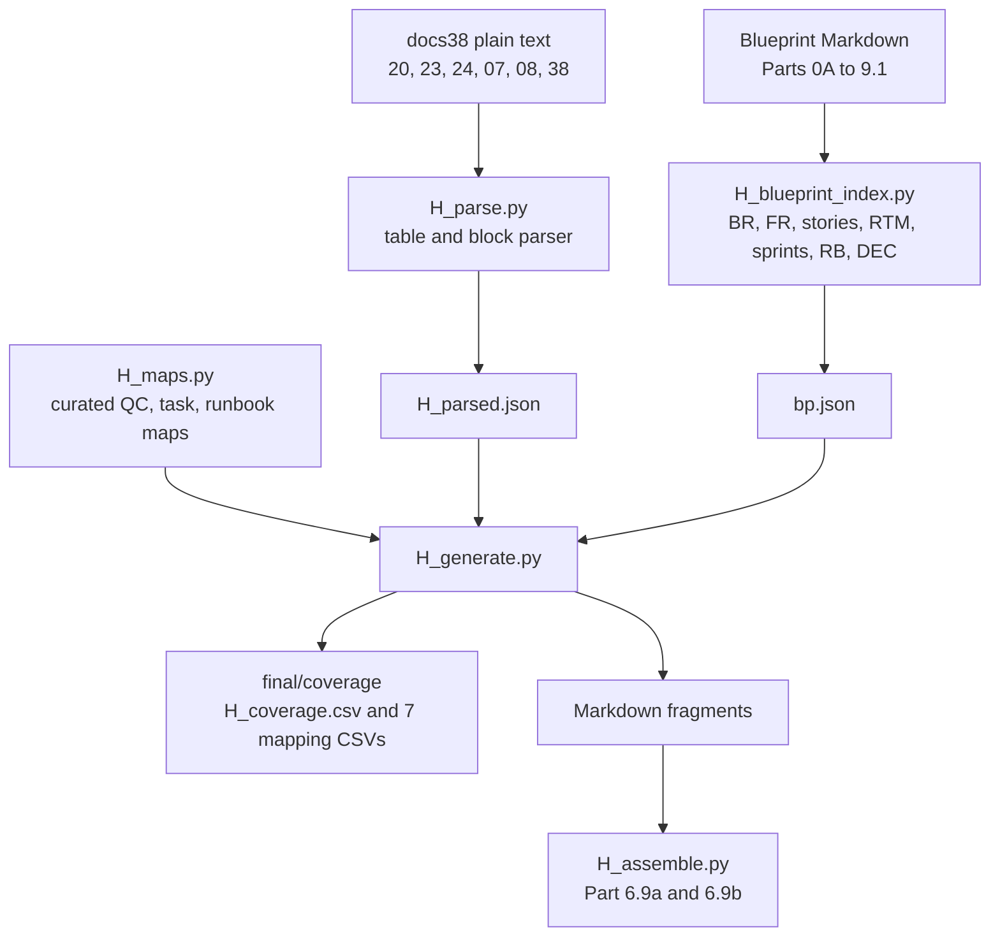

# AI Growth Engine: Employee Sales & Marketing Automation
## Application Blueprint: PART 6 (Batch 6.9a), Source Pack Reconciliation: Quality Controls, Requirements Traceability and Delivery Backlog (Review and Catalogue Reconciliation)

| Field | Value |
|---|---|
| Document | Part 6.9a: line-by-line review of source documents 20, 23 and 24 (plus the decision records of documents 07 and 08 and the inventory of document 38) against the blueprint; coverage register and catalogue reconciliation |
| Version | 1.0 · 27 Nov 2026 |
| Baseline | Parts 0–9 as published (Part 0A DEC-001…065; Part 9.1 DEC-066…156); Part 1 BR register; Part 2.1 FR register; Part 5 stories; Part 6.1 test strategy; Part 6.6 RTM; Part 8.1 sprints; Part 8.2 go-live; Part 4.3 runbooks |
| Roles applied | QA Lead (quality-control register, evidence gate), Delivery Lead (backlog, estimates, runbook), Business Systems Analyst / traceability manager (BR/FR/RTM and decisions), Product Owner (acceptance, semantic approval, sign-off) |
| Companion | Part 6.9b (enhancements, conflicts, persona review, tags, quality gate) |
| Machine-readable outputs | `final/coverage/H_coverage.csv` (all aspects) and mapping files `H_br_map.csv`, `H_fr_map.csv`, `H_qc_map.csv`, `H_decision_map.csv`, `H_workitem_story_map.csv`, `H_sit_alias_map.csv`, `H_ops_runbook_map.csv` |
| Scripts | `assembly/source_pack/H_parse.py` (source tables), `H_blueprint_index.py` (blueprint registers), `H_maps.py` (curated mappings), `H_generate.py` (CSV and tables), `H_assemble.py` (this file) |

**Acronyms used in this part.** BR = business requirement · FR = functional requirement · QC = quality control · QCL = quality-control layer · RTM = requirements traceability matrix · SIT = system integration test · UAT = user acceptance test · PD = person-day · SP = story point · EVR = evidence record (Part 6.1 §6.1.5.4) · SPDEC = source-pack engineering decision (alias defined in this part) · OKPI = source-pack optimization KPI (the pack's KPI-01…35, renamed per the Source Pack brief) · DAG = directed acyclic graph · DoR / DoD = Definition of Ready / Done · PO = Product Owner.

**Reading guide.** Batch 6.9a answers *"what did documents 20, 23 and 24 say, and where is each item in the blueprint?"*. Batch 6.9b answers *"what was missing, and what is the full-depth specification that closes it?"*. Every number in the tables below was computed by the scripts listed above from the plain-text extraction of the pack and from the blueprint Markdown; the CSV files hold one row per atomic aspect.

---

## 6.9.1 Documents reviewed

### 6.9.1.1 Inventory

| Doc | Title | Size (extraction) | Historical pages (doc 38) | Sections (Heading 1 / Heading 2) | Atomic aspects recorded |
|---|---|---|---|---|---|
| 20 | Development Backlog, Deployment and Operational Runbook | 66,579 bytes · 1,605 lines | 21 | 15 / 30 | {{count:20}} |
| 23 | Layer-Wise Quality Control Checklist and Delivery Sign-off | 186,981 bytes · 1,858 lines | 59 | 11 / 92 | {{count:23}} |
| 24 | Requirements Traceability Matrix and Acceptance Management | 394,516 bytes · 2,605 lines | 108 | 10 / 288 | {{count:24}} |
| 07 / 08 (decision records only) | REST API catalogue (DEC-001…038); PostgreSQL catalogue (DEC-039…042) | sections at lines 8,140–8,330 and 4,279–4,300 | — | 42 decision headings | {{count:07}} + {{count:08}} |
| 38 (counts only) | All Numbers | 18,600 bytes | — | 12 / 12 | {{count:38}} (expansion decisions, candidate operations/entities, BR count, evidence records) |

All prose sections were read in full. Every table row of the three documents was parsed by `H_parse.py`: 245 QC rows, 138 screen trace blocks plus 3 non-screen rows, 147 expansion trace rows, 180 decision records (138 in document 24, 38 in document 07, 4 in document 08), 149 + 13 work items, 66 module backlog rows, 8 runbook rows, 7 work packages, 9 capacity rows, 6 execution-backlog rows, 11 cost rows, 5 effort rows and 21 mandatory gate rows. Counts match document 38 exactly (288 FRs = 141 + 147; 162 work items = 149 + 13; 245 QCs = 235 + 10; 352 decisions = 180 + 172).

### 6.9.1.2 What each document is trying to tell

| Doc | Purpose | Pattern | Domain-specific content (reviewed here) | Common core (not re-listed; see document 01/02 coverage) |
|---|---|---|---|---|
| 20 | Turn the requirement set into an executable, dependency-ordered delivery plan and the operator runbook that keeps the product safe once deployed | Seven work packages → 66-module dependency backlog → 149-item task register with low/base/high PD, predecessors and owners → 13 expansion tasks; runbook of 8 routines; capacity, cost and effort envelopes; release-to-operations gate | Task register (TASK-W01…W30, TASK-A001…A108, TASK-OP001…003, TASK-FND01…08), UX-TASK-*, runbook, capacity targets, discipline PD split, longest path 113.5 PD, review effort 32.55/62.85/123.70 PD, approval-gate counts (38/0/4/138) | Purpose and boundary; startup profiles; Website/Admin operating contract; OPT-03…18 optimization controls (doc 36 review) |
| 23 | Make delivery acceptance *auditable*: one independently reviewed check per quality concern, grouped into 25 engineering layers and 5 business invariants, with owner, reviewer, priority, procedure, command template and evidence path, and a fail-closed evidence gate | 30 layer-level checks (QC-01…QC-30) → 205 granular checks (QC-031…QC-235) → 10 expansion checks (UX-QC-01…10); evidence gate; 21 mandatory measurable gates; combined preflight (1,188 records; 1,545 with expansion per doc 38) | Every QC; evidence-manifest rules (expected/observed, executor ≠ reviewer after normalisation, SHA-256, required-ID baseline, no mandatory N/A); offline completeness command returning exit code 2 while pending | Purpose and boundary; OPT-01…20 controls; KPI thresholds (OKPI, doc 36 review) |
| 24 | Prove that every interface is linked to a business requirement, an exact operation and entity set, and unit/SIT/UAT tests, and that each link is *semantically* approved by PO, technical lead and QA | 138 screen trace blocks (SM-FR) + 3 non-screen rows → 138 review decisions (DEC-043…180) → 147 expansion trace rows (SM-UX-FR) → exception disposition and change-impact procedures | BR→FR→operation→entity→SM-UT/SM-SIT/SM-UAT associations, semantic approval procedure, change impact, outstanding approval gate counts, non-screen operation review | Purpose and boundary; optimization intelligence reuse; OPT controls |

### 6.9.1.3 Identifier collisions handled in this part

| Source identifier | Collides with | Handling in the blueprint |
|---|---|---|
| Source decisions DEC-001…DEC-180 (docs 07, 08, 24) | Blueprint binding decisions DEC-001…DEC-156 (Parts 0A, 9.1) | Source decisions are referred to as **SPDEC-001…180**; the 172 unnumbered expansion decisions as **SPDEC-X-…** [CONFLICT-445] |
| Source optimization KPIs KPI-01…35 (docs 23, 36, 38) | Blueprint business KPIs KPI-01…31 (Part 1) | **OKPI-01…35** (Source Pack brief) |
| Source layer checks QC-01…QC-30 (two digits) and granular QC-031…QC-235 (three digits) | None in the blueprint; but QC-03 and QC-031 differ only by one digit | Kept verbatim; the layer of each QC is carried as **QCL-01…31** so the two-digit layer checks are never confused with granular checks |
| SM-SIT-A001…A302 | None (not aliased in the blueprint) | FR-level alias in §6.9.5.3.2; operation-level mapping is owned by Part 6.8 (`G_test_mapping.csv`) |

---

## 6.9.2 Coverage register summary

### 6.9.2.1 Counts by status per source document

The primary document of an aspect is the first document in its `doc` column (e.g. "24/20" counts under 24).

{{frag:cov_summary}}

### 6.9.2.2 Counts by aspect group

{{frag:cov_types}}

**How to read the large "Partially covered" groups.** (1) *SIT associations (302)*: every SM-SIT ID cited in document 24 resolves to an FR and to TCs, but the blueprint RTM never carried the SM-SIT alias; this part adds the FR-level alias and Part 6.8 adds the operation-level one [GAP-442]. (2) *Decisions (numbered)*: the substance of each source decision is already settled in the blueprint (DEC-015 derived API catalogue, DEC-019 identity reuse, DEC-088 embedding dimension, AP-08 semantic approval), but the blueprint holds **no per-item approval record** for them; §6.9.5.2 adds the SPDEC record and queue [GAP-444]. (3) *Business requirements*: all 71 enumerated BRs are covered; 5 "added" BRs in document 38 have no IDs [GAP-440].

---

## 6.9.3 Detailed coverage register

The complete register (1,532 rows, one per atomic aspect) is `final/coverage/H_coverage.csv`. Covered items are grouped there; **every Not covered, Conflict and Partially covered item is listed individually below**, except two homogeneous Partial families that are listed individually in their own reconciliation tables: the 302 SIT associations (§6.9.4.4 and `H_sit_alias_map.csv`) and the 171 numbered source decisions that lack an approval record (§6.9.4.7, all rows).

### 6.9.3.1 Not covered, Conflict and Partially covered aspects (individual)

{{frag:noncov}}

### 6.9.3.2 Quality controls that are not fully covered

{{frag:qc_partial}}

### 6.9.3.3 FR business-requirement trace differences (Conflict, 11 FRs)

Document 24 links each screen FR to one or more parent BRs. For 11 FRs the blueprint Part 2.1 *Traces* column omits a BR that the source names. None changes scope: the missing links are a public-boundary BR (B-WEB) on intake forms, a tenancy BR on the catalogue, and the discovery-chain BRs (M11–M17, M18) on the two settings/review screens that configure them. Resolution in §6.9.6 [CONFLICT-447].

{{frag:br_mismatch}}

---

## 6.9.4 Catalogue reconciliation

### 6.9.4.1 Method

| Step | Rule | Result |
|---|---|---|
| Parse | `[TABLE]` blocks are split on `---row`; header cells are the lines before the first row; trace blocks are read by their fixed line order (Access → BR text → Implement → REST → entities → tests) | 0 unparsed rows; counts equal document 38 |
| BR | `M##` → `BR-M##`; `B-X` → `BR-X`; module names in document 20 matched to Part 1 BR names (exact, case-insensitive), then dependency sets compared | 66/66 names matched; 66/66 dependency sets identical |
| FR | `SM-FR-W##/A###/OP###` → `FR-…` (Part 0 alias); `SM-UX-FR-…` → `FR-UX-…` (Part 0 alias) and the same screen's FR; source BRs compared with Part 2.1 *Traces* | 141 + 147 = 288 mapped; 11 trace differences |
| Tests | SM-UAT-S### checked against the Part 6.1 rule *S = 030 + n*; SM-UT set compared with the 63 aliased IDs; SM-SIT grouped by FR | 138/138 UAT aliases follow the rule; 63/63 unit IDs already aliased; 302 SIT IDs newly aliased |
| Work items | `TASK-W##/A###/OP###` and `UX-TASK-W/A` → same-screen FR → stories from Part 6.6 §6.6.4; `TASK-FND##` and `UX-TASK-FOUNDATION/FIELDS/EVENTS/QA` → curated story sets | 162/162 mapped to ≥ 1 story |
| QC | Each QC mapped to its layer anchor and to specific NFR/DoD/GL/BLK/AP/RB/TC references, then classified | 245/245 mapped |
| Decisions | SPDEC alias; API decisions joined to FRs through the operation path used in the trace blocks; UI decisions joined to the FR of the screen | 352/352 mapped |
| DAG | Predecessor IDs resolved; cycle check; longest base-duration path | Valid; 2 symbolic predecessors ("None", "All feature and adapter tasks"); longest path **113.5 PD** (matches source) |

### 6.9.4.2 Business requirements (76)

| Population | Count | Blueprint | Status |
|---|---|---|---|
| Module BRs M01…M66 | 66 | BR-M01…BR-M66 (Part 1) — names identical; dependency sets identical; epic and wave from Part 1 | Covered |
| Cross-cutting BRs B-TENANT, B-WEB, B-AUTO, B-SVC, B-QA | 5 | BR-TENANT, BR-WEB, BR-AUTO, BR-SVC, BR-QA | Covered |
| "Added" BRs counted by document 38 (71 + 5 = 76) | 5 | No IDs in any pack document. Interpreted as the five BRD §17.1 scope statements (XBR-01…05) and mapped to BR-S138 [GAP-440] [ASSUMPTION-441] | Partially covered |
| BRs cited in the document 24 trace blocks | 71 | All 71 resolve; M09 is cited only by the non-screen readiness/health rows and is the subject of the document 24 exception "M09 maps to foundational infrastructure" (realized by US-2101…US-2110) | Covered |

Module backlog of document 20 (dependency order, sequence 1–66) against Part 1:

{{frag:module_table}}

### 6.9.4.3 Functional requirements (288)

| Population | Count | Blueprint mapping | Status |
|---|---|---|---|
| Screen FRs SM-FR-W01…W30, SM-FR-A001…A108 | 138 | FR-W01…W30, FR-A001…A108 (Part 2.1; alias per Part 0 §0.4) | 127 Covered, 11 Conflict (BR trace) |
| Non-screen FRs SM-FR-OP001…003 | 3 | FR-OP001…003 (Part 2.1 §2.4.9; stories US-0401/0403/0404/0406, US-2102) | Covered |
| Expansion field/journey FRs SM-UX-FR-W01…W34, A001…A113 ("147 new") | 147 | FR-UX-W01…FR-UX-A113 (Part 0 alias) = the *Key fields* and *Automation* columns of FR-W/FR-A in Part 2.1 and the screen inventory of Part 2.5 §2.43; W31–W34 and A109–A113 also have full FRs (DEC-033) | Covered |
| **Total** | **288** | | 277 Covered, 11 Conflict |

The hypothesis in the task brief is confirmed: the 147 "new" FRs are the SM-UX-FR screen field and journey specifications, one per interface (34 Website + 113 Admin), each with its own UAT (SM-UX-UAT-…, all *Pending* in the source). Their field-level content (current/added/removed fields) is reconciled by the document 06/17 review; this part confirms the ID mapping and the UAT alias.

Screen and non-screen FRs (BR check: "=" all source BRs present in Part 2.1; "+X" X must be added):

{{frag:fr_table}}

### 6.9.4.4 RTM trace rows: test associations

| Association | Source population | Blueprint | Result |
|---|---|---|---|
| UAT (SM-UAT-S001…S138) | 138, one per screen FR in register order | Part 6.1 §6.1.12.5 rule S = 030 + n for A-screens; S001–S030 = W01–W30 | 138/138 consistent |
| Unit (SM-UT-001…066) | 63 distinct IDs cited (037, 049, 050 never cited) | Part 6.1 §6.1.12.5 aliases the same 63 IDs (DEC-094) | Consistent |
| SIT (SM-SIT-A001…A302) | 302 distinct IDs; 95 shared by ≥ 2 FRs | Not aliased in Part 6.6 or `final/RTM.csv` | Partially covered → FR-level alias added (§6.9.5.3.2) [GAP-442] |
| QC / Acceptance per trace row | "QC: Pending · Acceptance: Not run" on all 138 | EVR decision = Pending (Part 6.1 §6.1.5.4) | Consistent: no row asserts a pass |
| Operations and entities per trace row | 299 distinct operation strings; 149 distinct entity names | Derived catalogue (DEC-015, DEC-016) | Reconciled by the document 07/08 reviews (Part 3 enhancement files); recorded per FR in `H_fr_map.csv` |

{{frag:sit_summary}}

### 6.9.4.5 Work items (162) → stories

{{frag:wi_summary}}

{{frag:wi_table}}

### 6.9.4.6 Quality controls (245) → blueprint controls (summary)

The per-QC table with sign-off role and gate is the register in Part 6.9b §6.9.5.1.8. The layer summary is:

{{frag:qc_layers}}

### 6.9.4.7 Engineering decisions (352) → blueprint decisions

{{frag:dec_summary}}

All 180 numbered source decisions with their alias, class, FR and blueprint resolution (the 172 expansion decisions are listed in `H_decision_map.csv`; their classes are fully covered except the three entity items in §6.9.3.1):

{{frag:dec_table}}

### 6.9.4.8 Runbook, work packages, capacity and execution backlog

{{frag:ops_table}}

Cost rows (B01–B11, ₹14,500 base, ₹16,675 with 15% contingency, ₹31,165 with conditional items) and effort rows (194–323, 35–60, 30–52, 28–48, total 287–483 PD; ₹13.05–32.93 lakh) are identical to DEC-004, DEC-012 and DEC-020 and are Covered (provider prices and free quotas: verify at time of implementation, as of 27 Nov 2026).

### 6.9.4.9 Mandatory measurable gates (21 OKPIs in document 23)

{{frag:gates}}

---

## Quality gate: Batch 6.9a

| # | Check | Result | Notes and fixes applied |
|---|---|---|---|
| 1 | Every requirement traced to a source | **Pass** | Every row cites the source document and section; blueprint locations cite Part/section/ID |
| 2 | Assumptions, gaps, conflicts tagged and logged | **Pass** | Tags used here are registered in Part 6.9b §6.9.8 (range 440–459) |
| 3 | IDs unique and consistent with earlier parts | **Pass** | SPDEC, OKPI, QCL and XBR aliases avoid the DEC/KPI collisions; no new ID reuses an existing family |
| 4 | No story lacks AC; no requirement lacks a test | **N/A (6.9a)** | Reconciliation only; new stories and TCs are in 6.9b |
| 5 | Negative, edge, security and accessibility cases | **Pass** | QC negative/isolation/accessibility checks reconciled individually |
| 6 | No agent lacks guardrail, fallback, KPI and cost estimate | **N/A** | No agent introduced |
| 7 | Time-sensitive facts flagged | **Pass** | Cost rows flagged "verify at time of implementation (as of 27 Nov 2026)" |
| 8 | No restricted data routed to free-tier models | **Pass** | Not affected |
| 9 | Consistent with earlier parts | **Pass** | Differences reported as CONFLICT-440…447, not changed in place |

**Status: Part 6 Batch 6.9a complete. 1,532 atomic aspects reconciled ({{covered}} Covered, {{partial}} Partially covered, {{notcov}} Not covered, {{conflict}} Conflict, {{na}} Not applicable); 288 FRs, 76 BRs, 162 work items, 245 QCs and 352 decisions mapped. Continue with Batch 6.9b.**
