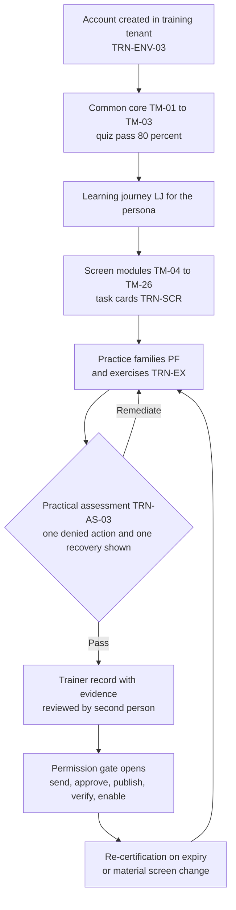
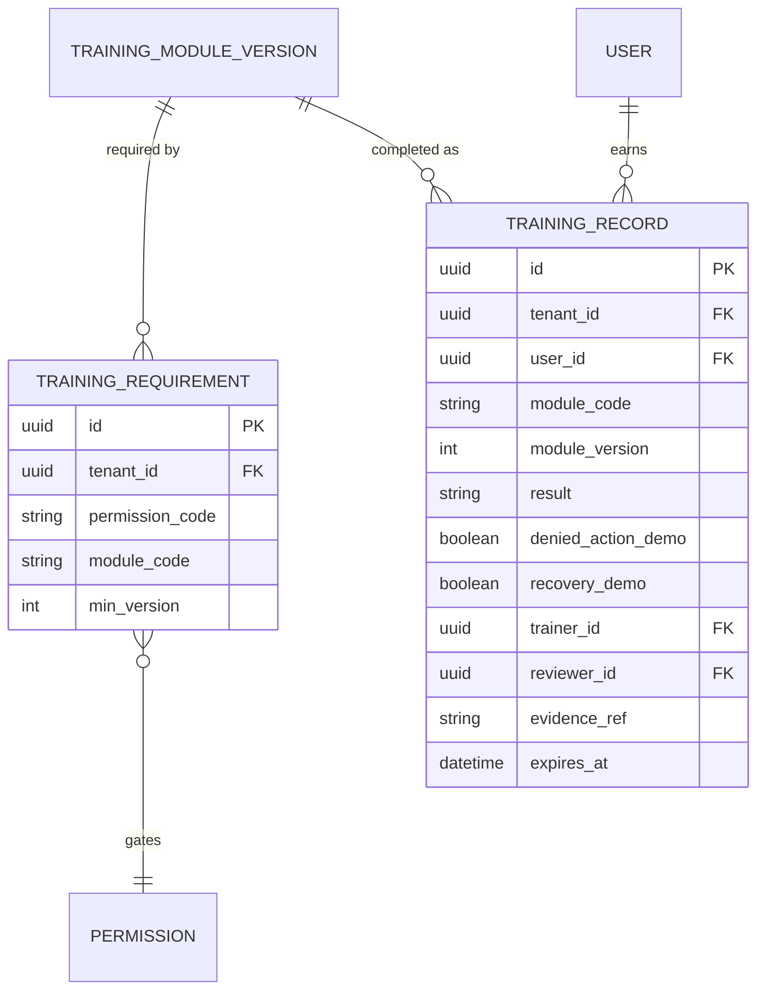

# AI Growth Engine: Employee Sales & Marketing Automation
## Application Blueprint: PART 8 (Batch 8.3b), Source Pack Enhancements I: Operational Training Manual by Persona and Screen

| Field | Value |
|---|---|
| Document | Application Blueprint, Part 8, Batch 8.3 (file b of 3), source-pack group J |
| Version | 1.0 · 27 Nov 2026 |
| Baseline | Part 8.2 §8.2.2 (personas, training plan, adoption metrics, communication), Part 2.3 (R01–R20, RBAC matrix §2.26.3), Part 2.5 (147 screens, §2.47 UI states, §2.49 microcopy), Part 4.3 (RB-001…015, support model §4.45), Part 6.1 (EVR, staging, GSE-SYN data), Part 6.6 (RTM, SM-UAT aliases), Part 8.3a (coverage register) |
| Source | Document 33 (all sections), document 35 ("operational knowledge and handover"), document 36 (UX-QC-10, OPT-15-01…04) |
| Roles applied | Training and Change Lead (lead), Lead UX/UI Designer, QA Lead, Product Owner, Security/Compliance Lead, DevOps/SRE Lead |

**Acronyms used in this file.** As in Part 8.3a, plus: GSE-SYN synthetic golden-set environment data (Part 6.1) · H hands-on lab · SP self-paced · W workshop · D drill · 1:1 individual walkthrough.

---

## 8.3.5 Enhancements (organized by blueprint part)

| Enhancement | Blueprint part it extends | Where |
|---|---|---|
| Operational training manual: journeys, modules, screen task cards, practice families, exercises, troubleshooting, assessment and permission gating, training evidence, delivery plan | Part 8.2 §8.2.2 (training), Part 2.5 (help and microcopy), Part 2.4 (configuration and notifications), Part 6 (UAT reuse) | This file, §8.3.5.1–8.3.5.12 |
| SaaS onboarding, service delivery, SLA and commercial operations | Part 1 (BR-SVC), Part 2.2 (WF-14), Part 4.3 §4.45, Part 5.3 (EP-20) | Part 8.3c §8.3.5.13 |
| Maintenance and continuous-improvement lifecycle | Part 4.3 §4.43–4.47, Part 8.2 §8.2.2.4 | Part 8.3c §8.3.5.14 |
| Optimization model: 20 dimensions + G0, 104 controls, 35 OKPIs, 24 scenarios, panel, evidence gate | Part 4.2 (NFR), Part 8.2 §8.2.6 (KPI tracking), Part 6 (tests), Part 9.3 (inventory) | Part 8.3c §8.3.5.15 |

---

### 8.3.5.1 Training architecture, environment rules and learning journeys (extends Part 8.2 §8.2.2.2)

**Principles (document 33 "Before using the application"; Part 8.2 §8.2.2.2).**

1. Training uses the **authorized training environment** and the trainee's **own assigned identity**; shared logins are never used.
2. The trainee **selects the correct tenant and startup before changing data**; every exercise begins with a scope check.
3. Only **synthetic fixtures** are used. In training nobody sends messages, publishes content, submits bids or offers, or processes funds. All provider adapters run against the provider simulator.
4. Training content describes **proposed screens** until the build exists; conceptual pictures are replaced by real screenshots before each wave's training (§8.3.5.9).
5. Each learning journey ends with the trainee **demonstrating one denied action and one error recovery**; the trainer records completion and any remediation (document 33, all six journeys).
6. Training never teaches a workaround to a permission, eligibility, budget or approval control. "If denied, do not change scope to bypass permissions; contact the assigned administrator. For an uncertain provider outcome, escalate before retry" (document 33, every screen).

**Training environment rules [ASSUMPTION-489].**

| Rule | Specification | Enforced by | Test |
|---|---|---|---|
| TRN-ENV-01 Training tenant | A dedicated tenant `trn-gse` in `staging` with four synthetic startups (AppNAI-SYN, MedMaarg-SYN, EduVerse-SYN, OrganicSpec-SYN) plus one external client tenant `trn-client` with two startups, so that the two-tenant rule (NFR-032) can be shown in class | FR-ENH-J-003 | TC-ENH-J-058 |
| TRN-ENV-02 Simulated adapters only | Every adapter (email, WhatsApp, calendar, e-sign, payment, search, ads, social, AI Tier 1/2) points to the provider simulator; live credentials are absent from the training tenant's secret scope | CFG-24 per tenant; CFG-31 flags | TC-ENH-J-058 (0 live calls) |
| TRN-ENV-03 Trainee accounts | One account per trainee per role, created by the tenant administrator with expiry ≤ 30 days; MFA enforced as in production | A002; BRL-TEN-07/08 | — |
| TRN-ENV-04 Reset | Each trainee sandbox (startup copy) is reset from a versioned fixture snapshot on demand and nightly | FR-ENH-J-003 | TC-ENH-J-058 |
| TRN-ENV-05 Clocks | Exercises that depend on deadlines (bid expiry, quotation validity, quiet hours, renewal) use the staging clock-control facility (Part 6.1) | Part 6.1 clock control | TRN-EX-02 |
| TRN-ENV-06 Visual marker | A persistent "TRAINING — synthetic data, no live effects" banner on both frontends in the training tenant | FR-ENH-J-002 | TC-ENH-J-060 |
| TRN-ENV-07 No personal data | Fixtures contain no real names, emails, phone numbers, payment data, patient data or minors' data; generated names use the `example` domain | Part 6.1 data rules; BRL-ELG-13/14 | Fixture linter |
| TRN-ENV-08 Evidence | Screenshots and outcomes are stored as training records, not as product test evidence; they never carry a production certification level (Part 6.1 §6.1.5.5) | FR-ENH-J-004 | TC-ENH-J-059 |

**Curriculum flow.**



**Learning journeys (source journeys LJ-01…LJ-06 extended to every blueprint persona).**

| LJ | Source journey (doc 33) | Persona / roles | Journey steps (source text kept; blueprint screens added) | Modules | Denied action to demonstrate | Error recovery to demonstrate | Exercises | Permissions gated on pass |
|---|---|---|---|---|---|---|---|---|
| LJ-01 | Marketing employee | P05 / R05, R05L | Select assigned startup → prepare approved content (A050, A051) → configure campaign, audience and budget (A058, A059) → publish only an approved snapshot (A056, A057, A107, A108) → measure enquiry attribution (A082, RP-08) | TM-01…03, TM-13, TM-14, TM-15, TM-16 | Approve own content version → denied (BRL-APR-01) | Campaign launch blocked because the reserved budget is exhausted → request a budget revision in A059, relaunch after approval (BRL-MKT-04/05) | TRN-EX-08, TRN-EX-09 | Publish content and pages; launch campaign (R05L approves) |
| LJ-02 | Sales employee | P03 / R03, R03L | Discover account and need (A018, A020) → verify contact (A025) → qualify lead (A027) → send eligible outreach (A034, A037) → follow up (A038) → handle objections (A069) → prepare proposal and handoff (A065, A067, A075) | TM-01…03, TM-10 (view), TM-11, TM-12, TM-13, TM-17, TM-21 | Send to a suppressed contact → blocked with eligibility "explain" (BRL-ELG-02/18) | Provider timeout after send → status UNKNOWN; do not resend; open reconciliation item (BRL-AUT-07, RB-003) | TRN-EX-01, TRN-EX-10 | Send approved messages; enrol sequences; discount ≤ 10% (R03L only) |
| LJ-03 | Bid/procurement specialist | P06 / R06; P07 / R07 | Use bid desk (A104) or buy/sell order desk (A105) → validate eligibility, deadline, price and approvals → record award or order and fulfilment | TM-01…03, TM-17, TM-18, TM-19 | Record a submission after the portal deadline → blocked (BRL-BID-01) | Duplicate fulfilment event → no effect; over-delivery rejected → correct quantity and re-record (BRL-ORD-02/03) | TRN-EX-02, TRN-EX-03, TRN-EX-04 | Record human bid submission; issue and complete orders |
| LJ-04 | External customer/supplier | P14 / R16 | Browse approved offerings (W04, W05) → submit enquiry or RFQ (W12–W16) → redeem invitation (W21) → review own quote, agreement, order and payment status (W22–W26) → preferences (W29) | TM-31 (self-paced, 6 minutes) | Open another customer's quote link → not found (BRL-TEN-04) | Expired invitation → request a new invitation from the account owner (W28) | TRN-EX-06 | None (portal grants are object-specific) |
| LJ-05 | Administrator | P11 / R12 | Configure startup template, domain, roles, source permissions, workflow, quotas and alerts (A099, A100, A002, A010, A033, A012) → preview → simulate → obtain approval → activate | TM-01…03, TM-04, TM-07, TM-08, TM-25 | Tenant administrator tries to approve a quote → denied (R12 is not a business approver, Part 2.3) | Domain verification fails (missing DNS record) → follow RB-010 guidance; status stays "Unverified"; no publication | TRN-EX-05, TRN-EX-11 | Manage users and grants; apply templates; approve support grants |
| LJ-06 | Support operator | P12 / R13 | Use only a client-approved temporary support grant (DEC-056) → inspect safe, redacted evidence (A009, A014) → escalate incident (Part 4.43) → revoke the grant after resolution | TM-01…03, TM-08, TM-27 | Open tenant content without an active grant → denied and audited (BRL-TEN-09) | Grant expires mid-investigation → request extension via the tenant admin; no alternative access path | TRN-EX-13 | Request support grants; resolve incidents (metadata) |
| LJ-07 | (added) | P01 / R01 Founder | Portfolio view (A089) → approvals above thresholds (DEC-038) → autonomy plan approval (A102) → emergency stop drill (A033) → release go/no-go (A090) → optimization scorecard review (Part 8.3c) | TM-01…03, TM-22, TM-28, TM-29 | Self-approve a loosening of an autonomy cap → denied (BRL-APR-11) | Emergency stop raised and resumed following RB-004 (resume needs second approver) | TRN-EX-14 | High-value approvals; release approval |
| LJ-08 | (added) | P02 / R02 Startup Head | Catalogue and claims (A004–A006) → readiness gate (A098) → approval queue (A066, A068, A072) → bid/no-bid (A104) → dashboards (A042) | TM-01…03, TM-05, TM-17, TM-18, TM-22 | Approve a quote whose hash changed after review → rejected (BRL-APR-02) | Re-review and approve the current revision | TRN-EX-01 | Price, discount, bid and proposal approvals |
| LJ-09 | (added) | P04 / R04 Research Analyst | Source register (A010) → research plan (A015) → results and evidence (A016, A017) → signals and needs (A019, A020) → labelling and precision (A084) → contact verification (A025) | TM-01…03, TM-09, TM-10, TM-26 | Run a plan against an unapproved source → blocked (BRL-SRC-01) | Stale evidence flagged → re-fetch within freshness rule or mark Unknown (BRL-SRC-06) | TRN-EX-16 | Approve research findings; verify contacts |
| LJ-10 | (added) | P08 / R08, R09 Finance | Invoices and payment evidence (A073) → maker-checker verification (A074) → closure policy → revenue settings (A083) | TM-01…03, TM-20 | Checker on an item they made → blocked (BRL-APR-07) | Wrong-currency payment → discrepancy queue, no allocation (BRL-FIN-03) | TRN-EX-15 | Maker and checker verification |
| LJ-11 | (added) | P09 / R10 Legal/Compliance/DPO | Consent and suppression (A007) → privacy queue and legal hold (A013) → compliance incidents (A047) → claims and contract approvals (A051, A072) | TM-01…03, TM-05, TM-06, TM-17 | Erase a principal under legal hold → restricted, not deleted (BRL-PRV-04) | Suppression breach alert → contain per RB-006 | TRN-EX-16 | Privacy decisions; legal approvals; e-sign requests |
| LJ-12 | (added) | P10 / R11 Automation Lead | Node library (A113) → workflow design and simulation (A033, A102) → triggers (A109) → live monitor (A110) → conflicts (A111) → configuration changes (A112) → emergency stop | TM-01…03, TM-07, TM-08, TM-24, TM-28 | Raise an autonomy cap above DEC-064 → denied (R11 cannot loosen caps) | UNKNOWN step in A110 → reconcile before retry (BRL-AUT-07) | TRN-EX-11, TRN-EX-14 | Enable workflows (with approver); stop |
| LJ-13 | (added) | P13 / R17 → R12 SaaS client administrator | Plans (W31) → application (W32) → wizard draft (W33) → after provisioning: own Admin (A099 own tenant, A100, A002) → service portal (W34) | TM-32, then TM-04 (own tenant) | Wizard attempts a live send → not available in draft (BRL-SVC-02) | Application returned for unverifiable authority → upload new evidence and resubmit | TRN-EX-11 | Own-tenant administration |
| LJ-14 | (added) | P12 / R14 Platform Billing | Plans and rate revisions (A101) → subscriptions → usage reconciliation → service invoices and credits | TM-01…03, TM-25 | Open business content of a tenant → denied (R14 has billing metadata only) | Duplicate usage event → not billed twice; adjustment needs reason (BRL-SVC-04/07) | TRN-EX-15 | Issue service invoices and credits |
| LJ-15 | (added) | R15 Auditor | Read-only tour of audit (A009), approvals, ledgers and release records | TM-01, TM-03, TM-08 (view) | Any mutation → denied | Export of Restricted data needs approval (BRL-PRV-07) | — | None |
| LJ-16 | (added) | P15 / R18 Anonymous visitor | No training; accessible pages, help centre (W30) and accessibility statement | — | — | — | — | — |

**Operator and viewer screens per internal role (computed from the Part 2.3 RBAC matrix; "operator" = any C, E, A, X or S permission).**

{{ROLE_MATRIX}}

---

### 8.3.5.2 Training module catalogue TM-01…TM-33 (extends Part 8.2 §8.2.2.2)

Cross-functional and core modules:

| Module | Title | Content | Format | Hours | Audience | Source |
|---|---|---|---|---|---|---|
| TM-01 | Common core 1: security and privacy | As Part 8.2 common core 1 | W + quiz | 1.0 | All internal | Part 8.2 |
| TM-02 | Common core 2: AI use policy | As Part 8.2 common core 2 | W | 0.5 | All internal | Part 8.2 |
| TM-03 | Common core 3: navigation, scope and safe recovery | Seven views, scope selector, saved views, notifications, global search, help; **UI states** (loading, empty, denied, stale, error, Unknown/Estimate/Uncertain, success) per Part 2.5 §2.47; standard operating procedure SOP-STD (§8.3.5.3); troubleshooting cards TS-01…TS-20 (§8.3.5.7) | SP + H (30 min lab) | 1.0 | All internal | Part 8.2 core 3 extended with doc 33 |
| TM-27 | Support operations with grants | DEC-056 grant lifecycle, redacted diagnostics, ticket hygiene, incident severity and comms (Part 4.43, 4.45), revoke on resolution | W + H + D | 3.0 | R13 | doc 33 LJ-06 |
| TM-28 | Emergency stop and incident drills | STOP scopes, propagation ≤ 60 s (NFR-049), resumption with second approver (RB-004), uncertain-outcome surge (RB-003) | D | 1.0 | R01, R02, R10, R11, R13 | Part 4.3 |
| TM-29 | Interpreting optimization and KPI figures | Measured vs proposed values; numerator/denominator; zero denominator = unassessed; how to simulate a workflow, pause optional jobs and escalate legal/financial exceptions (document 33 optimization section); reading the optimization scorecard (Part 8.3c) | W | 1.0 | R01, R02, R11, FinOps, Service Owner | doc 33, doc 36 |
| TM-30 | Train-the-trainer and evidence recording | Delivering labs, observing denied/recovery demonstrations, recording TrainingRecord evidence, second-person review, screenshot replacement | W + H | 2.0 | Trainers (QA lead, growth/compliance lead, power users) | doc 33 operating training |

Screen modules (generated from the screen inventory; 12 minutes of guided lab per screen is the planning basis [ASSUMPTION-481]):

{{MODULE_TABLE}}

---

### 8.3.5.3 Standard screen operating procedure (SOP-STD)

Document 33 gives the same operating pattern for every screen. It is formalized here so that every task card can refer to it and so that help articles stay consistent.

| Step | Procedure | Screen element (Part 2.5) | Rule |
|---|---|---|---|
| SOP-STD-01 Select permitted context | Confirm product, tenant, startup and (if shown) business line in the scope selector before reading or changing anything | Global shell scope selector §2.41 | NFR-027: switching scope cancels in-flight requests and clears selections |
| SOP-STD-02 Inspect record and validation | Read the record, its revision, status chip, provenance/evidence panel and any validation messages | Detail panel; status chips; evidence drawer | Unknown values stay "Unknown"; estimates are labelled (Part 2.5 §2.47) |
| SOP-STD-03 Check eligibility | Use the "Explain" or eligibility panel before acting (send, publish, approve, submit-record, verify) | Action bar; eligibility explain | The server rechecks at execution (BRL-ELG-18) |
| SOP-STD-04 Act only when eligible | Use only the enabled action; preview or simulate first when offered | Primary action; Preview / Simulate | Simulation has zero live effects (NFR-038) |
| SOP-STD-05 If denied | Do **not** change scope to bypass the denial; read the reason; contact the assigned administrator (A106 request) | Denied state with reason code | BRL-TEN-01/04; audit records the attempt |
| SOP-STD-06 If the provider outcome is uncertain | Do **not** retry; open the item in the reconciliation queue or escalate to support with the correlation ID | UNKNOWN status; correlation ID | BRL-AUT-07; RB-003 |
| SOP-STD-07 Review confirmation and resulting status | Confirm that the status changed as expected and that the action appears in the timeline/audit | Toast + timeline entry | No false success (doc 33 practice rows) |
| SOP-STD-08 Leave the screen safely | Save drafts; release holds (e.g. meeting slot holds, BRL-MTG-02); do not leave bulk selections active | Draft autosave; hold timers | — |

---

### 8.3.5.4 Screen task cards TRN-SCR-W01…TRN-SCR-A113 (147 cards)

One card per screen. Columns: **Operators** are the roles holding C (create), E (edit), A (approve), X (execute) or S (settings) on that screen in Part 2.3 §2.26.3 (Website rows use the external-surface table); **Purpose** is the document 33 access/purpose line (or the FR text for the nine new screens); **Key actions** are the Part 2.5 actions the trainee must perform; **Practice families** point to the scripts in §8.3.5.5; **Denied / edge drill** is the negative case the trainee must show; **UAT aliases** are the SM-UAT-S and SM-UX-UAT IDs; **Blueprint TCs** are the first test-case ranges from the Part 6.6 RTM (count of further ranges in brackets). Every card is executed with SOP-STD-01…08.

{{TASK_CARDS}}

---

### 8.3.5.5 Practice family library (PF-*)

Document 33's 138 practice rows use 23 recurring success/troubleshooting families. Each family is one reusable practice script with fixed synthetic inputs and measurable expected results; the screen cards above reference them. Unclassified rows: {{NOFAM}}.

{{FAMILY_TABLE}}

---

### 8.3.5.6 Practical exercises TRN-EX-01…TRN-EX-16

TRN-EX-01…04 are the document 33 exercises; TRN-EX-05…07 are its operating-training rows; TRN-EX-08…16 are added so that every learning journey has at least one exercise.

| Exercise | Source | Journeys | Screens | Synthetic input | Expected result | Test |
|---|---|---|---|---|---|---|
| TRN-EX-01 Quotation calculation | doc 33 | LJ-02, LJ-08 | A067, A068, W23 | 2 units × INR 150.00, 10% discount, before tax | Line total = ROUND_HALF_UP(2 × 150.00 × 0.90, 2) = **INR 270.00**; server recomputes from the approved price version; a 12% discount by R03 (not R03L, limit 10%) is rejected; a manual unit price is treated as a discount needing approval (BRL-QTE-01/02, BRL-APR-04) | TC-ENH-J-052 |
| TRN-EX-02 Bid expiry | doc 33 | LJ-03 | A104 | Deadline 2030-06-01 09:00 UTC; clock set to 08:59:30 then 09:00:00 | At 08:59:30 recording is allowed; at 09:00:00 the submission record is rejected, an exception task is created, no award can be recorded and no external call is made (BRL-BID-01/04) | TC-ENH-J-021 |
| TRN-EX-03 Order fulfilment | doc 33 | LJ-03 | A105, W25 | Order 2 kg; deliver 1 kg twice with the same event key; then attempt 2 kg more | First 1 kg accepted; duplicate key no effect; second distinct 1 kg accepted; extra 2 kg rejected (cumulative 4 > 2) (BRL-ORD-02/03) | TC-ENH-J-053 |
| TRN-EX-04 EduVerse routing | doc 33 | LJ-03, LJ-09 | A029, A031, W15, W17 | External AI-development request; school AI-education request | Owned portfolio routes development to AppNAI and education to EduVerse; a client tenant's templates are configured independently (BRL-BID-06) | TC-ENH-J-023 |
| TRN-EX-05 Admin scope | doc 33 operating training | LJ-05, LJ-12 | A003, A033, A110 | Training tenant, two startups | Select tenant/startup, apply filters, simulate a workflow, inspect blocked actions, pause; no live effect | TC-ENH-J-058 |
| TRN-EX-06 External portal | doc 33 operating training | LJ-04 | W21, W23 | Valid invitation; revoked invitation; expired invitation | Own invited object visible; revoked and expired → safe denial without data | TC-ENH-J-001 (part) |
| TRN-EX-07 Evidence recording | doc 33 operating training | Trainers | A002 training tab | Completed exercise | Trainer records screenshot reference, role, outcome and corrective action; a second person reviews | TC-ENH-J-059 |
| TRN-EX-08 Publication and rollback | added (PF-PUB, PF-PRV) | LJ-01 | A056, A057, A107, A108, W03 | Page revision R2 approved, R3 draft | Preview of R3 is `noindex`; publish R2; roll back to R1; public host serves only approved hash; cache purged ≤ 60 s | TC-NFR-020 |
| TRN-EX-09 Campaign with suppression and cap | added (PF-CMP) | LJ-01 | A058, A059, A060, A061 | 52 recipients, 2 suppressed; budget INR 5,000.00 | 50 eligible; at 100% of cap the campaign pauses; duplicate attribution counted once | TC-12-* (RTM) |
| TRN-EX-10 Outreach with opt-out mid-sequence | added (PF-OUT, PF-CNS) | LJ-02 | A034, A037, A038 | Contact enrolled in 3-step sequence; opt-out after step 1 | Steps 2–3 suppressed at dispatch; reply halts generic sequence (BRL-ELG-10) | TC-08-* (RTM) |
| TRN-EX-11 Nine new interfaces end to end | added (doc 33 expansion training) | LJ-05, LJ-12, LJ-13 | W31, W32, W33, A099, A112, A113, A109, A110, A111, W34 | Synthetic client "Alpha Retail Pvt Ltd" (example data from US-2002) | Register → verify → wizard draft (0 live calls) → provision → configuration revision 2 → template publish → trigger → 20 simulated runs → conflict held → service portal shows plan and usage | TC-ENH-J-025…034 |
| TRN-EX-12 Operational knowledge handover | doc 35, doc 36 | LJ-06, LJ-12 | A009, A014, A110 | Synthetic failure: outbox backlog of 1,500 events (RB-002) | Operator diagnoses from runbook without developer help, applies documented mitigation, escalates S2 correctly, records outcome | TC-ENH-J-051 |
| TRN-EX-13 Support grant lifecycle | added (doc 33 LJ-06) | LJ-06, LJ-05 | A099 (grants), A009, A014 | Ticket from client tenant | Grant requested → approved by client admin → read-only access ≤ 72 h → revoked at resolution → access attempt after revoke denied | TC-ENH-J-065 |
| TRN-EX-14 Emergency stop drill | added (TM-28) | LJ-07, LJ-12 | A033, A110 | 1,000 simulated queued messages | STOP blocks new external calls ≤ 60 s; queued items held; resume requires second approver | TC-ENH-J-066 |
| TRN-EX-15 Payment reconciliation | added (PF-FIN) | LJ-10, LJ-14 | A073, A074, A101 | Payment INR 27,000.00; duplicate provider ID; USD payment against INR invoice | Duplicate no movement; currency mismatch to discrepancy queue; maker ≠ checker | TC-15-* (RTM) |
| TRN-EX-16 Sensitive-domain boundaries | added (PF-MED, PF-EDU, PF-EVD) | LJ-09, LJ-11 | A010, A016, A020, W13, W17 | Hospital enquiry with diagnosis text; student (age 16) enquiry; restricted source | Clinical text quarantined; no direct outreach to the minor; restricted source never fetched | TC-ENH-J-022 |

```gherkin
Feature: Training exercises from document 33

  Scenario: TRN-EX-01 quotation total is recomputed by the server
    Given the training startup "OrganicSpec-SYN" has approved price version "PV-3" with SKU "SKU-A" at INR 150.00
    And trainee "growth.lead.trn" holds role R03L with a discount limit of 10%
    When the trainee creates a quote with 2 units of "SKU-A" and a 10% discount
    Then the line total shows INR 270.00 before tax
    And the stored total equals the server recomputation from "PV-3"
    When the trainee changes the discount to 12%
    Then the quote cannot be issued and an approval request for the Startup Head is created

  Scenario: TRN-EX-02 bid submission is blocked at the deadline
    Given bid "AppNAI-SYN-B-17" has a portal deadline of 2030-06-01 09:00 UTC
    And the staging clock is set to 2030-06-01 09:00:00 UTC
    When the bid manager records the human submission with portal reference "P-881"
    Then the record is rejected with reason "DEADLINE_PASSED"
    And an exception task is assigned to the Startup Head
    And no award can be recorded for the bid
    And the provider simulator shows 0 calls

  Scenario: TRN-EX-03 duplicate and excess fulfilment events
    Given sell order "OS-SYN-0042" has one line of 2 kg
    When fulfilment event "FE-1" records 1 kg
    And fulfilment event "FE-1" is received again with the same key
    Then the delivered quantity is 1 kg
    When fulfilment event "FE-2" records 1 kg
    And fulfilment event "FE-3" records 2 kg
    Then "FE-3" is rejected with reason "OVER_DELIVERY"
    And the delivered quantity is 2 kg

  Scenario: TRN-EX-13 support grant is revoked at resolution
    Given ticket "T-310" from tenant "trn-client" is assigned to support operator "support.trn"
    And the tenant administrator approved a read-only grant for module "Automation" for 24 hours
    When the operator resolves ticket "T-310" and confirms "Revoke grant"
    Then the grant status becomes "Revoked"
    And a later request by "support.trn" to tenant "trn-client" workflow data returns 403
    And the tenant administrator sees both the grant and the revoke in the audit view
```

---

### 8.3.5.7 Troubleshooting and safe recovery cards TS-01…TS-20

TS-01…TS-04 are the document 33 "safe recovery" items; the rest cover every non-success UI state in Part 2.5 §2.47 and every user-visible runbook trigger in Part 4.3 §4.44.

| Card | Symptom | Likely cause | What the user does | Never do | Escalation / runbook | Evidence of success |
|---|---|---|---|---|---|---|
| TS-01 No records | Empty list | Wrong startup, role or filter | Check scope selector, role and filters; clear saved view | Request another tenant's records | Tenant admin (A106) | Authorized list or a clear empty state (doc 33) |
| TS-02 Pending approval | Action disabled with "Awaiting approval" | Approval not yet decided | Open the approval to see approver and approved scope; wait or ask the approver | Re-create the item to avoid approval | BRL-APR-10 escalation | No unauthorized execution (doc 33) |
| TS-03 Failed action | Error toast with correlation ID | Validation, provider or server error | Read the safe error; copy correlation ID; report to support | Repeat the submission | L1 support; RB per alert | Support resolves or reconciles (doc 33) |
| TS-04 Wrong public content | Incorrect content on a public page | Wrong revision approved/published | Report; request authorized unpublish or rollback (A108) | Edit published data directly | Marketing lead; BRL-PUB-02 | Approved replacement and audit (doc 33) |
| TS-05 Denied (403) | "You do not have access" | Role, grant or membership expired | Read reason; request access via tenant admin | Switch to a colleague's account | A002 | Access granted or reason confirmed |
| TS-06 Changed by someone else (409) | "This record changed" | Stale revision | Reload, review diff, re-apply | Force overwrite | — | Saved on current revision (NFR-025) |
| TS-07 Outcome UNKNOWN | Step shows UNKNOWN | Provider timeout after submission | Open reconciliation item; wait for provider evidence | Retry the send/payment | RB-003 | Reconciled to Sent/Failed |
| TS-08 Budget or quota exhausted | "Budget reached" banner | Cap hit (M53) or plan quota (BRL-SVC-03) | Request budget revision or approved overage | Use a personal account or paid tool | RB-005; FinOps | Cap raised by approver or work deferred |
| TS-09 Emergency stop active | Red STOP banner | STOP raised for scope | Do nothing external; wait for the all-clear | Ask for a "quick exception" | RB-004 | Resume notice in A106 |
| TS-10 Not eligible | Send/publish disabled; "Explain" shows reason | Suppression, quiet hours, jurisdiction, frequency cap | Read explanation; schedule after quiet hours if allowed | Copy the text to a personal mailbox | Compliance (R10) | Eligible or recorded as ineligible |
| TS-11 AI abstained | Draft shows "Insufficient evidence" | No approved evidence | Add approved knowledge or write manually | Invent claims | AI lead | Human draft or approved evidence |
| TS-12 Upload quarantined | File shows "Quarantined" | Malware/type/size check | Upload a clean file | Rename and re-upload the same file | Security | Clean file accepted (NFR-021) |
| TS-13 Signed out / MFA prompt | Session ended | Revocation or expiry (NFR-050) | Sign in with MFA | Share an OTP | RB-014 if IdP down | Signed in |
| TS-14 Webhook rejected | A109 shows signature failures | Secret rotation mismatch or attack | Notify Automation Lead | Disable signature check | RB-009 | Valid events accepted |
| TS-15 Stale figures | "As of" time older than expected | Projection lag | Note the as-of time; refresh later | Use the figure for approval decisions | SLO-09; FR-ENH-J-017 | Fresh as-of time |
| TS-16 Export link expired | Link returns "expired" | 72-hour expiry (BRL-PRV-07) | Request a new export | Ask for an email attachment | A103 | New link |
| TS-17 Domain not verified | Site shows "Unverified" | DNS record missing | Add the DNS record shown; re-check | Publish to an unverified host | RB-010 | Verified status |
| TS-18 Support grant expired | Support cannot see data | Grant expired | Tenant admin approves a new grant if needed | Share credentials | DEC-056 | New grant or closed ticket |
| TS-19 Simulation cannot be promoted | Simulated run has no "Execute" | By design | Create a real run after approval | Edit the simulated record | BRL-AUT-04 | Approved live run |
| TS-20 Payment discrepancy | Payment "On hold" | Amount, currency, payer or invoice mismatch | Finance maker reviews evidence | Allocate manually | RB per finance; BRL-FIN-03 | Resolved or refunded per policy |

---

### 8.3.5.8 Assessment, certification and permission gating

**Assessment rules.**

| Rule | Specification | Source |
|---|---|---|
| TRN-AS-01 Practice rule | Each learning journey is completed in the training tenant with **at least one denied action and one error recovery** demonstrated; trainer records completion and any remediation | doc 33 (all journeys) |
| TRN-AS-02 Common-core quiz | Pass mark ≥ 80%; two attempts, then 1:1 | Part 8.2 [ASSUMPTION-208] |
| TRN-AS-03 Role practical | All task cards (TRN-SCR) for screens on which the trainee will hold C/E/A/X are executed under observation; pass = every critical step correct and **0 safety violations** (no attempted bypass, no live-effect attempt, no shared credentials) | doc 33; [ASSUMPTION-480] |
| TRN-AS-04 Independent review | The trainer record is reviewed by a second person (trainer ≠ trainee ≠ reviewer); QA samples ≥ 10% of records per wave | doc 33 evidence rule; Part 6.1 EVR principle |
| TRN-AS-05 Re-certification | Annually; and within 30 days after a release whose notes flag "training impact" for a module the person uses | [ASSUMPTION-480] |
| TRN-AS-06 Permission gating | Gated permissions (table below) are granted only when the required modules are passed; on expiry the permission is suspended (role retained) after a 14-day notice in A106 | GL-B03 (Part 8.2 §8.2.4); FR-ENH-J-001 |

**Gated permissions → required modules.**

| Gated permission (Part 2.3) | Roles | Required modules |
|---|---|---|
| Send / enrol / book (X on A034, A037, A038, A040, A045) | R03, R06, R07 | TM-01…03, TM-12 (+ TM-13 for bookings) |
| Approve content, campaign, page (A on A051, A057, A059, A108) | R05L, R02, R01, R10 | TM-01…03, TM-14 or TM-15 or TM-16 |
| Approve quote, discount, proposal, contract (A on A066, A068, A072) | R03L (≤ 10%), R02, R01, R10 | TM-01…03, TM-17 |
| Record bid submission / award (X on A104) | R06 | TM-01…03, TM-18 |
| Issue / complete orders (X on A105) | R07 | TM-01…03, TM-19 |
| Finance verification (A on A073, A074) | R08, R09 | TM-01…03, TM-20 |
| Enable workflow / stop (S/X on A033, A109–A113) | R11, R01, R02, R10 | TM-01…03, TM-24, TM-28 |
| Privacy decisions (X on A013) | R10 | TM-01…03, TM-06 |
| Support grant use | R13 | TM-01…03, TM-27, TM-28 |
| Service invoices and credits (A101) | R14 | TM-01…03, TM-25 |

**Data model additions (candidate; DBA approval required) [RECOMMENDATION-484].**

| ID | Entity | Table | Key columns | Retention | Notes |
|---|---|---|---|---|---|
| ENT-ENH-J-01 | TrainingModuleVersion | `trn_module_version` | `module_code` (TM-##), `version`, `screens` jsonb, `content_hash`, `effective_from`, `training_impact_release` | CFG | Platform-level (not tenant-scoped); tenants may add their own modules |
| ENT-ENH-J-02 | TrainingRequirement | `trn_requirement` | `tenant_id`, `permission_code`, `module_code`, `min_version` | CFG | Seeded from the table above |
| ENT-ENH-J-03 | TrainingRecord | `trn_record` | `tenant_id`, `user_id`, `module_code`, `module_version`, `journey_code`, `result` (Pass/Fail/Remediate), `denied_action_demo` bool, `recovery_demo` bool, `score`, `trainer_id`, `reviewer_id`, `evidence_ref`, `expires_at`, `revision` | AUD (7 years, DEC-028) | Append-only; `trainer_id` ≠ `user_id` ≠ `reviewer_id` (check constraint) |



**Enhanced functional requirements.**

| FR | Requirement | Screens | Rules | Wave · Epic | Tests |
|---|---|---|---|---|---|
| FR-ENH-J-001 | Gated permissions (table above) can be assigned only when the user holds a valid Pass TrainingRecord for every required module at or above `min_version`; expiry suspends the permission after a 14-day notice; the PDP denies the action with reason `TRAINING_REQUIRED` | A002, A106 | BRL-TEN-01; GL-B03 | W1 · EP-01 | TC-ENH-J-035, 036 |
| FR-ENH-J-002 | Every Admin and portal screen shows a contextual help link to its task card article; in the training tenant a persistent training banner is shown on both frontends | All 147 | Part 2.5 §2.49 | W2 · EP-17 | TC-ENH-J-060 |
| FR-ENH-J-003 | A training tenant can be provisioned from a versioned fixture snapshot with all adapters bound to the provider simulator; per-trainee sandbox reset on demand and nightly; any attempt to bind a live credential in this tenant is rejected | A099, A008 | NFR-038; BRL-AUT-04 | W1 · EP-21 | TC-ENH-J-058 |
| FR-ENH-J-004 | Trainers record outcome, denied/recovery demonstrations, score, evidence reference and remediation; a different reviewer approves; records are append-only | A002 (Training tab) | Part 6.1 EVR rules | W1 · EP-01 | TC-ENH-J-059 |

**User stories with acceptance criteria.**

| Story | Title | FR | SP (range) | Wave |
|---|---|---|---|---|
| US-01-EJ01 | Gate privileged permissions on training completion | FR-ENH-J-001 | 3–5 | W1 |
| US-01-EJ02 | Record training outcomes with independent review | FR-ENH-J-004 | 3–5 | W1 |
| US-21-EJ01 | Training tenant with simulated adapters and reset | FR-ENH-J-003 | 3–5 | W1 |
| US-17-EJ01 | Contextual help and training banner | FR-ENH-J-002 | 2–3 | W2 |

```gherkin
Feature: US-01-EJ01 training-gated permissions

  Scenario: Send permission cannot be granted without training
    Given user "ravi.trn" has role R03 in startup "AppNAI-SYN"
    And "ravi.trn" has passed TM-01, TM-02 and TM-03 but not TM-12
    When the tenant administrator grants permission "outreach.send" to "ravi.trn"
    Then the grant is rejected with reason "TRAINING_REQUIRED: TM-12"

  Scenario: Expired training suspends the permission after notice
    Given "meera.trn" holds "content.approve" based on TM-14 version 2 expiring on 2027-06-30
    When the date is 2027-06-16
    Then "meera.trn" receives an A106 notice "Training TM-14 expires in 14 days"
    When the date is 2027-07-01 and no new Pass record exists
    Then an approval attempt by "meera.trn" is denied with reason "TRAINING_EXPIRED"
    And the role R05L remains assigned

  Scenario: Training records cannot be self-reviewed
    Given trainer "qa.lead" recorded a Pass for "ravi.trn" on TM-12
    When "qa.lead" tries to approve the same record as reviewer
    Then the approval is rejected with reason "REVIEWER_MUST_DIFFER"

Feature: US-21-EJ01 training tenant

  Scenario: Live credentials are refused in the training tenant
    Given tenant "trn-gse" is flagged as a training tenant
    When the automation lead binds a production SES credential reference to "trn-gse"
    Then the binding is rejected with reason "TRAINING_TENANT_SIMULATOR_ONLY"
    And the provider simulator remains the only adapter target
```

---

### 8.3.5.9 Training evidence, screenshots, productivity baseline and handover

| Item | Procedure | Owner | Evidence |
|---|---|---|---|
| Screenshot replacement | Before each wave's training, replace every conceptual figure in the affected task cards with a screenshot of the staging build at the release-candidate digest; record the digest on the help article | Training lead (growth/compliance lead) with UX contractor | Help-article revision with build digest (doc 33 "replace conceptual screens with actual screenshots after development") |
| Trainer evidence | Screenshot reference, role, exercise outcome and corrective action per trainee (TRN-EX-07) | Trainer | TrainingRecord |
| Productivity baseline | During the first lab for each P0 journey, time the representative task (e.g. approve a quote, review a signal, reply to an inbound message, publish a page) and count errors and handoffs; repeat at the hypercare exit and one wave later; compare with NFR-090 targets; **no approval safeguard may be removed to improve time** | UX contractor + QA | Usability record per wave (doc 33 "User productivity"; OPT-15-01) |
| Accessibility in training | Run TM-03 lab with keyboard only and with a screen reader for one P0 journey; defects go to the accessibility backlog | UX contractor | NFR-089 evidence |
| Operational knowledge handover | TRN-EX-12: an authorized operator follows a synthetic troubleshooting exercise without developer intervention and escalates safely | DevOps/SRE lead | TC-ENH-J-051; doc 35/36 procedure |

---

### 8.3.5.10 Training for the nine new interfaces (document 33 expansion training)

Document 33 requires practice of "registration, configuration, new startup selector, workflow template, trigger, execution, conflict and service portal", demonstrating roles, denied state, simulation and recovery without real credentials.

| Screen | Module | Who practises | Practice (TRN-SCR card) | Denied state shown | Recovery shown |
|---|---|---|---|---|---|
| W31 SaaS plans and demo | TM-32 | R17, marketing | Read approved plans and terms; request demo | Unapproved price never shown | — |
| W32 Client registration | TM-32 | R17 | Apply with administrator proof | Provisioning before verification blocked (BRL-SVC-01) | Resubmit evidence |
| W33 Onboarding wizard | TM-32 | R17 | Complete draft; dry-run cost report | Live dispatch unavailable in draft (BRL-SVC-02) | Draft restored from revision |
| W34 Service portal | TM-32 | R17 | View plan, usage, invoices; request support/plan change/export | Other tenant invoice ID → 404 | Expired export link → new request |
| A109 Event and trigger centre | TM-24 | R11 | Create, test, approve, enable, disable trigger | Invalid signature rejected | Replay produces one event |
| A110 Live execution monitor | TM-24 | R11, R13 (meta) | Inspect 20 runs, pause, resume | Retry of UNKNOWN blocked | Reconcile UNKNOWN |
| A111 Conflict resolution | TM-24 | R11, R02 | Hold competing action; resolve with reason | Unrelated tenant conflicts invisible | Resolution re-checked by PDP |
| A112 Configuration change centre | TM-24, TM-04 | R11, R12 | Propose, simulate, approve, activate, roll back revision 2 | Authorization expansion needs review | Rollback audited; running runs keep their snapshot |
| A113 Template and node library | TM-24 | R11 | Clone, configure, test, approve, publish, deprecate | Code node or secret value rejected | Deprecated template still serves pinned runs |

---

### 8.3.5.11 Delivery plan and effort (estimates)

**Calendar (aligned with Part 8.1 / Part 8.2 dates).**

| Window | Training delivered | Cohort |
|---|---|---|
| Day 20–26 | TM-01…03 (common core) for all early users; TM-30 train-the-trainer; TM-04 for tenant administrators | Founder, startup heads, tenant admin, compliance, trainers |
| Day 33–38 | TM-05, TM-09, TM-10, TM-26 labs (LJ-08, LJ-09) | Research analysts, startup heads |
| Day 64–68 | TM-04, TM-06, TM-07, TM-11 labs; TM-31 help articles published | Tenant admin, compliance, growth managers |
| Day 82–96 | TM-12, TM-13, TM-24, TM-27, TM-28 labs; emergency stop drill | Growth managers, automation lead, support |
| Day 105–124 | TM-14, TM-15, TM-16, TM-22 labs; TM-31 portal articles refreshed | Marketing, startup heads |
| Day 155–178 | TM-17, TM-18, TM-19, TM-20, TM-21, TM-23, TM-25 labs | Bid, order, finance, billing, growth |
| Day 178–190 | TM-32 and the nine-interface exercise TRN-EX-11 | SaaS client admins (at onboarding), automation lead |
| Every release | Re-certification for modules flagged "training impact" | Affected users |

**Effort estimate [ASSUMPTION-481].**

| Work item | Formula | Low | High | Basis |
|---|---|---|---|---|
| Task-card help articles (147 cards in 26 screen modules) | 147 × (0.25–0.5 h) + 26 × (1.5–3 h) | 76 h | 152 h | Templated cards generated from this part; writer edits and adds screenshots |
| Screenshot replacement per wave | 147 × (0.1–0.2 h) | 15 h | 29 h | One capture per card per wave |
| Labs for a 20-person pilot cohort | Σ role screen-lab hours (role matrix above) × people per role + core 2.5 h × 20 | ≈ 90 h | ≈ 140 h | Role matrix: 12 min per operator screen, 4 min per view-only screen |
| Trainer time | Labs × 1 trainer per 6 trainees | ≈ 15 h | ≈ 25 h | — |
| Re-certification per year | 20 users × 25% affected × 2 h | 10 h | 20 h | — |
| **Total Year 1 (trainer + writer)** | | **≈ 116 h (≈ 14.5 pd)** | **≈ 226 h (≈ 28 pd)** | Fits the Part 8.2 envelope (6–8 trainer-days + 2 days per wave for articles) when spread across waves; the difference is the screen-card authoring, which replaces ad-hoc articles |

---

### 8.3.5.12 External and SaaS client self-service help

| Item | Specification |
|---|---|
| Help-centre owner | Growth/compliance lead (0.5 FTE, DEC-005) owns help content; the UX contractor owns microcopy (Part 2.5 §2.49). This closes the planning half of GAP-178 [RECOMMENDATION-485] |
| External articles | One article per external screen (W01–W34) generated from the task cards, written at a reading level suitable for non-specialists, with 2-minute videos for W21–W29 and W31–W34 |
| Accessibility | Articles meet WCAG 2.2 AA; videos have captions and transcripts (NFR-088/089) |
| Localization | English first; hi-IN for portal articles when the portal locale is enabled (NFR-096) |
| Feedback | "Was this helpful?" on each article; monthly review in MNT-M (Part 8.3c) |
| SaaS client onboarding call | 1:1, 60 minutes, at activation (Part 8.2 P13), using LJ-13 and TRN-EX-11 in the client's own training startup |

---

### 8.3.5.12a Quality gate: Batch 8.3b

| # | Check | Result | Notes and fixes applied |
|---|---|---|---|
| 1 | Every requirement traced to a source | Pass | Journeys, exercises, recovery cards and rules cite document 33/35/36 or the blueprint part they extend |
| 2 | Assumptions, gaps, conflicts tagged | Pass | ASSUMPTION-480, 481, 489; RECOMMENDATION-484, 485 |
| 3 | IDs unique and consistent | Pass | TM-, LJ-, TRN-, TS-, SOP-STD-, PF-, ENT-ENH-J- families are new; screen and role IDs from Parts 2.3/2.5 |
| 4 | No story lacks AC; no requirement lacks a test | Pass | 4 stories with Gherkin; FR-ENH-J-001…004 → TC-ENH-J-035, 036, 058, 059, 060 (Part 8.3c §8.3.5.16) |
| 5 | Negative, edge, security, accessibility cases | Pass | Every journey and card has a denied/edge drill; keyboard and screen-reader lab included |
| 6 | Agents | N/A | No new agent |
| 7 | Time-sensitive facts flagged | Pass | No prices or provider terms |
| 8 | No restricted data to free-tier models | Pass | Training tenant uses simulator only (TRN-ENV-02) |
| 9 | Consistent with earlier parts | Pass | Hours and dates align with Part 8.2; GL-B03 gate made mechanical |

**Status: Part 8 Batch 8.3b complete. Operational training manual with 16 learning journeys, 33 modules, 147 screen task cards, 23 practice families, 16 exercises, 20 troubleshooting cards and training-gated permissions.**
