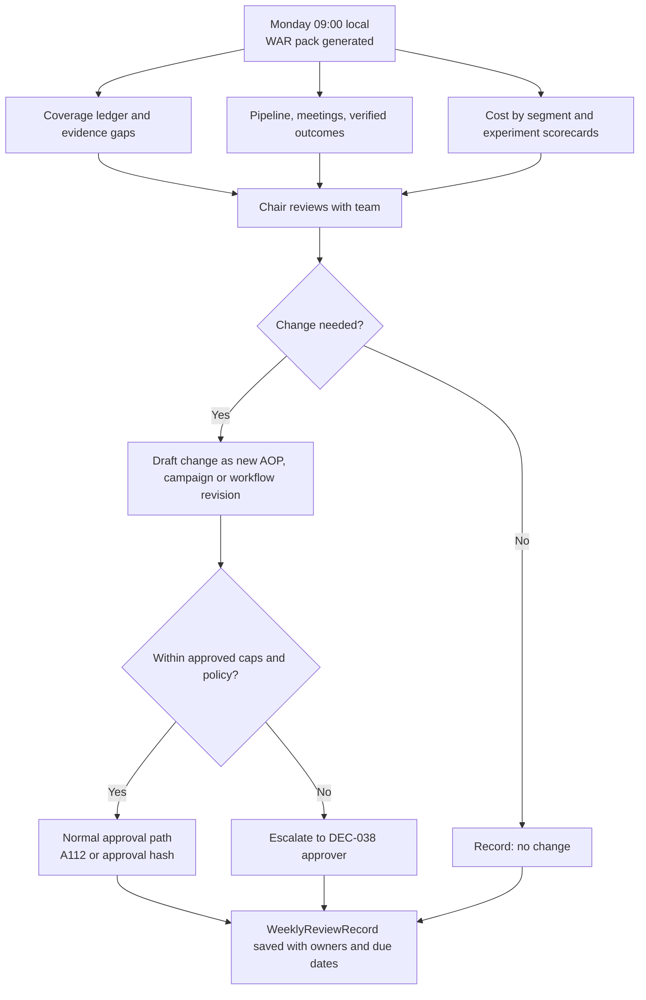

## 2.6.5 Enhancements

This is the main body. It is organized by the blueprint part it extends: §2.6.5.1 Part 1 (personas, acceptance users, KPIs, operating plan), §2.6.5.2 Part 2.1/2.2 (functional requirements and flows), §2.6.5.3 Part 2.3 (rules and RBAC), §2.6.5.4 Part 2.4/2.5 (reports, configuration, screen panels), §2.6.5.5 Part 3.3 (logical data), §2.6.5.6 Part 3.2 (integration candidates), §2.6.5.7 Part 5 (stories), §2.6.5.8 Part 6 (tests and UAT packs) and §2.6.5.9 Part 7 and Part 8 (AI touchpoints, cost and delivery).

### 2.6.5.1 Part 1 enhancements: personas, acceptance users, KPIs and the acquisition operating model

#### 2.6.5.1.1 Persona variants (extend P01–P16) [RECOMMENDATION-300]

A **variant** keeps the parent persona's role, grants and screens and adds a specialized goal, journey, filter set and success measure. Variants do not create new RBAC roles. They are used in user stories (`Persona: P03a`) and in UAT packs so that each source persona has a named owner.

| Variant | Parent · role | Source (SP-03 unless stated) | Goals | Key journey (screens) | Filters used (FR-FLT) | Safeguards specific to the variant | Success measures |
|---|---|---|---|---|---|---|---|
| **P03a Healthcare Partnerships Manager (MedMaarg)** | P03 · R03 | §Healthcare partnerships manager | Build institutional AI Hospital relationships: hospitals, clinics, labs, corporates, insurers, universities, NGOs, wellness, deployment and healthtech partners | Segment playbook (SPB-14…24) → A022 qualified queue → A032 Customer 360 → A034 draft using approved claims → A040 demo → A091–A096 pilot tracking → A071 MoU → A079 renewal | FR-FLT-09 (organization type, preventive need, Scanner/Planner/Advisor, Doctor/Lab Connect, demo/pilot, deployment) | No patient data in any field, note or attachment (BRL-ELG-14); clinical questions routed to qualified human (BR-M32); no diagnostic efficacy or guaranteed outcome claims (SPB-14, SPB-21); employer receives aggregate nonclinical metrics only (SPB-17) | Demo → pilot conversion by segment; pilots reaching signed partnership; zero clinical-data incidents (KPI-30) |
| **P03b Education Counsellor (EduVerse)** | P03 · R03 | §Education counsellor | Handle eligible student, guardian and institution enquiries; recommend the right programme and cohort; complete enrolment at approved fees | W17 enquiry → A031 lead → guardian/institution consent check → A034 approved programme answer → A040 counselling session → W19 registration → A067 approved fee quote → W26 payment evidence → A075 onboarding | FR-FLT-10 (domain, frontend/backend/cloud, learner/grade band, institution, mode, cohort, product/service, guardian permission) | Under-18 learners only via guardian or institution (DEC-030); no direct outreach, profiling or targeted ads to minors; fees only from the approved price version (BRL-QTE); external AI project requests rerouted to AppNAI (FR-DM-04) | Enquiry → enrolment rate per programme; cohort fill rate; zero minor-contact violations (KPI-17) |
| **P03c Customer Success Manager** | P03 · R03 | §Customer success manager | Own won accounts from handoff to renewal; track acceptance, milestones and feedback; prevent churn | A075 onboarding (handoff summary AG-025) → A076 milestones → W27 customer acceptance → A080 feedback → A079 renewal calendar → A081 loss reasons | FR-FLT-07 (renewal), FR-FLT-04 (owner, stage, escalation) | No renewal outreach after cancellation or suppression (BRL-ENH-A-12); no medical data in account-health scoring (SP-13 §Retention) | Onboarding time; renewal rate (KPI-15); feedback response rate |
| **P07a Procurement Manager (OrganicSpec buy side)** | P07 · R07 | §Procurement manager | Source products and suppliers: supplier RFQ, certification check, quote comparison, purchase order and payable | W16 supplier enquiry → A018 supplier evidence → A105 RFQ → supplier quotes compared → purchase order → goods receipt with quantity/quality → payable handed to finance (A074) | FR-FLT-11 (buy direction, SKU, unit, quantity, certification, supplier, price, delivery region) | Buy-side and sell-side duties separable per startup (BRL-ENH-A-08); payables never netted against receivables; certification evidence mandatory before PO | Supplier quote cycle time; goods-receipt discrepancy rate; payables matched (KPI-14) |
| **P07b Commercial Delivery Coordinator (all routes)** | P07 · R07 (route grant by capability profile, DEC-052) | §Commercial delivery coordinator | Track accepted delivery and handoff for any route: AppNAI project milestones, EduVerse cohorts and training delivery, MedMaarg pilot deployment, OrganicSpec dispatch | A076 milestone board → A105 order lines (OrganicSpec) or project milestones (AppNAI) → delivery evidence upload → W27 customer acceptance → payment evidence link (read-only) | FR-FLT-05 (deadline, task, error), FR-FLT-07 (fulfilment) | Cannot verify payments (finance only); acceptance requires evidence (SP-13 §Fulfilment) | On-time milestone rate; fulfilment accuracy (KPI-12) |
| **P10a Automation Operator** | P10 · R11 (operate scope) | §Personas and journeys (current scope) | Run day-to-day automation safely: watch live runs, resolve conflicts, reconcile uncertain outcomes, pause and resume | A110 monitor → A111 conflict queue → reconcile uncertain (Part 2.2 §2.22.5) → A014 health → A109 trigger status | FR-FLT-05 (workflow state, error, cost, quota) | Cannot publish or edit workflow graphs (P10 does); resume re-validates policy (SP-03 §A110) | Uncertain outcomes reconciled within SLA; zero blind retries |
| **P13a SaaS Applicant** | P13 · R17 (applicant) | §Personas and journeys | Evaluate the service and apply on behalf of an independent business | W31 → W32 (authority proof) → W33 (draft configuration; AI proposals unverified) | — | No provisioning before verified identity and approval (FR-W32); no real dispatch or spend during onboarding (FR-W33) | Application completion rate; time to approval |
| **P13b External Tenant Founder** | P13 · R17 → R12 of own tenant | §External tenant founder | Operate own startup independently: set goals, review usage and cost, invite users, export own data | W34 service portal → A101 usage and invoices → A099 invite users → AOP (own tenant, §2.6.5.1.6) goals → A103 export | FR-FLT-01 (own tenant only) | Never sees owner-portfolio or other-client data; exports only own tenant (OPT-19-03) | Monthly active usage; time to first qualified opportunity |
| **P14e School Administrator (EduVerse institution)** | P14 · R16 | §School administrator | Evaluate an approved school AI programme or educational product; agree MoU; follow delivery | W17 institutional enquiry → W23 proposal review → W24 MoU signature → W27 delivery milestones | — (portal) | Sees only own institution's records; no learner personal data beyond what the MoU requires (DEC-030) | MoU cycle time; delivery acceptance |
| **P05w-A Website Content Author** | P05 · R05 | §Distinct website and Admin personas | Draft website pages and posts | A107 draft → preview grant | — | Draft only; cannot publish | Drafts accepted first time |
| **P05w-P Website Publisher** | P05 · R05L | Same | Approve and publish within the assigned legal entity | A108 approve hash → publish | — | Cannot publish own draft containing a sensitive claim (BRL-ENH-A-09) | Publication lead time |
| **P09w-R Website Claims Reviewer** | P09 · R10 | Same | Review sensitive claims (clinical, education, pricing, comparative) | A051 claim review → A108 | — | Cannot approve a claim they authored (BRL-APR self-approval ban) | Zero unsupported claims published (KPI-17 family) |

#### 2.6.5.1.2 New personas P17–P20 [RECOMMENDATION-300]

##### P17 Agency / Managed-Service Operator (new) [GAP-301]
- **Source:** SP-03 §Agency / managed-service operator ("Execute delegated client work. Explicit client assignment, scoped sender and limits; no other client data"); SP-37 §05 step 1 ("self-service, managed or authorized hybrid arrangement").
- **Who:** a person employed by the platform operator (or by an approved partner agency) who runs growth work **inside an external SaaS client's tenant** on the client's behalf under a managed-service arrangement.
- **Goals:** execute the client's approved campaigns and research within the client's sender identity, budget and policy; report outcomes to the client.
- **Pains:** juggling several clients; risk of sending from the wrong sender or mixing client data.
- **Journeys:** J-50 Accept delegation grant (client admin approves in W34) → switch into the client tenant (explicit tenant switch, banner "Acting for <client>") → work queue limited to the delegated modules → dispatch only through the client's sender and budget → monthly outcome report to the client → grant expiry or revocation.
- **Screens:** the same Admin screens as P03/P04/P05 inside the client tenant, filtered by the delegation scope; A101 read-only usage; never A099 membership administration or A112 configuration change unless the grant says so.
- **Permissions:** role **R21** (§2.6.5.3.2); one active client tenant per session; grant time-boxed (default 90 days, renewable by the client [ASSUMPTION-307]); no cross-client view, search, export or copy; cannot approve the client's claims, budgets or autonomy levels.
- **Success:** client-reported outcome KPIs met; zero cross-client incidents (KPI-30); every delegated action attributable to the operator and the grant.

##### P18 Integration Administrator (new) [GAP-307]
- **Source:** SP-03 §Additional responsibilities ("manages permitted provider credentials and adapter benchmarking without accessing unrelated tenant data").
- **Goals:** connect, rotate and test provider credentials (SES, WhatsApp, calendar, e-sign, payment, search); run adapter benchmarks; keep paid adapters disabled until approved.
- **Journeys:** J-51 Register provider connection → store secret in the secrets manager (value never shown again) → sandbox test → request activation approval (owner or tenant admin decides policy, SP-03) → rotate before expiry → benchmark report (FR-ENH-A-006).
- **Screens:** A011 integration registry and adapters, A012 cost and budget (read), A014 health.
- **Permissions:** sub-role **R12I** of R12; sees connection metadata, health and benchmark results, never business records or message content; cannot enable a paid adapter without approval (NFR-037).
- **Success:** zero expired credentials in production; benchmark reports complete before any paid activation.

##### P19 Template Reviewer (new) [GAP-307]
- **Source:** SP-03 §Personas and journeys ("template reviewer").
- **Goals:** review proposed workflow templates, node schemas and business-profile templates before publication in A113/A100.
- **Journeys:** J-52 Open review queue → diff against the previous version → run simulation results → check node allowlist, no code and no secrets (DEC-051) → approve or return with reason → published version becomes immutable.
- **Permissions:** sub-role **R11T** of R11; cannot approve a template they authored (BRL-ENH-A-11); read-only on run data.
- **Success:** zero templates published with an unapproved node; review turnaround.

##### P20 QA / Acceptance Tester (recorded for completeness)
- **Source:** SP-03 §Additional responsibilities ("QA engineer uses synthetic data and sandbox credentials; does not require live customer contact histories").
- **Role mapping:** test identities in `test`/`staging` only (Part 6.1 GSE-SYN); never a production grant. No new RBAC role.

#### 2.6.5.1.3 Acceptance owners and RACI [RECOMMENDATION-313]

SP-03 §Additional responsibilities names who signs what. Part 6.1 and Part 8.2 define gates but not one matrix. The matrix below binds acceptance procedures to accountable signers. R = responsible (executes), A = accountable (signs), C = consulted, I = informed.

| Acceptance area | Product Owner | Assigned operators (P03–P07, P10a) | Finance (R08/R09) | Legal/compliance (R10) | Security lead | Support admin (R13/R14) | QA lead |
|---|---|---|---|---|---|---|---|
| Business outcomes per vertical route (AP-02, AP-03) | **A** | R (demonstrate day-to-day workflow) | C | C | I | I | R (evidence) |
| Financial and closure transitions (AP-04; FR-DM-01…03) | C | R | **A** | C | I | I | R |
| Regulated transitions: contracts, claims, jurisdiction activation (FR-ENH-A-014) | C | R | C | **A** | I | I | R |
| Denial and isolation (AP-10, persona negatives PJ-01…12) | I | R | I | C | **A** | I | R |
| Trial, export and cancellation (AP-09, W34, A103) | C | I | C | C | C | **A** | R |
| Template publication (P19) | C | I | I | C | C | I | R; template reviewer **A** |
| Release readiness (A090) | **A** (business) | I | C | C | **A** (security) | C | R |

**Rule.** No real external outreach is used in any acceptance test without explicit controlled permission recorded in the EVR (SP-03 §Additional responsibilities; Part 6.1 §6.1.5.4).

#### 2.6.5.1.4 Training record and user-productivity protocol [RECOMMENDATION-311, RECOMMENDATION-314, GAP-306]

**Training record (FR-ENH-A-018).** SP-03 §Role training: "Record competence, assigned permission and training acknowledgement. Training never grants authority; only authorized membership and action policy do." Part 8.2 §8.2.2.2 plans training per persona and RSK-024 uses training as a gate. This part adds the record and the rule:

| Field | Type | Rule |
|---|---|---|
| `training_record_id` | UUID | Immutable |
| `user_id`, `tenant_id`, `startup_id` | FK | Scoped |
| `persona_code` | enum (P01…P20, variants) | Must match an assigned role |
| `module_id`, `module_version` | string | From the Part 8.2 training catalogue |
| `synthetic_journey_ids` | list | PJ- and UAT- scenario IDs completed, including at least one denial and one escalation scenario |
| `competence_result` | enum `pass`, `needs_practice` | Assessed by trainer |
| `acknowledged_at` | timestamp | User acknowledgement of the operating rules |
| `assessor_id` | FK | Must differ from `user_id` |
| `expires_at` | date | Default 12 months [ASSUMPTION-308] |

BRL-ENH-A-10 (§2.6.5.3): a valid training record is **necessary but never sufficient** for a permission. The PDP checks role, grant and policy; the training record only unlocks the UI affordance "Send", "Approve" or "Publish" for roles that RSK-024 gates.

**User-productivity protocol (closes NFR-034 "baseline undefined").** SP-03 §User productivity: "Time approved representative owner or employee task with sample user; observe errors and handoff."

| Step | Specification |
|---|---|
| Tasks | Five core tasks per persona group, for example P03: open qualified queue → draft → submit for approval; P04: review 10 signals with evidence; P05: brief → draft → submit; P06: create bid checklist; P08: verify one payment as maker. Task scripts are versioned with the UAT pack |
| Participants | 5 representative users per persona group, or all users if fewer [ASSUMPTION-303] |
| Baseline | Measured once on the current manual process (spreadsheets, email) before W2, then on the first usable build of each screen family |
| Metrics | Task completion (yes/no), time on task (median, p90), error count (wrong record, wrong scope, policy block caused by user error), handoffs (number of people involved), clicks to the approved operation, SUS score (optional) |
| Guardrail | No safeguard removed or approval skipped to improve time (SP-03 §User productivity acceptance) |
| Evidence | EVR with `scenario_id` = PROD-<persona>-<task>, observer, build digest |
| Target | Candidate median time ≤ baseline and error rate not higher than baseline; numeric targets set after the first measurement (provisional until measured, SP-03 §Role training) |

#### 2.6.5.1.5 KPI additions [RECOMMENDATION-303, RECOMMENDATION-307]

These KPIs extend KPI-01…31. They use the same binding rules (distinct records, numerator and denominator, as-of time, original currency, Unknown ≠ 0).

| KPI | Name | Formula | Target | Frequency | Owner | Data source | Source |
|---|---|---|---|---|---|---|---|
| KPI-ENH-A-01 | Fresh source coverage | successful, fresh, eligible source checks ÷ eligible due source checks, per country × source family; uncovered regions listed | Visible 100%; target ≥ 90% of due checks successful per week once sources are stable [RECOMMENDATION-303] | Weekly | Research lead | CoverageLedger (A010, RP-ENH-A-01) | SP-11 §Coverage and examples; CONFLICT-302 |
| KPI-ENH-A-02 | Stage-pair conversion | for each adjacent funnel pair (enquiry → qualified, qualified → meeting held, meeting → proposal, proposal → verified closure): records reaching the later stage ÷ records entering the earlier stage in the cohort window | Baseline by W3; improve vs matched baseline | Weekly | Product Owner | RP-ENH-A-03 | SP-14 §Public visibility; OPT-12-01 |
| KPI-ENH-A-03 | Cost per verified outcome | attributable cost (AI + data + channel + ads + allocated infrastructure) ÷ verified closures (DEC-054 route rules), per startup, cohort and currency | Falling vs baseline; zero denominator shown as "not assessed" | Monthly | FinOps | RP-ENH-A-02 | SP-14 §Measurable acquisition; §Outcome economics |
| KPI-ENH-A-04 | Discovery recall (known corpus) | eligible records found ÷ eligible records in the labelled known corpus, per source family | Disclosed with sample size; no numeric gate in pilot | Per benchmark | Data steward | Benchmark report (FR-ENH-A-005) | SP-11 §Low-cost discovery; OPT-11-04 |
| KPI-ENH-A-05 | Experiment guardrail breaches | experiments paused by a stop trigger ÷ experiments run | Reported; every breach has a review note | Monthly | Growth lead | Experiment registry (FR-ENH-A-011) | SP-14 §Acquisition experiments |

#### 2.6.5.1.6 Acquisition operating plan per business line (AOP) and weekly acquisition review [RECOMMENDATION-305, GAP-305]

SP-14 §Acquisition operating plan names an accountable role per business line, and §Weekly plan defines a weekly cadence. The blueprint has the tools (campaigns, research plans, A102 planner) but no plan object or ceremony that ties them together.

| AOP ID | Business line | Scope statement (SP-14) | Accountable role (source) → blueprint persona | Primary segments | Approved propositions (examples, still subject to claims approval) | Conversion denominator |
|---|---|---|---|---|---|---|
| AOP-01 | AppNAI Technologies | Global permitted AI projects, RFPs, tenders and direct enterprise requirements; bidding authority and delivery capacity | Business owner → P02 (AppNAI startup head) | Global enterprises, IT firms, procurement portals | AI/GenAI software development, engineering, consulting | Eligible tenders found → bid → award → contract → verified payment |
| AOP-02 | MedMaarg Healthcare | Institutional AI Hospital, Doctor Connect, Pathology Lab Connect, corporate wellness and approved pilots | Healthcare lead → P02 (MedMaarg) with P03a | SPB-14…24 segments | Wellness AI Scanner/Planner/Advisor (approved claims only) | Qualified institution → demo → pilot → signed partnership → payment |
| AOP-03 | EduVerse Future Skills | AI Backend (GenAI/ML/DL/NLP/CV), Frontend, cloud/AWS, school AI products/services; no external AI project delivery | Education lead → P02 (EduVerse) with P03b | Guardians/adult learners, schools, colleges, universities, employers | Programmes and institutional training | Enquiry → counselling → registration/MoU → delivery → receipt |
| AOP-04 | OrganicSpec | Organic product demand/supply, purchase, sale, services, agriculture training, distribution | Agriculture lead → P02 (OrganicSpec) with P07, P07a | Buyers, suppliers, distributors, FPOs, institutions | Organic products; RamVan and Smart Biochar only after readiness approval [ASSUMPTION-300] | RFQ → quote → order → accepted delivery → reconciled receivable/payable |
| AOP-05 | Future business (owned or external tenant) | Template plus approved legal identity, geography, offering, objective, rules, evidence, language, channel, budget and acceptance | Tenant admin → P11 (owned) or P13b (external) | Per template | Per template | Per template capability profile |

**Plan content (one AOP revision per startup per quarter, versioned like any policy):** objective; segments with geography; approved propositions (offering IDs, claim IDs); source coverage priorities (country × source family); evidence gaps to close; eligible engagement channels; budget split (research, channel, ads, AI) within the startup's caps (DEC-008, DEC-020); experiments planned (FR-ENH-A-011); conversion denominators; stop rules. Approval: startup head (R02) proposes, founder (R01) approves for owned startups; client admin approves for external tenants.

**Weekly acquisition review (WAR) procedure (FR-ENH-A-012).** Cadence: weekly, 45–60 minutes per startup or cluster of small startups [ASSUMPTION-302]. Chair: the AOP accountable role.

| Agenda item | Input (screen / report) | Decision recorded |
|---|---|---|
| 1. Coverage and evidence gaps | RP-ENH-A-01 coverage ledger; KPI-ENH-A-01 | Next week's source priorities (country × family) within budget |
| 2. Qualified pipeline | RP-02, A022 queue, KPI-07 | Assignments; research vs nurture decisions |
| 3. Meetings and demos | RP-10; KPI-06 | Follow-up owners |
| 4. Pipeline progress and verified outcomes | RP-12…RP-15; KPI-31 | Escalations |
| 5. Cost by segment | RP-ENH-A-02 outcome economics; RP-21 | Budget reallocation (only within approved caps; loosening needs DEC-038 approver) |
| 6. Experiments | Experiment registry scorecards | Continue / stop / promote winner (one change at a time) |
| 7. Compliance signals | RP-23; KPI-17, KPI-18 | Pauses; claim reviews |

The WAR output is a **WeeklyReviewRecord** (§2.6.5.5) with decisions, owners and due dates. Any change to an active campaign or workflow still goes through its normal approval (A112, approval hash). The WAR never authorizes a send, spend or price change by itself.

#### 2.6.5.1.7 Seed offerings for OrganicSpec [ASSUMPTION-300]

The common core of every source document says "RamVan and Smart Biochar subject to approved readiness" (BRD §1). The blueprint applies the readiness gate (DEC-060, BRL-MKT-02, BRL-SCR-04) but never names these offerings. The W0 seed data for OrganicSpec therefore includes two Offering records, **RamVan** and **Smart Biochar**, in state **Planned**. While Planned they cannot contribute to fit scores, appear in content, ads, pages or outreach, or be quoted. Moving to *Approved and Available* follows WF-01 with claims approval. SP-37 §02 uses RamVan in a worked example; in UAT the offering is set to Approved and Available **in the synthetic fixture only**.
