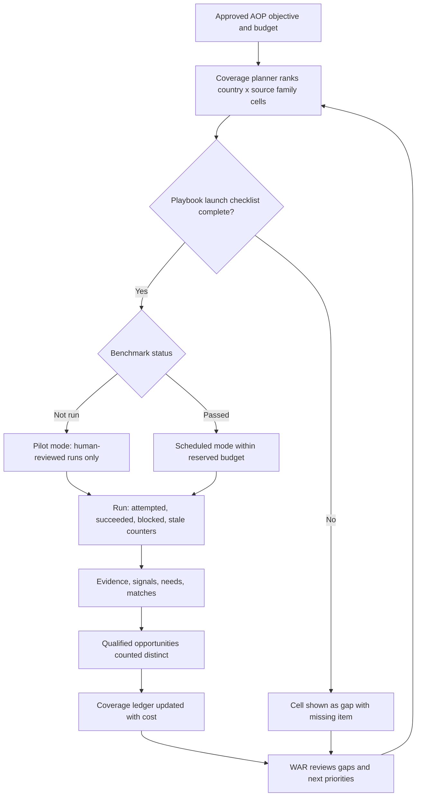
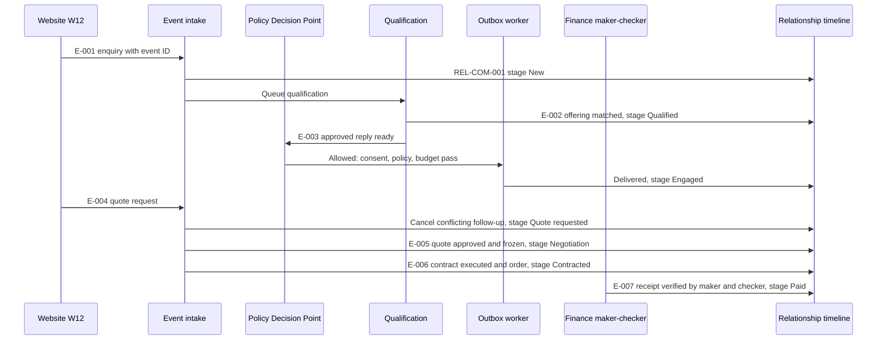
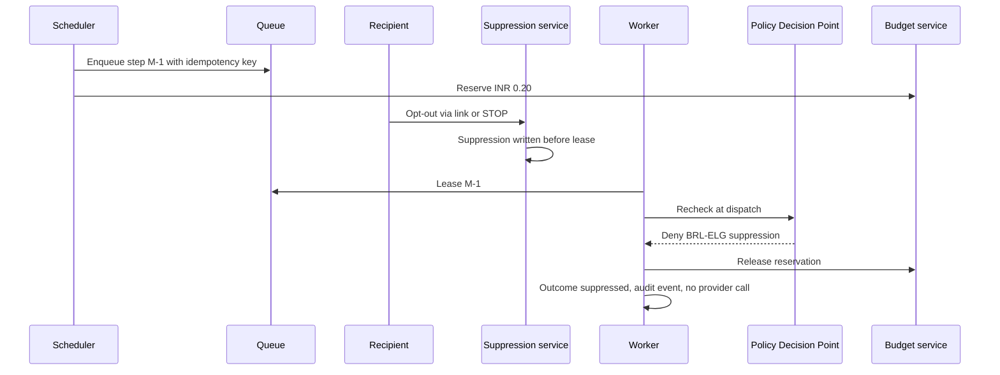
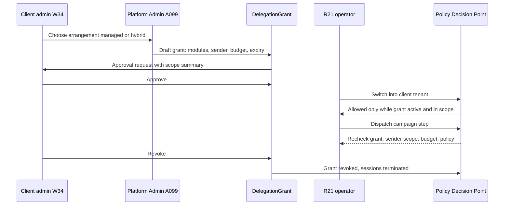

### 2.6.5.2 Part 2.1 and Part 2.2 enhancements: functional requirements, playbooks and flows

#### 2.6.5.2.1 Enhanced functional requirement register (FR-ENH-A)

Format matches the Part 2.1 register. "Wave" follows DEC-006/DEC-034 (the wave of the module the FR extends). Every FR has at least one test in §2.6.5.8.

| FR ID | Requirement | Surface · screens | Module · epic | Wave · MoSCoW | Acceptance summary | Source | Tests |
|---|---|---|---|---|---|---|---|
| FR-ENH-A-001 | **Coverage ledger.** For each tenant × startup × country/state × language × source family × approved source, record per scheduled run: attempted, succeeded, blocked (reason), stale, evidence items, distinct qualified opportunities, cost (INR), last success. Show denominators and uncovered regions; never label coverage "complete" | Admin · A010, A015, RP-ENH-A-01 | M07, M10, M11 · EP-05 | W1 · Must | Every run increments exactly one outcome counter per source; blocked sources show the rule; KPI-ENH-A-01 computed from the ledger | SP-11 §Worldwide source; §Research coverage fields | TC-ENH-A-015 |
| FR-ENH-A-002 | **Geography triple.** Opportunity and Organization carry three independent geography sets: counterparty location (buyer/supplier/project), client geography (where the contracting entity sits) and delivery region. Filters and coverage use the correct one | Admin · A020, A022, A032; FR-FLT-02 | M13, M17 · EP-05/06 | W1 · Should | A UK-headquartered buyer with delivery in Odisha appears under UK for client geography and Odisha for delivery region | SP-11 §Research coverage fields | TC-ENH-A-016 |
| FR-ENH-A-003 | **Coverage planner.** Rank unsearched or stale (country × source family) cells by objective fit × budget availability × source quality (permission, freshness, historic qualified-conversion), not by volume; propose next week's research plan for WAR approval | Admin · A015, A102 | M10, M55 · EP-05 | W1 · Should | Ranking explains its factors; prohibited families never proposed | SP-11 §Coverage gaps; §Optimization | TC-ENH-A-017 |
| FR-ENH-A-004 | **Source and segment playbook registry (SPB).** Versioned playbook per source family and per MedMaarg segment with purpose, access method, admin gate, dependencies, launch checklist (permission, URL, freshness, quota, owner), cost line, stage path, decision-maker role, prohibited claims and closure evidence (§2.6.5.2.2–3) | Admin · A010 (playbook tab), A022 | M07 · EP-05 | W1 · Must | A source cannot be scheduled unless its playbook launch checklist is complete; segment stage path drives A029 pipeline template | SP-11 §Market sources and acquisition playbooks | TC-ENH-A-011, 015 |
| FR-ENH-A-005 | **Discovery benchmark.** Labelled benchmark per source family: up to 50 permitted records sampled stratified by country and opportunity type; metrics precision, recall within known corpus, duplicate rate, freshness, contact validity, cost per usable opportunity; report with sample size; required before any family moves from pilot to scheduled production and before any paid data provider is enabled | Admin · A084, RP-20 | M54, M14 · EP-04/05 | W1 · Must | Report shows n, precision, recall with 95% Wilson interval; paid enablement blocked without report (BRL-ENH-A-03) | SP-11 §Pilot benchmark; §Low-cost discovery | TC-ENH-A-012 |
| FR-ENH-A-006 | **Provider and evidence benchmark.** Same protocol for search, extraction, contact-verification and e-sign/payment adapters: matched samples by geography and purpose, identical ground truth, p95 latency, full cost (incl. staff and infrastructure), data entitlement, actual conversion; paid fallback stays disabled until approved | Admin · A011 | M05, M53 · EP-04 | W1 · Must | Benchmark record attached to the activation approval | SP-11/12/13/14 §Provider and evidence benchmark | TC-ENH-A-010 |
| FR-ENH-A-007 | **Optional "partnership-fit" scoring version** (CONFLICT-300): six components capability 0.30, explicit need 0.25, qualification 0.15, geography 0.10, budget 0.10, timing 0.10, with review defaults fit ≥ 70 and coverage ≥ 70, available as an approved scoring-version template for partnership opportunity types; DEC-011 remains the default | Admin · A019, A022 | M17 · EP-06 | W3 · Could | Activating it requires a benchmark showing precision not lower than the default version on the same labelled set | SP-11 §Coverage and examples | TC-ENH-A-013, 014 |
| FR-ENH-A-008 | **Reply taxonomy union** (CONFLICT-303) used by AG-013 and the rules engine: interest/positive, question, objection, decline, unsubscribe/STOP, bounce (provider event), out-of-office, meeting request, escalation/urgent, clinical (MedMaarg), unknown. Each class has a deterministic sequence effect | Admin · A037, A045 | M27 · EP-08 | W2 · Must | Effects per §2.6.5.2.6; "decline" stops the generic sequence | SP-12 §Channel and communication policies | TC-ENH-A-019 |
| FR-ENH-A-009 | **Social publication proof.** A post is "Published" only when the provider returns an external post ID and URL; scheduled and accepted are distinct states; retry with the same idempotency key never creates a second post | Admin · A053 | M35 · EP-11 | W3 · Should | Provider timeout → `uncertain` → reconcile by listing recent posts before retry (DEC-050) | SP-12 §Inbound marketing acquisition | TC-ENH-A-022 |
| FR-ENH-A-010 | **Acquisition operating plan (AOP).** Versioned per startup per quarter: objective, segments × geography, approved propositions, coverage priorities, evidence gaps, eligible channels, budget split within caps, experiments, denominators, stop rules, accountable owner (§2.6.5.1.6) | Admin · A043 (AOP tab), A102 | M55, M30 · EP-17 | W3 · Should | Only one active AOP revision per startup; campaigns and research plans link to it | SP-14 §Acquisition strategy measurement; §Acquisition operating plan | TC-ENH-A-036 |
| FR-ENH-A-011 | **Experiment registry.** Each experiment: hypothesis, single changed variable, variants, eligible cohort bound (min/max), holdout %, assignment method (deterministic hash), attribution window, primary metric, guardrails, stop triggers (BRL-ENH-A-13), planned end, result with interval, decision | Admin · A058, RP-ENH-A-04 | M38, M53 · EP-12 | W3 · Should | Starting a second experiment that changes the same variable on overlapping cohort is blocked | SP-12, SP-14 §Acquisition experiments; OPT-12-04 | TC-ENH-A-023, 039 |
| FR-ENH-A-012 | **Weekly acquisition review.** Generate the WAR pack, record decisions in WeeklyReviewRecord, create tasks for owners; no direct execution | Admin · A043, A106 | M30, M61 · EP-17 | W3 · Should | Pack generated on schedule; decisions link to approvals | SP-14 §Weekly plan | TC-ENH-A-037 |
| FR-ENH-A-013 | **Outcome economics report.** Cost per qualified opportunity and per verified outcome by startup × segment × channel × cohort period × currency; zero denominator → "not assessed" | Admin · A082, RP-ENH-A-02 | M52, M53 · EP-15 | W5 · Should | Matches finance-reconciled closures; cost classes listed | SP-14 §Outcome economics | TC-ENH-A-039 |
| FR-ENH-A-014 | **Jurisdiction activation decision record.** Before the first outbound action, publication or commercial route in a new country/region for a startup: record jurisdiction, permitted sources, communication rules, privacy basis, commercial route, specialist reviewer, decision and expiry; PDP denies activation without an approved record | Admin · A007, A072 | M04, M57 · EP-03 | W3 · Must | Outbound to a newly enabled country denied until record approved by R10 | SP-14 §Cross-border and regional decision; OPT-19-02 | TC-ENH-A-030 |
| FR-ENH-A-015 | **Service arrangement and managed-service delegation.** Tenant attribute `service_arrangement` ∈ {self_service, managed, hybrid}; for managed or hybrid, a DelegationGrant (client-approved, module scope, sender scope, budget scope, expiry) admits R21 operators to the client tenant | Website W33, W34; Admin A099, A101 | B-SVC · EP-20 | W5 · Should | No R21 access without an active grant; revocation is immediate | SP-03 §Agency; SP-37 §05 | TC-ENH-A-024…026 |
| FR-ENH-A-016 | **Relationship timeline projection.** A stable `relationship_id` per (tenant, startup, counterparty organization, primary offering line) links lead, opportunity, conversations, quotes, contracts, orders, receipts and onboarding; a read-only derived **relationship stage** is shown (§2.6.5.2.7) | Admin · A032, A110 | M23 · EP-07 | W2 · Should | Stage derives only from committed state; never set by hand or by AI | SP-13 §Conversion and closure; SP-37 §07 | TC-ENH-A-047 |
| FR-ENH-A-017 | **Legal disclosure block** on every public site: legal entity name, registration identifiers, registered address, contact, grievance/privacy contact, governing policies; content approved per legal entity and locale | Website W01–W11 footer; Admin A107 | B-WEB · EP-19 | W3 · Must | Publication blocked if the block is incomplete for the site's legal entity | SP-14 §Public visibility | TC-ENH-A-033 |
| FR-ENH-A-018 | **Training and competence record** (§2.6.5.1.4) | Admin · A002 (user detail) | M01 · EP-21 | W0 · Should | Record cannot grant permissions; gated affordances read it | SP-03 §Role training | TC-ENH-A-040 |
| FR-ENH-A-019 | **Bulk action preview.** Every bulk action (assign, enrol, tag, export, send) first shows the selected count, the eligible count after server recheck, the estimated cost and the policy exclusions by rule; confirmation carries the preview hash | Admin · list screens using LP-LIST | Cross-cutting · EP-17 | W2 · Should | Server re-evaluates on confirm; mismatch with preview hash → 409 and new preview | SP-03 OPT-15-04 | TC-ENH-A-043 |
| FR-ENH-A-020 | **Hold record.** Every PDP "hold" (uncertain mandate, stale data, opt-out, missing identity, unsupported source, budget) stores tenant/startup scope, relationship ID, evidence reference, policy result and rule IDs, workflow revision, run ID, reviewer queue and resolution | Admin · A110, A111, A072 | M55 · EP-18 | W2 · Must | Hold visible in the relevant approval or exception workspace | SP-37 §02 Illustrative decision | TC-ENH-A-044 |

#### 2.6.5.2.2 Source-family playbooks SPB-01…13 [RECOMMENDATION-302]

Common launch checklist for every family (SP-11): permission and terms review recorded, source URL or API endpoint, freshness TTL (BRL-ENH-A-02), quota and rate limit, accountable owner, budget line (DEC-020), benchmark status (FR-ENH-A-005). "Pilot" means human-reviewed only; "Scheduled" means Celery Beat runs it within the reserved budget.

| SPB | Source family | Business purpose | Access method (backend) | Admin gate | Modules | Cost line (DEC-020) | Default TTL | Start mode | Never |
|---|---|---|---|---|---|---|---|---|---|
| SPB-01 | Organization websites | Expansion, partnership, digital-health announcements | Licensed search plus permitted extraction of own/public sites (RSS, sitemap, HTML) | Terms/robots review; URL/date evidence | M10–M16 | B01/B03/B04 shared; ₹0 separate licence assumed | 90 days | Pilot → Scheduled after benchmark | Bypass paywalls, logins or robots |
| SPB-02 | Search engines | Relevant organization announcements | Licensed search API | Quota and permitted-use review | M10–M12 | B03 search credits; free quota first (verify at time of implementation, as of 27 Nov 2026) | 30 days | Scheduled within B03 | Scrape result pages without licence |
| SPB-03 | Official directories | Hospital, clinic, insurer identity | Official or licensed organization listings | Verify public business fields only | M13, M19 | B01/B03/B04 shared | 180 days | Scheduled | Collect patient or personal health data |
| SPB-04 | Government procurement | Preventive-health and AI RFPs/tenders | Official tender portal; manual where no authorized API | Respect portal access terms; verify deadline | M11, M14, WF-08 | B01 shared | 7 days (BRL-SRC-06) | Manual or Scheduled per portal terms | Automated bid submission (DEC-053) |
| SPB-05 | LinkedIn | Organization announcements | Approved API scopes or human research | No profile harvesting; no unsolicited DMs | M33 | No paid scraping; separate licence quote if needed (verify) | 30 days | Manual research only until API scope approved | Automated profile harvesting or DMs |
| SPB-06 | Facebook / Instagram | Public organization posts; own inbound | Authorized Meta business APIs | Permissions and app review; no private groups | M33, M35, M41 | B10 reserve; ads excluded | 30 days | Pilot | Private group collection |
| SPB-07 | X / YouTube / Reddit | Public business posts, industry trends | Official API or permitted feeds | Terms, quotas, no sensitive-person targeting | M33, M59 | Paid API not committed; B10 reserve | 14 days | Pilot | Sensitive-person targeting |
| SPB-08 | WhatsApp | Inbound or opted-in enquiry | Official Business Platform webhook and templates | Opt-in, template and 24-hour window gate | M31 | B06 template usage | n/a (event-driven) | Event-driven | Global search or number scraping |
| SPB-09 | Email | Business replies, requested information | Authorized mailbox/provider webhooks (SES, DEC-025) | Eligibility, opt-out, bounce control | M26, M27 | B05 | n/a | Event-driven | Purchased lists |
| SPB-10 | Startup website | Demo and product enquiry | First-party forms and contextual page events | Consent; no clinical event tracking | M22, M37 | B01 shared | n/a | Event-driven | Third-party pixels on health pages (BRL-MKT-06) |
| SPB-11 | Partner referrals | Relevant institutional introductions | Partner agreement + customer-initiated contact | No unsolicited third-party enrolment | M42 | B01 shared; commission record only (DEC-046) | 180 days | Event-driven | Enrol referred contacts without their own consent |
| SPB-12 | Webinars | Demo interest | Authorized registration and attendance API | Purpose-specific consent and retention | M40 | Existing/free meeting plan; B10 if needed (verify) | n/a | Event-driven | Invent attendees; record without permission (BRL-ENH-A-05) |
| SPB-13 | Insurance / corporate annual reports | Wellness or benefit initiatives | Permitted public reports and press releases | Organization level only | M12, M63 | B01/B03/B04 shared | 365 days | Scheduled (annual cycle) | Individual-level inference |

#### 2.6.5.2.3 MedMaarg segment playbooks SPB-14…24 [RECOMMENDATION-302]

Common to all segments (SP-11): user experience *evidence → account → contact → demo/CTA*; entities Organization, Need, Match, Deal; interface M13–M29 and M43–M50; acceptance *qualified need + verified business channel + eligibility + actual closure evidence*; evidence source "deck slides 10–14" (not supplied, DEC-021, GAP-300); cost: shared B01–B10, no separate allocation. All segments inherit DEC-030 (no minors' data) and BRL-ELG-14 (no health data in targeting).

| SPB | Segment | Trigger signal (organization level) | Offering fit (approved only) | Decision-maker role | Stage path (A029 pipeline template) | Prohibited / mandatory | Closure evidence (DEC-054) |
|---|---|---|---|---|---|---|---|
| SPB-14 | Hospitals | Preventive-health or digital-transformation programme | Scanner / Planner / Advisor; pilot | Medical superintendent or partnership head | Demo → limited pilot → contract | No diagnostic efficacy claims | Executed contract |
| SPB-15 | Clinics / doctors | Published preventive-care initiative or inbound request | Scanner/Planner; Advisor | Clinic owner or doctor via official channel | Demo → collaboration review | Medical ethics and referral terms reviewed by R10 | Signed collaboration terms |
| SPB-16 | Diagnostic labs | Report service or new wellness package | Advisor + Planner (Pathology Lab Connect) | Operations or partnership head | Demo → integration feasibility → agreement | Provider-neutral user communications | Executed agreement |
| SPB-17 | IT / corporate | Public employee-wellness programme | Scanner + Planner institutional package | HR / employee-benefits head | Wellness pilot → annual package | Employer receives aggregate nonclinical metrics only | Executed contract + verified first payment |
| SPB-18 | Insurance | Public wellness benefit or partnership request | Preventive wellness pilot | Product or health-partnership head | Feasibility → legal review → pilot | No health-risk underwriting use | Executed pilot agreement |
| SPB-19 | Universities | Institutional wellness initiative | Institutional programme | Registrar or student welfare | Demo → governed pilot | No minors' data for marketing (DEC-030) | Executed MoU |
| SPB-20 | NGO / government | Public rural-health project or tender | Phygital AI Hospital / institutional | Programme or procurement officer | Formal proposal → tender/contract (WF-08 style deadline control) | Procurement and readiness gates | Award + executed contract |
| SPB-21 | Wellness / fitness | Personalized wellness initiative | Scanner + Planner | Founder or operations head | Pilot → package | No guaranteed medical outcomes | Executed package agreement + verified payment |
| SPB-22 | Deployment partner | Public expression of partnership interest | Phygital model | Founder or business development | Due diligence (AG-032) → pilot → deployment | Site readiness approval before any deployment claim | Executed partner agreement |
| SPB-23 | B2C | Voluntary product enquiry | Scanner/Planner/Advisor | The customer | Approved product answer → link → payment | No sensitive targeting; no ad pixels on health pages | Verified payment |
| SPB-24 | Healthtech | Public integration or partner request | API licensing subject to readiness | CTO or product head | Technical discovery → sandbox → agreement | No unsupported API promises (BRL-MKT-02) | Executed licence agreement |

#### 2.6.5.2.4 Discovery benchmark and provider benchmark protocol (FR-ENH-A-005, FR-ENH-A-006) [GAP-309, ASSUMPTION-301]

| Element | Specification |
|---|---|
| Unit | One source family (SPB-01…13) within one startup's objective, or one provider adapter |
| Corpus | Up to **50 permitted records** per family, stratified by country (≥ 2 strata where the plan covers ≥ 2 countries) and opportunity type. Where fewer than 50 permitted records exist, the full permitted population is used and the report says so [ASSUMPTION-301] |
| Labelling | Two labellers independently (R04 and a second reviewer); disagreements adjudicated by the research lead; labels: eligible / ineligible / duplicate / stale / contact-valid |
| Known corpus for recall | Records the labellers found by manual search within the same sources and window; recall is "within the known eligible corpus", never against "all opportunities" |
| Metrics | precision, recall (KPI-ENH-A-04), duplicate rate, median evidence age, verified contact rate (KPI-03), cost per usable opportunity (INR), p95 latency (provider benchmarks) |
| Interval | Report 95% Wilson interval for precision and recall; with n < 30, report counts only |
| Gates | Family moves Pilot → Scheduled when precision lower bound ≥ 0.80 (aligned with DEC-001 signal gate) and no restricted record was collected; a paid provider may be enabled only when it shows incremental eligible records or cost per usable opportunity at least 20% better than the free path on the same corpus [RECOMMENDATION-304], and the approval follows NFR-037 |
| Synthetic proof (SP-11) | Fixture FX-A-05: five synthetic documents; permitted fresh sources yield exactly 3 professional contacts; restricted and stale sources yield none. It proves wiring only; "no claim from five synthetic documents" |
| Evidence | EVR with dataset version, labeller IDs, build digest; benchmark report stored with the activation approval |

#### 2.6.5.2.5 Research coverage planning flow

#### 2.6.5.2.6 Reply taxonomy and deterministic effects (FR-ENH-A-008, CONFLICT-303)

| Class | Source label (SP-12) | Blueprint label (Part 2.2 WF-06) | Sequence effect | Other effects | Owner action |
|---|---|---|---|---|---|
| interest | interest | positive | Stop generic sequence | Opportunity stage proposal; task to owner within SLA | Reply or book meeting |
| question | (part of interest) | question | Stop generic sequence | AG-014 drafts answer from approved knowledge | Approve reply |
| objection | objection | objection | Stop generic sequence | Objection record (M45); AG-021 suggests approved response | Resolve or escalate |
| decline | decline | — (added) | Stop generic and promotional sequences | Stage "Not now/Declined"; re-engagement only per policy after cooling period | None required |
| unsubscribe | unsubscribe | STOP | Stop all promotional; suppression across linked contacts | Suppression entry with evidence (BRL-ELG) | None |
| bounce | bounce (provider event) | (provider event, not intent) | Stop channel | Hard bounce → channel suppression; soft bounce → retry policy | Verify contact |
| out-of-office | out-of-office | out of office | Pause until return date + 1 business day | Next step rescheduled | None |
| meeting request | meeting | — (added) | Stop generic sequence | Slot offer (BRL-MTG-01) | Confirm slot |
| escalation / urgent | escalation | urgent | Stop generic sequence | Notification severity High (A106) | Human response |
| clinical (MedMaarg) | — | clinical | Stop generic sequence | Route to qualified human; no AI answer (BR-M32) | Specialist reply |
| unknown | — | — | Pause | Human classification queue | Classify |

#### 2.6.5.2.7 Relationship timeline and stage projection (FR-ENH-A-016, CONFLICT-304)

SP-37 §07 shows one relationship moving through New → Qualified → Engaged → Quote requested → Negotiation → Contracted → Paid/fulfilment. The blueprint keeps separate state machines (Part 2.3 §2.27.1–2.27.8). The resolution keeps those as the only writable states and adds a **read-only projection**:

| Relationship stage (projection) | Derived from committed state (first rule that matches, evaluated top-down from the latest) |
|---|---|
| Paid / fulfilment | Payment `Verified` (§2.27.7) or Order in `Delivering`/`Accepted` with verified receipt |
| Contracted | Contract `Executed` (§2.27.6) or Order `Confirmed` |
| Negotiation | Quote `Approved`/`Delivered` with open objection or change request |
| Quote requested | Inbound intent `quote request` or Quote `Draft`/`Pending approval` |
| Engaged | Outbound message `Delivered` with reply, or meeting booked |
| Qualified | Opportunity `Qualified` (BRL-SCR-06) |
| New | Lead `New` or signal captured |
| Held | Any open hold record (FR-ENH-A-020) overlays the stage with a "Held" badge |

#### 2.6.5.2.8 Opt-out race (queue before lease) and spend-cap race

Expected: zero provider calls; exactly one `suppressed` outcome; reservation released; audit entry; any concurrent duplicate lease of M-1 is a no-op (idempotency key). The **spend-cap race** uses the same pattern: two workers reserve against a cap with INR 80 available, each requesting INR 50; exactly one reservation succeeds (row-level lock or atomic decrement), the other is held with `BUDGET_EXHAUSTED`.

#### 2.6.5.2.9 Managed-service delegation flow (FR-ENH-A-015)

