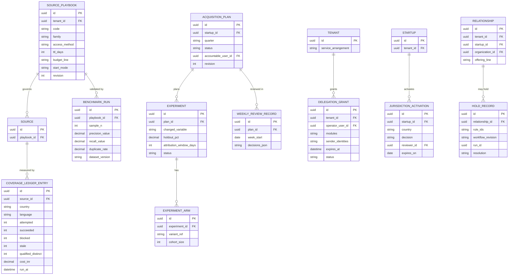

### 2.6.5.3 Part 2.3 enhancements: business rules, roles and ABAC

#### 2.6.5.3.1 Business rules BRL-ENH-A-01…14

Columns follow Part 2.3 §2.25. Enforcement point: SVC = service layer, WRK = worker, PDP = Policy Decision Point. Config: Fixed (invariant) or Policy (versioned; tightening needs no approval, loosening needs the DEC-038 approver).

| ID | Rule | Condition → action | Exceptions | Source | Enforced | Config |
|---|---|---|---|---|---|---|
| BRL-ENH-A-01 | Alternative scoring version governance | A scoring version other than the DEC-011 default may be activated for an opportunity type only with a benchmark on the same labelled set showing precision ≥ the default's; its thresholds (for example fit ≥ 70 and coverage ≥ 70) are part of the version; one active version per opportunity type | None | SP-11 §Coverage and examples; CONFLICT-300 | SVC | Policy |
| BRL-ENH-A-02 | Freshness TTL per source family | Evidence older than the family TTL (§2.6.5.2.2 defaults: 7 to 365 days) → `stale`; stale evidence cannot support a consequential decision (send, bid/no-bid, quote) until refreshed or re-verified | Tender TTL stays 7 days (BRL-SRC-06) | SP-11 OPT-11-02; §Evidence freshness | WRK | Policy |
| BRL-ENH-A-03 | Paid data only after demonstrated value | A paid search, enrichment or contact-data provider cannot be enabled unless a FR-ENH-A-005/006 benchmark shows incremental eligible records or ≥ 20% lower cost per usable opportunity, and the NFR-037 approval exists | None | SP-11 §Low-cost discovery; SP-14 §Measurable acquisition | SVC | Fixed |
| BRL-ENH-A-04 | Quality reports disclose recall and sample | Any precision figure shown for discovery or qualification also shows recall (known corpus), sample size n and strata; with n < 30 only counts are shown | None | SP-11 OPT-11-04; §Classification quality | SVC | Fixed |
| BRL-ENH-A-05 | Recording consent | Meetings and webinars are not recorded or transcribed unless every participant was told before the session and the organizer recorded permission; MedMaarg sessions never recorded by the platform | Participant-initiated recording outside the platform | SP-12 §Channel and communication policies (calendar/events) | SVC | Fixed |
| BRL-ENH-A-06 | Deliverability stop thresholds | Per sender identity and channel, rolling 7-day: hard bounce rate ≥ 2% or complaint rate ≥ 0.1% → pause new campaign sends and alert R10; ≥ 5% bounce or ≥ 0.3% complaint → stop the sender until review [ASSUMPTION-304; verify provider thresholds at time of implementation, as of 27 Nov 2026] | Transactional messages continue if their own rates are within threshold | SP-12 §Implementation controls (deliverability) | WRK | Policy |
| BRL-ENH-A-07 | No cross-entity allocation | A receipt can be allocated only to invoices of the same legal entity (startup) and currency as the bank/provider account that received it; cross-entity allocation → 422 and finance exception | Approved inter-company transfer handled outside the platform | SP-03 §Finance controller | SVC | Fixed |
| BRL-ENH-A-08 | Buy-side duty separation | When the startup's policy enables it, the user who approves a purchase order cannot verify the related goods receipt or payable; payables never net against receivables | Startups with one operator (policy off, logged) | SP-03 §Procurement manager; BR-S004 | SVC | Policy |
| BRL-ENH-A-09 | Website publication SoD | A publisher cannot publish a page or post whose draft they authored if it contains a sensitive claim (clinical, education outcome, price, comparative); a different publisher or R10 must approve | None | SP-03 §Distinct website and Admin personas | SVC | Fixed |
| BRL-ENH-A-10 | Training is necessary, never sufficient | A valid training record unlocks gated affordances only for users who already hold the role and grant; it never adds a permission, and expiry removes the affordance, not the role | None | SP-03 §Role training | SVC | Fixed |
| BRL-ENH-A-11 | Template reviewer SoD | A workflow, node or business-profile template version cannot be approved for publication by its author; published versions are immutable | None | SP-03 §Personas (template reviewer); FR-A113 | SVC | Fixed |
| BRL-ENH-A-12 | No renewal after cancellation or suppression | A renewal case cannot be created, and renewal outreach cannot be scheduled, for a subscription or contract in `Cancelled` or for a contact under suppression | Customer-initiated renewal request | SP-13 §Milestone table (Retention) | PDP | Fixed |
| BRL-ENH-A-13 | Experiment stop triggers | An experiment arm pauses immediately when any of: complaint or opt-out rate > baseline + 50% (BRL-MKT-10); hard bounce ≥ BRL-ENH-A-06 pause level; unapproved or expired claim detected; evidence used by the variant became stale; budget cap exhausted; recipient opt-out wave > 3× baseline in 24 h | Manual resume requires R05L or R02 with reason | SP-14 §Acquisition experiments (Stop) | WRK | Policy |
| BRL-ENH-A-14 | Outcome economics validity | Cost-per-outcome comparisons require matching cohort window, currency and attribution window; zero denominator → "not assessed"; synthetic outcomes excluded from production reports | None | SP-14 §Outcome economics | SVC | Fixed |

#### 2.6.5.3.2 New role and sub-roles [RECOMMENDATION-301]

| Role | Name | Persona | Surface | Scope | Notes |
|---|---|---|---|---|---|
| **R21** | Managed-Service Operator | P17 | Admin (inside a client tenant) | Client tenant via active DelegationGrant only; modules, sender identities and budget listed in the grant | Cannot approve the client's claims, budgets, autonomy or users; cannot export; every action stamped with `grant_id` |
| **R11T** | Template Reviewer (sub-role of R11) | P19 | Admin (Automation) | Tenant or platform template library (A100, A113) | Approves template versions authored by others (BRL-ENH-A-11) |
| **R12I** | Integration Administrator (sub-role of R12) | P18 | Admin (Automation) | Own tenant's provider connections (A011) | Sees connection metadata and health, never business content; cannot enable paid adapters without approval |

RBAC additions to the Part 2.3 §2.26.3 matrix (C create, R read, U update, A approve, X execute, — none):

| Screen group | R21 | R11T | R12I |
|---|---|---|---|
| Discovery (A015–A028) | C R U within grant | — | — |
| Outreach & marketing (A033–A064) | C R U X within grant (dispatch through client sender only) | — | — |
| Closure (A065–A076) | R within grant | — | — |
| Automation monitor (A110, A111) | R within grant | R | R (health only) |
| Templates (A100, A113) | — | R A | — |
| Integrations (A011) | — | — | C R U (activation needs approval) |
| Tenancy and membership (A099) | — | — | — |
| Billing (A101) | R (client's usage only) | — | R (cost of own adapters) |
| Export (A103) | — | — | — |

#### 2.6.5.3.3 ABAC additions

| ID | Attribute rule | Effect |
|---|---|---|
| ABAC-ENH-A-01 | `principal.role = R21` ∧ `grant.status = active` ∧ `resource.tenant_id = grant.tenant_id` ∧ `resource.module ∈ grant.modules` ∧ `now < grant.expires_at` | Allow; otherwise deny with reason `DELEGATION_SCOPE` |
| ABAC-ENH-A-02 | R21 dispatch: `message.sender_identity ∈ grant.sender_identities` ∧ `reservation.budget_id ∈ grant.budgets` | Allow; else deny |
| ABAC-ENH-A-03 | R21 session holds exactly one client tenant; switching tenant ends the session context and clears cached data | Enforced in BFF |
| ABAC-ENH-A-04 | Website publisher: `draft.author_id ≠ principal.id` when `draft.sensitive_claims > 0` | BRL-ENH-A-09 |
| ABAC-ENH-A-05 | Procurement: `po.approver_id ≠ principal.id` for goods-receipt verification when startup policy `buy_side_sod = on` | BRL-ENH-A-08 |

### 2.6.5.4 Part 2.4 and Part 2.5 enhancements: reports, notifications, configuration and screen panels

#### 2.6.5.4.1 Reports RP-ENH-A-01…04

| ID | Report | View | Audience | Key measures | Dimensions | Freshness | FR |
|---|---|---|---|---|---|---|---|
| RP-ENH-A-01 | Research coverage ledger | Discovery | R04, R02, R01 | KPI-ENH-A-01; attempted/succeeded/blocked/stale per cell; evidence items; distinct qualified opportunities; cost per qualified result; uncovered regions | Country, state, language, source family, source, startup | Daily | FR-ENH-A-001, 003 |
| RP-ENH-A-02 | Outcome economics | Overview | R01, R02, FinOps | KPI-22, KPI-ENH-A-03; cost classes (AI, data, channel, ads, allocated infrastructure); verified outcomes; "not assessed" cells | Startup, segment, channel, cohort period, currency | Daily | FR-ENH-A-013 |
| RP-ENH-A-03 | Stage-pair funnel | Overview | R02, R03, R05 | KPI-ENH-A-02 for each adjacent pair; numerator/denominator; median days between stages | Startup, segment, source, channel, geography (FR-ENH-A-002) | 15 min | FR-ENH-A-010 |
| RP-ENH-A-04 | Experiment scorecard | Outreach & Marketing | R05, R05L, R02 | Primary metric per arm with interval; guardrails (opt-out, complaint, bounce); cost per qualified opportunity; stop-trigger log (KPI-ENH-A-05) | Experiment, arm, cohort window | Hourly | FR-ENH-A-011 |

#### 2.6.5.4.2 Notifications

| ID | Event | Recipients | Severity | Channel (DEC-036) |
|---|---|---|---|---|
| NT-ENH-A-01 | Experiment arm paused by stop trigger | Experiment owner, R05L, R10 | High | In-app immediate + email |
| NT-ENH-A-02 | WAR pack ready | AOP accountable role and team | Info | In-app; email digest |
| NT-ENH-A-03 | Coverage cell success rate fell below 50% for 2 consecutive runs | R04, research lead | Medium | In-app |
| NT-ENH-A-04 | Provider credential expires in ≤ 14 days | R12I, R12 | Medium (High at ≤ 3 days) | In-app + email |
| NT-ENH-A-05 | Delegation grant expires in ≤ 7 days; grant revoked | Client admin, R21, platform service owner | Medium / High | In-app + email (client via W34) |
| NT-ENH-A-06 | Jurisdiction activation record expiring in ≤ 30 days | R10, startup head | Medium | In-app |
| NT-ENH-A-07 | Template awaiting review > 3 business days | R11T pool | Low | Digest |

#### 2.6.5.4.3 Configuration items (extend CFG-01…32)

| ID | Item | Level | Default | Change governance |
|---|---|---|---|---|
| CFG-ENH-A-01 | Freshness TTL per source family | Tenant → startup | §2.6.5.2.2 column "Default TTL" | Policy; loosening needs R10 |
| CFG-ENH-A-02 | Deliverability thresholds | Tenant → sender identity | BRL-ENH-A-06 values | Policy; loosening needs R10 + R01 |
| CFG-ENH-A-03 | Experiment stop thresholds | Startup | BRL-ENH-A-13 values | Policy |
| CFG-ENH-A-04 | WAR schedule and agenda | Startup | Monday 09:00 local, agenda §2.6.5.1.6 | Startup head |
| CFG-ENH-A-05 | Scoring versions per opportunity type | Startup | DEC-011 default only | BRL-ENH-A-01 |
| CFG-ENH-A-06 | Buy-side SoD switch | Startup | On when ≥ 2 OrganicSpec operators | Policy |
| CFG-ENH-A-07 | Service arrangement | Tenant | self_service | Service owner + client admin |
| CFG-ENH-A-08 | Legal disclosure block per legal entity and locale | Startup × locale | Required fields empty → publication blocked | R10 approves |

#### 2.6.5.4.4 Screen panel additions (no new screens)

| Screen | Addition | FR |
|---|---|---|
| A010 Source permissions and registry | "Playbook" tab (SPB fields, launch checklist, benchmark status, TTL); coverage-ledger summary per source | FR-ENH-A-001, 004 |
| A015 Research plan | Coverage planner suggestions with factor explanation | FR-ENH-A-003 |
| A019 / A022 Scoring and qualified queue | Active scoring version badge; alternative version comparison | FR-ENH-A-007 |
| A032 Customer 360 | Relationship timeline with derived stage and hold badges | FR-ENH-A-016, 020 |
| A037 / A045 Inbox | Reply class chip using the union taxonomy; effect preview | FR-ENH-A-008 |
| A043 Management dashboard | AOP tab; WAR pack and WeeklyReviewRecord | FR-ENH-A-010, 012 |
| A058 Campaign builder | Experiment registry section (variable, arms, holdout, stop triggers) | FR-ENH-A-011 |
| A082 Revenue and attribution | Outcome economics tab | FR-ENH-A-013 |
| A099 Tenant administration | Service arrangement; delegation grants list | FR-ENH-A-015 |
| A107 Website configuration | Legal disclosure block editor per legal entity and locale | FR-ENH-A-017 |
| A002 User detail | Training records (read-only for the user; edit for trainer) | FR-ENH-A-018 |
| LP-LIST pattern (all list screens) | Bulk action preview dialog with count, eligible count, cost and exclusions by rule | FR-ENH-A-019 |
| W34 Client service portal | Delegation grant approval and revocation; arrangement display | FR-ENH-A-015 |

UI states follow Part 2.5 §2.47: every new panel has loading, empty ("No coverage data yet: run the first pilot"), denied ("Not in your grant"), stale ("Data as of …") and error states, keyboard operable, WCAG 2.2 AA (Part 2.5 §2.46).

### 2.6.5.5 Part 3.3 enhancements: logical data for the new objects

Names are logical; physical tables follow Part 3.3 conventions (`tenant_id`, `startup_id`, RLS, `created_at`, `revision`). All are tenant-scoped with RLS (DEC-065).

Additional fields on existing entities: `Opportunity.counterparty_geo`, `client_geo`, `delivery_region` (FR-ENH-A-002); `SocialPost.external_post_id`, `external_url` (FR-ENH-A-009); `ReplyIntent.class` enum extended (FR-ENH-A-008); `TrainingRecord` (§2.6.5.1.4); `Site.legal_disclosure_revision_id` (FR-ENH-A-017); `ScoringVersion.opportunity_type`, `thresholds_json` (FR-ENH-A-007). Retention follows DEC-028 (operational records class); WeeklyReviewRecord and JurisdictionActivation follow the audit class (7 years).

### 2.6.5.6 Part 3.2 enhancements: integration candidate disposition [GAP-310, RECOMMENDATION-312]

Licence, quota and price facts for every candidate must be verified at time of implementation (as of 27 Nov 2026). None is committed by this part.

| Candidate (source) | Purpose in source | Disposition | Reason | Budget line |
|---|---|---|---|---|
| Scrapy (SP-11) | Crawling permitted sources | **Adopt** (open source, verify licence) as the crawl framework behind SPB-01/03/13 | Robots and rate-limit middleware; fits Celery workers | B01/B04 compute |
| Trafilatura (SP-11) | Main-text extraction | **Adopt** (verify licence) | Deterministic Tier 0 extraction before any model call | B04 |
| Playwright (SP-11) | Selective rendering of script-heavy pages | **Adopt, restricted**: only for allowlisted sources that need rendering; never to pass logins or paywalls | Already in the test stack (Part 6.1) | B04 |
| SearXNG self-hosted (SP-11) | Optional permitted upstream search | **Candidate, disabled**: requires separate rights for each upstream engine and a benchmark (BRL-ENH-A-03) | Upstream terms may prohibit automated querying | B03 |
| python-docx / Jinja2 (SP-13) | Proposal and contract generation | **Adopt** (already in Part 0 tooling) | Provider-neutral documents (DEC-023) | — |
| PandaDoc (SP-13, FRD) | Proposal and e-sign | **Adapter candidate** behind the DEC-023 e-sign interface; not in pilot | Commercial; API entitlement and price unverified | B10 reserve |
| Claude "Sales" skill/plugin (SP-13) | Development-time drafting aid | **Reject as runtime dependency**: developer plugins are not runtime entitlements (SP common core) | Runtime uses the model gateway only (DEC-007) | — |
| Crossbeam Skills (SP-13) | Partner overlap for deployment pipeline | **Reject for pilot**; revisit for W6 partner expansion | Licence, quota and pricing unverified; partner data sharing needs DPA | — |
| Socialinsider (SP-13) | Social analytics for attribution | **Reject for pilot**; first-party analytics and provider APIs suffice | Unverified licence; data-sharing concerns | — |
| PostHog (SP-13) | Product/web analytics | **Candidate** for first-party, self-hosted web analytics with no health-page pixels (BRL-MKT-06) | Free quotas differ by feature; verify edition licence | B01 |
| PostgreSQL (SP-13) | Metrics store | **Adopt** (baseline) | Already the system of record | B01 |
| LLM gateway: Haiku 5.5 / Sonnet 5.5 prices quoted in SP-13 | Negotiation and objection drafting | **Consistent** with Part 7.3 (Haiku 5.5 $0.10/$0.50, Sonnet 5.5 $2/$10 per million tokens; verify at time of implementation, as of 27 Nov 2026) | No change | B02 |
