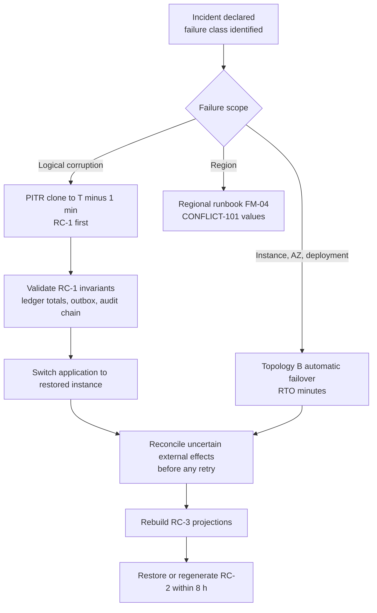
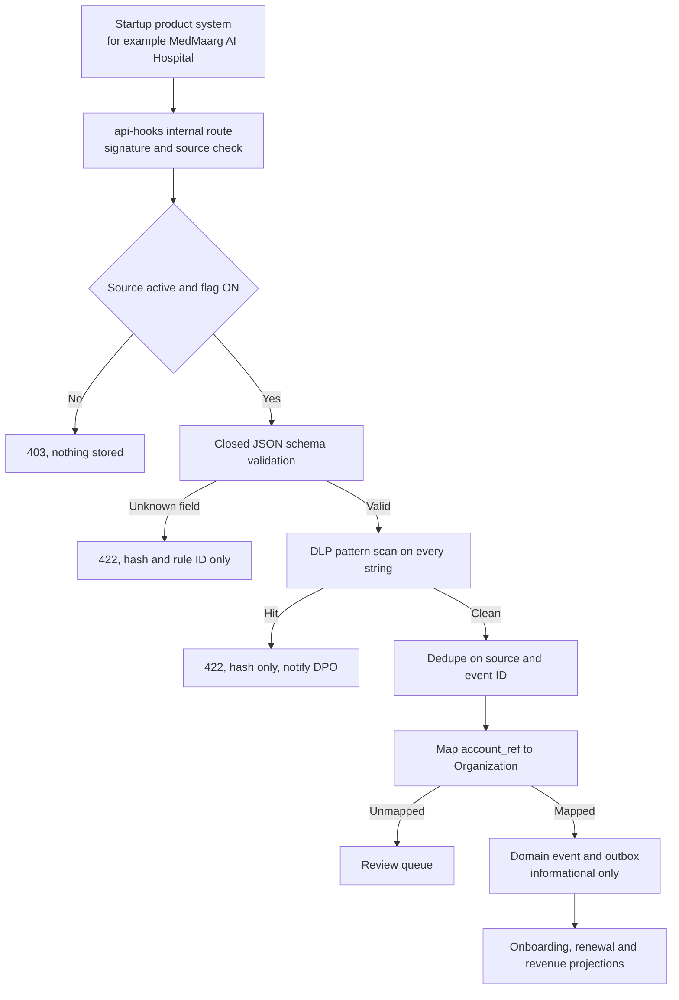
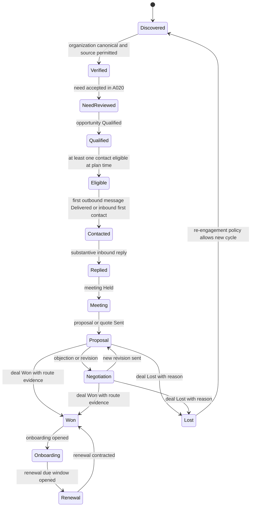

---

## 3.4.5 Enhancements

This section writes the missing content. Each item states its source aspect(s), the blueprint baseline it extends, the specification, and its acceptance. New functional requirements are listed first in a register so they can be traced.

### 3.4.5.0 Enhanced functional requirement register (FR-ENH-B)

| FR ID | Title | Source aspects | Extends | Priority (MoSCoW) | Wave | Epic | Story | Tests |
|---|---|---|---|---|---|---|---|---|
| FR-ENH-B-001 | Growth-scale capacity validation profiles and NFRs | B-CAP-01…04, OPT-06-01…03, B-09-PB4, B-09-AP2 | Part 3.1 §3.1.12; Part 6.1 LT-xx | Should | W5 (profile build), scale gate (execution) | EP-21 | US-21-EB01 | TC-ENH-B-011…014 |
| FR-ENH-B-002 | Recovery classes RC-1…RC-3 and growth RTO ≤ 2 h | B-CAP-08, B-CAP-09, B-09-PB3, B-09-AD5 | Part 3.1 §3.1.13; DEC-018 | Must (RC labels W0); Should (growth drill) | W0, scale gate | EP-21 | US-21-EB02 | TC-ENH-B-015, -016 |
| FR-ENH-B-003 | Composite dashboard load p95 | B-CAP-05 | NFR-039; Part 2.5 dashboards | Should | W2 | EP-17 | US-17-EB01 | TC-ENH-B-017 |
| FR-ENH-B-004 | Adapter port contract v2: estimate, execute, reconcile, health; normalized status incl. `denied` | B-10-011 | ADR-009; Part 3.2 §3.2.4 | Must | W0 | EP-01 | US-01-EB01 | TC-ENH-B-018 |
| FR-ENH-B-005 | DRF permission-class taxonomy per ingress namespace | B-AR-03, B-10-008 | Part 3.2 §3.2.1.12 | Must | W0 | EP-01 | US-01-EB02 | TC-ENH-B-019 |
| FR-ENH-B-006 | Website, portal and Admin route map with cache-key formula | B-10-006, B-10-007 | Part 2.5; ADR-010 | Must | W2 | EP-19 | US-19-EB01 | TC-ENH-B-023 |
| FR-ENH-B-007 | Canonical inbound event contract (consent_scope, sender_ref, text_ref) | B-TC-06, B-10-DC02 | Part 3.2 §3.2.6; Part 3.3 ProviderEvent | Must | W2 | EP-08 | US-08-EB01 | TC-ENH-B-024 |
| FR-ENH-B-008 | Outbound intent contract with expiry and approver binding | B-10-DC03 | Part 2.3 §2.27.9 | Must | W2 | EP-08 | US-08-EB02 | TC-ENH-B-025 |
| FR-ENH-B-009 | Agent envelope v1.1 (purpose, schema_revision, missing_fields, policy_flags, proposed_action, requires_approval, cost_estimate) | B-10-002, B-10-DC06 | Part 7.2 §7.2.7 | Must | W0-B | EP-04 | US-04-EB01 | TC-ENH-B-026 |
| FR-ENH-B-010 | Product-event ingress allowlist for startups' own delivered products (no clinical data) | B-TC-10, B-10-DC12 | BR-M43; DEC-009 | Should | W4 | EP-03 | US-03-EB01 | TC-ENH-B-027 |
| FR-ENH-B-011 | Commercial journey stage projection (read model) | B-TC-09 | Part 2.3 §2.27.1–2.27.8 | Should | W3 | EP-17 | US-17-EB02 | TC-ENH-B-028 |
| FR-ENH-B-012 | Workflow execution-policy block and lease fencing | B-05-020, OPT-05-04 | ADR-027; BRL-AUT-06 | Must | W0-B | EP-18 | US-18-EB01 | TC-ENH-B-029 |
| FR-ENH-B-013 | Workflow activation quality gates WQG-01…12 | B-05-016 | BRL-AUT-01…09; A033, A113 | Must | W2 | EP-18 | US-18-EB02 | TC-ENH-B-030 |
| FR-ENH-B-014 | Reply-intent taxonomy alignment (`not_interested`, `meeting_request`) | B-05-004 | AG-013; AU-008; AU-024 | Should | W2 | EP-08 | US-08-EB01 | TC-ENH-B-031 |
| FR-ENH-B-015 | Meeting recording prohibition and notes-only summarization | B-05-CH4, B-10-AI10 | DEC-024; GAP-143 | Should | W3 | EP-09 | US-09-EB01 | TC-ENH-B-032 |
| FR-ENH-B-016 | Workflow operational regression matrix (10 scenarios × 9 flows) | B-05-014 | Part 6 EP-18 TCs | Must | W2 onward | EP-18 | US-18-EB03 | TC-ENH-B-001…010 |
| FR-ENH-B-017 | Runbooks: daily operations, client offboard, data-incident containment | B-04-RB3, RB6, RB8 | Part 4.3 §4.44 | Must | W2 (daily), W5 (offboard) | EP-21 | US-21-EB03 | TC-ENH-B-033 |
| FR-ENH-B-018 | Critical-branch coverage gate (100%) and domain-service branch coverage ≥ 80% | B-10-013 | NFR-082; §4.33.4 | Should | W0-B | EP-21 | US-21-EB04 | TC-ENH-B-034 |
| FR-ENH-B-019 | Fail-fast mandatory configuration at process start | OPT-05-06 | Part 4.3 §4.35 | Must | W0-A | EP-01 | US-01-EB03 | TC-ENH-B-035 |
| FR-ENH-B-020 | Technical-debt register and documentation-sync check | OPT-13-02, OPT-13-03 | Part 4.3 §4.32 | Could | W2 | EP-21 | US-21-EB05 | TC-ENH-B-036 |
| FR-ENH-B-021 | Cross-product audience isolation and shared-library boundary tests | B-09-AP1, B-09-AP5, B-05-AP9 | NFR-031; ADR-033; ADR-060 | Must | W0-A | EP-01 | US-01-EB04 | TC-ENH-B-020, -022 |
| FR-ENH-B-022 | Budget threshold ladder 70/80/90/100% | OPT-03-08 | BRL-AI-08; NT-025 | Should | W0-B | EP-04 | US-04-EB02 | TC-ENH-B-012 note, TC-ENH-B-021 |
| FR-ENH-B-023 | Provider candidate register and replacement-first benchmark gate | B-04-015, B-04-WB4, B-05-006 | CN-05; DEC-020 | Should | W1 | EP-01 | US-01-EB05 | TC-ENH-B-021 |
| FR-ENH-B-024 | Approval-gate register (API definitions, DB confirmations, UI mappings) and review effort | B-04-AP9, B-10-AP11, B-10-AP15, OPT-09-01 | Part 3.2 DERIVED; Part 8.1 | Must | W0-A onward | EP-21 | US-21-EB06 | TC-ENH-B-030 note |
| FR-ENH-B-025 | Discipline effort reconciliation, PD actual-vs-estimate tracking, vertical-slice checklist | B-04-001, B-04-019, B-04-020, OPT-16-02 | Part 8.1 §8.1.6 | Should | W0-A onward | EP-21 | US-21-EB06 | — (management control) |
| FR-ENH-B-026 | Expansion-interface task DAG reconciliation | B-04-023 | Part 8.1 | Should | W5 | EP-20, EP-18 | — | — (planning control) |
| FR-ENH-B-027 | Service contract card and atomic transaction reference implementation | B-10-014, B-10-016 | ARP-03; Part 3.3 | Must | W0-A | EP-01 | US-01-EB01 | TC-ENH-B-018 |

### 3.4.5.1 Part 3.1 Architecture enhancements

#### A. Growth-scale capacity and reliability acceptance (FR-ENH-B-001, FR-ENH-B-003)

**Why.** Documents 04, 09 and 10 define an initial and a growth capacity matrix. The blueprint sizes the system on DEC-031 design points (Year 1: 25–40 workspaces, 2–10 tenants, 15–60 users; Year 2: 100 workspaces, 30 tenants, 200 users) and validates "10× pilot volume" with LT-11. The pack's growth target (100 external tenants, 250 concurrent staff sessions, 1 M opportunities, 100,000 scheduled actions per day) goes beyond Year 2 in tenants and in data volume and has no load profile [GAP-320], and the tenant counts differ from DEC-031 [CONFLICT-321].

**Rule.** DEC-031 remains the **sizing** basis for Year 1 and Year 2. The pack's matrix becomes the **validation** basis: the "initial" column is tested before Release 1 go-live on Topology A; the "growth" column is tested at the scale gate on Topology B (DEC-040). No infrastructure is bought for the growth column until a §3.1.6.4 trigger fires [RECOMMENDATION-320].

**Unified capacity and reliability matrix.**

| Ref | Metric | Initial (pack) | Growth (pack) | Blueprint baseline | Enhanced NFR | Validation |
|---|---|---|---|---|---|---|
| CAP-01 | Owned startups / external tenants | 25 / 10 | 50+ / 100 | DEC-031: Y1 25–40 / 2–10; Y2 100 / 30 | NFR-ENH-B-01 | LT-ENH-B-01 |
| CAP-02 | Concurrent staff sessions | 50 | 250 | 60 / 200 users × 50% active (§3.1.12.1) | NFR-ENH-B-02 | LT-ENH-B-01 |
| CAP-03 | Scoped opportunities (rows visible to queries) | 100,000 | 1,000,000 | Not stated | NFR-ENH-B-03 | LT-ENH-B-02 |
| CAP-04 | Concurrent jobs / scheduled actions per day | 50 / 10,000 | 250 / 100,000 | ≈ 20,000 tasks/day Y1; 100,000 Y2 (§3.1.12.2) | NFR-ENH-B-04 | LT-ENH-B-03 |
| CAP-05 | Dashboard query p95 | ≤ 2 s | ≤ 2.5 s | Single API read p95 ≤ 500 ms (NFR-039) | NFR-ENH-B-05 | TC-ENH-B-017, LT-ENH-B-02 |
| CAP-06 | Async/webhook acknowledgement p95 | ≤ 2 s | ≤ 2 s | SLO-08, NFR-051 | (covered) | LT-05 |
| CAP-07 | Projection refresh | ≤ 60 s | ≤ 60 s | NFR-008, SLO-09 | (covered) | LT-10 |
| CAP-08 | Critical data RPO / RTO | ≤ 15 min / ≤ 4 h | ≤ 15 min / ≤ 2 h | DEC-018 ≤ 15 min / ≤ 4 h; CONFLICT-101 | NFR-ENH-B-06 | TC-ENH-B-015 |
| CAP-09 | Regenerable research RPO / RTO | ≤ 24 h / ≤ 8 h | ≤ 24 h / ≤ 8 h | Single class (§3.1.13) | NFR-ENH-B-06 | TC-ENH-B-016 |
| CAP-10 | Cost per 1,000 tasks and queue age (OPT-03-04) | Measured | Measured, no SLO breach while right-sizing | Unit-economics dashboard (§4.46.5) has no per-task metric | NFR-ENH-B-07 | DB-09 panel |

**Capacity formulas at the growth column** (same symbols and assumptions as Part 3.1 §3.1.12; ASSUMPTION-102 request rate r = 20 requests per active user per minute; mean service time 0.15 s; target utilization ρ = 0.6; ×2 p95 headroom).

| Quantity | Formula | Initial | Growth | Consequence |
|---|---|---|---|---|
| Admin peak requests/s | λ = sessions × r ÷ 60 | 50 × 20 ÷ 60 = **16.7 rps** | 250 × 20 ÷ 60 = **83.3 rps** | Initial already exceeds the Year 1 design point (10 rps) because the pack treats every concurrent session as active |
| api-admin threads | N = λ × 0.15 ÷ 0.6 × 2 | **8.3 → 9** | **41.7 → 42** | Initial: pilot has 6 threads → §3.1.6.4 T-3 vertical resize, or a second api-admin task. Growth: 7 tasks × 6 threads (or 4 × 12 on larger instances) on Topology B |
| Database connections | Σ pool sizes (api-admin + api-web + api-hooks + workers + relay/beat + tooling) | 9 + 8 + 4 + 8 + 2 + 5 ≈ **36** | 42 + 16 + 8 + 24 + 2 + 5 ≈ **97** | Growth exceeds a db.t4g.micro (≈ 100 max_connections, verify) with no margin → RDS Proxy or a PgBouncer sidecar and at least db.t4g.medium (verify) |
| Scheduled actions peak rate | daily ÷ 86,400 × 10 (peak factor) | 10,000 → **1.2 actions/s** | 100,000 → **11.6 actions/s** | ≈ 2 Celery tasks per action (dispatch + reconcile) → 2.3 / 23 tasks/s |
| Dispatch slots needed | peak actions/s × mean adapter latency (assume 1.0 s, verify per provider) | **≈ 2** | **≈ 12** | Pilot bulkheads (SES 5, WhatsApp 5) suffice initially; at growth raise bulkheads per §3.2.7.3 and confirm provider sending-rate quotas (SES, WhatsApp tier) — verify |
| Concurrent jobs | in-flight runs with an executing step | 50 | 250 | Per-startup cap 20 (BRL-AUT-06) means ≥ 13 active startups to reach 250; worker-batch concurrency is sized on executing steps, not on runs waiting for timers |
| Opportunity storage | rows × (1.0 KB row + 0.6 KB indexes + 1.0 KB evidence links) [ASSUMPTION-321] | 100 k → **≈ 0.26 GB** | 1 M → **≈ 2.6 GB** | Fits the Part 3.3 growth curve; partitioning not needed below 50 M rows (§3.1.12.3 lever 6) |
| Dashboard data volume | projection rows ≈ startups × days × stages | 25 × 365 × 15 ≈ **0.14 M/yr** | 150 × 365 × 15 ≈ **0.8 M/yr** | Dashboards **must** read projections, never aggregate 1 M opportunity rows at request time (NFR-ENH-B-05) |
| Per-tenant KMS keys (RECOMMENDATION-038, Part 3.3) | tenants × ≈ $1 per key-month (verify) | 10 → ≈ ₹900/month | 100 → **≈ ₹9,000/month** | FinOps item: at the growth column per-tenant CMKs approach the whole B01 line. Recommend pricing the key into the plan or, for tenants without a contractual need, a per-tenant data key wrapped by a shared CMK [RECOMMENDATION-330] |

**Enhanced non-functional requirements.**

| NFR ID | Requirement | Measure | Target initial / growth | Verification | Source |
|---|---|---|---|---|---|
| NFR-ENH-B-01 | Tenant and startup scale without code change | Startups and tenants provisioned by template on one deployment | 25 + 10 / 50 + 100 | LT-ENH-B-01 provisioning step; two-tenant fixture extended to 10 / 100 synthetic tenants | Doc 04/09 capacity matrix; OPT-06-01 |
| NFR-ENH-B-02 | Concurrent staff sessions | Sessions issuing the LT-01 request mix concurrently, all SLO-03/04 met | 50 / 250 | LT-ENH-B-01 | OPT-06-02 |
| NFR-ENH-B-03 | Data volume | Scoped opportunity rows with RLS enabled; NFR-039 met on list and filter endpoints | 100 k / 1 M | LT-ENH-B-02 | OPT-06-03 |
| NFR-ENH-B-04 | Job and schedule volume | Concurrent executing jobs and scheduled external actions per day with SLO-05/06 met | 50 & 10 k / 250 & 100 k | LT-ENH-B-03 | OPT-06-03 |
| NFR-ENH-B-05 | Composite dashboard load | Time from navigation to the last widget's data on an Admin dashboard (A042, A087–A089, A106) at p95; server reads only projections; statement timeout 5 s | ≤ 2.0 s / ≤ 2.5 s | RUM span "dashboard.ready"; LT-ENH-B-02 | Doc 04/09/10 CAP-05 |
| NFR-ENH-B-06 | Recovery by class | RC-1 RPO ≤ 15 min, RTO ≤ 4 h (pilot) / ≤ 2 h (scale gate, non-regional failures); RC-2 RPO ≤ 24 h, RTO ≤ 8 h; RC-3 rebuilt from RC-1 within 2 h of RC-1 recovery | As stated | TC-ENH-B-015, -016; §4.47 drills | Doc 04/09 CAP-08/09; ADR-102 |
| NFR-ENH-B-07 | Unit cost of execution | Cost per 1,000 completed tasks (compute + metered provider + AI) and p95 queue age per queue, per tenant | Reported weekly; no SLO breach during right-sizing | DB-09 panel; FinOps cadence §4.46.6 | OPT-03-04 |
| NFR-ENH-B-08 | Branch coverage of critical decision code | See FR-ENH-B-018 | 100% enumerated critical branches; ≥ 80% domain-service branches | CI PL-04 | Doc 10 test harness |

**Load-test profiles (proposed; Part 6.1 owns LT numbering and may renumber them LT-13…LT-16).**

| Profile | Purpose | Load | Duration | Environment | Pass criteria |
|---|---|---|---|---|---|
| LT-ENH-B-01 | Growth tenancy and sessions | 100 synthetic external tenants + 50 owned startups provisioned from templates; 250 concurrent staff sessions at r = 20 req/min (80/20 read/write); scope switching every 5 min per session | 60 min | `perf` sized as Topology B | SLO-03/04 met; zero cross-scope rows (RLS suite on a 1% sample of responses); DB connections < 80% of max; no 5xx > 0.5% |
| LT-ENH-B-02 | Data volume and dashboards | Seed 1 M opportunities, 3 M evidence links, 2 M messages across 150 startups; dashboards and lists with widest allowed filters | 30 min | `perf` | NFR-039 on lists; NFR-ENH-B-05 ≤ 2.5 s p95; no sequential scans on the hot predicates (EXPLAIN check, OPT-08-02) |
| LT-ENH-B-03 | Job and schedule volume | 100,000 scheduled actions released over 24 h with a 10× peak hour; 250 concurrent executing jobs; simulator adapters with 1.0 s mean latency and 1% uncertain outcomes | 24 h (compressed clock allowed) | `perf` with simulators | SLO-05 (outbox lag p95 ≤ 60 s), SLO-06 (≥ 99% started ≤ 15 min), 0 duplicates, all uncertain outcomes reconciled; per-tenant fairness: no tenant's p95 queue age > 2× the median |
| LT-ENH-B-04 | Saturation and region policy | Ramp LT-ENH-B-01 + 03 to 1.5× growth; observe worker saturation, admission control (429/503) and cost alarms | Until SLO breach | `perf` | Graceful degradation; budget alarms fire before overspend; no request leaves ap-south-1 except approved backup copies (CONFLICT-325) |

#### B. Recovery classes and the growth RTO (FR-ENH-B-002, ADR-102)

The blueprint treats all data as one recovery class. The pack distinguishes critical data from regenerable research [GAP-321]. Classifying data lets the restore procedure put the critical, smaller data first and keeps the growth RTO achievable as the database grows.

| Class | Contents (Part 3.3 table families) | RPO | RTO pilot / scale gate | Restore source | Restore order |
|---|---|---|---|---|---|
| **RC-1 Critical** | Tenancy, identity mappings, consent and suppression, approvals, prices and quotes, contracts, orders, invoices, payments, ledgers, receipts, outbox, idempotency keys, audit chain, workflow and step runs, configuration revisions | ≤ 15 min | ≤ 4 h / **≤ 2 h** for instance, AZ, bad-deployment and data-corruption failures (FM-01…03, FM-05, FM-07, FM-08, FM-10); regional failures stay at CONFLICT-101 values | RDS PITR; cross-Region automated backups | 1 |
| **RC-2 Regenerable** | Fetched-page logs, extracted text, evidence snippets not yet reviewed, embeddings and chunks, research caches, enrichment caches | ≤ 24 h | ≤ 8 h | Daily snapshot or PITR copy; regeneration only if restore fails (re-embedding and re-fetching cost AI and search budget: estimate = items × tokens × price, verify) | 2 |
| **RC-3 Derived** | Projections (Customer 360, dashboards, commercial journey), search indexes, Valkey caches | Rebuilt | ≤ 2 h after RC-1 is back | Replay of domain events and projection rebuild jobs | 3 |

**What makes ≤ 2 h achievable at the scale gate.** (1) Topology B Multi-AZ already gives ≤ 15 min for FM-03. (2) For FM-05 (logical corruption), measured PITR restore time grows with database size; the quarterly drill records restore duration per GB. **Trigger:** if a drill's RC-1 restore exceeds 75 minutes, move the bulky RC-2 table families (embeddings, chunks, fetch logs) to a separate research database instance so that the critical restore stays small [ASSUMPTION-322]. (3) The restore runbook (RB-007) gains a class-ordered checklist (§3.4.5.6 A).

#### C. Deployment technology, naming and repository reconciliation (ADR-100, ADR-101)

Documents 04 and 09 name **ECS Fargate, an ALB, ElastiCache Redis and a Redis broker**; document 09's own "suggested AWS design" names **Valkey** and leaves deployment mode to validation. The blueprint chose ECS on EC2 without an ALB at pilot (ADR-013), Valkey (CN-01, ADR-003) and an ALB at the scale gate [CONFLICT-320].

| Pack element | Blueprint decision | Resolution |
|---|---|---|
| ECS Fargate for Django and workers | ADR-013 ECS on EC2 (t4g.medium at pilot); Fargate rejected at pilot for cost (≈ 3–4×, verify) | ADR-100: ECS on EC2 retained. Fargate is allowed for **on-demand, short tasks** (the C10 renderer and one-off migration tasks) and becomes an option for worker-batch at the scale gate when spot EC2 capacity is unreliable |
| ALB | None at pilot (CloudFront → Caddy origin); ALB at scale gate | Same; pack's ALB is the scale-gate state |
| ElastiCache Redis | Valkey 8 container at pilot; ElastiCache **for Valkey** at scale | ADR-101: the broker and cache engine is Valkey (Redis-protocol compatible). "Redis" in the pack is read as the protocol [ASSUMPTION-324] |
| Queues research, AI, messaging, billing | 12 queues (ADR-021) | Mapping: research → `research`; AI → `ai`; messaging → `dispatch` + `transactional` + `notify`; billing → `reconcile` + `reports` (usage metering) |

**Django application names.** The pack lists apps `accounts, catalog, intelligence, crm, engagement, campaigns, deals, governance, reporting`. The blueprint's names govern (Part 3.1 §3.1.4) [CONFLICT-329]. Mapping for readers of the pack:

| Pack app | Blueprint app(s) |
|---|---|
| accounts | `core.identity`, `core.tenancy` |
| catalog | `catalog`, `knowledge` |
| intelligence | `intelligence.*` |
| crm | `crm`, `crm.leads` |
| engagement | `engagement.*` |
| campaigns | `marketing.*`, `web` (landing pages) |
| deals | `commerce.*`, `commerce.finance` |
| governance | `governance`, `governance.eligibility`, `governance.privacy`, `governance.compliance` |
| reporting | `analytics.*`, `ops` (reports, projections) |
| (not in pack) | `automation`, `ai`, `saas`, `integrations`, `core.events`, `core.audit` |

**Repository layout.** Pack: `apps/growth-ui, apps/admin-ui, server/config, server/apps, infra, tests`. Blueprint ADR-060/ADR-006: `apps/website`, `apps/admin`, `packages/*`, backend, IaC, AI assets and ops in one pnpm + uv monorepo. ADR-060 governs; the pack paths map one-to-one (`growth-ui` → `apps/website`, `admin-ui` → `apps/admin`, `server/*` → backend tree, `infra` → IaC tree).

#### D. Product-event ingress allowlist (FR-ENH-B-010, ADR-105)

**Source.** Doc 04/09 "Security boundary: marketing database separated from clinical app; event allowlist only nonclinical commercial data … AppNAI product webhook → allowlisted fields → marketing DB" and doc 10 "Clinical system emits only commercial event ID, product SKU, timestamp, payment status, permitted account ref; no report, symptoms, score or health label" [GAP-324].

**Context.** The owned startups deliver their own products (for example MedMaarg's AI Hospital Scanner/Planner/Advisor). Commercial teams need non-clinical lifecycle facts from those products (an institution's subscription activated, payment status changed, usage threshold reached) to drive onboarding, renewal and revenue. The common core says "no live cross-product join or automatic handoff"; that rule concerns the separate investor product (DEC-009, ADR-033). A delivered product of an owned startup is treated as an **external system behind an adapter**, allowlisted and founder-authorized per source, and **off by default** [CONFLICT-330].

**Contract.**

| Element | Specification |
|---|---|
| Endpoint | `POST /api/v1/commercial/internal/product-events/{source_code}` on `api-hooks` (internal namespace; private network or IAM-signed request plus HMAC signature on the raw body; §3.2.6.1 rules) |
| Registration | One ProductEventSource per (tenant, startup, source_code) created in A008 Integrations: allowed event types, field allowlist version, signing secret reference, account-reference mapping policy, approver (R01 + DPO R10), state draft → testing → active → disabled. Feature flag OFF by default |
| Payload schema (closed, `additionalProperties: false`) | `event_id` (UUID), `source_code` (enum), `event_type` (enum: `account_provisioned`, `subscription_activated`, `subscription_changed`, `subscription_cancelled`, `payment_status_changed`, `usage_threshold_reached`), `occurred_at` (RFC 3339 UTC), `account_ref` (opaque string ≤ 64, organization-level only), `sku` (string ≤ 64, must exist in the startup's Offering catalogue), `payment_status` (enum: `pending`, `paid`, `failed`, `refunded`, `not_applicable`), `plan_code` (optional, ≤ 32), `usage_band` (optional enum: `low`, `normal`, `high`) |
| Forbidden content | Any person-level identifier, free text, clinical, diagnostic, symptom, score, report or health label; any learner-level record for EduVerse; any field not in the allowlist |
| DLP check | Before persistence: schema validation, then a pattern scan of every string value (email, phone, person names from the contact index, health-term dictionary, numeric patterns resembling identifiers). Any hit → reject with 422, store only `event_id`, `source_code`, payload SHA-256 and rule ID; Sev3 notification to R10 |
| Mapping | `account_ref` → Organization through an explicit AccountRefMapping row created by staff (never by fuzzy matching); unmapped → held in a review queue |
| Effects | Persist ProviderEvent (dedupe on `source_code` + `event_id`), emit domain events `lifecycle.product_account.provisioned`, `lifecycle.product_subscription.changed`, `finance.product_payment_status.changed` (informational; never creates a Payment or closes a Deal: closure still needs route evidence, BRL-FIN) |
| Data class | Internal (organization-level commercial facts) |
| Retention | Raw payload not stored; normalized event 13 months hot (Part 3.3 event policy) |

#### E. Commercial journey stage projection (FR-ENH-B-011, ADR-106)

**Source.** Doc 04/09 state machine "Account discovered → verified → need reviewed → qualified → eligible → contacted → replied → meeting → proposal → negotiation → won/lost → onboarding → renewal; closure only on contract/payment evidence".

**Position.** The blueprint deliberately splits this lifecycle into authoritative machines (Opportunity §2.27.2, Deal §2.27.3, Outbound message §2.27.9, Meeting §2.27.11, Contract §2.27.6, Payment §2.27.7, Tenant/startup §2.27.16) and has no single end-to-end view. The enhancement adds a **read-only projection** that derives one journey stage per (tenant, startup, organization, offering) from those machines' domain events. It is used for funnel analytics, the Overview view and stage-conversion KPIs. It is **never** consulted by the PDP or by any transition guard.

| Rule | Specification |
|---|---|
| Stage source | Each stage maps to one authoritative event: `intelligence.organization.verified`, `intelligence.need.accepted`, `intelligence.opportunity.qualified`, `governance.eligibility.contact_eligible`, `engagement.message.delivered` (not `queued` or `accepted`), `engagement.inbound.classified` (substantive classes only), `engagement.meeting.held`, `commerce.proposal.sent` / `commerce.quote.sent`, `commerce.negotiation.opened`, `commerce.deal.won` (only after closure evidence, KPI-31), `commerce.deal.lost`, `lifecycle.onboarding.opened`, `lifecycle.renewal.window_opened` |
| Stored fields | `journey_id`, `tenant_id`, `startup_id`, `organization_id`, `offering_id` (nullable), `stage`, `furthest_stage`, `entered_at`, `previous_stage`, `cycle_no`, `source_event_id`, `as_of` |
| Skips | Inbound-first journeys may enter at Contacted or Replied; skipped stages are recorded as `skipped`, not back-filled |
| Simulation | Events with `simulated = true` are ignored (BRL-AUT-04) |
| Freshness | ≤ 60 s (NFR-008 class) |
| KPIs it feeds | Stage conversion rate = entries to stage n+1 ÷ entries to stage n within the cohort window; median time in stage; win rate = Won ÷ (Won + Lost) (doc 10 commercial metrics; zero denominators shown "Unavailable") |

#### F. Product, audience and shared-library isolation tests (FR-ENH-B-021)

Doc 09 asks to "try investor/customer tokens on the opposite product and Admin API" and to "attempt wrong product configuration in a synthetic deployment". The blueprint asserts the boundary (NFR-031, ADR-033, ADR-060) but has no executable test for these two cases. TC-ENH-B-020 and TC-ENH-B-022 (§3.4.5.8) add them. The pack's wording "investor/customer" refers to the separate investor product's tokens; this product never creates investor records [CONFLICT-326].
