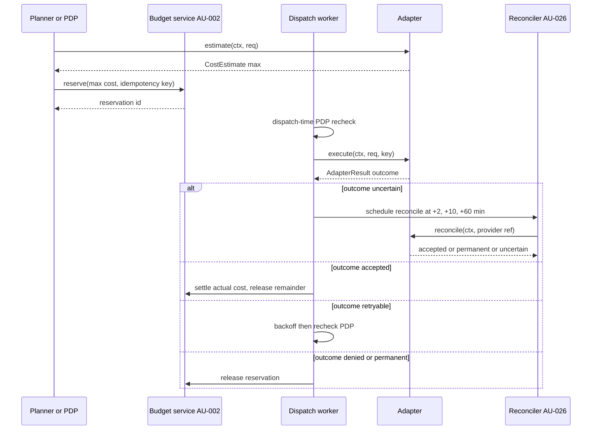

### 3.4.5.2 Part 3.2 API and integration enhancements

#### A. Adapter port contract v2 (FR-ENH-B-004, ADR-103)

**Source.** Doc 10: "Adapter interface: estimate(context, request); execute(context, request, idempotency_key); reconcile(context, external_reference); health(context). Normalize provider-specific statuses to accepted, retryable, permanent, uncertain or denied." The blueprint's ADR-009 defines ports and an `AdapterResult` with six failure classes, but no `estimate` or `health` operation and no `denied` status [GAP-322].

**Specification.** Every port (`EmailPort`, `MessagingPort`, `CalendarPort`, `SearchPort`, `ExtractionPort`, `SocialPort`, `AdsPort`, `ESignPort`, `PaymentPort`, `SecretsPort`, `LLMPort`, `SEOPort`, `EnrichmentPort`, plus `ProductEventPort` from §3.4.5.1 D) implements four operations.

```python
# integrations/ports/base.py  (reference contract; adapt names to the approved code base)
from dataclasses import dataclass
from decimal import Decimal
from enum import Enum
from typing import Generic, Optional, Protocol, TypeVar

Req = TypeVar("Req"); Norm = TypeVar("Norm")

class Outcome(str, Enum):          # normalized status (doc 10)
    ACCEPTED = "accepted"          # provider confirmed the effect (or read succeeded)
    RETRYABLE = "retryable"        # transient or rate limited, request NOT applied
    PERMANENT = "permanent"        # validation/policy/unsupported at provider, never retry
    UNCERTAIN = "uncertain"        # may have been applied; reconcile before any retry
    DENIED = "denied"              # refused before or at provider for authorization,
                                   # entitlement, quota or credential reasons

@dataclass(frozen=True)
class AdapterContext:
    tenant_id: str; startup_id: str; environment: str     # sandbox | production
    connection_id: str; policy_revision: int; correlation_id: str
    simulated: bool                                        # True → fake adapter only (E-6)

@dataclass(frozen=True)
class CostEstimate:
    amount: Decimal; currency: str; unit: str; quantity: Decimal; basis: str  # e.g. "per message, category=utility"

@dataclass(frozen=True)
class AdapterResult(Generic[Norm]):
    outcome: Outcome
    failure_class: Optional[str]   # transient | rate_limited | auth | permanent | uncertain | unsupported (ADR-009)
    provider_ref: Optional[str]; normalized: Optional[Norm]
    actual_cost: Optional[CostEstimate]; retry_after_s: Optional[int]; reason_code: Optional[str]

@dataclass(frozen=True)
class HealthStatus:
    state: str                     # ok | degraded | down | auth_failed | quota_exhausted
    checked_at: str; latency_ms: Optional[int]; detail_code: Optional[str]

class Port(Protocol[Req, Norm]):
    def estimate(self, ctx: AdapterContext, req: Req) -> CostEstimate: ...
    def execute(self, ctx: AdapterContext, req: Req, idempotency_key: str) -> AdapterResult[Norm]: ...
    def reconcile(self, ctx: AdapterContext, external_reference: str) -> AdapterResult[Norm]: ...
    def health(self, ctx: AdapterContext) -> HealthStatus: ...
```

| Operation | Called by | Rules |
|---|---|---|
| `estimate` | Planner (AG-016 simulation), PDP budget check, AU-002 reservation | Pure: no network side effect; may read a cached price table (versioned, "verify" flagged). Returns the **maximum** cost for the request so that reservation never under-reserves (OPT-03-07) |
| `execute` | Dispatch worker only, after the dispatch-time PDP recheck (ARP-04) | Must pass `idempotency_key` = action ID to the provider where supported (§3.2.4.3); never called inside a database transaction (ARP-03); in simulation the registry returns the fake adapter |
| `reconcile` | AU-026 reconciliation, scheduled sweeps (IP-05) | Read-only query of provider state by `provider_ref` or correlation tag; returns `accepted` (effect happened), `permanent` (did not happen) or `uncertain` (still unknown) |
| `health` | AU-010 health checks, circuit breaker half-open probe (§3.2.7.3) | Must use a side-effect-free endpoint; if the provider has none, returns the breaker state |

**Mapping between the pack's statuses and the blueprint's failure classes.**

| Normalized outcome (doc 10) | ADR-009 failure class | Retry (§3.2.7.2) | Effect on run |
|---|---|---|---|
| accepted | none | — | Step confirmed; actual cost reconciled |
| retryable | `transient`, `rate_limited` | Yes, with backoff and the PDP recheck | Step waiting |
| permanent | `permanent`, `unsupported` | No | Step failed → exception queue |
| uncertain | `uncertain` | No automatic retry; reconcile at +2/+10/+60 min | Step `outcome_uncertain` |
| **denied** (new) | `auth` (credentials), plus new reason codes `entitlement_denied`, `quota_exhausted`, `provider_policy_denied` | No | Connection `auth_failed` (credentials) or step failed with rule ID; PDP denies further dispatch on that connection until fixed; FinOps alert for quota |



**Contract tests (extends Part 3.2 §3.2.5).** Every adapter ships fixtures for all five outcomes, a timeout-after-send fixture that must map to `uncertain`, an `estimate` monotonicity test (estimate ≥ actual for 100 sampled sandbox calls) and a `health` test proving no side effect. TC-ENH-B-018.

#### B. DRF permission-class taxonomy (FR-ENH-B-005, ADR-109)

**Source.** Doc 10 names `PublicPublishedRead`, `ExternalGrantPermission`, `StaffRolePermission` and `ServiceIdentityPermission`. The blueprint defines the authorization order (§3.2.1.12) and ingress process groups (C03–C05) but not the classes [RECOMMENDATION-329].

| Class | Namespace / process group | Grants | Denies | Composed with | Object-level rule |
|---|---|---|---|---|---|
| `PublicPublishedRead` | `public` on api-web | Safe methods on published projections resolved from the **verified host** (unknown host → 404); public intake POSTs via `PublicIntakeWrite` (rate-limited, schema-closed, consent-recorded) | Any draft, preview without grant, portal or Admin object | `HostScopeResolver` (tenant/startup from host, never from body) | Only rows referenced by the current published revision pointer |
| `ExternalGrantPermission` | `portal` on api-web | Authenticated external principal (BFF-web session, client `growth-website`) with an active ObjectGrant (ABAC-09) | Staff roles, expired or revoked grants, other organizations' objects | `ExternalAudienceCheck`, `FieldMaskSerializer` (portal DTO allowlist) | Uniform 404 when no grant covers the object |
| `StaffRolePermission` | `admin` on api-admin | Staff principal (client `growth-admin`) whose membership and role permit the action (RBAC matrix §2.26.3) plus ABAC-01…12 | External principals; AI actors on L1-capped actions (DEC-064) | `MfaFreshness` for privileged actions; `SoDCheck` (BRL-APR-01); PDP for external actions | Scoped queryset before lookup (ARP-02); 404 out of scope, 403 role-denied on visible object (errata 76) |
| `ServiceIdentityPermission` | `internal`, `hooks` on api-hooks | Workload identity (IAM-signed or mTLS) for internal routes; provider signature verifiers for hooks (per-provider subclass) | Any browser session or bearer token | `ReplayWindowCheck`, `EventIdDedupe` | Scope from the registered connection, never from payload |

Rules: (1) every DRF view declares exactly one of the four base classes; a CI check (import scan of URLconfs) fails a view that declares none or two. (2) `DEFAULT_PERMISSION_CLASSES = [DenyAll]`. (3) A view mounted in two namespaces (`admin+portal`, §3.2.1.1) uses two view classes with different base classes and serializers. TC-ENH-B-019.

#### C. Route map and cache key (FR-ENH-B-006)

**Source.** Doc 10 router design. Part 2.5 lists screens but no URL map [GAP-332]. The route map below binds W/A screens to paths. Paths are hosted per verified domain (custom startup domain or `<startup-slug>.<platform-domain>`); the platform directory lives on the platform domain.

| Path | Screen(s) | Router / bundle | Auth | Cache-Control | Notes |
|---|---|---|---|---|---|
| `/` | W01 (platform) or W03 (startup host) | website, prerendered | None | `public, max-age=60, stale-while-revalidate=300` + ETag | Host decides which snapshot |
| `/businesses` | W02 | website, prerendered | None | same | Platform host only; approved startups only |
| `/business/{slug}` | W03 | website, prerendered | None | same | Slug unique per tenant |
| `/offerings`, `/offerings/{slug}` | W04, W05 | website | None | same | Planned offerings never listed (BR-M66) |
| `/pricing` | W06 | website | None | same | Approved price versions only |
| `/solutions/{slug}`, `/blog/{slug}`, `/case-studies/{slug}` | W07, W08, W09 | website | None | same | |
| `/page/{slug}` | W10 and generic CMS pages | website | None | same | Campaign pages carry attribution token |
| `/enquiry`, `/enquiry/{type}` | W12–W17, W20 | website, lazy form chunk | None | `no-store` | `type` ∈ demo, quotation, project, supplier, training, referral |
| `/book/{token}`, `/events/{slug}` | W18, W19 | website | Signed token / none | `no-store` | |
| `/chat` (widget) | W11 | website, lazy | None | `no-store` | |
| `/saas`, `/saas/register`, `/saas/onboarding/{draft_ref}` | W31, W32, W33 | website | None / opaque expiring draft reference | `no-store` | Draft boundary per FRD applicant draft rule |
| `/login`, `/recover` | W21 | website | OIDC via BFF-web | `no-store` | |
| `/portal/*` (`/portal`, `/portal/proposals/{id}`, `/portal/agreements/{id}`, `/portal/orders/{id}`, `/portal/invoices`, `/portal/onboarding`, `/portal/support`, `/portal/preferences`, `/portal/service`) | W22–W29, W34 | portal chunk, lazy-loaded after authentication | BFF-web session + grants | `private, no-store` | Never in a public snapshot or CDN cache |
| `/legal/{slug}`, `/help` | W30 | website | None | public | |
| `/admin/*` (Admin origin only) | A001–A113 | admin SPA (separate origin and build) | BFF-admin session, staff audience, MFA | `private, no-store` | Seven view roots: `/admin/overview`, `/admin/discovery`, `/admin/outreach`, `/admin/follow-ups`, `/admin/objections`, `/admin/closure`, `/admin/automation` |

**Cache key formula (published snapshots).** `key = product ‖ verified_host ‖ startup_id ‖ locale ‖ slug ‖ published_revision`. The CloudFront KeyValueStore maps host → (tenant, startup, current revision); publish swaps the revision pointer atomically and the worker invalidates `host/*` for that revision (ADR-010). **Client rules:** on scope switch the Admin app aborts in-flight requests and clears the TanStack Query cache and selected records (§3.1.11 rule 2); the portal clears its query cache on sign-out and on grant revocation events. TC-ENH-B-023.

#### D. Canonical inbound event and outbound intent contracts (FR-ENH-B-007, FR-ENH-B-008)

| Doc 10 inbound field | Blueprint field (Part 3.2 §3.2.6 / Part 3.3 ProviderEvent, inbound message) | Status | Enhancement |
|---|---|---|---|
| `event_id` UUID | `id` UUIDv7 | Covered | — |
| `provider`, `external_id`, unique(provider, external_id) | `provider_code`, `provider_event_id`, unique per connection | Covered (stricter: per connection, doc 04 "provider IDs unique within connection") | — |
| `channel` | `channel` | Covered | — |
| `received_at` | `received_at` | Covered | — |
| `sender_ref` | sender address stored as a contact-point reference | Partial | Store `sender_ref` = ContactPoint ID (or HMAC blind index when unmatched, RECOMMENDATION-038), never the raw address in the event row |
| `thread_id` | `thread_id` | Covered | — |
| `text_ref` | message body in `eng_message` | Partial | Event row holds `text_ref` (pointer to encrypted body) so the event log carries no Restricted text |
| `consent_scope` | Not on the event | Not covered | Snapshot of the recipient's consent scope at receipt (`marketing`, `transactional`, `none`, `unknown`) used by AG-013 routing and audit |
| `schema_version` | `schema_version` | Covered | — |

| Doc 10 outbound-intent field | Blueprint equivalent | Enhancement |
|---|---|---|
| `intent_id` | Outbound message / action ID (outbox row) | — |
| `contact_id`, `channel` | Present | — |
| `template_version` | Template revision (Part 3.3 `template_version`) | Make mandatory for every non-reply send |
| `evidence_ids` | Claims evidence in the approved draft | Copy into the intent so the dispatch audit shows what was asserted |
| `policy_version` | PDP policy revision on the decision record | Store on the intent; dispatch rejects when the current revision is stricter and not yet evaluated |
| `scheduled_at`, `idempotency_key`, `status` | Present (§2.27.9) | — |
| `approver` | Approval record | Bind approver ID and approval hash to the intent |
| `expires_at` | Not explicit | New: intents expire (default 72 h after `scheduled_at` for promotional, 24 h for transactional; configurable); an expired intent is cancelled with rule ID `INTENT_EXPIRED` and its reservation released, never sent late |

#### E. Canonical domain event envelope (doc 10) vs Part 3.2 §3.2.3.1

| Doc 10 field | Part 3.2 field | Note |
|---|---|---|
| `event_id` | `id` | — |
| `product` ("investment_or_commercial") | implicit (separate deployment) | Add constant `product = "commercial"` to the envelope so mixed logs in shared tooling are unambiguous; this product never emits `investment` [CONFLICT-326] |
| `tenant_id`, `startup_id` | same | — |
| `event_type` | `type` | — |
| `schema_revision` | `schema_version` + `schema_minor` | — |
| `actor_ref` | `actor {type, id}` | — |
| `correlation_id` | `correlation_id` (+ `causation_id`, `run_id`) | — |
| `idempotency_key` | consumer dedupe on `id`; producing action key on the outbox row | Add `idempotency_key` to the envelope header for traceability |
| `occurred_at` | `occurred_at` / `recorded_at` | — |
| `payload_ref` | `data` (references and digests, no Restricted values) | Equivalent |

#### F. Provider candidate register and replacement-first benchmark gate (FR-ENH-B-023)

**Source.** Doc 04 "Replacement-first … benchmark alternative providers … No new independent paid automation engine is required"; doc 04 work breakdown "use approved source and mock adapter first; benchmark native alternative before selecting paid service"; doc 05 module cards naming PandaDoc, Crossbeam Skills, Socialinsider and PostHog [GAP-331].

| Candidate | Capability | Blueprint decision today | Register status | Benchmark questions (all verify as of 27 Nov 2026) | Activation condition |
|---|---|---|---|---|---|
| PandaDoc | Proposal documents, e-signature | ADR-032 WeasyPrint rendering; ADR-038 manual signed-PDF evidence first | Candidate (not adopted) | API entitlement on the plan; e-sign legal validity in India and target jurisdictions; data residency; per-document price; webhook signing | Only if manual e-sign volume > 30 contracts/month or a client contract requires it; budget B10 or a new line approved |
| Crossbeam Skills | Partner account mapping | None (partners managed in M49/M63) | Candidate (not adopted) | API availability and quota; partner-data sharing consent; licence | Only with a signed partner-data agreement; no automatic sharing of private contacts (doc 05 referral rule) |
| Socialinsider | Social analytics | ADR-040 platform APIs behind ports | Candidate (not adopted) | Account API access vs UI plan; data rights | Only if first-party platform APIs cannot supply required metrics |
| PostHog | Product analytics, attribution | ADR-011 first-party analytics only | Rejected for public pages (third-party pixels on health pages are prohibited, BR-M37); candidate for Admin usage analytics self-hosted only | Self-hosted licence terms; storage cost | Self-hosted, Admin-only, no personal data in events |

**Gate rule.** No paid provider is activated (flag ON, budget > 0) without a **benchmark record**: candidate vs native/open-source alternative on capability fit, monthly TCO (licence + usage + maintenance PD × rate), data-protection terms, exit cost, and a signed decision by R01 and the FinOps lead. The record is an EVR attached to the integration in A008. TC-ENH-B-038.

### 3.4.5.3 Principal Engineer contracts (Part 3.2/3.3 implementation level)

#### A. Service contract card (FR-ENH-B-027)

**Source.** Doc 10 "Specify typed DTO, role and object scope, transaction boundary, outbox key, retry classification, telemetry and error path for each service". Part 3.2 gives these per operation as catalogue columns; the card below is the per-service template every pull request that adds or changes a domain service must fill (stored next to the code as `SERVICE.md`, checked by CI for presence of all fields).

| Field | Content required | Example: `commerce.quotes.approve_quote` |
|---|---|---|
| Command / query | Name, one sentence | Approve a quote revision and its discount |
| Input DTO | Typed serializer with closed fields, units and currency | `QuoteApproveIn{quote_id, expected_revision, approval_note}` |
| Output DTO | Typed serializer | `QuoteOut` (field mask per role) |
| Actor and scope | Roles, ABAC rules, scope derivation | R03L/R02/R01+R08 by DEC-038 threshold; scope from membership |
| Transaction boundary | What commits together | Quote state, Approval row, audit append, outbox `commerce.quote.approved` |
| Locks | Rows and order | `SELECT … FOR UPDATE` on Quote, then ApprovalPolicy snapshot (fixed order to avoid deadlocks) |
| Idempotency | Key scope and body hash | `Idempotency-Key` + body hash (ADR-023) |
| Outbox key | Event type and dedupe key | `commerce.quote.approved:{quote_id}:{revision}` |
| External calls | None inside transaction; which worker does them | None |
| Retry classification | Which errors are retryable | Serialization failure → retry ×3; others not |
| Error path | Problem types and rule IDs | 409 `STALE_REVISION`, 403 `APPROVAL_THRESHOLD`, 404 out of scope |
| Telemetry | Span name, metrics, log fields | `svc.commerce.quote.approve`, approval latency histogram |
| Tests | Unit, SIT, contract, negative | TC-13-0xx (Part 6.2) |

#### B. Atomic transaction reference implementation

The pattern in doc 10 ("adapt to approved Django models") written out with the blueprint's conventions. It is a reference, not executable code for any existing repository.

```python
# commerce/services/quotes.py  (reference pattern)
from django.db import transaction
from core.scope import scoped_queryset, current_scope
from core.audit import audit_append
from core.events import outbox_emit
from governance.budget import reserve_if_required
from governance.transitions import verify_revision_role_and_transition

def approve_quote(principal, quote_id, expected_revision, note, idempotency_key):
    scope = current_scope(principal)                      # from membership, never from payload (ARP-02)
    with transaction.atomic():
        q = (scoped_queryset(Quote, scope)
             .select_for_update()                         # row lock (doc 10 state transition locking)
             .get(pk=quote_id))                           # out of scope → DoesNotExist → uniform 404
        verify_revision_role_and_transition(q, principal, expected_revision, target="Approved")
        reserve_if_required(scope, action="none", idempotency_key=idempotency_key)  # no paid effect here
        q.transition_to("Approved", by=principal, note=note)
        q.save(update_fields=["state", "revision", "approved_by", "approved_at", "approval_hash"])
        audit_append(scope, actor=principal, action="quote.approve", subject=q, rule_ids=q.last_rule_ids)
        outbox_emit(scope, type="commerce.quote.approved", subject=q,
                    dedupe_key=f"commerce.quote.approved:{q.id}:{q.revision}",
                    idempotency_key=idempotency_key)
    # dispatch happens only after commit through the outbox relay (ADR-003);
    # any provider call is made by a worker that rechecks the PDP and reconciles uncertain outcomes.
    return q
```

#### C. Fail-fast mandatory configuration (FR-ENH-B-019)

**Source.** OPT-05-06 "Fail startup on missing mandatory config; validate structured AI; fallback only approved and within budget" [GAP-334].

| Rule | Specification |
|---|---|
| Settings schema | One typed settings model per process group (api-web, api-admin, api-hooks, worker-tx, worker-batch, beat, relay) listing mandatory keys, types, allowed ranges and environment constraints |
| Process start | Validation runs before the process binds a port or consumes a queue; any missing or invalid mandatory key → exit code 78 (configuration error), structured log `config.invalid` with key names (never values), ECS marks the task failed and the deployment circuit breaker rolls back (FM-10) |
| Forbidden defaults | No default for: database URL, KMS key IDs, allowed hosts, OIDC client and audience, signing-secret references, environment name, budget service endpoint. Defaults allowed only for tuning values (pool sizes, timeouts) |
| Environment guard | `environment = production` requires production secret references; a sandbox adapter configured in production fails start unless the integration is explicitly in `testing` state (ABAC-12) |
| Runtime reload | Configuration revisions (A112) are validated before activation; an invalid revision cannot become active (BRL-AUT-03) |
| AI fallback | A Tier 2 provider without an approved entry in the agent's chain is a start-up error for the gateway, not a runtime surprise (errata 50) |
