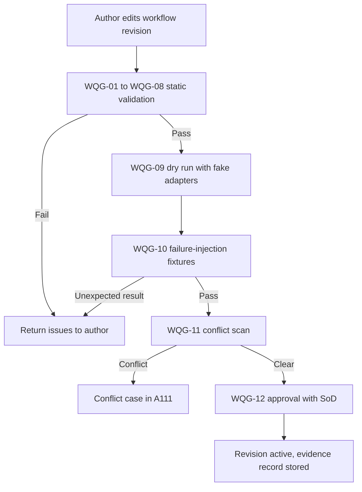

### 3.4.5.4 Part 2.2 workflow and automation enhancements (document 05)

#### A. Workflow execution-policy block (FR-ENH-B-012, ADR-107)

**Source.** Doc 05 proposed fixture:

```text
trigger: approved_enquiry
steps: [validate_scope, qualify, simulate, review, dispatch, reconcile]
max_attempts: 3          # proposed default, configurable by provider policy
stop_on: [revocation, opt_out, substantive_reply, budget_exhausted]
paid_fallback: false
uncertain_result: reconcile_before_retry
```

The blueprint has the behaviours (BRL-AUT-06 ≤ 3 retries per step, E-5 uncertain outcomes, BRL-SEQ stop-on-reply, DEC-020 paid flags OFF) but no **declared, versioned policy block** inside the workflow definition that the engine validates and enforces uniformly [GAP-325]. Every published WorkflowDefinition revision (ADR-027; A033 builder; A113 templates) gains an `execution_policy` object:

```json
{
  "$id": "https://schemas.growth-engine/workflow/execution-policy/1.0.json",
  "type": "object",
  "additionalProperties": false,
  "required": ["max_attempts", "stop_on", "paid_fallback", "uncertain_result", "timeouts", "concurrency"],
  "properties": {
    "max_attempts": {"type": "integer", "minimum": 1, "maximum": 3,
                     "description": "Per step, BRL-AUT-06 cap; adapter-level retries inside one attempt follow §3.2.7.2"},
    "stop_on": {"type": "array", "uniqueItems": true, "minItems": 1,
                "items": {"enum": ["revocation", "opt_out", "substantive_reply", "complaint",
                                   "budget_exhausted", "policy_revision_stricter", "entitlement_expired",
                                   "deal_lost", "contract_cancelled", "emergency_stop", "deadline_passed"]}},
    "paid_fallback": {"type": "boolean",
                      "description": "true only if every paid fallback in the chain has an approved budget line and benchmark record (FR-ENH-B-023)"},
    "uncertain_result": {"enum": ["reconcile_before_retry"],
                         "description": "Only allowed value (E-5); kept explicit for audit"},
    "timeouts": {"type": "object", "additionalProperties": false,
                 "properties": {"step_seconds": {"type": "integer", "maximum": 86400},
                                "run_deadline_hours": {"type": "integer", "maximum": 720}}},
    "concurrency": {"type": "object", "additionalProperties": false,
                    "properties": {"max_concurrent_runs_per_startup": {"type": "integer", "maximum": 20},
                                   "max_steps_per_run": {"type": "integer", "maximum": 50}}},
    "simulation_required_before_activation": {"const": true},
    "lease": {"type": "object", "additionalProperties": false,
              "properties": {"lease_seconds": {"type": "integer", "minimum": 30, "maximum": 900},
                             "fencing": {"const": "monotonic_token"}}}
  }
}
```

| Rule | Specification | Source |
|---|---|---|
| Mandatory stops | `opt_out`, `revocation`, `emergency_stop` and `complaint` are always present; the validator adds them if a template omits them and records the correction | BRL-ELG; E-7 |
| Sequence workflows | Any workflow with an outbound promotional step must include `substantive_reply` and `deal_lost` | BRL-SEQ; doc 05 "response halts generic sequence" |
| Tightening only | Tenants and startups may lower `max_attempts`, add stops or set `paid_fallback=false`; loosening requires R01 (BRL-APR-11, errata 74) | BRL-APR-11 |
| Lease fencing (OPT-05-04) | A worker claiming a step receives a lease with a **monotonic fencing token** stored on StepRun; every write and every outbox insert for that step carries the token and is rejected if a newer token exists. A worker whose lease expired cannot commit late results; the new owner reloads state and, for an in-flight external call, treats the result as uncertain until reconciled | ADR-027; FM-08 |
| Pinning | Running runs keep the policy of their pinned revision (BRL-AUT-03); stricter policy revisions are applied at the next dispatch recheck through `policy_revision_stricter` | BRL-AUT-03 |

#### B. Workflow activation quality gates (FR-ENH-B-013)

**Source.** Doc 05 "Before activation validate graph, trigger, scope, approval hash, eligibility, budget, retries and termination. Simulate with mock adapters; dry run cannot dispatch. Test timeout, cancellation, opt-out, duplicate and unknown provider outcome." The blueprint has the underlying rules but not a single, ordered activation checklist that the engine enforces. The engine refuses `activate` (A033/A102/A113) unless every gate passes; results are stored on the revision as an activation evidence record.

| Gate | Check | Fails when | Evidence stored |
|---|---|---|---|
| WQG-01 Graph | DAG acyclic except declared bounded loops; every node type is an approved, published node schema (A113); no arbitrary code nodes | Unknown or unpublished node; unbounded loop | Graph hash, node schema versions |
| WQG-02 Trigger | Trigger registered in A109 with signature verification (webhooks) or schedule; dedupe key defined | Unregistered trigger; missing dedupe | Trigger ID and revision |
| WQG-03 Scope | Tenant, startup and capability profile resolved; no cross-startup reference (portfolio aggregates read-only, DEC-055) | Cross-scope reference | Scope tuple |
| WQG-04 Approval hash | Every L1-capped action (DEC-064) bound to an approval of the exact content hash | Missing or stale approval | Approval IDs and hashes |
| WQG-05 Eligibility | Each outbound node references the PDP eligibility rule set version | Outbound node without eligibility binding | Rule-set version |
| WQG-06 Budget | Each paid node has an `estimate`-based maximum and a budget line with remaining reservation capacity | No budget line or estimate | Estimate per node, budget IDs |
| WQG-07 Retries | `execution_policy` validates (§A) | Schema violation | Policy JSON hash |
| WQG-08 Termination | Every path reaches a terminal node or a stop condition; run deadline set | Path without termination | Path list |
| WQG-09 Simulation | A dry run with fake adapters completed after the last edit; zero external calls observed (network egress counter = 0) | No simulation or a non-zero egress | Simulation run ID, egress counter |
| WQG-10 Failure injection | Simulation includes timeout, cancellation, opt-out, duplicate event and unknown provider outcome fixtures; each produced the expected stop or reconciliation | Missing or failed fixture | Fixture results |
| WQG-11 Conflicts | AU-030 conflict scan against active workflows on the same audience; priority order compliance > transactional > sales > marketing (BRL-AUT-09) | Unresolved conflict | Conflict case IDs |
| WQG-12 Approval to activate | Activation approved by the role the autonomy level requires (L3 needs R01 or delegated owner) with SoD (author ≠ approver) | SoD violation | Approval record |



#### C. Workflow implementation controls mapped to blueprint flows (doc 05 controls table)

| Doc 05 workflow | Trigger | Preconditions | Durable outcome | Stop / recovery | Blueprint flow and rules |
|---|---|---|---|---|---|
| Market discovery | Approved objective or source schedule | Source terms, quota, startup, target offering | Project/customer/supplier, evidence, match, assigned lead | Restricted source, duplicate, outdated bid → stop/review | WF-02; BR-M07; AU-007, AU-014, AU-015; BRL-SRC |
| Campaign / inbound | Approved content or enquiry | Published hash, consent, scoped audience, budget | Lead routed, deduped, assigned; eligible channel action via outbox | Unapproved claim, suppressed recipient, provider uncertainty | WF-04, WF-05; BRL-MKT; AU-020 |
| Sales follow-up | Qualified opportunity | Current eligibility, pricing evidence, sender, cap | Draft → approve or send → classify reply → escalate objection → book meeting | Reply, rejection, STOP, budget exhausted | WF-06, WF-07; AU-022, AU-023; AG-011/013/014 |
| Proposal and commercial close | Approved bid/quote or order | Deadline, price version, direction, agreement approval, account | Quote/contract/order, fulfilment, verified receipt or payable | Expired bid, wrong unit, duplicate callback, quality rejection | WF-08, WF-09, WF-10, WF-11; BRL-BID/QTE/ORD/FIN |
| Renewal | Eligible upcoming due date | Active agreement and contact eligibility | Recommend renewal, notify, follow up, record disposition | Cancelled contract, suppression, negative feedback | WF-12; AU-039 |

#### D. Reply-intent taxonomy alignment (FR-ENH-B-014)

**Source.** Doc 05 reply classes and doc 10 channel reply routing. AG-013 classifies into positive, question, objection, out-of-office, complaint, urgent/clinical, wrong person, other; unsubscribe and bounce are deterministic (AU-008, AU-024) [GAP-326]. Two classes from the pack are not separable today: **decline** (folded into "other" or "objection") and **meeting request** (folded into "positive").

| Class (union) | Detected by | Stops generic sequence | Next action | Pack class |
|---|---|---|---|---|
| `unsubscribe` | AU-008 Tier 0 keywords and headers (before any model) | Yes, and suppresses the channel (scope per consent rules) | Confirmation where required | unsubscribe |
| `bounce` | AU-024 provider event (not a reply) | Yes for that address | Suppress address; contact verification refresh | bounce |
| `complaint` | AG-013 + provider complaint feedback | Yes; campaign complaint counter (AU-031) | Human review | escalation |
| `urgent_clinical` | Tier 0 keyword pre-filter + AG-013 | Yes | Clinician/emergency guidance template, human handover (errata 55) | escalation |
| `not_interested` (**new**) | AG-013 | Yes; no promotional recontact without a re-engagement policy (BR-M56) | Optional lost-reason capture; deal stays open only if owner decides | decline |
| `objection` | AG-013 → AG-021 | Yes (generic); objection workflow starts | AG-021 approved answer or exception (A070) | objection |
| `meeting_request` (**new**, subset of positive with a time or booking intent) | AG-013 extraction of proposed times | Yes | AU-023 slot offer; meeting state machine | meeting |
| `positive` | AG-013 | Yes | Owner task; meeting offer if eligible | interest |
| `question` | AG-013 → AG-014 | Yes | Approved FAQ answer (L3 only for exact FAQ) or draft | interest |
| `out_of_office` | Tier 0 auto-responder headers + AG-013 | No (pauses, reschedules after return date) | Reschedule respecting caps | out-of-office |
| `wrong_person` | AG-013 | Yes for this contact | Ask for referral only if policy allows; never enrol third party automatically | escalation |
| `other` | AG-013 | Yes (any substantive reply halts generic sequence) | Human triage | — |

Evaluation impact: AG-013's eval set gains ≥ 50 labelled examples each for `not_interested` and `meeting_request` per language before the classes go live; until then they are mapped to `other`/`positive` (fail-safe: both still stop the sequence). TC-ENH-B-031.

#### E. Calendar recording rule and notes-only meeting summaries (FR-ENH-B-015)

**Source.** Doc 05 "Calendar/events: … no recording without appropriate permission"; doc 10 Meeting responsibility "Authorized transcript or notes → summary, actions, confirmed/unconfirmed distinction". The blueprint excludes meeting summarization because there is no lawful recording source (GAP-143; DEC-024 free/busy only) [GAP-335].

| Rule | Specification |
|---|---|
| BRL proposal (for Part 2.3 BRL-MTG) | The platform never records, transcribes or joins a meeting. No calendar invitation created by the platform may include a recording bot or auto-record flag |
| Notes-only path | A staff member may paste or type their own meeting notes into the Meeting record (A040). An AG-015 Copilot skill "summarize my notes" may produce: summary, action items with owners and due dates, and a **confirmed/unconfirmed** flag per commitment (unconfirmed = stated by one party only). Output is L0 (draft for the author), Tier 1a, Internal data class, no external send |
| Prohibited inputs | Recordings, transcripts from third-party tools, notes containing health details of individuals (MedMaarg), notes about minors (EduVerse); the claims guard (AG-012) blocks them |
| Cost | ≈ 1,500 input + 300 output tokens per summary on Tier 1a (estimate; verify Part 7.3 prices); expected < ₹1 per summary; inside B02 |

#### F. Workflow operational regression matrix (FR-ENH-B-016, RECOMMENDATION-325)

**Source.** Doc 05 "Operational regression must cover successful workflow, duplicate event, opt-out or reply, stale approval, provider timeout/429, revoked credential, wrong scope, exceeded budget, pause/resume and failed callback. Document observable result and recovery procedure for each. Include campaign approval, content publishing, public enquiry, professional outreach, quotation/bid, purchase/sale order, fulfilment, customer renewal and suppression." The blueprint tests these behaviours per epic but has no single matrix that proves each failure scenario on each business flow.

**Design.** One parametrized SIT suite (`tests/regression/workflow_matrix.py`) runs every scenario S1–S10 against every flow F1–F9 on real PostgreSQL with simulator adapters (90 cells). Cells marked "—" are not applicable and are asserted as skipped with a reason, so that coverage gaps are visible.

| | F1 Campaign approval (WF-05) | F2 Content publishing (§2.22.3) | F3 Public enquiry (WF-04) | F4 Professional outreach (WF-06) | F5 Quotation/bid (WF-08/09) | F6 Purchase/sale order (WF-10) | F7 Fulfilment (WF-10) | F8 Customer renewal (WF-12) | F9 Suppression (§2.22.1) |
|---|---|---|---|---|---|---|---|---|---|
| **S1 Success** | Approved → scheduled | Snapshot live | Lead + ack | Delivered | Quote sent / bid recorded | Order confirmed | Delivery accepted | Renewal offer sent | Suppressed everywhere ≤ 60 s |
| **S2 Duplicate event** | One campaign launch | One publish | One lead, attribution appended | One send | One quote revision | One order | One delivery (2 kg case) | One reminder | One suppression row |
| **S3 Opt-out or reply** | Recipient removed at dispatch | — | No ack if opted out | Sequence stopped | Follow-ups stopped | — | — | Reminder cancelled | Already suppressed: idempotent |
| **S4 Stale approval** | Launch blocked | Publish blocked | — | Send blocked | Send blocked (DEC-064) | Confirmation blocked | — | Offer blocked | — |
| **S5 Provider timeout / 429** | Ad launch uncertain → reconcile | CDN invalidation retried | Ack retried (429) / uncertain (timeout) | Uncertain → reconcile | E-sign link uncertain → reconcile | Payment link uncertain | Carrier callback late → reconcile | Uncertain → reconcile | — (internal) |
| **S6 Revoked credential** | Connection auth_failed, no spend | — | Ack held, task created | Dispatch denied (`denied`) | E-sign denied | Payment adapter denied | — | Denied | — |
| **S7 Wrong scope** | 404, no effect | 404 | Unknown host 404 | 404 | 404 | 404 | 404 | 404 | 404 |
| **S8 Budget exceeded** | Paused at cap | — | Ack (transactional reserve slice) | Held, no send | — | — | — | Held | — |
| **S9 Pause / resume** | Resume rechecks PDP | Resume rechecks approval | — | Resume rechecks eligibility | Resume rechecks deadline | Resume rechecks stock/terms | Resume rechecks quantities | Resume rechecks agreement | — |
| **S10 Failed callback** | Invalid signature rejected | — | — | Invalid signature rejected, replay ignored | Invalid signature rejected | Invalid signature rejected | Invalid signature rejected | — | Invalid unsubscribe callback rejected, no suppression change |

Each scenario's observable result and recovery procedure (the "document the recovery" requirement):

| Scenario | Observable result (assertions) | Recovery procedure | Test |
|---|---|---|---|
| S1 | Expected terminal state; audit chain intact; actual cost reconciled | — | TC-ENH-B-001 |
| S2 | Exactly one side effect; second delivery returns stored result; `duplicate_suppressed` metric +1 | None | TC-ENH-B-002 |
| S3 | Pending actions cancelled; reservations released; reason `opt_out`/`substantive_reply` | None; re-engagement only by policy | TC-ENH-B-003 |
| S4 | PDP deny with rule ID `APPROVAL_HASH_MISMATCH` or `APPROVAL_EXPIRED`; nothing dispatched | Re-approve exact hash | TC-ENH-B-004 |
| S5 | 429 → retry with backoff honouring Retry-After; timeout after send → `uncertain`, no retry until reconciled | RB-003 uncertain-outcome surge | TC-ENH-B-005 |
| S6 | `denied` outcome; connection `auth_failed`; owners notified (R11/R12) | RB-013; rotate credential; requeue after PDP recheck | TC-ENH-B-006 |
| S7 | Uniform 404; zero rows read across scope; security event logged | RB-008 if repeated | TC-ENH-B-007 |
| S8 | Hard stop at 100%; transactional safety slice honoured (ADR-083); NT-025 Critical | RB-005 | TC-ENH-B-008 |
| S9 | No external call while paused; on resume, PDP recheck precedes every pending action | — | TC-ENH-B-009 |
| S10 | 401/400 for invalid signature; nothing persisted beyond rejection log; replay within window ignored | RB-009 | TC-ENH-B-010 |

### 3.4.5.5 Part 7 AI enhancements (document 10)

#### A. Agent envelope v1.1 (FR-ENH-B-009, ADR-104)

**Source.** Doc 10 required envelope for every logical AI responsibility: `tenant_id, startup_id, purpose, schema_revision, evidence_ids, confidence, missing_fields, policy_flags, proposed_action, requires_approval, cost_estimate`. Part 7.2 §7.2.7 has tenant/startup, evidence, confidence and budget remaining, but not seven of the eleven fields [GAP-323]. The additions are **additive** (minor version), so existing agents stay valid when the fields are optional-with-default during migration and mandatory from the first eval cycle after W0-B.

| New field | Type | Rule | Consumer |
|---|---|---|---|
| `purpose` | enum (processing purpose from the purpose register, e.g. `research`, `outreach_drafting`, `inbound_routing`, `copilot_answer`) | Must match the purpose bound to the data's consent/lawful basis; mismatch → reject (DPDP purpose limitation, verify) | PDP, audit |
| `schema_revision` | string `name@major.minor` | Output schema the payload was validated against | AU-003 |
| `missing_fields` | string[] | Required facts the model could not support (doc 10 "unknown when unsupported") | Reviewer UI shows "Review required" (FR-UIS-02) |
| `policy_flags` | enum[] (`claim_unapproved`, `health_content`, `minor_detected`, `injection_suspected`, `price_mentioned`, `legal_term`, `personal_data`) | Raised by the agent or by AG-012/AU-005; any flag forces L1 | Engine, AG-012 |
| `proposed_action` | object `{type, target_ref, params_digest}` or null | A **proposal**, never an instruction; the engine maps it to an allowlisted node type or drops it | Engine (WQG-01 node allowlist) |
| `requires_approval` | boolean | True if `proposed_action` is consequential (DEC-064 L1 caps) or any `policy_flags` present; the engine may set it to true but never to false | Engine, approval service |
| `cost_estimate` | `{amount_inr, tokens_in, tokens_out, tier}` | Pre-call estimate from AU-001; actual cost reconciled on the run | AU-002, FinOps |

#### B. Logical AI responsibilities (doc 10) mapped to the blueprint catalogue

| Doc 10 responsibility | Inputs → output (doc 10) | Blueprint implementation | Notes |
|---|---|---|---|
| Knowledge | Approved claims/documents → facts, citations, unknowns | AG-001 Knowledge & Claim Ingestion; RAG ADR-041 | Covered |
| Research | Permitted sources, geography → queries, evidence, freshness | AG-003 Research Query Planner; AU-007, AU-014 | Covered |
| Signal | Source records → signal type, evidence, confidence | AG-005 Buying Signal Classifier | Covered |
| Matching | Verified evidence, scoring policy → score factors, missing evidence, explanation | AU-016 ranking + AU-017 scoring (deterministic) + AG-007 explanation | Covered; scoring stays deterministic (doc 10 "deterministic scoring outside AI") |
| Contact | Professional source → role, channel, provenance, verification | AG-008 role extractor + AU-018 verification | Covered |
| Engagement | Eligible contact, facts, channel → draft, claims, sources, escalation | AG-011 drafter + AG-012 guard | Covered |
| Response | Inbound message, thread → intent, objection, next action, stop flag | AG-013 (+ §3.4.5.4 D taxonomy) | Covered, enhanced |
| Objection | Concern, approved evidence → answer or escalation | AG-021 | Covered |
| Planner | Objective, scope, budget, deadlines → actions, cost, dependencies, approval need | AG-016 | Covered |
| Meeting | Authorized transcript or notes → summary, actions, confirmed/unconfirmed | Excluded (GAP-143) | Partial → notes-only skill (§3.4.5.4 E) |
| Forecast | Pipeline and evidence → scenario, assumptions, uncertainty | AU-041 deterministic forecast; AG-029 narrative | Covered (LLM does not forecast, Part 7.1) |
| Quality | Candidate output, gold case, policy → pass/fail, reason, severity | AG-002 judge; AU-006 CI gate | Covered |
| Cost routing | Token estimate, models, caps → model, reserve, fallback | AU-001 router + AU-002 budget (deterministic) | Covered; not an LLM |
| Copilot | Scoped request → read/draft/action proposal, confirmation | AG-015 | Covered |
| Business need | Requirement, source → need and offering match | AG-006 + AU-016 | Covered; schema mapping below |
| Content and SEO | Offering, audience → draft content, claims, review | AG-018 + AU-033 | Covered |
| Proposal | Prices, bid/order requirements → draft quote/proposal, assumptions | AG-020 (prices from approved PriceVersion via AU-035; AI never sets prices) | Covered |
| Retention | Delivery, feedback, contract → renewal opportunity, next action | AU-039 health score + AG-026 feedback analyzer | Covered |

**"Six runtime responsibilities" [CONFLICT-327].** Doc 10's agent-decomposition contract groups runtime AI into six families (research, evidence/need, matching, content/draft, inbound intent, QA), while the same document lists 18 responsibilities and the blueprint catalogues 28 product agents and 43 deterministic automations. Resolution: the six are **families**; Part 7.1's catalogue governs. Family mapping: research → AG-003, AG-027; evidence/need → AG-004, AG-005, AG-006, AG-019, AG-023, AG-024; matching → AG-007 (with AU-016/017); content/draft → AG-011, AG-014, AG-018, AG-020, AG-021, AG-025, AG-030, AG-031, AG-032; inbound intent → AG-013, AG-017; QA → AG-002, AG-012, AG-022. Copilot (AG-015), planner (AG-016), ops triage (AG-028) and narrative (AG-029) are platform assistants outside the six families. Every family keeps the doc 10 acceptance "each AI output schema and budget tested" (Part 6.4).

#### C. Need schema mapping (doc 10 "AI schema")

| Doc 10 field | Blueprint (AG-006 output, AU-016, AG-007) | Note |
|---|---|---|
| `need_type` | `needs[].category` (need taxonomy) | Same |
| `organization_id` | Run scope + subject organization | Implicit in the run; add explicitly to the payload for audit |
| `evidence_ids` | `needs[].evidence_ids[]` | Same; missing evidence → reject (BRL-AI-03) |
| `confidence` | `needs[].confidence` | Same |
| `explicit_or_inferred` | `needs[].basis` (`explicit` requires quote ID) | Same |
| `product_id` | AU-016 ranked offering IDs | Deterministic ranking, not the model |
| `readiness` | Offering readiness from the catalogue (BR-M02) | Deterministic |
| `recommended_action` | `proposed_action` in envelope v1.1 | Proposal only |
