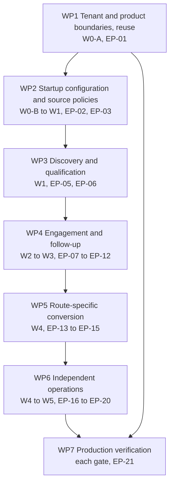

### 3.4.5.6 Part 4 operations and engineering-quality enhancements

#### A. Runbooks added to Part 4.3 §4.44 (FR-ENH-B-017)

**Source.** Doc 04 production runbook (8 routines). Predeployment, release, provider outage, budget cap and recovery map to §4.48, §4.37, RB-001, RB-005 and RB-007. Daily operations has no runbook [GAP-327]; client offboard exists as a process (WF-14) without an operator runbook; data incident is split across RB-008 and RB-013 without a containment-to-restart sequence.

**RB-ENH-B-01 Daily operations checklist** (owner: on-duty engineer acting for R11 Automation Lead; 15–30 minutes per working day, Mon–Sat per DEC-044; results logged in A014 as a daily operations record)

| # | Check | Where | Threshold / action |
|---|---|---|---|
| 1 | Failed jobs and DLQ | A009 | Any new DLQ item → triage; > 10/hour alarm already pages (§3.2.7.4) |
| 2 | Uncertain outcomes older than 24 h | A110 / AU-026 queue | SLO-10; each item gets an owner |
| 3 | Pending approvals near SLA | Action and notification centre (A106) and the approval queues (A035, A051, A059, A066, A068, A072) | Escalate per AU-027 |
| 4 | Budget status | A012 | Lines ≥ 70% reviewed (§C ladder); forecast to month end |
| 5 | Receipts and reconciliation exceptions | A073/A074 | Unmatched receipts, payment discrepancies; > ₹1 lakh discrepancy is S1 (errata 17) |
| 6 | Source freshness and expiring permissions | A010 | Sources expiring in ≤ 7 days renewed or disabled |
| 7 | Suppression health | A007 consent and policies; A047 compliance incidents | Suppression sync lag, complaint rate per campaign vs AU-031 threshold |
| 8 | Backup and drill status | §4.47 evidence | Last automated restore check passed; drill not overdue |
| 9 | Provider health and breakers | AU-010 panel | Any breaker open > 15 min has an incident |
| 10 | Security signals | GuardDuty/Sentry summary | New High finding → RB-013 assessment |

**RB-ENH-B-02 Client offboard** (trigger: WF-14 offboarding approved; owner R12 with R08 finance and R10 DPO)

| Step | Action | Verification |
|---|---|---|
| 1 | Set tenant state `offboarding`; emergency stop scope = tenant (E-7) | No outbox dispatch for the tenant after 60 s |
| 2 | Cancel schedules, triggers and pending actions; release reservations | Zero active runs; reservation balance 0 |
| 3 | Reconcile uncertain external outcomes for the tenant (AU-026) | Uncertain queue for tenant empty or each item assigned |
| 4 | Revoke sender identities, provider connections, webhooks and OAuth grants; rotate shared secrets the tenant could have seen | Connections `disabled`; provider-side revocation confirmed |
| 5 | Revoke all memberships and portal grants; invalidate sessions | Login attempts denied |
| 6 | Generate the entitled export (A103 portability format), deliver through a time-limited link | Export manifest and checksum signed; download logged |
| 7 | Settle charges: final usage meter readings, credits, final invoice (B-SVC) | Finance sign-off R08 |
| 8 | Apply retention: delete or crypto-shred per policy (RECOMMENDATION-038), keep legally held records | Retention job report; KMS key scheduled for deletion after hold expiry |
| 9 | Close: tenant state `offboarded`; audit summary to the client admin | Audit record; DPO sign-off |

**RB-ENH-B-03 Data incident: containment to authorized restart** (trigger: suspected disclosure, corruption or unauthorized action; owner: incident commander per §4.43)

| Phase | Action | Exit criterion |
|---|---|---|
| Isolate | Emergency stop for the affected scope (startup, tenant or product); block affected integration connections; freeze deployments | No further external effects in scope |
| Revoke | Rotate or revoke credentials suspected of exposure (RB-013) | New credentials in place; old ones dead |
| Preserve | Snapshot the database (manual snapshot), export relevant audit chain segment and logs to the Object-Lock evidence bucket | Evidence hashes recorded |
| Investigate | Determine data classes, scopes and subjects affected; decide notification duties (DPDP and CERT-In timelines, verify) | Impact statement approved by R10 |
| Restore | If data was corrupted: class-ordered restore (§3.4.5.1 B) into an isolated instance; compare; switch | RC-1 invariants pass |
| Reconcile | Reconcile uncertain or unauthorized external effects with providers and customers | All items closed or assigned |
| Authorize restart | R01 (and the client admin for an external tenant) approves resumption scope by scope; PDP rechecks run on resume | Signed restart record |
| Learn | Postmortem within 5 working days (§4.43.5) | Actions tracked |

**Additions to existing runbooks.** RB-007 gains the class-ordered restore checklist (RC-1 → reconcile → RC-3 → RC-2) and records restore minutes per GB for the ADR-102 trigger. RB-005 references the threshold ladder in §C.

#### B. Critical-branch coverage gate (FR-ENH-B-018)

**Source.** Doc 10 "100% critical permission/finance/policy branches tested; proposed ≥ 80% domain-service branch coverage". NFR-082 measures **line** coverage (≥ 80%; ≥ 90% for PDP, approvals, finance, tenancy, gateway) [GAP-328].

| Rule | Specification |
|---|---|
| Critical branch inventory | Every decision point in the PDP, approval threshold logic (DEC-038), money and allocation code, tenancy/RLS context setting, eligibility rules and budget reservation is annotated `# critical-branch: <rule-id>`; CI extracts the inventory |
| 100% rule | Each inventoried branch outcome (true and false, each enum arm) is executed by at least one test that asserts the outcome; measured with branch coverage (`coverage run --branch`) filtered to annotated lines; any uncovered arm fails PL-04 |
| Domain-service rule | Branch coverage ≥ 80% for `*/services/*` modules (in addition to NFR-082 line coverage) |
| Decision tables | PDP and approval branches are tested through the decision tables already in Part 6 (technique: decision table); the inventory links each branch to its table row |
| Exemptions | Only with an approved exception in the PR (R01 or the Principal Engineer), expiring in 30 days |

#### C. Budget threshold ladder (FR-ENH-B-022)

**Source.** OPT-03-08 "Alert 70/90% of configured cap (proposed); pause optional jobs at cap; route unexpected bills to owner"; doc 10 budget model "alerts at 80% configured budget"; blueprint BRL-AI-08 / NT-025 (80% alert, 100% stop) and AWS Budgets (50/80/100%) [CONFLICT-324].

| Threshold | Applies to | Severity / channel | Automatic action |
|---|---|---|---|
| 50% (actual) | B01 infrastructure only (AWS Budgets, existing) | Info digest | None |
| **70% (forecast or actual)** (new) | Every capped line (B02–B07, tenant AI budgets, campaign and ads budgets) | Info in daily digest; appears in RB-ENH-B-01 check 4 | Forecast to month end shown in A012 |
| 80% (actual) | Same (existing NT-025 High) | High, immediate | None (existing) |
| **90% (actual)** (new) | Same | Critical (NT-025 critical variant) | Optional batch jobs (research refresh, enrichment, non-urgent reports) deprioritized to off-peak; owner prompted to approve a revised budget within authority |
| 100% | Same (existing hard stop) | Critical | Hard stop for new reservations; optional jobs paused; transactional safety slice (ADR-083) remains for replies and STOP handling |
| Unexpected bill | Provider invoice line without a matching reservation | High to R01 and FinOps | Reconciliation exception (IP-05) |

BRL-AI-08 semantics are unchanged (80% alert, 100% stop); the ladder adds two thresholds and makes "pause optional jobs" explicit.

#### D. Technical-debt register and documentation sync (FR-ENH-B-020)

**Source.** OPT-13-02 "Track issue, owner, severity, business impact and refactor benefit; review monthly; each accepted change has regression evidence and rollback" [GAP-329]; OPT-13-03 "Keep contract docs and runbooks synchronized with actual code; new maintainer can reproduce test and diagnose synthetic failure using runbook".

| Register field | Content |
|---|---|
| `TD-###` | ID |
| Title, component | Module or file area |
| Type | Design, code, test, infrastructure, documentation, dependency |
| Severity | S1 blocks safety or correctness · S2 slows delivery · S3 cosmetic |
| Business impact | Which KPI/NFR is at risk (e.g. NFR-039 latency) |
| Interest | Estimated PD lost per month if not fixed |
| Refactor cost | Low/base/high PD |
| Benefit ratio | Interest × 6 months ÷ base cost (prioritize > 1) |
| Owner, target sprint | Named owner |
| Regression evidence and rollback | Tests and rollback path required before closing |

Cadence: reviewed in the monthly engineering review; budget rule: up to 10% of sprint capacity reserved for S1/S2 debt (inside the existing velocity, not additional PD). **Documentation sync check:** CI fails a PR that changes an OpenAPI operation, an event schema, an adapter port or a runbook-referenced alarm without touching the corresponding documentation file (path mapping maintained in `docs/sync-map.yaml`); a quarterly "new maintainer drill" (a team member who did not build the component reproduces one synthetic failure using only the runbook) produces an EVR. TC-ENH-B-036.

### 3.4.5.7 Part 8 delivery enhancements (document 04)

#### A. Seven dependency-ordered work packages mapped to waves



The mapping follows Part 8.1 §8.1.2 (re-baselined calendar, CONFLICT-142). WP7 runs at every gate, not only at the end.

#### B. Discipline-level effort reconciliation (FR-ENH-B-025, RECOMMENDATION-328)

**Source.** Doc 04 "proposed base allocation 385 person-days for 149 work items" with a six-discipline split; "dependency-only longest path is 113.5 days assuming … unlimited resources". Part 8.1 estimates from stories (central 416 pd; capacity ≈ 398 pd with uplifts) and has no discipline split [CONFLICT-328].

**Resolution.** Part 8.1's story-based plan governs scope, calendar and critical path. The pack's 385 PD is a second, top-down estimate inside the same BRD §6 envelope (287–483 PD); the 31 PD difference (≈ 8%) is within Part 8's P80 spread. The pack's **discipline shares** are adopted as a cross-check of role capacity:

| Discipline | Pack PD (share) | Applied to Part 8 central 416 pd | Role capacity Day 1–180 (Part 8 team, focus 0.686) [ASSUMPTION-323] | Balance |
|---|---|---|---|---|
| React / UX | 90.68 (23.55%) | 98.0 | FE 89.2 + UX contractor ≈ 16 days ≈ 105 | +7 (tight) |
| Django / API | 111.55 (28.97%) | 120.5 | BE 89.2 + FS share after AI work (89.2 − 39.1 = 50.1) ≈ 139.3 | **−38.3** for Django + PostgreSQL combined |
| PostgreSQL | 52.85 (13.73%) | 57.1 | (shared with the line above) | (combined above) |
| AI / integration | 36.23 (9.41%) | 39.1 | FS (AI lead) | 0 (by construction) |
| QA | 65.64 (17.05%) | 70.9 | QA 78.9 | +8.0 |
| DevOps / security | 28.05 (7.29%) | 30.3 | DevOps 51.5 | +21.2 |
| **Total** | **385.00** | **416.0** | **≈ 414** | |

**Finding.** The plan balances in total but is **backend-constrained by ≈ 38 pd**; DevOps surplus (≈ 21 pd) can absorb migration, RLS and database operations work, leaving ≈ 17 pd. This supports Part 8's tier 1 spill and, if the Founder chooses Option E (two contract engineers), recommends that at least one is a Django/PostgreSQL engineer. Capacity formula: role capacity = FTE-days in S0–S12 × (398 ÷ 580) where FTE-days are BE 130, FE 130, FS 130, QA 0.5 × 30 + 1.0 × 100 = 115, DevOps 1.0 × 20 + 0.5 × 110 = 75.

**PD actual-vs-estimate tracking (OPT-16-02).** Every story records base estimate (pd), actual pd at Done and rework pd; the sprint review reports the ratio per discipline. Trigger: ratio > 1.25 for two sprints in one discipline → re-estimate remaining stories in that discipline at the S3/S7 reviews (Part 8.1 §8.1.6.6). Double counting is prevented by the rule "shared library work is estimated once on its first consuming story" (doc 04).

**Vertical-slice checklist (doc 04).** A story that delivers a named screen is Done only when all eight slice parts exist or are explicitly N/A: (1) migration, (2) transactional service with service card (§3.4.5.3 A), (3) API contract in OpenAPI, (4) React screen with all UI states, (5) worker/outbox path, (6) integration stub or fake adapter, (7) acceptance evidence (tests + EVR), (8) independent review. This extends the Part 5 Definition of Done without changing its IDs.

#### C. Expansion interfaces (W31–W34, A109–A113) task DAG (FR-ENH-B-026)

| Task | Work | Predecessors | Low / base / high PD | Earliest start (base, unlimited resources) |
|---|---|---|---|---|
| UX-TASK-FOUNDATION | Scoped configuration, identity/audience foundation | Baseline dependencies | 8 / 14 / 24 | Day 0 |
| UX-TASK-FIELDS | Dynamic fields, linked records, shared UI state | FOUNDATION | 18 / 32 / 55 | 14 |
| UX-TASK-EVENTS | Event/run/conflict orchestration, versioned graph | FOUNDATION | 10 / 18 / 30 | 14 |
| UX-TASK-W31…W34 (4 tasks) | SaaS introduction, registration, onboarding wizard, client portal | FOUNDATION, FIELDS | 2 / 4 / 7 each | 46 |
| UX-TASK-A109…A113 (5 tasks) | Event & Trigger Centre, Execution Monitor, Conflict Resolution, Configuration Change Centre, Template & Node Library | FOUNDATION, FIELDS, EVENTS | 2 / 4 / 7 each | 46 |
| UX-TASK-QA | Integrated regression and release evidence | All nine screen tasks | 8 / 14 / 24 | 50 |
| **Totals** | 13 tasks | | **62 / 114 / 196** | Critical path 36 / 64 / 110 PD |

**Reconciliation.** Part 8.1 places W31–W34 in EP-20 (W5) and A109–A113 in EP-18 (W0–W5). The pack's 114 PD base is **not additive** to the 287–483 envelope (doc 04 says so explicitly) because Part 5 stories already estimate these screens; the DAG adds one useful constraint: **UX-TASK-FIELDS (dynamic fields and shared UI state) is the expansion critical path** and must be scheduled before any of the nine screens. Part 8's planner checks that the dynamic-field framework story precedes US stories for W31–W34 and A109–A113 [RECOMMENDATION-328].

#### D. Approval-gate register and review effort (FR-ENH-B-024)

**Source.** Doc 10 "Exact API definitions outstanding: 38; partial API proposals: 0; database reuse/field confirmations: 4; UI semantic mapping approvals pending: 138"; doc 04 "Potential review workload 32.55 low / 62.85 base / 123.70 high person-days … subtract work already covered". The blueprint does not track these as gate items [GAP-330].

| Register item | Pack count | Blueprint position | Closure procedure | Gate |
|---|---|---|---|---|
| Exact API definitions outstanding | 38 | Part 3.2 catalogue is DERIVED (555 operations with method, path, roles, idempotency, side-effect class), but request/response DTOs are not yet exact for all | For each operation used by a story in the sprint: OpenAPI schema with closed request/response DTOs, error problem types and examples; contract test green (OPT-09-01: 100% of applicable contracts before activation) | DoR of the consuming story; W-gate evidence |
| Partial API proposals | 0 | — | — | — |
| Database reuse / field confirmations | 4 | Part 3.3 binds entities to physical tables; reuse of the existing identity schema is the open item (US-0101) | Identity spike confirms user, membership, audience and MFA fields; applicant-draft storage binding decided | Gate W0-A |
| UI semantic mapping approvals | 138 | The 138 retained screens are specified in Part 2.5 | Product owner approves each screen's field-to-entity mapping in the screen's story (Part 5) | DoR per story |

**Review effort.** The pack's 32.55 / 62.85 / 123.70 PD is a ceiling for contract, provider, schema, traceability, optimization-evidence and readiness review. Most of it is already inside Part 5 story estimates (DoR/DoD reviews) and Part 8's independent reviewer allowance (≈ 10 days). Residual, unbudgeted review effort is estimated at **0–10 PD** (assumption: only the 38 DTO completions and 4 database confirmations are not yet inside a story) and is drawn from the Part 8 management reserve if needed. TC-ENH-B-039 makes an open register item block the release that depends on it.

### 3.4.5.8 User stories and test cases

#### A. User stories (US-<EP>-EB<nn>) with acceptance criteria

| Story | Epic | Statement | FR | Estimate (SP) | Wave |
|---|---|---|---|---|---|
| US-21-EB01 | EP-21 | As the DevOps/SRE lead I want growth-scale load profiles so that the scale gate proves the pack's growth matrix | FR-ENH-B-001 | 5 | W5 |
| US-21-EB02 | EP-21 | As the DBA I want data recovery classes and a class-ordered restore so that critical data returns within the RTO as the database grows | FR-ENH-B-002 | 5 | W0-B (labels), W5 (drill) |
| US-17-EB01 | EP-17 | As a sales manager I want dashboards to load within 2 seconds so that I can act on current numbers | FR-ENH-B-003 | 3 | W2 |
| US-01-EB01 | EP-01 | As the Principal Engineer I want every adapter to implement estimate, execute, reconcile and health so that budgets, retries and probes behave the same for every provider | FR-ENH-B-004, -027 | 5 | W0-A |
| US-01-EB02 | EP-01 | As the security lead I want each API view bound to one of four permission base classes so that no view is reachable by the wrong audience | FR-ENH-B-005 | 3 | W0-A |
| US-19-EB01 | EP-19 | As a website visitor I want stable, shareable URLs for each startup page so that I can find and share offerings | FR-ENH-B-006 | 3 | W2 |
| US-08-EB01 | EP-08 | As a sales rep I want inbound replies classified with decline and meeting-request classes and stored without raw text in the event log so that sequences stop correctly and meetings are offered fast | FR-ENH-B-007, -014 | 5 | W2 |
| US-08-EB02 | EP-08 | As a compliance lead I want outbound intents to expire so that nothing is sent late under stale approvals | FR-ENH-B-008 | 3 | W2 |
| US-04-EB01 | EP-04 | As the AI lead I want the agent envelope to carry purpose, policy flags, proposed action, approval need and cost estimate so that the engine can enforce policy without trusting model text | FR-ENH-B-009 | 5 | W0-B |
| US-04-EB02 | EP-04 | As the FinOps lead I want 70% and 90% budget thresholds so that overspend is seen before the hard stop | FR-ENH-B-022 | 2 | W0-B |
| US-03-EB01 | EP-03 | As the DPO I want product events from our startups' own products accepted only through a closed allowlist so that no clinical or personal data enters the commercial platform | FR-ENH-B-010 | 5 | W4 |
| US-17-EB02 | EP-17 | As a startup head I want one journey stage per account so that I can see the funnel end to end | FR-ENH-B-011 | 5 | W3 |
| US-18-EB01 | EP-18 | As an automation architect I want each workflow revision to declare its execution policy so that retries, stops and fallbacks are validated, not implied | FR-ENH-B-012 | 5 | W0-B |
| US-18-EB02 | EP-18 | As a workflow approver I want activation blocked until 12 quality gates pass so that no unsafe workflow goes live | FR-ENH-B-013 | 5 | W2 |
| US-18-EB03 | EP-18 | As the QA lead I want one regression matrix across scenarios and flows so that every failure mode is proven on every business flow | FR-ENH-B-016 | 8 | W2–W5 |
| US-09-EB01 | EP-09 | As a sales rep I want to summarize my own meeting notes without any recording so that follow-ups are accurate and lawful | FR-ENH-B-015 | 3 | W3 |
| US-21-EB03 | EP-21 | As the on-duty engineer I want daily, offboarding and data-incident runbooks so that routine and rare operations are repeatable | FR-ENH-B-017 | 3 | W2, W5 |
| US-21-EB04 | EP-21 | As the Principal Engineer I want every critical decision branch covered by a test so that policy and money code cannot regress silently | FR-ENH-B-018 | 3 | W0-B |
| US-01-EB03 | EP-01 | As the DevOps lead I want processes to refuse to start with missing mandatory configuration so that unsafe defaults never run | FR-ENH-B-019 | 2 | W0-A |
| US-21-EB05 | EP-21 | As the engineering lead I want a technical-debt register and a documentation-sync check so that maintainability is managed, not assumed | FR-ENH-B-020 | 2 | W2 |
| US-01-EB04 | EP-01 | As the security lead I want tests that present the investor product's tokens and a wrong product configuration so that product isolation is proven | FR-ENH-B-021 | 3 | W0-A |
| US-01-EB05 | EP-01 | As the Founder I want no paid provider activated without a benchmark record so that replacement-first is enforced | FR-ENH-B-023 | 2 | W1 |
| US-21-EB06 | EP-21 | As the product owner I want an approval-gate register and discipline effort tracking so that open contracts and capacity risks are visible at each gate | FR-ENH-B-024, -025 | 3 | W0-A |

Estimates total **88 SP (≈ 62 pd at 0.7 pd/SP, Part 8.1 §8.1.6.1)**; most items extend existing stories and will partly merge into them during refinement; they are candidates for the Part 8 backlog, not automatically added scope.

```gherkin
Feature: US-01-EB01 Adapter port contract v2
  Scenario: AC-01EB01-01 Estimate is an upper bound and side-effect free
    Given the SES sandbox adapter and a message request for one recipient
    When estimate is called 100 times with sampled requests
    Then no provider send API is invoked
    And every estimate is greater than or equal to the actual cost recorded after execution
  Scenario: AC-01EB01-02 Timeout after send is uncertain and never retried
    Given the simulator delays the WhatsApp response beyond the timeout after accepting the request
    When the dispatch worker executes the action
    Then the outcome is "uncertain"
    And no second execute call is made until reconcile returns "permanent"
  Scenario: AC-01EB01-03 Revoked credential returns denied
    Given the connection credential has been revoked at the provider
    When execute is called
    Then the outcome is "denied" with failure class "auth"
    And the PDP denies further dispatch on that connection

Feature: US-01-EB02 Permission base classes
  Scenario: AC-01EB02-01 Every view declares exactly one base class
    Given the api-web, api-admin and api-hooks URL configurations
    When the CI permission scan runs
    Then every view declares exactly one of PublicPublishedRead, ExternalGrantPermission, StaffRolePermission or ServiceIdentityPermission
  Scenario: AC-01EB02-02 Portal principal cannot reach an Admin route
    Given an authenticated portal user of tenant T1
    When the user calls an /api/v1/commercial/admin/ route with the portal session
    Then the response is 404 and no admin view code executes

Feature: US-18-EB01 Workflow execution policy
  Scenario: AC-18EB01-01 Missing mandatory stop is added and recorded
    Given a workflow template whose stop_on omits opt_out
    When the revision is validated
    Then opt_out, revocation, emergency_stop and complaint are present in the stored policy
    And the validation report lists the correction
  Scenario: AC-18EB01-02 Loosening requires the Founder
    Given a startup policy with max_attempts 2
    When a startup head (R02) sets max_attempts to 3
    Then the change is rejected with rule BRL-APR-11
  Scenario: AC-18EB01-03 Expired lease cannot commit
    Given worker A holds the lease for step S with fencing token 7
    And the lease expires and worker B claims step S with token 8
    When worker A tries to write the step result
    Then the write is rejected and no outbox row is inserted

Feature: US-18-EB02 Activation quality gates
  Scenario: AC-18EB02-01 Activation blocked without a fresh simulation
    Given a workflow revision edited after its last dry run
    When the approver activates it
    Then activation fails gate WQG-09
  Scenario: AC-18EB02-02 Simulation makes no external call
    Given a dry run with fake adapters
    When the simulation completes
    Then the network egress counter for the run is 0 and no provider charge is recorded

Feature: US-04-EB01 Agent envelope v1.1
  Scenario: AC-04EB01-01 Engine never lowers requires_approval
    Given AG-011 returns requires_approval false with policy_flags ["price_mentioned"]
    When the engine validates the envelope
    Then requires_approval is stored as true and the draft is held at L1
  Scenario: AC-04EB01-02 Purpose mismatch rejected
    Given an envelope with purpose "outreach_drafting" for data collected only for "inbound_routing"
    When the gateway validates the envelope
    Then the envelope is rejected and a policy event is logged

Feature: US-03-EB01 Product-event ingress allowlist
  Scenario: AC-03EB01-01 Unknown field rejected without storing payload
    Given an active MedMaarg product-event source
    When an event arrives with an extra field "diagnosis"
    Then the response is 422
    And only the event ID, source code, payload hash and rule ID are stored
  Scenario: AC-03EB01-02 Payment status never closes a deal
    Given a mapped institutional account with an open deal
    When a payment_status_changed event with "paid" arrives
    Then a finance.product_payment_status.changed event is emitted
    And the deal state is unchanged

Feature: US-08-EB01 Reply taxonomy
  Scenario: AC-08EB01-01 Decline stops the sequence
    Given a contact enrolled in a promotional sequence
    When the contact replies "Not interested, thanks"
    Then the class is not_interested and all pending sequence steps are cancelled
  Scenario: AC-08EB01-02 Event log holds no message text
    Given an inbound WhatsApp message
    When the canonical inbound event is persisted
    Then the event row contains text_ref and no message body

Feature: US-08-EB02 Outbound intent expiry
  Scenario: AC-08EB02-01 Expired intent is cancelled, not sent late
    Given a promotional intent scheduled at 10:00 with expiry 72 hours
    And the channel was paused for 80 hours
    When the channel resumes
    Then the intent is cancelled with rule INTENT_EXPIRED and its reservation released

Feature: US-21-EB02 Recovery classes
  Scenario: AC-21EB02-01 RC-1 restored and validated within 2 hours at scale gate
    Given a Topology B staging environment with a growth-size dataset
    When a PITR restore to T minus 1 minute is executed by RB-007
    Then RC-1 invariants pass and the application is switched within 120 minutes
  Scenario: AC-21EB02-02 Projections rebuilt after RC-1
    Given RC-1 is restored
    When projection rebuild jobs run
    Then Customer 360 and journey projections are current within 2 hours

Feature: US-04-EB02 Budget ladder
  Scenario: AC-04EB02-01 Ninety percent deprioritizes optional jobs
    Given a startup AI budget of 1000 INR with 900 INR reserved or spent
    When a research refresh job is due
    Then it is moved to the off-peak window and a Critical notification is sent
    And replies and STOP handling continue to use the safety slice

Feature: US-09-EB01 Notes-only meeting summary
  Scenario: AC-09EB01-01 Recording is never requested
    Given a meeting booked through the platform
    When the calendar invitation is created
    Then it contains no recording bot and no auto-record flag
  Scenario: AC-09EB01-02 Health details block the summary
    Given meeting notes containing an individual's medical condition
    When the rep requests a summary
    Then the claims guard blocks the request and no model call is made
```

Stories US-21-EB01, US-17-EB01, US-17-EB02, US-19-EB01, US-18-EB03, US-21-EB03…06, US-01-EB03…05 take their acceptance criteria directly from the pass criteria in the tables referenced in their FR rows (LT-ENH-B profiles, NFR-ENH-B-05, journey rules, route map, regression matrix, runbook exit criteria, coverage rules, fail-fast rules, register fields, gate rule); each criterion is verified by the test case listed below.

#### B. Test cases (TC-ENH-B)

| TC | Linked | Technique | Preconditions / data | Steps | Expected result | Priority | Type | Automate |
|---|---|---|---|---|---|---|---|---|
| TC-ENH-B-001…010 | FR-ENH-B-016, US-18-EB03 | Pairwise over scenario × flow, then state transition per cell | SIT, real PostgreSQL, simulators, two-tenant fixture T1/T2 External-A | Run matrix cell (S_n, F_m) | Assertions in §3.4.5.4 F per scenario | P1 | SIT | Y |
| TC-ENH-B-011 | LT-ENH-B-01 | Load (profile) | `perf` Topology B; 100 + 50 tenants/startups | Execute profile | Pass criteria LT-ENH-B-01 | P2 | Performance | Y |
| TC-ENH-B-012 | LT-ENH-B-02 | Load + EXPLAIN review | 1 M opportunities seeded | Execute profile | NFR-039, NFR-ENH-B-05 met; no seq scans on hot predicates | P2 | Performance | Y |
| TC-ENH-B-013 | LT-ENH-B-03 | Load + soak | Simulators, 1% uncertain | Execute profile | SLO-05/06; 0 duplicates; fairness ratio ≤ 2 | P2 | Performance | Y |
| TC-ENH-B-014 | LT-ENH-B-04 | Stress | As LT-ENH-B-04 | Ramp to 1.5× growth | Graceful 429/503; alarms before overspend; no cross-region traffic | P3 | Performance | Y |
| TC-ENH-B-015 | FR-ENH-B-002 | Recovery drill | Topology B staging, growth dataset | RB-007 class-ordered restore | RC-1 ≤ 120 min; invariants pass | P1 | DR | Partly |
| TC-ENH-B-016 | FR-ENH-B-002 | Recovery drill | RC-2 tables dropped in staging | Restore RC-2 from snapshot | RC-2 back ≤ 8 h, loss ≤ 24 h | P2 | DR | Partly |
| TC-ENH-B-017 | FR-ENH-B-003 | Boundary value (1.9 / 2.0 / 2.1 s; 2.4 / 2.5 / 2.6 s) | RUM span in staging | Load dashboards under LT-01 | p95 ≤ 2.0 s initial; ≤ 2.5 s growth | P2 | Performance | Y |
| TC-ENH-B-018 | FR-ENH-B-004 | Equivalence partitioning over five outcomes + timeout-after-send | Adapter fixtures | Contract suite | Mapping table §3.4.5.2 A holds | P1 | Contract | Y |
| TC-ENH-B-019 | FR-ENH-B-005 | Static scan + negative calls | URL confs | CI scan; call each namespace with wrong principal | One class per view; 404/401 as specified | P1 | Security | Y |
| TC-ENH-B-020 | FR-ENH-B-021 | Negative (token substitution) | Investor-product test token (synthetic, wrong audience) | Present token to public, portal, admin, internal routes | 401/404 everywhere; zero rows; audit event | P1 | Security | Y |
| TC-ENH-B-021 | FR-ENH-B-022, -023 (gate) | Boundary value (69/70/71, 79/80/81, 89/90/91, 99/100%) | Budget fixture | Reserve to each boundary | Ladder actions fire exactly at thresholds | P1 | Unit/SIT | Y |
| TC-ENH-B-022 | FR-ENH-B-021 | Negative configuration | Synthetic deployment with another product's settings module | Start processes | Fail-fast refusal; shared library holds no tenant state (import scan) | P1 | SIT | Y |
| TC-ENH-B-023 | FR-ENH-B-006 | Decision table (host × path × auth) | Two startups with custom domains | Request each route | Correct snapshot, cache headers, unknown host 404, portal never cached | P1 | E2E | Y |
| TC-ENH-B-024 | FR-ENH-B-007 | Equivalence partitioning | Webhook fixtures | Persist inbound | Fields per mapping; `text_ref` only; unique(provider, external_id) | P1 | Contract | Y |
| TC-ENH-B-025 | FR-ENH-B-008 | State transition | Intent fixtures | Pause past expiry, resume | INTENT_EXPIRED; reservation released | P1 | SIT | Y |
| TC-ENH-B-026 | FR-ENH-B-009 | Schema validation + negative | Envelope fixtures | Validate | Rules in §3.4.5.5 A | P1 | Unit | Y |
| TC-ENH-B-027 | FR-ENH-B-010 | Negative + DLP corpus | 50 malicious payloads (extra fields, names, phone numbers, health terms) | POST to ingress | All rejected 422; only hashes stored | P1 | Security | Y |
| TC-ENH-B-028 | FR-ENH-B-011 | State transition | Event sequences incl. skips and simulated events | Replay | Stages per rules; simulated ignored | P2 | SIT | Y |
| TC-ENH-B-029 | FR-ENH-B-012 | State transition (lease) | Two workers | Expire lease mid-step | Late commit rejected | P1 | SIT | Y |
| TC-ENH-B-030 | FR-ENH-B-013 | Decision table (12 gates) | Revisions failing one gate each | Activate | Each blocked by its gate; all-pass activates | P1 | SIT | Y |
| TC-ENH-B-031 | FR-ENH-B-014 | Equivalence partitioning + eval set | ≥ 50 labelled per new class per language | Run AG-013 eval | Precision targets per Part 7; fail-safe mapping before go-live | P2 | AI eval | Y |
| TC-ENH-B-032 | FR-ENH-B-015 | Negative | Booking fixtures | Create invitation; submit notes with health details | No recording flag; guard blocks | P2 | SIT | Y |
| TC-ENH-B-033 | FR-ENH-B-017 | Procedure walkthrough | Synthetic external tenant | Execute RB-ENH-B-02 | All verification column items true | P1 | Operational | N |
| TC-ENH-B-034 | FR-ENH-B-018 | Coverage gate | Branch with an untested arm | Run PL-04 | Pipeline fails naming the branch | P2 | CI | Y |
| TC-ENH-B-035 | FR-ENH-B-019 | Negative configuration | Remove each mandatory key in turn | Start each process group | Exit 78, key name logged, no value logged | P1 | Unit/SIT | Y |
| TC-ENH-B-036 | FR-ENH-B-020 | Static check | PR changing an OpenAPI op without docs | Run CI | Docs-sync check fails | P3 | CI | Y |
| TC-ENH-B-037 | B-04-005 (BR-M01 reuse) | Checklist + negative | Identity spike environment | Verify audience, membership, MFA, revocation on reused IdP | Reuse accepted only with evidence; revoked session denied ≤ 60 s | P1 | Security | Partly |
| TC-ENH-B-038 | FR-ENH-B-023 | Negative | Paid provider flag | Attempt activation without benchmark EVR | Activation refused | P2 | SIT | Y |
| TC-ENH-B-039 | FR-ENH-B-024 | Negative | Open register item linked to a release | Attempt release go/no-go | Gate shows blocking item; release refused | P2 | Process | Partly |
| TC-ENH-B-040 | FR-ENH-B-025 (doc 04 development dependencies) | Structural check | Task and story DAG export | Run checker | No cycles, no missing predecessor; low ≤ base ≤ high on every task | P3 | Planning | Y |
