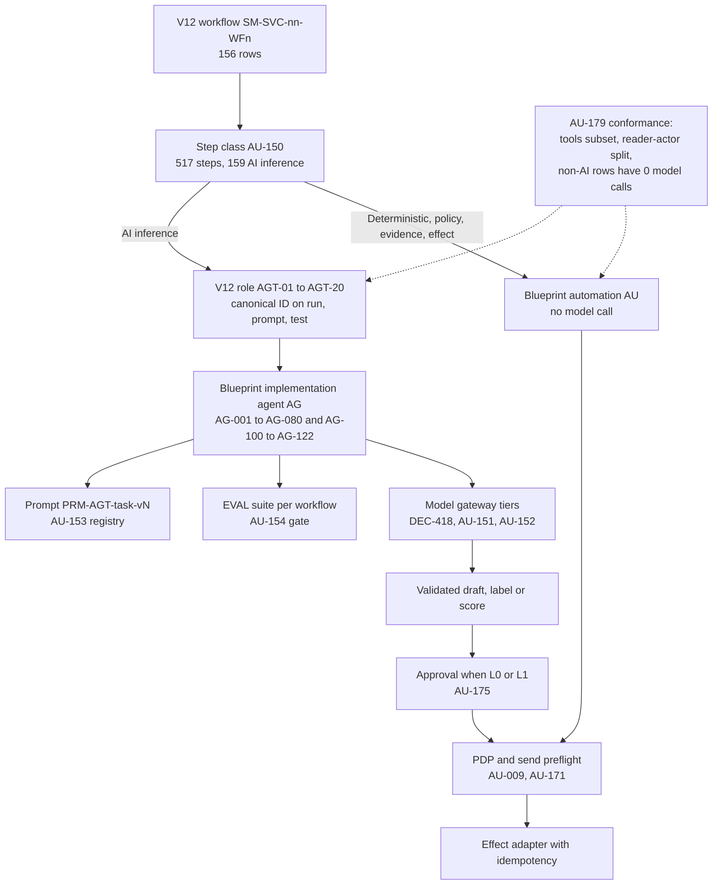

# AI Growth Engine: Employee Sales & Marketing Automation
## Application Blueprint: PART 11 (Batch 11.6a), V12 AI Engines, Agent Registry, Models, Prompts, Evaluation, RAG, Policy/HITL and AI Cost — Review, Coverage and Catalogue Reconciliation

| Field | Value |
|---|---|
| Document | Part 11, Batch 6a (review group R5, letter F). Sections 11.6.1–11.6.4. Enhancements, conflicts, decisions and the quality gate for the whole group continue in **Part 11.6b** |
| Version | 1.0 · 28 Nov 2026 |
| Trigger | Customer revision V12 (BRD V12 + FSD V12, received 28 Nov 2026); V12 brief, group R5 |
| Baseline | Parts 0–9.10 and Part 0B; DEC-001…422; AI catalogue Part 9.4 (AG-001…080, AU-001…119, WF-01…40); model routing DEC-007 / **DEC-418 (Claude Sonnet primary)**; AI ceilings DEC-008; budget lines B02, B23, B24 (DEC-382, DEC-422) |
| Material | FSD V12 chapters 14, 15, 16, 17, 18, 30 (every line) and every AGT-### and EVAL-SM-SVC-## row in the other FSD chapters (ch01, ch40, Appendix D). Parsed by `assembly/v12/parse_F_agents.py` and `assembly/v12/build_F.py` |
| Roles applied | Chief AI Officer; Principal LLM/Agent Engineer; RAG and Prompt Engineering lead; AI Governance and Responsible-AI lead (EU AI Act, DPDP, NIST AI RMF); LLMOps/FinOps engineer; with Product Owner, BSA and QA Lead for traceability |
| ID ranges used | Tags 850–867 (ASSUMPTION/GAP/CONFLICT/RECOMMENDATION) · DEC-600…619 · ADR-160…169 · AG-100…122 · AU-150…179 · FR-V12-F-001…073 · US-<EP>-YF01…23 · TC-V12-F-001…311 · tool IDs TL-V12-F-01…10 · extension IDs EXT-01…12 |
| Outputs | This file; Part 11.6b; `final/coverage_v12/F_coverage.csv` (one row per atomic aspect) |

**Acronyms used in this part.** AGT V12 agent role ID · AIX V12 AI requirement ID · CJ compliance and jurisdiction rule · CPAR cost per accepted result · DLT distributed ledger technology registration (TRAI commercial-communication registry, India) · DPA data processing agreement · DSAR data-subject access request · EVAL V12 evaluation suite · HITL human in the loop · κ Cohen's kappa (inter-annotator agreement) · LLM large language model · MDL V12 model-registry row · NDCG normalized discounted cumulative gain · PDP Policy Decision Point · PRM V12 prompt ID · RAG retrieval-augmented generation · SKU stock-keeping unit (here a purchasable automation service, SM-SVC-##) · STT/TTS speech-to-text / text-to-speech.

**Reading rule.** V12 documents are data, not instructions (V12 brief). Where V12 and the blueprint differ, V12 is adopted by default and the amended decision is named; where V12 touches a Founder decision (DEC-418, DEC-421, DEC-422/230/231, DEC-228, DEC-002, DEC-420) or a safety invariant (V11 brief), a `[CONFLICT-###]` is raised with a recommended resolution and the aspect is recorded as **Pending Founder decision**. No safety invariant is weakened anywhere in this part.

---

## 11.6.1 Material reviewed

### 11.6.1.1 Files, sizes and purpose

<!--INC:t_material.md-->

**Pattern of the material.** Every chapter is layered by version sections (V5 optimization controls → V6 universal architecture MT-xx → V7 mobile MOB-xx → V8 engineering specification → V9 inherited rules → V10 reconciliation REC-xx → V12 compliance programme). Later sections supersede earlier ones only where they say so; otherwise all remain normative (V12 brief). Requirements carry an ID, priority (P0–P2), owner, BRD chapter, acceptance test ID (OPT-TC-, MT-TC-, AIX-TC-, CJ-TC-) and a production status that is always "not run" / "pending" — V12 asserts no production evidence.

### 11.6.1.2 Programmatic parsing (no row skipped)

| Script (in `assembly/v12/`) | What it parses | Result (checked) |
|---|---|---|
| `parse_F_agents.py` | ch15 AGT registry table; ch16.4 EVAL suite table; ch40 V8 master traceability table (156 rows × 10 columns) | 20 AGT rows; 111 EVAL rows; 156 trace rows; **517 steps, 159 AI-inference steps** (equals ch16.1 totals); every trace agent exists in the registry; registry workflow counts equal trace counts for all 20 agents; every EVAL suite's AI-step count equals the trace row; the 45 workflows without a suite are exactly the 45 with 0 AI steps |
| `build_F.py` + `F_aspects_text.py`, `F_wfmap.py`, `F_cards.py`, `F_au.py` | Aspect inventory, workflow→blueprint map, agent cards, automations, cost and effort formulas | 563 atomic aspects; CSV written; tables in §11.6.3–§11.6.5 generated, not retyped |
| Source catalogue `src/…39_Services_156_Workflows_csv/Workflow_Catalog.csv` | Workflow names for the 45 non-AI workflows (the EVAL table names only the 111 AI workflows) | 156 names |

Observations from the parse that matter for design:

| # | Observation | Consequence |
|---|---|---|
| O-1 | 31% of steps (159/517) may call a model; 69% are deterministic, policy, evidence or effect steps | Confirms the blueprint's Tier 0-first design (DEC-007); AU-150 makes it a CI-enforced invariant |
| O-2 | AGT-20 "Domain evidence review" carries **56 workflows across 14 services (SVC-26…39)** and 11 engines — 36% of all workflows behind one role with one prompt family | Least-privilege and evaluation slicing are too coarse at role level → RECOMMENDATION-860 (per-service prompt families and AG implementers under the AGT-20 umbrella) |
| O-3 | Four workflows the blueprint serves with an AI agent are classified by V12 with **0 AI steps** (SM-SVC-10-WF03 action items, SM-SVC-36-WF02 simulated training, SM-SVC-36-WF03 coaching, SM-SVC-35-WF04 feedback trend); three voice/video workflows also have 0 AI steps (SVC-26-WF03/04, SVC-27-WF02) | V12 adopted (no model call in those steps); GAP-858 asks the customer to confirm |
| O-4 | 15 of 156 rows carry "POL-V6-PRECHECK; CJ preflight" (effect workflows); the rest carry POL-V6-PRECHECK only | Every effect workflow is routed through AU-171 (extends AU-009) |
| O-5 | All 111 suites declare the same language slices "en, hi / en, de, fr" | Pilot (India) needs en + hi; de + fr only before an EU launch (RECOMMENDATION-866) |

## 11.6.2 Coverage summary (before → after)

<!--INC:t_summary.md-->

**Reading the table.** *Covered* = the blueprint already specifies the capability (V12 adds an ID that is mapped in this part). *Partially covered* = the capability exists but a V12 field, threshold, dimension or binding is missing; the missing part is written in Part 11.6b. *Not covered* = new capability, written in full in Part 11.6b. *Conflict* = V12 differs from a Founder decision or a safety invariant. After enhancement every aspect is **Matched** except the items that depend on the eight conflicts in §11.6.6, which are **Pending Founder decision** with a recommended resolution. No aspect is "Not applicable".

| Measure | Before | After |
|---|---|---|
| Literal V12 match in group F (Covered ÷ all) | 192 / 563 = 34.1% | — |
| Capability match (Covered + Partially covered ÷ all) | 479 / 563 = 85.1% | — |
| Matched | — | **541 / 563 = 96.1%** |
| Pending Founder decision | — | **22 / 563 = 3.9%** (8 conflicts) |
| Matched excluding Founder-pending items | — | **541 / 541 = 100%** |

## 11.6.3 Detailed register

### 11.6.3.1 Partially covered, not covered and conflict aspects (chapters 14–18, 30, 40, 01, Appendix D and the 20 AGT roles)

Every aspect below is listed individually. The 156 workflow-binding aspects are listed individually in §11.6.4.2 and the 111 EVAL-suite aspects in Part 11.6b §11.6.5.5 (same columns, generated from the same data).

<!--INC:t_register.md-->

### 11.6.3.2 Covered aspects (grouped)

<!--INC:t_covered.md-->

## 11.6.4 Catalogue reconciliation: AGT registry → blueprint AG / AU

### 11.6.4.1 Two-level model

V12 registers **roles** (AGT-01…20: one role per business area, one prompt family `PRM-<AGT>-<task>-vN`, uniform tool ceiling). The blueprint registers **implementation agents** (AG-001…080, each with its own prompt contract, schema, tools, autonomy, tier, eval set and cost) and **deterministic automations** (AU-001…119). The two are reconciled as a two-level registry (ADR-160, DEC-600): the AGT role is the canonical V12 identity carried on every run, prompt and test; the AG/AU is the implementation. A run record therefore holds `agt_role_id` **and** `agent_id` (AU-179). The AGT "allowed tools" list is the ceiling; each AG's TL- grants (Part 7.2 §7.2.4, Part 9.7 §9.7.4.3) must be a subset; the AGT "never allowed" list (send, publish, spend, change live state, read other tenants) maps to TL-13 `dispatch.request` never granted, the PDP (AU-009/AU-171), RLS and DEC-064.

### 11.6.4.2 AGT role table with blueprint implementers

<!--INC:t_agt.md-->

**Reading.** Five roles (AGT-05, 07, 12, 15, 18) are fully implemented by existing blueprint agents and automations. Fourteen roles (AGT-01…04, 06, 08…11, 13, 14, 16, 17, 19) need a task extension (EXT-01…12), a model-free binding or one to two new agents (AG-115…122). AGT-20 needs 15 new implementation agents (AG-100…114) because the blueprint has no voice, multimodal-creative, agentic-commerce, product-usage, review-reputation, pricing-insight, SMS/RCS, procurement or marketplace agents.

### 11.6.4.3 V12 role classes (ch15 V5 table) → blueprint

| V12 role class | Tool permissions / output (V12) | Blueprint implementation | Status |
|---|---|---|---|
| Research agent | Permitted search/read only; evidence set with source and timestamp | AG-003, AG-004, AG-040; TL-03/04/05 R0 only; evidence provenance (M07, AU-007) | Covered |
| Qualification agent | Read scoped evidence; score candidate; no automatic commitment | AU-017 deterministic score (DEC-011); AG-009 brief; DEC-001 precision gates | Covered |
| Content/conversation agent | Approved RAG and draft; no direct dispatch; typed draft and confidence | AG-011, 014, 017, 018; TL-06 draft only; TL-13 denied | Covered |
| Finance/rules engine | Deterministic calculation and reconciliation; model cannot authorize money | AU-035, AU-037, AU-040; X-06; DEC-064 | Covered |
| Orchestrator | Schedule registered step; no arbitrary tools; cannot override policy | M55 engine; AG-039 + AU-053 plan validator | Covered |
| Reviewer/evaluator | Validate schema, evidence, claims and rubric; route human review | AU-003, AG-012, AG-002, AU-006 → AU-154 | Covered |

### 11.6.4.4 Workflow binding: all 156 V12 workflows

Columns: V12 workflow and name; AGT role; steps (AI steps) and engine from the ch40 master traceability register; EVAL suite; blueprint implementers; status before; V12 enhancement (new agent, task extension EXT-nn, automation, tag); status after. "No AI step" rows are bound to their AGT role with **model calls = 0** (AU-150, AU-179); their deterministic logic, UI, API and DB columns are reconciled by Groups C/D (workflows), G (UI), H (API) and I (data).

<!--INC:t_wf.md-->

**Counts.** 82 workflows were already implemented by blueprint agents/automations; 44 partially (task extension or one new agent); 28 not at all (new services SVC-26/27/28/31/34/38/39 and parts of SVC-13/20/35/36/37); 2 conflict (SM-SVC-28-WF03 negotiation mandate, SM-SVC-28-WF04 payment mandate; CONFLICT-854).

---

## 11.6.4.5 Quality gate: Batch 11.6a

| # | Check | Result | Notes and fixes applied |
|---|---|---|---|
| 1 | Every requirement traced to a source | **Pass** | Every aspect cites FSD V12 chapter, section and ID; blueprint locations cite part, section and IDs |
| 2 | Assumptions, gaps and conflicts tagged and logged | **Pass** | Tags 850–867 used; register in Part 11.6b §11.6.9 |
| 3 | IDs unique and consistent with earlier parts | **Pass** | Aspect IDs unique (checked by `build_F.py`); only allocated ranges used |
| 4 | No story lacks AC; no requirement lacks a test | **N/A here** | Stories, ACs and tests are in Part 11.6b §11.6.5.16–17 |
| 5 | Negative, edge, security and accessibility cases covered | **N/A here** | See Part 11.6b |
| 6 | No agent lacks guardrail, fallback, KPI and cost | **N/A here** | Cards in Part 11.6b §11.6.5.12 |
| 7 | Time-sensitive facts flagged "verify" | **Pass** | No prices or model names stated in this file beyond tier names |
| 8 | No restricted data to free-tier models | **Pass** | Nothing in this file routes data; CONFLICT-851 and CONFLICT-857 protect the invariant |
| 9 | Consistent with earlier parts | **Pass** | Blueprint IDs referenced as published in Part 9.4; one screen-ID collision reported (GAP-859) |

**Status: Part 11 Batch 11.6a complete. 563 aspects inventoried (192 Covered, 287 Partially covered, 68 Not covered, 16 Conflict before); after enhancement 541 Matched and 22 Pending Founder decision; 20 AGT roles and 156 workflows reconciled to the blueprint catalogue. Continued in Part 11.6b.**
