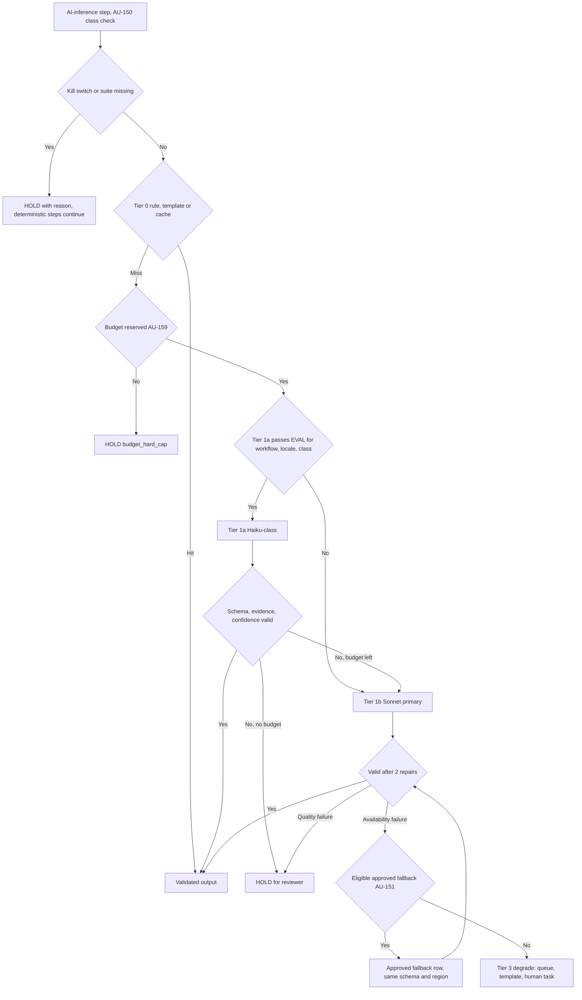
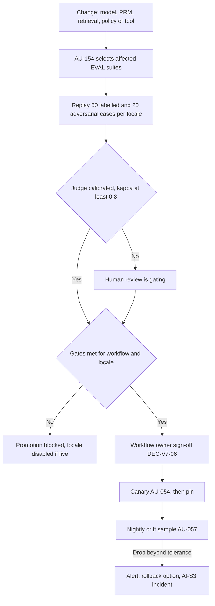
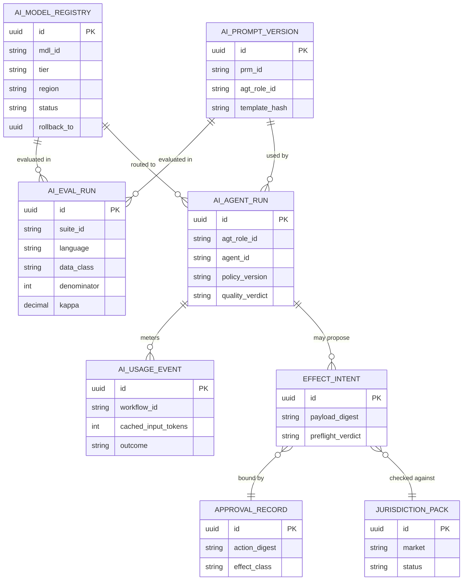
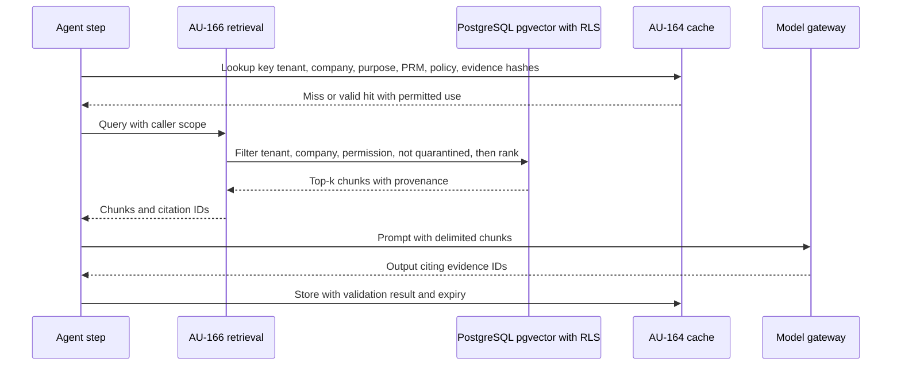
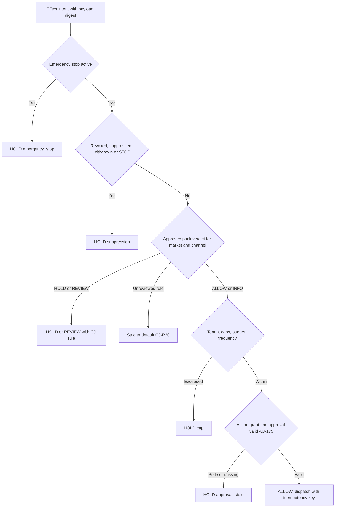
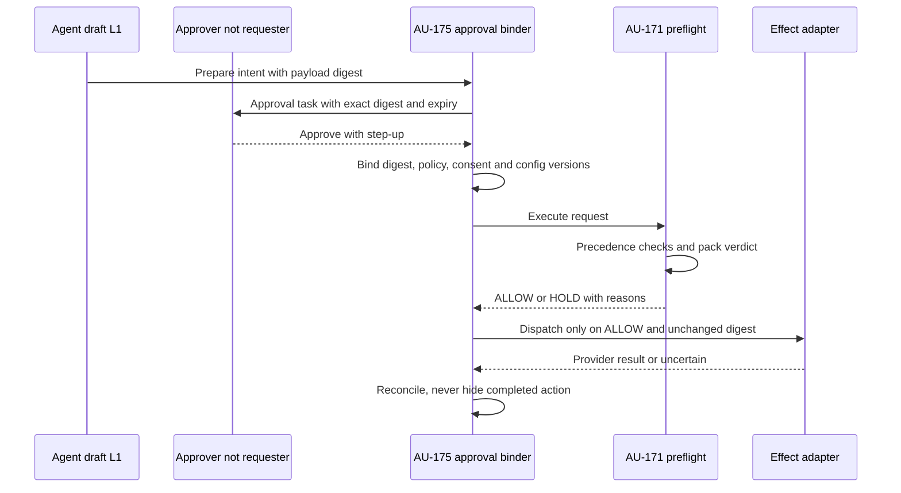

# AI Growth Engine: Employee Sales & Marketing Automation
## Application Blueprint: PART 11 (Batch 11.6b), V12 AI Engines, Agent Registry, Models, Prompts, Evaluation, RAG, Policy/HITL and AI Cost — Enhancements, Conflicts and Decisions

| Field | Value |
|---|---|
| Document | Part 11, Batch 6b (review group R5, letter F). Sections 11.6.5–11.6.10. Material, coverage summary, detailed register and catalogue reconciliation are in **Part 11.6a** |
| Version | 1.0 · 28 Nov 2026 |
| Baseline | Parts 0–9.10, Part 0B, Part 11.6a; DEC-001…422 (DEC-007, DEC-008, DEC-064, DEC-382, DEC-418, DEC-421, DEC-422 in particular) |
| Roles applied | Chief AI Officer; Principal LLM/Agent Engineer; RAG and Prompt Engineering lead; AI Governance and Responsible-AI lead; LLMOps/FinOps engineer; Product Owner; QA Lead |
| ID ranges used | Tags 850–867 · DEC-600…619 · ADR-160…169 · AG-100…122 · AU-150…179 · FR-V12-F-001…073 · US-<EP>-YF01…29 · TC-V12-F-001…311 · TL-V12-F-01…10 · EXT-01…12 |

**Acronyms** are as defined in Part 11.6a. In addition: ACR accessibility conformance report · C2PA Coalition for Content Provenance and Authenticity (content-credential manifests) · CR change request · NIST AI RMF NIST AI Risk Management Framework (Govern, Map, Measure, Manage) · SCC standard contractual clauses.

**Budget rule.** Nothing in this part changes an approved budget (DEC-230, DEC-231, DEC-422, DEC-008 ceilings, lines B02 ₹3,000 / B23 ₹1,000 / B24 ₹2,000). Every new item is costed **outside** them as change request **CR-V12-F** (one-time development, §11.6.5.18.1) and **CR-V12-F-R** (recurring, §11.6.5.18.2), each separately approvable.

---

## 11.6.5 Enhancements

### 11.6.5.1 Logical engines ENG-01…15 (ch14) mapped to the modular monolith

V12 says "do not create one microservice per engine unless justified". The blueprint is a Django REST Framework modular monolith (Part 3.1). Each engine is therefore a **logical grouping of Django apps, agents and automations**, not a deployable (ADR-169). The engine ID is carried on workflow definitions and run records so V12 traceability (ch40 "Engine" column) is preserved.

| Engine | V12 name and services | Django apps / modules (Part 3.1) | Agents (AI) | Automations (deterministic) | Shared constraint check |
|---|---|---|---|---|---|
| ENG-01 | Research and evidence · SVC-01, 02, 13, 19, 35 | `discovery`, `evidence`, `bids` | AG-003, 004, 005, 006, 019, 027, 107, 118 | AU-007, 014, 034, 052, 167 | Source rights (AU-007), tenant scope (RLS), entitlement (AU-042) |
| ENG-02 | Contact intelligence · SVC-03, 29 | `contacts`, `accounts` | AG-008, 060, 061 | AU-018, 074, 085 | CJ-GL-01/02; no private channels |
| ENG-03 | AI knowledge and RAG · SVC-09, 15, 25, 33 | `knowledge`, `conversations`, `support` | AG-001, 014, 017, 031, 055, 113 | AU-046, 069, 164, 165, 166 | CTRL-AI-07 scope before ranking |
| ENG-04 | Multimodal AI · SVC-26, 27, 36 | `media` (new), `voice` (new, Group H adapters), `enablement` | AG-100, 101, 102, 103, 114, 121 | AU-168, 177 | AI-13 preview-first; CONFLICT-853 for providers |
| ENG-05 | Communication · SVC-06, 07, 08, 12, 38 | `messaging`, `sequences`, `social` | AG-011, 013, 058, 063, 110, 119, 120 | AU-008, 022, 024, 073, 086, 171, 173 | Preflight AU-171 at every effect |
| ENG-06 | Calendar · SVC-10, 16 | `meetings`, `events` | AG-059, 037 | AU-023, 051, 075 | Calendar free/busy only (DEC-024) |
| ENG-07 | Identity and permission · SVC-28 | `tenancy`, `iam`, `agentic_commerce` (new, default off) | AG-104 | AU-072, 110, 175 | CONFLICT-854; signed mandates verified before read |
| ENG-08 | Document generation · SVC-11, 17, 18 | `content`, `proposals`, `contracts` | AG-018, 020, 022, 066, 117 | AU-035, 036, 089 | Prices inserted deterministically; AI never signs |
| ENG-09 | Financial calculation · SVC-24, 37 | `analytics`, `pricing` | AG-054, 109 | AU-040, 041, 049, 087, 096 | Numbers from systems only; X-06 |
| ENG-10 | Transaction reconciliation · SVC-21, 31 | `finance`, `marketplace` (new) | AG-024, 112, 116 | AU-026, 037, 038, 048 | Maker-checker; uncertain → RECONCILING |
| ENG-11 | Prediction · SVC-04, 23, 34 | `scoring`, `ml` | AG-042, 067, 105 | AU-017, 056, 059 | Scores advisory; DEC-011 deterministic score |
| ENG-12 | Experimentation · SVC-14, 30 | `experiments` | AG-052 | AU-065, 098 | Guardrail metrics; consent before tracking (CJ-EU-08) |
| ENG-13 | Workflow orchestration · SVC-05, 20, 22, 32, 39 | `engine` (M55), `orders`, `onboarding`, `partners`, `procurement` (new) | AG-039, 111, 115, 122 | AU-053, 060, 176 | Step caps (AU-157); one definition per version (AU-178) |
| ENG-14 | Governance · shared | `policy` (PDP), `approvals`, `audit` | AG-012, 075 | AU-009, 025, 170, 171, 172, 174, 175, 177, 179 | Precedence CJ-R03; fail closed |
| ENG-15 | Optimization · shared | `ai.gateway`, `finops` | AG-080 | AU-001, 002, 068, 118, 150…163 | No quality regression for cost (ch30) |

**Child workflows (FL-04, MT-34).** Research, evidence, validation, approval and reconciliation are published once as versioned child workflows with typed input/output contracts (`child_contract_version`). A parent calls a child by contract version; the child runs under the **parent's** tenant, startup, entitlement and budget reservation; metering attributes cost to the producing run once (AU-158 lineage key `root_run_id`), so a child called by two parents is never charged twice and never runs an SKU the caller is not entitled to (OPT-TC-FL-04 → TC-V12-F-062). AU-178 fails CI if two definitions with different IDs have the same normalized hash (MT-TC-MT-34 → TC-V12-F-061).

### 11.6.5.2 Two-level agent registry and run record (ADR-160, DEC-600, DEC-601)

| Registry level | Holds | Owner | Change control |
|---|---|---|---|
| AGT role (V12) | Role ID and name, workflows, tool ceiling, never-allowed list, PRM family prefix | AI lead + Product Owner | Customer-visible; change needs DEC |
| AG implementation agent | Card (Part 7.2 format), prompt contract, schema, TL grants ⊆ AGT ceiling, autonomy, tier, eval sets, cost | AI lead | PR + AU-006/AU-154 + canary (AU-054) |
| AU automation | Deterministic logic, guardrail, KPI | Engineering lead | PR + unit/golden tests |
| PRM prompt | `PRM-<AGT>-<task>-vN` with template hash, schema ref, locales, approver | AI lead | AU-153; replay suites (AIX-06) |

**Per-run record (ch15 V5) — fields added to `ai_agent_run`** (Part 3.3 owns the DDL; this is the functional contract): `agt_role_id`, `agent_id`, `agent_version`, `prm_id`, `prm_version`, `model_registry_id`, `allowed_toolset_digest` (SHA-256 of the sorted TL grant list for the step), `max_tokens`, `max_cost_inr`, `deadline_utc`, `input_refs[]`, `output_ref`, `policy_version`, `pack_versions[]`, `quality_verdict` ∈ {pass, repaired, escalated, held, rejected}, `hold_reason`, `root_run_id`. AU-179 writes and verifies them; a run missing any field cannot complete (FR-V12-F-036).

**External agent interoperability (ch15 V5)** stays **OFF** platform-wide until (a) the Founder decides CONFLICT-854 and (b) a signed mandate and scoped contract are validated by AU-175. AG-104 is specified so that it can be enabled without redesign.

### 11.6.5.3 Model registry and routing reconciled with DEC-418

**Position.** V12 ch16.2 lists provider-neutral candidate tiers and approves no model (DEC-V7-02 open). The blueprint's Founder decision **DEC-418** keeps **Claude Sonnet as the primary model**, Haiku-class as the lighter tier, free fallbacks off by default, and Tier 3 degradation. The two are compatible at the **routing-logic** level (rules first, cheapest passing tier, one escalation, then human) and differ at the **provider** level. This part therefore populates every V12 MDL row with the DEC-418 tier and raises CONFLICT-850…853 and 857 for the Founder; until the Founder rules, DEC-418 governs production.

| V12 row | V12 definition | Blueprint tier (DEC-418) | Candidate at implementation (verify at time of implementation, as of 27 Nov 2026) | Data classes allowed (Part 7.3 §7.3.6) | Region | Result |
|---|---|---|---|---|---|---|
| MDL-R0 | Rules engine, no model | Tier 0: rules, templates, exact and semantic cache | — | All | In-region (ap-south-1) | Matched |
| MDL-S1 | Small/fast: classification, extraction, routing, short drafts | **Tier 1a** lighter Claude (Haiku-class) | `claude-haiku-5-5` per Part 7.3 §7.3.2 | Public, Internal, Personal **masked/minimized**, Confidential; Restricted minimized/pseudonymized | Provider processing location under DPA (CONFLICT-852) | Pending Founder (CONFLICT-851, 852) |
| MDL-S1 (open-weight variant) | "hosted or open-weight" | Tier 2e optional self-hosted open model, outage/resilience only (DEC-418) | Small instruct model on vLLM in ap-south-1 (licence via AU-047) | **Public and Internal-non-personal only** | In-region | Pending Founder (CONFLICT-851) |
| MDL-M1 | Standard: drafting, summarisation, qualification reasoning | **Tier 1b Claude Sonnet — primary** | `claude-sonnet-5-5` per §7.3.2 | All classes, minimized | Provider location (CONFLICT-852) | Pending Founder (CONFLICT-852) |
| MDL-L1 | Advanced: complex synthesis, proposals, escalations | **Tier 1b Sonnet at higher effort** (`medium`/`high`); no separate tier | Optional "Tier 1c" larger Claude model **not approved** | As 1b | As 1b | Pending Founder (CONFLICT-853) |
| MDL-E1 | Embedding model, same region as data | Open-source multilingual embedding model on CPU workers (Part 7.3 §7.5.1) | E5-family or equivalent (licence check AU-047) | Internal, Personal masked | **In-region** | Matched for India; EU pending CONFLICT-852 |
| MDL-G1 | Safety classifier (moderation / injection), same region | AU-005 heuristics + AU-169 normaliser + AG-012 guard + Presidio (AU-004); **add** an open-source prompt-injection classifier on CPU, in-region, flags to reviewer (CTRL-AI-03) | Small transformer classifier (licence and benchmark via AU-045/047) | All (in-region) | In-region | Matched |

**Routing order of record (AIX-03 + DEC-418), implemented by AU-152 on top of AU-001 (Part 7.3 §7.3.4 rules R1–R13 unchanged except as stated):**

| Step | V12 | Blueprint after this part |
|---|---|---|
| 1 | Rules first | Tier 0 (R1–R4 unchanged) |
| 2 | Cheapest tier whose **suite passes for this workflow, language and data class** | R6 changes from agent-level parity to the **EVAL-<WF> × locale × data class** lookup in AU-154; Tier 1a only where it passes, else Tier 1b |
| 3 | Escalate **once** within remaining budget | R8 kept; AU-152 enforces "once" and checks remaining run reservation (AU-159) before escalating |
| 4 | Otherwise HOLD for a reviewer | New terminal state `HELD_FOR_REVIEWER` before R9/R11 Tier 2 paths; Tier 2 is reached only for availability failures (429/5xx/outage) and only if CONFLICT-857 is resolved to keep it |
| 5 | Fallback: same schema, same region, same or stricter class; never silently to unapproved model | AU-151 eligibility: fallback target must be a registry row with identical output schema, equal-or-stricter data class and recorded region; Tier 3 otherwise |
| 6 | Rollback pointer and kill switch | `rollback_to` per workflow pin (FR-V12-F-038); kill switch ADR-085 (≤ 60 s, one scheduler cycle) |

**Approval evidence for a registry row (16.2 → AU-151).** All seven are required: passing EVAL suites for the workflows it will serve; red-team pass on AI-INJ-01…12; signed DPA with no-training clause, retention and region; cost per accepted result from AU-158 on the fixed benchmark; latency p95; security review; transfer-register entry (CJ-R15). For Claude Tier 1a/1b, the DPA/retention item is the existing GAP-141 action (verify Anthropic commercial terms and data-processing location at implementation, as of 27 Nov 2026).

**Benchmarking other providers (AI-15).** V12 asks to evaluate candidate families. The blueprint does this **offline only**: AU-045 replays the fixed EVAL set against a candidate on synthetic data in the eval sandbox and reports CPAR, latency and risk. A candidate can become a production row only through a Founder decision (CONFLICT-850). No tenant data is sent to a candidate during benchmarking.

### 11.6.5.4 Prompt registry (PRM, AIX-04, MT-35)

| Element | Specification |
|---|---|
| ID | `PRM-<AGT>-<task>-vN`, e.g. `PRM-AGT-09-meeting-summary-v3`. Regex in AU-153. One approved version per (AGT, task, locale) in production; canary versions tracked by AU-054 |
| Alias to blueprint | Each existing prompt contract PC-01…40 and every `ai_prompt_version` row gets `prm_id`; mapping rule: AGT of the workflow it serves + task slug of the contract. Examples: PC-10 (AG-037) → `PRM-AGT-09-meeting-summary`; AG-011 email first touch → `PRM-AGT-06-email-first-touch`; AG-019 RFP parse → `PRM-AGT-15-rfp-parse`; AG-012 guard → `PRM-AGT-10-claims-guard` (shared by AGT-06/08/10/11/14 by reference, not copy) |
| Stored with | Template hash (SHA-256), output-schema reference, policy-input schema, locale variants (en, hi for India; de, fr added only at the EU gate, RECOMMENDATION-866), approver (≠ author), linked EVAL suites, model registry rows allowed |
| Structure (order enforced by lint) | 1 fixed policy block (cacheable prefix, ≥ 512 tokens to be cacheable on current Claude models — verify) → 2 task instruction → 3 typed output schema → 4 delimited untrusted inputs with provenance → 5 tenant configuration as **typed fields** (brand voice enum, tone, length, locale) — never free-form tenant instructions |
| Prohibited content | Tenant data, secrets, personal data, prices, unapproved claims (AU-153 static scan + canary strings) |
| Change | Any template change → AIX-06 replay of every suite listing the PRM; regression blocks promotion; rollback = re-pin (≤ 5 min, ADR-084) |
| Multi-tenant reuse (MT-35) | Two tenants reference the **same** approved PRM version; outputs, caches and memory stay isolated by key (AU-164) and RLS; MT-TC-MT-35 → TC-V12-F-063 |

### 11.6.5.5 Evaluation programme: gates, suites and 111 EVAL suites (AIX-05/06/07/19, DEC-602, DEC-603)

#### Gate reconciliation (V12 16.4 vs Part 7.3 §7.6.9; the stricter value is adopted)

| Task family (code) | V12 gate | Blueprint gate before | Adopted gate (DEC-602) |
|---|---|---|---|
| C Classification / qualification | F1 ≥ 0.90 on labelled set; no class below 0.80; calibration error reported | Macro-F1 ≥ 0.85; signal precision ≥ 80% at W1 exit and qualification precision ≥ 90% before L2/L3 (DEC-001); STOP recall 100%; urgent/clinical recall ≥ 98% | **F1 ≥ 0.90, no class < 0.80, ECE reported**; DEC-001 gates kept as additional gates for qualification; STOP recall 100% and urgent/clinical recall ≥ 98% kept |
| E Extraction | Field exact match ≥ 95%; schema 100% | Field accuracy ≥ 95% (≥ 97% payment evidence); schema ≥ 99% first pass, 100% after repair | **Exact match ≥ 95% (≥ 97% payment evidence); schema 100% after repair** |
| G Generation | Claims 100%; citations ≥ 95%; rubric ≥ 4/5; toxicity 0 | Groundedness ≥ 95%; seeded unsupported-claim recall ≥ 95% (AG-012) | **Claims accuracy 100% vs registry; citation coverage ≥ 95%; rubric ≥ 4/5; toxicity 0; groundedness ≥ 95%** |
| R Ranking / recommendation | NDCG@10 ≥ agreed baseline | none | **NDCG@10 ≥ baseline recorded at first approval; no regression > 2 points** |
| T Translation / localisation | Human adequacy and fluency ≥ 4/5 per language slice | AG-050 back-translation and glossary checks | **≥ 4/5 adequacy and fluency per locale (human)** + glossary 100% |
| A Adversarial (all) | AI-INJ pass; 0 policy violations | ≥ 98% of corpus with no violation; 0 tool misuse; 0 canary leak | **0 policy violations on the 20 adversarial cases of each suite; ≥ 98% on the full red-team corpus; 0 tool misuse; 0 canary leak** |
| All | Owner approval per workflow (DEC-V7-06) | AI lead | Workflow owner signs the gate in AU-154 before enablement |

**Suite rules (16.4).** One suite `EVAL-<workflow ID>` per AI-inference workflow (111). Minimum **50 labelled + 20 adversarial** cases, sliced by language (en, hi; de, fr at EU gate), sector, channel and edge case; synthetic or lawfully authorised data only (AU-004 redaction check). Cases enter the gold set only after **two annotators** and adjudication with batch **κ ≥ 0.7** (AU-155). The LLM judge (AG-002) is gating only after **κ ≥ 0.8** against humans on a calibration set (AU-156; stricter than the blueprint's 85% agreement). Runs on every model, prompt, retrieval, policy or tool change, plus a nightly drift sample (AU-057, AIX-18). Every result row stores the denominator. A locale below gate blocks **that locale only** (AIX-19). Blueprint per-agent golden sets (Part 7.3 §7.6.9) are reused as seed cases: an agent serving several workflows contributes its cases to each workflow suite after re-labelling for that workflow's task, which is why the programme effort below is lower than a green-field build.

**Gate-family codes in the table:** C classification, E extraction, G generation, R ranking, T translation, A adversarial (all suites). Families are assigned from the workflow task; a suite with several families must pass all of them.

<!--INC:t_eval.md-->

### 11.6.5.6 Data contract deltas (functional; DDL owned by Group I / Part 3.3)

| Blueprint entity | V12 name | Columns added or confirmed | Source |
|---|---|---|---|
| `ai_usage` / `ai_cost_ledger` | `ai_usage_event` | `workflow_id`, `step_id`, `run_id`, `prm_id`, `prm_version`, `cached_input_tokens`, `reasoning_tokens`, `outcome` (accepted/edited/rejected/held), `price_version`, `unallocated_flag` | 16.7, AIX-12, ch30 |
| `ai_eval_run`, `ai_eval_case`, `ai_eval_case_result` | `eval_run` | `suite_id` (EVAL-<WF>), `workflow_id`, `language`, `data_class`, `dataset_version`, `candidate_model_registry_id`, `provider`, `sample_n`, `denominator`, `rejected_n`, `reviewer_id`, `dpa_ref`, `region`, `gating` (bool), `kappa` | REC-12, 16.4 |
| new `ai_model_registry` (extends `ai_route`) | `ai_model` | `mdl_id` (MDL-R0…G1), `tier`, `provider`, `model_version`, `region`, `data_classes[]`, `context_limit`, `dpa_ref`, `retention_days`, `no_training` (bool), `eval_status`, `cpar_inr`, `latency_p95_ms`, `security_review_ref`, `rollback_to`, `status` | 16.2, AIX-02 |
| `ai_prompt_version` | PRM registry | `prm_id`, `agt_role_id`, `task_slug`, `template_hash`, `schema_ref`, `locale`, `approver_id`, `eval_suite_ids[]` | 16.3 |
| `ai_agent_run` | per-run record | fields in §11.6.5.2 | ch15 V5 |
| `knowledge_chunk` / evidence | evidence schema | `source_ref`, `source_right`, `object_version`, `observed_at`, `fetched_at`, `content_hash`, `provenance_hash`, `quote_location`, `confidence`, `freshness_limit`, `quarantine_state`, `tombstoned_at` | ch17 |
| `ai_semantic_cache` / exact cache | cache contract | `purpose`, `policy_version`, `evidence_hashes[]`, `validation_result`, `permitted_use`, `expires_at`, `invalidated_reason` | ch17 V5 |
| outbox effect intent | canonical effect contract | `relationship_id`, `purpose`, `market`, `config_version`, `consent_version`, `reviewer_id`, `expires_at`, `budget_ref`, `preflight_verdict`, `preflight_reasons[]` | REC-11, 18.2 |
| approval | approval record / mandate | `workflow_version`, `action_digest`, `recipient_ref`, `budget`, `currency`, `actor_authority`, `policy_version`, `effect_class` (R0–R3), `mandate_id`, `revoked_at` | FL-09, 18 V5 |
| consent | consent ledger | `purpose`, `channel`, `market`, `notice_version`, `capture_source`, `evidence_hash`, `version_no` (append-only) | CJ-R04 |
| new `jurisdiction_pack`, `jurisdiction_rule` | pack entity | `pack_id`, `market`, `version`, `status` (Draft/In review/Approved/Retired), `reviewer`, `effective_from/to`; rule `rule_id` (CJ-…), `channel`, `obligation`, `legal_source`, `interpretation_status`, `system_effect`, `default_if_unreviewed` | CJ-R01 |
| new `regulatory_clock` | clocks | `clock_type` (CERT-In 6 h, GDPR 72 h, DPDP, DSAR), `started_at`, `due_at`, `state`, `evidence_ref` | CJ-R07/08 |

### 11.6.5.7 UI mapping (16.8, 18.4) and the screen-ID collision

V12 names A114 model registry, A115 evaluation, A116 injection defence, A117 cost per tenant, A118 rule register, A119–A121 compliance (consent, DSAR, incidents/clocks) and W36 AI transparency. The blueprint already uses A114–A128 for Part 9.7 advanced-AI screens (A114 Agent Orchestration Console, A115 Agent and Prompt Registry and Canary, A118 Predictive Model Studio, A128 AI Evaluation, Red-Team and Drift Observatory). V12 IDs are canonical (V12 brief); renumbering belongs to Group G (screens A170–A259) — **GAP-859**. The **content** each V12 screen needs is specified here so Group G can place it:

| V12 screen | Content required (group F) | Blueprint screen that already holds most of it |
|---|---|---|
| A114 Model registry | MDL rows with the seven approval-evidence items, status, region, data classes, rollback_to, kill switch per model/prompt/workflow | A011 AI configuration; Part 9.7 A115 registry |
| A115 Evaluation | EVAL-<WF> list (111), gate per family and locale, κ, denominator, owner sign-off, promotion request vs activation | A084 AI quality; Part 9.7 A128 |
| A116 Injection defence | AI-INJ-01…12 pass rates, CTRL-AI flags queue (reviewer, not silent drop), corpus versions | Part 9.7 A128 red-team tab |
| A117 Cost per tenant | Tokens, CPAR with denominator, soft/hard caps per tenant/company/workflow, price version, unpriced units in tokens | A012 API cost and budget dashboard |
| A118 Rule register | Packs by market with status, rule rows (CJ-IN/EU/US/UK/CA/AU/SG/AE/BR, CJ-GL), legal source, interpretation status, preflight test harness (20 cases) | A007 consent and communication policies |
| A119–A121 | Consent ledger and suppression; DSAR queue with pack due dates; incident clocks (CERT-In 6 h, GDPR 72 h, DPDP) | A013 privacy request queue; A047 compliance incidents |
| W36 AI transparency | Public statement of AI use, disclosure policy, marking method (AU-177); AI-generated samples labelled | W30 notices (Part 2.4) |

### 11.6.5.8 RAG, knowledge and evidence engineering (ch17)

| V12 rule | Implementation |
|---|---|
| Indexes per tenant and region; filter by tenant and company **before** similarity (CTRL-AI-07) | AU-166: the SQL predicate `(tenant_id, startup_id, document_permission ⊇ caller)` is applied inside the pgvector query before `ORDER BY distance`; unit test asserts the plan uses the filter; region dimension = ap-south-1 only until CONFLICT-852 is decided |
| Chunk stores source, rights, provenance hash, ingestion time; poisoned or unlicensed sources quarantined | AU-165 writes the fields (§11.6.5.6); AU-007 rights; quarantine on AI-INJ-07 detection, licence expiry or rights withdrawal; quarantined chunks excluded at query time |
| Erasure deletes documents, chunks and embeddings with evidence | AU-011 / AU-112 locate; AU-165 deletes vectors and records `deletion_evidence` |
| MT-12 versioned claims by offering; revoke stale evidence and scoped cache | AU-164 invalidation key includes `offering_id` and claim versions; AU-046 purge |
| Cache contract (scope, purpose, versions, evidence hashes; authorization equivalence; invalidation reasons; prefix caching only with measured billing) | AU-164 + AU-162; semantic cache stays Public/Internal-non-personal (ADR-076, AIX-15) |
| AI-07 scoped summaries keep unresolved tasks, approvals and opt-outs | AU-163 pinned facts; conversation memory (ADR-112) |
| AI-08 adaptive top-k and rerank against evaluated relevance | AU-166 offline tuner per workflow; ceiling stays TL-01 top-k ≤ 8 unless the suite shows gain within token cap |
| AI-09 incremental embeddings; tombstones | AU-165 |
| CS-02 grounded support with citations and escalation | AG-031, AG-017; abstention threshold (BRL-AI-04) |
| CS-07 scoped correction memory with provenance, expiry, revocation | Procedural memory items with `expires_at` and `revoked_at`; tenant-scoped; AU-164 invalidates dependent caches |
| Evidence schema and ingestion rules | §11.6.5.6 evidence fields; AU-004 redaction before indexing; stale or conflicting claims held (AU-069) |

### 11.6.5.9 AI governance and compliance programme (16.5–16.8, 18 V12)

**Framework mapping (verify each with counsel; as of 27 Nov 2026).**

| V12 control | EU AI Act (Reg. 2024/1689) | DPDP Act 2023 / Rules 2025 (India) | NIST AI RMF 1.0 | Blueprint + this part |
|---|---|---|---|---|
| AIX-02/17 model registry, DPA, no training | Deployer duties; provider documentation | Processor contracts; s.16 transfers | Govern 1.x, Map 4 | AU-151; CJ-R15 transfer register |
| AIX-05/06/07 evaluation and regression | Accuracy and robustness expectations (Art. 15 for high-risk; good practice here) | — | Measure 1–4 | AU-154/155/156 |
| AIX-08/09/10 injection isolation | Robustness and cybersecurity | Reasonable security safeguards s.8(5) | Manage 2 | AU-005/169/179; AI-INJ suite |
| AIX-11, CJ-GL-13 claims and citations | Transparency | — | Measure 2.5 (validity) | AG-012; TL-09 |
| CJ-R13, CJ-EU-09 disclosure and marking | **Art. 50** chatbots and AI-generated content (application date 2 Aug 2026 — verify Digital Omnibus changes) | Notice and fairness | Govern 4 | AU-177; W36 |
| CJ-EU-06, CJ-R14 automated decisions | Annex III not triggered by B2B lead scoring (verify); GDPR Art. 22 human review | — | Map 3.4 | DEC-011 deterministic score; L1 qualification below DEC-001 gate |
| AIX-18/20 drift and incident response | Post-market monitoring good practice | Breach intimation (CJ-IN-04) | Manage 4 | AU-057; ADR-085; AU-174 clocks |
| ENT-CMP-03 ISO/IEC 42001 | Supports Art. 17-style QMS | — | Govern | AU-079 AI inventory + model cards; AG-075 evidence assessor |
| ENT-CMP-05 DPIA + AI Act assessment before EU launch | Risk classification | DPIA good practice; significant data fiduciary duties if notified | Map | Part 7.3 §7.6.12 classification refreshed at the EU gate |

**ENT-CMP items.** ENT-CMP-04 (DPA + SCCs + public sub-processor list with 30-day notice), 06 (ACR from a manual WCAG 2.2 AA audit), 07 (legal document set incl. AI Use statement) and 08 (counsel-reviewed packs) are adopted as release criteria (DEC-618). ENT-CMP-01…03 (SOC 2 Type I at R2 / Type II at R3, ISO 27001 at R3, ISO 27701 and 42001 at R4) carry external audit and certification fees and readiness effort that no approved budget includes → **CONFLICT-856**. The AI-governance part of 42001 readiness costs nothing extra in build terms because AU-079 (AI system inventory and model cards), AU-154 (evaluation evidence) and AU-151 (supplier evidence) already produce the records.

### 11.6.5.10 Policy, approval and HITL engine (ch18)

#### Jurisdiction packs (CJ-R01, R19, R20; DEC-611 amends DEC-029)

| Pack | Rules (V12) | Status after this part | Effect on DEC-029 |
|---|---|---|---|
| IN (primary) | CJ-IN-01…11 | Approved-for-pilot after qualified legal review (ENT-CMP-08); until then each rule runs at its stricter default (CJ-R20) | Unchanged scope; DLT/registry (CJ-IN-06/07) added via AU-173 |
| EU (recommended second market, DEC-V7-01) | CJ-EU-01…10 | Draft until EU launch decision | DEC-029 Year-1 EU/EEA B2B email allowance becomes **Draft** until counsel approves; existing rule (role-based or published addresses, LIA recorded, one-click opt-out) kept as the draft content |
| UK | CJ-UK-01 (V8 draft), CJ-UK-02, 03 (V12) | Draft · disabled | DEC-029 UK allowance suspended until Approved |
| US | CJ-US-01 (V8), CJ-US-02, 03, 04 (V12) | Draft · disabled | DEC-029 US CAN-SPAM allowance suspended until Approved |
| CA, AU, SG, AE, BR | CJ-CA-01, CJ-AU-01, CJ-SG-01, CJ-AE-01, CJ-BR-01 | Draft · disabled | DEC-029 UAE/SG/AU consent-first allowance suspended until Approved; CA and BR new |
| Any other market | — | Outbound denied; inbound replies allowed | Unchanged |
| Platform (all markets) | CJ-GL-01…13 | Active; tenant configuration cannot relax | Mapped to existing BR/X rules (below) |

#### Inherited data-ethics rules CJ-GL-01…13 (DEC-612)

| Rule | Blueprint equivalent | Enforced by |
|---|---|---|
| CJ-GL-01 published professional channels; no guessed emails | X-05; BR-M18; AU-018 provenance check | AU-171 case V9-1 |
| CJ-GL-02 verification ≠ consent | "score never grants contact permission" (DEC-011); BRL eligibility | AU-171 case V9-2 |
| CJ-GL-03 erasure never re-enables outreach | DEC-028 suppression indefinite hashed | AU-172; AU-171 case V9-3 |
| CJ-GL-04 planned offerings never promoted/matched/quoted | AU-016 readiness gate; AU-043 | AU-171 case V9-4 |
| CJ-GL-05 STOP/reply cancels scoped follow-ups across channels | AU-008; AU-022 | AU-171 case V9-5 |
| CJ-GL-06 urgent/clinical → human | AG-013 urgent/clinical class; X-02 | AU-171 case V9-7 (REVIEW) |
| CJ-GL-07 no health targeting/pixels/scoring | X-02; BR-M50 | AU-171 case V9-6 |
| CJ-GL-08 no private scraping/automated DMs | X-05; adapter blocks | AG-119 guard; adapters |
| CJ-GL-09 complaint threshold pauses campaign | AU-031 | AU-031 |
| CJ-GL-10 no re-contact after loss without policy | BR-M51; AG-038 | AU-171 rule check |
| CJ-GL-11 referral/partner leads need own basis | BR-M42; AU-020 | AU-171 (SM-SVC-16-WF03) |
| CJ-GL-12 AI never signs; approved version hash stored | X-06; AU-036 | AU-175 |
| CJ-GL-13 no fabricated rankings; forecasts labelled | AU-033; AU-041; AG-012 | AG-012; AG-118, AG-054 guards |

#### Send preflight decision table (CJ-R02, CJ-R03; AU-171 extends AU-009)

Evaluated in fixed precedence: **emergency stop > revocation/suppression > jurisdiction pack > tenant cap > action grant**. Result stored on `effect_intent.preflight_verdict`; only ALLOW dispatches.

| # | Condition | Market | Verdict | Rule | Test |
|---|---|---|---|---|---|
| V9-1 | Contact source guessed/pattern-generated or private | All | HOLD | CJ-GL-01 | TC-V12-F-077 |
| V9-2 | Basis is verification only | All | HOLD | CJ-GL-02 | TC-V12-F-078 |
| V9-3 | Contact previously erased or suppressed | All | HOLD | CJ-GL-03 | TC-V12-F-079 |
| V9-4 | Promotional send for planned/unavailable offering | All | HOLD | CJ-GL-04 | TC-V12-F-080 |
| V9-5 | STOP, opt-out or reply received | All | HOLD | CJ-GL-05 | TC-V12-F-081 |
| V9-6 | Health attributes used for targeting | All | HOLD | CJ-GL-07 | TC-V12-F-082 |
| V9-7 | Responds to urgent or clinical enquiry | All | REVIEW | CJ-GL-06 | TC-V12-F-083 |
| V8-1 | Consent withdrawn / objection recorded | IN, EU | HOLD | CJ-IN-02, CJ-EU-03 | TC-V12-F-084 |
| V8-2 | Promotional, consent not express | IN | HOLD | CJ-IN-01 | TC-V12-F-085 |
| V8-3 | SMS/Voice DLT entity/header/template not registered | IN | HOLD | CJ-IN-06 | TC-V12-F-086 |
| V8-4 | Promotional SMS/Voice not scrubbed | IN | HOLD | CJ-IN-06 | TC-V12-F-087 |
| V8-5 | Promotional SMS/Voice outside window (default 09:00–21:00 recipient time, DEC-V7-04) | IN | HOLD | CJ-IN-06 | TC-V12-F-088 |
| V8-6 | WhatsApp business-initiated without opt-in | IN | HOLD | CJ-IN-08 | TC-V12-F-089 |
| V8-7 | Promotional targeting of a known minor | IN | HOLD | CJ-IN-03 (and DEC-030: all markets) | TC-V12-F-090 |
| V8-8 | Promotional targeting, age unknown | IN | REVIEW | CJ-IN-03 | TC-V12-F-091 |
| V8-9 | Promotional voice call → 140-series pool | IN | INFO | CJ-IN-07 | TC-V12-F-092 |
| V8-10 | Email/SMS marketing without consent or valid soft opt-in | EU | HOLD | CJ-EU-02 | TC-V12-F-093 |
| V8-11 | Soft opt-in used → opt-out link mandatory | EU | INFO | CJ-EU-02 | TC-V12-F-094 |
| V8-12 | Marketing via voice/WhatsApp → member-state check | EU | REVIEW | CJ-EU-02 | TC-V12-F-095 |
| V8-13 | AI-generated content/agent not disclosed | EU / IN | HOLD / REVIEW | CJ-EU-09 | TC-V12-F-096 |

DEC-030 remains stricter than CJ-IN-03 for EduVerse: no outreach, profiling or targeting of anyone under 18 in any market; "age unknown" routes to the guardian/institution path.

#### Effect classes, autonomy and mandates (ch18 V5; DEC-614; CONFLICT-854)

| V12 class | Meaning | Blueprint tool class (§7.2.4) | Autonomy cap (DEC-064) | Mandate rule after this part |
|---|---|---|---|---|
| R0 | Read/draft with source rights | R0, R0-ext, W1 draft | L0–L3 | n/a |
| R1 | Scoped internal record update, version lock, audit | W1 | L2–L3 within policy | n/a |
| R2 | Provider communication, publishing, access or other external write | X2 via engine + PDP only (TL-13 never granted to agents) | L1 for new content; L2/L3 dispatch only of **approved templates** within caps | **Bounded R2 mandate allowed** = existing DEC-064 template approval (approved hash, caps, expiry, revocation); AU-175 records it as a mandate |
| R3 | Financial, legal or commitment | none (AI never) | **L1 maximum; money movement not supported (X-06)** | **R3 mandates disabled** pending CONFLICT-854; each R3 action needs an exact approval plus finance/legal gate |

**Approval record (AU-175).** Prepare → approve → execute → reconcile are separate steps. The record binds tenant/company, workflow version, action digest, recipient, budget, currency, actor authority, expiry and policy version (plus consent and configuration versions from the effect intent). Before the adapter call AU-175 re-reads revocation, suppression and budget atomically; any difference rejects with `approval_stale`. Approver ≠ requester; mobile approvals need the same verified actor and step-up (MOB-09); a notification can never approve. Emergency stop blocks new effects; cancellation never hides an already-completed action (audit keeps it). Competing actions on the same relationship and purpose are grouped and held for one reviewer disposition (AU-176, REC-03).

#### Consent, suppression, DSAR and breach (18.3)

| Process | States | Timers | Automation |
|---|---|---|---|
| Consent capture | Granted → Withdrawn / Expired (append-only versions) | Expiry per pack | AU-172 |
| Withdrawal / objection | Requested → Suppressed → Runs held | IN: configured period (DEC-V7-04); EU objection: immediate | AU-172 |
| DSAR | Received → Identity verified → In progress → Completed / Refused (reason) | EU 1 month (+2 with reasons); IN configured | AU-112 + AU-174 |
| Breach | Detected → Assessed → Notified → Closed | CERT-In 6 h; GDPR 72 h; DPDP per Rules | AU-174; RB-008 |

### 11.6.5.11 AI cost controls reconciled with DEC-008, B02, B23 and B24 (16.7, ch30; DEC-607, DEC-608)

| Control | V12 | Blueprint before | After this part |
|---|---|---|---|
| Ceilings | Soft cap default 80%, hard cap per plan; units in tokens until prices approved (DEC-V7-07) | DEC-008 hard caps ₹3,000 pilot / ₹12,000 growth / ₹40,000 scale (owned portfolio); SaaS tenants on their own plan budget; lines B02 ₹3,000, B23 ₹1,000, B24 ₹2,000 | **Unchanged.** V12 soft cap 80% equals the first step of the §7.5.7 ladder; hard cap = DEC-008 / line caps / tenant plan cap |
| Dimensions | Tenant, company, **workflow** | Agent, startup, tenant, global | AU-159 adds **workflow**; all dimensions checked, the tightest wins |
| At hard cap | Hold new AI steps; deterministic steps continue | Stop paid calls except a reserved 10% safety slice (AG-013, AG-012); others Tier 3 | Both: AI steps HELD with reason `budget_hard_cap`; deterministic steps continue; the 10% safety slice for STOP/urgent classification and the claims guard is kept (stricter for safety) |
| Ladder | — | 80/85/90/95/100% degradation ladder | Kept for the owned portfolio; for SaaS tenants the ladder is configurable per plan |
| Unit of value | Cost per accepted result (CPAR) | Cost per task per card | AU-158 CPAR per workflow, tenant, agent; card "cost per task" remains the planning figure |
| Fairness | Per-tenant token-rate quotas, weighted queues | Concurrency caps (§7.2.9) | AU-160 |
| Levers | AI-01 rules first; AI-02/03 cheapest passing tier, single escalation; AI-04 prefix caching measured; AI-05 scoped semantic cache; AI-06 context budget; AI-10 batch; AI-11 artefact reuse; AI-12 loop caps; AI-13 multimodal tiers | Tier 0, caching, Batch API, caps (§7.4.2) | AU-150, 152, 157, 161…168 add measurement and the missing levers; **no lever may reduce an EVAL gate** (ch30 "no quality regression for cost") |
| Prices | None invented; A117 shows tokens and a user-entered illustrative rate | Estimates from list prices marked "verify" | Planning estimates stay (needed for budget approval) and are labelled; A117 shows `price_version` and shows unpriced units in tokens |
| Reconciliation | Tenant totals reconcile with invoices within tolerance (AIX-12) | AU-048 tolerance 2% or ₹100 | Unchanged |

**CPAR formula (AU-158).** CPAR(workflow, tenant, month) = [Σ model cost (input + cached + output + reasoning tokens × price_version) + Σ embedding cost + retrieval compute + retries + provider fees + media processing + human review minutes × loaded rate] ÷ accepted outputs. Rejected, edited-then-rejected and held outputs stay in the cost numerator and are reported next to the denominator; unallocated cost is shown as its own line.

### 11.6.5.12 New agent cards AG-100…AG-122

Card format is the Part 7.4b AG-037 format (V11 brief). Token prices: Part 7.3 §7.3.2 list prices, ₹90 per US$ [ASSUMPTION-861]; volumes are pilot design volumes for the owned portfolio [ASSUMPTION-863]; SaaS-tenant usage is metered to the tenant's own plan (DEC-008). Every agent: Tier 0 first, AU-150 step-class check, EVAL gate (AU-154), budget reservation (AU-159), injection isolation (AU-005/169/179), and no effect tool.

<!--INC:t_cards.md-->

### 11.6.5.13 Task extensions of existing agents (EXT-01…12)

These V12 workflows are served by an existing blueprint agent with one added task (new PRM, schema and EVAL suite; card unchanged except the task list). Autonomy never rises above the agent card.

<!--INC:t_ext.md-->

### 11.6.5.14 New automations AU-150…AU-179

All are deterministic (no model call). Control automations AU-150, 151, 152, 153, 154, 157, 159, 169, 171, 175 and 179 must be running before any V12-bound agent is enabled (same rule as Part 7.2 §7.2.3). Release codes: R1-CR / R2-CR = proposed inside the Release 1 / Release 2 window as change request CR-V12-F; P2 = Phase 2 (W6+). Cost column: running cost; pd = development low/central/high.

<!--INC:t_au.md-->

**New tool registry entries (extend Part 7.2 §7.2.4; prefixed to avoid collision with other groups).**

| Tool ID | Name | Side-effect class | Scope enforcement | Allowed agents |
|---|---|---|---|---|
| TL-V12-F-01 | `transcript.read` | R0 | Current call only; consent flag required (AU-172) | AG-100 |
| TL-V12-F-02 | `media.preview.read` | R0 | Preview/OCR/transcript first (AU-168); scope RLS | AG-103, AG-121 |
| TL-V12-F-03 | `creative.render_request` | W1 (draft asset) | Template renderer or approved provider row; never publishes | AG-101 |
| TL-V12-F-04 | `counterparty_message.read` | R0 | Signature and mandate verified by AU-175; message as untrusted data | AG-104 |
| TL-V12-F-05 | `usage.metrics.read` | R0 | Account-level aggregates; consented events only | AG-105, AG-106 |
| TL-V12-F-06 | `reviews.read` | R0 | Authorized review sources (AU-007) | AG-107 |
| TL-V12-F-07 | `marketplace.event.read` | R0 | Tenant's own marketplace accounts | AG-112 |
| TL-V12-F-08 | `supplier.read` | R0 | Supplier master and quotations in scope | AG-111 |
| TL-V12-F-09 | `seo.metrics.read` | R0 | Authorized Search Console property; approved probe queries | AG-118 |
| TL-V12-F-10 | `social.read_permitted` | R0 | Own posts and permitted public mentions only (CJ-GL-08) | AG-119 |

### 11.6.5.15 Functional requirements FR-V12-F-001…073

<!--INC:t_fr.md-->

### 11.6.5.16 User stories (US-<EP>-YF01…29)

<!--INC:t_us.md-->

### 11.6.5.17 Test cases TC-V12-F-001…189 (EVAL suites TC-V12-F-201…311 are in §11.6.5.5)

Types: AIE AI evaluation · SEC security · PRV privacy/compliance · FUN functional · CST cost. Every case includes its negative path. Numbers 042–060 and 154–159 are intentionally unused.

<!--INC:t_tc.md-->

### 11.6.5.18 Effort and cost (separately approvable; outside DEC-230/231/422)

#### 11.6.5.18.1 One-time development (CR-V12-F)

Basis: Part 9.7b §9.7.13.1 unit sizes (agent S 2/3/5, M 4/6/8, C 6/9/13 pd; automation S 1.5/2.5/4, M 3/4/6, C 4/6/9 pd); ₹4,545–6,818 per person-day (Part 8.4). Evaluation programme: 111 suites × 70 cases = 7,770 cases; two annotators at 2–4 minutes per case with AI-assisted synthetic drafting (AG-036) under DEC-420, 15% adjudication at 5 minutes, 25–35% reuse of existing per-agent golden sets [ASSUMPTION-862].

<!--INC:t_effort.md-->

<!--INC:t_effrel.md-->

#### 11.6.5.18.2 Recurring (CR-V12-F-R) — shown separately from development

| Line | Formula | Low ₹/month | Base ₹/month | High ₹/month | When |
|---|---|---|---|---|---|
| New agents' model tokens (23 agents, 25% overhead) | Σ cards (§11.6.5.12) | 317 | 1,057 | 3,171 | As each agent goes live (R2-CR / P2) |
| Evaluation replays | changes/month (10 / 25 / 60) × 70 cases × (₹0.20 agent call + ₹0.03 judge) | 161 | 403 | 966 | From R1-CR |
| Nightly drift sample | enabled AI workflows (30 / 60 / 111) × 3 samples × 30 nights × ₹0.016 (Haiku-class judge, Batch) | 43 | 86 | 160 | From R1-CR |
| Judge calibration | 200 items × ₹0.03 monthly | 6 | 6 | 6 | From R1-CR |
| Overhead 25% on evaluation lines | | 53 | 124 | 283 | |
| **Total recurring AI** | | **580** | **1,676** | **4,586** | |
| Gold-set maintenance labour | 2 / 3 / 4 pd per month × ₹4,545–6,818 | ₹9,090 | ₹13,635–20,454 | ₹27,272 | Recommended to be absorbed in the approved QA 1.0 FTE (DEC-228); otherwise a CR |

**Fit with approved AI lines.** The evaluation lines (base ≈ ₹619 with overhead) fall under B23 "delivery-team AI (eval judge)" ≈ ₹1,000; AU-159 queues replays at the B23 hard cap rather than raising it. The new agents' tokens are **not** charged to B02 (whose high scenario is already at ≈ 101% of ₹3,000, Part 9.10) or B24; they need line CR-V12-F-R, or — for SaaS tenants — the tenant's own plan budget. Partner and provider fees for voice/STT/TTS, DLT scrubbing, review, marketplace and image APIs are Group H items and are excluded here.

---

## 11.6.6 Conflicts and proposed resolutions

| Tag | V12 position | Blueprint / Founder position | Recommended resolution | Status |
|---|---|---|---|---|
| CONFLICT-850 | ch16.2 / DEC-V7-02: provider-neutral model registry; "no provider or model is approved"; candidates include OpenAI, Gemini, Llama, Mistral, Qwen | **DEC-418**: Claude Sonnet primary, Haiku-class lighter tier | Treat DEC-418 as the answer to DEC-V7-02: MDL-S1 = Tier 1a Claude Haiku-class, MDL-M1/L1 = Tier 1b Sonnet. Other families only as **offline benchmark comparators** (AI-15, AU-045) on synthetic data; never in production routing without a new Founder decision | Pending Founder decision |
| CONFLICT-851 | MDL-S1 "hosted **or open-weight**" for Public, Internal and **Personal (masked)** data | Safety invariant: no restricted or personal data to free tiers; DEC-418 self-hosted model only for non-restricted data, outage only | Masked personal data only to Tier 1a Claude under DPA. Any open-weight model (self-hosted 2e in ap-south-1) receives **Public and Internal-non-personal data only**. The invariant is not weakened | Pending Founder decision |
| CONFLICT-852 | Model and embedding region "IN / EU per tenant"; "same region as data"; indexes per tenant **and region**; CJ-R09 region pinning | DEC-421 hosting is Mumbai only; Part 7.3 §7.6.8 discloses model processing outside India under DPA | Pilot: keep in-region data, vectors (MDL-E1 in-region already), logs and backups; accept Claude processing location under DPA with a transfer-register entry (CJ-R15; DPDP s.16 permits transfers except to notified countries — verify). At the EU-launch gate: evaluate in-region Claude inference through a cloud marketplace (verify model availability per region as of 27 Nov 2026) and an EU data plane; Founder decides with DEC-421 | Pending Founder decision |
| CONFLICT-853 | MDL-L1 advanced tier; multimodal engine ENG-04 (image/video generation SVC-27, voice SVC-26) | DEC-418 has no tier above Sonnet; Claude does not generate images or speech; budgets have no line for such providers | Tier L = Sonnet at higher effort (no new tier). Creatives: template renderer (open-source) by default; any image/video/STT/TTS provider is a new paid provider → procurement gate AU-044, Founder approval, costs outside budgets; open-source self-hosted STT preferred (open-source first) | Pending Founder decision |
| CONFLICT-854 | FL-09 persistent approval mandates; R3 mandate "only if expressly approved"; SVC-28 agentic commerce negotiation and **payment mandates**; external agent interoperability | Invariant: AI never pays, signs, submits bids, sets prices or sends consequential actions without a human; consequential actions capped at L1 (DEC-064, X-06) | Allow **bounded R2 mandates** only where DEC-064 already allows L2/L3 dispatch of approved templates. **Disable R3 mandates.** SVC-28-WF02/03 at L1 (each quotation or counter-offer approved by a human under DEC-038); SVC-28-WF04 payment mandate **not supported** — record and reconcile human-made payments only. External agent interop stays OFF until the Founder decides | Pending Founder decision |
| CONFLICT-855 | 111 EVAL suites × (50 labelled + 20 adversarial), two annotators, κ ≥ 0.7, four languages | Per-agent golden sets; GAP-142 labelling 6–10 pd; no budget for 7,770 cases | Phase the programme with releases (EVAL-PRG-1/2/3: 40 / 24 / 16 central pd); AI-assisted synthetic drafting with human double-labelling (DEC-420); de/fr slices only at the EU gate (RECOMMENDATION-866). One-time ₹2.5–8.2 L for the programme inside CR-V12-F | Pending Founder decision |
| CONFLICT-856 | ENT-CMP-01…03: SOC 2 Type I at R2, Type II at R3; ISO 27001 at R3; ISO 27701 and 42001 at R4 | No certification budget in DEC-230/231/422 | Adopt as roadmap targets; produce the AI-governance evidence now from AU-079/151/154 at no extra build cost; obtain auditor quotes (verify) and decide timing at the Release 2 gate. Cross-reference: Group I may raise the security side | Pending Founder decision |
| CONFLICT-857 | Fallback "same schema, same region, same or stricter class; never silently to an unapproved model"; approval needs DPA with no-training clause and region | DEC-418 retains Tier 2 free fallbacks (Groq, Gemini, OpenRouter, Mistral free plans; some train on inputs, regions outside India), opt-in, default off | Keep Tier 2 **off**. Under V12, a free-tier provider cannot pass AU-151 (no DPA, no region guarantee), so Tier 2 reduces to the optional self-hosted model in ap-south-1 for Public/Internal-non-personal data after it passes AU-151. Founder confirms this narrowing of DEC-418's Tier 2 element | Pending Founder decision |

## 11.6.7 Decisions

| DEC | Decision | Authority | Effect |
|---|---|---|---|
| DEC-600 | V12 AGT-01…20 adopted as the canonical agent-role registry; blueprint AG/AU are implementations; every run, prompt and test carries `agt_role_id` | Customer revision V12 (28 Nov 2026) | Two-level registry (ADR-160); AU-179; §11.6.4 |
| DEC-601 | Prompt ID `PRM-<AGT>-<task>-vN` adopted; PC-01…40 and `ai_prompt_version` rows aliased | Customer revision V12 (28 Nov 2026) | AU-153; §11.6.5.4 |
| DEC-602 | V12 evaluation gates adopted where stricter; stricter blueprint gates kept (DEC-001, STOP 100%, payment 97%); workflow owner signs gates (DEC-V7-06) | Customer revision V12 (28 Nov 2026) | Amends Part 7.3 §7.6.9 |
| DEC-603 | One EVAL suite per AI-inference workflow (111), ≥ 50 + 20 cases, two annotators, κ ≥ 0.7; judge gating at κ ≥ 0.8 | Customer revision V12 (28 Nov 2026); funding pending Founder (CONFLICT-855) | AU-154/155/156; amends §7.6.6 judge agreement 85% |
| DEC-604 | Step classification of 517 steps (159 AI-inference) adopted; model calls only from AI-inference steps, enforced in CI | Customer revision V12 (28 Nov 2026) | AU-150; four blueprint AI usages re-bound (GAP-858) |
| DEC-605 | MDL-R0…G1 mapped to gateway tiers per DEC-418 (S1 → 1a, M1/L1 → 1b, E1 in-region open model, G1 in-region classifier) | Pending Founder decision (CONFLICT-850…853) | §11.6.5.3 |
| DEC-606 | Routing: rules → cheapest tier passing the workflow/locale/class suite → one escalation within budget → HOLD for reviewer | Customer revision V12 (28 Nov 2026) | AU-152 extends AU-001 rules R6/R8 |
| DEC-607 | Budgets gain a workflow dimension; soft 80% / hard cap hold with deterministic continuation; DEC-008 ceilings and B02/B23/B24 caps unchanged | Customer revision V12 (28 Nov 2026) | AU-159 |
| DEC-608 | Cost per accepted result is the AI FinOps unit, reported per workflow, tenant and agent with denominator | Customer revision V12 (28 Nov 2026) | AU-158; A117 |
| DEC-609 | RAG and cache contract of ch17 adopted (scope-before-rank, provenance and rights per chunk, incremental embeddings, scoped invalidation) | Customer revision V12 (28 Nov 2026) | AU-164/165/166 |
| DEC-610 | AI-INJ-01…12 and CTRL-AI-01…09 adopted as canonical test and control IDs, mapped to SC-/THR- | Customer revision V12 (28 Nov 2026) | TC-V12-F-021…041 |
| DEC-611 | Jurisdiction packs are versioned configuration; only Approved packs enforced; UK, US, CA, AU, SG, AE, BR packs Draft · disabled until counsel review; unreviewed rules default stricter | Customer revision V12 (28 Nov 2026) | **Amends DEC-029** Year-1 allowlist; AU-170 |
| DEC-612 | CJ-GL-01…13 adopted as non-relaxable platform rules above tenant configuration | Customer revision V12 (28 Nov 2026) | Mapped to BR/X rules; AU-171 |
| DEC-613 | Send preflight decision table (20 cases) and precedence emergency stop > revocation/suppression > pack > tenant cap > grant | Customer revision V12 (28 Nov 2026) | AU-171 extends AU-009 |
| DEC-614 | Effect classes R0–R3 mapped to tool classes and DEC-064 caps; bounded R2 mandates = approved-template dispatch; R3 mandates disabled | Customer revision V12 (28 Nov 2026) for R0–R2; R3 and SVC-28 mandates **Pending Founder decision** (CONFLICT-854) | AU-175 |
| DEC-615 | ENG-01…15 are logical engines inside the modular monolith; no microservice per engine | Customer revision V12 (28 Nov 2026) | ADR-169 |
| DEC-616 | AG-100…122, AU-150…179, EXT-01…12 added as change request CR-V12-F / CR-V12-F-R, outside approved budgets | Pending Founder decision (budget) | §11.6.5.18 |
| DEC-617 | The 45 zero-AI-step workflows run without model calls; AG-037, AG-045, AG-046 usages in SM-SVC-10-WF03 and SM-SVC-36-WF02/03 move to deterministic steps; the agents stay bound to sibling AI workflows | Customer revision V12 (28 Nov 2026) | GAP-858 for customer confirmation |
| DEC-618 | ENT-CMP-04…08 adopted as release criteria; ENT-CMP-01…03 roadmap targets | Customer revision V12 (28 Nov 2026) for 04…08; 01…03 **Pending Founder decision** (CONFLICT-856) | §11.6.5.9 |
| DEC-619 | V12 screen IDs A114–A121 and W36 are canonical; content specified in §11.6.5.7; renumbering of colliding Part 9.7 screens referred to Group G | Customer revision V12 (28 Nov 2026) | GAP-859 |

### 11.6.7.1 Architecture decision records

| ADR | Decision | Status |
|---|---|---|
| ADR-160 | Two-level agent registry: V12 role (AGT) over blueprint implementation agents (AG) and automations (AU) | Accepted |
| ADR-161 | Model registry rows (MDL) map onto gateway tiers; provider per DEC-418; eligibility needs seven evidence items | Accepted (provider choice pending CONFLICT-850) |
| ADR-162 | Evaluation evidence keyed by (candidate, workflow, PRM, language, data class, dataset); promotion request ≠ activation | Accepted |
| ADR-163 | Step classes enforced statically; reader/actor separation verified by AU-179 | Accepted |
| ADR-164 | Cost per accepted result as the FinOps unit; unpriced units shown in tokens | Accepted |
| ADR-165 | Jurisdiction packs as versioned configuration with stricter default for unreviewed rules | Accepted |
| ADR-166 | Approval records and mandates: R0–R3 classes; R3 mandates disabled | Accepted (R3 pending CONFLICT-854) |
| ADR-167 | Cache and RAG invalidation keyed by purpose, policy and evidence hashes | Accepted |
| ADR-168 | Per-tenant token buckets and weighted fair queues for AI jobs | Accepted |
| ADR-169 | Logical engines as groupings of Django apps; no microservice per engine | Accepted |

## 11.6.8 Expert persona review

| Persona | Finding | Action taken |
|---|---|---|
| Chief AI Officer | V12's provider neutrality and the Founder's Claude-primary decision can coexist if neutrality is limited to **offline benchmarking**; the larger risk is scope creep from 14 new services under one role (AGT-20) | CONFLICT-850 resolution; RECOMMENDATION-860 per-service prompt families; new services placed in P2 unless they serve owned startups now (AG-115, 116, 117, 120, 122 as R2 candidates) |
| Principal LLM/Agent Engineer | The V12 registry gives every role the same tool ceiling; least privilege must come from the AG level. Loop control needs semantic-equivalence detection, not only counters | AU-179 subset check; AU-157 action-digest repeat detector; reader/actor split verified per step |
| RAG and Prompt Engineering lead | Scope-before-rank must be proven in the query plan, not assumed; cache keys must include policy and evidence hashes or revocations leak through caches | AU-166 plan assertion test; AU-164 key and invalidation reasons; PRM section order lint |
| AI Governance and Responsible-AI lead | EU AI Act Art. 50 marking, DPDP consent/notice, NIST AI RMF Measure functions map cleanly; the real gaps are the counsel-review status of packs, mandates and the certification programme | DEC-611 stricter-default packs; CONFLICT-854, 856; AU-177; §11.6.5.9 mapping |
| LLMOps/FinOps engineer | V12's per-workflow suites are the right unit, but 7,770 cases is a programme, not a task; CPAR needs human-review minutes in the numerator or it flatters AI | CONFLICT-855 phasing; AU-158 includes review labour; recurring lines shown separately; B02 untouched |

## 11.6.9 Tags register

| Tag | Type | Statement | Where |
|---|---|---|---|
| CONFLICT-850 | Conflict | Provider-neutral model registry vs DEC-418 Claude primary | §11.6.6 |
| CONFLICT-851 | Conflict | MDL-S1 open-weight with personal (masked) data vs no-personal-data-to-free/open tiers invariant | §11.6.6 |
| CONFLICT-852 | Conflict | IN/EU per-tenant model and index regions vs DEC-421 Mumbai-only hosting and provider processing location | §11.6.6 |
| CONFLICT-853 | Conflict | Tier L and multimodal generation providers vs DEC-418 tiers and budgets | §11.6.6 |
| CONFLICT-854 | Conflict | Persistent/R3/payment mandates and AI-to-AI commerce vs L1 cap and X-06 | §11.6.6 |
| CONFLICT-855 | Conflict | 111-suite evaluation programme cost vs approved budgets | §11.6.6 |
| CONFLICT-856 | Conflict | SOC 2 / ISO certification programme vs approved budgets | §11.6.6 |
| CONFLICT-857 | Conflict | V12 fallback rule vs DEC-418 Tier 2 free fallbacks | §11.6.6 |
| GAP-858 | Gap | V12 classifies SM-SVC-10-WF03, 26-WF03, 26-WF04, 27-WF02, 35-WF04, 36-WF02, 36-WF03 with 0 AI steps although their tasks are naturally AI-assisted; customer to confirm. Blueprint follows V12 meanwhile (DEC-617) | §11.6.4.4 |
| GAP-859 | Gap | Screen-ID collision: V12 A114–A121 vs blueprint Part 9.7 A114–A128; Group G to renumber | §11.6.5.7 |
| RECOMMENDATION-860 | Recommendation | Keep AGT-20 as the canonical role but split its prompts and implementers per service (PRM-AGT-20-<svc>-…) with per-service tool grants and EVAL slices | §11.6.4 |
| ASSUMPTION-861 | Assumption | Card economics use Part 7.3 §7.3.2 list prices and ₹90 per US$; verify at implementation (as of 27 Nov 2026) | §11.6.5.12 |
| ASSUMPTION-862 | Assumption | Labelling at 2–4 min per case per annotator with AI-assisted drafting, 15% adjudication at 5 min, 25–35% reuse of existing golden sets | §11.6.5.18 |
| ASSUMPTION-863 | Assumption | Pilot design volumes per new agent (calls/month in each card) for the owned portfolio; SaaS usage billed to tenant plans | §11.6.5.12 |
| RECOMMENDATION-864 | Recommendation | Report cost per accepted result in A117 and A128 next to OKPI-13/14 as the standing AI efficiency measure | §11.6.5.11 |
| GAP-865 | Gap | V12 gives all 20 roles one identical tool list; per-role least-privilege lists are not specified, so blueprint AG-level TL grants are the effective control | §11.6.4.1 |
| RECOMMENDATION-866 | Recommendation | Build de/fr evaluation slices and locale prompts only at the EU-launch gate; pilot suites cover en and hi | §11.6.5.5 |
| GAP-867 | Gap | V12 AI-12 sets no numeric loop limits; blueprint §7.2.9 defaults (50 steps, 8 LLM calls, 5 tool calls per turn, deadlines, token budgets) apply until the customer specifies | §11.6.3 |

### 11.6.9.1 Inconsistencies found in earlier parts (reported, not changed)

| # | Where | Observation | Suggested handling |
|---|---|---|---|
| 1 | Part 9.7 screens A114–A128 vs V12 A114–A121 | Same IDs, different screens | GAP-859, Group G |
| 2 | Part 7.3 §7.6.6 vs §7.6.9 | Judge agreement "≥ 85%" vs V12 κ ≥ 0.8 (different statistics) | DEC-603 adopts κ ≥ 0.8 |
| 3 | Part 9.4 legend vs DEC-418 | Part 9.4 legend says "Tier 1a Claude Haiku-class; 1b Claude Sonnet-class" (consistent) but Part 7.3 §7.3.3 still describes Tier 2 free providers as an active chain | CONFLICT-857 resolution would narrow §7.3.3 |
| 4 | DEC-029 vs V12 ch18 | DEC-029 enables US, UK, UAE/SG/AU outbound in Year 1 subject to counsel; V12 keeps those packs disabled | DEC-611 |

## 11.6.10 Quality gate and status

| # | Check | Result | Notes and fixes applied |
|---|---|---|---|
| 1 | Every requirement traced to a source | **Pass** | 563 aspects each cite FSD V12 chapter/section/ID; every FR-V12-F cites a V12 ID and a test |
| 2 | Assumptions, gaps and conflicts tagged and logged | **Pass** | 18 tags (8 CONFLICT, 4 GAP, 3 ASSUMPTION, 3 RECOMMENDATION) in range 850–867, §11.6.9 |
| 3 | IDs unique and consistent with earlier parts | **Pass** | Only allocated ranges (DEC-600…619, ADR-160…169, AG-100…122, AU-150…179); local IDs prefixed (TL-V12-F-, EXT-); aspect IDs checked unique by script |
| 4 | No story lacks AC; no requirement lacks a test | **Pass** | 29 stories with Gherkin; 73 FRs each mapped to a TC; 164 TCs + 111 EVAL suites |
| 5 | Negative, edge, security and accessibility cases covered | **Pass** | Every TC has a negative path; AI-INJ-01…12; preflight HOLD/REVIEW cases; alt text required on creatives (AG-101); accessibility ACR (ENT-CMP-06) |
| 6 | No agent lacks guardrail, fallback, KPI and cost estimate | **Pass** | 23 cards in the exact AG-037 field order with formulas; 30 automations with guardrail, fallback, KPI and cost |
| 7 | Time-sensitive facts flagged "verify" with an as-of date | **Pass** | Model IDs, prices, EU AI Act dates, DPDP provisions, regional model availability flagged "verify (as of 27 Nov 2026)" |
| 8 | No restricted data routed to free-tier models | **Pass** | Only AG-102 (Public approved text), AG-118 (Public) and AG-120 (Internal-non-personal aggregates) are Tier 2 eligible, opt-in, default off; CONFLICT-851 and 857 keep personal data off open/free tiers |
| 9 | Consistent with earlier parts | **Pass** | DEC-008 ceilings and B02/B23/B24 unchanged; L1 cap and X-06 kept; PDP at dispatch strengthened; DEC-418 governs production until the Founder rules on CONFLICT-850…853/857 |

**Status: Part 11 Batch 11.6b complete. Group F: 563 V12 aspects → 541 Matched and 22 Pending Founder decision (8 conflicts); 20 AGT roles and 156 workflows reconciled; 111 EVAL suites registered; 23 new agents (AG-100…122), 12 task extensions, 30 automations (AU-150…179), 10 tools, 73 FRs, 29 stories, 164 test cases; 20 decisions (DEC-600…619) and 10 ADRs (ADR-160…169); CR-V12-F one-time 242 / 357 / 530 pd (₹11.0–36.1 L) and recurring ₹580–4,586 per month, both outside approved budgets.**
