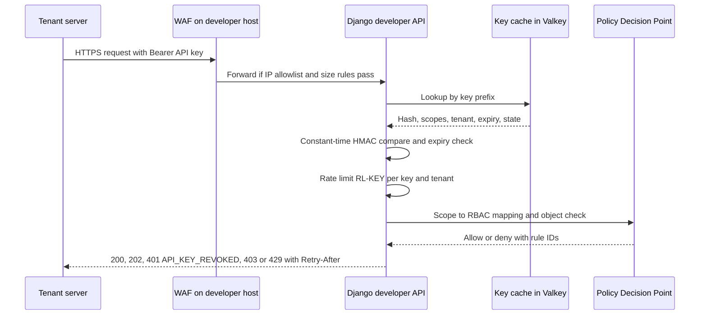
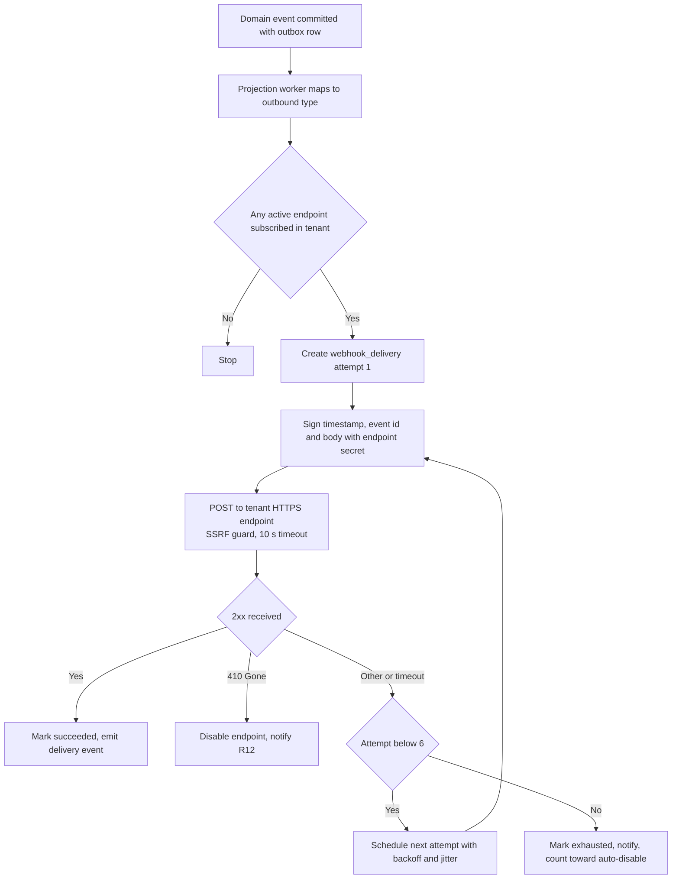
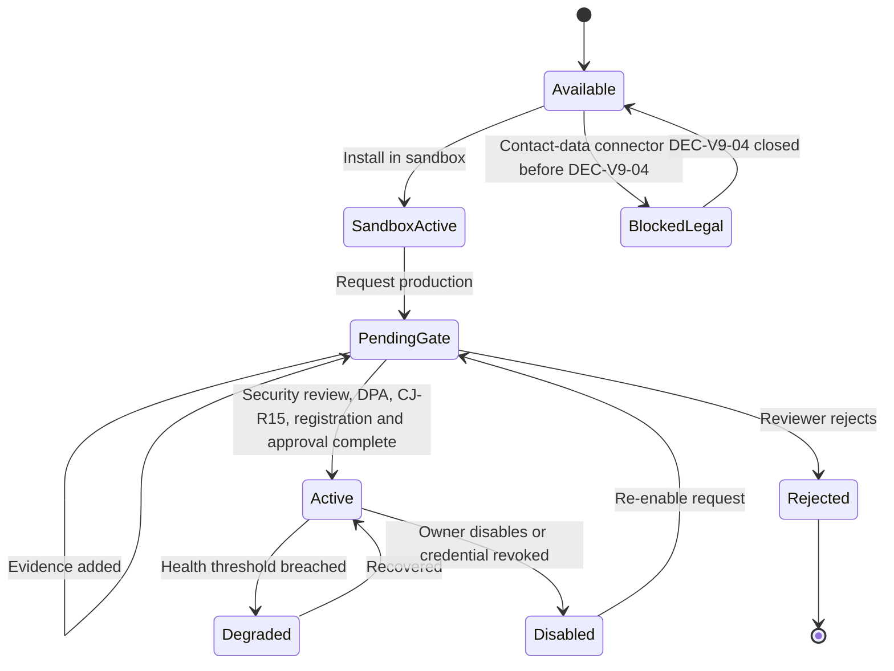
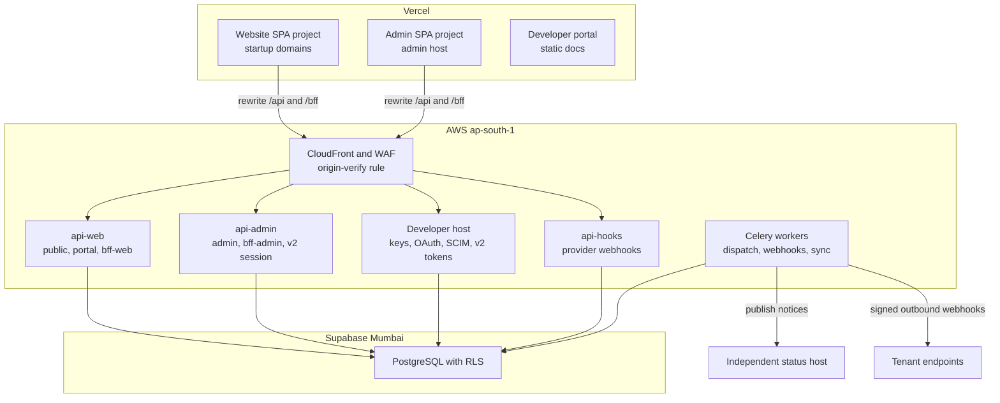

# AI Growth Engine: Employee Sales & Marketing Automation
## Application Blueprint: PART 11 (Batch 11.8b), V12 REST API, Event Contracts, External Integrations and Plugin Optimization: Enhancements, Conflicts and Decisions

| Field | Value |
|---|---|
| Document | Part 11.8b: enhancements that bring the blueprint to a 100% match with FSD V12 ch. 25, 27, 28 and Appendices A/A2: adopted requirements, contract conventions, developer platform, {{NEWOPS_N}} new operations with field-level contracts, error codes, idempotency and authorization, event contracts and outbound webhooks, connector framework, new adapters, plugin and FinOps decisions, API hosting under DEC-421, stories, tests, effort and cost; conflicts, decisions, persona review, tags and quality gate |
| Version | 1.0 · 28 Nov 2026 |
| Baseline | Part 11.8a (material and reconciliation); Part 3.2 standards §3.2.1, catalogue §3.2.2, events §3.2.3, adapters §3.2.4; Parts 3.5a/3.5b; Parts 7.4a/7.4b; Part 9.9a; Part 9.10 (DEC-417, DEC-418, DEC-420, DEC-421, DEC-422) |
| Roles applied | Principal API Architect · Integration Architect · Open-source/plugin FinOps strategist · API security lead · Business Systems Analyst · QA Lead · Security/Compliance Lead · FinOps Lead |

---

## 11.8.5 Enhancements

### 11.8.5.1 Requirements adopted and release mapping

**V12 phase mapping [ASSUMPTION-893].** FSD V12 ch. 39 defines R0 Foundations, R1 Private beta India (owned companies), R2 General availability India, R3 EU launch, R4 UK/Middle East/APAC, R5 Americas, and states that durations are not estimated. The blueprint maps them as follows until the Founder decides CONFLICT-886…888:

| V12 phase | Blueprint release | Window of record | Rationale |
|---|---|---|---|
| R0 Foundations | Release 1, W0–W1 | Day 1–45 | Core platform, CI/CD, SBOM |
| R1 Private beta India (owned companies) | Release 1, W2–W3 | to Release 1 go/no-go Fri 4 Jun 2027 (Day 180) | Owned startups are the Release 1 users (DEC-006) |
| R2 GA India | Release 2, W4–W5 | build Fri 2 Jul 2027 (Day 208); W5 exit Fri 23 Jul 2027 (Day 229) | External SaaS tenants arrive in Release 2 |
| R3 EU launch | W6 (Phase 2, separate approval) | Day ≈ 237–365 | Phase-2 budget ₹25.8–38.7 L not yet approved |
| R4, R5 | Year 2 and later | Not planned | Outside the approved horizon |

**Requirement register (V12 wording adopted literally).**

| FR | Requirement | Source | V12 acceptance | V12 phase → release | Realised by |
|---|---|---|---|---|---|
| FR-V12-H-001 | Scoped, expiring API keys; stored as hash, shown once; optional IPv4/IPv6 allowlist; rotation and revocation | ENT-API-01 (P0) | Plaintext never persisted (C2 hash only); revoked key returns 401 | R1 → Release 1 (CONFLICT-886) | API-V12-H-001…004; §11.8.5.4 |
| FR-V12-H-002 | OAuth 2.0 client-credentials for server integrations | ENT-API-02 (P1) | Token audience and scope verified; expired token rejected | R2 → Release 2 | API-V12-H-005…008 |
| FR-V12-H-003 | Rate limits per key and tenant with 429 and Retry-After | ENT-API-03 (P0) | Load test shows fair limits; noisy tenant isolated (AIX-16) | R1 → Release 1 (CONFLICT-886) | RL-KEY, RL-SCIM (§11.8.5.4) |
| FR-V12-H-004 | URL versioning and at least 12 months' deprecation notice for breaking changes | ENT-API-04 (P1) | Deprecation headers present; changelog published (W39) | R2 → Release 2 | DEC-646 |
| FR-V12-H-005 | Signed webhooks (HMAC-SHA256 + timestamp), replay protection, exponential retries for 24 h, delivery log | ENT-API-05 (P0) | Tampered or > 5-minute-old signature rejected by reference verifier | R1 → Release 1 (CONFLICT-886) | API-V12-H-009…014; §11.8.5.6; ADR-206 |
| FR-V12-H-006 | SDKs for TypeScript, Python and Java generated from the OpenAPI contract | ENT-API-06 (P2) | SDK contract tests pass against sandbox | R3 → W6 | RECOMMENDATION-903 |
| FR-V12-H-007 | Developer portal with API reference, guides and sandbox access | ENT-API-07 (P1) | Portal built from Appendix A/A2; examples executable in sandbox | R2 → Release 2 | §11.8.5.4 |
| FR-V12-H-008 | Enterprise operations of Appendix A2 (48, OpenAPI 3.1) are part of the contract | FSD 25 V12 note | Validated contract | R1–R3 | §11.8.4.3; API-V12-H-001…048 |
| FR-V12-H-009 | Appendix A component conventions (Error, Page, Record, Command, RunRequest, BusinessContext, PreflightRequest/Result; cursor/limit; Idempotency-Key) | Appendix A | Validated contract | R0 | DEC-641, DEC-642 |
| FR-V12-H-010 | One authoritative registry with alias and migration map; row-level source disposition index; no unreviewed historical endpoint auto-deployed | MT-36 (P0), REC-18 (P0) | Conflicting path/entity names detected; contract tests against versioned schemas | R0 | §11.8.5.2; DEC-640 |
| FR-V12-H-011 | Common run gateway with BusinessContext DTO, entitlement/config/approval/budget checks; run ID or hold reason; no duplicate effect | API-V2-*, MT-API-08, V4 runs, OPT-API-01 | 202 run; 400/403/409/422/429 | R1 → Release 1 | API-V12-H-068…073; ADR-208 |
| FR-V12-H-012 | AI governance routes: model registry, promotion requests with passing suites, prompt versions, eval suites and runs with denominators, red-team results, content screening (flags only), usage and cost per accepted result, budgets, kill switch | FSD 25 V8 (AIX-02/04/05/06/08/12/13/14/20) | Suite pass required; stop effective | R1 → Release 1 | API-V12-H-049…056 + existing |
| FR-V12-H-013 | Compliance routes: jurisdiction packs and rules, send preflight, consent ledger search, record and withdraw, suppressions, public DSAR intake, DSAR queue/verify/complete with legal-hold check, incident register with clocks and notifications, cookie consent with notice version | FSD 25 V8 (CJ-R01/02/04/05/07/08/12) | Rule-cited verdicts; clocks recorded | R1 → Release 1 | API-V12-H-057…062 + existing |
| FR-V12-H-014 | Tenant/company configuration contracts: applications (202 pending, no entitlement), company creation, scoped configuration graph, drafts with 409 stale, independent review, rollback as new draft with re-review, context options | MT-API-01…07 | Per row | R1 | Existing operations; API-043 semantics (§11.8.5.3) |
| FR-V12-H-015 | Business metrics with scoped dimensions, period, currency and approved rate version; native and converted totals; missing rates listed | MT-API-09 | Never sum currencies without rate | R1 | API-V12-H-064 |
| FR-V12-H-016 | Portfolio grants require owner authority and explicit aggregate scope; independent clients excluded by default | MT-API-10 | Grant/revoke versioned and audited | R1 | API-V12-H-063 |
| FR-V12-H-017 | Optimization routes: preflight, cost summary, health, feedback, customer value, private application drafts, model evaluations, operator conversion metrics | OPT-API-01…08 | Per row | R1–R2 | API-V12-H-065…068 + existing |
| FR-V12-H-018 | Connector framework with one adapter contract: auth, scopes, data mapping, events, limits, failure handling | ENT-INT-01 (P0) | Every connector passes contract tests in sandbox | R1 → Release 1 (CONFLICT-886) | CF-01…12 (§11.8.5.7) |
| FR-V12-H-019 | OAuth tokens and API secrets only in a vault, rotated, never in database rows or logs; short-lived scoped credentials | ENT-INT-02 (P0), SEC-04 (P0) | Secret scan and DB inspection find no credentials | R1 | AD-12; CF-03; TC-V12-H-085 |
| FR-V12-H-020 | Per-connector rate limits, backoff and circuit breaker; uncertain writes reconcile before retry | ENT-INT-03 (P1) | Provider outage test loses no events (M58) | R2 | Part 3.2 §3.2.7; CF-07 |
| FR-V12-H-021 | Connector health, sync lag and error dashboards with alerts | ENT-INT-04 (P1) | Health check and alert fire in staging | R2 | API-V12-H-074 |
| FR-V12-H-022 | Activation gate: security review, DPA, transfer basis (CJ-R15) and channel registration (DLT, WhatsApp templates); contact-data connectors blocked until DEC-V9-04 closes | ENT-INT-05 (P0) | Blocked state enforced | R1 → Release 1 (CONFLICT-886) | API-V12-H-038; CF-11; DEC-649 |
| FR-V12-H-023 | Connector catalogue INT-01…11 with category, examples, auth and scope rule | FSD 27 | — | R1–R3 | API-V12-H-037; AD-V12-H-01…11 |
| FR-V12-H-024 | A company may have multiple independent channel accounts; offering-market mapping and independent eligibility | MT-22 (P0) | Email and WhatsApp accounts for two markets preserved in handoff | R1 | CF-05; API-097/API-104 fields |
| FR-V12-H-025 | Scoped provider identity, credential reference and sender aliases; no secrets in HTML or public artifacts | MT-23 (P0) | Two senders under one channel; wrong-company account denied | R1 | API-104/105; CF-03 |
| FR-V12-H-026 | Incremental provider sync with webhooks, cursors, ETags and change windows; reconcile gaps and provider reset | GC-08 (P1) | Unchanged source incurs no full fetch; missed event repaired without duplicates | R2 | CF-08 |
| FR-V12-H-027 | Provider shortlist rationalization: capabilities, licence, privacy, support, TCO and fallback; evidence retained | GC-09 (P0) | Each release connector has an approved shortlist decision and owner; redundant candidates archived | R1 | §11.8.5.9 |
| FR-V12-H-028 | Bring-your-own-provider accounts with isolated credential references and clearly allocated fees, permissions, support and revocation | GC-10 (P1) | BYO tenant charges separate from platform charges; revocation blocks calls | R2 | API-V12-H-038 `ownership` |
| FR-V12-H-029 | Provider volume and tier planning; compare tiers, commitments and overages | GC-11 (P2) | Scenarios include unused commitments; purchasing approval required | R3 → W6 | API-V12-H-076 |
| FR-V12-H-030 | Self-service operations: setup checklist, connector diagnostics, knowledge-based troubleshooting with human escalation | GC-13 (P1) | Representative setup succeeds without staff; unresolved cases route to support | R2 | API-V12-H-075 |
| FR-V12-H-031 | Idle resource detection with safe cleanup and ownership review | GC-15 (P1) | Idle fixture flagged; active or retained resource never deleted automatically | R2 | API-V12-H-074 + CAP-X3-21 finding type |
| FR-V12-H-032 | Paid plugin replacement register VND-01…97 with decisions Replace / Retain OSS / Conditional external service / Defer-exclude | FSD 28 V9 | Every candidate disabled until benchmark, licence, legal and budget evidence | R0 | §11.8.4.6, §11.8.5.9 |
| FR-V12-H-033 | Contact-data vendors need a transfer-register entry (CJ-R15), a DPA and CJ-GL-01 compliance before activation (DEC-V9-04) | FSD 28 V9 | Activation blocked otherwise | R1 | CF-11; DEC-649 |
| FR-V12-H-034 | Cross-device application handoff preserves identity, hierarchy, services and revision; production uses an authenticated server-owned request with replay protection and idempotent revisions | MOB-16 | MOB-16-AT01 | R1 | DEC-658 |
| FR-V12-H-035 | Outbound event catalogue for webhook subscriptions, references and digests only | ENT-API-05; C2 `webhook_endpoint.events` | Subscribed types only | R1 | §11.8.5.6 |
| FR-V12-H-036 | Enterprise identity APIs: SSO (SAML 2.0, OIDC) per tenant, verified domains, MFA/session policy, break-glass, SCIM 2.0 users and groups | A2 Identity/SCIM; ENT-IDN-01…06 | Per ENT-IDN rows | R1 (SSO) / R2 (SCIM) (CONFLICT-887) | API-V12-H-015…028; ADR-207 |
| FR-V12-H-037 | Custom roles from resource × action permissions with SoD at build and run time | A2 Access; ENT-ACC-01/02 | Request+approve role cannot be saved | R2 (CONFLICT-887) | API-V12-H-029…032 |
| FR-V12-H-038 | SIEM streaming to HTTPS, syslog over TLS or object storage with retention 1/3/7 years | A2 Audit; ENT-ACC-04 | Test event delivered; non-TLS rejected | R2 | API-V12-H-033/034; AD-V12-H-07 |
| FR-V12-H-039 | Billing invoice preview with tax; tax determination per line from approved rules | A2 Billing; ENT-BIZ-01, ENT-GLB-05 | Invoice tax lines match approved rule table | R2 | API-V12-H-035/036 |
| FR-V12-H-040 | Customer-managed keys; synthetic-data sandboxes; reviewed configuration promotion | A2 Data; ENT-DAT-02/04/05 | Invalid key rejected; sandbox has no personal fields; self-approval rejected | R2 (sandbox) / R3 (keys) | API-V12-H-039…043 |
| FR-V12-H-041 | Locales list, operational incident declaration, public status summary, vulnerability findings | A2 Global/Operations/Security; ENT-GLB-01/02, ENT-OPS-02/03, ENT-SEC-03 | Status hosted independently; overdue critical blocks release | R1–R2 | API-V12-H-044…048 |

### 11.8.5.2 Contract authority, registry and route aliases (DEC-640)

| Rule | Specification | V12 source |
|---|---|---|
| R-1 Single registry | The Part 3.2 catalogue (+ Part 3.5b, Part 9.7b, this part) is the one registry. Each operation carries `operationId` = V12 operationId where V12 names one (e.g. `post_admin_ai_prompts`), `x-blueprint-op` = API-###, `x-v12-path`, `x-v12-tag` (SM-SVC-## or screen), `x-source-op` (SM-OP-### / SM-UX-API-## / V8 / MT-API / OPT-API / API-V2 / V4 / A2) | MT-36, REC-18, FSD 25 V5 "map operation IDs at contract review" |
| R-2 No duplicate mounting | A V12 path that is an alias of an approved blueprint path is **not** mounted a second time; the alias is recorded in the registry and the developer portal shows the approved path | FSD 25 V6 "avoid duplicate endpoints"; V5 "reuse approved paths if equivalent" |
| R-3 New namespaces only where V12 creates them | `/api/v2/workflow-runs…` (run gateway), `/scim/v2/…` (RFC 7644 fixed paths), `/oauth/token` and the developer host | API-V2-*, A2 SCIM, ENT-API-02 |
| R-4 Route aliases (served) | Only two V12 spellings are served as thin aliases because external clients will call them: **RA-V12-H-01** `GET /api/v2/public/services` → API-501 projection; **RA-V12-H-02** `POST /api/v2/public/enquiries` → API-212 (one lead per duplicate) | API-V2-CATALOG, API-V2-INTAKE |
| R-5 Disposition index | `final/coverage_v12/H_coverage.csv` column *action* holds the relation (Exact, Alias, Alias (prefix), Split, Approval, Partial, New, New (Part 3.5b)); exact matches are separated from semantic review exactly as REC-18 asks | REC-18 |
| R-6 Historical retention | Operations of the historical registry absent from Appendix A (30) stay implemented; Appendix A is not read as a deletion list | FSD 25 V5 "exact source operations retained" |
| R-7 CI gates | (a) duplicate method + path across namespaces → fail; (b) every alias target exists; (c) every Appendix A/A2 operationId appears exactly once as `operationId` or alias; (d) oasdiff breaking-change check per published namespace (DEC-646); (e) Schemathesis property tests per operation against the V12 component schemas (RECOMMENDATION-901) | MT-TC-MT-36 |

### 11.8.5.3 Wire convention amendments (DEC-641, DEC-642) and field amendments to existing operations

| Topic | Part 3.2 before | V12 (Appendix A) | Rule adopted | Effect on existing clients |
|---|---|---|---|---|
| List envelope | `{data[], page{next_cursor, prev_cursor, limit}, meta}` | `Page {items[], next_cursor: string|null}` | **`{items[], next_cursor, prev_cursor?, meta?}`** — `items` and `next_cursor` required; `meta.as_of`, `meta.total_estimate` optional | Generated TypeScript clients regenerated in Sprint 0; no external client exists yet |
| Page size | default 25, max 100 | `limit` 1…200, default 50 | **default 50, max 200**; exports stay async | RL-ADM unchanged; payload cap 1 MB still applies |
| Revision field | `revision` + `ETag: "r<revision>"` | `Record.version ≥ 1` | Wire name **`version`** (= database `revision`); ETag `"r<version>"` | Field rename in serializers |
| Concurrency on commands | `If-Match` mandatory | `Command.expected_version ≥ 0` in body | Both accepted; if both present they must be equal (else 400 `VERSION_PRECONDITION_MISMATCH`); stale → 409 `STALE_REVISION` | Additive |
| Command body | Operation-specific DTO | `Command {expected_version, payload, reason ≤ 2000}` | Operation-specific DTO **inside** `payload`; `reason` top-level where the operation records a reason | Additive wrapper for V12 clients; blueprint DTOs unchanged inside |
| Error envelope | RFC 9457 problem+json with `code`, `detail`, `errors[]`, `rule_ids`, `correlation_id` | `Error {code, message, correlation_id, field_errors{}}` | **Superset:** `code`, `message` (= `detail`), `correlation_id`, `field_errors` (map field → message key) always present; RFC 9457 members and `rule_ids`, `reasons`, `required_approval`, `retryable` retained | Additive |
| Response codes | 200/201/202/204/304/400/401/403/404/409/413/415/429/503 | Reads 200/304/400/403/404/409; commands 200/202/400/403/404/409 | Superset retained and declared on every operation; **422 `SCHEMA_INVALID`** added for DTOs validated against Appendix B JSON Schemas (run inputs) and SCIM schema errors; 400 stays for envelope/format errors | Additive |
| Security schemes | BFF cookie only for browsers; no bearer from browsers | `bearerAuth` JWT, global | Two schemes: `bffSession` (browser namespaces) and `bearerAuth` (developer host, SCIM, `/api/v2` token callers). Bearer tokens presented on browser ingress → 401 `WRONG_AUDIENCE` (DEC-643) | No browser change |
| Idempotency | `Idempotency-Key` + body hash | `x-idempotency: Idempotency-Key header required` | Unchanged; also required for API-key callers | — |
| Servers | Per namespace | `https://api.example.invalid` | Real hosts per §11.8.5.10 | — |

**Preflight DTO adopted for API-068 (`POST /api/v1/engagement/check`, V12 `POST /api/v1/compliance/preflight`).**

```json
{
  "request": {"market": "IN", "channel": "WhatsApp", "purpose": "Promotional",
              "contact_id": "0193…", "send_at_local": "2027-03-04T10:30:00+05:30",
              "template_id": "tpl_…", "ai_generated": true, "ai_disclosed": true},
  "result":  {"verdict": "HOLD",
              "reasons": [{"rule_id": "CJ-IN-08", "effect": "hold", "message": "eligibility.whatsapp_optin_missing"}],
              "pack_versions": {"IN": 7}}
}
```

`verdict ∈ {ALLOW, HOLD, REVIEW}`; HOLD and REVIEW never dispatch; the dispatch-time PDP recheck still runs (safety invariant). `market` enum IN/EU/UK/US is extended only when a pack is counsel-approved (ENT-CMP-08).

**Field and semantic amendments to existing operations (no new route).**

| Operation | Amendment | V12 source |
|---|---|---|
| API-043 `POST ~/admin/config-revisions/{id}/rollback` | Creates a **new draft revision** copying the referenced approved revision; requires review (API-541/539) before activation; no automatic restore | MT-API-06 |
| API-030 `POST ~/admin/startups` | Response adds `company_version`; 201 `state: "pending"`; scoped member grants stay separate (API-020/021) | MT-API-02 |
| API-097 / API-104 | Add `market_ids[]`, `offering_ids[]`, `ownership ∈ {platform, tenant_byo}`, `sender_aliases[]` (≤ 10); eligibility evaluated per channel account | MT-22, MT-23, GC-10 |
| API-102 `GET ~/admin/integrations/{id}/health` | Add `sync_lag_s`, `error_rate_1h`, `breaker_state`, `alert_state` | ENT-INT-04 |
| API-122 audit export | `format ∈ {jsonl, csv}`; count of exported rows equals filtered count; hash-chain segment proof included | ENT-ACC-03 |
| API-534 / API-535 exports | `format ∈ {jsonl, csv, parquet}`; `manifest_hash`; second approver ≠ requester (approval type `export`); link valid **7 days** | ENT-DAT-01 |
| API-137 / API-146 AI budgets | `soft_limit` (alert) and `hard_limit` (stop) per scope; V12 `PUT /api/v1/ai/budgets/{id}` is an alias of the revision update | AIX-13 |
| API-148 eval run detail | Add `denominator` per metric and `suite_id` | V8 eval-runs |
| API-077 jurisdiction packs | Add `status ∈ {draft, counsel_approved, retired}` and `legal_source` per pack | CJ-R01 |
| API-526 / API-515 invoices | Add `tax_lines[]`, `net_minor`, `tax_minor`, `total_minor` (= net + tax) | A2 billing; C2 `invoice` |
| API-128 incidents | Add `severity ∈ {SEV1…SEV4}`, `status ∈ {Investigating, Identified, Monitoring, Resolved}`, `status_message` | C2 `ops_incident` |
| API-503/504/507 applications | Accept the SM-APPLICATION-6 envelope as the application DTO; `revision` + `digest`; 409 on stale or provisioned change | MT-API-01, V4, MOB-16 |

### 11.8.5.4 Developer platform (ENT-API-01…07; ADR-205)

**Surfaces and authentication.**

| Surface | Host (DEC-421, §11.8.5.10) | Callers | Credential | Accepted on |
|---|---|---|---|---|
| Browser namespaces `public`, `portal`, `admin`, `bff-*` | Same origin as each SPA | Browsers | `__Host-` session cookie + CSRF (DEC-019) | Browser ingress only |
| Developer API (`/api/v1/…` published subset, `/api/v2/workflow-runs…`) | `api.<platform-domain>` | Tenant servers | API key `Authorization: Bearer gek_…` or OAuth JWT | Developer host only |
| OAuth token endpoint `/oauth/token` | `api.<platform-domain>` | Registered clients | `private_key_jwt` (preferred) or `client_secret_basic` | Developer host |
| SCIM `/scim/v2/…` | `api.<platform-domain>` | Tenant IdP | SCIM bearer token (hash stored) | Developer host |
| Provider hooks | `hooks.<platform-domain>` | Providers | Provider signatures | Hooks host |

**API key specification [ASSUMPTION-894].** Format `gek_<env>_<prefix8>_<secret43>` (secret = 32 random bytes, base62). Storage: `prefix`, `last4`, `key_hash = HMAC-SHA-256(pepper, secret)` (pepper in Secrets Manager, rotated yearly with dual-pepper verification); plaintext returned once with `Cache-Control: no-store`. Lookup by prefix, constant-time compare. Expiry ≤ 365 days (default 90); optional IPv4/IPv6 allowlist (CIDR); scopes required. Revocation effective ≤ 60 s. Keys are tenant-scoped and attributed to the creating user for audit; deprovisioning the user (SCIM) revokes keys they created unless re-assigned by R12 within 24 h.

**Scope registry (draft-only by design).**

| Scope | Grants | Never grants |
|---|---|---|
| `<resource>:read` for leads, organizations, deals, quotes, orders, invoices, meetings, runs, metrics, catalogue | Reads with the same field masks as the creator's least-privileged role | Restricted fields (contact data is masked unless the scope `contacts:read_unmasked` is approved by R10) |
| `leads:write`, `organizations:write`, `deals:write` | Create or update **records and drafts** | Sends, publishes, launches |
| `runs:create` | `POST /api/v2/workflow-runs` with `mode=draft`; `mode=execute` only for workflows whose consequential steps all stop at a human approval | Approval of any kind |
| `webhooks:read` | Delivery log of own endpoints | Endpoint creation (Admin only) |
| — (no scope exists) | — | Approve, send, publish, launch ads, sign, pay, submit bids, set prices, change roles, change policies: **consequential actions stay capped at L1 and require a human in the Admin UI** |

**Rate-limit classes added to Part 3.2 §3.2.1.7 [ASSUMPTION-896].**

| Class | Applies to | Default | Key | On exceed |
|---|---|---|---|---|
| RL-KEY | Developer API reads and writes | 300/min per key; 1,500/min per tenant (all keys and clients); burst 2× for 10 s; payload ≤ 1 MB | key, tenant | 429 `RATE_LIMITED` + `Retry-After` + `RateLimit-Policy`/`RateLimit` |
| RL-KEY-H | `/api/v2/workflow-runs` creation, exports | 10/min per key; 60/min per tenant; ≤ 3 concurrent runs per key | key, tenant | 429, or 202 queued |
| RL-SCIM | `/scim/v2/*` | 60/min per tenant token; bulk ≤ 100 operations | token | 429 (RFC 7644 `tooMany`) |
| Noisy-tenant isolation | All token callers | Per-tenant worker concurrency (BRL-AUT-06) and separate Valkey bucket namespace | tenant | Other tenants unaffected (AIX-16 acceptance, TC-V12-H-079) |

**Versioning (DEC-646).** Breaking changes to any **published** contract (developer API, public, portal, outbound webhook payloads, SCIM) need at least **12 months'** notice: `Deprecation` and `Sunset` headers, `Link rel="deprecation"`, changelog entry on the developer portal (W39) and an email to the owners of keys that called the operation in the last 90 days. Admin-only operations not published in the portal keep the release-coupled rule of Part 3.2 §3.2.1.3.

**SDKs and portal.** TypeScript and Python SDKs generated with openapi-generator (Apache-2.0, verify) from the published namespaces at R2; Java at R3 (RECOMMENDATION-903). The developer portal is a static site generated from the OpenAPI documents (Appendix A/A2 + this part) hosted as a separate Vercel project (no personal data), with "Try it" bound only to the **sandbox tenant** (API-V12-H-042, synthetic data, sandbox adapters). Contract tests of each SDK run against the sandbox in CI (ENT-API-06 acceptance).



### 11.8.5.5 New operations ({{NEWOPS_N}}) with field-level contracts

Columns follow Part 3.2 §3.2.2.2. New namespaces: `dev` (developer host token endpoint), `scim` (`/scim/v2`), `v2` (run gateway; Admin session or token), `status` (independent status host). New rate-limit classes RL-KEY, RL-KEY-H and RL-SCIM are defined in §11.8.5.4. Every mutating operation takes `Idempotency-Key` (and `If-Match` or `expected_version` where marked) per Part 3.2 §3.2.1.4–5; every response carries `X-Correlation-Id`; errors use the DEC-641 envelope and the Part 3.2 code catalogue plus the codes below.

**New error codes.** `API_KEY_REVOKED` (401), `API_KEY_EXPIRED` (401), `TOKEN_EXPIRED` (401), `INSUFFICIENT_SCOPE` (403), `IP_NOT_ALLOWED` (403), `SCHEMA_INVALID` (422), `VERSION_PRECONDITION_MISMATCH` (400), `GATE_INCOMPLETE` (403, activation gate), `CHECK_PENDING` (409, SSO or domain not yet verified).

{{NEWOPS}}

**Operation detail.**

{{NEWOPS_DETAIL}}

### 11.8.5.6 Event contracts and outbound webhooks (ADR-206)

**New domain event types (add to Part 3.2 §3.2.3.3; envelope of §3.2.3.1; schema v1).**

| Event type (v1) | Producer | Consumers | Payload keys (`data`) | Source |
|---|---|---|---|---|
| `developer.api_key.created` / `.rotated` / `.revoked` / `.expired` | core.developer | Key cache invalidation, Notify (R12), Audit, SIEM | key_id, prefix, scopes, expires_at, actor | API-V12-H-002…004 |
| `developer.oauth_client.created` / `.revoked` | core.developer | Token deny-list, Notify | client_id, scopes | API-V12-H-007/008 |
| `developer.webhook_endpoint.created` / `.updated` / `.disabled` | core.developer | Delivery worker, Notify | endpoint_id, events, active, secret_version | API-V12-H-010/011 |
| `developer.webhook_delivery.succeeded` / `.failed` / `.exhausted` / `.replayed` | delivery worker | A125 delivery log projection, Notify (exhausted), health | delivery_id, endpoint_id, event_id, attempt, status_code | API-V12-H-012…014 |
| `identity.sso_config.updated` / `.tested` / `.enforced` | core.identity | Session policy cache, Notify, SIEM | version, protocol, enforced | API-V12-H-016/017 |
| `identity.email_domain.verified` / `.verification_lost` | core.identity | SSO enforcement guard, Notify (High) | domain_id, domain | API-V12-H-019 |
| `identity.mfa_policy.updated` | core.identity | Session revocation job | version, mfa_policy, limits | API-V12-H-020 |
| `identity.scim.user_provisioned` / `.user_updated` / `.user_deprovisioned` / `.group_changed` / `.token_changed` | core.identity | Membership, key revocation, approvals re-check | user_id, external_id, change | API-V12-H-022…028 |
| `identity.breakglass.used` | core.identity | SEV3 security event, Notify (R01, R10), SIEM | user_id, reason | ENT-IDN-06 |
| `access.role.created` / `.updated` / `.retired` | core.access | Permission cache, Audit | role_id, permissions_hash | API-V12-H-030…032 |
| `audit.siem_sink.added` / `.delivery_failed` | audit | Notify (R12, R10) | sink_id, kind, lag_seconds | API-V12-H-034 |
| `connector.installation.requested` / `.activated` / `.blocked` | integrations | Approval, Notify, PDP capability cache | installation_id, connector_id, environment, gate | API-V12-H-038 |
| `connector.health.degraded` / `.recovered` | integrations | Notify (R11), status page component | installation_id, metric, value | API-V12-H-074 |
| `data.encryption_key.changed` | data | Re-wrap job, Notify | mode, key_ref_masked | API-V12-H-040 |
| `data.sandbox.created`, `data.promotion.requested` | data | Notify | sandbox_id / promotion_id | API-V12-H-042/043 |
| `ops.status.published` | ops | Status host publisher | notice_id, components | API-V12-H-046 |
| `security.finding.logged` / `.overdue` | security | Release gate (blocks on overdue Critical), Notify | finding_id, severity, due_at | API-V12-H-048 |
| `ai.model.promotion_requested` | ai.quality | Approval, Notify | model_id, target_status, eval_run_ids | API-V12-H-050 |
| `ai.kill_switch.activated` / `.released` | ai.gateway | Gateway route cache (≤ 60 s), automation (hold), Notify (Critical) | target_kind, target_id, scope | API-V12-H-056 |
| `ai.content.flagged` | ai.gateway | Quarantine handler, Audit | content_ref, flags | API-V12-H-054 |
| `governance.consent.withdrawn` | governance | Suppression, outbox cancellation, outbound projection | consent_id, channel, purpose | API-V12-H-059 |
| `governance.compliance_incident.notification_recorded` | governance | Clock tracker, Notify | incident_id, recipient_kind, clock_state | API-V12-H-061 |
| `governance.cookie_consent.recorded` | governance | Analytics gate | consent_token, choices | API-V12-H-062 |
| `governance.portfolio_grant.changed` | governance | Permission cache, Audit | grant_id, user_id, startup_ids, action | API-V12-H-063 |

That is 24 catalogue rows and **49 concrete event types** (`/` variants counted). Restricted values are never in payloads (references and digests only).

**Outbound webhook projection v1 (subscribable event types).** Tenants subscribe to these types only; each is a **projection** of a domain event with an allowlisted payload of references (`id`, `type`, `schema_version`, `occurred_at`, `tenant_id`, `startup_id`, `subject {type, id, version}`, `data {…}`, `links.self`). Receivers fetch details through the API with their own scopes, so the payload never widens access.

| # | Outbound type | Domain event | `data` keys | Minimum scope to subscribe |
|---|---|---|---|---|
| 1 | `lead.submitted` | `crm.lead.submitted` | lead_id, source, startup_id | `leads:read` |
| 2 | `lead.qualified` | `crm.lead.qualified` | lead_id, deal_id? | `leads:read` |
| 3 | `deal.created` | `crm.deal.created` | deal_id, stage | `deals:read` |
| 4 | `deal.stage_changed` | `crm.deal.transitioned` | deal_id, from_stage, to_stage | `deals:read` |
| 5 | `deal.won` | `crm.deal.won` | deal_id, amount_ref | `deals:read` |
| 6 | `deal.lost` | `crm.deal.lost` | deal_id, reason_code | `deals:read` |
| 7 | `quote.approved` | `commerce.quote.approved` | quote_id, version | `quotes:read` |
| 8 | `quote.accepted` | `commerce.quote.accepted` | quote_id, version | `quotes:read` |
| 9 | `contract.signed` | `commerce.contract.signed` | contract_id, version, content_hash | `contracts:read` |
| 10 | `order.issued` | `commerce.order.issued` | order_id, direction | `orders:read` |
| 11 | `order.completed` | `commerce.order.completed` | order_id | `orders:read` |
| 12 | `fulfilment.recorded` | `commerce.fulfilment.recorded` | order_id, event_key | `orders:read` |
| 13 | `invoice.issued` | `finance.invoice.issued` | invoice_id, total_ref | `invoices:read` |
| 14 | `payment.verified` | `finance.payment.verified` | payment_id, invoice_id | `invoices:read` |
| 15 | `meeting.booked` | `engagement.meeting.booked` | meeting_id, starts_at | `meetings:read` |
| 16 | `message.delivered` | `engagement.message.delivered` | message_id, channel | `messages:read` |
| 17 | `contact.opted_out` | `engagement.optout.received` / `governance.consent.withdrawn` | subject_ref (hash), channel, purpose | `contacts:read` (needed by CRM sync to suppress) |
| 18 | `run.completed` | `automation.run.completed` | run_id, workflow_id, result_ref | `runs:read` |
| 19 | `run.failed` | `automation.run.failed` | run_id, error_code | `runs:read` |
| 20 | `approval.decided` | `approval.decided` | approval_id, object_type, decision | `approvals:read` |
| 21 | `subscription.changed` | `saas.subscription.changed` | subscription_id, plan_version_id | `billing:read` |
| 22 | `usage.threshold_reached` | `saas.usage.threshold_reached` | dimension, percent | `billing:read` |
| 23 | `onboarding.completed` | `lifecycle.onboarding.completed` | onboarding_id | `onboarding:read` |
| 24 | `developer.ping` | (synthetic) | endpoint_id | — |

**Signature and delivery specification (ENT-API-05).**

| Item | Specification |
|---|---|
| Headers | `GE-Webhook-Id` (delivery UUID), `GE-Event-Id` (event UUID, receiver dedupe key), `GE-Event-Type`, `GE-Timestamp` (Unix seconds), `GE-Signature: v1=<hex>` (two `v1=` values during secret rotation overlap) |
| Signed string | `<GE-Timestamp>.<GE-Event-Id>.<raw body bytes>`; HMAC-SHA-256 with the endpoint secret (≥ 32 bytes, Secrets Manager reference in `webhook_endpoint.secret_ref`) |
| Freshness | Receivers reject `|now − GE-Timestamp| > 300 s` (V12: "> 5-minute-old signature rejected") |
| Replay protection | Receivers store `GE-Event-Id` for ≥ 24 h; the platform never reuses an event ID; manual replay (API-V12-H-014) re-signs with a new timestamp and the same event ID |
| Success | HTTP 2xx within 10 s; redirects not followed; 410 Gone disables the endpoint |
| Retries [ASSUMPTION-895] | 6 attempts within 24 h (C2 `attempt BETWEEN 1 AND 6`): immediately, +1 min, +10 min, +1 h, +5 h, +16 h (± 10% jitter; cumulative ≈ 22 h 11 min); then `exhausted`; endpoint auto-disabled after 24 h of continuous failure |
| Ordering | Not guaranteed; `subject.version` lets receivers discard stale events |
| Egress | Delivery workers on AWS ap-south-1 send from published static egress IPs (NAT) so tenants can allowlist; SSRF guard re-resolves DNS per attempt |
| Data | References and digests only; no Restricted values; `simulated: true` events are never delivered except to sandbox endpoints |

Reference verifier (published in the developer portal and used by TC-V12-H-082):

```python
import hmac, hashlib, time

def verify(secret: bytes, headers: dict, body: bytes, seen_event_ids: set) -> bool:
    ts = int(headers["GE-Timestamp"])
    if abs(time.time() - ts) > 300:
        return False                                   # older than 5 minutes
    event_id = headers["GE-Event-Id"]
    if event_id in seen_event_ids:
        return False                                   # replay
    signed = f"{ts}.{event_id}.".encode() + body
    expected = hmac.new(secret, signed, hashlib.sha256).hexdigest()
    candidates = [p.split("=", 1)[1] for p in headers["GE-Signature"].split(",") if p.strip().startswith("v1=")]
    if not any(hmac.compare_digest(expected, c.strip()) for c in candidates):
        return False                                   # tampered
    seen_event_ids.add(event_id)
    return True
```



### 11.8.5.7 Connector framework and activation gate (ENT-INT-01…05; CF-01…12)

| Clause | Contract element (every connector) | Detail | V12 source |
|---|---|---|---|
| CF-01 | Port and manifest | Connector = adapter implementing a typed port (Part 3.2 IP-01) plus a manifest: `connector_id`, category, providers, auth method, scopes, data classes sent and received, events, limits, failure classes, sandbox availability, owner | ENT-INT-01 |
| CF-02 | Authentication | OAuth 2.0 (authorization code with PKCE for user grants; client credentials for service grants), API key or service account; tokens refreshed by the worker, never by browsers | ENT-INT-01, INT-01…11 |
| CF-03 | Secrets | Only `credential_ref` (Secrets Manager ARN) stored; rotation and revocation hooks; never in rows, logs, prompts or HTML (TC-V12-H-085) | ENT-INT-02, SEC-04, MT-23 |
| CF-04 | Data mapping | Anti-corruption mapping (IP-10); field mapping versioned; unknown provider fields ignored; data minimization per Part 3.2 §3.2.4.4 | ENT-INT-01 |
| CF-05 | Channel accounts | Multiple accounts per company with `market_ids`, `offering_ids`, sender aliases; eligibility per account; wrong-company account denied | MT-22, MT-23 |
| CF-06 | Events | Inbound via provider webhooks (§3.2.1.13) or `/api/v2/connectors/{kind}/events`; persist-then-ack; dedupe by provider event ID | ENT-INT-01, API-V2-WEBHOOK |
| CF-07 | Limits and resilience | Per-connector rate limits, timeouts, retries with backoff and jitter, circuit breaker and bulkhead (Part 3.2 §3.2.7); uncertain writes reconcile before retry | ENT-INT-03 |
| CF-08 | Incremental sync | Webhooks first; otherwise cursors, ETags and change windows; gap detection and repair; provider reset handling without duplicates | GC-08 |
| CF-09 | Reconciliation | Scheduled state reconciliation (IP-05) for money, delivery and sync; discrepancies to the exception queue | ENT-INT-03, adapter family "Payments / marketplace" |
| CF-10 | Health | Health probe, sync lag, error rate, breaker state, alert thresholds (API-V12-H-074) | ENT-INT-04 |
| CF-11 | Activation gate | Production activation needs: security review reference; DPA; transfer basis entry (CJ-R15); channel registration (DLT entity/header/template IDs for SMS; approved WhatsApp templates); licence and budget line approved (Part 7.4b PG-01…PG-10); contact-data connectors additionally blocked until DEC-V9-04 closes and CJ-GL-01 is met | ENT-INT-05, FSD 28 V9 |
| CF-12 | Selection evidence | Matched benchmark (coverage, accuracy, p95, reliability, licence, hosting/maintenance, fees), rights, jurisdiction, quota, evidence freshness; owner and release recorded | FSD 27 adapter families; GC-09; FSD 28 closing statement |



### 11.8.5.8 New adapters (AD-V12-H-01…11)

**Part A: purpose, protocol, authentication, quotas, budget.** All quotas, fees and API versions are to **verify at time of implementation (as of 27 Nov 2026)**.

| AD | Port (provider candidates) | Purpose | Protocol | Authentication | Quotas / fees (verify) | V12 phase → release | Budget line |
|---|---|---|---|---|---|---|---|
| AD-V12-H-01 | `CrmSyncPort` (Zoho CRM, HubSpot, Salesforce) | Bi-directional sync of contacts, accounts, opportunities for tenants that keep an external CRM; platform stays system of record for consent and approvals | REST + provider webhooks / CDC | OAuth 2.0 per tenant (BYO) | Provider API call quotas per edition; ₹0 platform fee (tenant's own licence) | R1 → Release 1 (CONFLICT-888) | None (BYO) |
| AD-V12-H-02 | `SmsPort` (DLT-registered aggregator in India; RCS business messaging where the aggregator supports it) | Service and promotional SMS with DLT entity, header and template IDs; delivery receipts; STOP keyword handling | REST + delivery-report webhooks | API key in vault | Per-SMS fee and DLT registration fees per operator (verify); promotional sends only in permitted hours (CJ-IN-06) | R1 → Release 1 (CONFLICT-888) | New line B25 (proposal) |
| AD-V12-H-03 | `VoicePort` (CPaaS with 140-series promotional and 160-series service numbers) | Click-to-call and approved voice notifications with disclosure and recording consent | REST + call-status webhooks | API key in vault | Per-minute and number rental fees (verify) | R3+ → W6 or later | B26 (proposal) |
| AD-V12-H-04 | `WarehouseExportPort` (BigQuery, Snowflake, Postgres) | Scoped scheduled export of analytics tables to a tenant-owned warehouse | Provider bulk-load APIs or COPY over TLS | Tenant service account (vault) | Tenant-side cost; egress from AWS per GB (verify) | R2 → Release 2 | B01c egress |
| AD-V12-H-05 | `IdentityFederationPort` (Okta, Entra ID, Google Workspace via SAML 2.0 / OIDC; SCIM 2.0 server) | Per-tenant SSO and provisioning (ADR-207) | SAML/OIDC brokered through the existing IdP (DEC-019) where it supports per-tenant brokering; otherwise in-product SAML SP | IdP metadata + certificates; SCIM bearer token | ₹0 platform fee if the existing IdP supports brokering (Sprint 0 check 13, §11.8.5.11) | R1 SSO / R2 SCIM | B01 |
| AD-V12-H-06 | `WebhookDeliveryPort` (in-house on Celery) | Outbound signed webhooks (§11.8.5.6) | HTTPS POST | HMAC secret per endpoint | Compute within existing workers | R1 → Release 1 | B01c |
| AD-V12-H-07 | `SiemSinkPort` (HTTPS collector, syslog over TLS, S3/GCS/Azure Blob) | Stream audit events | HTTPS / RFC 5425 syslog-TLS / object put | Tenant credential reference | Tenant-side | R2 → Release 2 | B01c egress |
| AD-V12-H-08 | `TaxPort` (rule table; US sales-tax provider later) | Tax determination per line | In-process rule engine; provider REST at R5 | API key (R5) | Provider per-transaction fee (R5, verify) | R2 (rules) / R5 (provider) | — |
| AD-V12-H-09 | `TenantKmsPort` (AWS KMS cross-account; Azure Key Vault; GCP KMS) | Customer-managed key wrap/unwrap (ADR-137) | Provider KMS APIs | Cross-account role / workload identity federation | Per-request KMS fees (verify) | R3 → W6 | B01c |
| AD-V12-H-10 | `StatusPublishPort` (independent static host) | Publish approved status notices off-platform (ENT-OPS-02) | Static JSON + HTML upload | Deploy token | ₹0–1,800/month (verify) | R2 → Release 2 | B27 (proposal) |
| AD-V12-H-11 | `EmailPort` alternates (SendGrid, Postmark) | Equivalent ESPs behind the same port as AD-01, activated only through the gate | REST + signed webhooks | API key in vault | Per-email plans (verify) | Conditional | B05 |

**Part B: failure classes, idempotency, sandbox, data sent, fallback.**

| AD | Failure classes | Idempotency | Sandbox (verify) | Data class sent | Fallback (never silent) |
|---|---|---|---|---|---|
| AD-V12-H-01 CRM | 5xx/429 transient; 401 auth (disable after threshold); validation permanent; timeout on write uncertain | External ID field = platform record ID; upsert by external ID | Provider developer orgs/sandboxes | Confidential business records; Restricted contact fields only with consent basis | Sync paused, discrepancy queue; platform data unaffected |
| AD-V12-H-02 SMS | Throttling transient; DLT template mismatch permanent; timeout uncertain (reconcile by delivery report) | Client message reference = message ID | Aggregator test accounts | Restricted: phone (E.164) + approved template variables | Email if consented; else human task |
| AD-V12-H-03 Voice | As SMS; call failed permanent | Call reference = action ID | Provider test numbers | Restricted: phone; recordings only with consent | Human callback task |
| AD-V12-H-04 Warehouse | Load errors permanent per batch; transient retried | Batch ID + manifest hash | Tenant test dataset | Internal/Confidential aggregates per allowlist; no Restricted columns unless R10 approves | Batch held; manifest retained |
| AD-V12-H-05 Identity | IdP metadata invalid permanent; signature failure security event | Assertion ID replay cache | Test IdP tenants | Identity attributes only | Break-glass account (ENT-IDN-06) |
| AD-V12-H-06 Webhooks | Non-2xx/timeout retry per schedule; 410 disable | Event ID (receiver dedupe) | Sandbox endpoints | References and digests only | Delivery log + replay |
| AD-V12-H-07 SIEM | Sink unreachable retry with buffer ≤ 24 h | Sequence number per sink | Test collector | Audit events (redacted) | Buffer then alert R12/R10 |
| AD-V12-H-08 Tax | Unknown jurisdiction → `needs_rate_input` (never guessed) | Deterministic per input | — | Amounts, jurisdictions | Manual rate entry with approval |
| AD-V12-H-09 KMS | Key disabled → fail closed (data unreadable by design) | Key version | Test keys | Data keys only | None by design (crypto-shred semantics) |
| AD-V12-H-10 Status | Upload failure retry | Notice version | Staging site | Public notices only | Manual update by SRE |
| AD-V12-H-11 ESP alternates | As AD-01 | Message ID header | Provider sandboxes | As AD-01 | AD-01 |

### 11.8.5.9 Plugin decisions and FinOps controls (open-source first, paid by exception)

**Decisions for the components this part introduces.**

| Need | Decision | Component (licence, verify) | Why | Paid exception trigger |
|---|---|---|---|---|
| OpenAPI generation | Retain OSS | drf-spectacular (BSD-3-Clause) | Already in Part 3.2 | — |
| Breaking-change detection | Retain OSS | oasdiff (Apache-2.0) | CI gate for DEC-646 | — |
| Property-based contract tests | Retain OSS | Schemathesis (MIT) | 76 new + 330 V12 operations | — |
| SDK generation | Retain OSS | openapi-generator (Apache-2.0) | ENT-API-06 | — |
| Developer portal | Retain OSS | Static site from OpenAPI (e.g. Redoc, MIT) on the existing Vercel plan | No per-seat portal fees | — |
| Outbound webhooks | Replace (native) | Celery + outbox (no new service) | One-person operations; Svix OSS (MIT) considered and rejected for extra service to run | — |
| SCIM server | Retain OSS if justified | django-scim2 (MIT) or a thin in-house implementation after the RFC 7644 conformance suite | Small surface | — |
| SAML SP (only if the IdP cannot broker) | Retain OSS | pysaml2 (Apache-2.0) / python3-saml (MIT) | Avoid paid federation brokers | Paid IdP broker only if the existing IdP fails Sprint 0 check 13 and OSS is insufficient |
| Status page | Replace | Static page generated from approved notices on an independent host | ENT-OPS-02 independence | Hosted status SaaS only if the free static host is unsuitable (B27 ≤ ₹1,800/month, verify) |
| SMS / RCS | Conditional external service | DLT-registered aggregator | Carrier access cannot be self-hosted | Required for INT-04; B25 |
| Voice | Conditional external service | CPaaS | Telephony numbers | R3+; B26 |
| CRM sync | Conditional external service (tenant BYO) | Tenant's own CRM licence | Platform pays nothing | — |
| Tax for US | Conditional external service | Sales-tax provider | R5 only | Per-transaction fee |
| Contact data (INT-11, VND-02/04/14/23/31/33/35/85) | Replace core; licensed data only | — | Official contact paths first | Only after DEC-V9-04, CJ-R15 entry, DPA, CJ-GL-01, benchmark uplift and budget (B08/B18) |

**FinOps controls adopted (FSD 28 V5).**

| Control | Procedure | Owner | Evidence | Cadence |
|---|---|---|---|---|
| GC-09 shortlist rationalization | For every connector in a release: shortlist decision, owner, licence, privacy, support, TCO and fallback recorded on the IC/VND row; redundant candidates archived (state `archived`, no credential) | FinOps lead + Integration lead | IC/VND row + benchmark record | Each release gate |
| GC-10 BYO accounts | Installation `ownership = tenant_byo`; provider fees billed to the tenant by the provider; platform usage ledger excludes BYO provider costs; revocation of the credential blocks calls immediately | Integration lead | Usage ledger split; TC-V12-H-093 | Continuous |
| GC-11 volume and tier planning | API-V12-H-076 scenarios from 3-month usage forecast; include unused commitments; purchase decision outside the platform | FinOps lead | Scenario report | Quarterly from R3 |
| GC-13 self-service | Setup checklist and diagnostics per connector (API-V12-H-075); unresolved → support case | Support lead | Case links | Continuous |
| GC-15 idle resources | Weekly job flags connectors with no successful call in 30 days, idle infrastructure and orphaned artifacts as FinOps findings; owner review; **never auto-delete** | FinOps lead | Finding records; TC-V12-H-094 | Weekly |
| Paid-plugin activation | Part 7.4b PG-01…PG-10 plus CF-11; default **disabled** | FinOps lead + R10 | PG checklist | Per activation |

**Investor and market search (CONFLICT-890).** VND-54 Tavily and VND-73 Exa are labelled "Public market / investor search" in V12. The blueprint keeps them for **commercial market research only** (AD-05/AD-06); investor discovery and fundraising stay excluded by DEC-002 and the negative test TC-V12-H-095. VND-86 Bio Research and VND-95 Equity Research remain deferred ("No investment or confidential fundraising use in commercial product", V12).

### 11.8.5.10 API hosting under DEC-421 (ADR-209)

DEC-421 places the React frontends on Vercel (separate projects and origins), PostgreSQL on Supabase Pro (Mumbai) and the Django API, Celery, Valkey, SES and S3 on AWS ap-south-1. Part 3.2 assumed one CloudFront distribution per surface with same-origin path behaviours and **CORS disabled**. The API surfaces are therefore placed as follows.

| Surface | Public host | Platform | Path to the API | Authentication | Personal data in transit through |
|---|---|---|---|---|---|
| Website SPA (W01–W34), on startup domains and the platform site | Startup domains; `www.<platform-domain>` | Vercel project `web` | Vercel external rewrites `/api/*`, `/bff/web/*` → `web-origin.<platform-domain>` (AWS CloudFront + WAF → ALB, ap-south-1) | None / signed tokens / `__Host-` portal cookie | Vercel edge (TLS proxy) and AWS |
| Admin SPA (A001–A113 + V12 screens) | `admin.<platform-domain>` | Vercel project `admin` | Rewrites `/api/*`, `/bff/admin/*` → `admin-origin.<platform-domain>` (AWS) | `__Host-` BFF cookie + CSRF | Vercel edge and AWS |
| Provider webhooks | `hooks.<platform-domain>` | AWS only | Direct | Provider signatures | AWS only |
| Developer API, `/oauth/token`, `/scim/v2`, token callers of `/api/v2` | `api.<platform-domain>` | AWS only | Direct (CloudFront + WAF → ALB) | Bearer | AWS only |
| Developer portal (docs) | `developers.<platform-domain>` | Vercel static project | — | Public | None |
| Status page | `status.<independent-domain>` | Independent static host (RECOMMENDATION-900) | Static JSON published by AD-V12-H-10 | Public | None |
| Database | Private | Supabase Pro (Mumbai) | Django only, service key server-side; RLS enforced | — | AWS ↔ Supabase (TLS) |

**Controls.** Origin hosts accept requests only with a rotating `X-Origin-Verify` secret header injected by the Vercel rewrite (AWS WAF rule) or from the hooks/developer distributions; Vercel request logging is limited to metadata (no bodies) and its log drain excludes query strings with tokens; `__Host-` cookies remain host-only on the SPA origin, so CORS stays disabled for browsers; the developer host has CORS disabled (server-to-server). Supabase is never called from browsers and Supabase Auth is not used (DEC-421 unchanged).

**CONFLICT-889.** DEC-421 states that Vercel functions process no personal data. External rewrites are not functions, but they make Vercel's edge a TLS-terminating proxy for website and Admin API traffic, including personal data (leads, portal records). Options: **A (recommended)** keep same-origin through Vercel rewrites, add Vercel to the sub-processor list for transit only, configure metadata-only logging, and verify that Indian traffic is served from an Indian edge (verify, as of 27 Nov 2026); **B** serve each SPA's API from an AWS sibling host (`api-web.<startup-domain>`), which needs a certificate and DNS record per startup domain and credentialed CORS, and breaks `__Host-` cookie isolation for custom domains; **C** move the website SPA back to AWS CloudFront and keep only Admin on Vercel. Recommendation A; Founder decision required because it changes the data-flow statement of DEC-421 (DEC-652).



### 11.8.5.11 Run gateway, SSO and SCIM design notes (ADR-207, ADR-208)

| Topic | Design |
|---|---|
| Run gateway resolution | `workflow_id` + `workflow_version` → pinned WorkflowRevision (BRL-AUT-03); `input` validated against `urn:sm:dto:<workflow_id>:v2#/$defs/input` (Appendix B, owned by Groups C/D) → 422 `SCHEMA_INVALID` with JSON-pointer `field_errors`; `business_context` must equal or narrow the caller's session or key scope (never widens; mismatch → 403) |
| Gate order | Authentication → scope → entitlement (ABAC-10) → quota → configuration revision active → approval requirement → budget reservation (IP-06) → enqueue; any failure returns `hold_reason` with rule IDs instead of a silent drop |
| Dry run | `dry_run=true` returns plan, gate reasons and cost estimate with zero external effects (OPT-API-01) |
| Consequential steps | Always end at an approval held for a human (API-V12-H-070 from a browser session with step-up); API keys and R20 cannot approve |
| SSO | Sprint 0 identity spike (DEC-019) gains **check 13**: per-tenant SAML 2.0/OIDC identity brokering with issuer/audience binding and `amr`/`acr` passthrough. Pass → AD-V12-H-05 configures the broker per tenant; fail → in-product SAML SP (pysaml2) behind the BFF |
| SSO enforcement | Only after domain verification (API-V12-H-019) and a break-glass account; break-glass use raises a SEV3 security event and notifies R01 and R10 |
| SCIM | Users map to memberships; groups map to role-mapping records reviewed by R12; deactivation revokes sessions, API keys and pending approvals within 15 minutes; conformance suite in CI |
| MFA policy floor | DEC-077 passkey requirement for R01, R02, R08–R12 and approvers cannot be lowered by tenant policy |

### 11.8.5.12 Security review of the new surfaces (API security lead)

| Threat (STRIDE) | Surface | Control | Test |
|---|---|---|---|
| S: stolen API key | Developer host | Hash-only storage, expiry ≤ 365 d, IP allowlist, prefix-based leak scanning (GitHub secret-scanning partner pattern, verify), anomaly alert on new ASN | TC-V12-H-077 |
| S: forged webhook to tenant | Outbound | HMAC + timestamp + event-ID dedupe; secret rotation overlap | TC-V12-H-082 |
| T: SCIM group grants admin | SCIM | Groups carry no privilege until R12 maps them; SoD check; audit | TC-V12-H-022…027 |
| R: denial of key actions | All | Audit events for key, client, endpoint, role, SSO changes; SIEM stream | TC-V12-H-033/034 |
| I: data leakage through webhook payloads | Outbound | Reference-only projection; scope check at subscription and at delivery | TC-V12-H-010 |
| I: SSRF via webhook URL, JWKS URL or SIEM endpoint | Admin | Private/link-local/metadata ranges blocked; DNS re-resolution per attempt; egress via NAT only | TC-V12-H-010, TC-V12-H-007 |
| D: noisy tenant through API keys | Developer host | RL-KEY per key and tenant; per-tenant worker concurrency | TC-V12-H-079 |
| E: API key performs consequential action | Developer host | No scope exists for approve/send/publish/launch/sign/pay/bid/price | TC-V12-H-068 |
| E: custom role combines request and approve | Admin | DB trigger `enforce_sod` + API check | TC-V12-H-030 |
| E: bearer token replayed on browser ingress | Browser ingress | Bearer rejected (401 `WRONG_AUDIENCE`) | TC-V12-H-096 |
| I: personal data through Vercel proxy logs | Website/Admin | Metadata-only logging; DPA; CONFLICT-889 | TC-V12-H-097 |
| T: tampered status page | Status host | Publish only approved notices; deploy token scoped to status bucket | TC-V12-H-046 |

### 11.8.5.13 Stories and acceptance criteria

| Story | Epic | As a … I want … so that … | FR | Release |
|---|---|---|---|---|
| US-01-YH01 | EP-01 | As a tenant administrator I want scoped, expiring API keys shown once so that our servers integrate without sharing passwords | FR-V12-H-001, 003 | Release 1 (pending CONFLICT-886) |
| US-01-YH02 | EP-01 | As an integration developer I want OAuth client credentials so that server tokens are short-lived and audience-bound | FR-V12-H-002 | Release 2 |
| US-01-YH03 | EP-01 | As a tenant administrator I want signed outbound webhooks with a delivery log and replay so that our systems react to deals and invoices reliably | FR-V12-H-005, 035 | Release 1 (pending CONFLICT-886) |
| US-01-YH04 | EP-01 | As a developer I want a portal with reference, guides and a sandbox so that I can build without production data | FR-V12-H-006, 007 | Release 2 |
| US-01-YH05 | EP-01 | As a tenant administrator I want SAML/OIDC SSO with verified domains and break-glass so that staff sign in with our IdP safely | FR-V12-H-036 | Release 1 (pending CONFLICT-887) |
| US-01-YH06 | EP-01 | As an IT administrator I want SCIM provisioning so that leavers lose access within 15 minutes | FR-V12-H-036 | Release 2 |
| US-01-YH07 | EP-01 | As a tenant administrator I want custom roles that cannot combine request and approve so that SoD holds | FR-V12-H-037 | Release 2 |
| US-01-YH08 | EP-01 | As an automation lead I want to install connectors behind an activation gate so that no channel goes live without review, DPA and registration | FR-V12-H-018, 022, 023 | Release 1 (pending CONFLICT-886) |
| US-03-YH01 | EP-03 | As a DPO I want to record withdrawals, open incidents with clocks and record notifications so that obligations are evidenced | FR-V12-H-013 | Release 1 |
| US-04-YH01 | EP-04 | As an AI lead I want model promotion to require passing suites and a kill switch effective in 60 s so that unsafe changes stop fast | FR-V12-H-012 | Release 1 |
| US-18-YH01 | EP-18 | As an integrator I want one run gateway with typed DTOs and dry-run so that I can start any approved workflow without bespoke endpoints | FR-V12-H-011 | Release 1 |
| US-20-YH01 | EP-20 | As a billing administrator I want invoice previews with tax lines so that customers see correct totals before issue | FR-V12-H-039 | Release 2 |
| US-21-YH01 | EP-21 | As an SRE I want to declare incidents and publish status on an independent host so that customers are informed during outages | FR-V12-H-041 | Release 2 |

```gherkin
Feature: API keys (US-01-YH01)
  Scenario: Key shown once and stored as hash
    Given tenant administrator "ta1" creates key "erp-sync" with scopes "leads:read"
    Then the response contains the secret once with "Cache-Control: no-store"
    And the api_key row holds prefix, last4 and key_hash but no plaintext
    And listing keys never returns the secret
  Scenario: Revoked key returns 401
    Given key "erp-sync" is revoked
    When a request presents the key 61 seconds later
    Then the response is 401 with code "API_KEY_REVOKED"
  Scenario: No consequential scope exists
    When "ta1" requests scope "messages:send"
    Then the response is 400 "VALIDATION_FAILED" with field_errors.scopes "unknown_scope"

Feature: Signed outbound webhooks (US-01-YH03)
  Scenario: Reference verifier rejects tampering and stale signatures
    Given an endpoint subscribed to "deal.stage_changed"
    When a delivery body is modified after signing
    Then the reference verifier returns false
    When a correctly signed delivery is received 301 seconds after GE-Timestamp
    Then the reference verifier returns false
  Scenario: Retries for 24 hours then exhausted
    Given the endpoint returns 500 to every attempt
    Then exactly 6 attempts are made within 24 hours
    And the delivery is marked "exhausted" and R12 is notified
  Scenario: Private address refused
    When "ta1" registers "https://10.0.0.5/hook"
    Then the response is 400 "VALIDATION_FAILED"

Feature: SSO enforcement guard (US-01-YH05)
  Scenario: Enforcement blocked without verified domain and break-glass
    Given SSO is configured but domain "acme.in" is pending
    When "ta1" sets enforced to true
    Then the response is 409 "INVALID_TRANSITION"
  Scenario: Break-glass use is a security event
    When the break-glass account signs in
    Then a SEV3 security event is raised and R01 and R10 are notified

Feature: SCIM de-provisioning (US-01-YH06)
  Scenario: Leaver loses access within 15 minutes
    Given user "u7" has an active session, an API key and a pending approval
    When the IdP sends PATCH active=false for "u7"
    Then within 15 minutes the session is revoked, the key is revoked and the approval is re-assigned

Feature: Custom role SoD (US-01-YH07)
  Scenario: Request and approve cannot coexist
    When "ta1" creates a role with "Runs:create" and "Runs:approve"
    Then the response is 403 "SEPARATION_OF_DUTIES"

Feature: Connector activation gate (US-01-YH08)
  Scenario: Production install needs reviews
    When "al1" installs "sms-dlt" in production without security_review_ref
    Then the response is 403 "GATE_INCOMPLETE"
  Scenario: Contact-data connector blocked
    Given DEC-V9-04 is open
    Then connector "contact-data" shows state "blocked_legal" and cannot be installed in production

Feature: Run gateway (US-18-YH01)
  Scenario: Invalid DTO rejected
    When a client posts a RunRequest whose input violates the Appendix B schema
    Then the response is 422 "SCHEMA_INVALID" with JSON-pointer field_errors
  Scenario: Duplicate request has no duplicate effect
    Given a run was accepted with Idempotency-Key "k1"
    When the same body is posted again with "k1"
    Then the stored 202 response is replayed with "Idempotent-Replayed: true"
  Scenario: API key cannot approve
    When an API-key caller posts an approval to a held run
    Then the response is 403 "FORBIDDEN"

Feature: AI kill switch (US-04-YH01)
  Scenario: Prompt stopped within 60 seconds
    When R11 activates the kill switch for prompt "draft-email-v12"
    Then within 60 seconds no model call uses that prompt and affected runs hold with reason "kill_switch"

Feature: Investor search stays excluded (DEC-002)
  Scenario: Market search cannot target investors
    When a research plan requests sources of category "investor discovery"
    Then the plan is rejected with rule "DEC-002"
```

### 11.8.5.14 Tests

**Operation contract tests (one per new operation).**

{{TCS}}

**Requirement-level tests.**

| Test | Requirement | Assertion | Level | Priority |
|---|---|---|---|---|
| TC-V12-H-077 | FR-V12-H-001 | Database inspection finds no plaintext key; revoked key → 401 within 60 s; leaked-prefix scanner pattern matches | Security SIT | P0 |
| TC-V12-H-078 | FR-V12-H-002 | Wrong audience, missing scope and expired token rejected | Security SIT | P1 |
| TC-V12-H-079 | FR-V12-H-003 | k6 load: key A at 5× limit gets 429 with Retry-After; tenant B p95 unchanged ± 10% (noisy-tenant isolation) | Performance | P0 |
| TC-V12-H-080 | FR-V12-H-004 | Deprecated operation returns `Deprecation` and `Sunset` ≥ 12 months ahead; changelog entry exists; oasdiff gate blocks unannounced breaking change | CI | P1 |
| TC-V12-H-081 | FR-V12-H-010 | Registry check fails on a duplicate method+path or an unmapped Appendix A/A2 operationId | CI | P0 |
| TC-V12-H-082 | FR-V12-H-005 | Reference verifier: tampered body, wrong secret, timestamp skew > 300 s and replayed event ID all rejected; valid delivery accepted | Unit + SIT | P0 |
| TC-V12-H-083 | FR-V12-H-006 | Generated TypeScript and Python SDK contract tests pass against the sandbox | CI | P2 |
| TC-V12-H-084 | FR-V12-H-007 | Every portal example executes in the sandbox tenant and never reaches a live adapter | E2E | P1 |
| TC-V12-H-085 | FR-V12-H-019 | Secret scan of repository, logs and a database dump with seeded secrets: zero findings | Security | P0 |
| TC-V12-H-086 | FR-V12-H-024 | Email and WhatsApp accounts for two markets survive the MOB-16 handoff and keep independent eligibility | SIT | P0 |
| TC-V12-H-087 | FR-V12-H-025 | Two senders under one channel; using another company's account → 404 | SIT | P0 |
| TC-V12-H-088 | FR-V12-H-026 | Unchanged source: ETag 304, no full fetch; injected missed event repaired once, no duplicate | SIT | P1 |
| TC-V12-H-089 | FR-V12-H-020 | Provider outage simulation: breaker opens, no event lost, uncertain writes reconciled before retry | Resilience | P1 |
| TC-V12-H-090 | FR-V12-H-034 | MOB-16-AT01: both directions, two markets, two accounts, 39 SKUs, duplicate rejection, no subscription activation on import | E2E | P1 |
| TC-V12-H-091 | FR-V12-H-022, 033 | Production installation without reviews → 403 `GATE_INCOMPLETE`; contact-data connector `blocked_legal` | SIT | P0 |
| TC-V12-H-092 | FR-V12-H-021 | Staging connector failure fires health alert within threshold | SIT | P1 |
| TC-V12-H-093 | FR-V12-H-028 | BYO installation: provider cost absent from platform ledger; credential revocation blocks the next call | SIT | P1 |
| TC-V12-H-094 | FR-V12-H-031 | Idle connector fixture flagged; active and retained resources not deleted | SIT | P1 |
| TC-V12-H-095 | DEC-002, DEC-656 | No route, scope, source category or connector enables investor discovery or fundraising | Negative | P0 |
| TC-V12-H-096 | DEC-641, DEC-643 | All 282 + 48 + 76 operations: list responses carry `items`/`next_cursor`; errors carry `code`, `message`, `correlation_id`; bearer token on browser ingress → 401 | Contract | P0 |
| TC-V12-H-097 | DEC-652 | Website and Admin API calls through the Vercel rewrite keep `__Host-` cookies; origin rejects requests without origin-verify header; Vercel logs contain no bodies | Security E2E | P0 |

### 11.8.5.15 Effort and cost (separately approvable proposal CR-V12-H-01)

This proposal does **not** change Ledger A (DEC-230), the running budget (DEC-422), CR-ALN-01 (DEC-416) or the A1 approval (DEC-417). Development (one-time) and running (recurring) costs are in separate tables. Rates: ₹4,545–6,818 per person-day (Part 8.4 §8.4.2.1); central uses ₹5,682. AI-built delivery (DEC-420) may reduce effort after the Sprint 2 gate; not assumed here.

**Development (one-time).**

| Work package | Scope | pd low / central / high | ₹ low / central / high |
|---|---|---|---|
| H1 Developer platform | API keys, OAuth CC, RL-KEY, webhook engine, delivery log and replay, portal from OpenAPI, sandbox wiring (API-V12-H-001…014) | 18 / 26 / 36 | 0.82 / 1.48 / 2.45 L |
| H2 Identity APIs | SSO config/test, domains, policies, break-glass, SCIM 7 + tokens (API-V12-H-015…028); engine work counted by the identity owner group, not here | 14 / 21 / 30 | 0.64 / 1.19 / 2.05 L |
| H3 Access, audit, ops, security | Custom roles + SoD, SIEM sinks, incident declare, public status, locales, findings | 9 / 13 / 18 | 0.41 / 0.74 / 1.23 L |
| H4 Billing, tax, data | Invoice preview, tax quote, sandboxes, promotion, key configuration (platform mode) | 8 / 12 / 17 | 0.36 / 0.68 / 1.16 L |
| H5 AI governance and compliance routes | API-V12-H-049…062 | 9 / 13 / 18 | 0.41 / 0.74 / 1.23 L |
| H6 Run gateway and metrics | API-V12-H-063…073 | 8 / 12 / 17 | 0.36 / 0.68 / 1.16 L |
| H7 Connector framework | Catalogue, installation gate, health summary, diagnostics, CF-01…12 base classes | 8 / 12 / 17 | 0.36 / 0.68 / 1.16 L |
| H8 Adapters R1–R2 | CRM (one provider) 8/12/16; SMS-DLT 6/9/12; warehouse export 4/6/9; SIEM sink 3/4/6 | 21 / 31 / 43 | 0.95 / 1.76 / 2.93 L |
| H9 Convention migration | Page/Error/version/Command, x-v12 registry fields, CI gates, regenerated clients | 5 / 8 / 11 | 0.23 / 0.45 / 0.75 L |
| H10 Tests and evidence | 97 TC-V12-H tests, SCIM conformance, k6 per-key load, webhook verifier | 10 / 15 / 21 | 0.45 / 0.85 / 1.43 L |
| **Subtotal R1–R2** | | **110 / 163 / 228** | **₹5.00 / 9.26 / 15.55 L** |
| Later (R3+, W6 or Year 2) | Voice CPaaS 8/12/16; BYOK KMS 6/9/13; Java SDK and SDK publishing 3/5/7; US tax provider 3/5/8 | 20 / 31 / 44 | ₹0.91 / 1.76 / 3.00 L |
| External one-time | Developer-API scope added to the R1 penetration test (verify quote) | — | ₹0.5–1.5 L |

**Overlap.** If Part 9.9 A3 (CAP-X3-23 developer platform, CAP-X3-15 BYOK, CAP-X3-12 status page) is later approved, its estimate must be reduced by H1, the BYOK line and the status work here; they are the same capabilities pulled forward by V12.

**Running (recurring, per month, pilot; verify).**

| Line | Item | ₹ / month | Basis |
|---|---|---|---|
| B01c (existing AWS) | Webhook and sync workers, developer host on the existing ALB/CloudFront | 0–900 | Incremental compute within current instances; +1 small worker at peak |
| B25 (new, proposal) | SMS-DLT: ≈ 2,000 SMS × ₹0.15–0.30 (verify) + registration amortized | 300–1,000 | Pilot volume equal to the BRD §6 email pilot assumption |
| B27 (new, proposal) | Independent status host | 0–1,800 | Free static tier to paid status SaaS (verify) |
| — | CRM, warehouse, SIEM, KMS | 0 | Tenant-owned (BYO) |
| — | Developer portal on Vercel | 0 | Existing Pro plan (DEC-421) |
| **Total** | | **₹300–3,700** | Within the 15% contingency (B11) first; remainder by change control on DEC-422 |

---

## 11.8.6 Conflicts and proposed resolutions

| Tag | Conflict | V12 position | Blueprint / Founder position | Proposed resolution | Status |
|---|---|---|---|---|---|
| CONFLICT-886 | Developer platform and connector framework in R1 | ENT-API-01/03/05 and ENT-INT-01/05 are P0 in R1 (private beta) | Part 9.9a CAP-X3-23 in A3 (Year 2), not approved (DEC-417 approves A1 only); Release 1 budget/team/dates fixed (DEC-228, DEC-230, DEC-422) | Adopt V12 requirements. Fund CR-V12-H-01 H1, H7 and the R1 part of H10 (≈ 36 / 53 / 74 pd) as a change request; if the Founder declines, deliver them in Release 2 and keep Release 1 private beta on browser-only access | **Pending Founder decision** (DEC-644, DEC-657) |
| CONFLICT-887 | Enterprise identity in R1/R2 | SSO, domains, MFA policy, break-glass R1; SCIM, custom roles R2 | DEC-019 shared IdP; no per-tenant SSO/SCIM/custom roles; budgets as above | Adopt; SSO in Release 1 only if the IdP passes Sprint 0 check 13 (brokering) at no licence cost; SCIM and custom roles in Release 2 | **Pending Founder decision** (DEC-648, DEC-657) |
| CONFLICT-888 | New connector kinds | CRM and SMS-DLT connectors in R1; voice SVC-26; warehouse | Native CRM only; "no SMS in W0–W5" (Part 3.2 AD-02 fallback); no voice | Adopt as adapters AD-V12-H-01…04; CRM as tenant BYO (no platform licence); SMS-DLT funded via B25; voice R3+ | **Pending Founder decision** (DEC-650, DEC-657) |
| CONFLICT-889 | API ingress under DEC-421 | — (V12 is host-neutral) | DEC-421: Vercel functions process no personal data; Part 3.2 same-origin, CORS disabled | Option A Vercel rewrites with transit-only DPA and metadata logging (§11.8.5.10) | **Pending Founder decision** (DEC-652) |
| CONFLICT-890 | "Investor search" label on VND-54/73 | Category "Public market / investor search" | DEC-002 excludes investor discovery and fundraising | Use for commercial market research only; investor use excluded; negative test TC-V12-H-095 | Resolved (DEC-656; consistent with DEC-002, no change to a Founder decision) |
| CONFLICT-891 | Bearer JWT as the global security scheme | Appendix A/A2 `bearerAuth` JWT | DEC-019: no bearer tokens from browsers | Two schemes; bearer only on the developer host, SCIM and token callers of `/api/v2` | Resolved (DEC-643) |
| CONFLICT-892 | Pagination, version field, deprecation period, outbound webhooks | Page {items, next_cursor}, limit ≤ 200; Record.version; ≥ 12 months; signed webhooks | Part 3.2 {data, page}, ≤ 100; revision; ≥ 6 months; webhooks not offered | Adopt V12 (blueprint text, not a Founder decision) | Resolved (DEC-641, DEC-645, DEC-646) |

## 11.8.7 Decisions

| DEC | Decision | Authority | Effect |
|---|---|---|---|
| DEC-640 | **Contract authority and registry:** Appendix A/A2 and the FSD 25 candidates are mapped onto the Part 3.2 registry by operationId (`operationId` = V12 name, `x-blueprint-op`, `x-v12-path`, `x-v12-tag`, `x-source-op`); no duplicate mounting; new namespaces only for `/api/v2` run gateway, `/scim/v2`, `/oauth/token`; two served route aliases RA-V12-H-01/02; historical operations absent from Appendix A retained | Customer revision V12 (28 Nov 2026) | Registry rules R-1…R-7; CI gates; amends Part 3.2 §3.2.1.14 operationId rule |
| DEC-641 | **Wire conventions:** list `{items, next_cursor}`, `limit` default 50 max 200; wire field `version`; `expected_version` accepted; error envelope superset `{code, message, correlation_id, field_errors}` + RFC 9457 members | Customer revision V12 (28 Nov 2026) | Amends Part 3.2 §3.2.1.6, §3.2.1.8, §3.2.1.9 |
| DEC-642 | **Status codes:** blueprint superset declared on every operation; `422 SCHEMA_INVALID` added; new codes `API_KEY_REVOKED`, `API_KEY_EXPIRED`, `TOKEN_EXPIRED`, `INSUFFICIENT_SCOPE`, `IP_NOT_ALLOWED`, `VERSION_PRECONDITION_MISMATCH`, `GATE_INCOMPLETE`, `CHECK_PENDING` | Customer revision V12 (28 Nov 2026) | Amends Part 3.2 §3.2.1.9–10 |
| DEC-643 | **Security schemes:** `bffSession` for browser namespaces (DEC-019 unchanged); `bearerAuth` (API keys, OAuth JWT, SCIM tokens) only on the developer host and token callers of `/api/v2`; bearer on browser ingress → 401 | Customer revision V12 (28 Nov 2026) | Resolves CONFLICT-891; ADR-205 |
| DEC-644 | **Developer platform phase:** ENT-API-01/03/05 in Release 1, ENT-API-02/04/07 in Release 2, ENT-API-06 in W6 | **Pending Founder decision** | CONFLICT-886; supersedes the A3 placement of CAP-X3-23 if approved |
| DEC-645 | **Outbound webhooks offered:** HMAC-SHA-256 over timestamp + event ID + body, ± 300 s freshness, 6 attempts in 24 h, delivery log and replay, reference-only projection of 24 event types | Customer revision V12 (28 Nov 2026) | Amends Part 3.2 §3.2.1.13 ("not offered"); ADR-206; delivery timing follows DEC-644 |
| DEC-646 | **Deprecation:** ≥ 12 months' notice for breaking changes to published contracts; headers, changelog, notice to key owners; Admin-only operations keep the release-coupled rule | Customer revision V12 (28 Nov 2026) | Amends Part 3.2 §3.2.1.3 |
| DEC-647 | **Run gateway** `/api/v2/workflow-runs` (create, read, approvals, cancel, steps) with RunRequest/BusinessContext DTOs, Appendix B validation, dry run, gate order of §11.8.5.11 | Customer revision V12 (28 Nov 2026) | ADR-208; v2 namespace introduced without retiring v1 |
| DEC-648 | **Enterprise identity and access APIs:** SSO per tenant, domain verification, MFA/session policy with DEC-077 floor, break-glass, SCIM 2.0, custom roles with SoD | **Pending Founder decision** (release and funding) | CONFLICT-887; ADR-207; Sprint 0 identity check 13 |
| DEC-649 | **Connector framework and activation gate** CF-01…12; contact-data connectors blocked until DEC-V9-04 closes (stricter than the AD-19 W1 pilot) | Customer revision V12 (28 Nov 2026) | Amends Part 3.2 AD-19 wave; adds CF-11 to Part 7.4b PG gate |
| DEC-650 | **New adapters** AD-V12-H-01…11 (CRM BYO, SMS-DLT/RCS, voice, warehouse, identity federation, webhook delivery, SIEM, tax, tenant KMS, status publisher, ESP alternates) | **Pending Founder decision** for CRM and SMS-DLT in Release 1; others Customer revision V12 | CONFLICT-888 |
| DEC-651 | **Plugin register:** VND-01…97 adopted as canonical IDs on the matching IC rows; decisions unchanged; GC-09/10/11/13/15 procedures adopted; OSS components of §11.8.5.9 | Customer revision V12 (28 Nov 2026) | Part 7.4a register keyed by VND; F_integration_candidates unchanged |
| DEC-652 | **API hosting under DEC-421:** API ingress on AWS; SPAs on Vercel reach the API through external rewrites (Option A) with origin-verify and metadata-only logging; webhooks, developer API and SCIM direct to AWS | **Pending Founder decision** | CONFLICT-889; ADR-209 |
| DEC-653 | **Status page** on an independent static host fed by approved notices | Customer revision V12 (28 Nov 2026) | ENT-OPS-02; RECOMMENDATION-900; B27 proposal |
| DEC-654 | **Event catalogue additions:** 24 rows / 49 event types and the outbound projection v1 | Customer revision V12 (28 Nov 2026) | Adds to Part 3.2 §3.2.3.3 |
| DEC-655 | **V12 phase mapping** R0/R1 → Release 1, R2 → Release 2, R3 → W6, R4/R5 → Year 2+ for API and integration scope | Customer revision V12 (28 Nov 2026), subject to DEC-644/648/650 | ASSUMPTION-893 |
| DEC-656 | **Market search providers** (VND-54/73) limited to commercial market research; investor discovery stays excluded | Customer revision V12 (28 Nov 2026), consistent with DEC-002 | CONFLICT-890 resolved |
| DEC-657 | **CR-V12-H-01** development ₹5.00 / 9.26 / 15.55 L (R1–R2) + ₹0.91–3.00 L later + ₹0.5–1.5 L pen-test scope; running ₹300–3,700/month | **Pending Founder decision** | Outside Ledger A and DEC-422 |
| DEC-658 | **MOB-16 handoff in production** uses the authenticated server-owned application draft (API-504 revision, API-ENH-D-019 read); the JSON fingerprint is demo-only | Customer revision V12 (28 Nov 2026) | FR-V12-H-034 |
| DEC-659 | **V8 AI-governance and compliance routes** adopted (API-V12-H-049…062 plus aliases) | Customer revision V12 (28 Nov 2026) | FR-V12-H-012/013 |

**ADRs.**

| ADR | Title | Decision | Alternatives rejected |
|---|---|---|---|
| ADR-205 | Developer API as a separate host and audience | `api.<platform-domain>` on AWS; API keys (HMAC-hashed) and OAuth client-credentials JWT; scopes map to RBAC and are draft-only for consequential domains | Bearer tokens on browser ingress (breaks DEC-019); third-party API gateway SaaS (cost, data path) |
| ADR-206 | Outbound webhook engine on outbox + Celery | Projection worker, HMAC v1 signature, 6-attempt schedule, delivery log, replay | Svix OSS (extra service), hosted webhook SaaS (paid, data transfer) |
| ADR-207 | Enterprise SSO and SCIM | Broker per-tenant SSO through the existing IdP if check 13 passes, else pysaml2 SP; SCIM server in Django mapped to memberships | Paid federation broker; IdP-assigned roles without review |
| ADR-208 | Run gateway as a thin facade | Delegates to the workflow engine; Appendix B validation; no bypass of PDP, approvals or budgets | One endpoint per workflow (156 routes); generic RPC without DTO validation |
| ADR-209 | API ingress under DEC-421 | Vercel external rewrites to AWS origins with origin-verify; direct AWS hosts for hooks, developer API and SCIM | Per-domain API hosts with credentialed CORS; moving SPAs back to AWS |

## 11.8.8 Expert persona review

### 11.8.8.1 Principal API Architect

| Finding | Action taken |
|---|---|
| Appendix A bodies are untyped (`payload: object`), so it cannot drive client generation alone | Blueprint DTOs kept inside `Command.payload`; GAP-897 asks the customer to approve per-operation DTOs; Schemathesis tests use blueprint schemas |
| Three spellings of the run gateway (`/api/v1/workflow-runs`, `/api/v1/commercial/workflow-runs`, `/api/v2/workflow-runs`) | One operation family under `/api/v2` (DEC-647); other spellings recorded as aliases, not mounted |
| 30 historical public/callback routes missing from Appendix A | Retained (registry rule R-6); reported to the customer as an Appendix A completeness gap |
| Page size and envelope differ from Part 3.2 | V12 adopted before any external client exists (cheapest moment) |

### 11.8.8.2 Integration Architect

| Finding | Action taken |
|---|---|
| Connector catalogue names categories without contracts | CF-01…12 give every connector one contract; AD-V12-H Part A/B tables |
| CRM sync risks two systems of record | Platform remains system of record for consent, suppression, approvals and money; CRM sync is BYO and bi-directional only for allowlisted fields |
| SMS-DLT requires entity, header and template registration before any send | CF-11 gate; DLT IDs stored on the channel account; PreflightRequest channel `SMS` |
| Uncertain writes on new connectors | Inherit IP-04 reconciliation; per-connector idempotency strategy in Part B |

### 11.8.8.3 Open-source / plugin FinOps strategist

| Finding | Action taken |
|---|---|
| V12's 97 decisions are identical to the blueprint's | No re-decision; VND IDs adopted as keys (DEC-651) |
| New capabilities could quietly add SaaS (webhook services, status pages, API portals, SCIM brokers) | OSS or native choices in §11.8.5.9; paid only by exception with a budget line |
| BYO provider fees could leak into platform cost | GC-10 ledger split and test TC-V12-H-093 |
| Running cost of this part | ₹300–3,700/month, mostly the SMS pilot and the status host |

### 11.8.8.4 API security lead

| Finding | Action taken |
|---|---|
| API keys and SCIM tokens are new long-lived credentials | Hash-only, expiry, allowlists, revocation ≤ 60 s, leak scanning, audit + SIEM |
| Outbound webhooks are a new data-exfiltration path | Reference-only payloads; scope check at subscription and delivery; SSRF guard |
| A key with write scopes could trigger consequential effects | No scope exists for consequential actions; L1 cap untouched; API keys and R20 cannot approve |
| Vercel rewrites put personal data in transit through a new processor | CONFLICT-889 raised with controls; Founder decision |

### 11.8.8.5 Inconsistencies found in earlier parts (reported, not edited)

| # | Location | Inconsistency | Suggested fix (owner of that part) |
|---|---|---|---|
| 1 | Part 9.3 "API operations 579 (555 + 24)" vs Part 9.7b | API-ADV-X1-01…40 (40 IDs, three rows combining `GET / POST`) are not counted; Parts 9.8a and 9.9a list further inline routes without operation IDs | State "579 core + 40 advanced (A1) + proposal routes" and assign IDs to approved X2/X3 routes |
| 2 | Part 3.2 §3.2.1.13 vs Part 9.9a ADR-138 | Part 3.2 says outbound webhooks are not offered in W0–W6; Part 9.9a specifies them for A3 | Superseded by DEC-645 |
| 3 | Part 3.2 §3.2.1.1/§3.2.1.12 vs DEC-421 | Ingress text still describes CloudFront path behaviours for the SPAs | Update with DEC-652 once decided |
| 4 | Part 3.2 AD-19 "W1 pilot only if approved" vs Part 7.4b PG gate | V12 requires DEC-V9-04 closure and CJ-R15 before any contact-data activation | Superseded by DEC-649 |
| 5 | Part 3.2 §3.2.3.3 count line | "91 catalogue rows covering 159 concrete event types" should be recomputed after DEC-654 (+24 rows, +49 types) | Registers update (Part 9.2) |

## 11.8.9 Tags register (allocated range 886–903)

| Tag | Statement | Where |
|---|---|---|
| CONFLICT-886 | Developer platform and connector framework in V12 R1 vs approved Release 1 budget/team/dates and the unapproved A3 placement | §11.8.6 |
| CONFLICT-887 | Enterprise identity (SSO, SCIM, custom roles) in R1/R2 vs DEC-019 scope and budgets | §11.8.6 |
| CONFLICT-888 | CRM, SMS-DLT, voice and warehouse connectors vs native-only CRM and "no SMS in W0–W5" | §11.8.6 |
| CONFLICT-889 | Vercel rewrites carry personal data vs the DEC-421 data-flow statement | §11.8.5.10, §11.8.6 |
| CONFLICT-890 | "Investor search" label on VND-54/73 vs DEC-002 | §11.8.5.9 |
| CONFLICT-891 | Global bearer JWT vs DEC-019 browser cookie model | §11.8.5.3 |
| CONFLICT-892 | Pagination, version field, deprecation and outbound-webhook conventions | §11.8.5.3 |
| ASSUMPTION-893 | V12 phases R0–R5 map to Release 1 / Release 2 / W6 / Year 2+ | §11.8.5.1 |
| ASSUMPTION-894 | API key format and HMAC-SHA-256 hashing with a server pepper | §11.8.5.4 |
| ASSUMPTION-895 | Webhook retry schedule (6 attempts in ≈ 22 h) within the V12 24-hour window | §11.8.5.6 |
| ASSUMPTION-896 | RL-KEY / RL-KEY-H / RL-SCIM default limits | §11.8.5.4 |
| GAP-897 | Appendix A/A2 lack per-operation request/response DTOs (generic Command/Record payloads) | §11.8.4.2.1 |
| GAP-898 | DEC-V9-04, CJ-R15 and CJ-GL-01 legal closures are outside the blueprint baseline; the blueprint only gates on them | CF-11 |
| GAP-899 | AIX-##, CJ-R##, CJ-IN-## and ENT-IDN/ACC/DAT IDs are defined in other V12 chapters (Groups E, F, I); this part cross-references them | §11.8.5.1 |
| RECOMMENDATION-900 | Host the status page on an independent provider so it survives an AWS or Vercel outage | §11.8.5.10 |
| RECOMMENDATION-901 | CI contract gates with oasdiff and Schemathesis on every published namespace | §11.8.5.2 |
| RECOMMENDATION-902 | Start CRM sync with one provider chosen by owned-company demand, BYO credentials | §11.8.4.7 |
| RECOMMENDATION-903 | Generate TypeScript and Python SDKs at R2; Java at R3 | §11.8.5.4 |

## 11.8.10 Quality gate: Batch 11.8 (a and b)

| # | Item | Result | Notes and fixes applied |
|---|---|---|---|
| 1 | Every requirement traced to a source | Pass | FR-V12-H-001…041 cite ENT-/MT-/OPT-/API-V2/GC-/INT-/VND IDs; every new operation cites its V12 row; CSV row per aspect |
| 2 | Assumptions/gaps/conflicts tagged and logged | Pass | 18 tags, all within 886–903 (§11.8.9) |
| 3 | IDs unique and consistent with earlier parts | Pass | Build script asserts referenced operation IDs exist and aspect IDs are unique; DEC-640…659 and ADR-205…209 within allocation |
| 4 | No story lacks AC and no requirement lacks a test | Pass | 13 stories with Gherkin; 76 operation tests + 21 requirement tests (TC-V12-H-001…097) |
| 5 | Negative, edge, security and accessibility cases | Pass | Negative assertions per operation; threat table §11.8.5.12; accessibility N/A for APIs (screens A122–A131, W38–W41 are Group G) |
| 6 | No agent lacks guardrail, fallback, KPI and cost | N/A | No new AI agent; AI routes govern existing agents |
| 7 | Time-sensitive facts flagged "verify" with as-of date | Pass | Provider fees, quotas, licences, regulatory clocks and edge regions flagged (as of 27 Nov 2026) |
| 8 | No restricted data routed to free-tier models | Pass | Content screening keeps Restricted text off Tier 2; DEC-418 routing unchanged |
| 9 | Consistent with earlier parts | Pass with findings | Five inconsistencies reported (§11.8.8.5); safety invariants unchanged: no scope or route lets AI or API keys sign, pay, submit bids, set prices or send consequential actions without a human; L1 cap, PDP dispatch recheck, RLS isolation and Website/Admin separation retained |

**Status: Part 11 Batch 11.8 complete. {{TOTAL_ASPECTS}} V12 aspects reconciled: {{TOTAL_MATCHED}} Matched, {{TOTAL_PENDING}} Pending Founder decision (CONFLICT-886/887/888), {{TOTAL_NA}} Not applicable; {{NEWOPS_N}} new operations (blueprint 579 → 655), 49 new event types and a 24-type outbound webhook projection, 11 adapters, 12 connector-framework clauses, 97 VND decisions confirmed; DEC-640…659 (five pending the Founder), ADR-205…209; CR-V12-H-01 ₹5.00–15.55 L one-time (R1–R2) and ₹300–3,700/month proposed outside the approved budgets.**
