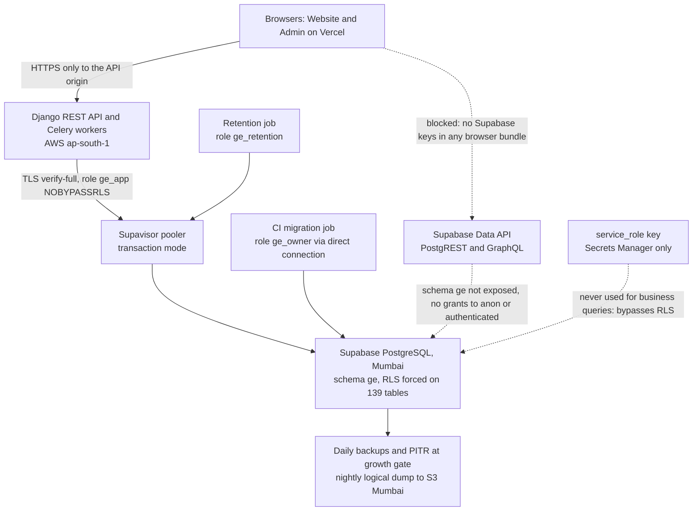
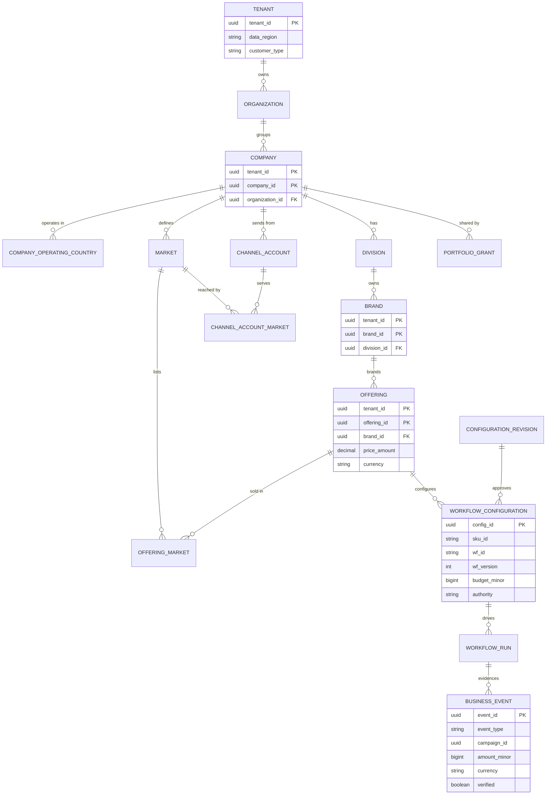

# AI Growth Engine: Employee Sales & Marketing Automation
## Application Blueprint: PART 11 (Batch 11.9b), V12 Database Schema, DDL with RLS: DDL-V12-I ("Appendix C3"), Supabase Privilege Model and Verification

| Field | Value |
|---|---|
| Document | Part 11, Batch 11.9b · Enhancements for FSD V12 chapter 26, Appendix C and Appendix C2 (Group R8, letter I) |
| Version | 1.0 · 28 Nov 2026 |
| Baseline | Part 11.9a (material, coverage, register, catalogue reconciliation); Part 3.3 §3.3.5–§3.3.11; Part 3.6a/b; Part 4.1; Part 9.9; Part 11.5a (DEC-581, ADR-140, ADR-154); DEC-421 (Supabase PostgreSQL, Mumbai), DEC-422 |
| Roles applied | Principal Data Architect / PostgreSQL DBA (lead), CISO, Chief Data Officer, Threat-modelling lead, QA Lead |
| Evidence | `assembly/v12/i_ddl/appendix_c3_group_i.sql` (1,877 lines, the complete DDL-V12-I), `run_all.sh`, `c3_tests.out` (50 PASS, 0 FAIL), `c3_v12_regression.out` (20/20 customer tests), `c3_policy_register.csv` (139 tables), `c3_index_register.csv` (333 indexes) |

---

## 11.9.5 Enhancements (part 1: database)

### 11.9.5.1 What DDL-V12-I does, in one table

| Section | Closes | Summary | Decision / ADR |
|---|---|---|---|
| C3-01 Roles and Data API closure | F6, CONFLICT-906 | Eight roles without `BYPASSRLS`; every privilege revoked from `PUBLIC`, `anon`, `authenticated`; default privileges revoked; only `ge_*` roles get schema usage | DEC-663, ADR-212 |
| C3-02 Context functions | F1, CONFLICT-909 | `app_tenant()` raises `42501` when the tenant context is missing (V12 DB-T2 semantics); `app_company_ids()`, `app_write_company()`, `app_actor_id()`, `app_actor_kind()`, `app_portfolio_id()` fail to empty/NULL | DEC-662, ADR-210 |
| C3-03 Scope integrity | F3, F5 | NOT NULL scope keys; tenant-pinned composite FKs and PKs; company carried on steps, effects, outbox and audit; inbox keyed by provider account | DEC-662 |
| C3-04 Vocabularies and value rules | F8, F10 | 80 CHECK constraints: statuses, types, ISO codes, hash lengths, lifetimes, 7-day export link, Tier 2 data classes, AI trace completeness | DEC-661, DEC-664 |
| C3-05 Residency guard | ENT-DAT-03 | Region-pinned database; immutable `data_region` | DEC-667 (EU activation pending, CONFLICT-832) |
| C3-06 Separation of duties | F7 | SoD on INSERT **and** UPDATE; user-level SoD across roles; no self-granted roles | DEC-669 |
| C3-07 Append-only and tamper evidence | F7, SEC-06 | `fn_forbid_mutation()`; hash-chained `fn_append_audit()` + `fn_verify_audit_chain()`; forward-only effect transitions | DEC-668 |
| C3-08 Breach clocks | ch31 V8 | CERT-In 6 h, GDPR 72 h, DPDP Board 72 h (verify) enforced on notification deadlines | DEC-670 |
| C3-09 Crypto-shredding | ENT-DAT-02 | Per-tenant DEKs wrapped by platform or customer KEK; revocation destroys wrapped DEKs | DEC-671, ADR-213 |
| C3-10 Domain schema registry | F8, DB-V2-ARTIFACT | Registry + trigger validating schema reference, status vocabulary, required payload keys, payload size and optimistic version | DEC-661, ADR-211 |
| C3-11 V6 hierarchy and configuration | MT-09/10/11/18/33 | Company-pinned keys for division → brand → offering; market, offering-market, channel-account-market, configuration revision, workflow configuration, business event | DEC-660, DEC-672 |
| C3-12 Analytics and usage tables | ch29, ch26 V5/V4 | Metric definition, versioned aggregates, experiment, feedback case, SLI sample, customer value, journey event, domain record version, usage reservation | DEC-672, ADR-214 |
| C3-13 Generated: grants, RLS, indexes, registry triggers | F1–F4 | 410 policies on 139 tables, 333 indexes, 89 validation triggers | DEC-662, DEC-677 |

### 11.9.5.2 Supabase PostgreSQL (Mumbai) operating model (DEC-421, DEC-663, ADR-212)

DEC-421 keeps the database on **Supabase Pro in the Mumbai region**, used **only by the Django API and Celery workers** (Supabase Auth not used; browsers never reach Supabase). Supabase exposes extra surfaces that a generic PostgreSQL design does not have. The controls below close them. *All Supabase product facts (pooler ports and modes, Data API settings, extension list, PostgreSQL major version, PITR, read replicas, network restrictions) must be verified at time of implementation (as of 27 Nov 2026).* [RECOMMENDATION-919]



| # | Control | Specification | Verified by |
|---|---|---|---|
| SB-01 | Business schema not exposed | All business tables live in schema `ge` (reference run used `public` only to stack on Appendix C). `ge` is **not** in the Data API exposed-schemas list; the Data API is disabled for the project if the feature allows (verify). Defence in depth: `REVOKE ALL … FROM PUBLIC, anon, authenticated` and revoked default privileges (C3-01) | TC-V12-I-025 (0 privileges for `anon`/`authenticated`) |
| SB-02 | No RLS bypass in the application path | Django and Celery connect as **`ge_app` / `ge_worker`** (NOLOGIN in the reference run, LOGIN with a Secrets-Manager password in production), created by SQL with `NOBYPASSRLS`. The `postgres` role and the `service_role` JWT are never used by application code. `service_role` bypasses RLS in Supabase, so the DEC-421 phrase "service key held server-side" is read as "kept server-side for Storage/administration only, never for business queries" | CI check: connection user ≠ `postgres`; TC-V12-I-027 |
| SB-03 | Pooler-safe context | Supavisor **transaction mode**. Every request/job opens one transaction (`ATOMIC_REQUESTS` / task base class), first statement `set_config('app.tenant_id', $1, true)`, `app.company_ids`, `app.write_company_id`, `app.actor_id`, `app.actor_kind` (all `is_local = true`). Server-side prepared statements off (psycopg `prepare_threshold=None`) and `DISABLE_SERVER_SIDE_CURSORS = True` because transaction pooling does not keep session state (verify driver settings) | Pooled-reuse test (Part 11.5a TC-V12-E-005) + TC-V12-I-003 |
| SB-04 | Role-name alignment | `ge_app` (Part 3.3 §3.3.5.10) = `app_user` (V12 Appendix C header) = `app_rw` (Part 11.5a): one role, three names; the blueprint name `ge_app` is used in DDL | Report §11.9.8.2 |
| SB-05 | Network | Supabase network restrictions allow only the AWS NAT egress IPs of the API/worker subnets and the CI runner; SSL enforcement on (verify availability on the plan) | Infra policy check (Part 4.3) |
| SB-06 | Extensions | `pgcrypto`, `vector` (pgvector, HNSW, `halfvec`), `pg_trgm`, `btree_gin`, `pg_stat_statements`; `pg_partman` if available, otherwise partitions are created by a `pg_cron` job (verify each on Supabase) | Migration step 1 |
| SB-07 | Version | Appendix C was tested on 16.15; Part 3.3 targeted 17. Use the major version Supabase offers for new projects (verify) and run the full `run_all.sh` suite on it before Sprint 1 | Sprint 0 gate |
| SB-08 | Backups | Daily backups (included), PITR added at the growth gate (DEC-421/DEC-422; Part 11.5a CONFLICT-833 on the 15-minute RPO) and the nightly logical dump to S3 Mumbai | Part 11.5a DR runbook |
| SB-09 | Secrets | Database passwords and any Supabase keys only in AWS Secrets Manager; rotation 90 days (Part 4.1 §4.6.2); never in Vercel environment variables (Part 11.5a) | Secret scan KPI-04 (V12) |
| SB-10 | Logs | Supabase log drain excludes statement parameters; `log_min_duration_statement` with parameter redaction; logs stay in India (CERT-In 180 days, CJ-IN-09) | Part 4.1 §4.10.2 |

### 11.9.5.3 Tenancy, configuration and attribution model (V6, MT-09/10/11/18/27/33)



**Key rule (MT-09/10/18).** Every association carries `(tenant_id, company_id)` and references both parents through **company-pinned composite keys** `(tenant_id, company_id, <id>)`. A brand cannot belong to another company's division, an offering cannot use another company's brand and an offering–market pair cannot span companies, even if application code is wrong (TC-V12-I-030). Names are unique on a normalized form within their scope (MT-33) and renames never change IDs.

### 11.9.5.4 Context variables and RLS policy templates (DEC-662, ADR-210)

| V12 variable (Appendix C header) | Blueprint variable (Part 3.3 §3.3.9.1) | Set from | Helper |
|---|---|---|---|
| `app.tenant_id` | `app.tenant_id` | Membership-derived claim | `app_tenant()` – raises `42501` when missing |
| `app.company_ids` | `app.startup_ids` | Membership ∩ requested scope | `app_company_ids()` – empty array when missing |
| (new) `app.write_company_id` | `app.write_startup_id` | Exactly one selected company; empty in portfolio mode | `app_write_company()` – NULL when missing |
| (new) `app.actor_id`, `app.actor_kind` | same | Authenticated principal | `app_actor_id()`, `app_actor_kind()` |
| (new) `app.portfolio_id` | (Owner Portfolio scope) | Portfolio grant in force | `app_portfolio_id()` |
| (new) `app.deployment_region` | — | `ALTER DATABASE … SET` per regional database | Residency trigger |
| `app.retention_run_id` | same | Retention job only | Unlocks purge in `fn_forbid_mutation()` |

Policies always wrap helpers in a scalar sub-select, `(SELECT app_tenant())`, so PostgreSQL evaluates them once per statement (initPlan) instead of once per row.

| Template | Predicate (SELECT) | INSERT / UPDATE `WITH CHECK` | DELETE | Applies to |
|---|---|---|---|---|
| **P-CO** | `tenant_id = (SELECT app_tenant()) AND company_id = ANY ((SELECT app_company_ids())::uuid[])` | `tenant_id = (SELECT app_tenant()) AND company_id = (SELECT app_write_company())` | none | company-scoped tables (NOT NULL `company_id`) |
| **P-CO-NULLABLE** | as P-CO `OR company_id IS NULL` | as P-CO, or `company_id IS NULL AND app_actor_kind() = 'service'` | none | tenant-wide rows allowed (`ai_usage_event`, `outbox`, `audit_event` read side) |
| **P-TEN** | `tenant_id = (SELECT app_tenant())` | same | none | tenant-scoped tables without company |
| **P-TEN-SELF** | own tenant row only | none (provisioning through `ge_owner` function) | none | `tenant` |
| **P-PORTFOLIO** | tenant AND (company in scope OR `portfolio_id = app_portfolio_id()`) AND not revoked AND not expired | write company + `actor_kind = 'internal'` | none | `portfolio_grant` |
| **P-JOURNEY** | subscriber rows by tenant for `ge_app`; operator rows only for `ge_readonly` | subscriber by tenant; operator rows only from `service` | none | `journey_event` |
| **P-TEN + P-PLATFORM** | tenant rows for app roles; all rows for `ge_platform_sec` | same split | none | `incident` |
| Service insert | P-TEN, INSERT only when `actor_kind = 'service'` | | none | `inbox` |
| No RLS (grants only) | — | writes only by `ge_owner` migrations or `ge_platform_sec` | — | 16 platform tables: `ai_model`, `prompt_version`, `eval_suite`, `eval_run`, `fx_rate`, `jurisdiction_pack`, `jurisdiction_rule`, `locale_bundle`, `sod_conflict`, `tax_rule`, `ops_incident`, `incident_notification`, `security_finding`, `domain_schema_registry`, `metric_definition`, `sli_sample` |

```sql
-- P-CO, expanded for one table (generated identically for every company-scoped table)
ALTER TABLE workflow_run ENABLE ROW LEVEL SECURITY; ALTER TABLE workflow_run FORCE ROW LEVEL SECURITY;
CREATE POLICY rls_workflow_run__select ON workflow_run FOR SELECT
  USING (tenant_id = (SELECT app_tenant()) AND company_id = ANY ((SELECT app_company_ids())::uuid[]));
CREATE POLICY rls_workflow_run__insert ON workflow_run FOR INSERT
  WITH CHECK (tenant_id = (SELECT app_tenant()) AND company_id = (SELECT app_write_company()));
CREATE POLICY rls_workflow_run__update ON workflow_run FOR UPDATE
  USING (tenant_id = (SELECT app_tenant()) AND company_id = (SELECT app_write_company()))
  WITH CHECK (tenant_id = (SELECT app_tenant()) AND company_id = (SELECT app_write_company()));
-- no DELETE policy: business rows are archived, never deleted by the application
```

**Policy register (generated, 139 tables, 410 policies).** Physical names follow `rls_<table>__<verb>` (Part 3.3 §3.3.5.8).

{{policy_register}}

**Portal and support predicates** of Part 3.3 §3.3.9.4–§3.3.9.5 (object grants for `actor_kind = 'portal'`, read-only support grants) are added unchanged on the portal-visible tables; they are additional permissive SELECT policies and do not widen P-CO for internal users.

### 11.9.5.5 DDL-V12-I part 1: roles, context, integrity, vocabularies, residency, SoD, audit, breach clocks, crypto-shredding, registry (full text)

Apply after Appendix C and C2. This is the exact text executed in the verification run.

```sql
{{c3p1}}
```

### 11.9.5.6 DDL-V12-I part 2: new tables (full text)

```sql
{{c3p2}}
```

### 11.9.5.7 DDL-V12-I part 3 (C3-13, generated): grants, policies, indexes, validation triggers

`gen_c3.py` reads the live catalogue after parts 1–2 and emits 1,387 static statements (kept in `appendix_c3_group_i.sql`; regenerate whenever a table is added, and the CI guards fail if it is not). Rules:

| Rule | Generated statements |
|---|---|
| Grants | Platform tables: `SELECT` to `ge_app, ge_worker, ge_readonly` (security findings only to `ge_platform_sec`). Append-only tables (`consent_record`, `ai_usage_event`, `business_event`, `domain_record_version`): `SELECT, INSERT`. `audit_event`: `SELECT` only (insert through `fn_append_audit()`). All other tenant tables: `SELECT, INSERT, UPDATE` (no `DELETE`). `ge_readonly`: `SELECT` except secret-bearing tables (`api_key`, `scim_token`, `tenant_data_key`, `identity_provider`, `tenant_key_config`) |
| RLS | Drop the 120 V12 `<table>_tenant` policies; enable and force RLS on every table with `tenant_id`; create template policies (§11.9.5.4) |
| Indexes | One B-tree per FK without a supporting index (IX-R1, 110); V5 common index `(tenant_id, company_id, status, updated_at DESC)` and `(tenant_id, company_id, schema_ref)` per domain table (178); GIN on `evidence_refs` for 8 evidence-heavy tables; 22 query-specific indexes |
| Validation | `CREATE TRIGGER trg_<table>_validate BEFORE INSERT OR UPDATE … EXECUTE FUNCTION fn_validate_domain_row()` on the 89 domain tables |

**Index register (333 generated indexes; new-table keys and unique indexes come from parts 1–2).**

{{index_register}}

Indexes on populated production tables are created with `CREATE INDEX CONCURRENTLY` in their own migration (Part 3.3 IX-R6); the reference run creates them inline because tables are empty.

### 11.9.5.8 Vector retrieval on Supabase (GAP-916)

```sql
-- Applied once the embedding model is approved (V12-ENG DEC-042; Part 3.3 GAP-111). Dimension pinned per model.
ALTER TABLE growth_embedding ADD COLUMN embedding halfvec(1024), ADD COLUMN model_id text, ADD COLUMN chunk_id uuid;
ALTER TABLE growth_embedding ADD CONSTRAINT growth_embedding_model_ck CHECK (embedding IS NULL OR model_id IS NOT NULL);
CREATE UNIQUE INDEX ux_growth_embedding__chunk_model ON growth_embedding (tenant_id, company_id, chunk_id, model_id);
CREATE INDEX ixv_growth_embedding__hnsw ON growth_embedding USING hnsw (embedding halfvec_cosine_ops) WITH (m = 16, ef_construction = 64);
-- query: SET LOCAL hnsw.ef_search = 100; SET LOCAL hnsw.iterative_scan = relaxed_order;  (pgvector >= 0.8, verify on Supabase)
```

RLS (P-CO) applies to the vector table; retrieval also filters `tenant_id`, `company_id` and data class explicitly; no embeddings for Restricted chunks or personal contact data (Part 3.3 §3.3.8.4). Not executed in the reference run because the scratch cluster has no pgvector, exactly as in the customer's own test.

### 11.9.5.9 Partitioning, retention and volume for the V12 tables

| Table | Growth driver (PERF-02 growth profile) | Partitioning | Retention class (Part 3.3 §3.3.11) | Purge path |
|---|---|---|---|---|
| `audit_event` | 100k actions/day × ~3 audit rows ≈ 110 M rows/year | RANGE monthly on `occurred_at` (from Day 1; BRIN per partition) | AUD (7 years; legal hold) | Detach + archive to S3 Object Lock; never row deletes |
| `ai_usage_event` | ≈ 1 call per AI step; 1–3 M rows/year | RANGE monthly at > 50 M rows (Part 3.3 trigger) | FIN 8 years (aggregates); raw 24 months | `ge_retention` with `app.retention_run_id` |
| `business_event` | 10k–100k business events/day upper bound | RANGE quarterly when > 20 GB | BUS; pseudonymize after MKT expiry | Same |
| `webhook_delivery` | Events × endpoints × attempts (≤ 6) | RANGE monthly | OPS 90 days | Drop partitions |
| `inbox`, `outbox` | Provider callbacks; dispatched events | Not partitioned; purge processed rows | OPS 30–90 days | Purge job |
| `journey_event` | Website visits with analytics consent | RANGE monthly | MKT 13 months then aggregate only | Drop partitions |
| `metric_aggregate` | metrics × companies × periods × dimensions | Not partitioned Year 1 | BUS | Superseded versions kept 24 months |
| 89 domain tables | per workflow | Not partitioned Year 1; list-partition by tenant if a tenant exceeds 20 GB | per `domain_schema_registry.retention_class` | Registry-driven purge |

Partition maintenance uses `pg_partman` if Supabase offers it, otherwise a `pg_cron` job creates the next three monthly partitions (verify availability, as of 27 Nov 2026). The parent keeps the RLS policies; PostgreSQL applies the parent's policies to all partitions accessed through the parent.

### 11.9.5.10 Migration and performance controls (ST-12, GC-05, MT-36)

| Step | Control |
|---|---|
| 1 | Migration approval gate MT-36: data architect + security lead sign the DDL diff; `run_all.sh` green on the target major version |
| 2 | Order: extensions and roles → tenant root → organization/company/division/brand → reference and platform tables → governance → business and domain tables → deferred cyclic FKs → RLS policies and triggers → indexes (`CONCURRENTLY`) → views (Part 3.3 §3.3.5.11 extended) |
| 3 | **Expand / migrate / contract** (ST-12): add nullable columns and new tables; dual-write in application; backfill in batches of ≤ 5,000 rows with `lock_timeout = 5s` and `statement_timeout = 60s`; switch reads; enforce NOT NULL with `NOT VALID` + `VALIDATE CONSTRAINT`; drop old columns one release later. Old and new workers run together against the mixed-version fixture (OPT-TC-ST-12) |
| 4 | Single migration path chosen by Part 11.5a ADR-154 (Django migrations against the direct connection, not the pooler); RLS/trigger SQL lives in `RunSQL` migrations generated from `gen_c3.py` |
| 5 | GC-05 performance: `pg_stat_statements` top-20 queries reviewed weekly; `EXPLAIN (ANALYZE, BUFFERS)` with RLS on in CI for the top 20 list/dashboard queries; every policy column indexed; pool reuse test (no context leak) |
| 6 | CI guards (fail the build): tables with `tenant_id` lacking RLS + FORCE (TC-V12-I-027); tenant tables without a SELECT policy (TC-V12-I-027b); FKs without a supporting index (TC-V12-I-028); grants to `anon`/`authenticated` (TC-V12-I-025) |

### 11.9.5.11 Verification evidence (executed on PostgreSQL 16.15, 28 Nov 2026)

| Test | Requirement | Assertion | Result |
|---|---|---|---|
{{tc_rows}}
| TC-V12-I-032 | DB-T1…T9, C2-T1…T11 | All 20 customer tests re-run on the C3 build as `ge_app` with tenant **and** company context | **PASS** (20/20; `c3_v12_regression.out`) |
| TC-V12-I-033 | `reference_schema_smoke.sql` | Initial reservation succeeds; overspend, foreign scope and duplicate provider receipt rejected (blueprint equivalents `ai_budget`, `com_payment`) | Adopted (run in Sprint 0 against the Django schema) |

```gherkin
Feature: Company-level isolation inside one tenant (TC-V12-I-001, TC-V12-I-002)
  Background:
    Given tenant "A" owns companies "C1" and "C3"
    And each company has one workflow run

  Scenario: A single-company session sees only its company
    Given the session context is tenant "A", companies ["C1"], write company "C1"
    When the API lists workflow runs
    Then exactly 1 run is returned
    And inserting a run for company "C3" fails with SQLSTATE 42501

  Scenario: Portfolio mode reads several companies but cannot write
    Given the session context is tenant "A", companies ["C1","C3"], no write company
    When the API lists workflow runs
    Then 2 runs are returned
    And any insert fails with SQLSTATE 42501

Feature: Fail closed without context (TC-V12-I-003, DB-T2)
  Scenario: Missing tenant context
    Given a pooled connection where app.tenant_id was never set in this transaction
    When any tenant-scoped table is queried
    Then the query fails with SQLSTATE 42501 "tenant context missing"

Feature: Tamper-evident audit (TC-V12-I-007)
  Scenario: Audit rows cannot be changed and the chain verifies
    Given two audit events appended through fn_append_audit
    Then fn_verify_audit_chain returns ok for every row
    And UPDATE or DELETE on audit_event by ge_app is denied
    And a direct INSERT by ge_app is denied

Feature: Residency (TC-V12-I-011, TC-V12-I-012)
  Scenario: EU tenant written into the India database
    Given the database has app.deployment_region = "IN"
    When a tenant with data_region "EU" is inserted
    Then the insert fails with "cross-region write rejected"
  Scenario: Region change after onboarding
    When an existing tenant's data_region is updated
    Then the update fails with "data_region is fixed at onboarding (CJ-R09)"
```

### 11.9.5.12 Functional requirements (database and platform data)

| FR | Requirement | Source | Release (V12 phase → wave) | Tests |
|---|---|---|---|---|
| FR-V12-I-001 | Adopt Appendix C/C2 table names as canonical logical names; implement them through the physical mapping of Part 11.9a §11.9.4 with blueprint prefixes and `startup_id` = `company_id` (DEC-581) | ch26; App. C/C2 | R1 → Release 1 (W0–W1) | TC-V12-I-032 |
| FR-V12-I-002 | Database privilege model for Supabase: schema `ge` not exposed, no grants to `anon`/`authenticated`/`PUBLIC`, application roles without `BYPASSRLS`, `service_role` never used for business queries, Supavisor transaction mode with transaction-local context | SEC rule (ch31 V5), App. C header, DEC-421 | Release 1 (W0) | TC-V12-I-025, TC-V12-E-005 |
| FR-V12-I-003 | Command-split tenant **and company** RLS on every table with `tenant_id`; portfolio sessions read-only | SEC-02, MT-01, MT-09 | Release 1 (W0) | TC-V12-I-001, 002, 027 |
| FR-V12-I-004 | Missing tenant context raises `42501`; missing company scope returns zero rows | DB-T2 | Release 1 | TC-V12-I-003 |
| FR-V12-I-005 | Tenant-pinned composite keys for all tenant-scoped parent/child pairs; no global uniqueness on tenant data except opaque random identifiers and platform invoice numbers | DB-T1, C2 | Release 1 | TC-V12-I-004, 013, 030 |
| FR-V12-I-006 | RLS and NOT NULL scope keys on `tenant`, `inbox`, `incident`, `portfolio_grant`, `outbox` | App. C | Release 1 | TC-V12-I-008, 009, 010 |
| FR-V12-I-007 | Allowed-value CHECKs for every status/type column (C3-04) and registry vocabularies for domain tables | App. C | Release 1 | TC-V12-I-016 |
| FR-V12-I-008 | SoD enforced on role build (insert/update) and on role assignment per user; no self-granted roles | ENT-ACC-02, C2-T1 | Release 1 | TC-V12-I-005, 006 |
| FR-V12-I-009 | Append-only audit with per-tenant hash chain, insert only through `fn_append_audit()`; append-only consent, usage, evaluation and business events | SEC-06 | Release 1 | TC-V12-I-007, 017d |
| FR-V12-I-010 | Tenancy hierarchy organization → company → division → brand → offering, market and the association tables with company-pinned keys | MT-09/10/11/18/33 | Release 1 (W1) | TC-V12-I-030 |
| FR-V12-I-011 | Domain schema registry and write-time validation of `schema_ref`, status, required payload keys, size and optimistic version on the 89 domain tables | App. C domain shape; ch26 V5 fields | Release 1 (W1) | TC-V12-I-016 |
| FR-V12-I-012 | Index policy: every FK supported; V5 common scope index; query-specific partial/BRIN/GIN indexes; CI guard | GC-05, App. C | Release 1 | TC-V12-I-028 |
| FR-V12-I-013 | Region-pinned database; tenant region immutable; cross-region write rejected | ENT-DAT-03, CJ-R09 | Release 1 (IN); EU pending Founder | TC-V12-I-011, 012 |
| FR-V12-I-014 | Breach notification deadlines validated in the database | ch31 V8 | Release 1 | TC-V12-I-014 |
| FR-V12-I-015 | Effect ledger: preflight ALLOW, forward-only transitions, no delete, company-pinned run | DB-T6, DB-V2-EFFECT | Release 1 | TC-V12-I-013 |
| FR-V12-I-016 | Vector column and HNSW index for retrieval once the embedding model is approved | V12-ENG DEC-042 | Release 1 (W1 gate) | Retrieval eval (Part 6.4) |
| FR-V12-I-017 | Money stored as integer minor units with currency; unit prices, quantities, rates as exact numeric | ch26 V5 rule | Release 1 | C2-T8, TC-V12-I-017a |
| FR-V12-I-018 | FX rates: ISO codes, base ≠ quote, positive rate, unique approved version | V6 FXRate | Release 2 | C3-04 checks |
| FR-V12-I-019 | API keys and SCIM tokens stored as SHA-256 hashes, unique prefix and hash, lifetime ≤ 397 days, revocable | ENT-API-01, C2-T9 | R1/R2 → Release 1/2 | TC-V12-I-021 |
| FR-V12-I-020 | Full tenant export (JSON Lines, CSV, Parquet) with manifest hash, second approver and link ≤ 7 days | ENT-DAT-01 | Release 1 | C2-T2, TC-V12-I-020 |
| FR-V12-I-021 | Envelope encryption with per-tenant DEKs; platform KEK (AWS KMS Mumbai) or customer KEK (AWS KMS, Azure Key Vault, GCP KMS); rotation 90/180/365 days; revocation crypto-shreds | ENT-DAT-02 | R3 → W6 (proposal, §11.9c cost) | TC-V12-I-015 |
| FR-V12-I-022 | Sandbox environments with synthetic data only; promotion as a reviewed, immutable configuration revision | ENT-DAT-04/05 | R2 → Release 2 | C2-T3, C2-T5 |
| FR-V12-I-023 | Workflow configuration bound to offering, market, account, SKU and workflow version under an approved configuration revision; one active configuration per scope | V6 WorkflowConfiguration | Release 1 | TC-V12-I-024 |
| FR-V12-I-024 | Webhook endpoints verified before activation; deliveries unique per endpoint/event/attempt (1–6) | C2 | Release 2 | C3-04 checks |
| FR-V12-I-025 | Audit sinks (HTTPS, syslog-TLS, object storage; JSON or CEF; 1/3/7-year retention) fed from the audit chain with redacted payloads | C2 `audit_sink` | R2 → Release 2 | Integration test (Part 6) |
| FR-V12-I-026 | Reference-data governance for `locale_bundle`, `tax_rule`, `jurisdiction_pack/rule`, `ai_model`, `eval_suite`: platform-only writes, approval columns | C, C2 | Release 1 | C3-04 checks |
| FR-V12-I-030 | Analytics and usage tables of §11.9.5.6 (`sli_sample`, `customer_value`, `feedback_case`, `journey_event`, `metric_definition`, `metric_aggregate`, `experiment`) | ch26 V5, ch29 | Release 2 | TC-V12-I-018, 019, 029, 031 |
| FR-V12-I-031 | `domain_record_version` immutable snapshots and `usage_reservation` atomic reservation | ch26 V4 | Release 1 | TC-V12-I-033 |

### 11.9.5.13 User stories (database)

| Story | As a … I want … so that … | Acceptance criteria (summary) | FR |
|---|---|---|---|
| US-01-YI01 | As the platform security lead I want application roles that cannot bypass RLS and a closed Supabase Data API so that no tenant row is reachable outside the Django API | AC-1 `anon`/`authenticated` hold 0 table privileges; AC-2 application connection user is not `postgres` and has `rolbypassrls = false`; AC-3 CI fails if either regresses | FR-V12-I-002 |
| US-01-YI02 | As an Owner Portfolio executive I want to read several companies but write only in one selected company so that portfolio views never mutate data | AC-1 multi-company context returns rows of every permitted company; AC-2 any write without a single write company fails `42501`; AC-3 a company outside the grant returns 0 rows | FR-V12-I-003 |
| US-01-YI03 | As a tenant administrator I want brands, offerings and markets bound to my company so that another company in my group cannot reuse them by mistake | AC-1 offering with a brand of another company is rejected (23503); AC-2 duplicate normalized names in one scope are rejected; AC-3 rename keeps IDs | FR-V12-I-010 |
| US-03-YI01 | As the DPO I want breach deadlines validated when notifications are planned so that CERT-In 6-hour and GDPR/DPDP 72-hour clocks cannot be mis-entered | AC-1 CERT-In deadline > aware + 6 h rejected; AC-2 EU/UK > 72 h rejected; AC-3 overdue open notifications listed by `ixp_incident_notification__due` | FR-V12-I-014 |
| US-03-YI02 | As the DPO I want DSAR completion blocked until identity is verified and evidence attached | AC-1 status Completed without `identity_verified_at` rejected; AC-2 legal hold status requires `legal_hold = true` | FR-V12-I-006, 007 |
| US-04-YI01 | As the AI governance lead I want every AI step to record model and prompt version and Tier 2 models restricted to Public/Internal-non-personal data | AC-1 `ai_inference` without prompt version rejected; AC-2 Tier 2 model registered with Confidential data class rejected | FR-V12-I-007 |
| US-18-YI01 | As a workflow owner I want effects to move forward only and never be deleted so that reconciliation is trustworthy | AC-1 Intended→Confirmed skip rejected; AC-2 delete rejected; AC-3 effect cannot reference a run of another company | FR-V12-I-015 |
| US-18-YI02 | As a configuration owner I want workflow configurations tied to an approved revision with a different reviewer | AC-1 reviewer = requester rejected; AC-2 SKU/workflow mismatch rejected; AC-3 only one active configuration per offering/market/workflow | FR-V12-I-023 |
| US-20-YI01 | As a tenant administrator I want a full export with a second approver and a link valid for at most 7 days | AC-1 requester approval rejected (C2-T2); AC-2 Ready requires approver, manifest hash and expiry; AC-3 expiry > 7 days rejected | FR-V12-I-020 |
| US-20-YI02 | As a Scale-plan tenant I want to bring my own KMS key and have my data made unreadable if I revoke it | AC-1 customer mode requires provider and key reference; AC-2 revocation destroys all wrapped DEKs of the tenant; AC-3 reads of encrypted fields then fail closed and the outbox holds | FR-V12-I-021 |
| US-20-YI03 | As a developer of a tenant I want API keys shown once and stored only as a hash | AC-1 no plaintext key column (C2-T9); AC-2 lifetime > 397 days rejected; AC-3 revoked keys excluded by `ixp_api_key__live` | FR-V12-I-019 |
| US-21-YI01 | As the release manager I want CI guards on RLS coverage, FK indexes and Data API grants so that schema regressions block a release | AC-1 any table with `tenant_id` lacking RLS+FORCE fails the build; AC-2 any FK without index fails; AC-3 any grant to `anon` fails | FR-V12-I-012 |

---

### Quality gate: Batch 11.9b

| # | Item | Result | Notes |
|---|---|---|---|
| 1 | Every requirement traced to a source | Pass | FR table cites V12 IDs (ENT-DAT, DB-T, C2-T, MT, SEC) and decisions |
| 2 | Assumptions, gaps, conflicts tagged and logged | Pass | GAP-912…916, CONFLICT-906/908/909, RECOMMENDATION-919 |
| 3 | IDs unique and consistent | Pass | FR-V12-I-001…031, US-xx-YI01…, TC-V12-I-001…033 within allocation |
| 4 | No story lacks AC; no requirement lacks a test | Pass | Each FR has a TC or named check; 50 assertions executed |
| 5 | Negative, edge, security, accessibility | Pass | Negative-first DB suite; accessibility N/A for DDL |
| 6 | Agents: guardrail, fallback, KPI, cost | N/A | No agent |
| 7 | Time-sensitive facts flagged | Pass | Supabase pooler, Data API, extensions, versions, PITR flagged "verify (as of 27 Nov 2026)" |
| 8 | No restricted data to free tiers | Pass | `ai_model_t2_data_ck` (TC-V12-I-022) |
| 9 | Consistent with earlier parts | Pass | DEC-581 physical naming kept; Part 3.3 conventions reused; Part 11.5a ADR-154 migration path reused |

**Status: Part 11 Batch 11.9b complete. DDL-V12-I applied on PostgreSQL 16.15: 155 tables, 1,579 columns, 536 constraints, 410 RLS policies on 139 forced-RLS tables, 516 indexes, 105 triggers; 50/50 new assertions and 20/20 customer tests pass. Continue with Part 11.9c.**
