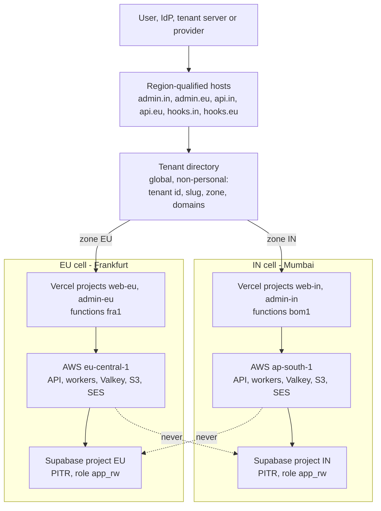
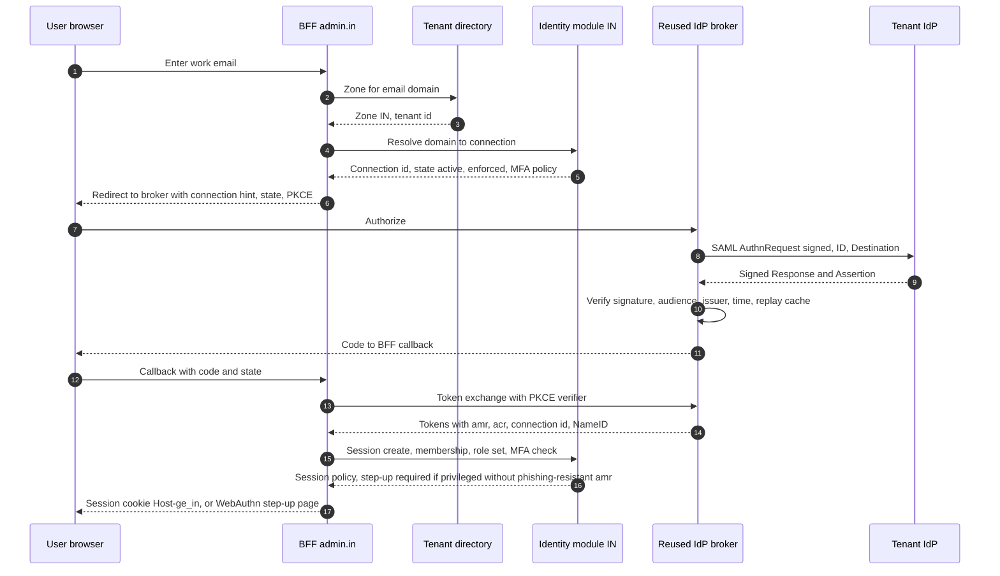
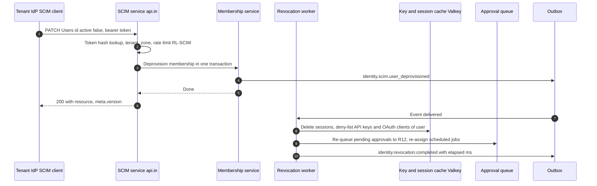
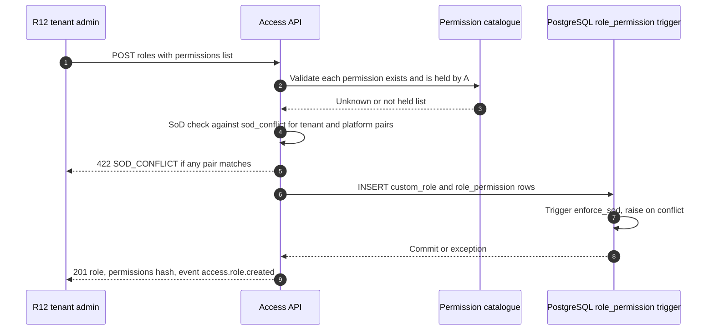

---

## 11.19.5 Enhancements (part 1: shared foundation and capabilities C1–C4)

### 11.19.5.0 Shared foundation: residency cells, tenant directory and conventions

Every capability in this part runs in **residency cells** (DEC-772, DEC-776). A cell is a complete copy of the data plane in one residency zone: Vercel projects pinned to the zone, AWS API/worker/Valkey/S3/SES in the zone, one Supabase project in the zone, the zone's Secrets Manager and KMS keys. Release 1 runs the **IN cell** (Mumbai, `ap-south-1`); the **EU cell** (Frankfurt, `eu-central-1`) is provisioned from the same IaC when the first EU tenant is contracted (DEC-772). No personal data, credential, audit row or backup is ever written to a cell outside the tenant's zone (CJ-TC-09, blocking in both directions).



**Tenant directory (DEC-895).** A small global service holds only non-personal routing data: `tenant_id`, `slug`, `zone` (IN or EU), verified domain names, cell endpoints and status. It is replicated read-only to both cells (it contains no personal data, so replication does not breach residency). Every entry point resolves the zone **before** any personal data is processed: the Admin login page resolves the zone from the subdomain (`admin.in.` / `admin.eu.`) or from the email domain via HRD; the website resolves it from the custom domain; API callers use the region-qualified host printed on their credential; SCIM and webhooks are configured with the region-qualified base URL. A request that reaches the wrong cell is answered with `421 Misdirected Request` and a `Location`-free problem body (no data lookup is attempted), never proxied across zones.

| Convention | Rule in this part | Source |
|---|---|---|
| Hosts | `admin.<zone>.<platform-domain>`, `api.<zone>.<platform-domain>`, `hooks.<zone>.<platform-domain>`; legacy `admin.<platform-domain>` redirects to the zone chosen at sign-in | DEC-772, DEC-895 |
| Errors | RFC 9457 problem details with `code`, `rule_ids[]`, `correlation_id`; denials are NSE (Part 6.2a shorthand) | Part 3.2 §3.2.1.5; DEC-641 |
| Events | Part 3.2 §3.2.3.1 envelope; `data_region` added to the envelope (enum IN, EU); consumers reject events whose `data_region` differs from the cell | DEC-772 |
| Audit | Hash-chained audit per cell; anchors in the cell's S3 Object Lock bucket | ENT-ACC-03 |
| Secrets | Only `credential_ref` (Secrets Manager ARN in the tenant's zone); never in rows, logs, prompts or HTML | ENT-INT-02, SB-09 |
| Time | Stored UTC; displayed in the user's zone; IST / CET in examples | NFR-017 |
| Feature flags | Every capability has a platform flag and a tenant flag; default **off** until its activation gate passes | RECOMMENDATION-005 |

---

### 11.19.5.1 C1 Enterprise identity: SSO, verified domains, MFA and sessions, break-glass, SCIM 2.0, custom roles and SoD (DEC-784)

#### A. Design stance and decisions

The identity design of Part 11.5a §11.5.5.2 stands: the **reused AppNAI IdP (DEC-003/019) acts as the identity broker**, so the product still receives one token format with `aud=growth-engine`; the tenant's IdP connection metadata and policy live in the product; the broker performs the SAML/OIDC exchange. This part completes the design to build depth and moves SCIM and custom roles into Release 1 (DEC-881).

| # | Decision point | Choice | Why | ID |
|---|---|---|---|---|
| 1 | Federation pattern | Broker per tenant in the reused IdP (Sprint 0 identity spike **check 13**); fallback in-product SP in the BFF (pysaml2 / python3-saml for SAML, Authlib for OIDC; licences verify) behind flag `idp_broker_fallback` | One token format, one session model, no second login stack unless the broker fails | DEC-880, ADR-255, [ASSUMPTION-1080] |
| 2 | IdPs certified for Release 1 | Okta, Microsoft Entra ID, Google Workspace (V12 decision "Okta, Entra ID and Google first"), plus **generic SAML 2.0** and **generic OIDC** connections for any conformant IdP | V12 BRD 25 / FSD 40 decision row | DEC-880 |
| 3 | Connections per tenant | Up to 5 IdP connections per tenant (V12 C2 has one row per tenant; extended for mergers and contractors), each bound to ≥ 1 verified domain; one connection per domain | Real enterprises run more than one IdP | DEC-880, [CONFLICT-1091] |
| 4 | Assertion security | SAML: signed assertion **and** response accepted, `Destination`, `Audience`, `InResponseTo`, `NotOnOrAfter` (60 s skew), replay cache 10 min keyed by assertion ID; SHA-256+ only; encrypted assertions supported. OIDC: authorization code + PKCE (S256), `nonce`, `iss`, `aud`, `azp`, `exp`, `iat` (60 s skew), JWKS cached 10 min with rotation, `alg` allowlist RS256/PS256/ES256, `none` rejected | SAML/OIDC best practice; ENT-IDN-01 acceptance | ADR-255 |
| 5 | MFA | Tenant policy may only tighten the platform floor (Part 4.1 §4.3.3); IdP MFA accepted only when `amr`/`AuthnContextClassRef` proves it; privileged roles (R01, R02, R08–R12, approvers and custom roles holding any privileged permission) require phishing-resistant factors (DEC-077) — step-up through the reused IdP's WebAuthn if the IdP did not prove it | ENT-IDN-04, SEC-03 | DEC-880 |
| 6 | Sessions | Tenant `max_session_hours` 1–24, `idle_minutes` 5–120; privileged ceiling 12 h / 30 min (RECOMMENDATION-847 kept); revocation ≤ 60 s | ENT-IDN-05 | — |
| 7 | SCIM server | In-product SCIM 2.0 service provider per zone, RFC 7643/7644: `/Users`, `/Groups`, `/ServiceProviderConfig`, `/Schemas`, `/ResourceTypes`, `/Bulk` (≤ 100 operations), filtering `eq`/`co`/`sw` on `userName`, `externalId`, `emails.value`, `displayName`; PATCH per RFC 7644 §3.5.2; ETags (`meta.version`) supported | ENT-IDN-03 | DEC-881, ADR-256 |
| 8 | De-provisioning SLA | Product side ≤ 60 s after the SCIM call; **end to end ≤ 15 min** from IdP change, measured by AU-291 from the IdP's `meta.lastModified` where provided, and by the reconciliation sweep every 10 min otherwise | ENT-IDN-03 acceptance ("15 minutes (proposed)" adopted as binding) | DEC-881 |
| 9 | Group → role mapping | `scim_group_role_map` reviewed by R12; unmapped groups grant nothing; mapping changes are approved (requester ≠ approver) | Least privilege | DEC-881 |
| 10 | Custom roles and SoD | Custom roles from the generated permission catalogue (resource × action), scope tenant or company; creator cannot grant what they lack; SoD checked at save (API), at assignment (API and trigger), at SCIM group mapping, and at run time (ABAC-03); SoD matrix extended beyond V12's four pairs (§F) | ENT-ACC-01/02 | DEC-898 |
| 11 | Access recertification | Quarterly campaign by AU-292: every privileged membership and custom role confirmed by R12; not confirmed in 14 days → privileged permissions suspended (not the account) | SOC 2 CC6 evidence (DEC-775) | DEC-898 |
| 12 | Break-glass | 1–2 accounts per tenant, local credential + **hardware security key** [RECOMMENDATION-1096]; excluded from SSO enforcement and from SCIM; each use → SEV3, notification to all R12 and R10, audit; quarterly test login recorded | ENT-IDN-06 | — |

#### B. Sequence diagrams

**B1. SP-initiated SAML sign-in through the broker with HRD and step-up.**



**B2. SCIM de-provisioning to full revocation within 60 s (product side).**



**B3. Custom role save with SoD enforcement in API and database.**



#### C. Configuration

| Key | Scope | Default | Allowed values | Who may change | Effect |
|---|---|---|---|---|---|
| `sso.connections.max` | Platform | 5 | 1–10 | Platform owner (change record) | Hard limit per tenant |
| `sso.saml.clock_skew_s` | Platform | 60 | 0–120 | Platform owner | Assertion time window |
| `sso.saml.replay_cache_min` | Platform | 10 | 5–60 | Platform owner | Replay detection window |
| `sso.oidc.jwks_cache_min` | Platform | 10 | 1–60 | Platform owner | Key rotation pick-up |
| `sso.metadata.refresh_h` | Connection | 24 | 1–168 | R12 | AU-290 metadata refresh |
| `sso.cert.expiry_warn_days` | Platform | 30, 14, 7, 1 | list | Platform owner | AU-290 alerts to R12 |
| `domain.recheck_h` | Platform | 24 | 6–24 | Platform owner | TXT recheck cadence |
| `domain.loss_threshold` | Platform | 2 consecutive misses | 1–3 | Platform owner | `verification_lost` state |
| `tenant.mfa_mode` | Tenant | `required_privileged` | `required_privileged`, `required_all` (floor cannot be lowered) | R12 (step-up, second approver R12/R10) | ENT-IDN-04 |
| `tenant.max_session_hours` / `idle_minutes` | Tenant | 12 / 30 | 1–24 / 5–120; privileged ≤ 12 / ≤ 30 | R12 | ENT-IDN-05 |
| `scim.enabled` | Tenant | off | on/off | R12 | Exposes the SCIM endpoint for the tenant |
| `scim.token.lifetime_days` | Tenant | 365 | 30–397 | R12 | Matches Part 11.9b `scim_token_life_ck` |
| `scim.reconcile_every_min` | Platform | 10 | 5–60 | Platform owner | AU-291 sweep |
| `scim.deprovision.sla_min` | Platform | 15 | fixed (binding) | — | AU-291 breach alert |
| `roles.custom.max` | Tenant | 50 | 1–200 | Platform owner | Role sprawl limit |
| `access.recert.cadence_days` | Tenant | 90 | 30–90 | R12 (shorter only) | AU-292 campaign |
| `breakglass.accounts` | Tenant | 1 | 1–2 | R12 + R10 | Required before enforcement |

#### D. Data model and DDL deltas (DDL-V12-R part 1, applied after DDL-V12-I)

The V12 C2 table `identity_provider` (one row per tenant) is kept for compatibility as a view over the new multi-connection table. All tables are in schema `ge`, RLS-forced, with the P-TEN policy template of Part 11.9b §11.9.5.4 (`tenant_id = ge.ctx_tenant()`).

```sql
-- DDL-V12-R-01 Identity connections (ENT-IDN-01, 02, 06; DEC-880)
CREATE TABLE ge.idp_connection (
  tenant_id        uuid NOT NULL REFERENCES ge.tenant(tenant_id),
  connection_id    uuid NOT NULL DEFAULT gen_random_uuid(),
  display_name     text NOT NULL,
  vendor           text NOT NULL CHECK (vendor IN ('okta','entra_id','google_workspace','generic_saml','generic_oidc')),
  protocol         text NOT NULL CHECK (protocol IN ('SAML 2.0','OpenID Connect')),
  issuer           text NOT NULL,                      -- SAML entityID or OIDC iss
  metadata_url     text CHECK (metadata_url ~ '^https://'),
  sso_url          text NOT NULL CHECK (sso_url ~ '^https://'),
  audience         text NOT NULL,                      -- our SP entityID / client_id, per zone
  attribute_map    jsonb NOT NULL DEFAULT '{"email":"email","given_name":"given_name","family_name":"family_name","groups":"groups"}',
  broker_ref       text,                               -- connection id inside the reused IdP broker
  state            text NOT NULL DEFAULT 'draft' CHECK (state IN ('draft','testing','active','disabled')),
  enforced         boolean NOT NULL DEFAULT false,
  last_test_ok_at  timestamptz,
  created_by       uuid NOT NULL, created_at timestamptz NOT NULL DEFAULT now(),
  version          int NOT NULL DEFAULT 1,
  PRIMARY KEY (tenant_id, connection_id),
  CHECK (NOT (vendor = 'generic_saml' AND protocol <> 'SAML 2.0')),
  CHECK (NOT (vendor = 'generic_oidc' AND protocol <> 'OpenID Connect')),
  CHECK (state = 'active' OR NOT enforced),
  CHECK (state <> 'active' OR last_test_ok_at IS NOT NULL)          -- test login before activation
);
CREATE TABLE ge.idp_certificate (
  tenant_id uuid NOT NULL, connection_id uuid NOT NULL, cert_id uuid NOT NULL DEFAULT gen_random_uuid(),
  use text NOT NULL CHECK (use IN ('signing','encryption')), pem_sha256 bytea NOT NULL, not_after timestamptz NOT NULL,
  active boolean NOT NULL DEFAULT true, PRIMARY KEY (tenant_id, cert_id),
  FOREIGN KEY (tenant_id, connection_id) REFERENCES ge.idp_connection(tenant_id, connection_id));
CREATE UNIQUE INDEX ux_idp_cert_two_active ON ge.idp_certificate (tenant_id, connection_id, use, cert_id) WHERE active;
CREATE TABLE ge.verified_domain (
  tenant_id uuid NOT NULL, domain_id uuid NOT NULL DEFAULT gen_random_uuid(),
  domain citext NOT NULL CHECK (domain ~ '^[a-z0-9.-]+\.[a-z]{2,}$'),
  txt_token text NOT NULL, state text NOT NULL DEFAULT 'pending' CHECK (state IN ('pending','verified','verification_lost','released')),
  connection_id uuid, consecutive_misses int NOT NULL DEFAULT 0, last_checked_at timestamptz, verified_at timestamptz,
  PRIMARY KEY (tenant_id, domain_id),
  FOREIGN KEY (tenant_id, connection_id) REFERENCES ge.idp_connection(tenant_id, connection_id));
CREATE UNIQUE INDEX ux_verified_domain_global ON ge.verified_domain (domain) WHERE state IN ('verified','verification_lost');  -- a domain belongs to one tenant per zone
CREATE TABLE ge.breakglass_account (
  tenant_id uuid NOT NULL, user_id uuid NOT NULL, hardware_key_registered boolean NOT NULL,
  last_test_at timestamptz, PRIMARY KEY (tenant_id, user_id), CHECK (hardware_key_registered));
-- Enforcement guard: a connection can be enforced only if one of its domains is verified and a break-glass account exists
CREATE FUNCTION ge.enforce_sso_guard() RETURNS trigger LANGUAGE plpgsql AS $$
BEGIN
  IF NEW.enforced AND NOT EXISTS (SELECT 1 FROM ge.verified_domain d WHERE d.tenant_id = NEW.tenant_id
        AND d.connection_id = NEW.connection_id AND d.state IN ('verified','verification_lost')) THEN
    RAISE EXCEPTION 'SSO_ENFORCEMENT_REQUIRES_VERIFIED_DOMAIN' USING ERRCODE = 'check_violation'; END IF;
  IF NEW.enforced AND NOT EXISTS (SELECT 1 FROM ge.breakglass_account b WHERE b.tenant_id = NEW.tenant_id) THEN
    RAISE EXCEPTION 'SSO_ENFORCEMENT_REQUIRES_BREAKGLASS' USING ERRCODE = 'check_violation'; END IF;
  RETURN NEW; END $$;
CREATE TRIGGER idp_connection_enforce_guard BEFORE INSERT OR UPDATE OF enforced ON ge.idp_connection
  FOR EACH ROW EXECUTE FUNCTION ge.enforce_sso_guard();
-- Compatibility view for the V12 C2 shape (one row per tenant: the enforced or newest active connection)
CREATE VIEW ge.identity_provider AS
  SELECT DISTINCT ON (c.tenant_id) c.tenant_id, c.protocol, c.sso_url, c.issuer, d.domain::text AS domain,
         (d.state = 'verified') AS domain_verified, (SELECT u.email FROM ge.app_user u JOIN ge.breakglass_account b USING (user_id)
          WHERE b.tenant_id = c.tenant_id LIMIT 1) AS breakglass_email, c.enforced,
         p.mfa_mode AS mfa_policy, p.max_session_hours, p.idle_minutes
  FROM ge.idp_connection c LEFT JOIN ge.verified_domain d ON d.tenant_id = c.tenant_id AND d.connection_id = c.connection_id
  JOIN ge.tenant_security_policy p ON p.tenant_id = c.tenant_id
  WHERE c.state = 'active' ORDER BY c.tenant_id, c.enforced DESC, c.created_at DESC;

-- DDL-V12-R-02 Security policy and sessions (ENT-IDN-04, 05)
CREATE TABLE ge.tenant_security_policy (
  tenant_id uuid PRIMARY KEY REFERENCES ge.tenant(tenant_id),
  mfa_mode text NOT NULL DEFAULT 'required_privileged' CHECK (mfa_mode IN ('required_privileged','required_all')),
  privileged_factor text NOT NULL DEFAULT 'phishing_resistant' CHECK (privileged_factor = 'phishing_resistant'),  -- floor DEC-077
  max_session_hours int NOT NULL DEFAULT 12 CHECK (max_session_hours BETWEEN 1 AND 24),
  idle_minutes int NOT NULL DEFAULT 30 CHECK (idle_minutes BETWEEN 5 AND 120),
  version int NOT NULL DEFAULT 1, updated_by uuid, updated_at timestamptz NOT NULL DEFAULT now());
CREATE TABLE ge.user_session (
  tenant_id uuid NOT NULL, session_id uuid NOT NULL DEFAULT gen_random_uuid(), user_id uuid NOT NULL,
  connection_id uuid, amr text[] NOT NULL DEFAULT '{}', acr text, privileged boolean NOT NULL,
  created_at timestamptz NOT NULL DEFAULT now(), last_seen_at timestamptz NOT NULL DEFAULT now(),
  expires_at timestamptz NOT NULL, revoked_at timestamptz, revoke_reason text,
  PRIMARY KEY (tenant_id, session_id));
CREATE INDEX ix_user_session_live ON ge.user_session (tenant_id, user_id) WHERE revoked_at IS NULL;

-- DDL-V12-R-03 SCIM (ENT-IDN-03; DEC-881) — extends C2 scim_token
ALTER TABLE ge.scim_token ADD COLUMN IF NOT EXISTS zone text NOT NULL DEFAULT current_setting('app.zone') CHECK (zone IN ('IN','EU'));
ALTER TABLE ge.scim_token ADD COLUMN IF NOT EXISTS last_used_at timestamptz;
CREATE TABLE ge.scim_identity (
  tenant_id uuid NOT NULL, user_id uuid NOT NULL, external_id text NOT NULL, user_name citext NOT NULL,
  active boolean NOT NULL DEFAULT true, meta_version int NOT NULL DEFAULT 1, idp_last_modified timestamptz,
  deprovisioned_at timestamptz, PRIMARY KEY (tenant_id, user_id), UNIQUE (tenant_id, external_id), UNIQUE (tenant_id, user_name));
CREATE TABLE ge.scim_group (
  tenant_id uuid NOT NULL, group_id uuid NOT NULL DEFAULT gen_random_uuid(), external_id text, display_name text NOT NULL,
  PRIMARY KEY (tenant_id, group_id), UNIQUE (tenant_id, display_name));
CREATE TABLE ge.scim_group_member (tenant_id uuid NOT NULL, group_id uuid NOT NULL, user_id uuid NOT NULL,
  PRIMARY KEY (tenant_id, group_id, user_id), FOREIGN KEY (tenant_id, group_id) REFERENCES ge.scim_group(tenant_id, group_id));
CREATE TABLE ge.scim_group_role_map (
  tenant_id uuid NOT NULL, group_id uuid NOT NULL, role_id uuid NOT NULL, company_id uuid,
  state text NOT NULL DEFAULT 'requested' CHECK (state IN ('requested','approved','blocked','retired')),
  requested_by uuid NOT NULL, approved_by uuid, CHECK (approved_by IS NULL OR approved_by <> requested_by),
  PRIMARY KEY (tenant_id, group_id, role_id));
CREATE TABLE ge.scim_deprovision_sla (
  tenant_id uuid NOT NULL, user_id uuid NOT NULL, idp_changed_at timestamptz, received_at timestamptz NOT NULL,
  revoked_at timestamptz, product_ms int GENERATED ALWAYS AS ((extract(epoch FROM revoked_at - received_at) * 1000)::int) STORED,
  end_to_end_s int GENERATED ALWAYS AS ((extract(epoch FROM revoked_at - coalesce(idp_changed_at, received_at)))::int) STORED,
  PRIMARY KEY (tenant_id, user_id, received_at));

-- DDL-V12-R-04 Custom roles and SoD (ENT-ACC-01, 02; DEC-898) — extends C2/C3
ALTER TABLE ge.custom_role ADD COLUMN IF NOT EXISTS scope text NOT NULL DEFAULT 'tenant' CHECK (scope IN ('tenant','company'));
ALTER TABLE ge.custom_role ADD COLUMN IF NOT EXISTS privileged boolean NOT NULL DEFAULT false;   -- computed by API from permission flags
ALTER TABLE ge.custom_role ADD COLUMN IF NOT EXISTS permissions_hash bytea;
ALTER TABLE ge.custom_role ADD COLUMN IF NOT EXISTS state text NOT NULL DEFAULT 'active' CHECK (state IN ('active','retired'));
CREATE TABLE ge.permission_catalogue (
  permission text PRIMARY KEY CHECK (permission ~ '^[A-Z][A-Za-z]+:[a-z_]+$'), resource text NOT NULL, action text NOT NULL,
  privileged boolean NOT NULL, consequential boolean NOT NULL, catalogue_version int NOT NULL);   -- generated from RBAC YAML, platform table
ALTER TABLE ge.sod_conflict ADD COLUMN IF NOT EXISTS source text NOT NULL DEFAULT 'V12-C2';
INSERT INTO ge.sod_conflict (permission_a, permission_b, source) VALUES
  ('Finance:verify_first','Finance:verify_second','DEC-898'), ('Billing:purchase','Billing:approve_refund','DEC-898'),
  ('Roles:edit','Roles:approve_assignment','DEC-898'), ('Mandates:request','Mandates:approve','DEC-898 + Part 11.17'),
  ('Connectors:request_activation','Connectors:approve_activation','DEC-898'), ('Models:propose','Models:approve','DEC-898 + DEC-890'),
  ('Benchmarks:enrol','Benchmarks:approve_release','DEC-898 + DEC-893'), ('ApiKeys:create_unmasked_scope','ApiKeys:approve_unmasked_scope','DEC-898')
ON CONFLICT DO NOTHING;
CREATE TABLE ge.access_recert_campaign (
  tenant_id uuid NOT NULL, campaign_id uuid NOT NULL DEFAULT gen_random_uuid(), opened_at timestamptz NOT NULL, due_at timestamptz NOT NULL,
  state text NOT NULL CHECK (state IN ('open','closed','escalated')), PRIMARY KEY (tenant_id, campaign_id));
CREATE TABLE ge.access_recert_item (
  tenant_id uuid NOT NULL, campaign_id uuid NOT NULL, user_id uuid NOT NULL, role_id uuid NOT NULL,
  decision text CHECK (decision IN ('keep','remove')), decided_by uuid, decided_at timestamptz,
  CHECK (decided_by IS NULL OR decided_by <> user_id),                -- nobody recertifies themself
  PRIMARY KEY (tenant_id, campaign_id, user_id, role_id));
```

Grants and policies: `app_rw` receives `SELECT, INSERT, UPDATE` on the identity tables (no `DELETE`; retire by state), `SELECT` on `permission_catalogue` and `sod_conflict` (platform tables, writes only by `app_owner` migrations); `app_worker` additionally `UPDATE` on `user_session` (revocation) and `scim_deprovision_sla`. RLS P-TEN on every tenant table above. The V12 test C2-T1 (SoD trigger) is extended to the `membership_role` trigger of Part 11.9b (line `enforce_sod_assignment`).

#### E. APIs (published contract additions; base `https://api.<zone>.<platform-domain>` for SCIM and developer callers, `admin.<zone>` BFF for browser callers)

| ID | Method and path | Caller and auth | Request (key fields) | Responses and codes | Idempotency | V12 / earlier |
|---|---|---|---|---|---|---|
| API-V12-R-001 | `GET /api/v1/tenants/{tid}/idp-connections` | R12 browser (BFF) | — | 200 list | — | API-V12-H-015 |
| API-V12-R-002 | `POST /api/v1/tenants/{tid}/idp-connections` | R12 + step-up | vendor, protocol, issuer, metadata_url or sso_url + certificates, attribute_map | 201; 422 `METADATA_URL_NOT_HTTPS`, `UNSUPPORTED_ALG`, `CONNECTION_LIMIT` | `Idempotency-Key` | ENT-IDN-01 |
| API-V12-R-003 | `PATCH /api/v1/tenants/{tid}/idp-connections/{cid}` | R12 + step-up | any mutable field, `If-Match` version | 200; 412 version; 409 `ENFORCED_CONNECTION_LOCKED` for issuer change while enforced | If-Match | ENT-IDN-01 |
| API-V12-R-004 | `POST …/idp-connections/{cid}/test-login` | R12 | — | 202 with test URL; result event `identity.sso_config.tested` | — | ENT-IDN-01 |
| API-V12-R-005 | `POST …/idp-connections/{cid}/activate` / `/enforce` / `/unenforce` | R12 + step-up; enforce needs second approver R12 or R10 | reason | 200; 409 `SSO_ENFORCEMENT_REQUIRES_VERIFIED_DOMAIN`, `SSO_ENFORCEMENT_REQUIRES_BREAKGLASS`, `TEST_LOGIN_REQUIRED` | — | ENT-IDN-02/06 |
| API-V12-R-006 | `POST /api/v1/tenants/{tid}/verified-domains`, `POST …/{did}/verify` | R12 | domain | 201 with TXT `growth-verify=<token>`; 409 `DOMAIN_CLAIMED`; 422 `TXT_NOT_FOUND` | — | ENT-IDN-02 |
| API-V12-R-007 | `GET/PATCH /api/v1/tenants/{tid}/security-policy` | R12 + step-up; loosening `idle`/`max` needs second approver | mfa_mode, max_session_hours, idle_minutes | 200; 422 `OUT_OF_RANGE`, `BELOW_PLATFORM_FLOOR` | If-Match | ENT-IDN-04/05 |
| API-V12-R-008 | `POST /api/v1/sessions/{sid}/revoke`, `POST /api/v1/users/{uid}/sessions/revoke-all` | R12, user (own) | reason | 204; effect ≤ 60 s | — | ENT-IDN-05 |
| API-V12-R-009 | `POST /api/v1/tenants/{tid}/breakglass-accounts` | R12 + R10 approval | user_id, hardware key attestation | 201; 422 `HARDWARE_KEY_REQUIRED`; 409 `MAX_TWO` | — | ENT-IDN-06 |
| API-V12-R-010 | `GET/POST/DELETE /api/v1/tenants/{tid}/scim-tokens` | R12 + step-up | label, lifetime_days | 201 token shown once (`Cache-Control: no-store`); 204 revoke | — | ENT-IDN-03 |
| API-V12-R-011 | `/scim/v2/Users` `GET` (filter, `startIndex`, `count` ≤ 200), `POST`, `GET/PUT/PATCH/DELETE /Users/{id}` | Tenant IdP, SCIM bearer | RFC 7643 User core + enterprise extension (`employeeNumber`, `department`, `manager`) | 200/201/204; SCIM errors `invalidFilter`, `uniqueness`, `mutability`, `noTarget`, `invalidValue`, `tooMany` (429) | `externalId`; ETag | A2 SCIM ops |
| API-V12-R-012 | `/scim/v2/Groups` (same verbs), `/scim/v2/Bulk`, `/ServiceProviderConfig`, `/Schemas`, `/ResourceTypes` | Tenant IdP | RFC 7643 Group; Bulk ≤ 100 ops, `failOnErrors` | as above | `bulkId` | A2 SCIM ops |
| API-V12-R-013 | `GET/POST /api/v1/tenants/{tid}/scim-group-mappings`, `POST …/{mid}/approve` | R12 (request), another R12 or R10 (approve) | group_id, role_id, company_id | 201; 409 `SOD_CONFLICT_ON_ASSIGNMENT`; 403 `SAME_APPROVER` | — | ENT-IDN-03 |
| API-V12-R-014 | `GET /api/v1/permissions` | R12 | `?resource=` | 200 catalogue with `privileged`, `consequential` flags | — | ENT-ACC-01 |
| API-V12-R-015 | `GET/POST/PATCH /api/v1/roles`, `POST /api/v1/roles/{rid}/retire` | R12 + step-up | name, scope, permissions[] | 201; 422 `SOD_CONFLICT`, `UNKNOWN_PERMISSION`; 403 `PERMISSION_NOT_HELD` | If-Match | API-V12-H-029…032 |
| API-V12-R-016 | `POST /api/v1/memberships/{mid}/roles` | R12 + step-up | role_id, company_id | 201; 409 `SOD_CONFLICT_ON_ASSIGNMENT` | — | ENT-ACC-02 |
| API-V12-R-017 | `GET /api/v1/access-reviews`, `POST /api/v1/access-reviews/{cid}/items/{iid}/decide` | R12 | keep/remove | 200; 403 `SELF_REVIEW` | — | DEC-898 |
| API-V12-R-018 | `GET/POST /api/v1/siem-sinks`, `POST …/{sid}/test` | R12 + R10 | kind https/syslog-tls/object-storage, endpoint, format JSON/CEF, retention 1/3/7 | 201; 422 `NON_TLS_ENDPOINT` | — | ENT-ACC-04 |

#### F. SoD matrix of record (V12 four pairs + DEC-898 additions)

| Pair | Source | Checked at |
|---|---|---|
| Runs:create ↔ Runs:approve | V12 C2 | role save, assignment, SCIM mapping, run time (ABAC-03) |
| Configuration:edit ↔ Configuration:approve | V12 C2 | same |
| Billing:view ↔ Billing:approve | V12 C2 | same |
| Runs:approve ↔ Runs:dispatch | V12 C2 | same |
| Finance:verify_first ↔ Finance:verify_second | DEC-898 (R08/R09 dual verification) | same |
| Billing:purchase ↔ Billing:approve_refund | DEC-898 (Part 11.5a R12B) | same |
| Roles:edit ↔ Roles:approve_assignment | DEC-898 | same |
| Mandates:request ↔ Mandates:approve | DEC-898 + Part 11.17 (two-person mandate) | same + mandate engine |
| Connectors:request_activation ↔ Connectors:approve_activation | DEC-898 (C3 gate) | same |
| Models:propose ↔ Models:approve | DEC-898 + DEC-890 (C6) | same |
| Benchmarks:enrol ↔ Benchmarks:approve_release | DEC-898 + DEC-893 (C7) | same |
| ApiKeys:create_unmasked_scope ↔ ApiKeys:approve_unmasked_scope | DEC-898 (C2 `contacts:read_unmasked`) | same |

#### G. Events (envelope Part 3.2 §3.2.3.1 + `data_region`)

| Event | Producer | Consumers | Key payload | Notes |
|---|---|---|---|---|
| `identity.sso_config.created/updated/tested/activated/enforced/unenforced` | identity | session policy cache, Notify R12, SIEM, audit | connection_id, version, result | earlier: Part 11.8b |
| `identity.sso.login_failed` | broker adapter | AU-290 anomaly counter, SIEM | connection_id, code, ip_hash | no assertion body stored |
| `identity.sso.replay` / `.signature_invalid` | broker adapter | security events (SEV3), SIEM | connection_id, assertion_id_hash | — |
| `identity.email_domain.verified/verification_lost/released` | AU-290 | enforcement guard, Notify (High) | domain_id | — |
| `identity.certificate.expiring` | AU-290 | Notify R12 at 30/14/7/1 days | cert_id, not_after | — |
| `identity.scim.user_provisioned/updated/deprovisioned/reactivated`, `.group_changed`, `.token_created/revoked`, `.auth_failed` | SCIM service | membership, revocation worker, Notify, SIEM | user_id, external_id, change | — |
| `identity.revocation.completed` | revocation worker | AU-291 SLA ledger | user_id, product_ms | product SLA ≤ 60 000 ms |
| `identity.breakglass.used` / `.tested` | identity | SEV3, Notify all R12 and R10, SIEM | user_id, reason | — |
| `access.role.created/updated/retired`, `access.assignment.denied_sod` | access | permission cache, audit, R10 | role_id, permissions_hash, pair | — |
| `access.recert.opened/overdue/closed` | AU-292 | Notify R12, evidence store | campaign_id, counts | SOC 2 evidence |

#### H. Runbooks

| ID | Trigger | Steps | Target | Owner |
|---|---|---|---|---|
| RB-ID-01 Tenant IdP outage | `identity.sso.login_failed` spike > 20 in 5 min for one connection, or tenant report | 1. Confirm on IdP status page. 2. Tell R12 that break-glass is available; do **not** unenforce SSO on behalf of the tenant. 3. Existing sessions continue until expiry. 4. If the tenant asks, R12 may unenforce with second approver; audit | Communication ≤ 15 min | Support L1 / IAM lead |
| RB-ID-02 Signing certificate rotated by tenant without notice | Signature failures after a rotation | 1. AU-290 metadata refresh (if metadata URL). 2. Else R12 uploads the new certificate (two certificates may be active). 3. Re-test login | ≤ 30 min | R12 / Support |
| RB-ID-03 Domain verification lost | Two consecutive TXT misses | 1. High notification to R12. 2. Enforcement continues for existing users until R12 confirms (no surprise lockout). 3. New domain claim by another tenant is blocked while `verification_lost`. 4. After 30 days in `verification_lost`, enforcement off with R12 notice | — | IAM lead |
| RB-ID-04 SCIM de-provisioning SLA breach | AU-291 `end_to_end_s > 900` or `product_ms > 60000` | 1. SEV2 security incident. 2. Manual revoke-all for the user. 3. Check SCIM client errors (429, 401). 4. Root cause and evidence | Containment ≤ 15 min | Security on-call (DEC-773) |
| RB-ID-05 Break-glass use | `identity.breakglass.used` | 1. SEV3; confirm with R12 by a second channel. 2. If not confirmed in 30 min: revoke sessions, rotate credential, SEV2. 3. Post-use review | ≤ 30 min | Security on-call |
| RB-ID-06 SoD violation attempt | `access.assignment.denied_sod` repeated ≥ 3 per day by one actor | Review with R10; possible insider-risk case | Next business day | R10 |
| RB-ID-07 Quarterly recertification | AU-292 campaign | Remind at day 7 and 12; at day 14 suspend unconfirmed privileged permissions; evidence export | 14 days | R12 |

#### I. Security controls (threat → control → test)

| Threat (STRIDE) | Control | Test |
|---|---|---|
| Spoofing: forged SAML assertion / XML signature wrapping | Strict schema validation, signature over the asserted element by ID reference, single assertion only, reject comments in NameID, library hardened config (`wantAssertionsSigned`, `rejectUnsolicitedResponsesWithInResponseTo`) | TC-V12-R-003, generated M01 `unsigned` rows; XSW corpus of 12 variants in CI |
| Spoofing: IdP mix-up between tenants | Audience per zone and per connection; `iss` bound to the connection; HRD by verified domain only | TC-V12-R-002 |
| Replay of assertion or code | Assertion ID cache 10 min; OIDC code single use; PKCE | M01 `replayed` rows |
| Elevation: user invents a group | Groups only from SCIM or signed `groups` claim of an active connection; unmapped groups grant nothing; mapping approved by second person | TC-V12-R-012; M02 |
| Elevation: custom role exceeds creator | Permission subset rule; consequential permissions flagged and require R10 co-approval | TC-V12-R-017/018; M03 |
| Repudiation | Hash-chained audit, break-glass alerts | TC-V12-R-019 |
| Information disclosure: SCIM enumeration across tenants | Token scoped to tenant and zone; uniform `noTarget` | M02 `other tenant` rows |
| Denial of service: SCIM flood | RL-SCIM 60/min, Bulk ≤ 100, payload ≤ 1 MB | TC-V12-R-014 |
| Lockout of a tenant | Break-glass mandatory; no auto-unenforce on DNS loss | TC-V12-R-007/008 |

#### J. Cut-over into Release 1

| Step | When | Activity | Exit evidence |
|---|---|---|---|
| ID-C1 | Sprint 0 | Identity spike check 13 (broker per tenant, issuer/audience binding, `amr` passthrough) on Okta, Entra ID and Google developer tenants (free developer tenants, verify) | Pass/fail per IdP; fallback flag decision (DEC-880) |
| ID-C2 | Sprint 1–2 | DDL-V12-R-01…04 migrations; permission catalogue generator; SoD triggers | Part 11.9b + this part CI suites green |
| ID-C3 | Sprint 2–4 | SSO configuration UI (A203 tabs Connections, Domains, Policy, Break-glass), test login, enforcement | TC-V12-R-001…010 |
| ID-C4 | Sprint 3–5 | SCIM server; conformance run against Okta and Entra ID provisioning test harnesses and the RFC 7644 conformance suite (open-source suite, verify) | TC-V12-R-011…016 + M02 rows |
| ID-C5 | Sprint 4–5 | Custom roles UI (A002 Roles tab), SoD, recertification (AU-292) | TC-V12-R-017…020 + M03 |
| ID-C6 | Release 1 hardening | Pen-test scope includes SSO/SCIM (R1 pen test, V12 R1 exit "pen test #1 no open critical/high") | Report with no open critical/high |
| ID-C7 | Release 1 go-live | Owned startups move to SSO first (Owner Portfolio IdP), then external tenants on request; flag `sso.enabled` per tenant | Activation log |
