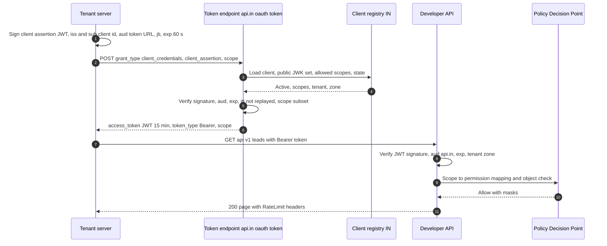
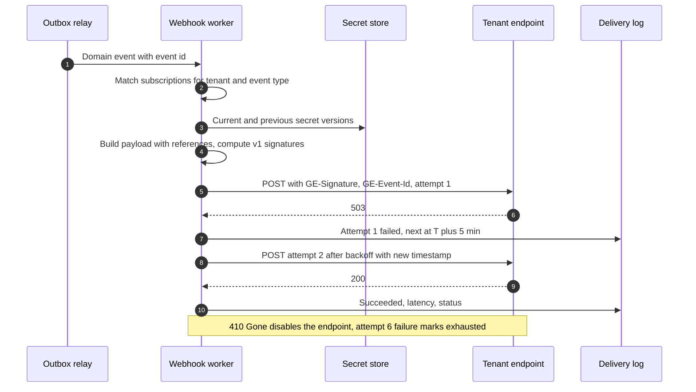
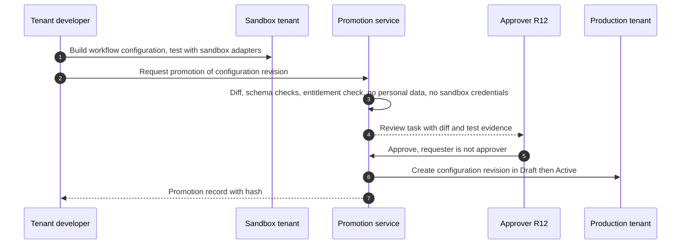

---

### 11.19.5.2 C2 Developer platform: API keys, OAuth client credentials, rate limits, versioning, signed webhooks, developer portal, SDKs and sandbox (DEC-785)

#### A. Design stance and decisions

Part 11.8b §11.8.5.4 specified the developer host, the API-key format, the scope registry, the RL-KEY classes, the 12-month deprecation rule and the portal/SDK approach. DEC-785 brings **all** of ENT-API-01…07 and ENT-DAT-04/05 into Release 1. This section completes the design: OAuth client credentials, webhook signing and delivery, SDK build and release, sandbox tenants and configuration promotion, and region binding.

| # | Decision point | Choice | ID |
|---|---|---|---|
| 1 | Hosts | `api.<zone>.<platform-domain>` per residency cell, AWS only (no Vercel in the server-to-server path); CORS disabled; WAF with per-tenant rate rules | DEC-882, ADR-257 |
| 2 | Credential types | (a) API key `gek_<env>_<zone>_<prefix8>_<secret43>` (zone added to the Part 11.8b format so a key is never looked up in the wrong cell); (b) OAuth 2.0 **client credentials** with `private_key_jwt` (RFC 7523, preferred, ES256/PS256) or `client_secret_basic`; access token = JWT (ES256), lifetime 15 min, audience `api.<zone>`, scopes, `tenant_id`, `cnf` absent (bearer) | DEC-882, ADR-257 |
| 3 | Scope registry | Part 11.8b scope registry kept; **no scope exists for approve, send, publish, pay, sign, submit bids, set prices, change roles or policies**. `runs:create` may start workflows; any consequential step stops at a human approval or executes only under an active **bounded mandate** of Part 11.17 (DEC-779), whose controls the API cannot bypass | DEC-883, [CONFLICT-1093] |
| 4 | Rate limits | RL-KEY 300/min per key, 1,500/min per tenant; RL-KEY-H 10/min per key for run creation and exports; token endpoint 30/min per client; `RateLimit-Policy` and `RateLimit` headers (IETF draft, verify), `Retry-After` on 429 | ENT-API-03 |
| 5 | Versioning | URL major version (`/api/v1`, `/api/v2`); additive changes any time; breaking change only in a new major with ≥ 12 months' notice (`Deprecation`, `Sunset`, `Link rel=deprecation`), changelog and owner e-mails; `oasdiff` gate in CI | ENT-API-04, DEC-646 |
| 6 | Webhooks | Signed with HMAC-SHA-256 over `t + "." + raw_body`, header `GE-Signature: t=<unix>,v1=<hex>[,v1=<hex-old>]`; tolerance ±300 s; secret rotation with 24 h overlap (both signatures sent); `GE-Event-Id`, `GE-Event-Type`, `GE-Delivery-Attempt`; payloads carry references and digests, never Restricted fields; delivery schedule 6 attempts within 24 h (T, +5 min, +30 min, +2 h, +6 h, +15 h; ±10% jitter); 410 disables; replay from the log for 30 days; endpoint verification challenge before activation | ENT-API-05, DEC-882, ADR-258 |
| 7 | SDKs | TypeScript (npm), Python (PyPI), **Java** (Maven Central) generated with openapi-generator from the published OpenAPI, plus hand-written helpers: auth (key and client-assertion signer), pagination, retries honouring `Retry-After`, idempotency keys, webhook `verify()`; semantic versions tied to the API major; signed releases with provenance [RECOMMENDATION-1097] | ENT-API-06, DEC-882 |
| 8 | Developer portal | Static site generated from the OpenAPI (Redoc, MIT) + guides, on a separate Vercel project `developers` (no personal data; public); "Try it" only against the sandbox host; per-region base URLs shown | ENT-API-07 |
| 9 | Sandbox | One sandbox tenant per real tenant on request (and a public shared sandbox for the portal), in the **same zone**, synthetic data only (`contains_personal_data = false` enforced), sandbox adapters only (no real provider credentials), API keys prefixed `gek_test_`; configuration promotion sandbox → production as a reviewed configuration revision (requester ≠ approver) | ENT-DAT-04/05, DEC-899 |
| 10 | Leak response | Prefix `gek_` registered for secret-scanning partner programs where available [RECOMMENDATION-1098]; on a leak report AU-293 revokes the key within 60 s and notifies R12 | DEC-882 |

#### B. Sequence diagrams

**B1. OAuth client-credentials token with `private_key_jwt`, then an API call.**



**B2. Webhook delivery with signing, retries and replay.**



**B3. Sandbox to production configuration promotion.**



#### C. Configuration

| Key | Default | Allowed | Owner |
|---|---|---|---|
| `apikey.default_lifetime_days` | 90 | 1–365 (hard cap 397 by DDL) | R12 per key |
| `apikey.max_per_tenant` | 50 | 1–500 | Platform owner |
| `apikey.unused_revoke_days` | 180 (warn at 90) | 30–365 | R12 |
| `oauth.token_ttl_min` | 15 | 5–60 | Platform owner |
| `oauth.client.jwks_url_required` | true for `private_key_jwt` | — | — |
| `oauth.client_secret.lifetime_days` | 180 | 30–365 | R12 |
| `ratelimit.key_per_min` / `tenant_per_min` | 300 / 1,500 | Enterprise tier up to 1,200 / 6,000 by contract | Platform owner |
| `webhook.max_endpoints` | 10 per tenant | 1–50 | Platform owner |
| `webhook.timeout_s` | 10 | 5–15 | — |
| `webhook.schedule` | 0, 5 m, 30 m, 2 h, 6 h, 15 h | fixed in R1 | — |
| `webhook.secret_overlap_h` | 24 | 1–72 | R12 at rotation |
| `webhook.replay_window_days` | 30 | 7–30 | — |
| `sandbox.max_per_tenant` | 2 | 1–5 | Platform owner |
| `sandbox.ttl_days_idle` | 90 | 30–365 | R12 |
| `deprecation.notice_months` | 12 | ≥ 12 | Platform owner |

#### D. Data model and DDL deltas (DDL-V12-R part 2)

```sql
-- DDL-V12-R-05 API keys (extends C2 api_key + Part 11.9b checks)
ALTER TABLE ge.api_key ADD COLUMN IF NOT EXISTS zone text NOT NULL DEFAULT current_setting('app.zone') CHECK (zone IN ('IN','EU'));
ALTER TABLE ge.api_key ADD COLUMN IF NOT EXISTS environment text NOT NULL DEFAULT 'live' CHECK (environment IN ('live','test'));
ALTER TABLE ge.api_key ADD COLUMN IF NOT EXISTS created_by uuid NOT NULL;
ALTER TABLE ge.api_key ADD COLUMN IF NOT EXISTS last_used_at timestamptz;
ALTER TABLE ge.api_key ADD COLUMN IF NOT EXISTS revoke_reason text CHECK (revoke_reason IN ('owner','expired','deprovisioned','leak_report','idle','admin'));
ALTER TABLE ge.api_key ADD CONSTRAINT api_key_no_consequential_scope_ck
  CHECK (NOT scopes && ARRAY['approve','send','publish','pay','sign','bids:submit','prices:set','roles:write','policies:write']::text[]);
-- DDL-V12-R-06 OAuth clients (ENT-API-02)
CREATE TABLE ge.oauth_client (
  tenant_id uuid NOT NULL REFERENCES ge.tenant(tenant_id), client_id text NOT NULL CHECK (client_id ~ '^gec_[a-z0-9]{20}$'),
  zone text NOT NULL CHECK (zone IN ('IN','EU')), name text NOT NULL,
  auth_method text NOT NULL CHECK (auth_method IN ('private_key_jwt','client_secret_basic')),
  jwks_url text CHECK (jwks_url ~ '^https://'), jwks_inline jsonb, secret_hash bytea, secret_expires_at timestamptz,
  scopes text[] NOT NULL CHECK (cardinality(scopes) > 0), ip_allowlist cidr[], state text NOT NULL DEFAULT 'active' CHECK (state IN ('active','suspended','revoked')),
  created_by uuid NOT NULL, created_at timestamptz NOT NULL DEFAULT now(), last_token_at timestamptz,
  PRIMARY KEY (tenant_id, client_id), UNIQUE (client_id),
  CHECK (auth_method <> 'private_key_jwt' OR jwks_url IS NOT NULL OR jwks_inline IS NOT NULL),
  CHECK (auth_method <> 'client_secret_basic' OR (secret_hash IS NOT NULL AND secret_expires_at IS NOT NULL)),
  CHECK (NOT scopes && ARRAY['approve','send','publish','pay','sign','bids:submit','prices:set','roles:write','policies:write']::text[]));
CREATE TABLE ge.oauth_jti_seen (client_id text NOT NULL, jti text NOT NULL, exp timestamptz NOT NULL, PRIMARY KEY (client_id, jti));  -- platform, purged after exp
-- DDL-V12-R-07 Webhooks (extends C2 webhook_endpoint, webhook_delivery)
ALTER TABLE ge.webhook_endpoint ADD COLUMN IF NOT EXISTS secret_version int NOT NULL DEFAULT 1;
ALTER TABLE ge.webhook_endpoint ADD COLUMN IF NOT EXISTS previous_secret_ref text;
ALTER TABLE ge.webhook_endpoint ADD COLUMN IF NOT EXISTS previous_secret_until timestamptz;
ALTER TABLE ge.webhook_endpoint ADD COLUMN IF NOT EXISTS disabled_reason text CHECK (disabled_reason IN ('owner','gone_410','exhausted_threshold','verification_failed'));
ALTER TABLE ge.webhook_endpoint ADD COLUMN IF NOT EXISTS consecutive_exhausted int NOT NULL DEFAULT 0;
ALTER TABLE ge.webhook_delivery ADD COLUMN IF NOT EXISTS event_id uuid NOT NULL;
ALTER TABLE ge.webhook_delivery ADD COLUMN IF NOT EXISTS next_attempt_at timestamptz;
ALTER TABLE ge.webhook_delivery ADD COLUMN IF NOT EXISTS outcome text NOT NULL DEFAULT 'pending' CHECK (outcome IN ('pending','succeeded','failed','exhausted','disabled','replayed'));
ALTER TABLE ge.webhook_delivery ADD COLUMN IF NOT EXISTS latency_ms int;
ALTER TABLE ge.webhook_delivery ADD CONSTRAINT webhook_delivery_attempt_uq UNIQUE (tenant_id, endpoint_id, event_id, attempt);
-- partitioned monthly by signed_at in production (Part 11.9b §11.9.5.9); retention 30 days payload refs, 13 months metadata
-- DDL-V12-R-08 Sandbox and promotion (extends C2 sandbox_environment, config_promotion)
ALTER TABLE ge.sandbox_environment ADD COLUMN IF NOT EXISTS sandbox_tenant_id uuid NOT NULL;   -- a separate tenant row of kind 'sandbox'
ALTER TABLE ge.sandbox_environment ADD COLUMN IF NOT EXISTS dataset_version text NOT NULL DEFAULT 'gse_syn 1.4.0';
ALTER TABLE ge.config_promotion ADD COLUMN IF NOT EXISTS config_revision_id uuid NOT NULL;
ALTER TABLE ge.config_promotion ADD COLUMN IF NOT EXISTS diff_hash bytea NOT NULL;
ALTER TABLE ge.config_promotion ADD CONSTRAINT config_promotion_status_ck CHECK (status IN ('Requested','Approved','Rejected','Applied','RolledBack'));
ALTER TABLE ge.tenant ADD CONSTRAINT tenant_kind_ck CHECK (kind IN ('owned','client','sandbox'));
```

Sandbox tenants carry `kind = 'sandbox'`; a database trigger rejects inserts of `consent_record`, `contact_point` and other Restricted tables whose values do not match the synthetic generator's checksum pattern, and the adapter registry returns only simulator adapters for sandbox tenants (fail-closed).

#### E. APIs (in addition to Part 11.8b API-V12-H-001…014)

| ID | Method and path | Caller | Key fields | Responses and codes |
|---|---|---|---|---|
| API-V12-R-019 | `POST /api/v1/api-keys` | R12 browser + step-up | name, scopes[], expires_at, ip_allowlist[], environment | 201 plaintext once; 422 `SCOPE_NOT_GRANTABLE`, `LIFETIME_TOO_LONG` |
| API-V12-R-020 | `POST /api/v1/api-keys/{kid}/rotate` | R12 | overlap_hours ≤ 24 | 201 new key; old key expires at overlap end |
| API-V12-R-021 | `DELETE /api/v1/api-keys/{kid}` | R12, owner | reason | 204; effective ≤ 60 s |
| API-V12-R-022 | `POST /api/v1/oauth-clients` | R12 + step-up | name, auth_method, jwks_url or generate secret, scopes[] | 201 (`client_secret` shown once for basic) |
| API-V12-R-023 | `POST /oauth/token` (host `api.<zone>`) | Registered client | `grant_type=client_credentials`, `client_assertion_type=urn:ietf:params:oauth:client-assertion-type:jwt-bearer`, `client_assertion`, `scope` | 200 token; 400 `invalid_client`, `invalid_scope`, `invalid_grant` (RFC 6749 §5.2); 429 |
| API-V12-R-024 | `POST /oauth/revoke` | Client or R12 | token | 200 (RFC 7009) |
| API-V12-R-025 | `POST /api/v1/webhook-endpoints` | R12 | url (https), events[], description | 201 state `unverified`; challenge sent |
| API-V12-R-026 | `POST /api/v1/webhook-endpoints/{eid}/verify` | R12 | — | 200 when the endpoint echoed the challenge token within 10 s |
| API-V12-R-027 | `POST /api/v1/webhook-endpoints/{eid}/rotate-secret` | R12 | overlap_hours | 201 new secret once |
| API-V12-R-028 | `GET /api/v1/webhook-deliveries?endpoint_id&outcome&from&to` | R12, `webhooks:read` | filters | 200 page |
| API-V12-R-029 | `POST /api/v1/webhook-deliveries/{did}/replay` | R12 | — | 202; 409 `OUTSIDE_REPLAY_WINDOW` |
| API-V12-R-030 | `POST /api/v1/sandboxes` / `DELETE …/{sid}` | R12 | name, copy_configuration | 201 sandbox tenant id and `gek_test_` key option |
| API-V12-R-031 | `POST /api/v1/sandboxes/{sid}/promotions`, `POST /api/v1/promotions/{pid}/approve` | R12 (request), another R12 (approve) | config_revision_id | 201; 403 `SAME_APPROVER`; 422 `CONTAINS_SANDBOX_CREDENTIAL` |
| API-V12-R-032 | `GET /api/v1/changelog`, `GET /api/v1/deprecations` | Any credential | — | 200 (also on portal) |

#### F. Webhook event catalogue (published, version 1)

| Event type | Trigger | Payload (references only) | Subscribable by scope |
|---|---|---|---|
| `lead.created`, `lead.updated` | Lead intake or edit | lead_id, company_id, source, changed_fields[] | `leads:read` |
| `organization.updated` | Organisation change | organization_id, changed_fields[] | `organizations:read` |
| `deal.stage_changed` | Deal stage | deal_id, from, to | `deals:read` |
| `quote.approved`, `order.created`, `invoice.issued`, `invoice.paid` | Commercial events | ids, amounts as decimal strings with currency | `quotes:read`, `orders:read`, `invoices:read` |
| `meeting.booked`, `meeting.cancelled` | Calendar | meeting_id, start (UTC) | `meetings:read` |
| `run.created`, `run.awaiting_approval`, `run.completed`, `run.failed` | Workflow runs | run_id, workflow_id, version, state | `runs:read` |
| `connector.degraded`, `connector.recovered` | C3 health | installation_id, connector_id | `connectors:read` |
| `consent.withdrawn` | Data subject withdraws | subject_ref (hash), channel | `contacts:read` (+ R10 approval) |

#### G. Runbooks

| ID | Trigger | Steps | Target |
|---|---|---|---|
| RB-DP-01 Leaked API key | Partner report, customer report or AU-293 anomaly (new ASN + spike) | Revoke (≤ 60 s), notify R12 and key creator, list calls in last 30 days, SEV3 (SEV2 if write scope) | Revocation ≤ 5 min from report |
| RB-DP-02 Webhook endpoint failing | `exhausted` for 3 events in 24 h | Notify R12; keep queueing up to 7 days; R12 replays after fix | — |
| RB-DP-03 Token endpoint abuse | > 30 failed client assertions per client in 5 min | Temporarily suspend client 15 min; notify R12 | Automatic |
| RB-DP-04 Breaking change request | Contract diff flagged by `oasdiff` | Route to API council; new major version or reject; 12-month notice plan | Before merge |
| RB-DP-05 SDK release | Tag on `main` | Generate, unit + contract tests against sandbox, sign, publish to npm, PyPI, Maven Central with provenance; changelog | Same day as API release |

#### H. Security controls

| Threat | Control | Test |
|---|---|---|
| Key theft from logs | Keys never logged (redaction filter on `Authorization` and `gek_` pattern); only prefix and last4 stored in plaintext | TC-V12-R-022 |
| Client assertion replay | `jti` stored until `exp`; `exp` ≤ 60 s ahead | TC-V12-R-025 |
| Confused deputy across zones | Zone inside key and token `aud`; registry per cell | M04 `other region host` rows |
| SSRF via webhook URL | https only; DNS resolved and private, link-local, loopback and cloud-metadata ranges rejected at registration **and** at each delivery; no redirects followed; egress through a dedicated NAT with an IP list published to customers | TC-V12-R-030 |
| Webhook forgery to tenants | HMAC signature with timestamp; SDK `verify()` constant-time compare | M06 exhaustive |
| Data leakage in webhook payloads | References only; Restricted fields never; `consent.withdrawn` uses a hash | TC-V12-R-031 |
| Abuse of sandbox for real data | Synthetic-only checks; simulator adapters only | TC-V12-R-034 |

#### I. Cut-over into Release 1

| Step | Sprint | Activity | Exit |
|---|---|---|---|
| DP-C1 | 1 | Developer host per cell, WAF, key format with zone | TC-V12-R-021…023 |
| DP-C2 | 2–3 | OAuth client credentials, token endpoint, revocation | TC-V12-R-024…026; M04 |
| DP-C3 | 2–4 | Webhook engine, delivery log, replay, A168 Webhooks tab | TC-V12-R-027…031; M05, M06 |
| DP-C4 | 3–5 | SDK generation pipeline (TS, Python, Java), contract tests against sandbox | TC-V12-R-032/033 |
| DP-C5 | 4–5 | Sandbox tenants, promotion, A204 | TC-V12-R-034…036 |
| DP-C6 | 5 | Developer portal W47 (`developers.<platform-domain>`), changelog, deprecation policy page | Accessibility pass (WCAG 2.2 AA) |
| DP-C7 | Release 1 go-live | Publish SDK 1.0.0; announce to owned startups; external tenants per contract | Release notes |
