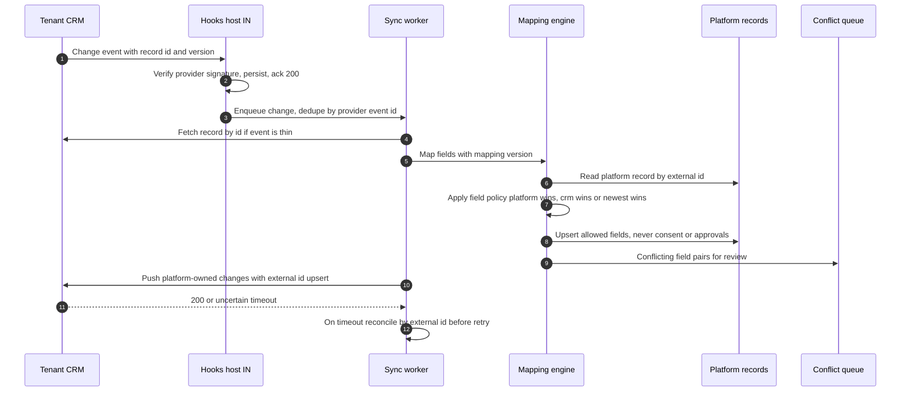
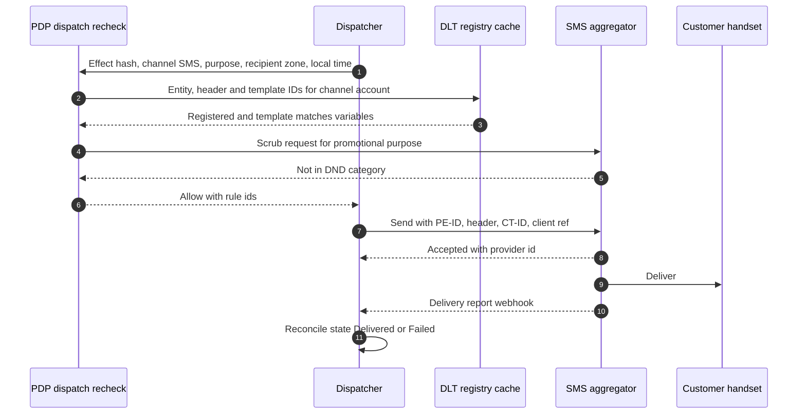
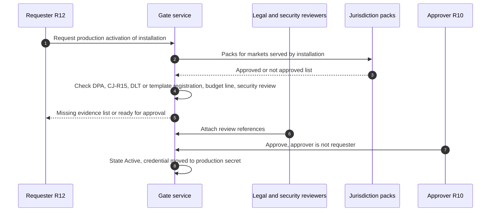

---

### 11.19.5.3 C3 Connectors: framework with activation gate, CRM (Salesforce, HubSpot, Zoho CRM), SMS via DLT and voice transport (DEC-785)

#### A. Design stance and decisions

The connector framework of Part 11.8b §11.8.5.7 (clauses CF-01…CF-12 and the activation state machine) is adopted unchanged as the contract every connector implements. DEC-785 withdraws exclusion X-09 (CONFLICT-776) and places CRM, SMS and voice connectors in Release 1. RECOMMENDATION-902 ("one CRM provider first") is superseded: all three V12 INT-01 providers are built in Release 1, sequenced inside the release.

| # | Decision point | Choice | ID |
|---|---|---|---|
| 1 | System of record | The platform stays the system of record for **consent, suppression, approvals, mandates, audit and AI outputs**. CRM sync never overwrites these; a CRM opt-out is imported as a suppression (stricter wins). Ownership of business fields (owner, stage, amount) is configured per field mapping: `platform_wins`, `crm_wins` or `newest_wins` with conflict queue | DEC-885, ADR-259 |
| 2 | CRM providers and sequence | Release 1 builds `CrmSyncPort` adapters in this order: **Zoho CRM** (Indian owned-startup base, India data centre available, verify) → **HubSpot** → **Salesforce**. All are BYO (tenant's own licence) | DEC-884, [ASSUMPTION-1086] |
| 3 | CRM authentication | OAuth 2.0 authorization code + PKCE for the tenant admin grant (refresh tokens in Secrets Manager); Salesforce may use the JWT bearer flow with a tenant-created connected app for server-to-server; HubSpot private app tokens accepted as an alternative; tokens refreshed by workers only | CF-02 |
| 4 | CRM objects | Contacts ↔ `contact`; Accounts/Companies ↔ `organization`; Opportunities/Deals ↔ `deal`; Activities (tasks, calls, e-mails as metadata) one-way platform → CRM; custom fields by mapping | INT-01 |
| 5 | Change capture | Salesforce Change Data Capture / Pub/Sub API or Streaming (verify edition), HubSpot webhooks v3, Zoho notification API; else incremental polling with `SystemModstamp`/`hs_lastmodifieddate`/`Modified_Time` cursors (GC-08) | CF-08 |
| 6 | SMS (India) | `SmsPort` via a **DLT-registered telecom aggregator**; every message carries entity ID (PE-ID), header (sender ID) and template ID (CT-ID); template variables validated against the registered template; promotional messages scrubbed against the preference registry (NCPR/DND) through the aggregator or the operator's scrubbing API; promotional sends only in the TRAI window and the DEC-777 window, whichever is stricter; transactional/service via service headers; STOP keyword handling | DEC-884, [ASSUMPTION-1087] |
| 7 | Voice transport | `VoicePort` via CPaaS with **140-series** numbers (promotional) and **160-series** (service/transactional, per TRAI numbering, verify) for India; click-to-call (agent ↔ customer bridge) and approved voice notifications in Release 1; recording only with consent per jurisdiction; AI voice agents (SM-SVC-26) plug in through the same port under Part 11.18 controls | DEC-884, [GAP-1089] |
| 8 | Activation gate | CF-11 mandatory for production: security review reference, DPA, transfer basis (CJ-R15), channel registration (DLT IDs, WhatsApp templates), licence/budget line, and the **jurisdiction rule pack for every market the installation serves must be counsel-approved** (Part 11.15). Requester ≠ approver (SoD pair `Connectors:request_activation` ↔ `approve_activation`) | ENT-INT-05, DEC-884 |
| 9 | Residency | Credentials and sync state live in the tenant's cell. Data sent to a provider outside the zone needs a CJ-R15 transfer entry; EU tenants with a US-hosted CRM edition require SCCs/adequacy evidence in the gate | DEC-772 |

#### B. Sequence diagrams

**B1. CRM bi-directional sync with conflict policy.**



**B2. SMS dispatch with DLT and registry checks.**



**B3. Connector activation through the gate.**



#### C. Configuration

| Key | Default | Allowed | Owner |
|---|---|---|---|
| `connector.crm.sync_interval_min` (poll fallback) | 5 | 1–60 | R12 |
| `connector.crm.field_policy.<field>` | per mapping template | `platform_wins`, `crm_wins`, `newest_wins` | R12 (consent/suppression fixed `platform_wins_stricter`) |
| `connector.crm.max_batch` | 200 | 1–2,000 (provider limit, verify) | — |
| `connector.breaker.error_rate` | 50% over 20 calls | 10–90% | Platform owner |
| `connector.breaker.open_s` | 60 → probe | 30–600 | — |
| `connector.disable_after_401` | 3 consecutive | 1–5 | — |
| `sms.promo_window` | 10:00–21:00 IST (TRAI, verify) ∩ DEC-777 09:00–21:00 local | stricter of law and DEC-777 | Rule pack |
| `sms.max_parts` | 3 | 1–6 | R12 |
| `sms.stop_keywords` | STOP, UNSUB, रोकें (Hindi) | list | R10 |
| `voice.calling_window` | per rule pack (India: TRAI/DEC-777 stricter) | — | Rule pack |
| `voice.recording` | off | on only where the pack allows and consent captured | R10 |

#### D. Data model and DDL deltas (DDL-V12-R part 3)

```sql
-- DDL-V12-R-09 Connector installations (extends C2 connector_installation; CF-01…12)
ALTER TABLE ge.connector_installation ADD COLUMN IF NOT EXISTS provider text NOT NULL
  CHECK (provider IN ('salesforce','hubspot','zoho_crm','sms_dlt_aggregator','voice_cpaas','ses','whatsapp_bsp','google_calendar','m365_calendar','payments','warehouse','siem','idp'));
ALTER TABLE ge.connector_installation ADD COLUMN IF NOT EXISTS ownership text NOT NULL DEFAULT 'tenant_byo' CHECK (ownership IN ('tenant_byo','platform'));
ALTER TABLE ge.connector_installation ADD COLUMN IF NOT EXISTS dpa_ref text;
ALTER TABLE ge.connector_installation ADD COLUMN IF NOT EXISTS transfer_entry_ref text;         -- CJ-R15
ALTER TABLE ge.connector_installation ADD COLUMN IF NOT EXISTS registration_ref text;           -- DLT entity/header/template set or WA templates
ALTER TABLE ge.connector_installation ADD COLUMN IF NOT EXISTS markets text[] NOT NULL DEFAULT '{}';
ALTER TABLE ge.connector_installation ADD COLUMN IF NOT EXISTS requested_by uuid, ADD COLUMN IF NOT EXISTS approved_by uuid;
ALTER TABLE ge.connector_installation ADD CONSTRAINT connector_gate_ck CHECK (
  environment = 'sandbox' OR status NOT IN ('Active') OR (
    legal_review_ref IS NOT NULL AND security_review_ref IS NOT NULL AND dpa_ref IS NOT NULL AND transfer_entry_ref IS NOT NULL
    AND approved_by IS NOT NULL AND approved_by <> requested_by
    AND (provider NOT IN ('sms_dlt_aggregator','voice_cpaas','whatsapp_bsp') OR registration_ref IS NOT NULL)));
-- rule-pack check is a trigger because it reads another table
CREATE FUNCTION ge.connector_pack_guard() RETURNS trigger LANGUAGE plpgsql AS $$
BEGIN
  -- v1.2 (Part 11.25, CONFLICT-1215 resolved by DEC-1000): Appendix C names. Packs are keyed by
  -- jurisdiction_pack.jurisdiction / pack_code, status vocabulary 'Approved'; the required packs per
  -- capability come from ge.rulepack_requirement, the same join as ge.fn_activation_gate().
  IF NEW.environment = 'production' AND NEW.status = 'Active' AND EXISTS (
       SELECT 1 FROM unnest(NEW.markets) m WHERE
         NOT EXISTS (SELECT 1 FROM ge.jurisdiction_pack p WHERE p.jurisdiction = m AND p.status = 'Approved'
                       AND p.counsel_signoff_ref IS NOT NULL AND p.effective_from <= current_date
                       AND (p.effective_to IS NULL OR p.effective_to >= current_date))
         OR EXISTS (SELECT 1 FROM ge.rulepack_requirement r
                     WHERE r.jurisdiction = m
                       AND r.capability = CASE NEW.provider WHEN 'sms_dlt_aggregator' THEN 'outreach.sms'
                                            WHEN 'whatsapp_bsp' THEN 'outreach.whatsapp' WHEN 'ses' THEN 'outreach.email'
                                            WHEN 'voice_cpaas' THEN 'voice.ai_calls' WHEN 'payments' THEN 'payments.mandated' END
                       AND NOT EXISTS (SELECT 1 FROM ge.jurisdiction_pack p WHERE p.pack_code = r.pack_code AND p.status = 'Approved'
                                         AND p.counsel_signoff_ref IS NOT NULL AND p.effective_from <= current_date
                                         AND (p.effective_to IS NULL OR p.effective_to >= current_date)))) THEN
    RAISE EXCEPTION 'CONNECTOR_MARKET_PACK_NOT_APPROVED' USING ERRCODE = 'check_violation'; END IF;
  RETURN NEW; END $$;
CREATE TRIGGER connector_installation_pack_guard BEFORE INSERT OR UPDATE ON ge.connector_installation
  FOR EACH ROW EXECUTE FUNCTION ge.connector_pack_guard();
-- DDL-V12-R-10 CRM sync state and mappings
CREATE TABLE ge.crm_field_mapping (
  tenant_id uuid NOT NULL, installation_id uuid NOT NULL, mapping_version int NOT NULL, object text NOT NULL CHECK (object IN ('contact','organization','deal','activity')),
  platform_field text NOT NULL, crm_field text NOT NULL, policy text NOT NULL CHECK (policy IN ('platform_wins','crm_wins','newest_wins','platform_wins_stricter')),
  PRIMARY KEY (tenant_id, installation_id, mapping_version, object, platform_field),
  CHECK (platform_field NOT IN ('consent_state','suppression','approval_state','mandate_id') OR policy = 'platform_wins_stricter'));
CREATE TABLE ge.crm_link (
  tenant_id uuid NOT NULL, installation_id uuid NOT NULL, object text NOT NULL, platform_id uuid NOT NULL, crm_id text NOT NULL,
  last_platform_version int, last_crm_version text, last_synced_at timestamptz,
  PRIMARY KEY (tenant_id, installation_id, object, platform_id), UNIQUE (tenant_id, installation_id, object, crm_id));
CREATE TABLE ge.sync_cursor (tenant_id uuid NOT NULL, installation_id uuid NOT NULL, object text NOT NULL, cursor text, cursor_at timestamptz, gap_detected boolean NOT NULL DEFAULT false,
  PRIMARY KEY (tenant_id, installation_id, object));
CREATE TABLE ge.sync_conflict (tenant_id uuid NOT NULL, conflict_id uuid NOT NULL DEFAULT gen_random_uuid(), installation_id uuid NOT NULL, object text NOT NULL,
  platform_id uuid NOT NULL, field text NOT NULL, platform_value_hash bytea, crm_value_hash bytea, state text NOT NULL DEFAULT 'open' CHECK (state IN ('open','resolved_platform','resolved_crm','ignored')),
  resolved_by uuid, PRIMARY KEY (tenant_id, conflict_id));
-- DDL-V12-R-11 DLT registry (India SMS/voice; CJ-IN-06/07)
CREATE TABLE ge.dlt_registration (
  tenant_id uuid NOT NULL, company_id uuid NOT NULL, channel_account_id uuid NOT NULL, entity_id text NOT NULL CHECK (entity_id ~ '^[0-9]{19}$'),
  header text NOT NULL CHECK (header ~ '^[A-Z0-9]{3,11}$'), header_type text NOT NULL CHECK (header_type IN ('promotional','service_implicit','service_explicit','transactional')),
  valid_from date NOT NULL, valid_to date, PRIMARY KEY (tenant_id, channel_account_id, header));     -- ID formats per operator portal, verify
CREATE TABLE ge.dlt_template (
  tenant_id uuid NOT NULL, channel_account_id uuid NOT NULL, template_id text NOT NULL, header text NOT NULL, category text NOT NULL,
  body_pattern text NOT NULL, variables int NOT NULL CHECK (variables BETWEEN 0 AND 10), approved_at date NOT NULL, state text NOT NULL CHECK (state IN ('active','suspended','expired')),
  PRIMARY KEY (tenant_id, channel_account_id, template_id),
  FOREIGN KEY (tenant_id, channel_account_id, header) REFERENCES ge.dlt_registration(tenant_id, channel_account_id, header));
CREATE TABLE ge.voice_number (
  tenant_id uuid NOT NULL, channel_account_id uuid NOT NULL, e164 text NOT NULL CHECK (e164 ~ '^\+[1-9][0-9]{7,14}$'),
  series text CHECK (series IN ('140','160','other')), purpose text NOT NULL CHECK (purpose IN ('promotional','service','transactional')),
  CHECK (series IS NULL OR (series = '140') = (purpose = 'promotional')),
  PRIMARY KEY (tenant_id, e164));
```

#### E. Connector specifications (Part 11.8b adapter tables extended)

| Field | Salesforce | HubSpot | Zoho CRM | SMS-DLT aggregator | Voice CPaaS |
|---|---|---|---|---|---|
| Port | `CrmSyncPort` | `CrmSyncPort` | `CrmSyncPort` | `SmsPort` | `VoicePort` |
| Auth | OAuth 2.0 auth code + PKCE; JWT bearer for server flow | OAuth 2.0 auth code; private app token alternative | OAuth 2.0 auth code (data-centre specific accounts domain, verify) | API key in vault | API key / account SID + token in vault |
| Objects | Contact, Account, Opportunity, Task | Contacts, Companies, Deals, Engagements | Contacts, Accounts, Deals, Activities | Messages, delivery reports, inbound | Calls, call status, recordings (consent) |
| Change capture | CDC/Pub-Sub API or polling (`SystemModstamp`) — edition-dependent, verify | Webhooks v3 + polling | Notification API + polling (`Modified_Time`) | DLR webhooks | Status webhooks |
| Limits (verify) | Daily API request allocation per edition | Per-app burst and daily limits | Credits per edition | Throughput per account | Concurrent calls per number |
| Idempotency | Upsert by external ID field `GE_Id__c` | Upsert by `ge_id` unique property | Upsert by `GE_Id` unique field | Client reference = message id | Call reference = action id |
| Failure classes | 429/`REQUEST_LIMIT_EXCEEDED`, 5xx, 401 `INVALID_SESSION_ID`, validation (`FIELD_CUSTOM_VALIDATION_EXCEPTION`), uncertain timeout | 429, 5xx, 401, 400 validation | 429, 5xx, 401 `INVALID_TOKEN`, validation | throttle, template mismatch, DND, invalid number, uncertain | busy, no answer, failed, uncertain |
| Fallback | Sync paused; conflict queue | same | same | Email if consented; else human task | Human callback task |
| Data sent | Business records; contact fields only with consent basis | same | same | E.164 phone + template variables | E.164 phone; recording only with consent |
| Release 1 sprint | S6–S7 | S5–S6 | S4–S5 | S4–S5 | S6–S7 |

#### F. APIs

| ID | Method and path | Caller | Responses |
|---|---|---|---|
| API-V12-R-033 | `GET /api/v1/connectors` (catalogue with manifests) | R12 | 200 |
| API-V12-R-034 | `POST /api/v1/connector-installations` | R12 | 201 `SandboxActive` or `Available` |
| API-V12-R-035 | `GET /api/v1/connector-installations/{iid}/oauth/start`, `GET /oauth/callback/{provider}` | R12 browser | 302 to provider; callback stores refresh token in vault |
| API-V12-R-036 | `POST /api/v1/connector-installations/{iid}/activation-requests`, `POST …/approve` | R12 (request), R10 (approve) | 202; 409 `CONNECTOR_GATE_INCOMPLETE` (list), `CONNECTOR_MARKET_PACK_NOT_APPROVED`; 403 `SAME_APPROVER` |
| API-V12-R-037 | `GET/PUT /api/v1/connector-installations/{iid}/mappings` | R12 | 200; 422 `PROTECTED_FIELD_POLICY` |
| API-V12-R-038 | `GET /api/v1/sync-conflicts`, `POST …/{cid}/resolve` | R12, R03L | 200 |
| API-V12-R-039 | `GET/POST /api/v1/channel-accounts/{aid}/dlt-registrations`, `/dlt-templates` | R10, R12 | 201; 422 `ENTITY_ID_FORMAT`, `TEMPLATE_VARIABLES` |
| API-V12-R-040 | `GET/POST /api/v1/channel-accounts/{aid}/voice-numbers` | R12 | 201; 422 `SERIES_PURPOSE_MISMATCH` |
| API-V12-R-041 | `GET /api/v1/connector-installations/{iid}/health` | R12, ops | 200 lag, error rate, breaker, last success |
| API-V12-R-042 | `POST /hooks/{provider}/{installation}` (hooks host) | Provider | 200 after persist; 401 bad signature |

#### G. Events

| Event | Consumers |
|---|---|
| `connector.installation.requested/approved/activated/degraded/recovered/disabled` | Notify, A008 dashboard, webhooks (`connector.degraded`) |
| `connector.sync.completed/gap_detected/conflict_raised` | A008, AU-295 |
| `sms.dispatched/delivered/failed/held` (reason `DLT_TEMPLATE_MISMATCH`, `REGISTRY_SCRUB_BLOCKED`, `OUTSIDE_WINDOW`) | Outbox ledger, analytics |
| `voice.call_started/answered/completed/failed/recording_available` | Outbox ledger; Part 11.18 consumers |
| `inbound.sms.received` (STOP detection) | Suppression service (deterministic STOP, BRL) |

#### H. Runbooks

| ID | Trigger | Steps |
|---|---|---|
| RB-CN-01 CRM token revoked | 3 × 401 | Disable installation; R12 task "Reconnect"; no data loss (cursor kept) |
| RB-CN-02 CRM quota exhausted | 429 with daily-limit code | Pause to next window; notify R12 with usage; suggest edition/limit change (GC-11) |
| RB-CN-03 Sync gap | Cursor discontinuity or missed event | Repair fetch over the gap window; dedupe by external ID; report |
| RB-CN-04 DLT template suspended | Aggregator rejection or registry sync | Hold all sends on that template; R10 task; never substitute another template automatically |
| RB-CN-05 Aggregator outage | Breaker open | Queue promotional sends until window end then drop to "not sent" with reason; transactional via secondary aggregator only if separately gated |
| RB-CN-06 Voice number misuse report | Complaint or regulator notice | Suspend number; review call logs; legal notification per pack |

#### I. Security controls

| Threat | Control | Test |
|---|---|---|
| Token theft from CRM installation | Vault only; scope minimum (`api`, `refresh_token` for Salesforce; minimal HubSpot scopes); refresh by workers | TC-V12-R-038 |
| CRM overwrites consent | Protected field policy (DDL check) | TC-V12-R-040 |
| Spoofed provider webhook | Provider signature verification per provider (Salesforce: authenticated subscription / mutual TLS where available; HubSpot v3 signature; Zoho token in channel), persist then ack | TC-V12-R-041 |
| SMS to DND number for promotion | Registry scrub at dispatch (PDP) | M07 rows |
| Template injection in SMS variables | Variable length/charset validation against the registered pattern | TC-V12-R-045 |
| Cross-zone data via CRM | Transfer entry in gate; EU tenant CRM data centre recorded | TC-V12-R-047 |

#### J. Cut-over into Release 1

| Step | Sprint | Activity | Exit |
|---|---|---|---|
| CN-C1 | 3 | Connector framework base classes, gate service, A008 Connectors tab | TC-V12-R-037…039 |
| CN-C2 | 4–5 | SMS-DLT adapter, DLT registry tables, PDP rules, India pack dependency | TC-V12-R-044…046; M07 SMS rows |
| CN-C3 | 4–5 | Zoho CRM adapter | TC-V12-R-040…043 (Zoho) |
| CN-C4 | 5–6 | HubSpot adapter | same (HubSpot) |
| CN-C5 | 6–7 | Salesforce adapter; Voice CPaaS transport | same (Salesforce); TC-V12-R-048…050 |
| CN-C6 | Release 1 gate | V12 R1 exit "DLT live", India pack approved, connectors activated for owned startups that requested them | Activation log |
