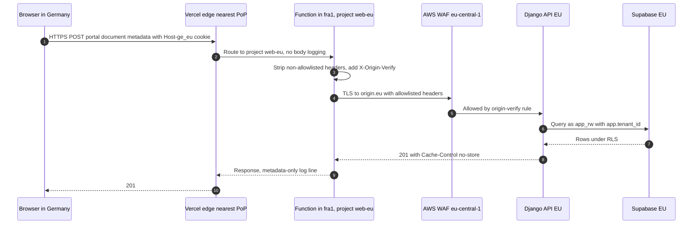

---

### 11.19.5.4 C4 Vercel personal-data path (DEC-786, with DEC-772)

#### A. Design stance and decisions

DEC-421 said that Vercel functions process no personal data; Part 11.8b found that Vercel rewrites already proxy personal data (CONFLICT-889). DEC-786 permits personal data through Vercel **rewrites and server functions** with five required controls: Vercel as a sub-processor under a DPA; functions pinned to the tenant's residency region; no request or response body logging; TLS end to end; a header allowlist. This section turns those into enforceable configuration, CI checks and monitoring (AU-296).

| # | Decision point | Choice | ID |
|---|---|---|---|
| 1 | Project topology | One Vercel project **per surface per zone**: `web-in`, `web-eu`, `admin-in`, `admin-eu` (and `developers`, static, global, no personal data). A startup custom domain is attached to the project of its tenant's zone only | DEC-886, ADR-260 |
| 2 | Function region | Serverless/edge-rendered functions of `*-in` projects pinned to `bom1` (Mumbai) and of `*-eu` projects to `fra1` (Frankfurt) — region IDs verify at time of implementation (as of 27 Nov 2026) [ASSUMPTION-1082]. Edge Middleware is limited to non-personal routing (zone, locale, A/B bucket by hashed cookie); it must not read request bodies or personal cookies | DEC-886 |
| 3 | What functions may do | BFF session handling (cookie ↔ session lookup by calling the AWS API), server-side rendering of authenticated pages, response shaping, uploads streamed straight to S3 presigned URLs (functions never buffer document bodies). No database or cache credentials in Vercel; functions call only the zone's AWS origin | DEC-786 |
| 4 | TLS end to end | Browser → Vercel edge (TLS 1.2+/1.3, HSTS preload) → origin `*-origin.<zone>.<platform-domain>` (TLS 1.2+ with certificate validation) → ALB → ECS (TLS) → Supabase (`verify-full`). Origin rejects requests without the rotating `X-Origin-Verify` secret (WAF rule) | DEC-786 |
| 5 | Logging | Vercel runtime logs carry metadata only; application code may not log bodies, cookies, `Authorization`, query strings with tokens (lint rule VD-07); log drains go to the zone's collector (AWS) with field redaction; Vercel Web Analytics and Speed Insights **off** for authenticated surfaces (verify product behaviour) | DEC-786 |
| 6 | Header allowlist | Functions and rewrites forward only allowlisted request headers to the origin (VD-05); response headers set `Cache-Control: no-store` for any personal-data response; `Set-Cookie` only `__Host-` cookies | DEC-786 |
| 7 | Caching | Personal-data routes are `no-store`; ISR/data cache disabled for authenticated routes; CDN cache keys never include cookies | DEC-786 |
| 8 | Edge transit location | Vercel terminates TLS at the nearest edge location, which can be outside the zone for a travelling user. This is **transit**; storage and processing (functions, logs) stay in-zone. The EU and India rule packs must state this position; counsel sign-off (Part 11.15) is required before the first EU tenant [GAP-1088] | DEC-887 |
| 9 | Contract | Vercel added to the public sub-processor list (30-day notice, ENT-CMP-04); DPA with SCCs where needed; plan that offers region pinning and log controls (Pro or Enterprise; DEC-774 Enterprise tier for SLA) — verify | DEC-786, DEC-774 |
| 10 | Fallback | DR-04 of Part 11.5b (static builds mirrored to S3 + CloudFront per zone) kept; in fallback mode the AWS distribution serves the SPA and `/api` same-origin | — |

#### B. Sequence diagram: authenticated portal request with personal data (EU tenant)



#### C. Configuration (per project, enforced by CI policy as code)

| Rule ID | Setting | Required value | Checked by |
|---|---|---|---|
| VD-01 | Project → zone binding | `web-in`/`admin-in` ↔ IN; `web-eu`/`admin-eu` ↔ EU; recorded in the tenant directory | AU-296 daily |
| VD-02 | Function regions | Exactly `["bom1"]` for IN, `["fra1"]` for EU (`vercel.json` `regions`, or project setting; verify mechanism) | CI before deploy; AU-296 |
| VD-03 | Edge Middleware | No body access; no personal cookie read except the `__Host-` session cookie name presence | Static analysis in CI |
| VD-04 | Rewrites | `/api/*`, `/bff/*` → `https://<surface>-origin.<zone>.<platform-domain>`; no other external rewrites | CI diff check |
| VD-05 | Header allowlist | `accept`, `accept-language`, `content-type`, `content-length`, `cookie` (only `__Host-ge_*`), `x-csrf-token`, `x-correlation-id`, `idempotency-key`, `if-match`, `user-agent` (truncated 256) → everything else stripped | Unit test of the proxy helper; M08 rows |
| VD-06 | Origin verify | `X-Origin-Verify` secret rotated every 30 days with 24 h overlap (secret in Vercel env per zone, encrypted, sensitive) | WAF rule; RB-VD-02 |
| VD-07 | Logging lint | ESLint rule bans `console.*` of `req.body`, `request.json()`, headers objects, cookies | CI |
| VD-08 | Log drain | Drain to `logs.<zone>` collector; fields: time, project, deployment, region, method, route template, status, duration, request id; query strings stripped | AU-296 sample audit weekly |
| VD-09 | Analytics | Web Analytics/Speed Insights off on `admin-*` and portal routes | AU-296 |
| VD-10 | Env vars | No database URL, no Supabase keys, no provider secrets in Vercel; only origin-verify secret and public config | Secret scan + AU-296 |
| VD-11 | Domains | Custom domain attached to exactly one project of the tenant's zone | AU-296 vs tenant directory |
| VD-12 | Deployment protection | Preview deployments protected (SSO for team), never connected to production origins | CI |

#### D. Data model (control-plane tables, platform scope, no personal data)

```sql
-- DDL-V12-R-12 Vercel data-path conformance (platform tables, no RLS: no tenant data; writes by app_owner/automation role only)
CREATE TABLE ge.edge_project (
  project text PRIMARY KEY CHECK (project ~ '^(web|admin|developers)(-(in|eu))?$'), zone text CHECK (zone IN ('IN','EU')),
  function_regions text[] NOT NULL, carries_personal_data boolean NOT NULL,
  CHECK (NOT carries_personal_data OR zone IS NOT NULL),
  CHECK (zone IS NULL OR function_regions = CASE zone WHEN 'IN' THEN ARRAY['bom1'] ELSE ARRAY['fra1'] END));
CREATE TABLE ge.edge_conformance_check (
  check_id bigserial PRIMARY KEY, project text NOT NULL REFERENCES ge.edge_project(project), rule_id text NOT NULL CHECK (rule_id ~ '^VD-[0-9]{2}$'),
  checked_at timestamptz NOT NULL DEFAULT now(), passed boolean NOT NULL, evidence_ref text NOT NULL, finding_id uuid);
CREATE TABLE ge.subprocessor (
  name text PRIMARY KEY, purpose text NOT NULL, zones text[] NOT NULL, dpa_ref text NOT NULL, transfer_mechanism text,
  listed_at date NOT NULL, notice_sent_at date, CHECK (notice_sent_at IS NULL OR listed_at >= notice_sent_at + 30));
```

#### E. Runbooks

| ID | Trigger | Steps | Target |
|---|---|---|---|
| RB-VD-01 Region-pin drift | AU-296 VD-02 fail | Block promotion; roll alias back to last compliant deployment; SEV2 privacy incident if any request was served from a non-zone function; DPIA log entry | Rollback ≤ 15 min |
| RB-VD-02 Origin-verify secret rotation | Every 30 days | Add new secret to WAF (both accepted), deploy Vercel env, verify, remove old after 24 h | Zero downtime |
| RB-VD-03 Body found in logs | AU-296 sample audit or report | Purge drain data, find code path, hotfix, privacy incident assessment (DPDP/GDPR clocks via Part 11.11) | Containment ≤ 4 h |
| RB-VD-04 Vercel outage | Status or synthetic probe | DR-04: DNS switch to S3/CloudFront fallback in the same zone | ≤ 60 min |
| RB-VD-05 New Vercel feature that logs or caches | Vendor changelog review monthly | Assess against VD rules; disable or update rule | Monthly |

#### F. Security and privacy controls

| Risk | Control | Test |
|---|---|---|
| Personal data processed outside zone | VD-01/02/11 + AU-296 + CI gate | M08 `non-home region` rows; TC-V12-R-051 |
| Bodies or tokens in vendor logs | VD-07/08, metadata-only drain | TC-V12-R-053 |
| Origin bypass of the WAF | `X-Origin-Verify` + WAF + origin security groups | TC-V12-R-054 |
| Header smuggling to origin | VD-05 allowlist | TC-V12-R-055 |
| Cached personal responses | `no-store`, no ISR | TC-V12-R-056 |
| Sub-processor transparency | `subprocessor` list, 30-day notice | TC-V12-R-057 |
| Edge transit outside zone | DEC-887 position in rule packs; counsel sign-off | TC-V12-R-058 (document check) |

#### G. Cut-over into Release 1

| Step | Sprint | Activity | Exit |
|---|---|---|---|
| VD-C1 | 0–1 | Create `web-in`, `admin-in`, `developers`; region pin; VD rules as policy-as-code | VD-01…12 green |
| VD-C2 | 1 | DPA with Vercel signed; sub-processor list published; DPIA (India) updated | Contract refs in `subprocessor` |
| VD-C3 | 2 | BFF functions with header allowlist and origin verify; lint rule | TC-V12-R-051…056 |
| VD-C4 | Release 1 gate | AU-296 running daily; evidence attached to the release record | 30 days of passing checks |
| VD-C5 | First EU contract | Create `web-eu`, `admin-eu` from the same templates; EU counsel sign-off on DEC-887 position | M08 EU rows pass |

---

## Quality gate: Batch 11.19a

| # | Item | Result | Notes |
|---|---|---|---|
| 1 | Every requirement traced to a source | **Pass** | Each design row cites ENT-/INT-/MDL-/DEC- IDs; register rows carry the V12 chapter and line-derived aspect IDs |
| 2 | Assumptions, gaps and conflicts tagged and logged | **Pass** | Tags 1080–1099 used here are registered in Part 11.19c §11.19.9 |
| 3 | IDs unique and consistent | **Pass** | DEC-880…899, ADR-255…264, FR-V12-R, API-V12-R, DDL-V12-R, RB-ID/DP/CN/VD are new; screen IDs reuse the Part 11.7a mapping |
| 4 | No story lacks AC; no requirement lacks a test | **Pass (in 11.19c)** | Stories and tests for C1–C4 are in Part 11.19c |
| 5 | Negative, edge, security and accessibility cases | **Pass** | Threat tables per capability; generated models M01–M08 |
| 6 | No agent lacks guardrail, fallback, KPI, cost | **N/A here** | No new agents; automations AU-290…296 are carded in Part 11.19b |
| 7 | Time-sensitive facts flagged | **Pass** | Vercel regions, provider limits, TRAI windows, IdP features marked verify (as of 27 Nov 2026) |
| 8 | No restricted data to free-tier models | **Pass** | No model routing in this file |
| 9 | Consistent with earlier parts | **Pass with reported items** | Role-name and scope-registry differences reported as CONFLICT-1092/1093 |

**Status: Part 11 Batch 11.19a complete. Material, coverage, register and designs C1–C4 written; continued in Part 11.19b.**
