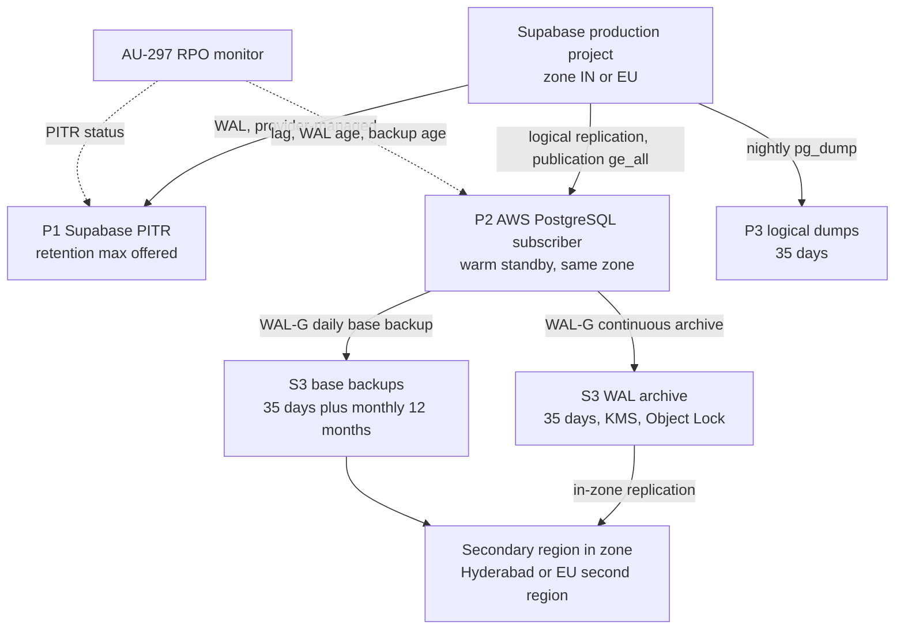
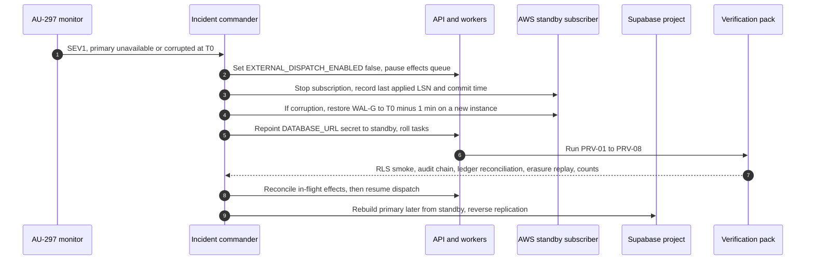
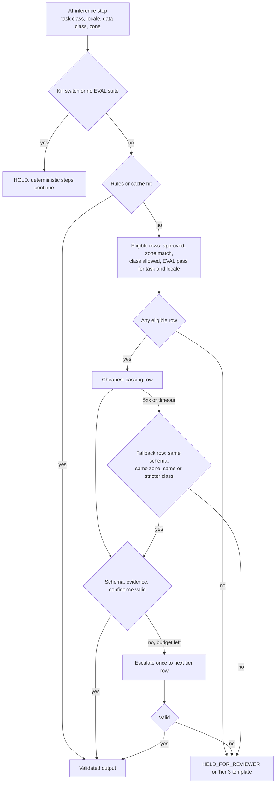

# AI Growth Engine: Employee Sales & Marketing Automation
## Application Blueprint: PART 11 (Batch 11.19b), Platform Decisions Implementation: RPO ≤ 15 min, Model Registry, Cross-Tenant Benchmarks, Supabase Access Model, Automations AU-290…299, FR Register, ADRs, Cut-over, Effort and Cost

| Field | Value |
|---|---|
| Document | Part 11.19b: capabilities C5 (RPO ≤ 15 min), C6 (provider-neutral model registry), C7 (cross-tenant benchmarks) and C8 (Supabase access model) at full implementation depth; automations AU-290…299; functional requirements FR-V12-R-001…155; ADR-255…264; cut-over into Release 1; development and running costs in separate tables |
| Version | 1.0 · 28 Nov 2026 |
| Baseline | Part 11.19a (shared foundation §11.19.5.0 and C1–C4); Part 11.14 DEC-771/772/778/787/788/789; Part 11.5b §11.5.5.9; Part 11.6b §11.6.5.3–6; Part 11.9b; Part 11.13b; Part 8.1, 8.2, 8.4 |
| Roles applied | Database reliability engineer · LLM platform lead · Privacy-preserving analytics scientist · Privacy and cloud-security lead · DevOps/SRE Lead · FinOps Lead · QA Lead |

---

### 11.19.5.5 C5 RPO ≤ 15 minutes in every residency region (DEC-787, with DEC-771 RTO ≤ 120 min)

#### A. Design stance and decisions

V12 FSD ch38 V8: "PostgreSQL: continuous WAL archiving + daily base backup, PITR 35 days, encrypted, stored in the same jurisdiction (CJ-R09)"; DEC-V9-01: critical RPO ≤ 15 min, RTO ≤ 4 h; growth RTO ≤ 2 h (made blocking by DEC-771). DEC-787 adopts this for **every residency region**. Part 11.5b offered Option A (Supabase PITR add-on) and Option B (logical replica on AWS). Because Supabase PITR retention choices may be shorter than 35 days and because a single-provider backup does not survive loss of the provider project or account, this part adopts **both**, as two independent recovery paths per zone.

| # | Decision point | Choice | ID |
|---|---|---|---|
| 1 | Path P1 (primary, fastest) | **Supabase PITR** add-on on the production project of each zone, at the longest retention offered (≥ 28 days; 35 if available — verify) [ASSUMPTION-1081]; restore to a new project at any second within retention; daily base backups included | DEC-888, ADR-261 |
| 2 | Path P2 (independent, 35 days) | **Logical replication** from Supabase (publication `ge_all`) to an AWS-hosted PostgreSQL subscriber in the same zone (IN: `ap-south-1`; EU: `eu-central-1`), on which **WAL-G** (Apache-2.0, verify) performs continuous WAL archiving plus a **daily base backup** to S3 in the zone (KMS-encrypted, Object Lock governance mode, 35-day retention + monthly copy 12 months). The subscriber is a warm standby (DEC-771) | DEC-888, DEC-889 |
| 3 | Path P3 (logical, slow) | Nightly `pg_dump -Fc` to S3 in the zone (kept from DEC-421) for tenant-level restores and portability | — |
| 4 | Residency of copies | All copies stay in the zone; secondary-region copies for region loss stay in-zone (IN: `ap-south-2` Hyderabad; EU: another EU region, e.g. `eu-west-1`, verify) — S3 Cross-Region Replication limited to those pairs by bucket policy | DEC-772 |
| 5 | Monitoring | AU-297 measures (a) replication lag (LSN difference) every 30 s, (b) age of the last archived WAL segment, (c) last successful base backup, (d) Supabase PITR status via the management API (verify). Warn at 5 min, page at 10 min, SEV1 at 15 min | DEC-888 |
| 6 | Sequences, large objects, DDL | Logical replication does not carry DDL or sequence values: migrations are applied to the subscriber by the same CI job (P2 schema = production schema), sequences are re-synced after restore (`setval` from max IDs; most keys are UUID), no large objects used | ADR-261 |
| 7 | Drills | Restore drill **at every release gate and quarterly** per zone, alternating P1 and P2; evidence pack PRV-01…08; RPO/RTO measured, not estimated (OPT-TC-ST-14) | DEC-787 |
| 8 | Erasure after restore | Replay of `privacy_erasure_log` (IDs and hashes only) after any restore (V12 ch38) | — |



#### B. Recovery objective matrix (per zone)

| Data class | RPO | RTO | Primary path | Secondary path | KPI |
|---|---|---|---|---|---|
| Critical transactional (RC-1) | ≤ 15 min | ≤ 4 h | P1 PITR | P2 WAL-G | KPI-18, KPI-19 |
| Growth workload (runs, outbox, approvals, mandate ledgers) | ≤ 15 min | **≤ 120 min (blocking, DEC-771)** | P2 warm standby promotion (fastest) or P1 | P1 | KPI-18, KPI-32 |
| Regenerable research data (RC-2) | ≤ 24 h | ≤ 8 h | P3 + rebuild | P1 | KPI-33, KPI-34 |
| Audit anchors | 1 day (anchors) / chain in DB per above | — | S3 Object Lock | — | — |

#### C. Sequence diagram: growth-workload recovery by standby promotion (target ≤ 120 min)



#### D. Data model (platform tables)

```sql
-- DDL-V12-R-13 Recovery evidence (platform scope, no personal data)
CREATE TABLE ge.recovery_path (
  zone text NOT NULL CHECK (zone IN ('IN','EU')), path text NOT NULL CHECK (path IN ('P1_supabase_pitr','P2_walg_standby','P3_logical_dump')),
  retention_days int NOT NULL, location text NOT NULL, secondary_location text, enabled boolean NOT NULL,
  PRIMARY KEY (zone, path), CHECK (path <> 'P2_walg_standby' OR retention_days >= 35));
CREATE TABLE ge.rpo_sample (
  zone text NOT NULL, sampled_at timestamptz NOT NULL, replication_lag_s int, wal_archive_age_s int, last_base_backup_at timestamptz,
  pitr_status text, PRIMARY KEY (zone, sampled_at));                         -- 30 s samples, 90-day retention, partitioned daily
CREATE TABLE ge.restore_drill (
  drill_id uuid PRIMARY KEY DEFAULT gen_random_uuid(), zone text NOT NULL, path text NOT NULL, trigger text NOT NULL CHECK (trigger IN ('release_gate','quarterly','incident')),
  release_ref text, started_at timestamptz NOT NULL, target_time timestamptz NOT NULL, restored_to timestamptz,
  service_restored_at timestamptz, achieved_rpo_s int GENERATED ALWAYS AS ((extract(epoch FROM target_time - restored_to))::int) STORED,
  achieved_rto_min int GENERATED ALWAYS AS ((extract(epoch FROM service_restored_at - started_at)/60)::int) STORED,
  prv_results jsonb NOT NULL DEFAULT '{}', passed boolean, evidence_ref text,
  CHECK (passed IS NULL OR evidence_ref IS NOT NULL));
```

#### E. Configuration

| Key | Value | Owner |
|---|---|---|
| `dr.rpo_target_s` | 900 | Fixed (DEC-787) |
| `dr.rto_growth_min` / `dr.rto_critical_min` | 120 / 240 | Fixed (DEC-771, DEC-V9-01) |
| `dr.lag_warn_s` / `page_s` / `sev1_s` | 300 / 600 / 900 | SRE |
| `walg.archive_timeout_s` (subscriber `archive_timeout`) | 60 | DBRE |
| `walg.base_backup_cron` | 02:15 local zone time daily | DBRE |
| `walg.retain_days` | 35 (+ monthly 12) | Fixed |
| `pitr.retention_days` (Supabase) | maximum offered (verify) | DBRE |
| `drill.cadence` | each release gate + quarterly per zone | SRE |

#### F. Runbooks (supersede DR-01…05 of Part 11.5b for the database; the AWS compute and Vercel runbooks stay)

| ID | Scenario | Path | Steps (summary) | RPO / RTO target |
|---|---|---|---|---|
| DR-R1 | Logical corruption or bad migration | P1 (or P2) | Pause effects; choose T = incident − 1 min from audit; P1 restore to new project, or P2 WAL-G PITR on new instance; PRV pack; repoint; reconcile; resume | ≤ 15 min / ≤ 120 min growth |
| DR-R2 | Supabase project or provider unavailable | P2 | Promote standby (already current within lag); PRV pack; repoint; inform customers via status page | lag (≤ 15 min) / ≤ 60 min |
| DR-R3 | AZ loss | provider / P2 | Supabase handles within region (plan-dependent, verify); AWS standby is multi-AZ storage; ECS reschedule | ≤ 15 min / ≤ 60 min |
| DR-R4 | Accidental tenant data deletion | P3 or P1 clone | Restore to a side database; extract the tenant's rows by `tenant_id`; re-insert through a reviewed script; audit | per request |
| DR-R5 | Region loss | P2 copy in secondary in-zone region | IaC apply in secondary region; WAL-G restore from replicated archive; Supabase new project only in the same zone (or AWS PostgreSQL); DNS switch; never restore outside the zone | ≤ 15 min (+ replication delay of S3 CRR, measured) / best effort ≤ 8 h |
| DR-R6 | RPO monitor breach without outage | — | Find the cause (subscriber stopped, slot lag, S3 errors); SEV1 if ≥ 15 min; fix; record | — |

**Post-restore verification pack (PRV).** PRV-01 RLS negative suite (sample of 30 policies); PRV-02 audit hash-chain verification against the last anchor; PRV-03 money ledgers reconciled (sum by currency, open invoices, usage ledger); PRV-04 outbox and effect ledger reconciliation (uncertain effects listed); PRV-05 erasure replay; PRV-06 row counts per table vs last sample; PRV-07 tenant-isolation spot check (two tenants, cross-reads 0); PRV-08 application smoke (sign-in, list, create draft, approval view).

#### G. Security controls

Backups encrypted with zone KMS keys (separate key per path); restore credentials held by two people (DBRE + SRE lead) with break-glass audit; Object Lock governance mode prevents deletion within retention; replication slot and subscriber credentials in Secrets Manager; the subscriber has no public IP and accepts connections only from the restore runner; S3 buckets deny any principal outside the zone account and any CRR destination outside the zone pair.

#### H. Cut-over into Release 1

| Step | Sprint | Activity | Exit |
|---|---|---|---|
| RPO-C1 | 1 | Enable Supabase PITR (IN); `recovery_path` rows | PITR status green |
| RPO-C2 | 2–3 | AWS subscriber, publication, WAL-G archive and base backups; CRR to Hyderabad | Lag < 60 s steady state |
| RPO-C3 | 3 | AU-297 monitor and alerts | Synthetic lag test pages |
| RPO-C4 | 4 | First full drill P1 and P2 (IN) | `restore_drill` passed with evidence |
| RPO-C5 | Release 1 gate | Drill under gate conditions; KPI-32 blocking test | RPO ≤ 15 min and growth RTO ≤ 120 min measured |
| RPO-C6 | EU provisioning | Same for EU | EU drill passed before first EU tenant data |

---

### 11.19.5.6 C6 Provider-neutral model registry (DEC-788)

#### A. Design stance and decisions

DEC-788 adopts V12 16.2 and AIX-02/03: **no model is used unless approved in the registry** with a DPA carrying a no-training clause, a processing region, allowed data classes, passed evaluation suites and a cost record. The Founder approves **Claude Sonnet through this registry as the current primary**. Other candidates (Anthropic Claude family, OpenAI, Google Gemini, Llama, Mistral, Qwen) become eligible **per task class** when they pass the same gate. Open-weight models may receive **masked personal data** (MDL-S1). An advanced tier (MDL-L1) and multimodal generation (image, video, voice) are adopted. The V12 fallback rule applies; all 111 evaluation suites are funded. AU-151/152/154 (Part 11.6b) implement eligibility, routing and evaluation; this part supplies the registry data model, the approval workflow, region handling, the change to Tier 2 and the re-certification automation AU-298.

| # | Decision point | Choice | ID |
|---|---|---|---|
| 1 | Unit of approval | A **registry row** = provider × model family × exact version × **hosting** (`provider_hosted`, `cloud_marketplace` such as a hyperscaler model service, `self_hosted_in_zone`, `free_third_party`) × **processing location** (per zone) × modality. Approval is per row and per task class | DEC-890, ADR-262 |
| 2 | Approval evidence (V12 16.2, all seven required) | Passing EVAL suites for the task class and locale (16.4); red-team pass (16.5); signed DPA with **no-training** clause, retention and region; cost per accepted result; latency p95; security review; plus licence check (open-weight, AU-047) | DEC-890 |
| 3 | Approvers | **Two distinct people**: R10 AI governance lead + R01 (or the Founder's named delegate); SoD pair `Models:propose` ↔ `Models:approve` | DEC-890, DEC-898 |
| 4 | Re-certification | Every 12 months, and immediately on: DPA change or expiry, region change, provider deprecation notice, price change > 20%, EVAL regression, security advisory. AU-298 suspends a row whose evidence lapses; routing moves to the next eligible row or HOLD | DEC-890 |
| 5 | Primary | **Claude Sonnet (current version)** approved for MDL-M1 and as the escalation target for MDL-L1 at higher effort; a larger Claude model may be approved as MDL-L1 when it passes; Haiku-class for MDL-S1 where its EVAL passes (model IDs verify at time of implementation, as of 27 Nov 2026) | DEC-788, DEC-892 |
| 6 | Zone processing | EU tenants route only to rows whose processing location is in the EU (e.g. a model offered through a cloud provider's EU region, or the provider's EU processing option — verify each); India tenants to rows with India processing where offered, otherwise to rows whose DPA and the India rule pack permit transfer (DPDP Act transfer rules; counsel-approved pack). If no eligible row exists for a zone and task, the AI step HOLDs or degrades to Tier 3; data never crosses zones silently [ASSUMPTION-1083] | DEC-891 |
| 7 | Open-weight | `self_hosted_in_zone` rows (vLLM on GPU or CPU workers in the zone; Llama, Mistral, Qwen families subject to licence) may receive **Personal (masked)** data via the Presidio masking step (AU-004); never unmasked Personal or Restricted | DEC-788, [CONFLICT-1094] |
| 8 | Tier 2 free fallbacks | Kept only as `free_third_party` rows that pass the same registry gate (DPA with no-training is usually unavailable on free tiers, so most will not qualify); data classes Public and Internal-non-personal only (invariant unchanged); opt-in per tenant, default off | DEC-890 (resolves CONFLICT-857) |
| 9 | Fallback rule | Same output schema, same zone, same-or-stricter data class, approved row; never silently to an unapproved model; otherwise HOLD/Tier 3 | V12 16.2 |
| 10 | Multimodal | Image, video and voice (TTS/ASR) rows registered with modality and with likeness/rights policy (DEC-576 carried); generation outputs labelled (AU-177); voice rows used by Part 11.18 | DEC-892 |
| 11 | Kill switch and rollback | Kill switch per row, per task class and per workflow pin (AIX-20, ≤ 60 s); `rollback_to` pointer per pin | V12 16.2 |

#### B. Registry rows at Release 1 (initial state; versions and availability verify at time of implementation, as of 27 Nov 2026)

| Row | MDL | Model (family) | Hosting | Zones (processing) | Data classes allowed | Task classes | Initial state |
|---|---|---|---|---|---|---|---|
| REG-001 | MDL-R0 | Rules engine | — | IN, EU | All | arithmetic, dedupe, filters | approved |
| REG-002 | MDL-M1 | **Claude Sonnet** (current) | provider_hosted or cloud_marketplace | IN (per DPA/pack), EU (EU processing option) | Public, Internal, Personal, Confidential; Restricted minimized | drafting, summarisation, qualification reasoning, escalation | **approved (Founder, DEC-788)** |
| REG-003 | MDL-S1 | Claude Haiku-class | as REG-002 | as REG-002 | Public, Internal, Personal masked, Confidential | classification, extraction, routing, short drafts | approved where EVAL passes per workflow/locale |
| REG-004 | MDL-L1 | Larger Claude model | as REG-002 | as REG-002 | as REG-002 | complex synthesis, proposals | candidate until EVAL + cost pass |
| REG-005 | MDL-S1 | Open-weight instruct (Llama / Mistral / Qwen family) | self_hosted_in_zone | IN, EU | Public, Internal, **Personal masked** | classification, extraction | candidate |
| REG-006 | MDL-E1 | Multilingual open-source embedding (E5-family or equivalent) | self_hosted_in_zone | IN, EU | Internal, Personal masked | embedding | approved (Part 7.3 §7.5.1) |
| REG-007 | MDL-G1 | Open-source injection/moderation classifier | self_hosted_in_zone | IN, EU | All | safety screening | approved after benchmark |
| REG-008 | MDL-M1 | OpenAI GPT family | provider_hosted / cloud_marketplace | EU (if EU processing offered); IN verify | per approval | per approval | candidate |
| REG-009 | MDL-M1 | Google Gemini family | cloud_marketplace | IN, EU (verify) | per approval | per approval | candidate |
| REG-010 | — | Image generation model | provider_hosted | per approval | Public, Internal (brand assets) | image | candidate |
| REG-011 | — | Video generation model | provider_hosted | per approval | Public, Internal | video | candidate |
| REG-012 | — | TTS/ASR voice models | provider_hosted / self_hosted_in_zone | IN, EU | Personal (call audio) only with Part 11.18 consent | voice | candidate |
| REG-013 | Tier 2 | Free third-party fallback(s) | free_third_party | none guaranteed | Public, Internal-non-personal | short drafts (availability only) | candidate (most will fail the DPA no-training test) |

#### C. Routing (AIX-03 as implemented by AU-152, with registry eligibility by AU-151 and AU-298)



#### D. Data model and DDL deltas (DDL-V12-R part 4; extends `ai_model` of Appendix C / Part 11.9b)

```sql
-- DDL-V12-R-14 Registry (platform tables; writes only by app_owner migrations or the registry service role app_registry)
ALTER TABLE ge.ai_model ADD COLUMN IF NOT EXISTS reg_id text UNIQUE CHECK (reg_id ~ '^REG-[0-9]{3}$');
ALTER TABLE ge.ai_model ADD COLUMN IF NOT EXISTS hosting text NOT NULL DEFAULT 'provider_hosted'
  CHECK (hosting IN ('provider_hosted','cloud_marketplace','self_hosted_in_zone','free_third_party'));
ALTER TABLE ge.ai_model ADD COLUMN IF NOT EXISTS modality text NOT NULL DEFAULT 'text' CHECK (modality IN ('text','embedding','classifier','image','video','voice'));
ALTER TABLE ge.ai_model ADD COLUMN IF NOT EXISTS task_classes text[] NOT NULL DEFAULT '{}';
ALTER TABLE ge.ai_model ADD COLUMN IF NOT EXISTS licence_ref text;                -- open-weight licence check (AU-047)
ALTER TABLE ge.ai_model ADD COLUMN IF NOT EXISTS redteam_ref text, ADD COLUMN IF NOT EXISTS recert_due date;
ALTER TABLE ge.ai_model DROP CONSTRAINT IF EXISTS ai_model_t2_data_ck;           -- replaced by hosting-based checks (CONFLICT-1094)
ALTER TABLE ge.ai_model ADD CONSTRAINT ai_model_free_tier_data_ck
  CHECK (hosting <> 'free_third_party' OR data_classes <@ ARRAY['Public','Internal-non-personal']::text[]);
ALTER TABLE ge.ai_model ADD CONSTRAINT ai_model_open_weight_data_ck
  CHECK (hosting <> 'self_hosted_in_zone' OR NOT (data_classes && ARRAY['Personal','Restricted']::text[]));   -- 'Personal-masked' allowed
ALTER TABLE ge.ai_model ADD CONSTRAINT ai_model_approved_evidence_ck
  CHECK (status <> 'approved' OR (dpa_ref IS NOT NULL AND no_training AND eval_status = 'passed' AND redteam_ref IS NOT NULL
         AND security_review_ref IS NOT NULL AND cpar_inr IS NOT NULL AND latency_p95_ms IS NOT NULL AND recert_due IS NOT NULL
         AND (hosting <> 'self_hosted_in_zone' OR licence_ref IS NOT NULL)));
CREATE TABLE ge.ai_model_region (
  model_id uuid NOT NULL REFERENCES ge.ai_model(model_id), zone text NOT NULL CHECK (zone IN ('IN','EU')),
  processing_location text NOT NULL, endpoint_ref text NOT NULL, transfer_basis_ref text,
  PRIMARY KEY (model_id, zone));
CREATE TABLE ge.ai_model_approval (
  model_id uuid NOT NULL REFERENCES ge.ai_model(model_id), approval_no int NOT NULL, task_class text NOT NULL,
  proposed_by uuid NOT NULL, approver_1 uuid, approver_1_role text CHECK (approver_1_role = 'R10'),
  approver_2 uuid, approver_2_role text CHECK (approver_2_role IN ('R01','R01-delegate')),
  decided_at timestamptz, decision text CHECK (decision IN ('approved','rejected','suspended','retired')), evidence_hash bytea NOT NULL,
  CHECK (approver_1 IS NULL OR approver_1 <> proposed_by), CHECK (approver_2 IS NULL OR (approver_2 <> approver_1 AND approver_2 <> proposed_by)),
  PRIMARY KEY (model_id, approval_no, task_class));
CREATE TABLE ge.ai_model_pin (                  -- per workflow (and optional tenant override within approved rows)
  workflow_id text NOT NULL, task_class text NOT NULL, locale text NOT NULL, zone text NOT NULL,
  model_id uuid NOT NULL REFERENCES ge.ai_model(model_id), prompt_version text NOT NULL, rollback_to uuid REFERENCES ge.ai_model(model_id),
  kill_switch boolean NOT NULL DEFAULT false, PRIMARY KEY (workflow_id, task_class, locale, zone));
```

#### E. APIs

| ID | Method and path | Caller | Notes |
|---|---|---|---|
| API-V12-R-043 | `GET /api/v1/ai/models` (AIX-02; V12 Appendix A "List model registry entries") | R10, R12 (read) | Filters zone, task, state |
| API-V12-R-044 | `POST /api/v1/ai/models` (propose row) | R10 or AI platform engineer | Evidence references |
| API-V12-R-045 | `POST /api/v1/ai/models/{mid}/approvals` | R10, then R01/delegate | 403 `SAME_APPROVER`; 422 `EVIDENCE_INCOMPLETE` (list) |
| API-V12-R-046 | `POST /api/v1/ai/models/{mid}/suspend` / `/retire` | R10, AU-298 | Immediate routing change |
| API-V12-R-047 | `PUT /api/v1/ai/pins/{workflow}/{task}/{locale}/{zone}` | R10 | Only to an approved row; `rollback_to` required |
| API-V12-R-048 | `POST /api/v1/ai/kill-switch` | R10, R01 | Scope row / task / workflow; ≤ 60 s |
| API-V12-R-049 | `GET /api/v1/ai/route-decisions?run_id=` | R10, R15 | Explains eligibility and choice |

#### F. Events and runbooks

Events: `ai.model.proposed/approved/rejected/suspended/retired/recert_due`, `ai.route.held` (reason), `ai.fallback.used`, `ai.kill_switch.changed`. Runbooks: **RB-AI-01** provider outage → fallback by rule or HOLD; status notice if HOLD > 30 min; **RB-AI-02** provider DPA change → AU-298 suspends affected rows the day the change is effective unless re-approved; **RB-AI-03** EVAL regression after a provider silent update → pin to `rollback_to`, re-run suites; **RB-AI-04** new candidate onboarding → 7-step evidence checklist, two-person approval, canary at 5% of eligible traffic for 7 days per task class.

#### G. Cut-over into Release 1

| Step | Sprint | Activity | Exit |
|---|---|---|---|
| MR-C1 | 1 | DDL-V12-R-14; seed REG-001…013 | Constraint tests TC-V12-R-067/068 |
| MR-C2 | 2 | Approval workflow (A011 tab Registry; Part 9.7 A115), two-person | TC-V12-R-069 |
| MR-C3 | 2–3 | AU-151/152 read the registry; zone filter; pins | M10 rows |
| MR-C4 | 3 | AU-298 re-certification | TC-V12-R-072 |
| MR-C5 | 3–6 | EVAL suites for the Release 1 AI workflows (EVAL-PRG-1, Part 11.6b) | Suites green per locale |
| MR-C6 | Release 1 gate | Founder approval record of REG-002 attached; first candidate evaluation (REG-005 open-weight) reported | Evidence pack |
