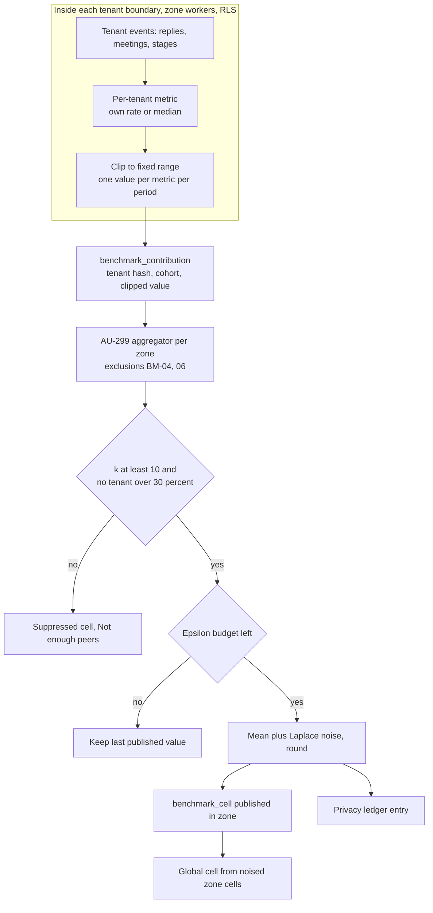

---

### 11.19.5.7 C7 Cross-tenant benchmarks with privacy-preserving aggregation (DEC-789)

#### A. Design stance and decisions

DEC-789: tenants take part under a **contract clause**, with an **opt-in default**; benchmarks are computed only over cohorts of **at least 10 tenants**, with **noise added**; **no tenant-level or personal data leaves the tenant boundary**. This part reads "opt-in default" as: participation is off until the tenant opts in, and the contract clause makes the opt-in available and governs it [ASSUMPTION-1084]. The AU-143 proposal of Part 11.13b (CONFLICT-983) is superseded by AU-299 and the parameters below ([CONFLICT-1095] resolved).

| # | Rule | Specification | ID |
|---|---|---|---|
| BM-01 | Participation | Contract clause BM-CL-1 in the order form/MSA; tenant R12 opts in on A042 Benchmarks tab with step-up; withdrawal any time, effective from the next period; published cells are not recomputed | DEC-893 |
| BM-02 | Minimum cohort | A cell is published only if **k ≥ 10 distinct contributing tenants** after all exclusions | DEC-789 |
| BM-03 | Dominance | No single tenant contributes > 30% of the cell's underlying events (n-dominance rule); otherwise suppressed | DEC-893 |
| BM-04 | Reciprocity | Only contributing tenants may view benchmarks | DEC-893 |
| BM-05 | Metrics | Rates and durations only (reply rate, meeting rate, lead-to-meeting cycle time, win rate, time to first response); no content, no counts of contacts, no revenue amounts in Release 2 | DEC-893 |
| BM-06 | Owner Portfolio | Owned startups are excluded unless R01 opts in (per startup) | CONFLICT-983 condition 5 |
| BM-07 | Noise | **Tenant-level differential privacy**: each tenant contributes one clipped value per metric per period (its own rate or median duration, clipped to a fixed range); the cell value is the mean of contributions plus Laplace noise with scale Δ/ε where Δ = (upper − lower)/k; **ε = 0.5 per metric per cell per month**, yearly cap ε = 6 per metric; values rounded to 1 percentage point or 0.5 day; k shown as a band (10–24, 25+) | DEC-893, [RECOMMENDATION-1099] |
| BM-08 | Zone locality | Contributions are computed inside each zone (IN, EU) by the zone's workers; the **global** benchmark is the weighted combination of the two already-noised zone cells (post-processing, no extra privacy cost); no tenant-level value crosses zones | DEC-772 |
| BM-09 | Cohorts | Industry (12 groups) × company size band (4 bands) × region of operation (zone); cells with k < 10 are merged up one level (size band → all sizes) before suppression | DEC-893 |
| BM-10 | Privacy ledger | `benchmark_privacy_ledger` records ε spent per metric per cell per period; AU-299 refuses releases beyond the cap | DEC-893 |
| BM-11 | DPIA | DPIA updated before first release (India, EU); data-protection notice wording in the contract clause | DEC-789 |
| BM-12 | Release | Built in **Release 2**; a cohort activates automatically when BM-02 is met [ASSUMPTION-1085] | DEC-893 |

#### B. Pipeline



#### C. Data model (DDL-V12-R part 5)

```sql
-- DDL-V12-R-15 Benchmarks
CREATE TABLE ge.benchmark_enrolment (
  tenant_id uuid NOT NULL REFERENCES ge.tenant(tenant_id), company_id uuid, contract_clause_ref text NOT NULL,
  opted_in_at timestamptz NOT NULL, opted_in_by uuid NOT NULL, withdrawn_at timestamptz, owner_portfolio boolean NOT NULL DEFAULT false,
  r01_opt_in_ref text, PRIMARY KEY (tenant_id, opted_in_at),
  CHECK (NOT owner_portfolio OR r01_opt_in_ref IS NOT NULL));             -- RLS P-TEN
CREATE TABLE ge.benchmark_contribution (                                    -- written by app_bench via a SECURITY DEFINER function; no tenant_id column
  period date NOT NULL, zone text NOT NULL, cohort text NOT NULL, metric text NOT NULL,
  contributor_hash bytea NOT NULL,                                          -- HMAC(zone pepper, tenant_id || period); not reversible without the pepper
  clipped_value numeric NOT NULL, event_share numeric NOT NULL CHECK (event_share BETWEEN 0 AND 1),
  PRIMARY KEY (period, zone, cohort, metric, contributor_hash));
CREATE TABLE ge.benchmark_cell (
  period date NOT NULL, zone text NOT NULL CHECK (zone IN ('IN','EU','GLOBAL')), cohort text NOT NULL, metric text NOT NULL,
  value_noised numeric, k_band text CHECK (k_band IN ('10-24','25+')), state text NOT NULL CHECK (state IN ('published','suppressed_k','suppressed_dominance','budget_exhausted')),
  epsilon numeric, published_at timestamptz, PRIMARY KEY (period, zone, cohort, metric),
  CHECK (state <> 'published' OR (value_noised IS NOT NULL AND k_band IS NOT NULL AND epsilon IS NOT NULL)));
CREATE TABLE ge.benchmark_privacy_ledger (
  zone text NOT NULL, cohort text NOT NULL, metric text NOT NULL, year int NOT NULL, epsilon_spent numeric NOT NULL DEFAULT 0 CHECK (epsilon_spent <= 6),
  PRIMARY KEY (zone, cohort, metric, year));
-- Contribution function: the only path from tenant data to the contribution table
CREATE FUNCTION ge.bench_contribute(p_period date, p_metric text) RETURNS void
  LANGUAGE plpgsql SECURITY DEFINER SET search_path = ge, pg_temp AS $$
BEGIN
  -- runs once per enrolled tenant with app.tenant_id set by the AU-299 worker; reads only that tenant's rows under RLS
  PERFORM ge.require_ctx();
  IF NOT EXISTS (SELECT 1 FROM ge.benchmark_enrolment e WHERE e.tenant_id = ge.ctx_tenant() AND e.withdrawn_at IS NULL) THEN RETURN; END IF;
  INSERT INTO ge.benchmark_contribution (period, zone, cohort, metric, contributor_hash, clipped_value, event_share)
  SELECT p_period, current_setting('app.zone'), ge.bench_cohort(ge.ctx_tenant()), p_metric,
         hmac(ge.ctx_tenant()::text || p_period::text, current_setting('app.bench_pepper'), 'sha256'),
         ge.bench_clip(p_metric, ge.bench_metric(ge.ctx_tenant(), p_metric, p_period)), ge.bench_event_share(ge.ctx_tenant(), p_metric, p_period)
  ON CONFLICT DO NOTHING;
END $$;
REVOKE ALL ON FUNCTION ge.bench_contribute(date, text) FROM PUBLIC; GRANT EXECUTE ON FUNCTION ge.bench_contribute(date, text) TO app_bench;
```

`app_bench` has no `SELECT` on business tables; it can only execute `bench_contribute` (which reads under the tenant's RLS context) and read/write the three benchmark tables. `app_rw` can read only `benchmark_cell` rows with `state = 'published'`, and the API returns them only to tenants with an active enrolment (BM-04).

#### D. APIs, events, runbooks

| ID | Method and path | Caller | Notes |
|---|---|---|---|
| API-V12-R-050 | `GET/POST /api/v1/benchmarks/enrolment`, `POST …/withdraw` | R12 + step-up | Contract clause reference required |
| API-V12-R-051 | `GET /api/v1/benchmarks?metric&cohort&period&scope=IN/EU/global` | Enrolled tenants (R12, R02, R17) | Replaces API-V12-M-24; 403 `BENCHMARKS_NOT_ENROLLED` |
| API-V12-R-052 | `GET /api/v1/admin/benchmarks/ledger` | R10, privacy officer | ε ledger and suppression stats |

Events: `benchmark.enrolment.changed`, `benchmark.period.published`, `benchmark.cell.suppressed`, `benchmark.budget.exhausted`. Runbooks: **RB-BM-01** suspected re-identification report → freeze publication, privacy review, adjust cohorts; **RB-BM-02** budget exhausted → keep previous value, review cadence; **RB-BM-03** cohort merge changes → recompute only future periods.

#### E. Cut-over

Release 2: Sprint R2-3 DDL and AU-299; R2-4 A042 Benchmarks tab and contract clause BM-CL-1 approved by Legal; R2-5 DPIA updates (IN, EU) and privacy-scientist review of the noise implementation (independent re-derivation of Δ and ε accounting); activation automatic per cohort when k ≥ 10.

---

### 11.19.5.8 C8 Supabase access model (DEC-778)

#### A. Design stance and decisions

DEC-778 corrects DEC-421: Django never uses the Supabase `service_role` key (which bypasses RLS). It connects through a dedicated least-privilege role **`app_rw`** (one canonical name) that is subject to every RLS policy and sets `app.tenant_id` and `app.company_ids` per transaction. The Supabase Data API (PostgREST/GraphQL) is disabled for application schemas. `service_role` is used only by the migration pipeline in CI behind break-glass approval with an audit trail. Part 11.9b used `ge_app`/`ge_worker`/`ge_owner` and noted that `ge_app` = `app_user` = `app_rw`; this part fixes the canonical names ([CONFLICT-1092] resolved by DEC-894) and provides the rename migration.

| Role (canonical) | Former name (Part 11.9b) | LOGIN | BYPASSRLS | Used by | Privileges |
|---|---|---|---|---|---|
| `app_owner` | `ge_owner` | NOLOGIN | no (owner; `FORCE ROW LEVEL SECURITY` on every table) | Owns schema `ge` objects | DDL via `SET ROLE` only |
| `app_migrator` | — (new) | LOGIN, CI runner IPs only | no | CI migration job | `SET ROLE app_owner`; DDL; reviewed backfills only |
| `app_rw` | `ge_app` (= V12 `app_user`) | LOGIN | **no** | Django API | DML per table grants; RLS applies |
| `app_worker` | `ge_worker` | LOGIN | **no** | Celery workers | as `app_rw` + worker-only tables (outbox relay, revocation, delivery) |
| `app_readonly` | `ge_readonly` | LOGIN | no | Reporting replicas, support with JIT grant | SELECT; RLS applies |
| `app_retention` | `ge_retention` | LOGIN | no | Retention job | DELETE on eligible partitions via functions |
| `app_platform_sec` | `ge_platform_sec` | LOGIN | no | Security findings | Platform security tables |
| `app_bench` | — (new, C7) | LOGIN | no | AU-299 | EXECUTE `bench_contribute`; benchmark tables |
| `app_registry` | — (new, C6) | LOGIN | no | Registry service | Registry tables |
| `service_role` (Supabase) | — | via key | **yes** | **CI migrations only, break-glass** | Never present in API/worker secrets |
| `postgres` (Supabase) | — | yes | yes | Break-glass DBA only (two-person) | — |
| `anon`, `authenticated` (Supabase) | — | via Data API | no | **Nobody** (Data API disabled for `ge`) | `REVOKE ALL` |

#### B. Controls

| ID | Control | Specification | Verified by |
|---|---|---|---|
| SA-01 | Data API off | Remove `ge` from exposed schemas; disable the Data API for the project where the setting exists (verify); `REVOKE ALL ON SCHEMA ge FROM anon, authenticated, PUBLIC` | TC-V12-R-081; M12 |
| SA-02 | No `service_role` in runtime | Secrets for API/worker task definitions contain only `app_rw`/`app_worker` DSNs; CI policy check fails a deploy that references `SUPABASE_SERVICE_ROLE_KEY` or a `postgres` DSN; runtime detector AU-292 queries `pg_stat_activity` every minute for sessions of `service_role`/`postgres` from app subnets → SEV2 | TC-V12-R-082 |
| SA-03 | Break-glass for migrations | `service_role` (or `postgres`) used by CI only when a migration needs it (extensions, Supabase-managed objects); approval by two people (DBRE + Security), time-boxed ≤ 2 h, ticket ID, audit event `db.break_glass.used`; normal migrations use `app_migrator` | TC-V12-R-083 |
| SA-04 | Context per transaction | First statement of every transaction: `SELECT ge.set_ctx($tenant, $companies, $write_company, $actor, $actor_kind, $zone)` (all `set_config(..., true)`); `ge.require_ctx()` raises `CONTEXT_MISSING` inside policies' helper when unset | TC-V12-R-084 |
| SA-05 | Pooler safety | Supavisor transaction mode; no session state; prepared statements off (Part 11.9b SB-03) | Pooled-reuse test |
| SA-06 | Network | Supabase network restrictions: AWS NAT IPs of the zone and the CI runner only (verify plan feature); SSL enforced; `verify-full` | Infra check |
| SA-07 | Password rotation | 90 days, dual-password overlap via two login roles `app_rw_a`/`app_rw_b` that are members of `app_rw` (grants inherited, `NOINHERIT` not set), switched by secret version | RB-SA-01 |
| SA-08 | Least privilege | No `DELETE` on append-only tables; no `TRUNCATE`; no `REFERENCES`; sequences `USAGE` only | Grant snapshot test |
| SA-09 | Drift detection | AU-292 nightly compares `pg_roles`, `pg_auth_members`, `information_schema.role_table_grants`, `pg_policies` and Data API settings to the expected snapshot in Git | TC-V12-R-085 |
| SA-10 | Dashboard access | Supabase organisation members via SSO with MFA (plan feature, verify) [GAP-1090]; least roles; quarterly review in AU-292 | Evidence |

#### C. Rename migration (DDL-V12-R part 6)

```sql
-- DDL-V12-R-16 Canonical role names (DEC-778, DEC-894); idempotent; run as app_owner via break-glass once
DO $$ BEGIN
  IF EXISTS (SELECT 1 FROM pg_roles WHERE rolname = 'ge_app') AND NOT EXISTS (SELECT 1 FROM pg_roles WHERE rolname = 'app_rw') THEN
    ALTER ROLE ge_app RENAME TO app_rw; END IF;
  IF EXISTS (SELECT 1 FROM pg_roles WHERE rolname = 'ge_worker') AND NOT EXISTS (SELECT 1 FROM pg_roles WHERE rolname = 'app_worker') THEN
    ALTER ROLE ge_worker RENAME TO app_worker; END IF;
  IF EXISTS (SELECT 1 FROM pg_roles WHERE rolname = 'ge_owner') AND NOT EXISTS (SELECT 1 FROM pg_roles WHERE rolname = 'app_owner') THEN
    ALTER ROLE ge_owner RENAME TO app_owner; END IF;
  IF EXISTS (SELECT 1 FROM pg_roles WHERE rolname = 'ge_readonly') THEN ALTER ROLE ge_readonly RENAME TO app_readonly; END IF;
  IF EXISTS (SELECT 1 FROM pg_roles WHERE rolname = 'ge_retention') THEN ALTER ROLE ge_retention RENAME TO app_retention; END IF;
  IF EXISTS (SELECT 1 FROM pg_roles WHERE rolname = 'ge_platform_sec') THEN ALTER ROLE ge_platform_sec RENAME TO app_platform_sec; END IF;
END $$;
DO $$ BEGIN
  IF NOT EXISTS (SELECT 1 FROM pg_roles WHERE rolname = 'app_migrator') THEN CREATE ROLE app_migrator LOGIN NOBYPASSRLS; END IF;
  IF NOT EXISTS (SELECT 1 FROM pg_roles WHERE rolname = 'app_bench') THEN CREATE ROLE app_bench LOGIN NOBYPASSRLS; END IF;
  IF NOT EXISTS (SELECT 1 FROM pg_roles WHERE rolname = 'app_registry') THEN CREATE ROLE app_registry LOGIN NOBYPASSRLS; END IF;
END $$;
GRANT app_owner TO app_migrator;                       -- SET ROLE only; app_owner itself NOLOGIN
ALTER ROLE app_rw NOBYPASSRLS; ALTER ROLE app_worker NOBYPASSRLS;
REVOKE ALL ON SCHEMA ge FROM PUBLIC, anon, authenticated;
ALTER DEFAULT PRIVILEGES FOR ROLE app_owner IN SCHEMA ge REVOKE ALL ON TABLES FROM PUBLIC, anon, authenticated;
CREATE TABLE IF NOT EXISTS ge.platform_table_allowlist (table_name text PRIMARY KEY, reason text NOT NULL);  -- the 16 + new platform tables (no tenant data)
-- Assertion used in CI and by AU-292 (fails the pipeline if any application role can bypass RLS)
DO $$ BEGIN
  IF EXISTS (SELECT 1 FROM pg_roles WHERE rolname IN ('app_rw','app_worker','app_readonly','app_retention','app_bench','app_registry','app_migrator') AND (rolbypassrls OR rolsuper)) THEN
    RAISE EXCEPTION 'APP_ROLE_CAN_BYPASS_RLS'; END IF;
  IF EXISTS (SELECT 1 FROM pg_class c JOIN pg_namespace n ON n.oid = c.relnamespace
             WHERE n.nspname = 'ge' AND c.relkind IN ('r','p') AND c.relname NOT IN (SELECT table_name FROM ge.platform_table_allowlist)
               AND NOT (c.relrowsecurity AND c.relforcerowsecurity)) THEN
    RAISE EXCEPTION 'TENANT_TABLE_WITHOUT_FORCED_RLS'; END IF;
END $$;
```

#### D. Runbooks

| ID | Trigger | Steps |
|---|---|---|
| RB-SA-01 Password rotation | 90 days | Create new password on the idle login (`app_rw_b`), deploy secret version, drain old connections, disable old login |
| RB-SA-02 `service_role` session detected from app subnet | AU-292 | SEV2; rotate service key; identify deploy; audit queries during window; privacy assessment |
| RB-SA-03 Migration needs `service_role` | Change ticket | Two-person approval; time-box; run; revoke; attach audit |
| RB-SA-04 Data API re-enabled by mistake | AU-292 drift | Disable; verify no grants; review access logs (Supabase API logs, verify retention) |

#### E. Cut-over

Sprint 0: roles and grants created with canonical names before any tenant data; Data API disabled; CI policy checks. Sprint 1: rename migration applied to environments that were created with `ge_*` names; AU-292 SA checks live. Release 1 gate: the Part 11.9b verification suite and the CI assertions above are blocking.
