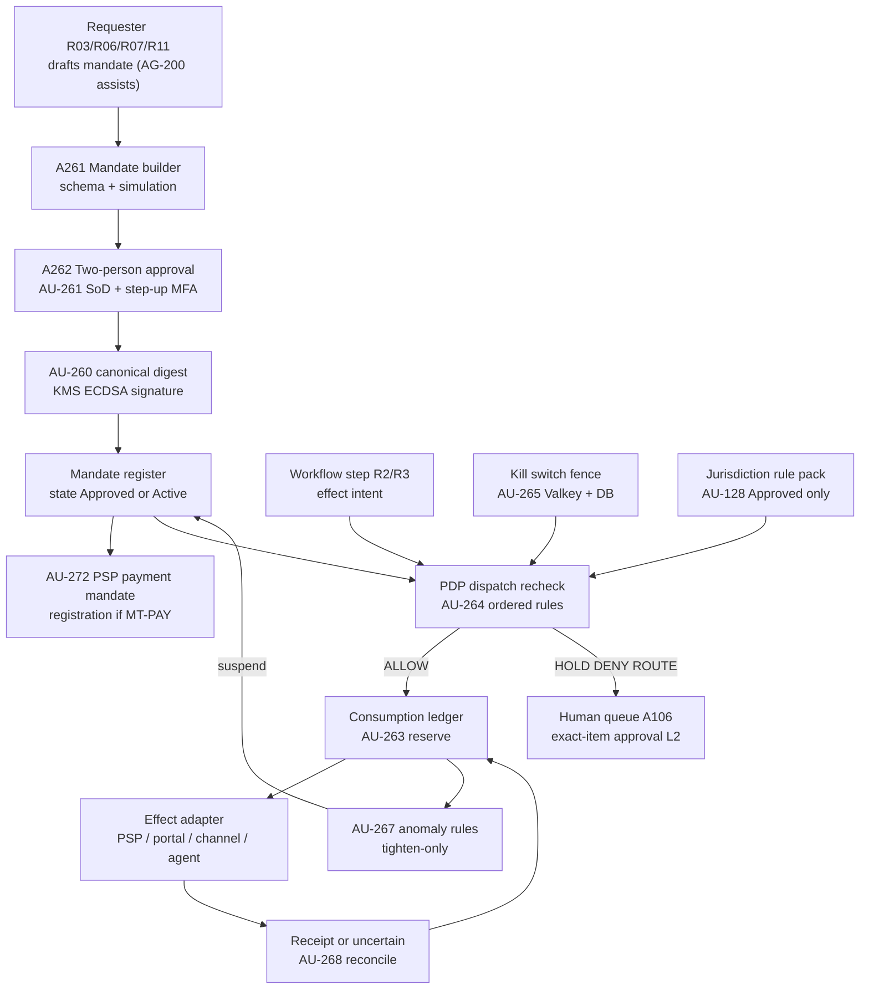
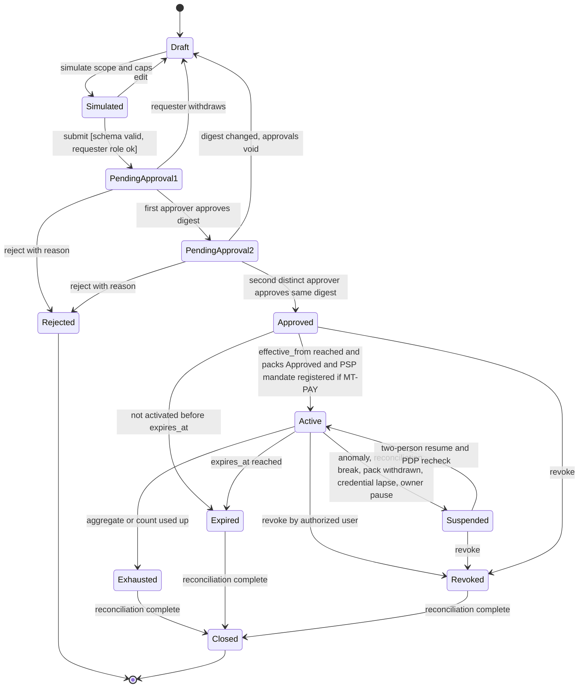
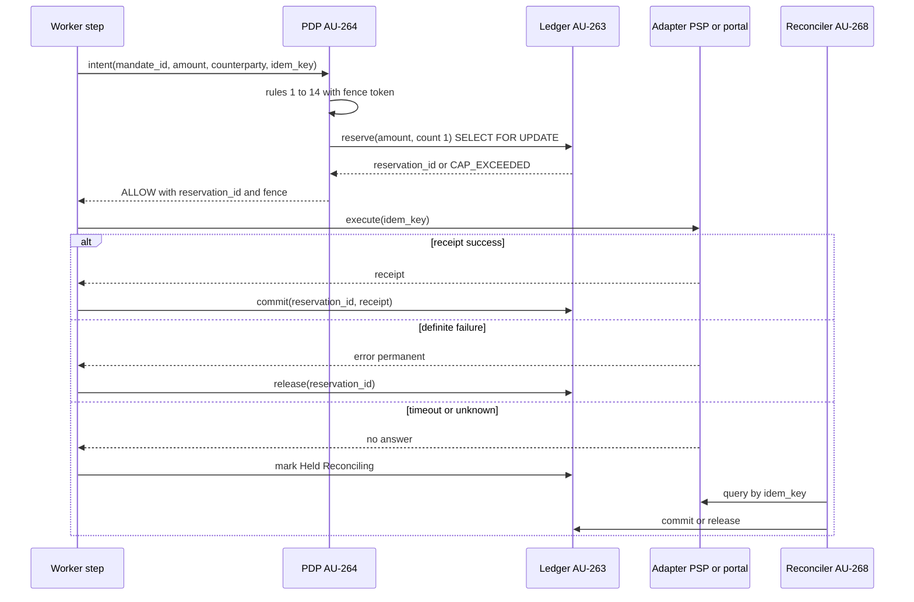

## 11.17.5 The mandate engine (MND)

The mandate engine is one shared backend module (`commercial.mandates`, Django app) used by every workflow that may act under a bounded mandate: outbound routine communication, ad spend, agentic commerce, payments, procurement, pricing experiments and tender submission. It owns the mandate record, its approvals, its consumption ledger and its decisions; the PDP calls it at every dispatch; workers never bypass it (ADR-240). It runs inside the tenant's residency region (DEC-772): an EU tenant's mandates, ledger and evidence never leave the EU stack.

### 11.17.5.1 Control objectives (MC-##)

Every MC is mandatory; none is configurable off. Each maps to requirements (§11.17.5.20) and tests (file b).

| MC | Control objective | Enforced by | V12 / baseline source | Verified by |
|---|---|---|---|---|
| MC-01 | No effect under a mandate unless the mandate is **Active**, in window, in scope and within every cap at the instant of dispatch | PDP + AU-264 | FL-09; BRD 18 L3; DEC-779 | Model M (TC-V12-P-001…300) |
| MC-02 | Every mandate is approved by **two authorized people**, distinct from each other and from the requester | AU-261; ABAC-03 | DEC-779; FSD 18 V6 | TC-V12-P-717…722 |
| MC-03 | The approval binds a canonical **digest** of the full mandate; any change voids the approvals | AU-260 | FL-09; BRL-APR-02 | TC-V12-P-723 |
| MC-04 | Caps are enforced **per action** and **in aggregate** per period, in the mandate currency, inclusive, with Decimal arithmetic | AU-263 | DEC-779; DEC-027 | Model M VAL dimension |
| MC-05 | Consumption is **reserved before** the effect and committed or released exactly once (no double spend under concurrency) | AU-263 | NFR-005; BRL-FIN-02 | TC-V12-P-726…729 |
| MC-06 | **Revocation** is instant: new dispatches denied within one PDP evaluation after commit (≤ 5 s target, ≤ 60 s bound) | AU-266, AU-265 | DEC-779; BRL-AUT-05 | Model K; TC-V12-P-730 |
| MC-07 | R3 mandates (commitment, money, bids, pricing) need one approver from Finance (R08/R09) or Legal (R10) by type, and the DEC-038 threshold approver | AU-261 | FSD 18 R3; DEC-038 | TC-V12-P-718…720 |
| MC-08 | A mandate never grows by itself: tightening may be automatic (anomaly engine, expiry, exhaustion); **loosening needs a new version and two-person approval** | AU-260/261/267 | BRL-APR-11 | TC-V12-P-724 |
| MC-09 | The **kill switch** blocks every new automated effect in its scope within 60 s; resume needs two people and a PDP recheck | AU-265 | BRL-AUT-05; ADR-085 | Model K (TC-V12-P-653…716) |
| MC-10 | **Jurisdiction gate**: the mandate type is usable in a jurisdiction only while its rule pack is Approved (counsel sign-off) | AU-128 + PDP | DEC-776; Part 11.15 | Model M JUR dimension |
| MC-11 | **Counterparty** must be in the mandate scope and in the tenant allowlist with a currently valid credential | AU-269/270 | SVC-28; DEC-780 | Model M CPT, Model C VC |
| MC-12 | **Uncertain outcome** is never retried blindly; reservation stays held until reconciled | AU-268; AU-026 | DEC-050; BRL-AUT-07 | Model C PSP=Timeout; Model B RECEIPT=TimeoutUnknown |
| MC-13 | Every decision (allow, hold, deny, route, defer) writes an **audit event** with mandate version, rule ID and reason code into the hash chain | AU-264 | Part 4.5.4; FSD 18 | All TCs assert audit |
| MC-14 | **Daily reconciliation** of mandate ledger ↔ effect receipts ↔ PSP/portal statements; any break suspends the mandate | AU-268 | SVC-28 KPI | TC-V12-P-741…744 |
| MC-15 | **Anomaly detection** may suspend or tighten, never loosen | AU-267 | RECOMMENDATION-1049 | TC-V12-P-745…750 |
| MC-16 | **Shadow period** for every new mandate type per tenant: decisions computed, effects routed to L2 approval, until exit criteria met | AU-264 flag | RECOMMENDATION-1050 | TC-V12-P-751 |
| MC-17 | The model never holds an effect tool; only the deterministic executor calls adapters (tool isolation) | Tool registry; CTRL-AI-04 | FSD 16; BRL-AI-07 amended | AI eval TC-AI-AG202-006 |
| MC-18 | **Counterparty text is data**; a request to exceed a mandate is held (AI-INJ-06) | AU-271 bounds; CTRL-AI-08 | FSD 16.5 | TC-AI-AG202-004 |
| MC-19 | Consent, suppression, quiet hours and the 09:00–21:00 window still apply per message under MT-OUT | PDP (AU-171/172) | DEC-777; BRL-ELG | Part 11.6b tests + TC-V12-P-752 |
| MC-20 | **Residency**: mandate, ledger, evidence and PSP/portal calls run from the tenant's region | Region router | DEC-772 | TC-V12-P-753 |
| MC-21 | **Idempotency**: one business intent produces at most one external effect (idempotency key = mandate ID + intent hash + attempt family) | AU-263/273/279 | NFR-005 | TC-V12-P-728 |
| MC-22 | **Step-up MFA** for mandate approval, amendment, revocation-resume and kill-switch resume; WebAuthn for R01/R08/R09/R10 approvers | IdP; ABAC-11 | Part 4.1 §4.3.3; MOB-09 | TC-V12-P-721 |
| MC-23 | **No approval from a notification**; mobile approval shows the same full mandate view and digest | A262 | MOB-09 | TC-V12-P-722 |
| MC-24 | **Evidence pack** per mandate exportable for audit: versions, approvals, decisions, effects, receipts, reconciliations, alerts | AU-268 export | FSD 34; SOC 2 (DEC-775) | TC-V12-P-754 |

### 11.17.5.2 Autonomy levels L0–L4 mapped to controls

The V12 scale (BRD 18 §V5) replaces the blueprint L0–L3 labels (DEC-542 adopted V12 labels; DEC-779 adopted the authority). The table is the binding control set per level.

| Control | **L0** Manual action recorded | **L1** AI proposes or drafts; human decides | **L2** Exact approved action with reviewer, expiry and limits | **L3** Bounded routine actions under approved mandate | **L4** Adaptive orchestration inside L3 constraints |
|---|---|---|---|---|---|
| Who performs the external effect | Human, outside or inside the system | Human (after deciding on the AI draft) | System executor, once, for the exact approved payload | System executor, repeatedly, for any payload inside the mandate | System executor, as planned by the orchestrator, for payloads inside the bound L3 mandate |
| What the human approves | Nothing in the system (records the action) | The draft, by acting on it | The **exact payload hash** of one action (BRL-APR-02), with expiry and limits | The **mandate** (scope, caps, windows, counterparties, jurisdictions, data classes), two people | The **plan** (objective, step graph, stop policy) **and** the L3 mandate it is bound to |
| Mandate required | No | No | No (a mandate may pre-fill reviewer and limits) | **Yes, Active** | **Yes, Active, plan-bound** (`plan_digest` in the mandate) |
| PDP recheck at dispatch | n/a (no automated dispatch) | Full recheck when the human's action dispatches | Full recheck + exact hash match + approval not expired | Full recheck + mandate rules 1–14 (§11.17.5.12) | Same as L3 + plan step is in the approved graph + plan budget |
| Caps | n/a | DEC-038 thresholds on the human approver | Approval amount = payload amount | Per-action + aggregate + count + velocity caps | Same caps; the plan cannot raise them; plan budget ≤ mandate remaining |
| Counterparty / recipient | Any lawful | Any lawful | The one in the payload | Only allowlisted counterparties in scope | Same as L3 |
| Kill switch effect | None (no automation) | Blocks dispatch | Blocks dispatch | Blocks dispatch; reservation released | Blocks; plan Paused |
| Monitoring | Audit only | Audit; approval SLA (BRL-APR-10) | Audit; approval expiry | Real-time anomaly rules AU-267; daily reconciliation | Same + plan drift monitor (step outside graph = stop) |
| Sampling review | — | — | 10% weekly of R2 dispatches (Part 7.3) | **Every** R3 effect visible in A263 within 1 min; weekly 100% review of R3 effects by the mandate owner; 10% R2 | Same as L3 |
| Evidence | Manual evidence record | Draft + decision | Approval record + receipt | Mandate version + decision + receipt + ledger entry | Same + plan version + step |
| Who may enable the level for a workflow | Default | Default | R02 (R2), R02 + R10 (R3) | Eligibility register (§11.17.5.14) + Approved jurisdiction pack + two-person mandate approval | R01 + R11 for the workflow, and an L3 mandate |
| Never allowed at this level | — | — | Approving its own payload; changing price beyond the approved version | Expanding scope; loosening caps; adding counterparties; acting in a non-approved jurisdiction; acting on Restricted data classes not in scope | Any of the L3 prohibitions; creating or amending mandates; choosing a new effect type |

**Default level per effect class** (FSD 18 V5; BRD 18: "R3 … default L2; regulatory or contractual requirements override any automation preference").

| Effect class | Default | Maximum with mandate | Mandate types | Extra approver (MC-07) |
|---|---|---|---|---|
| R0 read/draft | L3 (internal) | L4 | — (no mandate needed) | — |
| R1 internal record update | L2 | L4 | — | — |
| R2 external communication/provider/access write | L2 | L3 (L4 with plan) | MT-OUT, MT-PUB | Claims approver R10 when the template carries claims |
| R3 financial/legal/commitment | **L2** | L3 (L4 with plan) | MT-SPEND, MT-COM, MT-PAY, MT-PROC, MT-BID, MT-PRICE | Finance (R08/R09) for money types; Legal (R10) for MT-COM terms, MT-BID and MT-PRICE; DEC-038 threshold approver by value |

**Regulatory override rule (FR-V12-P-005).** If an Approved rule pack sets a stricter maximum level for an effect type in a jurisdiction (for example "payment above X requires customer authentication each time" or "portal forbids automated submission"), the stricter level applies, regardless of the mandate.

### 11.17.5.3 Mandate types

| Type | Purpose | Typical workflows | Effect class | Mandatory scope dimensions | Mandatory limits | Max validity | Who may request | Approvers (two, distinct) |
|---|---|---|---|---|---|---|---|---|
| **MT-OUT** | Routine outbound communication (approved templates, follow-ups, reminders, booking confirmations) | SVC-06-WF02, 07-WF02/04, 09-WF02/04, 10-WF01/02, 12-WF01/04, 16-WF01/02/04, 38 | R2 | channel accounts, template IDs and versions, audience segment, purpose, jurisdictions | messages per day, per recipient per 7 d (≤ BRL-ELG caps) | 90 days | R03, R05, R11 | R05L or R02 + R10 (claims) |
| **MT-PUB** | Publication of approved content variants | SVC-11, 13 | R2 | channels, content IDs, claims | posts per day | 90 days | R05 | R05L + R10 |
| **MT-SPEND** | Ad or campaign spend within budget | SVC-14-WF02/04 | R3 | ad accounts, campaign IDs, geos | per-day spend, per-campaign total, CPA ceiling | 90 days | R05, R03 | R02 + Finance (R08) |
| **MT-COM** | Agentic commerce negotiation and order acceptance with counterparty agents | SVC-28-WF02/03, 31-WF02/03, 21-WF01/02 | R3 | counterparties, offering IDs, price-book revision, term library version | per-order value, aggregate per period, max discount vs list, min margin, rounds | 30 days | R03, R07 | R02 + R10; Founder + Finance above DEC-038 thresholds |
| **MT-PAY** | Payment (pay-out to supplier or collection from customer) via licensed PSP | SVC-28-WF04, 39-WF03, 32-WF04, 17-WF03, 20-WF02/03 | R3 | payees/payers, PSP account, payment method, PSP mandate reference, purpose codes | per-transaction, per-period aggregate, count per period, velocity | 30 days (renewable; PSP mandate may be longer) | R07, R08 | R08 Finance Maker + R09 Finance Checker (BRL-APR-07); Founder above ₹10 lakh or cross-border (BRL-APR-06) |
| **MT-PROC** | Purchase order commitment to approved suppliers | SVC-39-WF03, 20-WF02 | R3 | suppliers, catalogue items, quantities, delivery terms | per-PO value, aggregate per period | 30 days | R07 | R02 + R08 |
| **MT-BID** | Submission of one exact bid package to one tender on one portal | SVC-19-WF03 | R3 | tender ID, portal profile, package hash, price, terms, signatory | single use (count = 1); price = approved price | Until tender deadline | R06 | R02 (Startup Head, BRL-BID-03) + R10; Founder + Legal above ₹10 lakh or cross-border |
| **MT-PRICE** | Live pricing/promotion experiment between two approved price-book revisions | SVC-37-WF03 (DEC-791) | R3 | price-book revisions A/B, offerings, segments, exposure % | max price delta, exposure cap, duration | 30 days | R03 | R02 + R08 + R10 |
| **MT-ORCH** | Binds an L4 plan to one or more L3 mandates | any eligible | inherits | plan digest, mandate IDs | plan budget ≤ Σ remaining of bound mandates | ≤ shortest bound mandate | R11 | R01 + R11 (plan) — the bound mandates keep their own approvals |

### 11.17.5.4 Mandate object (field specification)

Stored in table `mandate` (header, immutable per version) and `mandate_version`; child tables hold scope, limits and windows (§11.17.9, file b). "Digest" = field is part of the canonical digest (§11.17.5.10).

| # | Field | Type | Req. | Validation | Digest | Notes |
|---|---|---|---|---|---|---|
| 1 | `mandate_id` | UUIDv7 | Y | server-generated | Y | Stable across versions |
| 2 | `version` | integer ≥ 1 | Y | monotonic; new version on any change | Y | Approvals bind one version |
| 3 | `tenant_id`, `company_id` | UUID | Y | RLS scope (DEC-778 `app_rw`) | Y | One company per mandate; portfolio scope cannot hold mandates (BRL-TEN-05) |
| 4 | `region` | enum IN, EU | Y | = tenant residency (DEC-772) | Y | Execution region |
| 5 | `mandate_type` | enum MT-OUT…MT-ORCH | Y | §11.17.5.3 | Y | |
| 6 | `effect_class` | enum R2, R3 | Y | derived from type; cannot be lowered | Y | |
| 7 | `autonomy_level` | enum L3, L4 | Y | L4 needs `plan_digest` | Y | |
| 8 | `purpose` | text ≤ 500 | Y | plain language; shown to approvers | Y | Required by DPDP/GDPR purpose limitation |
| 9 | `workflow_refs[]` | SM-SVC-##-WF# list | Y | each in the eligibility register for this type | Y | |
| 10 | `action_types[]` | enum list (e.g. `quote.accept`, `order.place`, `payment.initiate`, `refund.initiate`, `bid.submit`, `message.send`) | Y | ⊆ type's allowed actions | Y | |
| 11 | `scope.counterparties[]` | counterparty IDs | Y for MT-COM/PAY/PROC/BID | each Allowlisted (AU-270) at approval | Y | Empty list = deny all |
| 12 | `scope.offerings[]` / `scope.price_book_revision` | IDs | Y for MT-COM/PRICE | revision must be Approved | Y | |
| 13 | `scope.channels[]` / `scope.accounts[]` / `scope.portal_profile` | IDs | per type | Active integration (M05) | Y | |
| 14 | `scope.jurisdictions[]` | ISO 3166 codes | Y | each has an Approved pack for this type at activation | Y | Rechecked at dispatch |
| 15 | `scope.data_classes[]` | Public, Internal, Confidential, Personal, Restricted | Y | Restricted only with R10 approval | Y | Inputs above the scoped class → HOLD |
| 16 | `scope.recipients_rule` | segment or explicit list | MT-OUT | consent rechecked per message | Y | |
| 17 | `limits.currency` | ISO 4217 | Y for money | single currency per mandate | Y | No implicit FX (§11.17.5.6) |
| 18 | `limits.per_action_max` | Decimal(18,2) | Y for money | > 0; ≤ tenant and company ceilings | Y | Inclusive |
| 19 | `limits.aggregate_max` + `limits.period` | Decimal + enum day/week/month/mandate | Y for money | ≥ per_action_max | Y | Calendar periods in mandate timezone |
| 20 | `limits.count_max` + period | integer | Y | ≥ 1 | Y | MT-BID = 1 |
| 21 | `limits.velocity` | n per minutes | Y | default 5 per 10 min (money) | Y | Burst guard |
| 22 | `limits.concurrency` | integer | Y | default 1 for money, 3 for MT-OUT | Y | In-flight effects |
| 23 | `limits.negotiation` | object {floor, ceiling, max_discount_pct, min_margin_pct, max_rounds, step_pct, forbidden_terms[]} | MT-COM | floor ≥ cost + min margin (AU-089) | Y | §11.17.6.4 |
| 24 | `window.effective_from`, `window.expires_at` | RFC 3339 | Y | expires − from ≤ type max validity | Y | |
| 25 | `window.daily` | list of {days, start, end, tz} | N | default 09:00–21:00 recipient local for MT-OUT (DEC-777); business hours of mandate tz for money | Y | |
| 26 | `window.blackouts[]` | date ranges | N | | Y | Holidays, quarter close |
| 27 | `plan_digest` | SHA-256 hex | L4 | must match an Approved A102 plan | Y | |
| 28 | `psp_mandate_ref` | string | MT-PAY | registered by AU-272; scheme-specific (UMRN, UPI mandate ID, SDD reference, card agreement ID) | N (linked after approval; change = new version) | Only references; no credentials |
| 29 | `requester_id` | user | Y | role allowed per type | Y | |
| 30 | `approvals[]` | {approver_id, role, decided_at, mfa_at, digest, signature} | Y (2) | §11.17.5.9 | N (signs the digest) | Stored in `mandate_approval` |
| 31 | `state` | enum (§11.17.5.8) | Y | | N | |
| 32 | `shadow_until` | timestamp or count | Y for first mandate of a type per tenant | §11.17.5.19 | Y | |
| 33 | `revocation` | {by, at, reason_code, text} | on revoke | reason code list RV-01…RV-09 | N | |
| 34 | `signature` | JWS (ES256, KMS key per region) | Y when Approved | over the digest | N | Verifiable by counterparties for MT-COM (selective disclosure, §11.17.6.2) |
| 35 | `policy_version`, `rule_pack_versions{}` | strings | Y | snapshot at approval | Y | Re-evaluated at dispatch against current Approved packs (stricter wins) |

### 11.17.5.5 Scope dimensions

| Dimension | Values | Check at dispatch | Outside scope → |
|---|---|---|---|
| Tenant / company | one company | RLS + PDP scope | Uniform 404 (BRL-TEN-04) |
| Workflow and step | eligible workflow list | run's workflow and step in list | DENY `WORKFLOW_NOT_IN_MANDATE` |
| Action type | allowed list | intent action in list | DENY `ACTION_NOT_IN_MANDATE` |
| Counterparty / payee / recipient | explicit allowlist (MT-COM/PAY/PROC/BID); rule (MT-OUT) | ID match + AU-270 status Allowlisted + credential valid (MT-COM) | DENY `COUNTERPARTY_NOT_TRUSTED` / HOLD `COUNTERPARTY_CREDENTIAL_EXPIRED` |
| Offering / item / price-book revision | IDs | each line's offering and revision in scope | DENY `OFFERING_NOT_IN_MANDATE` |
| Channel / account / PSP account / portal profile | IDs | intent's adapter target in scope | DENY `TARGET_NOT_IN_MANDATE` |
| Jurisdiction | ISO list ∩ Approved packs | counterparty/recipient jurisdiction (Part 11.15 §11.15.3.4 detection) | HOLD `JURISDICTION_PACK_NOT_APPROVED` or DENY `JURISDICTION_NOT_IN_MANDATE` |
| Data class | scoped classes | highest class in the payload ≤ scoped | HOLD `DATA_CLASS_EXCEEDS_MANDATE` |
| Purpose | purpose code | intent purpose = mandate purpose | DENY `PURPOSE_MISMATCH` |
| Payment method | scoped methods | intent method in scope and permitted in jurisdiction | DENY `PAYMENT_METHOD_NOT_PERMITTED` |
| Currency | one | intent currency = mandate currency | DENY `CURRENCY_MISMATCH` |

### 11.17.5.6 Limits

**Arithmetic.** All money is `Decimal(18,2)` with ROUND_HALF_UP (DEC-027); DTO boundary uses integer minor units (DEC-543). Caps are **inclusive** (`amount ≤ cap` passes). Tax is included in the capped amount unless the mandate states `cap_basis = net` (default `gross`). FX: a mandate has one currency; an intent in another currency is denied (`CURRENCY_MISMATCH`); cross-currency mandates are not supported in this release [ASSUMPTION-1041 covers PSP FX later].

**Cap hierarchy.** effective_cap = min(mandate per_action_max, company ceiling CFG, tenant ceiling CFG, PSP mandate max amount, scheme limit from the rule pack). The tenant and company ceilings are configuration (CFG-P-01/02) changeable only by two-person approval (BRL-APR-11 loosening rule).

| Limit | Formula evaluated at reservation (atomic) | Fail verdict | Reason code |
|---|---|---|---|
| Per action | `amount ≤ effective_cap` | ROUTE to L2 exact approval | `PER_ACTION_CAP_EXCEEDED_L2` |
| Aggregate per period | `committed_period + reserved_period + amount ≤ aggregate_max` | ROUTE to L2 | `AGGREGATE_CAP_EXCEEDED_L2` |
| Count per period | `count_committed + count_reserved + 1 ≤ count_max` | HOLD until next period, or ROUTE | `COUNT_CAP_REACHED` |
| Velocity | effects in the trailing window `< velocity.n` | DEFER (re-evaluate after window) | `VELOCITY_LIMIT` |
| Concurrency | in-flight reservations `< concurrency` | DEFER | `CONCURRENCY_LIMIT` |
| Negotiation | §11.17.6.4 | COUNTER or ESCALATE | `BEYOND_BOUNDS` |
| Exhaustion | `aggregate remaining < smallest permitted action` or count reached for `period = mandate` | state → Exhausted | `MANDATE_EXHAUSTED` |

**Split-transaction guard.** The anomaly engine (AU-267 rule AR-04) treats ≥ 3 actions to the same counterparty within 24 h whose sum exceeds `per_action_max` as a possible split; the third and later actions route to L2 until a human clears the pattern.

**Worked example (MT-PAY, OrganicSpec).** per_action_max ₹50,000.00; aggregate ₹2,00,000.00 per calendar month (Asia/Kolkata); count 10/month; velocity 3 per 10 min. Month-to-date committed ₹1,62,500.00, reserved ₹20,000.00. Intent ₹17,500.00 → 1,62,500 + 20,000 + 17,500 = ₹2,00,000.00 ≤ cap → ALLOW (boundary, inclusive). Intent ₹17,500.01 → ROUTE `AGGREGATE_CAP_EXCEEDED_L2`.

### 11.17.5.7 Time windows

| Window | Rule | Evaluated against | Outside → |
|---|---|---|---|
| Validity | `effective_from ≤ now < expires_at` (half-open) | server UTC clock (NTP-synchronised; skew alarm > 1 s) | before: HOLD `MANDATE_NOT_YET_EFFECTIVE`; after: DENY `MANDATE_WINDOW_ENDED` and state job sets Expired |
| Daily window | inside one configured interval for the day | mandate timezone (money, bids) or recipient local time (MT-OUT, DEC-777) | DEFER `OUTSIDE_DAILY_WINDOW` with `next_eligible_at` |
| Blackout | not inside a blackout range | mandate timezone | DEFER `BLACKOUT` |
| Rule-pack window | stricter pack window (e.g. calling hours, banking cut-off) | pack rules | DEFER per pack rule ID |
| Deadline (MT-BID) | §11.17.7.6 deadline guard | portal timezone stored with UTC (BRL-BID-01) | ESCALATE / EXPIRED |

DST and zone changes: windows are stored as local wall-clock with an IANA zone; the evaluator converts at evaluation time (no pre-computed UTC windows). Expiry and effective-from transitions are applied by AU-262 every minute **and** checked inline by the PDP (the job is not trusted alone).

### 11.17.5.8 Lifecycle state machine

| From → To | Trigger | Guard | Side effects | Event |
|---|---|---|---|---|
| Draft → Simulated | Requester runs simulation (FL-07) | schema valid | Simulation report: expected actions per period, worst-case spend, eligibility per jurisdiction; zero external effects (BRL-AUT-04) | `mandate.simulated` |
| Simulated → PendingApproval1 | Submit | requester holds a requesting role for the type; all scope items exist and are Active | Digest computed and frozen (AU-260); approvers assigned (AU-261) | `mandate.submitted` |
| PendingApproval1 → PendingApproval2 | Approve | approver ≠ requester; eligible role; MFA ≤ 5 min (R01/R08/R09/R10) or ≤ 15 min; digest shown = digest stored | Approval signed | `mandate.approved_1` |
| PendingApproval2 → Approved | Approve | approver ∉ {requester, approver 1}; role mix per MC-07; same digest | Mandate signed with regional KMS key | `mandate.approved` |
| Any pending → Draft | Edit | — | All approvals void; new version | `mandate.approvals_voided` |
| Approved → Active | AU-262 tick or inline at first dispatch | now ≥ effective_from; every scoped jurisdiction pack Approved for this type; MT-PAY: PSP mandate status `active`; shadow flag set if first of type | Ledger counters opened | `mandate.activated` |
| Active → Suspended | AU-267 anomaly, AU-268 break, AU-128 pack withdrawn, AU-270 credential lapse, owner or R10 pause | — (tightening is immediate, BRL-APR-11) | Reservations not yet dispatched released; in-flight held | `mandate.suspended` |
| Suspended → Active | Resume | two distinct approvers (one from the original approver roles); PDP recheck; cause resolved and evidenced | — | `mandate.resumed` |
| Active → Exhausted | Commit leaves no headroom | — | PSP mandate paused (MT-PAY) | `mandate.exhausted` |
| Active/Suspended/Approved → Revoked | Revoke | role: requester, any approver, R01, R10, R12 (tenant admin) | Fence token bumped (AU-265); PSP mandate cancelled (AU-266); counterparties notified (MT-COM) | `mandate.revoked` |
| Terminal → Closed | AU-268 | no reservation Held or Reconciling | Evidence pack sealed (MC-24) | `mandate.closed` |

### 11.17.5.9 Two-person approval

| Rule | Specification | Source |
|---|---|---|
| TPA-01 | Two approvals on the **same digest** are required; each approval is an individual signed act (no group approval, no delegation chains longer than one) | DEC-779; FL-09 |
| TPA-02 | Requester, approver 1 and approver 2 are three distinct natural persons (`user_id` and the IdP subject differ; shared mailboxes and service identities cannot approve) | ABAC-03; FSD 18 V6 |
| TPA-03 | Role mix per type (§11.17.5.3); at least one approver holds the authority for the **value** under DEC-038 (≥ ₹10 lakh or cross-border → R01 Founder + R10 Legal) | DEC-038; BRL-APR-06 |
| TPA-04 | R3 types need a Finance (MT-SPEND/PAY/PROC/PRICE) or Legal (MT-COM/BID/PRICE) approver | MC-07 |
| TPA-05 | Step-up MFA at the moment of approval (≤ 5 min for R01/R08/R09/R10; WebAuthn from the scale gate) | Part 4.1 §4.3.3 |
| TPA-06 | The approval screen (A262) shows the **full mandate in plain language** plus the worst-case exposure from the simulation and the digest prefix; approving from an e-mail, push or chat notification is impossible (deep link opens A262 only) | MOB-09 |
| TPA-07 | Delegation (BRL-APR-09) allowed for ≤ 14 days to an equal-or-higher role; a delegate may not approve a mandate requested by the delegator | BRL-APR-09 |
| TPA-08 | Approval SLA 1 business day; then escalate; **never auto-approve** (BRL-APR-10). Pending > 7 days → auto-withdrawn to Draft | BRL-APR-10 |
| TPA-09 | Conflict of interest: an approver with an open personal relationship flag to a scoped counterparty (CRM ownership of that counterparty) is not eligible for MT-COM/PAY/PROC with that counterparty | Fraud Lead [RECOMMENDATION-1049 family] |
| TPA-10 | Resume after suspension and resume after kill switch also need two people (TPA-02 applies) | MC-09 |
| TPA-11 | The AI agent identity R20 and any service identity R19 can never approve (Part 2.3 R20) | Part 2.3 |

### 11.17.5.10 Digest, signature, versioning and amendment

- **Canonical form.** JSON of all "Digest = Y" fields, keys sorted, money as decimal strings with exactly two places, timestamps in UTC RFC 3339 with `Z`, Unicode NFC, arrays of IDs sorted, no insignificant whitespace (same algorithm as the approval hash, Part 4.1 §4.5.4). `digest = SHA-256(canonical bytes)`.
- **Signature.** ES256 (ECDSA P-256) by a per-region KMS asymmetric key `mnd-sign-<region>`; the JWS protected header carries `kid`, `mandate_id`, `version`. Public keys are published at `/.well-known/jwks.json` of the tenant's agent domain for counterparties (MT-COM), with key rotation every 12 months and overlap 30 days.
- **Versioning.** Any change → version + 1 → state Draft → full two-person approval. **Tightening** edits (lower cap, remove counterparty, shorten window, remove jurisdiction) can be applied immediately by one authorized person as an **overlay restriction** (`mandate_restriction` row, effective now, audited) without waiting; the overlay is folded into the next version. Loosening is never immediate (BRL-APR-11, MC-08).
- **Verification at dispatch.** The PDP recomputes the digest of the stored version and compares it with the signed digest; mismatch → DENY `MANDATE_INTEGRITY_FAILURE`, security event SEV2, mandate Suspended.

### 11.17.5.11 Consumption ledger (reserve → commit / release)

| Rule | Specification |
|---|---|
| LED-01 | One row per reservation in `mandate_consumption` with states Reserved → Committed / Released / Held(Reconciling); amounts never updated in place; corrections by reversing rows (BRL-FIN-05) |
| LED-02 | Reservation is atomic with the cap check: `SELECT … FOR UPDATE` on the `mandate_counter` row for (mandate, period), then insert reservation, in one transaction under `app_rw` (DEC-778); lock order fixed tenant → company → mandate → period (ADR-199) |
| LED-03 | Reservation TTL 15 min (payments), 60 min (bids); expiry releases automatically **only** if no adapter call was made (outbox state checked); otherwise Held for reconciliation |
| LED-04 | Idempotency key `sha256(mandate_id ‖ version ‖ intent_hash ‖ attempt_family)`; the same key returns the original reservation and never a second one |
| LED-05 | Period counters roll at the period boundary in the mandate timezone; a reservation belongs to the period of its `reserved_at` |
| LED-06 | Refunds and reversals (MT-PAY) create negative consumption only when the mandate declares `refund_restores_headroom = true` (default false: refunds do not create new spending headroom) |

### 11.17.5.12 PDP dispatch recheck (ordered decision table)

The PDP evaluates the rules **in this order** and returns the first non-pass verdict (strictest earliest). The order is fixed (not configurable) and is the oracle of combinatorial model M (§11.17.14). Each verdict writes `mandate.decision` with the rule ID.

| # | Rule | Inputs | Verdict if failed | Reason code |
|---|---|---|---|---|
| 0 | Level L0 | run level | RECORD_ONLY (no automated effect exists) | `MANUAL_ACTION_L0` |
| 1 | Kill switch fence: no engaged switch in any enclosing scope (platform, tenant, company, agent, mandate, counterparty, portal, payment method) | Valkey flag + DB fence token | BLOCKED | `KILL_SWITCH_<SCOPE>` |
| 2 | Jurisdiction pack Approved for this effect type in every jurisdiction touched | AU-128 | HOLD | `JURISDICTION_PACK_NOT_APPROVED` |
| 3 | Payment method permitted in jurisdiction and in scope | pack + mandate | DENY | `PAYMENT_METHOD_NOT_PERMITTED` |
| 4 | Counterparty allowlisted, not revoked | AU-270 | DENY | `COUNTERPARTY_NOT_TRUSTED` |
| 5 | Counterparty credential currently valid (VC status, expiry, key binding) | AU-269 | HOLD | `COUNTERPARTY_CREDENTIAL_EXPIRED` |
| 6 | Level L1 → no automated dispatch without the human's decision | run level | HOLD | `DRAFT_AWAITS_HUMAN_DECISION_L1` |
| 7 | Level L2 → exact item approval present, unexpired, hash equal | approval record (AU-175) | ROUTE (if absent) | `EXACT_ITEM_APPROVAL_REQUIRED_L2` |
| 8 | Mandate state Active (and integrity: digest = signed digest) | `mandate` | HOLD / DENY | `MANDATE_NOT_ACTIVE`, `MANDATE_SUSPENDED`, `MANDATE_EXPIRED`, `MANDATE_REVOKED`, `MANDATE_EXHAUSTED`, `MANDATE_INTEGRITY_FAILURE` |
| 9 | Validity window and daily window | clock | HOLD / DENY / DEFER | `MANDATE_NOT_YET_EFFECTIVE`, `MANDATE_WINDOW_ENDED`, `OUTSIDE_DAILY_WINDOW`, `BLACKOUT` |
| 10 | Scope: workflow, action, offering, target, purpose, currency, data class | intent vs scope | DENY / HOLD | §11.17.5.5 codes |
| 11 | Per-action cap | amount | ROUTE to L2 | `PER_ACTION_CAP_EXCEEDED_L2` |
| 12 | Aggregate, count, velocity, concurrency (atomic reservation) | ledger | ROUTE / HOLD / DEFER | §11.17.5.6 codes |
| 13 | Consent, suppression, quiet hours, frequency (MT-OUT), budget (AI and spend), entitlement | AU-171/172, M53, entitlement | HOLD | existing codes (Part 11.6b) |
| 14 | Shadow period active → effect becomes an L2 approval task showing the mandate decision | `shadow_until` | ROUTE | `SHADOW_PERIOD_L2` |
| — | All pass | — | **ALLOW** with `reservation_id`, `fence_token`, `decision_id` | `WITHIN_MANDATE_L3` / `WITHIN_MANDATE_L4` |

The adapter must present `fence_token`; the adapter gateway rejects a call whose fence token is lower than the current token for any enclosing scope (closes the race between a revoke and an already-allowed dispatch, ADR-246).

### 11.17.5.13 Revocation and kill switch

| Aspect | Revocation (one mandate) | Kill switch (scope) |
|---|---|---|
| Who may engage | Requester, either approver, mandate owner, R01, R10, R12 | R01 (all scopes), R10 (any scope for compliance), R11 (agent/mandate/portal/payment-method in own tenant), platform on-call (provider/portal/payment-method platform-wide) — Part 7.3 §7.6.11 extended |
| Scopes | that mandate (all versions) | platform · tenant · company · agent · mandate type · mandate · counterparty · portal · payment method · PSP account |
| How | `POST /api/v2/mandates/{id}/revoke` with reason code RV-01…RV-09 | `POST /api/v2/kill-switches` |
| Engaging | One person, immediate, step-up MFA | One person, immediate, step-up MFA |
| Releasing | Not possible (revocation is final; create a new mandate) | **Two people** + PDP recheck + cause evidenced (MC-09, TPA-10) |
| Propagation | DB state commit + fence token bump + Valkey flag; PDP reads both | Valkey flag (TTL none) + DB row + fence bump; PDP and adapter gateway check |
| Target latency | New dispatch denied ≤ 5 s; bound ≤ 60 s (BRL-AUT-05) | ≤ 60 s for all workers; measured each release drill |
| In-flight effects | Not started → released; reserved but not called → released; called and awaiting → Held, reconcile by idempotency key; completed → stays committed, never hidden (FSD 18) | Same (model K, TC-V12-P-653…716) |
| External propagation | MT-PAY: AU-266 cancels/pauses the PSP mandate (UPI AutoPay revoke, e-NACH cancellation request, card agreement end, SDD mandate cancellation) and records the PSP acknowledgement; MT-COM: signed revocation notice to scoped counterparties; MT-BID: none possible after submission (withdrawal is a separate human action, §11.17.7) | Same per affected mandate |
| Reason codes | RV-01 owner request · RV-02 suspected fraud · RV-03 counterparty compromise · RV-04 legal/pack change · RV-05 reconciliation break · RV-06 anomaly confirmed · RV-07 personnel change · RV-08 contract ended · RV-09 other (text required) | KS-01 incident · KS-02 provider fault · KS-03 legal hold · KS-04 drill · KS-05 other |

### 11.17.5.14 Mandate eligibility register (which workflows may use which types)

Configuration registry `mandate_eligibility` (release-controlled, not tenant-editable; [RECOMMENDATION-1059]). V12 statements come from FSD 12 authority rows; "Max level" is the ceiling even under a mandate.

| Workflow (V12) | V12 effect class | Mandate type | Max level | Notes |
|---|---|---|---|---|
| SM-SVC-06-WF02, 07-WF02, 07-WF04, 09-WF02, 09-WF04, 10-WF01, 10-WF02, 12-WF01, 12-WF04, 16-WF01, 16-WF02, 16-WF04 (12, CONFLICT-799) | R2 | MT-OUT | L3 (L4 with plan) | First-touch outreach to a new organisation stays per-item L2 unless the pack allows and the template is approved for first touch; consent/suppression/quiet hours per message |
| SM-SVC-11 / 13 publication workflows | R2 | MT-PUB | L3 | Claims approved per template |
| SM-SVC-14-WF02, 14-WF04 | R3 | MT-SPEND | L3 | "no autonomous uncapped spend" (V12) = caps mandatory |
| SM-SVC-17-WF02, 17-WF03, 17-WF04 | R3 | MT-COM (quotes/discounts within approved bands) | L3 | Discount bands ≤ mandate `max_discount_pct`; above → DEC-038 approver |
| SM-SVC-18-WF03 | R3 | MT-COM (contract renewal on standard terms only) | L3 | Non-standard term → Legal (BRL-APR-05); signature human unless pack allows e-sign by authorized signatory |
| SM-SVC-19-WF03 | R3 | MT-BID | L3 | §11.17.7 |
| SM-SVC-20-WF02, 20-WF03 | R3 | MT-PROC / MT-PAY | L3 | Sales order acceptance within catalogue terms; payments only via PSP |
| SM-SVC-21-WF01, 21-WF02 | R3 | MT-COM | L3 | Partner/reseller terms from the approved library only |
| SM-SVC-28-WF01 | R2 | MT-PUB (catalog publication to authorized agent endpoints) | L3 | Only approved catalog version |
| SM-SVC-28-WF02, 28-WF03 | R2/R3 | MT-COM | L3 (L4 with plan) | §11.17.6 |
| SM-SVC-28-WF04 | R3 | MT-PAY | L3 | §11.17.6.5 |
| SM-SVC-30-WF02 | R3 | MT-PRICE | L3 | Experiments between approved price-book revisions |
| SM-SVC-31-WF02, 31-WF03 | R3 | MT-COM / MT-PROC | L3 | Marketplace order acceptance under listing terms |
| SM-SVC-32-WF04 | R3 | MT-PAY (receivable collection) | L3 | Collection by registered payment mandate only; no harassment rules from pack |
| SM-SVC-37-WF03 | R3 | MT-PRICE | L3 | DEC-791 |
| SM-SVC-39-WF03 | R3 | MT-PROC + MT-PAY | L3 | Purchase orders to approved suppliers; signatory rule per pack |
| All others | as V12 | none | V12 level (≤ L2 for R2/R3) | No mandate path |

### 11.17.5.15 Jurisdiction gating ("where lawful")

A mandate type activates in a jurisdiction only when **every** pack listed below for that type is **Approved** in AU-128 (Part 11.15 §11.15.3; strictest wins; Draft packs never enforced as Approved, CJ-R19/R20). Part 11.15 does not yet contain these packs [GAP-1044]; they must be drafted in the Part 11.15 format and signed off by counsel before activation. The engine is built and tested against synthetic packs.

| Mandate type | India (IN) packs required | EU packs required | Other markets (DEC-776 order) | Key legal questions for counsel (verify, as of 27 Nov 2026) |
|---|---|---|---|---|
| MT-OUT / MT-PUB | RP-IN-DPDP, RP-IN-SMS, RP-IN-WA, RP-IN-ADV (existing drafts) | RP-EU-MKT, RP-EU-AI (existing drafts) | per market | AI disclosure; consent; quiet hours |
| MT-SPEND | RP-PLAT-ADS + **RP-IN-PAY** (card/UPI on ad accounts) | RP-PLAT-ADS + **RP-EU-PAY** | per market | Platform terms for automated bidding/budget changes |
| MT-COM | **RP-GL-AGENTCOM** (contract formation by electronic agents) + **RP-IN-AGENTCOM** (Indian Contract Act 1872 and IT Act 2000 s.11–13 attribution of electronic records) | **RP-EU-AGENTCOM** (national contract law, E-Commerce Directive, EU AI Act transparency for AI interaction) | UK ECA 2000; US UETA §14 / E-SIGN (verify) | Is an offer/acceptance by the tenant's agent attributable to the tenant; mistake/error correction rights; consumer vs B2B (B2B only in this release) |
| MT-PAY | **RP-IN-PAY** (RBI e-mandate framework for recurring payments, AFA rules and limits, pre-debit notification, PA/PG directions, UPI AutoPay, e-NACH; DPSS directions) | **RP-EU-PAY** (PSD2/PSR SCA and MIT rules, SEPA SDD rulebook, PISP consent) | UK PSRs; US NACHA/Reg E (B2B: UCC 4A) | Who is the payer authenticating; MIT eligibility; limits without AFA/SCA; refund and dispute timelines |
| MT-PROC | RP-IN-AGENTCOM + RP-IN-PAY | RP-EU-AGENTCOM + RP-EU-PAY | per market | Authority of signatory; PO acceptance |
| MT-BID | **RP-IN-PROC** (GFR 2017, GeM terms, CPPP/GePNIC terms, DSC rules under the IT Act, state portal terms) | **RP-EU-PROC** (Directive 2014/24/EU, national eSubmission platform terms, eIDAS signatures) | **RP-US-PROC** (FAR, SAM.gov and agency portal terms) | Whether the portal permits automated or API submission; whether an organisational signer certificate is acceptable; anti-automation clauses |
| MT-PRICE | RP-IN-ADV (price claims), consumer protection (dark patterns guidelines) | RP-EU-MKT (Omnibus price-reduction rules) | per market | Price discrimination and transparency |

### 11.17.5.16 Evidence and audit trail

| Evidence item | When written | Store | Retention | Integrity |
|---|---|---|---|---|
| Mandate version (full JSON + digest + JWS) | Each version | `mandate_version` + S3 evidence bucket (object lock, compliance mode) | 8 years for money/bid types (accounting/tender records; verify per jurisdiction), 3 years otherwise | Hash chain (Part 4.5.4) + KMS signature |
| Approval acts | Each approval/rejection | `mandate_approval` | Same as mandate | Signed by approver session key reference + MFA timestamp |
| Simulation report | Each submit | S3 | Same | SHA-256 referenced from version |
| Decision log (every PDP verdict) | Every dispatch attempt | `mandate_decision` (partitioned monthly) | 2 years hot, 8 years cold for R3 | Hash chain |
| Effect receipt (PSP, portal, channel, counterparty) | Each effect | `effect_receipt` + raw payload in S3 | Same as mandate | Payload hash; provider signature retained where provided |
| Ledger rows | Each reserve/commit/release | `mandate_consumption`, `ledger_entry` | 8 years | Append-only |
| Revocations, suspensions, kill-switch events | Each | `mandate_event`, `kill_switch_event` | 8 years | Hash chain |
| Anomaly alerts and dispositions | Each | `anomaly_alert` | 3 years | — |
| Reconciliation runs | Daily | `recon_run`, `recon_break` | 8 years | — |
| Evidence pack export | On demand (A263) | ZIP with manifest, signed | — | Manifest SHA-256 signed (MC-24) |

### 11.17.5.17 Reconciliation

| Recon | Frequency | Left | Right | Match key | Break handling |
|---|---|---|---|---|---|
| RC-P-01 Mandate ledger ↔ effect receipts | Hourly + daily close | `mandate_consumption` Committed | `effect_receipt` success | reservation_id / idempotency key | Missing receipt → Held; extra receipt without reservation → **SEV2**, mandate Suspended (MC-14) |
| RC-P-02 Payments ↔ PSP | Daily after PSP settlement file (T+1) and on webhooks | `payment_txn` | PSP settlement report / API | PSP payment ID + idempotency key | Amount/currency mismatch → Finance maker-checker (BRL-APR-07); unknown PSP payment under our merchant → SEV1 |
| RC-P-03 Settlement ↔ bank | Daily | `settlement_batch` | Bank statement (manual upload or bank API, verify) | UTR / settlement ID | Short settlement → case |
| RC-P-04 PSP mandates ↔ platform mandates | Daily | `payment_mandate` | PSP mandate list | PSP mandate ref | Active at PSP but platform Revoked → AU-266 re-cancel + SEV2 |
| RC-P-05 Bid submissions ↔ portal | After each submission and at deadline | `bid_submission` | Portal acknowledgement / my-bids list | portal bid ID / receipt number | Unknown → human check on portal before deadline |
| RC-P-06 Counterparty transactions ↔ counterparty statements | Weekly (MT-COM) | `commerce_order` | Counterparty signed order confirmations | order_ref + JWS | Disagreement → dispute case |

### 11.17.5.18 Monitoring and anomaly detection

Rules engine first (deterministic, Tier 0); statistical baselines only after 90 days of per-tenant data [RECOMMENDATION-1056]. Any rule can **suspend or tighten**; none can loosen (MC-15).

| Rule | Signal | Threshold (default, CFG-P-10) | Action | Owner notified |
|---|---|---|---|---|
| AR-01 Near-cap clustering | ≥ 3 actions in 24 h at ≥ 95% of per-action cap | 3 | Route next actions to L2; alert | Mandate owner, R08 |
| AR-02 Velocity spike | actions per hour > 3× trailing 14-day hourly p95 (after 90 days) or > velocity limit | — | Defer + alert | Owner |
| AR-03 New counterparty first effect | first effect with a counterparty under this mandate | always | Shadow (L2) for first effect | Owner |
| AR-04 Split transactions | ≥ 3 actions same counterparty in 24 h with Σ > per-action cap | 3 | L2 for subsequent; alert | Owner, Fraud |
| AR-05 Off-hours | effect outside 08:00–20:00 mandate tz despite daily window allowing | — | Alert only | Owner |
| AR-06 Payee instrument change | counterparty bank/UPI handle changed within 30 days of effect | 30 d | **Suspend** mandate for that counterparty; human re-verification | R08, Fraud |
| AR-07 Reconciliation break | any RC-P-01/02 break | 1 | **Suspend** | R08/R09 |
| AR-08 Decline/failure rate | PSP declines > 20% of last 20 attempts | 20% | Suspend payments under mandate | R08 |
| AR-09 Injection signal | AU-005/MDL-G1 flags counterparty message | 1 | Hold negotiation; human | Owner, Security |
| AR-10 Price drift | accepted price within 1% of floor ≥ 5 times in 7 d | 5 | Alert; pricing review | R02 |
| AR-11 Exhaustion forecast | projected exhaustion < 3 days | — | Notify owner (renewal requires new approval) | Owner |
| AR-12 Duplicate intent | same intent hash from two runs | 1 | Second held (BRL-AUT-09) | Owner |

**KPIs for this part** (KPI-P-##; OKPI family not used because these are capability KPIs).

| KPI | Definition | Target | Source |
|---|---|---|---|
| KPI-P-01 Unauthorized transactions | effects outside an Active mandate or approval | **0** | V12 SVC-28 acceptance |
| KPI-P-02 Verified mandate and idempotency | share of effects with a matching mandate decision and unique idempotency key | **100%** | V12 SVC-28 |
| KPI-P-03 Revocation latency p99 | revoke commit → last allowed dispatch | ≤ 5 s (bound 60 s) | MC-06 |
| KPI-P-04 Reconciliation breaks open > 2 business days | count | 0 | MC-14 |
| KPI-P-05 Mandate approval cycle time p50 | submit → Approved | ≤ 1 business day | BRL-APR-10 |
| KPI-P-06 Unapproved bid submissions | submissions whose package hash ≠ approved hash | **0** | V12 SVC-19 |
| KPI-P-07 Verified receipt rate | submissions with a verified portal receipt | ≥ 99% | V12 SVC-19-WF03 |
| KPI-P-08 Deadline misses for mandated tenders | submissions after the deadline | 0 | BRL-BID-01 |
| KPI-P-09 Duplicate transaction count | effects with the same intent | 0 | V12 SVC-28-WF04 |
| KPI-P-10 Chargeback ratio | chargebacks / card transactions per month | < 0.5% (scheme monitoring thresholds are higher; verify) | Payments |
| KPI-P-11 Budget-violation rejection | out-of-bound intents rejected / out-of-bound intents | 100% | V12 SVC-28-WF03 |
| KPI-P-12 Anomaly true-positive rate | confirmed / dispositioned alerts | ≥ 30% after 90 days (tuning target) | AU-267 |

### 11.17.5.19 Shadow period (first mandates per tenant and type)

The first mandate of each type per tenant runs in **shadow** [RECOMMENDATION-1050]: the PDP computes the full decision; ALLOW becomes ROUTE `SHADOW_PERIOD_L2` and an approver sees "the mandate would have allowed this". Exit when all hold: ≥ 20 shadow decisions **and** ≥ 14 days **and** 0 disagreements where a human rejected an action the mandate allowed **and** R10 sign-off. A human rejection of a mandate-allowed action resets the counter and opens a mandate review.

### 11.17.5.20 Requirements register: mandate engine (FR-V12-P-001…069)

| ID | Requirement | V12 source | Rule / acceptance | Priority | Release | Epic | Test |
|---|---|---|---|---|---|---|---|
| FR-V12-P-001 | Store and enforce the V12 autonomy level L0–L4 per workflow step; L0/L1 never dispatch automatically | BRD 18 | Model M AUT; L0 → RECORD_ONLY | Must | R2 | EP-18 | TC-V12-P-001…300 |
| FR-V12-P-002 | L2 exact-item approval path (hash, reviewer, expiry, limits) reused for mandate overflows | BRD 18 L2 | ROUTE codes create A106 approval task | Must | R2 | EP-18 | TC-V12-P-725 |
| FR-V12-P-003 | L3 execution under an Active bounded mandate | BRD 18 L3; DEC-779 | ALLOW only when rules 0–14 pass | Must | R2 | EP-18 | TC-V12-P-232…259 |
| FR-V12-P-004 | L4 plans bind to L3 mandates; plan step outside graph stops the plan; plan cannot raise caps | BRD 18 L4 | Plan budget ≤ Σ remaining | Must | R2 | EP-18 | TC-V12-P-755 |
| FR-V12-P-005 | Default level per effect class; stricter rule pack overrides | BRD 18 note | Pack max level applied | Must | R2 | EP-18 | TC-V12-P-756 |
| FR-V12-P-006…012 | Mandate object fields 1–35 (§11.17.5.4) with validation; one company; region = residency; scope lists; limits; windows; plan digest | FL-09 | Schema validation 422 with field errors | Must | R2 | EP-18 | TC-V12-P-757 |
| FR-V12-P-013 | Mandate eligibility register (§11.17.5.14), release-controlled | FSD 12 R2/R3 rows | Mandate for ineligible workflow rejected at submit | Must | R2 | EP-18 | TC-V12-P-758 |
| FR-V12-P-014 | Mandate types MT-OUT…MT-ORCH with allowed actions and max validity | DEC-779 | Type rules enforced | Must | R2 | EP-18 | TC-V12-P-759 |
| FR-V12-P-015…020 | Two-person approval TPA-01…11 incl. distinct persons, role mix, step-up, no notification approval, SLA, CoI | DEC-779; V6; MOB-09 | §11.17.5.9 | Must | R2 | EP-18 | TC-V12-P-717…722 |
| FR-V12-P-021 | Canonical digest and KMS signature; integrity check at dispatch | FL-09; CTRL-AI-08 | Tampered row → DENY + SEV2 | Must | R2 | EP-18 | TC-V12-P-723 |
| FR-V12-P-022 | Versioning; tightening overlay immediate; loosening needs new approval | BRL-APR-11 | Overlay effective at next PDP call | Must | R2 | EP-18 | TC-V12-P-724 |
| FR-V12-P-023…027 | Limits per action, aggregate, count, velocity, concurrency; inclusive Decimal caps; cap hierarchy; split guard | DEC-779 | §11.17.5.6 | Must | R2 | EP-18 | Model M VAL; TC-V12-P-726…729 |
| FR-V12-P-028 | Simulation of a mandate with zero external effects | FL-07; BRL-AUT-04 | Simulation report fields | Must | R2 | EP-18 | TC-V12-P-760 |
| FR-V12-P-029…031 | Validity, daily, blackout windows; IANA zones; inline expiry | DEC-779 | §11.17.5.7 | Must | R2 | EP-18 | Model M WIN |
| FR-V12-P-032 | Lifecycle state machine and transition guards (§11.17.5.8) | FL-09 | Illegal transitions 409 | Must | R2 | EP-18 | TC-V12-P-761 |
| FR-V12-P-033…036 | Consumption ledger LED-01…06 | NFR-005 | Concurrency test 100 parallel intents | Must | R2 | EP-18 | TC-V12-P-726…729 |
| FR-V12-P-037 | Shadow period MC-16 | REC-1050 | Exit criteria | Must | R2 | EP-18 | TC-V12-P-751 |
| FR-V12-P-038 | Mandate builder, approval, register, monitor screens A260–A263 | FSD 21 panel | UI ACs | Must | R2 | EP-18 | TC-V12-P-762 |
| FR-V12-P-039 | Mandate APIs and events (§11.17.9) | FSD 25 pattern | OpenAPI contract tests | Must | R2 | EP-18 | TC-V12-P-763 |
| FR-V12-P-040…052 | PDP ordered decision table rules 0–14, reason codes, fence token | FSD 18 recheck | Model M oracle | Must | R2 | EP-18 | TC-V12-P-001…300 |
| FR-V12-P-053…058 | Revocation and kill switch (§11.17.5.13); scopes; ≤ 60 s; two-person resume; PSP mandate cancel; counterparty notice | DEC-779; BRL-AUT-05 | Model K | Must | R2 | EP-18 | TC-V12-P-653…716, 730 |
| FR-V12-P-059…061 | Evidence and audit (§11.17.5.16); evidence pack export | FSD 34 | Manifest verifies | Must | R2 | EP-18 | TC-V12-P-754 |
| FR-V12-P-062…064 | Reconciliation RC-P-01…06 | SVC-28 KPI | Breaks suspend | Must | R2 | EP-18 | TC-V12-P-741…744 |
| FR-V12-P-065…067 | Anomaly rules AR-01…12, tighten-only | Fraud | AR tests | Must | R2 | EP-18 | TC-V12-P-745…750 |
| FR-V12-P-068 | KPIs KPI-P-01…12 on A263 and A089 | V12 KPIs | Dashboard values from ledger | Should | R2 | EP-17 | TC-V12-P-764 |
| FR-V12-P-069 | Jurisdiction gating per type (§11.17.5.15) | DEC-776 | Draft pack never ALLOW | Must | R2 | EP-03 | Model M JUR |

