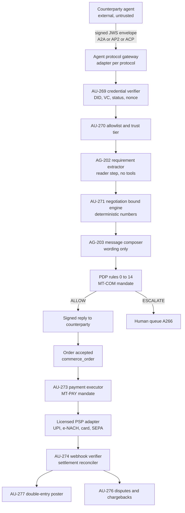
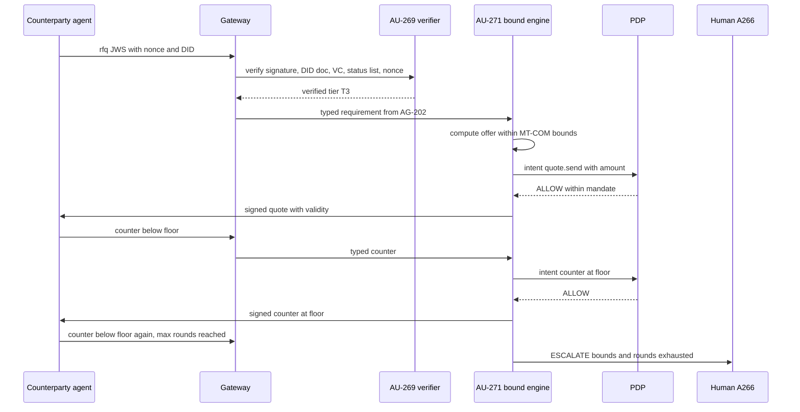
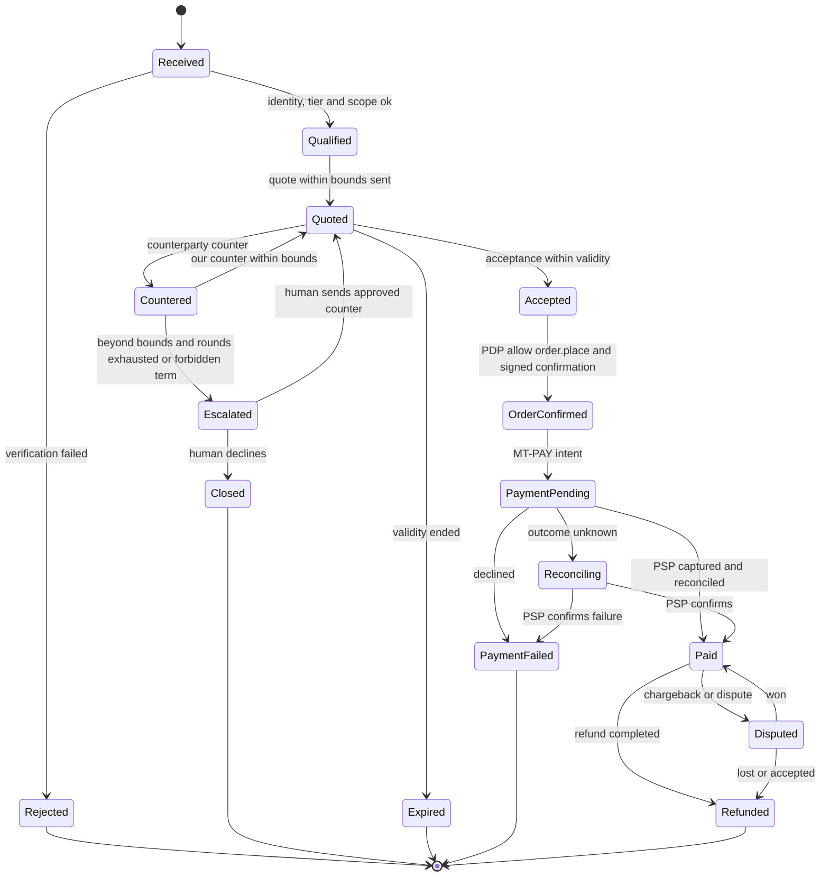
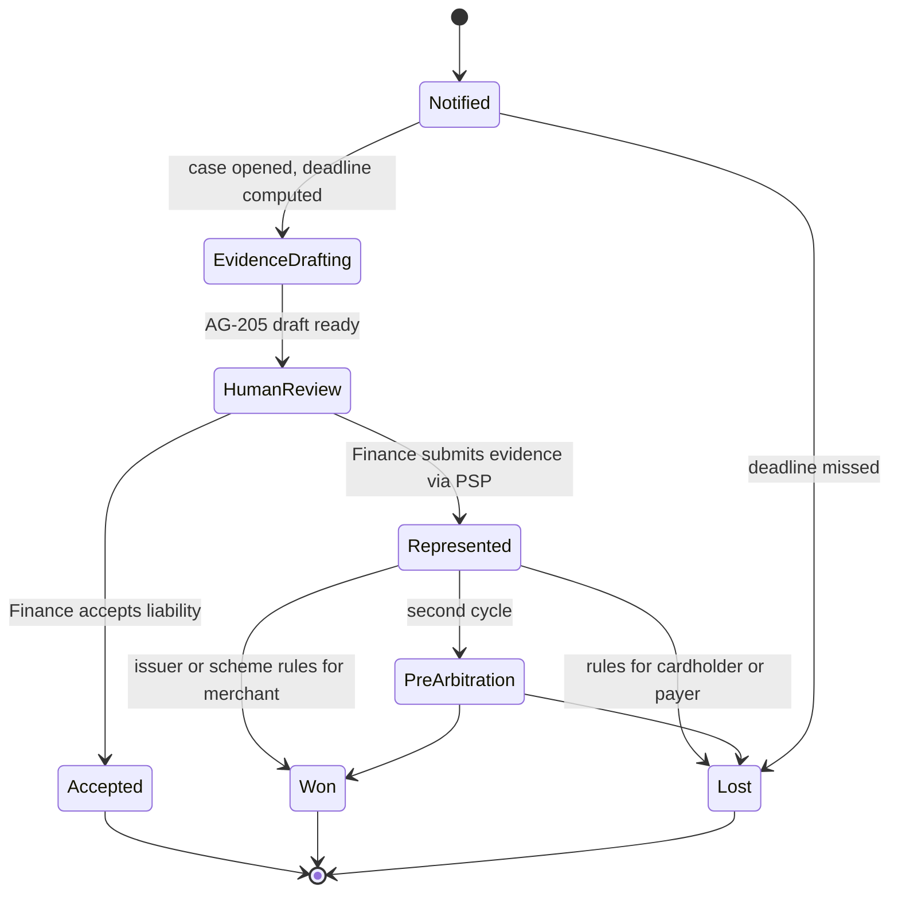

## 11.17.6 Agentic commerce and payments (SM-SVC-28 WF01–WF04)

### 11.17.6.1 Scope, parties and architecture

**Business scope (this release).** **B2B only.** The tenant's agent (our side) exchanges catalog data, requirements, quotations, counter-offers, orders and payment instructions with **counterparty AI agents** of other businesses (buyers or suppliers), under MT-COM and MT-PAY mandates. Consumer (B2C) agentic checkout is out of scope until a consumer-protection pack exists [GAP-1046 covers contracting terms]. The tenant is always the contracting party and the merchant or payer of record; the platform is a technology provider and sub-processor, never a party to the commercial contract and never holding funds (no wallet, no escrow; funds flow only through the licensed PSP) [GAP-1046].

### 11.17.6.2 Agent identity and verifiable credentials

| Element | Our agent (tenant side) | Counterparty agent | Standard (verify, as of 27 Nov 2026) |
|---|---|---|---|
| Identifier | `did:web:agents.<tenant-verified-domain>:<company-slug>` (domain verified per SC-04) | DID (did:web preferred; did:key accepted for tier T2 only) | W3C DID Core 1.0; did:web method |
| Keys | ES256 key pair in regional KMS (non-exportable); `kid` published in the DID document; rotation 12 months | Their DID document keys | JOSE (RFC 7515/7518) |
| Credentials presented by us | (1) **Business identity VC** issued by the platform's tenant-verification issuer after KYB (legal name, registration ID such as CIN/GSTIN in India or LEI/VAT ID in EU, verified domain); (2) **Mandate VC** (selective-disclosure view of the MT-COM mandate: counterparty-relevant scope, offerings, validity, and *not* our floor/ceiling) signed by the tenant's mandate key | — | W3C VC Data Model 2.0; SD-JWT VC (verify) |
| Credentials required from them | Business identity VC from a **trusted issuer** in the tenant's trust list, or (tier T2) an onboarding attestation recorded by a human after KYB; optional their mandate VC proving their authority and limits | — | Trust list per tenant [GAP-1058] |
| Revocation | Status list for our VCs (Bitstring Status List) hosted on the tenant agent domain | We check their status list every verification (cache ≤ 10 min) | W3C Bitstring Status List (verify) |
| Proof of possession | Every message is a JWS over the canonical payload with `nonce`, `iat`, `exp` (≤ 5 min), `aud` (our DID), `mandate_vc_hash` | Same required | — |
| Replay defence | Nonce store 24 h per counterparty; `iat` skew ≤ 60 s | Same | — |

**Counterparty trust tiers (AU-270).**

| Tier | Requirements | Allowed actions | Re-verification |
|---|---|---|---|
| T0 Blocked | revoked, failed verification, fraud flag | none | — |
| T1 Discovery | DID resolves; no VC | WF01 catalog read; WF02 requirement intake → **human** quote only | — |
| T2 Onboarded | human KYB attestation (registration ID, bank account ownership check via penny-drop through PSP, verify) + DID | WF02 quotes under MT-COM; orders ≤ ₹2,00,000 (CFG); payments only to the KYB-verified instrument | 90 days |
| T3 Verified | VC from a trusted issuer + KYB + 3 successful settled orders | full MT-COM/MT-PAY scope as mandated | 180 days, and on any instrument change (AR-06) |

**Counterparty protocol (message envelope).** The gateway accepts A2A, AP2 and ACP messages and MCP tool calls through adapters that normalise them into one internal envelope [ASSUMPTION-1043]. Protocol maturity and versions must be verified at implementation (as of 27 Nov 2026); the internal envelope is the stable contract.

| Field | Type | Notes |
|---|---|---|
| `envelope_id` | UUIDv7 | |
| `protocol` | enum A2A, AP2, ACP, MCP | adapter |
| `from_did`, `to_did` | DID | `to_did` must equal our agent DID |
| `conversation_id` | UUID | negotiation session |
| `type` | enum `catalog.query`, `rfq`, `quote`, `counter`, `accept`, `reject`, `order`, `payment.request`, `payment.confirm`, `refund.request`, `dispute.notice`, `revocation.notice` | |
| `body` | JSON (schema per type, versioned) | **untrusted data** (CTRL-AI-01/08) |
| `mandate_vc_hash` | SHA-256 | binds the message to the mandate view the sender relies on |
| `nonce`, `iat`, `exp` | string, epoch | replay window |
| `sig` | JWS compact | ES256/EdDSA accepted |

**External agent interoperability gate (FR-V12-P-076; FSD 15 V5).** Interop is OFF per tenant until: the tenant agent DID and keys exist; the MT-COM mandate is Active; the counterparty is T2/T3; the jurisdiction packs (RP-GL-AGENTCOM, RP-xx-AGENTCOM) are Approved; and a **scoped contract** (bilateral framework agreement or platform terms accepted by both businesses, recording that agent messages are attributable to each party) is on file [GAP-1046].

### 11.17.6.3 Commerce state machine (negotiation session and order)

### 11.17.6.4 Negotiation bounds

All numbers are produced by the **deterministic negotiation bound engine AU-271**; the model (AG-203) writes the wording and cannot insert, change or round a number (validator: every numeric token in the message must equal a value in the engine output; otherwise the message is blocked) [CONFLICT-1047 resolved by DEC-847].

| Bound | Field | Rule | Default |
|---|---|---|---|
| List price | price-book revision (AU-089) | starting offer = list price × quantity-break | — |
| Floor | `limits.negotiation.floor` per offering or derived | `floor = max(cost × (1 + min_margin_pct), list × (1 − max_discount_pct))`; never below margin floor 25% (BRL-APR-04 default) unless the mandate approver is Founder + Finance | min margin 25% |
| Ceiling (buy side) | `ceiling` | maximum unit price we may accept when buying | — |
| Concession step | `step_pct` | each counter moves ≤ step toward floor/ceiling; monotone (never back) | 2% |
| Rounds | `max_rounds` | after max rounds without acceptance → ESCALATE | 4 |
| Non-price terms | term library version | allowed: payment terms from list (e.g. 100% advance, Net 15, Net 30), delivery windows, Incoterms from list; **forbidden**: liability cap changes, indemnity, exclusivity, governing-law change, auto-renewal, IP assignment, anything not in the library → ESCALATE (Legal, BRL-APR-05) | — |
| Quantity | min/max per order | outside → ESCALATE | — |
| Validity | quote validity | ≤ 7 days and ≤ mandate expiry | 72 h |
| Order value | MT-COM per-order and aggregate caps (§11.17.5.6) | above → ROUTE L2 | — |

**Counter formula.** Sell side: `offer_n = max(floor, offer_{n−1} × (1 − step_pct))`, rounded to the price-book rounding rule; if the counterparty's price ≥ `offer_n` and ≥ floor → accept their price; if their price < floor and rounds remain → counter at `offer_n`; if their price < floor and rounds exhausted → ESCALATE. Buy side mirrors with ceiling.

### 11.17.6.5 Payment execution through a licensed PSP

**Principles.** (1) Money moves only through a PSP that is licensed/authorised in the payer's jurisdiction (India: RBI-authorised payment aggregator or bank; EU: authorised payment institution or credit institution under PSD2; verify each provider's status at onboarding) [ASSUMPTION-1041]. (2) The platform never holds funds, PANs, CVVs, UPI PINs or bank credentials (BRL-FIN-07); it holds tokens and mandate references only. (3) The PSP-side mandate is registered with the **smallest maximum amount the scheme allows that still covers the platform cap**, so the scheme itself is a second cap [RECOMMENDATION-1051]. (4) Every payment intent passes the PDP and the ledger reservation before the PSP call. (5) Candidate PSPs (to evaluate under the procurement gate AU-044, verify): India — Razorpay, Cashfree, PayU, Juspay-orchestrated banks; EU — Stripe, Adyen, Mollie. Choice is an implementation decision recorded as an ADR addendum to ADR-243.

**Payment-mandate types (scheme facts are "verify at implementation, as of 27 Nov 2026"; final values come from the Approved RP-IN-PAY / RP-EU-PAY packs).**

| Scheme / method | Direction | Registration (one-time) | Authentication | Per-debit limit without fresh customer authentication (verify) | Pre-debit notice (verify) | Revocation | Settlement (verify) | Fit |
|---|---|---|---|---|---|---|---|---|
| **UPI AutoPay** (recurring mandate, NPCI) | Collect from customer/buyer | Payer approves the mandate in their UPI app with UPI PIN; frequency (as presented, daily…yearly) and max amount | AFA at registration; debits within the no-AFA limit need none | ₹15,000 general; ₹1,00,000 for specified categories (e.g. insurance, mutual funds, credit-card bills) | ≥ 24 h before debit, via PSP/bank | Payer can pause/revoke in app; we revoke via PSP API | T+1 typical | SVC-32-WF04 collections; SVC-28 buyer side |
| **UPI one-time mandate** (single block) | Collect | Payer blocks an amount for a future debit | UPI PIN at block | Block amount | — | Unblock | T+1 | One-off agent orders with delayed capture |
| **e-NACH** (NPCI, via net banking or debit card) | Collect | Payer authenticates with bank; UMRN issued | Bank authentication at registration | Per mandate max amount (bank-specific) | Per bank and PSP rules | Cancellation via PSP/bank (takes days; verify) | T+1 to T+2 | Higher-value B2B recurring |
| **Card-on-file MIT** with RBI e-mandate (tokenised, card network token) | Collect | AFA at registration; token from card network (CoF tokenisation) | AFA at registration | ₹15,000 general; ₹1,00,000 specified categories (RBI; verify) | ≥ 24 h (RBI e-mandate framework) | Customer via issuer; we via PSP | T+1/T+2 | B2B card buyers in India |
| **Card MIT** (EU, PSD2) | Collect | Initial CIT with SCA; agreement stored at PSP | SCA at initial; MIT out of SCA scope | per agreement; issuer may request SCA (soft decline) | Per agreement terms | End agreement at PSP | Scheme-dependent | EU card buyers |
| **SEPA Direct Debit** (Core or B2B) | Collect | Signed mandate (e-mandate) with mandate reference and creditor ID | B2B: debtor bank confirms mandate | per mandate | Pre-notification ≥ 14 days unless agreed shorter (rulebook; verify) | Debtor can refund Core debits within 8 weeks; B2B no refund right (verify) | D+1 | EU B2B collections; prefer SDD B2B |
| **Payouts** (bank transfer/IMPS/NEFT/RTGS; SEPA Credit Transfer / Instant) | Pay to supplier | Beneficiary added and verified (penny-drop/name check) at T2/T3 onboarding | Our side: PSP payout API with maker-checker of the mandate | per MT-PAY caps | — | Remove beneficiary | Real-time to T+1 | SVC-39-WF03 supplier payments; SVC-28 buy side |
| **Network agentic tokens** (e.g. Visa Intelligent Commerce, Mastercard Agent Pay; verify availability per market) | Pay (as buyer) | Card issued to the tenant; agent-specific token with spend controls at the network | Issuer/network rules | per token controls | — | Delete token | Scheme | SVC-28 buy side where offered |

**Spend caps — three layers.** (1) Platform mandate caps (PDP, §11.17.5.6); (2) PSP-side mandate maximum and payout limits configured equal to the platform per-action cap; (3) scheme/network limits (AFA/SCA, token controls). A payment executes only if all three allow; a PSP soft decline for authentication becomes HOLD `CUSTOMER_AUTH_REQUIRED` and a human-initiated customer authentication flow (never the agent).

**Payment execution steps (AU-273).**

| Step | Action | Executor | Output | Failure path |
|---|---|---|---|---|
| P1 | Build payment intent (order_ref, amount, currency, method, payee/payer, purpose code, invoice ref) | Domain service | intent + intent_hash | invalid → HELD |
| P2 | PDP rules 0–14 + reservation | AU-264/263 | decision, reservation_id, fence | non-ALLOW → no PSP call (NSE) |
| P3 | Pre-debit notification due? (collections) | AU-272 | notification sent ≥ scheme lead time; debit scheduled not before notice + lead | notice failure → reschedule; never debit early |
| P4 | Call PSP with idempotency key | AU-273 | PSP payment ID, status | timeout → Reconciling (no retry); 4xx definite → Failed, release |
| P5 | Receive signed webhook | AU-274 | verified event (signature, timestamp, dedup BRL-FIN-02) | invalid signature → reject + security event |
| P6 | Commit ledger and post journal | AU-263, AU-277 | Committed; journal J-02/J-03 | posting failure → retry from outbox; never double-post |
| P7 | Settlement reconciliation (T+N) | AU-274 | settlement matched | break → RC-P-02 |

### 11.17.6.6 Settlement, refunds, disputes and chargebacks

**Settlement.** PSP settles net of fees to the tenant's bank account (collections) or debits the tenant's PSP balance/pre-funded account for payouts (verify PSP model). AU-274 ingests the settlement report daily, matches each line to `payment_txn` by PSP payment ID, books fees and taxes on fees (GST on PSP fees in India; verify) and the net settlement (J-04), and matches the bank credit by UTR (RC-P-03).

**Refunds (AU-275).** Allowed under the MT-PAY mandate only when: the mandate `action_types` includes `refund.initiate`; refund ≤ captured amount − prior refunds; refund to the **original instrument only**; refund reason code from list; within the refund window of the scheme. Otherwise L2 (Finance). Refunds never create spending headroom (LED-06 default).

**Disputes and chargebacks (AU-276; human-owned).** Agents never accept liability or submit representment; AG-205 drafts the evidence pack, Finance (R08/R09) decides.

| Dispute source | Typical response window (verify per scheme, as of 27 Nov 2026) | Platform deadline (internal) | Ledger effect |
|---|---|---|---|
| Card chargeback (Visa/Mastercard/RuPay via PSP) | PSP sets a response deadline (often 7–20 days) | PSP deadline − 3 business days | Funds debited at notice: J-06; reversed if won: J-07 |
| UPI complaint / dispute (NPCI ODR via PSP) | Per NPCI/RBI TAT framework | PSP deadline − 2 business days | J-06 if debited |
| e-NACH / SDD return or refund claim | Core SDD refund up to 8 weeks (no questions) / 13 months unauthorised; B2B no refund right (verify) | Immediate case | J-06 |
| Counterparty-agent dispute notice (contractual) | Per framework agreement | 5 business days | No ledger change until resolved |

**Dispute fraud controls.** A mandate with ≥ 2 chargebacks in 30 days is Suspended (AR-07/AR-08 family); a counterparty with a chargeback moves to T0 pending review.

### 11.17.6.7 Ledger postings (double-entry commerce sub-ledger)

ADR-244: a double-entry sub-ledger (`ledger_journal`, `ledger_entry`) per company and currency, append-only (BRL-FIN-05), feeding the existing receivable/payable ledgers (OrganicSpec dual ledgers, BRD) and revenue reporting from **verified** entries only (BRL-FIN-06). Accounts (CoA-P):

| Account | Name | Type |
|---|---|---|
| CoA-P-1100 | PSP clearing — receivable from PSP | Asset |
| CoA-P-1110 | Bank — operating | Asset |
| CoA-P-1200 | Trade receivable (agentic orders) | Asset |
| CoA-P-1300 | Dispute reserve (funds held by PSP) | Asset |
| CoA-P-2100 | Trade payable (agentic purchases) | Liability |
| CoA-P-2110 | PSP payout clearing | Liability |
| CoA-P-2200 | Refunds payable | Liability |
| CoA-P-2300 | Output tax payable (GST/VAT on sales) | Liability |
| CoA-P-4100 | Revenue — agentic sales | Income |
| CoA-P-5100 | Purchases — agentic procurement | Expense |
| CoA-P-5200 | PSP fees | Expense |
| CoA-P-5210 | Input tax on PSP fees | Asset (recoverable) |
| CoA-P-5300 | Chargeback losses | Expense |

| Journal | Event | Debit | Credit | Example (₹, IN, GST 18% illustrative; tax rates come from DEC-027/TX rules, verify) |
|---|---|---|---|---|
| J-01 | Order confirmed (sell) and invoice issued | CoA-P-1200 Trade receivable 11,800.00 | CoA-P-4100 Revenue 10,000.00; CoA-P-2300 Output tax 1,800.00 | Order 10 units × ₹1,000.00 |
| J-02 | PSP capture success (collection) | CoA-P-1100 PSP clearing 11,800.00 | CoA-P-1200 Trade receivable 11,800.00 | Webhook `payment.captured` |
| J-03 | Payout to supplier (buy) | CoA-P-2100 Trade payable 5,900.00 | CoA-P-2110 PSP payout clearing 5,900.00 | Purchase ₹5,000.00 + ₹900.00 tax, payable booked earlier (J-08) |
| J-04 | Settlement received net of fees | CoA-P-1110 Bank 11,560.36; CoA-P-5200 PSP fees 203.08; CoA-P-5210 Input tax 36.56 | CoA-P-1100 PSP clearing 11,800.00 | Fee 2% + tax on fee, illustrative only |
| J-05 | Refund initiated and completed | CoA-P-4100 Revenue 1,000.00; CoA-P-2300 Output tax 180.00 | CoA-P-1100 PSP clearing 1,180.00 | Credit note for 1 unit |
| J-06 | Chargeback debited | CoA-P-1300 Dispute reserve 11,800.00 | CoA-P-1100 PSP clearing 11,800.00 | Notice received |
| J-07 | Chargeback won | CoA-P-1100 PSP clearing 11,800.00 | CoA-P-1300 Dispute reserve 11,800.00 | Funds returned |
| J-07L | Chargeback lost | CoA-P-5300 Chargeback losses 10,000.00; CoA-P-2300 Output tax 1,800.00 (credit-note treatment, verify) | CoA-P-1300 Dispute reserve 11,800.00 | |
| J-08 | Purchase order accepted (buy) and supplier invoice received | CoA-P-5100 Purchases 5,000.00; input tax asset 900.00 | CoA-P-2100 Trade payable 5,900.00 | |
| J-09 | Payout settled from bank | CoA-P-2110 PSP payout clearing 5,900.00 | CoA-P-1110 Bank 5,900.00 | |

Rules: every journal balances (Σ debit = Σ credit, enforced by a DB constraint trigger); journal ID = idempotency key of the source event; mandate ID and reservation ID carried on each entry; corrections by reversing journals only.

### 11.17.6.8 Fraud controls

| Control | Threat addressed | Mechanism |
|---|---|---|
| FC-01 KYB before T2 | Shell company / impersonation | Registration ID check (GSTIN/CIN, VAT/LEI), verified domain, bank-account ownership via PSP penny-drop/name match (verify availability) |
| FC-02 Instrument change hold | Business e-mail compromise / payee swap | AR-06 suspend + human call-back on a number from onboarding records (not from the message) |
| FC-03 Velocity and split guards | Draining under caps | AR-02, AR-04, velocity limit |
| FC-04 New-counterparty shadow | First-transaction fraud | AR-03 |
| FC-05 Price anomaly | Collusion / below-floor pressure | AR-10; floor computed, not modelled |
| FC-06 Signed envelopes + nonce | Replay, man-in-the-middle | JWS, nonce store, `exp` ≤ 5 min |
| FC-07 Injection isolation | Counterparty prompt injection (AI-INJ-06) | Reader step without tools; bound engine numbers; HOLD on out-of-mandate requests |
| FC-08 Sanctions and restricted-party screening | Sanctioned counterparties | Screening at onboarding and every 30 days against lists required by the pack (e.g. UN, EU, OFAC where applicable; verify) via a licensed screening provider or PSP service |
| FC-09 Chargeback monitoring | Friendly fraud, compromised buyer | KPI-P-10, AR-08; T0 on chargeback |
| FC-10 Insider controls | Employee colluding with counterparty | TPA-09 conflict-of-interest; two-person approval; approver ≠ requester; weekly owner review of R3 effects |
| FC-11 Account-takeover of approver | Stolen approver session | Step-up MFA at approval (≤ 5 min), WebAuthn, new-device notification, session limits (Part 4.1 §4.3.4) |
| FC-12 Agent key compromise | Forged messages from our DID | KMS non-exportable keys; key-use anomaly alarm; DID key rotation runbook; status-list revocation of our VCs |

### 11.17.6.9 Requirements register: agentic commerce and payments (FR-V12-P-070…099)

| ID | Requirement | V12 source | Rule / acceptance | Priority | Release | Epic | Test |
|---|---|---|---|---|---|---|---|
| FR-V12-P-070 | Tenant agent DID, KMS keys, DID document and JWKS publication on the verified domain | SVC-28 "verified agent identity" | DID resolves; key non-exportable | Must | R2 | EP-24 | TC-V12-P-765 |
| FR-V12-P-071 | Business identity VC and mandate VC (selective disclosure, no floor/ceiling) | SVC-28; CTRL-AI-08 | Floor never present in disclosed view | Must | R2 | EP-24 | TC-V12-P-766 |
| FR-V12-P-072 | Signed message envelope (§11.17.6.2) with nonce, iat, exp, aud | CTRL-AI-08 | Replay rejected | Must | R2 | EP-24 | TC-V12-P-767 |
| FR-V12-P-073 | Counterparty VC verification: signature, DID binding, issuer trust list, status list, expiry | SVC-28 WF02 | Model C VC dimension | Must | R2 | EP-24 | TC-V12-P-301…523 |
| FR-V12-P-074 | Counterparty trust tiers T0–T3 and allowlist | DEC-780 | Tier gates actions | Must | R2 | EP-24 | TC-V12-P-768 |
| FR-V12-P-075 | Protocol adapters A2A, AP2, ACP, MCP to one internal envelope | "supported agent protocols" | Contract tests per adapter | Should | R2 | EP-24 | TC-V12-P-769 |
| FR-V12-P-076 | External agent interoperability gate | FSD 15 V5 | All five conditions | Must | R2 | EP-24 | TC-V12-P-770 |
| FR-V12-P-077 | WF01 machine-readable catalog publication of approved catalog version only | SVC-28-WF01 | Unapproved version not exposed (unauthorized exposure count 0) | Must | R2 | EP-24 | TC-V12-P-771 |
| FR-V12-P-078 | WF02 requirement discovery and quotation exchange after verified identity and mandate | SVC-28-WF02 | Quote only after verification | Must | R2 | EP-24 | TC-V12-P-772 |
| FR-V12-P-079 | WF03 negotiation within bounds; deterministic numbers; escalation | SVC-28-WF03 | Model C OFFER/ROUND | Must | R2 | EP-24 | TC-V12-P-301…523 |
| FR-V12-P-080 | Message number validator: every number equals a bound-engine value | DEC-388/395 amended | Mismatch blocks | Must | R2 | EP-24 | TC-AI-AG203-003 |
| FR-V12-P-081 | Forbidden-term detection and escalation to Legal | BRL-APR-05 | ForbiddenTerm → ESCALATE | Must | R2 | EP-24 | Model C |
| FR-V12-P-082 | Commerce session and order state machine (§11.17.6.3) | SVC-28 | Illegal transition 409 | Must | R2 | EP-24 | TC-V12-P-773 |
| FR-V12-P-083 | PSP adapter abstraction; per-jurisdiction PSP registry; licensed-status record | DEC-780 | Unlicensed PSP cannot be activated | Must | R2 | EP-15 | TC-V12-P-774 |
| FR-V12-P-084 | Payment-mandate registration per scheme; references only; PSP max = platform cap | SVC-28-WF04 | No credential stored | Must | R2 | EP-15 | TC-V12-P-775 |
| FR-V12-P-085 | Pre-debit notification per scheme lead time | RBI e-mandate (verify) | No debit before notice + lead | Must | R2 | EP-15 | TC-V12-P-776 |
| FR-V12-P-086 | Payment execution P1–P7 with idempotency; timeout → Reconciling | SVC-28-WF04 | Model C PSP dimension | Must | R2 | EP-15 | TC-V12-P-301…523 |
| FR-V12-P-087 | Customer-authentication soft decline → HOLD and human flow | PSD2/RBI AFA | Model C AUTH | Must | R2 | EP-15 | Model C |
| FR-V12-P-088 | Signed webhook verification and dedup | BRL-FIN-02 | Invalid signature rejected | Must | R2 | EP-15 | TC-V12-P-777 |
| FR-V12-P-089 | Settlement ingestion, fee/tax booking, bank match | SVC-28 reconciliation | RC-P-02/03 | Must | R2 | EP-15 | TC-V12-P-741 |
| FR-V12-P-090 | Refund under mandate rules | SVC-28 | Original instrument only | Must | R2 | EP-15 | TC-V12-P-778 |
| FR-V12-P-091 | Dispute/chargeback case management with deadlines; human decision | SVC-28 | Deadline − 3 bd alert | Must | R2 | EP-15 | TC-V12-P-779 |
| FR-V12-P-092 | Double-entry sub-ledger, CoA-P, J-01…J-09, balance constraint | BRL-FIN-05 | Unbalanced journal rejected | Must | R2 | EP-15 | TC-V12-P-780 |
| FR-V12-P-093 | Fraud controls FC-01…FC-12 | DEC-780 | Per control tests | Must | R2 | EP-24 | TC-V12-P-781…786 |
| FR-V12-P-094 | Sanctions screening at onboarding and every 30 days | FC-08 | Hit → T0 | Must | R2 | EP-24 | TC-V12-P-785 |
| FR-V12-P-095 | Revocation propagation to PSP and counterparties | DEC-779 | PSP ack stored | Must | R2 | EP-15 | TC-V12-P-730 |
| FR-V12-P-096 | Commerce screens A265–A267 | FSD 21 panel | UI ACs | Must | R2 | EP-24 | TC-V12-P-787 |
| FR-V12-P-097 | B2B-only guard: counterparty must have a business identity | Scope | Consumer DID → T0 | Must | R2 | EP-24 | TC-V12-P-788 |
| FR-V12-P-098 | Residency: PSP account and processing in tenant region | DEC-772 | EU tenant never uses IN PSP | Must | R2 | EP-15 | TC-V12-P-753 |
| FR-V12-P-099 | `agent_transaction` DTO enums: `mandate_state` = mandate states (§11.17.5.8); `reconciliation_state` ∈ {NotStarted, Matched, Held, Reconciling, Break, Resolved}; meter "agent transaction case" = one negotiation session reaching Accepted or Escalated | FSD 26; BRD 08 meter | Schema validation | Must | R2 | EP-24 | TC-V12-P-789 |

### 11.17.6.10 Decisions recorded in this file

| DEC | Decision | Authority | Effect |
|---|---|---|---|
| DEC-840 | One shared mandate engine (MND) for all mandate types; workers cannot bypass it; per-region deployment | Customer revision V12 (28 Nov 2026), under Founder DEC-779 | ADR-240; FR-V12-P-001…069 |
| DEC-841 | The V12 L0–L4 controls matrix (§11.17.5.2) is binding; the DEC-064 L1 cap is lifted **only** for actions covered by an Active, eligible mandate in an Approved jurisdiction; Part 7.3 "never automated" list read as amended in §11.17.4.2 | Founder DEC-779 | Amends DEC-064, BRL-AUT-01, BRL-AI-07 (scoped) |
| DEC-842 | Two-person approval rules TPA-01…11; R3 types need Finance or Legal approver; DEC-038 thresholds apply to the mandate value | Founder DEC-779 | AU-261 |
| DEC-843 | Caps are inclusive, Decimal, single-currency, gross of tax by default; cap hierarchy min(mandate, company, tenant, PSP, scheme) | Customer revision V12 (28 Nov 2026) | §11.17.5.6 |
| DEC-844 | PDP rule order 0–14 is fixed and is the test oracle | Customer revision V12 (28 Nov 2026) | AU-264; model M |
| DEC-845 | Kill switch: one person engages, two people release; scopes extended to mandate, counterparty, portal, payment method, PSP account; fence tokens at adapter gateway | Founder DEC-779 | ADR-246; extends ADR-085 |
| DEC-846 | Agent identity by did:web + W3C VC 2.0 + JWS envelopes; protocol adapters behind one internal envelope; interop OFF until gate FR-V12-P-076 | Founder DEC-780 | ADR-242 |
| DEC-847 | All negotiation numbers come from the deterministic bound engine AU-271; the model writes wording only (resolves CONFLICT-1047 with DEC-388/395) | Founder DEC-780 | AU-271; AG-203 |
| DEC-848 | Payments only via licensed PSPs; payment-mandate types per §11.17.6.5; no credentials stored; PSP-side cap = platform per-action cap | Founder DEC-780 | ADR-243; amends X-06 |
| DEC-849 | Double-entry commerce sub-ledger CoA-P; exact automated PSP matches close without manual verification, all mismatches go to Finance maker-checker (resolves CONFLICT-1048 with BRL-APR-07) | Customer revision V12 (28 Nov 2026) | ADR-244 |
| DEC-850 | Disputes and chargebacks are human-decided; refunds under mandate only to the original instrument and within captured amount | Founder DEC-780 | AU-275, AU-276 |

Decisions DEC-851…857, the complete tags register and the quality gate for the whole of Part 11.17 are in file b (§11.17.16).

## Quality gate: Part 11.17a

| # | Item | Result | Notes and fixes applied |
|---|---|---|---|
| 1 | Every requirement traced to a source | Pass | Each FR-V12-P row names its V12 chapter or baseline rule; 64 aspects in `P_coverage.csv` |
| 2 | Assumptions/gaps/conflicts tagged and logged | Pass | Tags 1040…1059 used; full register in file b §11.17.16.3 |
| 3 | IDs unique and consistent with earlier parts | Pass | Only Group P ranges used; screens A260–A269 provisional [ASSUMPTION-1040] |
| 4 | No story lacks AC; no requirement lacks a test | Pass | Stories and tests in file b; every FR row names a TC |
| 5 | Negative, edge, security, accessibility cases covered | Pass | Combinatorial fault layers; STRIDE in file b |
| 6 | No agent lacks guardrail, fallback, KPI and cost | N/A here | Agent cards in file b |
| 7 | Time-sensitive facts flagged "verify" with date | Pass | Scheme limits, protocols, PSPs, dispute windows flagged |
| 8 | No restricted data routed to free-tier models | Pass | Commerce agents Tier 1b only; Tier 2 not eligible |
| 9 | Consistent with earlier parts | Pass | Superseded positions listed with Founder authority (§11.17.4); earlier files not edited |

**Status: Part 11 Batch 11.17 file a complete. Mandate engine and agentic commerce/payments specified; continue in Part 11.17b.**
