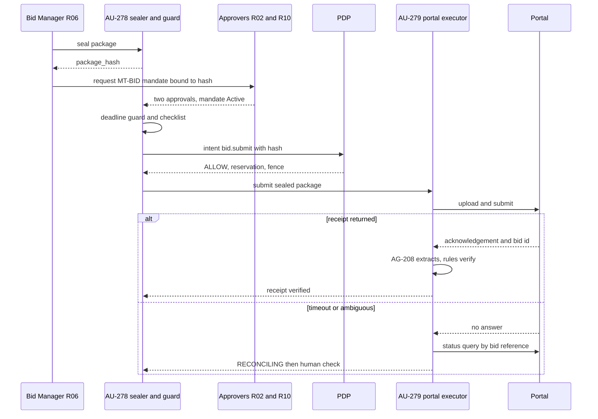
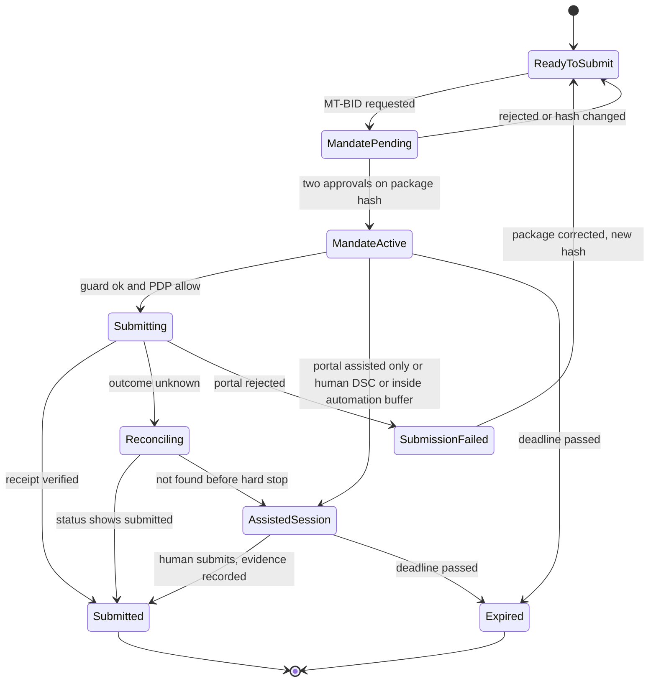

# AI Growth Engine: Employee Sales & Marketing Automation
## Application Blueprint: PART 11 (Batch 11.17), Bounded Mandates, Agentic Commerce and Payments, and Automatic Bid Submission

| Field | Value |
|---|---|
| Document | Part 11, Batch 11.17, file **b of 2**. File b holds §11.17.7–§11.17.16: automatic bid submission (SM-SVC-19-WF03); agents AG-200…209, automations AU-260…279 and workflows WF-57…60; screens, entities, APIs, events and the audit trail; STRIDE threat model and abuse cases; epics and user stories (Part 5.1a template, Scenario Outline + Examples from the same parameter models); test scenarios and test cases (Part 6.2a template); AI evaluation cases (Part 6.4 template); the 3-way combinatorial catalogue (716 generated cases); effort and cost (development and running in separate tables); decisions, expert review, tags register and the quality gate. File a (`Part-11-17a_…`) holds the mandate engine and agentic commerce and payments |
| Version | 1.0 · 28 Nov 2026 |
| Baseline | As file a; plus Part 5.1a/5.1b (story template), Part 6.2a (test template, PP-01…PP-07, NSE, U404), Part 6.4 (AI case template, datasets, V1–V7), Part 7.4b/V11 brief (AG card, AU table and WF formats), Part 8.4 / Part 9.10 (₹4,545 / ₹5,682 / ₹6,818 per person-day) |
| Roles applied | As file a |
| Generators | `assembly/v12b/p_combinatorial.py` (covering arrays, oracles, Examples), `assembly/v12b/p_coverage.py` (aspect register), `assembly/v12b/p_build.py` (assembly) |

---

## 11.17.7 Automatic bid submission (SM-SVC-19-WF03)

### 11.17.7.1 Principle and scope

DEC-781: "A human approves the bid package hash, price, terms and the portal or authority before the mandate is issued; the agent submits only that exact package and records the submission receipt." V12: "Capability grant and explicit bid approval; **no automatic submission to restricted portal**"; "manual submission unless permitted API" (FSD 11). The design therefore has **three submission modes**, chosen per tender by the portal capability registry and the jurisdiction pack, never by the agent:

| Mode | Level | Who presses "submit" | When used |
|---|---|---|---|
| **AUTO** | L3 under MT-BID | Portal adapter (system), with the sealed package | Portal capability = `API_PERMITTED` or `AUTOMATION_PERMITTED` (counsel-reviewed terms), signing not human-only, pack RP-xx-PROC Approved, MT-BID Active |
| **ASSISTED** | L2 | Human, inside an assisted session: the system pre-fills the portal upload from the sealed package and verifies the uploaded files' hashes; the human signs (DSC) and clicks submit | Portal is `ASSISTED_ONLY`, signing needs a personal DSC, pack not Approved, or L2 configured |
| **MANUAL** | L1 | Human on the portal; the system records evidence (BRL-BID-04) | Portal `MANUAL_ONLY` or L1 configured |

The model never touches a portal: AG-206/207 prepare and check the package; AU-278/279 (deterministic) seal, guard and submit.

### 11.17.7.2 Bid package and the approved hash

| Element | Specification |
|---|---|
| Package manifest | JSON: tender ID, portal profile ID, lot(s), bidder legal entity, signatory, price schedule (line items Decimal, currency, taxes), commercial terms (validity, EMD/bid-security reference, payment terms), technical documents list, each file `{name, role (technical/commercial/eligibility/form), sha256, size, mime}`, form-field values (portal-specific map), declarations |
| Sealing (AU-278) | Files frozen in S3 with object lock; manifest canonicalised (Part 4.5.4 rules); `package_hash = SHA-256(manifest)`; any file or field change produces a new hash |
| Commercial envelope separation | Where the tender is two-envelope (technical and financial), two sub-hashes plus the parent hash; financial envelope encrypted at rest with a tender-specific data key until submission |
| Approval | MT-BID mandate binds `package_hash`, `tender_id`, `portal_profile`, `price_total`, `currency`, `signatory`, `submit_not_before`, `submit_not_after` (= deadline − hard-stop buffer); two-person approval: Startup Head R02 (BRL-BID-03) + Legal R10; Founder + Legal at ≥ ₹10 lakh or cross-border (BRL-APR-06) |
| Pre-submission gate (QC-26) | Mandatory checklist all Pass or waived (BRL-BID-02); proposal/quote/legal approvals complete; EMD/bid security evidence attached; capability grant (BRL-BID-06); deadline guard OK; AG-207 cross-check no blocking finding |
| Single use | MT-BID `count_max = 1`; after a verified receipt the mandate becomes Exhausted; a **revised** bid (where the portal allows resubmission) needs a new package hash and a new MT-BID |

### 11.17.7.3 Portal capability registry and adapters

Each portal profile records what the portal *permits*, reviewed by counsel against the portal's current terms of use (verify each at implementation, as of 27 Nov 2026) [GAP-1045]. The values below are the panel's **expected** defaults pending that review; any portal whose terms are silent or prohibit automation is `ASSISTED_ONLY` or `MANUAL_ONLY`.

| Portal family | Jurisdiction | Discovery API (read) | Submission channel | Signing | Expected capability (verify) | Adapter |
|---|---|---|---|---|---|---|
| GeM (Government e-Marketplace) | IN | Public listings; no general seller API assumed | Seller dashboard (browser) | e-sign / OTP per GeM flow (verify) | `ASSISTED_ONLY` | PA-GEM (assisted: pre-filled forms, file hash verification) |
| CPPP / GePNIC (eprocure.gov.in and state NIC portals) | IN | RSS/listing pages | Browser with Class III DSC (signing + encryption) on a crypto token | Personal Class III DSC of the authorised bidder (IT Act) | `ASSISTED_ONLY` (human DSC) | PA-NIC (assisted) |
| State/PSU portals (e.g. other e-procurement vendors) | IN | Varies | Browser; some with APIs for registered vendors | DSC | Per portal | PA-GENERIC-ASSISTED |
| EU national eSubmission platforms (via TED notices) | EU | TED API for notices (read) | National platform (browser or eDelivery/PEPPOL for some) | Qualified/advanced e-signature per eIDAS where required | Per platform; PEPPOL-based ordering may be `API_PERMITTED` | PA-EU-<platform>; PA-PEPPOL |
| SAM.gov and US agency portals (e.g. PIEE, agency e-mail submission) | US | SAM.gov opportunities API (read, API key) | Per solicitation: agency portal, PIEE, e-mail | Per agency | `MANUAL_ONLY` / `ASSISTED_ONLY` per solicitation | PA-US-ASSISTED; PA-EMAIL (system sends e-mail with sealed attachments only if the solicitation designates e-mail submission and pack allows: `AUTOMATION_PERMITTED`) |
| Private buyer platforms (SAP Ariba, Coupa, Jaggaer supplier networks) | Global | Supplier APIs (verify per buyer) | API (cXML / supplier API) where the buyer enables it | Platform auth | `API_PERMITTED` where the buyer contract enables it | PA-ARIBA, PA-COUPA, PA-JAGGAER |
| Buyer e-mail RFQs (private) | Global | — | E-mail to designated address | None or attached signed PDF | `AUTOMATION_PERMITTED` when RFQ names e-mail submission | PA-EMAIL |

**Adapter contract (all adapters).** `prepare(package) → upload_plan`; `submit(upload_plan, idempotency_key, fence_token) → {status: accepted | rejected | unknown, portal_ref, receipt_artifact}`; `status(portal_bid_ref | idempotency_key) → {submitted, not_found, draft, withdrawn}`; `fetch_receipt(portal_ref) → artifact`. Browser automation is used **only** where `AUTOMATION_PERMITTED` is recorded; it runs in an isolated worker with a dedicated portal account per company, recorded video and HAR (secrets redacted) as evidence, and never solves CAPTCHAs (a CAPTCHA → `unknown` → ASSISTED fallback).

### 11.17.7.4 Submission sequence (AUTO mode)

### 11.17.7.5 Signing

| Case | Rule |
|---|---|
| Portal requires a personal DSC / qualified signature of a named person | ASSISTED only: the named signatory signs in the assisted session; the system never holds or operates a personal DSC or its PIN |
| Portal accepts an organisational signing certificate (document-signer type) and the pack confirms it is lawful for bids | AUTO allowed: signing key in an HSM-backed KMS key or the CA's remote-signing service, usable only by AU-279 with the MT-BID fence token, one signature per mandate (verify CA products and legal acceptance) |
| No signature required | AUTO allowed if portal capability permits |

### 11.17.7.6 Deadline guard (AU-278)

| Parameter | Default | Rule | Source |
|---|---|---|---|
| Deadline storage | UTC + portal timezone | BRL-BID-01 | DEC-053 family |
| Automation buffer `B_auto` | 6 h [ASSUMPTION-1053] | First automated attempt must start ≥ B_auto before deadline; otherwise ESCALATE to human (ASSISTED/MANUAL) immediately | BRL-BID-01 amended |
| Hard-stop buffer `B_hard` | 2 h (≥ BRL-BID-01 minimum) | No automated attempt or retry inside B_hard; `submit_not_after` = deadline − B_hard | BRL-BID-01 |
| Planned submit time | max(approval + 15 min, deadline − 48 h) by default | Leaves time for retries and human fallback | — |
| Retry policy | Only for **definite** pre-submission failures (connection refused before upload, 5xx on login); max 3, backoff 10/30/60 min, all before `submit_not_after` | Uncertain → reconcile, never retry | BRL-AUT-07 |
| Escalation ladder | T−24 h: no mandate Active → page R06/R02; T−B_auto: automated path closed → assisted session prepared; T−B_hard: human-only; T−1 h: SEV2 if not submitted and bid still intended | NT-020/021 | AU-034 extended |
| Clock | NTP; virtual clock in tests (CLK-0) | — | Part 6.2a |

### 11.17.7.7 Receipt and outcome handling

| Outcome | Detection | State (Part 2.3 §2.27.4 extended) | Action |
|---|---|---|---|
| Receipt verified | Portal acknowledgement artifact present; AG-208 extracts bid ID, timestamp, tender ID, hash/checksum if shown; **deterministic** checks: tender ID equal, timestamp < deadline, file count/size or checksum equal to the sealed package where the portal shows them | Submitted | Receipt stored (S3 object lock); mandate Exhausted; ledger commit; NT to R06/R02 |
| Rejected (validation) | Portal error with reason | SubmissionFailed | Release; human fixes; **new package hash → new mandate** |
| Unknown (timeout, crash, CAPTCHA, ambiguous page) | No acknowledgement | Reconciling | No retry; AU-279 status query (my-bids list) every 10 min up to `submit_not_after`; if still unknown at T−B_hard, human checks the portal and records evidence (found → Submitted; not found → human submits manually) |
| Duplicate risk | Status query shows a submitted bid with our reference | Submitted | Never resubmit |
| Withdrawal | Human decision only (BRL-BID approval), never under MT-BID | Withdrawn | Separate L1 action |

### 11.17.7.8 Requirements register: automatic bid submission (FR-V12-P-110…135)

| ID | Requirement | V12 source | Rule / acceptance | Priority | Release | Epic | Test |
|---|---|---|---|---|---|---|---|
| FR-V12-P-110 | Three submission modes AUTO/ASSISTED/MANUAL chosen by registry + pack + level, never by AI | SVC-19-WF03; DEC-781 | Model B oracle | Must | R2 | EP-14 | TC-V12-P-524…652 |
| FR-V12-P-111 | Package sealing and manifest hash; object lock; two-envelope sub-hashes | DEC-781 | Any change → new hash | Must | R2 | EP-14 | TC-V12-P-790 |
| FR-V12-P-112 | Pre-submission gate (QC-26; BRL-BID-02/03/06) | FSD 40 QC-26 | Gate failure → HOLD | Must | R2 | EP-14 | TC-V12-P-791 |
| FR-V12-P-113 | MT-BID mandate binding hash, tender, portal, price, signatory, window; two-person approval R02 + R10 | DEC-781 | Hash mismatch → HOLD `PACKAGE_HASH_CHANGED_APPROVAL_VOID` | Must | R2 | EP-14 | TC-V12-P-792 |
| FR-V12-P-114 | Single-use mandate; Exhausted after receipt | DEC-781 | Second submit DENY | Must | R2 | EP-14 | TC-V12-P-793 |
| FR-V12-P-115…117 | Deadline guard B_auto, B_hard, planned time, retry policy, escalation ladder | BRL-BID-01 | §11.17.7.6 | Must | R2 | EP-14 | TC-V12-P-794…799 |
| FR-V12-P-118…122 | Portal capability registry with counsel review record; adapters PA-GEM, PA-NIC, PA-GENERIC-ASSISTED, PA-EU-*, PA-PEPPOL, PA-US-ASSISTED, PA-EMAIL, PA-ARIBA/COUPA/JAGGAER; adapter contract | FSD 11 "manual unless permitted API" | Unreviewed portal = MANUAL_ONLY | Must | R2 | EP-14 | TC-V12-P-800…805 |
| FR-V12-P-123 | Assisted session: pre-filled upload, hash verification of uploaded files, human signs and submits | DEC-781 | Uploaded file hash ≠ sealed → block | Must | R2 | EP-14 | TC-V12-P-806 |
| FR-V12-P-124 | Signing rules §11.17.7.5; personal DSC never held by system | IT Act (verify) | No DSC PIN stored | Must | R2 | EP-14 | TC-V12-P-807 |
| FR-V12-P-125 | Receipt extraction and deterministic verification; `submission_ref` output | SVC-19-WF03 KPI | Verified receipt rate ≥ 99% | Must | R2 | EP-14 | TC-V12-P-808 |
| FR-V12-P-126 | Unknown outcome reconciliation without resubmission | DEC-050 | Model B RECEIPT=TimeoutUnknown | Must | R2 | EP-14 | TC-V12-P-809 |
| FR-V12-P-127 | Browser automation only where `AUTOMATION_PERMITTED`; isolated worker, recorded evidence, no CAPTCHA solving | FSD 11 | CAPTCHA → ASSISTED | Must | R2 | EP-14 | TC-V12-P-810 |
| FR-V12-P-128 | Bid state machine extension (§11.17.7.7) | Part 2.3 §2.27.4 | Illegal transition 409 | Must | R2 | EP-14 | TC-V12-P-811 |
| FR-V12-P-129 | Screens A268 (bid submission console) and A269 (portal capability registry) | FSD 21/24 | UI ACs | Must | R2 | EP-14 | TC-V12-P-812 |
| FR-V12-P-130 | KPIs KPI-P-06…08 | SVC-19 KPI | Dashboard | Must | R2 | EP-17 | TC-V12-P-764 |
| FR-V12-P-131 | Withdrawal is human-only | BRL-BID | Agent withdraw call denied | Must | R2 | EP-14 | TC-V12-P-813 |
| FR-V12-P-132 | Kill switch scope "portal" and "tender" | MC-09 | Blocks AU-279 | Must | R2 | EP-14 | Model B KS |
| FR-V12-P-133 | Jurisdiction packs RP-IN-PROC, RP-EU-PROC, RP-US-PROC gate AUTO | DEC-776 | Pack not Approved → ASSISTED | Must | R2 | EP-03 | Model B JUR |
| FR-V12-P-134 | Evidence pack per submission (manifest, approvals, guard log, video/HAR for automation, receipt) | FSD 34 | Export verifies | Must | R2 | EP-14 | TC-V12-P-814 |
| FR-V12-P-135 | Award tracking separate from submission (QC-26) | FSD 40 | Award needs proof (BRL-BID-05) | Must | R2 | EP-14 | TC-V12-P-815 |
