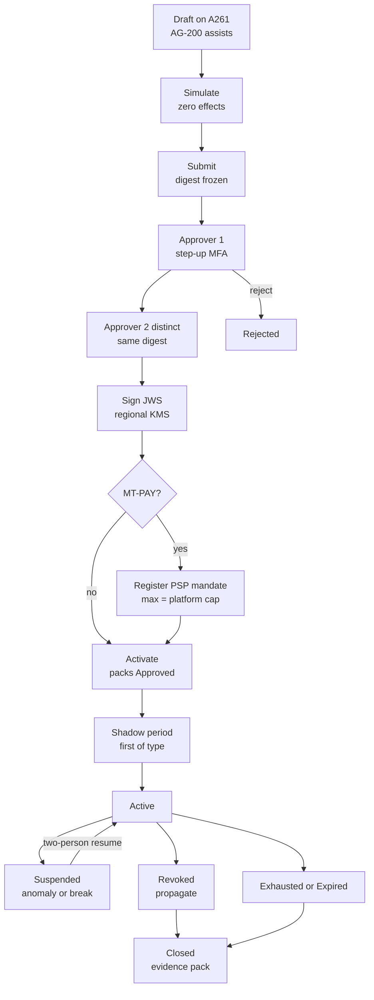
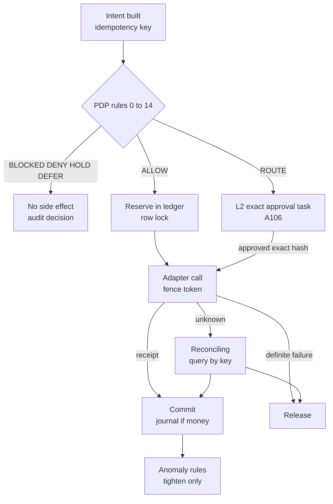
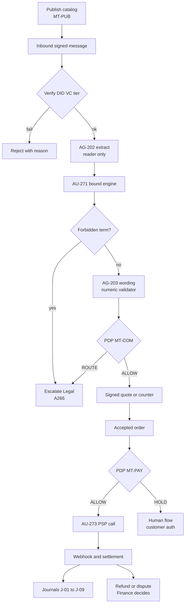
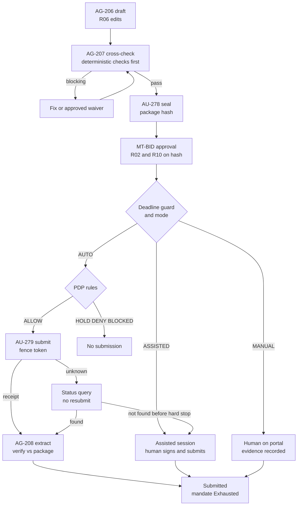

## 11.17.8 Agents, automations and workflows

**Design rule for every agent in this part.** Agents read, extract, classify and draft. **No agent holds an effect tool** (CTRL-AI-04, MC-17): payment, submission, negotiation numbers, mandate state changes and approvals are performed by the deterministic automations AU-260…279 after the PDP. Every agent is bound to V12 role AGT-20 (domain evidence review) or AGT-06/AGT-17 as listed (AU-179 conformance), runs through the model gateway under the provider-neutral registry (DEC-788; Claude Sonnet approved primary as Tier 1b, Haiku-class as Tier 1a), and is **not Tier 2 eligible** (Confidential or Restricted commercial data). Prices per call use the Part 11.6b formula (₹90/USD; verify prices at implementation, as of 27 Nov 2026); monthly figures are pilot design volume [ASSUMPTION-1042] and exclude the 25% overhead allowance.

### 11.17.8.1 Agent cards AG-200…AG-209

#### AG-200 Mandate Drafting Assistant

| Field | Specification |
|---|---|
| Type | Agent · Generator (structured draft) · scope: Product |
| Purpose and business outcome | Turns a requester's plain-language intent ("let the OrganicSpec agent pay approved suppliers up to ₹50,000 per order, ₹2 lakh a month, weekdays") into a **draft** mandate JSON (type, scope, limits, windows) plus a plain-language summary and a list of questions, so mandates are complete and consistent before two-person approval; it never submits or approves |
| Linked BR / FR / US | BRD 18 FL-09; DEC-779; FR-V12-P-006…014, 028; US-18-ZP01 |
| Persona | P03, P06, P07, P10 (requesters R03, R06, R07, R11) |
| Trigger | User action "Draft with assistant" on A261 |
| Inputs and data sources | Intent text (untrusted user text), mandate type catalogue, eligibility register, company ceilings (CFG-P-01/02), counterparty allowlist names (IDs only), Approved pack list |
| Tools / APIs (registry §7.2.4) | TL-P-01 `mandate_schema.get` (read); TL-P-02 `counterparty.lookup` (read, IDs); TL-06 `draft.create` (draft only) |
| Outputs | `{mandate_draft (schema-valid), summary_text, open_questions[], assumptions[], confidence}` |
| Autonomy and HITL | **L1**: draft only; requester edits; simulation then two-person approval |
| Model tier | 1b Sonnet |
| Tier 2 eligibility · data class | No · Confidential |
| Prompt / context strategy | PRM-AGT-17-mandate-draft-v1; schema-constrained output; type rules in cached prefix; examples per type |
| Guardrails | Must not set any limit above company ceiling (validator clamps and flags); must not add counterparties not in allowlist; must ask, not guess, missing caps (abstain → open_questions); never sets state |
| Failure modes and fallback | Schema invalid after 2 repairs → empty form with intent text; gateway down → Tier 3 manual form |
| Success KPIs | ≥ 80% of drafts submitted with ≤ 2 field edits; 0 drafts above ceilings reaching submit |
| Eval dimensions | Field accuracy ≥ 95% on DS-P-01; ceiling violations 0; abstention on missing caps ≥ 95% |
| Tokens, calls, cost | 3,000 in (1,500 cacheable, hit 60%), 800 out; 20 calls/month. Sonnet per call = 90 × [1,500×2 + 1,500×(0.6×0.10 + 0.4×2.50) + 800×10] ÷ 10⁶ = **₹1.133**; **Monthly: low ₹7 · base ₹23 · high ₹68** |
| Dependencies | AU-260, AU-261; A261 |
| Release | R2 (Group P change request CR-V12-P) |

#### AG-201 Mandate Anomaly Explainer

| Field | Specification |
|---|---|
| Type | Agent · Explainer (reader) · scope: Product |
| Purpose and business outcome | Writes a short, cited explanation for each AU-267 anomaly alert (which rule fired, the transactions involved, what changed versus baseline) so the owner can disposition it in A263 quickly; it cannot suspend or resume |
| Linked BR / FR / US | FR-V12-P-065…067; MC-15; US-18-ZP07 |
| Persona | P08 Finance, mandate owners |
| Trigger | Event `mandate.anomaly.raised` |
| Inputs and data sources | Alert record, the decision/ledger rows referenced (IDs, amounts, timestamps), rule definition |
| Tools / APIs (registry §7.2.4) | TL-P-03 `mandate_ledger.read` (scoped rows only) |
| Outputs | `{explanation, cited_row_ids[], suggested_disposition ∈ {confirm, false_positive, needs_info}}` |
| Autonomy and HITL | **L0** (suggestion; human disposes) |
| Model tier | 1a Haiku-class (escalate to 1b on low confidence) |
| Tier 2 eligibility · data class | No · Confidential |
| Prompt / context strategy | PRM-AGT-06-anomaly-explain-v1; row data as delimited data blocks |
| Guardrails | Every number cited must equal a cited row value (validator); no speculation about people's intent; no PII beyond counterparty name |
| Failure modes and fallback | Failure → alert shown with rule text only |
| Success KPIs | Median disposition time ≤ 10 min; explanation accepted unedited ≥ 70% |
| Eval dimensions | Faithfulness 100% numbers; helpfulness rating ≥ 4/5 |
| Tokens, calls, cost | 2,500 in (1,200 cacheable), 400 out; 60 calls/month. Haiku per call ₹0.036. **Monthly: low ₹1 · base ₹2 · high ₹6** |
| Dependencies | AU-267 |
| Release | R2 |

#### AG-202 Counterparty Requirement Extractor

| Field | Specification |
|---|---|
| Type | Agent · Extractor (reader step only) · scope: Product |
| Purpose and business outcome | Supersedes the reader half of AG-104 (Part 11.6b) for WF-59: converts a **verified** counterparty message (RFQ, counter, order, refund request, dispute notice) into a typed record; flags out-of-mandate requests and injection attempts. No tools that write or send |
| Linked BR / FR / US | SM-SVC-28-WF02/03; AI-INJ-06; CTRL-AI-08; FR-V12-P-078, 079; US-24-ZP02, US-24-ZP03 |
| Persona | Counterparty agent (external); P03/P07 reviewers |
| Trigger | Event `agent.message.verified` (after AU-269) |
| Inputs and data sources | Message body (untrusted), mandate VC view (scope only), offering catalog (IDs, units) |
| Tools / APIs (registry §7.2.4) | TL-V12-F-04 `counterparty_message.read` |
| Outputs | `{type, items[{offering_ref, qty, unit}], requested_price?, requested_terms[], delivery, out_of_mandate:bool, injection_suspected:bool, confidence}` |
| Autonomy and HITL | L3 for extraction (internal, R0); any effect decided downstream by AU-271 + PDP |
| Model tier | 1b Sonnet |
| Tier 2 eligibility · data class | No · Confidential |
| Prompt / context strategy | PRM-AGT-20-agentcom-extract-v2; message wrapped as data with provenance; NFKC normalisation and hidden-text strip (CTRL-AI-02) before the call |
| Guardrails | Output schema only; requested_price copied verbatim from message as a *claim* (never an offer); unknown offering → `unmatched`; instruction-like text → injection_suspected |
| Failure modes and fallback | Schema fail → human A266; low confidence < 0.8 → human |
| Success KPIs | Extraction exact match ≥ 95%; 100% out-of-mandate requests flagged |
| Eval dimensions | DS-P-02 exact match; RT-P-01 injection 0 V1–V6 |
| Tokens, calls, cost | 4,500 in (1,500 cacheable), 700 out; 200 calls/month. Sonnet per call ₹1.313. **Monthly: low ₹79 · base ₹263 · high ₹788** |
| Dependencies | AU-269, AU-270; AG-104 retired for WF-59 |
| Release | R2 |

#### AG-203 Negotiation Message Composer

| Field | Specification |
|---|---|
| Type | Agent · Generator (wording only) · scope: Product |
| Purpose and business outcome | Writes the natural-language part of quotes, counters, acceptances and declines around the **numbers and terms produced by AU-271**, in the counterparty's language, so responses are clear and fast without the model ever choosing a number |
| Linked BR / FR / US | SM-SVC-28-WF02/03; DEC-847; FR-V12-P-079, 080; US-24-ZP03 |
| Persona | Counterparty agent; P03/P07 |
| Trigger | AU-271 output `negotiation.step.computed` |
| Inputs and data sources | Bound-engine output (prices, quantities, terms IDs), approved term texts, tone template |
| Tools / APIs (registry §7.2.4) | TL-06 `draft.create` |
| Outputs | `{message_text, structured_body (copied from engine), language}` |
| Autonomy and HITL | Wording at L3 under MT-COM (dispatch decided by PDP); L1 when the step is ESCALATE |
| Model tier | 1b Sonnet |
| Tier 2 eligibility · data class | No · Confidential |
| Prompt / context strategy | PRM-AGT-20-agentcom-compose-v1; numbers passed as locked placeholders `{{P1}}` rendered after generation |
| Guardrails | Numeric validator (every numeric token ∈ engine values, FR-V12-P-080); term validator (only library term texts); no promises outside the library (BRL-AI-05); floor/ceiling never disclosed |
| Failure modes and fallback | Validator failure → template message with placeholders filled deterministically |
| Success KPIs | 0 numeric deviations; counterparty clarification requests < 10% |
| Eval dimensions | Numeric fidelity 100%; floor leakage 0; fluency ≥ 4/5 |
| Tokens, calls, cost | 3,000 in (1,500 cacheable), 500 out; 200 calls/month. Sonnet per call ₹0.863. **Monthly: low ₹52 · base ₹173 · high ₹518** |
| Dependencies | AU-271 |
| Release | R2 |

#### AG-204 Commerce Terms Comparator

| Field | Specification |
|---|---|
| Type | Agent · Classifier · scope: Product |
| Purpose and business outcome | Compares counterparty-proposed non-price terms (payment terms, delivery, liability, governing law, auto-renewal) against the approved term library and marks each as `library_match`, `variant_allowed`, or `forbidden`, so forbidden terms escalate to Legal before any acceptance |
| Linked BR / FR / US | BRL-APR-05; FR-V12-P-081; US-24-ZP03 |
| Persona | P09 Legal (R10) |
| Trigger | AG-202 output with `requested_terms[]` non-empty |
| Inputs and data sources | Requested terms (untrusted), term library version |
| Tools / APIs (registry §7.2.4) | TL-P-04 `term_library.search` (read) |
| Outputs | `{terms[{text, class, library_term_id?, reason}]}` |
| Autonomy and HITL | L0 for `forbidden` (Legal decides); L3 classification feeding AU-271 |
| Model tier | 1b Sonnet |
| Tier 2 eligibility · data class | No · Confidential |
| Prompt / context strategy | PRM-AGT-20-terms-compare-v1; library cached |
| Guardrails | Default when uncertain = `forbidden` (fail closed); no paraphrase accepted as match unless similarity rule and model agree |
| Failure modes and fallback | Failure → all terms `forbidden` → ESCALATE |
| Success KPIs | Forbidden-term recall ≥ 99%; false-forbidden ≤ 15% |
| Eval dimensions | DS-P-03 recall/precision |
| Tokens, calls, cost | 6,000 in (2,000 cacheable), 800 out; 60 calls/month. Sonnet per call ₹1.631. **Monthly: low ₹29 · base ₹98 · high ₹294** |
| Dependencies | Term library (Legal) |
| Release | R2 |

#### AG-205 Dispute Evidence Pack Drafter

| Field | Specification |
|---|---|
| Type | Agent · Generator · scope: Product |
| Purpose and business outcome | Assembles a representment / response draft for a chargeback or dispute from the order, signed messages, delivery proof and refund history, mapped to the reason code, so Finance can respond before the PSP deadline |
| Linked BR / FR / US | FR-V12-P-091; US-15-ZP03 |
| Persona | P08 Finance (R08/R09) |
| Trigger | `dispute.opened` |
| Inputs and data sources | Dispute notice, order, JWS message trail, receipts, delivery evidence |
| Tools / APIs (registry §7.2.4) | TL-P-05 `commerce_case.read`; TL-06 `draft.create` |
| Outputs | `{narrative, evidence_list[], reason_code_mapping, gaps[]}` |
| Autonomy and HITL | **L1**: Finance decides and submits via PSP |
| Model tier | 1b Sonnet |
| Tier 2 eligibility · data class | No · Confidential (personal data minimised) |
| Prompt / context strategy | PRM-AGT-20-dispute-v1; reason-code playbook cached |
| Guardrails | Cites evidence IDs for every factual statement (BRL-AI-03); no admission of liability language; no customer PII beyond what the PSP requires |
| Failure modes and fallback | Failure → checklist template |
| Success KPIs | Draft ready ≤ 1 h of case open; win rate tracked |
| Eval dimensions | Groundedness 100%; completeness ≥ 90% |
| Tokens, calls, cost | 8,000 in (2,000 cacheable), 1,500 out; 10 calls/month. Sonnet per call ₹2.621. **Monthly: low ₹8 · base ₹26 · high ₹79** |
| Dependencies | AU-276 |
| Release | R2 |

#### AG-206 Bid Package Assembler

| Field | Specification |
|---|---|
| Type | Agent · Generator · scope: Product |
| Purpose and business outcome | Drafts tender response sections from approved proposal templates, capability evidence and the tender's requirement matrix (SM-SVC-19-WF03 STEP-01 "Draft response"), so the package is complete before sealing; prices are inserted from the approved quote, never generated |
| Linked BR / FR / US | SM-SVC-19-WF03; BRL-BID-02; FR-V12-P-111, 112; US-14-ZP01 |
| Persona | P06 Bid Manager (R06) |
| Trigger | Bid decision "Bid" approved (BRL-BID-03) |
| Inputs and data sources | Tender documents (untrusted), requirement matrix, approved templates and claims, approved quote |
| Tools / APIs (registry §7.2.4) | TL-01 `knowledge.search`; TL-06 `draft.create` |
| Outputs | `{sections[{req_id, text, citations[]}], missing_items[]}` |
| Autonomy and HITL | **L1** — R06 edits; R02 + R10 approve the sealed package |
| Model tier | 1b Sonnet |
| Tier 2 eligibility · data class | No · Confidential |
| Prompt / context strategy | PRM-AGT-04-bid-assemble-v1; per-requirement generation; citations mandatory |
| Guardrails | No uncited capability claim; no price text; tender instructions treated as data |
| Failure modes and fallback | Failure → empty section stubs with requirement text |
| Success KPIs | Requirement coverage 100%; edit distance falling over time |
| Eval dimensions | Groundedness; requirement coverage; claims precision |
| Tokens, calls, cost | 9,000 in (3,000 cacheable), 3,000 out; 20 calls/month. Sonnet per call ₹4.066. **Monthly: low ₹24 · base ₹81 · high ₹244** |
| Dependencies | AG-019 checklist (Part 7) |
| Release | R2 |

#### AG-207 Bid Compliance Cross-checker

| Field | Specification |
|---|---|
| Type | Agent · Classifier + extractor · scope: Product |
| Purpose and business outcome | Before sealing and again before submission, checks the package against the tender's mandatory requirements (formats, page limits, required forms, declarations, EMD reference, signatory) and lists blocking findings (SM-SVC-19-WF03 STEP-02 "validate attachments"; WF04 readiness) |
| Linked BR / FR / US | SM-SVC-19-WF03/WF04; QC-26; FR-V12-P-112; US-14-ZP01 |
| Persona | P06, P09 |
| Trigger | Seal request; T−24 h pre-submission check |
| Inputs and data sources | Manifest, files (text extracted), tender requirement matrix |
| Tools / APIs (registry §7.2.4) | TL-04 `document.extract` (read) |
| Outputs | `{findings[{req_id, severity: blocking or warning, evidence}], pass:bool}` |
| Autonomy and HITL | L3 for findings (R0); a blocking finding holds the gate; human may waive with approval (BRL-BID-02) |
| Model tier | 1b Sonnet |
| Tier 2 eligibility · data class | No · Confidential |
| Prompt / context strategy | PRM-AGT-04-bid-check-v1; deterministic checks (file type, size, count) run first in code |
| Guardrails | Uncertain → blocking (fail closed) |
| Failure modes and fallback | Failure → manual checklist required |
| Success KPIs | Missing-item recall ≥ 98% (V12 SVC-19-WF04 KPI) |
| Eval dimensions | Recall, precision on DS-P-04 |
| Tokens, calls, cost | 12,000 in (3,000 cacheable), 1,200 out; 20 calls/month. Sonnet per call ₹2.986. **Monthly: low ₹18 · base ₹60 · high ₹179** |
| Dependencies | AU-278 |
| Release | R2 |

#### AG-208 Portal Receipt Extractor

| Field | Specification |
|---|---|
| Type | Agent · Extractor · scope: Product |
| Purpose and business outcome | Extracts bid ID, timestamp, tender ID and any checksum from the portal acknowledgement (HTML, PDF, e-mail); AU-279 then verifies the fields deterministically against the sealed package (SM-SVC-19-WF03 STEP-04 "track receipt") |
| Linked BR / FR / US | FR-V12-P-125; KPI-P-07; US-14-ZP03 |
| Persona | P06 |
| Trigger | Adapter returns `receipt_artifact` |
| Inputs and data sources | Receipt artifact (untrusted) |
| Tools / APIs (registry §7.2.4) | TL-04 `document.extract` |
| Outputs | `{portal_bid_ref, submitted_at, tender_ref, checksum?, confidence}` |
| Autonomy and HITL | L3 extraction; verification deterministic; mismatch → human |
| Model tier | 1a Haiku-class; escalate 1b on low confidence |
| Tier 2 eligibility · data class | No · Confidential |
| Prompt / context strategy | PRM-AGT-04-receipt-v1; portal-specific few-shot |
| Guardrails | Fields must appear verbatim in the artifact (span check) |
| Failure modes and fallback | Failure → human transcribes receipt |
| Success KPIs | Verified receipt rate ≥ 99% |
| Eval dimensions | Exact match ≥ 99% on DS-P-05 |
| Tokens, calls, cost | 3,000 in (800 cacheable), 300 out; 30 calls/month. Haiku per call ₹0.037. **Monthly: low ₹0 · base ₹1 · high ₹3** |
| Dependencies | AU-279 |
| Release | R2 |

#### AG-209 Reconciliation Exception Explainer

| Field | Specification |
|---|---|
| Type | Agent · Explainer · scope: Product |
| Purpose and business outcome | For each reconciliation break (RC-P-01…06) proposes the likely cause (timing, fee, partial, duplicate, unknown) with cited rows, so Finance maker-checker resolves faster; never posts or closes |
| Linked BR / FR / US | FR-V12-P-062…064; BRL-APR-07; US-15-ZP02 |
| Persona | P08 |
| Trigger | `recon.break.opened` |
| Inputs and data sources | Break record, ledger rows, PSP lines |
| Tools / APIs (registry §7.2.4) | TL-P-03 `mandate_ledger.read`; TL-P-06 `psp_statement.read` |
| Outputs | `{probable_cause, cited_ids[], suggested_next_step}` |
| Autonomy and HITL | L0 |
| Model tier | 1a Haiku-class |
| Tier 2 eligibility · data class | No · Confidential |
| Prompt / context strategy | PRM-AGT-06-recon-explain-v1 |
| Guardrails | Numbers must equal cited rows; no auto-resolution |
| Failure modes and fallback | Failure → raw break view |
| Success KPIs | Breaks closed ≤ 2 business days (KPI-P-04) |
| Eval dimensions | Cause accuracy ≥ 80% on DS-P-06; faithfulness 100% |
| Tokens, calls, cost | 3,000 in (1,200 cacheable), 500 out; 100 calls/month. Haiku per call ₹0.045. **Monthly: low ₹1 · base ₹4 · high ₹13** |
| Dependencies | AU-268, AU-274 |
| Release | R2 |

**Agent cost total (pilot design volume):** low ₹219 · base ₹731 · high ₹2,192 per month (sum of the ten cards; verify prices).

### 11.17.8.2 Automations AU-260…AU-279

| ID | Name | Wave / Release | Linked BR / FR / rule | Trigger | Deterministic logic | Outputs | Autonomy | Guardrail | Failure / fallback | KPI | Cost |
|---|---|---|---|---|---|---|---|---|---|---|---|
| AU-260 | Mandate digest canonicaliser and signer | R2 (CR-V12-P) | FL-09; FR-V12-P-021; MC-03 | Submit; approve; dispatch verify | Canonical JSON → SHA-256; KMS ES256 sign at Approved; verify at every PDP call | digest, JWS | L3 (deterministic) | Key per region; non-exportable | KMS unavailable → no approval, no dispatch (fail closed) | 0 integrity failures | ₹0 incremental (KMS requests ≈ ₹10–50/month, verify) |
| AU-261 | Two-person approval router and SoD checker | R2 | TPA-01…11; FR-V12-P-015…020 | Mandate submitted; approval act | Assign eligible approvers by type and value (DEC-038); enforce distinct persons, role mix, MFA age, CoI, delegation rules | approval tasks; decisions | L3 | Never auto-approves; escalation after SLA | Missing eligible approver → escalate to R01 | Cycle time p50 ≤ 1 bd | ₹0 |
| AU-262 | Mandate activation and expiry scheduler | R2 | §11.17.5.8; FR-V12-P-029…032 | Every minute; inline at dispatch | Approved→Active when time and packs and PSP mandate ok; Active→Expired/Exhausted | state transitions | L3 | Inline check does not rely on job | Job lag → inline check still denies | 0 effects after expiry | ₹0 |
| AU-263 | Mandate consumption ledger | R2 | LED-01…06; FR-V12-P-033…036 | PDP allow; adapter result | Atomic reserve (row lock, fixed lock order); commit/release once; TTL rules | reservation rows | L3 | Idempotency key | DB contention → DEFER with retry-after | 0 double spends | ₹0 |
| AU-264 | Mandate PDP evaluator | R2 | §11.17.5.12; FR-V12-P-040…052 | Every mandated dispatch | Rules 0–14 in fixed order; fence token issue | decision record | L3 | Fail closed on any error | Error → HOLD `PDP_ERROR` | p99 ≤ 50 ms | ₹0 |
| AU-265 | Kill-switch propagator and fence | R2 | MC-09; FR-V12-P-053…058; ADR-246 | Engage/release | Write DB + Valkey; bump fence tokens; adapter gateway rejects stale fence | switch state | L3 | Release needs two people | Valkey down → DB fence still checked | ≤ 60 s propagation | ₹0 |
| AU-266 | Revocation propagator | R2 | FR-V12-P-053…058, 095 | Mandate revoked/suspended | Cancel/pause PSP mandate; signed revocation notice to counterparties; record acks | ack records | L3 | Retries with backoff; never "assumes" cancelled | PSP cancel fails → SEV2 + daily RC-P-04 | 100% PSP acks ≤ 24 h | ₹0 |
| AU-267 | Mandate anomaly rules engine | R2 | AR-01…12; FR-V12-P-065…067 | Each decision; hourly batch | Rule evaluation; tighten-only actions (route L2, suspend) | alerts; suspensions | L3 (tighten only) | Cannot loosen | Engine down → mandates with money types suspend after 15 min without heartbeat (fail safe) | TP ≥ 30% after 90 d | ₹0 |
| AU-268 | Mandate reconciliation and evidence packer | R2 | RC-P-01…06; MC-14, MC-24 | Hourly/daily; on demand | Matching by keys; break creation; suspend on break; evidence pack ZIP + signed manifest | recon runs; packs | L3 | Breaks never auto-closed | Missing statement → break "statement missing" | Breaks > 2 bd = 0 | ₹0 |
| AU-269 | Counterparty VC verifier | R2 | FR-V12-P-072, 073; FC-06 | Every inbound message | JWS verify; DID resolve (cache 10 min); VC signature, issuer trust list, status list, expiry; nonce/iat/exp | verification result | L3 | Fail closed | Resolver down → HOLD | 0 unverified messages processed | ₹0 (DID resolution egress negligible) |
| AU-270 | Counterparty allowlist and trust-tier manager | R2 | FR-V12-P-074, 094; FC-01, FC-08 | Onboarding; schedule; instrument change | Tier rules T0–T3; re-verification schedule; sanctions screening hook | tier changes | L3 (downgrade only automatic) | Upgrade needs human | Screening provider down → no upgrade | Re-verification on time 100% | Screening provider fees (verify) |
| AU-271 | Negotiation bound engine | R2 | §11.17.6.4; DEC-847; FR-V12-P-079 | AG-202 output | Floor/ceiling, step, rounds, terms; computes every number | engine step | L3 | Numbers only from approved price book | Price book not Approved → ESCALATE | Budget violations 0 | ₹0 |
| AU-272 | PSP payment-mandate registrar and pre-debit notifier | R2 | FR-V12-P-084, 085 | MT-PAY Approved; debit scheduled | Register scheme mandate with max = platform cap; send pre-debit notice per scheme lead | PSP mandate ref; notices | L3 | No credentials stored | PSP error → mandate stays Approved (not Active) | 100% notices on time | PSP mandate fees per registration (verify) |
| AU-273 | Payment executor | R2 | P1–P7; FR-V12-P-086 | PDP allow on payment intent | Idempotent PSP call with fence; outcome normalisation | PSP payment ID | L3 | Timeout → Reconciling, no retry | Circuit breaker per PSP | Duplicate payments 0 | PSP transaction fees (pass-through, verify) |
| AU-274 | PSP webhook verifier and settlement reconciler | R2 | FR-V12-P-088, 089; BRL-FIN-02 | Webhook; daily settlement file | Signature check; dedup; settlement match; fee/tax booking | verified events; recon | L3 | Invalid signature rejected | Missing webhook → status poll | Settlement match ≥ 99.5% auto | ₹0 |
| AU-275 | Refund executor under mandate | R2 | FR-V12-P-090 | Refund approved or within mandate | Original instrument; ≤ captured − refunded; window check | refund ID | L3 / L2 | No headroom creation | Outside rules → L2 Finance | Refund errors 0 | PSP refund fees (verify) |
| AU-276 | Dispute and chargeback case manager | R2 | FR-V12-P-091 | PSP dispute webhook | Case creation; internal deadline; reminders; T0 counterparty; mandate suspend on ≥ 2/30 d | case | L3 (tracking) | Decisions human | Missed deadline → SEV3 + RCA | 0 missed deadlines | ₹0 |
| AU-277 | Commerce double-entry poster | R2 | §11.17.6.7; FR-V12-P-092 | Order, capture, settlement, refund, dispute events | Journals J-01…J-09; balance constraint; idempotent journal IDs | journals | L3 | Unbalanced rejected | Posting failure → outbox retry | 0 unbalanced | ₹0 |
| AU-278 | Bid package sealer and deadline guard | R2 | §11.17.7.2, §11.17.7.6; FR-V12-P-111…117 | Seal; schedule ticks | Manifest hash; object lock; B_auto/B_hard rules; escalation ladder | package_hash; guard decisions | L3 | No attempt inside B_hard | Clock skew alarm → automated path closed | Deadline misses 0 | ₹0 |
| AU-279 | Portal submission executor, receipt verifier and outcome reconciler | R2 | §11.17.7.3, §11.17.7.7; FR-V12-P-118…127 | PDP allow on `bid.submit` | Adapter submit with fence; receipt field verification vs package; status polling on unknown | submission record | L3 | Never resubmits on unknown; no CAPTCHA solving | Unknown at T−B_hard → human | Verified receipts ≥ 99% | Browser worker compute ≈ ₹500–1,500/month (verify) |

### 11.17.8.3 Workflows WF-57…WF-60

### WF-57 Mandate issuance and lifecycle

**Purpose:** Create, simulate, approve (two people), sign, activate, amend, suspend, resume, revoke and close a bounded mandate (FL-09; DEC-779).

**Actors:** Requester (R03/R05/R06/R07/R11), approvers (R02, R08, R09, R10, R01 by value), AG-200, AU-260/261/262/266/268.

**Screens:** A260, A261, A262, A263, A106.

| Step | Actor | Action | Output | Failure path |
|---|---|---|---|---|
| 1 | Requester (+AG-200) | Draft mandate on A261 | Draft | Schema errors shown |
| 2 | System | Simulate (FL-07) | Simulation report (worst case) | Ineligible workflow/jurisdiction flagged |
| 3 | Requester | Submit | Digest frozen; approvers assigned (AU-261) | No eligible approver → R01 |
| 4 | Approver 1 | Approve with step-up on A262 | Approval 1 | Reject → Rejected |
| 5 | Approver 2 | Approve same digest | Approved; JWS signed (AU-260) | Digest changed → approvals void |
| 6 | AU-272 (MT-PAY) | Register PSP mandate | PSP ref | PSP failure → stays Approved |
| 7 | AU-262 | Activate when guards pass | Active (shadow if first) | Pack not Approved → stays Approved |
| 8 | Owner / AU-267 | Tighten overlay or suspend | Restriction / Suspended | — |
| 9 | Two approvers | Resume | Active | PDP recheck fails → stays Suspended |
| 10 | Authorized user | Revoke | Revoked; AU-266 propagates | PSP cancel failure → SEV2 |
| 11 | AU-268 | Close when reconciled | Closed; evidence pack sealed | Open breaks → stays |

### WF-58 Mandated action dispatch

**Purpose:** Execute one external effect under an Active mandate with the PDP recheck, ledger reservation, adapter call and reconciliation (FSD 13 approve/dispatch/reconcile; FSD 18 recheck).

**Actors:** Workflow engine, AU-263/264/265/268, effect adapters, A106 approvers (for ROUTE).

**Screens:** A110 (run monitor), A263, A106.

| Step | Actor | Action | Output | Failure path |
|---|---|---|---|---|
| 1 | Workflow step | Build intent (action, payload hash, amount, counterparty, idem key) | Intent | Invalid → HELD |
| 2 | AU-264 | Rules 0–14 | Verdict | Non-ALLOW → NSE; ROUTE → A106 L2 task |
| 3 | AU-263 | Reserve | Reservation | Cap → ROUTE |
| 4 | Adapter | Execute with fence | Receipt / error / unknown | Stale fence → rejected |
| 5 | AU-263 | Commit / release / hold | Ledger row | Unknown → Reconciling |
| 6 | AU-268 | Reconcile unknowns | Matched/failed | Break → suspend |
| 7 | AU-267 | Anomaly evaluation | Alert or none | Tighten only |

### WF-59 Agentic commerce negotiation and payment

**Purpose:** SM-SVC-28 WF01–WF04 end to end: publish catalog, verify counterparty, exchange quotes, negotiate within bounds, accept order, pay or collect via licensed PSP, reconcile, refund, dispute (DEC-780).

**Actors:** Counterparty agent, AU-269/270/271/272/273/274/275/276/277, AG-202/203/204/205, R03/R07 (escalations), R08/R09 (Finance), R10 (Legal).

**Screens:** A172 (V12 X28 workspace), A265, A266, A267.

| Step | V12 step | Actor | Action | Output | Failure path |
|---|---|---|---|---|---|
| 1 | 28-WF01-STEP-01…03 | AU (MT-PUB) | Publish approved catalog version to authorized agent endpoint | Catalog version | POLICY_DENIED → BLOCKED |
| 2 | 28-WF02-STEP-01 | AU-269/270 | Verify identity, VC, tier, mandate scope | Verified | Fail → reject with reason |
| 3 | 28-WF02-STEP-02 | AG-202 + rules | Match requirement to approved offerings | Typed requirement | Unmatched → human |
| 4 | 28-WF02-STEP-03 | AU-271 + AG-203 + PDP | Quote within bounds | Signed quote | REVIEW_REQUIRED → A266 |
| 5 | 28-WF03-STEP-01…03 | AU-271 + AG-204 + PDP | Counter / accept / escalate | Mandate-linked decision | Beyond bounds → ESCALATE |
| 6 | 28-WF04-STEP-01 | PDP (MT-PAY) | Verify authorization for payment | Allow | Non-ALLOW → NSE |
| 7 | 28-WF04-STEP-02 | AU-273 | Execute only via approved PSP | PSP ref | Unknown → Reconciling |
| 8 | 28-WF04-STEP-03 | AU-274/268/277 | Reconcile outcome; post journals | Auditable transaction record | Break → suspend |
| 9 | — | AU-275/276 + AG-205 + Finance | Refund / dispute | Case outcome | Deadline alerts |

### WF-60 Automatic bid submission

**Purpose:** SM-SVC-19-WF03 with DEC-781: draft, validate, approve the package hash under a per-tender MT-BID mandate, submit through a permitted portal adapter (or assisted/manual), verify the receipt, reconcile unknown outcomes, respect the deadline guard.

**Actors:** R06 Bid Manager, R02 Startup Head, R10 Legal (R01 by value), AG-206/207/208, AU-278/279, portal adapters.

**Screens:** A104 (bid desk), A268, A269, A262.

| Step | V12 step | Actor | Action | Output | Failure path |
|---|---|---|---|---|---|
| 1 | 19-WF03-STEP-01 Draft response | AG-206 + R06 | Draft sections | Draft | REVIEW_REQUIRED |
| 2 | 19-WF03-STEP-02 Validate attachments | AG-207 + rules | Cross-check | Findings | Blocking → HOLD |
| 3 | — | AU-278 | Seal package | package_hash | — |
| 4 | 19-WF03-STEP-03 Route approval | AU-261 + R02 + R10 | Approve MT-BID on hash | Mandate Active | Reject → back to 1 |
| 5 | — | AU-278 | Deadline guard; mode selection (registry, pack, level) | AUTO / ASSISTED / MANUAL | Inside B_auto → ASSISTED |
| 6 | 19-WF03-STEP-04 Coordinate authorized submission | AU-279 + PDP | Submit with fence | Receipt / unknown / rejected | Unknown → Reconciling |
| 7 | 19-WF03-STEP-04 Track receipt | AG-208 + AU-279 | Extract and verify receipt | Submitted | Mismatch → human |
| 8 | — | AU-268 | Evidence pack; mandate Exhausted | Pack | — |

